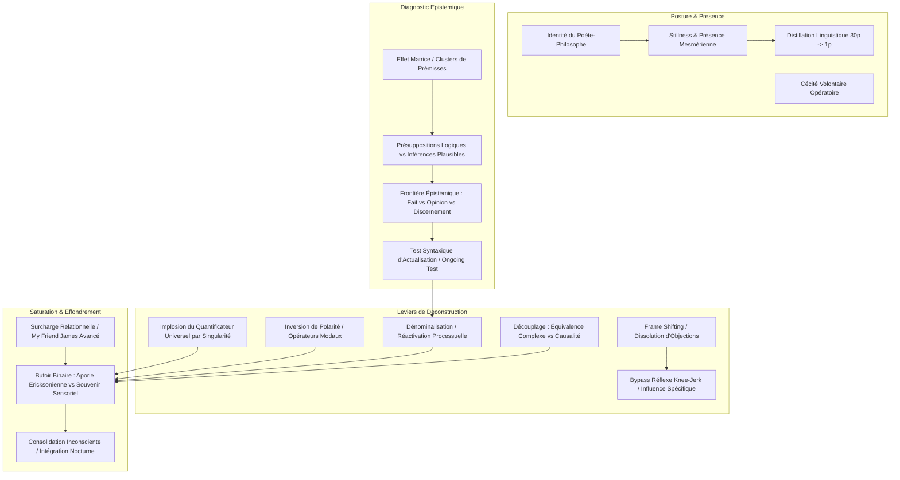

# Advanced Practitioner of Conversational Hypnosis for Influence (APCHI)
**Formateur :** Igor Ledochowski | **ID :** `igor-ledochowski-advanced-practitioner-of-conversational-hypnosis-for-influence-apchi` | **Tranches :** 24

## Synthèse Architecturale du Cours : Advanced Practitioner of Conversational Hypnosis for Influence (APCHI) — Igor Ledochowski

---

### 1. Thèse Centrale & Philosophie du Cours

#### La vision spécifique d'Igor Ledochowski : L'Identité du « Poète-Philosophe »
Dans l'approche standard de l'influence ou de la négociation (modèles de persuasion frontale, techniques de vente transactionnelle, argumentaires de clôture), l'interlocuteur est abordé comme un adversaire logique à convaincre ou à vaincre. À l'opposé, les approches thérapeutiques classiques de la PNL cherchent à « réparer » l'histoire de vie du sujet. 

Igor Ledochowski prend une posture orthogonale : celle du **« Poète-Philosophe » opératoire**.
* **Ni joute rhétorique, ni thérapie sauvage :** En contexte d'influence, le praticien n'a ni le mandat éthique ni le besoin de soigner la psyché d'autrui. Tenter de « réparer » quelqu'un sans son accord déclenche une réactance psychologique immédiate et détruit le rapport.
* **Le scalpel de déconstruction sélective :** Le Méta-Modèle et l'hypnose conversationnelle ne servent pas à débattre, mais agissent comme un filtre épistémique impitoyable. Ils dissolvent les distorsions, nominalisations et « barrières fantômes » (le bruit cognitif) afin de ramener l'interlocuteur à la réalité nue : l'objection est-elle un obstacle factuel réel (logistique, financier, temporel) ou une simple hallucination sémantique ?
* **Stillness et Présence Mesmérienne :** L'influence ne réside pas dans l'agitation verbale ou la sur-argumentation, mais dans une immobilité physique radicale (*stillness*), une économie de mouvements, une densité linguistique maximale (30 pages réduites à 28 lignes de pure charge suggestive) et une projection d'expectative inébranlable (*expectancy*). C'est le couplage neurovégétatif calme du praticien qui impose l'état de transe et désamorce les réactions défensives automatiques (*knee-jerk reflexes*).

#### Le fil rouge méthodologique : De la Surface Gelée à l'Aporie ou au Fait
Toutes les interventions du cours sont sous-tendues par un vecteur unique de désencodage cognitif :
1. **Identifier la « Matrice » :** Repérer les clusters de présuppositions et de nominalisations qui figent un processus vivant en un objet permanent et menaçant (« un problème », « la communication »).
2. **Attaquer l'infrastructure tacite, jamais le contenu de surface :** Ne jamais répondre à l'objection dans les termes où elle est posée (ce qui validerait son cadre), mais interroger la règle sous-jacente ou introduire des présuppositions enchâssées qui contournent le facteur critique.
3. **Pousser la syntaxe jusqu'au butoir binaire :** Toute intervention de clarification linguistique correctement menée force le système nerveux du sujet à sortir des rationalisations abstraites pour buter inévitablement sur l'une des deux seules sorties réelles :
   * **Le Souvenir Sensoriel Pur (VAKOG) :** L'évocation d'un fait empirique ancré dans l'expérience vécue (désamorçant la distorsion).
   * **L'Aporie Éricksonienne (Confusion / Bug Système) :** La suspension totale du jugement conscient (« *hands slipping off* »), ouvrant une brèche immédiate pour l'acceptation de nouvelles suggestions de cadre.

---

### 2. Carte des Concepts & Leviers Émergents



#### Écosystème des leviers clés :

*   **Identité du « Poète-Philosophe » & Cécité Volontaire (*Willful Blindness*)** : Posture d'élégance relationnelle où le praticien perçoit la structure inconsciente sans imposer de thérapie ; il sait désactiver son acuité analytique à volonté pour préserver le rapport humain ordinaire.
*   **Présence Magnétique & Stillness** : Alignement mesmérien fondé sur l'absence de micro-parasites gestuels, la voix posée et une expectative absolue qui régule directement le système nerveux autonome du sujet par résonance miroir.
*   **Densité Suggestive & Distillation Linguistique** : Compression radicale du texte/discours (ex. 30 pages ramenées à 28 lignes) privant le facteur critique de matière à contester et maximisant l'impact hypnotique.
*   **L'Effet Matrice (*The Matrix Effect*)** : Lecture de la géométrie profonde des plaintes et objections par l'analyse des présuppositions logiques vs inférences plausibles.
*   **Le Triade Fait / Opinion / Discernement** : Modèle de validation empirique distinguant les jugements subjectifs sans prise, les faits observables, et le discernement (règle opérationnelle validée par des conséquences prévisibles dans la réalité).
*   **Dénominalisation & « Ongoing Test »** : Remplacement du *wheelbarrow test* par le filtre syntaxique « *ongoing* » pour identifier instantanément les processus figés et réactiver la neuroplasticité et le contrôle décisionnel (*agency*).
*   **Implosion par Singularité (Quantificateurs Universels)** : Destruction mathématique des croyances globales (*toujours, jamais*) par l'élicitation d'un unique contre-exemple ($0.01\%$).
*   **Inversion de Polarité & Démasquage d'Obstacles (Opérateurs Modaux)** : Forcer l'exploration de l'interdit ou de l'obligation pour distinguer la « barrière fantôme » (fantasme de catastrophe) de la barrière réelle.
*   **Découplage Causal vs Équivalence Complexe** : Séparation chirurgicale entre une simple corrélation sensorielle synchronique ($A = B$) et une relation causale directe ($A \rightarrow B$).
*   **Surcharge Relationnelle (*My Friend James Avancé*)** : Saturation du calepin visuo-spatial et de la mémoire de travail par un réseau dense de protagonistes, provoquant un lâcher-prise critique propice aux suggestions enchâssées.
*   **Le Butoir Binaire (Souvenir Sensoriel vs Aporie)** : Point d'orgue métamodélique où l'objection s'effondre soit dans la réalité d'un fait sensoriel vérifiable, soit dans l'état de confusion fertile ouvrant sur la transe.

---

### 3. Tableau Récapitulatif des Techniques & Démonstrations

| Technique / Exercice | Objectif Opératoire | Déclencheur / Indication | Séquence Résumée |
|---|---|---|---|
| **Stillness & Expectancy Mesmérienne** | Imposer un état de transe conversationnelle sans lutte via le couplage neuro-végétatif. | Agitation du sujet, scepticisme, tentative de joute verbale ou de cadrage dominant. | 1. Stopper tout micro-mouvement corporel.<br>2. Adopter un regard focalisé calme, tonus respiratoire bas.<br>3. Maintenir un silence plein fondé sur une certitude interne d'inévitabilité.<br>4. Délivrer la suggestion avec une économie minimale de mots. |
| **Distillation Linguistique (30p $\rightarrow$ 1p)** | Éliminer tout frottement critique et maximiser la pénétration inconsciente des suggestions. | Préparation de scripts d'influence, d'allocutions clés ou de recadrages d'objections majeurs. | 1. Rédiger l'ensemble des arguments/suggestions (brut volumineux).<br>2. Biffer impitoyablement les rationalisations, adverbes et ponts logiques superflus.<br>3. Condenser en formules brèves ultra-évocatrices (28 lignes).<br>4. Vérifier l'absence de prise pour le facteur critique conscient. |
| **Bypass du Réflexe Knee-Jerk (Influence Spécifique)** | Désamorcer les réactions automatiques de défense sans provoquer de réactance. | Le sujet dit « Non » ou rejette une proposition par réflexe défensif immédiat, sans analyse. | 1. Ne pas contrer le « non » (éviter le piège de la persuasion frontale).<br>2. Valider l'intention de sécurité du sujet.<br>3. Effectuer un décalage de cadre (*frame shift*) vers les prémisses de la situation.<br>4. Réintroduire l'action sous forme de test réversible. |
| **Audit Linéaire du Méta-Modèle (Déconstruction Chirurgicale)** | Dissoudre les distorsions de surface et ramener la communication aux faits opérationnels. | Plainte floue, objection figée, rationalisation excessive bloquant la décision. | 1. Repérer les violations syntaxiques (omissions, distorsions, généralisations).<br>2. Appliquer la question ciblée sans tonalité de reproche (*doubt tonality*).<br>3. Répéter l'opération en « desserrant la prise » (*loosening the grip*).<br>4. Cesser dès que le sujet atteint un fait sensoriel ou l'aporie. |
| **Le Test « Ongoing » & Dénominalisation** | Transformer une fatalité conceptuelle insurmontable en un processus actif modifiable. | Présence de substantifs abstraits réifiés : « la communication », « la confiance », « notre relation ». | 1. Diagnostiquer en testant mentalement le mot avec l'adjectif « ongoing » (*an ongoing relationship* = nominalisation validée).<br>2. Remplacer le nom par sa forme verbale active continue en `-ing` (*communicating*, *trusting*).<br>3. Demander comment le processus est exécuté spécifiquement dans le présent (*« Comment es-tu en train de… ? »*). |
| **Inversion de Polarité sur Nécessité** | Briser l'illusion du « choix unique » et forcer l'évaluation de la conséquence fantasmée. | Déclarations de contrainte : « Je dois absolument... », « Il ne faut pas que je... ». | 1. Isoler l'opérateur modal (*must/should/have to*).<br>2. Poser la question de polarité inverse : *« Que se passerait-il si tu ne le faisais pas ? »* ou *« Qu'est-ce qui t'arriverait si tu le faisais quand même ? »*.<br>3. Calibrer l'interruption de schéma et la formulation de la conséquence redoutée réelle. |
| **Démasquage de la Barrière Réelle (« Can't » / Impossibilité)** | Révéler la règle cachée sous-jacente qui bloque l'action derrière une excuse d'incapacité. | Verrouillage par : « Je ne peux pas signer / accepter / décider maintenant ». | 1. Reconnaître l'impossibilité de surface sans argumenter.<br>2. Lancer la question-scalpel : *« Qu'est-ce qui t'en empêche précisément ? »*.<br>3. Mettre à jour l'obstacle réel masqué (peur, absence de budget, autorisation hiérarchique).<br>4. Traiter l'obstacle réel ainsi révélé, ou constater l'évaporation de la barrière imaginaire. |
| **Rupture par Singularité (Contre-Exemple)** | Faire imploser instantanément une règle rigide globale. | Usage de quantificateurs universels : « Ça ne marche jamais », « Tout le monde refuse », « Toujours en retard ». | 1. Répéter le quantificateur avec une tonalité d'interrogation sceptique (*« Jamais ? »*).<br>2. Demander ou évoquer une unique exception historique ($0.01\%$).<br>3. Observer l'invalidation mathématique de la prémisse chez l'interlocuteur.<br>4. Reconstruire le modèle sur les conditions de contexte spécifiques où cela fonctionne. |
| **Découplage Causal vs Équivalence Complexe** | Séparer un indice sensoriel externe d'une lecture de pensée émotionnelle arbitraire. | Énoncés associatifs : « Il a regardé l'heure, donc il se moque de mon projet / parce qu'il s'ennuie ». | 1. Identifier le lien $A = B$ faussement présenté comme $A \rightarrow B$.<br>2. Interroger le pont sémiotique : *« En quoi le fait de [comportement A] signifie-t-il automatiquement [conclusion B] ? »*.<br>3. Présenter une hypothèse alternative plausible rompant le lien univoque.<br>4. Ramener le focus sur l'observation factuelle neutre. |
| **Évasion Présuppositionnelle (Presuppositional Smuggling)** | Faire adopter une prémisse majeure sans contestation du facteur critique. | Phase d'ancrage d'accord, de cadrage de décision ou de clôture conversationnelle. | 1. Déterminer la prémisse à installer (ex: *la valeur de l'offre est évidente*).<br>2. Créer une question de surface portant sur un détail accessoire/temporel (ex: *« Préférez-vous constater ces résultats dès le premier mois ou attendre le bilan trimestriel ? »*).<br>3. Laisser l'esprit conscient traiter le choix de surface.<br>4. Constater la validation inconsciente automatique de la prémisse sous-jacente. |
| **Surcharge Relationnelle (My Friend James Avancé)** | Provoquer la fatigue attentionnelle critique pour insérer des suggestions profondes. | Résistance intellectuelle forte, esprit analytique sur-vigilant bloquant la transe. | 1. Démarrer une narration anecdotique impliquant un protagoniste A.<br>2. Introduire rapidement 15 à 20 relations imbriquées (amis d'amis, collègues, filiations).<br>3. Tisser des intrigues relationnelles croisées saturant la mémoire de travail.<br>4. Calibrer les signes de surcharge (regard fixe, respiration ralentie, micro-hochements).<br>5. Glisser les suggestions cibles au cœur du récit sans transition marquée. |
| **Focalisation Étroite & Atténuation Périphérique (Exemple de l'Usine)** | Isoler le sujet des distractions externes ou de son anxiété environnementale. | Environnement bruyant, perturbations extérieures, dispersion de l'attention du sujet. | 1. Diriger la focalisation sensorielle sur un point interne ou un détail microscopique précis.<br>2. Métaphoriser le bruit externe comme un élément lointain (« mis en boule et repoussé »).<br>3. Exploiter l'effet cocktail party thalamique : l'interne devient la seule figure saillante.<br>4. Approfondir la transe à mesure que la périphérie s'éteint. |

---

---

## 0. Sommaire Sémantique & Index des Lignes

- **Tranche 1 [Lignes 144-300]** : La Transe Narrative des « Pas vers l'Intérieur » (Compte à Rebours Déguisé) — *Protocole :* La Transe Narrative des « Pas vers l'Intérieur » (Compte à Rebours Déguisé) | *Mécanisme :* Le Levier de l'Identité du « Poète-Philosophe » | *Verbatim :* Le Double Décompte de Fractionnement dans l'Histoire de l'Usine
- **Tranche 2 [Lignes 302-458]** : Déconstruction de la Matrice Linguistique (Headlines -> Plaintes -> Croyances Limitantes) — *Protocole :* Déconstruction de la Matrice Linguistique (Headlines -> Plaintes -> Croyances Limitantes) | *Mécanisme :* La bifurcation ontologique : Présuppositions Logiques vs Inférences Plausibles | *Verbatim :* La Stratégie d'Enchâssement par Surcharge Relationnelle
- **Tranche 3 [Lignes 460-612]** : Désamorçage du Quantificateur Universel (Universal Quantifier Challenge) — *Protocole :* Désamorçage du Quantificateur Universel (Universal Quantifier Challenge) | *Mécanisme :* La dynamique Causalité vs Équivalence Complexe : Séquentialité Temporelle vs Identité Synchronique | *Verbatim :* La métaphore de la taille des chaussures et de la lecture (Corrélation vs Causalité)
- **Tranche 4 [Lignes 614-776]** : Démantèlement Direct du Contre-Exemple (Client avec Antécédents / Historique) — *Protocole :* Démantèlement Direct du Contre-Exemple (Client avec Antécédents / Historique) | *Mécanisme :* Démantèlement du Contre-Exemple & Rupture de Présupposition | *Verbatim :* La Confrontation Dramatique et le Contre-Exemple
- **Tranche 5 [Lignes 778-938]** : Déconstruction Chirurgicale des Patterns du Méta-Modèle (Audit Linéaire) — *Protocole :* Déconstruction Chirurgicale des Patterns du Méta-Modèle (Audit Linéaire) | *Mécanisme :* Réduction Neuro-Informationnelle et Économie de Traitement | *Verbatim :* Le Recadrage de la Fatigue Sensorielle et de la Frustration
- **Tranche 6 [Lignes 940-1053]** : Déconstruction d'un Opérateur Modal de Nécessité — *Protocole :* Déconstruction d'un Opérateur Modal de Nécessité | *Mécanisme :* Inversion de Polarité sur Opérateurs Modaux de Nécessité | *Verbatim :* Inversion de polarité sur la nécessité
- **Tranche 7 [Lignes 1055-1155]** : A : La Descente Métamodèle vers le "Rock Bottom" — *Protocole :* A : La Descente Métamodèle vers le "Rock Bottom" | *Mécanisme :* Le Butoir Réel du Métamodèle : Souvenir Sensoriel vs Aporie | *Verbatim :* Le Cadrage Visuel Collaboratif
- **Tranche 8 [Lignes 1157-1283]** : Recalibrage de Projection du Méta-Modèle (Devenir « Roi Philosophe ») — *Protocole :* Recalibrage de Projection du Méta-Modèle (Devenir « Roi Philosophe ») | *Mécanisme :* Le Gradient Influence vs Thérapie : Dissolution du Symptôme vs Traitement de la Cause | *Verbatim :* Le Cadre de Transition Vente / Thérapie
- **Tranche 9 [Lignes 1285-1410]** : Construction d'un Pré-cadrage Anti-Objection (Vaccin Social) — *Protocole :* Construction d'un Pré-cadrage Anti-Objection (Vaccin Social) | *Verbatim :* Le Pré-cadrage du Téléphone Portable (Inversion + Sweetener)
- **Tranche 10 [Lignes 1412-1554]** : Désamorçage Éclair par Sur-Enchère de Reproches (The "Pre-empt & Over-insult" Move) — *Protocole :* Désamorçage Éclair par Sur-Enchère de Reproches (The "Pre-empt & Over-insult" Move)
- **Tranche 11 [Lignes 1556-1663]** : A : Construction & Lissage d'une Réfutation Hypnotique par les 12 Violations du Méta-Modèle — *Protocole :* A : Construction & Lissage d'une Réfutation Hypnotique par les 12 Violations du Méta-Modèle | *Verbatim :* Séquence 1 : Modèle Brut des 12 Violations en Écho
- **Tranche 12 [Lignes 1665-1804]** : "Follow the Turtle" (Forage de l'Objection jusqu'au Fait Logistique) — *Protocole :* "Follow the Turtle" (Forage de l'Objection jusqu'au Fait Logistique) | *Verbatim :* Le Silence Post-Recadrage & La Révélation Inconsciente
- **Tranche 13 [Lignes 1806-1977]** : Désamorçage de l'Écran de Fumée et Recadrage par le Critère Caché (The Riddle Protocol) — *Protocole :* Désamorçage de l'Écran de Fumée et Recadrage par le Critère Caché (The Riddle Protocol) | *Mécanisme :* La dynamique « Fuck It / Play vs Suffer » (Désamorçage du Sur-Effort) | *Verbatim :* Le Recadrage d'Attitude et le Double Lien Polarité (Gaetan)
- **Tranche 14 [Lignes 1979-2107]** : Cycle de Recadrage Rapide en Chapelet (Drill Rotatif) — *Protocole :* Cycle de Recadrage Rapide en Chapelet (Drill Rotatif) | *Mécanisme :* Fragmentation et singularisation de la généralisation (ExampleFrame ChunkingDown IsolateurdEvenement) | *Verbatim :* Pattern 1 : Déstabilisation de l'échec unique par présupposition d'apprentissage
- **Tranche 15 [Lignes 2109-2266]** : Déconstruction de la Stratégie de Réalité (Reality Strategy Cascade) — *Protocole :* Déconstruction de la Stratégie de Réalité (Reality Strategy Cascade) | *Mécanisme :* Le Découpage Vers le Bas & Conteneurisation du Problème (Chunking Down & Problem Containment) | *Verbatim :* La Cascade de la Stratégie de Réalité
- **Tranche 16 [Lignes 2268-2442]** : Protocole : La Redéfinition Linéaire (The Redefine Pattern) — *Protocole :* Protocole : La Redéfinition Linéaire (The Redefine Pattern)
- **Tranche 17 [Lignes 2444-2608]** : L'Intention Positive de l'Objection (Positive Intention Reframe) — *Protocole :* L'Intention Positive de l'Objection (Positive Intention Reframe) | *Mécanisme :* Le Levier de l'Intention Positive Découplée (positiveintention behaviorintentionsplit neuroalignment) | *Verbatim :* Le Double Lien de l'Intention Découplée
- **Tranche 18 [Lignes 2610-2778]** : A : Test de Réalité vs Illusion (Qualification d'Objection) — *Protocole :* A : Test de Réalité vs Illusion (Qualification d'Objection)
- **Tranche 19 [Lignes 2780-2906]** : Conversion des Questions de Recadrage Rapide en Affirmations Hypnotiques de Milton (Pipeline... — *Protocole :* Conversion des Questions de Recadrage Rapide en Affirmations Hypnotiques de Milton (Pipeline de Recadrage Rapide) | *Verbatim :* Le Recadrage par Maxime Universelle (Qualité vs Problèmes)
- **Tranche 20 [Lignes 2908-3018]** : La Matrice de Recadrage Rapide par Conversion Métamodèle/Milton — *Protocole :* La Matrice de Recadrage Rapide par Conversion Métamodèle/Milton | *Verbatim :* Mind Reading (Inversion de perspective)
- **Tranche 21 [Lignes 3020-3138]** : Construction et Polissage d'un Bloc de Recadrage Hypnotique (Du Brut au Conversationnel) — *Protocole :* Construction et Polissage d'un Bloc de Recadrage Hypnotique (Du Brut au Conversationnel) | *Mécanisme :* Désamorçage Socio-Émotionnel Préalable (Emotional & Social Pre-Framing) | *Verbatim :* Le Bloc de Recadrage Raffiné (The Cleaned-up Hypnotic Reframe)
- **Tranche 22 [Lignes 3140-3282]** : L'Échafaudage de Profilage Hypnotique Express (The 7-Minute Character Sketch) — *Protocole :* L'Échafaudage de Profilage Hypnotique Express (The 7-Minute Character Sketch) | *Mécanisme :* Le Test de Transférabilité d'un Profil Mental (The Teach-a-Stranger Profiling Criterion) | *Verbatim :* Le Cadre Épistémique du Profilage d'Autrui
- **Tranche 23 [Lignes 3284-3405]** : A : Recadrage de la Rigidité Opératoire en Intuition Stratégique (Session Peter Robinson / D... — *Protocole :* A : Recadrage de la Rigidité Opératoire en Intuition Stratégique (Session Peter Robinson / Dustin) | *Verbatim :* La Boucle d'Opportunité & Permission Émergente
- **Tranche 24 [Lignes 3407-3548]** : « The African Violet Rescue » (Transformation Métaphorique par Tâche Isomorphe) — *Protocole :* « The African Violet Rescue » (Transformation Métaphorique par Tâche Isomorphe) | *Verbatim :* La scission conscient/inconscient sur la capacité d'amour et de soin

---

## Extractions Détaillées par Tranche (Opératoire & Verbatim)

## Tranche 1 / 24 : La Transe Narrative des « Pas vers l'Intérieur » (Compte à Rebours Déguisé)

Voici l’extraction intégrale et opératoire de la tranche 1/24 du cours *Advanced Practitioner of Conversational Hypnosis for Influence (APCHI)* d'Igor Ledochowski.

---

### 1. Mécanismes & Principes Actifs

#### A. Le Levier de l'Identité du « Poète-Philosophe »
* **Principe actif :** L'influence avancée ne repose pas sur une persuasion frontale ou une joute logique, mais sur un décalage de perspective. 
  1. *La composante « Philosophe » :* Opère au niveau méta-cognitif. Le praticien repère et questionne les présuppositions inconscientes et les croyances limitantes du sujet. Il désarticule le cadre rigide dans lequel l'objection ou le problème existe.
  2. *La composante « Poète » :* Opère au niveau affectif et esthétique. Une fois l'ancien cadre ébranlé, l'inconscient a besoin d'un nouveau contenant psychique. Le poète drape ce nouveau cadre de référence dans un langage inspirant, évocateur et séduisant, incitant le sujet à habiter spontanément cette nouvelle réalité.
* **Tags :** `#identite_poete_philosophe` `#deconstruction_de_cadre` `#attracteur_semantique` `#reframe_esthetique`

#### B. La Dissolution des Objections par Remplacement de Cadre (Frame Shifting)
* **Principe actif :** Une objection n'est pas un obstacle rationnel fixe ; c'est simplement un cadre de référence sélectif (*« Je ne peux pas faire ceci à cause de cela »*). Si l'on combat l'objection dans son propre cadre, on la valide et on la renforce (boucle de réactance psychologique). En déplaçant le point de vue en amont (*reframing* des présuppositions), l'objection ne nécessite plus d'être traitée : elle s'évapore parce que les conditions de son existence logique ont disparu.
* **Tags :** `#dissolution_objection` `#glissement_de_cadre` `#extinction_de_reactance`

#### C. L'Influence Spécifique vs L'Influence Générale
* **Principe actif :** L'influence générale stabilise un état relationnel et émotionnel positif où les gens prennent naturellement de bonnes décisions. L'influence spécifique intervient précisément au point de friction : lorsque le système nerveux du sujet déclenche un rejet réflexe (*knee-jerk reflex*) pour éviter d'affronter une situation, au lieu d'exprimer un besoin réel. Le principe actif consiste à discriminer et convertir la résistance réflexe en intégration constructive.
* **Tags :** `#influence_specifique` `#knee_jerk_inhibition` `#bypass_reflexe_defensif`

#### D. La Focalisation Étroite et l'Atténuation Périphérique (Exemple de l'Usine)
* **Principe actif :** Exploitation du phénomène attentionnel du cocktail party et du filtrage sensoriel thalamique. En réduisant drastiquement le champ de focalisation sur une tâche signifiante (*« ce qui compte à l'intérieur »*), le cortex inhibe le bruit environnemental intense. Plus l'attention se concentre sur l'interne ou sur un détail précis, plus le stimulus extérieur perd sa saillance et se trouve « mis en boule et repoussé au loin » par l'inconscient.
* **Tags :** `#inhibition_sensorielle` `#focalisation_attentionnelle` `#dissociation_du_bruit` `#submodalites_spatiales`

#### E. Présence Magnétique, Stillness et Projection de Vitalité (Mesmérisme Opératoire)
* **Principe actif :** Les neurones miroirs et le système nerveux autonome réagissent prioritairement aux signaux de dominance non-verbale calmes : immobilité posturale (*stillness*), absence de micro-mouvements parasites, intensité du regard non agressif et sentiment interne de certitude (*expectancy*). La suggestion verbale n'est que le vecteur secondaire ; c'est le couplage neuro-végétatif induit par la vitalité calme du praticien qui commande au système nerveux du sujet d'entrer en transe sans lutte.
* **Tags :** `#stillness_posturale` `#vitalite_non_verbale` `#expectance_radicale` `#alignement_mesmerien`

#### F. La Distillation Linguistique et la Densité Hypnotique (Le Processus 30 Pages -> 1 Page)
* **Principe actif :** Élimination de la surcharge cognitive pour maximiser la pénétration inconsciente. En condensant 30 pages de suggestions en 28 lignes épurées, chaque mot restant devient porteur d'une charge suggestive maximale, sans frottement syntaxique. Moins il y a de mots superflus, moins l'esprit conscient a de matière pour amorcer une analyse critique.
* **Tags :** `#distillation_syntaxique` `#densite_suggestive` `#saturation_minimale`

#### G. Inférence Logique vs Inférence Plausible des Présuppositions
* **Principe actif :** 
  1. *Inférence logique :* Ce qui *doit obligatoirement* être vrai dans la structure du réel pour que la phrase ait un sens (ex: l'article défini « Le/La » impose l'existence concrète et préalable de l'objet).
  2. *Inférence plausible :* Ce que le cerveau déduit automatiquement en comblant les vides selon son propre historique d'expériences (ex: supposer que le chat est toujours sur le paillasson aujourd'hui). L'hypnose conversationnelle exploite les inférences plausibles pour faire générer au sujet ses propres conclusions sans jamais avoir à les énoncer.
* **Tags :** `#inference_logique` `#inference_plausible` `#induction_automatique_de_sens` `#blindspot_cognitif`

---

### 2. Protocoles, Techniques & Démonstrations (Étape par Étape)

#### Protocole 1 : La Transe Narrative des « Pas vers l'Intérieur » (Compte à Rebours Déguisé)
* **Intention / Indication :** Dépasser une surcharge émotionnelle, une anxiété ou un environnement saturé de stimuli en guidant l'attention vers un centre d'apprentissage intérieur profond.
* **Mise en place & Pré-framing :** Cadrer l'intervention sous la forme d'un récit anecdotique extérieur (l'histoire d'Erickson entrant dans l'usine de chaudronnerie). Le sujet écoute une simple histoire sans réaliser qu'un fractionnement hypnotique est en cours.
* **Séquence d'actions pas à pas :**
  1. *Établissement du contraste initial :* Décrire l'environnement chaotique extérieur (le vacarme de l'usine, les machines, la cacophonie) face à des personnes qui y restent parfaitement calmes.
  2. *Amorçage du décompte somatique dégressif (Fractionnement) :*
     - À 10 pas : Constat du volume écrasant, protection instinctive (mains sur les oreilles).
     - À 9 pas : Poursuite du mouvement malgré l'intensité.
     - À 8 pas : Nécessité d'une focalisation intense.
     - À 7 pas : Apparition de l'inconfort, remise en question consciente du processus.
     - À 6 pas : Élargissement de l'esprit (*widening the mind*), redirection délibérée du focus vers l'intérieur de l'activité.
     - À 5 pas : Identification de détails concrets extérieurs (les ouvriers qui rivettent des conteneurs).
     - À 4 pas : Décision de laisser le bruit « rester à l'extérieur de soi », attention ancrée sur ce qui a du sens.
     - De 3 pas à 1 pas : Détermination accrue, indifférence aux signaux extérieurs, franchissement du seuil vers l'espace d'apprentissage.
  3. *Manœuvre de sous-modalité spatiale (La Bulle de Bruit) :*
     - Face à l'impossibilité de dormir/se détendre, faire visualiser/ressentir à l'esprit la condensation du chaos en une boule, puis son éloignement progressif dans la distance jusqu'à ce qu'il ne soit plus qu'un son minuscule.
  4. *Réveil avec Recadrage de Clarté :*
     - Au réveil (sortie de transe), le stimulus extérieur est toujours présent mais il est « détaché ». Le sujet perçoit désormais le sens profond de ce qui était auparavant du bruit incompréhensible.
* **Signes de calibration :** Ralentissement de la fréquence respiratoire, immobilité du sujet, défocalisation du regard, perte des micro-réactions d'évitement ou de sursaut aux bruits de fond.

---

#### Protocole 2 : L'Induction par Résonance Mesmérienne (Non-Verbale & Expectance)
* **Intention / Indication :** Obtenir un état de transe et de réceptivité somnambulique profonde sans passer par un argumentaire verbal complexe.
* **Mise en place & Pré-framing :** Établir une relation où l'apprentissage ou la guérison est la seule intention acceptée (« force for good »).
* **Séquence d'actions pas à pas :**
  1. *Auto-induction de la Présence (Stillness) :* Le praticien accède d'abord en lui-même à un état de calme absolu et de silence intérieur (*inner stillness*). Aucun micro-mouvement corporel d'hésitation.
  2. *Le Verrouillage Oculaire (The Unrelenting Gaze) :* Poser un regard direct, intense, soutenu, calme et sans agressivité sur le sujet.
  3. *Projection d'Expectance Radicale :* Le praticien adopte l'attitude mentale inébranlable que la transe *est déjà en train de se produire*. Aucune tentative de pousser, forcer ou supplier (*without pushing, pleading or forcing*).
  4. *Habillage Linguistique Minimal :* Une fois la physiologie de transe amorcée silencieusement par contagion vagale, délivrer des suggestions permissives courtes qui présupposent l'action autonome de l'inconscient.
* **Signes de calibration :** Clignement ralenti ou absence de clignement chez le sujet, relâchement musculaire facial (affaissement des joues et de la mâchoire), chute de tonus postural, respiration ventrale profonde.

---

#### Protocole 3 : La Distillation Suggestive Itérative (Architecture Écrite)
* **Intention / Indication :** Préparer une intervention conversationnelle d'influence chirurgicale pour un sujet bloqué dans une décision critique.
* **Mise en place & Pré-framing :** Conduire un entretien approfondi en relevant l'intégralité des termes et détails significatifs utilisés par le sujet.
* **Séquence d'actions pas à pas :**
  1. *Phase d'Expansion Écrite (Génération brute) :* Rédiger exhaustivement toutes les suggestions possibles répondant au problème (30 pages).
  2. *Incubation Inconsciente :* Poser le texte de côté plusieurs jours pour laisser l'inconscient du praticien restructurer la matière.
  3. *Passes d'Élagage et de Polissage :*
     - Passe 1 (30 -> 20 pages) : Élimination des maladresses syntaxiques, clarification du propos.
     - Passe 2 (20 -> 10 pages) : Combinaison des idées, optimisation de la fluidité rythmique.
     - Passe 3 (10 -> 7 pages) : Focus strict sur les suggestions motivationnelles orientées décision.
  4. *Injection Massive de Présuppositions (7 pages -> 1 page) :* Remplacer tout ordre ou instruction directe par une phrase qui *présuppose* que la transe et le changement ont déjà eu lieu.
  5. *Formulation Finale (28 lignes) :* Délivrer les 28 suggestions face au sujet en lui demandant simplement d'écouter et de repérer celle qui a le plus d'impact.
* **Signes de calibration :** Absorption immédiate du sujet dès la lecture des premières lignes, rupture du dialogue interne critique, glissement direct en amnésie ou en transe somnambulique.

---

### 3. Heuristiques, Subtilités & "Sagesse du Praticien"

#### Règles Conditionnelles (« Si... Alors... Parce que... »)
* **Si** le sujet formule un rejet ou une objection immédiate face à une proposition, **alors** ne tentez jamais de réfuter ses arguments sur le fond, **parce que** cette réaction est un réflexe protecteur d'évitement (*knee-jerk reflex*) ; traitez-la en changeant le cadre d'évaluation (*frame shift*).
* **Si** vous souhaitez que l'inconscient adopte durablement un nouveau cadre de référence, **alors** ne vous contentez pas de prouver sa validité logique (philosophe), rendez-le esthétiquement désirable et inspirant (poète), **parce que** l'inconscient n'est pas motivé par la dialectique, mais par la beauté, l'émotion et l'aspiration.
* **Si** vous voulez que des suggestions soient puissantes, **alors** commencez par instaurer un état interne de tranquillité absolue et projetez une attente silencieuse (*expectancy*), **parce que** le langage n'a de poids que s'il est soutenu par une congruence non-verbale totale.
* **Si** vous voulez saturer ou contourner l'esprit conscient sans résistance, **alors** intégrez un décompte dégressif dissimulé dans une narration descriptive (ex: décompte des pas), **parce que** l'inconscient capte l'isomorphisme du décompte vers la profondeur pendant que le conscient s'occupe de l'histoire.
* **Si** vous utilisez des présuppositions, **alors** distinguez rigoureusement les inférences logiques des inférences plausibles, **parce que** l'interlocuteur construira sa propre réalité sur les inférences plausibles en fonction de son passé ; si vous forcez une fausse inférence plausible, vous risquez de briser le rapport.

#### Pièges Classiques & Erreurs Débutants
1. *Le piège de la persuasion académique (Erreur de Clark Hull) :* Croire que l'hypnose se résume à une mécanique linguistique de laboratoire, en négligeant la connexion primale, la vitalité interne et la présence non-verbale.
2. *Vouloir détruire le symptôme par la force :* Erickson n'a pas essayé de faire taire l'usine ; il a déplacé son attention sur le sens et a mentalement diminué la taille du bruit. Combattre une distraction la rend centrale.
3. *Vendre la suggestion :* Supplier, forcer ou pousser (*pushing or pleading*) trahit un manque d'attente réelle (*expectancy*), signalant immédiatement au système nerveux de l'autre qu'il doit résister.

#### Postulats d'Igor Ledochowski
* *« An objection is just another frame. »* Une objection n'est pas une vérité de fait, c'est simplement une paire de lunettes qui met en lumière des limites arbitraires.
* *« Spot the crazy we all assume to be normal. »* L'hypnotiseur d'influence doit être un non-conformiste (*maverick*) capable de repérer les hallucinations collectives tenues pour acquises par le sujet.
* *« Trust the unconscious to do all the important work. »* L'architecture verbale sert uniquement à aiguiller ; l'intégralité de la réorganisation neuronale et de la résolution de problème est déléguée à l'inconscient.

---

### 4. Pépites Verbatim & Patterns Linguistiques (MOT À MOT EN V.O.)

#### Pépite 1 : Le Double Décompte de Fractionnement dans l'Histoire de l'Usine
```text
"So by the time it was just 10 steps from the entrance that would let him go inside the factory, the noise was already overwhelming. [...] As he took the next step, even though he was still only nine steps away from going inside the factory, it was still a tremendously loud sound. And with each step, the noise was growing louder still. So Erickson had to focus intensely, just to be able to make it to eight steps before we could go inside. And as the factory loomed larger and larger, and he made it to just seven steps from going inside, he found that he was not feeling comfortable with this entire ordeal. [...] And when he was just six steps away from going inside, all of his mind was already starting to focus completely on what is happening inside that factory. [...] Now, at five steps, Erickson noticed the workmen were riveting the outside of large containers together inside that factory. And at four steps, he let the noise just be there, outside of himself, as he chose to focus all attention on the activities that are happening inside this busy factory. [...] And so three steps became two, and then he was just one step away from finally going inside and doing what he came to do, which was to discover something important."
```
* **[Analyse du Pattern]** : 
  - **Décompte numérique déguisé (10 à 1) :** Induction par fixation d'attention intégrée dans une chronologie réaliste. Le décompte opère un ancrage de profondeur hypnotique classique.
  - **Empilement de présuppositions spatiales et temporelles :** L'alternance entre *« outside »* et *« inside »* force une dissociation somatosensorielle. Le vacarme reste à l'extérieur (*« outside of himself »*), tandis que le traitement cognitif bascule à l'intérieur (*« focus completely on what is happening inside »*).
  - **Glissement temporel (Tense Shifting) :** Utilisation conjointe du passé narratif (*« Erickson noticed »*) et du présent de vérité générale (*« activities that are happening inside... that's where everything important is happening »*), créant une confusion temporelle invitant l'auditeur actuel à chercher ce qui se passe à l'intérieur de lui-même *maintenant*.

---

#### Pépite 2 : La Commande Énigmatique de Vitalité Mesmérienne
```text
"And Erikson would imagine this, like an unseen energy, that would fill the subject with hope. And the subject would go way deep, sound asleep. Erikson watched in awe. You could see that this process is completely natural, fluid, allowing, so the subject could access deep and healing trances, just because the mesmerist was able to presuppose this is happening, using a quiet presence and projecting a powerful expectation."
```
* **[Analyse du Pattern]** :
  - **Commandes enchâssées (Embedded Commands) :** Les syntagmes *« fill the subject with hope »* et *« go way deep, sound asleep »* sont phonologiquement et rythmiquement détachés pour s'adresser directement à l'inconscient du groupe.
  - **Adjectifs de transe permissifs en cascade :** *« completely natural, fluid, allowing »*. La juxtaposition neutralise tout réflexe critique par truismes phénoménologiques.
  - **Présupposition de cause à effet :** L'usage du connecteur *« just because »* lie directement la transe profonde du sujet à l'attitude interne de l'opérateur (*« quiet presence »*, *« projecting a powerful expectation »*), normalisant l'effet hypnotique sans causalité mécanique explicite.

---

#### Pépite 3 : Le Recadrage Amnésique d'Intégration
```text
"He eventually managed to emerge from this trance, feeling refreshed, relaxed, alert, simply fantastic, feeling profoundly changed now, ready to meet the challenges ahead, having completely forgotten his problem because, well, they had already dissolved at some point in time, unknown to him, replaced by a new understanding that was fresh, a new perspective, a renewed eagerness to get back to his studies and absorb all those important skills he still wanted to learn."
```
* **[Analyse du Pattern]** :
  - **Présupposition d'amnésie post-hypnotique :** *« having completely forgotten his problem »* est formulé sous la forme d'un état acquis (participe passé), ne laissant aucun choix au sujet quant à l'oubli de la problématique.
  - **Présupposition temporelle rétroactive :** *« because, well, they had already dissolved at some point in time, unknown to him »*. L'inconscient accepte l'idée que la dissolution a eu lieu dans un passé non spécifié, validant que le problème n'existe déjà plus au présent.
  - **Redirection vers l'apprentissage (Future Pacing) :** Enchaînement immédiat sur un état physiologique ressource (*« refreshed, relaxed, alert »*) couplé à une orientation vers l'absorption de compétences (*« absorb all those important skills »*), reliant la résolution du problème à la poursuite du séminaire.

---

#### Pépite 4 : La Déconstruction Chirurgicale de la Présupposition (The Cat Sat on the Mat)
```text
"A presupposition is a linguistic assumption in other words it is something that must be true in order for the sentence to make sense [...] Let's take the idea: the cat sat on the mat. Right? Cats must exist. At least one cat must exist. Otherwise, that cat couldn't sit on that mat. [...] But the indefinite, the article, the, also tells us something. It's a very specific cat. It's not a generic cat. It's not a cat. It is a cat that's already been topic of the conversation. And it's sitting on the mat, not a mat, but the mat. Once again, that mat has therefore already been a topic of conversation, and the mat already is in existence."
```
* **[Analyse du Pattern]** :
  - **Dissésection de l'inférence logique par l'article défini :** Démonstration métalinguistique que le mot *« the »* force l'inconscient à créer instantanément une représentation interne d'un objet spécifique préexistant sans justification préalable.
  - **Contraste ontologique :** Mise en évidence de l'illusion de sens : la phrase installe une réalité matérielle complète (existence du chat, existence du paillasson, relation temporelle et spatiale) sans qu'aucun de ces faits n'ait été formellement prouvé au récepteur.

## Tranche 2 / 24 : Déconstruction de la Matrice Linguistique (Headlines -> Plaintes -> Croyances Limitantes)

Voici l’extraction intégrale et opératoire de la substance de la tranche 2/24 du cours *Advanced Practitioner of Conversational Hypnosis for Influence (APCHI)* d'Igor Ledochowski.

---

### 1. Mécanismes & Principes Actifs

#### A. La bifurcation ontologique : Présuppositions Logiques vs Inférences Plausibles
* **Principe actif** : Tout énoncé linguistique repose sur des couches distinctes de postulats nécessaires à sa compréhensibilité. 
  1. *Présupposition logique (stricte)* : Ce qui **doit absolument être vrai** pour que la phrase ait un sens (ex. dans « Le chat est assis sur le paillasson », l'existence passée ou présente des chats, des paillassons et de l'acte d'être assis est obligatoire, sinon l'énoncé est sémantiquement vide). Les présuppositions logiques sont dénombrables et limitées.
  2. *Inférence plausible* : Ce que le système nerveux infère automatiquement comme probable à partir de sa propre base d'expérience (ex. déduire que le chat est *toujours* sur le paillasson à l'instant présent, ou qu'il est encore vivant 20 ans plus tard).
* **Effet cognitif** : L'esprit humain saute immédiatement aux conclusions sur ces deux plans sans distinction consciente. Les inférences plausibles se multiplient à l'infini car elles dépendent de la carte du monde, de l'histoire personnelle et des signaux sociaux émis par le locuteur. L'hypnotiseur conversationnel isole ces deux niveaux pour repérer exactement où la réalité du sujet a été substituée par une simple probabilité non vérifiée.
* **Tags libres émergents** : `#logical_presupposition #plausible_inference #reality_testing #epistemic_layers #matrix_effect #deconstruction_semantique`

#### B. La Surcharge Cognitive par Complexité Relationnelle (Version Avancée de « My Friend James »)
* **Principe actif** : Détournement de l'attention critique par surcharge de traitement computationnel du réseau social. Lorsqu'un narrateur introduit une distribution dense de protagonistes (ex. 20 personnages distincts) avec des liens relationnels intriqués et complexes, l'hémisphère dominant et la mémoire de travail (boucle phonologique / calepin visuo-spatial) s'épuisent à cartographier « qui est qui » et « qui a fait quoi ».
* **Effet neurologique** : Les ressources attentionnelles conscientes étant totalement absorbées par la résolution de l'énigme relationnelle, le facteur critique baisse sa garde. Les suggestions directes ou indirectes enchâssées dans le récit glissent sans résistance dans l'inconscient.
* **Tags libres émergents** : `#my_friend_james_advanced #cognitive_overload #relational_network_jamming #embedded_suggestions #bypassing_critical_factor`

#### C. L'Effet Matrice (« The Matrix Effect »)
* **Principe actif** : Tout schéma linguistique (plaintes, croyances limitantes, titres) n'est pas une simple communication de surface, mais la projection géométrique de la structure de l'inconscient du locuteur. En isolant les clusters de présuppositions, le praticien perçoit la « matrice » (le modèle de réalité clos et déformé) dans lequel le sujet est enfermé.
* **Effet sur le praticien** : Développement d'un calibrage quasi-télépathique : le praticien sait des choses structurelles sur le sujet que le sujet ignore révéler à travers ses choix lexicaux et syntaxiques.
* **Tags libres émergents** : `#matrix_effect #linguistic_matrix #deep_structure_reading #cluster_de_presuppositions`

#### D. La Frontière Épistémique : Opinion vs Fait vs Discernement
* **Principe actif** : 
  * *Opinion* : Jugement purement subjectif, sans aucun ancrage factuel mesurable ; n'a aucune pertinence quant à la vérité objective.
  * *Fait* : Donnée objective observable dans la réalité externe.
  * *Discernement (Hybride Opinion/Fait)* : Frontière ou critère opérationnel (analogue aux ensembles d'un diagramme de Venn). Le discernement n'est pas un fait en soi, mais il est **enraciné dans les faits**.
* **Test de validation fonctionnelle** : Un discernement se valide par ses conséquences empiriques répétées : *« Avoir cette frontière/ce critère dans ma vie produit-il de manière prévisible et constante les résultats factuels que je désire ? »* Si le lien de causalité avec des résultats observables existe, c'est du discernement. S'il n'y a aucun lien avec des faits concrets, ce n'est qu'une opinion arbitraire déguisée.
* **Tags libres émergents** : `#discernement_vs_opinion #venn_diagram_boundaries #epistemic_grounding #hybride_fait_opinion #functional_criteria`

#### E. Le Contexte Hypnotique Philosophe/Poète
* **Principe actif** : Poser des questions méta sur la nature du jugement, du discernement et du sens extrait instantanément le sujet du cadre conversationnel ordinaire (bavardage social, récit linéaire).
* **Effet sur la transe** : Susciter chez l'interlocuteur une surcharge réflexive (le regard de « chien confus » / *confused dog look*) génère immédiatement un état d'orientation intérieure et de transe légère (transe conversationnelle de type *Philosopher/Poet context*), créant un champ hautement réceptif aux réorganisations de sens.
* **Tags libres émergents** : `#philosopher_poet_context #confused_dog_look #instant_trance #meta_questioning #rupture_cadre_social`

#### F. Désactivation Automatique des Croyances Limitantes par Répétition
* **Principe actif** : L'entraînement répété à la déconstruction des présuppositions modifie le système de filtrage par défaut du cerveau. Dès qu'une pensée limitante émerge, le système neuro-cognitif habitué à traquer les failles syntaxiques la décompose instantanément sans effort délibéré, dissolvant son impact émotionnel avant même qu'elle ne se cristallise en croyance.
* **Consigne de protection écologique** : Ne jamais attaquer ni dissoudre les schémas mentaux, présuppositions ou pensées qui fonctionnent et soutiennent le sujet. La chirurgie linguistique ne s'applique qu'aux structures dysfonctionnelles.
* **Tags libres émergents** : `#automated_deconstruction #cognitive_refactoring #inquiry_hygiene #preservation_des_patterns_porteurs`

---

### 2. Protocoles, Techniques & Démonstrations (Étape par Étape)

#### PROTOCOLE 1 : Déconstruction de la Matrice Linguistique (Headlines -> Plaintes -> Croyances Limitantes)
* **Intention / Indication** : Entraîner le muscle de détection des postulats implicites ; passer de la communication manipulatoire externe (médias) à la structure fermée des plaintes, puis à la matrice interne des croyances limitantes.
* **Mise en place & Pré-framing** : Travailler d'abord sur du matériel neutre (gros titres d'actualité), basculer ensuite sur des plaintes réelles apportées par les participants, puis cibler les croyances limitantes résonnant personnellement avec le praticien.
* **Séquence d'actions pas à pas** :
  * **Étape 1 : Extraction exhaustive des présuppositions de base**
    Isoler tous les présupposés obligatoires de l'énoncé (existence d'objets/sujets, existence du temps, de l'énergie, de relations, antécédents passés).
  * **Étape 2 : Tri binaire (Logique vs Plausible)**
    Séparer rigoureusement ce qui est **strictement nécessaire** pour que la phrase existe sémantiquement de ce qui est une **déduction plausible** (spéculation projetée par le modèle du monde).
  * **Étape 3 : Cartographie du Cluster de Présuppositions**
    Observer les répétitions : identifier le thème commun ou la structure récurrente qui agrège ces phrases dans une même catégorie psychopathologique ou d'influence.
  * **Étape 4 : Décodage téléologique (L'Intention)**
    Déterminer : *« Que cherche l'émetteur de cet énoncé à me faire penser, ressentir ou faire ? Quel comportement ou cadre émotionnel tente-t-il d'imposer ? »*
* **Signes de calibration** :
  - Ralentissement du débit verbal du sujet analysé, regard qui se défocalise (traitement interne profond).
  - « Effet Matrice » : prise de conscience instantanée que l'énoncé est une coquille vide ou une distorsion pure.

---

#### PROTOCOLE 2 : Démasquage du « Mind Read » (Lecture de Pensée)
* **Intention / Indication** : Neutraliser toute déclaration où le sujet prétend connaître les états internes, intentions, jugements ou ressentis d'autrui sans preuve sensorielle directe.
* **Mise en place & Pré-framing** : Traiter l'affirmation non pas comme une vérité ou une fausseté, mais comme une assomption mécanique non vérifiée.
* **Séquence d'actions pas à pas** :
  * **Étape 1 : Identification du pattern**
    Repérer l'affirmation implicite ou explicite de savoir ce que pense/ressent une tierce personne (ex. *« Il m'en veut », « Ils pensent que je suis incompétent »*).
  * **Étape 2 : Détection de la valence**
    Calibrer s'il s'agit d'une lecture de pensée négative (*Negative Mind Read*) produisant de la limitation ou du blocage.
  * **Étape 3 : Lancement de la question de brèche structurelle**
    Interroger directement le fondement épistémique avec la question canonique : *« How do you know? »* (Comment le sais-tu ? / Comment le savez-vous ?).
  * **Étape 4 : Déploiement des questions alternatives de calibrated inquiry**
    Si nécessaire, moduler la pression linguistique :
    - *« Compared to what? »* (Par rapport à quoi ?)
    - *« Compared to who? »* (Par rapport à qui ?)
    - *« How can you be 100% sure? »* (Comment peux-tu en être sûr à 100% ?)
    - *« How can you tell? »* (À quoi le vois-tu / le reconnais-tu ?)
    - *« Why do you think that? »* (Qu'est-ce qui te fait penser cela ?)
* **Signes de calibration** :
  - Rupture du flux affirmatif du sujet ; hésitation phonatoire (« euh... »).
  - Écarquillement des yeux ou tête penchée sur le côté (calibrage « confused dog »), indiquant que l'esprit cherche les preuves sensorielles introuvables.

---

#### PROTOCOLE 3 : Restitution du Juge Disparu (« Lost Performative » / Opérateur Perdu)
* **Intention / Indication** : Désamorcer une règle sociale, morale ou comportementale imposée comme une vérité universelle sans source ni responsable de l'évaluation (ex. *« C'est mal de... », « Il est irresponsable de changer de carrière »*).
* **Mise en place & Pré-framing** : Reconnaître que la phrase est une performance d'évaluation dont l'acteur (« performer ») a été effacé du discours pour conférer au jugement une autorité divine ou objective.
* **Séquence d'actions pas à pas** :
  * **Étape 1 : Localiser le jugement impersonnel**
    Isoler les adjectifs ou adverbes de valeur (*mauvais, mal, irresponsable, inacceptable, honteux*).
  * **Étape 2 : Nommer la distorsion (Le juge fantôme)**
    Identifier que le sujet s'astreint à une norme sociale émise par une entité anonyme (*« mystery judge »*).
  * **Étape 3 : Frapper la présupposition avec la question chirurgicale**
    Exiger l'identification de l'auteur du verdict :
    - Formule directe : *« Says who? »* (Qui dit ça ?)
    - Formule structurelle : *« Who is making that judgment? »* (Qui porte ce jugement ?)
    - Formule de décision : *« Who decided that? »* (Qui a décidé cela ?)
  * **Étape 4 : Évaluation de la crédibilité de la source restituée**
    Une fois la source nommée par le sujet (ex. un parent, un ancien patron, une voix anonyme), calibrer le contraste d'autorité : *« Doit-on accorder à cette personne le pouvoir de dicter ta réalité ? »* (Analogique d'Igor : *« Si mon dealer me dit qu'il ne faut pas contester l'autorité, je vais douter différemment que si c'est mon prêtre »*).
* **Signes de calibration** :
  - Chute de la charge émotionnelle associée à la règle.
  - Sourire ou rire de soulagement (effet « l'empereur est nu » / *the empire has no clothes*).

---

### 3. Heuristiques, Subtilités & "Sagesse du Praticien"

#### Heuristiques Conditionnelles (Si [X] -> Alors [Y] parce que [Z])
* **Si** un interlocuteur parle d'inconnus comme si vous les connaissiez intimement (fausse inférence plausible), **alors** vous pouvez modéliser cette faille pour concevoir des histoires à suggestions enchâssées complexes (« My Friend James » à 20 personnages), **parce que** saturer l'attention avec un réseau d'acteurs confus désactive complètement le facteur critique.
* **Si** vous voulez tester la robustesse d'une distinction interne, **alors** appliquez le test du diagramme de Venn (conséquences factuelles observables), **parce qu'**une frontière qui ne produit pas de résultats factuels constants n'est qu'une opinion sans valeur opératoire.
* **Si** le sujet formule une question métaphysique complexe sur le jugement, le discernement ou le sens, **alors** entrez immédiatement dans le rôle du « philosophe/poète », **parce que** ce contexte place spontanément le sujet dans un état hypnotique d'introspection profonde.
* **Si** vous pratiquez la déconstruction syntaxique, **alors** appliquez-la prioritairement à vos propres croyances limitantes et jamais à vos croyances ressources, **parce que** dissoudre un pattern qui fonctionne sabote la puissance d'action du sujet ou du praticien.
* **Si** un participant ou un sujet réagit avec une tête de « chien confus » face à un recadrage sémantique, **alors** arrêtez de parler et laissez le silence agir, **parce que** cette expression somatique est la signature physique d'une transe d'apprentissage et de réorganisation neuronale.

#### Pièges Classiques & Erreurs de Débutant
* **Le piège de l'étiquette scolaire (Jargon NLP vs Compétence Réelle)** :
  * *Erreur* : S'attacher aux termes académiques (« Lost Performative », « Mind Read ») et se sentir démuni si le terme exact échappe.
  * *Correction d'Igor* : *« I don't care about the labels. What I care about is the pattern. »* L'étiquette importe peu ; ce qui compte, c'est de voir la faille et de décocher instantanément la question qui déshabille l'illusion.
* **Le spoil pédagogique en groupe** :
  * *Erreur* : Les praticiens avancés qui nomment tout de suite le pattern privent les novices de la découverte kinesthésique et cognitive.
  * *Règle* : Donner au maximum des indices cryptiques ; laisser le cerveau des pairs faire l'effort d'inférence.
* **Le débat prématuré sur l'usage du « Pourquoi ? » (*Why*)** :
  * *Piège* : Utiliser « Pourquoi ? » sans discernement, risquant d'enfermer le sujet dans des justifications intellectuelles ou des boucles rationnelles défensives au lieu d'exposer la structure sensorielle. (Igor confirme que les deux points de vue sont valides et reporte la clarification technique au lendemain pour créer une boucle ouverte).
* **L'illusion du couteau de chirurgien** :
  * *Piège* : Croire que repérer des présuppositions fait de vous un maître praticien. *« N'importe qui peut poignarder quelqu'un dans la poitrine ; nous naissons avec les outils pour le faire. Très peu savent poignarder quelqu'un dans la poitrine de façon à ce qu'il survive. Cela demande de l'habileté. »*

---

### 4. Pépites Verbatim & Patterns Linguistiques (MOT À MOT EN V.O.)

#### Pépite 1 : La Stratégie d'Enchâssement par Surcharge Relationnelle
> « You can adapt to my friend James to start talking about like let's say you have a cast of 20 different Jameses, right? Of course everyone with a different name and you introduce the entire cast and little story and all the relationships are so bloody complicated... You start embedding suggestions and the way we work is people will be so busy trying to figure out the relationships between people that the message just slips in unguarded. »
* **[Analyse du Pattern]** : Utilisation délibérée d'une surcharge de la mémoire de travail (saturation cognitive par hyper-complexité des relations d'acteurs). L'injonction opérationnelle est enchâssée (« the message just slips in unguarded »), créant un contournement systématique de la résistance critique par épuisement du processeur conscient.

#### Pépite 2 : La Distinction Structurelle entre Opinion et Discernement
> « Opinions have no relevance to the question of truth. Only facts are relevant to truth. Opinions are only relevant to something else. And technically that's true of discernment as well. Discernment is an opinion. It's an opinion, but it's a hybrid opinion-fact... The difference between a discernment that is semi-factual versus discernment that is pure opinion, is the impact. If you can observe that having this boundary in life consistently achieves these outcomes and I want these outcomes, now you have discernment. If you never make that connection to factual events you only have an opinion, because opinions are not rooted in fact. Discernment itself is not a fact, but it's rooted in fact. Do you see the difference? »
* **[Analyse du Pattern]** : Recadrage épistémologique par redéfinition sémantique et empilement de truismes. Ledochowski déconstruit la notion de « vérité » pour la remplacer par un critère cybernétique et pragmatique (« the impact », « consistently achieves these outcomes »). La formule « hybrid opinion-fact » installe une nouvelle catégorie conceptuelle qui force l'esprit du sujet à relier toute croyance abstraite à des preuves matérielles tangibles.

#### Pépite 3 : Le Cadrage Spontané du « Contexte Philosophe/Poète »
> « Just having a general discussion like this with people instantly puts you into a philosopher-poet context, which instantly puts you into a modern context just by having... just by voicing that question amongst people. If they're willing to engage with that question, you just created a hypnotic context because it is outside of the... »
* **[Analyse du Pattern]** : Présupposition d'induction instantanée. Le simple fait d'engager autrui dans une interrogation sur la nature du jugement et des frontières cognitives constitue une déstabilisation de pattern (*pattern interrupt* de la communication banale). L'acceptation du thème présuppose l'entrée dans un état de focalisation interne intense assimilable à la transe.

#### Pépite 4 : La Mise en Garde Chirurgicale sur la Dissolution des Croyances
> « Now, the key here is only question thoughts that are not working for you. Thoughts that support you, you don't want to mess with those too much, right? You can do it as an investigation in order to enhance something, but not to dissolve it. You don't want to undo patterns that are working for you. But other than that, if you are doing this routinely, your own limiting beliefs don't stand a chance because your mind's already primed to finding the flaws and it'll find the flaws. It'll dissolve it right in front of your eyes. »
* **[Analyse du Pattern]** : Règle d'écologie systémique combinée à une suggestion directe d'éradication automatique (« your mind's already primed... it'll dissolve it right in front of your eyes »). L'utilisation du présent de certitude et de verbes cinétiques crée une présupposition temporelle d'inévitabilité : l'entraînement systématique transforme le système nerveux en un filtre auto-nettoyant d'illusions limitantes.

#### Pépite 5 : La Métaphore du Couteau et de la Précision Médicale
> « No different to being a doctor. You know, anyone can stab someone in the chest, right? We're born with the tools right here. Not everyone can stab someone in the chest in a way that makes the other person live. Again, right? That requires a lot more skill. So you got to build the skill. »
* **[Analyse du Pattern]** : Métaphore d'impact à fort contraste somatique (trancher dans le vif / chirurgie à cœur ouvert). Elle opère un recadrage d'attitude radical chez le praticien : la déconstruction linguistique n'est pas un jeu intellectuel agressif, mais une intervention chirurgicale invasive qui requiert une calibration d'une extrême précision pour préserver l'intégrité du sujet.

#### Pépite 6 : La Révélation de l'Opérateur Perdu (Lost Performative)
> « It's basically making a judgment that you don't say who's made it, right. 'It's wrong to question authority', right. Who said it's wrong to question authority? Who says that that is the case? 'It's irresponsible to change career.' Why? Who says it's irresponsible to change career? Who decided that? So lost performative basically is assuming that someone has made a judgment about a thing and we must all follow that judgment going forward without even knowing who it was and why they said it... If you spot the pattern and you spot the question that unveils the pattern, reveals that the empire has no clothes, you're good. »
* **[Analyse du Pattern]** : Double interrogation de défi direct (*challenge questions*) : « Who said that? », « Who decided that? ». Utilisation de l'idiome métaphorique « the empire has no clothes » (l'empereur est nu) qui détruit instantanément l'hypnose collective d'une règle impersonnelle en pointant l'absence totale de substance de l'autorité postulée.

## Tranche 3 / 24 : Désamorçage du Quantificateur Universel (Universal Quantifier Challenge)

### 1. Mécanismes & Principes Actifs

#### A. La dynamique Causalité vs Équivalence Complexe : Séquentialité Temporelle vs Identité Synchronique
* **Principe actif** : La cognition humaine organise l'expérience sous deux modes logiques fondamentaux souvent confondus :
  1. *Cause à Effet ($X \rightarrow Y$)* : Implique obligatoirement une **séquentialité temporelle** ($X$ précède $Y$). Le système nerveux projette un vecteur de force unidirectionnel où un stimulus externe ou interne est réputé contraindre l'état résultant.
  2. *Équivalence Complexe ($X = Y$)* : Opère de manière **synchronique** ($X$ et $Y$ coexistent dans le même instant présent). Deux éléments d'expérience distincts sur le plan sensoriel sont collapsés par le cerveau comme étant sémantiquement identiques (corrélation prise pour une identité ou un signe ontologique direct).
* **Effet neurologique / somatique** : Confondre une équivalence complexe avec une cause à effet paralyse la boucle de rétroaction du sujet. En croyant qu'un comportement tiers $X$ *est* le signe $Y$ d'un rejet ou d'une incapacité, le sujet fige l'interprétation sans laisser de place à une médiation interne. Démonter ce pont sémiotique dissocie l'indice sensoriel de sa charge émotionnelle.
* **Tags émergents** : `#cause_effect_vs_complex_equivalence` `#temporal_sequence_vector` `#synchronic_collapse` `#semiotic_dissociation` `#correlation_vs_causality`

#### B. La destination binaire de l'interrogation méta-modèle : Réexpérience Sensorielle vs Aporie
* **Principe actif** : Pousser l'investigation des présuppositions et violations linguistiques jusqu'à son terme mène inévitablement et exclusivement à deux états neurocognitifs terminaux :
  1. *Revivification Sensorielle (Sensory Grounding)* : Le sujet reconnecte avec la data primaire VAKOG d'un événement réel (faits factuels, réévaluation somatique directe).
  2. *Aporie (Aporia / Complete Confusion)* : Rupture complète de la gestalt logique interne. Le sujet prend conscience subitement que sa chaîne d'inférence s'effondre ("rien de tout cela n'a de sens"). Le néocortex décroche de sa boucle rationnelle habituelle, créant une fenêtre d'extrême suggestibilité et de plasticité hypnotique.
* **Effet neurologique** : Si le praticien n'amène pas le sujet à l'une de ces deux sorties, le sujet s'enferme dans un tourbillon de justifications et de rationalisations stériles (boucle cognitive sans fin).
* **Tags émergents** : `#aporia_destabilization` `#sensory_revivification` `#transderivational_exhaustion` `#cognitive_deadlock_breaking`

#### C. L'Évasion Présuppositionnelle : Le contournement du facteur critique par enchâssement
* **Principe actif** : Toute question ou affirmation construite avec un élément déclencheur (interrogatif, temporel, quantificateur) divise l'attention consciente et inconsciente :
  - La partie visible (de surface) réclame une réponse ("Quand vas-tu...", "Signes-tu maintenant ou plus tard ?").
  - La présupposition enchâssée est traitée hors du focus attentionnel et glisse sous le facteur critique sans être évaluée. En tentant de répondre à la surface, l'esprit accepte automatiquement l'infrastructure tacite de la phrase.
* **Effet neurologique** : L'effort cognitif requis pour calculer la réponse au niveau conscient détourne l'énergie d'analyse critique, forçant le système nerveux à valider la prémisse pour maintenir la cohérence de l'échange.
* **Tags émergents** : `#presuppositional_smuggling` `#critical_factor_bypass` `#covert_premise_validation` `#conversational_double_bind`

#### D. La Vulnérabilité Structurelle du Quantificateur Universel : La rupture par Singularité
* **Principe actif** : Un quantificateur universel (*toujours, jamais, tout le monde, personne*) postule une règle absolue, rigide et continue dans le temps sans aucune variance permise. 
* **Effet neurologique** : Parce que la règle est totale ($100\%$), la découverte ou l'évocation d'une seule exception ($0.01\%$) invalide mathématiquement et neurologiquement l'ensemble de la structure de croyance. Dès que la généralisation s'effondre sur un point d'appui factuel, le cerveau est contraint de recalculer le modèle de réalité sous un mode contextuel et nuancé.
* **Tags émergents** : `#universal_quantifier_implosion` `#single_counterexample_heuristic` `#generalization_collapse` `#rigid_rule_shattering`

---

### 2. Protocoles, Techniques & Démonstrations (Étape par Étape)

#### Protocole 1 : Désamorçage du Quantificateur Universel (Universal Quantifier Challenge)
* **Intention / Indication** : À utiliser dès que le sujet exprime une règle absolue de victimisation, d'impuissance acquise ou de fatalité (*"Ça ne marche jamais"*, *"Personne ne m'écoute"*, *"Tu ne fais jamais attention à moi"*).
* **Mise en place & Pré-framing** : Adopter une posture de jeu, de curiosité ou de légèreté délibérée. Ne pas argumenter logiquement de front (ce qui renforcerait les défenses du sujet).

* **Séquence d'actions pas à pas** :
  1. **Étape 1 : Isolation du Mot Clé Universel** : Repérer instantanément l'opérateur de clôture (*always, never, everyone, nobody*).
  2. **Étape 2 : Choix du Mode d'Intervention (Micro-Rupture Tonale vs Requête d'Exception)** :
     - *Option A (Micro-Rupture Tonale)* : Répéter uniquement le mot universel avec une **tonalité interrogative montante de doute/curiosité** (*"Never?" / "Jamais ?"*), qui signale à l'inconscient du sujet l'incohérence sans confrontation frontale.
     - *Option B (Requête directe de contre-exemple)* : Poser une question fermée inversée visant la borne temporelle opposée : *"Est-ce qu'il y a déjà eu une seule fois, même brève, où cela s'est passé différemment ?"*
     - *Option C (Confrontation par Historique / Confrontation Dramatisée - si rapport solide)* : Poser une rupture directe de pattern (*"Tu es en train de te mentir à toi-même"*), marquer un silence théâtral, puis exposer un fait contradictoire déjà connu du dossier du client.
  3. **Étape 3 : Ancrage de la Brèche** : Dès que le sujet concède une seule exception (*"Bon, une fois l'année dernière..."*), verrouiller l'ouverture : *"Ah, donc c'est possible. Parle-moi de cette fois-là."*
  4. **Étape 4 : Généralisation de la flexibilité** : Laisser l'esprit du sujet chercher : *"Où d'autre cette règle ne s'applique-t-elle pas ?"*

* **Signes de calibration** :
  - Arrêt du flux verbal immédiat (pause réflexive, regard qui décroche vers le bas ou en recherche interne).
  - Relâchement musculaire facial ou micro-sourire gêné (signe de la reconnaissance de l'exagération).
  - Déflation somatique : baisse de l'intensité de la charge émotionnelle associée à la certitude absolue.

---

#### Protocole 2 : Discrimination Équivalence Complexe vs Causalité ($X = Y$ vs $X \rightarrow Y$)
* **Intention / Indication** : Permettre au praticien ou au sujet de clarifier la mécanique d'une croyance limitante floue afin d'appliquer le levier exact sans confusion d'outil.
* **Mise en place & Pré-framing** : Utiliser la grille de lecture temporelle (Séquence dans le temps vs Signe simultané).

* **Séquence d'actions pas à pas** :
  1. **Étape 1 : Élicitation de l'énoncé** (Exemple : *"Elle ne me répond pas tout de suite, donc elle ne m'aime pas"*).
  2. **Étape 2 : Test du Vecteur Temporel** :
     - Poser mentalement ou verbalement la question : *Est-ce que l'événement A produit physiquement l'événement B dans le temps (A engendre B), ou est-ce que le sujet considère que A est la manifestation directe / le synonyme de B ?*
     - Si $A$ précède $B$ temporellement avec un lien d'impact matériel : **Cause à Effet** $\rightarrow$ Traitement par challenge causal (*"Comment spécifiquement le fait de manger ceci a-t-il créé cette réaction ?"*).
     - Si $A$ et $B$ coexistent et que $A$ est pris pour un 'signe' de $B$ : **Équivalence Complexe** $\rightarrow$ Traitement par découplage de la signification (*"En quoi le fait qu'elle ne réponde pas dans l'instant est-il la preuve absolue d'un manque d'intérêt ?"*).
  3. **Étape 3 : Métaphore Isomorphe de Découplage (Pointure / Lecture)** : Renvoyer l'absurdité d'une corrélation érigée en cause ou en signe d'identité.

* **Signes de calibration** :
  - Le sujet bascule de l'accusation externe à la prise de recul intellectuelle.
  - Reconnaissance explicite du saut interprétatif ("Vu comme ça, c'est vrai que ce n'est pas la même chose").

---

### 3. Heuristiques, Subtilités & "Sagesse du Praticien"

#### Règles Conditionnelles d'Intervention
* **RÈGLE DU GRADIENT DE RIGIDITÉ ATTENTIONNELLE** :
  * *SI* un groupe ou un sujet aborde la détection de patterns avec un sérieux excessif, de la tension ou de l'effort analytique dur,
  * *ALORS* son taux de réussite et sa vitesse d'intégration chutent drastiquement,
  * *PARCE QUE* l'hyper-focalisation consciente verrouille la vision périphérique et l'intuition pattern-recognition inconsciente. L'apprentissage hypnotique requiert un état d'esprit ludique (*playful*).

* **RÈGLE DE LA TONALITÉ MONTE vs DESCEND SUR LE FEEDBACK D'EXCEPTION** :
  * *SI* le sujet balance un quantificateur universel (*"Tu ne m'écoutes jamais"*) et que vous répétez le mot avec une **tonalité descendante** (*"Jamais."*),
  * *ALORS* vous confirmez sa réalité et validez sa commande hypnotique.
  * *SI* vous répétez avec une **tonalité montante de doute/curiosité** (*"Jamais ?"*),
  * *ALORS* vous créez une rupture de pattern immédiate qui force son cerveau à réévaluer sa bévue sans déclencher de résistance agressive.

* **RÈGLE DE LA LONGUEUR DES QUESTIONS (L'INDICE DE DEVIOUSNESS)** :
  * *SI* une question posée (par un client, un tiers ou un journaliste) est longue et complexe,
  * *ALORS* elle contient une densité maximale de présuppositions toxiques et de pièges d'engagement,
  * *PARCE QUE* l'interrogateur utilise la longueur pour restreindre la fenêtre de réponse admissible et faire passer en contrebande un narratif préfabriqué.

* **RÈGLE D'ARRÊT DU DÉBAT MÉTA-MODÈLE (CYCLE COMPLET)** :
  * *SI* une contestation de violation ne débouche ni sur de la pure donnée sensorielle (*Sensory Information / Revivification*), ni sur un état de confusion totale féconde (*Aporia*),
  * *ALORS* l'intervention a échoué et tourne à vide dans la rhétorique et les justifications de l'ego.

#### Pièges Classiques & Erreurs de Débutant
1. **Vouloir appliquer la thérapeutique avant de maîtriser la détection** :
   - *Erreur* : Chercher immédiatement à "guérir" ou résoudre le problème du client dès qu'un pattern est détecté.
   - *Correction Ledochowski* : Séparer strictement la phase 1 (reconnaissance chirurgicale du pattern et de la présupposition) de la phase 2 (application conversationnelle du changement). Vouloir courir avant de savoir marcher transforme le praticien en "monstre" agressif aux yeux du client.
2. **Confondre Corrélation et Causalité dans l'écoute clinique** :
   - *Erreur* : Prendre le symptôme pour la cause, ou croire que le déclencheur apparent est le créateur physique de l'état interne.
3. **Répondre au contenu d'une question piégée** :
   - *Erreur* : Tenter de justifier "quand" on va cesser un comportement accusé au lieu d'attaquer la présupposition elle-même.

---

### 4. Pépites Verbatim & Patterns Linguistiques (MOT À MOT EN V.O.)

#### Pépite 1 : La métaphore de la taille des chaussures et de la lecture (Corrélation vs Causalité)
> "In all primary education, there's no exception, children that wear larger shoes are better readers. Did you know that? The larger the shoe size, you can reliably predict that the person who wears that shoe is going to be a better reader. Reliably. It's not always the case, of course, this is a statistical issue. Why? [...] So are you not going to go off and buy clown-sized shoes for your kids so that they become super reading geniuses is that how you're going to solve this conundrum? No, because intuitively you know there's something wrong with this. What's the thing that's wrong? Shoes aren't causing better reading, shoes correlate with better reading because of age. Older kids wear larger shoes. And what else have older kids done in relation to reading? They've done it more, have more experience. So the shoe size is an indication of experience, it's an indirect pointer at experience, and it is experience that's causing the reading skill, not the shoe size."

* **[Analyse du Pattern]** :
  - **Reductio ad absurdum (Réduction à l'absurde)** : Utilisation d'une image grotesque ("acheter des chaussures de clown pour en faire des génies") qui force le néocortex à rejeter l'équivalence causale de manière viscérale et intuitive.
  - **Déliaison sémantique** : Igor isole l'indice indirect (*shoe size*) de la cause réelle motrice (*experience*), installant chez l'étudiant un filtre critique permanent face aux pseudo-liens causaux présentés par les clients.

---

#### Pépite 2 : La double bind comme véhicule de contrebande présuppositionnelle
> "Like the classic binds and double binds: do you sign this contract now or later? It's pure presupposition. The presupposition is you're going to sign the contract, right? It's only a question of when you're going to do it. And by making a selection, you are actually affirming the presumption. And that's its power."

* **[Analyse du Pattern]** :
  - **Double lien ericksonien standard (Temporal Double Bind)** : Présentation d'une illusion de choix superficielle (*now vs later*) qui force l'engagement comportemental sur l'acte central non négociable (*sign the contract*).
  - **Validation rétroactive** : L'acte même de choisir l'une des deux branches scelle l'acceptation inconsciente de la prémisse maîtresse sans qu'elle ait été examinée.

---

#### Pépite 3 : Le piège de la question accusatoire à présupposition enchâssée
> "When are you going to stop avoiding responsibility? [...] When is already implying that it's going to happen at some point. So it's already presumed in the first half that the thing that you're not going to investigate in the second half is going to happen once you have discovered the time element of the first half but ignored the presumption of it actually occurring. That's already present. Do you see how devious that becomes?"

* **[Analyse du Pattern]** :
  - **Présupposition temporelle d'inévitabilité ("When")** : L'adverbe interrogatif "When" agit comme un déclencheur hypnotique qui projette l'esprit dans le futur où l'action s'est déjà produite.
  - **Enchâssement accusatoire ("stop avoiding")** : Présuppose comme un fait acquis que la personne évite actuellement ses responsabilités. Répondre par n'importe quelle date ou justification valide instantanément l'accusation.

---

#### Pépite 4 : L'instruction de posture d'apprentissage par induction d'état ludique
> "Now, here's the secret to making this work. Just have fun. Be playful with this. My training staff is, of course, checking in on you guys to make sure that the exercises are going well. And they all reported the same thing. Those rooms that are having the most fun are spotting the pattern fastest. Those rooms that are taking this seriously and really want to get this are actually getting it more slowly. So if you really want to get this, I encourage you to have a lot of fun on the next one."

* **[Analyse du Pattern]** :
  - **Recadrage de boucle motivationnelle inversée (Paradoxical Injunction)** : Associer le "vouloir réussir sérieusement" à la lenteur et à l'échec, et le "jeu/amusement" à la rapidité d'assimilation neuronale.
  - **Preuve sociale d'autorité en temps réel** : Mobilisation des observateurs externes (*training staff*) comme feedback de validation comportementale.
  - **Présupposition de compétence par l'amusement** : *"If you really want to get this, I encourage you to have a lot of fun"*, utilisant l'ambition d'apprentissage pour forcer le lâcher-prise émotionnel.

---

#### Pépite 5 : La confrontation théâtrale dosée sur le quantificateur universel
> "With a coaching client, he said, whatever it was, I said, 'All right, now you're just lying to me.' And actually, and then I pause for the drama. 'Well, really, you're lying to yourself, right?' That softened a little bit. And then of course, I gave him the counterexample: 'You said this before, you did this before, you did this before. I don't see any way how what you just said fits these scenarios. Am I missing something?'"

* **[Analyse du Pattern]** :
  - **Rupture de pattern par électrochoc verbal (Shock/Disruption)** : L'accusation frontale ("you're lying to me") paralyse la boucle défensive habituelle.
  - **Recadrage bienveillant par pivot réflexif** : La seconde phrase réoriente l'attaque contre le mensonge interne ("lying to yourself"), transformant l'affront en alliance thérapeutique de libération.
  - **Empilement de preuves factuelles contradictoires** : Alignement de trois faits sensoriels vérifiés du passé du client brisant l'illusion du "jamais/toujours".
  - **Formule d'apaisement par fausse soumission (Columbo Frame)** : *"Am I missing something?"* transfère l'effort de résolution au client, le contraignant soit à admettre l'exception, soit à s'enfermer dans une mauvaise foi intenable.

## Tranche 4 / 24 : Démantèlement Direct du Contre-Exemple (Client avec Antécédents / Historique)

Voici l'analyse intégrale et chirurgicale de la tranche 4/24 du cours *Advanced Practitioner of Conversational Hypnosis for Influence (APCHI)* d'Igor Ledochowski.

---

### 1. Mécanismes & Principes Actifs

#### A. Démantèlement du Contre-Exemple & Rupture de Présupposition
* **Terme d'Igor Ledochowski** : *Counterexample / Breaking the Exception*
* **Tags libres** : `#counterexample_challenge #presupposition_collapse #cognitive_re_examination #doubt_tonality`
* **Principe actif & Neurologie** :
  Le cerveau humain maintient des généralisations rigides (« Je ne m'amuse jamais », « Rien ne marche ») via une distorsion attentionnelle et un filtrage mémoriel sélectif. Le contre-exemple agit comme une anomalie cognitive qui surcharge le filtre perceptif. En forçant le sujet à chercher une exception dans sa mémoire épisodique, le système nerveux réactive les traces mnésiques incompatibles avec la généralisation. Dès que le sujet admet ne serait-ce qu'une seule exception (« En fait, il y a eu un jour... »), la structure logique de la croyance absolue s'effondre d'un point de vue neurologique : le réseau neuronal de la généralisation perd sa cohérence logique, obligeant le sujet à réexaminer la présupposition sous-jacente (*re-examine the underlying presupposition*).

#### B. Opérateurs Modaux de Nécessité : Négation du Futur Possible
* **Terme d'Igor Ledochowski** : *Modal Operator of Necessity / "Must-debating" / "Should-ing all over yourself"*
* **Tags libres** : `#modal_operator_necessity #denied_possible_future #catastrophic_presupposition #consequence_elicitation`
* **Principe actif & Neurologie** :
  Les opérateurs modaux de nécessité (« je dois », « il faut », « je ne dois pas ») signalent une restriction cognitive où le cerveau fige son espace de choix en simulant une absence totale d'alternatives (*lack of options*). L'esprit traite cette règle imaginaire comme une loi biologique ou physique absolue. En réalité, un opérateur modal de nécessité cache la suppression d'une conséquence imaginaire terrifiante : le sujet nie un futur possible. Le principe actif de la contestation consiste à projeter brutalement la cognition du sujet dans ce futur interdit en lui demandant de calculer explicitement la conséquence de la violation de la règle (*consequence of violating the rule*). L'illusion d'obligation s'évanouit dès lors que le sujet constate l'absence de catastrophe concrète.

#### C. Nominalisation : Solidification d'un Processus en Objet Statique
* **Terme d'Igor Ledochowski** : *Nominalization (Verbs turned into Nouns) / Denominalizing*
* **Tags libres** : `#nominalization_freezing #denominalization_fluidity #neurological_reactivation #wheelbarrow_test #process_recovery`
* **Principe actif & Neurologie** :
  Une nominalisation est un verbe d'action dynamique transformé linguistiquement en substantif (« la communication », « la frustration », « la relation », « la tension »).
  - *Le piège cognitif :* Le cerveau réifie le processus. Une action est souple, fluide et modifiable dans le temps ; un nom est perçu par le système nerveux comme une chose statique, permanente, rigide et achevée (*eternal and permanent*). Pour appréhender un concept comme « la communication », l'inconscient tente de se connecter à la totalité des interactions passées (emails, disputes, paroles), ce qui crée un concept écrasant et insurmontable.
  - *Le levier actif de dénominalisation :* En forçant le mot à redevenir un verbe (notamment avec le suffixe en `-ing` ou une forme verbale active), on réveille les connexions neuronales « mortes » (*dead connections*) pour les transformer en connexions « vivantes » (*live connections*). Ce qui était gelé dans l'espace-temps redevient une séquence d'actions spécifiques, réintroduisant instantanément le contrôle, la variabilité et le changement possible.

#### D. Suppression Comparative : Comparatif Flottant
* **Terme d'Igor Ledochowski** : *Comparative Deletion*
* **Tags libres** : `#comparative_deletion #floating_baseline #benchmark_evaporation`
* **Principe actif & Neurologie** :
  L'esprit émet un jugement d'ordre relatif (« c'est mieux », « c'est plus difficile », « c'est pire ») tout en omettant délibérément l'élément référentiel par rapport auquel la comparaison est mesurée. Sans point d'ancrage (baseline), le système critique est incapable d'évaluer la validité du jugement, ce qui laisse le sujet sous l'emprise d'une charge émotionnelle non indexée à la réalité.

#### E. L'Aporie Socratique et le Risque Social du Décodage Brutal
* **Terme d'Igor Ledochowski** : *Aporia / Socratic Elenchus / Willful Blindness*
* **Tags libres** : `#socratic_aporia #calibration_tactics #willful_blindness #relational_pacing #frame_preservation`
* **Principe actif & Neurologie** :
  Démanteler les présuppositions sans calibrer l'intelligence émotionnelle mène le sujet à l'aporie (état d'impasse logique, d'effondrement des repères et de déstabilisation). Si le praticien n'adoucit pas ses questions ou n'adapte pas sa relation, le sujet ressent une menace sur son ego et se braque socialement. Développer une écoute structurelle aiguisée produit un inconfort chez l'observateur (« malédiction du savoir »), ce qui rend impératif l'apprentissage de la « cécité volontaire » (*willful blindness*) pour préserver la relation humaine normale en dehors des contextes thérapeutiques.

---

### 2. Protocoles, Techniques & Démonstrations (Étape par Étape)

#### Protocole 1 : Démantèlement Direct du Contre-Exemple (Client avec Antécédents / Historique)
* **Intention / Indication** :
  Lorsqu'un sujet pose une généralisation limitante (« Je ne réussis jamais », « Je n'ai aucun plaisir ») et que le praticien possède un historique avéré d'actions contradictoires chez ce sujet.
* **Mise en place & Pré-framing** :
  Exige un haut niveau de rapport/confiance. Cadrer l'attaque comme une confrontation dramatique bienveillante pour créer un pic d'attention sans rompre l'alliance.
* **Séquence pas à pas** :
  1. *Interruption dramatique de pattern :* Nommer directement la tromperie pour stopper la boucle mentale :
     - Verbatim : *"All right, now you're just lying to me."*
  2. *Pause dramatique :* Marquer un silence lourd pour laisser la tension monter et fixer l'attention.
  3. *Adoucissement immédiat (Reframing interne) :* Rediriger la charge vers l'auto-illusion pour désarmer l'attaque personnelle :
     - Verbatim : *"Well, really, you're lying to yourself, right?"*
  4. *Empilement factuel de contre-exemples :* Énumérer les preuves concrètes passées issues de son historique :
     - Verbatim : *"You said this before, you did this before, you did this before."*
  5. *Double contrainte socratique finale :* Conclure par une question d'apparent effacement invitant le sujet à valider lui-même la contradiction :
     - Verbatim : *"I don't see any way how what you just said fits these scenarios. Am I missing something?"*
* **Signes de calibration** :
  Rupture de posture, rire de décharge, hésitation verbale (« Non, tu as raison »), passage de la certitude rigide à l'auto-réflexion.

---

#### Protocole 2 : Neutralisation des Opérateurs Modaux de Nécessité
* **Intention / Indication** :
  Détecter l'apparition d'obligations absolues ou d'interdictions rigides signalées par les modaux (« je dois », « il faut », « je ne dois pas », « je ne peux pas »).
* **Mise en place & Pré-framing** :
  Pointer le manque de choix sans attaquer l'identité, en ciblant directement l'absence d'options.
* **Séquence pas à pas** :
  1. *Isoler le terme de modalité :* Repérer le verbe modal régulateur de nécessité (*must, should, have to, can't, mustn't*).
  2. *Application de la question miroir de conséquence :*
     - Si obligation positive (« Je dois faire X ») : Projeter la violation de la règle dans le futur :
       * Question : *"What would happen if you didn't?"*
     - Si interdiction négative (« Je ne dois pas / ne peux pas faire X ») : Projeter l'action interdite :
       * Question : *"What would happen if you did?"*
  3. *Calculer la conséquence réelle :* Laisser le sujet rechercher le scénario catastrophe sous-jacent jusqu'à ce que l'absence de danger réel soit verbalisée.
* **Signes de calibration** :
  Arrêt du débit vocal, regard vers le haut (accès visuel constructif du futur), baisse de la tension dans les épaules, prise de conscience de l'artificialité de la règle.

---

#### Protocole 3 : Le Test de la Brouette & Dénominalisation Étape par Étape
* **Intention / Indication** :
  À utiliser dès que le sujet présente un problème sous forme d'un substantif abstrait (« la communication », « la relation », « la frustration », « la tension »).
* **Mise en place & Pré-framing** :
  Faire prendre conscience que le « problème » n'est pas une entité matérielle figée mais un comportement en cours d'exécution.
* **Séquence pas à pas** :
  1. *Test de la brouette (The Wheelbarrow Test - Calibration interne du praticien) :*
     - Se poser mentalement la question : *« Est-ce qu'on peut charger 50 kg de ce mot dans une brouette ? »* (ex: *How much communication / breakdown / frustration fits in a wheelbarrow?*). Si c'est impossible, c'est une nominalisation.
  2. *Conversion du substantif en action continue (Suffixe `-ing`) :*
     - Remplacer le nom par sa forme verbale progressive.
     - *Exemple :* « Communication » $\to$ *Communicating* ; « Relation » $\to$ *Relating* ; « Frustration » $\to$ *Frustrating*.
  3. *Formulation de la question opératoire :*
     - Si l'expérience est continue/présente :
       * Question : *"How are you [Verb-ing]?"* (ex: *How are you communicating? How are you frustrating yourself?*)
     - Si l'événement s'est produit dans le passé (Past Continuous) :
       * Question : *"How were you communicating?"* / *"What did you do to allow this to be so frustrating?"*
  4. *Alternative pour les états émotionnels purs :*
     - Quand le nom ne s'adapte pas directement à la forme progressive (ex: « tension »), insérer le verbe ressentir/percevoir :
       * Question : *"What made you feel tense?"*
* **Signes de calibration** :
  Le sujet passe d'une plainte globale et impuissante à l'évocation de détails sensoriels précis (mots dits, intonations, gestes physiques). La respiration se débloque.

---

### 3. Heuristiques, Subtilités & "Sagesse du Praticien"

#### Règles Conditionnelles d'Igor Ledochowski
* **Règle de l'Isomorphisme Phonétique (Identité Racine)** :
  * *SI* vous dénominalisez un mot, *ALORS* utilisez impérativement la même racine linguistique verbale que le nom du client (ex: *decision* $\to$ *deciding*), *PARCE QUE* le mot d'origine possède des ancrages neurologiques spécifiques activés chez le sujet ; changer de verbe dissiperait l'activation synaptique ciblée.
* **Règle de l'Empilement vs Dissolution Immédiate** :
  * *SI* une question du méta-modèle ne détruit pas le problème instantanément, *NE REPASSEZ PAS* en mode narratif : comprenez qu'une intervention isolée ne fait que « desserrer » (*loosen*) la structure. *ALORS* enchaînez plusieurs contestations consécutives (*chaining challenges*) pour obtenir la dissolution complète du blocage.
* **Règle du Contraste Statutaire (Nomade vs Cité)** :
  * *SI* vous voulez pérenniser une ressource, un état positif ou une identité, *ALORS* nominalisez-la (rendez-la permanente et solide comme une cité).
  * *SI* vous voulez dissoudre un problème, un blocage ou une croyance, *ALORS* dénominalisez-le (rendez-le fluide, mouvant et instable comme un chasseur-cueilleur nomade).
* **Règle de Préservation Sociale (Contre l'Aporie Sauvage)** :
  * *SI* vous interagissez dans un contexte social ou personnel informel, *ALORS* désactivez activement vos filtres de décodage linguistique (*willful blindness*), *PARCE QUE* contester systématiquement chaque distorsion linguistique plonge vos interlocuteurs dans l'aporie, détruit le rapport et suscite une hostilité défensive majeure.

#### Pièges Classiques & Erreurs de Débutant
1. **L'Attaque Hors-Sujet (Dérive vers l'Origine)** :
   - *Erreur :* Répondre à un opérateur modal (*« Je dois »*) par un simple *« Qui dit ça ? »*.
   - *Correction d'Igor :* Bien que valide en PNL (origine de la règle), cette question rate la cible neurologique immédiate. La violation présente est le *manque d'options*, il faut donc attaquer immédiatement la conséquence de l'option supprimée (*« Que se passerait-il si tu ne le faisais pas ? »*).
2. **Croire qu'une Nominalisation existe dans le Réel** :
   - Traiter la « communication » ou la « dépression » comme des objets autonomes que le client « possède ». Rien n'est terminé, il n'y a que des comportements séquentiels en cours de répétition.
3. **Peur de l'Effondrement Psychologique** :
   - Déconstruire les présuppositions d'un sujet ne cause pas de crise existentielle grave chez une personnalité fonctionnelle. Cela génère simplement un inconfort cognitif salutaire comparable à une mini-crise de milieu de vie permettant de reconstruire des prémisses opérantes.

---

### 4. Pépites Verbatim & Patterns Linguistiques (MOT À MOT EN V.O.)

#### Pépite 1 : La Confrontation Dramatique et le Contre-Exemple
> *"All right, now you're just lying to me. [...] Well, really, you're lying to yourself, right? [...] You said this before, you did this before, you did this before. I don't see any way how what you just said fits these scenarios. Am I missing something?"*
* **[Analyse du Pattern]** :
  - **Rupture violente de pattern & Cadre de provocation** : L'affirmation *"you're just lying to me"* choque le système critique du sujet et gèle ses défenses discursives habituelles.
  - **Adoucissement par reframing interne** : Le pivot immédiat *"you're lying to yourself"* transforme une attaque relationnelle en prise de responsabilité intérieure, validée par le tag question adoucisseur (*"right?"*).
  - **Empilement anaphorique de truismes factuels** : La répétition ternaire en truisme (*"You said this before, you did this before, you did this before"*) sature l'hémisphère gauche d'évidences incontestables.
  - **Double contrainte feinte d'ignorance (Faux effacement socratique)** : La question finale (*"Am I missing something?"*) place le sujet dans l'obligation de concéder l'incohérence de sa croyance pour ne pas contredire la réalité partagée.

---

#### Pépite 2 : Interrogation Directe du Futur Forclos (Opérateur Modal)
> *"What would happen if you didn't? [...] What would happen if you did, if you're not allowed to do something, right? [...] What is the consequence of this thing that you've deleted from your life?"*
* **[Analyse du Pattern]** :
  - **Présupposition d'action alternative** : L'utilisation du conditionnel projectif (*"What would happen if..."*) force l'inconscient à lever la suppression cognitive et à construire visuellement le scénario interdit.
  - **Révélation de la suppression (Deletion Recovery)** : Le recadrage sémantique final qualifie l'interdiction de *"thing that you've deleted from your life"*, présupposant que l'impossibilité n'est pas une fatalité extérieure mais un acte volontaire de censure mentale opéré par le sujet lui-même.

---

#### Pépite 3 : Réactivation Temporelle et Séquentielle d'une Nominalisation Passée
> *"My communication with my boss was never good. So how were you... how were you past tense communicating present continuous? Right? So you're using the past tense to bring you back into the same moment in time and then using the -ing form to bring into the present continuous but still in that past moment."*
* **[Analyse du Pattern]** :
  - **Double ancrage temporel (Past Continuous Shift)** : L'hybridation de l'auxiliaire passé (*"were you"*) et du participe présent (*"communicating"*) force l'esprit du sujet à se replonger spatialement dans la scène passée tout en réanimant la motricité et l'action dynamique du verbe.
  - **Dé-réification immédiate** : La notion monolithique et figée de « communication » se dissout en une séquence d'actes comportementaux révocables et réévaluables.

---

#### Pépite 4 : La Dénominalisation Émotionnelle et Réattribution de Contrôle
> *"I'm feeling a lot of frustration with this situation. [...] So how do you allow that situation to be so... to become so frustrating? [...] What did you do to allow this to be so frustrating?"*
* **[Analyse du Pattern]** :
  - **Restauration de la causalité agentique (Locus de contrôle interne)** : Le passage de *"I'm feeling frustration"* (état subi face à un bloc extérieur) à *"What did you do to allow this to become so frustrating?"* détruit le statut passif du sujet.
  - **Présupposition de permission inconsciente** : Le verbe d'action enchâssé *"allow"* présuppose logiquement que le sujet possède la souveraineté sur son état interne et qu'il a activement autorisé la situation à générer ce sentiment, ouvrant la possibilité immédiate de révoquer cette permission.

## Tranche 5 / 24 : Déconstruction Chirurgicale des Patterns du Méta-Modèle (Audit Linéaire)

Voici l'analyse opératoire intégrale de la tranche 5/24 du cours *Advanced Practitioner of Conversational Hypnosis for Influence (APCHI)* par Igor Ledochowski.

---

### 1. Mécanismes & Principes Actifs

*   **Réduction Neuro-Informationnelle et Économie de Traitement** :
    Le système nerveux filtre la bande passante du réel (ultraviolets, infrarouges, flux massifs) par transduction électrochimique. Pour survivre et interagir, le cerveau produit une carte mentale schématique par trois opérations : **Généralisation, Distorsion, Suppression** (*Generalize, Distort, Delete*).
    *Principe actif* : Une carte n'est fonctionnelle que parce qu'elle est réduite. Si elle était à l'échelle 1:1, elle nécessiterait autant d'énergie pour être explorée que le territoire lui-même. Cependant, ces raccourcis cognitifs (*heuristics*) se rigidifient et deviennent des excuses limitantes / objections.
    *Tags libres* : `#carte_vs_territoire` `#reduction_cognitive` `#heuristiques_neurofonctionnelles` `#compression_informationnelle`

*   **Déstabilisation Systémique et Régression vers l'Aporie ou le Souvenir Pur** :
    Toute croyance ou objection n'est qu'une construction linguistique reposant sur des postulats arbitraires. Lorsqu'on conteste ces structures par le Méta-Modèle :
    1. Soit la structure se dégonfle et reconnecte le sujet à un **souvenir revivifié propre** (*revivified clean memory*), débarrassé des parasites et jugements, permettant d'évaluer sa pertinence ici et maintenant.
    2. Soit il n'y a aucun souvenir sous-jacent : la construction s'effondre dans le vide cognitif, provoquant l'**aporie** (état de perplexité / sidération où le sens disparaît).
    *Principe actif* : L'aporie et la confusion induite font lâcher prise aux structures de défense du conscient (« *their hands slipping off* »), ouvrant directement le système nerveux à la suggestibilité et aux états de transe sans nécessiter de rupture bizarre ou incongrue.
    *Tags libres* : `#aporie_ericksonienne` `#dissolution_de_croyance` `#confusion_socialement_acceptable` `#revivification_mnésique`

*   **Affaiblissement / Décollement Progressif (*Loosening the Grip*)** :
    Une seule question du Méta-Modèle ne résout pas magiquement une objection enkystée ; elle injecte une dissonance qui assouplit la rigidité de la certitude. Le sujet cherche immédiatement à « se raccrocher » (*grab back on*).
    *Principe actif* : La répétition chirurgicale du challenge linguistique empêche le ré-ancrage de l'objection et expose le vide de la prémisse jusqu'à l'effondrement complet.
    *Tags libres* : `#desserrage_de_prise` `#escalade_deconstructive` `#rupture_homeostasique`

*   **Cécité Volontaire Opératoire (*Willful Blindness*)** :
    Lors de l'apprentissage de la détection de patterns, l'étudiant développe une hyperacuité sensorielle et linguistique involontaire, captant toutes les failles, jugements et présuppositions d'autrui, ce qui génère une souffrance sociale (*« picking your battles »*).
    *Principe actif* : Nécessité de basculer d'une perception analytique automatique à une inhibition volontaire pour préserver le rapport humain au quotidien.
    *Tags libres* : `#acuite_vs_suradaptation` `#cecite_volontaire` `#calibration_relationnelle`

*   **Intégration Hypnotique Post-Session (Sommeil Paradoxal & Traitement Inconscient)** :
    Utilisation de la clôture de formation comme induction formelle de traitement nocturne.
    *Principe actif* : Exploiter le sommeil et le rêve comme moteurs naturels de consolidation mnésique, de tri inconscient et d'automatisation des compétences sans interférence critique consciente.
    *Tags libres* : `#consolidation_nocturne` `#incubation_inconsciente` `#semai_post_hypnotique`

---

### 2. Protocoles, Techniques & Démonstrations (Étape par Étape)

#### Protocole 1 : Déconstruction Chirurgicale des Patterns du Méta-Modèle (Audit Linéaire)

*   **Intention / Indication** :
    Désamorcer les objections en influence ou déconstruire les croyances limitantes en thérapie/coaching dès qu'une distorsion, omission ou généralisation fige le modèle du monde du sujet.
*   **Mise en place & Pré-framing** :
    Normaliser la confusion. Cadrer l'exercice non comme une attaque personnelle, mais comme une investigation neutre de la solidité de la carte (« *investigations* »).

##### Patterns et Séquences d'Interrogation :

1. **Unspecified Subject / Lack of Referential Index (Index de Référence Indéterminé)** :
   * *Déclencheur linguistique* : « On », « Les gens », « Tout le monde », « Ils », « Quelqu'un ».
   * *Question de challenge* : « *Who specifically?* » / « *Who are they?* » / « *Which specific person?* ».
   * *Effet* : Récupère la personne réelle masquée ou révèle l'absence totale de référent.

2. **Simple Deletion (Suppression Simple)** :
   * *Déclencheur linguistique* : Verbe ou nom dont le contexte, la manière ou la cible manquent (ex: « Je cours », « Ça me pose problème »).
   * *Question de challenge* :
     - Si c'est un verbe : « *How specifically?* »
     - Si c'est un nom : « *What specifically?* » ou « *Which [nom] specifically?* »
   * *Effet* : Force le système nerveux à réintroduire les paramètres omis dans l'expérience sensorielle.

3. **Mind Reading (Lecture de Pensée)** :
   * *Déclencheur linguistique* : Prétention de connaître l'état interne d'un tiers (« John ne m'aime pas »).
   * *Question de challenge* : « *How do you know that?* »
   * *Effet* : Force soit l'accès au souvenir perceptuel concret (ex: « Il a froncé les sourcils »), soit l'exposition d'une pure projection imaginaire menant à l'aporie.

4. **Lost Performative / Loss of Authority (Perte du Performatif / Jugement sans Auteur)** :
   * *Déclencheur linguistique* : Jugement de valeur posé comme vérité universelle sans source (« C'est mal de contester l'autorité »).
   * *Question de challenge* : « *Says who?* » / « *According to whom?* »
   * *Effet* : Dépouille le dogme de son autorité factice en révélant que la source est inexistante ou non fiable.

5. **Cause-Effect (Cause-Effet)** :
   * *Déclencheur linguistique* : X produit nécessairement Y (« Tu me mets en colère »).
   * *Question de challenge* : « *How does X specifically cause Y?* » / « *How does my behavior cause you to feel angry?* »
   * *Effet* : Dissocie le lien automatique ou expose la véritable mécanique causale pour la traiter.

6. **Complex Equivalence (Équivalence Complexe)** :
   * *Déclencheur linguistique* : X signifie arbitrairement Y (« Il ne me regarde pas, donc il m'ignore »).
   * *Question de challenge* : « *How does X mean Y?* »
   * *Effet* : Rompt l'interchangeabilité arbitraire des signifiants (analogie du billet de 10$ : fongibilité illégitime).

7. **Universal Quantifiers (Quantificateurs Universels)** :
   * *Déclencheur linguistique* : « Tout », « Toujours », « Jamais », « Personne ».
   * *Question de challenge* : Isoler un contre-exemple unique (« *Has there ever been a time when... not?* »).
   * *Effet* : Casse la clôture logique de la généralisation en réinjectant une exception dans le système.

8. **Modal Operators of Necessity (Opérateurs Modaux de Nécessité)** :
   * *Déclencheur linguistique* : « Je dois », « Il faut », « Je ne dois pas ».
   * *Question de challenge (Inversion de polarité)* :
     - Si « Je dois » -> « *What happens if you don't?* »
     - Si « Je ne dois pas » -> « *What happens if you do?* »
   * *Effet* : Force l'esprit à regarder au-delà de la barrière psychologique imposée.

9. **Modal Operators of Possibility / Impossibility (Opérateurs Modaux d'Impossibilité)** :
   * *Déclencheur linguistique* : « Je ne peux pas ».
   * *Question de challenge* : « *What stops you?* » / « *What prevents you?* »
   * *Effet* : Déplace le focus de l'impossibilité abstraite vers l'obstacle concret et mesurable.

*   **Signes de calibration observés par le formateur** :
    *   *Micro-sidération / Freeze oculaire* : Pause avant de répondre, regard fixe (accès transitoire à l'aporie).
    *   *Tentative de ré-agrippement somatique ou verbal* : Tension corporelle, bégaiement, retour d'une objection annexe (« *hands slipping off and trying to grab back on* »).
    *   *Soulagement / Indifférence* : Relâchement musculaire, expiration, sourire incrédule marquant la dissolution de la charge émotionnelle de la croyance.

---

### 3. Heuristiques, Subtilités & "Sagesse du Praticien"

*   **Règle du Souvenir vs Aporie** :
    *   *Si* le Méta-Modèle est poussé jusqu'au bout -> *alors* on n'atterrit que dans deux états finaux possibles : **une mémoire sensorielle brute** ou **le néant total (aporie)**. Tout le reste n'est qu'échafaudage discursif.
*   **Heuristique de la Confusion Ericksonienne Civilisée** :
    *   *Si* l'on veut contourner l'esprit critique sans adopter un comportement excentrique ou socialement suspect (le « *Milton weirdness thing* ») -> *alors* utiliser le Méta-Modèle rigoureux. La perte de repères logiques crée un vide que l'hypnotiseur peut remplir par la suggestion.
*   **Heuristique de l'Inversion de Polarité sur la Nécessité** :
    *   *Si* le sujet dit « Je dois faire X » -> *alors* poser la question interdite par la règle : « Que se passe-t-il si tu ne le fais pas ? ».
    *   *Si* le sujet dit « Il ne faut pas faire Y » -> *alors* demander : « Que se passe-t-il si tu le fais ? ». Aller précisément là où la barrière syntaxique tente d'interdire l'accès.
*   **Heuristique de l'Assouplissement préalable (*Pre-loosening*)** :
    *   *Si* une objection résiste à un recadrage ou à une réfutation classique -> *alors* appliquer 1 à 2 passes de Méta-Modèle pour « desserrer la prise » (*loosen the grip*). Toute technique ultérieure (réfutation standard, métaphore, transe) aura un impact décuplé sur une croyance déjà déstabilisée.
*   **Piège du Débutant : La rigidité terminologique** :
    *   Igor préfère la désignation fonctionnelle (*« Unspecified Subject »*) au jargon académique de la PNL (*« Lack of referential index »*). Le praticien ne doit pas s'obséder par le nom du pattern, mais par la variable manquante ou déformée dans la phrase.
*   **Postulat Philosophique d'Igor** :
    *   *« It's very hard to know anything for sure, because everything requires an assumption. Even math [...] requires a baseline assumption. »* -> Conséquence opératoire : Rien de ce qu'un être humain affirme pour justifier un blocage n'est invulnérable ; toute objection peut être dissoute dès lors qu'on remonte à sa prémisse arbitraire.

---

### 4. Pépites Verbatim & Patterns Linguistiques (MOT À MOT EN V.O.)

#### Pépite 1 : Le Recadrage de la Fatigue Sensorielle et de la Frustration
> "There's a time where you want to just be able to turn this off. So you can just be with people, right? Right now, you're acquiring these skills. That means you're gonna need to be sensitive to these skills, which means there's gonna be a little bit of suffering as you suddenly see all these secrets It's being revealed to you by everyone you talk to, some of which you really don't want to know about... And being able to become willfully blind to those things so that you can actually have relationships with people is an important skill to have..."

*   **[Analyse du Pattern]** :
    *   *Présupposition temporelle & Redéfinition* : « Right now, you're acquiring... » transforme l'inconfort immédiat en marqueur obligatoire de compétence en cours d'installation.
    *   *Liaison de cause à effet en cascade* : Utilisation répétée de « That means... which means... » pour contraindre le sens : la gêne n'est pas un problème, c'est la preuve neurologique que l'acuité se développe.
    *   *Prescription du symptôme / Recadrage d'utilité* : Définir la « cécité volontaire » (*willfully blind*) non comme une régression, mais comme une méta-compétence relationnelle supérieure.

---

#### Pépite 2 : Démonstration Éclair de la Suppression Simple (Simple Deletion)
> "I run, that's a verb, you can clearly make a picture in your mind of me running. Would that make sense? Is that true, guys? [...] So in your version, am I running fast or slow? [...] Am I running inside or outside? Exactly, right? You're getting both. Why? Because you don't know any of these things. I have deleted so much information that it's hard to know what I'm doing. That's a simple deletion."

*   **[Analyse du Pattern]** :
    *   *Mise en évidence expérientielle immédiate* : Igor force l'auditoire à halluciner des détails sensoriels (vitesse, environnement) sur un énoncé tronqué pour leur faire constater par eux-mêmes comment le cerveau hallucine du sens sur du vide.
    *   *Contraste binaire calibré* : Opposer « fast or slow », « inside or outside » pour prouver que les auditeurs projettent des réalités opposées à partir de la même suppression syntaxique.

---

#### Pépite 3 : Induction Formelle d'Intégration Nocturne (End of Day Trance Closure)
> "So, I want to invite you to, I don't know, just relax for a little while as you allow your mind to settle. Because everything that you've been learning today is taking root inside, like a seed. So that in time it will continue to grow and expand until it becomes something useful. Now, your unconscious has been working diligently in the background to naturally absorb these insights and lessons in ways that are meaningful to you. Which is how I know that your mind is internalizing your experiences effortlessly. Without your conscious mind doing anything about it at all, and you really can begin to use what you've learned in ways that feel natural, ways that flow effortlessly, it's a process that's already happening."

*   **[Analyse du Pattern]** :
    *   *Ambiguïté et fausse permissivité* : « I don't know, just relax... as you allow... » désamorce toute réactance critique.
    *   *Métaphore organique intégrée* : L'apprentissage comparé à une graine (*like a seed*) qui germe d'elle-même dans le temps.
    *   *Double dissociation conscient/inconscient* : Séparation nette entre l'esprit conscient (qui ne doit rien faire : « Without your conscious mind doing anything about it at all ») et l'inconscient (qui travaille diligemment en tâche de fond).
    *   *Présupposition de changement inéluctable* : « it's a process that's already happening » ancre l'apprentissage non comme une tâche future, mais comme une réalité physiologique déjà amorcée.

---

#### Pépite 4 : Suggestion Post-Hypnotique sur le Rêve et l'Accès Inconscient
> "As you breathe, as you sit here now, your unconscious is automatically reviewing, sorting, and storing all that matters, and there's really nothing you can do to prevent it. Because later tonight you will sleep deeply and I hope that you will also sleep comfortably as you continue to integrate all the experiences of today through that natural process of sleeping and dreaming [...] And I don't know if you will notice your dreaming, or if you can even recall your dreams in the morning, because sometimes the conscious mind is convinced you did not dream at all, and meanwhile, your unconscious has been doing all the work quietly in the mysterious part of the mind..."

*   **[Analyse du Pattern]** :
    *   *Truisme somatique de pacing* : « As you breathe, as you sit here now » synchronise l'écoute avec les constantes physiologiques incontestables.
    *   *Double lien / Clause de non-échec* : « I don't know if you will notice your dreaming, or if you can even recall your dreams... ». Que le sujet se souvienne de ses rêves ou pense n'avoir rien rêvé, la suggestion est validée : l'inconscient a quand même fait le tri. L'inhibition de la mémoire consciente devient la preuve du succès inconscient.
    *   *Contrainte incontournable* : « there's really nothing you can do to prevent it » utilise une négation paradoxale pour bloquer toute résistance volontaire.

## Tranche 6 / 24 : Déconstruction d'un Opérateur Modal de Nécessité

### 1. Mécanismes & Principes Actifs

#### 1. Inversion de Polarité sur Opérateurs Modaux de Nécessité
- **Principe actif :** L'opérateur modal de nécessité (« je dois », « il faut », « je ne dois pas ») encode l'illusion cognitive d'un « choix unique » (*choice of one*) ou d'une absence totale d'alternative. Le système nerveux fige l'individu dans un couloir d'obligation sous la menace implicite d'une catastrophe non formulée. L'intervention opère par retournement de polarité : aller exactement là où la formulation linguistique tente d'interdire l'accès. Demander l'inverse force le sujet à formuler le coût fantasmé de la désobéissance ou le bénéfice de l'interdit, brisant le réflexe d'évitement et réinjectant instantanément de la flexibilité comportementale.
- **Tags :** #modal_operators_necessity #polarity_reversal #choice_restoration #boundary_testing

#### 2. Révélation de la Barrière Réelle vs Barrière Fantôme (Opérateurs d'Impossibilité)
- **Principe actif :** Dire « je ne peux pas » ne révèle pas une absence d'options, mais pose un mur rigide (*hard limit*). Le praticien ne doit pas chercher à dissoudre immédiatement la phrase de surface, car « je ne peux pas » est un obstacle indirect qui masque l'obstacle sous-jacent. En posant la question-défi (« qu'est-ce qui t'en empêche ? »), le praticien force l'évocation de la conséquence redoutée (l'obstacle réel / la règle sous-jacente). La dissolution n'intervient que dans un second temps : soit le sujet constate l'absurdité/incohérence de la conséquence, soit l'obstacle réel est mis à jour et peut enfin être traité rationnellement.
- **Tags :** #modal_operators_possibility #obstacle_unmasking #underlying_barrier #indirect_obstacle

#### 3. Réactivation Processuelle des Nominalisations
- **Principe actif :** Une nominalisation prend un verbe d'action (un processus dynamique étendu dans le temps) et le fige sous la forme d'un substantif statique, non manipulable. Neurologiquement, l'événement est archivé comme « achevé » et « immuable », ce qui prive le système nerveux de tout levier de contrôle (*agency*). En réactivant la forme verbale continue (« ongoing process »), le praticien transforme une fatalité subie en une action en cours d'exécution. Si le processus est actif dans le présent, il redevient interruptible et modifiable.
- **Tags :** #nominalization_defrosting #process_restoration #ongoing_test #agency_recovery

#### 4. Le Test Syntaxique d'Actualisation (« The Ongoing Test »)
- **Principe actif :** Outil de diagnostic rapide permettant de distinguer un nom concret d'une nominalisation. Là où le test sensoriel classique de la brouette (*wheelbarrow test*) repose sur une simulation visuelle/kinesthésique interne (« peut-on le mettre dans une brouette ? »), le test « ongoing » est purement syntaxique : ajouter l'adjectif « *ongoing* » (en cours / continu) devant le mot. Si l'assemblage fait sens (« an ongoing improvement »), le terme présuppose un processus sous-jacent : c'est une nominalisation. Si la combinaison est syntaxiquement discordante (« an ongoing table », « an ongoing computer »), il s'agit d'un nom concret.
- **Tags :** #ongoing_test #wheelbarrow_test #linguistic_filter #process_presupposition

#### 5. Déconstruction d'Objections en Influence vs Posture Thérapeutique
- **Principe actif :** L'influence conversationnelle n'a ni mandat ni consentement éthique pour réparer ou traiter la vie psychique du sujet. En contexte d'influence, le méta-modèle sert exclusivement de scalpel de tri sélectif : dissoudre les éléments parasites, irrationnels ou auto-limitants qui faussent la prise de décision, afin de révéler si l'objection restante est réelle (factuelle, logistique, financière) ou inexistante. Chercher à « réparer » sans mandat déclenche de la réactance psychologique et détruit le rapport.
- **Tags :** #influence_vs_therapy #objection_deconstruction #unauthorized_therapy_trap #reality_testing

#### 6. Découplage Causal : Équivalence Complexe vs Cause à Effet
- **Principe actif :** Les sujets amalgamant souvent une perception sensorielle (ex: une expression faciale) avec un état interne attribué à autrui (ex: « il a pitié ») via un connecteur causal erroné (« parce que »). Or, une mimique faciale ne produit pas mécaniquement un sentiment interne chez autrui : elle en est au mieux une manifestation simultanée. Confondre cause-effet et équivalence complexe conduit le praticien à attaquer le mauvais nœud linguistique. Le pattern réel est une attribution de sens arbitraire ($A = B$) et non une relation de causalité directe ($A \rightarrow B$).
- **Tags :** #complex_equivalence #cause_effect_distinction #simultaneous_association #mind_reading_bridge

---

### 2. Protocoles, Techniques & Démonstrations (Étape par Étape)

#### Protocole 1 : Déconstruction d'un Opérateur Modal de Nécessité
- **Intention / Indication :** Débloquer un sujet affirmant « je dois », « il faut », « je suis obligé », ou « je ne dois pas ».
- **Mise en place & Pré-framing :** Cadrer la question non comme une confrontation agressive, mais comme une exploration polaire de la conséquence.
- **Séquence d'actions :**
  1. *Repérage de l'opérateur et de sa valence* : Identifier si l'obligation est positive (« I have to / I must ») ou négative (« I mustn't / I shouldn't »).
  2. *Inversion de polarité* :
     - Si « Je dois / Il faut faire X » $\rightarrow$ Demander : *« Que se passe-t-il si tu ne le fais pas ? »* (*What happens if you don't?*).
     - Si « Je ne dois pas / Il ne faut pas faire X » $\rightarrow$ Demander : *« Que se passe-t-il si tu le fais ? »* (*What happens if you do?*).
  3. *Calibration de l'ouverture* : Laisser le sujet projeter la conséquence négative anticipée ou réaliser qu'aucun mur réel n'existe.
- **Signes de calibration :** Regard qui s'éloigne (accès visuel/construction), micro-sourire de soulagement ou pause cognitive suivie d'une prise de conscience qu'aucune punition n'est garantie.

#### Protocole 2 : Extraction de la Barrière Réelle sur Opérateur d'Impossibilité
- **Intention / Indication :** Quand le sujet verbalise une limite infranchissable (« je ne peux pas »).
- **Mise en place & Pré-framing :** Reconnaître que la phrase de surface est un paravent et que l'objectif est d'extraire la donnée brute occultée.
- **Séquence d'actions :**
  1. *Interroger la limite* : Demander directement : *« Qu'est-ce qui t'en empêche ? »* (*What stops you?* / *What prevents you?* / *What's in the way?*).
  2. *Écouter la conséquence révélée* : Récupérer la règle ou le danger réel évoqué par le sujet (ex: « Je serai arrêté et mis en prison »).
  3. *Aiguillage opérationnel* :
     - Si l'obstacle est fantasmé / disproportionné : défier la validité de la croyance.
     - Si l'obstacle est réel et légitime : acter la limite comme une contrainte factuelle à respecter ou contourner.
- **Signes de calibration :** Passage d'un sentiment diffus d'impuissance à l'énoncé calme et précis d'un fait ou d'une conséquence redoutée.

#### Protocole 3 : Exercice de Tir Rapide Méta-Modèle en Triade (« Fast-Fire Round »)
- **Intention / Indication :** Créer des réflexes neurologiques instantanés chez le praticien pour défier les violations sans passer par l'analyse consciente lente de la taxonomie.
- **Mise en place & Pré-framing :** Groupes de 3 (A, B, C). Durée : 7 minutes. Primauté de l'action instinctive sur le débat théorique.
- **Séquence d'actions :**
  1. *Déclencheur* : Le sujet A lit à voix haute une phrase de problème brute (ex: « *I just can't handle this anymore* »).
  2. *Duel réflexe* : B et C entrent en compétition pour lancer immédiatement la question-défi appropriée (la première question valide gagne le point).
  3. *Validation & Réponse* : Le poseur de question justifie brièvement son intuition si nécessaire ; le sujet A répond obligatoirement à la question.
  4. *Rotation rapide* : B devient le lecteur, C et A s'affrontent, et ainsi de suite pendant 7 minutes.
- **Signes de calibration :** Diminution progressive du temps de latence entre la fin de la phrase énoncée et la formulation du défi ; abandon de la recherche visuelle sur feuille au profit d'une réponse spontanée.

#### Protocole 4 : Le Diagnostic et Dégel de la Nominalisation
- **Intention / Indication :** Repérer un substantif abstrait piégeant le sujet dans l'immobilité et le réintroduire dans le flux temporel.
- **Mise en place & Pré-framing :** Isoler le mot suspect dans la phrase de l'interlocuteur.
- **Séquence d'actions :**
  1. *Test de la Brouette (Sensoriel)* : Peut-on placer cet élément physiquement dans une brouette ou sur une table ? Si non $\rightarrow$ Suspicion de nominalisation.
  2. *Test Linguistique de Continuité (Syntaxique)* : Placer « ongoing » devant le mot. Si l'expression est naturelle (« ongoing learning », « ongoing communication ») $\rightarrow$ C'est une nominalisation confirmée.
  3. *Conversion verbale* : Reformuler le substantif en verbe d'action au gérondif/présent continu (passer de « *my suffering* » à « *how are you suffering right now?* » ou de « *this situation is fucked* » à « *how are you fucking yourself over right now?* »).
- **Signes de calibration :** Rupture de l'état figé ; réapparition d'une tension motrice ou d'une responsabilité d'action chez le sujet.

---

### 3. Heuristiques, Subtilités & "Sagesse du Praticien"

- **L'Heuristique du Calque Opératoire vs l'Étiquette :**
  * *Règle :* Si tu dois choisir entre te souvenir du nom technique de la violation (ex: opérateur modal de nécessité vs possibilité) ou poser immédiatement la question-défi, **ignore toujours l'étiquette et pose la question**. La catégorisation sert à l'entraînement analytique solitaire ; en situation d'influence directe, elle crée une latence paralysante.
- **Règle de Traitement des Opérateurs Modaux :**
  * *Si* opérateur de nécessité $\rightarrow$ *Alors* la question peut dissoudre le problème d'elle-même instantanément par ouverture d'alternatives non envisagées.
  * *Si* opérateur de possibilité $\rightarrow$ *Alors* la question ne dissout quasiment jamais le problème sur le coup ; elle ne sert qu'à démasquer l'obstacle réel (*setup move*) sur lequel le praticien devra ensuite travailler.
- **La Dérive Thérapeutique (« Don't be the rapist ») :**
  * *Axiome Ledochowski :* En influence, toute tentative de « guérir », de « sauver » ou de corriger la psyché profonde d'un interlocuteur sans mandat contractuel explicite est perçue comme une agression ou une intrusion déplacée.
  * *Si* le sujet apporte une objection légitime et factuelle (ex: absence totale de ressources financières vitales) $\rightarrow$ *Alors* le praticien valide le dilemme et s'arrête net : « *Okay, we're done. Nothing to do here.* » Ce n'est pas son rôle de réparer la vie d'autrui.
- **L'Équivalence Complexe Déguisée derrière « Parce que » :**
  * *Erreur classique :* Entendre le mot « *because* » et conclure automatiquement à une relation de cause à effet.
  * *Subtilité :* Vérifier si l'élément sensoriel cité est le générateur physique du résultat ou simplement le marqueur simultané auquel le sujet attribue un sens arbitraire. Si le regard n'engendre pas mécaniquement le sentiment, il s'agit d'une équivalence complexe masquée : $Sensorialité = Signification$.
- **Le Danger des Suppléments d'Information (« Filling in the Blanks ») :**
  * Face à une omission simple (ex: « Pense à une fleur »), le cerveau du praticien tente spontanément de combler le vide avec ses propres projections (ex: « C'est un pétunia blanc »). Si le praticien n'interroge pas l'omission, les deux parties négocient sur des représentations mentales divergentes, garantissant une rupture d'accord ultérieure.

---

### 4. Pépites Verbatim & Patterns Linguistiques (MOT À MOT EN V.O.)

#### Pépite 1 : Inversion de polarité sur la nécessité
> "If it says I have to, then you ask what happens if you don't? If they say I mustn't, then the question is what happens if you do? So you just polarize whatever they say. You basically go to where the question is trying to block you from going."
- **[Analyse du Pattern]** : Défi linguistique par inversion polaire directe. L'intervention crée une rupture de l'évitement cognitif en forçant l'esprit à explorer l'espace négatif strictement interdit par la syntaxe initiale de la croyance.

#### Pépite 2 : Extraction de la barrière sur l'impossibilité
> "And I say, I can't do that. And you say, what stops you? And I say, he'll arrest me and put me in jail for the next 10 years. I don't want that. Right? Now, do I suddenly have more a bit of more possibilities? Not really. [...] So what have I found? [...] I know what the actual barrier is before I told you I can't go in that direction there's something in the way but you don't know what's in the way. Now I'm telling you what's in the way and now we can examine whether my beliefs around the consequences are accurate or inaccurate."
- **[Analyse du Pattern]** : Questionnement méta-modèle focalisé sur l'omission de la cause limitante. La question (« what stops you? ») déplace le focus de l'incapacité subjective (« I can't ») vers la contingence objective ou perçue, permettant une évaluation rationnelle de la relation de conséquence.

#### Pépite 3 : Dégel provocateur d'une nominalisation
> "I'm gonna use a little crude term that you're probably familiar with. This just happened. I'm fucked. There's technically a normalization there, right? And then how do you resolve that? Well, how are you, and excuse my harsh language there, fucking yourself over right now, right? So I can't get passed. I'm screwed. But I can do something about an ongoing process and interrupting that."
- **[Analyse du Pattern]** : Recadrage processuel au présent continu avec réappropriation de l'agentivité. Transformation d'un état passif subi, statique et terminal (« I am fucked ») en un verbe transitif réflexif en cours d'exécution (« fucking yourself over right now »), ce qui réintroduit immédiatement la possibilité d'interrompre l'action.

#### Pépite 4 : Révélation de l'omission simple
> "Think of a flower. You got it? Sure. Yeah. It's a nice white petunia, isn't it? Nope. What the hell, man? I told you to think of a flower. So what's missing, right? It's a simple deletion. Didn't tell you what type of flower, what color of flower, what smell of flower, what size of flower, what age of flower, right? [...] If you want to actually represent in your mind what I have in my mind, you'd have to ask me: What kind of flower? What color of flower? How large do you want the flower to be?"
- **[Analyse du Pattern]** : Démonstration kinesthésique et expérientielle de l'omission simple via une lecture de pensée délibérément fausse. L'interruption humoristique force le sujet à constater que l'absence de spécification sensorielle ouvre une faille critique de distorsion et de malentendu dans l'interaction.

#### Pépite 5 : Traitement chirurgical de l'équivalence complexe
> "He's only being nice because he feels sorry for me. How do you know? Because of the way that he looks at me when we have a conversation. [...] Did my look make me say that thing? Am I saying you've had a hard day because I looked at you funny? Or am I looking at you funny and saying you've had a hard day because of some other reason? [...] My facial expression is not going to affect what I say to you. I don't feel sorry for you because I have a sorry looking face. [...] However, all we have is a facial expression, right? So we have a facial expression, and Vikram thinks that facial expression means, I feel sorry for you. This face means, I feel sorry for you. There's a complex equivalent."
- **[Analyse du Pattern]** : Décomposition socratique dissociant la cause postulée de la corrélation comportementale. Ledochowski désarticule la fausse relation causale de surface (« because ») pour isoler la structure sémiotique sous-jacente : l'attribution arbitraire d'un état interne à une perception visuelle ($X \text{ [regard]} = Y \text{ [pitié]}$), formalisant le pattern d'équivalence complexe.

## Tranche 7 / 24 : A : La Descente Métamodèle vers le "Rock Bottom"

Voici l'analyse modélisatrice et opératoire de la tranche 7/24 de la formation *Advanced Practitioner of Conversational Hypnosis for Influence (APCHI)* dispensée par Igor Ledochowski.

---

### 1. Mécanismes & Principes Actifs

#### 1. Le Butoir Réel du Métamodèle : Souvenir Sensoriel vs Aporie
* **Principe actif :** Dans la structure cognitive humaine, les problèmes psychologiques, objections et blocages ne peuvent persister que sous forme de structures abstraites (nominalisations, distorsions, suppressions floues). Lorsque le questionnement du praticien fait s'effondrer ces abstractions, il n'existe que deux seuls points d'arrêt effectifs (*rock bottom*) dans le système nerveux :
  1. **Un souvenir sensoriel spécifique :** Une scène biographique vécue, visuelle, kinesthésique et auditive (« *Mon père m'a emmené faire du cheval, je suis tombé et je me suis fait mal* »). L'abstraction s'évapore au profit d'un encodage épisodique brut.
  2. **L'aporie (*Aporia*) :** Un état de confusion cognitive où l'interlocuteur se retrouve sans données sensorielles pour justifier sa conclusion (« *Je ne sais pas en fait...* »). Le cinéma mental devient blanc (*movie going blank*). À cet instant, la boucle de certitude limitante est rompue, offrant un vide propice à la réorientation hypnotique ou à l'influence.
* **Tags :** `#rock_bottom` `#aporie_cognitive` `#sensory_memory_endpoint` `#mental_movie_collapse`

#### 2. La Distinction Opératoire : Thérapie vs Influence
* **Principe actif :** 
  * **La Thérapie** cherche à restructurer en profondeur la carte du monde, les émotions passées, l'identité et les comportements sur le long terme (« *changer comment tu penses, ressens et agis dans toutes les sphères de ta vie* »). Elle requiert de plonger dans les détails pénibles du passé.
  * **L'Influence** se focalise uniquement sur le rétablissement de la capacité de prise de décision locale et immédiate (« *getting back into the place where you can make good decisions* »). Elle ne cherche pas à « réparer » l'individu, mais à neutraliser l'obstacle, à le rendre hors de propos (*irrelevant*) ou à le contourner pour que l'action ou la négociation reprenne son cours.
* **Tags :** `#therapy_vs_influence` `#obstacle_irrelevance` `#decision_restoration` `#covert_unconscious_sorting`

#### 3. Bypasser l'Échafaudage Thérapeutique : Contournement vs Réparation
* **Principe actif :** Lorsqu'une croyance ou phobie surgit en contexte d'influence/vente, chercher à faire de la thérapie directe crée un piège de rapport : le sujet s'installe dans la plainte, justifie son problème et perd l'énergie d'action. En traitant l'obstacle soit comme une simple anomalie extérieure (« *C'est leur problème, pas le tien* »), soit par une métaphore/histoire indirecte où l'inconscient trie le problème de façon couverte (*covert unconscious sorting*), soit en démontrant son incompatibilité dans l'ici et maintenant, l'obstacle est dévitalisé sans qu'aucune étiquette de pathologie ne soit collée au sujet.
* **Tags :** `#bypass_therapy` `#dragon_illusion_vs_obstacle` `#unconscious_lateral_shift`

#### 4. Stratégie de Réalité Inversée (*Reality Strategy*)
* **Principe actif :** Au lieu de creuser la structure négative (« *Comment sais-tu qu'il te fait te sentir pas assez bien ?* »), l'intervenant inverse l'orientation attentionnelle en interrogeant le critère positif d'évaluation : « *How do you know when you ARE good enough?* ». Ce retournement oblige le cerveau à fouiller immédiatement dans sa mémoire et ses critères internes pour générer l'état de compétence/suffisance au lieu d'alimenter la boucle de dévalorisation.
* **Tags :** `#reality_strategy` `#rapid_reframe` `#mind_read_inversion`

#### 5. Le Pivot d'Évitement de l'Enlisement (*The Reality Trap*)
* **Principe actif :** Lorsqu'un sujet commence à monologuer ou à noyer la conversation dans des abstractions répétitives, c'est que le praticien s'est fait aspirer dans sa carte du monde (« *getting sucked into their reality* »). Le praticien reprend le contrôle de la transe conversationnelle en pivotant brutalement (*pivot*) vers un domaine ou une question où le sujet a moins de confort d'élaboration, rompant ainsi le flux de rationalisation défensive.
* **Tags :** `#reality_trap` `#conversational_pivot` `#breaking_the_loop`

---

### 2. Protocoles, Techniques & Démonstrations (Étape par Étape)

#### Protocole A : La Descente Métamodèle vers le "Rock Bottom"
* **Intention / Indication :** Démasquer une croyance paralysante (« Le projet est voué à l'échec », « Impossible d'être heureux dans cette situation ») et la réduire à sa plus simple composante vérifiable.
* **Mise en place & Pré-framing :** Cadrer l'exploration non pas comme une dispute ou une remise en cause agressive, mais comme un besoin d'alignement visuel (« *Je ne vois pas ce que tu vois ; aide-moi à voir ce film mental* »).
* **Séquence pas à pas :**
  1. **Capture de la violation :** Isoler l'opérateur modal, la nominalisation ou l'équivalence complexe (ex: « *Le projet est fichu* »).
  2. **Interrogation du processus sensoriel :** Demander ce qui constitue concrètement le constat (« *À quoi vois-tu spécifiquement que nous n'atteindrons pas la deadline ?* »).
  3. **Refus des abstractions secondaires :** Si le sujet répond par un autre terme vague (« *À la façon dont nous avançons* »), refuser la nominalisation : « *Que vois-tu exactement dans cette progression que je ne vois pas ?* »
  4. **Poursuite jusqu'au Butoir :**
     - *Issue A :* Le sujet accède à un souvenir spécifique précis (fait factuel, événement délimité dans le temps et l'espace).
     - *Issue B (Aporie) :* Le sujet réalise qu'il n'a pas de faits visuels/auditifs concrets sous-jacents ; son « film » devient blanc.
* **Signes de calibration :** Regard qui défocalise, silence subit, micro-confusion, affaissement de la certitude posturale, hésitation vocale (« *En fait... je ne sais pas* »).

---

#### Protocole B : Neutralisation de l'Obstacle en Contexte d'Influence (*The 2-Minute Dragon Test*)
* **Intention / Indication :** Quand le prospect ou partenaire sort une excuse d'impuissance (« *Je n'ai pas l'endurance* », « *Les gens ne m'aiment pas* ») qui bloque la transaction ou la collaboration.
* **Mise en place & Pré-framing :** Adopter une posture de recadrage franc ou d'observation décalée (ne pas enfiler la casquette du thérapeute compatissant).
* **Séquence pas à pas :**
  1. **Tester si le dragon est réel ou illusoire :**
     - S'il s'agit d'une illusion : confronter par un recadrage immédiat et direct (ex : « *N'importe quoi ! Regarde ta condition physique, tu t'entraînes régulièrement. Tu veux me faire croire que tu ne peux pas suivre ?* ») ou par un contre-exemple présent dans l'interaction (« *Est-ce que j'agis avec toi comme si je te détestais ? Non. Donc le monde ne fonctionne pas comme ça.* »).
  2. **Isoler et mettre de côté (*Park the issue*) :** Déclarer que même si ce sujet mérite d'être exploré plus tard, il ne gouverne pas l'instant présent (« *Maintenant que nous voyons que le monde n'est pas ainsi avec moi, est-ce qu'on peut avancer sur notre projet ?* »).
  3. **Optionnel – La passerelle d'offre d'aide / thérapie (*The Split Option*) :** Si l'obstacle est structurel et bloque l'individu :
     * Reconnaître le besoin : « *On dirait que tu as besoin de quelqu'un pour t'aider à trier des choses très personnelles.* »
     * Poser le choix binaire : « *C'est exactement ce que je fais par ailleurs. Soit on prend un rendez-vous dédié pour régler cela, soit on le met de côté pour l'instant et on continue notre discussion. C'est toi qui choisis.* »
* **Signes de calibration :** Rupture du schéma de justification, rire de décharge cognitive (*insight*), réengagement immédiat dans le cadre de discussion initial.

---

### 3. Heuristiques, Subtilités & "Sagesse du Praticien"

* **Règle des 2 à 3 Minutes (Règle du Don Hypnotique / *Hypnotic Gifts Rule*) :**
  * *Si* un blocage peut être désamorcé et dissous en 2 à 3 minutes de conversation ciblée -> *Fais-le immédiatement*.
  * *Si* la structure s'ouvre sur un drame de vie complexe (« *mon père ne m'aimait pas* », trauma ancien) qui menace de consommer les 45 prochaines minutes -> *Abandonne immédiatement l'exploration thérapeutique* et isole l'obstacle pour revenir à l'objectif d'influence.
* **Heuristique de Détection des Boucles Abstraites (*Looping Trap*) :**
  * *Si* l'interlocuteur répond à une question de précision par une autre généralisation (ex: « *Ils ne m'aiment pas* » -> « *Comment le sais-tu ?* » -> « *À leur comportement* » -> « *Comment sais-tu pour leur comportement ?* ») -> *Stop*. Vous êtes en train de boucler. Ne redemandez pas « *Comment le sais-tu ?* ». Descendez impérativement dans l'action physique et sensorielle brute : « *Qu'ont-ils fait ou dit concrètement ? Ont-ils craché par terre ? Quels mots ont été prononcés ?* ».
* **Heuristique du "I don't have to fix you" :**
  * En influence, votre rôle n'est pas d'éradiquer la névrose de l'autre pour le restant de ses jours partout et tout le temps (*all of their life everywhere all the time*). Votre seule responsabilité opérationnelle est de rendre son blocage sans pertinence (*irrelevant*) par rapport à l'action ou au choix présent.
* **Erreur de débutant corrigée : La fascination pour la thérapie :**
  * Vouloir réparer les gens est une tentation narcissique et confortable pour le débutant (« *fixing people's problems feels more exciting* »). Igor rappelle que confondre influence et thérapie amène le praticien à déclencher des chantiers émotionnels hors de propos, détruisant tout momentum d'influence et de décision.
* **Heuristique de l'Argumentation vs Exploration du Film Mental :**
  * Pour ne pas paraître agressif ou procédurier avec le Métamodèle, ne challengez pas la logique de la personne. Postulez que vous essayez simplement de voir le film qu'elle a dans sa tête et que votre écran intérieur reste vide : « *Help me understand what you're seeing* ».

---

### 4. Pépites Verbatim & Patterns Linguistiques (MOT À MOT EN V.O.)

#### Pépite 1 : Le Cadrage Visuel Collaboratif
> "Okay, maybe he's right, maybe he's wrong, I don't know. You're telling me that you don't see it, but I don't see what you're seeing. So help me understand what you're seeing. What are you seeing that makes you think we can't complete this project on time?"
* **[Analyse du Pattern]** : Déminage absolu de la réactivité défensive par présupposition d'ignorance humble. Utilisation du prédicat visuel (*see / seeing*) pour forcer le sujet à passer d'une certitude linguistique abstraite à une évocation imagée concrète (film mental). La formule *« help me understand »* place l'interlocuteur en posture d'expert et d'aide plutôt que d'accusé.

#### Pépite 2 : L'Éradication Directe de l'Illusion (Micro-Influence)
> "In a moment of influence, I'll just look at you and go, bullshit, look at you, you work out. You expect me to believe that you can't keep up with me on a walk when I'm twice your age and a half your fitness? Come on."
* **[Analyse du Pattern]** : Rupture de pattern radicale (*pattern interrupt*) par choc verbal délibéré (*bullshit*). Utilisation d'un cadre de contraste absurde (*twice your age, half your fitness*) et d'un double lien implicite : admettre l'incapacité obligerait le sujet à détruire une composante identitaire évidente et valorisée (sa forme physique réelle).

#### Pépite 3 : La Réorientation par Contre-Exemple Présent
> "So this is not me like am I treating you right now like I hate you? No. So clearly this is not how the world works then. Oh, okay. See, metamodel done. Now I can make my recommendation."
* **[Analyse du Pattern]** : Exploitation de l'environnement immédiat et de la réalité vécue en temps réel (*here-and-now sensory proof*). En faisant valider par le sujet qu'actuellement le formateur ne le déteste pas, la généralisation universelle (« *personne ne m'aime / voilà comment le monde tourne* ») s'effondre logiquement par simple contre-exemple expérientiel irréfutable.

#### Pépite 4 : La Stratégie de Réalité Inversée (Dustin)
> "He makes me feel like I'm not good enough... How do you know when you are good enough?"
* **[Analyse du Pattern]** : Présupposition d'existence de l'état ressource (*you ARE good enough*). Déviation instantanée du focus attentionnel : le sujet cesse de chercher des preuves d'insuffisance pour être contraint neurologiquement d'activer ses critères internes de réussite et de complétude.

#### Pépite 5 : La Proposition de Séparation Propre (Influence / Thérapie)
> "It sounds like you want someone to help you through some really personal stuff. Did I get that right? Yeah. Well, believe it or not, that's kind of what I do. So if you're interested in exploring that, we can have a separate appointment to just discuss how I might help you with that. Or we'll just put it one side and carry on talking about this. Up to you."
* **[Analyse du Pattern]** : Double lien d'émancipation (*double bind with autonomy*). Première étape : validation et étiquetage propre du besoin personnel. Deuxième étape : offre de bifurcation nette assortie de la formule *« Up to you »* qui redonne le plein contrôle perçu au client, empêchant toute résistance commerciale tout en protégeant le cadre de la négociation actuelle.

## Tranche 8 / 24 : Recalibrage de Projection du Méta-Modèle (Devenir « Roi Philosophe »)

### 1. Mécanismes & Principes Actifs

#### 1. Le Gradient Influence vs Thérapie : Dissolution du Symptôme vs Traitement de la Cause
* **Principe actif** : L'influence conversationnelle cherche à dissoudre, contourner ou rendre non pertinent l'obstacle immédiat pour rétablir la fluidité du mouvement ou de la décision, sans ouvrir l'architecture névrotique sous-jacente. La thérapie, quant à elle, s'attelle à réorganiser la cause structurelle (l'étiologie profonde) pour prévenir la récidive. Si l'intervenant traite la cause au lieu de l'obstacle, il glisse dans une lourdeur introspective inadaptée au contexte conversationnel.
* **Tags** : #dissolution_d_obstacle #symptome_vs_cause #micro_therapie #economie_d_intervention

#### 2. La Projection Émotionnelle et le Risque du « Méta-Monstre » (*Meta-Monster*)
* **Principe actif** : Le Méta-Modèle linguistique est syntaxiquement perçu par le cerveau limbique comme un interrogatoire hostile. Si la tonalité et la physiologie projettent de la tension, de l'agressivité ou de la supériorité critique, le système nerveux du sujet active immédiatement son système de défense (fuite, attaque ou passif-agressif). Pour que l'inconscient tolère la remise en question de sa carte du monde, l'intention sous-jacente doit être explicitement calibrée sur le désir authentique de comprendre (*seeking to understand*).
* **Tags** : #meta_monstre #neuroception_de_menace #projection_inconsciente #cadre_de_comprehension

#### 3. Commande Mentale Interne de Biais Relationnel (*Internal Prejudgment & Mental Command*)
* **Principe actif** : Les jugements internes inconscients (« il est bizarre », « il est bête ») s'expriment sous forme de micro-signaux non-verbaux et para-verbaux immédiatement détectés par l'interlocuteur. Pour neutraliser ce parasitage, le praticien s'envoie une commande auto-suggestive explicite (« tu es mon ami ») pour forcer le système nerveux à adopter le biais de projection relationnelle sécurisant.
* **Tags** : #commande_mentale_interne #amorce_relationnelle #posture_interieure #calibration_limbique

#### 4. La Charge Émotionnelle Embarquée des Mots (*Lexical Framing & Emotional Tone*)
* **Principe actif** : Les mots ne sont pas de simples étiquettes logiques ; ils activent des réseaux d'associations somatiques et émotionnelles prédéfinies (ex: « couteau » vs « scalpel » vs « surin de prison »). En sélectionnant des termes techniques, médicaux ou adoucis, le praticien exclut (*out-frame*) les significations de violence ou d'agression et installe un cadre de sécurité symbolique.
* **Tags** : #charge_lexicale #recadrage_par_le_mot #outframing_associatif #scalpel_vs_couteau

#### 5. Les Adoucisseurs Linguistiques (*Language Softeners*) comme Permis d'Accès
* **Principe actif** : L'utilisation de pré-autorisations et de marqueurs de doute délibéré (*« perhaps »*, *« could I possibly »*, *« do you mind if I just quickly check »*) court-circuite la résistance frontale. L'adoucisseur sépare la curiosité du jugement, désamorçant la menace de questions abruptes comme « Comment le sais-tu ? ».
* **Tags** : #adoucisseurs_linguistiques #softeners #demande_de_permission #desamorçage_critique

#### 6. Inversion de Structure Hypnotique : Du Problème à la Ressource (*Pattern Hijacking*)
* **Principe actif** : Les formulations limitantes des sujets (ex: lecture de pensée : « Je sais qu'ils ne m'aiment pas ») sont des patterns de transe hypnotique négative autogénérés. Puisque le sujet a déjà démontré une sensibilité neurologique totale à cette structure syntaxique précise, le praticien pirate la matrice formelle du pattern, conserve sa syntaxe exacte et substitue uniquement le contenu négatif par une suggestion positive orientée vers le thème cible.
* **Tags** : #piratage_de_pattern #inversion_de_presupposition #recyclage_syntaxique #transe_negative_a_positive

#### 7. Le Pré-Cadrage Stratégique Préventif (*Pre-Framing Anti-Objection*)
* **Principe actif** : Prévenir plutôt que déconstruire. En introduisant au préalable les règles du jeu, les métaphores ou les explications avant que le contexte ne déclenche les objections courantes (ex: téléphone en salle, excuses d'achat, reports), le praticien installe une fenêtre interprétative qui empêche l'objection d'émerger dans l'esprit du sujet.
* **Tags** : #pre_cadrage #pre_framing #invalidation_anticipee #fenetre_de_perception

---

### 2. Protocoles, Techniques & Démonstrations (Étape par Étape)

#### Protocole 1 : Recalibrage de Projection du Méta-Modèle (Devenir « Roi Philosophe »)
* **Intention / Indication** : À utiliser dès qu'une question de déconstruction suscite une défense, une raideur ou une réplique agressive chez le sujet.
* **Mise en place & Pré-framing** : L'intervenant prend conscience que son intention interne dicte la physiologie. L'objectif est d'abandonner toute tentative d'imposer un changement pour adopter une posture de pure curiosité bienveillante.
* **Séquence d'actions pas à pas** :
  1. *Émission de la commande interne* : Se donner la consigne : « Tu es mon ami, je veux seulement comprendre ta réalité ».
  2. *Baisse d'énergie somatique* : Relâcher la mâchoire et les épaules, adopter une énergie moyenne à basse (*medium to low energy*), tempo ralenti.
  3. *Insertion de l'adoucisseur* : Poser un pré-cadre de courtoisie : *« Fair enough, I get it... but do you mind if I just quickly check something? »*
  4. *Interrogation douce* : Poser la question méta-modèle sans emphase accusatrice (*« How do you know? »* ou *« What stops you? »*).
  5. *Synchronisation* : Calibrer le retour du sujet et s'aligner sur sa réponse avec validation (*« That's interesting... »*).
* **Signes de calibration** : Disparition de la posture défensive, détente des traits faciaux, vocalises plus lentes, regard qui bascule en recherche interne (transélective) plutôt qu'en réaction d'opposition frontale.

---

#### Protocole 2 : Recyclage Syntaxique de Croyance Limitante (Transmutation en Pattern Hypnotique)
* **Intention / Indication** : Transformer une violation du méta-modèle répétée par le sujet en une suggestion hypnotique puissante et sur-mesure.
* **Mise en place & Pré-framing** : Écouter le discours du client non pas pour débattre, mais pour identifier la formule grammaticale dans laquelle il s'enferme lui-même.
* **Séquence d'actions pas à pas** :
  1. *Capture verbatim* : Noter mot à mot la violation du méta-modèle formulée (ex: *« I know they don't like me at work »* [Lecture de pensée]).
  2. *Extraction du squelette syntaxique* : Isoler la structure formelle `[Sujet + Verbe de certitude interne + Proposition complétive négative]`.
  3. *Inversion de valence (Niveau 1 - Positivité pure)* : Remplacer le prédicat négatif par un prédicat positif symétrique : *« I know they like me at work »*.
  4. *Affinement par thème opératoire (Niveau 2 - Objectif spécifique)* : Aligner le prédicat sur l'état désiré (ex: autorité, influence, succès) : *« I know they respect/admire/listen to me at work »*.
  5. *Restitution différée* : Réinjecter la phrase modifiée plus tard dans la conversation comme une évidence ou une présupposition, au moment où la résistance est tombée.
* **Signes de calibration** : Réponse d'accord tacite, hochement de tête spontané, soupir de soulagement ou adoption immédiate du cadre sans friction critique.

---

#### Protocole 3 : Pont Forcé vers la Réalité Désirée (*Conditional to Reality Lock-in*)
* **Intention / Indication** : Quand le sujet bloque sur une généralisation négative (ex: « Tout le monde me déteste ») et formule une hypothèse conditionnelle.
* **Mise en place & Pré-framing** : Cadrer d'abord la direction comme un désir légitime du sujet pour obtenir son acquiescement explicite.
* **Séquence d'actions pas à pas** :
  1. *Reflet du désir sous forme conditionnelle* : *« It sounds like you want to get to a place where people always love you. Is that right? »*
  2. *Obtention du Oui (Engagement verbal)* : Le sujet confirme (*« Yeah »*).
  3. *Verrouillage somatique dans la nouvelle réalité* : Transformer immédiatement la condition en un fait présent ressenti : *« And what does it feel like to know that people always love you? »*
  4. *Pause d'intégration* : Laisser le sujet rechercher kinesthésiquement l'état interne imposé par la présupposition.
* **Signes de calibration** : Suspension respiratoire brève, accès oculaire kinesthésique (regard vers le bas), changement de coloration cutanée ou micro-sourire involontaire sous l'effet de l'obligation de « tester la croyance ».

---

### 3. Heuristiques, Subtilités & "Sagesse du Praticien"

* **Règle du basculement Influence / Thérapie** : 
  * *Si* la conversation commence à sembler pesante, introspective, et que le sujet s'enlise dans les détails personnels douloureux (*« starts to look and feel like therapy and get a little heavy »*),
  * *Alors* l'intervenant a commis l'erreur de creuser la cause plutôt que d'écarter l'obstacle ; il doit faire demi-tour immédiatement (*« turn around and go back »*).
* **Heuristique de l'intervention commerciale minimale** : En phase d'influence ou de vente d'accompagnement, il ne faut résoudre le problème que dans la mesure exacte nécessaire pour rendre le client désireux et capable d'accepter l'aide, sans le réparer intégralement au téléphone gratuitement.
* **Heuristique du test obligatoire d'objection** : Ne jamais accepter une objection au pied de la lettre sans la tester (ex: « Je n'ai pas d'argent »). Laisser un sujet repartir sans tester son objection est considéré comme anti-éthique, car cela l'enferme dans son illusion plutôt que de faire éclater la bulle pour lui permettre un choix conscient réel.
* **Règle de tonalité du Méta-Modèle** : 
  * *Si* le ton est sec, sarcastique ou interrogateur, le praticien devient un « Méta-Monstre » et brise le rapport.
  * *Si* le ton est doux, curieux et humble (*« seeking to understand »*), le praticien est perçu comme un « Roi Philosophe » (*Philosopher King*).
* **Loi d'adoption des patterns linguistiques** : Tout pattern linguistique employé par un sujet pour s'auto-saboter est une preuve irréfutable que ce moule syntaxique exact fonctionne sur son système nerveux. Il suffit de réutiliser sa propre clé pour y loger une ressource.

---

### 4. Pépites Verbatim & Patterns Linguistiques (MOT À MOT EN V.O.)

#### Pépite 1 : Le Cadre de Transition Vente / Thérapie
> « It sounds like you want someone to help you through some really personal stuff. Did I get that right? [...] Well, believe it or not, that's kind of what I do. So if you're interested in exploring that, we can have a separate appointment to just discuss how I might help you with that. Or we'll just put it one side and carry on talking about this. Up to you. »

* **[Analyse du Pattern]** :
  - *Truisme d'empathie et vérification* : « It sounds like... Did I get that right? » sécurise l'accord initial.
  - *Sous-estimation délibérée (Downplaying)* : « believe it or not, that's kind of what I do » réduit la pression commerciale et supprime l'arrogance d'expert.
  - *Double lien d'autonomie (Double bind / Illusion of choice)* : Propose soit un rendez-vous dédié, soit de laisser le sujet de côté pour continuer.
  - *Dégagement de contrôle absolu* : « Up to you » redonne l'illusion totale de contrôle au sujet, ce qui réduit le réflexe d'évitement.

---

#### Pépite 2 : L'Adoucisseur d'Accès au Méta-Modèle
> « Fair enough. I get it. But do you mind if I just quickly check something? How do you know? »

* **[Analyse du Pattern]** :
  - *Validation feinte (Pacing)* : « Fair enough. I get it » neutralise toute impression de contradiction.
  - *Minimisation temporelle (Polite softener)* : « quickly check something » réduit l'enjeu cognitif perçu à une micro-vérification anodine.
  - *Rupture chirurgicale* : La question de déconstruction du méta-modèle (« How do you know? ») est délivrée sans charge d'attaque, forçant l'esprit à chercher le critère d'évidence sans entrer en résistance défensive.

---

#### Pépite 3 : Le Verrouillage Présuppositionnel dans la Réalité Ressource
> « So it sounds like you want to get to a place where people always love you. Is that right? [...] and what does it feel like to know that people always love you? »

* **[Analyse du Pattern]** :
  - *Recadrage de direction* : Transforme une plainte (« on m'ignore/on me déteste ») en un état désiré universalisé (« where people always love you »).
  - *Piège de confirmation (Yes-set)* : « Is that right? » force le sujet à valider la cible.
  - *Présupposition d'état et commande kinesthésique directe* : « and what does it feel like to know... » ne demande plus si c'est possible, mais oblige le système nerveux à halluciner la sensation physique de cette réalité comme étant un fait déjà acquis (*to know*).

---

#### Pépite 4 : La Distinction Scalpel vs Couteau (Charge Lexicale)
> « A knife has implications of damage and violence which is antithetical to the medical model... so they needed to introduce a new term that can contain the meanings relevant to medicine and out frame, keep away the meanings that are not. A scalpel is not a tool for violence. »

* **[Analyse du Pattern]** :
  - *Démonstration de recadrage ontologique (Out-framing)* : Igor Ledochowski isole comment une catégorie générique (« couteau ») est reconditionnée en symbole de guérison (« scalpel ») pour exclure les signaux de danger.
  - *Enseignement opératoire* : L'utilisation de ce métalangage montre au praticien comment le choix d'un mot purifie le cadre relationnel de toute suggestion d'hostilité.

## Tranche 9 / 24 : Construction d'un Pré-cadrage Anti-Objection (Vaccin Social)

Voici l'analyse modélisée de la tranche 9/24 du cours *Advanced Practitioner of Conversational Hypnosis for Influence (APCHI)* d'Igor Ledochowski, structurée selon les exigences d'ingénierie opératoire.

---

### 1. Mécanismes & Principes Actifs

- **La Vaccination Sociale par Pré-cadrage (*Pre-frame as a Social Vaccine*)**  
  *Principe actif :* L'objection n'est pas un acte conscient délibéré mais le résultat d'un filtre perceptuel erroné de l'inconscient. En installant une prémisse opposée avant même que le sujet n'entre dans le contexte d'interaction, le praticien sature l'espace cognitif disponible. Dès lors que le sujet accepte la fenêtre perceptive initiale (*« looking through my window »*), l'algorithme inconscient menant à l'objection est court-circuité : il devient logiquement et sémantiquement impossible pour le sujet de formuler son objection habituelle sans contredire le cadre qu'il vient de valider publiquement.  
  *Tags :* #vaccination_sociale #pre_framing #verrouillage_perceptuel #saturation_d_amont #blindage_cognitif

- **L'Inversion de Présupposition par Lecture de Pensée Déductive (*Opposite Presupposition Weaving*)**  
  *Principe actif :* Toute résistance récurrente repose sur une pensée motrice implicite (*motivating thought* / *underlying syllogism*). Au lieu de contrer l'objection lorsqu'elle se manifeste (mode réactif/conflictuel), le praticien pratique une lecture de pensée calibrée (*educated guess / mind-reading*), isole l'intention positive motrice (ex. « ne rien manquer d'important »), conserve cette charge motivationnelle mais inverse chirurgicalement le vecteur d'action (passer de « laisser allumé » à « éteindre » pour servir exactement le même but). Le système nerveux accepte la direction car son critère sous-jacent est validé et respecté.  
  *Tags :* #lecture_de_pensee_inversee #inversion_de_presupposition #recadrage_d_intention #isomorphisme_motivationnel

- **L'Amplification par Équivalence Complexe et Effet de Pause (*Pause Effect & Complex Equivalent Sweetener*)**  
  *Principe actif :* Une demande brute d'accord crée une friction rationnelle. L'ajout d'une pause suspensive suivie d'une clause explicative introduite par une équivalence complexe ou un connecteur de cause (*« because... »*, *« so... »*) rassasie le cortex préfrontal en lui fournissant une justification logique apparente. Ce mécanisme (analogue à l'effet de Langer) agit comme un « exhausteur d'accord » (*sweetener*) qui fait glisser la suggestion directement au niveau émotionnel.  
  *Tags :* #equivalence_complexe #effet_de_pause #sweetener_hypnotique #justification_illusoire

- **L'Anatomie Neuro-émotionnelle de l'Objection vs Simple Refus**  
  *Principe actif :* Un refus simple (*« Je suis occupé »*) n'attaque pas le système de valeur de l'émetteur. En revanche, une véritable objection contient une sous-communication inconsciente (*sub-communication*) qui véhicule une présupposition invalidante (« ton offre / ton temps / ta compétence n'a pas de valeur »). Le sentiment de blessure viscérale chez le praticien (*« hit in the gut »*) est le bio-indicateur direct qu'une présupposition hypnotique négative a franchi ses propres barrières inconscientes.  
  *Tags :* #biofeedback_visceral #sous_communication #presupposition_invalidante #refus_vs_objection

- **L'Interruption de Pattern par Vol d'Accusation (*Accusation Auditing / Pattern Interruption by Self-Hyperbole*)**  
  *Principe actif :* Mécanisme emprunté à Chris Voss et poussé à l'extrême par Ledochowski. Face à une agression ou une objection imminente, verbaliser soi-même la critique avec une intensité caricaturale et disproportionnée (*« hyper-accusation »*) épuise instantanément la dynamique agressive du sujet. Le cerveau de l'interlocuteur ne peut pas frapper une cible qui s'auto-détruit déjà au-delà de ce qu'il envisageait ; pour rétablir l'équilibre homéostatique de l'interaction, son inconscient bascule automatiquement du rôle d'accusateur au rôle de protecteur/coach (*« pulling you back from the brink »*).  
  *Tags :* #vol_d_accusation #interruption_de_pattern #surenchere_paradoxale #inversion_de_polarite_relationnelle

---

### 2. Protocoles, Techniques & Démonstrations (Étape par Étape)

#### Protocole 1 : Construction d'un Pré-cadrage Anti-Objection (Vaccin Social)
* **Intention / Indication :** À utiliser systématiquement au début d'une conférence, d'un appel de vente, d'une consultation médicale ou d'un cadrage thérapeutique, pour neutraliser les objections prévisibles et récurrentes avant leur émergence.
* **Mise en place & Pré-framing :** Cadrer l'ouverture comme un simple accord de confort mutuel ou une observation partagée sur la valeur du temps ensemble.
* **Séquence d'actions pas à pas :**
  1. *Identification de l'objection récurrente :* Isoler le blocage typique du contexte (ex. téléphones qui sonnent, régime trop dur, manque d'argent, peur d'être bloqué).
  2. *Extraction de la pensée motrice inconsciente :* Identifier la prémisse cachée qui pousse le sujet à agir ainsi (ex. *« Je dois laisser mon téléphone allumé pour ne pas rater un appel important »*).
  3. *Inversion de la prémisse :* Formuler la proposition diamétralement opposée qui sert la même intention fondamentale (ex. *« Je dois éteindre mon téléphone pour ne rien rater d'important ici »*).
  4. *Formulation en boucle d'accord (*Agreement Loop*) :* Rédiger sous la forme : *« Can we all agree that... ? »*.
  5. *Ajout de l'exhausteur (*Sweetener*) :* Insérer une pause calibrée, puis connecter une motivation supplémentaire via une équivalence complexe ou un connecteur causal (*« ...because [bénéfice excitant / rareté] »*).
  6. *Verrouillage :* Obtenir le hochement de tête ou la confirmation verbale.
* **Signes de calibration :** Validation non-verbale synchrone (hochements de tête collectifs, soupir de soulagement, posture d'ouverture, absence de micro-tensions de retrait).

#### Protocole 2 : Pré-cadrage Clinique de Conformité Thérapeutique (Exemple Diabète / Régime)
* **Intention / Indication :** Quand un patient/client ignore régulièrement une prescription (régime, exercices, tâches inter-séances) par croyance que « c'est trop difficile » ou « trop cher ».
* **Mise en place & Pré-framing :** Ton chaleureux, curieux et bienveillant (*« meta-model with a happy tone »*). Aucune accusation.
* **Séquence d'actions pas à pas :**
  1. *Élicitation de la croyance :* Interroger le moment précis de la rupture de conformité : *« Quand vous aviez l'opportunité de le faire et que vous ne l'avez pas fait, qu'est-ce qui vous est passé par la tête ? »*.
  2. *Identification du filtre :* Repérer le noyau (ex. « C'est trop difficile »).
  3. *Ancrage de l'enjeu vital (Réalité brute) :* Poser sans détour la conséquence inévitable de l'inaction (ex. complications sévères, décès) pour saturer l'évaluation du risque.
  4. *Inversion & Verrouillage de sortie :* Définir le critère opposé comme condition absolue d'action (*« Can we agree that if you find a diet that is just too easy, you'll just do it without thinking about it? »*).
  5. *Engagement d'action :* Valider l'accord, éliminant ainsi l'échappatoire psychologique du patient.
* **Signes de calibration :** Resserrement de l'attention du sujet sur le praticien, assentiment franc (*« Yes »*), disparition du regard fuyant de justification.

#### Protocole 3 : Désamorçage d'Agression Hiérarchique par Auto-Invective (Vol d'Accusation)
* **Intention / Indication :** Face à un supérieur, un client ou un partenaire furieux, prêt à infliger un blâme destructeur (*tongue-lashing*).
* **Mise en place & Pré-framing :** Reconnaissance immédiate et calibrée du micro-comportement d'accumulation de colère chez l'interlocuteur avant l'explosion.
* **Séquence d'actions pas à pas :**
  1. *Couper l'élan :* Prendre la parole immédiatement dès l'amorce du reproche.
  2. *Surestimer la faute :* S'attribuer des qualificatifs 2 à 3 fois plus sévères que ceux que l'interlocuteur envisageait (incompétence, stupidité, audace inacceptable).
  3. *Défendre la posture de l'autre :* Justifier la légitimité totale de l'autre à vous sanctionner ou vous renvoyer sur-le-champ.
  4. *Maintenir la cadence :* Continuer l'auto-flagellation verbale continue jusqu'à saturation du cadre (durée calibrée : 2 à 5 minutes si nécessaire).
  5. *Attendre la bascule homéostatique :* Interrompre uniquement lorsque l'interlocuteur intervient physiquement ou verbalement pour vous tempérer et vous rassurer.
* **Signes de calibration :** Décrochage de la mâchoire de l'interlocuteur, interruption des gestes de menace, posture qui se détend, passage d'un ton abrasif à un ton modérateur/pédagogique.

---

### 3. Heuristiques, Subtilités & "Sagesse du Praticien"

- **L'Heuristique du Diagnostic Émotionnel (Refus vs Objection) :**
  * *Règle :* Si l'interlocuteur dit non et que vous restez neutre -> c'est un simple refus factuel. Si sa réponse provoque un impact physique désagréable dans vos viscères (*« hits you in the gut »*) -> c'est une objection formelle.
  * *Action :* Ne réagissez pas sur le contenu de surface. Analysez immédiatement la présupposition implicite qui sous-communique une dévaluation de votre offre ou de votre statut.

- **L'Heuristique de l'Asymétrie Temporelle du Pré-cadrage :**
  * *Règle :* Le pré-cadrage s'effectue TOUJOURS *avant* l'apparition de l'objection (en amont pour la personne suivante ou le groupe). Une fois l'objection formulée dans l'espace interactionnel, le pré-cadrage est caduc : il faut impérativement passer par la *dissolution* (via le Méta-Modèle) puis le *recadrage/remplacement* (via le Modèle de Milton).

- **L'Heuristique de la Porte de Sortie Verrouillée (*Blocking the Exit*) :**
  * *Règle :* Un pré-cadrage efficace ne laisse aucune issue alternative. Si le sujet accepte la fenêtre perceptive initiale, toute tentative future d'émettre l'objection le place en dissonance cognitive intolérable avec son propre engagement d'accord initial.

- **Le Postulat Fondamental de la Psychologie des Problèmes selon Ledochowski :**
  * *Postulat :* « La quasi-totalité des problèmes humains sont formulés et maintenus à travers des structures de langage hypnotique. » Les violations du Méta-Modèle constituent la trame même des transes de problème. Le rôle du praticien est de prendre ce langage hypnotique limitant et d'en inverser la valence pour tisser une transe de solution.

- **Piège de Débutant & Correction :**
  * *Erreur :* Chercher une cause passive ou accidentelle à une objection (ex. « il a oublié son téléphone »).
  * *Correction :* Toujours postuler une pensée motrice active et intentionnelle (*« I want them to do this on purpose »*). On ne peut pas pré-cadrer un oubli, on pré-cadre la décision inconsciente motivée derrière l'acte.

---

### 4. Pépites Verbatim & Patterns Linguistiques (MOT À MOT EN V.O.)

#### Pépite 1 : Le Pré-cadrage du Téléphone Portable (Inversion + Sweetener)
> "Can we all agree that we need to keep our phones off to avoid distractions, pause, because we have so many cool things to cover. I really don't want you to miss anything."

* **[Analyse du Pattern]** :  
  - *« Can we all agree that... »* : Boucle d'assentiment initiale engageant l'autorité sociale du groupe.  
  - *« ...keep our phones off to avoid distractions... »* : Inversion de l'intention d'évitement (éviter les distractions internes plutôt qu'externes).  
  - *« [Pause] »* : Marquage analogique créant une suspension de l'attention critique.  
  - *« ...because we have so many cool things to cover... »* : Connecteur de cause injectant un motif à haute valeur perçue (FOMO positif).  
  - *« I really don't want you to miss anything »* : Commande négative hypnotique qui focalise l'esprit sur l'importance capitale du contenu présent.

#### Pépite 2 : La Neutralisation Totale de l'Objection d'Échec (« Je suis bloqué »)
> "Now, because you want to be successful, I want you to know, I'm sure you've had a lot of experiences. And some of them won't even be good. So the more bad experiences you've had, I want you to know that you've just acquired a exhaustive list of all the things to not do anymore. Congratulations. Now you're free to try the things that are not on your list. So shall we spend the rest of our time together focusing on building that list? Would that be cool, guys?"

* **[Analyse du Pattern]** :  
  - *« because you want to be successful »* : Présupposition causale liant l'identité du sujet au désir inébranlable de succès.  
  - *« So the more bad experiences you've had, I want you to know that you've just acquired an exhaustive list... »* : Pattern Milton d'équivalence complexe en rythme proportionnel (*The more X, the more Y*), transformant le volume d'échecs en volume d'expertise stratégique.  
  - *« Congratulations »* : Rupture de pattern radicale (re-catégorisation instantanée d'un état d'échec humiliant en accomplissement célébré).  
  - *« Now you're free to try the things that are not on your list »* : Présupposition temporelle (*Now*) couplée à un postulat de libération qui rend l'état de blocage (*stuck*) techniquement impossible à formuler.

#### Pépite 3 : Le Pré-cadrage Médical Radical (Roxana Erickson)
> "Okay, I get it, you've been pushed and prodded all day long, and you're fed up with us, and I totally understand, so as soon as I finish doing the rectal exam, we'll all be out of your hair and you'll never have to see us again."

* **[Analyse du Pattern]** :  
  - *« you've been pushed and prodded all day long, and you're fed up with us, and I totally understand »* : Pacing total de la réalité kinesthésique et émotionnelle du patient, validant entièrement son hostilité.  
  - *« so as soon as... »* : Connecteur temporel subordonnant le soulagement ultime à l'exécution de l'acte désagréable.  
  - *« ...I finish doing the rectal exam, we'll all be out of your hair and you'll never have to see us again »* : Double lien implicite : l'examen rectal n'est plus une agression médicale, mais l'unique condition d'accès à la liberté et à la tranquillité absolue.

#### Pépite 4 : L'Exemple Vossien de Vol d'Accusation (Interruption de Pattern en Droit)
> "Yeah, you're right. This is awful. This is so pathetic. I can't believe I actually had the gall to bring someone like this to you. You're a partner at one of the biggest law firms in the world, and I'm thinking this is good enough to bring to you? That is so stupid. I'm surprised you haven't fired me already..."

* **[Analyse du Pattern]** :  
  - *« Yeah, you're right »* : Pacing d'accord absolu qui désarme immédiatement la dynamique d'affrontement.  
  - *« This is awful. This is so pathetic »* : Hyperbole d'auto-dépréciation saturant l'espace critique de l'interlocutrice.  
  - *« You're a partner at one of the biggest law firms in the world... »* : Pacing d'ego flattant le statut hiérarchique supérieur de l'autre tout en amplifiant l'écart perçu.  
  - *« I'm surprised you haven't fired me already »* : Pose de la borne punitive maximale. L'inconscient de l'interlocutrice, mis au défi d'aller au-delà de sa propre menace, est forcé d'entrer en rétro-pédalage homéostatique pour modérer le cadre.

## Tranche 10 / 24 : Désamorçage Éclair par Sur-Enchère de Reproches (The "Pre-empt & Over-insult" Move)

### 1. Mécanismes & Principes Actifs

- **Le Vol de Pattern par Sur-Enchère Auto-Dépréciative (Pattern Interruption via Harsh Pre-emption)**
  *Principe actif :* En prenant l'initiative d'insulter férocement ses propres erreurs de manière plus disproportionnée et violente que ce que l'interlocuteur en colère projetait d'exprimer, le praticien sature l'espace conflictuel. Le système nerveux de l'autre est conçu pour réagir à une résistance par de la pression ; en supprimant toute résistance et en créant un vide par une auto-attaque extrême, l'interlocuteur subit une rupture de pattern immédiate. Son réflexe homéostatique et empathique inconscient l'oblige à stopper son agression pour rétablir l'équilibre, le forçant à endosser le rôle opposé : réconforter, relativiser et coacher l'individu (« pull back from the brink »).
  *Tags :* #pattern_interruption #preemptive_self_deprecation #frame_stealing #paradoxical_overbidding

- **Le Calibrage Somatique de la Suggestion Hypnotique (Objection vs Simple Refusal)**
  *Principe actif :* Une objection n'est pas un simple refus rationnel (« simple refusal » qui laisse le système émotionnellement neutre). Une objection qui provoque une contraction viscérale (« hit in the gut ») signale que le praticien a inconsciemment accepté une suggestion hypnotique négative véhiculée par les présuppositions de l'interlocuteur (présupposant que son travail ou sa valeur personnelle est déficiente). L'impact somatique sert d'indicateur calibrable de transe réactive : tant que cette suggestion n'est pas identifiée et déconstruite neurologiquement, aucune décision rationnelle ou influente n'est possible.
  *Tags :* #somatic_feedback #hypnotic_reaction #unconscious_agreement #trance_calibration

- **La Rétro-Ingénierie du Méta-Modèle (Hypnotic Meta-Model Inversion)**
  *Principe actif :* Le Méta-Modèle classique est traditionnellement utilisé de manière clinique pour défier et déconstruire des distorsions cognitives via des questions directes. Ledochowski opère ici un retournement : au lieu d'interroger l'interlocuteur (ce qui est souvent perçu comme agressif ou impossible en contexte asymétrique), le praticien lit dans la structure linguistique inconsciente de l'objection, extrait les violations sous-jacentes (cause-effet, équivalence complexe, omission comparative), puis génère des phrases utilisant *exactement les mêmes violations du Méta-Modèle*, mais orientées vers une présupposition polarisée positivement. On réutilise l'architecture même de la transe négative du sujet pour l'influencer (« hijack the hypnotic language »).
  *Tags :* #meta_model_inversion #linguistic_reverse_engineering #hypnotic_hijack #trance_restructuring

- **L'Équivalence Complexe Invisible par Juxtaposition Linéaire (Stealth Complex Equivalence)**
  *Principe actif :* L'inconscient humain est une machine à relier et à chercher du sens en continu. Lorsque deux propositions déclaratives distinctes sont juxtaposées temporellement ou spatialement sans connecteur logique explicite (sans « cela signifie que »), l'esprit critique ne repère aucune violation logique évidente et ne s'active pas. Le système cognitif crée spontanément le pont sémantique entre les deux propositions, adoptant l'équivalence complexe de manière invisible et subliminale.
  *Tags :* #stealth_complex_equivalence #semantic_juxtaposition #bypass_critical_factor #implicit_association

---

### 2. Protocoles, Techniques & Démonstrations (Étape par Étape)

#### Protocole 1 : Désamorçage Éclair par Sur-Enchère de Reproches (The "Pre-empt & Over-insult" Move)
* **Intention / Indication :** Quand une autorité, un client ou un collègue s'apprête à faire une réprimande destructrice (« soul destroying profiling / tongue lashing ») après une erreur commise.
* **Mise en place & Pré-framing :** Aucune justification rationnelle ni posture défensive. Prendre l'initiative immédiatement dès le contact visuel.
* **Séquence d'actions pas à pas :**
  1. *Intervention préemptive :* Ouvrir le dialogue avant que l'autre ne prononce son premier reproche.
  2. *Amplification radicale :* Énoncer un inventaire de ses propres défauts, fautes et incompétences avec une intensité volontairement plus dure et excessive que tout ce que l'autre pourrait concevoir (« harsher than anything they could come up with »).
  3. *Maintien sous pression temporelle :* Soutenir ce flux continu d'auto-flagellation pendant plusieurs minutes sans marquer de pause d'attente (jusqu'à saturer et rompre le pattern critique de l'interlocuteur).
  4. *Rupture et bascule de rôle :* Se taire brutalement dès que l'interlocuteur intervient pour atténuer les propos (« It's okay, you'll fix this »). Le laisser assumer le cadre du soutien/coaching.
* **Signes de calibration :** Regard décontenancé, bouche ouverte de stupéfaction (ex. la secrétaire dont la mâchoire tombe), ton de voix de l'agresseur qui passe de l'irritation à la modération/consolation.

---

#### Protocole 2 : Cartographie et Extraction des Présuppositions d'une Objection
* **Intention / Indication :** Neutraliser la charge hypnotique d'une objection client/hiérarchique/familiale récurrente qui bloque l'accord ou crée un impact viscéral.
* **Mise en place & Pré-framing :** Cadrage strict : « Nous ne faisons pas de thérapie, nous n'avons pas à réparer toute leur vie ni l'attitude passée. Nous retirons uniquement l'obstacle entre nous. »
* **Séquence d'actions pas à pas :**
  1. *Énonciation de l'objection :* Le partenaire A formule l'objection brute mot pour mot.
  2. *Brainstorming compétitif des présuppositions :* Les partenaires B et C énoncent spontanément toutes les présuppositions contenues (inférences logiques, inférences plausibles, postulats d'existence et de relation).
  3. *Filtrage somatique/émotionnel (« The Juicy Presuppositions ») :* Sélectionner les 3 à 5 présuppositions qui provoquent le malaise émotionnel le plus tangible (« that feels bad / less than ideal reaction »).
  4. *Constitution de la Master List :* Consigner par écrit ces présuppositions opérationnelles sans chercher à les défier pour le moment.
* **Signes de calibration :** Réaction de rejet somatique immédiate de la part du récepteur lorsqu'une inférence plausible touche juste (ex. grimace, micro-tensions corporelles à l'idée que « je suis supérieur à toi »).

---

#### Protocole 3 : La Matrice des 12 Rebattements Hypnotiques du Méta-Modèle (12-Pattern Reversal Matrix)
* **Intention / Indication :** Transformer une objection réputée bloquante en 12 leviers hypnotiques d'influence positive.
* **Mise en place & Pré-framing :** Prendre une objection unique déconstruite. Adopter une attitude ludique (« playful ») sans chercher la perfection académique : « Si vous devenez sérieux, vous vous compliquez la vie. »
* **Séquence d'actions pas à pas :**
  1. *Repérage du maillon faible :* Identifier parmi les présuppositions de l'objection celle qui est la plus fragile et la plus facilement réfutable concrètement.
  2. *Inversion de polarité :* Prendre le contenu négatif présupposé et affirmer rigoureusement son inverse positif (passer de « non-X » à « Y »).
  3. *Génération des 12 variations du Méta-Modèle :* Rédiger 12 phrases distinctes portant toutes la *même* présupposition positive inversée, chacune empruntant la forme syntaxique de l'une des 12 violations du Méta-Modèle :
     - *Lecture de pensée (Mind Read)*
     - *Cause à effet (Cause-Effect)*
     - *Équivalence complexe (Complex Equivalence)*
     - *Présupposition (Presupposition)*
     - *Quantificateur universel (Universal Quantifier)*
     - *Opérateur modal de nécessité (Modal Operator of Necessity)*
     - *Opérateur modal de possibilité (Modal Operator of Possibility)*
     - *Nominalisation (Nominalization)*
     - *Verbe non spécifié (Unspecified Verb)*
     - *Index de référence manquant (Lack of Referential Index)*
     - *Omission comparative (Comparative Deletion)*
     - *Performatif perdu (Lost Performative)*
  4. *Comparaison opérationnelle :* Comparer ces 12 formulations hypnotiques aux réfutations classiques de vente pour valider leur supériorité conversationnelle.
* **Signes de calibration :** Sentiment de soulagement mental et d'évidence (« feeling a little better ») ; l'objection initiale perd instantanément sa charge d'autorité ou d'intimidation.

---

### 3. Heuristiques, Subtilités & "Sagesse du Praticien"

- **L'Heuristique du Calibrage Somatique de l'Objection :**
  *Condition :* Si le refus de l'autre te laisse indifférent (« that's okay, fine ») -> *Action :* Il s'agit d'un simple désintérêt factuel, passe à autre chose sans t'acharner.
  *Condition :* Si le refus te frappe au plexus ou au ventre (« hits you in the gut / why did that hurt so much? ») -> *Action :* Arrête-toi immédiatement et dissèque la phrase : tu viens d'avaler une présupposition hypnotique toxique qui dévalorise ton offre ou ton identité.

- **L'Heuristique du Minimalisme d'Intervention :**
  *Règle :* « Ne répare rien chez eux, ne fais pas de thérapie. »
  *Raison d'être :* Le praticien en conversation hypnotique n'a pas à traiter l'histoire de vie ou les névroses de l'interlocuteur. Il doit uniquement retirer le caillou syntaxique qui entrave la relation présente pour rétablir la fluidité du rapport d'influence.

- **L'Heuristique du "Maillon Faible" (The Weakest Link Principle) :**
  *Condition :* Pour choisir sur quelle présupposition construire ses patterns de rebattement -> *Action :* Sélectionner la présupposition la plus fragile et concrètement réfutable du lot.
  *Piège classique de débutant :* Choisir des présuppositions existentielles ou métaphysiques abstraites (ex: « Tu existes en tant qu'entité »). Cela n'a aucun effet de levier opérationnel sur l'objection concrète.

- **L'Heuristique de l'Invisibilité Syntaxique de l'Équivalence Complexe :**
  *Règle :* Ne pas utiliser de mot de liaison explicite (« Cela veut dire que... ») si l'on souhaite contourner le facteur critique. Deux affirmations sans rapport posées côte à côte s'associent mécaniquement dans l'inconscient de l'auditeur.

- **Le Postulat Fondamental d'Igor Ledochowski sur la Transe Quotidienne :**
  *Règle :* « Il y a du langage hypnotique absolument partout. » Une objection client ou managériale n'est pas un obstacle logique, mais une construction de transe négative basée sur des omissions et des distorsions. Pour la défaire, il ne faut pas argumenter sur le contenu, mais pirater (« hijack ») sa structure formelle.

---

### 4. Pépites Verbatim & Patterns Linguistiques (MOT À MOT EN V.O.)

> **"I'm surprised you haven't fired me already, and I'm going on like this for five minutes, insulting myself like crazy. Guess what happens at the fifth minute mark? Do you know why I stopped? She starts coaching me on how it's okay. It's not the worst thing. You'll get over this. You'll fix this, and you'll bring it back. It'll be just fine. So I interrupted her pattern by stealing it."**
- **[Analyse du Pattern]** : *Vol de cadre préemptif (Preemptive Frame Stealing) & Rupture de Pattern homéostatique*. En verbalisant lui-même la sentence la plus redoutée (« fired me already »), Ledochowski prive l'interlocuteur de munitions émotionnelles. L'agresseur se voit dépossédé de son pattern de punition et est neuro-linguistiquement contraint d'adopter le rôle complémentaire d'apaisement pour stabiliser l'interaction.

---

> **"Ugly people like potatoes. You like potatoes."**
- **[Analyse du Pattern]** : *Équivalence complexe par juxtaposition sans connecteur (Implicit Complex Equivalence)*. L'omission délibérée de la conjonction de coordination (« et donc », « ce qui signifie que ») neutralise la vigilance de l'esprit critique. La contiguïté temporelle des deux prémisses force le système cognitif de l'interlocuteur à déduire inconsciemment le syllogisme dégradant (« donc tu es laid »).

---

> **"Don't tell me what to do."**
- **[Analyse du Pattern]** : *Distorsion d'autorité & Inférence plausible de dominance*. Sous l'impératif de surface se cachent des présuppositions d'arrogance perçue (« I'm better than you, I'm smarter than you, I get to tell you what to do »). Ledochowski démontre que ce n'est pas l'ordre factuel qui génère la résistance, mais la présupposition de supériorité hiérarchique qu'il projette.

---

> **"It's too hard, I'm going to fail anyway."**
- **[Analyse du Pattern]** : *Omission comparative combinée à un Cause-Effet implicite et présupposition d'inévitabilité*. « Too hard » supprime le référent de comparaison (trop dur par rapport à quoi ?). Le mot « anyway » ancre une présupposition temporelle de fatalité. L'ensemble soude une relation de cause à effet non démontrée : la difficulté perçue équivaut mécaniquement à l'échec inévitable.

---

> **"Solutions solve problems, better solutions solve problems better."**
- **[Analyse du Pattern]** : *Dénormalisation & Tautologie hypnotique structurante (Complex Equivalence via Parallelism)*. Le terme abstrait et figé « solution » (nominalisation) est transformé en dynamique d'action via la répétition rythmée du verbe d'action (« solve »). La structure en miroir parallélisée contourne toute contestation rationnelle grâce à sa cohérence formelle et esthétique.

---

> **"You might think the budget can't be adjusted, but have all options been considered?"**
- **[Analyse du Pattern]** : *Lecture de pensée atténuée (Mind Read) couplée à un Quantificateur universel interrogatif (Universal Quantifier)*. « You might think » verbalise la pensée intime du prospect avec un modal de possibilité protecteur (« might ») pour contourner la réactance. L'insertion de « all options » crée une généralisation massive qui fragilise instantanément la certitude du prospect : il est logiquement impossible d'avoir exploré l'absolu (« all »).

---

> **"It's essential to invest in opportunities that drive growth."**
- **[Analyse du Pattern]** : *Performatif perdu (Lost Performative) & Nominalisations valorisantes*. L'expression « It's essential » efface la source du jugement (qui a décrété que c'était essentiel ? Selon quel critère ?). Les nominalisations empilées (« opportunities », « growth ») créent une déclaration d'autorité universelle impossible à contester de front sans paraître irrationnel.

---

> **"Delaying this decision could cause missed opportunities."**
- **[Analyse du Pattern]** : *Cause à Effet prévisionnel (Cause-Effect) avec Opérateur modal de possibilité*. Établit une relation causale directe entre l'inaction (« delaying ») et la perte (« missed opportunities »), adoucie par le modal permissif (« could ») qui permet à la suggestion de s'installer dans l'esprit sans heurter le facteur critique.

---

> **"Believing it's unaffordable now doesn't mean it really is."**
- **[Analyse du Pattern]** : *Rupture d'équivalence complexe (Complex Equivalence Disruption) & Présupposition temporelle*. Sépare chirurgicalement l'état interne subjectif (« believing ») de la réalité matérielle objective (« really is »). L'adverbe temporel « now » introduit la présupposition que cet état de non-financement est une condition transitoire vouée à disparaître.

---

> **"When you find room in the budget, this solution will be invaluable."**
- **[Analyse du Pattern]** : *Présupposition temporelle fermée (Time Distortion Presupposition)*. L'utilisation du connecteur temporel subordonné « When » (et non d'un conditionnel « If ») présuppose comme un fait acquis et certain que le client *va* trouver les fonds nécessaires. L'esprit de l'interlocuteur se projette déjà dans l'après-achat et l'évaluation de la valeur ajoutée (« will be invaluable »), bypassant totalement l'objection de solvabilité immédiate.

## Tranche 11 / 24 : A : Construction & Lissage d'une Réfutation Hypnotique par les 12 Violations du Méta-Modèle

### 1. Mécanismes & Principes Actifs

- **L'Inversion Opératoire du Méta-Modèle en Modèle de Milton**  
  *Principe actif :* Le Méta-Modèle traditionnel sert à déconstruire les distorsions, généralisations et suppressions pour ramener la cognition au réel sensoriel spécifique. Ici, le mécanisme est strictement inversé : le praticien génère intentionnellement des violations du Méta-Modèle pour induire un flou artistique dirigé. En projetant des équivalences complexes, des quantificateurs universels et des nominalisations orientées vers la solution, le système nerveux de l'interlocuteur est contraint de chercher du sens à l'intérieur de sa propre carte du monde. L'esprit conscient accepte la structure logique de surface, tandis que l'inconscient comble les omissions avec les ressources internes suggérées.  
  *Tags :* `#inversion_meta_modele` `#milton_model_inversion` `#flou_hypnotique_dirige` `#saturation_transderivationnelle`

- **Le Double Adressage Conscient / Inconscient (Bypass de la Réactance)**  
  *Principe actif :* Lorsqu'une suggestion entre en collision frontale avec la position consciente (« Tu as assez d'informations » face à « Je n'en sais pas assez »), le système nerveux active une réponse de réactance et de défense d'ego. Le praticien valide explicitement la plainte consciente (« *Je comprends que tu aies le sentiment de ne pas avoir assez d'infos* ») pour désactiver l'esprit critique, tout en glissant simultanément une commande impérative à l'inconscient (« *tu as assez d'informations* »). Le conscient entend une validation empathique ; l'inconscient enregistre l'instruction d'action directe.  
  *Tags :* `#double_adressage` `#contournement_reactance` `#validation_consciente_ordre_inconscient` `#split_cognitif`

- **L'Érosion Épistémique par Questionnement Récursif (« Why Loop »)**  
  *Principe actif :* Une objection repose généralement sur une construction mentale de surface non examinée. En posant un « Pourquoi ? » authentique, chaleureux et récurrent, le praticien force le sujet à descendre dans les strates de ses propres présuppositions. À chaque itération, l'interlocuteur doit chercher plus profondément une justification logique qui, n'existant pas à ce niveau de profondeur, finit par s'effondrer d'elle-même. La rationalisation consciente se heurte à sa propre absurdité (« *I felt ludicrous to myself* »), créant un état de confusion temporaire idéal pour l'implantation d'un recadrage.  
  *Tags :* `#erosion_epistemique` `#questionnement_recursif` `#effondrement_de_croyance` `#transe_de_recherche_interne`

- **Le Vide Hypnotique de Rétention Somatique (Silence Opératoire / Tension Transdérivationnelle)**  
  *Principe actif :* Après avoir délivré un recadrage ou une question déstabilisante, le silence absolu du praticien génère un vacuum relationnel et cognitif sous haute pression. Le cerveau humain déteste le vide et cherche convulsivement à combler le silence. Si le praticien parle, il interrompt le traitement transdérivationnel et offre une porte de sortie au conscient. En se taisant (« *Shut up* »), la pression force le sujet à fouiller son matériel inconscient et à verbaliser sa propre réorganisation cognitive pour relâcher la tension.  
  *Tags :* `#silence_operatoire` `#vacuum_hypnotique` `#pression_transderivationnelle` `#fermeture_de_gueule_strategique`

- **L'Inclusion Subliminale par Omission Morphologique (Phonetic / Syntactic Slip)**  
  *Principe actif :* L'omission intentionnelle d'une marque grammaticale (ex: faire sauter le 'd' final d'un participe passé en anglais pour transformer un passé passif en infinitif impératif) crée une divergence de traitement. La conscience anticipe et hallucine la terminaison grammaticalement correcte pour préserver la cohérence de surface, tandis que l'inconscient capte l'injonction phonétique brute à l'impératif direct (« *explore all possibilities* » au lieu de « *explored* »).  
  *Tags :* `#omission_morphologique` `#commande_phonetique_subliminale` `#illusion_grammaticale` `#commande_enchassee`

---

### 2. Protocoles, Techniques & Démonstrations (Étape par Étape)

#### Protocole A : Construction & Lissage d'une Réfutation Hypnotique par les 12 Violations du Méta-Modèle
* **Intention / Indication :** Neutraliser une objection structurelle rigide (ex: budget, temps, incertitude) sans confrontation directe, en construisant une transe conversationnelle de recadrage complet.
* **Mise en place & Pré-framing :** Cadrer l'exercice comme une construction mécanique en laboratoire. Extraire l'objection de base du client et en dégager les présuppositions sous-jacentes.
* **Séquence d'actions pas à pas :**
  1. *Extraction & Polarisation :* Prendre la présupposition centrale de l'objection et la reformuler en son équivalent positif ressource (ex: « Je n'ai pas assez d'infos » $\rightarrow$ « J'ai assez d'infos pour décider maintenant »).
  2. *Matrice des 12 Violations (Version Brute) :* Rédiger 12 phrases distinctes ciblant cette polarité positive, chacune utilisant l'un des 12 patterns du Méta-Modèle (Lecture de pensée, Performatif perdu, Cause à effet, Équivalence complexe, Présupposition, Quantificateur universel, Opérateur modal de nécessité, Opérateur modal de possibilité, Nominalisation, Omission de l'index référentiel, Suppression simple, Suppression comparative).
  3. *Lecture Linéaire Test :* Lire les 12 phrases d'affilée pour calibrer l'effet de flux et repérer les ruptures de ton abrasives.
  4. *Lissage & Enchâssement Hypnotique (Version Polie) :*
     - Insérer des connecteurs conversationnels doux (*« I understand it seems that... »*).
     - Remplacer les assertions agressives de 2ème personne (« Vous devez ») par des structures douces à double lecture (« *You don't need me to tell you how it's essential to...* »).
     - Intégrer des commandes cachées (*embedded commands*) à l'impératif au sein de la phrase.
     - Ajuster la prosodie et insérer des pauses stratégiques.
* **Signes de calibration :** L'interlocuteur passe d'une posture défensive de rejet (« fighting / conflict ») à un hochement de tête continu, une sensation de flux fluide (« *natural flow from one positive idea to the next* »), et un regard qui décroche vers l'intérieur (transe transdérivationnelle).

---

#### Protocole B : L'Érosion par le « Why » et le Recadrage sous Tension Silencieuse
* **Intention / Indication :** Face à une objection de temporisation (« Je dois y réfléchir », « C'est trop cher ») dans une négociation ou vente où le rapport est déjà établi.
* **Mise en place & Pré-framing :** Adopter une posture somatique de curiosité bienveillante et de détente absolue (projection positive sans trace d'ironie ou d'agressivité).
* **Séquence d'actions pas à pas :**
  1. *L'Interrogation Curieuse :* Dès l'apparition de l'objection, demander simplement et calmement : « *Why?* » ou « *Why do you say that?* ».
  2. *La Boucle d'Érosion :* À chaque tentative de justification de l'interlocuteur, acquiescer doucement pour maintenir le rapport (« *Yes, yes, yes...* ») et renvoyer une nouvelle interrogation ouverte ciblant la faille de la justification précédente (« *And what makes you think you haven't already found it?* »).
  3. *Le Pivot de Polarité / Double Risque :* Dès que l'interlocuteur admet que sa propre logique est bancale ou trop restrictive, poser le dilemme réel sous forme d'un double choix : « *Are you willing to lose X to find Y if Y doesn't exist?* » (Mise en balance du risque certain vs risque fantasmé).
  4. *La Coupure d'Alimentation Verbale (Shut Up) :* Énoncer le recadrage final et se taire immédiatement et totalement. Verrouiller le contact visuel doux, immobiliser son corps et supporter le silence.
  5. *Attente de la Résolution :* Maintenir le silence jusqu'à ce que le sujet parle en premier et verbalise sa résolution interne.
* **Signes de calibration :** Ralentissement du débit verbal du sujet, regard qui part dans le vide pour chercher des arguments, micro-sourire gêné ou aveu d'absurdité (« *I kind of felt ludicrous to myself* »), respiration qui se bloque face au silence, puis expiration de capitulation suivie d'une réponse de réévaluation.

---

### 3. Heuristiques, Subtilités & "Sagesse du Praticien"

- **Règle de Traitement de l'Objection Consciente :**
  *Si* le client exprime une limitation (« Je n'ai pas assez d'informations »),  
  *Alors* ne jamais le contredire consciemment en lui disant « Tu as assez d'informations » (ceci déclenche le combat d'ego),  
  *Mais* valider son ressenti de surface (« *Je comprends que tu aies l'impression de ne pas en avoir assez* ») tout en ordonnant à son inconscient d'agir sur la présupposition inverse (« *...et chacun veut décider dès lors qu'il a assez d'informations* »).

- **Heuristique d'Échec et de Confusion :**
  *Si* lors de l'analyse linguistique tu hésites sur la nature exacte d'une violation (nominalisation, omission, opérateur modal),  
  *Alors* traite-la comme une **présupposition**, car toute violation du Méta-Modèle contient intrinsèquement une présupposition structurelle non négociée.

- **Règle du Silence Post-Recadrage (« The Shut Up Rule ») :**
  *Si* tu viens de poser un recadrage ou une question à fort impact,  
  *Alors* tais-toi immédiatement, quelle que soit la sensation d'inconfort somatique intérieur.  
  *Parce que* tout mot prononcé après un recadrage interfère avec la recherche inconsciente du sujet et lui offre une échappatoire à la tension résolutive.

- **Loi de l'Apprentissage Mécanique vers la Spontanéité :**
  Le travail chirurgical d'alignement des 12 violations doit être pratiqué de manière rigide et mécanique au départ. Avec la répétition, le praticien développe une banque de répliques réflexes et la capacité d'improviser instantanément (« on the fly »). Moins on prend l'exercice au sérieux (« *the less seriously you take it, the easier it becomes* »), plus l'accès aux patterns inconscients est fluide.

---

### 4. Pépites Verbatim & Patterns Linguistiques (MOT À MOT EN V.O.)

#### Séquence 1 : Modèle Brut des 12 Violations en Écho
> « You might think the budget can't be adjusted, but of all the options being considered, it's essential to invest in opportunities that drive growth. Delaying this decision could cause missed opportunities. Believing it's unaffordable now doesn't mean it truly is. When you find room in the budget, this solution will be invaluable. We always find a way to fund critical initiatives. You must agree that this investment is worthwhile. Innovation requires commitment beyond initial constraints. We can address budget issues creatively. This is something you can accommodate, isn't it? Others have managed similar investments successfully. This option provides better results. »
- **[Analyse du Pattern]** : Empilement continu des 12 violations du Méta-Modèle converties en assertions hypnotiques. On y retrouve successivement : lecture de pensée (*You might think...*), quantificateur universel (*all the options*), performatif perdu (*it's essential*), cause à effet (*Delaying... could cause*), équivalence complexe (*Believing... doesn't mean*), présupposition temporelle (*When you find room* présuppose de manière inéluctable que la place sera trouvée), quantificateur universel (*always*), opérateur modal de nécessité (*must agree*), nominalisations en chaîne (*Innovation*, *commitment*, *constraints*), opérateur de possibilité (*can address*), omission d'index référentiel avec question tag (*This is something... isn't it?*) et suppression comparative (*better results* sans étalon de comparaison).

---

#### Séquence 2 : Version Polie & Enchâssée avec Commande Subliminale
> « Michael, I understand that it seems the budget can't be adjusted, but how do you really explore all possibilities? I mean, you don't need me to tell you how it's essential to invest in opportunities that drive your growth, because delays cause significant missed opportunities. And we really should remember that just because it appears unaffordable now, does not mean we cannot find creative ways around it. We always find a way to fund critical initiatives like this one. And you must agree that this investment is worthwhile now because innovation requires commitment beyond the initial constraints. We've learned to address any budgets issues creatively with customers just like you, which is why so many have managed similar investments despite the same constraints. Now this is something worth accommodating, is it not? »
- **[Analyse du Pattern]** : 
  1. *Adoucissement conversationnel :* « *I understand that it seems...* » cadre l'objection comme une simple impression temporaire et non un fait absolu.
  2. *Commande phonétique subliminale :* « *explore all possibilities* » est délivré sans le « d » du participe passé attendu, bypassant le filtre analytique pour opérer comme une commande directe à l'impératif.
  3. *Négation d'influence / Enchâssement :* « *you don't need me to tell you how [it's essential to invest in opportunities]* » injecte l'obligation d'investir directement dans l'inconscient sous couvert de ne pas vouloir l'imposer.
  4. *Généralisation d'appartenance :* « *customers just like you* » valide l'identité du sujet tout en utilisant la preuve sociale implicite (*others have managed*) pour neutraliser la résistance.

---

#### Séquence 3 : Lissage du Conflit Conscient/Inconscient
> « Look Bina, I get it, you don't seem to have enough information to make a good decision, and everyone wants to make a good decision, and with good information... You see what we already started? I've just put two of them together and already you've been sucked into it a bit. I'm telling your unconscious mind you have enough information, that's the imperative command. I'm telling you consciously you don't have enough information because that's what you just told me. So I'm not fighting your conscious mind. »
- **[Analyse du Pattern]** : Double lien conversationnel. Accord complet avec l'objection consciente de l'interlocuteur (« *you don't seem to have enough information* ») couplé à un truisme universel incontestable (« *everyone wants to make a good decision* »). La juxtaposition syntaxique dépose l'injonction subliminale d'avoir l'information requise sans créer le moindre choc d'ego avec l'interlocuteur.

---

#### Séquence 4 : L'Interrogation Déstabilisante & Le Dilemme du Risque
> « Of course the question is, are you willing to lose this deal to find a better one if that better one doesn't exist? That is, if the better one doesn't exist. Of course you're more than entitled to go home, think about it all you want. It's just you have to realize, if someone comes in right after you and this fits them and they want to buy it, I can't reserve the car, you realize that, right? [...] You have a risk either way. The only question is: which risk is the better one? The car you know you like, or the car you've never seen? »
- **[Analyse du Pattern]** : 
  1. *Pseudo-liberté d'action (Apparente absence de pression) :* « *Of course you're more than entitled to go home...* » élimine toute réactance.
  2. *Recadrage par double lien (Binds) :* Réduction de l'espace décisionnel à une confrontation binaire inévitable : le risque d'agir vs le risque d'inaction. L'inaction est requalifiée non pas comme une mesure de prudence, mais comme un pari risqué sur l'inexistant.
  3. *Ancrage d'évidence sensorielle :* Opposition entre le tangible désirable (« *The car you know you like* ») et l'inconnu abstrait (« *the car you've never seen* »), guidant l'inconscient vers la conclusion évidente.

## Tranche 12 / 24 : "Follow the Turtle" (Forage de l'Objection jusqu'au Fait Logistique)

Voici l'analyse opératoire intégrale de la tranche 12/24 du cours *Advanced Practitioner of Conversational Hypnosis for Influence (APCHI)* d'Igor Ledochowski.

---

### 1. Mécanismes & Principes Actifs

- **Le Silence Opératoire et la Pression d'Évacuation Inconsciente**
  *Principe actif :* L'esprit conscient éprouve une intolérance neuro-cognitive aiguë au vide verbal dans l'interaction sociale (*horror vacui* conversationnel). En coupant délibérément la parole et en s'imposant un silence physique absolu après un recadrage ou une question de clarification, le praticien s'abstient d'interférer avec le traitement interne de l'interlocuteur. Cette tension pousse l'inconscient du sujet à remonter à la surface du matériel non censuré (hésitations, concessions, véritable critère sous-jacent).  
  *Tags :* #silence_operatoire #pression_evacuation_inconsciente #non_interference_cognitive

- **Forage Vertical vs Dispersion Latérale ("Why" vs "Why else")**
  *Principe actif :* La question standard « Pourquoi » (*Why*) force la cognition à descendre le long de la chaîne causale pour extraire la justification logique ou la croyance motrice profonde (#vertical_drill_down). À l'inverse, formuler « Pourquoi d'autre » (*Why else*) disperse l'attention de façon horizontale/latérale, invitant le sujet à multiplier les prétextes secondaires et à tourner en boucle.  
  *Tags :* #descente_causale_verticale #forage_en_profondeur #anti_dispersion_laterale

- **Polarité Affective de l'Interrogation Causale (Justification Agressive vs Curiosité Bienveillante)**
  *Principe actif :* En PNL classique, la question « Pourquoi » est souvent proscrite car perçue comme un piège accusatoire forçant le sujet à justifier son comportement et à rigidifier sa position identitaire (verrouillage de défense). Ledochowski démontre que cette réaction de repli dépend entièrement de la projection et du ton vocal : un ton confrontant produit un raidissement immédiat (« J'ai le droit ») ; une prosodie de curiosité chaleureuse et sincère est reçue comme une marque d'empathie profonde (« Il cherche à me comprendre »), désamorçant l'amygdale.  
  *Tags :* #polarite_affective #curiosite_collaborative #desarmement_defensif_du_pourquoi

- **Extraction Téléologique des Critères par "How come"**
  *Principe actif :* Contrairement au « Why » (qui extrait la justification intellectuelle passée), la locution « How come » cible directement la structure motivationnelle et téléologique : quels valeurs, critères ou besoins futurs soutiennent cette réticence ? Cela produit en une seule question la valeur motrice (ex. sécurité financière, sérénité), permettant une lecture de pensée (*mind reading*) immédiate.  
  *Tags :* #extraction_motivationnelle #how_come #identification_de_criteres

- **Résolution par Couverture des Conséquences Indésirables (*Unintended Consequences Cover*)**
  *Principe actif :* Toute objection masque une intention positive doublée d'un risque involontaire généré par l'inertie même du sujet (ex. « vouloir réfléchir » entraîne mécaniquement le risque de « perdre l'opportunité »). Au lieu d'attaquer l'objection de front, le praticien valide le critère principal, formule explicitement la conséquence négative collatérale non souhaitée, puis propose un tiers protocole (*Option B*) qui neutralise simultanément la conséquence négative tout en honorant l'intention d'origine (scénario *win-win*).  
  *Tags :* #consequence_involontaire #resolution_tiers_protocole #double_contrainte_constructive

- **Pivot Somatique Immédiat & Auto-Correction Désarçonnante**
  *Principe actif :* Dès que la calibration révèle une rupture de rapport (tension corporelle, rictus, micro-recul), le praticien stoppe net sa manœuvre pour nommer son potentiel dérapage avec humilité (« J'ai l'impression d'avoir dit une bêtise »). Cette rupture de pattern transforme la méfiance de manipulation en alliance thérapeutique, intégrant le soupçon du sujet comme nouvelle objection opérationnelle à clarifier.  
  *Tags :* #calibration_somatique #pivot_immediat #desamorcage_d_intrusion

---

### 2. Protocoles, Techniques & Démonstrations (Étape par Étape)

#### Protocole 1 : "Follow the Turtle" (Forage de l'Objection jusqu'au Fait Logistique)
* **Intention / Indication :** Dépasser les réactions émotionnelles de surface (« Je dois réfléchir », « Ce n'est pas le moment ») pour isoler le problème logistique ou factuel réel et traitable.
* **Mise en place & Pré-framing :** Ton vocal de soutien inconditionnel, curiosité sincère, posture corporelle ouverte et décontractée.
* **Séquence pas à pas :**
  1. *Émission de l'objection de surface* par le sujet.
  2. *Forage vertical :* Poser un « *Why?* » ou « *Why do you think that?* » neutre, chaleureux et dépouillé de toute présupposition.
  3. *Gestion du silence :* Se taire complètement après la question et attendre la réponse inconsciente.
  4. *Répétition de la descente :* Réitérer le « *Why?* » sur la justification fournie jusqu'à ce que la chaîne causale touche le fond (la "dernière tortue" : peur de se faire avoir, doute sur la qualité du véhicule, question de budget).
  5. *Recadrage de validation :* Reformuler le point d'atterrissage sous forme d'évidence binaire : « Dès lors que ce critère X est validé, vous êtes prêt à avancer, c'est bien cela ? »
* **Signes de calibration :** Relâchement des épaules, expiration audible, passage d'un regard fuyant/défensif à un regard direct d'évaluation concrète.

---

#### Protocole 2 : L'Extraction Rapide de Critère par "How Come" & Lecture de Pensée
* **Intention / Indication :** Transformer une objection floue (« Je dois mettre mes finances en ordre ») en un critère mesurable et actionnable en 1 à 2 échanges.
* **Mise en place & Pré-framing :** Validation émotionnelle immédiate (« Je comprends parfaitement »).
* **Séquence pas à pas :**
  1. *Interrogation téléologique :* Demander « *How come?* » (Comment ça se fait ? / Qu'est-ce qui motive cela ?).
  2. *Écoute du critère sous-jacent :* Isoler le critère implicite formulé (ex. rester sous un certain seuil de mensualité).
  3. *Mind Reading (Validation du critère) :* Reformuler le besoin fondamental : « Donc, pour vous, l'essentiel est d'avoir la garantie de X, exact ? »
  4. *Demande d'informations spécifiques :* « Où en êtes-vous exactement aujourd'hui par rapport à ce critère ? »
  5. *Conditionnement de clôture :* Établir l'accord conditionnel : « Donc si nous trouvons une solution qui respecte strictement cette limite de [X], le choix devient évident ? »
* **Signes de calibration :** Acquiescement ferme de la tête (*nodding*), ton de voix soulagé (« Exactement, vous avez tout compris »).

---

#### Protocole 3 : La Neutralisation des Conséquences Involontaires (*Option B Paperwork Lock*)
* **Intention / Indication :** Objections de type délégation externe (« Je dois d'abord en parler à ma femme/mon associé ») tout en maintenant l'engagement sans pression perçue.
* **Mise en place & Pré-framing :** Cadrage collaboratif d'adulte à adulte : « Si je me trompe, corrigez-moi. »
* **Séquence pas à pas :**
  1. *Validation de l'intention noble :* Reconnaître et honorer la valeur du sujet (« C'est tout à fait normal de respecter votre partenaire »).
  2. *Exposition de l'Option 1 (Conséquence non désirée) :* Pointer le risque mécanique involontaire : partir sans bloquer l'opportunité expose le sujet à la perte immédiate du bien au profit d'un autre acheteur.
  3. *Introduction de l'Option 2 (Le protocole protecteur) :* Proposer de remplir l'accord/les papiers immédiatement, mais les consigner sous séquestre (dans le tiroir). S'il y a un veto du partenaire le lendemain, le document est déchiré ; sinon, la décision est sécurisée.
  4. *Consécration du Win-Win :* Souligner que cette approche honore à 100 % la relation tout en éliminant le risque de perte.
* **Signes de calibration :** Sourire de détente, adoption immédiate de la proposition perçue comme un service protecteur et non une vente forcée.

---

#### Protocole 4 : Le Désamorçage de Rupture de Calibration ("Call Your Own Mistake")
* **Intention / Indication :** Lorsque le sujet interprète une tentative d'influence comme une manipulation ou se crispe suite à une formulation maladroite.
* **Mise en place & Pré-framing :** Stopper immédiatement la démonstration en cours, abandonner tout rôle commercial.
* **Séquence pas à pas :**
  1. *Stop vocal et postural :* Interrompre instantanément la phrase entamée.
  2. *Auto-dénonciation bienveillante :* « J'ai la nette impression de venir de dire une grosse bêtise. Aidez-moi : qu'est-ce qui s'est passé ? »
  3. *Écoute pure sans défense :* Laisser le sujet formuler son ressenti d'intrusion ou de manipulation.
  4. *Validation et requalification :* Requalifier l'accusation en nouvelle objection légitime : « Je comprends parfaitement pourquoi vous avez ressenti cela. Permettez-moi de m'excuser et d'expliquer ce que je voulais réellement dire... »
  5. *Réouverture du cadre :* Traiter la nouvelle objection avec le protocole classique de clarification.
* **Signes de calibration :** Décrispation faciale immédiate, passage de la posture d'attaque/défense à une posture de coopération et de partage d'information.

---

### 3. Heuristiques, Subtilités & "Sagesse du Praticien"

- **L'impératif du "Shut Up" :**  
  *Règle :* Dès que vous avez formulé une question de cadrage ou mis le sujet face à ses options, **fermez-la**. Le praticien ressent lui aussi le malaise du silence, mais s'il parle, il parasite la réorganisation cognitive interne de l'interlocuteur. Laissez-le combler le vide avec son propre matériel inconscient.

- **Direction linguistique du forage :**  
  *Règle :* N'utilisez jamais « *Why else?* » pour approfondir une objection, car cela disperse la réflexion en surface (#sideways). Utilisez « *Why that?* » ou « *Why do you think that?* » pour descendre dans la verticalité du détail (#down).

- **La frontière de rationalité :**  
  *Règle :* Le traitement des objections présuppose un sujet rationnel. Si un interlocuteur formule une exigence structurellement impossible ou absurde (ex. une voiture aux 7 couleurs de l'arc-en-ciel d'usine), ne faites pas de prouesses hypnotiques : confrontez-le à la réalité ou dites calmement « *Je ne peux pas vous aider* ». Ne perdez pas de temps sur du temps déjà perdu.

- **L'éthique de la divulgation du risque :**  
  *Règle :* Laisser un client partir sans qu'il ait conscience du risque objectif qu'il prend (ex. perdre une opportunité rare), ce n'est pas être poli, c'est être complice d'une mauvaise décision. Présenter le risque n'est manipulateur que si l'intention l'est ; fait avec transparence, c'est un acte de responsabilité professionnelle.

- **Le piège de "l'effort excessif" (Correction Gaetan) :**  
  *Règle :* Si l'esprit du praticien devient blanc ou bloque lors des recadrages, c'est qu'il essaye trop fort d'être le « bon petit garçon » qui veut tout réussir parfaitement. L'attitude opératoire requiert de réinjecter de la légèreté et du lâcher-prise (« *Fuck it, let's see what happens* »). Le jeu et le sourire créent la flexibilité neuro-linguistique.

---

### 4. Pépites Verbatim & Patterns Linguistiques (MOT À MOT EN V.O.)

#### 1. Le Silence Post-Recadrage & La Révélation Inconsciente
> « And then, here's the most important part of all, right? Shut up. [...] There's nothing I can add that I haven't already said. The only thing I can do now is respond, and if you give me nothing to respond to, all I can do is interfere with whatever your mind is doing right now. So I'm not. I'm going to sit back, even though it's a little uncomfortable, and let you work it out, and then you'll give me a response of some kind. »
* **[Analyse du Pattern]** :  
  Commande d'interruption abrupte adressée au praticien (*"Shut up"*), suivie d'un métacommentaire sur la dynamique cognitive de l'interlocuteur. Ledochowski pose le cadre d'un silence stratégique fondé sur le principe de non-interférence avec le traitement inconscient (*"whatever your mind is doing right now"*).

---

#### 2. Le Recadrage du Double Risque (Le Connu vs L'Inconnu)
> « So here's what I'm seeing: you have a car here, you like the car, you like the price, but you want to make sure you got the absolute best deal and you're gonna look around... so far so good, yes? And somewhere out there there might or may not be a car that's somehow better and cheaper... It's only a question of, can you find it or not? Fair enough. So you have a car here that is everything you want at a decent price. And you have a car here that is cheaper and better. But we don't know whether or not you'll find it. Right? So two questions. The first one is, how long are you willing to look for this car before you decide it's not worth waiting any longer? That's the first question. And the second question is, whilst we're trying to look for this car, is it okay if I sell this one? Because I can't wait for you. If you don't find this car and you come back and this car's gone, we've got to start the whole process all over again. If you're okay with those things, go ahead and think about it. No problem at all. »
* **[Analyse du Pattern]** :  
  Empilement de truismes et d'accords d'étape (*"so far so good, yes?"*). Utilisation d'un cadre de contraste spatial et temporel strict opposant une certitude immédiate (la voiture présente) et une probabilité hypothétique (la voiture potentielle). Clôture par une double question créant une double contrainte constructive qui expose les conséquences cachées de l'inaction sans jamais utiliser de ton agressif, conclue par une libération apparente (*"go ahead and think about it"*), qui amplifie le paradoxe du choix chez le sujet.

---

#### 3. Désamorçage Immédiat de Rupture de Calibration
> « Look, I get the sense I just said something completely stupid. If I ask you to help me what it was, can you let me know what it was? »
* **[Analyse du Pattern]** :  
  Rupture de pattern par auto-dérision et abaissement du statut conversationnel (*down-status*). Présupposition d'erreur personnelle (*"I just said something completely stupid"*) qui désamorce instantanément la posture réactive ou défensive de l'interlocuteur et le positionne dans un rôle de tuteur aidant (*"help me out"*).

---

#### 4. Recadrage de Validation et Élimination de l'Objection
> « Because I know all about the car. I have details you don't have, so I'm thinking that if you want to be certain about this car, surely it would be helpful if I answered any questions you may have about it, or am I missing something here? [...] So the moment you've convinced yourself this car is a good car then it seems like you'll be right to buy it and you just want to get it and be done with it, is that right? All right, so let's focus on figuring out how good this car really is. »
* **[Analyse du Pattern]** :  
  Liaison de cause à effet (*Cause-Effect*) intégrant la conjonction temporelle (*"the moment you've convinced yourself..."*). Présupposition temporelle marquant l'inévitabilité de la décision (*"then it seems like you'll be right to buy it and you just want to get it and be done with it"*). La formule finale réduit instantanément le champ du problème à une simple question d'inspection factuelle, évacuant d'un bloc toutes les résistances affectives préalables.

---

#### 5. Protocole du Verrouillage Protecteur (L'Accord Sous Séquestre)
> « So option number one is you just go home, discuss with your wife and unfortunately you risk we sell the car in the meantime because if someone comes in I have to sell the car, you with me for that, right? There's another option, I think you might like this one more, which is: you fill out the paperwork for the car now, but I won't file it. I'll just put it in my drawer for now. You talk to your wife, tomorrow you'll call me. If there's some problem with it, I'll tear up the paperwork. And if there isn't, which I suspect is the case, then I'll just put the paperwork through and you have a new car. This way it doesn't get sold under your feet by one of those other dealers. »
* **[Analyse du Pattern]** :  
  Formulation d'un choix binaire asymétrique (*Option 1 vs Option 2*). Présupposition d'adhésion (*"I think you might like this one more"*). Intégration d'une commande enchâssée et d'une suggestion indirecte de réussite future (*"which I suspect is the case"*). La solution proposée élimine la perte potentielle via une métaphore d'action concrète et rassurante (*"I'll tear up the paperwork"*), garantissant un engagement intérieur sans perception de contrainte extérieure.

## Tranche 13 / 24 : Désamorçage de l'Écran de Fumée et Recadrage par le Critère Caché (The Riddle Protocol)

Voici l'extraction et la modélisation intégrale de la substance opératoire de cette tranche 13/24 d'*Advanced Practitioner of Conversational Hypnosis for Influence (APCHI)* par Igor Ledochowski.

---

### 1. Mécanismes & Principes Actifs

#### A. La dynamique « Fuck It / Play vs Suffer » (Désamorçage du Sur-Effort)
* **Principe actif :** Lorsque le praticien ou l'hypnotiseur « essaie trop fort » (*trying too hard*), il active le système de vigilance conscient, l'angoisse de performance (« être le bon petit garçon ») et la peur du rejet. Cet état d'hyper-contrôle fige la flexibilité cognitive et induit un blocage mental (*blanking out*).
* En basculant délibérément dans un état d'esprit ludique de lâcher-prise (« *fuck it, let's see what happens* »), le système nerveux quitte la menace sympathique pour entrer dans un état de jeu (ventro-vagal). Ce relâchement débloque la créativité spontanée, la lecture fine des calibrations et l'accès fluide aux patterns de langage.
* **Tags :** `#attitude_fuck_it #etat_de_jeu #desamorcage_sur_effort #flexibilite_spontanee`

#### B. La Traque de l'Énigme et l'Élicitation Indirecte de Critère (*The Riddle & Criteria Elicitation*)
* **Principe actif :** Une objection de surface (« ce n'est pas le bon moment », « je veux voir les options », « je veux une voiture autonome ») n'est jamais le problème réel : c'est un symptôme ou un écran de fumée cognitif. 
* L'intervention repose sur le concept de « l'énigme » (*the riddle*) : le sujet cache (souvent à lui-même) la valeur ou le critère de décision fondamental qui gouverne son choix. En interrogeant la signification (« *What do you mean by... ?* ») et la fonction téléologique (« *What does that do for you?* »), le praticien dissocie l'objet concret du critère abstrait.
* Dès que le critère nominalisé est extrait (ex: *« cutting edge / advanced technology »*), l'objection spécifique de départ (le pilote automatique) devient totalement caduque et superflue. Il suffit alors de rattacher une caractéristique disponible (même inventée ou marginale, comme le *gimbal*) à ce critère pour que la boucle décisionnelle inconsciente soit satisfaite.
* **Tags :** `#the_riddle #eliciation_de_critere #dissociation_forme_valeur #redirection_de_critere`

#### C. L'Effet Tampon et l'Extraction de Matière Première (*Buying Time & Mining Raw Material*)
* **Principe actif :** Face à une objection, le système du praticien subit un choc cognitif/émotionnel réflexe s'il cherche immédiatement une parade. Poser des questions de clarification fondamentales (*Why? How come? Because? What does that mean?*) remplit deux fonctions neuro-cognitives critiques :
  1. *Autorégulation / Down-regulation :* Cela achète du temps pour que le praticien s'ancre, respire et retrouve son centre sans absorber le stress de l'objection.
  2. *Extraction de présuppositions :* Le sujet comble le silence en parlant. En verbalisant sa logique, il livre involontairement la matière première (ses présuppositions, ses équivalences complexes, ses critères) nécessaire pour confectionner le recadrage sur-mesure.
* **Tags :** `#temporisation_strategique #down_regulation_praticien #extraction_de_presuppositions #matiere_premiere_linguistique`

#### D. L'Identité du Praticien : Le « Philosophe-Poète »
* **Principe actif :** La conversation hypnotique d'influence repose sur l'assemblage de deux archétypes fonctionnels :
  * *Le Philosophe :* Déconstruit la réalité figée, perçoit le monde sous un angle inédit, remet en question les prémisses et fait émerger de nouvelles perspectives cognitives.
  * *Le Poète :* Possède l'élégance sensorielle et linguistique pour donner vie à cette nouvelle réalité dans l'esprit du sujet de manière vivante, percutante et émotionnellement palpable.
* **Tags :** `#archetype_philosophe_poete #elegance_linguistique #architecture_de_realite`

#### E. Nature du Cadre et Test de Validité Écologique de l'Objection
* **Principe actif :** Tout souvenir, décision ou fait est neutre ; sa valence dépend exclusivement du cadre émotionnel/attentionnel à travers lequel il est perçu (amour vs peur/colère). Le recadrage (*reframing*) n'a pas vocation à manipuler une vérité absolue, mais à débloquer une paralysie décisionnelle.
* Si l'objection repose sur une réalité écologique infranchissable (ex: insolvabilité totale), aucun recadrage ne doit forcer le passage : l'interaction s'arrête naturellement (*walk away*). L'intervention n'a lieu que pour dissoudre les objections issues d'états décisionnels incomplets, saturés ou anxieux.
* **Tags :** `#ecologie_de_l_objection #relativite_du_cadre #etat_decisionnel_incomplet`

#### F. Réduction de Portée Temporelle et Quantique par l'Exemple (*Scope Reduction*)
* **Principe actif :** Une croyance limitante se structure linguistiquement sous forme de généralisation globale permanente (ex: *« L'hypnose ne marche pas »*). Poser la question de l'exemple (*« Can you give me an example? »*) force la mémoire épisodique du sujet à cibler un point d'ancrage unique dans le temps et l'espace.
* La croyance universelle est instantanément rétrécie à un incident isolé et faillible (*« Une fois, l'année dernière, avec un praticien donné »*), créant l'espace nécessaire pour introduire le doute et la réévaluation.
* **Tags :** `#reduction_de_portee #effondrement_de_generalisation #recherche_transderivationnelle`

---

### 2. Protocoles, Techniques & Démonstrations (Étape par Étape)

#### Protocole 1 : Désamorçage de l'Écran de Fumée et Recadrage par le Critère Caché (*The Riddle Protocol*)
* **Intention / Indication :** Quand un prospect/sujet soulève une objection temporelle ou technique vague (*« Ce n'est pas le bon moment »*, *« Il me manque telle option »*, *« Je dois comparer »*).
* **Mise en place & Pré-framing :** Rester curieux, détendu, totalement détaché de l'issue de la vente ou du résultat de la séance.
* **Séquence d'actions pas à pas :**
  1. **Accueillir & Clarifier (Dégonfler le délai temporel) :**  
     Demander : *« What do you mean by [le bon moment / regarder les options] ? »*
  2. **Interroger la finalité du délai :**  
     Demander : *« What is it you'll be more ready for in a week or two weeks from now? »*
  3. **Isoler l'intention positive / le critère méta :**  
     Quand le sujet mentionne un besoin (ex: avoir la certitude, être fier), demander : *« And when you have that certainty, what does that do for you? »*
  4. **Reformuler le contrat de base :**  
     *« So what I hear you saying is: you just want [Valeur X] at a [Critère Y] that you feel good about. Does that sound right? »*
  5. **Mettre en évidence le coût de l'attente :**  
     *« What is two weeks of thinking about it going to do other than potentially lose this [opportunité/voiture] ? »*
  6. **Isoler l'objection résiduelle :**  
     *« Is there anything missing from your wish list that other options would have? »*
  7. **Éliciter le critère sous-jacent de la caractéristique manquante :**  
     Si le sujet réclame une fonction absente (ex: le self-driving), concéder immédiatement l'absence sans négocier : *« We don't have that, and I'll happily shake your hand and let you walk out the door... but out of curiosity, what does that feature do for you? »*
  8. **Identifier la valeur nominalisée réelle :**  
     Attendre que le sujet formule la valeur abstraite (ex: être à la pointe, se sentir cool).
  9. **Recadrer sur un élément alternatif disponible (Le Pivot « Gimbal ») :**  
     Connecter immédiatement la valeur identifiée à un détail existant : *« So you just want something that is more cutting edge than everyone else? Let me show you this feature [le gimbal], it's off the hook. »*
* **Signes de calibration :** 
  * Relâchement de la posture défensive quand le praticien accepte de le laisser partir (*« shake your hand »*).
  * Hochement de tête et micro-sourire lors de l'énonciation de la valeur réelle (*« yeah, that feels good »*).
  * Flash d'excitation oculaire / intérêt quand la nouvelle caractéristique est présentée avec congruence.

---

#### Protocole 2 : L'Échauffement aux 28 Perspectives de Recadrage (Perspective Shift Induction)
* **Intention / Indication :** Entraîner le réflexe d'attaque sous plusieurs angles face à n'importe quelle objection figée pour éroder progressivement sa solidité cognitive.
* **Mise en place & Pré-framing :** Cadrer l'exercice comme un jeu théâtral. Le rôle du client/sujet doit être joué avec un rapport d'excellence, une ouverture totale, sans agressivité passive ni fermeture, pour tester l'effet structurel des perspectives sans pollution relationnelle.
* **Séquence d'actions pas à pas :**
  1. **Émission de l'objection :** Le sujet A énonce une croyance bloquante (ex: *« J'ai déjà essayé l'hypnose et ça n'a pas marché »*).
  2. **Application de la Perspective 1 (L'Exemple) :** Le praticien B demande : *« Can you give me an example of what you mean? »*
  3. **Calibration du rétrécissement :** Observer le passage du global au spécifique.
  4. **Empilement de perspectives :** Enchaîner 2 à 4 perspectives différentes (découpage temporel, contre-exemple, intention, conséquence imprévue) jusqu'à ce que l'objection commence à s'effondrer.
  5. **Clôture :** Transformer la question en affirmation conversationnelle pour ancrer la nouvelle réalité.
* **Signes de calibration :** 
  * Hésitation du sujet, recherche visuelle interne (accès transdérivationnel) démontrant que le cadre initial est brisé.
  * Absence de riposte immédiate : le sujet commence à douter de la validité universelle de son objection.

---

### 3. Heuristiques, Subtilités & "Sagesse du Praticien"

* **Règle du lâcher-prise (« Hard Way vs Easy Way ») :**
  * *Si* le praticien se fige, a l'esprit vide (*mind blanking out*) et s'angoisse de ne pas trouver de parade,  
  * *Alors* il doit cesser de vouloir « bien faire » ou chercher l'approbation, sourire et adopter l'attitude *« Fuck it, let's play »*.  
  * *Parce que* la fluidité linguistique et la lecture sensorielle nécessitent un cortex préfrontal détendu et curieux, incompatible avec le perfectionnisme moral.

* **Heuristique de l'accord de départ / Rupture de résistance :**
  * *Si* le sujet exige une caractéristique ou formule une objection rédhibitoire qu'on ne peut pas combler,  
  * *Alors* acquiescer immédiatement, annoncer qu'on est prêt à le laisser partir et lui serrer la main, puis poser une question de pure curiosité (*« Just out of curiosity, what does that do for you? »*).  
  * *Parce que* retirer la pression de la persuasion désarme instantanément toute posture réactive chez l'interlocuteur.

* **Heuristique des questions exploratoires (Meta-Model simplifié) :**
  * *Si* une objection vous frappe et que vous ne savez pas quoi répondre,  
  * *Alors* n'essayez pas de recadrer immédiatement ; posez l'une des 4 questions directrices : *Why? How come? Because? What does that mean?*  
  * *Parce que* cela vous donne du temps pour réguler votre propre état interne et oblige le client à formuler la faille logique ou le critère qui permettra de le recadrer.

* **Heuristique de sélection des perspectives :**
  * *Si* une perspective de recadrage semble bizarre ou inefficace sur une objection donnée (ex: demander un exemple sur *« Je n'ai pas le temps »*),  
  * *Alors* testez-la quand même en contexte d'entraînement pour observer les données qu'elle secoue (*what information it shakes loose*), mais en contexte réel, basculez immédiatement sur une perspective concurrente. Une objection ne résiste jamais à plus de 4 ou 5 perspectives bien ciblées.

* **Règle d'écologie décisionnelle :**
  * *Si* une objection est avérée et factuellement insurmontable (ex: insolvabilité absolue),  
  * *Alors* cessez tout recadrage et laissez partir le client. Le recadrage s'adresse à la paralysie cognitive et aux mauvais états décisionnels, pas à la négation du réel.

---

### 4. Pépites Verbatim & Patterns Linguistiques (MOT À MOT EN V.O.)

#### A. Le Recadrage d'Attitude et le Double Lien Polarité (Gaetan)
> "Have you been trying too hard Gaetan? Did you lose a little bit of that fun spirit? Did you try to be a good little boy and make it work all perfectly well instead of going like fuck it let's see what happens? Gaetan, that smile is how you win at this game. It's up to you. Do the hard way, do the easy way. The hard way is get it try and get it right and do it perfect and be and get praise and all the rest of it. The easy way is say fuck it and have fun. Your choice. Hard way, easy way. Play, suffer. Don't care. Up to you you're a grown man you decide you know what to do."

* **[Analyse du Pattern]** :  
  * Utilisation d'un **double lien asymétrique** (*« Hard way vs Easy way »*) associé à une infantilisation provocatrice (*« good little boy »* versus *« grown man »*).
  * **Rupture de pattern** par le juron (*« fuck it »*) brisant l'inhibition académique de l'étudiant.
  * **Calibration immédiate** du biofeedback (*« that smile is how you win »*).
  * **Empilement d'antithèses binaires** compressées (*« Play, suffer. Don't care. »*) forçant le système nerveux à fuir la souffrance du perfectionnisme pour choisir le canal du jeu.

---

#### B. La Dissolution de la Résistance par Sortie Écologique et Élicitation Pure
> "Well, it's up to you... so then help me understand here, if you are looking for a self-driving car, how come you came to us? [...] Got it, got it. So you came to us just to see if we had self-driving cars, is that what you're saying? [...] yeah okay perfect well obviously we don't have that so if i can just check out curiosity that's okay with you right we don't have that so i'll happily shake your hand and let you walk out the door in a minute because we don't have that so i can't tell you what we don't have right but what does the self-driving feature do for you given where they are right now in terms of the quality of them what are you hoping it'll do for you"

* **[Analyse du Pattern]** :  
  * **Postulat de non-vente** : Déclaration répétée d'impuissance factuelle (*« obviously we don't have that »*, *« let you walk out the door »*), ce qui annule toute posture défensive chez l'interlocuteur (retrait total de la pression commerciale).
  * **Demande d'autorisation de politesse** (*« if i can just check out curiosity that's okay with you right »*) créant un micro-accord (*yes-set*).
  * **Question d'élicitation de valeur méta** (*« what does the self-driving feature do for you... what are you hoping it'll do for you »*) court-circuitant le composant matériel au profit du bénéfice interne/émotionnel attendu.

---

#### C. L'Intronisation de l'Induction de Fin de Journée (Intégration Nocturne Ericksonienne)
> "So, as usual, I'd like to invite you to simply relax, just for a while, as you allow your mind to settle, because everything that you've been learning today is taking root inside, like a seed, so that in time, it will continue to grow and expand, until it becomes something useful. Now, your unconscious has been working diligently in the background to naturally absorb these insights and lessons in ways that are meaningful to you, which is how I know that your mind is internalizing your experiences effortlessly, without your conscious mind doing anything at all about it. And you really can begin to use what you've learned in ways that feel all natural, ways that flow effortlessly. It's a process that's already happening. As you breathe, as you sit here now, your unconscious is automatically reviewing and sorting and storing all that matters and there's nothing you can do to prevent it because later tonight you will sleep deeply and I really hope you will also sleep comfortably."

* **[Analyse du Pattern]** :  
  * **Invitation permissive** (*« invite you to simply relax »*) combinée à un lien de cause à effet flou (*« as... because... »*).
  * **Métaphore organique germinative** (*« taking root inside, like a seed »*).
  * **Dissociation conscient/inconscient** radicale : l'inconscient travaille diligemment et automatiquement pendant que le conscient est exempté de tout effort (*« effortlessly, without your conscious mind doing anything at all about it »*).
  * **Truismes sensoriels temps présent (Pacing)** reliés à une suggestion inéluctable (*« As you breathe, as you sit here now, your unconscious is automatically reviewing... and there's nothing you can do to prevent it »*).

---

#### D. L'Amnésie Post-Hypnotique et l'Activation des Comportements Futurs
> "And I don't know if you will notice your dreaming, or if you can even recall your dreams in the morning, because sometimes the conscious mind is convinced you did not dream at all. Meanwhile, your unconscious has been doing all the work quietly in the mysterious part of the mind, selecting the most useful pieces of information for you to access effortlessly when the time is right. Which is why over the coming days you may begin to notice insights, new behaviors that arise naturally as you continue to process the lessons from today completely unconsciously. And you might not even notice yourself using these new tools in ways that feel natural and easy to you, applying them effortlessly in the right situations."

* **[Analyse du Pattern]** :  
  * **Structure de pseudo-ignorance** (*« And I don't know if you will notice... »*) qui contourne l'esprit critique en n'imposant rien directement.
  * **Validation anticipée du doute / Amnésie suggérée** (*« conscious mind is convinced you did not dream at all »*), permettant de neutraliser la frustration si l'étudiant a l'impression qu'il ne s'est rien passé.
  * **Présupposition temporelle et post-hypnotique** (*« Which is why over the coming days you may begin to notice insights, new behaviors that arise naturally »*).
  * **Suggestion négative paradoxale** (*« you might not even notice yourself using these new tools »*), présupposant avec certitude absolue que les nouveaux outils seront utilisés, la seule variable étant la conscience que le sujet en aura.

---

#### E. Rétrécissement Spatial par la Question d'Exemple
> "Vikram, you start off with an objection. Give me any objection.  
> — I've tried hypnosis before, and it didn't work.  
> Perfect, right? Now, I'm going to work through the reframe. I'm going to start with just one reframe, the simplest one, which is the example. Can you give me an example of what you mean, Vikram?  
> — Yeah, I tried to quit smoking last year with The Hypnotist and I just went right back to smoking.  
> Perfect, turn out, right? So what have we just done? It's a very small reframe, right? It's made it from a very big global thing to maybe one event."

* **[Analyse du Pattern]** :  
  * **Question de fragmentation vers le bas (*Chunking Down*)** : *« Can you give me an example of what you mean? »*.
  * Effondre instantanément une **quantification universelle implicite** (*« L'hypnose ne marche pas »* = partout, tout le temps, pour tout le monde) en une mémoire épisodique isolée (*« 1 séance, 1 praticien, l'an dernier, pour la cigarette »*).
  * Prépare le terrain aux recadrages logiques suivants (ex: validité d'une seule tentative pour juger d'un outil global).

## Tranche 14 / 24 : Cycle de Recadrage Rapide en Chapelet (Drill Rotatif)

Voici l'analyse opératoire intégrale de la tranche 14/24 du cours *Advanced Practitioner of Conversational Hypnosis for Influence (APCHI)* par Igor Ledochowski.

---

### 1. Mécanismes & Principes Actifs

#### A. Fragmentation et singularisation de la généralisation (#Example_Frame #Chunking_Down #Isolateur_d_Evenement)
* **Principe actif :** L'objection ou la croyance limitante se structure neurologiquement sous forme d'une nominalisation ou d'une généralisation universelle non contextualisée (ex. : *"L'hypnose ne marche pas"*). En exigeant un *exemple précis*, le praticien force le système nerveux du sujet à quitter la représentation globale (floue, imperméable et dogmatique) pour accéder à un encodage épisodique unique indexé dans le temps et l'espace.
* **Effet cognitif :** L'illusion d'une fatalité universelle est réduite à un incident isolé (ex. : *"J'ai essayé une fois l'année dernière avec tel hypnotiseur"*). La structure du problème perd instantanément son statut de vérité ontologique pour devenir une simple contingence historique.

#### B. Négation opératoire sur déficit continu (#Negation_Injection #Inversion_de_Contrainte #Polarite_Inverse)
* **Principe actif :** Lorsque l'objection repose sur une plainte de déficit temporel continu ou d'impossibilité permanente (ex. : *"Je n'ai pas le temps"*), demander un exemple direct du problème génère une tautologie cognitive vide de ressources (ex. : *"Là maintenant, je n'ai pas le temps"*).
* **Effet cognitif :** En injectant une négation linguistique (*"Un exemple où tu as eu le temps"*), on force le cerveau à effectuer une recherche transdérivationnelle vers un souvenir d'abondance ou de réussite. Cela déstabilise l'ancrage négatif et extrait des critères opératoires de disponibilité.

#### C. Brisure de rigidité par le contre-exemple (#Counter_Example #Personal_vs_Impersonal #Destruction_de_Presupposition)
* **Principe actif :** Deux modalités distinctes selon la nature de la distorsion :
  1. *Contre-exemple personnel :* Utilisé lorsque le sujet s'auto-exclut d'une compétence (*"Je ne peux pas apprendre de choses complexes"*). En le confrontant à un succès personnel passé dans un domaine équivalent, on fait s'effondrer sa prétention d'incompétence par sa propre autobiographie.
  2. *Contre-exemple impersonnel :* Utilisé face aux postulats d'impossibilité universelle ou aux *performatives perdues* (*"C'est trop complexe pour réussir"*). En citant un tiers qui réussit, on détruit la fatalité de la règle et on transforme le blocage métaphysique en un simple écart méthodologique d'apprentissage (*"Comment fait-il concrètement ?"*).

#### D. Réduction à l'absurde et toxicité de croyance (#Exaggeration_Frame #Reductio_Ad_Absurdum #Tough_Love_Teasing)
* **Principe actif :** La croyance survit tant qu'elle reste confinée à un périmètre apparemment raisonnable. En étendant artificiellement son mandat jusqu'à l'extrême ridicule (ex. : *"Ne plus jamais manger, dormir ni aller aux toilettes par peur d'échouer"*), le système nerveux fait l'expérience viscérale du coût exorbitant de cette logique.
* **Effet somatique/émotionnel :** Le recadrage génère un rejet affectif immédiat (*"C'est insupportable"* / *"Sucky"*). La croyance passe du statut de protection rassurante à celui de parasite toxique intolérable, ouvrant une fenêtre d'acceptation immédiate pour un recadrage constructif.

#### E. Confinement territorial par découpage chirurgical (#Chunking_Down_Specifics #Elephant_Eating #Reduction_de_Surface_du_Probleme)
* **Principe actif :** Face à une terreur d'ampleur existentielle (ex. : *"J'ai peur de faire une erreur et de regretter"*), l'interrogation ciblée sur la partie spécifique (*"Quelle partie précise de tes actions ?"*) force l'attention focale à circonscrire le problème à un élément minuscule (ex. : la communication, la ponctualité).
* **Effet cognitif :** En réduisant la surface du problème, on abaisse le seuil de sidération de l'amygdale. Le sujet bascule d'une paralysie globale à une tâche logistique résoluble.

#### F. L'effet d'entraînement neuro-cognitif du sujet (#Subject_Perspective_Adoption #Neuro_Flexibilite_28_Points)
* **Principe actif :** Dans les exercices de recadrage rapide, le véritable apprentissage hypnotique est vécu par la personne qui joue le rôle du *sujet*.
* **Effet neurologique :** Répondre à une question de recadrage exige du cerveau qu'il adopte instantanément l'angle perceptuel imposé par la syntaxe de la question. En subissant ce cycle à cadence rapide, le sujet développe une neuro-flexibilité qui lui permet par la suite d'identifier immédiatement la structure creuse des constructions problématiques d'autrui.

---

### 2. Protocoles, Techniques & Démonstrations (Étape par Étape)

#### Protocole 1 : Cycle de Recadrage Rapide en Chapelet (Drill Rotatif)

* **Intention / Indication :** Désamorcer des objections en chaîne, fluidifier la flexibilité mentale du praticien et installer l'automatisation réflexe des perspectives de recadrage sans intellectualisation.
* **Mise en place & Pré-framing :**
  - Groupes de 3 personnes (A = Objection/Sujet, B = Questionneur 1, C = Questionneur 2).
  - Rythme soutenu (*fast-fire* : objection, question, réponse).
  - Posture de jeu (*playful spirit*, *teasing*, aucune complaisance intellectuelle).
* **Séquence d'actions pas à pas :**
  1. **Étape 1 (L'Attaque) :** Le Sujet (A) pose une objection brute issue de sa carte du monde.
  2. **Étape 2 (Application de la nouveauté) :** L'intervenant B applique en priorité absolue le *nouveau* pattern introduit dans la session.
  3. **Étape 3 (Réponse du sujet) :** Le Sujet A est contraint d'adopter la perspective et de verbaliser une réponse concrète (interdiction d'esquiver).
  4. **Étape 4 (Enchaînement sur le nouveau matériel) :** L'intervenant C ne revient pas en arrière : il prend la *réponse* fraîchement fournie par A comme étant la nouvelle base à recadrer en utilisant un des patterns restants sur la table (Exemple, Contre-exemple, Exagération, Chunking down).
  5. **Étape 5 (Épuisement du pool de questions) :** Répéter le cycle Question $\rightarrow$ Réponse jusqu'à ce que tous les patterns autorisés pour le round soient épuisés.
  6. **Étape 6 (Rotation) :** Dès épuisement, B devient le Sujet, émet une nouvelle objection, et les rôles tournent.
* **Signes de calibration :**
  - Rupture du regard fixe du sujet (accès transdérivationnel / recherche visuelle ou kinesthésique).
  - Micro-sourire, rire d'embarras ou déstabilisation posturale (signal d'effondrement de l'armature logique de l'objection).
  - Émission d'une réponse spontanée et concrète plutôt qu'une justification intellectualisée.

#### Protocole 2 : L'Exagération Absurde (*The Ridiculous Extreme Thought Experiment*)

* **Intention / Indication :** Face à une croyance rigide, défaitiste ou un attachement complaisant à un statu quo toxique (ex. : *"Ce produit n'est pas différent de ce qu'on a déjà"*, *"Je ne suis pas assez bon"*).
* **Mise en place & Pré-framing :** Installer un cadre d'expérience de pensée décontracté avec un sous-texte espiègle (*twinkle in the eye*).
* **Séquence d'actions pas à pas :**
  1. **Étape 1 (Invitation) :** Proposer une expérience mentale cadrée : *"Would it be okay if you do a little thought experiment with me?"*
  2. **Étape 2 (Amplification démesurée) :** Demander au sujet (ou projeter directement) d'étendre la logique de la croyance à l'ensemble absolu de sa vie : *"Take that idea, that thought, that belief and expand it to a ridiculous extreme. What happens?"*
  3. **Étape 3 (Calibrer le malaise) :** Si le sujet reste trop abstrait, ancrer l'exagération dans des fonctions corporelles ou basiques (*"Tu ne vas plus aux toilettes, tu ne dors plus, tu ne manges plus..."*).
  4. **Étape 4 (Validation du coût somatique) :** Valider l'état kinesthésique désagréable : *"It doesn't feel so good, does it? Is that what you want?"*
  5. **Étape 5 (Ouverture de la porte de sortie) :** Dès que le sujet dit "Non", bifurquer immédiatement vers la solution : *"If it isn't, let's explore better ways."*
* **Signes de calibration :**
  - Déglutition, soupire d'inconfort ou rire provoqué par l'absurdité du tableau.
  - Abandon visible du ton revendicateur de l'objection initiale.

#### Protocole 3 : Spécification par Découpage (*Chunking Down*)

* **Intention / Indication :** Face à une objection massive, paralysante et paniquante (ex. : peur de l'échec global, fatalisme).
* **Séquence d'actions pas à pas :**
  1. **Étape 1 (Extraction de l'élément singulier) :** Poser une question ouverte ciblant l'unité d'action minimale : *"Which specific part of [the problem/action] are you afraid you'll make a mistake with?"*
  2. **Étape 2 (Confinement) :** Faire reformuler le périmètre étroit par le sujet.
  3. **Étape 3 (Isolation contrastée) :** Vérifier que le reste du champ d'action n'est plus contaminé par le problème : *"So now instead of having everything being a problem, we've just contained it to just this piece."*
  4. **Étape 4 (Recherche du premier pas opératoire) :** *"What would be the very first step in the direction you want to go in fixing that problem?"*
* **Signes de calibration :**
  - Respiration qui s'abaisse (diminution de la réaction d'anxiété diffuse).
  - Voix plus posée, pragmatique, axée sur les détails logistiques.

---

### 3. Heuristiques, Subtilités & "Sagesse du Praticien"

#### Règles conditionnelles ("Si... Alors... Parce que...")
* **Si** le problème est vague, vaste ou abstrait, **alors** applique l'Exemple (*Example Frame*) ou le Découpage (*Chunking down*), **parce que** cela force la netteté et singularise l'événement.
* **Si** le problème est une règle rigide ou une croyance figée, **alors** applique le Contre-exemple, **parce que** la règle ne supporte pas l'exception.
* **Si** le sujet formule un blocage personnel d'incapacité (*"Moi, je ne peux pas"*), **alors** privilégie le Contre-exemple *personnel*, **parce qu'**un contre-exemple impersonnel renforcera son exclusion (*"Mon ami peut le faire, mais moi non"*).
* **Si** le sujet formule une règle universelle (*Loss of performative* / *"C'est impossible d'apprendre ça"*), **alors** utilise le Contre-exemple *impersonnel*, **parce qu'**il détruit le caractère universel du postulat.
* **Si** l'objection concerne un manque de temps continu ou un déficit d'action permanent, **alors** injecte une négation dans la demande d'exemple (*"Quand est-ce que tu as eu assez de temps ?"*), **parce que** demander un exemple direct renforce l'état de saturation.
* **Si** tu effectues une exagération vers l'extrême, **alors** fais-le toujours avec une étincelle de malice (*twinkle in the eye*) et sur un ton de taquinerie complice (*teasing*), **parce que** si c'est délivré froidement, le sujet le prendra pour une agression (*beating them over the head*) et se braquera.
* **Si** le sujet esquive une question (ex. : *"Je suis sûr que je pourrais trouver des exemples passés"*), **alors** interromps l'évitement et force-le à concrétiser ou à inventer une situation réelle, **parce que** l'absence de contenu phénoménologique empêche le recadrage neuro-émotionnel d'opérer.
* **Si** un sujet rejette un recadrage (ou si 20 % de tes recadrages tombent à plat), **alors** ne t'obstine pas, ne débats pas et passe immédiatement à un autre angle perceptuel, **parce que** la persuasion par recadrage repose sur la divergence de perspectives jusqu'à trouver le levier qui fait imploser la réalité du problème.

#### Pièges classiques & Erreurs de débutant
1. **Poser des questions fermées :** Formuler la demande sous la forme *"Would you like to give me an example?"* ouvre la porte à un *"No"* légitime qui détruit le momentum. Toujours utiliser une commande directive ou une question ouverte orientée contenu.
2. **Rechercher des opinions plutôt que du contenu concret :** L'inconscient se reconfigure face à des descriptions factuelles, sensorielles et contextualisées, jamais face à des avis intellectuels abstraits.
3. **Sur-intellectualiser et chercher la perfection :** Vouloir trouver le recadrage parfait paralyse le praticien. Ce qui produit la transe et le recadrage, c'est le volume, le rythme soutenu et la flexibilité d'angle.
4. **Revenir en arrière sur l'ancienne objection :** Quand le sujet a répondu à une première question et qu'il se trouve dans un état plus constructif, il ne faut jamais relancer l'ancien problème sous peine d'annuler le gain thérapeutique.

---

### 4. Pépites Verbatim & Patterns Linguistiques (MOT À MOT EN V.O.)

#### Pattern 1 : Déstabilisation de l'échec unique par présupposition d'apprentissage
> **Igor Ledochowski :** *"Was it the only time you tried it? What makes you think that the only time you ever tried something was the best time to try it?"*
* **[Analyse du Pattern] :** Double lien linguistique et présupposition temporelle d'évolution. La structure présuppose qu'un essai isolé dans le passé ne peut, par définition logique, représenter le sommet de l'efficacité d'un outil. Le cerveau est forcé d'admettre la prémisse implicite : pour juger objectivement d'une compétence, il faut la tester dans des conditions optimales ou répétées.

#### Pattern 2 : L'Exagération Absurde Directe
> **Igor Ledochowski :** *"So are you telling me you want to keep this product around forever? It's too precious to ever sell to anyone because no one can ever appreciate it properly. Is that what you want?"*
* **[Analyse du Pattern] :** Recadrage par distorsion ironique et réduction à l'absurde (*Reductio ad absurdum*). Le formateur traduit la méfiance de l'acheteur en une idolâtrie ridicule du produit. La question de clôture (*"Is that what you want?"*) force le sujet à rejeter sa propre attitude sous peine d'endosser une posture grotesque.

#### Pattern 3 : L'Amorce d'Expérience de Pensée
> **Igor Ledochowski :** *"Would it be okay if you do a little thought experiment with me? Take that idea, that thought, that belief and expand it to a ridiculous extreme. What happens?"*
* **[Analyse du Pattern] :** Pré-cadrage permissif à faible enjeu (*"a little thought experiment"*) diminuant les résistances critiques. Utilisation d'un empilement synonymique progressif (*"that idea, that thought, that belief"*) suivi d'une commande directe d'expansion mentale (*"expand it to a ridiculous extreme"*), projetant immédiatement le sujet en transe d'anticipation des conséquences.

#### Pattern 4 : L'Extrémisation Somatique Violente (*Tough Love Shock*)
> **Igor Ledochowski :** *"Think about it, right? Let's say you take that belief onto everything. Going to the bathroom, you can never poop again because you'll fail, right? You never sleep again, you can't eat again, you're gonna be a miserable, sniveling wreck in the corner because you can't... Now, if you can't eat, you can't poop, you can't sleep, you can't do anything, right? Is that a life you want?"*
* **[Analyse du Pattern] :** Rupture de pattern brutale et saturation kinesthésique d'aversion. En associant la croyance à l'incapacité d'accomplir des fonctions biologiques viscérales élémentaires (manger, déféquer, dormir), le praticien court-circuite tout refuge intellectuel. L'empilement rythmique d'impossibilités crée un sentiment d'oppression somatique qui culmine dans l'injonction de rupture : *"Is that a life you want?"*.

#### Pattern 5 : Découpage Chirurgical et Inversion d'Engagement
> **Igor Ledochowski :** *"Which specific part of the solution seems too good for you? [...] Perfect. So do we take that part out and then the program seems better for you? Is that what you want?"*
* **[Analyse du Pattern] :** Découpage vers le bas (*Chunking down*) suivi d'un piège logique par soustraction. Dès que le sujet isole l'avantage allégué (l'arrêt en une séance), le praticien propose d'amputer le programme de cet avantage exact. Le sujet se retrouve dans l'obligation de défendre l'efficacité de la solution qu'il critiquait l'instant d'avant pour ne pas perdre le bénéfice.

#### Pattern 6 : Questionnement de Direction Minimale (*Chunking First Step*)
> **Igor Ledochowski :** *"What would be the very first step in the direction you want to go in fixing that problem?"*
* **[Analyse du Pattern] :** Présupposition temporelle et spatiale d'orientation vers l'objectif. La formulation *"the very first step"* impose un fractionnement micrométrique qui contourne la panique cognitive, tandis que *"in the direction you want to go"* oriente les ressources attentionnelles vers le résultat désiré plutôt que vers la cause du problème.

## Tranche 15 / 24 : Déconstruction de la Stratégie de Réalité (Reality Strategy Cascade)

Voici l'analyse opératoire intégrale de la tranche 15/24 du cours *Advanced Practitioner of Conversational Hypnosis for Influence (APCHI)* par Igor Ledochowski.

---

### 1. Mécanismes & Principes Actifs

#### A. Le Découpage Vers le Bas & Conteneurisation du Problème (*Chunking Down & Problem Containment*)
- **Principe actif :** Face à une généralisation paralysante (*"there's no point me trying... because I always fail"*), le système nerveux sature sous une gestalt d'impuissance globale. En posant une question qui force le sujet à isoler une composante microscopique et concrète (*"what's one thing you could do better..."*), le praticien brise le méta-modèle (suppression/généralisation). Le problème passe d'une entité monolithique insurmontable à une unité logistique manipulable. La charge émotionnelle chute immédiatement car l'espace d'action cognitive redevient accessible au cortex préfrontal.
- **Tags libres :** `#chunking_down` `#problem_containment` `#metamodel_degeneralization` `#reduction_d_amplitude_somatique`

#### B. La Déstabilisation de la Stratégie de Réalité (*Reality Strategy Interrogation*)
- **Principe actif :** Une objection ou une croyance limitante tient debout uniquement parce que le sujet valide en continu un ensemble de critères internes (images subjectives, sensations viscérales, micro-dialogues) qu'il prend pour la "réalité objective". En interrogeant la source de validation de cette conviction (*"What evidence do you have...?"* puis *"How would you know if that wasn't true...?"*), le praticien force l'esprit critique à rétro-ingénierer ses propres critères de preuve. Le sujet se rend compte qu'il s'appuie sur une simple sensation physique (*gut feeling*) arbitraire, ce qui fait vaciller la certitude épistémique de l'objection.
- **Tags libres :** `#reality_strategy` `#criteres_de_preuve_interne` `#deconstruction_epistemique` `#meta_interrogation`

#### C. L'Emprunt d'Autorité Positive & Méta-Perspective (*Positive Authority Meta-Comment*)
- **Principe actif :** Lorsque le sujet est enfermé dans son cadre autoréférentiel (*ego-syntonie*), toute tentative frontale de contestation active les défenses identitaires. L'introduction d'une figure d'autorité reconnue et respectée (Erickson, Freud, Jung, Jordan Peterson, figure médicale ou spirituelle) crée une dissociation instantanée. Le sujet quitte sa perspective de victime ou d'opposant pour occuper la posture d'observation de l'autorité tierce. Ce saut perceptuel permet d'émettre un diagnostic sans déclencher de réactance psychologique.
- **Tags libres :** `#positive_authority` `#meta_perspective` `#dissociation_perceptive` `#contournement_de_reactance`

#### D. La Dérivation Métaphorique & Pensée Analogique Spontanée (*Analogous Thinking & The Metaphor Machine*)
- **Principe actif :** Le cerveau humain traite les structures narratives et symboliques de manière isomorphique. En connectant l'objection à une analogie externe (ex. le castor qui bâtit sa digue brindille par brindille face au courant), le praticien court-circuite la résistance logique. L'analogie transfère les ressources de persévérance et de sécurité du domaine source vers le domaine cible (la décision financière/professionnelle) sans confrontation directe.
- **Tags libres :** `#isomorphisme_analogique` `#metaphor_machine` `#recadrage_indirect` `#transfert_de_ressources`

#### E. L'Élargissement au Cadre Positif Global (*Chunking Up to Positive Larger Context*)
- **Principe actif :** En demandant dans quel contexte supérieur et constructif s'inscrit la difficulté présente (*"What is the larger, more positive context...?"*), le praticien force l'interlocuteur à remonter la hiérarchie logique (de la plainte opérationnelle vers la valeur directrice, ex. l'apprentissage). L'objection n'est plus un mur d'arrêt, mais une étape fonctionnelle naturelle d'un processus noble déjà validé par le sujet dans d'autres sphères de sa vie.
- **Tags libres :** `#chunking_up` `#recadrage_de_contexte` `#hierarchie_des_criteres` `#unification_de_l_intention`

#### F. Mind Bending Language (MBL) : Direction Top-Down vs Bottom-Up
- **Principe actif :** Dans le MBL classique linguistique, on manipule des inversions de mots (magnets de frigo) pour observer quel état de transe/vide mental en résulte (Bottom-Up : de la syntaxe vers la perspective). Dans le *Rapid Reframing*, la démarche est Top-Down : le praticien choisit d'abord la perspective mentale à installer (autorité, contre-exemple, analogie, délimitation, élargissement), puis formule la question ou l'affirmation calibrée pour forcer cette perspective.
- **Tags libres :** `#mbl_top_down` `#architecture_perceptive` `#manoeuvres_cognitives_preformatees`

---

### 2. Protocoles, Techniques & Démonstrations (Étape par Étape)

#### Protocole 1 : Déconstruction de la Stratégie de Réalité (*Reality Strategy Cascade*)
* **Intention / Indication :** Quand le sujet avance une objection basée sur une "certitude absolue" ou un manque de ressources perçu comme un fait indiscutable (ex: *"Je n'ai pas la bande passante pour gérer ça"*).
* **Mise en place & Pré-framing :** Cadrer comme une pure curiosité d'exploration sans contester la plainte.
* **Séquence d'actions pas à pas :**
  1. **Étape 1 (Demande d'évidence) :** Poser la question directe : *"What evidence do you have for saying this?"* (Forcer le sujet à nommer ses critères internes).
  2. **Étape 2 (Test de non-validité / Falsifiabilité) :** Dès que le sujet justifie par un ressenti/pensée, demander : *"Out of curiosity, how would you know if that wasn't true?"*
  3. **Étape 3 (Interrogation du critère de validation) :** Si le sujet cite un pressentiment (*gut feeling*), questionner la fiabilité du vecteur : *"How do you know that this gut feeling will lead you towards making a good decision now?"*
  4. **Étape 4 (Ancrage par l'exemple historique) :** Demander un exemple concret du passé où ce critère a fonctionné, puis faire basculer vers le contre-exemple ou l'action présente.
* **Signes de calibration :** Regard qui monte ou se perd dans le vide (recherche transderivationnelle), hésitation vocale, passage d'un ton catégorique à un ton dubitatif (*"I think... maybe..."*), micro-soupir de relâchement de la certitude.

---

#### Protocole 2 : Le Recadrage par Autorité Positive (*Positive Authority Meta-Comment*)
* **Intention / Indication :** Quand le sujet bloque sur une objection rigide ou s'enferme dans une posture rationnelle/intellectualisée (ex: *"Je ne veux pas micromanager, ils doivent trouver seuls"*).
* **Mise en place & Pré-framing :** Sélectionner une autorité incontestable pour le sujet selon son contexte (Freud/Jung pour la psychologie générale, Erickson pour les praticiens, figure médicale en hôpital, leader d'industrie en business, figure spirituelle en contexte religieux).
* **Séquence d'actions pas à pas :**
  1. **Étape 1 (Amorçage de curiosité méta) :** *"I wonder why you really said that."* (Met le sujet en arrêt et prépare l'esprit à une explication profonde).
  2. **Étape 2 (Introduction de l'autorité) :** *"What could [Autorité] say is really going on here? What do you think?"*
  3. **Étape 3 (Transition en Affirmation Directe / Persuasive Statement) :** Une fois le pattern maîtrisé intérieurement, ne plus poser la question, mais formuler l'interprétation en direct :
     *"I think you said that because you're really just afraid of commitment... And as soon as you face it, your life is going to get much better."*
  4. **Étape 4 (Enchaînement / Chaining au pire scénario) :** Relier immédiatement aux conséquences extrêmes de l'évitement : *"What would happen if you never committed to anything ever again? No house, no job... Is that the life you want?"*
* **Signes de calibration :** Prise de conscience subite, rire nerveux, rupture du masque social, admission du mobile sous-jacent (*"Part of me thinks..."*).

---

#### Protocole 3 : La Révélation de l'Action Contradictoire (*Behavioral Contradiction Reframe*)
* **Intention / Indication :** Quand le sujet prétend hésiter ou ne pas être prêt (ex: *"I'm not sure this is the right time for a career change"*), alors que ses actes démontrent l'inverse.
* **Mise en place & Pré-framing :** Écouter l'objection calmement sans acquiescer ni s'opposer.
* **Séquence d'actions pas à pas :**
  1. **Étape 1 (Miroir contradictoire) :** Poser immédiatement : *"How have your actions already contradicted what you just said?"*
  2. **Étape 2 (Amplification des preuves comportementales) :** Valider les micro-actions déjà en cours (*"You've been improving skills, looking at job sites..."*).
  3. **Étape 3 (Normalisation et glissement temporel) :** *"So something seems to be ready to change. It's only a question of when is the right time, right?"*
  4. **Étape 4 (Appel au premier micro-pas) :** *"What would be the very first step in the direction of [Objectif] now?"*
* **Signes de calibration :** Sourire de capitulation, hochement de tête affirmatif, réalignement somatique de l'hésitation vers l'action concrète.

---

#### Protocole 4 : L'Élévation de Contexte + Injection Analogique (*Chunk Up & Metaphor Loop*)
* **Intention / Indication :** Face à une plainte de surcharge cognitive ou d'impuissance face à la difficulté (*"J'ai toujours du mal à comprendre quelque chose d'aussi complexe"*).
* **Mise en place & Pré-framing :** Concrétiser immédiatement un contexte réel d'application.
* **Séquence d'actions pas à pas :**
  1. **Étape 1 (Chunk Up) :** Demander : *"What is the larger, more positive context in which this problem exists in?"* -> Le sujet répond par exemple *"Learning"*.
  2. **Étape 2 (Redéfinition) :** Évacuer la complexité : *"So when we're talking about learning, it's not a question about complexity, it's just about acquiring learnings and trusting that they're working well..."*
  3. **Étape 3 (Preuve identitaire passée) :** Rappeler un succès passé encore plus complexe : *"You've learned so many complex things before... after all, you're a doctor. What's more complex than that?"*
  4. **Étape 4 (Glissement vers l'analogie/procédure) :** Montrer que les choses complexes ne sont que des briques simples empilées, et demander l'engagement pas-à-pas : *"You're willing to do it step-by-step with me?"*
* **Signes de calibration :** Baisse des épaules, validation verbale immédiate (*"Yeah, I agree"*), levée du sentiment de submersion.

---

### 3. Heuristiques, Subtilités & "Sagesse du Praticien"

#### A. Les Règles Conditionnelles (Si... Alors... Parce que...)
- **Si** le sujet rejette ou ignore un recadrage (*"What if the person rejects the reframe?"*), **alors** enchaîne immédiatement avec une autre question de recadrage sans insister ni défendre le précédent, **parce que** 20 % des recadrages tombent à plat statistiquement, et qu'il suffit d'un seul qui accroche pour dissoudre le blocage (*"They are going to run out of problems before you run out of questions"*).
- **Si** le problème apporté par le sujet est trop gigantesque (*"There's no point, I always fail"*), **alors** découpe-le vers le bas (*chunk it down*) à une seule micro-action concrète (*"What's one thing you could do better?"*), **parce que** l'esprit ne peut pas résoudre une abstraction globale, mais peut toujours traiter un fragment isolé.
- **Si** tu utilises une figure d'autorité pour recadrer, **alors** choisis une autorité spécifique et positivement reconnue par le sujet (mère, figure sectorielle, autorité spirituelle précise) plutôt qu'un concept flou (*"a random person"* ou *"someone successful"*), **parce que** la précision de l'autorité active instantanément les circuits de respect et facilite la projection cognitive.
- **Si** le sujet ne trouve pas d'analogie à sa situation, **alors** ne force pas et fournis-lui toi-même la métaphore sous forme d'affirmation, ou passe à une autre catégorie de question, **parce que** l'important est la perspective induite, jamais la question en elle-même.
- **Si** une objection semble vide ou désincarnée, **alors** force immédiatement le sujet à poser un scénario concret et spécifique (ex: hôpital, vente, cours), **parce qu'**il est impossible de recadrer efficacement hors contexte (*"You can't reframe things without a context"*).

#### B. Pièges Classiques & Erreurs de Débutant
1. **S'attacher à un recadrage unique :** L'erreur de l'apprenti est de vouloir que son premier recadrage "marche à tout prix". Ledochowski rappelle qu'il faut en moyenne enchaîner **3 à 5 recadrages rapides consécutifs** pour desserrer totalement l'étau (*loosening the knots*).
2. **Confondre la question et la perspective :** La question n'est qu'un véhicule d'entraînement pour forcer l'esprit à adopter un angle perceptif. Dans la pratique d'influence fluide, le praticien s'interroge intérieurement avec la question, puis délivre la réponse sous forme d'une affirmation péremptoire (*statement*).
3. **Complexification prématurée :** Essayer d'intégrer des hybridations complexes (Meta Model + Milton Model) avant d'avoir fluidifié les catégories simples. Ledochowski coupe court aux questions techniques alambiquées : rester sur les bases opératoires.

#### C. Postulats Philosophiques d'Igor Ledochowski
- **L'épuisement de l'objection par le nombre :** Vous avez 28 angles d'attaque ; un interlocuteur possède rarement plus de 2 ou 3 résistances structurelles. Vous gagnerez toujours par saturation bienveillante de perspectives.
- **La "Machine à Métaphores" innée :** Le cerveau humain est câblé nativement pour faire des analogies. L'éducation académique a mutilé cette faculté en bannissant les métaphores. Pour réactiver ce mécanisme neuronal, pratiquer le jeu de Forrest Gump (*"Life is like a box of chocolates... why?"*).

---

### 4. Pépites Verbatim & Patterns Linguistiques (MOT À MOT EN V.O.)

#### Pépite 1 : La Cascade de la Stratégie de Réalité
> *"What evidence do you have for saying this?"*  
> *"All right. Well, out of curiosity, how would you know if that wasn't true?"*  
> *"How do you know that this gut feeling will lead you towards making a good decision now?"*
- **[Analyse du Pattern]** :  
  1. *Évidence directe* : Force l'extraction des données sensorielles vs hallucinations.  
  2. *Présupposition de non-vérité cadrée par la curiosité* : *"Out of curiosity"* est un adoucisseur conversationnel (*conversational softener*) qui désarme la méfiance, suivi de la présupposition que la non-vérité est un état accessible à la conscience (*"how would you know if that wasn't true"*).  
  3. *Méta-défiance du ressenti* : Déstabilisation du critère interne (*"gut feeling"*). Le mot *"now"* inséré en fin de phrase agit comme une commande temporelle forçant la réévaluation instantanée dans l'ici et maintenant.

---

#### Pépite 2 : L'Autorité Méta transformée en Affirmation Persuasive
> *"I wonder why you really said that. What could Erickson say is really going on here? What do you think?"*  
> [...]  
> *"You're only saying that because you're afraid of commitment. And as soon as you face it, your life is going to get much better. I mean, think about it. What would happen if you never committed to anything ever again, right? No mortgage, no house, no car, no job. They all require commitments. Is that the life you want?"*
- **[Analyse du Pattern]** :  
  1. *Présupposition d'intention cachée* : Le mot *"really"* dans *"why you really said that"* présuppose d'emblée que ce que le sujet vient de dire est un écran de fumée dissimulant une vérité inconsciente plus profonde.  
  2. *Attribution de cause unilatérale (Cause-Effet)* : *"You're only saying that because..."* réduit le problème à une cause unique (peur de l'engagement).  
  3. *Liaison temporelle inévitable* : *"And as soon as you face it, your life is going to get much better."* (*"As soon as"* présuppose de manière inéluctable que le sujet va affronter le problème).  
  4. *Reductio ad absurdum / Chaining au vide* : Enchaînement rapide d'exclusions absolues (*no mortgage, no house, no car, no job*) créant un effet claustrophobique qui force le sujet à rejeter sa propre objection pour fuir le néant décrit.

---

#### Pépite 3 : La Confrontation de l'Action Contradictoire
> *"How have your actions already contradicted what you just said?"*  
> [...]  
> *"So something seems to be ready to change. It's only a question of when is the right time, right? What would be the very first step in the direction of getting a new job now?"*
- **[Analyse du Pattern]** :  
  1. *Présupposition de contradiction comportementale* : La question ne demande pas *si* les actions contredisent l'objection, mais *comment* elles l'ont *déjà* contredite (*"already contradicted"*). Le cerveau est forcé de chercher des preuves d'engagement passées.  
  2. *Nominalisation & Réification d'un processus inconscient* : *"something seems to be ready to change"* autonomise une partie interne du sujet prête au changement, contournant sa volonté consciente d'hésitation.  
  3. *Double lien temporel & Question orientée* : *"It's only a question of when..."* évacue la possibilité de ne pas changer (la seule variable restante est la date).  
  4. *Commande enchâssée d'action immédiate* : Finir par *"now"* ancre le micro-pas d'action dans le présent moteur.

---

#### Pépite 4 : L'Isomorphisme du Castor (Analogie spontanée)
> *"It's like a beaver building a dam. It's a lot of work because the water is constantly trying to rush it all away. But he knows that, you know, one twig and one branch at a time, he's slowly improving his position. And when he's finished the dam, he's going to have something so solid, so reliable, he can raise his entire family for generations in that. How does that feel in terms of justifying the investment for a financial course?"*
- **[Analyse du Pattern]** :  
  1. *Pacing somatique et émotionnel* : Reconnaissance immédiate de l'effort (*"It's a lot of work because the water is constantly trying to rush it all away"*), ce qui valide l'épuisement du sujet face aux finances.  
  2. *Fractionnement kinesthésique* : *"one twig and one branch at a time"* reprogramme la tâche insurmontable en micro-gestes progressifs.  
  3. *Accrochage aux valeurs de survie et filiation* : Déplacement du focus du coût monétaire vers la protection transgénérationnelle (*"raise his entire family for generations"*).  
  4. *Question somatosensorielle de bouclage* : *"How does that feel..."* force le sujet à tester la validité de l'analogie non pas avec son intellect critique, mais avec son état kinesthésique interne, scellant l'acceptation de l'investissement.

---

#### Pépite 5 : La Question d'Expansion de Contexte
> *"So what else could this mean that you haven't considered yet?"*
- **[Analyse du Pattern]** :  
  1. *Présupposition d'omission* : Présuppose de façon absolue qu'il existe d'autres significations valides et que l'esprit du sujet en a ignoré une partie (*"that you haven't considered yet"*).  
  2. *Opérateur temporel "Yet"* : Le mot *"yet"* présuppose que la prise de conscience est imminente et inévitable dans les secondes qui suivent.  
  3. *Interruption de pattern* : Bloque le cycle répétitif de l'objection en forçant une recherche transderivationnelle vers l'espace inexploré de la carte du monde du sujet.

## Tranche 16 / 24 : Protocole : La Redéfinition Linéaire (The Redefine Pattern)

### 1. Mécanismes & Principes Actifs

- **Ingénierie Inverse du Recadrage : De la Perspective vers le Langage**
  - **Principe actif :** Dans le *Mind Bending Language* (MBL) classique, la manipulation syntaxique (manipulation formelle des marqueurs linguistiques comme des « aimants de frigo ») génère un choc cognitif qui débouche de manière émergente sur une perspective. Le *Rapid Reframing* opère la démarche inverse : le praticien identifie d'abord la perspective cible requise pour dissoudre l'impasse, puis formule la question ou la déclaration minimale qui force le système nerveux du sujet à s'y projeter pour pouvoir y répondre.
  - **Tags :** `#retro_conception_linguistique` `#mind_bending_preformate` `#perspective_premiere`

- **La Redéfinition par Substitution de Signification (*Redefine*)**
  - **Principe actif :** Le cerveau associe une étiquette ou un fait ($A$) à une conséquence négative perçue ($B$). La redéfinition brise cette équivalence complexe en déclarant que $A \neq B$, mais que $A = C$ (un cadre positif ou utile), ouvrant immédiatement sur une opportunité ($D$). L'inconscient, incapable de maintenir deux significations mutuellement exclusives sans dissonance, adopte la substitution la plus valorisante ou la plus logique dans le contexte.
  - **Tags :** `#redefinition_semantique` `#redefine_pattern` `#deconnexion_equivalence_complexe`

- **Le Recadrage Préemptif (*Pre-framing éthique*)**
  - **Principe actif :** En définissant les règles et les frontières conceptuelles avant que l'objection n'émerge (ex. : dissocier *Influence*, *Manipulation* et *Coercition* dès le départ), le praticien bloque l'apparition des circuits de défense. Le système critique n'a plus matière à objecter puisque le comportement redouté a été exclu par définition même du cadre de travail.
  - **Tags :** `#pre_framing_preventif` `#verrouillage_ethique` `#immunisation_cognitive`

- **Le Déplacement de Focalisation (*Focus Shift / Shift Focus*)**
  - **Principe actif :** L'attention consciente est un goulot d'étranglement à bande passante étroite. Une objection n'existe que parce que le sujet maintient son projecteur attentionnel sur un angle mort anxiogène. La question de bascule force le cortex à scanner activement les éléments omis de la situation (« ce sur quoi tu ne te focalises pas »), désactivant la boucle d'anxiété par saturation et réallocation des ressources perceptuelles.
  - **Tags :** `#focus_shift` `#reallocation_attentionnelle` `#elargissement_perceptuel`

- **Le Recadrage Paradoxal (*Paradoxical Reframe*)**
  - **Principe actif :** L'inconscient fige le problème en posant que l'obstacle ($X$, ex. le manque de temps) empêche la solution ($Y$). Le praticien réintègre l'obstacle au cœur même du mécanisme de résolution (« Comment le manque de temps fait-il partie de la solution ? »). Ce court-circuit logique induit un état d'aporie/transe instantané en obligeant le cerveau à synthétiser deux contraires.
  - **Tags :** `#recadrage_paradoxal` `#aporie_hypnotique` `#integration_de_l_obstacle`

- **Élicitation des Valeurs et Rétro-action sur l'Énonciation (*Values Elicitation*)**
  - **Principe actif :** Demander la valeur sous-jacente au projet réactive l'attrait téléologique initial. Demander quelle valeur a rendu nécessaire *d'exprimer l'objection elle-même* applique le principe de réflexivité : l'acte d'objecter devient la preuve d'un engagement profond (ex. besoin de certitude, de sécurité, de transparence). L'énergie d'opposition est convertie en levier d'alliance.
  - **Tags :** `#elucidation_des_valeurs` `#reflexivite_de_l_enonciation` `#utilisation_d_energie`

- **Extraction et Étalonnage des Critères de Décision (*Criteria Calibration*)**
  - **Principe actif :** Une objection masque souvent l'absence de règle de fin de test (opérateur T.O.T.E.). En interrogeant le sujet sur le test sensoriel ou logique qui lui indiquera que le problème est résolu ou que la solution est adéquate, le praticien force le cerveau à basculer du traitement du problème à l'élaboration de la grille de validation du succès.
  - **Tags :** `#criteres_de_validation` `#boucle_tote` `#heuristique_d_evaluation`

- **Dédoublement et Alignement d'Intention (*Intention Pattern*)**
  - **Principe actif :** L'intention se décline sur deux plans opératoires : l'intention derrière l'activité globale (ce que le sujet veut construire) et l'intention derrière l'objection locale (ce qu'il protège en verbalisant son frein). Découvrir que l'objection a une intention de surface dérisoire ou d'auto-préservation permet de réaligner l'objection avec l'intention majeure du projet.
  - **Tags :** `#intention_duale` `#dissolution_par_la_teleologie` `#recadrage_d_intention`

---

### 2. Protocoles, Techniques & Démonstrations (Étape par Étape)

#### A. Protocole : La Redéfinition Linéaire (*The Redefine Pattern*)
* **Intention / Indication :** Quand le sujet bloque sur une conclusion défavorable issue d'une tentative passée ou d'un ressenti d'échec (« J'ai essayé et ça n'a pas marché », « Je ne suis pas convaincu »).
* **Mise en place & Pré-framing :** Ne pas contester la réalité factuelle de son ressenti ; attaquer la signification erronée qu'il lui attribue.
* **Séquence d'actions pas à pas :**
  1. *Étape 1 (Destabilisation de l'équivalence) :* Interroger le lien d'équivalence logique par une formule de mise en doute.
     - *Formulation :* « Comment sais-tu que [fait $A$] signifie [conclusion $B$] ? »
  2. *Étape 2 (Négation de l'équivalence négative) :* Affirmer que $A$ ne signifie pas $B$.
     - *Formulation :* « Cela ne veut pas dire que [conclusion négative $B$]. »
  3. *Étape 3 (Injection de la signification fonctionnelle) :* Poser l'équivalence positive $C$.
     - *Formulation :* « Cela signifie que [nouvelle signification constructive $C$]. »
  4. *Étape 4 (Valorisation de l'opportunité) :* Relier la nouvelle signification à un bénéfice futur supérieur ($D$).
     - *Formulation :* « Et c'est exactement ce qui te permet maintenant de [bénéfice / opportunité $D$]. »
* **Signes de calibration :** Regard qui se fige, déglutition, micro-pause cognitive, passage d'une posture de défense corporelle à une posture de réflexion ouverte.

---

#### B. Protocole : Déplacement d'Attention (*Shift Focus*)
* **Intention / Indication :** Quand le sujet s'enferme dans une anticipation anxieuse d'erreur ou d'échec futur (« J'ai peur de faire une erreur et de le regretter »).
* **Mise en place & Pré-framing :** Accepter la structure de sa pensée, puis élargir son champ de vision sensoriel ou contextuel.
* **Séquence d'actions pas à pas :**
  1. *Étape 1 (Accusé de réception de la représentation interne) :* Valider le processus mental en cours (« Quand tu penses à cela de cette manière... »).
  2. *Étape 2 (Interrogation sur l'angle mort) :* Pointer directement l'élément exclu du focus attentionnel.
     - *Formulation :* « Quel aspect de la situation n'es-tu pas en train de regarder / considérer... »
  3. *Étape 3 (Lien avec la transformation kinesthésique) :* Présupposer que cette prise en compte modifie l'état interne.
     - *Formulation :* « ...qui va changer ce que tu ressens à ce propos ? »
* **Signes de calibration :** Mouvement oculaire de balayage (recherche visuelle interne vers de nouveaux secteurs d'imagerie), relâchement du tonus musculaire facial.

---

#### C. Protocole : Extraction de Valeur sur l'Objection (*Values on Objection Elicitation*)
* **Intention / Indication :** Face à un refus, un report ou une objection frontale formulée explicitement (« Nous avons alloué nos ressources ailleurs », « Je ne vous fais pas confiance »).
* **Mise en place & Pré-framing :** Valider l'effort du sujet d'avoir exprimé l'objection plutôt que d'être parti en silence.
* **Séquence d'actions pas à pas :**
  1. *Étape 1 (Questionnement de valeur sur l'énonciation) :* Renvoyer l'acte de communication à une valeur haute.
     - *Formulation :* « Qu'est-ce qui est suffisamment important pour toi pour que tu formules cette objection / mentionnes ce point précis maintenant ? »
  2. *Étape 2 (Capture du nominalisme de valeur) :* Isoler le critère verbalisé (ex. : « La transparence », « La sécurité »).
  3. *Étape 3 (Pont de conversion en levier d'accord) :* Réinjecter cette valeur comme condition d'avancement.
     - *Formulation :* « Dans la mesure où nous [honorons cette valeur], est-ce que ce serait une étape pour [atteindre l'objectif / rétablir la confiance] ? »
* **Signes de calibration :** Hochement de tête approbateur, surprise suivie d'une ré-adhésion au dialogue.

---

#### D. Protocole : Élicitation des Critères de Résolution (*Criteria / Test Elicitation*)
* **Intention / Indication :** Quand le sujet exprime une fatalité ou une impasse comportementale (« Les enfants n'écoutent pas, peu importe l'approche »).
* **Mise en place & Pré-framing :** Passer outre la plainte pour exiger de son système la définition précise de l'état de complétion.
* **Séquence d'actions pas à pas :**
  1. *Variante 1 (Test d'adéquation) :* « Comment sauras-tu que quelque chose comme cette approche est bonne pour toi ? »
  2. *Variante 2 (Test de surpassement) :* « Comment sauras-tu que tu as trouvé le moyen de dépasser [le problème X] ? »
  3. *Variante 3 (Test d'extinction du problème) :* « Qu'est-ce qui te donnera l'indice que ce problème ne s'applique plus à toi ? »
  4. *Variante 4 (Révocation de la pertinence) :* « Qu'est-ce qui rendrait cette préoccupation totalement hors de propos / insignifiante pour toi maintenant ? »
* **Signes de calibration :** Arrêt net de la verbalisation (*aporia* / transe du « blanc mental »), le sujet souffle, baisse la garde et doit formuler une image de résolution.

---

### 3. Heuristiques, Subtilités & "Sagesse du Praticien"

- **Règle de l'Indifférence Formelle (Structure > Grammaire) :**
  - *Heuristique :* Peu importe que la formulation soit une question, une affirmation, qu'elle retire ou ajoute des mots. Ce qui compte n'est pas la mécanique de la phrase, mais l'endroit où atterrit l'attention du sujet. Si la perspective change, le recadrage a réussi ; si la perspective reste statique, le recadrage a échoué.

- **Gestion de la Surcharge Émotionnelle et Décrochage (*Emotional Overload & Rapport*) :**
  - *Heuristique :* Si le sujet cesse d'argumenter et commence à se fermer (« Je ne veux plus en parler », coupure du contact) :
    - *Cause :* Le praticien a poussé trop fort et trop vite dans les manœuvres logico-linguistiques sans maintenir un niveau de rapport suffisant, ou sans donner la sensation de progrès tangible.
    - *Contre-mesure (Leçon de Socrate & Gorgias) :* Arrêter immédiatement l'offensive dialectique. Utiliser la flatterie sincère, le réconfort relationnel ou la valorisation de la sagesse du sujet pour restaurer l'alliance avant de réintroduire une micro-question.
    - *Règle absolue :* S'il y a stagnation ou rotation en rond, la frustration s'installe et le sujet quitte l'arène conversationnelle. Le recadrage rapide doit toujours générer une sensation d'avancement et de résolution.

- **Règle de l'Attaque de la Présupposition Cachée :**
  - *Heuristique :* Ne recadre jamais le contenu factuel de l'objection elle-même. Identifie et détruis la fausse présupposition silencieuse sur laquelle repose l'objection.

- **Règle d'Entraînement des 28 Perspectives :**
  - *Heuristique :* L'entraînement systématique n'a pas pour but d'apprendre des phrases par cœur, mais de muscler la flexibilité cognitive du praticien jusqu'à ce que les 28 perspectives deviennent des filtres perceptuels instinctifs et instantanés.

---

### 4. Pépites Verbatim & Patterns Linguistiques (MOT À MOT EN V.O.)

```text
"How do you know it didn't work? How do you know what you tried means it didn't work? Maybe it means it was just starting to work and you just didn't notice."
```
* **[Analyse du Pattern]** : Remise en question de l'équivalence complexe par double interrogation sur la source de connaissance (« How do you know »), suivie d'une présupposition de changement imperceptible (« starting to work and you just didn't notice ») qui réinterprète le silence sensoriel comme une preuve de gestation active.

---

```text
"It doesn't mean that it didn't work. It means that you've eliminated an avenue that you don't want to be using. And that's really useful because the other avenues will contain the one that's going to work for you now."
```
* **[Analyse du Pattern]** : Pattern classique de redéfinition en trois temps : déni de la signification négative (« doesn't mean »), substitution par un tri d'apprentissage (« eliminated an avenue »), puis cadrage d'inévitabilité future (« the other avenues will contain the one that's going to work ») créant un présupposé de succès incontournable.

---

```text
"So when you think of it like that, what aspect of the situation are you not focusing on, which will change the way you feel about this?"
```
* **[Analyse du Pattern]** : *Focus shift* hypnotique. Utilise une présupposition d'omission (« are you not focusing on ») combinée à un lien de causalité implicite enchâssé (« which will change ») garantissant la modification de l'état kinesthésique dès lors que l'angle mort est exploré.

---

```text
"How could your lack of time itself actually end up being part of the solution?"
```
* **[Analyse du Pattern]** : Recadrage paradoxal. Encadre l'élément de blocage (« lack of time ») avec des modalisateurs de possibilité (« could actually end up ») pour obliger le cortex à réassigner l'obstacle en tant que composant actif du résultat visé.

---

```text
"So what was so important that you decided to actually make the effort of telling me that rather than just walking away and then not telling me anything?"
```
* **[Analyse du Pattern]** : Présupposition de valeur par contraste binaire. Valorise l'expression de la réticence comme un acte volontaire et noble d'effort de communication, piégeant l'interlocuteur dans l'obligation de reconnaître sa propre valeur de transparence ou d'intégrité.

---

```text
"To the extent that we become a bit more transparent about what the program is, would that be a step towards earning your trust?"
```
* **[Analyse du Pattern]** : Utilisation de la clause de quantification graduelle (« To the extent that ») couplée à un double lien doux (« a step towards »), transformant une objection binaire et bloquante (« je n'ai pas confiance ») en un processus progressif et négociable.

---

```text
"And what will give you a clue that this problem no longer applies to you?"
```
* **[Analyse du Pattern]** : Question de projection dans la complétion avec présupposition temporelle de finitude (« no longer applies »). L'utilisation du substantif « a clue » réduit le seuil critique requis pour valider le changement, incitant l'inconscient à repérer les micro-signes de délivrance.

---

```text
"So what would make this concern irrelevant to you right now?"
```
* **[Analyse du Pattern]** : Modalité conditionnelle de disqualification (« what would make this concern irrelevant »). Court-circuite la résolution du problème en invitant le système nerveux à sauter directement dans un état où le problème cesse purement et simplement d'avoir une quelconque importance.

---

```text
"What do you hope to gain by telling me all of this?"
```
* **[Analyse du Pattern]** : Confrontation directe d'intention secondaire. Force l'interlocuteur à confronter la finalité téléologique de sa propre complainte, le coinçant entre admettre une posture de victimisation stérile ou s'engager vers la résolution réelle.

## Tranche 17 / 24 : L'Intention Positive de l'Objection (Positive Intention Reframe)

Voici l'analyse exhaustive, structurée et strictement opératoire de la tranche 17/24 du cours *Advanced Practitioner of Conversational Hypnosis for Influence (APCHI)* d'Igor Ledochowski.

---

### 1. Mécanismes & Principes Actifs

#### A. Le Levier de l'Intention Positive Découplée (#positive_intention #behavior_intention_split #neuro_alignment)
* **Principe actif :** Ce levier dissocie chirurgicalement le comportement (ou la croyance limitante/l'objection) de son intention téléologique sous-jacente. L'inconscient n'opère jamais de manière arbitraire ou malveillante envers lui-même ; toute résistance ou objection est un mécanisme de protection ou de gratification homéostatique. 
* **Action neuro-cognitive :** Interroger directement le bénéfice secondaire d'une pensée dysfonctionnelle désamorce la posture défensive de l'ego. Au lieu de combattre l'objection de front (ce qui induirait une réactance psychologique), le praticien valide l'inconscient dans sa quête d'un bienfait fondamental, puis met en lumière l'inadéquation entre le moyen choisi (l'objection) et la fin visée (le résultat réel).

#### B. La Rupture de Contradiction (#contradiction_blowout #values_criteria_collision #cognitive_dissonance_collapse)
* **Principe actif :** Repose sur la mise en collision frontale de deux critères ou valeurs intrinsèques du sujet dans un même espace attentionnel. Le cerveau humain tolère mal la dissonance cognitive aiguë lorsqu'elle implique un critère racine (ici, le critère d'évitement de la souffrance : *pain*).
* **Action neuro-cognitive :** Tant que le praticien oppose des critères secondaires (ex. marge de 60 % vs incertitude du cashflow), le sujet maintient ses rationalisations. Dès que le critère moteur ultime est mis à nu (ici, "éviter la douleur"), le praticien encadre la situation de sorte que le comportement actuel du sujet produit *précisément* la douleur qu'il tente de fuir. Le système logique du sujet implose (*blow-out*), créant un vide hypnotique (état d'ouverture réceptive immédiate).

#### C. L'Évaluation Temporelle par les Conséquences (#consequence_reframe #temporal_projection #reality_testing)
* **Principe actif :** Projection de la ligne du temps cognitive du sujet dans un futur où la croyance limitante est maintenue de façon rigide.
* **Action neuro-cognitive :** Force le cortex préfrontal à simuler les coûts d'opportunité et l'érosion à long terme générés par la rigidité cognitive. C'est un recadrage discret, "sous le radar", qui n'agresse pas l'interlocuteur avec une absurdité (contrairement à l'exagération), mais l'oblige à confronter le bilan factuel de son inertie.

#### D. L'Inversion de Rôle / Renversement de Cadre (#role_reversal #reverse_enrollment #table_flip #dissociative_advising)
* **Principe actif :** Deux déclinaisons fondamentales :
  1. *Version Dissociation Thérapeutique :* Transférer le problème sur un tiers ("Que conseillerais-tu à ton meilleur ami s'il vivait cela ?"). Le sujet se dissocie de son impuissance acquise et réactive ses ressources cognitives et empathiques pour autrui, rendant accessible la solution qu'il s'interdisait.
  2. *Version Résolution de Contrainte (Négociation) :* Quand l'interlocuteur formule une demande asymétrique (ex. demander une remise), lui transférer l'entière responsabilité de la résolution de la contrainte sans dire un "Non" direct.
* **Action neuro-cognitive :** Rompt la position de passivité ou d'exigence du sujet en le replaçant en position d'agent actif responsable. L'énergie de contestation est redirigée vers la résolution de problème.

#### E. L'Auto-Application / Inversion Normative (#apply_to_self #normative_inversion #congruence_test)
* **Principe actif :** Retournement réflexif d'une règle ou d'un jugement.
* **Action neuro-cognitive :** Si la règle est appliquée à autrui ("Les gens ne devraient pas..."), on teste sa validité sur le sujet lui-même ("L'appliquerais-tu à toi-même ?"). Si le sujet s'impose une limite auto-dépréciative ("Je suis trop vieux pour..."), on la projette comme norme universelle ("Conseillerais-tu à tous les gens de ton âge d'utiliser cet argument ?"). L'incongruence devient intenable pour l'estime de soi du sujet.

---

### 2. Protocoles, Techniques & Démonstrations (Étape par Étape)

---

#### PROTOCOLE 1 : L'Intention Positive de l'Objection (Positive Intention Reframe)
* **Intention / Indication :** Quand le sujet justifie son inertie par un échec passé ou une croyance d'incapacité ("J'ai déjà essayé, ça n'a pas marché").
* **Mise en place & Pré-framing :** Accepter le constat sans le valider comme une fatalité, puis questionner le dessein constructif de cette rumination.
* **Séquence d'actions pas à pas :**
  1. **Accueillir l'objection :** Répéter ou valider le fait que le sujet a vécu cette expérience.
  2. **Interroger la fonction adaptative de la pensée :** Demander quel résultat positif ou quel bénéfice protecteur la rumination de cette croyance cherche à accomplir.
  3. **Isoler le gain caché :** Amener le sujet à formuler le gain (ex. *ne pas se sentir responsable d'un nouvel échec*).
  4. **Créer le choix binaire (Le Double Lien Éthique) :** Confronter le gain de sécurité passive à la véritable aspiration (ex. *vouloir une vie sans responsabilité vs une vie pleine de succès*).
* **Signes de calibration :** Soupir, relâchement des épaules lorsque la vraie raison (déresponsabilisation) est enfin admise, suivi d'un temps de silence réflexif.

---

#### PROTOCOLE 2 : Le Contradiction Blow-out (Implosion de Contradiction par les Critères)
* **Intention / Indication :** Blocage sur une objection financière, logistique ou sécuritaire ("C'est hors budget", "Le climat économique est trop instable").
* **Mise en place & Pré-framing :** *Règle impérative d'ordre :* Ne pas chercher l'implosion immédiatement. Interroger impérativement les **valeurs, critères et mesures chiffrées d'abord** pour accumuler le combustible de l'implosion.
* **Séquence d'actions pas à pas :**
  1. **Éliciter la Valeur Haute :** *"Qu'est-ce qui est important pour vous dans ce projet ?"* -> Obtenir la motivation motrice (ex. succès, profits).
  2. **Quantifier le Critère de Réussite :** *"Comment saurez-vous que le projet est bon pour vous ?"* -> Exiger un chiffre précis (ex. marge à 60 %).
  3. **Vérifier les Contraintes / Critères Concurrents :** Mettre à jour la contrainte opposée (ex. *cash flow* incertain, prudence).
  4. **Éliciter le Critère Racine d'Action :** Creuser sous les chiffres jusqu'à toucher la valeur primaire somatique/émotionnelle (ex. *éviter la souffrance / play safe to avoid pain*).
  5. **Mettre les Deux Critères dans la Même Pièce (*Put them in the room*) :** Résumer la position du sujet en démontrant que sa stratégie actuelle réalise le contraire de son critère racine.
  6. **Relâcher et Demander de l'Aide :** *"Aidez-moi à comprendre... Comment cela s'articule-t-il ?"* Laisser le sujet se confronter au paradoxe.
* **Signes de calibration :** Désorientation cognitive, rire nerveux, rupture du flux verbal ("freeze"), incapacité à rationaliser.

---

#### PROTOCOLE 3 : Le Recadrage par les Conséquences (Consequence Reframe)
* **Intention / Indication :** Sujet campé sur une règle procédurale rigide ("Nous ne signons pas sans références").
* **Mise en place & Pré-framing :** Cadrer l'exploration non pas sur la validité de la règle, mais sur ce qu'elle engendre à long terme.
* **Séquence d'actions pas à pas :**
  1. **Explorer la conséquence positive de l'abandon ou négative du maintien :** *"Qu'arrivera-t-il si vous conservez cette croyance à long terme ?"*
  2. **Explorer l'opportunité manquée :** *"Que manquerez-vous en restant rigide sur cette perspective ?"*
  3. **Traiter l'objection sous-jacente (l'anecdote négative) :** Si le sujet cite un traumatisme passé, remonter à la fonction réelle de son exigence (*"Que doit réellement faire une référence pour vous ?"* -> *Éviter d'avoir à justifier une erreur*).
  4. **Proposer une alternative à risque nul comblant la fonction :** Proposer un test pilote gratuit créant sa propre référence interne.
* **Signes de calibration :** L'interlocuteur valide intellectuellement, hoche la tête, mais sans choc émotionnel violent (effet subtil et progressif).

---

#### PROTOCOLE 4 : Le Renversement de Table / Inversion de Rôle (Role Reversal)
* **Intention / Indication :** 
  * Cas A : Sujet enlisé dans son propre problème ("Ça fait trop longtemps, je n'y arriverai jamais").
  * Cas B : Interlocuteur formulant une demande asymétrique, déraisonnable ou abusive ("Fais-moi un rabais d'ami").
* **Mise en place & Pré-framing :** Maintenir un rapport irréprochable et un ton d'investigation bienveillante (zéro agressivité, zéro condescendance).
* **Séquence d'actions pas à pas :**
  * **Cas A (Décentrage par autrui) :**
    1. Demander : *"Si ton meilleur ami était confronté à ce blocage et croyait que tout est vain, que lui conseillerais-tu ?"*
    2. Récupérer les solutions formulées et les ré-associer au sujet.
  * **Cas B (Transfert de la contrainte) :**
    1. Poser clairement la contrainte structurelle du praticien : *"Je n'ai que quelques heures par semaine et je ne travaille qu'avec des personnes totalement investies. Le prix est le garant de cet engagement."*
    2. Transférer la résolution : *"À toi de me dire : comment puis-je t'accorder ce rabais tout en ayant la certitude absolue que tu es autant investi que celui qui paie le plein tarif ?"*
    3. Garder le silence et laisser l'autre porter le poids de sa demande.
* **Signes de calibration :** Surprise chez l'interlocuteur, rupture du modèle de mendicité/pression, retrait ou acceptation immédiate du plein tarif.

---

#### PROTOCOLE 5 : L'Appliqué à Soi (Apply to Self)
* **Intention / Indication :** Croyance limitante justifiée par une règle externe ou projection de jugements sur autrui ("Je suis trop âgé pour changer", "Les autres devraient agir ainsi").
* **Mise en place & Pré-framing :** Ton neutre et curieux.
* **Séquence d'actions pas à pas :**
  * **Si l'énoncé concerne le Sujet :** Transposer en règle universelle -> *"Donnerais-tu ce conseil à d'autres personnes de ta catégorie d'âge : d'utiliser leur âge comme excuse ?"*
  * **Si l'énoncé concerne les Autres :** Transposer sur le sujet -> *"Appliques-tu scrupuleusement ce conseil à toi-même ?"*
* **Signes de calibration :** Recul de la tête, micro-sourire gêné ou prise de conscience de l'hypocrisie de l'argument.

---

### 3. Heuristiques, Subtilités & "Sagesse du Praticien"

#### Règles Conditionnelles de Pratique
* **Rapport vs Pression (Le Principe de Gorgias) :**
  * *Si* le sujet montre des signes de saturation ou de fuite intellectuelle (*"I'm fed up, I'm leaving"*), *alors* stopper net le recadrage, réinjecter du rapport par de la validation hyperbolique de sa sagesse/statut, *parce que* sans rapport maintenu, la technique s'apparente à du harcèlement et le sujet se déconnecte définitivement.
* **Progression vs Stagnation :**
  * Le praticien doit induire la perception constante d'un mouvement en avant. Si le sujet a le sentiment de tourner en rond, il rompt le cadre d'intervention. Les recadrages rapides (*rapid reframes*) servent précisément à maintenir ce sens de progression continue.
* **Enchaînement des Patterns (Chaining) :**
  * *Règle :* Ne jamais compter sur un recadrage unique pour régler une objection. La puissance du système réside dans l'empilement fluide de 2, 3 ou 4 angles d'attaque successifs. Si l'un glisse, le suivant capture la structure cognitive.
* **Pré-requis du Contradiction Blow-out :**
  * *Si* vous n'avez pas élicité les valeurs, les critères et les chiffres précis en amont, *alors* ne tentez pas l'implosion de contradiction, *parce que* l'exercice tournera à vide faute de matière première concrète.
* **Exagération vs Conséquence :**
  * *L'exagération* pousse à l'extrême absurde (*"Combien de références as-tu demandées pour ta femme ?"*) -> Impact violent, tranchant, rire ou choc.
  * *La conséquence* explore le déroulement logique prévisible -> Impact discret, froid, sous le radar, mais parfois moins perturbateur.
* **L'Écueil du Sophisme (L'argumentation stérile) :**
  * *Si* un interlocuteur débat uniquement pour "gagner" et avoir raison (sophisme pur sans désir d'avancer), *alors* ne pas utiliser les recadrages hypnotiques ; quitter le jeu (*"The way you win that game is don't play it, just leave"*), *parce que* les recadrages n'ont d'effet que sur un sujet investi dans la résolution d'un problème réel.
* **Test de Réalité vs Croyance Limitative :**
  * *Si* la limitation exprimée s'avère être une impossibilité physique factuelle (ex. handicap physique réel pour conduire une moto), *alors* ce n'est plus une objection mais un fait. Ne pas chercher à recadrer le réel : tester l'illusion pour s'assurer que le sujet ne s'auto-leurre pas, puis accepter le réel.
* **Posture et Ton dans le "Table Flip" :**
  * Si l'interlocuteur perçoit que vous "renversez la table" de manière combative, l'interaction échoue. Le renversement de rôle doit être formulé avec un soin et une bienveillance palpables : *"J'aimerais t'aider, mais voici mon cadre. Comment résous-tu cela ?"*

---

### 4. Pépites Verbatim & Patterns Linguistiques (MOT À MOT EN V.O.)

#### Pépite 1 : Le Double Lien de l'Intention Découplée
> *"So when you think like that, what's the positive purpose that thinking that doing it like this hasn't worked in the past? What's the positive intentional purpose behind that why would you entertain those thoughts? [...] If you take responsibility away then it's easier on you, right? Then ultimately what do you actually want to achieve? Do you want to have a life free of responsibility or do you want to have a life full of success? I mean, what do you prefer?"*

* **[Analyse du Pattern]** : Présupposition d'intention positive enchâssée (*"what's the positive purpose..."*), suivie d'une validation du gain secondaire (ôter la responsabilité soulage), débouchant sur un **double lien polarisé** (*bifurcation / forced choice*) opposant une stagnation confortable mais stérile (*"life free of responsibility"*) à l'aspiration fondamentale du sujet (*"life full of success"*). La structure syntaxique rend l'évitement immédiatement indésirable.

---

#### Pépite 2 : L'Élicitation Chirurgicale du Critère Chiffré
> *"How will you know when a project like this one is right for you? [...] What is the right return on investment? How do you know what it is? Quantified for me. [...] Give me the margin that you're looking for. [...] 16% or 6-0? [...] 60% profit will make you happy, right? And you're telling me right now, you don't have any money in the budget to make 60% profit off of this project. Is that what you're saying?"*

* **[Analyse du Pattern]** : Précision méta-modèle forcée pour ancrer un chiffre indiscutable (60 %), suivie d'un **recadrage de contraste immédiat** qui pose l'incohérence : le sujet refuse d'investir de l'argent précisément pour obtenir l'argent qu'il prétend vouloir générer.

---

#### Pépite 3 : Le Contradiction Blow-out sur le Critère Racine de la Douleur
> *"So on the one side we're in an uncertain environment with an uncertain cash flow, on the other side you have this project that can massively increase your cash flow, but it hasn't started yet, and you're stuck in the middle without the money to start the project, so you're going to take the risk of uncertain cash flow instead. Is that what you're saying? [...] It sounds to me as though you are playing into pain more than avoiding it, though. You have a golden opportunity to make stable income in a time when everyone is making unstable income. So no pain, pain. Help me out. Help me understand. How does this match up?"*

* **[Analyse du Pattern]** : **Empilement de truismes spatialisés** (*"on the one side... on the other side... you're stuck in the middle"*), confronté au critère d'évitement de la douleur formulé par le sujet. Igor utilise une formule réductrice binaire et percutante (*"no pain, pain"*) puis adopte la posture socratique d'incompréhension naïve (*"Help me out. Help me understand"*). Cette syntaxe force le cerveau du sujet à combler le vide logique, ce qui désagrège instantanément sa justification d'inertie.

---

#### Pépite 4 : La Dissociation par Tiers (Role Reversal Thérapeutique)
> *"If your best friend wanted to overcome something like this but was afraid that everything he's tried just keeps failing, how would you advise him to overcome this limitation?"*

* **[Analyse du Pattern]** : **Présupposition d'action dissociée** et appel aux ressources externes. En substituant le "je" bloqué par un "meilleur ami" digne de bienveillance, le pattern neutralise l'auto-jugement, contourne les croyances limitantes du sujet et mobilise son intelligence clinique au profit de son propre problème.

---

#### Pépite 5 : Le Renversement de Responsabilité (Turn the Tables)
> *"Well, here's the thing. I only have a few hours a week to do the private practice, because I've got all the other stuff I'm doing. So I really only want to work with people who are completely committed to this. And the price is a way of testing, are you actually invested in what we're doing? So over to you. How do you propose that I could give you a discount and still know that you're being completely in on this, that you have enough skin in the game, as much as anyone else is willing to pay full price?"*

* **[Analyse du Pattern]** : **Reframing de critère** : le prix passe du statut de "coût financier" au statut de "thermomètre d'engagement". Puis, exécution pure du **renversement de cadre** (*"So over to you"*). Le problème de la négociation n'appartient plus au vendeur ; il est transféré à l'acheteur, qui doit résoudre l'incompatibilité entre sa demande de rabais et la preuve de son engagement total.

---

#### Pépite 6 : L'Appliqué à Soi sur l'Excuse d'Âge
> *"Would you give this advice to others in your age group to make age an excuse?"*

* **[Analyse du Pattern]** : **Universalisation normative et confrontation à la congruence**. L'argument individuel d'impuissance ("Je suis trop vieux") est étendu sous forme de prescription sociétale ("Conseillerais-tu à autrui d'utiliser cela comme excuse ?"). Le mot "excuse" agit comme un déclencheur direct qui ôte le vernis de légitimité de l'objection.

## Tranche 18 / 24 : A : Test de Réalité vs Illusion (Qualification d'Objection)

Voici la modélisation intégrale et opératoire de la tranche 18/24 du séminaire *Advanced Practitioner of Conversational Hypnosis for Influence (APCHI)* d'Igor Ledochowski.

---

### 1. Mécanismes & Principes Actifs

- **Dissolution d'Illusion vs Vraie Limite / Fait Réel**  
  *Principe actif* : Une objection linguistique n'est généralement qu'une distorsion de perspective (« une illusion ») qui engendre de mauvaises décisions. Le rôle du recadrage n'est pas de forcer la persuasion ou de convaincre quelqu'un d'aller contre la réalité physique (ex. conduire une moto avec un handicap moteur invalidant), mais de tester l'objection pour distinguer l'illusion psychologique du fait objectif. Si l'objection est un fait réel ou une décision de protection écologique (« staying alive »), le praticien valide le fait et s'aligne immédiatement.  
  *Tags* : #fact_vs_illusion #objection_testing #reality_check #ecological_boundary

- **Changement de Perspective / Recadrage Latéral (*Change Frame*)**  
  *Principe actif* : Le cerveau du sujet s'enferme dans une impasse parce qu'il évalue la situation depuis un angle unique où la peur ou le blocage fait autorité. En déplaçant la focale latéralement (« sous quel angle cela devient-il sans pertinence ? »), le système nerveux est forcé de chercher un point de vue alternatif. Si cet angle existe, le blocage s'évapore instantanément car la rigidité cognitive nécessitait le point de vue d'origine pour subsister.  
  *Tags* : #change_frame #lateral_shift #perspective_loosening #cognitive_flexibility

- **Surcadrage / Vision Sommet (*Out-Framing / Helicopter View*)**  
  *Principe actif* : Contrairement au déplacement latéral qui conserve une échelle d'observation similaire, le surcadrage élargit la taille de la focale temporelle, spatiale ou contextuelle (vue hélicoptère / sommet de la montagne). En englobant l'objection dans un système beaucoup plus grand, la charge émotionnelle du problème local se trouve diluée et devient marginale ou insignifiante.  
  *Tags* : #out_framing #chunk_up #macro_perspective #helicopter_view

- **Saut Temporel Post-Résolution (*Temporal Shift / Pseudo-Orientation in Time*)**  
  *Principe actif* : Présuppose linguistiquement que l'objection ou la peur est *déjà* résolue dans le temps futur (« when this stops being an issue »). Cette structure court-circuite la boucle de rumination présente en forçant l'inconscient à imaginer le paysage mental qui existe *après* la résolution. Le sujet commence alors spontanément à planifier les étapes suivantes, confirmant l'effondrement de l'objection.  
  *Tags* : #temporal_shift #pseudo_orientation_in_time #future_memory #presupposed_resolution

- **Analogie Trans-Contextuelle (*Parallel Frame*)**  
  *Principe actif* : Lorsque le sujet est bloqué sur une règle rigide dans le contexte cible (ex. le temps d'un projet), le praticien oriente la recherche cognitive vers un domaine parallèle où la même contrainte existe mais ne pose aucun problème. Le simple fait de chercher activement (« cognitive search ») desserre la présupposition limitante et brise le dogme d'universalité de la contrainte.  
  *Tags* : #parallel_frame #trans_contextual_search #structural_analogy #constraint_dissolution

- **Verrouillage Neuro-Cognitif par Engagement Public et Irréversibilité Phénoménologique**  
  *Principe actif* : « Once you've seen something, you can't unsee it ». Une fois qu'un sujet a expérimenté une vue plus large et qu'il verbalise lui-même le contenu de cette nouvelle perspective, le cerveau réorganise son modèle du monde. L'auto-persuasion par articulation publique scelle le nouveau cadre sans qu'il soit nécessaire d'ajouter des ancrages artificiels complexes.  
  *Tags* : #perceptual_irreversibility #public_commitment #self_ratification #frame_lock

---

### 2. Protocoles, Techniques & Démonstrations (Étape par Étape)

#### Protocole A : Test de Réalité vs Illusion (Qualification d'Objection)
* **Intention / Indication** : Déterminer si l'objection soulevée par le sujet est une illusion mentale (distorsion, généralisation) ou un fait matériel / une décision écologique saine.
* **Mise en place & Pré-framing** : Adopter la posture de l'explorateur neutre. Ne jamais essayer de vendre ou d'imposer son résultat à tout prix.
* **Séquence d'actions pas à pas** :
  1. *Énonciation de l'objection* : Écouter l'argument formulé (ex. impossibilité physique).
  2. *Application du test de pression* : Poser une question de recadrage ou de méta-modèle pour tester la rigidité de la frontière.
  3. *Calibration de la réponse* :
     - Si le sujet s'obstine sur une impossibilité physique avérée ou un danger de mort direct : Arrêter le forcing.
     - Valider explicitement la justesse de sa décision : « You're right, it's safer this way, it's a good decision, not an excuse. »
     - Si la résistance cède ou vacille : Traiter comme une illusion cognitive par les recadrages rapides.
* **Signes de calibration** : Présence de contraintes physiologiques mesurables vs hésitation, recherche interne et flottement oculaire indiquant une construction imaginaire.

---

#### Protocole B : Change Frame (Recadrage Latéral)
* **Intention / Indication** : Quand le sujet a une conviction absolue (« I will never ever... ») ancrée dans un cadre de référence restreint.
* **Mise en place & Pré-framing** : Valider implicitement que son point de vue est cohérent *depuis son angle actuel*, avant de pivoter.
* **Séquence d'actions pas à pas** :
  1. Identifier le noyau de la peur ou du blocage.
  2. Poser la question de bascule :  
     *« What perspective or point of view would make your fear of [X] completely irrelevant to you? »*
  3. Marquer une pause et calibrer le temps de traitement cognitif (le silence indique la réorganisation).
  4. Récupérer le nouveau cadre produit par le sujet.
* **Signes de calibration** : Suspension immédiate du réflexe d'opposition, micro-rupture de pattern, décentrage du regard, posture physique qui se détend.

---

#### Protocole C : Out-Framing (Surcadrage Hélicoptère)
* **Intention / Indication** : L'objection porte sur une conséquence locale ou immédiate (ex. la peur de faire un mauvais choix, le prix d'un produit).
* **Mise en place & Pré-framing** : Préparer une expansion dimensionnelle globale.
* **Séquence d'actions pas à pas** :
  1. Accueillir l'objection sans la contredire.
  2. Poser la question de saut dimensionnel :  
     *« Do you mind if I ask what view of this whole idea of [X] right now is so much larger that it makes this concern completely irrelevant now? »*
  3. Laisser le sujet monter au niveau « méta » (vue d'ensemble de sa carrière, de sa vie, de ses principes directeurs).
* **Signes de calibration** : Respiration qui s'amplifie, gestes d'élévation ou regard dirigé vers le haut, relativisation spontanée (« En fait, à long terme, ce n'est rien »).

---

#### Protocole D : Pseudo-Orientation dans le Temps (Post-Resolution Frame)
* **Intention / Indication** : Sujet bloqué sur une méfiance actuelle, un avis externe (ex. reviews Trustpilot) ou une peur d'autorité.
* **Mise en place & Pré-framing** : Si le sujet n'énonce qu'un constat (« J'ai vu de mauvais avis »), le pousser d'abord à verbaliser son objection concrète (« Donc je ne fais pas confiance »).
* **Séquence d'actions pas à pas** :
  1. *Projection temporelle* :  
     *« What happens when [the concern/reviews] stop being an issue for you? »*
  2. *Élicitation des critères secondaires* : Une fois le sujet projeté au-delà de l'obstacle, enchaîner immédiatement :  
     *« What are some of the things you'll be looking at once we've overcome the initial hurdle of [X]? »*
  3. *Transition* : Reprendre la conversation commerciale ou thérapeutique sur ces nouveaux critères sans jamais revenir sur le blocage initial.
* **Signes de calibration** : Le sujet passe de l'évitement (« Je me méfie ») à l'analyse constructive (« Je regarderais la valeur, le contenu... »).

---

#### Protocole E : Décentrage Temporel du Soi Sage (*Future Self Reframe*)
* **Intention / Indication** : Peur intimidante, anxiété de performance ou crainte d'une figure d'autorité.
* **Mise en place & Pré-framing** : Installer une temporalité lointaine garantissant le succès.
* **Séquence d'actions pas à pas** :
  1. Demander au sujet de s'imaginer 1 an dans le futur, en ayant dépassé l'obstacle avec succès :  
     *« If you imagine a year from now, long after you successfully overcame your fear of [X], what would this wiser version of you think about this current situation? »*
  2. Calibrer la rupture d'état et le rire de décharge.
* **Signes de calibration** : Sourire, rire réflexe, qualification du problème comme étant « ridicule » ou « futile ».

---

### 3. Heuristiques, Subtilités & "Sagesse du Praticien"

- **Règle Déclaration vs Objection Réelle** :  
  *Si* le sujet se contente d'émettre un fait ou un ressenti sans trancher (*« J'ai vu des avis mitigés »*),  
  *Alors* ne commencez jamais à recadrer immédiatement. Dites simplement *« Et donc ? »* (*« So... »*) pour forcer le sujet à formuler son objection explicite (*« Donc je n'ai pas confiance »*).  
  *Parce que* recadrer une simple observation disperse le levier et manque la véritable cible cognitive.

- **Règle de l'Exagération Complémentaire** :  
  *Si* la question de retournement classique (*« Est-ce que tu conseillerais ça aux autres ? »*) sonne faux ou bloque (ex. sur le manque de temps),  
  *Alors* injectez un cadre d'exagération dans la question : *« Conseillerais-tu aux autres de traverser la vie convaincus qu'ils n'auront jamais le temps de faire quoi que ce soit d'important ? »*  
  *Parce que* cela fait mordre le paradoxe et rend visible l'absurdité de la croyance.

- **Règle de l'Analogie par Affirmation plutôt que par Question** :  
  *Si* le sujet bugge ou part dans des interprétations absurdes (ex. « des mondes parallèles ») lorsqu'on lui demande une situation similaire,  
  *Alors* basculez de la question interrogative à la déclaration affirmative : apportez vous-même la situation parallèle sous forme d'exemple direct.  
  *Parce que* chercher une analogie demande parfois trop de charge cognitive au sujet ; lui en proposer une valide débloque instantanément la comparaison.

- **Règle de Fluidité Intuitive vs Catégorisation Rigide** :  
  *Si* vous vous surprenez à chercher intellectuellement quelle étiquette formelle de recadrage appliquer en pleine séance,  
  *Alors* relâchez la théorie, posez n'importe quelle question ouvrant une perspective, et fiez-vous au feedback du sujet.  
  *Parce que* le praticien d'élite n'opère pas depuis des fiches techniques mais par calibrage direct de la faille cognitive : *« Je vois une faille, je la répare, ça marche, c'est bon. »*

- **Règle de Verrouillage du Recadrage** :  
  *Si* l'on vous demande comment consolider un changement de perspective,  
  *Alors* faites immédiatement verbaliser et tester le nouveau cadre par le sujet au présent.  
  *Parce qu'*un cadre cognitif élargi ne peut pas être « dé-vu » (*once seen, cannot be unseen*). La parole du sujet scelle la réorganisation interne.

---

### 4. Pépites Verbatim & Patterns Linguistiques (MOT À MOT EN V.O.)

> **"Would you advise other people to go through life convinced that they never have enough time to do anything important?"**
- **[Analyse du Pattern]** :  
  *Exaggeration Frame + Universal Quantification Distortion*. Igor prend l'objection contextuelle (« je n'ai pas le temps »), lui applique une quantification universelle (« traverser la vie », « jamais », « quoi que ce soit d'important ») et l'enchâsse dans une question de conseil altruiste. Le contraste cognitif force le sujet à rejeter sa propre logique pour ne pas valider une absurdité.

---

> **"What perspective or point of view would make your fear of ever getting into the water completely irrelevant to you?"**
- **[Analyse du Pattern]** :  
  *Presupposition of Irrelevance + Nominal Pivot*. La question ne débat pas de la légitimité de la peur (évite le piège de la justification). Elle présuppose formellement qu'il existe un angle d'observation dans lequel cette peur devient *totalement dénuée de pertinence*. Le focus de l'attention est forcé de chercher cet angle précis.

---

> **"So do you mind if I ask what view of this whole idea of buying the course right now is so much larger that it makes this concern completely irrelevant now?"**
- **[Analyse du Pattern]** :  
  *Politeness Token + Out-Framing Presupposition + Double Temporal Anchor*. La formule de politesse initiale (« do you mind if I ask ») baisse la garde critique. « So much larger » induit une dissociation verticale (surcadrage). L'adverbe temporel « now » martelé à la fin ancre la dissolution de l'objection dans l'instant présent du traitement linguistique.

---

> **"What happens when the reviews on Trustpilot stop being an issue for you?"**
- **[Analyse du Pattern]** :  
  *Temporal Subordinate Clause of Inevitability*. L'utilisation de « when » (et non « if ») combinée au verbe de cessation d'état « stop being an issue » présuppose que la fin du problème est un fait temporel garanti. Cela projette l'inconscient dans une réalité future où l'obstacle est déjà neutralisé.

---

> **"So what are some of the things you'll be looking at once we've overcome the initial hurdle of trust?"**
- **[Analyse du Pattern]** :  
  *Embedded Agreement + Time Subordinate ("once") + Nominal Diminution*. En qualifiant le manque de confiance de simple « obstacle initial » (*initial hurdle*), il minimise la gravité du problème. « Once we've overcome » traite le franchissement de l'obstacle comme un passé composé partagé en équipe (« we »), basculant l'attention sur la phase opérationnelle subséquente.

---

> **"So if you imagine a year from now long after you successfully overcome your fear of Igor, what would this wiser version of you think about this current situation, especially the fear of Igor?"**
- **[Analyse du Pattern]** :  
  *Pseudo-Orientation in Time + Identity Split + Presupposed Success*. « Long after you successfully overcome » installe une ligne du temps où la victoire est acquise depuis longtemps. En sollicitant l'évaluation d'une « version plus sage de vous-même », le pattern scinde l'identité : le moi limité actuel est jugé et relativisé par le moi futur compétent, dissolvant l'affect de peur par simple changement d'échelle identitaire.

---

> **"Because later tonight, you will sleep deeply, and I also hope that you will sleep comfortably as you continue to integrate all the experiences of today through the natural process of sleeping and dreaming, everything is absorbed and stored and made available for you when needed."**
- **[Analyse du Pattern]** :  
  *Compound Suggestion + Cause-Effect Linkage + Somatic Utilization*. Liaison entre des truismes inévitables (dormir, rêver) et l'intégration cognitive inconsciente des compétences acquises pendant la journée. L'inconscient reçoit l'instruction d'archiver et de rendre disponible le savoir-faire sans exiger le moindre contrôle de l'esprit conscient.

## Tranche 19 / 24 : Conversion des Questions de Recadrage Rapide en Affirmations Hypnotiques de Milton (Pipeline...

### 1. Mécanismes & Principes Actifs

- **L'Irréversibilité Cognitive par Expansion de Cadre (*Frame Expansion Irreversibility*)** :
  L'esprit humain ne peut pas « dé-voir » (*unsee*) une perspective une fois que le cadre de référence a été élargi. Tenter de « verrouiller » formellement un recadrage par des techniques complexes est inutile : la modification de la structure de perception modifie définitivement l'accès au problème d'origine. L'engagement public (*public commitment*) du sujet à travers sa propre verbalisation constitue la fixation neurologique ultime.
  - Tags : `#frame_expansion` `#irreversibility_principle` `#public_commitment` `#ratification`

- **Isomorphisme Structurel Méta-Modèle / Modèle de Milton (*Structural Isomorphism*)** :
  Les violations du méta-modèle et les patterns du modèle de Milton partagent rigoureusement la même syntaxe logique (lecture de pensée, cause à effet, opérateurs modaux, performatifs perdus). La distinction réside dans la valence et l'intention :
  * *Méta-modèle (« dans la nature »)* : syntaxe appliquée à un contenu limitant ou bloquant, générant des problèmes et des états d'impasse (*stuck states*).
  * *Modèle de Milton* : syntaxe identique appliquée à un contenu positif, expansif et orienté ressources (*life-affirming*). Le praticien pirate la matrice de distorsion cognitive du sujet pour véhiculer une vérité ресурse.
  - Tags : `#structural_isomorphism` `#metamodel_milton_duality` `#linguistic_hijacking`

- **Principe d'Amorçage Subconscient Massif (*Mass Subconscious Priming*)** :
  Une suggestion ou commande enchâssée (*embedded command*) isolée a peu de chances de contourner l'esprit critique en conversationnel pur. L'influence hypnotique conversationnelle repose sur l'accumulation stochastique : saturer le dialogue de 20, 30, 50 à 80 suggestions enchâssées pour saturer les filtres conscients et créer une dérive statistique de l'attention et de la décision.
  - Tags : `#subconscious_priming` `#suggestion_density` `#stochastic_influence`

- **L'Hyper-Focalisation comme Marqueur de Transe Conversationnelle (*Conversational Trance Signature*)** :
  Contrairement à la transe formelle/ouverte (*overt trance*) caractérisée par la léthargie motrice ou le regard absent (*zoned out*), la transe conversationnelle active se valide par une fascination intense (*rapt attention*), où le monde extérieur disparaît pour le sujet. Cet état de tunnel attentionnel signale l'abaissement direct du facteur critique.
  - Tags : `#rapt_attention` `#conversational_trance_marker` `#attentional_tunneling`

- **Abstraction Ascensionnelle & Émergence de Maximes (*Chunking Up to Universal Core Ideas*)** :
  Pour transformer une réponse circonstanciée à une objection en un recadrage percutant (*statement/zinger*), le praticien procède à une montée en abstraction progressive : *Expérience spécifique/anecdote $\rightarrow$ Expérience universelle partagée $\rightarrow$ Idée maîtresse universelle (*Universal Core Idea* / Maxime)*. La maxime fonctionne comme un truisme indiscutable auquel l'interlocuteur ne peut s'opposer sans contredire le bon sens partagé.
  - Tags : `#chunking_up` `#universal_core_idea` `#maxim_generation` `#truism_injection`

---

### 2. Protocoles, Techniques & Démonstrations (Étape par Étape)

#### Protocole : Conversion des Questions de Recadrage Rapide en Affirmations Hypnotiques de Milton (Pipeline de Recadrage Rapide)

* **Intention / Indication** :
  À utiliser lorsqu'il est contextuellement impossible, impoli ou inefficace de poser une question à l'interlocuteur (ex. négociation serrée, discours d'autorité, objection frontale exigeant une réponse affirmative percutante). Permet de générer des déclarations courtes et tranchantes (*zingers*) qui s'insèrent directement dans le flux conversationnel.

* **Mise en place & Pré-framing** :
  Isoler une objection précise et unique (ex. : *"C'est trop cher"*). Ne pas disperser l'exercice sur plusieurs objections en même temps. Extraire la matière première à l'aide de questions de recadrage rapide spécifiques (qui ciblent des contre-exemples ou des bascules de perspective, et non des questions de méta-modèle exploratoires ouvertes).

* **Séquence d'actions pas à pas** :

  * **Étape 1 : Extraction de l'expérience spécifique (Réponse brute)**
    Poser une question de recadrage rapide (ex. contre-exemple : *"Peux-tu me citer quelque chose que tu pensais trop cher mais qui finalement ne l'était pas ?"*). Obtenir une anecdote ou un fait brut (ex. : *"J'ai acheté un vieux frigo pas cher, il est tombé en panne et les réparations ont coûté plus cher que son prix"*).

  * **Étape 2 : Universalisation de premier niveau (Expérience universelle)**
    Prendre l'anecdote et la généraliser à une situation humaine banale et partagée par tous :
    *Formule :* Extraire ce que plusieurs exemples auraient en commun (acheter bon marché amène des problèmes).

  * **Étape 3 : Distillation de l'Idée Maîtresse Universelle (*Universal Core Idea*)**
    Réduire l'expérience à une maxime ou règle générale irréfutable :
    *Exemple :* `Prix élevé = Qualité` et `Qualité = Moins de problèmes`.
    (Autre exemple : *"Être fasciné permet d'éviter naturellement les distractions"*).

  * **Étape 4 : Sélection du Moule Syntaxique (Violation de Méta-Modèle)**
    Choisir délibérément une structure linguistique de distorsion issue du méta-modèle (ex. Lecture de pensée, Cause à effet, Équivalence complexe, Performatif perdu).

  * **Étape 5 : Fusion / Recouvrement (Milton Model Reframe Statement)**
    Conserver la syntaxe exacte de la violation de méta-modèle, mais injecter l'Idée Maîtresse Universelle à la place du contenu problème :
    * *Moule (Lecture de pensée limitante) :* *"Je sais qu'ils pensent que je n'ai pas ma place ici."*
    * *Fusion Milton :* *"Je sais que vous réalisez que la qualité signifie moins de problèmes, et que la qualité a un prix."*
    * *Moule (Cause à effet limitante) :* *"Si tu ne fais pas d'heures supplémentaires, tu ne seras jamais promu."*
    * *Fusion Milton :* *"Si vous ne choisissez pas une qualité supérieure, vous continuerez d'affronter des problèmes qui coûtent plus cher sur le long terme."*

* **Signes de calibration** :
  - Calibration de l'absorption : rupture momentanée du dialogue interne chez le sujet (pause, regard fixe, hochement de tête involontaire).
  - Validation par accord implicite ou explicite (*"C'est vrai"*, *"Vu sous cet angle..."*).
  - Bascule de l'attention de l'objection financière vers le critère de coût des problèmes évités.

---

### 3. Heuristiques, Subtilités & "Sagesse du Praticien"

- **La Règle du Silence Post-Recadrage (*Know When to Shut Up*)** :
  *Règle :* *« Si l'objection est dissoute ou que le recadrage a atterri $\rightarrow$ alors tais-toi immédiatement et laisse le processus s'installer. »*
  *Raison :* Continuer de parler après avoir levé l'objection réactive le facteur critique du sujet, dilue l'effet hypnotique et risque de générer de nouveaux contre-arguments. Il y a un temps pour parler, un temps pour écouter et un temps pour se taire.

- **Étalonnage Économique du Méta-Modèle en Contexte d'Influence** :
  *Règle :* *« Si tu utilises le méta-modèle dans un contexte d'influence/vente $\rightarrow$ alors arrête-toi dès que tu as obtenu l'information minimale nécessaire pour placer un recadrage. »*
  *Erreur de débutant :* Creuser jusqu'à l'aponie (*aporia*) ou au souvenir d'enfance traumatique comme en thérapie. En négociation/influence, aller trop loin dans les violations déstabilise inutilement la relation. Dès que la brèche est ouverte, injecter le recadrage et revenir à la trajectoire de l'objectif.

- **Le Carnet de Chasse des Violations (*Language Pattern Book*)** :
  *Heuristique :* Collecter et retranscrire fidèlement toutes les violations de méta-modèle entendues au quotidien chez les gens en état d'échec ou d'impasse. Ces structures sont de l'or pur hypnotique : il suffit de vider le poison (le contenu limitant) et d'y couler l'or (la suggestion ou la maxime de recadrage).

- **Filtrage des Réponses de Recadrage vs Méta-Modèle** :
  *Piège :* Confondre une clarification de méta-modèle (ex. *"Où est-ce ?"* ou *"Pourquoi est-ce abordable ?"*) avec une réponse exploitable pour un recadrage.
  *Correction :* Les questions de méta-modèle brisent des présuppositions mais peuvent ramener encore plus de problèmes. Seules les questions de recadrage rapide forcent la création d'un point de vue alternatif ou d'une ressource. Si l'interlocuteur répond par un problème restrictif (ex. *"Je ne peux pas lire quand quelqu'un me parle"*), il faut tester la généralisation inverse (*"Donc le reste du temps vous pouvez ?"*) ; si le sujet refuse, rejeter cet axe et changer immédiatement de pattern.

---

### 4. Pépites Verbatim & Patterns Linguistiques (MOT À MOT EN V.O.)

#### Pépite 1 : Le Recadrage par Maxime Universelle (Qualité vs Problèmes)
> « I'm sure you've seen cars listed for less somewhere else. Just remember that regardless of where you see a car being offered, price almost always describes quality, and more quality means fewer problems. So I would encourage you to think about this purchase along the following lines. How many problems do you want to avoid? »

* **[Analyse du Pattern]** :
  - **Pacing & Truisme initial** : *"I'm sure you've seen cars listed for less somewhere else"* valide la réalité du client et désamorce la posture défensive.
  - **Prémisse Universelle / Maxime** : *"regardless of where you see a car being offered, price almost always describes quality"* installe une équivalence complexe présentée comme loi universelle.
  - **Liaison Causale Enchaînée** : *"more quality means fewer problems"* déplace l'enjeu du coût monétaire vers l'évitement de la douleur.
  - **Pression de Choix Présupposée** : *"How many problems do you want to avoid?"* présuppose qu'acheter moins cher garantit des problèmes ; la seule variable soumise au choix du client est la quantité de problèmes qu'il accepte d'acheter.

---

#### Pépite 2 : Universalisation du Contre-Exemple d'Attention
> « You know when you're watching some kind of entertainment, a musician, a movie, a play, something that really grabs your interest, and you notice how it's impossible to get distracted when you're really interested. So perhaps we need to explore how to get really interested in this... »

* **[Analyse du Pattern]** :
  - **Induction par Expérience Partagée (*Commonality Hook*)** : *"You know when you're watching..."* déclenche une recherche transdérivationnelle vers un souvenir d'absorption totale.
  - **Empilement de Références et Commande de Conscience** : L'énumération (*"a musician, a movie, a play"*) élargit le champ jusqu'au truisme : *"you notice how it's impossible to get distracted"*.
  - **Liaison Subtile / Pont Temporel** : *"So perhaps we need to explore how to get really interested in this..."* transforme une incapacité biologique auto-déclarée (*"je ne peux pas me concentrer s'il y a du bruit"*) en un simple défi de motivation/intérêt, présupposant que la concentration suivra automatiquement dès que l'intérêt sera généré.

---

#### Pépite 3 : Le Recadrage de la Lecture de Pensée (Doute Implicite & Réorientation)
> « Why is everyone always thinking that investing more means spending unnecessarily? »

* **[Analyse du Pattern]** :
  - **Miroir de Violation (Lecture de pensée + Quantificateur Universel)** : Utilise la structure même de la paranoïa cognitive (*"Why is everyone always thinking..."*) pour disqualifier l'objection.
  - **Implication de Doute (*Implied Doubt*)** : La forme interrogative présuppose comme un fait acquis que cette croyance générale est erronée ou ridicule.
  - **Recadrage Sémantique** : Oppose *"investing more"* (croissance/valeur) à *"spending unnecessarily"* (gaspillage), plaçant le sceptique dans la position de celui qui confond investissement et perte.

---

#### Pépite 4 : La Cause à Effet Inversée en Modèle de Milton
> « If you don't choose higher quality, you'll keep facing issues that cost more in the long run. »

* **[Analyse du Pattern]** :
  - **Conditionnelle Négative à Double Entraînement** : Reprend la syntaxe anxiogène du méta-modèle (*"Si X pas fait $\rightarrow$ Y conséquence inévitable"*).
  - **Présupposition de Répétition & Coût Invisible** : *"you'll keep facing issues that cost more in the long run"* recadre le prix immédiat : refuser l'investissement haut de gamme n'est plus une économie, c'est la cause directe de dépenses futures supérieures et perpétuelles.

## Tranche 20 / 24 : La Matrice de Recadrage Rapide par Conversion Métamodèle/Milton

Voici l'analyse opératoire intégrale de la tranche 20/24 du séminaire *Advanced Practitioner of Conversational Hypnosis for Influence (APCHI)* d'Igor Ledochowski.

---

### 1. Mécanismes & Principes Actifs

- **La conversion Métamodèle vers Modèle de Milton (Transmutation du conteneur linguistique)**
  *Principe actif :* En PNL classique, les "violations" du Métamodèle (omissions, distorsions, généralisations) restreignent la carte du monde du sujet et génèrent le problème. En hypnose ericksonienne/conversationnelle, le Modèle de Milton utilise **exactement la même syntaxe défectueuse**, mais injecte à l'intérieur une vérité universelle génératrice de ressources. Au lieu d'attaquer la structure cognitive rigide du sujet (ce qui génère de la résistance), le praticien emprunte le moule même de la pensée magique/irrationnelle du sujet pour y glisser la nouvelle prémisse.
  *Tags :* #transmutation_syntaxique #moule_linguistique #milton_metamodel_isomorphism #chevauchement_de_croyance

- **Extraction de la Maxime Universelle / Idée-Force Centrale (*Universal Core Idea*)**
  *Principe actif :* Le cerveau humain accepte plus facilement des truismes et des proverbes intemporels que des arguments spécifiques contredisant frontalement son calcul de coût immédiat. L'extraction consiste à dépouiller l'objection de ses détails contextuels pour en dégager un truisme fonctionnel (ex: "investir court terme = libérer du long terme", ou "prix = qualité = moins de problèmes"). En logeant ce truisme dans l'esprit, l'inconscient applique spontanément une inférence déductive sur la situation particulière sans nécessiter de confrontation logique.
  *Tags :* #universal_core_idea #regle_de_pouce #abstraction_universelle #inférence_spontanée

- **L'Empilement de Patterns de Recadrage (*Compound Reframe Stacking / Sensory Overload*)**
  *Principe actif :* Lorsque 12 formulations hypnotiques différentes (chacune modélisée sur une violation du métamodèle) de la même idée centrale sont débitées consécutivement sans transition logique, le facteur critique conscient est saturé (*bandwidth overload*). L'esprit conscient tente d'analyser la première phrase, est percuté par la deuxième (une cause à effet), puis par une lecture de pensée, puis par une nominalisation. Ne pouvant plus analyser analytiquement, l'esprit conscient capitule et accepte la prémisse transversale partagée par tous les énoncés ("payer plus = acheter la paix d'esprit").
  *Tags :* #empilement_hypnotique #saturation_facteur_critique #compound_reframing #overload_transderivationnel

- **Désamorçage Socio-Émotionnel Préalable (*Pre-Reframe Pacing / Emotional Buffering*)**
  *Principe actif :* Un recadrage, même brillant, déclenche un réflexe de défense identitaire s'il est asséné à froid contre l'objection. Reconnaître et valider d'abord l'état émotionnel ("*I get that*", "*I can understand your concerns*") maintient le rapport et baisse la vigilance de l'amygdale, créant un espace de réceptivité pour que la structure métamodèle/milton suivante s'installe.
  *Tags :* #tampon_emotionnel #pacing_prealable #baisse_de_reactance #accord_relationnel

---

### 2. Protocoles, Techniques & Démonstrations (Étape par Étape)

#### Protocole : La Matrice de Recadrage Rapide par Conversion Métamodèle/Milton

* **Intention / Indication :** Débloquer instantanément une objection tenace (ex: coût, manque de temps) en transformant la conviction limitante en une croyance soutenante par saturation linguistique.
* **Mise en place & Pré-framing :**
  - Cadrer l'exercice comme un jeu fluide et dédramatisé ("*Don't try to get it right, just have fun with it*").
  - Définir clairement l'équation du problème (ex: Coût vs Valeur).

* **Séquence d'actions pas à pas :**
  1. **Étape 1 : Identifier l'Objection Brute**
     - Recueillir l'affirmation limitante du sujet (ex: *"It's too expensive"*, *"I don't have time"*).
  2. **Étape 2 : Éliciter le Contre-Exemple (Question de Recadrage Rapide)**
     - Poser une question pour forcer le sujet à accéder à une mémoire ressource où l'exception existe déjà :
       *"Have you ever paid for something of high quality and enjoyed it, having a long-term effect of actually enjoying it long afterwards?"*
  3. **Étape 3 : Extraire l'Idée Centrale Universelle (*Universal Core Idea*)**
     - Réduire le contre-exemple à une formule axiomatique simple, décontextualisée :
       Formule : $\text{Prix} = \text{Qualité} = \text{Moins d'ennuis}$ / $\text{Investir du temps} = \text{Libérer du temps}$.
  4. **Étape 4 : Sélectionner un Moule de Violation du Métamodèle "Dense" (*Meaty Category*)**
     - Choisir une structure syntaxique parmi les 12 catégories majeures (Lecture de pensée, Équivalence complexe, Cause à effet, Opérateur modal, Quantificateur universel, etc.).
  5. **Étape 5 : Rédaction du Pattern de Milton (Transmutation)**
     - Conserver la syntaxe exacte de la violation, mais remplacer les termes limitants par les variables de l'idée centrale universelle.
  6. **Étape 6 : Empilement et Délivrance (*Delivery*)**
     - Placer le tampon socio-émotionnel (*"I understand your concerns..."*).
     - Débiter les énoncés convertis à la chaîne pour saturer le facteur critique et verrouiller le recadrage.

* **Signes de calibration :**
  - *Phase de confusion transitoire :* Yeux qui bougent rapidement dans le vide, léger ralentissement respiratoire, sujet qui déclare se sentir "partout sur la carte" (*"put me all over the map"*).
  - *Validation du recadrage :* Sourire spontané, détente de la mâchoire, acquiescement verbal non défensif, capitulation de l'objection initiale.

---

### 3. Heuristiques, Subtilités & "Sagesse du Praticien"

- **L'heuristique du "Half-Assed Transformation" :**
  *Règle :* Ne cherche jamais la formulation parfaite en temps réel. Même un recadrage approximatif ou imparfaitement calqué sur la catégorie grammaticale fonctionne sur le cerveau du client car la charge sémantique et la direction restent justes.
  *Formule :* *"Even a half-assed transformation usually works, so don’t sweat it too much."*

- **Rejet des violations "maigres" (*Thin/Trivial Violations*) :**
  *Règle :* Éviter les noms ou verbes non spécifiés isolés (*unspecified noun/verb*) pour fabriquer des patterns hypnotiques de persuasion. Ils sont trop vagues et manquent de structure porteuse. Préférer les structures denses (*meaty*) : *Cause-Effect*, *Complex Equivalence*, *Mind Reading*, *Modal Operators*.

- **Le tampon émotionnel impératif :**
  *Règle :* *"We've always got to deal with the emotional, social aspect first, before we go into a reframe."*
  *Si* tu balances le recadrage logique ou hypnotique directement sans validation préalable, *alors* tu es perçu comme agressif et argumentatif, générant un blocage chez l'interlocuteur.

- **Principe d'automatisation de l'inconscient du praticien :**
  *Règle :* Décomposer le travail d'écriture en étapes scolaires chez soi (*"Do the drills to get the skills"*) pour que, sur le terrain, le cerveau passe directement de l'objection au pattern de Milton sans étape intermédiaire consciente.

---

### 4. Pépites Verbatim & Patterns Linguistiques (MOT À MOT EN V.O.)

#### Pépite 1 : Mind Reading (Inversion de perspective)
> **"Why is everyone always thinking that investing more means spending unnecessarily?"**
>
> **"How do people discover that paying more means fewer problems? I wonder why everyone knows that."**
>
> **"I get the sense, you're the kind of person who realizes that paying more for quality means you're really just buying fewer problems."**
- **[Analyse du Pattern]** : Utilisation d'une présupposition enchâssée dans une interrogation (*"How do people discover..."* présuppose comme un fait acquis que payer plus évite les problèmes). La dernière phrase utilise une lecture de pensée flatteuse (*"I get the sense, you're the kind of person who..."*) qui lie l'identité du sujet à la conclusion désirée, rendant tout désaccord coûteux pour l'ego.

#### Pépite 2 : Cause & Effect (Conditionnement d'évitement)
> **"If you don't choose higher quality, you'll keep facing issues that cost more in the long run."**
- **[Analyse du Pattern]** : Structure de cause à effet négative (*If X -> Y*) qui inverse la douleur de la dépense. L'inconscient associe désormais le fait de ne pas payer cher à la punition continue d'ennuis financiers récurrents (*"cost more in the long run"*).

#### Pépite 3 : Équivalence Complexe (Redéfinition sémantique)
> **"Paying more means you get more quality, more quality means fewer problems."**
- **[Analyse du Pattern]** : Équivalence complexe en chaîne ($A = B$ et $B = C$, donc $A = C$). Le mot de liaison *"means"* agit neurologiquement comme un connecteur d'identité irréfutable, contournant la négociation de prix pour en faire une pure équation de tranquillité.

#### Pépite 4 : Quantificateurs Universels (Généralisation de la règle)
> **"Quality always removes problems and quality always costs extra."**
- **[Analyse du Pattern]** : Utilisation délibérée de l'absolu *"always"* pour fermer toute possibilité d'exception. En liant le coût supplémentaire à la suppression inévitable des problèmes, payer moins devient synonyme mathématique d'inviter des problèmes.

#### Pépite 5 : Opérateur Modal de Possibilité & Nécessité (Contrainte et Verrouillage)
> **"It's impossible to get the same level of reliability without paying more."**
>
> **"I have to choose higher quality if I want to avoid future problems."**
- **[Analyse du Pattern]** : Suppression de l'alternative par l'opérateur modal de possibilité négatif (*"It's impossible..."*) suivi d'un opérateur de nécessité (*"I have to..."*). Le cadre mental ne laisse qu'une seule issue logique pour échapper aux ennuis : l'achat de qualité supérieure.

#### Pépite 6 : L'Empilement Intégral (Compound Saturation Stack)
> **"I get that. Paying more typically results in higher quality and fewer issues. Why is everyone always thinking that investing more means spending unnecessarily? It's common sense that paying more upfront ensures fewer problems later. If you don't choose higher quality, you'll keep facing issues that cost more in the long run. If I pay more, it proves I'm getting better quality and avoiding future issues. Why haven't you realized that investing more now saves you from future hassles? Everything I spend on quality leads to fewer issues. I have to choose higher quality if I want to avoid future problems. It's impossible to get the same level of reliability without paying more. There's been a positive change in quality since I started investing more. I don't feel as prepared when I don't invest in higher quality. They say investing more initially means fewer issues down the road. I can't figure out why people don't see the benefit of paying more upfront."**
- **[Analyse du Pattern]** : Saturation transdérivationnelle par bombardement de 12 angles syntaxiques successifs (Truisme -> Lecture de pensée -> Omission comparative -> Cause à effet -> Équivalence complexe -> Présupposition temporelle -> Quantificateur universel -> Opérateur de nécessité -> Opérateur de possibilité -> Nominalisation -> Perte de l'index référentiel -> Omission simple). Le sujet perd sa capacité d'évaluation critique analytique et intègre l'axiome sous-jacent.

#### Pépite 7 : Le Pré-cadrage de transition élégant (Pacing & Permission Frame)
> **"I can understand your concerns, Thorsten. Might I offer you an interesting perspective on that?"**
- **[Analyse du Pattern]** : Tampon relationnel complet. Validation nominale et émotionnelle (*"I can understand your concerns"*), suivie d'une question de permission adoucie par un modal de politesse (*"Might I..."*) et un cadrage de curiosité irrésistible (*"an interesting perspective"*), rendant le rejet socialement et psychologiquement quasi impossible.

## Tranche 21 / 24 : Construction et Polissage d'un Bloc de Recadrage Hypnotique (Du Brut au Conversationnel)

### 1. Mécanismes & Principes Actifs

* **Désamorçage Socio-Émotionnel Préalable (Emotional & Social Pre-Framing)**
  * *Principe actif :* Lancer un recadrage cognitif ou un pattern linguistique complexe directement face à une objection active le système limbique (menace de statut, sentiment d'invalidation, réactance psychologique). En validant d'abord explicitement l'état émotionnel de l'interlocuteur avant d'introduire la transition (« *I understand your concerns...* »), le praticien désarme l'amygdale, rétablit un pont de synchronisation somatique et crée une ouverture neuro-cognitive disponible pour absorber le recadrage sans résistance.
  * *Tags libres :* #desamorcage_socio_emotionnel #rapport_first #baisse_de_reactance #pre_framing_d_ouverture

* **Saturation par Empilement de Violations du Métamodèle / Milton Model (Crude vs Refined Reframe)**
  * *Principe actif :* Même non poli (« *crude* »), un bloc dense de patterns linguistiques (présuppositions, équivalences complexes, nominalisations, causes à effets) sature la mémoire de travail de l'hémisphère gauche. Le cerveau conscient ne parvient pas à vérifier chaque assertion logique à la vitesse du flux verbal et bascule dans un traitement holistique trans-dérivationnel. En polissant ensuite ce bloc pour lui donner une fluidité conversationnelle naturelle, on dissimule la structure de saturation sous une prosodie rassurante, contournant le facteur critique sans éveiller de méfiance.
  * *Tags libres :* #saturation_de_memoire_de_travail #recherche_transderivationnelle #empilement_de_presuppositions #crude_to_refined

* **Bascule de l'Apprentissage Conscient vers l'Intégration Inconsciente (Conscious Override Removal)**
  * *Principe actif :* L'analyse consciente et réflexive bloque l'improvisation et la fluidité linguistique en créant des boucles de contrôle exécutif (« *thinking loops* ») lentes et inhibitrices. En ordonnant métaphoriquement à l'esprit conscient de « s'effacer » (notamment par le framing de la pause-café et l'affirmation que l'inconscient prend le relais), le formateur induit un état de transe d'apprentissage où les micro-compétences syntaxiques s'assemblent organiquement en mémoire procédurale.
  * *Tags libres :* #effacement_du_facteur_critique #boucles_inhibitrices #apprentissage_procedural #transe_d_absorption

* **Séquençage Stratégique : Questions de Déstabilisation -> Flash Recadrant -> Élaboration Hypnotique**
  * *Principe actif :* Commencer directement par des affirmations dogmatiques braque l'interlocuteur. Utiliser d'abord des questions ouvertes (les 4 *leading questions*, le Métamodèle, puis les questions de recadrage rapide) déconstruit l'architecture de la croyance limitante et force l'interlocuteur à générer lui-même du matériel verbal frais. Dès qu'une brèche sémantique émerge, le praticien insère une affirmation de recadrage rapide (*rapid reframe statement*), puis déploie immédiatement une réfutation hypnotique (*hypnotic rebuttal*) articulée autour de l'idée centrale (*core idea*) révélée par les réponses du sujet.
  * *Tags libres :* #deconstruction_interrogative #extraction_de_matiere #point_de_bascule #hypnotic_rebuttal_pipeline

---

### 2. Protocoles, Techniques & Démonstrations (Étape par Étape)

#### Protocole 1 : Construction et Polissage d'un Bloc de Recadrage Hypnotique (Du Brut au Conversationnel)

* **Intention / Indication :** Neutraliser une objection tenace (ex: « *C'est trop cher* ») en reprogrammant l'évaluation de valeur par une salve continue de présuppositions imbriquées.
* **Mise en place & Pré-framing :** Rassembler une liste de 12 violations du Milton Model / Métamodèle calibrées sur une Idée Centrale Universelle (*Universal Core Idea* - ex: « *Payer plus cher initialement = qualité supérieure = économies et tranquillité futures* »).
* **Séquence d'actions pas à pas :**
  1. **Phase Brute (Crude Block) :**
     * Concaténer les 12 patterns sans transition élégante dans un seul paragraphe.
     * Lire le texte à voix haute face au sujet pour tester l'impact brut de la surcharge cognitive.
  2. **Phase de Polissage Conversationnel (Refining & Social Wrapping) :**
     * Insérer des connecteurs logiques naturels (*which is why, because, you see, typically*).
     * Raccourcir les répétitions lourdes tout en conservant l'ossature des présuppositions.
  3. **Phase de Délivrance Réelle :**
     * *Étape A (Accusé de réception émotionnel) :* « *I can understand your concerns, [Nom].* »
     * *Étape B (Déclaration de transition permissive) :* « *Might I offer you an interesting perspective on that?* »
     * *Étape C (Déploiement du bloc raffiné) :* Débiter le bloc avec une voix posée, descendante et sans rupture de rythme.
     * *Étape D (Fermeture par question d'alignement ou boucle ouverte) :* Terminer sur une question de vérification (« *Can you?* »).
* **Signes de calibration :**
  * Rupture de la posture rigide d'objection chez le sujet, relâchement des trapèzes, micro-hochements de tête, expression de soulagement ou de confusion agréable (« *Amazing* »).

---

#### Protocole 2 : L'Escalade Interrogative en 4 Niveaux vers le Rebuttal Hypnotique Organique

* **Intention / Indication :** Traiter n'importe quelle objection à la volée (*on the fly*) sans script pré-écrit, en passant progressivement du questionnement neutre au recadrage hypnotique complet.
* **Mise en place & Pré-framing :** Cadrer la pratique comme un jeu de mots croisés décontracté. Interdiction de regarder fixement ses notes en parlant ; écouter l'interlocuteur et laisser l'inconscient repérer les ouvertures.
* **Séquence d'actions pas à pas :**
  * **Niveau 1 : Les 4 Leading Questions & Métamodèle**
    * Répondre à l'objection par les 4 questions directrices : *Why?*, *How come?*, *Because?*, *What does that mean?*.
    * Greffer les questions du Métamodèle pour préciser les omissions, distorsions et généralisations.
    * *Objectif :* Forcer le sujet à générer du contenu et à exposer les failles de sa croyance.
  * **Niveau 2 : Intégration des Rapid Reframing Questions**
    * Maintenir la base du Niveau 1 et injecter les questions de recadrage rapide (changer de cadre temporel, de conséquence, de contre-exemple).
    * Restreindre son répertoire actif à 5-7 questions réflexes familières, en gardant le reste en mémoire passive.
  * **Niveau 3 : Le Zinger Spontané (Rapid Reframe Statement)**
    * Dès que le sujet prononce une phrase clé révélatrice lors du questionnement, envoyer un « zinger » : une affirmation courte et tranchante (mind read ou reformulation recadrante : « *It sounds like you want...* »).
    * Calibrer la réaction : si le zinger ne fait pas mouche, revenir immédiatement aux questions sans forcer.
  * **Niveau 4 : L'Élaboration Hypnotique (Hypnotic Rebuttal)**
    * Quand le zinger ou le recadrage rapide commence à faire basculer le sujet, enchaîner sans pause.
    * Développer et broder autour de la même Idée Centrale (*Core Idea*) en utilisant les outils du Milton Model (nominalisations, truismes, causes à effets, présuppositions d'évidence).
* **Signes de calibration :**
  * Le regard du sujet qui défocalise (accès trans-dérivationnel), respiration ralentie, arrêt de la rhétorique défensive, bascule verbale (« *Yes, I get it* » ou silence d'intégration).

---

### 3. Heuristiques, Subtilités & "Sagesse du Praticien"

* **Gestion du blocage « Je ne sais pas / Je ne suis pas sûr » (The "I don't know" loop) :**
  * *Règle :* Si le sujet tourne en rond dans le « *I don't know* », diagnostiquer d'abord le niveau de rapport :
    * *Si le rapport est mauvais :* Le problème n'est pas la question, mais la relation. Re-synchroniser avant tout geste technique.
    * *Si le rapport est excellent mais sans effort de réponse :* Le sujet est passif ou esquive. Changer d'attitude, le défier avec humour et énergie (« *Oh no, no, you didn't try, I saw you, two seconds. What do you think about this?* »).
    * *Si le rapport est bon et qu'il essaie :* Le cadre de la question est trop rigide. Reformuler la question sous un autre angle, parfois en changeant un seul mot clé.
    * *Heuristique probabiliste :* La question conditionnelle magique (« *If you were sure, what might it be?* ») ne fonctionne qu'environ 25 % à 40 % du temps ; ne pas en faire une béquille absolue.

* **Heuristique de sélection des patterns sous pression :**
  * *Règle :* Ne jamais chercher activement la « question parfaite » sur une feuille pendant une conversation. Le regard vers le bas et la déconnexion visuelle détruisent le rapport. Avoir une base de sécurité de 5 à 12 questions par cœur (la « boîte à outils par défaut ») et faire confiance au réservoir inconscient pour faire émerger les 40 autres lorsque le contexte s'y prête.

* **La règle de l'Idée Centrale Unique (The Core Idea Rule) :**
  * *Règle :* Un recadrage hypnotique n'est pas un étalage de techniques disparates. Toute la structure linguistique (quelle que soit sa longueur ou son degré d'élaboration) doit converger vers une seule et même idée fondamentale (ex: *prix -> qualité -> tranquillité*). Si l'on change d'idée au milieu du rebuttal, le système nerveux du sujet décroche et perçoit de la manipulation au lieu d'une prise de conscience.

* **Postulat philosophique d'Igor Ledochowski sur la mémorisation vs l'improvisation :**
  * L'apprentissage commence par l'écriture formelle et laborieuse pour aiguiser la sensibilité syntaxique du cerveau (« *sensitizing your mind* »). Mais en situation réelle d'influence, l'improvisation fluide prime toujours sur le script mémorisé, à une exception près : si une formulation hypnotique dévastatrice (*killer reframe*) émerge et résout un problème récurrent, la mémoriser mot à mot et la stocker définitivement dans son arsenal.

---

### 4. Pépites Verbatim & Patterns Linguistiques (MOT À MOT EN V.O.)

#### Pépite 1 : Le Bloc de Recadrage Raffiné (The Cleaned-up Hypnotic Reframe)
> « I can understand your concerns, Thorsten. Might I offer you an interesting perspective on that?
> paying more typically results in higher quality and fewer issues i don't really get why some people think that investing more means spending unnecessarily because it's just common sense that paying more upfront ensures fewer problems later you see people who don't choose higher quality keep facing issues that cost more in the long run which is why this price simply shows that you're getting the kind of quality that avoids future issues higher quality always leads to fewer issues I cannot think of a way to get the same level of reliability without paying more, which is why I can't figure out why people don't see the benefits of paying more upfront. Can you? »

* **[Analyse du Pattern] :**
  * *Désamorçage & Permission :* « *I can understand your concerns... Might I offer you an interesting perspective...* » valide le sentiment de l'autre et demande un accord préalable, désactivant la posture défensive.
  * *Adverbe modalisateur & Cause à effet :* « *paying more typically results in higher quality...* » pose une liaison causale adoucie par l'adverbe pour éviter la réfutation frontale.
  * *Lecture de pensée inversée & Présupposition d'évidence :* « *i don't really get why some people think that... because it's just common sense that...* » catégorise l'objection comme un manque de bon sens partagé par d'autres individus indéterminés, isolant le sujet de ses pairs illogiques.
  * *Conséquence inévitable (Polarité négative) :* « *people who don't choose higher quality keep facing issues that cost more in the long run...* » inverse la notion de coût : ne pas payer cher maintenant devient l'action qui coûte réellement plus cher plus tard.
  * *Équivalence complexe de réassurance :* « *which is why this price simply shows that you're getting...* » redéfinit le « prix élevé » non pas comme une dépense, mais comme un indicateur objectif d'accès à la sécurité.
  * *Universel & Clôture en impasse :* « *higher quality always leads to fewer issues I cannot think of a way... Can you?* » utilise un quantificateur universel (*always*), suivi d'un aveu d'impuissance simulé qui invite le sujet à trouver une alternative impossible, le piégeant dans l'acceptation logique de la proposition.

---

#### Pépite 2 : Recadrage de la Rupture d'Engagement (Dealing with Passive Resistance)
> « Oh, no, no, no, you didn't try, you didn't try. I saw you, two seconds. What do you think about this? »

* **[Analyse du Pattern] :**
  * *Rupture de pattern et défi ludique :* En refusant le « *I don't know* » sans entrer dans une confrontation formelle, le praticien utilise l'humour, le marquage analogique et l'interpellation directe (« *I saw you* ») pour secouer la passivité du sujet et réactiver son engagement cognitif sans briser le rapport.

---

#### Pépite 3 : Suggestion Post-Hypnotique de Fluidité Inconsciente
> « The good news is the conscious part is over. That means the hard part is over. I don't need your conscious mind anymore for the rest of the day. In fact, you don't even need your conscious mind to pass the exam. In order to make sure your conscious mind disappears properly, why don't we take a slightly longer break now... because from here on in, it's almost entirely unconscious application, which means you're going to have fun, it's going to flow smoothly, and you need zero conscious understanding of what's going on. »

* **[Analyse du Pattern] :**
  * *Équivalence complexe en cascade :* Lier la fin de la théorie à la fin de la difficulté (« *conscious part is over = hard part is over* »).
  * *Délégation de compétence à l'inconscient :* Suggérer de manière répétée que l'esprit conscient est inutile pour réussir (« *you don't even need your conscious mind to pass...* »), ce qui élimine l'anxiété de performance liée au facteur critique.
  * *Enchaînement temporel vers l'action physique :* Utiliser la pause (« *why don't we take a slightly longer break now...* ») comme véhicule physique actant la disparition de l'effort conscient, couplé à une association verbale systématique entre apprentissage inconscient et plaisir fluide (*fun, smooth flow*).

## Tranche 22 / 24 : L'Échafaudage de Profilage Hypnotique Express (The 7-Minute Character Sketch)

Voici l'extraction et la modélisation intégrale de la substance opératoire de cette tranche 22/24.

---

### 1. Mécanismes & Principes Actifs

#### 1. Le Test de Transférabilité d'un Profil Mental (*The Teach-a-Stranger Profiling Criterion*)
* **Principe actif :** Pour savoir si un praticien a véritablement modélisé l'architecture interne d'un sujet (croyances pivots, déclencheurs d'objections, présuppositions fondamentales), il suffit de vérifier s'il est capable d'enseigner ce profil à un parfait inconnu de telle sorte que ce dernier puisse improviser et réagir fidèlement au personnage. 
* **Effet cognitif/neurologique :** Cela externalise les biais intuitifs et force l'esprit du praticien à expliciter les règles causales inconscientes de la cible (*"Si on lui dit X, elle objecte Y parce qu'elle présuppose Z"*). Si un étranger peut simuler la résistance avec précision, le modèle prédictif est validé et opératoire.
* **Tags :** `#hypnotic_profiling` `#predictive_character_sketch` `#externalized_modeling` `#operational_simulation`

#### 2. L'Asymétrie Volume vs Précision et Recalibrage Inconscient (*High Volume Exposure vs Low Risk Calibration*)
* **Principe actif :** L'accumulation brute d'essais d'affirmations/recadrages percutants (*rebuttals/statements*), même s'ils « glissent » ou ratent leur cible en surface, nourrit le système d'apprentissage statistique de l'inconscient du praticien par saturation de boucles de rétroaction sensorielle immédiate.
* **Effet cognitif/neurologique :** Poser des questions maintient le risque bas et laisse le sujet faire le travail mental ; en revanche, délivrer des *statements* force le système nerveux du praticien à calibrer l'impact kinesthésique et émotionnel immédiat du choc sémantique. L'exposition à un grand volume d'échecs/succès rapides accélère la reconnaissance inconsciente des patterns (*unconscious pattern recognition*).
* **Tags :** `#volume_learning` `#unconscious_pattern_recognition` `#risk_profile_management` `#calibration_feedback_loop`

#### 3. L'Amorçage par Questions Pilotes avant Déploiement d'Affirmations (*Question-Driven Buffer*)
* **Principe actif :** Utiliser les questions chargées (*loaded questions*), le méta-modèle et les questions de recadrage rapide comme un "pilote automatique".
* **Effet cognitif/neurologique :** Décharger la mémoire de travail de l'opérateur en posant des questions balisées lui achète du temps de calcul cognitif (*"buys you time to think"*). Cela permet à son inconscient d'entendre le contenu, d'isoler la distorsion majeure et de laisser émerger spontanément une affirmation de recadrage d'une évidence aveuglante (*"so obvious you just want to say it"*).
* **Tags :** `#cognitive_buffer` `#autopilot_elicitation` `#emergence_principle` `#metamodel_scaffolding`

#### 4. Le Pont par Modèle Référent Archétypal (*The Mentor/Icon Reframe*)
* **Principe actif :** Face à un sujet rigide qui intellectualise et fige son processus de création dans des étapes procédurales strictes tout en invoquant l'alignement mystique de "l'Univers", introduire une figure tierce qu'il admire (ex: Nikola Tesla) qui incarne simultanément la rigueur et l'illumination spontanée.
* **Effet cognitif/neurologique :** Détourne la résistance identitaire. Le sujet ne peut pas rejeter l'intuition brute sans rejeter le génie de Tesla qu'il admire. L'archétype résout le paradoxe entre "procédure logique" et "saut quantique créatif".
* **Tags :** `#archetype_induction` `#bypassing_ego_resistance` `#tesla_metaphor` `#criteria_borrowing`

---

### 2. Protocoles, Techniques & Démonstrations (Étape par Étape)

---

#### PROTOCOLE 1 : L'Échafaudage de Profilage Hypnotique Express (*The 7-Minute Character Sketch*)

* **Intention / Indication :** Préparer une intervention d'influence ou un conseil difficile face à une personne connue dont on anticipe le rejet systématique.
* **Mise en place & Pré-framing :** Prendre une personne réelle de son entourage à qui l'on souhaite donner un conseil mais qui bloque/rejette habituellement. Donner un nom de code pour l'exercice.
* **Séquence d'actions pas à pas :**
  1. **Élévation de l'identité et du contexte :** Qui est cette personne ? Quel est son univers d'intérêts et de valeurs pivots ?
  2. **Cartographie de l'objection type :** Comment va-t-elle objecter mot à mot au conseil que l'on veut lui donner ?
  3. **Recherche de la cause structurelle :** Pourquoi objecte-t-elle spécifiquement de cette façon plutôt que d'une autre ? Quelles croyances sous-tendent ce refus ?
  4. **Extraction de la présupposition implicite :** Qu'est-ce que son objection présuppose sur le monde, sur elle-même ou sur la relation ?
  5. **Transmission du rôle au partenaire (7 minutes) :** Entraîner son partenaire à incarner ce personnage avec fidélité sans tenter d'influencer ni de conseiller pour l'instant. Le partenaire prend des notes pour calibrer ses réactions futures.
* **Signes de calibration :** 
  - Le partenaire joue le rôle de manière autonome sans hésiter sur les objections types.
  - S'il sort du personnage (*acting out of character*), cela indique un angle mort dans le profilage ou un critère omis dans le briefing.

---

#### PROTOCOLE 2 : La Boucle d'Intégration d'Influence sur Sujet Simulé (*The Advice-Delivery & Rebuttal Simulation*)

* **Intention / Indication :** Tester in situ le traitement d'objections sur un sujet modélisé pour faire passer un conseil bloqué depuis longtemps.
* **Mise en place & Pré-framing :** Le partenaire joue le rôle de la personne ciblée (ex: "Sarah"). L'opérateur reste lui-même. Temps alloué : 15 minutes par passage.
* **Séquence d'actions pas à pas :**
  1. **Rapport & Conversation informelle connexe (1 à 2 minutes) :** Ouvrir une discussion fluide et naturelle sur un domaine périphérique mais relié au sujet du conseil (*"Comment ça va au travail/dans tes projets ?"*).
  2. **Délivrance directe du conseil :** Poser clairement la recommandation ou le conseil qui déclenche habituellement le blocage.
  3. **Calibration de l'objection :** Laisser le partenaire réagir selon le profil établi.
  4. **Triade de Questionnement Exploratoire :**
     - Poser des **Questions Chargées (Loaded Questions)** pour stabiliser l'interaction et acheter du temps mental.
     - Poser des **Questions du Méta-Modèle** pour creuser la structure linguistique de l'objection (*"Comment sais-tu cela ?", "Qu'est-ce qui fait que... ?"*).
     - Poser des **Questions de Recadrage Rapide (Rapid Reframe Questions)** pour décaler le focus attentionnel (*"As-tu déjà vécu une situation où le résultat change avant de commencer ?"*).
  5. **Insertion d'Affirmations (Optionnel/À l'opportunité) :**
     - Si une faille logique ou une ouverture s'impose d'elle-même, insérer un *rapid reframe statement*, un *Milton reframe* ou une réfutation hypnotique composite (*hypnotic rebuttal*).
     - Utiliser la lecture de pensée (*mind read*), des truismes ou convoquer une figure d'autorité métaphorique.
  6. **Résolution ou Itération :** Si l'objection s'effondre en quelques minutes, recommencer immédiatement avec une objection dérivée ou plus profonde.
* **Signes de calibration :**
  - Chute de la rigidité posturale du joueur incarnant le profil.
  - Pauses réflexives (le sujet simulé réfléchit sincèrement au lieu de réciter l'objection programmée).
  - Intégration de nouveaux cadres de pensée (le rôle commence à adopter le point de vue du praticien).

---

### 3. Heuristiques, Subtilités & "Sagesse du Praticien"

* **Heuristique de l'Anxiété vs Prise de Risque Languagière :**
  - *Règle :* Si vous êtes débutant, nerveux ou intimidé par l'enjeu -> **Appuyez-vous massivement sur la triade de questions (Loaded, Meta Model, Rapid Reframe)**. Les questions ne froissent jamais, maintiennent le contact et dressent la carte de l'esprit adverse sans vous exposer.
  - *Règle :* Si vous êtes dans un contexte d'entraînement ou prêt à assumer le rejet -> **Multipliez les affirmations et réfutations percutantes (*statements/rebuttals*)**. L'effet est binaire (ça passe ou ça ricoche), mais la vitesse d'apprentissage de votre inconscient est multipliée par dix.

* **Heuristique de Détection d'un Profil Incomplet :**
  - *Règle :* *"Si je ne suis pas capable d'expliquer à un tiers comment cette personne réagira si je lui donne un conseil, ALORS je n'ai pas encore assez discuté avec elle ; je dois retourner en conversation pour explorer ses critères."*

* **Heuristique d'Émergence du Recadrage :**
  - *Règle :* Ne préparez pas vos affirmations à l'avance. Posez des questions jusqu'à ce que la contradiction du sujet ou la solution devienne si évidente que vous ressentez une pulsion irrésistible de la formuler (*"until something so obvious emerges that you just want to say it"*).

* **Piège classique du Praticien Débutant :**
  - Vouloir forcer l'objection avec des affirmations dogmatiques dès le début. Le débutant débat ; l'hypnotiseur conversationnel interroge jusqu'à ce que le cadre du sujet se fissure de l'intérieur, puis il dépose une affirmation métaphorique ou un truisme d'évidence.

---

### 4. Pépites Verbatim & Patterns Linguistiques (MOT À MOT EN V.O.)

#### Pépite 1 : Le Cadre Épistémique du Profilage d'Autrui
> *"Think of someone in your life that you'd love to give advice to about something in their life, but you know that if you'll say it, they will reject it, either because you've already tried it or because you just know them."*
* **[Analyse du Pattern] :** **Présupposition de rejet certain et double lien expérientiel.** L'expression *"you'd love to give advice"* active un affect moteur (désir d'aider bloqué), tandis que *"either because you've already tried it or because you just know them"* pose une alternative exhaustive qui verrouille la croyance que le comportement de la cible est hautement prévisible et invariant.

---

#### Pépite 2 : La Règle Inconsciente de l'Entraînement par Saturation
> *"I will say this, initially, if you're willing to do all those more statements, and this just goes over the head and bounces off and all the rest of it, if you're just willing to churn through like that, you will progress really, really quickly. In other words, the individual moment won't have much impact, but because you're having so many examples of it, your unconscious will pick up the pattern much faster, and you'll be doing a much more calibrated version better."*
* **[Analyse du Pattern] :** **Désensibilisation à l'échec et induction d'apprentissage périphérique.** Igor recadre le rejet d'un argument (*"bounces off"*) non comme un échec conversationnel, mais comme un point de donnée neuro-sensoriel nécessaire à l'inconscient pour caler ses algorithmes d'influence. La formulation *"your unconscious will pick up the pattern"* opère une dissociation entre l'effort conscient et l'intégration autonome de la compétence.

---

#### Pépite 3 : Le Pré-framing Conversationnel avant Conseil
> *"Hey James, how's it going? (...) how's everything been going with your creative projects (...) what's it like experiencing the universe unfolding like this as you're doing the things that really bring you forward (...) we've known each other for a while now of course I know you like it when things go smoothly is that right?"*
* **[Analyse du Pattern] :** **Validation de critère et synchronisation sur le modèle du monde.** L'opérateur reprend exactement le vocabulaire ésotérique de son sujet (*"the universe unfolding"*), valide son ressenti, puis ancre un truisme consensuel (*"I know you like it when things go smoothly"*), obtenant une série de *Yes-Sets* avant d'introduire toute charge de rupture.

---

#### Pépite 4 : La Délivrance Paradoxale du Conseil
> *"I know you like to think things through to the extent that you know the whole plan and it's like a b c d e f g, right? but I want to also recommend that you let that all go to the extent that you can follow your instincts to lead you to a different place than one that you're used to that may bring you to a greater outcome than you've expected. Does it kind of make sense?"*
* **[Analyse du Pattern] :** **Liaison contrastive (Pacing & Leading) et suggestion ouverte.** 
  - La première clause valide la procédure obsessionnelle (*"a b c d e f g"*).
  - Le pivot *"but I want to also recommend that you let that all go to the extent that..."* utilise un quantificateur indéfini (*"to the extent that"*) qui subordonne l'abandon du contrôle à la capacité du sujet de suivre ses instincts.
  - La terminaison *"to a greater outcome than you've expected"* est une suggestion hypnotique vague à valeur superlative qui s'adresse directement au désir d'excellence du sujet.

---

#### Pépite 5 : La Question de Recadrage Temporel & Rupture de Séquentialité
> *"Have you ever had an experience where the end changes before you begin? (...) and have you ever had an experience where you have a creative insight where it's like you make a quantum leap where new steps emerge?"*
* **[Analyse du Pattern] :** **Présupposition d'antériorité contre-intuitive et métaphore du "Quantum Leap".** 
  - *"Have you ever had an experience where..."* force une recherche transdérivationnelle dans la mémoire autobiographique du sujet.
  - Le paradoxe temporel *"the end changes before you begin"* court-circuite la structure logique linéaire (A -> B -> C).
  - L'expression *"quantum leap where new steps emerge"* installe la présupposition que l'inspiration ne suit pas les étapes préalables mais crée rétroactivement les étapes requises.

---

#### Pépite 6 : La Polarisation Sociale et la Comparaison Métaphorique Cible
> *"You know it's funny, there are some people who really want to do every step exactly the way it's outlined, right? But I also get the sense that there's a lot of people where if they were to follow everything exactly the way it's written, they would miss opportunities where you can tap into a creative potential inside that really frees you to experience something so much more."*
* **[Analyse du Pattern] :** **Dissociation par tiers imaginaire et induction de FOMO (*Fear Of Missing Out*) identitaire.**
  - En isolant *"some people"* (ceux qui s'enferment dans les règles), l'opérateur crée une boîte identitaire peu désirable.
  - En opposant *"a lot of people where if they were to follow everything... they would miss opportunities"*, il lie causalement l'obéissance rigide aux règles au risque intolérable de rater son potentiel créatif.
  - La suggestion *"tap into a creative potential inside that really frees you"* est une commande cachée enchâssée sur la libération du contrôle.

---

#### Pépite 7 : L'Invocation d'une Autorité Archétypale Débloquante
> *"You know what's interesting is the universe brings things together right? (...) and you know I'm really curious, I wonder what would Tesla say is really going on here? A man who I think that's the best way to create in a way that doesn't go by the steps, but yet somehow does follow a kind of logic. You know what I mean?"*
* **[Analyse du Pattern] :** **Structure de Citation / Question Délocutrice (*Quotes Pattern*).**
  - Au lieu de dire *"Tes étapes sont trop rigides"*, le praticien demande : *"I wonder what would Tesla say is really going on here?"*.
  - L'inconscient du sujet, qui admire Nikola Tesla, projette immédiatement la sagesse de Tesla pour résoudre son propre dilemme interne.
  - Le cadrage *"doesn't go by the steps, but yet somehow does follow a kind of logic"* offre au sujet une porte de sortie honorable : abandonner les étapes n'est pas irrationnel, c'est adopter la "logique supérieure" de Tesla. Le sujet s'aligne immédiatement (*"You know, Tesla, I admire Tesla..."*).

## Tranche 23 / 24 : A : Recadrage de la Rigidité Opératoire en Intuition Stratégique (Session Peter Robinson / D...

### 1. Mécanismes & Principes Actifs

- **Dérivation Latérale par Isomorphisme Héroïque (Ego-Bridging)**
  - *Principe actif* : Lorsqu'un sujet s'enferme dans un perfectionnisme rigide ou un processus linéaire ("suivre chaque étape à la lettre"), l'affrontement frontal crée une résistance immédiate. En introduisant une figure tutélaire que le sujet admire déjà (Nikola Tesla, Albert Einstein), l'opérateur contourne la barrière critique de l'hémisphère gauche. Le cerveau du sujet cartographie l'architecture cognitive du génie sur son propre fonctionnement (processus de modélisation spontanée), légitimant l'accès à l'intuition non linéaire, aux "sauts quantiques" et à l'inspiration sans perte de statut intellectuel.
  - *Tags* : #ego_bridging #isomorphisme_heroique #contournement_critique #transference_d_archetype

- **Elicitation de Submodalités & États Précurseurs (Pre-Spark Quiet Listening)**
  - *Principe actif* : Au lieu de suggérer passivement un état de créativité, l'opérateur remonte la chaîne causale de la stratégie interne du sujet (*"Qu'est-ce qui se passe juste avant que l'ampoule s'allume ?"*). Cette question force une recherche transdérivationnelle somato-cognitive. Le sujet identifie son état d'attente réceptive (*"quiet listening"*, état méta). En verbalisant et en réancrant cet état précurseur, le système nerveux réactive la boucle neurophysiologique qui permet la synthèse inconsciente d'informations complexes.
  - *Tags* : #elicitation_strategie #pre_spark_state #quiet_listening #ancrage_interne

- **Redéfinition Contextuelle du Cadre Temporel & Paradoxe de l'Expertise (Not-Knowing)**
  - *Principe actif* : La boucle linguistique *"it's okay to know that you're going to know enough by not knowing long enough to find out"* agit comme une rupture de pattern logique. Elle désactive le besoin névrotique de certitude immédiate en déplaçant le "savoir" d'un état statique présent vers une confiance dynamique dans le processus temporel. La boucle décharge l'anxiété de performance en donnant une permission neurologique d'ambiguïté temporaire, condition *sine qua non* de la plasticité neurale et de la découverte de nouvelles voies de résolution.
  - *Tags* : #boucle_paradoxale #permission_d_incompetence_temporaire #dilatation_temporelle #reframing_epistemologique

- **Pont de Ressources Transgénérationnel et Projection du Soi Futur (Future Self Splice)**
  - *Principe actif* : L'alliance d'un ancrage dans la lignée (la figure du grand-père résilient ayant survécu à la guerre) et d'un interrogatoire du "Moi Futur" génère un double levier identitaire. Le système nerveux réconcilie une mémoire de survie somatique existante (*"tu peux dormir n'importe où, rien ne t'atteint"*) avec une identité future débarrassée de l'armure de protection paralysante. Cela court-circuite la complaisance passive et fait émerger une motivation intrinsèque vers la transcendance.
  - *Tags* : #pont_transgenerationnel #future_self_dialogue #desarmement_defensif #recadrage_d_identite

- **Isomorphisme Métaphorique Ericksonien : La Patiente aux Violettes Africaines**
  - *Principe actif* : La métaphore classique d'Erickson opère par encodage multiniveau. La vieille dame dépressive, recluse et stérile dans son manoir de Milwaukee reflète l'état de stagnation, de doute et d'incompétence perçue du praticien ou du client en fin de formation. Les violettes africaines à tous les stades de développement représentent les différentes compétences ou ressources internes : certaines déjà fleuries, d'autres en pleine croissance, et les dernières venant tout juste d'être plantées et prenant racine maintenant. La suggestion indirecte s'infiltre sous le couvert de l'histoire, semant la certitude d'une fécondité et d'une utilité futures sans confrontation directe.
  - *Tags* : #metaphore_isomorphe #violettes_africaines #germination_inconsciente #encodage_multi_stades

---

### 2. Protocoles, Techniques & Démonstrations (Étape par Étape)

#### Protocole A : Recadrage de la Rigidité Opératoire en Intuition Stratégique (Session Peter Robinson / Dustin)
* **Intention / Indication** : Sujet bloqué dans le besoin compulsif de tout contrôler, de suivre des étapes mécaniques au détriment des opportunités émergentes et de la créativité.
* **Mise en place & Pré-framing** : Cadrer la discussion sur les moments d'innovation et tester l'ouverture à des modes de pensée non linéaires sans dévaloriser la rigueur logico-analytique.
* **Séquence d'actions pas à pas** :
  1. *Pacification du processus linéaire* : Valider le besoin d'étapes ordonnées pour ne pas lever de défenses.
  2. *Contraste d'opportunité perdue* : Poser la prémisse qu'un suivi purement rigide fait manquer le potentiel créatif supérieur.
  3. *Invocation d'un modèle archétypal congru* : Demander ce qu'une figure indiscutable (Tesla, Einstein) penserait de la situation. Laisser le sujet projeter sa propre cosmologie sur le modèle.
  4. *Régression vers l'état précurseur (Pre-Spark Elicitation)* :
     - Localiser l'événement d'insight (*"spark"*, *"light bulb"*).
     - Rétrograder la séquence interne : *"Que se passe-t-il juste avant que l'ampoule ne s'allume ?"*.
     - Isoler et intensifier cet état d'écoute intérieure (*"quiet listening"*).
  5. *Ancrage sur les victoires passées* : Relier cet état à un événement réel où l'action a fonctionné grâce à cette écoute (ex: lancement de la première entreprise).
  6. *Redéfinition du plan via l'absurde (Dialectique de l'extrême)* : Demander ce qui se passerait si la rigidité était poussée au maximum absolu en rejetant toute intuition.
  7. *Intégration et ouverture à l'inconnu* : Vérifier le nouveau cadrage : le sujet reconnaît spontanément qu'il retenait son potentiel en voulant trop contrôler le détail.
* **Signes de calibration** :
  - Ralentissement du débit de parole lorsque le sujet accède au "quiet listening".
  - Décentrage du regard vers le haut (accès visuel constructif/souvenir) lors de l'évocation d'Einstein/Tesla.
  - Respiration ventrale plus ample lors de la description de l'énergie et de la force qui "va au-dessus et autour de lui".

---

#### Protocole B : Confrontation Bienveillante & Restructuration d'Identité (Démonstration Steven / Jeff)
* **Intention / Indication** : Sujet enfermé dans la passivité, la victimisation, le squat familial et des rationalisations futiles (projets de business irréalistes masquant une peur viscérale du monde extérieur).
* **Mise en place & Pré-framing** : Utiliser un jeu de rôle ou une relation de fratrie/proximité (*"I am becoming Steven before your very eyes"*) permettant un niveau de franchise inattaquable en conversation ordinaire.
* **Séquence d'actions pas à pas** :
  1. *Mise au jour de l'incongruence axiologique* : Amener le sujet à condamner un comportement chez autrui (ex: le jeune dans la cave qui ne donne rien en retour), puis juxtaposer ce jugement à sa propre situation de vie (*"Comment est-ce différent de toi ?"*).
  2. *Déstabilisation des certitudes confortables* : Éroder l'illusion que les parents sont d'accord avec cette stagnation (*"Comment sais-tu qu'ils sont OK avec ça ?"* -> le sujet admet qu'il n'en sait rien).
  3. *Rupture de la fausse expertise* : Pointer la disparité entre le volume d'études/recherches théoriques accumulées et l'absence totale de résultats dans le monde réel (*"Does it really apply when it comes to the real world like that?"*).
  4. *Extraction de l'aveu d'humilité* : Amener le sujet à déclarer lui-même son frein psychologique majeur (*"I'd have to stop acting like I know all the answers"*).
  5. *Intervention par figure d'autorité bienveillante / ancêtre (Grandpa Framing)* : Évoquer le jugement sans complaisance mais structurant d'une figure admirée (le grand-père soldat/pompier).
  6. *Délivrance de l'oracle temporel (Future Self Consultation)* : Demander au sujet ce que son "Moi Futur" lui dit lorsqu'il réorganise son classeur de pensées.
  7. *Recadrage des défenses passées en compétences de survie* : Reconnaître que la carapace actuelle était une réponse adaptative à un environnement dangereux (traumatismes de la rue, drogues, agressions), et rediriger cette même résilience vers une ambition plus vaste.
* **Signes de calibration** :
  - Déglutition, pauses prolongées, rupture du ton bravache ("I'm sorry, I'm sorry...").
  - Bascule de la posture défensive vers l'introspection sincère : voix plus basse, accès somatique aux peurs réelles (drogue, rejet social).
  - Détente musculaire visible du visage lorsque l'autorisation du moi futur est intégrée.

---

### 3. Heuristiques, Subtilités & "Sagesse du Praticien"

- **Règles conditionnelles (Si... Alors... Parce que...) :**
  - *Si* le sujet rationalise à l'excès son immobilisme par un pseudo-sens de la méthode ou du détail technique, *alors* amplifie le modèle jusqu'à l'extrême (*"Que se passe-t-il si tu pousses cette logique rigide au bout sans rien laisser entrer d'autre ?"*), *parce que* l'esprit critique ne peut pas maintenir une position défensive lorsqu'elle est poussée jusqu'à l'absurdité manifeste.
  - *Si* le sujet affiche un masque d'omnipotence (*"Je sais tout, je contrôle tout"*), *alors* utilise la projection d'un mentor disparu ou d'un alter-ego plus sage, *parce que* le sujet peut accepter une réprimande ou une leçon d'humilité venant d'un tiers admiré qu'il refuserait venant de l'opérateur.
  - *Si* le sujet est tétanisé par la peur de l'échec ou du non-savoir, *alors* installe la boucle linguistique de l'attente tolérée (*"know enough by not knowing long enough"*), *parce que* cela requalifie l'ignorance temporaire non comme une incompétence, mais comme une phase d'incubation requise par le système inconscient.

- **Pièges classiques & Corrections :**
  - *Piège* : Vouloir démonter la résistance du sujet par des arguments logiques directs. Dans la démo avec Steven, l'attaque frontale sur son mode de vie le pousse d'abord à esquiver ou à minimiser. 
  - *Correction* : Relier la réalité concrète à ses propres désirs inavoués (vouloir une compagne stable, laisser une empreinte significative). Le confronter au filtre des exigences du monde extérieur sans le juger personnellement.
  - *Piège de l'examen de certification* : L'anxiété pré-évaluation. Igor relève chez Thorn et le groupe que l'anticipation anxieuse est souvent un rituel d'auto-sabotage qui disparaît instantanément dès qu'on fait confiance à ses automatismes inconscients (*"trusted my instincts"*).

- **Postulats philosophiques d'Igor Ledochowski :**
  - *L'Épreuve du Chaos Intentionnel* : Le formateur crée délibérément de la confusion, modifie les exercices à la dernière minute et soumet les étudiants à une pression intense (*"dragged you through a little bit of hell"*). L'apprentissage de l'hypnose d'influence conversationnelle ne s'ancre profondément que lorsque le praticien est poussé au-delà de son cadre de confort logique.
  - *La Transmission Transgénérationnelle Vivante* : Tout travail hypnotique avancé est un hommage direct à Milton Erickson. Le protocole ne se termine pas par une conclusion académique, mais par un conte thérapeutique régressif réactivant la source même de la discipline.

---

### 4. Pépites Verbatim & Patterns Linguistiques (MOT À MOT EN V.O.)

#### Pépite 1 : La Boucle d'Opportunité & Permission Émergente
> *"There are some people who really want to do every step exactly the way it's outlined, right? But I also get the sense that there's a lot of people where if they were to follow everything exactly the way it's written, they would miss opportunities where you can tap into a creative potential inside that really frees you to experience something so much more. You know what I mean?"*

* **[Analyse du Pattern]** : 
  - **Clivage d'identification (Polarity Split)** : Oppose *"some people"* (ceux qui s'enferment dans les règles) à *"a lot of people"* (ceux qui perçoivent le danger de rater des opportunités), incitant l'interlocuteur à choisir le camp le plus valorisant.
  - **Empilement de suggestions enchâssées (Embedded Commands)** : *"tap into a creative potential inside"*, *"frees you to experience something so much more"*.
  - **Tag Question de verrouillage** : Le *"You know what I mean?"* final force un acquiescement conversationnel tout en validant la transe de recherche interne.

---

#### Pépite 2 : L'Évocation de l'Insight Quantique & Amnésie Opératoire
> *"And in this moment something happens a quantum insight a a new path emerges and as he emerges from this insight he knows the path but he doesn't know the path and it takes two years to understand what that path actually looks like. Even though he knows the path without knowing all the steps. You know what I mean?"*

* **[Analyse du Pattern]** :
  - **Double Lien Paradoxal / Rupture Logique** : *"he knows the path but he doesn't know the path"* neutralise le traitement cartésien conscient. L'inconscient accepte l'idée d'une certitude globale sans nécessité de calcul séquentiel préalable.
  - **Dissociation Processus / Contenu** : Séparation entre la direction intuitive (*"the path"*) et la formulation analytique différée (*"takes two years to understand what that path actually looks like"*), accordant au sujet le droit de ne pas tout maîtriser immédiatement.

---

#### Pépite 3 : La Boucle Épystémologique de l'Incompétence Fertile
> *"It's okay to know that you're going to know enough by not knowing long enough to find out."*

* **[Analyse du Pattern]** :
  - **Boucle Autoréférentielle (Chiasme / Polyptote)** : Joue sur les déclinaisons du verbe *"to know"* (*"to know"*, *"know enough"*, *"not knowing"*).
  - **Présupposition Temporelle & Cause-Effet Émergent** : Le fait de *"ne pas savoir assez longtemps"* devient la condition mécanique nécessaire pour *"découvrir"*. Cette tournure dissout instantanément la culpabilité liée au doute ou à l'hésitation.

---

#### Pépite 4 : L'Induction des Violettes Africaines (Métaphore Thérapeutique de Clôture)
> *"Then they entered the sunroom. Erickson noticed something is changing. The room was filled with beautiful flowers, African violets, at all stages of growth. Some were mature and full bloom, some were less developed and growing nicely, and the rest had only just been planted and were taking root now... And as Erickson walked around the room, he could see the care she'd put into each plant, the way she would devote so much time and energy to make sure there is healthy growth here. And he noticed how her gaze would linger on each flower, as though she was searching for something important, deeper inside, as if she was trying to remember how it feels when you really care about something important..."*

* **[Analyse du Pattern]** :
  - **Glissement de temps et Transposition du Présent (Historical Present Shift)** : Le passage subit du passé au présent (*"something is changing"*, *"taking root now"*, *"there is healthy growth here"*) transfère l'action de l'histoire racontée vers la réalité neuro-émotionnelle présente des étudiants qui écoutent.
  - **Isomorphisme des Stades de Compétence** : Les violettes *"at all stages of growth"* (en pleine floraison, en croissance, venant d'être plantées et prenant racine) normalisent l'hétérogénéité des compétences acquises durant les 4 jours intenses d'APCHI.
  - **Suggestion Directe Enchâssée dans l'Expérience Sensorielle** : *"taking root now"*, *"make sure there is healthy growth here"*, *"remember how it feels when you really care about something important"*. La métaphore contourne les dernières défenses conscientes pour sceller le sentiment de valeur, de maîtrise et d'intégration inconsciente durable.

## Tranche 24 / 24 : « The African Violet Rescue » (Transformation Métaphorique par Tâche Isomorphe)

Voici l'extraction et la modélisation intégrale de la substance opératoire de cette tranche finale (24/24) du cursus d'Igor Ledochowski.

---

### 1. Mécanismes & Principes Actifs

- **Utilisation d'Isomorphisme Ressource Existant (Active Resource Utilization)**
  - *Principe actif* : Au lieu d'injecter une nouvelle compétence ex nihilo chez une personne paralysée par la dépression ou l'isolement, le praticien localise une micro-compétence déjà parfaitement opérationnelle dans l'écologie du sujet (ici : savoir prendre soin méticuleusement de violettes africaines). Le système nerveux possède déjà la physiologie, la sensorialité et la boucle de gratification associées au geste de « nourrir la vie ». Il suffit de réorienter le vecteur de cette compétence existante vers l'extérieur (le lien social).
  - *Tags* : `#utilization` `#isomorphisme_ressource` `#reorientation_somatique` `#leverage_point`

- **Prescription de Tâche Isomorphe Rigoureuse & Numérique (Prescribed Behavioral Metaphor)**
  - *Principe actif* : Imposer un rituel comportemental précis, répétitif et quantifiable (28 pots de semis, 28 pots de rempotage, 28 boutures) sature l'attention consciente et court-circuite l'inhibition du passage à l'acte. Le chiffre exact (« 28 ») génère un ancrage de sérieux et d'obligation structurante qui canalise la neurochimie motrice sans laisser de place à la rumination ou au choix paralysant.
  - *Tags* : `#tache_isomorphe` `#saturation_comportementale` `#prescription_ordalique_douce` `#chiffre_ancrage`

- **Recadrage Moral Provocateur / Rupture de Pattern par les Valeurs (Ego-Shattering Moral Provocation)**
  - *Principe actif* : Rompre brutalement la transe de complaisance / d'apitoiement sur soi (« self-pity ») en attaquant frontalement une valeur identitaire cardinale du sujet (« You're not being a very good Christian »). En plaçant le comportement d'isolement en contradiction directe avec son identité religieuse, le praticien crée une dissonance cognitive intolérable que le système nerveux ne peut résoudre que par l'action altruiste prescrite dans la foulée.
  - *Tags* : `#pattern_interrupt` `#dissonance_identitaire` `#levier_valeurs` `#provocation_ericksonienne`

- **Défocalisation Thérapeutique & Effet Ripple (Side-Effect Transformation)**
  - *Principe actif* : Ne jamais demander au sujet de « guérir de sa dépression » ou de « se faire des amis ». L'attention est entièrement focalisée sur un objet externe transitionnel (la violette africaine offerte lors des baptêmes, deuils, mariages). La transformation identitaire (« The African Violet Queen of Milwaukee »), le réseau social et la joie de vivre surviennent comme des *effets secondaires non recherchés consciemment*, désamorçant toute résistance psychologique.
  - *Tags* : `#objet_transitionnel` `#effet_ripple` `#boucle_de_retroaction_sociale` `#bypassing_resistance`

- **Empilement de Submodalités d'Apaisement & Résonance d'État (Somatic Fractionation & State Pacing)**
  - *Principe actif* : La narration synchronise le rythme cardiaque et la motricité par évocation sensorielle kinesthésique lente (toucher les feuilles, ajuster les pots, vérifier la terre, la lumière dorée du crépuscule). L'auditeur entre en transe parallèle par simple résonance motrice et neurones miroirs, adoptant la physiologie de patience et d'ouverture de la protagoniste.
  - *Tags* : `#resonance_somatique` `#submodalites_kinesthésiques` `#rythme_ericksonien` `#isomorphisme_transe`

---

### 2. Protocoles, Techniques & Démonstrations (Étape par Étape)

#### Protocole : « The African Violet Rescue » (Transformation Métaphorique par Tâche Isomorphe)

* **Intention / Indication** :
  - Sujet bloqué dans une boucle chronique d'apitoiement sur soi, d'isolement, de deuil non résolu, de dépression d'inutilité (« no purpose anymore ») ou de handicap perçu (ici, le fauteuil roulant).
  - Sujet réfractaire aux approches directes, qui « s'accroche aux choses familières » et rationalise son impuissance.

* **Mise en place & Pré-framing** :
  - Entrer dans l'écologie spatiale/mentale du sujet sans chercher d'abord à le convaincre.
  - Observer et calibrer où réside encore l'énergie vitale, l'attention non-morte ou un micro-soin (recherche de l'exception positive / du jardin secret).

* **Séquence d'actions pas à pas** :
  - **Étape 1 : Pacing du désespoir et ratification des limitations**
    Valider l'hésitation, la peur du changement et le sentiment d'impossibilité consciente, tout en nommant la partie inconsciente qui refuse de rester bloquée.
  - **Étape 2 : Calibration & Découverte de l'Isomorphisme Ressource**
    Identifier une activité où le sujet manifeste naturellement de la présence, du soin et de la patience (ici : la serre aux violettes africaines). Ratifier publiquement la difficulté et la valeur de cette compétence : *"You have put a lot of work in here... it's a difficult plant to grow"*.
  - **Étape 3 : Rupture de Pattern / Provocation par les Valeurs**
    Interrompre le statut de « pauvre victime » par un choc verbal aligné sur ses critères de référence (ex: critères chrétiens de générosité/charité) : disqualifier le retrait social comme une faute envers ses propres valeurs.
  - **Étape 4 : Prescription Comportementale Mathématique & Précise**
    Donner un ordre direct impliquant un effort physique mesurable et non discutable : acheter exactement *X* pots, faire exactement *X* boutures.
  - **Étape 5 : Lier la tâche à un Déclencheur Externe Inévitable (Trigger Contextuel)**
    Créer une règle conditionnelle externe absolue : *Chaque annonce paroissiale (naissance, mariage, décès) = 1 plante offerte en main propre*.
  - **Étape 6 : Réorientation de l'Identité (Emergence Naturelle)**
    Laisser les retours du monde extérieur (les mercis, les sourires, les récits partagés) reboucler sur l'inconscient du sujet jusqu'à ce que son étiquette identitaire bascule (de « femme en fauteuil roulant » à « Reine des violettes africaines »).

* **Signes de calibration observés par le praticien** :
  - Regard qui s'attarde sur les objets du soin (gaze lingering).
  - Détente musculaire de la main et gestes de précaution (toucher doux, réajustement des pots).
  - Assouplissement du ton de la voix et lueur d'espoir dans les yeux face au compliment sur la compétence.
  - Réaction de sursaut somatique (jolt) au moment de la provocation morale, suivie d'une attention aiguë, figée et silencieuse.

---

### 3. Heuristiques, Subtilités & "Sagesse du Praticien"

- **Règle de l'Unité Thérapeutique Minimale :**
  *Si le sujet est submergé par l'ampleur d'une vie à reconstruire -> Ne jamais lui demander de « changer de vie ». Demander uniquement l'action atomique suivante (faire 1 bouture, donner 1 pot).*
  *Raison :* Le changement radical effraie la cognition consciente ; l'action minimale s'infiltre sous le seuil d'alarme de l'amygdale.

- **Règle de la Provocation Morale Erickonienne :**
  *Si le sujet s'enferme dans l'auto-apitoiement complaisant -> Utiliser son cadre moral le plus intime contre son symptôme.*
  *Piège de débutant :* Craindre de froisser le client et rester dans une empathie passive qui entretient la pathologie. Erickson frappe précisément là où l'ego se cache derrière une fausse humilité.

- **Règle de la Solution sans Résolution du Problème :**
  *« It's not about solving pain. What it's really about is finding a place for hope to blossom beside it. »*
  *Sagesse d'Igor :* Ne jamais chercher à effacer directement la douleur ou le deuil d'autrui ; créer un espace contigu où une connexion chaleureuse peut coexister avec la perte.

- **Règle du Bypassing de la Condition Physique :**
  *Si le sujet présente un stigmate lourd (fauteuil roulant, vieillesse, infirmité) -> Ne jamais en faire le thème du travail.*
  *Mécanisme :* L'attention des autres et l'auto-concept changent dès lors que la personne devient *émettrice de dons* plutôt que *réceptrice de soins*.

- **Heuristique de Fin de Boucle Hypnotique (Nested Loops Closure) :**
  *Fermer la narration en projetant le sujet dans un futur ouvert (« burning to know what's going to happen next ») et renvoyer la responsabilité du sens à l'auditeur (« And now, it's your turn to answer that question »).*

---

### 4. Pépites Verbatim & Patterns Linguistiques (MOT À MOT EN V.O.)

#### Pépite 1 : La scission conscient/inconscient sur la capacité d'amour et de soin
> "And he noticed how her gaze would linger on each flower, as though she was searching for something important, deeper inside, as if she was trying to remember how it feels when you really care about something important and she didn't know how to express it fully, at the conscious level, whilst her unconscious mind demonstrated a deep satisfaction in the ways she touched the leaves, adjusted the pots and checked the soil."

* **[Analyse du Pattern]** :
  - **Scission Conscient / Inconscient (Conscious/Unconscious Double Bind)** : Déclare l'incapacité au niveau conscient (« didn't know how to express it fully, at the conscious level ») pour immédiatement valider la maîtrise totale au niveau inconscient (« whilst her unconscious mind demonstrated a deep satisfaction »).
  - **Passage en Seconde Personne (« you »)** : Glissement pronominal invisible de « she » à « when *you* really care about something important », forçant l'auditeur/le stagiaire à sonder ses propres circuits internes de soin et d'engagement.

---

#### Pépite 2 : La Rupture de Pattern par Attaque Identitaire Directe
> "And that's when Erickson suddenly turned to her, his gaze sharp. 'Now, you're not being a very good Christian,' he said to her bluntly. 'You should be ashamed. You've been hiding in self-pity, not attending church, neglecting your fellow parishioners.'"

* **[Analyse du Pattern]** :
  - **Rupture de Pattern (Shock / Pattern Interrupt)** : Rupture sensorielle par le regard fixe et acéré, suivie d'un coup de semonce sémantique sans fard (« bluntly »).
  - **Effondrement d'Écran de Fumée (Shattering Defensive Structure)** : Recadre l'état dépressif (« resting/grieving ») en faute active (« hiding in self-pity », « neglecting »). Cela ôte tout bénéfice secondaire passif à la cliente et la mobilise immédiatement pour restaurer son intégrité identitaire.

---

#### Pépite 3 : La Commande de Tâche Prescrite & Reconnexion Sensorielle
> "'I want you to buy 28 seeding pots and 28 repotting pots and then I want you to cut 28 shoots from your African violets and plant them and from now on you will pay careful attention to all the... All the church announcements. Because whenever there's a birth, a death, a wedding, a baptism, you'll give one of your flowers to the family. It's a gift. Each time, you'll share a piece of yourself, connect with others, and allow something inside you grow as you give.'"

* **[Analyse du Pattern]** :
  - **Directives Comportementales Impératives et Répétitives (« 28... 28... 28 »)** : Création d'une structure arithmétique rigide qui ancre le travail dans le réel physique.
  - **Ancrage Conditionnel Temporel (« From now on... whenever... you will »)** : Programmation temporelle automatique reliant un signal d'environnement non contrôlé par la patiente (les annonces paroissiales) à l'action thérapeutique inévitable.
  - **Commande Enchâssée Phonétique / Syntaxe Ambigüe** : « ...and allow *something inside you grow* as you give » agit comme une suggestion somatique directe d'expansion et de guérison intérieure liée au geste externe.

---

#### Pépite 4 : Normalisation de la Résistance et Dissolution de la Pression
> "She didn't expect immediate change, and she didn't get immediate change, but with every repotting, with every new leaf that emerged, she really could feel something shifting inside. It was as though she was planting seeds of hope and taking the time to grow them at their own pace."

* **[Analyse du Pattern]** :
  - **Pacing de la Non-Attente / Décontamination du Résultat** : « She didn't expect... and she didn't get immediate change » neutralise le scepticisme critique du client analytique.
  - **Liaison Temporelle Isomorphe (Analog Marking)** : Chaque unité d'action externe (« with every repotting, with every new leaf that emerged ») est syntaxiquement verrouillée à un micro-mouvement neurologique interne (« she really could feel something shifting inside »).

---

#### Pépite 5 : Recadrage de la Fonction du Praticien face à la Douleur
> "Not to erase the pain, but more to ease the pain, by taking time to share a moment of kindness. And as the violet found its place amongst her tears, she could feel something shift, the way that sadness can soften just a little, in the presence of someone that gives a heartful gesture. The widow cried. And she smiled. And she held the flower close. And in that quiet exchange, the old woman realized that sometimes it's not about solving pain. What it's really about is finding a place for hope. To blossom beside it."

* **[Analyse du Pattern]** :
  - **Juxtaposition Oxymorique Somatique** : « The widow cried. And she smiled. » Montre l'effondrement d'un état bloqué au profit d'un état complexe et fluide où la ressource cohabite avec la tristesse.
  - **Recadrage de la Métaphore Thérapeutique (« To blossom beside it »)** : Déplacement spatial de l'objectif thérapeutique : on ne cherche plus à éradiquer la souffrance (lutte stérile), on fait éclore la vie juste à côté d'elle.

---

#### Pépite 6 : Dérivation Métaphorique vers l'Auditeur & Envoi en Transe Générative
> "She would sit in her sunroom, admiring the flowers as the sun set, casting a golden light across the rows of violets, and she would feel a deep satisfaction as she remembered the strange doctor who had visited her so many years ago, whose words had set everything in motion, and this allowed her to make this future happen... And as the last rays of that sunlight bathed the room, she smiled. Because she knew this is a good life. A life full of meaning and connection... And because of this, she also knew tomorrow will always be an even better day than today. And that's why she was burning to know what's going to happen next. And now, it's your turn to answer that question."

* **[Analyse du Pattern]** :
  - **Induction Visuelle Hypnotique au Présent Éternel** : Utilisation de la lumière dorée, du soleil couchant et de la posture assise contemplative pour stabiliser une transe profonde et satisfaisante.
  - **Attribution Causale Rétroactive** : « whose words had set everything in motion » installe chez l'étudiant/le client la croyance en la puissance générative des mots d'hypnose.
  - **Pont vers le Futur Ouvert & Rupture de Cadre Pronominale Finale** : « tomorrow will always be an even better day than today... And now, it's *your* turn to answer that question. » Fermeture abrupte de la métaphore d'Erickson pour basculer la charge psychique et générative directement dans l'inconscient de l'auditeur.

