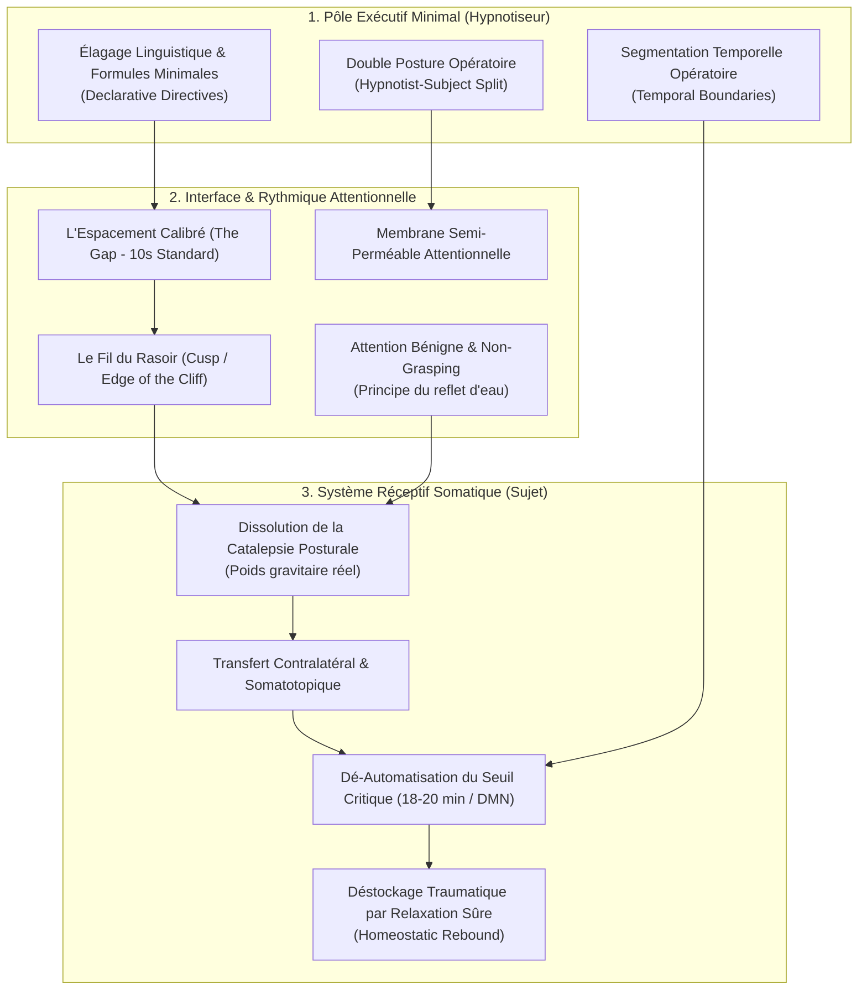

# Beyond Self Hypnosis
**Formateur :** Igor Ledochowski | **ID :** `igor-ledochowski-beyond-self-hypnosis` | **Tranches :** 36

## Synthèse Architecturale du Cours : *Beyond Self Hypnosis* (Igor Ledochowski)

---

### 1. Thèse Centrale & Philosophie du Cours

#### A. La Vision Spécifique d'Igor Ledochowski vs L'Approche Standard
Dans la littérature et la pratique courante de l'auto-hypnose (Coué, visualisations guidées passives, scripts pré-enregistrés, affirmationnisme new-age), deux écueils majeurs bloquent l'accès à la transe opératoire :
1. **L'illusion du contrôle par le forçage volitif (*Grasping / Trying*) :** Le sujet s'efforce de « fabriquer » des sensations ou des images via le cortex préfrontal, ce qui maintient une hyper-vigilance sympathique et parasite les rythmes lents (alpha/thêta).
2. **L'abandon passif non cadré (*Spacing Out / Drifting*) :** Le sujet décroche complètement, s'endort ou dérive dans une rêverie associative involontaire, perdant son agentivité hypnotique et la direction du changement.

La posture de Ledochowski redéfinit l'auto-hypnose comme **une compétence de navigation somato-neurologique sur le fil du rasoir (*riding the cusp of unconsciousness*)**. L'auto-hypnose n'est ni de la méditation passive, ni de la volonté dirigée : c'est l'art d'installer une **membrane semi-perméable** entre le pôle inducteur (qui donne l'impulsion directionnelle minimale) et le pôle récepteur (qui observe la réponse sans interférer).

#### B. Le Fil Rouge Méthodologique : Le Gradient Conscient-Inconscient et l'Élagage Éxécutif
Le principe directeur qui unifie l'intégralité du cursus s'articule autour de trois règles d'or :
- **L'alternance opératoire (Oscillation Hypnotiseur / Sujet) :** Émettre une directive verbale minimale et neutre, puis basculer instantanément dans un silence calibré (la pause étalon de 10 secondes) pour laisser agir la recherche transdérivationnelle passive.
- **La désactivation de la catalepsie habituelle par étayage proprioceptif :** Revenir systématiquement au poids physique réel de l'organisme (lourdeur autogène progressive : bras droit $\rightarrow$ gauche $\rightarrow$ bilatéral $\rightarrow$ jambes), court-circuitant le tonus postural inconscient pour libérer les voies d'accès au système autonome.
- **L'empilement par fractionnement (Myélinisation pavlovienne) :** Remplacer les longues séances floues par des cycles courts, répétés et fractionnés (cycles de micro-sorties et de ré-inductions) jusqu'à ce que la formule devienne un commutateur synaptique instantané (*Shorthand Anchor*).

---

### 2. Carte des Concepts & Leviers Émergents



#### Liste Structurée des Leviers et Mécanismes :

1. **La Double Posture Opératoire (*The Hypnotist-Subject Split*) :** Répartition temporelle de l'énergie cognitive : brève impulsion d'autorité neutre (émission), suivie d'une absorption phénoménologique totale (réception).
2. **L'Élagage Linguistique & Directives Déclaratives (*Declarative Directives*) :** Utilisation de truismes neutres, courts et factuels (*« My right arm is heavy »*). Suppression de tout effort d'autopersuasion pour éviter d'activer le facteur critique.
3. **L'Attention Bénigne & Non-Préhension (*Effortless Attention / Non-Grasping*) :** Présence sans traction volitive. Analogie du reflet sur l'eau : toute tentative consciente d'inspecter ou de forcer l'image/sensation trouble la surface et détruit la dynamique thêta.
4. **La Pause Étalon & Exploration du « Gap » (*The 10-Second Gold Standard*) :** Fenêtre de silence strict entre deux suggestions permettant au réseau par défaut d'engager la réponse sans interférence linguistique.
5. **Le Fil du Rasoir (*Riding the Cusp of Unconsciousness / Edge of the Cliff*) :** Maintien délibéré au seuil exact entre le tonus vigile et la léthargie hypnagogique, sans basculer dans le sommeil ni revenir à l'analyse vigile.
6. **La Dissolution de la Catalepsie Habituelle (*Habitual Catalepsy Deconditioning*) :** Libération du tonus postural résiduel masquant le poids gravitationnel réel des membres (environ 5 % de la masse corporelle par bras), vécue comme une lourdeur physiologique brute.
7. **Le Transfert Contralatéral & Échafaudage Mnésique (*Memory Scaffolding & Cross-Lateralization*) :** Ancrage proprioceptif sur une zone restreinte unilatérale servant de base stable avant duplication hémisphérique et extension globale.
8. **Le Seuil Critique des 18-20 Minutes & Fenêtre de Sécurité (15 min) :** Point de bascule de désactivation profonde du DMN où s'effondrent les frontières corporelles et narratives. L'entraînement initial en cycles courts (< 15 min) prévient les paniques d'angoisse de dissolution.
9. **Le Rebond Homéostatique (*Homeostatic Rebound*) :** Émergence spontanée de matériel refoulé ou d'affects flottants déclenchée dès que le corps atteint un seuil de sécurité viscérale parasympathique.
10. **La Réponse Paradoxale Autogène (*Paradoxical Autogenic Arousal*) :** Accélération réflexe transitoire (ex. cardiaque) lors de la focalisation initiale sur un signal viscéral autonome, à traiter par une neutralité affective absolue (*blandness*) pour extinction opérante.
11. **Le Fading Pédagogique d'Autonomisation :** Retrait graduel de la voix et du guidage externe (guidé $\rightarrow$ semi-guidé $\rightarrow$ silence intérieur autogéré) pour internaliser le pacemaker exécutif.

---

### 3. Tableau Récapitulatif des Techniques & Démonstrations

| Technique / Exercice | Objectif Opératoire | Déclencheur / Indication | Séquence Résumée |
|---|---|---|---|
| **Intégration Autogène Unilatérale (Bras Droit)** | Isoler une réponse proprioceptive nette et indiscutable sans surcharge cognitive. | Phase d'initiation ; débutants ; tendance à intellectualiser les inductions. | 1. Posture stable assise.<br>2. Formule minimale neutre : *« My right arm is heavy »*.<br>3. Pause réceptive de 10 secondes (observation passive du poids gravitationnel).<br>4. Répétition par cycles courts.<br>5. Clôture énergique et calibrée. |
| **Transfert Contralatéral & Bilatéral (Bras 3-3-9)** | Étendre la cartographie corticale de la lourdeur d'un membre stabilisé à l'autre, puis au bloc bilatéral. | Lourdeur nette obtenue sur le bras dominant ; passage à la généralisation somatique. | 1. Réactivation du bras droit (3 répétitions).<br>2. Transfert immédiat sur le bras gauche (*« My left arm is heavy »*, 3 répétitions).<br>3. Synthèse bilatérale (*« Both of my arms are heavy »*, 9 répétitions).<br>4. Maintien des pauses de 10 secondes entre chaque directive. |
| **Extension Autogène aux Membres Inférieurs** | Induire une anesthésie posturale complète et préparer une transe somnambulique profonde. | Intégration du haut du corps consolidée ; besoin de neutraliser les micro-tensions motrices. | 1. Ré-induction de la lourdeur des bras.<br>2. Bascule sur la jambe droite (*« My right leg is heavy »*), puis gauche.<br>3. Intégration bilatérale des jambes (*« Both legs are heavy »*).<br>4. Calibration sur l'affaissement des pieds vers l'extérieur et l'atonie des quadriceps. |
| **Le Calibrage Temporel de Sortie (*Proper Close*)** | Empêcher la léthargie résiduelle post-séance et fermer hermétiquement le canal de recherche inconsciente. | Fin systématique de chaque cycle de transe (interdit de se laisser dériver). | 1. Directive d'alerte : *« Deep breath in, stretch arms and legs, eyes wide open »*.<br>2. Mouvement moteur physique vigoureux immédiat.<br>3. Vérification de la pleine reconnexion sensorielle externe. |
| **Recalibrage Anti-Drifting (*The Gap Re-Honing Cycle*)** | Restaurer la membrane semi-perméable lorsque l'esprit commence à divaguer ou à s'endormir. | Perte du fil conducteur ; rêverie associative incontrôlée ; endormissement. | 1. Constat sans jugement du décrochage.<br>2. Raccourcissement délibéré du gap temporel (réduire de 10s à 3-5s).<br>3. Utilisation de déclarations plus incisives et rythmées pour ré-ancrer le pôle inducteur.<br>4. Ré-élargissement progressif vers 10s une fois la lucidité restaurée. |
| **Fractionnement Oculaire & Micro-Ruptures** | Abaisser le seuil d'accès à la transe et dissiper les spasmes de tension oculaire. | Blocage visuel ; paupières crispées ; tension frontale empêchant l'émergence hypnagogique. | 1. Clignement délibéré ou ouverture brève des yeux sur un point fixe.<br>2. Fermeture immédiate en relâchant les muscles péri-orbitaires.<br>3. Synchronisation avec une expiration longue et la reprise de l'affirmation de lourdeur. |
| **Stabilisation Mnésique Radiale (Chambre Familiale)** | Activer les circuits de mentalisation sans déclencher la crispation volitive du cortex visuel. | Incapacité à visualiser ; écran noir causé par l'effort conscient (*constrictivity*). | 1. Directive de dissociation descriptive : *« I remember my room »* (plutôt que *« I am in my room »*).<br>2. Focalisation sur un point fixe, stable et ultra-connu (une étagère, un angle).<br>3. Laisser les détails adjacents s'auto-compléter par contiguïté associative passive sans chercher à les scruter. |
| **Neutralisation de Polarité Réactive (*Blandness Protocol*)** | Éteindre les boucles de sabotage ou les tensions paradoxales (tachycardie, pensées contraires). | Réponse paradoxale à une autosuggestion ; irritation ou conflit intérieur. | 1. Retrait immédiat de toute charge émotionnelle (adopter un ton intérieur plat, neutre, atone).<br>2. Répétition de la consigne comme un simple fait universel sans négocier.<br>3. Refus d'entrer en lutte : laisser le bruit réactif s'épuiser par non-renforcement opérant. |
| **Amorce Somatique sur Tapis Roulant / Pré-Épuisement** | Dissocier l'agitation motrice de la vigilance mentale pour les profils hyperactifs/anxieux. | Sujets incapables de rester immobiles ; agitation psychomotrice empêchant l'installation autogène. | 1. Exercice physique modéré préalable (marche, cardio léger) pour dissiper l'excès de tonus sympathique postural.<br>2. Installation immédiate au repos complet.<br>3. Exploitation du contraste de retour homéostatique pour précipiter l'atonie corporelle. |

---

## Extractions Détaillées par Tranche (Opératoire & Verbatim)


## --- Tranche 1 / 36 ---

### 1. Mécanismes & Principes Actifs

* **La Double Posture Opératoire (Hypnotiseur / Sujet)**
  * **Principe actif :** En auto-hypnose classique, l'échec provient de l'interférence entre l'exécutif conscient (qui donne les ordres) et le système réceptif (qui doit lâcher prise pour vivre l'expérience). Igor formalise une oscillation alternée : une brève impulsion d'éveil directionnel (hypnotiseur) pour émettre la directive verbale courte, immédiatement suivie d'une bascule totale en réceptivité passive (sujet) pour observer sans forcer.
  * **Tags :** `#double_posture_hypnotiseur_sujet` `#oscillation_direction_reception` `#arousal_regulation`

* **Élagage Linguistique & Formules Minimales**
  * **Principe actif :** Plus la suggestion verbale est longue et complexe, plus elle monopolise la mémoire de travail et l'hémisphère gauche, maintenant le cortex préfrontal en hyperactivité. La brièveté extrême (*« My right arm is heavy »*) réduit la charge cognitive au strict minimum, transformant la phrase en simple déclencheur opérant comme un commutateur neurologique.
  * **Tags :** `#formule_minimale` `#reduction_charge_cognitive` `#concision_operatoire`

* **Attention Bénigne et Curiosité Non-Jugeante (Mindfulness-Hypnosis Hybrid)**
  * **Principe actif :** L'évaluation critique (*« Est-ce que mon bras est assez lourd ? »*) active le réseau du mode par défaut (DMN) et le jugement auto-référentiel, ce qui bloque la réponse ideo-motrice et ideo-sensorielle. Traiter les doutes et pensées parasites comme du simple "bruit mental" sans s'y accrocher permet au système nerveux autonome de basculer en dominance parasympathique.
  * **Tags :** `#attention_benigne` `#benign_attention` `#curiosite_passive` `#non_jugement`

* **Recherche Transdérivationnelle Passive vs Active**
  * **Principe actif :** Lorsque la conscience cherche activement une sensation ou une image, elle force une fabrication mentale contrôlée. En formulant la demande puis en attendant passivement que l'inconscient fournisse la réponse (*« let it come seeking you »*), on mobilise les processus de récupération mnésique et sensorielle profonds sans tension musculaire ni cognitive.
  * **Tags :** `#recherche_transderivationnelle_passive` `#spontaneite_evocatrice` `#non_forcing`

* **Consolidation Pavlovienne & Raccourci Associatif (Shorthand Anchor)**
  * **Principe actif :** Par la répétition massive (cycles de 100 à 1 000 occurrences cumulées), le couplage entre l'intention verbale, le focus proprioceptif et la réponse d'alourdissement/relaxation se myélinise. À terme, la formule n'a plus besoin d'être complète : un simple rappel mnésique ou un mot-clé (*« right heavy »*) déclenche par irradiation synaptique un relâchement immédiat de l'ensemble de l'organisme.
  * **Tags :** `#conditionnement_ancrage` `#shorthand_directive` `#myelinisation_hypnotique` `#flush_relaxation`

* **Transfert Contralatéral & Généralisation Somatique**
  * **Principe actif :** Obtenir d'abord une réponse nette et indiscutable sur un membre cible unique (le bras droit) crée une référence proprioceptive stable. Le cerveau utilise ensuite la cartographie corticale existante pour transférer quasi instantanément le schéma neural au membre opposé (*cross-lateralization*) et au reste du corps.
  * **Tags :** `#cross_lateralisation` `#transfert_somatotopique` `#generalisation_inconsciente`

* **Stabilisation Mnésique Précurseur de l'Hallucination/Visualisation (Mentalization)**
  * **Principe actif :** Tout souvenir est une reconstruction sensorielle et non la lecture d'un fichier figé. En s'appuyant sur un espace réel et familier (la chambre, la cuisine) plutôt que sur un décor imaginaire abstrait, on réduit la charge cognitive de modélisation. La formule déclarative (*« I remember my room »*) sert de point d'ancrage qui empêche l'attention de dériver, entraînant le cortex visuel et spatial à générer des perceptions internes stables (effet "holodeck").
  * **Tags :** `#stabilisation_mnesique` `#mentalisation_progressive` `#effet_holodeck` `#reconstruction_spatiale`

---

### 2. Protocoles, Techniques & Démonstrations (Étape par Étape)

#### Protocole 1 : Le Cycle Autogène Basique Déclaratif (Formule du Bras Lourd)

* **Intention / Indication :** Ouvrir la transe somatique, calmer le bavardage mental, amorcer le relâchement profond, installer un ancrage d'urgence contre la douleur, les pensées intrusives ou l'insomnie.
* **Mise en place & Pré-framing :**
  * Posture confortable, assise ou allongée.
  * Cadrage : ne rien forcer, ne pas chercher à fabriquer artificiellement la lourdeur par des images d'haltères ou de poids suspendus. Laisser le système nerveux répondre spontanément.
* **Séquence d'actions pas à pas :**
  1. **Contact mental :** Fermer les yeux et porter une attention neutre et bienveillante sur le bras droit.
  2. **Directive verbale interne :** Prononcer intérieurement la formule déclarative courte : *« My right arm is heavy »*.
  3. **Fenêtre d'observation passive (10 secondes) :** Relâcher toute direction. Devenir pur observateur réceptif de ce qui se manifeste (lourdeur, picotements, chaleur, pulsations, ou absence de sensation).
  4. **Structure par blocs (Multiples de 3) :**
     * Enchaîner 3 cycles consécutifs.
     * Si l'attention faiblit ou que la léthargie s'installe : ouvrir brièvement les yeux à la fin des 10 secondes de silence, puis les refermer immédiatement pour le cycle suivant.
     * Répéter sur des séries de 9 (3x3), jusqu'à 27 ou 54 répétitions quotidiennes (objectif d'accumulation : 100 à 140/jour, 1 000/semaine).
* **Signes de calibration :**
  * Respiration qui devient spontanément plus lente et abdominale.
  * Micro-mouvements de relâchement des épaules.
  * Phénomènes idéosensoriels rapportés : picotements, engourdissement, sensation de fusion avec le sol, sensation que le membre disparaît ou se divise.

---

#### Protocole 2 : Couplage Transe Somatique & Mentalisation (La Chambre Familière)

* **Intention / Indication :** Entraîner la faculté de visualisation/mentalisation sans effort conscient, passer de la transe kinesthésique à la transe hallucinatoire/immersive.
* **Mise en place & Pré-framing :**
  * Choisir une pièce connue et **actuelle** (ex: chambre ou cuisine actuelle, pour éviter les perturbations temporelles des chambres d'enfance modifiées au fil des ans).
  * Localiser au préalable l'écran mental : repérer où la pensée de la pièce "apparaît" spatialement par rapport au corps (généralement devant les yeux, à hauteur de regard ou légèrement au-dessus).
* **Séquence d'actions pas à pas :**
  1. **Ouverture de la porte (Transe d'ancrage) :**
     * 3 cycles complets de *« My right arm is heavy »* (directive -> 10 secondes d'observation passive).
  2. **Transition vers la directive mnésique :**
     * Sans pause ni interruption de transe, fixer l'espace vierge interne devant soi.
     * Prononcer intérieurement la directive spécifique : *« I remember my bedroom »* (ou la pièce choisie).
     * Attendre 10 secondes dans une attention réceptive : observer ce qui émerge sur l'écran mental (instantané flou, zoom sur un objet, flash de couleur).
  3. **Répétition de stabilisation :**
     * Répéter la directive *« I remember my [room] »* 3 fois, intercalée de 10 secondes d'attente passive à chaque fois.
  4. **Phase d'immersion silencieuse (30 secondes) :**
     * Cesser toute verbalisation interne.
     * Laisser le regard interne naviguer librement dans la pièce, explorer les détails sans chercher à forcer la netteté.
* **Signes de calibration :**
  * Stabilisation du regard sous les paupières (diminution des saccades oculaires désordonnées).
  * Rapports de vision à la première personne vs diaporama/snapshot.
  * Émergence spontanée d'affects ou d'ambiances associés au lieu sans effort délibéré.

---

### 3. Heuristiques, Subtilités & "Sagesse du Praticien"

* **Gestion du Rythme et des Interruptions :**
  * *Règle :* Si le sujet a besoin d'ouvrir les yeux pour dissiper la léthargie entre les séries, il doit ouvrir et fermer les yeux **à la toute fin des 10 secondes de silence**, puis enchaîner immédiatement la directive suivante.
  * *Raison :* Ne jamais intercaler l'ouverture des yeux entre la phrase verbale et l'observation, sous peine de briser la connexion causale entre la directive déclarative et l'émergence de l'expérience sensorielle.

* **Heuristique de la Lutte contre la Léthargie vs Transe Profonde :**
  * *Si* le sujet est novice et que son esprit devient confus, brumeux ou s'endort -> *alors* prescrire une pandiculation (étirement/bâillement volontaire) ou une brève ouverture des yeux tous les 3 cycles pour restaurer le niveau de vigilance corticale.
  * *Si* le sujet a de la pratique -> *alors* maintenir les yeux fermés en continu sur 9 à 27 cycles pour approfondir la dissociation somatique.

* **Heuristique de l'Effort d'Imagination (Image Vague vs Forcée) :**
  * *Si* l'image mentale apparaît comme une photo floue, un instantané furtif ou un diaporama fragmenté -> *alors* ne surtout pas forcer mentalement pour la rendre nette. Laisser l'inconscient proposer ce qu'il a.
  * *Principe sous-jacent :* Forcer activement réactive l'hémisphère gauche et crée une tension oculaire/frontale qui détruit l'état réceptif. La netteté de type "holodeck" est le sous-produit émergent de la répétition passive, jamais de la volonté brute.

* **Heuristique des Pensées Distrayantes et Jugements :**
  * *Si* une pensée critique survient (*« Mon bras n'est pas assez lourd »*, *« J'aurais dû choisir une autre pièce »*) -> *alors* la traiter comme une simple pensée excédentaire (mindfulness), ne pas engager de dialogue avec elle, et réorienter l'attention purement sur la prochaine déclaration et l'observation neutre.

* **Heuristique du Choix de Langue :**
  * *Si* la langue maternelle n'est pas l'anglais -> *alors* pratiquer dans la langue maternelle si l'anglais génère le moindre frottement cognitif ou effort de traduction. La règle absolue est : **zéro friction mentale**. Si une langue est choisie, maintenir cette même langue sur toute la session par cohérence neuronale.

* **Heuristique de Spécialisation Unilatérale :**
  * Toujours verrouiller un succès franc et indéniable sur un côté (le bras droit pour les droitiers) avant d'élargir au bras gauche ou aux jambes. Obtenir une "victoire facile" imprime le modèle de réponse dans le système nerveux ; la généralisation bilatérale ultérieure se fera en une fraction du temps initial.

---

### 4. Pépites Verbatim & Patterns Linguistiques (MOT À MOT EN V.O.)

#### Pépite 1 : Le mécanisme de l'auto-hypnose et l'élagage verbal

> "You want to have it as short as possible, so you don't have to memorize anything. And so that most of the experience is spent observing rather than directing. Because essentially, when you're doing self-hypnosis, you've got to do two things at the same time. You've got to be the hypnotist and the subject. So you've got to arouse yourself just enough to speak as the hypnotist and then let go enough to experience as a subject."

* **[Analyse du Pattern]** :
  * **Distinction conceptuelle binaire tranchée** (*hypnotist vs subject*) créant une cartographie mentale immédiate pour le pratiquant.
  * **Présupposition d'équilibre dynamique** (*« arouse yourself just enough... let go enough »*) : utilisation de quantifieurs flous d'étalonnage somatique qui contournent le perfectionnisme analytique en incitant à un micro-dosage proprioceptif intuitif.

---

#### Pépite 2 : La posture d'alliance passive avec l'inconscient

> "We're letting the unconscious mind do the rest by saying, like an anchor, I'm just saying, I'm going to help you with this a little bit, buddy, instead of just saying, here's my request and I shall wait patiently until you fulfill it. And if you don't fulfill it on the first time, I'll try it again the second time and the third time and the fourth time and the fifth time, eventually it will come."

* **[Analyse du Pattern]** :
  * **Recadrage relationnel anthropomorphique** (*« buddy »*) : défait l'attitude autoritaire ou anxiogène vis-à-vis de l'inconscient au profit d'une coopération amicale et décontractée.
  * **Empilement de truismes temporels et présupposition d'inévitabilité** (*« first time... second time... third time... eventually it will come »*) : normalise totalement l'absence de réponse immédiate, désamorce la boucle d'échec/frustration, et verrouille l'inévitabilité du résultat futur par épuisement bienveillant de la résistance.

---

#### Pépite 3 : La recherche transdérivationnelle inversée

> "Yes, yes, but not a conscious one. You don't want to go seeking it, you want it to come seeking you. By the statement, that itself is activating it..."

* **[Analyse du Pattern]** :
  * **Renversement de vecteur / Rupture de pattern cognitif** (*« You don't want to go seeking it, you want it to come seeking you »*) : inverse le réflexe habituel de focalisation volontaire pour induire un état de réceptivité pure. L'affirmation linguistique est posée comme l'agent causal déclencheur, déchargeant le sujet de toute responsabilité d'effort.

---

#### Pépite 4 : La localisation spatiale de l'écran mnésique

> "Here's an easy test for you guys. Just think of your room for a second. Where do you sense that in relation to your body? Is it here? Is it there? Is it behind you? Where do you sense the room when you think about it right now? For most people, it's somewhere here, roughly eye level, maybe slightly above eye level. Would that be fair to say something like this, like a screen to get projected onto?"

* **[Analyse du Pattern]** :
  * **Questionnement d'élicitation sous-modalitaire spatial** : force le sujet à prendre conscience de la structure de son traitement interne plutôt que de son contenu thématique.
  * **Suggétions spatiales en cascade couplées à une métaphore d'assimilation** (*« like a screen to get projected onto »*) : prépare le cortex visuel à adopter une posture de spectateur passif devant un écran, inhibant le besoin de "fabriquer" l'image manuellement.

---

#### Pépite 5 : La réassurance sur la nature reconstructive de la mémoire

> "When you remember a memory, you're actually recreating it. You're just visualizing a memory. What's stored is not really exactly what happened. It's just your current best guess as to what happened... So what you're doing when you say, I remember my bedroom, apart from the memory side, is you're also training your mental faculty to mentalize, making it easier to do so, effortlessly."

* **[Analyse du Pattern]** :
  * **Démystification / Dé-pressurisation cognitive** (*« your current best guess »*) : libère le sujet de l'obligation de fidélité ou d'exactitude historique de son souvenir, éliminant le doute invalidant.
  * **Recadrage d'utilité secondaire vers l'entraînement capacitaire** : le souvenir n'est plus le but mais un simple haltère d'entraînement neurologique (*« training your mental faculty to mentalize »*), rendant chaque tentative réussie quel que soit le niveau de clarté obtenu.


## --- Tranche 2 / 36 ---

### 1. Mécanismes & Principes Actifs

- **L'Attention Délicate vs La Saisie Volitive (Grasping vs Allowing)**
  - *Principe actif :* L'attention consciente occidentale est conditionnée à la préhension (« grasping »), une focalisation rigide qui suractive le cortex préfrontal et perturbe la bande de fréquences (alpha/thêta) nécessaire à l'émergence hypnagogique ou subconsciente. Dès que le sujet « essaie » de saisir, d'inspecter ou de fixer un détail interne, il introduit un bruit neuromusculaire et cognitif qui détruit le signal spontané (l'analogie de l'eau agitée qui brise le reflet). Le principe consiste à maintenir une présence attentive sans traction volitive (« effortless attention »), permettant aux réseaux mnésiques et génératifs de projeter des images nettes et stables sans interférence inhibitrice.
  - *Tags :* `#non_grasping` `#effortless_attention` `#stabilite_theta` `#inhibition_interferente` `#principe_du_reflet_d_eau`

- **Le Calibrage Temporel de la Commande Inconsciente (Temporal Boundaries for Latent Processing)**
  - *Principe actif :* Délimiter explicitement par la structure opératoire le moment où l'inconscient doit travailler et celui où il doit s'arrêter (« I've asked for it now, now do it. I'm not asking for it now... »). Sans cette segmentation temporelle nette, le processus inconscient continue de délivrer des insights en boucle (comme se réveiller à 2h du matin pour noter des idées jusqu'à épuisement). Le protocole apprend au système nerveux à fermer le canal de restitution hors session.
  - *Tags :* `#segmentation_temporelle` `#cadre_operatoire_inconscient` `#extinction_du_signal_parasite`

- **La Déclaration Assertive / Truisme Neutre (Declarative Directives as Attention Funnels)**
  - *Principe actif :* Le langage sert d'entonnoir attentionnel. Formuler une directive sous forme de constatation factuelle et neutre (« My right arm is heavy », « I remember the shelf ») sans effort d'autopersuasion ni emphase émotionnelle court-circuite le facteur critique. Le cerveau traite les propositions déclaratives directes comme des données descriptives immédiates à actualiser, orientant les ressources de recherche transdérivative sans déclencher de résistance interne.
  - *Tags :* `#declarative_statements` `#canalisation_linguistique` `#factualite_hypnotique` `#non_force_volitionnelle`

- **Progression Mnésique Radiale (Memory Scaffolding & Association Cascades)**
  - *Principe actif :* Le système mnésique humain est associatif et spatialisé. En partant d'un environnement familier déjà encodé (chambre à coucher, bureau), le coût cognitif de génération est quasi nul (« lower cognitive load »). L'ancrage sur un point précis et stable sert ensuite d'échafaudage pour reconstruire les zones floues par contiguïté synaptique. Le fait de stabiliser la remémoration sensorielle prépare les circuits neuronaux à des opérations ultérieures de création pure ou de visualisation abstraite sans effondrement attentionnel.
  - *Tags :* `#memory_scaffolding` `#recuperation_associative` `#progression_familiarite_vers_creativite` `#mentalisation_stabilisee`

- **Impact Neuro-Sémantique : "I'm in my room" vs "I remember my room"**
  - *Principe actif :* Distinction fondamentale de la PNL entre position associée et position dissociée induite par un pivot linguistique minime :
    * *"I'm in my room"* bascule la perception en **association kinesthésique et spatiale** directe (vue à la première personne, présence somatique incarnée dans la pièce).
    * *"I remember my room"* déclenche une recherche dans les banques de données épisodiques, favorisant la **dissociation visuelle** (vue de l'extérieur, observation du self dans la pièce) et le renforcement des voies de consolidation mémorielle.
  - *Tags :* `#submodalites_linguistiques` `#association_vs_dissociation` `#recadrage_d_acces_mnesique`

- **L'Inhibition du Jugement et Tolérance à l'Émergence Neutre (Outcome Non-Attachment)**
  - *Principe actif :* La frustration découle d'un écart perçu entre l'expérience requise et l'expérience en cours (« wanting an experience other than the one you're having »). Cette tension génère une boucle de rétroaction négative qui réveille le mode d'analyse critique. Accepter le flou, l'absence d'image ou l'apparition d'un élément inattendu maintient la réceptivité parasympathique indispensable à la clarification progressive du contenu subconscient.
  - *Tags :* `#non_jugement_somatique` `#acceptation_du_flou` `#boucle_de_retroaction_critique`

---

### 2. Protocoles, Techniques & Démonstrations (Étape par Étape)

#### Protocole : Stabilisation et Résolution des Zones Floues (Beyond Self Hypnosis - Cycle d'Affinement Mnésique)

* **Intention / Indication :** 
  Stabiliser l'attention interne, apprendre à naviguer dans l'espace mental sans effondrer l'image par hyper-contrôle, et restaurer des détails occultés ou imprécis dans la mémoire spatiale.
* **Mise en place & Pré-framing :**
  - Posture d'autogénique (assis confortablement, bras reposant naturellement, absence de tension physique).
  - Définir l'intention avant l'induction : choisir une pièce familière (chambre, bureau, salon) et identifier lors d'une première passe un élément spécifique resté flou ou inaccessible (ex: un placard, une étagère).
  - Consigne stricte de non-effort : ne pas essayer de forcer l'apparition du détail. Se contenter d'émettre la déclaration et de constater ce qui émerge.

* **Séquence d'actions pas à pas :**
  1. **Phase d'Abaissement Neuro-Végétatif (Induction Autogène) :**
     - Répéter mentalement ou à voix basse 3 fois la déclaration de lourdeur :
       * *"My right arm is heavy"* (pause de 10 secondes)
       * *"My right arm is heavy"* (pause de 10 secondes)
       * *"My right arm is heavy"* (pause de 10 secondes)
  2. **Phase d'Ouverture du Champ Spatial (Macro-Cadrage) :**
     - Répéter 3 fois la déclaration de remémoration générale de la pièce choisie :
       * *"I remember my room"* (ou *"bedroom"* / *"office"*) (pause de 10 secondes)
       * *"I remember my room"* (pause de 10 secondes)
       * *"I remember my room"* (pause de 10 secondes)
     - Laisser l'environnement spatial global se dessiner sans forcer l'orientation.
  3. **Phase de Zoom / Ciblage Micro-Mnésique (Stabilisation du Point Flou) :**
     - Orienter l'attention vers la zone qui était floue lors du cycle précédent (ex: placard, seconde étagère, tiroir).
     - Répéter 3 fois la déclaration spécifique en nommant l'élément exact :
       * *"I remember my closet"* / *"I remember the second cubby hole"* (pause de 10 secondes)
       * *"I remember [l'élément ciblé]"* (pause de 10 secondes)
       * *"I remember [l'élément ciblé]"* (pause de 10 secondes)
  4. **Phase d'Immersion Silencieuse Non-Verbale (Experience Beyond Language) :**
     - Maintenir un silence total prolongé (environ 30 secondes).
     - Laisser le système inconscient compléter spontanément les détails, les textures, les objets oubliés par associations libres. Ne prononcer aucun mot.
  5. **Sortie Propre (Close) :**
     - Fermer la session intérieurement et reprendre conscience du corps dans l'environnement physique.

* **Signes de calibration :**
  - Déglutition, ralentissement respiratoire et relâchement musculaire du sujet (validation de l'état autogène).
  - Disparition de la micro-tension oculaire (signe que le sujet a cessé de « chercher visuellement avec ses muscles oculaires » et laisse l'image se former).
  - Au débrief : le sujet rapporte des détails spontanés (« random items appearing ») qu'il n'avait pas consciemment planifiés, attestant du passage en mode génératif inconscient.

---

### 3. Heuristiques, Subtilités & "Sagesse du Praticien"

- **L'Heuristique du "Bébé qui s'agrippe" (Lâcher la préhension mentale) :**
  * *Règle :* Si l'image mentale ou l'état disparaît au moment précis où le sujet tente de l'observer -> *Alors* lui faire remarquer qu'il agrippe l'expérience avec trop de force volontaire (comme un enfant qui serre excessivement les poings).
  * *Action :* Remplacer l'observation active par une posture de spectateur détendu au bord d'un lac : « Call for it, acknowledge it ("ah, it's here"), and do nothing else ».

- **Gestion des Déviations et Jugements Pendant l'Auto-Hypnose :**
  * *Règle :* Si l'esprit émet une pensée parasite (« Je préférerais être dans une pièce plus jolie », « J'ai du travail en attente », « Ça ne marche pas ») -> *Alors* ne JAMAIS argumenter avec la pensée, ni chercher à la chasser (« We're not having that thought now » n'a même pas besoin d'être verbalisé).
  * *Action :* Répéter immédiatement la déclaration factuelle de base (*"My right arm is heavy"* ou *"I remember the shelf"*). La réitération du truisme draine l'énergie attentionnelle de la distraction pour la ramener sur le canal choisi.

- **Conflit de Contenu avec l'Inconscient (Cas du tiroir d'Aiden) :**
  * *Règle :* Si l'inconscient fournit une information ou un objet en désaccord avec la certitude consciente du sujet (ex: l'inconscient montre des piles de papier dans un tiroir où le sujet pense qu'il y a autre chose) -> *Alors* interdiction de contester l'inconscient en transe.
  * *Raison :* Combattre l'image bloque le flux. Le sujet doit accepter l'itération telle quelle en séance, aller vérifier empiriquement dans le monde réel après coup si besoin, puis relancer le protocole de manière neutre : *"I remember what's in the drawer"*.

- **La Règle du Canal Déclaratif vs Persuasion Kinesthésique (Enseignement tiré de John) :**
  * *Erreur classique :* Chercher à forcer l'état en surjouant l'affirmation (*"My arm IS relaxed!"* avec intensité émotionnelle ou volitive).
  * *Correction :* Déclarer les faits avec la même neutralité que de dire *"I'm wearing a blue shirt"*. C'est l'absence de volonté d'influencer qui neutralise la résistance du système nerveux.

- **Le Principe de l'Économie Linguistique Vers l'Intention Pure :**
  * Le langage est une béquille temporaire servant à focaliser l'attention.
  * *Évolution du pratiquant :* Déclaration verbale complète -> Répétition d'un mot-clé -> Simple "Knowingness" (intention silencieuse directe, ex: le « Show me » de la femme d'Igor pour retrouver des clés sans nommer l'objet).

---

### 4. Pépites Verbatim & Patterns Linguistiques (MOT À MOT EN V.O.)

```text
"So this tells your unconscious when to do it. I've asked for it now, now do it. I'm not asking for it now, we're doing something else right now. So you do something else, right?"
```
* **[Analyse du Pattern]** : Découpage temporel autoritaire et directif. Utilisation d'un cadre d'instructions binaires (« now do it / do something else ») qui conditionne l'inconscient à dissocier le temps de travail interne du temps de repos mental, évitant ainsi l'épuisement cognitif nocturne.

```text
"It's like splashing the water and now that beautiful mirror image disappears because you are grasping for it rather than just allowing it to be in your experience. Do you see the difference? Our culture is very grasping oriented and so when you turn your attention to the shelves, your mind automatically grasps and that dispels it. We're looking for it to be really delicately balanced. So you just call for it and it's there you go, ah, it's here. And that's it. Nothing for you to do."
```
* **[Analyse du Pattern]** : Métaphore isomorphe (la surface de l'eau) couplée à un dé-cadrage sociologique (« Our culture is very grasping oriented ») qui déculpabilise l'échec du sujet. Utilisation d'un contraste modal (*grasping* vs *allowing*) menant à une suggestion de passivité radicale (« Nothing for you to do »), déchargeant le facteur critique de toute obligation de résultat.

```text
"You'll know the stream is clear and then suddenly it'll be clear, right? You'll know that your best friend is standing next to you and there he is, right? That knowing is an intent, but we'll use language initially to structure it."
```
* **[Analyse du Pattern]** : Enchaînement de présuppositions d'équivalence complexe reliant « l'acte de savoir » (*knowing*) à « la manifestation sensorielle » (*suddenly it'll be clear*). L'emploi du futur simple d'inévitabilité (*You'll know*, *there he is*) installe une commande temporelle où l'intention silencieuse remplace l'effort verbal.

```text
"So how are you relaxing now? Do you find yourself enjoying the experience of just sitting because you have a left leg and you have a right leg? This is what I just did. I'm actually guiding you through my, I'm actually giving you affirmations. It sounds like I'm talking to you, but I'm actually declaring things. And as soon as I declare them and I leave that gap for you and you're hooked into my conversation, your unconscious kind of help, but activate the attention as required."
```
* **[Analyse du Pattern]** : Double contrainte couplée à un truisme corporel incontestable (*you have a left leg and you have a right leg*). Le lien causal non séquencé (« enjoying... because you have... ») rattache un état hypnotique désiré (la relaxation) à une réalité anatomique indiscutable. L'affirmation déguisée en question anodine ouvre une boucle conversationnelle que l'inconscient du sujet est contraint de combler pendant la pause (« I leave that gap »).

```text
"Here's the thing, you can't get frustrated unless you are wanting an experience other than the one that you're having. If you're actually okay with the experience that you're having, then there's no frustration. There's no pushing, there's no pulling. And then ironically, you are more likely to get the experience because you almost don't care. It's not like you don't care. It's that you don't care."
```
* **[Analyse du Pattern]** : Définition ontologique restrictive (« you can't get frustrated unless... ») qui détruit le mécanisme psychologique de la frustration. Utilisation d'une distinction phonétique/sémantique paradoxale (« It's not like you don't care. It's that you don't care ») : rupture de pattern créant une confusion transitoire pour amener l'esprit vers un détachement opérationnel équilibré (le juste milieu entre l'indifférence apathique et la fixation obsessionnelle).

```text
"Control is not this rigid death grip that we normally try and say, I'm going to hold on to this memory so much, I'm going to cherish it forever. That's not control. That's fear of losing control."
```
* **[Analyse du Pattern]** : Recadrage de sens radical de la notion de « contrôle ». Ledochowski redéfinit l'hyper-contrôle comme étant en réalité une manifestation de « peur de perdre le contrôle », libérant ainsi le sujet du besoin compulsif de retenir ses pensées pour lui faire embrasser la flexibilité attentionnelle.


## --- Tranche 3 / 36 ---

### 1. Mécanismes & Principes Actifs

#### Le Seuil de la Léthargie et le Maintien sur le « Fil du Rasoir »
* **Principe actif :** L'approfondissement de la relaxation induit une chute de tonus cortical (léthargie somatique). Si l'attention s'éteint complètement, le sujet bascule dans le sommeil physiologique ou la rêverie associative involontaire (perte de l'agentivité hypnotique). Si l'attention reste trop vigilante et tendue (« grasping »), la transe ne s'installe pas. L'état d'auto-hypnose opératoire repose sur le fait de surfer exactement sur la frontière (*riding the cusp of unconsciousness*) : exploiter la léthargie pour dissoudre la crispation volontaire tout en maintenant une micro-étincelle d'intention active par la déclaration verbale.
* **Tags :** `#cusp_of_unconsciousness` `#gestion_de_la_lethargie` `#attention_passive` `#equilibre_tonique_cortical`

#### La Dé-Automatisation du Seuil Critique des 18-20 Minutes (DMN Downregulation)
* **Principe actif :** Autour de 18 à 20 minutes d'attention focalisée/soutenue, le réseau du mode par défaut (*Default Mode Network* ou DMN) diminue drastiquement son activité, entraînant une désactivation des repères habituels de l'ego, de la frontière corporelle et de la continuité narrative du soi. C'est à ce seuil précis qu'apparaissent les phénomènes dissociatifs intenses, les hallucinations hypnagogiques ou l'angoisse de dissolution identitaire. Limiter volontairement les séances autonomes à 15 minutes au début sert de coupe-circuit physiologique évitant l'affolement du système nerveux tant que les mécanismes d'ancrage somatique ne sont pas automatisés.
* **Tags :** `#seuil_critique_18_20_min` `#dmn_downregulation` `#fenetre_de_securite_15min` `#dissociation_du_soi`

#### La Re-Connexion Somatosensorielle Progressive (Body Scan Lento)
* **Principe actif :** En focalisant d'abord l'attention sur un segment unilatéral (bras droit, puis bras gauche), puis sur l'ensemble bilatéral (les deux bras), le système nerveux central réintègre la proprioception fine et ré-associe le cortex somatosensoriel au corps physique. Cela inverse les mécanismes de dissociation névrotique tout en libérant les tensions chroniques inconscientes (abaissement des trapèzes, respiration ventrale automatique).
* **Tags :** `#reassociation_somatosensorielle` `#body_scan_autogene` `#integration_bilaterale` `#cartographie_corticale`

#### Le « Déstockage Traumatique par Relaxation Sûre » (Homeostatic Rebound)
* **Principe actif :** Le cerveau maintient refoulées les mémoires de détresse, les frayeurs infantiles et les charges affectives non intégrées tant qu'il perçoit l'organisme sous stress ou en hyper-vigilance. Dès lors que le sujet accède à un état somatique de sécurité et de détente profonde, le système inhibiteur se relâche : l'inconscient profite immédiatement de cette « fenêtre de sécurité et de ressources » pour faire remonter le matériel non résolu à la surface. Sans cadrage adéquat, le sujet interprète cette émergence spontanée comme un danger soudain (« j'allais bien et d'un coup j'ai eu peur »).
* **Tags :** `#decharge_abreactive_spontanee` `#relachement_inhibiteur` `#rebound_homeostatique` `#emergence_de_materiel_refoule`

#### Fading Pédagogique et Autonomisation Neuronale (Scaffolding Graduel)
* **Principe actif :** Pour éviter le transfert de dépendance vers la voix externe de l'opérateur (qui transformerait l'exercice en simple méditation guidée passive), l'induction utilise un démantèlement progressif de l'étayage auditif (guidage complet à voix haute -> guidage intermittent sur les transitions -> silence total autogéré). Ce fading contraint les circuits fronto-pariétaux du sujet à prendre en charge la génération de la voix interne et le timing idéo-moteur.
* **Tags :** `#fading_de_guidage` `#transfert_dagente` `#internalisation_de_la_voix` `#autonomie_ideomotrice`

---

### 2. Protocoles, Techniques & Démonstrations (Étape par Étape)

#### Protocole des 3 Grands Cycles d'Intégration Autogène (Bras Lourds 3-3-9)

* **Intention / Indication :** Installer la lourdeur autogène bilatérale, ancrer la capacité du sujet à générer lui-même l'état de transe sans dépendre du praticien, et calibrer le passage de la direction externe à la direction interne.
* **Mise en place & Pré-framing :**
  - Posture assise stable, yeux fermés pendant les cycles.
  - Explication du découpage : chaque grand cycle comprend 3 répétitions bras droit, 3 répétitions bras gauche, 9 répétitions les deux bras (rythme 3-3-9).
  - Prévention de la léthargie : si l'esprit s'endort ou part en rêverie, la répétition de l'affirmation sert de rappel à l'ordre attentionnel.
  - Entre chaque cycle : réouverture des yeux et pandiculation systématique pour remettre de l'énergie et réinitialiser le cortex.

* **Séquence d'actions pas à pas :**
  * **Grand Cycle 1 (Guidage externe total) :**
    1. Déclaration d'ouverture : *"And start."*
    2. Récitation à voix haute par le praticien avec un tempo lent et mesuré : 3 fois *"My right arm is heavy"*, puis 3 fois *"My left arm is heavy"*, puis 9 fois *"Both arms are heavy"*.
    3. Déclaration de clôture : *"And close."*
    4. Réouverture des yeux, étirement / pandiculation, recalibration de la vigilance.
  * **Grand Cycle 2 (Guidage semi-silencieux / Fading partiel) :**
    1. Déclaration d'ouverture : *"Start."*
    2. Récitation à voix haute uniquement de la 1ère affirmation de chaque sous-groupe :
       - Bras droit : 1ère à voix haute (*"My right arm is heavy"*), les 2 suivantes répétées mentalement par le sujet en silence.
       - Bras gauche : 1ère à voix haute (*"My left arm is heavy"*), les 2 suivantes en silence.
       - Deux bras : la 1ère à voix haute, la 2e et 3e en silence ; la 4e à voix haute, la 5e et 6e en silence ; la 7e à voix haute, la 8e et 9e en silence.
    3. Déclaration de clôture : *"Close."*
    4. Réinitialisation énergétique (pandiculation somatique, respiration).
  * **Grand Cycle 3 (Autonomie complète / Silence) :**
    1. Le praticien amorce uniquement le déclencheur : *"Start. My right arm is heavy."*
    2. Le sujet exécute l'intégralité du compte (3-3-9) purement dans son espace mental intérieur.
    3. Le praticien attend la durée estimée et appelle la clôture globale : *"Close."* (tolérance de 20-30 secondes pour laisser finir ceux qui ont ralenti).

* **Signes de calibration :**
  - Immobilité motrice progressive (absence de micro-mouvements des doigts et du visage).
  - Modification du pattern respiratoire (respiration qui devient plus lourde, expiration buccale spontanée au début, puis respiration superficielle et très apaisée).
  - Affaissement des épaules (relâchement des trapèzes).
  - Ralentissement des déglutitions et relâchement de la mâchoire.

---

#### Procédure d'Autorégulation des Intrusions Affectives ou Épisodes de Peur Spontanée

* **Intention / Indication :** Gérer une poussée soudaine d'anxiété, de peur irrationnelle ou de début de panique dissociative survenant au milieu d'un état de bien-être en transe autonome.
* **Mise en place & Pré-framing :** Cadrer la réaction comme un phénomène d'émergence normal : ce n'est pas un danger réel, c'est l'inconscient qui purge un matériel ancien parce qu'il se sent enfin détendu, ou un réflexe d'alarme face à un état inhabituel.
* **Séquence d'actions pas à pas :**
  1. **Non-réaction / Désengagement de l'agrippement :** Ne pas chercher à fuir la sensation ni à l'analyser cognitivement.
  2. **Auto-suggestion de neutralité et de confinement :** S'adresser intérieurement avec une tonalité calme, posée et ferme : *"There's no place you need to go to, just relax... It's okay. It's all okay."*
  3. **Raccourcissement de l'intervalle :** Répéter immédiatement la formule autogène en cours (*"My right arm is heavy"* ou *"Both arms are heavy"*) pour ré-ancrer le contact mental et ramener l'attention sur l'objet présent.
  4. **Si la charge persiste :** Procéder à la clôture formelle (*"Close"*), ouvrir les yeux et exécuter une pandiculation vigoureuse pour ré-associer complètement le schéma corporel.

---

### 3. Heuristiques, Subtilités & "Sagesse du Praticien"

#### Règles Conditionnelles d'Intervention
* **Si** le sujet commence à dériver vers des rêves hypnagogiques ou des images spontanées non sollicitées (perte d'attention active), **alors** raccourcir immédiatement l'intervalle temporel entre les déclarations verbales, **parce que** l'absence de verbalisation laisse le champ libre à l'assoupissement du cortex et à la perte d'agentivité.
* **Si** la dérive vers le sommeil est trop prononcée malgré les déclarations, **alors** forcer la fermeture de cycle (*Close*) et prescrire une pandiculation consciente avec ouverture des yeux, **parce qu'**il ne faut jamais entraîner le système nerveux à confondre auto-hypnose et simple endormissement léthargique.
* **Si** le sujet ressent une angoisse soudaine ou une peur « sortie de nulle part » en pleine transe profonde, **alors** normaliser immédiatement le phénomène en lui expliquant la libération de matériel refoulé par relaxation, **parce que** dramatiser ou chercher à psychanalyser l'intrusion figerait le sujet dans un réflexe d'évitement de la transe.
* **Si** le sujet a du mal à tenir le compte des 9 répétitions, **alors** lui interdire formellement de compter de manière arithmétique rigide (*"1, 2, 3..."*), **parce que** l'énergie cognitive allouée au calcul mental détruit le contact somatosensoriel avec le corps. Utiliser des marqueurs spatiaux ou kinesthésiques passifs (les 3 compartiments mentaux, les orteils ou les phalanges).
* **Si** le sujet utilise des mouvements physiques des doigts pour compter (méthode indienne), **alors** tolérer au début mais éliminer ce comportement dès que possible, **parce que** le micro-mouvement physique brise la catalepsie et l'immobilité profonde caractéristiques de la transe avancée.
* **Si** le sujet ne perçoit qu'une partie du membre (ex: du coude à la main), **alors** lui prescrire d'élargir son attention proprioceptive au membre entier (jusqu'à l'épaule), **parce que** le but neurologique sous-jacent est de reconstruire une carte corporelle corticale intégrée et non morcelée.

#### Erreurs Classiques & Pièges du Praticien / Sujet
* **Le piège de la transe-sommeil (« Falling off the cliff ») :** Croire qu'être un « bon sujet » consiste à disparaître dans le néant pendant 45 minutes et se réveiller sans mémoire. Ledochowski souligne que cela n'entraîne que le sommeil, non l'auto-hypnose opératoire.
* **Le piège de la distorsion lexicale :** Remplacer *"is heavy"* par *"feels heavy"* ou d'autres variantes perceptuelles trop tôt. La déclaration ontologique (*is*) installe une réalité déclarative directe, alors que l'évaluation subjective (*feels*) maintient une posture d'observateur analytique qui juge le résultat.
* **Le piège du dépassement temporel non sécurisé :** Dépasser les 15 minutes en pratique solitaire au cours des premiers mois sans avoir installé les 3 soupapes de sécurité (ré-ancrage somatique, bannissement des pensées intrusives, induction de sécurité absolue).

---

### 4. Pépites Verbatim & Patterns Linguistiques (MOT À MOT EN V.O.)

#### Définition Opératoire de la Frontière de Transe
> "We want to be riding that cusp. But we don't want to fall off it, right? The closer you get to the edge, the greater the risk of falling off it. So keep on the attention side of lethargy."
* **[Analyse du Pattern]** : Métaphore spatiale dynamique (« riding that cusp », « edge »). Utilisation d'un cadre de balance homéostatique qui recadre la léthargie non pas comme un échec, mais comme une ressource de passivité attentionnelle à condition de rester du côté de l'attention dirigée. Présupposition que la frontière est maniable avec l'entraînement.

---

#### Recadrage de la Peur Émergente et Métaphore Héroïque
> "Now that we're learning to feel good, the brain goes, 'oh, look, I don't feel totally relaxed. She feels good. She's in control. Time to give her a wallop of this fear so that she can deal with it now.' [...] Like even the Buddha, just before his enlightenment, he sat under the Bodhi tree [...] and then just before the moment of enlightenment, he was attacked by a horde of demons. [...] His internal strength, his internal state of mind transformed the demons. All the weapons turned into flowers and the demons just dissolved... That's where I'd like you to be."
* **[Analyse du Pattern]** : 
  - **Prosopopée de l'inconscient/cerveau** : Prêter une voix protectrice au cerveau (*"Time to give her a wallop of this fear..."*) neutralise instantanément la pathologisation du symptôme et transforme l'attaque de panique en une preuve de guérison et de compétence.
  - **Isomorphisme mythologique (Le Bouddha et Mara)** : Recadre l'effroi en une épreuve initiatique universelle précédant immédiatement la libération. L'image des armes transformées en fleurs installe une suggestion post-hypnotique implicite : face à l'angoisse, le calme intérieur dissout l'attaque sans combat.

---

#### Suggestion de Continuité Temporelle et Automatisme Futur
> "In fact, you'll notice that once you've done this for a while, as soon as you close your eyes and say, 'my right arm is heavy', this kind of wave of relaxation and comfort washes through your body. But that'll be several months down the road as you practice this every day."
* **[Analyse du Pattern]** : 
  - **Présupposition temporelle liée** (*"as soon as you close your eyes and say... this kind of wave... washes through your body"*).
  - **Pacing & Leading temporel avec décharge de pression (Anti-expectancy trap)** : En repoussant la pleine manifestation à *"several months down the road"*, il élimine l'anxiété de performance immédiate du débutant tout en incrustant la certitude inéluctable que le réflexe conditionné s'installera.

---

#### Recadrage de l'Immobilité Corporelle comme Signature de Transe
> "Because remember, immobility of the body is a classic sign of someone who's in a great hypnotic trance. You all know that, right?"
* **[Analyse du Pattern]** : 
  - **Truisme et validation rétroactive** : Présente l'absence de mouvement comme la conséquence naturelle de l'excellence en transe.
  - **Question rhétorique de verrouillage d'accord (*Tag question*)** : *"You all know that, right?"* force l'acceptation sans débat du précepte technique et pousse le sujet à inhiber tout geste parasite pour se conformer à l'archétype du « bon sujet en transe profonde ».


## --- Tranche 4 / 36 ---

Voici l'analyse modélisatrice intégrale et opératoire de la tranche 4/36 du cours *Beyond Self Hypnosis* dispensé par Igor Ledochowski.

---

### 1. Mécanismes & Principes Actifs

#### A. Le Gradient Conscience/Inconscience (*The Cliff vs. The Smooth Gradient*)
*   **Principe actif :** Dans l'état de veille ordinaire, la volonté consciente s'exerce par hyper-vigilance et crispation cognitive (*constrictivity*). À l'opposé, l'abandon passif plonge le sujet dans le sommeil ou la rêverie associative incontrôlée (le sujet devient « un bouchon dérivant sur la mer »). La compétence centrale de l'auto-hypnose avancée consiste à transformer une rupture brutale (falaise où l'on perd conscience) en une transition continue (*smooth gradient*). Le sujet apprend à transporter le fil directeur de sa conscience lucide au sein des bandes de fréquences thêta, où s'activent les mentalisations immersives et le réseau en mode par défaut (*Default Mode Network*).
*   **Tags :** `#gradient_de_conscience` `#lucidité_thêta` `#atténuation_du_DMN` `#vigilance_détendue`

#### B. La Dissolution de la Catalepsie Habituelle (*Habitual Catalepsy Deconditioning*)
*   **Principe actif :** Le système musculo-squelettique maintient en permanence un tonus postural inconscient automatique (nommé ici *habitual catalepsy*), qui masque le poids réel des membres (environ 5 % du poids corporel par bras). Lorsque l'affirmation autogène directe (*« My arm is heavy »*) est suggérée, la sensation de lourdeur n'est pas une création magique ou une illusion somatique : c'est la ré-émergence proprioceptive brute du poids gravitationnel physique de l'armature osseuse et musculaire suite à l'inhibition du tonus postural résiduel.
*   **Tags :** `#désactivation_tonique` `#proprioception_gravitaire` `#lourdeur_physiologique` `#dékalepsie`

#### C. Régulation de la « Constrictivité » Visuelle (*Suppressing Constrictivity*)
*   **Principe actif :** Quand un individu s'efforce de « voir » avec ses yeux conscients (effort cognitif frontal, crispation oculaire et corticale), le cortex visuel inhibe les perceptions immersives, produisant un écran mental noir, terne ou monochrome. Les hallucinations hypnotiques et le rêve lucide nécessitent l'inhibition de cette tension cognitive. La vividité sensorielle (couleur, relief, immersion multisensorielle) émerge de façon inversement proportionnelle à l'effort conscient appliqué.
*   **Tags :** `#inhibition_frontale` `#effort_paradoxal` `#lâcher_prise_oculaire` `#mentalisation_spontanée`

#### D. La Réponse Paradoxale Autogène (*Paradoxical Autogenic Arousal*)
*   **Principe actif :** L'orientation soudaine de l'attention consciente vers un signal biologique autonome habituellement ignoré (ex. le rythme cardiaque avec l'affirmation *« My heartbeat is calm and steady »*) déclenche une réaction d'alerte et un micro-shot d'adrénaline. Le système nerveux réagit d'abord à l'opposé de la commande verbale (tachycardie temporaire). Ce phénomène n'est pas un échec de la suggestion, mais un artéfact neurologique transitoire d'adaptation à la focalisation interne.
*   **Tags :** `#réponse_paradoxale` `#boucle_adrénergique` `#habituation_autonome` `#homéostasie_somatique`

#### E. L'Atonie Affective Face à la Polarité Interne (*Extinction of Polarity Responders*)
*   **Principe actif :** Tout système inconscient habitué à réagir par contradiction (*polarity response*) se nourrit du conflit et de l'énergie émotionnelle injectée par l'ego (frustration, forcing, doute). Traiter la rébellion ou l'absence de réponse somatique par une neutralité affective absolue (blandness) prive la boucle réactionnelle de son renforçateur secondaire. En répétant calmement la consigne sans s'irriter, le mécanisme de polarité s'éteint par non-renforcement opérant.
*   **Tags :** `#extinction_opérante` `#neutralité_émotionnelle` `#polarité_réactive` `#autorité_calme`

---

### 2. Protocoles, Techniques & Démonstrations (Étape par Étape)

#### Protocole 1 : Recalibrage de la Fenêtre Temporelle d'Attention (*The Anti-Drifting / Re-honing Cycle*)
*   **Intention / Indication :** Quand le sujet commence à dériver (*mind wandering*), subit des pensées intrusives ou s'endort pendant les silences entre les suggestions.
*   **Mise en place & Pré-framing :** Cadrer que *« la pratique ne rend pas parfait, elle rend permanent »*. Si l'on s'entraîne en laissant l'esprit dériver, on automatise l'erreur. L'objectif est de maintenir le sujet en tant que « metteur en scène » (*director*).
*   **Séquence pas à pas :**
    1.  **Constat de divergence :** Dès qu'une image intempestive ou qu'une rêverie non commandée survient, stopper immédiatement la dérive.
    2.  **Raccourcissement de l'intervalle :** Rapprocher les répétitions de la formule verbale (réduire le silence à 5–8 secondes au lieu de 10–15 secondes) pour ne laisser aucun interstice à la divagation.
    3.  **Procédure de Reset physique (si l'attention reste instable) :**
        *   Mettre fin proprement à la séance par une pandiculation (*penticulation* : étirement vigoureux et bâillement intentionnel).
        *   Pratiquer des mouvements en pleine conscience (*mindful movement*) : secouer le corps (*shaking*), étirements légers.
        *   Réinitialiser la séance depuis l'Étape 1 avec une intention directive réaffirmée.
*   **Signes de calibration :** Respiration qui devient calme, courte et automatique ; disparition des mouvements oculaires erratiques ; stabilité de la posture.

---

#### Protocole 2 : L'Exercice de la « Visite Guidée de la Maison » (*The House Tour Mentalization*)
*   **Intention / Indication :** Passer de la simple relaxation autogène passive à la mentalisation active dirigée dans un espace en 3D, tout en consolidant la position du témoin conscient.
*   **Mise en place & Pré-framing :** Utiliser un environnement familier pour réduire la charge cognitive. Cadrer l'exercice comme une visite amicale : *« Vous faites visiter votre maison à un invité imaginaire »*.
*   **Séquence pas à pas :**
    1.  **Phase d'échauffement autogène :**
        *   Affirmer 3 fois : *« My right arm is heavy »* (avec intervalles de pause).
        *   Affirmer 3 fois : *« My left arm is heavy »*.
        *   Affirmer 9 fois : *« Both arms are heavy »* (Igor donne le rythme pour la 1ère et la 9ème répétition pour baliser le sas).
    2.  **Entrée dans l'espace mental :**
        *   Sans commande verbale lourde, basculer dans la visite guidée.
        *   Parcourir mentalement 5 pièces différentes (ni trop peu, ni trop pour éviter la dispersion).
    3.  **Interaction sensorielle & Spatialisation :**
        *   Pointer des objets réels, décrire l'espace à voix basse ou intérieurement (ex. la cuisine, la bouilloire, un réaménagement récent).
        *   Utiliser la pantomime physique subtile (micro-gestes de la main) si cela renforce la stabilité spatiale.
    4.  **Stabilisation linguistique de secours :**
        *   Si la pièce devient floue, sombre ou commence à vaciller, injecter la phrase ancrage : *« I remember my kitchen »* pour recristalliser la scène.
    5.  **Sortie :**
        *   Fin du silence de 2 à 3 minutes, reprise de contact et réorientation.
*   **Signes de calibration :** Absence d'endormissement ; maintien de l'orientation spatiale ; transition fluide entre le somatique (lourdeur) et l'hallucination contrôlée du décor.

---

### 3. Heuristiques, Subtilités & "Sagesse du Praticien"

*   **Règle du Conteneur et de l'Intrusion :**
    *   *Si* une image spontanée apparaît (ex. un chien qui vole du poulet), *alors* évaluer si elle a été sollicitée. Si le sujet avait demandé « une expérience intéressante », c'est un succès. Si l'image surgit alors qu'il se concentrait sur son bras, c'est une perte de contrôle. *« We don't want intrusive thoughts coming in. We want them to be evoked by us. »*
*   **Règle de la Démangeaison Somatique :**
    *   *Si* le sujet ressent une démangeaison aiguë ou un réflexe corporel parasite lors du passage d'un membre à un autre, *alors* la consigne opératoire immédiate est : *« Scratch it and move on »*. Ne jamais sur-analyser ni lutter contre le corps. La résistance crée la fixation ; la satisfaction neutre du besoin éteint le signal en quelques séances.
*   **Règle de la Suggestion Directe vs Permissive en Auto-Hypnose :**
    *   *Si* l'on travaille sur soi-même, *alors* bannir les formulations permissives éricksoniennes alambiquées. Le style permissif sert exclusivement à contourner la réactance chez autrui. Sur soi, la suggestion doit être directe, directive et limpide (*« My arm is heavy »*), car la ruse linguistique envers son propre inconscient est inefficace.
*   **Règle d'Extinction du Répondeur Polaire :**
    *   *Si* l'inconscient fait l'inverse ou refuse d'exécuter la suggestion somatique, *alors* adopter une attitude émotionnellement blanche, semblable au parent désabusé devant un caprice d'enfant : *« Really? Is that best you got? »*. Constater sans affect et réaffirmer calmement la suggestion initiale.
*   **Règle d'Expansion Temporelle des Gaps :**
    *   *Si* le sujet débute ou a tendance à sombrer, maintenir des pauses brèves (8 à 10 secondes).
    *   *Si* le sujet stabilise son attention, élargir progressivement les intervalles (15 à 20 secondes) pour « approcher le bord de la falaise » sans basculer dans le sommeil.
*   **Règle de Gestion des Ambiances Floues/Sombres :**
    *   *Si* la visualisation est noire ou floue, ne pas forcer. C'est le marqueur d'une trop forte constriction consciente. Cesser d'essayer de visualiser ; laisser le relâchement s'approfondir jusqu'à ce que la vivacité émerge spontanément depuis l'état thêta.

---

### 4. Pépites Verbatim & Patterns Linguistiques (MOT À MOT EN V.O.)

#### Pépite 1 : Le Recadrage Métaphorique du Poids Oublié
> **Igor :** « The point is to illustrate your arm naturally has weight, it naturally has heaviness. It's a natural function of your arm is to be heavy. The reason we don't experience the heaviness is because we're creating a form of catalepsy in the arms, which makes it feel differently. But when the arm is fully relaxed, one of the characteristic qualities of relaxed arm is a feeling of heaviness. You're actually feeling the natural weight of the arm that is normally erased by habitual catalepsy. »

*   **[Analyse du Pattern] :** **Dénaturalisation de l'état ordinaire / Recadrage ontologique**. Igor inverse la charge de la preuve hypnotique : ce n'est pas la lourdeur qui est un état altéré artificiel à produire, mais l'état de veille ordinaire qui est une « catalepsie habituelle » artificielle. Ce pattern dissout immédiatement la pression de performance du sujet (« je n'arrive pas à rendre mon bras lourd ») en présupposant que la lourdeur est la propriété fondamentale par défaut du corps physique.

---

#### Pépite 2 : Définition Opératoire du Vrai Contrôle Hypnotique
> **Igor :** « Because what you're really practicing is what true control feels like. Not rigid, I've got to hold on tight and crush everything that's in my way control, but the control that says I don't have to do anything. Whatever I want will happen when I want it to happen. I mean, think about how much easier your life will be. Right. Think about something that you find difficult to do, maybe doing your taxes, maybe having a conversation with a certain person, maybe engaging in something that you know would be good for you like exercise, but you just don't want to do it. Right. How much easier would life be if you just say to yourself, I'm doing this now and then just do it. No resistance, no fight, no agonizing, no frustration. You just do it. That's the holy grail of the style of self-hypnosis. You intend it and it happens. »

*   **[Analyse du Pattern] :** **Contraste binaire & Pont vers le futur (Future Pacing motivationnel)**. Igor déconstruit d'abord la définition névrotique du contrôle (serrer fort, écraser les obstacles) par un contraste kinésthésique net, pour lui substituer une définition par l'intention fluide (*« I don't have to do anything »*). Il ancre ensuite immédiatement ce levier dans des tâches universellement procrastinées (impôts, sport, confrontations), utilisant une suggestion d'évidence (*« You just do it »*) pour installer la commande identitaire du praticien directif.

---

#### Pépite 3 : Le Paradoxe de la Lucidité Hypnagogique
> **Igor :** « And then you will gradually be able to go lower and lower down that gradient until one day, if you really practice this, you can be completely conscious in a completely unconscious moment. Right. Essentially, you can have or induce what's called a lucid dream at will. [...] If you have too much conscious attention, it interferes and you'll go back to vague images, fuzzy, dim, dark. It's not a sign that you can't do it. It's a sign of too much consciousness. But if you have no conscious, if you remove too much consciousness, then you are essentially a cork bobbing up and down on the sea of life. »

*   **[Analyse du Pattern] :** **Double contrainte d'équilibre (The Middle Path Double-Bind) & Métaphore spatiale**. Utilisation d'un oxymore opératoire hypnotique puissant (*« completely conscious in a completely unconscious moment »*). Igor encadre l'apprentissage entre deux écueils métaphoriques : l'excès de conscience qui détruit le phénomène (rigidité, obscurité) et le manque de conscience qui détruit l'agentivité (« le bouchon sur la mer »). Cela induit chez le sujet une recherche active d'un point d'équilibre sensoriel inédit.

---

#### Pépite 4 : Désamorçage Éricksonien du Dogme de la Permissivité
> **Igor :** « Direct suggestions actually were better than indirect suggestions most of the time. If there is no resistance presence, there is no advantage to indirect suggestion. The advantage to indirect suggestion is that it bypasses resistance should it arise. That's why it's so powerful. [...] So people think that Ericksonian hypnosis is saying like you never should be direct. No, not at all. [...] The impermissive style was for when that didn't work. So you had range. That's all. With yourself, I don't think you're going to give yourself suggestions that you're going to be upset at. So then there's no need for the indirection. In fact, indirection probably works less well on you personally because you can't fool yourself. So you might as well learn to be direct with yourself. »

*   **[Analyse du Pattern] :** **Recadrage pragmatique par déconstruction de mythe & Argument d'inviolabilité cognitive**. Igor tranche avec le fétichisme du « tout-permissif » éricksonien en ramenant la technique à sa fonction cybernétique : la suggestion indirecte est une voie de contournement des résistances, non un dogme sacré. L'argument central (*« you can't fool yourself »*) agit comme une commande de congruence absolue : tenter d'être permissif avec soi-même relève de la comédie mentale et diminue la force exécutive de l'inconscient.


## --- Tranche 5 / 36 ---

### 1. Mécanismes & Principes Actifs

- **Bord de la Falaise Somatique (The Edge of the Cliff) :**
  Seuil neurologique critique marquant la transition entre l'état vigile/contrôle exécutif et l'immersion inconsciente profonde (perte de conscience vigile, amnésie, sommeil ou transe somnambulique). Le but de l'auto-hypnose avancée n'est pas de chuter aveuglément dans l'inconscience, mais d'amener la conscience vigile de l'autre côté du seuil afin d'activer et d'expérimenter lucidement les phénomènes de transe profonde.
  *Tags :* #edge_of_the_cliff #seuil_neurophysiologique #lucidite_en_transe #continuum_vigile_inconscient

- **Modulation du Gap Temporel & Pacemaker Externe :**
  L'intervalle de silence entre deux auto-suggestions répétées (formules autogènes) pilote directement l'activité corticale. Un intervalle court (3 à 5 secondes) retient l'attention, évite le vagabondage mental (*thoughtosphere*) et empêche la somnolence en imposant une charge rythmique au réseau du mode par défaut (DMN). Un intervalle allongé (10 à 20 secondes) crée un vide sensoriel et cognitif qui invite l'émergence spontanée de matériel inconscient ou la bascule hors de la falaise.
  *Tags :* #gap_temporel #pacemaker_attentionnel #regulation_corticale #intervalles_silence

- **Membrane Sémi-Perméable Attentionnelle :**
  Modèle de filtre cognitif où l'attention n'est ni totalement imperméable (blocage rigide interdisant toute assimilation ou transe) ni totalement perméable (vulnérabilité à toute suggestion externe, dispersion, perte de souveraineté). L'auto-hypnotiseur agit comme le pilote qui tient la barre (*hand on the tiller*) sans avoir à ramer, décidant des règles de filtrage des intrusions mentales tout en laissant le matériel inconscient remonter.
  *Tags :* #semi_permeable_membrane #souverainete_attentionnelle #gouvernance_mentale #hand_on_the_tiller

- **Désensibilisation et Émergence Spontanée du Matériel Refoulé :**
  Lors de la stabilisation autogène et de l'ouverture d'espaces imaginaires non confinés (ex: le quartier), le système inhibiteur frontal s'atténue. Des figures menaçantes, incongrues ou anxiogènes surgissent spontanément. Elles constituent des symbolisations d'affects non métabolisés ou de traumas infantiles en suspens. L'attitude opératoire consiste à ne pas s'y accrocher, à les ré-ancrer (*reground*) pour les faire refluer dans l'inconscient sans les laisser contaminer la conscience vigile.
  *Tags :* #symbolic_manifestation #repressed_experience #affect_flottant #regrounding_dissipateur

- **Fractionnement Spontané par Micro-Ruptures Oculaires :**
  Ouvrir brièvement les yeux dès qu'on perd le contrôle ou qu'on chute de la falaise, puis les refermer immédiatement pour replonger. Ce geste génère un fractionnement classique qui approfondit la transe suivante tout en réinitialisant la stabilité posturale et attentionnelle.
  *Tags :* #fractionnement_oculaire #stabilisation_active #re_induction_rapide

- **Décorrélation Énergie Physique / Vigilance Mentale (Amorce sur Tapis Roulant) :**
  Principe de fatigue corporelle ciblée associée à une hyper-vigilance cognitive. Marcher longuement (tapis de marche) vide le corps de son agitation motrice sans émousser le cortex ; le corps accueille alors l'immobilité et la relaxation autogène en quelques secondes (*glow of relaxation*), tandis que l'esprit reste affûté pour piloter la séance.
  *Tags :* #dissociation_corps_esprit #pre_epuisement_somatique #calme_moteur_alerte_mentale

---

### 2. Protocoles, Techniques & Démonstrations (Étape par Étape)

#### Protocole A : Intégration Somatique des Membres Inférieurs (Training Autogène Étendu)
* **Intention / Indication :** Étendre l'atonie et la détente proprioceptive du haut du corps (bras) au bas du corps (jambes), induire une anesthésie/lourdeur globale et préparer une transe somnambulique profonde.
* **Mise en place & Pré-framing :** Posture assise stable. Le praticien prévient que les jambes peuvent sembler absentes, engourdies ou irradiées d'une chaleur douce.
* **Séquence d'actions pas à pas :**
  1. *Formule Bras Droit :* Répéter 3 fois intérieurement « *My right arm is heavy* » (intervalle ~5 à 10s).
  2. *Formule Bras Gauche :* Répéter 3 fois intérieurement « *My left arm is heavy* ».
  3. *Formule Deux Bras :* Répéter 3 fois intérieurement « *Both arms are heavy* ».
  4. *Focalisation Jambe Droite (Cycle 9x) :* Répéter 9 fois intérieurement « *My right leg is heavy* ».
  5. *Intégration Jambe Gauche (Cycle suivant) :* Répéter 3x Bras Droit, 3x Bras Gauche, 3x Deux Bras, 3x Jambe Droite, puis 9 fois « *My left leg is heavy* ».
  6. *Clôture standard ou transition mentale.*
* **Signes de calibration :** Relâchement des quadriceps, affaissement des pieds vers l'extérieur, déconnexion proprioceptive (le sujet rapporte ne plus sentir ses membres ou qu'ils sont « en bois »), micro-mouvements oculaires (REM).

#### Protocole B : Mentalisation Élargie du Quartier ("Neighborhood Tour")
* **Intention / Indication :** Passer d'un environnement clos/hyper-sécurisé (la visite de sa propre maison) à un macro-environnement ouvert pour tester la stabilité de l'attention face à des stimuli spontanés et inconnus de l'inconscient.
* **Mise en place & Pré-framing :** Choisir une destination cible réelle (ex: un vieux château, une école, un parc). S'autoriser 4 modes d'interaction : description linguistique interne, pointage/manipulation physique, pointage/manipulation mentale (mains imaginaires), ou contemplation silencieuse.
* **Séquence d'actions pas à pas :**
  1. *Induction préalable :* Exécuter la routine autogène jusqu'à la fin des 9 répétitions de la jambe droite (ou gauche).
  2. *Sortie symbolique :* S'imaginer franchir la porte d'entrée de son domicile et déboucher dans sa rue.
  3. *Progression balisée :* Progresser de repère en repère (voitures des voisins, chantier, carrefour, centre médical).
  4. *Stabilisation par ancrage verbal (Safety Spots) :* Dès qu'une zone devient floue ou instable, prononcer mentalement : « *I remember [le lieu/l'objet]* » (ex: *I remember the building site*, *I remember the drain*).
  5. *Accueil du matériel spontané :* Observer les éléments inattendus (passants, scènes décalées, coureurs, etc.) sans lutter.
  6. *Arrivée à destination & Clôture :* Atteindre le point d'arrêt choisi, laisser la scène s'effacer (*the scene fades*), revenir au corps, effectuer la pandiculation et ouvrir les yeux.
* **Signes de calibration :** Respiration ralentie, immobilité du tronc, légers sourires ou sursauts oculaires témoignant d'hallucinations visuelles hypnagogiques vives, impression de décalage spatial au réveil.

#### Protocole C : Procédure d'Urgence Anti-Désorientation / Abreaction Drill ("The Scene Fades")
* **Intention / Indication :** À utiliser si le sujet émerge d'une mentalisation avec vertiges, confusion spatiale, sentiment d'être encore « coincé » dans la scène ou présence de figures terrifiantes qui tentent de le suivre.
* **Mise en place & Pré-framing :** Les yeux doivent rester impérativement FERMÉS tant que le corps n'est pas ré-ancré.
* **Séquence d'actions pas à pas :**
  1. *Commande d'extinction :* Déclarer mentalement avec fermeté : « *The scene fades* » (La scène s'efface).
  2. *Période de latence :* Attendre 10 secondes dans l'obscurité mentale complète sans bouger, jusqu'à sédation de l'affect.
  3. *Pandiculation Somatique Sous Tension :* Toujours les yeux fermés, étirer vigoureusement les bras, le dos, contracter volontairement les muscles pour réinjecter le schéma corporel proprioceptif dans le cortex moteur.
  4. *Sortie incarnée :* Ouvrir les yeux uniquement une fois réinstallé pleinement dans les sensations physiques du corps biologique.
* **Signes de calibration :** Reprise d'une respiration thoracique ample, disparition de la pâleur faciale, ancrage immédiat du regard à l'ouverture sans fixité hallucinatoire.

---

### 3. Heuristiques, Subtilités & "Sagesse du Praticien"

- **Règle de Gestion du Gap Temporel :**
  *Si* le sujet part dans ses pensées (*thoughtosphere*) ou s'endort (*dozing off*), *alors* raccourcir le silence entre les auto-suggestions (passer de 10s à 3-5s). Le gap étroit force l'attention exécutive à rester accrochée à la tâche.
  *Si* le sujet commence à ressentir de la frénésie ou de la tension musculaire (*franticness*), *alors* ne jamais descendre sous les 2 secondes d'intervalle ; ré-élargir vers 3 à 5 secondes pour préserver une cadence posée et majestueuse (*stately pace*).

- **Règle Face aux Émergences Angoissantes / Monstres de l'Inconscient :**
  *Si* des silhouettes menaçantes ou des objets effrayants apparaissent spontanément pendant la transe, *alors* ne pas engager le combat ni analyser : les reconnaître brièvement (*acknowledge*), ré-ancrer le corps physique (*reground*), et prononcer « *the scene fades* » pour les renvoyer dans l'inconscient jusqu'à une séance de travail dédiée (ex: protocole du *good place / bad place*).

- **Règle de la Transe du Sommeil vs Transe de Travail :**
  *Si* l'objectif est de s'endormir, *alors* allonger délibérément le gap entre les formules autogènes jusqu'à chuter de la falaise. Si l'esprit dérive vers des ruminations plutôt que vers le sommeil, raccourcir temporairement le gap pour re-stabiliser, puis le ré-étendre jusqu'à l'endormissement complet.

- **Règle de l'Alternance Familier / Inconnu :**
  *Si* la mentalisation a lieu dans un espace hyper-familier (sa propre maison), la transe sera plus stable mais pauvre en émergences spontanées.
  *Si* la mentalisation a lieu en extérieur (le quartier), l'espace sera plus permissif et riche en matériel inconscient, mais au détriment de la netteté continue (zones de flou normales).

- **Règle de l'Indifférence Respiratoire :**
  Ne pas chercher à réguler activement la respiration pendant le training autogène ou la mentalisation. Tenter de synchroniser le souffle à ce stade ajoute une surcharge cognitive inutile qui entrave l'abandon passif. Laisser le système nerveux autonome gérer le rythme respiratoire.

- **Postulat de Souveraineté de Ledochowski :**
  *« Whoever controls your attention controls you. »* Le but ultime de l'auto-hypnose est de devenir le souverain unique de sa propre attention, capable d'être à la fois l'hypnotiseur (qui maintient la direction) et le sujet (qui plonge dans le phénomène), sans déléguer sa perméabilité aux influences extérieures.

---

### 4. Pépites Verbatim & Patterns Linguistiques (MOT À MOT EN V.O.)

#### Pépite 1 : La Métaphore du Pilote & de la Membrane Sémi-Perméable
> « The key, of course, is you're navigating through that. You're not rowing the boat, but you do have your hand on the tiller. [...] And that's how you want your mind. Your mind needs to be semi-permeable. If it's completely permeable, well, you'll fall for anything that anyone says. If it's completely impermeable, well, then you'll be stuck in the Stone Ages. It needs to be semi-permeable with a rule that you choose that decides what things are allowed inside your mind. »

* **[Analyse du Pattern] :**
  - **Recadrage par dissociation de l'effort :** Séparation nette entre l'effort physique inutile (*rowing the boat*) et le contrôle directionnel minimaliste (*hand on the tiller*). 
  - **Faux dilemme résolu par un troisième terme métaphorique :** Contraste entre deux extrêmes dysfonctionnels (vulnérabilité totale / imperméabilité d'homme des cavernes) pour imposer l'état hypnotique comme un filtre cellulaire vivant et adaptatif (*semi-permeable*).
  - **Commande d'autonomie enchâssée :** L'accent mis sur la souveraineté (*a rule that you choose*) active une posture d'autorité interne, neutralisant la peur de perdre le contrôle en transe.

---

#### Pépite 2 : La Distinction du Seuil de Lucidité
> « The key is, can you take your consciousness with you when you become unconscious? That's when all the really cool stuff start happening. Good stuff will happen before you even get to the edge of the cliff. But all the really deep trance phenomena happen on the other side of that cliff. »

* **[Analyse du Pattern] :**
  - **Paradoxe apparent / Rupture logique :** Lier deux états traditionnellement exclusifs (*take your consciousness with you when you become unconscious*), ce qui crée un court-circuit cognitif et force le système nerveux à chercher un nouvel état de fonctionnement (la transe somnambulique lucide).
  - **Présupposition d'inévitabilité :** L'usage du comparatif de renforcement (*good stuff* avant la falaise vs *really cool / really deep trance phenomena* de l'autre côté) présuppose l'accès imminent à un espace d'expérimentation fascinant.

---

#### Pépite 3 : La Formule de Banishment et Récupération Somatique
> « So if you find yourself like you're you finish tour, you do your grounding. But before you open your eyes, you're still getting stuck back into the memory or the space that you're talking about. Then you can use the following formula. The scene fades. [...] Keep your eyes closed. Do the pandiculation so that you're really feeling the arms and the stretch. So now you're feeling your body again. And then when you open your eyes, you open your eyes from the position of being in your body again. »

* **[Analyse du Pattern] :**
  - **Répétition d'injonction directe déclarative :** *« The scene fades »* opère comme un commutateur post-hypnotique neutre mais absolu, coupant court à toute négociation cognitive.
  - **Liaison temporelle et somatique causale :** Enchaînement strict *« so that » / « so now » / « and then »*.
  - **Empilement de truismes proprioceptifs :** Lier l'acte physique mécanique (l'étirement/pandiculation) à la réintégration du schéma corporel vigile (*from the position of being in your body again*), interdisant toute déréalisation ou vertige à l'ouverture des yeux.

---

#### Pépite 4 : La Formule de Fixation Spatiale ("I Remember...")
> « And know that if it's too much, you can always just take a step back and say, "I remember the location. I remember the street. I remember the corner. I remember the medical center. I remember the school." And this way you can use that as little safe spots in your tour that you get to stabilize. »

* **[Analyse du Pattern] :**
  - **Anaphore hypnotique stabilisatrice :** La réitération du préfixe verbal *« I remember... »* active les circuits mnésiques déclaratifs sans solliciter l'effort de synthèse de l'imagination active.
  - **Pacing & Leading somato-sensoriel :** Transforme un stimulus instable ou anxiogène en un îlot de certitude (*safe spots*), permettant à l'inconscient de reconstruire la résolution visuelle sans générer de sursaut d'adrénaline.


## --- Tranche 6 / 36 ---

Voici l'extraction et la modélisation intégrale de la substance opératoire de cette tranche 6/36 du cours *Beyond Self Hypnosis* d'Igor Ledochowski.

---

### 1. Mécanismes & Principes Actifs

#### 1. Le « Grand Écart de Contrôle » en Auto-Hypnose (*The Hypnotist-Subject Split*)
* **Principe actif** : En hypnose avec un tiers, le sujet délègue l'appareil exécutif (cortex préfrontal dorso-latéral) au praticien. En auto-hypnose, le pratiquant doit maintenir un équilibre homéostatique strict : être simultanément l'inducteur (direction, intention, maintien des suggestions) et le sujet (abandon sensoriel, réceptivité parasympathique). Si le contrôle conscient s'éteint trop tôt, le sujet « décroche » (*spaces out*), s'endort ou divague sans ancrage. S'il contrôle trop, la transe ne s'installe pas.
* **Tags émergents** : #hypnotist_subject_split #balancement_executif #fractionnement_attentionnel #maintien_du_fil_directeur

#### 2. L'Espacement Calibré : « Le Bord du Précipice » (*Flirting with the Edge of the Gap*)
* **Principe actif** : La pause silencieuse entre deux autosuggestions (le standard d'or étant fixé à **10 secondes**) crée une fenêtre de déprivation verbale où le cerveau bascule en mode par défaut (*Default Mode Network* - DMN) et commence la reviviscence spontanée. Explorer l'intervalle temporel permet d'accéder au matériel inconscient pur. Cependant, flirter trop tôt avec ce « bord » avant d'avoir stabilisé la pratique somatique provoque la perte totale du cadre opératoire (sommeil ou transe hallucinatoire non dirigée).
* **Tags émergents** : #the_gap #10_second_gold_standard #edge_of_consciousness #fenetre_dinfiltration_inconsciente

#### 3. Fractionnement Cyclique et Empilement d'Expériences de Référence (*Zooming into the Zone*)
* **Principe actif** : Enchaîner des cycles autogènes complets entrecoupés d'une brève sortie/clôture énergique (*proper close*) de quelques secondes, puis réinduire immédiatement, utilise le phénomène ericksonien de fractionnement. À chaque réentrée, le seuil de bascule s'abaisse. Répété des centaines de fois, ce geste crée une voie neuronale réflexe (*Law of Association*) : l'évocation d'un seul repère kinesthésique ou linguistique réactive instantanément l'état global.
* **Tags émergents** : #fractionnement_autogene #reference_experience_stacking #loi_d_association #reentree_accelerator

#### 4. Reviviscence Multi-Sensorielle par Verbe d'Action Présent Continu (*Sensory Cross-Activation*)
* **Principe actif** : La formule opératoire `I remember [Verbe en -ING] [Cible sensorielle]` active la mémoire épisodique sous forme vivante plutôt que déclarative. Contrairement au substantif figé (*"the smell of"*), le participe présent continu (*"smelling"*) impose au système nerveux un processus de traitement actif à la première personne, court-circuitant la dissociation réflexive. De plus, les réseaux de mémoire sensorielle étant interconnectés, activer un canal unique (ex: visuel) produit une activation croisée immédiate (*cross-modal retrieval*) réveillant les canaux olfactifs, auditifs et kinesthésiques associés.
* **Tags émergents** : #continuous_present_verb #active_revivification #cross_modal_activation #sensory_linking #vr_inconsciente

#### 5. Élicitation Émotionnelle par Graduation Neutre-Positive (*Affective Scaling*)
* **Principe actif** : Face à des états d'anhédonie, de blocage ou d'hypo-affectivité, imposer un pic émotionnel (ex: *"happy"*) déclenche une réaction d'incongruence du conscient (*"je ne le suis pas"*). L'utilisation d'un prédicat transitoire bas-seuil (*"feeling good"*) contourne ce filtre critique. Une fois le tonus hédonique réactivé, le système peut monter en puissance sans friction vers des valences plus denses.
* **Tags émergents** : #affective_scaling #generic_anchor_entry #congruence_hedonique #bypass_du_critique

#### 6. Distorsion Temporelle Rétrospective comme Validation Inconsciente (*Emergent Time Distortion*)
* **Principe actif** : La distorsion temporelle (ex: percevoir 2 minutes comme 20-25 minutes) ne se commande pas frontalement lors des premières phases. Elle émerge naturellement de l'inhibition du suivi temporel exécutif. Une fois constatée au réveil comme fait somatique indiscutable, elle sert de preuve matérielle à l'esprit critique de la profondeur de la transe, devenant ensuite elle-même utilisable comme formule d'autosuggestion (`I remember time expanding`).
* **Tags émergents** : #time_distortion_emergence #validation_post_transe #preuve_somatique_retroactive

---

### 2. Protocoles, Techniques & Démonstrations (Étape par Étape)

---

#### PROTOCOLE A : Induction & Réentraînement Autogène Fractionné (Base Somatique)

* **Intention / Indication** : Stabilisation du corps, bascule parasympathique instantanée, régulation du stress aigu, création du socle de transe auto-induite.
* **Mise en place & Pré-framing** :
  - Position de repos stable.
  - Pré-décision : aucune réflexion analytique pendant la transe.
  - Fixer l'intervalle entre les suggestions à **5 à 10 secondes**.
* **Séquence d'actions pas à pas** :
  1. *Bras droit* : Répéter mentalement `My right arm is heavy` -> Pause de 10 secondes.
  2. *Bras gauche* : Répéter mentalement `My left arm is heavy` -> Pause de 10 secondes.
  3. *Les deux bras* : Répéter mentalement `Both arms are heavy` -> Pause de 10 secondes.
  4. *Jambe droite* : Répéter mentalement `My right leg is heavy` -> Pause de 10 secondes.
  5. *Jambe gauche* : Répéter mentalement `My left leg is heavy` -> Répéter jusqu'à saturation (ex: 9 répétitions avec silences de 10 s pour approfondir la dissociation).
  6. *Les deux jambes* : Répéter mentalement `Both legs are heavy` (9 répétitions guidées ou auto-guidées).
  7. *Fractionnement optionnel* : Clôture formelle (*Proper Close* : mouvements fermes d'étirement, retour à la vigilance pendant 5 secondes) -> Ré-entrée immédiate au cycle 2 (`My right arm is heavy`), puis cycle 3.
* **Signes de calibration** :
  - Ralentissement du clignement des yeux ou fermeture spontanée des paupières.
  - Relâchement symétrique de la mâchoire et des épaules.
  - Temps de latence accru lors des réponses verbales ou écrites post-transe.

---

#### PROTOCOLE B : Mentalisation par Mémoire Sensorielle Active (*Active Sensory Revivification*)

* **Intention / Indication** : Éveiller l'imagination involontaire, court-circuiter l'illusion de contrôle conscient, amorcer une réalité virtuelle interne multi-sensorielle.
* **Mise en place & Pré-framing** :
  - **Règle absolue** : Choisir la modalité et la cible exacte *avant* d'entrer en transe (pour ne pas réveiller le néocortex en cours de route).
  - Privilégier le canal visuel comme rampe de lancement, ou olfactif/auditif selon l'affinité.
  - Sélectionner impérativement des souvenirs agréables (*"No need to torment yourself"*).
  - Utiliser la structure linguistique : `I remember [VERBE ACTIF EN -ING] [CIBLE]`.
* **Séquence d'actions pas à pas** :
  1. Compléter le cycle autogène de base pour calmer le système nerveux (ex: bras, jambes lourdes).
  2. Formuler l'amorce intérieurement : `I remember seeing a sunrise` (ou `smelling...`, `hearing...`).
  3. **Attendre dans le silence (10 secondes minimum)** : Ne rien forcer, ne pas chercher à fabriquer l'image. Observer ce qui émerge spontanément.
  4. Laisser l'activation multi-sensorielle se déployer d'elle-même (l'image amène l'odeur du pin, le souffle du vent, la température de l'air).
  5. *Extension optionnelle (Superposition de canaux)* : Tout en maintenant la scène, ajouter une commande de transition passive : `I remember hearing something [while looking at that]`. Laisser les sons (mouettes, ressac, voix) s'agréger à la vision.
  6. Clôturer la séance de manière tonique.
* **Signes de calibration** :
  - Effet de surprise chez le sujet à la sortie (*"J'ai senti le sapin et le froid alors que j'avais demandé un coucher de soleil"*).
  - Vivacité émotionnelle non calculée.
  - Déconnexion spatiale : le sujet ne sait plus précisément où il se trouve physiquement pendant la reviviscence.

---

#### PROTOCOLE C : Conditionnement d'État Émotionnel Émergent (*Emotional Memory Elicitation*)

* **Intention / Indication** : Réactiver des états affectifs positifs profonds, dépasser l'anhédonie sans confrontation cognitive, créer des ressources émotionnelles autonomes.
* **Mise en place & Pré-framing** :
  - Choix de la cible : Si le sujet a un affect émoussé, calibrer le seuil sur `feeling good`. S'il est prêt à une valence plus élevée, calibrer sur `feeling happy`.
  - Pas de focalisation obligatoire sur un souvenir biographique précis : poser le déclencheur et laisser l'inconscient fournir le véhicule (mémoire, sensation pure, couleur, état somatique).
* **Séquence d'actions pas à pas** :
  1. Installer la transe somatique (ex: cycle complet des membres lourds se terminant par les deux jambes lourdes 9 fois).
  2. Immédiatement après la dernière affirmation corporelle, introduire la commande affective :
     `I remember feeling happy` (ou `good`).
  3. Respecter une pause de silence total (10 secondes).
  4. Réitérer 3 fois la formule au rythme lent des respirations.
  5. Observer l'émergence des indices somatiques (chaleur thoracique, micro-sourires, détente faciale).
  6. Clôturer proprement la séance (*"And close"*).
* **Signes de calibration** :
  - Changement de coloration cutanée (vasodilatation).
  - Micro-expressions spontanées (zygoma décontracté ou esquisse de sourire involontaire).
  - Perte de la notion du temps (distorsion temporelle rapportée au réveil).

---

### 3. Heuristiques, Subtilités & "Sagesse du Praticien"

#### Règles Conditionnelles d'Intervention ("Si... Alors...")
* **Si** le sujet commence à divaguer complètement, s'endort ou perd le fil de la séance (*"brain scrambling"*, *"droopy-drowsy"*), **alors** introduire immédiatement une clôture formelle énergisante (*extra energizing movements*), prendre 3 minutes de pause les yeux ouverts, puis réinduire.
* **Si** la charge mentale ou le stress de la journée est massif avec pensées parasites intrusives, **alors** allonger la répétition autogène du même membre (ex: 30 minutes sur le bras droit seul) plutôt que de tenter une mentalisation complexe.
* **Si** le sujet hésite sur ce qu'il va visualiser pendant la transe, **alors** stopper et exiger le choix d'un mot-clé sensoriel précis *avant* la descente, sous peine de réactiver le cortex préfrontal exécutif et de détruire la transe.
* **Si** le sujet est incapable de ressentir une émotion de pointe (*happy*), **alors** rétrograder immédiatement vers un prédicat somatique neutre/positif plus vaste (`good`).
* **Si** le sujet rapporte des émergences multi-sensorielles inattendues (ex: une odeur surgit d'une image), **alors** valider et ne surtout pas corriger : l'inconscient valide son autonomie par la surprise.

#### Pièges Classiques & Erreurs de Débutant
1. **Vouloir aller vite et chercher le déclencheur réflexe instantané** : Tenter d'ancrer une transe en quelques jours sans accumuler des centaines d'expériences de référence (*reference experiences*) produit un ancrage fragile qui s'effondre au premier stress.
2. **Grammaire passive / dépersonnalisante** : Dire *"I remember the smell of"* au lieu de *"I remember smelling"*. L'utilisation du nom abstrait intellectualise l'expérience ; le participe présent force la simulation motrice et sensorielle directe.
3. **Sur-phrasage lors des commandes** : Vouloir formuler des phrases narratives longues (*"I remember positioning to take a picture of a beautiful sunset"*). La phrase doit être dépouillée à l'extrême (Verbe d'action sensoriel + Cible) pour minimiser la charge cognitive.
4. **Flirter prématurément avec le "bord du vide" (*The Edge*)** : Espacer les silences au-delà de 10 secondes dès les premières semaines sans entraînement méditatif solide expose le sujet à la perte de contrôle, à l'égarement mental (*spacing out*) ou à la somnolence stérile.

#### Postulats Opératoires d'Igor Ledochowski
* **Construire la relation avec l'inconscient par des "victoires" (*Winning*)** : L'inconscient n'est pas conquis par la force ; il s'apprivoise comme une relation de couple (*courtship*). Chaque détente somatique réussie est une micro-victoire qui consolide la confiance mutuelle.
* **Le critère de l'inconscient, c'est l'inattendu** : Si le sujet anticipe ou contrôle ce qui apparaît dans la scène, c'est une construction consciente. Lorsque l'expérience surgit sous un angle imprévu, l'inconscient est réellement aux commandes.
* **L'inconscient est la réalité virtuelle ultime** : Aucun dispositif technologique ne peut égaler la précision somatique, thermique, olfactive et kinesthésique d'une reviviscence inconsciente autorisée par le silence du conscient.

---

### 4. Pépites Verbatim & Patterns Linguistiques (MOT À MOT EN V.O.)

#### Pépite 1 : La régulation du grand écart conscient/inconscient
> *"Because you want to guide yourself, you always have to have that balancing act of, you are partly the hypnotist and partly the subject. So you have to be able to come back to guiding it at a time, which is why we're in that window, a little bit shorter each time, until you can expand it again. But you'll get the feel of it as you play around with this, right?"*
* **[Analyse du Pattern]** :
  - **Double identification régulée** : Ledochowski installe le cadre paradoxal de l'auto-hypnose (*partly the hypnotist and partly the subject*), normalisant le conflit intérieur sans générer de culpabilité de performance.
  - **Présupposition kinesthésique évolutive** : L'expression *"you'll get the feel of it as you play around with this"* présuppose inévitablement l'apprentissage par le jeu (*as you play*), transformant une exigence technique rigide en exploration informelle.
  - **Tag question de synchronisation** : Le *"right?"* terminal verrouille l'accord tacite et réaligne l'attention du sujet.

---

#### Pépite 2 : La construction de la mémoire réflexe par le fractionnement
> *"As soon as you say on the second cycle, my right arm is heavy, zoom, you're back in the zone. And that's what you want. You wanna feel that zooming into the zone really quickly, 'cause the more often you feel that, that all you have to remember one day, all you have to do to get it is remember what it feels like when your mind just zooms in and it'll do it, which is so beautiful."*
* **[Analyse du Pattern]** :
  - **Ancre onomatopéique et analogique** : L'utilisation du mot *"zoom"* agit comme une commande subliminale d'accélération neuro-sensorielle, contournant l'intellect par un dynamisme acoustique.
  - **Boucle de présupposition temporelle et kinesthésique** : Ledochowski lie l'action présente à un automatisme futur (*all you have to do to get it is remember what it feels like... and it'll do it*). La formulation efface l'effort conscient pour le remplacer par un simple rappel d'état.
  - **Cadre d'allégement cognitif** : L'empilement de truismes (*the more often you feel that... all you have to do*) conditionne le système à attendre une efficacité sans effort.

---

#### Pépite 3 : Métaphore relationnelle de l'apprivoisement inconscient
> *"Like any relationship, right? If you go to Vegas, get drunk and wake up married, that's probably not gonna end so well. Right? But if you are courting six months, a year, two, three years, get to know each other, your highs, your lows, at your best, at your worst, and you still like the person, well, now marriage is a potential, right? So take time to get to know yourself."*
* **[Analyse du Pattern]** :
  - **Recadrage par contraste métaphorique extrême** : La comparaison entre l'illusion de la précipitation (*Vegas / drunk marriage*) et la séduction patiente (*courting*) déconstruit l'obsession de la transe instantanée.
  - **Isomorphisme structural** : L'inconscient est personnifié comme un partenaire de vie autonome doté de dignité, exigeant du respect et de la familiarité.
  - **Changement de catégorie identitaire** : La métaphore déplace l'exercice d'une "technique de contrôle corporel" à une "connaissance de soi intime et durable" (*take time to get to know yourself*).

---

#### Pépite 4 : La règle grammaticale de la reviviscence active
> *"Make this an active word, smelling. Not the smell of, but smelling. Make the verb active, please. It's important. Smelling, feeling, doing, having, seeing, hearing, and so on, right? Not the sound of. It depersonalizes otherwise."*
* **[Analyse du Pattern]** :
  - **Interdiction de la nominalisation** : Ledochowski bloque explicitement le piège linguistique de la PNL classique (la nominalisation *"the smell"*, qui fige le processus en objet statique).
  - **Activation sensorielle continue** : L'injonction du participe présent (*smelling, feeling, seeing*) force le système nerveux à réengager le traitement d'information sensorimoteur en direct, restaurant l'agentivité de l'opérateur et évitant la dissociation contemplative tiède.

---

#### Pépite 5 : Élicitation et ancrage de la distorsion temporelle
> *"That's called time distortion. Oh, yeah, it was a lovely time distortion. And it ended. I was going to say, I think it was Farah or someone else asked about time distortion. This is how you create it, right? You don't target it. You just observe it when it happens. And then once it's happened enough times, then you can start saying, I remember time expanding. Do you see how easy this is?"*
* **[Analyse du Pattern]** :
  - **Nomination post-factuelle** : Ledochowski attend que le sujet subisse la distorsion somatique (25 minutes ressenties au lieu de quelques minutes) avant de poser le diagnostic verbal (*"That's called time distortion"*). L'étiquette valide une expérience déjà réelle.
  - **Règle d'émergence non-téléologique** : *"You don't target it. You just observe it when it happens."* L'inhibition de l'effort conscient est posée comme condition sine qua non de la réussite du phénomène hypnotique complexe.
  - **Conversion du phénomène en levier d'action futur** : Une fois le phénomène validé somatiquement, il est réinjecté dans la syntaxe de base (`I remember time expanding`), convertissant un effet secondaire passif en une commande d'auto-hypnose directement exécutable.


## --- Tranche 7 / 36 ---

### 1. Mécanismes & Principes Actifs

- **Pont Affectif Rétroactif (*Affect Bridge Elicitation*)**
  *Principe actif* : Au lieu d'utiliser une induction visuelle (« visualise un moment où... ») qui force le cortex visuel à construire une scène géométrique, l'énoncé déclaratif ciblé (« *I remember feeling happy* ») active directement le système limbique et l'encodage somato-sensoriel. En neuro-PNL, l'accès mnésique opère via des réseaux synaptiques multimodaux (VAKOG) : en sollicitant d'abord la valence kinesthésique/émotionnelle (« *feeling* »), le système nerveux déploie spontanément en cascade les souvenirs épisodiques associés (images, sons contextuels). La mémoire n'est pas forcée mais convoquée par résonance d'état.
  *Tags* : #affect_bridge #amorce_somato_limbique #evocation_transderivationnelle #recuperation_episodique

- **Distorsion Temporelle Organique vs Délibérée (*Emergent Time Distortion Anchor*)**
  *Principe actif* : La distorsion temporelle (ralentissement subjectif où 5 minutes d'horloge sont vécues comme 20 à 25 minutes) découle de la baisse drastique de la fréquence d'échantillonnage de la conscience critique et de la déconnexion des marqueurs exogènes. Vouloir induire la distorsion par la volonté consciente crée une tension d'observateur qui l'annule. Le formateur utilise une approche rétroactive : on attend que le système nerveux produise spontanément la distorsion sous transe profonde, on la fait calibrer et constater par le sujet post-transe, puis on greffe l'auto-suggestion (« *I remember time expanding* ») sur une trace physiologique déjà vécue et validée.
  *Tags* : #distorsion_temporelle #ratification_post_hoc #expansion_temporelle #ancrage_phenomenologique

- **Saut d'Angle et Résolution de Blocage Moteur-Mental (*Spatial Jump & Conflict Resolution*)**
  *Principe actif* : Dans une simulation mentale (ex. tourner la tête à 180° dans une pièce imaginaire), une résistance kinesthésique interne peut bloquer la translation continue du regard mental (blocage saccadique ou tension proprioceptive projetée). Forcer le balayage continu renforce le conflit intérieur et l'effort conscient. En appliquant un principe de décalage temporel/spatial discret (téléportation du point de vue : sauter directement à la position post-rotation « déjà tournée »), le praticien court-circuite la boucle d'inhibition motrice. L'alternance répétée entre l'angle limite et l'angle post-blocage force l'inconscient à combler la transition (*zipping through*), dissolvant la somatisation du blocage.
  *Tags* : #saut_d_angle #court_circuit_moteur #resolution_de_conflit #defocalisation_spatiale

- **Les Trois Stabilisateurs de Transe & l'Attracteur d'Intention (*Mental Stabilizers Engine*)**
  *Principe actif* : Les environnements mentaux internes ont une entropie naturelle : ils s'estompent, sautent ou se dissolvent dès que l'attention faiblit. Trois leviers comportementaux verrouillent le focus attentionnel :
  1. *Describing* (verbalisation interne/externe des détails descriptifs qui force le néocortex à observer),
  2. *Gestures* (mouvements physiques minimaux ou kinesthésiques réengageant le cortex moteur),
  3. *Declarative statements / Affirmations* (commandes linguistiques affirmatives fixant le cadre).
  Le quatrième levier émergent, l'*Intention*, agit comme un attracteur téléologique : il délègue à l'inconscient la tâche de maintenir l'image sans monitoring conscient permanent.
  *Tags* : #stabilisateurs_de_transe #boucle_sensorimotrice #reduction_d_entropie #ancrage_actif

- **Condensation Formulaire Autogène (« One Phrase to Rule Them All »)**
  *Principe actif* : Dans le conditionnement autogène classique (Schultz), les membres sont amorcés de manière segmentée (bras droit, bras gauche, deux bras, jambe droite, jambe gauche, deux jambes). Cette phase est une calibration neurovégétative. La formule condensée finale (« *My arms and legs are heavy* ») sert de macro-ancre : elle généralise et compresse l'inhibition motrice et la parasympathicotonie à l'ensemble des quatre membres en une seule commande répétée, saturant le réseau proprioceptif par répétition (cycle de 9) et induisant un effondrement immédiat du tonus postural.
  *Tags* : #compression_formulaire #effondrement_postural #parasympathique #macro_ancre_somatique

---

### 2. Protocoles, Techniques & Démonstrations (Étape par Étape)

#### Protocole 1 : Le Pont Affectif Déclaratif (*Affect Bridge Self-Elicitation*)
* **Intention / Indication** : Générer instantanément un état émotionnel ressource (joie, bonheur, calme, anticipation) sans effort de visualisation forcée.
* **Mise en place & Pré-framing** :
  - Définir le descripteur émotionnel cible. Règle de calibrage lexical : si le mot (ex. « *happy* ») induit une friction ou semble trop lointain, rétrograder vers un terme plus générique et accessible (ex. « *good* »).
  - Établir une posture stable, yeux fermés.
* **Séquence d'actions pas à pas** :
  1. *Étape 1 : Induction par pesanteur autogène* :
     - Formules de saturation corporelle bilatérale (bras droit, bras gauche, deux bras, jambes).
  2. *Étape 2 : Lancement du marqueur affectif* :
     - Répéter mentalement ou à voix subvocale la formule déclarative : « *I remember feeling [Émotion]* » (ex. « *I remember feeling happy* ») 3 à 5 fois d'affilée.
  3. *Étape 3 : Attente passive non-analytique* :
     - Ne pas chercher d'image. Laisser la sensation viscérale/somatique émerger d'abord.
     - Constater les scènes mnésiques, sons ou détails qui se greffent spontanément sur l'émotion (*affect bridge*).
  4. *Étape 4 : Clôture nette* :
     - Commande « *And close* », retour à l'état de veille et débriefing somatique.
* **Signes de calibration** :
  - Ralentissement respiratoire spontané, relâchement des muscles faciaux (micro-sourire involontaire), sensation de temps dilaté (temps vécu 3 à 5 fois plus long que le temps réel).

#### Protocole 2 : Dissolution d'un Blocage Spatial en Exploration Mentale (*The Jump-Cut Resolution*)
* **Intention / Indication** : Lorsqu'un sujet explore un environnement mental (tour de pièce, *neighborhood tour*) et se heurte à une limitation kinesthésique/visuelle (incapacité de tourner la tête, « mur » invisible, blocage directionnel à droite ou à gauche).
* **Mise en place & Pré-framing** :
  - Recadrer le blocage non comme une pathologie, mais comme un simple conflit d'aiguillage moteur dans la simulation mentale.
* **Séquence d'actions pas à pas** :
  1. *Étape 1 : Cartographie de la frontière* :
     - Amener le sujet au point maximal où il peut regarder/avancer avant le blocage (ex. 45° à droite).
  2. *Étape 2 : Désolidarisation de la transition motrice* :
     - Interdire au sujet d'essayer de « forcer le mouvement ».
     - Évoquer directement le souvenir de l'espace situé *au-delà* de la zone bloquée (sauter l'acte de pivoter).
  3. *Étape 3 : Saut quantique / Bilocation mentale* :
     - Demander : « *Peux-tu te placer directement à l'angle qui est bloqué, sans faire le mouvement pour y aller ?* »
  4. *Étape 4 : Oscillation rapide (Navette perceptuelle)* :
     - Faire basculer l'attention en va-et-vient entre le point avant blocage et le point après blocage.
     - Laisser le système nerveux faire le lien automatique (*zip through*) jusqu'au déblocage du continuum spatial.
* **Signes de calibration** :
  - Modification posturale visible, soupir ou relâchement de la nuque/épaules chez le sujet (« *physiologically like there's a shift / it loosened up* »).

#### Protocole 3 : Cycle Autogène d'Intégration Totale (*Full-Body Autogenic Saturation*)
* **Intention / Indication** : Saturation neuromusculaire rapide avant travail suggestif de haute intensité.
* **Mise en place & Pré-framing** :
  - Installation en posture assise symétrique, mains posées sur les cuisses.
* **Séquence d'actions pas à pas** :
  1. *Cycle 1 (Guidage complet à 100%)* :
     - 3x « *My right arm is heavy* »
     - 3x « *My left arm is heavy* »
     - 3x « *Both arms are heavy* »
     - 3x « *My right leg is heavy* »
     - 3x « *My left leg is heavy* »
     - 3x « *Both legs are heavy* »
     - 9x « *My arms and legs are heavy* » (formule globale de condensation).
  2. *Cycle 2 (Guidage intermittent / Échafaudage réduit)* :
     - Le praticien ne prononce que la 1ère affirmation de chaque triade et une affirmation sur trois pour la série de 9. Le sujet comble le silence en auto-génération.
  3. *Cycle 3 (Autonomie complète / Fading)* :
     - Le praticien ne donne que le coup d'envoi (« *My right arm is heavy* »), puis laisse le sujet conduire la totalité du cycle en silence interne.
  4. *Sortie* : Maintien de l'état 10 à 20 secondes en silence post-exercice, puis réorientation par « *Close* ».
* **Signes de calibration** :
  - Atonie musculaire progressive, tête qui s'incline légèrement, respiration abdominale profonde, disparition des micro-mouvements des doigts.

---

### 3. Heuristiques, Subtilités & "Sagesse du Praticien"

- **Heuristique de calibration de valence lexicale** :
  *Si* le sujet trouve une étiquette émotionnelle (« *Happy* ») trop polarisée, intimidante ou inaccessible par rapport à son humeur actuelle,
  *Alors* basculer immédiatement sur un terme générique et neutre-positif (« *Good* »),
  *Parce que* l'inconscient possède des milliers d'occurrences banales de « *good* » faciles à amorcer, évitant ainsi le conflit de dissonance cognitive du conscient qui rejetterait l'auto-suggestion.

- **Heuristique de distorsion temporelle** :
  *Si* le praticien souhaite développer la distorsion temporelle chez le sujet,
  *Alors* il ne doit jamais la suggérer comme un objectif de séance au préalable (« *Nous allons faire durer 5 min comme 1 heure* »),
  *Mais* il doit d'abord observer et ratifier son apparition spontanée post-séance (« *Combien de temps as-tu eu l'impression que cela a duré ?* »), puis l'étiqueter (« *C'est de la distorsion temporelle* »), et enfin ancrer cette expérience par la formule mémorielle : « *I remember time expanding* ».

- **Heuristique du Pont Affectif vs Visuel** :
  *Si* l'auto-suggestion est formulée avec « *I remember feeling [X]* »,
  *Alors* le premier signal à apparaître dans 90% des cas sera une sensation physique viscérale, suivie secondairement d'images ou de sons,
  *Tandis que si* le sujet a un affect plat ou une dominante visuelle, l'image apparaît d'abord et l'émotion vient dans un second temps. Laisser faire le flux naturel sans imposer un ordre sensoriel rigide.

- **Heuristique d'assimilation nocturne (L'induction de fin de journée)** :
  *Règle du formateur* : En clôture de travail, ne jamais solliciter la réflexion analytique sur ce qui a été appris. Utiliser une boucle de dissociation veille/sommeil pour déléguer l'intégration aux rêves, neutralisant d'avance l'objection du conscient qui croirait n'avoir rien intégré (« *Your conscious mind might think you didn't dream at all, while your unconscious has been doing all the work quietly* »).

- **Heuristique de l'exploration imaginaire sans surcharge (Réponse à Padma)** :
  *Si* le sujet explore un lieu mentalement, regarder autour de soi dans la pièce réelle avant l'exercice n'est pas « tricher » ;
  *Mais* l'effort conscient ne doit pas chercher à reconstituer chaque meuble : il faut donner l'impulsion et laisser l'inconscient meubler spontanément l'espace.

---

### 4. Pépites Verbatim & Patterns Linguistiques (MOT À MOT EN V.O.)

#### Pépite 1 : La gestion de résistance par calibrage lexical
> "Remember, I'll say happy. If happy is too challenging for you right now, go with good. It's nice, simple, generic, lots of experiences of good that you can just place in there instead."
- **[Analyse du Pattern]** : *Désamorçage préventif et réduction de l'enjeu cognitif*. L'utilisation d'alternatives scalaires (« *If happy is too challenging... go with good* ») court-circuite le sentiment d'échec ou d'imposture chez les sujets dépressifs ou sceptiques. L'adjectif « *generic* » dédramatise la recherche de performance et abaisse le seuil de tolérance de l'inconscient pour valider la transe.

---

#### Pépite 2 : L'instruction de distorsion temporelle rétroactive
> "This is how you create it, right? You don't target it. You just observe it when it happens. And then once it's happened enough times, then you can start saying, I remember time expanding. Do you see how easy this is?"
- **[Analyse du Pattern]** : *Ratification phénoménologique et présupposition d'évidence*. Ledochowski interdit l'effort téléologique conscient (« *You don't target it* ») et prescrit une attitude d'attention passive (« *observe it when it happens* »). La transition vers l'auto-suggestion est liée à une condition d'occurrence (« *once it's happened enough times* ») qui naturalise l'aptitude. La question rhétorique finale (« *Do you see how easy this is?* ») installe une commande d'aisance par truism implicite.

---

#### Pépite 3 : La déconstruction du blocage spatial (Dialogue avec Steven)
> "Sure, I'm not asking about turning. Can you actually be in the position after the turn, just by remembering being in the room at the angle that you couldn't turn to? ... So you can be at an angle that's blocked, and then you can be past the angle that's blocked as well, right, can you jump between those two?"
- **[Analyse du Pattern]** : *Rupture de contrainte motrice et recadrage quantique*. Ledochowski refuse d'entrer dans l'impasse kinesthésique du sujet (« *I'm not asking about turning* »). Il scinde l'expérience en deux états stables discontinus (l'avant et l'après) et force une commande d'oscillation cognitive (« *can you jump between those two?* »). Ce double positionnement dissout la représentation linéaire continue qui causait le spasme mental.

---

#### Pépite 4 : L'induction crépusculaire d'intégration inconsciente (Extrait verbatim de clôture)
> "Allow your mind to settle. Because everything that you've been learning today is taking root inside. Like a seed. So in time, it will continue to grow and expand until it becomes something useful. Now. Your unconscious has been working diligently in the background to naturally absorb these insights and lessons. In ways that are meaningful to you. Which is how I know that your mind is internalizing your experiences effortlessly. Without your conscious mind doing anything at all about it."
- **[Analyse du Pattern]** : *Métaphore organique à maturation différée et dissociation classique conscient/inconscient*. La métaphore de la graine (« *Like a seed* ») installe une présupposition temporelle de résultat inévitable (« *in time, it will continue to grow* »). L'adverbe temporel « *Now* » marque une commande d'accès à l'inconscient. L'argumentation circulaire (« *Which is how I know that...* ») valide l'apprentissage en soustrayant entièrement le contrôle à l'esprit critique conscient (« *Without your conscious mind doing anything at all* »).

---

#### Pépite 5 : Liaison post-hypnotique sur le sommeil et neutralisation du doute
> "And there's nothing you can do to prevent it, because later tonight you will sleep deeply. And I hope that you will also sleep comfortably. As you continue to integrate. All the experiences of today. Through the natural process of sleeping and dreaming... And I really don't know if you will notice your dreaming. Or if you can even recall your dreams in the morning. Because sometimes the conscious mind is convinced you did not dream at all. Meanwhile, your unconscious has been doing all the work quietly."
- **[Analyse du Pattern]** : *Injonction paradoxale d'impuissance positive et double lien ericksonien*. La formule « *there's nothing you can do to prevent it* » transforme toute tentative de résistance en validation du processus. La conjonction « *because* » relie artificiellement l'intégration à un fait physiologique inévitable (le sommeil). La fausse ignorance du praticien (« *I really don't know if you will notice...* ») désamorce l'effort de mémoire vigile, tandis que le recadrage final requalifie l'absence de souvenirs de rêve en preuve absolue du travail souterrain de l'inconscient.


## --- Tranche 8 / 36 ---

### 1. Mécanismes & Principes Actifs

- **L'Intention Pure comme Opérateur Trans-Modal (Au-delà du VAKOG et du Langage)**
  - *Principe actif* : Dans le modèle classique de l'auto-hypnose ou de la PNL, l'induction repose sur des représentations sensorielles (VAKOG) ou des verbalisations (auto-suggestions, affirmations). Ledochowski démontre que le véritable moteur neuro-somatique n'est ni le son, ni l'image, ni le dialogue interne, mais l'**intention** sous-jacente — un état de « simple savoir » (*knowingness*) pré-verbal et a-visuel. Le mot n'est qu'une onde sonore vide de sens si l'intention en est retirée (principe de satiation sémantique, comme répéter « *table, table, table* » jusqu'à ce que le mot perde son signifié). L'affirmation et la visualisation ne sont que des canaux ou des moules transitoires (*vessels*, *stabilizers*) servant à canaliser et injecter l'intention dans le système nerveux. Une fois le câblage associatif établi par l'expérience, le moule formel (mots, images) peut être retiré, laissant agir l'intention pure instantanément et sans effort.
  - *Tags* : `#intention_pure` `#knowingness` `#beyond_language` `#moule_psychosomatique` `#satiation_semantique` `#canal_intentionnel`

- **Découplage Neurologique de la Subvocalisation (Inhibition du Dialogue Interne par Blocage Somato-Moteur)**
  - *Principe actif* : Le flux de pensées et le bavardage mental (*mental chatter*) ne sont pas purement immatériels : ils reposent sur la **subvocalisation**, c'est-à-dire des micro-contractions motrices réflexes au niveau des cordes vocales, de la langue et de la synchronisation ventilatoire (passage d'influx nerveux efférents mesurables par électromyogramme). En inhibant mécaniquement l'appareil phonatoire — soit par la préhension directe de la langue (fixation proprioceptive d'un effecteur moteur), soit par la suspension de la respiration (apnée réflexe), puis en transposant cet état moteur sous forme d'attitude mentale (« *maintaining the mental attitude of holding your breath while breathing normally* ») —, on coupe instantanément la boucle cortico-bulbaire de la parole intérieure. Le bavardage interne s'éteint par impossibilité neuromotrice d'émettre des sons intérieurs.
  - *Tags* : `#inhibition_subvocalisation` `#verrouillage_somato_moteur` `#arret_dialogue_interne` `#apnee_mentale` `#proprioception_linguale`

- **Différenciation Neuro-Affective : Intention vs Attente (Expectation) vs Volonté Dirigée (Will)**
  - *Principe actif* : 
    1. *Volonté (Will / Pushing)* : Force l'action par dominance et tension ; active le système nerveux sympathique, crée de la friction somatique et de l'interférence cognitive.
    2. *Attente (Expectation)* : Conditionnelle et temporelle (« cela doit arriver maintenant, sinon je suis en échec »). Lorsque la réalité immédiate diverge du résultat attendu, le système génère un conflit interne, une dissonance cognitive et de l'anxiété de performance (source neurologique de la souffrance).
    3. *Intention (True Intent / Knowingness)* : Posture d'acceptation totale de la réalité présente associée à une certitude directionnelle dénuée d'urgence (« *relaxed expectation* »). La réalité peut être ce qu'elle est à l'instant T, la direction neurologique reste inchangée. L'absence de résistance supprime l'état de souffrance psychologique et libère l'inconscient pour exécuter la réponse ideo-motrice ou somatique sans parasitage.
  - *Tags* : `#intention_vs_attente` `#absence_de_resistance` `#dissonance_cognitive` `#souffrance_vs_douleur` `#lacher_prise_operatoire`

- **Évocation d'États Ressources par Modélisation Mémoire vs Imagination (Les Deux Portes d'Accès)**
  - *Principe actif* : Tout état interne (calme, confiance, force) est une ressource neuro-physiologique. Le système nerveux ne dispose que de deux routes pour l'encoder ou le réactiver :
    1. *La mémoire directe* : Rappel d'une expérience déjà vécue personnellement (réactivation des traces synaptiques et de la neurochimie associée).
    2. *L'imagination / Expérience par procuration (Vicarious experience)* : Construction d'un modèle à partir d'une histoire, d'un film ou d'un mentor observé. Dès que l'imagination parvient à allumer la réponse physiologique dans le corps, celle-ci est immédiatement convertie en une *nouvelle mémoire somatique*.
  - *Tags* : `#evocation_de_ressources` `#retroactivation_memorielle` `#experience_par_procuration` `#encodage_neurophysiologique`

---

### 2. Protocoles, Techniques & Démonstrations (Étape par Étape)

#### Protocole A : Induction Autogène Silencieuse par Intention Pure
* **Intention / Indication** : Dépasser le stade des répétitions verbales mécaniques de l'entraînement autogène pour déclencher la lourdeur et la détente profonde instantanément, sans parler ni entendre de mots dans sa tête.
* **Mise en place & Pré-framing** :
  - Expliquer que les mots ne sont que des déclencheurs temporaires.
  - Poser des repères verbaux externes ultra-courts servant de balises communes (« droite », « gauche », « les deux »).
  - Consigne stricte : faire taire tout son mental et refuser toute répétition intérieure de phrase.
* **Séquence d'actions pas à pas** :
  - **Étape 1 : Focalisation attentionnelle neutre** : Au signal « *Right* », porter la totalité du faisceau attentionnel sur le bras droit.
  - **Étape 2 : Projection de l'Intention (3 modes opératoires au choix du sujet)** :
    * *Option A (Mémoire somatique)* : Se remémorer la sensation exacte du bras qui s'alourdit et se détend.
    * *Option B (Knowingness / Simple savoir)* : Observer le bras avec la certitude tranquille qu'il est en train de se relâcher.
    * *Option C (Écho post-verbal)* : Observer le bras avec la qualité d'attention exacte que l'on aurait *immédiatement après* avoir prononcé la formule « mon bras droit est lourd », mais sans jamais l'avoir prononcée mentalement.
  - **Étape 3 : Répétition sur l'autre hémisphère somatique** : Au signal « *Left* », appliquer la même qualité d'observation silencieuse sur le bras gauche.
  - **Étape 4 : Intégration globale** : Au signal « *Both* », étendre l'intention simultanément aux deux membres sans verbalisation.
  - **Étape 5 : Clôture** : Clore la session et calibrer le retour.
* **Signes de calibration** : Sensation d'exécution « rapide et sans effort » (*quick and effortless*), disparition de la fatigue cognitive liée à la répétition de mots, affaissement postural immédiat, synchronisation du rythme respiratoire.

---

#### Protocole B : Extinction Somato-Motrice du Dialogue Interne (Tongue Hold & Breath Freeze)
* **Intention / Indication** : Réduire ou éteindre immédiatement le bavardage mental envahissant (*mental chatter*) qui parasite l'entrée en transe ou l'accès à l'auto-hypnose.
* **Mise en place & Pré-framing** :
  - Établir une échelle de calibration subjective (SUDS de 0 à 10 : 10 = cacophonie mentale maximale, 0 = silence absolu).
* **Séquence d'actions pas à pas** :
  - **Phase 1 : Démonstration proprioceptive directe (Tirage de langue)** :
    1. Demander au sujet de noter son niveau de bavardage (ex. : 4-5/10).
    2. Tirer physiquement la langue hors de la bouche et la tenir fermement entre ses doigts.
    3. Fermer les yeux et observer immédiatement le dialogue interne pendant quelques secondes.
    4. Réévaluer le chiffre (chute drastique constatée due au blocage neuromusculaire de la subvocalisation).
  - **Phase 2 : Verrouillage ventilatoire physique (Breath Hold)** :
    1. Laisser le sujet simuler son bavardage mental habituel.
    2. Donner l'instruction de bloquer net sa respiration (apnée complète) pendant 5 secondes.
    3. Observer la disparition immédiate des voix intérieures (la phonation étant couplée au flux expiratoire).
  - **Phase 3 : Transposition en Attitude Mentale Pure (Sublimation non-physique)** :
    1. Reprendre une respiration naturelle et fluide.
    2. Maintenir simultanément *l'attitude psychologique interne* de retenir sa respiration (« *maintain that mental attitude of holding your breath whilst physically breathing* »).
    3. Le dialogue interne reste verrouillé alors même que l'oxygénation physiologique se poursuit normalement.
* **Signes de calibration** : Diminution drastique du score de bavardage mental, immobilité faciale et mandibulaire, pupilles immobiles sous les paupières, sensation de « grand calme » et de silence intérieur soudain.

---

#### Protocole C : Cycle Autogène Mixte Induction/Approfondisseur en Autonomie
* **Intention / Indication** : Ancrer profondément l'association somatique avant de basculer en silence pur.
* **Mise en place & Pré-framing** :
  - Définir le ratio : 3 formules d'induction focale suivies de 9 formules d'approfondissement global.
* **Séquence d'actions pas à pas** :
  - **Étape 1 : Induction focale** : Répéter mentalement 3 fois avec intention calme : « Mon bras droit est lourd » (*Right arm is heavy*). Agit comme inducteur d'entrée.
  - **Étape 2 : Approfondisseur global** : Enchaîner avec 9 répétitions de la formule globale : « Mes bras et mes jambes sont lourds » (*My arms and legs are heavy*). Agit comme approfondisseur systémique.
  - **Étape 3 : Calibration interne de l'alignement** : Détecter quand la phrase est vivante/connectée (remplie d'intention) vs quand elle sonne vide, creuse ou automatique.
* **Signes de calibration** : Sensation de bascule émotionnelle, perception holistique du corps remplaçant la perception segmentée (disparition des visualisations isolées au profit d'un état somatique global unifié).

---

### 3. Heuristiques, Subtilités & "Sagesse du Praticien"

- **Heuristique de l'Alternance Verbe-Silence** :
  - *Règle* : Si le sujet débute ou s'il perd la connexion avec l'effet corporel, utiliser le langage verbal pour canaliser et graver l'intention. Dès que l'effet s'installe, basculer dans le silence pur pour laisser agir l'intention nue. Répéter la boucle : *Langage (ancrage) -> Silence (épuration) -> Langage -> Silence*.
- **Heuristique de la Satiation Sémantique** :
  - *Règle* : Si le sujet répète une formule d'affirmation de façon purement mécanique et monotone, le mot se vide de son sens (effet « *table, table, table* ») et l'esprit décroche dans le vide.
  - *Correction* : Réduire le nombre de répétitions ou ralentir pour réinjecter « le sentiment derrière le sentiment » (*the feeling behind the feeling*).
- **Heuristique de la Souffrance vs Douleur** :
  - *Règle* : *Douleur = sensation sensorielle brute brute sans jugement. Souffrance = Douleur + Résistance (dissonance cognitive entre ce qui est et ce que je veux qui soit).*
  - *Application* : Si un sujet lutte contre un symptôme ou un échec dans sa transe, lui faire accepter totalement l'état présent (« *The world can be exactly as it is, and my right arm can still be heavy* »). L'acceptation annule le conflit interne, supprimant la souffrance et débloquant la réponse hypnotique.
- **Heuristique de l'Intention Conversationnelle (Préparation invisible)** :
  - *Règle* : Lors d'une négociation ou d'une séance à fort enjeu, répéter mentalement le résultat général souhaité en amont (pose de l'intention), puis **lâcher prise totalement sur le script visuel ou séquentiel précis**. Durant l'échange, être 100% présent à l'autre ; l'intention inconsciente oriente d'elle-même les choix linguistiques et comportementaux (« *like a Freudian slip par excellence* »).
- **Heuristique du Calibrage Syntaxe / Intention** :
  - *Règle* : Aucune différence neuro-fonctionnelle entre « *My arms are heavy* » et « *Both arms are heavy* ». La forme syntaxique exacte est secondaire : c'est le sentiment de résonance somatique et l'attitude d'observation qui valident l'efficacité du vecteur.
- **Heuristique de la Frustration Méditative** :
  - *Règle* : Si un sujet s'ennuie ou se frustre en méditation (ex. sur sa respiration), son intention est défaillante. Il opère depuis un plan abstrait (« je veux devenir plus calme ») au lieu d'aborder l'instant présent avec curiosité, fascination, sécurité et joie.

---

### 4. Pépites Verbatim & Patterns Linguistiques (MOT À MOT EN V.O.)

#### Pépite 1 : La Nature Éthérée de l'Intention Pure
> « It's almost as difficult to talk about as to kind of do it because it's such a mental experience. It has no words. It might have a sort of a feeling. There's no visuals. There's no auditories. It's just-- and even the feeling is not really a feeling. It's more a knowing, if you will, right? »

* **[Analyse du Pattern]** : 
  - **Négation systématique des canaux VAKOG** (*no words, no visuals, no auditories, not really a feeling*) : Cette série de négations sensorielles désamorce les filtres habituels de l'analyse critique consciente. 
  - **Recadrage ontologique et nominalisation subtile** (*a knowing, if you will*) : Ledochowski installe l'idée d'un canal de perception supérieur, non conceptuel, court-circuitant le traitement cognitif de l'hémisphère gauche.
  - **Tag question finale d'accordage** (*right?*) : Force la validation inconsciente de la proposition sans laisser place au doute.

---

#### Pépite 2 : La Satiation Sémantique comme Démonstration de Vacuité du Verbe
> « As a child, did you ever play a game where you'd repeat the same word over and over and over again until it became meaningless, like table, table, table, table, table, table, table, table? And eventually, it just sounds and was meaningless, yes? What's happening is you're pulling the meaning out of the word by overusing it, and so all you're left with is sound... »

* **[Analyse du Pattern]** :
  - **Régression en âge conversationnelle et truisme universel** (*As a child, did you ever play a game...*) : Ouvre une boucle de recherche transdérivationnelle en ramenant l'auditeur à une expérience d'enfance incontestable.
  - **Rupture de pattern par répétition rapide et monotone** (*table, table, table...*) : Illustration physique directe dans le champ auditif de la classe, provoquant une surcharge cognitive transitoire et validant expérientiellement la théorie.
  - **Démystification de l'affirmation positive brute** : Pose le cadre que le mot seul est physiologiquement inerte sans la force motrice de l'intention.

---

#### Pépite 3 : L'Observation Silencieuse comme Vecteur Hypnotique
> « So you're observing your right arm with the same quality of attention as though you would have just said, my right arm is heavy. But you're just going to observe it instead... we're doing it without even mental sounds, just to see what happens. »

* **[Analyse du Pattern]** :
  - **Présupposition par comparaison hypothétique** (*with the same quality of attention as though you would have just said...*) : Permet au sujet d'emprunter l'infrastructure neurale de la suggestion verbale tout en inhibant l'émission motrice de la parole intérieure.
  - **Défocalisation de la performance par recadrage d'exploration** (*just to see what happens*) : Élimine toute l'anxiété de performance liée au résultat et bascule le sujet en posture de curiosité ouverte, condition idéale pour la dissociation hypnotique et l'amorçage idéomoteur.

---

#### Pépite 4 : La Métaphore du Vaisseau et du Moule
> « We're using the mentalizations and the affirmations to create a vessel that we fill with our intent. And just like any other mold, once the intent is filled in enough through experience, we can remove the outer shell, and we're just left with pure intent. »

* **[Analyse du Pattern]** :
  - **Métaphore isomorphique de la fonderie** (*vessel, mold, outer shell*) : Fournit au conscient un modèle mécanique concret pour comprendre comment une pratique laborieuse et structurée (répétitions autogènes) se dissout d'elle-même pour donner naissance à une compétence inconsciente purement intuitive.
  - **Présupposition temporelle d'évolution inévitable** (*once the intent is filled in enough through experience, we can remove...*) : Installe l'attente implicite que la maîtrise mènera inéluctablement à l'abandon du rituel de surface au profit de l'efficacité directe.

---

#### Pépite 5 : La Dissociation Fondamentale entre Douleur et Souffrance
> « Pain is not suffering. Suffering is additional to pain. Pain is just a sensation, a very intense sensation, right? I'm not saying it's necessarily a pleasant sensation, but it's just a sensation. If you embrace the pain and say, okay, go for it, you stop suffering. It's the desire to stop feeling pain and whilst the pain is ongoing, that causes suffering. »

* **[Analyse du Pattern]** :
  - **Recadrage par dissociation de critères** : Sépare chirurgicalement l'afférence sensorielle périphérique nociceptive (*pain = sensation*) de la réaction cognitive et affective corticale (*suffering = internal conflict/resistance*).
  - **Redéfinition euphémistique** (*a very intense sensation*) : Désensibilise la charge traumatique attachée au mot « douleur » en la rétrogradant au statut neutre d'intensité sensorielle pure.
  - **Paradoxe thérapeutique ericksonien** (*embrace the pain and say, okay, go for it*) : La cessation de la lutte et l'accueil total du signal neutralisent la boucle de rétroaction qui entretient la détresse émotionnelle.


## --- Tranche 9 / 36 ---

Voici l'analyse d'ingénierie opératoire de la tranche 9/36 de *Beyond Self Hypnosis* par Igor Ledochowski.

---

### 1. Mécanismes & Principes Actifs

#### A. La Hiérarchie à Cinq Niveaux d'Évocation et de Stabilisation d'État (*The 5-Level State Ladder*)
* **Principe actif** : L'accès à une ressource interne n'est pas un phénomène binaire mais une progression logique et neurologique allant de l'activation indirecte à la cristallisation identitaire.
  1. **Imagined State (*État Imaginé*)** : Sollicite le néocortex et le système sensoriel projectif pour synthétiser une expérience inédite (« *putting an order in for a state* »).
  2. **Remembered State (*État Remémoré*)** : Sollicite la mémoire épisodique pour réactiver les circuits synaptiques déjà existants.
  3. **Embodied State (*État Incarné / Éprouvé*)** : Le « Saint Graal ». L'état devient somatique, viscéral, présent dans le système nerveux autonome ici et maintenant. Tout le reste n'est qu'au service de ce niveau.
  4. **Enduring State (*État Durable / Continu*)** : Élargit la tranche temporelle en transformant l'expérience ponctuelle en une continuité temporelle stable.
  5. **Nominalized / Identity State (*État Nominalisé / Identitaire*)** : Encode la ressource sous forme de règle générale inconsciente au niveau du concept de soi.
* **Tags émergents** : #cinq_niveaux_detat #echelle_devocation #etat_incarne #nominalisation_identitaire #harvesting_and_storing

#### B. La Boucle Rétroactive Imagination-Corps-Mémoire (*State Synthesis & Memory Imprint*)
* **Principe actif** : Le cerveau humain ne fait pas la différence entre une expérience vivement imaginée et une expérience vécue. Dès lors qu'une imagination génère un état incarné somatique réel (*Embodied State*), le système nerveux enregistre immédiatement cette réponse physiologique sous forme de *souvenir réel* de l'état. On crée ainsi une ressource « ex nihilo » : l'imagination produit la sensation, qui produit la mémoire, qui valide l'identité.
* **Tags émergents** : #synthese_detat #retroaction_somatique #creation_de_ressource_ex_nihilo #validation_neurologique

#### C. Friction Temporelle vs Élimination de l'Interférence Linguistique
* **Principe actif** : La formulation linguistique encode la distance temporelle et spatiale.
  - Dire *« I remember feeling... »* ou *« I imagine feeling... »* présuppose que l'état se trouve à un autre point de la ligne temporelle ou dans un espace virtuel, ce qui crée une friction cognitive si l'état est déjà présent.
  - Dire *« I feel [state] »* élimine tout intermédiaire symbolique : le langage devient purement performatif et synchronisé avec la proprioception immédiate.
* **Tags émergents** : #friction_linguistique #presupposition_temporelle #effondrement_de_distance #langage_performatif

#### D. La Dérivation Personnelle et l'Équivalence Complexe (*Personal Resonance Shift*)
* **Principe actif** : Bien que la structure syntaxique standard serve de rampe de lancement, le sujet peut basculer spontanément vers un verbe actif d'autorité interne (ex. : *« I create being calm »*). Ce switch linguistique court-circuite le statut de témoin passif pour activer un cadre d'agentivité absolue, déclenchant une réponse neuro-émotionnelle beaucoup plus profonde (*core resonance*).
* **Tags émergents** : #agentivite_radicale #resonance_interne #recadrage_agentique #autorite_inconsciente

---

### 2. Protocoles, Techniques & Démonstrations (Étape par Étape)

---

#### Protocole 1 : L'Échelle de Récolte et d'Ancrage des Ressources (The State Harvesting & Storage Ladder)

* **Intention / Indication** :
  - Créer un état ressource manquant (ex. calme, confiance, joie) ou stabiliser un état fluctuant pour le rendre permanent et automatique.
* **Mise en place & Pré-framing** :
  - Posture de travail confortable en auto-hypnose (entraînement autogène comme inducteur somatique).
  - Clarifier que les formulations linguistiques ne sont pas des formules magiques intellectuelles, mais des instructions données au système nerveux pour récolter (*harvest*) puis stocker (*store*) l'état.

* **Séquence d'actions pas à pas** :
  * **Phase 0 : Induction d'ancrage somatique (Entraînement Autogène de base)**
    - Répéter 3 fois la formule de lourdeur localisée : *« My right arm is heavy »*.
    - Répéter 9 fois la formule de généralisation somatique : *« My arms and legs are heavy »* (ou *« are feeling heavy »*).
  * **Niveau 1 : L'État Imaginé (Génération ex nihilo)**
    - Formule (9 répétitions) : *« I imagine feeling [State] »*.
    - Attendre la survenue de la moindre esquisse sensorielle ou émotionnelle.
  * **Niveau 2 : L'État Remémoré (Consolidation synaptique)**
    - Formule (9 répétitions) : *« I remember feeling [State] »*.
    - Utiliser le souvenir réel ou le souvenir de l'expérience imaginée au Niveau 1 pour densifier l'état.
  * **Niveau 3 : L'État Incarné (Le Saint Graal somatique)**
    - Formule de transition (3 répétitions) : *« I remember feeling [State] »*.
    - Formule d'incarnation pure (9 répétitions) : *« I feel [State] »*.
    - Supprimer tout verbe auxiliaire ou modalisateur pour vivre l'état en temps réel.
  * **Niveau 4 : L'État Durable (Extension temporelle)**
    - Formule : *« I am [State] »* (ex. : *« I am calm »*).
    - Passer du verbe d'action instantanée à la continuité temporelle sans fin définie.
  * **Niveau 5 : L'État Nominalisé / Identitaire (Automatisation future)**
    - Formule : *« I am a [State] person »* (ex. : *« I am a calm person »*).
    - Créer la règle d'auto-attribution générale qui forcera l'inconscient à régénérer l'état spontanément.

* **Signes de calibration** :
  - Modification de la respiration (plus lente, abdominale).
  - Relâchement des traits du visage, signes de transe somatique (lourdeur réelle).
  - Réponse émotionnelle/somatique spontanée (ex. frissons / *goosebumps* rapportés par le sujet lors de l'intégration de la vérité de l'affirmation).

---

### 3. Heuristiques, Subtilités & "Sagesse du Praticien"

* **Règles conditionnelles & Arbres de décision** :
  * *Si le sujet n'a JAMAIS vécu l'état cible dans sa vie passée* -> **Alors** débuter impérativement par *« I imagine feeling [State] »* ou emprunter une expérience vicariante (modèle, film, histoire) -> **Parce que** l'inconscient a besoin d'une commande descriptive pour fabriquer une première réponse somatique.
  * *Si le sujet ressent DÉJÀ pleinement l'état pendant la phase préparatoire* -> **Alors** sauter immédiatement l'étape *« I remember »* et passer directement à *« I feel [State] »* -> **Parce que** forcer la mémoire quand l'état est déjà présent crée une friction cognitive (*dissonance*) en projetant l'attention en arrière ("pas maintenant").
  * *Si l'esprit critique du sujet argumente ou résiste face à l'affirmation identitaire (« I am a calm person »)* -> **Alors** rétrograder d'un niveau vers l'état incarné (*« I feel calm »*) ou l'état durable (*« I am calm »*) et accumuler les répétitions somatiques -> **Parce que** l'identité ne peut s'installer sans une masse critique de preuves corporelles préalables.
  * *Si une formulation standard provoque une friction ou un rejet chez le sujet* -> **Alors** calibrer et accueillir ses variantes émergentes (ex. : *« I create being calm »*) -> **Parce que** la résonance neurologique et le sentiment d'agentivité priment sur la conformité de la syntaxe.

* **Postulats philosophiques et opératoires d'Igor Ledochowski** :
  1. *L'état incarné est la seule réalité qui compte* : « The only state that really matters is the embodied state. » Être une "personne calme" en théorie ne vaut rien si le corps est en crise de rage à cet instant précis.
  2. *L'attention dirige l'énergie* : « Where attention goes, energy flows. » L'imagination et la mémoire ne sont que des lentilles de focalisation pour diriger le flux biochimique et émotionnel.
  3. *Neutralité morale des états* : La formule s'applique indifféremment à la peur, la colère, l'apaisement ou la puissance. L'inconscient suit la même grammaire générative quel que soit le contenu émotionnel.

---

### 4. Pépites Verbatim & Patterns Linguistiques (MOT À MOT EN V.O.)

#### Pépite 1 : Le mécanisme d'incarnation par commande subliminale
> **Citation verbatim :**  
> *"If I'm going to evoke my, if I'm going to get my unconscious mind to give me a state I've never had before, I can go with I imagine feeling state. In this case, we'll go with calm, right? Because I can't generate states consciously. That is a job of my subconscious, but I can put an order in for that state. So if I imagine myself thoroughly enough, well, I'll feel calm, right?"*  
> 
> * **[Analyse du Pattern]** :  
>   - **Recadrage d'impossibilité consciente / délégation à l'inconscient** : Scission nette entre le conscient (limité, incapable de générer l'état par volonté directe) et l'inconscient (exécutant souverain).
>   - **Métaphore de commande (*putting an order in*)** : Dédramatise l'accès à la transe en réduisant l'intervention consciente à un simple acte de commande auprès d'un service automatique.
>   - **Truisme et question d'approbation (*tag questions*)** : L'utilisation itérative de *« right? »* scelle la boucle de validation et contourne la résistance logique.

---

#### Pépite 2 : La bascule temporelle et la création de souvenirs ex nihilo
> **Citation verbatim :**  
> *"Now you've embodied the state so that you're imagining the state until you embody the state. And now something now it does sound a little bit of neurological magic. Do you know why? As soon as you've embodied the state, you have a memory of embodied state. So you basically create a state out of nothing. Did you hear that works?"*  
> 
> * **[Analyse du Pattern]** :  
>   - **Boucle récursive d'amorçage temporel** : Utilisation de la structure *« until you embody the state »* qui présuppose inévitablement la réussite de l'incarnation.
>   - **Rupture de pattern par qualification d'exception (*neurological magic*)** : Focalise intensément l'attention du sujet sur le paradoxe logique.
>   - **Effondrement des distinctions réalité/imaginaire** : Présuppose que la trace somatique actuelle équivaut rétroactivement à un antécédent biographique vérifiable.

---

#### Pépite 3 : Le démantèlement de l'interférence linguistique
> **Citation verbatim :**  
> *"Way more intense to say I feel calm versus I remember feeling calm. Exactly, right, because I remember is implying time. So it's implying not now. Of course, we're tricking ourselves to have it now by remembering it, 'cause where attention goes, energy flows. Hence, it doesn't matter if you imagine it or remember it, both of them will trigger feeling calm, but it's the feeling calm that matters. And once you have enough of the state triggered by the imagining or remembering it, now you can capture it by just embodying it. I feel calm."*  
> 
> * **[Analyse du Pattern]** :  
>   - **Déconstruction explicite de la présupposition temporelle** : Révèle au sujet comment la structure syntaxique *« I remember »* transporte implicitement une négation du moment présent (*« not now »*).
>   - **Maxime hypnotique d'orientation attentionnelle (*Where attention goes, energy flows*)** : Agit comme un truisme d'autorité validant l'expérience physiologique immédiate.
>   - **Commande directe finale enchâssée** : Clôture l'explication théorique par l'amorce performative sèche *« I feel calm »*, réactivant instantanément le circuit somatique chez l'auditeur.


## --- Tranche 10 / 36 ---

### 1. Mécanismes & Principes Actifs

- **L'Échelle d'Abstraction Linguistique et l'Échelonnage Identitaire (Grammar-to-Neurology Pipeline)** :
  La transition syntaxique `Imaginer` → `Se souvenir` → `Ressentir` → `Être` → `Être une personne [X]` ne relève pas de la simple sémantique ; elle modifie directement le niveau de recrutement neurologique et la charge cognitive requise :
  1. *Imagination / Mémoire* : Sollicite les facultés de mentalisation et de simulation interne sans engager la congruence somatique immédiate.
  2. *Ressenti somatique (`I feel`)* : Recrute l'état incarné présent (*embodied state*), hautement transitoire (base biochimique de 30 à 90 secondes).
  3. *État d'être (`I am [state]`)* : Agit comme une identité temporaire et élastique. Il dilate le moment présent en une atmosphère stable sans engager la base de données autobiographique.
  4. *Identité nominalisée (`I am an [X] person`)* : Exige une validation par l'archive mémorielle. Si le système ne trouve pas assez de preuves épisodiques congruentes, il déclenche un conflit interne réflexe (rejet critique).
  #echelle_abstraction_linguistique #echelonnage_identitaire #embodied_state #nominalisation_identitaire #tampon_neurologique

- **La Dé-délétion Proprioceptive vs l'Hallucination Positive (Lourdeur vs Tension)** :
  Contrairement à l'idée reçue en hypnose selon laquelle la lourdeur d'un membre (*Schultz / Training Autogène*) est une suggestion suggestive/hallucinatoire, le poids est une propriété physique réelle du membre (os, muscles, sang). L'illusion de légèreté quotidienne provient de la contraction musculaire tonique inconsciente et de l'effacement sensoriel (*deletion*) par le système nerveux central. Suggerer *"My right arm is heavy"* ne consiste pas à inventer une sensation, mais à inhiber le tonus moteur pour laisser émerger le poids réel du membre.
  #de_deletion_proprioceptive #inhibition_motrice #poids_reel_vs_illusion #resolution_tonique

- **La Dissociation Émotion-Identité (Équanimité Opératoire)** :
  L'état d'être (*Being*) permet une coexistence paradoxale que l'état de ressenti (*Feeling*) interdit : il est neurologiquement impossible de se sentir en colère et de se sentir calme simultanément dans le corps sensoriel (incompatibilité autonome/sympathique). En revanche, il est possible d'*être calme* tout en traversant un pic transitoire de colère. L'état d'être sert de méta-cadre stable qui accueille les micro-fluctuations émotionnelles sans s'effondrer.
  #dissociation_etat_ressenti #meta_cadre_identitaire #equanimite_operatoire

- **L'Atténuation du Conflit Interne par l'Aspect Inchoatif / Continu** :
  L'utilisation du présent continu ou inchoatif (*"I am becoming..."* ou *"I am being..."*) contourne le censeur critique en introduisant une dynamique processuelle. Le système nerveux ne peut pas rejeter une transition comme étant fausse, car elle ne prétend pas que le résultat final est déjà atteint ou absolu.
  #aspect_inchoatif #contournement_censeur_critique #neutralisation_friction_affirmation

---

### 2. Protocoles, Techniques & Démonstrations (Étape par Étape)

#### Protocole d'Intégration Graduée de Ressource (Formule en 5 Paliers)

* **Intention / Indication** :
  Installer n'importe quel état de ressource (calme, joie, confiance, stabilité) sans déclencher de rejet critique, de syndrome de l'imposteur ou de conflit interne lié à des contre-exemples passés.
* **Mise en place & Pré-framing** :
  Poste d'auto-hypnose classique (assis, yeux fermés ou défocalisés). Prévenir l'esprit : *"Nous n'affirmons pas une vérité figée pour le monde extérieur, nous orientons l'attention et le système nerveux vers une sensation présente."*

* **Séquence d'actions pas à pas** :
  1. **Ancrage Somatique Initial (Induction somatosensorielle)** :
     - Répéter mentalement avec attention passive : *"My right arm is heavy"* (3 fois, avec silence de résonance somatique).
     - Répéter mentalement : *"My arms and legs are heavy"* (3 fois, avec silence).
  2. **Palier 1 : Évocation Somatique Immédiate (`Feeling`)** :
     - Répéter mentalement : *"I feel [Ressource, ex: calm]"* (3 fois).
     - Observer l'onde physiologique transitoire s'installer dans le corps.
  3. **Palier 2 : Dilatation Temporelle (`Being`)** :
     - Répéter mentalement : *"I am [Ressource, ex: calm]"* (3 à 9 fois).
     - Calibrer la sensation d'expansion spatiale et d'intention projetée directement à l'inconscient.
  4. **Palier 3 : Nominalisation Identitaire (`Identity`)** :
     - Répéter mentalement : *"I am a [Ressource] person"* (3 fois).
     - Si aucune résistance n'émerge : laisser l'inconscient consolider l'archive.
     - Si une résistance ou un dialogue interne émerge (*"Tu n'es pas toujours comme ça"*) : appliquer le protocole de dépannage (voir Heuristiques ci-dessous).

* **Signes de calibration** :
  - Ralentissement respiratoire spontané, relâchement oro-facial (lourdeur réelle, déglutition, afflux salivaire).
  - Au passage à *"I am [calm]"* : sentiment de certitude corporelle, sensation d'expansion ou de sphère englobante, bruit environnemental perçu comme confirmateur et non comme distracteur.
  - Au passage à *"I am a [calm] person"* : absence de micro-tensions faciales ou de dialogue interne contestataire.

---

### 3. Heuristiques, Subtilités & "Sagesse du Praticien"

- **Gestion du Conflit d'Affirmation (La Double Voie)** :
  * *Si le sujet ressent une résistance interne sur l'affirmation identitaire* ("Je ne suis pas une personne calme"), *alors* il existe deux options opératoires :
    1. **La Voie Linguistique/Gradientale** : Rétrograder d'un cran sur l'échelle d'abstraction. Passer de *"I am a calm person"* à *"I am calm"*, ou à *"I remember being calm"*, ou utiliser l'aspect progressif *"I am becoming a calm person"*.
    2. **La Voie de l'Attention Passive (Zen / Dé-identification)** : Reconnaître que l'identité n'est qu'une construction narrative arbitraire. Ne pas s'engager dans l'argumentation mentale, maintenir l'attention passive sans tension jusqu'à dissolution spontanée du dialogue interne.
- **Règle de Réduction aux 5 Variables Fondamentales** :
  Pour éviter la paralysie par analyse en auto-hypnose, Igor Ledochowski restreint l'univers des suggestions à 5 formes cardinales :
  1. `I imagine [X]` (Développement de la faculté / Échauffement)
  2. `I remember [X]` (Appel aux traces mnésiques)
  3. `I feel [X]` (État incarné présent, somatique)
  4. `I am [X]` (État d'être continu, présent dilaté)
  5. `I am a [X] person` (Identité consolidée, pérennité future)
- **Traitement de la Résistance à la "Lourdeur" (Stephen vs Itai)** :
  * *Si le sujet bloque logiquement sur "Mon bras est lourd"* en affirmant que ses bras ne sont pas lourds puisqu'ils sont attachés :
    - Recadrer la lourdeur non comme un ressenti subjectif, mais comme une **réalité massique** du corps temporairement masquée par la tension tonique des muscles.
    - Utiliser des métaphores kinesthésiques à fort impact : le réveil pâteux le matin, le chat qui saute sur la poitrine, le poids d'un membre posé sur une balance.
  * *Si le membre part en lévitation spontanée au lieu de s'alourdir* :
    - Ne jamais forcer la direction inverse. Valider le phénomène idéomoteur : la lévitation et la catalepsie sont des manifestations équivalentes d'inhibition des circuits volontaires habituels.

---

### 4. Pépites Verbatim & Patterns Linguistiques (MOT À MOT EN V.O.)

#### Recadrage de la Lourdeur : De l'Hallucination à la Dé-délétion Sensorielle
> "Now, you know that your arm is not weightless, correct? It's not like a balloon that will float in the air. It could float in the air, but that would be muscles doing the work, correct? So that your muscle, your arm weighs some amount, correct? That weight is called some kind of heaviness... So your job is to detect the sense of heaviness that exists in your arm, but that your mind is deleting in everyday life. So as you pay attention to your arm, when you say my right arm is heavy, you're attempting to reconnect to the natural weight that the arm has."
- **[Analyse du Pattern]** : Enchaînement de truismes incontestables (*Tag questions* : *"correct?"*) forçant des réponses affirmatives (*Yes-set*). Recadrage radical de la suggestion hypnotique : elle passe du statut d'illusion/hallucination mentale à celui d'une désoccultation perceptive (*"detect the sense of heaviness... that your mind is deleting"*). Cela désactive instantanément l'objection rationnelle du sujet analytique.

#### Le Découplage de la Cohérence Identitaire (Élimination du Conflit Temporel)
> "Would you generally consider yourself a kind person? Do you notice when you're unkind? How? 'Cause that's the same problem, isn't it? So that appears to be a non-issue."
- **[Analyse du Pattern]** : *Sleight of Mouth* par contre-exemple analogique immédiat. Ledochowski pulvérise la croyance limitante du sujet (qui pensait qu'un état identitaire exigeait 100% de constance temporelle) en montrant qu'il tolère déjà sans conflit cette discontinuité dans une identité préexistante (*être gentil* vs *moments méchants*).

#### Distinction Opératoire : Feeling vs Being
> "Feeling calm is temporary, it's happening right now. Being calm is in its nature, is it not? ... I can have moments of frustration and still be calm. I can have a moment of anger and still be calm. I can't have a moment of anger and feel calm 'cause they will juxtapose. But I can be something."
- **[Analyse du Pattern]** : Distinction de catégories logiques (Niveaux Logiques de Dilts / Scope & Category). Ledochowski sépare l'état physiologique instantané (incompatible avec son opposé) de l'état d'être méta (contenant capable d'englober un contenu émotionnel contradictoire transitoire).

#### La Mécanique de l'Affirmation Identitaire et l'Intention Inconsciente
> "The identity of I am a calm person is linked to memories. The more memories I have of feeling calm, or actually being calm... the more easily I can accept the idea that I'm a calm person... Whereas being calm is not linked to memories at all. I can have not a single memory of feeling calm and still say to myself congruently, I am calm. So I am calm is the identity linked to the feeling. Whereas I'm a calm person is the identity linked to the memory."
- **[Analyse du Pattern]** : Clarification chirurgicale des présuppositions cognitives. Il isole le levier exact qui fait échouer la méthode Coué ou les affirmations naïves : affirmer *"I am [X] person"* interroge la mémoire épisodique autobiographique, tandis que *"I am [X]"* ne nécessite qu'un ancrage dans la réalité somatosensorielle du présent immédiat.


## --- Tranche 11 / 36 ---

### 1. Mécanismes & Principes Actifs

- **La Progression Temporelle et Somatique de l'Identité (Le continuum syntaxique de l'état)**
  - *Principe actif :* L'inconscient traite la syntaxe verbale comme une contrainte spatio-temporelle neurologique. Passer de *"I feel [X]"* (état ponctuel, sensoriel et immédiat) à *"I am being [X]"* (présent continu, étire l'instant sans menacer l'identité), puis à *"I am becoming [X]"* (contourne les conflits logiques et objections internes car le sujet valide sa trajectoire sans prétendre être déjà arrivé), et enfin à *"I am a [X] person"* (intégration identitaire). 
  - L'incorporation identitaire agit comme un projecteur vers le futur : elle crée une valeur par défaut neurologique (*default baseline*). Elle ne supprime pas les autres états, mais définit ce vers quoi le système revient spontanément en l'absence de stimulus perturbateur.
  - *Tags libres émergents :* `#syntaxe_temporelle` `#continuum_identitaire` `#contournement_lobjection_par_devenir` `#valeur_par_defaut_neurologique` `#baseline_systemique`

- **Niveaux de Myélinisation et Récupération Temporelle de Ressources**
  - *Principe actif :* La répétition et la consolidation d'un état depuis l'imagination jusqu'au souvenir, puis à l'état durable et enfin à l'identité, correspondent physiologiquement à des niveaux croissants de myélinisation synaptique. 
  - Lorsqu'il y a un décalage temporel logique (ex: se souvenir d'avoir été calme à 5 ans alors qu'on en a 50), l'esprit critique bloque l'intégration directe. Le mécanisme consiste à réactiver le souvenir d'enfance pour générer le *ressenti somatique présent* ("I feel calm right now"), ce qui crée immédiatement un souvenir valide à l'âge adulte ("I am calm at 50"), ouvrant l'accès à l'identité sans friction cognitive.
  - *Tags libres émergents :* `#myelinisation_des_etats` `#pont_temporel_somatique` `#resolution_du_decalage_temporel` `#empilement_mnesique`

- **Dissolution du Faux Conflit Identitaire : Définition par Défaut vs Enfermement**
  - *Principe actif :* Lorsqu'un sujet résiste à une affirmation identitaire ("I am a calm person") par peur de perdre son libre arbitre ou son spectre émotionnel, cette résistance repose sur une erreur de cadrage logique (confusion entre identité rigide et valeur par défaut). En testant une identité morale déjà admise ("I am an honest person") et en démontrant qu'elle n'ôte pas la capacité contextuelle d'agir autrement, la croyance limitante s'effondre.
  - Si la structure cognitive du sujet refuse catégoriquement l'étiquette identitaire nominale, la dés-identification opératoire consiste à rétrograder vers l'état adjectival ou continu (*"I am calm"* au lieu de *"I am a calm person"*), restaurant la fluidité d'action.
  - *Tags libres émergents :* `#test_d_invariance_morale` `#identite_comme_default_mode` `#desidentification_operatoire` `#recadrage_par_analogie_source`

- **Le Protocole de Nettoyage Systémique (Clearing) : Séparation Scène / Affect**
  - *Principe actif :* Après toute exploration imaginaire ou travail dans les zones d'ombres (*shadow territories*), le cerveau maintient actives des boucles de pensées et d'émotions intrusives par résonance limbique. 
  - L'extinction mentale requiert une séquence en deux temps distincts :
    1. Effacement du support perceptif / mentalisation (*"The scene fades"*) qui coupe le flux visuel et narratif.
    2. Réinitialisation de l'affect résiduel (*"I am calm"*) qui éteint l'écho neuro-végétatif. Sans ce second volet, l'émotion réactive et reconstruit spontanément l'image mentale.
  - *Tags libres émergents :* `#extinction_perceptive_the_scene_fades` `#reset_affectif` `#boucle_retroactive_image_emotion` `#sas_de_decontamination_mentale`

- **L'Image Streaming Dérivé en Hypno-Onirisme : Biais Cognitif vs Émergence Symbolique**
  - *Principe actif :* Pour obtenir des réponses à des blocages profonds, le conscient doit être déconnecté de son besoin compulsif de donner du sens ou de trouver une solution analytique. En induisant une relaxation autogène profonde (atonie/lourdeur périphérique intégrale), le cortex frontal relâche son contrôle inhibiteur.
  - Poser une question ouverte et exiger la description purement phénoménologique du flux d'images (sans tentative de compréhension) force l'inconscient à externaliser son traitement parallèle sous forme métaphorique brute. C'est l'encodage sensoriel sans interférence analytique qui permet d'accéder à l'évidence cachée (*the elusive obvious*).
  - *Tags libres émergents :* `#image_streaming_hypnotique` `#inhibition_frontale_par_lourdeur` `#captation_pure_sans_interpretation` `#the_elusive_obvious` `#metaphorisation_inconsciente_brute`

---

### 2. Protocoles, Techniques & Démonstrations (Étape par Étape)

#### Protocole 1 : Le Sas de Nettoyage Mental & Somatique (Basic Clearing Sequence)
* **Intention / Indication :** À utiliser systématiquement à la fin de toute séance de mentalisation, de travail d'auto-hypnose ou d'incursion dans les zones d'ombre (*shadow territories*), afin de prévenir les pensées/émotions intrusives et réinitialiser le système nerveux.
* **Mise en place & Pré-framing :** Poser le cadre que l'on va effacer le tableau mental (*clear the slate*) puis rincer la palette émotionnelle (*wash the palette*). Rassurer sur le fait que la scène peut simplement disparaître dans le noir ou le vide.
* **Séquence d'actions pas à pas :**
  1. *Clôture de la mentalisation :* Interrompre l'exploration mentale active.
  2. *Extinction visuelle :* Émettre l'auto-suggestion / suggestion : *"The scene fades"* (3 répétitions consécutives, espacées d'un silence de 10 secondes entre chaque).
  3. *Ancrage d'apaisement :* Émettre immédiatement l'auto-suggestion : *"I am calm"* (ou *"I feel calm"* si l'état identitaire résiste encore) (3 répétitions consécutives, espacées de 10 secondes).
  4. *Fermeture formelle :* Prononcer le mot de verrouillage : *"And close"*, puis ouvrir les yeux et réorienter l'attention sensorielle externe.
* **Signes de calibration :** 
  - Décoloration, assombrissement ou mise hors tension progressive de la scène intérieure (les sujets rapportent souvent une baisse de lumière graduelle ou l'impression d'éteindre un téléviseur).
  - Décélération respiratoire franche et détonification musculaire lors du passage à *"I am calm"*.

---

#### Protocole 2 : Questionnement Incitatif Inconscient via l'Autogène Approfondi (Twist sur l'Image Streaming)
* **Intention / Indication :** Résoudre un problème complexe, contourner les limitations identitaires et les attentes conscientes pour extraire des intuitions inconscientes (*the elusive obvious*).
* **Mise en place & Pré-framing :** Expliquer impérativement au sujet : interdiction stricte de chercher une réponse ou de comprendre le sens de ce qui apparaît pendant la transe. Le conscient a pour unique rôle de faire l'expérience et de décrire la forme brute des images/métaphores (à voix haute ou intérieurement).
* **Séquence d'actions pas à pas :**
  1. *Induction autogène intégrale (désactivation du cortex analytique) :*
     - *"My right arm is heavy"* (x1) -> Pause d'intégration somatique.
     - *"My left arm is heavy"* (x1) -> Pause.
     - *"Both arms are heavy"* (x1) -> Pause.
     - *"My right leg is heavy"* (x1) -> Pause.
     - *"My left leg is heavy"* (x1) -> Pause.
     - *"Both legs are heavy"* (x1) -> Pause.
     - *"My arms and legs are heavy"* (x1) -> Pause longue (obtention d'une relaxation profonde et d'une passivité mentale totale).
  2. *Lancement de la requête inconsciente :*
     - Émettre mentalement la question cible (ex: *"What is the most important thing I have learned here so far?"*).
     - Maintenir l'attention à la lisière de la transe sans basculer dans le sommeil inconscient total (*"just off the edge"*).
  3. *Streaming et Captation Phénoménologique :*
     - Observer les mentalisations qui émergent spontanément.
     - Décrire sensoriellement les scènes (formes, couleurs, mouvements, symboles, atmosphères) sans filtrer ni juger.
  4. *Séquence de Sortie et d'Archivage Sécurisé :*
     - *"The scene fades"* (x3, avec pauses de 10 secondes).
     - *"My right arm is heavy"* (x3, pour ré-ancrer le contrôle physiologique intermédiaire).
     - *"I am calm"* (x3, réinitialisation homéostatique).
     - *"Close"* -> Réveil somatique.
  5. *Transcription à Chaud (Débriefing Phénoménologique) :*
     - Le sujet note immédiatement ou expose les deux composantes :
       * La composante visuelle/structurelle brute (les éléments de la scène).
       * La composante somatique/émotionnelle résiduelle (le sentiment viscéral emporté avec l'expérience).
     - Laisser décanter avant toute analyse herméneutique.
* **Signes de calibration :** 
  - Immobilité motrice complète, micro-mouvements oculaires rapides (REM en état d'éveil sous paupières fermées).
  - Émergence d'images hautement incongrues, fantastiques ou contradictoires (preuve du lâcher-prise frontal : ex. sous-marin avec bouton "autogenics", tempête scindée en deux, paysages surréalistes).
  - Rires involontaires ou lévitation céphalique spontanée (signe que le traitement inconscient contourne le contrôle volontaire).

---

### 3. Heuristiques, Subtilités & "Sagesse du Praticien"

* **Règles Conditionnelles :**
  - *Si* le sujet dit *"The scene fades"* mais que la scène refuse de disparaître, *alors* accepter l'état sans forcer et répéter la formule par cycles de 3 (jusqu'à 9 ou 12 répétitions) en respectant impérativement l'intervalle de 10 secondes, *parce que* l'inconscient a besoin de temps neurologique pour exécuter la commande motrice/inhibitrice.
  - *Si* la scène visuelle réapparaît malgré l'effacement, *alors* appliquer immédiatement le reset émotionnel (*"I am calm"*), *parce que* c'est la charge affective non vidangée qui ré-engendre l'image mentale en boucle rétroactive.
  - *Si* le sujet ressent un conflit identitaire avec une affirmation nominale (*"I am a calm person"*), *alors* rétrograder immédiatement vers l'état somatique pur (*"I feel calm"*) ou l'état d'être continu (*"I am calm"*), *parce que* la dés-identification supprime la perception d'enfermement dans une boîte comportementale.
  - *Si* le sujet se sent bloqué par un écart tempologique (ex: souvenir d'état ressources lointain dans l'enfance), *alors* faire revivre le souvenir jusqu'à éprouver la sensation somatique dans l'instant présent, puis déclarer l'état au présent de l'adulte, *parce que* le corps ignore le temps chronologique : le ressenti actuel valide le présent.
  - *Si* le sujet tente d'intellectualiser ou de chercher une réponse rationnelle pendant l'exercice d'imagerie, *alors* stopper net l'analyse et recentrer sur la description purement sensorielle des objets perçus, *parce que* l'intellect conscient ne peut reproduire que ce qu'il sait déjà, alors que la solution réside dans l'information inconsciente non formatée.

* **Pièges Classiques & Erreurs de Débutant :**
  - *Le piège de la sophistication prématurée du langage :* Vouloir complexifier les formulations suggestives au lieu d'utiliser les structures les plus élémentaires (*"I feel"*, *"I am"*). Multiplier les nuances linguistiques avant de maîtriser le basique surcharge le système cognitif et sabote l'application.
  - *Le piège de la confusion entre absence de conflit et présence de ressource :* Résoudre un conflit interne ou une névrose ne produit qu'un état neutre (la fin du plâtre). Croire que l'on sera automatiquement joyeux ou confiant après avoir réglé un problème est une illusion : le muscle émotionnel doit être entraîné activement une fois la résistance levée.
  - *Vouloir interpréter le symbole dans la transe :* Casser le flux d'émergence métaphorique en essayant de comprendre le sens d'un symbole pendant qu'il apparaît. L'interprétation (décodage) n'intervient qu'une fois la sortie et le reset émotionnel verrouillés.

---

### 4. Pépites Verbatim & Patterns Linguistiques (MOT À MOT EN V.O.)

#### Verbatim 1 : L'Échelle de l'Identité et le Rôle du Présent Continu
> **Igor Ledochowski :** « And then becoming a joyful person end up leading to I am being a joyful person to I am a joyful person. The being is present continuous, which basically doesn't push into the future as much, but then also doesn't trigger the problems as much. Ultimately, what it comes down to is, once you've got this as a baseline, just experiment with imagining and remembering why, 'cause there's a strong faculties for mentalization anyways, right? Plus they'll build up nice states. Know that your target is feeling, that's really the gold standard. If you don't have feeling, none of the others are really worth much as far as states are concerned, right? »
* **[Analyse du Pattern] :** 
  - **Séquençage syntaxique progressif :** Utilisation d'un gradient linguistique allant du participe présent d'action (*becoming*) à l'aspect progressif présent (*am being*), aboutissant à l'état identitaire statif (*am*). Cela réduit l'anxiété téléologique liée à la projection future trop abrupte.
  - **Hiérarchisation somatique :** Posé comme truisme incontournable (*"feeling, that's really the gold standard"*), ce postulat court-circuite toute masturbation intellectuelle en forçant l'évaluation de la suggestion sur un critère purement proprioceptif et viscéral.
  - **Tag questions d'assentiment (*right?*) :** Balisage hypnotique conversationnel continu qui sature l'esprit critique et valide tacitement chaque présupposition logique au fur et à mesure de l'exposé.

---

#### Verbatim 2 : Le Test d'Invariance et la Déconstruction du Faux Conflit
> **Igor Ledochowski :** « Would you say that you're an honest person?
> **Lek :** Obviously.
> **Igor Ledochowski :** All right. So would you have a conflict by saying I'm an honest person?
> **Lek :** No, not really.
> **Igor Ledochowski :** Does it take your ability to be dishonest away?
> **Lek :** Hmm, interesting, it doesn't.
> **Igor Ledochowski :** So then the conflict is actually a false conflict and that's worth exploring to find out what's going on there, right? 'Cause all that identity does, it projects to the future, it makes it last. It becomes more of a default. It doesn't mean you can't depart from the default. It means that in the absence of anything else, this is my default. »
* **[Analyse du Pattern] :**
  - **Recadrage par analogie structurelle (*Sleight of Mouth / Model of the World*) :** Igor prend une valeur admise et non contestée par le sujet (*l'honnêteté*) pour tester la cohérence de sa règle interne restrictive appliquée au *calme*.
  - **Questionnement socratique en double contrainte libératrice :** En amenant le sujet à admettre que l'identité d'honnêteté ne supprime pas la possibilité contextuelle de malhonnêteté, il détruit instantanément la prémisse du sujet selon laquelle *"dire que je suis calme m'interdit d'être non-calme"*.
  - **Redéfinition sémantique de l'identité :** Recadrage de l'identité, non pas comme une cage comportementale rigide, mais comme un paramètre par défaut (*default baseline*), préservant ainsi l'intégralité du sentiment de choix et d'autonomie du sujet.

---

#### Verbatim 3 : La Métaphore Médicale du Plâtre (Liberté vs Conditionnement Actif)
> **Igor Ledochowski :** « You can resolve all the conflicts you want. And I'm not gonna say that, and in the absence of anything else, that'll just leave you in a relatively neutral state. I'm no longer pulled back into those problems. But it doesn't necessarily mean you'll become joyful or healthy or vibrant or anything like that. You need to practice those things, right? [...] Like if I break my arm, I can't exercise. My arm will go weaker, right? But just 'cause the plaster casts off and the bone is mended, doesn't mean my arm will come strong. It's just now free to become strong. You see how I mean? »
* **[Analyse du Pattern] :**
  - **Isomorphisme structural (Métaphore du bras cassé) :** Dissociation nette entre l'état curatif (retrait du plâtre = suppression des conflits/traumatismes) et l'état d'excellence (musculation = acquisition délibérée de ressources). 
  - **Présupposition d'action obligatoire :** La métaphore inocule la prise de responsabilité personnelle : la thérapie libère le potentiel, mais seule l'auto-hypnose délibérée génère la vitalité. L'expression *"free to become strong"* agit comme une suggestion post-hypnotique d'émancipation sans fausse promesse passive.

---

#### Verbatim 4 : L'Extinction Évocatoire et l'Injonction de Sortie de Scène
> **Igor Ledochowski :** « Think about the last time you're sitting in your car, right? Everyone just raise your hand up as soon as you're thinking about sitting in the car. [...] Okay, let that scene fade. What happens? You're no longer thinking about sitting in your car. That's it, right? Nothing has to replace it, it can just be a blank. »
* **[Analyse du Pattern] :**
  - **Rupture de pattern par démonstration somatique immédiate :** Élicitation flash d'un souvenir anodin suivi d'une commande directe d'évanouissement (*"let that scene fade"*).
  - **Normalisation du vide cognitif :** En validant que le vide (*"it can just be a blank"*) est un résultat acceptable et souhaitable, il désactive l'angoisse de performance du sujet qui chercherait à combler l'absence d'images par du bavardage mental.

---

#### Verbatim 5 : L'Incubation Inconsciente Hors-Frontale
> **Igor Ledochowski :** « Once you're so relaxed, you don't really want to think too hard anymore, you're going to ask the question, what is the most important thing I have learned here so far? [...] Don't try and make sense of it, this is the key, just start describing it so you can kind of grasp it, right? [...] Your conscious mind needs to have zero involvement in grasping for an answer. If the answer is just there, you'll take it, and if it's not there, that's totally fine too. »
* **[Analyse du Pattern] :**
  - **Liaison cause-effet hypnotique (*Cause-Effect Linkage*) :** Relie la sensation corporelle de relâchement autogène à l'incapacité/inutilité de penser activement (*"Once you're so relaxed, you don't really want to think too hard anymore"*).
  - **Injonction paradoxale de désengagement intentionnel :** *"Your conscious mind needs to have zero involvement in grasping for an answer"*. En interdisant à la conscience de chercher activement la réponse, toute tension de résultat est neutralisée, permettant l'émergence sans entrave des fonctions associatives libres de l'inconscient.


## --- Tranche 12 / 36 ---

### 1. Mécanismes & Principes Actifs

- **La double voie de signalisation inconsciente (Symbolisme cognitif & Somato-affectif)**
  * **Principe actif :** L'inconscient communique par deux canaux complémentaires mais asymétriques : le symbolisme visuel/analogique (le message ou contenu brut) et la réponse somato-émotionnelle (le signal de validation/vérification). Le mental conscient n'a pas à deviner abstraitement le sens d'un symbole : il formule des hypothèses et utilise le système nerveux somatique ("Does that feel right?") comme filtre de résonance binaire. Si la réponse corporelle est neutre ou dissonante, l'hypothèse est un bruit mental (wishful thinking / sur-analyse) et doit être rejetée.
  * **Tags :** `#dual_unconscious_signaling` `#emotional_resonance_check` `#somatic_verifier` `#symbolic_transduction`

- **Résolution par équation analogique à inconnue (Analogical Equation Solving)**
  * **Principe actif :** L'inconscient encode des synthèses complexes sous forme d'analogies visuelles spontanées. Igor formalise ce processus comme une équation cognitive à 3 termes :
    1. Le Contexte / La Question (explicite et connu).
    2. Le Symbole / L'Analogie (inconscient, perçu visuellement).
    3. L'Interprétation / La Clé (l'inconnue $X$ que l'esprit cherche à faire émerger).
    En confrontant de manière répétée le Contexte et le Symbole (`Contexte <-> Symbole`), le réseau neuronal force la création de passerelles isomorphiques (connexions structurelles partagées), transformant l'image métaphorique en apprentissage pragmatique conscient.
  * **Tags :** `#analogical_equation` `#triadic_symbolism` `#isomorphic_mapping` `#coalescence_semantique`

- **Amplification attentionnelle par focalisation (Awareness Expansion Mechanism)**
  * **Principe actif :** Les productions inconscientes émergentes ne sont pas livrées sous forme de blocs d'informations complets. Poser une intention consciente et fixer son attention sur un détail précis d'un symbole (ex: une pluie, une épée, une bougie) force le système perceptif inconscient à enrichir le canevas narratif. L'attention agit comme un attracteur de sens qui déploie la complexité de la scène à mesure qu'elle est observée.
  * **Tags :** `#attention_expansion` `#focalisation_generative` `#unconscious_rendering`

- **Indépendance des états de base et de réintégration (Enduring Calm vs. Peak Affect)**
  * **Principe actif :** La suggestion autogène ("I am calm") ne détruit ni n'inhibe une émotion intense positive (exaltation, joie, dopamine) issue d'un insight. Le calme physiologique agit comme un état de fond intégratif neutre (baseline stable) dans lequel les émotions spécifiques peuvent coexister ou être ré-évoquées instantanément dès que l'attention se refocalise sur le symbole.
  * **Tags :** `#enduring_baseline` `#affective_homeostasis` `#anchored_imagery`

- **Dépassement des lois physiques par le "Strange New World" (Radical Sensory Decoupling)**
  * **Principe actif :** En demandant au sujet d'accéder à un univers inconnu ne répondant pas aux lois physiques terrestres, le praticien force l'interruption des modèles prédictifs habituels du cortex frontal. L'esprit ne peut plus s'appuyer sur la mémoire épisodique autobiographique, ce qui libère une plasticité associative totale propice aux émergences archétypales pures.
  * **Tags :** `#strange_new_world` `#sensory_decoupling` `#priors_suspension` `#creative_hallucination`

---

### 2. Protocoles, Techniques & Démonstrations (Étape par Étape)

#### Protocole A : Décodage et Transduction Symbolique (Symbol Decoding Protocol)

* **Intention / Indication :** À utiliser immédiatement après une émergence d'images métaphoriques/oniriques issues d'un protocole d'auto-hypnose ou d'image streaming, lorsque le mental conscient est perplexe ou trouve les scènes "dénuées de sens".
* **Mise en place & Pré-framing :** Cadrer que l'incompréhension initiale par le conscient est la preuve formelle que l'information contourne ses limitations habituelles. Demander au sujet de noter ou nommer les éléments bruts sans chercher à les interpréter.
* **Séquence d'actions pas à pas :**
  1. **Extraction des éléments cardinaux :** Lister les objets, contrastes spatiaux ou météos distincts de la scène (ex: gauche = nuage/pluie/soleil, droite = éclair/obscurité).
  2. **Élicitation des associations primaires isolées :** Prendre chaque élément un par un et demander : *"What does [X] mean to you in this context?"* (ex: pluie = soin/nurturing ; foudre = douleur).
  3. **Confrontation des polarités :** Synthétiser la scène sous forme de tension dynamique : *"What does [Groupe A] have to say about [Groupe B]?"*.
  4. **Ping-Pong Contexte/Symbole :** Faire osciller l'attention du sujet entre le problème de départ (ex: *"What have I learned so far?"*) et le paysage symbolique.
  5. **Étalonnage somatique du sens (The "Feels Right" Test) :**
     - Soumettre une interprétation potentielle.
     - Poser la question de vérification : *"Does that feel right?"*.
     - Si la réponse corporelle est "non" -> rejeter immédiatement l'idée (considérée comme sur-analyse ou intellectualisation).
     - Si la réponse corporelle résonne positivement (frisson, larmes, soulagement somatique) -> valider l'élément comme une pièce de la réponse.
  6. **Répétition / Phase 2 :** Si le sujet sent qu'il "reste quelque chose au fond de son esprit", relancer une focalisation sur le résidu symbolique jusqu'au basculement cognitif (penny dropping).
* **Signes de calibration :** Micro-réactions somatiques, hochements spontanés, larmes aux yeux, respiration qui s'approfondit lors d'une interprétation congruente ; hésitation ou regard analytique distant lors d'une fausse interprétation.

---

#### Protocole B : Induction et Exploration "Strange New World"

* **Intention / Indication :** Développer l'aisance d'hallucination hypnotique spontanée, la génération d'images métaphoriques complexes et le contournement des défenses logiques.
* **Mise en place & Pré-framing :** Expliquer au sujet qu'il va visiter un monde totalement inédit, déconnecté de la Terre et de ses lois physiques. Lui donner le rôle de reporter décrivant la scène par téléphone à un ami.
* **Séquence d'actions pas à pas :**
  1. **Induction autogène d'entrée :**
     - Répéter mentalement : *"My right arm is heavy"* (3 fois).
     - Répéter mentalement : *"My arms and legs are heavy"* (3 fois).
  2. **Suggestion d'entrée dans le monde étrange :** Inviter l'esprit à projeter un environnement inconnu, non-terrestre, vierge de tout a priori.
  3. **Modes de description (au choix du sujet) :**
     - *Verbalisation :* Parler à haute voix comme au téléphone.
     - *Pantomime :* Exprimer la scène gestuellement.
     - *Intention & Focalisation pure :* Fixer son attention sur un seul élément pour que le décor se densifie et se déploie organiquement.
  4. **Signal de sortie et neutralisation de la scène :**
     - Répéter mentalement : *"The scene fades"* (3 fois).
  5. **Réintégration autogène :**
     - Répéter mentalement : *"My right arm is heavy"* (3 fois).
     - Répéter mentalement : *"I am calm"* (3 fois).
* **Signes de calibration :** Immobilité motrice, mouvements oculaires rapides (REM), micro-expressions de surprise face aux émergences, relâchement de la mâchoire.

---

### 3. Heuristiques, Subtilités & "Sagesse du Praticien"

- **Si le sujet ne reçoit aucune image visuelle :**
  * *Heuristique :* Ne pas considérer cela comme un échec. L'inconscient peut traiter l'information via une transe kinesthésique profonde (lévitation spontanée, réorganisation somatique) ou être bloqué par un excès d'effort conscient ("trying too hard").
  * *Action :* Répéter la question d'amorçage en boucle, exactement comme une formule autogène (ex: *"What is the most important thing..."* répété calmement), jusqu'à saturation du conscient et libération de l'image.

- **Si la scène symbolique paraît absurde ou incompréhensible :**
  * *Heuristique :* C'est un indicateur de réussite ("in fact to be expected"). Plus la scène semble dénuée de logique linéaire, plus elle provient de couches profondes non filtrées par le cortex rationnel. Ne pas forcer une interprétation précoce.

- **Distinction entre Insight Inconscient et Rationalisation (Wishful Thinking) :**
  * *Règle :* L'intellect propose des théories séduisantes ; seul le corps valide le signal.
  * *Règle opératoire :* Si l'énoncé proposé est intellectuellement logique mais qu'au test *"Does that feel right?"*, la réponse somatique est absente ou négative, l'analyste/le sujet doit jeter cette interprétation sans hésiter.

- **Gestion de l'incongruence apparente de l'état de sortie ("I felt excited, not calm") :**
  * *Heuristique :* Ne jamais corriger ni invalider l'excitation d'une découverte interne. Le calme suggéré en fin de protocole n'est pas une suppression de la joie mais un cadre d'atterrissage. Les émotions de l'insight restent disponibles à tout moment via le rappel du symbole.

- **L'intention comme moteur de génération :**
  * *Heuristique :* Dans l'image streaming, on ne cherche pas à voir l'ensemble d'un coup. Fixer l'attention sur un détail microscopique force le système nerveux à générer la suite du paysage. L'attention est un ordre de rendu pour l'inconscient.

---

### 4. Pépites Verbatim & Patterns Linguistiques (MOT À MOT EN V.O.)

#### Pépite 1 : La confirmation de l'inintelligibilité comme marqueur d'accès inconscient
> **"And the fact that your conscious mind can't quite comprehend it is exactly the right place right now because we're trying to get past the conscious limitations in our thinking. Hence having symbolism that doesn't quite make sense at first is perfectly fine in fact to be expected, right?"**
* **[Analyse du Pattern] :** 
  - **Recadrage de validation (Reframing confusion as success) :** Transforme un prétendu échec cognitif ("je ne comprends rien") en critère exact de calibration ("exactement là où il faut être").
  - **Présupposition de contournement :** Utilise *"get past the conscious limitations"* pour poser comme fait acquis que la transe a neutralisé la censure logique.
  - **Tag question de clôture :** Le *", right?"* final scelle l'accord du sujet et empêche l'esprit critique de rouvrir le débat.

#### Pépite 2 : L'amorçage itératif autogène en cas de blocage d'images
> **"What I would do at that point, if there's no images coming, I'll just repeat the question. No different to any of the other things, right? I can repeat my right arm's heavy until it becomes heavy. I can repeat what is the most important thing I've learned so far. And I can repeat that question over and over again until either images or insights start to emerge, right?"**
* **[Analyse du Pattern] :**
  - **Empilement d'isomorphismes :** Crée une équivalence stricte entre une formule autogène physiologique éprouvée (*"my right arm's heavy"*) et une formule interrogative (*"what is the most important thing..."*).
  - **Double lien temporel (Double bind) :** La structure *"until either images or insights start to emerge"* présuppose inévitablement l'émergence d'un résultat ; la seule variable laissée au sujet est le canal (visuel ou intuitif).

#### Pépite 3 : Le calibrage de la résonance somatique (The "Feel Right" Litmus Test)
> **"Remember, symbolism and emotions are the two signal systems you get from the unconscious. Symbolism is giving you the answer. The feeling is your check. [...] When I think of it in terms of paying attention to things I want more of, does that feel right? Yes, that's part of the answer. When I think in terms of it doesn't really matter what happens, that doesn't feel right. That is not part of the answer. So if you're speculating and overthinking it, when you check in, does that feel right? The answer goes, no, doesn't feel right. You discard it."**
* **[Analyse du Pattern] :**
  - **Distinction binaire nette :** Séparation fonctionnelle stricte de l'information (symbole = donnée brute) et de la validation (émotion = bit de contrôle).
  - **Conditionnement linguistique d'éviction :** L'impératif direct *"You discard it"* agit comme une commande post-hypnotique pour court-circuiter le biais de sur-interprétation analytique de l'intellect.

#### Pépite 4 : La levée des contraintes dans le "Strange New World"
> **"Then are you going to imagine or allow yourself to imagine that you are in a strange new world, a place you've never been before, a world that no one's seen before? It doesn't have to be even on Earth. It doesn't have to conform to Earth's physics if you don't want to, but just imagine a strange new world..."**
* **[Analyse du Pattern] :**
  - **Double contrainte permissive (Permissive Double Bind) :** *"imagine or allow yourself to imagine"* offre une illusion de choix tout en rendant l'acte d'imaginer inévitable (soit par volonté active, soit par lâcher-prise passif).
  - **Déconstruction progressive des cadres de référence :** Empilement négatif de défocalisation (*"never been before"*, *"no one's seen before"*, *"doesn't have to be on Earth"*, *"doesn't have to conform to Earth's physics"*). Cette cascade de négations permissives désamorce le système de cohérence rationnelle et autorise le cortex visuel à générer des hallucinations hypnagogiques sans contrainte.


## --- Tranche 13 / 36 ---

### 1. Mécanismes & Principes Actifs

* **La dialectique Stabilisation / Déstabilisation (Balancement Stabilité-Spontanéité)**
  * **Principe actif :** Pour recevoir une réponse signifiante du système inconscient sans hallucination incohérente ni blocage conscient, l'esprit a besoin de deux phases dynamiques :
    1. *Stabilisation* : Par l'observation passive (`observing`), le paysage mental se concrétise et le sujet s'y associe somatiquement. Cela évite le décrochage ou l'exclusion de la scène.
    2. *Déstabilisation contrôlée* : En s'approchant, en suivant le mouvement ou en introduisant une interaction physique/verbale, le sujet brise la fixité de l'image. Cette rupture de rigidité ouvre une brèche où l'inconscient peut injecter de la spontanéité, c'est-à-dire du contenu informationnel non prémédité par le mental conscient.
  * **Tags libres émergents :** `#destabilisation_spontanee` `#stabilisation_par_observation` `#rupture_de_fixite_mentale` `#reve_sur_commande`

* **L'Animisme Psychologique Gestaltiste (Supposition Universelle de Conscience)**
  * **Principe actif :** En auto-hypnose et en travail symbolique, tout élément perçu dans le paysage intérieur (inorganique, végétal, animal, objet manufacturé) est une projection directe de la psyché du sujet. En posant comme axiome opératoire que *« tout ce qui est imaginé est vous »*, attribuer une conscience, une volonté et un désir à un objet inanimé (un rocher, un ticket de stationnement, un stylo) permet de contourner les résistances de l'ego. Cela rend n'importe quel micro-détail du champ perceptif interrogeable comme une sous-partie inconsciente autonome capable de livrer des insights.
  * **Tags libres émergents :** `#animisme_intrapsychique` `#gestalt_symbolique` `#conscience_ubiquitaire` `#dialogue_d_objets`

* **L'Amorçage de Réciprocité Symbolique (Le Don Déclencheur)**
  * **Principe actif :** Le cerveau humain est conditionné biologiquement et socialement par la règle anthropologique de réciprocité (donner pour recevoir). En offrant un présent (objet concret imaginé ou acte généreux) à une entité du monde intérieur sans attente consciente rigide, le sujet active ce réflexe relationnel profond. L'inconscient, recevant ce signal de confiance et d'alliance, compense immédiatement la relation en offrant un « contre-don » d'une valeur psychologique équivalente : une ressource somatique, une clarté émotionnelle, un recadrage ou une réponse symbolique.
  * **Tags libres émergents :** `#reciprocite_inconsciente` `#don_initiateur` `#scellage_d_alliance` `#feedforward_relationnel`

* **Le Désengagement par Déplacement d'Attention Somatosensorielle (Clearing Ritual)**
  * **Principe actif :** Lorsqu'une transe ou une scène d'image streaming persiste de façon résiduelle après l'exercice, répéter passivement l'effacement peut saturer l'attention. L'intégration de la formule de lourdeur du bras droit dans le rituel de clôture agit comme un commutateur neurologique : en réorientant brusquement et massivement le focus attentionnel vers une modalité proprioceptive/kinesthésique brute, le cerveau déconnecte les réseaux visuels internes et réancre instantanément l'identité dans l'enveloppe corporelle physique.
  * **Tags libres émergents :** `#ancrage_proprioceptif_de_sortie` `#derivation_attentionnelle` `#dissolution_d_images_remanentes`

* **L'Économie des Unités d'Attention et Genèse de l'Ennui**
  * **Principe actif :** L'esprit conscient possède un budget attentionnel fixe (modélisé par Igor sous forme de 100 unités). Si une tâche hypnotique simple (comme répéter mentalement *"mon bras droit est lourd"*) ne mobilise que 50 unités, les 50 unités inoccupées cherchent spontanément une tâche cognitive complexe, générant l'ennui, la distraction et le retour de l'esprit critique. La solution n'est pas de complexifier la tâche, mais d'absorber la totalité du quota attentionnel disponible (70 % à 100 %) dans la granularité fine de l'expérience sensorielle directe (intensité de la lourdeur, micro-sensations thermiques, état de relâchement béat).
  * **Tags libres émergents :** `#quota_attentionnel_100_unites` `#micro_absorption_sensorielle` `#neutralisation_de_l_ennui_hypnotique`

---

### 2. Protocoles, Techniques & Démonstrations (Étape par Étape)

#### Protocole : L'Escalade des Trois Niveaux d'Interaction Symbolique
* **Intention / Indication :** Passer du simple état de témoin contemplatif d'images internes à une communication bidirectionnelle féconde avec l'inconscient, afin d'extraire des réponses créatives ou de transformer un état bloqué.
* **Mise en place & Pré-framing :**
  - Expliquer que le monde intérieur doit devenir aussi réel et malléable que le monde physique.
  - Cadrer l'exploration : peu importe le lieu choisi (son propre quartier pour la facilité cognitive, ou un "monde étrange" sans physique terrestre pour stimuler la créativité).
  - Poser la règle d'or : *« Tout ce qui apparaît est vous-même et possède une conscience prête à communiquer. »*
* **Séquence d'actions pas à pas :**
  1. **Induction & Saturation :** Réaliser le cycle complet de Training Autogène (bras droit, bras gauche, les deux bras, jambe droite, jambe gauche, les deux jambes, bras et jambes lourds) pour garantir un relâchement mental suffisant et éviter l'interférence du conscient.
  2. **Entrée Associée dans le Paysage :** Se matérialiser dans le paysage choisi à la première personne (associé : voir le sol sous ses pieds, entendre les sons de l'environnement, habiter la scène).
  3. **Niveau 1 : Interaction Passive (Observer & Suivre) :**
     - Balayer la scène et repérer le moindre mouvement.
     - S'il y a du mouvement : focaliser toute l'attention dessus et l'observer passivement sans forcer le sens.
     - Si l'élément tente de quitter le champ visuel : le suivre activement des yeux ou du corps pour ne pas le perdre.
     - Si la scène est complètement statique : laisser son regard être attiré spontanément par un point précis et se concentrer sur lui pour stabiliser l'image.
  4. **Niveau 2 : Interaction Active (Approcher & Toucher) :**
     - S'avancer délibérément vers l'entité (objet inorganique, végétal, animal ou silhouette humaine).
     - Tendre la main et établir un contact physique direct (toucher la matière, caresser l'animal, palper l'écorce ou la surface).
     - Observer la réaction spontanée du décor ou de l'entité à ce contact tactile.
  5. **Niveau 3 : Interaction Personnelle (Parler & Offrir un Don) :**
     - Engager le dialogue verbal ou télépathique avec l'entité (lui poser une question ouverte ou la saluer).
     - Procéder au rituel du don : plonger la main dans une poche imaginaire, en sortir le premier objet spontané qui vient (ou exécuter une action de soin/service pour l'entité) et le lui offrir sans exigence de retour.
     - Attendre en posture de concentration passive la réponse de l'entité (réponse qui peut se manifester sous forme de paroles entendues, de métamorphose visuelle, d'émotion viscérale ou d'un contre-don matériel offert par l'entité).
  6. **Rituel de Clôture (Clearing Ritual) :**
     - Formuler mentalement 3 fois : *"Que la scène s'efface"* (The scene fades).
     - Réancrer le corps : Formuler mentalement 3 fois : *"Mon bras droit est lourd"*.
     - Clôturer par 3 fois : *"Calme"*.
     - Ouvrir les yeux et consigner immédiatement par écrit les éléments clés avant de procéder au décodage.
* **Signes de calibration :**
  - Chez le sujet : micro-mouvements oculaires rapides (REM de transe), immobilité motrice progressive, relâchement de la mâchoire.
  - Débriefing verbal : validation de l'association (le sujet rapporte ce qu'il a vu/touché directement et non une vue extérieure de lui-même), apparition d'éléments totalement imprévisibles (spontanéité validée vs construction mentale délibérée).

---

### 3. Heuristiques, Subtilités & "Sagesse du Praticien"

* **Règle de Sauvetage Face au "Trou Noir" (Blanking Out) :**
  * *SI* le sujet n'obtient aucune image, bloque ou rapporte un écran noir lors d'une entrée rapide,
  * *ALORS* ne forcez pas le travail sur le paysage ; allongez immédiatement le cycle d'induction corporelle (Training Autogène complet multi-membres),
  * *PARCE QUE* l'interférence analytique consciente est encore trop dominante. Une relaxation musculaire périphérique prolongée neutralise la pression de performance et abaisse le tonus du cortex préfrontal.

* **Heuristique du Canal de Décodage Émergent :**
  * *SI* après avoir posé une question à l'inconscient, le paysage visuel ne change pas d'un millimètre,
  * *ALORS* calibrez les autres canaux sensoriels (recherchez une phrase entendue en dialogue interne, une intuition globale, ou un changement d'état somatique/émotionnel),
  * *PARCE QUE* l'inconscient choisit le vecteur de plus faible résistance ; la réponse n'est pas obligatoirement un hiéroglyphe visuel, elle peut être un message auditif direct ou kinesthésique.

* **Heuristique de la Pression de Performance vs Décor Spatial :**
  * *SI* un sujet panique ou bloque face à la consigne d'un « monde étrange imaginaire »,
  * *ALORS* rétrogradez immédiatement vers une scène de routine ultra-familière (ex: « marcher dans votre quartier actuel »),
  * *PARCE QUE* réduire la demande de création cognitive artificielle élimine la peur d'échouer ; une fois dans le quartier familier, l'inconscient fera de toute façon surgir des anomalies symboliques spontaneously (un cerf, un objet insolite, une transformation).

* **Heuristique de la Sélection Spontanée du Don :**
  * *SI* le sujet intellectualise et s'inquiète du cadeau à offrir (« Est-ce que mon inconscient va trouver mon cadeau nul ? »),
  * *ALORS* prescrivez l'extraction aveugle : ordonnez-lui d'imaginer mettre la main dans sa poche arrière gauche et de donner instantanément ce qu'il en sort (même un trombone, une épingle ou un caillou),
  * *PARCE QUE* plus le mental conscient hésite, plus il juge le processus. La première impulsion absurde est l'expression directe du champ symbolique de l'inconscient.

* **Heuristique du Traitement de l'Ennui en Transe :**
  * *SI* le sujet rapporte s'ennuyer lors des affirmations de Training Autogène (« Le bras lourd, c'est trop répétitif »),
  * *ALORS* ne changez pas d'exercice ; augmentez la résolution sensorielle de la focalisation (demandez-lui de vivre 70 % à 100 % de l'intensité somatique de la lourdeur ou de la chaleur),
  * *PARCE QUE* l'ennui est le symptôme que l'attention s'est transformée en concentration active vagabonde au lieu de rester une attention passive réceptive absorbée.

---

### 4. Pépites Verbatim & Patterns Linguistiques (MOT À MOT EN V.O.)

* **Double dissociation et dé-linéarisation des lois physiques :**
  > *"Then are you going to imagine or allow yourself to imagine that you are in a strange new world, a place you've never been before, a world that no one's seen before? It doesn't have to be even on Earth. It doesn't have to conform to Earth's physics if you don't want to..."*
  * **[Analyse du Pattern]** : Utilisation du double lien permissif ericksonien (*"imagine or allow yourself to imagine"*). L'alternative proposée n'offre aucune échappatoire au refus : soit le sujet imagine volontairement, soit il s'autorise passivement à laisser venir l'image. L'autorisation d'ignorer la physique terrestre opère une désactivation explicite des cadres de référence logico-rationnels de l'hémisphère gauche.

* **Recadrage d'une voix interne pathologique en ressource mnésique :**
  > *"She made friends with her inner voice rather than being afraid of it and became such a good friend. Her inner voice basically dictated the answer to all her medical exams. She aced them. Right. So if you develop a good relationship with your unconscious, especially with the voice there, I think it's a wonderful way of getting information."*
  * **[Analyse du Pattern]** : Recadrage de sens radical. Igor prend un symptôme psychiatrique effrayant (voix hallucinatoire d'un épisode psychotique) et le normalise sous forme de relation collaborative ressource avec l'inconscient. Cela court-circuite la peur panique d'entendre des voix intérieures et crée une présupposition d'utilité et de succès académique/cognitif.

* **L'Animisme Radical comme Égalisateur Symbolique :**
  > *"Everything you imagine is you. Where is it taking place? It's happening inside your mind, right? So, if everything in your mind is your mind, that means you can interrogate any part of your mind and get responses."*
  * **[Analyse du Pattern]** : Enchaînement de truismes logiques irréfutables structurés en chaîne déductive (*"tout est vous -> ça a lieu dans votre esprit -> donc tout ce qui est dans votre esprit est votre esprit -> donc vous pouvez interroger n'importe quelle partie"*). Ce pattern de persuasion contourne l'incrédulité du sujet quant au fait de converser avec un caillou ou un objet inanimé.

* **Rupture d'Intellectualisation par Action Paradoxale Concrète :**
  > *"The more worried you are about it, the more right you'll be. Right. So if you want to give something concrete, here's the simplest rule of thumb. Be spontaneous. Close your eyes for a second. Imagine you're wearing a different pair of pants. Go into your left back pocket, pull something out. What is that? A silver pin. Find a table in your house and give the pin to the table as a gift. See what happens."*
  * **[Analyse du Pattern]** : Prise de judo conversationnelle (*"The more worried you are, the more right you'll be"* : paradoxe qui rend l'inquiétude stérile). Suivie d'une séquence de commandes directes ultra-rapides au présent de l'impératif (*"Close your eyes... Go into your left back pocket... pull something out"*). La vitesse d'exécution prive le conscient du temps de traitement nécessaire pour juger l'absurdité de l'acte, forçant l'émergence d'un symbole pur (*"a silver pin"*).

* **Métaphore de l'Invention de la Chimie Organique (Kékulé et l'Ouroboros) :**
  > *"And in his half dream, he was staring at the flame as he was half asleep. As he was half asleep, half waking up, he had the mentalization, the image, the symbol, of an Ouroboros, the snake that bites its own tail, crawling through the flames, right? ... And suddenly, with a flash of insight, he wakes up totally shocked. He solved one of the biggest problems in chemistry of his age... And that's the foundation of organic chemistry, came from a dream, a dream that you now know how to generate on purpose, on demand."*
  * **[Analyse du Pattern]** : Emboîtement d'états hypnotiques hypnagogiques (*"half asleep, half waking up"* répété pour amorcer la transe chez l'auditeur) couplé à une métaphore d'autorité scientifique. La chute utilise un lien de présupposition d'équivalence (*"a dream that you now know how to generate on purpose, on demand"*), transférant instantanément le prestige du génie créatif de Kékulé aux capacités directes de l'étudiant assis dans la pièce.


## --- Tranche 14 / 36 ---

Voici l'extraction et la modélisation opératoire intégrale de la tranche 14/36 du cours *Beyond Self Hypnosis* d'Igor Ledochowski.

---

### 1. Mécanismes & Principes Actifs

#### A. Le Budget Attentionnel et la Genèse de l'Ennui
* **Principe actif** : La bande passante attentionnelle consciente est modélisée sous forme d'un quota fini (100 unités). Si le sujet n'alloue que 50 unités à la tâche somato-sensorielle (ex. lourdeur du bras), les 50 unités résiduelles demeurent non captées. Le cerveau comble ce vide attentionnel par une recherche active de stimulation ou de distraction. L'ennui et la frustration ne sont donc pas des échecs d'induction, mais des marqueurs neuro-cognitifs d'une attention fragmentée où le contact mental avec l'objet d'observation a été rompu.
* **Tags libres émergents** : `#attention_budget #mental_contact #boredom_as_divergent_bandwidth #passive_vs_active_attention`

#### B. La Dé-identification par Saturation et Contact Mental (État de Flow)
* **Principe actif** : Lorsque 100 % de l'attention est investie dans l'observation sans effort d'une modalité somatique, le réseau du mode par défaut (DMN) s'éteint partiellement, dissolvant la frontière sujet/objet. Le sentiment du « moi » (identité/ego) s'estompe pour fusionner avec l'objet d'attention. L'erreur du débutant consiste à adopter une « attention détachée » (dissociative, analytique, extérieure), ce qui provoque l'ennui. Le mécanisme opérant est l'« attention sans effort » (*effortless absorption*), où le cerveau aspire et intériorise la physiologie périphérique du corps (ex. absorber la lourdeur du bras directement dans le cortex cérébral).
* **Tags libres émergents** : `#de_identification #merging_with_target #visceral_absorption #dissociation_vs_absorption`

#### C. L'Inversion de Flux : Absorption Somato-Cérébrale vs Projection Transe-Somatique
* **Principe actif** : Il existe deux directions fonctionnelles dans le biofeedback hypnotique :
  1. *Voie Ascendante (Bottom-Up - Modèle Nate)* : Le corps se détend sous l'affirmation autogène -> Le cerveau observe et aspire activement cette détente corporelle pour calmer l'esprit.
  2. *Voie Descendante (Top-Down - Modèle Jay)* : Le sujet active directement un état de transe par un ancrage somatique connu (ex. chute de la mâchoire) -> Il projette ensuite intentionnellement cette transe préexistante dans la zone corporelle ciblée (le bras traverse le plancher).
* **Tags libres émergents** : `#bottom_up_absorption #top_down_projection #trance_transmission #bi_directional_induction`

#### D. L'Automatisation Formulaire comme Réducteur de Charge Mentale
* **Principe actif** : La rigidité répétitive des formules du training autogène n'a pas pour but d'amuser l'intellect, mais d'automatiser l'accès neural. En rigidifiant la formule verbale, le cortex frontal cesse de devoir concevoir ou verbaliser la prochaine étape. La commande verbale devient un réflexe opérant (*trigger* direct), libérant la totalité de la charge cognitive pour l'intention et l'immersion sensorielle.
* **Tags libres émergents** : `#formulaic_automation #cognitive_load_reduction #verbal_spells #lever_pulling`

#### E. Le Triptyque de l'Expérience Mentale Intérieure : Stabilité, Spontanéité, Contrôle
* **Principe actif** : L'ingénierie du travail subconscient profond (équivalent à un rêve lucide provoqué) repose sur l'équilibrage dialectique de trois vecteurs :
  1. *Stabilité / Tolérance* : Le paysage intérieur ne doit pas s'effondrer ou muter anarchiquement à chaque micro-pensée consciente.
  2. *Spontanéité (Two-Way Street)* : L'inconscient doit répondre de manière autonome et générer du contenu neuf non préconçu par l'intellect conscient.
  3. *Contrôle Paramétrique (Controlled Spontaneity)* : Le conscient pose le cadre et l'intention (« Résous ce problème d'une façon jamais tentée auparavant ») et laisse le subconscient opérer librement à l'intérieur de ces bornes.
* **Tags libres émergents** : `#triad_stability_spontaneity_control #controlled_spontaneity #lucid_dream_engine #subconscious_dialectic`

#### F. Neurobiologie de l'Équanimité : Régulation Top-Down Amygdalienne (Fibres GABAergiques)
* **Principe actif** : L'état d'équanimité et la capacité à affronter des traumatismes/phobies (« descendre aux enfers » du subconscient) requièrent le renforcement synaptique des connexions inhibitrices descendantes reliant le cortex préfrontal ventromédian à l'amygdale. Pour empêcher l'amygdale de déclencher la panique et de submerger le système, le praticien doit préalablement saturer le système nerveux d'une ressource somatique de sécurité inconditionnelle (*Sense of Safety*), agissant comme un bouclier neuro-émotionnel ignifugé.
* **Tags libres émergents** : `#gaba_fiber_strengthening #prefrontal_amygdala_braking #sense_of_safety_firewall #descent_to_the_underworld`

---

### 2. Protocoles, Techniques & Démonstrations (Étape par Étape)

#### Protocole 1 : Réglage d'Absorption Somato-Cérébrale (Traitement de l'Ennui/Dissociation)
* **Intention / Indication** : À utiliser lorsque le sujet rapporte s'ennuyer, se déconnecter ou intellectualiser pendant les phases somatiques du training autogène alors que son corps réagit physiquement.
* **Mise en place & Pré-framing** :
  * Recadrer l'exercice : ce n'est pas une tâche mécanique (ex. « nettoyer des carreaux »), mais un rappel sensoriel et un accès immédiat à un état de plénitude (*bliss*).
  * Mobiliser une métaphore analogique : la fascination face à un animal ou un bébé profondément endormi qui nous aspire dans son calme.
* **Séquence d'actions pas à pas** :
  1. *Focalisation visuelle/mentale* : Diriger l'attention sur un membre précis (ex. bras droit). Vérifier le déplacement du focus (le bras gauche disparaît du champ conscient).
  2. *Détection du signal somatique* : Attendre et observer le premier micro-relâchement (« drop » ou descente du bras) produit par la formule verbale.
  3. *Inversion de direction (Sucking the comfort)* : Au lieu de regarder le bras de l'extérieur en spectateur dissocié, imaginer et ressentir que le cerveau aspire la lourdeur, la chaleur et le confort du bras directement à l'intérieur du crâne.
  4. *Saturation crânienne* : Maintenir l'attention passive jusqu'à ce que le cerveau partage exactement la même texture physiologique que le bras (état où l'esprit ne désire plus bouger ni intervenir).
  5. *Transition passive vers le mental* : Demeurer dans cet état de calme sans forcer l'imagerie ; attendre simplement qu'une image spontanée émerge de l'inconscient.
* **Signes de calibration** :
  * Chute du tonus musculaire résiduel (épaules, mâchoire).
  * Disparition des micro-mouvements oculaires d'analyse ou d'agitation motrice.
  * Respiration ralentie et abdominale (« it breathes me »).

---

#### Protocole 2 : Voie Descendante pour Sujets Expérimentés (Projection Intentionnelle de Transe)
* **Intention / Indication** : Sujet avancé qui connaît déjà ses déclencheurs de transe, trouve la progression autogène trop lente et s'impatiente dans le rythme imposé du groupe.
* **Mise en place & Pré-framing** :
  * Permettre l'autonomie : le protocole officiel est un tuteur d'apprentissage, non un dogme.
  * Valider l'accès direct et utiliser l'affirmation comme un vecteur d'intention magique (*speaking conditions into reality*).
* **Séquence d'actions pas à pas** :
  1. *Auto-induction instantanée* : Déclencher directement l'état de transe via son propre ancrage somatique (ex. relâcher volontairement la mâchoire jusqu'au décrochage).
  2. *Intentionnalisation de la formule* : Énoncer intérieurement la formule autogène standard (« Mon bras droit est lourd ») non pas pour induire la détente, mais comme une commande directrice.
  3. *Projection somatique descendante* : Projeter la profondeur de la transe déjà active dans la structure musculaire du bras.
* **Signes de calibration** :
  * Chute motrice extrême : sensation kinesthésique que le membre traverse littéralement le plancher (*go through the floor*).
  * Absence absolue de résistance ou de tension parasitaire (indicateur que le sujet n'essaie pas de « forcer avec la volonté »).

---

#### Protocole 3 : Pré-Cadrage d'Exploration des Ombres Subconscientes (L'Armure de Sécurité)
* **Intention / Indication** : Préparer le système nerveux à visiter des zones subconscientes traumatiques, phobiques ou refoulées (« descendre aux enfers ») sans risque de retraumatisation ou de panique.
* **Mise en place & Pré-framing** :
  * Isoler la création de la ressource de la résolution du problème : ne pas traiter la phobie directement à froid.
  * Utiliser la métaphore du voyage aux enfers : pour aller là où il fait un feu destructeur, il faut impérativement une combinaison ignifugée.
* **Séquence d'actions pas à pas** :
  1. *Évocation du besoin de protection* : Amener le sujet à déduire de lui-même la nécessité d'une barrière immunitaire émotionnelle.
  2. *Établissement du Sense of Safety* : Construire et ancrer somatiquement un sentiment absolu de sécurité.
  3. *Verbalisation d'ancrage* : Lier neurologiquement cet état à la formule conditionnelle réflexe : *« I'm safe »*.
* **Signes de calibration** :
  * Modification immédiate de la posture défensive vers une posture d'ouverture et d'ancrage basal.
  * Synchronisation respiratoire indiquant l'inhibition du système nerveux sympathique.

---

### 3. Heuristiques, Subtilités & "Sagesse du Praticien"

#### Règles Conditionnelles Opératoires
* **Si** le sujet se plaint d'ennui ou d'agitation mentale pendant une induction somato-sensorielle, **alors** il est en train de dissocier son attention consciente (observateur extérieur passif-critique) au lieu de fusionner sensoriellement avec l'organe, **parce que** l'esprit non engagé consomme sa bande passante résiduelle à chercher un stimulus alternatif.
* **Si** le sujet ressent une tension ou une frustration accrue en tentant de ressentir la lourdeur, **alors** il applique un effort de volonté consciente au lieu d'une intention passive, **parce que** le vouloir actif crispe les antagonistes neuromusculaires.
* **Si** un praticien ou un sujet expérimenté se sent freiné ou ralenti par le timing d'un protocole guidé, **alors** inverser la polarité de l'exercice (entrer d'abord en transe par ses propres canaux, puis projeter la transe dans le protocole), **parce que** cela transmute l'ennui en terrain de jeu créatif.
* **Si** le sujet veut éliminer un blocage lourd ou une phobie, **alors** interdire formellement l'affrontement direct tant que la ressource de sécurité top-down (*Sense of Safety*) n'est pas installée et automatisée, **parce que** l'amygdale submergera le cortex sans ce frein neurochimique.

#### Pièges Classiques & Erreurs de Débutant
* **Le piège du « spectateur de cinéma »** : Croire que l'attention passive consiste à regarder son bras comme s'il appartenait à un étranger. Cette attitude dissociative brise le contact mental et détruit la transe en installant un ennui mortel.
* **Le piège du compte à rebours mental** : Tenter d'anticiper le timing du formateur en comptant les secondes dans sa tête (ex. « il a dit d'attendre 10 secondes »). Cela maintient le néocortex en activité computationnelle analytique, empêchant le lâcher-prise.
* **Le piège de la précipitation vers le contenu** : Vouloir faire de la thérapie symbolique ou de la résolution de problème complexe avant d'avoir stabilisé la transe par des repères physiologiques solides. Sans base autogène stable, les visualisations restent vagues, pâles et décevantes.

#### Postulats et Philosophie d'Igor Ledochowski
* *L'affirmation comme acte magique pragmatique* : Une formule hypnotique n'est pas une simple auto-suggestion verbale creuse ; c'est un levier d'intention qui projette et matérialise des conditions réelles dans le corps et le paysage mental (*speaking conditions into reality*).
* *L'affirmation comme pompe musculaire neurale* : Les répétitions des formules autogènes sont des « pompes mentales » (*mental push-ups*). On ne fait pas des pompes pour pousser le sol dans la vie, mais pour forger une puissance musculaire exploitable dans n'importe quelle autre arène.
* *Le paradoxe de la spontanéité contrôlée* : La véritable puissance du travail subconscient réside dans la résolution d'un paradoxe : être totalement spontané, mais à l'intérieur d'un cadre strict dirigé vers la solution du problème.

---

### 4. Pépites Verbatim & Patterns Linguistiques

#### Citation 1 : Recadrage de l'Attention et Analogies de Fascination
> "So the right arm heavy, left arm heavy, it's not a task. You're not cleaning windows, right? It's a reminder of the state you're trying to reach. It's just a window to get in towards that. Does that make sense? So maybe that's the attitude shift that we're looking for. Although you're not trying to make the state happen, you're just observing, there is a sense in the back of your mind that this is the intention portion. That this amazing blissful state where you have this warm body glow and everything is totally relaxed. Nothing wants to move. Your mind is really, really calm, right?"

* **[Analyse du Pattern]** :
  * *Négation préalable et contraste métaphorique* : « It's not a task. You're not cleaning windows ». Détruit instantanément le cadre de labeur/performance pour dépressuriser le sujet.
  * *Jeu de mot sous-jacent / Résonance sémantique* : Passage de « cleaning windows » à « it's just a window to get in », transformant l'effort physique en ouverture perceptive.
  * *Présupposition de plénitude* : Utilisation de l'adjectif « blissful » associé à des prédicats kinesthésiques diffus (« warm body glow », « totally relaxed »).
  * *Double lien passif* : « Although you're not trying to make the state happen... there is a sense... that this is the intention ». Désamorce la volonté consciente tout en installant la direction inconsciente.
  * *Tag questions récurrentes* : « right? », « Does that make sense? » forçant l'assentiment continu et créant un *yes-set* conversationnel.

---

#### Citation 2 : La Métaphore de l'Absorption Cérébrale (Vampirisation Sensorielle)
> "Have you ever seen an animal sleep or a child sleep and just been so fascinated? They look so comfortable. It's like they're drawing you in with them... That's how I like to treat my arm. When it starts getting peaceful, like great. The more peaceful it gets, the more I'm absorbing, like a radiating peace into my head. And then I don't care because when my brain feels the way that my arm feels, I don't care about anything. This is just wonderful as it is."

* **[Analyse du Pattern]** :
  * *Évocation d'archétype universel (Truisme d'absorption)* : La référence à l'animal ou l'enfant endormi déclenche immédiatement une mémoire kinesthésique d'apaisement sans effort et de fascination hypnotique.
  * *Équivalence complexe et lien de proportionnalité direct* : « The more peaceful it gets, the more I'm absorbing... ». Structure classique ericksonienne (Plus X arrive, plus Y s'amplifie).
  * *Transposition synesthésique somato-psychique* : « absorbing, like a radiating peace into my head », « when my brain feels the way that my arm feels ». Force le système nerveux à propager une sensation périphérique (bras) au centre de contrôle cognitif (cerveau/tête).
  * *Effacement du bruit mental par l'indifférence bienheureuse* : La répétition de « I don't care about anything » agit comme une commande de neutralisation de l'anxiété de performance.

---

#### Citation 3 : L'Inversion Top-Down et les Affirmations comme Formules Magiques
> "Seeing as you are so capable of going to trance on your own anyways, as you begin the exercise, why don't you put yourself in trance first and then see if you can project trance into your arm. When you say my right arm is heavy, see if you can project it... Now, you'll know you're getting it right because your arm will just go through the floor. You'll know you're trying too hard because there'll be more tension... I like to think of the affirmations like little magic spells. I am putting a spell into the world and saying I am not just affirming my right arm being heavy. I am speaking the conditions I want into reality, which is pure magic."

* **[Analyse du Pattern]** :
  * *Validation identitaire et utilisation des compétences du sujet* : « Seeing as you are so capable... » (cadre de valorisation qui élimine toute résistance en épousant le modèle du monde de l'interlocuteur).
  * *Calibration auto-correctrice binaire (Feedback Loop)* : Fournit des critères internes précis de succès (« your arm will just go through the floor » - métaphore de lourdeur absolue) vs d'erreur (« there'll be more tension » - marqueur d'effort de la volonté).
  * *Recadrage métaphorique valorisant (The Magic Spell)* : Transmute la corvée d'une formule répétitive en acte créateur de réalité (« speaking conditions into reality »), réengageant le système de récompense dopaminergique chez les praticiens qui rejettent les scripts scolaires.

---

#### Citation 4 : La Définition Opératoire du Rêve Lucide Éveillé
> "In many ways, what we are trying to achieve is, in some respects, how close can we get to creating a lucid dream on purpose, because as soon as you have a lucid dream, you can do anything you wish, right? Imagine... a dream where you know you're dreaming, but the dream becomes hyperreal, it becomes more real than this. You can touch everything, you can hear, you can see... Now imagine being in an environment like that, and now you ask Milton Erickson to come for a visit, do some therapy on you, right, or imagine that you're asked to be surrounded by all the love in the world, or imagine that you just want to get good at your tennis game..."

* **[Analyse du Pattern]** :
  * *Fractionnement par empilement d'imaginaires conditionnels* : Série de commandes enchâssées débutant par « Imagine... », « Now imagine... », « or imagine... ».
  * *Présupposition d'hyperréalisme somatosensoriel* : VAKOG complet invoqué en cascade (« touch everything », « hear », « see ») débouchant sur le critère d'évaluation : « more real than this ».
  * *Changement de repère ontologique* : Redéfinit l'auto-hypnose non pas comme une relaxation passive, mais comme une technologie de simulation neuronale totale (inviter Erickson, reprogrammation motrice pour le tennis, réparation émotionnelle par l'amour inconditionnel).

---

#### Citation 5 : Pré-Framing de l'Amorce de l'Équanimité et le Voyage aux Enfers
> "How would you like to be able to be resilient, keep your cool under pressure, be able to face anything and master it, and systematically go into the dark lands of your subconscious and clean out all the stuff that's hiding in the basement that's currently holding you back?... So think of it this way, we are metaphorically going to go to hell in order to release something that's trapped there, and then when we come back, we will be better off for it, right? So what's the first thing that we're going to need if we were going to go for a brief trip to hell? What do you think, Janet? Maybe a fireproof jacket? Yeah, so we need some kind of protection, right? Essentially we need to be protected from the elements, otherwise we'll get trapped in hell with everyone else, right? So we call that protection a sense of safety. So we're going to start off by creating a sense of safety, we're going to link it to the phrase 'I'm safe'..."

* **[Analyse du Pattern]** :
  * *Questions d'accroche par empilement de bénéfices majeurs* : Séquence d'amorçage rhétorique captant l'adhésion totale du sujet et du groupe (« How would you like to be able to... »).
  * *Métaphore archétypale du nettoyage du sous-sol / descente aux enfers (Catabase)* : Normalise la rencontre avec le trauma ou l'ombre subconsciente comme une mission de libération et de sauvetage (« release something that's trapped there ») et non une pathologie.
  * *Élicitation socratique de la ressource* : En demandant au sujet ce dont on a besoin pour aller en enfer (« What do you think, Janet? »), il pousse le sujet à générer lui-même le concept de protection (« fireproof jacket »), ce qui garantit une congruence totale.
  * *Ancrage nominal et verbal direct* : Glissement immédiat du symbole de la veste ignifugée vers la ressource somato-linguistique pure : « a sense of safety » scellé par l'incantation « I'm safe ».


## --- Tranche 15 / 36 ---

Voici l’extraction intégrale, opératoire et sans filtre conceptuel de la **tranche 15/36** du séminaire *Beyond Self Hypnosis* d'Igor Ledochowski.

---

### 1. Mécanismes & Principes Actifs

#### 1. Le Gradient d'Intériorisation de l'Identité (Passé $\to$ État Présent $\to$ Identité Émergente)
*   **Principe Actif :** Face à une résistance ou une incongruence du sujet vis-à-vis d'une affirmation identitaire directe (*"I am safe"*), le système de filtrage critique rejette l'injonction s'il n'y a pas d'évidence sensorielle préalable. Ledochowski résout ce conflit par une gradation linguistique et temporelle en trois temps :
    1.  *Évocation/Rappel archivé :* `I remember feeling safe` (abaisse les défenses critiques car il s'agit d'un simple rappel mnésique indiscutable).
    2.  *État somato-sensoriel actuel :* `I feel safe` (ancrage kinesthésique présent, cimentation de la physiologie).
    3.  *Prédicat identitaire permanent :* `I am safe` (généralisation ontologique).
    Le passage de l'un à l'autre convertit un souvenir en ressenti, puis ce ressenti en une structure d'identité stable et résiliente aux traumatismes ultérieurs.
*   **Tags :** `#temporal_gradient_induction` `#identity_layering` `#counter_resistance_affirmation` `#neuro_linguistic_pacing`

#### 2. Renforcement Neuro-Somatic Cortico-Amygdalien (GABA Fibers Conditioning)
*   **Principe Actif :** L'exposition contrôlée à un environnement hostile intérieur (*"Hostile World"*) tout en maintenant intentionnellement et activement un bouclier de sécurité inhibe la boucle d'embrasement de l'amygdale. Ce processus stimule les fibres nerveuses descendantes gabaergiques issues du cortex préfrontal pour éteindre le signal d'alarme limbique. Le sujet ne se contente pas de fuir ou d'anesthésier le problème : il s'entraîne à maintenir une homéostasie calme au milieu de stimuli aversifs.
*   **Tags :** `#gaba_fibers_strengthening` `#prefrontal_amygdala_switch` `#stress_inoculation_trance` `#symbolic_resilience`

#### 3. Dissociation Symbolique Incorporée (The Fireproof Jacket / Bubble of Safety)
*   **Principe Actif :** Permet au sujet d'être *associé* à son expérience sensorielle sans être vulnérable à la réactivité émotionnelle. Au lieu d'une dissociation classique (qui peut déconnecter de l'apprentissage somatique), la métaphore spatio-somatique de la « veste ignifugée » ou de la « bulle de sécurité » agit comme une frontière perméable aux informations mais imperméable aux charges affectives négatives.
*   **Tags :** `#symbolic_boundary` `#contained_association` `#fireproof_jacket_metaphor` `#protective_perceptual_filter`

#### 4. Adressage Spatial Mnésique & Point de Contact Mental (Mental Contacting)
*   **Principe Actif :** L'incapacité à générer des visualisations spontanées découle souvent d'une absence d'attention focalisée sur le quadrant de projection spatiale où l'inconscient matérialise habituellement les images. En faisant rappeler un événement banal (petit-déjeuner, brossage de dents) et en calibrant les coordonnées spatiales de l'apparition de l'image (haut, bas, gauche, droite), on localise l'« écran » interne. L'affirmation ne fonctionne que si elle est injectée précisément dans cet espace de projection repéré.
*   **Tags :** `#mental_contacting` `#submodality_spatial_locator` `#internal_screen_calibration` `#spontaneous_imagery_priming`

#### 5. Les Quatre Niveaux d'Exploitation Inconsciente en Auto-Hypnose
*   **Principe Actif :** Structuration en quatre modalités opératoires pour transformer le matériau inconscient :
    1.  *Discussion :* Dialogue direct avec un personnage ou une entité symbolique interne (intellectuel/relationnel).
    2.  *Décodage Symbolique :* Observation des métaphores, recherche de correspondances émotionnelles et cognitives (analytique/informatique).
    3.  *Immersion Expérientielle Directe :* Entrée dans un paysage difficile ou symbolique pour tester et étendre la résilience du système (somato-émotionnel/action).
    4.  *Fusion (Merge) :* Intégration complète de l'identité avec la ressource ou l'archétype (transformatif profond/ontologique).
*   **Tags :** `#four_paths_bs_hypnosis` `#dialogue_vs_merge` `#symbolic_decoding` `#experiential_transformation`

---

### 2. Protocoles, Techniques & Démonstrations (Étape par Étape)

---

#### PROTOCOLE A : Construction du Bouclier de Sécurité Tri-Phase ("The Safety Shield")

*   **Intention / Indication :** Préparation obligatoire avant tout travail sur un traumatisme, une phobie, de la culpabilité, de la honte ou une descente dans des zones aversives intérieures (« metaphorical trip to hell »).
*   **Mise en place & Pré-framing :** Cadrer la démarche non comme la résolution immédiate du symptôme, mais comme l'acquisition de « l'équipement de protection » neurologique nécessaire (la veste pare-feu).
*   **Séquence d'actions pas à pas :**
    1.  **Posture d'ancrage (Dock Position) :**
        *   Affirmer 1x : *"My right arm is heavy."*
        *   Affirmer 1x : *"My arms and legs are heavy."* (Stabilisation neuromusculaire / tonus vagal).
    2.  **Phase 1 - Évocation (Archival Recall) :**
        *   Répéter 3 à 9 fois : *"I remember feeling safe."*
        *   Laisser l'inconscient faire émerger des souvenirs ou des empreintes corporelles de sécurité.
    3.  **Phase 2 - Cimentation Somatique (Somatic Grounding) :**
        *   Répéter 3 fois : *"I feel safe."*
        *   Ressentir la frontière physique, le relâchement musculaire, la présence d'une limite protectrice.
    4.  **Phase 3 - Cristallisation Identitaire (Identity Lock) :**
        *   Répéter 9 fois : *"I am safe."*
        *   Intégrer la sécurité comme un état ontologique continu (indépendant des stimuli extérieurs).
    5.  **Verrouillage d'Équanimité :**
        *   Affirmer 3 fois : *"I am calm."*
*   **Signes de calibration :** Abaissement des épaules, respiration abdominale profonde, traits du visage lissés, impression d'un périmètre ou d'une frontière corporelle infranchissable.

---

#### PROTOCOLE B : Exploration en Milieu Hostile & Protocole de Décontamination en 4 Étapes ("Hostile World Challenge")

*   **Intention / Indication :** Exposition contrôlée pour muscler les connexions cortico-amygdaliennes (fibres GABA), désensibiliser la peur et s'entraîner à rester imperturbable face à l'adversité.
*   **Mise en place & Pré-framing :** Prévenir le sujet qu'il pénètre intentionnellement un monde hostile. Donner l'analogie de la crème solaire (*"use it like sunscreen"* : dès que la pression extérieure commence à percer, réappliquer immédiatement l'affirmation ressource).
*   **Séquence d'actions pas à pas :**
    1.  **Induction & Bouclier :**
        *   *"My right arm is heavy"* $\to$ *"My arms and legs are heavy"*.
        *   9x *"I am safe"* (matérialisation de la bulle / veste ignifugée).
    2.  **Immersion Hostile :**
        *   Affirmer 3x (espacées de 10 secondes) : *"I am in a hostile world."*
        *   Maintenir la présence dans l'environnement hostile pendant 1 à 2 minutes. Stabiliser le paysage en le décrivant mentalement à un ami imaginaire.
        *   *Règle d'ajustement dynamique :* Dès que l'affect aversif monte, injecter immédiatement *"I am safe"* (ou *"I feel safe"* si l'identité vacille) jusqu'au rétablissement de la frontière.
    3.  **Procédure de Décontamination en 4 Étapes (The 4-Stage Clearing Process) :**
        *   *Étape 1 (Dissolution visuelle) :* Répéter 3x *"Scene fades"*. Efface la scène et déconnecte les représentations picturales.
        *   *Étape 2 (Rinçage résiduel) :* Répéter 3x *"I am safe"* (ou *"I feel safe"*). Lave les adhérences affectives persistantes.
        *   *Étape 3 (Rupture kinesthésique & Ancrage Somatique) :* Répéter 3x *"My right arm is heavy"*. Force l'attention à revenir dans le corps physique immédiat et rompt tout lien synaptique avec l'expérience mentale hostile.
        *   *Étape 4 (Équilibre terminal) :* Répéter 3x *"I am calm"*. Garantit un retour à l'état de veille en homéostasie positive.
*   **Signes de calibration :** Absence de sursaut ou de micro-mouvements oculaires d'anxiété pendant l'immersion hostile ; retour instantané du relâchement postural lors de la phase 3 de décontamination (*right arm heavy*).

---

#### PROTOCOLE C : Localisation et Récupération d'Accès Visuel ("Spatial Submodality Elicitation")

*   **Intention / Indication :** Sujet disant : *"Je ne vois rien, je n'arrive pas à manifester d'images"*.
*   **Mise en place :** Utiliser des mémoires autobiographiques neutres et indiscutables pour réveiller le mécanisme d'accès visuel.
*   **Séquence d'actions pas à pas :**
    1.  Poser une question sur un fait récent neutre (ex : petit-déjeuner du jour ou brossage de dents).
    2.  Laisser le sujet répondre sur le contenu factuel.
    3.  Interrompre le contenu pour isoler la structure spatiale : *"Quand tu penses à ça, où dans l'espace cette image a-t-elle flashé ? Derrière, au-dessus, devant, sur le côté ?"*
    4.  Répéter avec une seconde mémoire pour valider l'axe de projection (ex : *"légèrement sur la gauche, en face"*).
    5.  Donner l'instruction opératoire : *"C'est avec cet espace-là que tu dois établir le contact mental. Regarde l'espace précis où naissent tes souvenirs avant d'émettre l'affirmation."*
*   **Signes de calibration :** Déviation des yeux (accès visuel) vers le quadrant spécifique lors de la remémoration ; prise de conscience soudaine du sujet de la présence physique de l'image.

---

### 3. Heuristiques, Subtilités & "Sagesse du Praticien"

*   **La Règle du Pare-Feu Avant la Descente aux Enfers :**
    *   *Si* un sujet arrive avec une phobie ou un trauma lourd,
    *   *Alors* ne JAMAIS traiter la phobie directement au premier abord.
    *   *Parce que* sans « veste ignifugée » (stabilisation et fibres GABA consolidées), le sujet se fait brûler émotionnellement et risque la retraumatisation.
*   **Heuristique de Résistance Ontologique (Jeff / Joy Boy Dilemma) :**
    *   *Si* le sujet ressent une dissonance cognitive ou a besoin de "justifier philosophiquement" l'affirmation *"I am safe"*,
    *   *Alors* rétrograder immédiatement à *"I feel safe"* ou *"I remember feeling safe"*.
    *   *Parce que* l'affirmation identitaire (*"I am"*) demande une fondation d'expériences accumulées. Tenter de forcer un *"I am"* sans congruence crée du dialogue interne conflictuel.
*   **L'Analogique de l'Écran Total ("Sunscreen Rule") :**
    *   En territoire menaçant interne, ne pas attendre que la peur submerge le système pour agir. L'affirmation ressource s'applique par anticipation et réapplication continue dès que le filtre s'estompe.
*   **L'Analogie du Videur de Boîte de Nuit ("Nightclub Bouncer") :**
    *   Avoir du sang-froid face à l'hostilité ne signifie pas ignorer la menace, mais la regarder en face sans activer l'alarme neuro-végétative, par simple habituation et certitude de ses capacités de régulation.
*   **Règle du Verrouillage de Sortie (Severing Connection) :**
    *   *Si* l'on fait sortir un sujet d'une transe exploratoire sombre ou hostile,
    *   *Alors* il est formellement interdit de s'arrêter à la simple fin de la transe. Il faut exécuter une tâche somatique non liée (réactiver la lourdeur du bras) pour couper net les connexions synaptiques actives de la scène problématique.

---

### 4. Pépites Verbatim & Patterns Linguistiques (MOT À MOT EN V.O.)

#### 1. Le Pré-cadrage de la "Descente aux Enfers"
> *"So think of it this way, we are metaphorically going to go to hell in order to release something that's trapped there, and then when we come back, we will be better off for it, right? So what's the first thing that we're going to need if we were going to go for a brief trip to hell? What do you think, Janet? Maybe a fireproof jacket?"*
*   **[Analyse du Pattern]** : Utilisation d'une métaphore héroïque archétypale (descente aux enfers / libération de ressource). La métaphore induit une présupposition de succès final (*"when we come back, we will be better off"*). L'intervention utilise une question inductive qui amène le sujet à cocréer et verbaliser lui-même le symbole de protection (*"fireproof jacket"*), garantissant son acceptation neurologique totale sans résistance.

---

#### 2. La Pseudo-Explication Neuroscientifique comme Hypnotic Framing
> *"At the very least, this skill will help you to strengthen the gabba fibers in your brain. Those are the ones that go from your frontal cortex into your amygdala, the emotional switching center, and basically allow you to turn the volume down on fear and sometimes turn it off entirely."*
*   **[Analyse du Pattern]** : Emballage psycho-éducatif (neuro-jargon légitimant) servant de truisme d'autorité. La description anatomique sert de véhicule à deux suggestions métaphoriques directes puissantes : *"turn the volume down on fear"* (submodalité auditive de réduction d'intensité) et *"turn it off entirely"* (commande de bascule totale d'état).

---

#### 3. L'Empilement Hypnotique de la Boucle Vertueuse
> *"The bigger the safety, the bigger the challenge you can face, the bigger challenge you can face, the more trust you'll have in that sense of safety, the more you're willing to face even bigger things. And there's a kind of virtuous circle here, right?"*
*   **[Analyse du Pattern]** : Figure d'anadiplose linguistique et d'escalade d'implication (double lien positif). Chaque proposition prend le résultat de la précédente comme condition de la suivante ($A \to B \to C \to D$). Cela court-circuite le doute conscient en enfermant l'esprit dans une trajectoire d'expansion inévitable de compétence et de courage.

---

#### 4. Le Recadrage de la Frontière Perméable
> *"Yes, your boundary. So right now we actually established the boundary with the words. That feeling is your boundary. It doesn't let whatever dark or problematic things you may be facing encroach upon you, right? It's kind of like staying dissociated without having to be dissociated."*
*   **[Analyse du Pattern]** : Équivalence complexe liant un mot abstrait à un phénomène somato-sensoriel (*"That feeling is your boundary"*). L'oxymore paradoxal final (*"staying dissociated without having to be dissociated"*) provoque une surcharge cognitive (confusion légère), forçant l'inconscient à synthétiser un état de dissociation protectrice tout en conservant les données de l'expérience présente.

---

#### 5. Commande Temporelle et Spatialisation Mnésique
> *"And when you think about that, you notice how an image flashed up in your mind of the bar and the place you were in and so on. Whereabouts in space was that image? Was that like behind you, above you, in front of you, to the side of you?"*
*   **[Analyse du Pattern]** : Présupposition d'action inconsciente (*"you notice how an image flashed up"*). L'usage du verbe au passé combiné à *"flashed up"* présuppose que l'image est déjà là avant même que le conscient n'ait décidé de la chercher. La série de questions à choix multiples sur l'espace (*"behind you, above you..."*) force le sujet à diriger son attention kinesthésique et visuelle interne sur la topographie spatiale de son architecture mentale.


## --- Tranche 16 / 36 ---

### 1. Mécanismes & Principes Actifs

- **La Fusion / Intégration Symbolique vs Décodage Intellectuel**
  * *Principe actif* : Observer ou décoder un symbole à distance sollicite principalement l'analyse intellectuelle (hémisphère gauche, logique propositionnelle). Discuter avec une entité ou un symbole permet de collecter de l'information, mais nécessite ensuite un « saut cognitif » pour l'appliquer dans le monde réel. À l'inverse, fusionner (*merging*) avec un objet, une plante, un archétype ou un animal contourne le filtre conscient : l'expérience devient somatique et viscérale (*« feel what it feels like to be like that »*). Sur le plan neurologique, l'inconscient encode l'état comme une mémoire de référence vécue. Une fois qu'une ressource existe sous forme de trace mnésique vécue (passage de 0 à 1), le système nerveux peut la réactiver, la répéter, la stabiliser et l'amplifier à volonté.
  * *Tags* : `#merging` `#internalized_learning` `#somatic_integration` `#zero_to_one_threshold` `#experiential_vs_informational`

- **Contrainte Contextuelle & Délimitation de Problème**
  * *Principe actif* : Laisser l'inconscient en roue libre totale (méditation *freestyle*, rêve nocturne standard) produit une créativité riche mais dispersée et aléatoire. L'ingénierie du changement exige de canaliser la puissance de calcul inconsciente vers une cible précise sans pour autant la brider (*« placing constraints without shutting down the subconscious »*). En fixant le cadre contextuel (ex: générer un lieu précis ou appeler une figure de sagesse), l'attention consciente dicte le domaine d'exploration, tandis que l'inconscient fournit le contenu non-linéaire issu de sa banque de données implicite (« hors du seau » / *out of bucket land*).
  * *Tags* : `#contextual_constraints` `#problem_scoping` `#out_of_bucket_cognition` `#directed_unconscious_search`

- **Désactivation de la Limite Physique par Transport Non-Ordinaire**
  * *Principe actif* : Se déplacer mentalement par des vecteurs physiques du quotidien (marcher, conduire une voiture, pédaler) maintient active l'adhérence aux lois newtoniennes et aux limitations de la réalité spatio-temporelle externe. En imposant des transitions impossibles dans la matière (téléportation, zoom, bond, vol, balai magique), le praticien provoque une défamiliarisation sensori-motrice. Ce pattern détache les réseaux neuronaux des contraintes physiques habituelles et signale au cerveau qu'il opère dans un espace plastique où les règles de causalité ordinaire sont suspendues.
  * *Tags* : `#non_ordinary_travel` `#breaking_physical_constraints` `#neural_plasticity_priming` `#spatial_defamiliarization`

- **Ancrage Visuo-Proprioceptif d'Immersion Lucid-Dreaming**
  * *Principe actif* : Deux mécanismes d'ancrage somatique et visuel sont empruntés au rêve lucide pour faire basculer le sujet d'un état dissocié (observateur externe sur écran) à un état hautement associé (immersion à la première personne à 360°) :
    1. *Fixation de la main au centre avec variation périphérique* : La mise au point sur un élément corporel propre (la main qui bouge) active le schéma corporel somesthésique tout en laissant l'arrière-plan visuel s'ajuster dynamiquement, forçant le cortex visuel à recalculer la parallaxe et la profondeur.
    2. *Rotation axiale rapide (Spinning)* : La rotation simulée sur soi-même stimule le système vestibulaire et proprioceptif dans la simulation mentale, ce qui « verrouille » la stabilité du décor onirique lors de l'arrêt net.
  * *Tags* : `#vestibular_locking` `#lucid_stabilization` `#proprioceptive_anchor` `#sensory_association`

- **La Zone Idéale de Contrôle (« Sweet Spot » / Balance Trance)**
  * *Principe actif* : L'état d'auto-hypnose fonctionnel repose sur un équilibre dynamique de tension-attention :
    * *Excès de contrôle conscient (trop de tension/effort)* : provoque le blocage de l'imagerie mentale (*blank mind*), la rigidité ou l'extinction de la scène car le cortex préfrontal sature le canal attentionnel.
    * *Absence totale de contrôle (trop de relaxation)* : fait dériver l'esprit dans le sommeil (onde delta) ou dans la rêverie associative décousue (perte de la tâche).
    * *Le Sweet Spot (Transe opérationnelle / État autogène)* : Relaxation neuromusculaire suffisante pour laisser émerger les contenus inconscients, couplée à une intention consciente légère et passive maintenant la trajectoire sans forcer.
  * *Tags* : `#trance_sweet_spot` `#effortless_focus` `#conscious_unconscious_homeostasis` `#autogenic_state`

- **Modélisation Empathique & Banque d'Expériences de Référence**
  * *Principe actif* : L'aptitude du système nerveux à fusionner avec une entité ou à adopter un point de vue radicalement neuf dépend de la densité du modèle mental préexistant. Un ami dont on connaît intimement le comportement est déjà encodé sous forme de circuits neuronaux prédictifs stables dans notre propre cerveau ; l'imiter ou l'émuler est quasi instantané. Pour fusionner efficacement avec une ressource ou un symbole, le sujet doit d'abord construire une familiarité préalable (observation, toucher, interaction, dialogue) afin d'enrichir la cartographie interne de l'entité avant la fusion définitive.
  * *Tags* : `#internal_emulation` `#reference_experience_density` `#predictive_modeling` `#gradual_familiarization`

---

### 2. Protocoles, Techniques & Démonstrations (Étape par Étape)

#### Protocole 1 : Voyage en Lieux Thématiques & Stabilisation Sensorielle
* **Intention / Indication** : Prendre le contrôle intentionnel du contexte émotionnel et ressource de l'expérience, rompre la rigidité motrice/spatiale et associer pleinement le sujet à l'intérieur de sa scène mentale.
* **Mise en place & Pré-framing** :
  - Expliquer que la relaxation apporte l'émergence inconsciente tandis que le focus maintient la direction.
  - Définir le thème souhaité (calme, heureux, beau, science-fiction, etc.) sans en contraindre les détails concrets.
* **Séquence d'actions pas à pas** :
  1. *Rituel de centrage autogène* : 3 répétitions intérieures de « *My right arm is heavy* », puis 3 répétitions de « *My arms and legs are heavy* » (ou intention directe équivalente).
  2. *Affirmation contextuelle* (3 passes) : Formuler mentalement « *I am in a [qualité/thème] space* » (1re passe : installation ; 2e passe : clarification ; 3e passe : ancrage spatial complet).
  3. *Manœuvres de stabilisation lucide* (Optionnel mais recommandé pour l'immersion) :
     - Regarder sa propre main au centre du champ visuel tout en percevant le décor bouger en périphérie.
     - Tourner sur soi-même en cercle (spinning) plusieurs fois, s'arrêter net et observer la fixation instantanée de la scène.
  4. *Déplacement non-ordinaire* : Au signal « *Travel* », se téléporter, zoomer, bondir ou voler vers un second lieu respectant le thème (ou explorant un nouveau thème), sans utiliser aucun moyen de locomotion terrestre standard.
  5. *Répétition de la boucle* : Voyager une seconde fois de manière non-ordinaire vers un troisième lieu.
  6. *Nettoyage et retour* : 3 répétitions de « *The scene fades* » suivies de 3 répétitions de « *I am calm* ».
* **Signes de calibration** : Immobilité du corps physique, respiration régulière et ralentie, mouvements oculaires lents ou micro-saccades sous les paupières attestant d'une exploration visuelle interne, absence de tension faciale liée au forçage.

#### Protocole 2 : Les 4 Niveaux d'Interaction Symbolique & le Test d'Environnement
* **Intention / Indication** : Passer de la simple observation passive à l'interaction transformatrice dans le paysage inconscient. Vérifier la plasticité et la réactivité de l'environnement généré par l'inconscient.
* **Mise en place & Pré-framing** :
  - Structurer la progression en 4 niveaux :
    1. *Passif* : Observer à distance.
    2. *Actif* : S'approcher et toucher.
    3. *Personnel* : Parler, échanger, offrir un cadeau.
    4. *Transformateur* : Tester, modifier l'environnement/l'entité, ou fusionner avec.
* **Séquence d'actions pas à pas (Exercice du Test des Voitures)** :
  1. *Focalisation flash* : Formules autogènes rapides (bras lourd, membres lourds).
  2. *Évocation du décor* : Se placer mentalement dans son propre quartier quotidien.
  3. *Action de test (Action motrice intentionnelle avec feedback autonome)* : Marcher dans la rue et essayer consécutivement les portières des voitures stationnées jusqu'à ce que l'une d'entre elles cède.
  4. *Entrée dans l'inattendu* : Monter dans la voiture ouverte et observer passivement ce qui surgit spontanément (sans diriger le résultat).
  5. *Sortie formelle* : Évanouissement de la scène (*scene fades* x3) et retour au calme (*I am calm* x3).
* **Signes de calibration** : Effet de surprise immédiat au retour (ex: un bouquet de fleurs qui jaillit façon diable en boîte, une limousine inattendue), signalant que l'inconscient a pris le relais génératif sans interférence du conscient.

---

### 3. Heuristiques, Subtilités & "Sagesse du Praticien"

- **Règle de l'Interférence Consciente (*The Over-Effort Trap*)** :
  * *Règle* : Si le sujet rapporte que ses images mentales sont nettes quand il y pense distraitement, mais deviennent floues, sombres ou blanches dès qu'il « essaie » formellement de les voir, ALORS il force le processus par excès de contrôle préfrontal.
  * *Correction* : Réduire l'intensité de l'effort intentionnel. Adopter une « touche plus légère » (*lighter touch*) : relâcher la tension musculaire, affirmer l'intention une fois, puis basculer en posture d'observateur passif réceptif.

- **Règle de Navigation Non-Ordinaire** :
  * *Règle* : Si le sujet se déplace dans son monde intérieur à pied, en vélo ou en voiture, ALORS il encode inconsciemment la persistance des limitations physiques terrestres (gravité, fatigue, friction, temps linéaire).
  * *Prescription* : Forcer systématiquement des modes de déplacement impossibles (téléportation, vol, projection instantanée) pour conditionner le système nerveux à la liberté opératoire totale de l'espace symbolique.

- **Règle de Familiarité Préalable à la Fusion (*Gradual Merging Law*)** :
  * *Règle* : Plus le sujet connaît et a exploré les caractéristiques, l'histoire sensorielle et la perspective d'une entité ou d'un symbole, plus la fusion identitaire ultérieure est profonde, stable et immédiatement intégrée au schéma d'action.
  * *Piège de débutant* : Vouloir fusionner brutalement avec un symbole sans avoir préalablement établi de relation ou de cartographie (niveaux d'interaction 1, 2 et 3).

- **Principe de Remplacement des Outils (*Form vs Principle*)** :
  * *Règle* : Les formules linguistiques (« *my right arm is heavy* », « *the scene fades* ») ne sont que des véhicules contingents. Si le sujet est capable de détendre son système et d'évacuer une scène par la simple intention silencieuse ou par un autre rituel somatique, il doit privilégier ce qui fonctionne pour lui, à condition absolue d'en respecter le principe actif sous-jacent (focalisation calme + intention claire sans tension).

- **L'Invariance Fonctionnelle du Modèle Mental** :
  * *Postulat d'Igor Ledochowski* : Tout individu ou entité que vous êtes capable de prédire ou d'imiter existe déjà sous forme de configuration neuronale dans votre propre cerveau. Vous ne devenez pas un « autre » extérieur : vous activez une sous-structure déjà présente en vous, libérée de vos filtres habituels.

---

### 4. Pépites Verbatim & Patterns Linguistiques (MOT À MOT EN V.O.)

#### Pépite 1 : La distinction fondamentale entre savoir sur et vivre à travers
> « So the word we're looking for is integration, right? We're internalizing something. So rather than knowing about it, we know about it. You know, there's a lot of things, you know, we don't quite know, you know what I mean? So when you internalize something, it becomes a part of you and then you can live through it more naturally. Whereas if just having intellectual knowledge, you still have to go over the hurdle to somehow apply it in life, right? »
* **[Analyse du Pattern]** :
  * *Jeu de répétition et glissement sémantique* : Utilisation répétée du verbe « *know* » avec des intonations contrastées (*knowing about it* vs *know about it*), créant une surcharge cognitive légère qui désactive l'intellectualisation.
  * *Présupposition d'évidence partagée* : L'insertion répétée d'étiquettes de confirmation (« *right?* », « *you know what I mean?* ») force l'adhésion inconsciente de l'interlocuteur.
  * *Contraste structurel (Double lien implicite)* : Opposition entre la friction cognitive extérieure (« *hurdle to somehow apply it* ») et l'organicité kinesthésique interne (« *becomes a part of you*, *live through it more naturally* »).

#### Pépite 2 : La création de traces mnésiques et le franchissement du seuil zéro
> « It is merging with an object or a plant or an animal is especially useful when it represents a particular quality, a resource, a power state that you're interested in because then you get to feel what it feels like to be like that. Does that make sense? Right. Right. So once you've had that, it's always like we talked about with the imagine a power state or a state that you're interested in. Once you've had the experience, it's now in your memory and once it's in your memory, you can call it up again and again, you can practice it, you can rehearse it and therefore multiply it. Right? So the hardest thing is to go from a zero to a one. Once you have some entity, some quantity, you can multiply it. »
* **[Analyse du Pattern]** :
  * *Enchaînement temporel conditionnel inévitable (Pacing & Leading)* : « *Once you've had the experience... it's now in your memory and once it's in your memory, you can call it up...* ». La répétition en anaphore de « *once you...* » installe une chaîne causale irréversible.
  * *Réduction kinesthésique* : « *feel what it feels like to be like that* » crée un ricochet linguistique autoréférentiel forçant le système nerveux à rechercher la sensation corporelle directe plutôt que le concept abstrait.
  * *Métaphore mathématique d'amplification* : Le passage conceptuel de « 0 à 1 » ancre l'idée qu'un micro-résultat somatique suffit pour débloquer une croissance exponentielle ultérieure.

#### Pépite 3 : Rupture délibérée des limitations physiques dans l'espace intérieur
> « From there, I just want you to travel to a surprising new location. But the way to travel to it is in non-ordinary ways. I mean, things you don't normally do, teleport, zoom, jump, fly. Don't walk. Don't drive in a car. Don't take a bicycle. Right? If you're going to take a magic broom, that's different. I want you to break your connection to physical limitations when you're in the internal world. »
* **[Analyse du Pattern]** :
  * *Commandes négatives empilées* : « *Don't walk. Don't drive in a car. Don't take a bicycle.* » En hypnose, nommer une action sous forme négative active d'abord la représentation motrice avant de la réprimer, ce qui génère une rupture de pattern immédiate sur les automatismes de déplacement.
  * *Élargissement métaphorique d'exception* : L'introduction ironique du « *magic broom* » valide le cadre du jeu non-rationnel, court-circuitant le jugement critique.
  * *Commande directe de recadrage ontologique* : « *break your connection to physical limitations* », énoncé fermement comme le critère de réussite de l'expérience intérieure.

#### Pépite 4 : La dialectique de contrôle Conscient / Inconscient (La métaphore des deux entités)
> « If you think of your subconscious and your conscious as being two different people, they are not. They all sell you. But if you think of it as two different people, then you don't want your conscious mind to put its fish in your subconscious dreams. But you don't also want the conscious mind just to leave, and then the subconscious goes wild and does whatever it does... Don't shout too loudly, but don't stay entirely meek and let the unconscious do whatever it wants. You want to find a perfect balance between the two. »
* **[Analyse du Pattern]** :
  * *Dédoublement d'entités avec clause de réunification immédiate* : « *think of them as two different people, they are not. They all sell [are] you.* » Cette scission fonctionnelle permet de négocier l'équilibre relationnel interne sans fragmenter la psyché.
  * *Métaphores comportementales sensorielles* : Opposer « *put its fist in* » (intrusion brutale) / « *shout too loudly* » (surcontrôle autoritaire) à « *stay entirely meek* » (passivité totale abandonnant le gouvernail).
  * *Suggestion du juste milieu (Cadre homéostasique)* : Le praticien installe l'idée que les oscillations et les échecs temporaires (« *fall off the edge one end or the other* ») font partie intégrante du calibrage normal du système.


## --- Tranche 17 / 36 ---

### 1. Mécanismes & Principes Actifs

- **Test de l'environnement comme révélateur de matériel inconscient (Testing the Environment)**
  * *Principe actif :* L'inconscient ne se révèle pas pleinement à la simple contemplation passive. En forçant une action motrice exploratoire sur le paysage intérieur (pousser une porte, tester une poignée de voiture), le praticien contraint le système cognitif à simuler des propriétés physiques. Dès qu'un élément du décor « cède » de manière inattendue (*unexpected give*), la censure ou le contrôle conscient s'effondre localement : c'est la brèche par laquelle le matériel inconscient refoulé ou latent fait irruption sous forme de symbole non prévisible (ex. bouquet de fleurs surgissant d'une portière, habitacle qui s'assombrit brutalement).
  * *Tags libres :* `#test_environnement #unexpected_give #effraction_symbolique #sondage_inconscient`

- **Principe de Vivification Intérieure (Animisme Symbolique / Everything in Mind is Alive)**
  * *Principe actif :* Dans le monde extérieur, un bâton sec ou un animal est soumis à des règles d'inertie ou de réflexes biologiques bruts. Dans le paysage hypnotique, chaque objet ou entité est une agrégation vivante de réseaux neuronaux du sujet. Déclarer et traiter tout élément interne comme étant doué de conscience force le cerveau à réassigner cet élément de la catégorie « objet inerte » à la catégorie « agent intentionnel doté de théorie de l'esprit ». Cela active immédiatement les boucles de rétroaction de l'hémisphère droit et du réseau du mode par défaut (DMN).
  * *Tags libres :* `#animisme_symbolique #theorie_de_lesprit #reification_psychique #agentivite_interne`

- **Présupposition Linguistique comme Levier Évocateur d'Agentivité**
  * *Principe actif :* L'inconscient traite la syntaxe des questions non comme de simples demandes d'information, mais comme des instructions ontologiques. Demander à une entité « Quel est ton nom ? » ou « Quel est ton but ? » présuppose syntaxiquement et neurologiquement qu'elle possède un nom, une identité, un but et la parole. Le système nerveux ne peut pas répondre à la question sans d'abord modéliser l'entité comme vivante et intelligente.
  * *Tags libres :* `#presupposition_ontologique #induction_syntaxique #activation_de_volition`

- **Amorçage de la Réciprocité et Contrat Social Interne (Reciprocity Priming)**
  * *Principe actif :* L'esprit humain est câblé par des millions d'années d'évolution pour le protocole de don/contre-don (loi de réciprocité de Cialdini). En transposant les rituels d'hospitalité (« Veux-tu ou as-tu besoin de quelque chose ? ») aux symboles internes, on désamorce toute dynamique d'exploitation ou de confrontation interne. Ce geste crée une alliance de travail inconsciente qui débloque instantanément des cadeaux spontanés de l'inconscient (intégration, sommeil réparateur, intuitions).
  * *Tags libres :* `#loi_de_reciprocite_interne #contrat_social_symbolique #alliance_inconsciente #cadeau_inconscient`

- **Inversion de Polarité et Rupture de la Dynamique de Pouvoir (Co-Création vs Injonction)**
  * *Principe actif :* L'auto-hypnose classique maintient une dynamique hiérarchique où le conscient donne des ordres à l'inconscient (« Je suis calme », suggestions directes). Le *Beyond Self Hypnosis* postule que le conscient a épuisé ses solutions logiques. En posant la question « Que sais-tu que j'ignore ? », le sujet abdique temporairement sa position d'autorité et place le symbole en position de guide/mentor. Cela désactive le monitoring exécutif préfrontal et ouvre un canal purement réceptif de co-création.
  * *Tags libres :* `#inversion_de_polarite #co_creation_hypnotique #desactivation_prefrontale #posture_receptive`

- **Excentration Cognitive et Décentrage Perceptuel (Perspective Shifting)**
  * *Principe actif :* Un problème persiste uniquement à l'intérieur du cadre perceptuel restreint qui l'a engendré. Les questions de perspective (« Comment me perçois-tu ? », « Comment perçois-tu le monde ? ») forcent le sujet à opérer une méta-position ou une troisième position perceptuelle. Le symbole étant une part de soi non intégrée au moi conscient usuel, adopter sa vision dissout les biais de confirmation et libère instantanément des ressources de résolution de problème.
  * *Tags libres :* `#decentrage_perceptuel #meta_position #dissolution_du_cadre #elargissement_de_carte`

---

### 2. Protocoles, Techniques & Démonstrations (Étape par Étape)

#### Protocole 1 : Le Test d'Environnement (« Lucky Dip » de la Portière de Voiture)
* **Intention / Indication :** Débloquer un paysage mental statique, vérifier la réalité opératoire de la transe et provoquer l'émergence spontanée de matériel inconscient sans effort conscient.
* **Mise en place & Pré-framing :** Cadrer l'exercice comme un jeu (« lucky dip ») pour contourner l'anxiété de performance. Rappeler au sujet de ne pas simplement regarder, mais d'interagir physiquement avec le décor.
* **Séquence d'actions pas à pas :**
  1. *Rituel d'entrée en transe ultra-court :*
     - Fixer la posture.
     - Formule d'ancrage somatique de lourdeur : *« My right arm is heavy (x3). My arms and legs are heavy (x3). »*
  2. *Action motrice de test :*
     - Projeter le sujet dans son quartier (ou un environnement familier).
     - Instruction : marcher le long de la rue et tester les poignées de portières de chaque voiture garée jusqu'à ce que l'une d'elles s'ouvre.
  3. *Entrée dans la brèche :*
     - Monter à l'intérieur du véhicule dès qu'il s'ouvre.
     - S'asseoir et observer passivement ce qui se manifeste spontanément sans rien forcer.
  4. *Sortie et effacement :*
     - *« The scene fades (x3). I'm calm (x3). And close. »*
* **Signes de calibration :** Réaction de surprise au débriefing (ex. fleurs qui jaillissent, habitacle qui mute vers le noir, arrestation burlesque). Si le sujet contrôle l'histoire, il n'y a pas de surprise ; s'il est surpris, l'inconscient a pris la main.

---

#### Protocole 2 : Le Dialogue d'Élévation Symbolique & Relationnelle (Préparation à la Fusion)
* **Intention / Indication :** Établir une communication vivante et bidirectionnelle avec une entité/symbole du paysage inconscient avant toute tentative de fusion ou d'intégration.
* **Mise en place & Pré-framing :**
  - Expliquer que tout ce qui apparaît dans l'esprit est vivant et composé de soi-même.
  - Prévenir qu'il ne faut pas s'attacher au premier animal venu : l'exercice doit être répété sur 3 à 5 animaux différents pour automatiser la structure de questionnement.
  - Définir le décor : réel, imaginaire ou « à thème » (ex. *« Je suis dans un lieu avec des loups »*).
* **Séquence d'actions pas à pas :**
  1. *Rituel d'induction :*
     - Posture + auto-suggestion de lourdeur (*« Right arm heavy »*).
  2. *Étape 1 – Présupposer la Conscience (Questions d'Existence & Volition) :*
     - Localiser un premier animal.
     - Poser mentalement :
       * *« Do you have a name? »*
       * *« What is your purpose? / Why are you here? »*
     - Accueillir la réponse sans analyser.
  3. *Étape 2 – Présupposer la Relation & la Réciprocité (Questions d'Alliance) :*
     - Poser immédiatement les questions relationnelles :
       * *« Do you want or need something? »* (Active le soin et le contrat social).
       * *« What do you know that I don't? »* (Installe le symbole comme mentor/guide).
     - Noter les réponses ou les échanges spontanés (offrande de nourriture, conseils, cadeaux).
  4. *Répétition / Dé-focalisation :*
     - Laisser cet animal. Trouver un deuxième, puis un troisième animal dans le décor et répéter la séquence complète de questions.
  5. *Étape 3 – Présupposer l'Altérité Perceptuelle (Questions de Décentrage) [Introduit post-pause] :*
     - Interroger le symbole sur sa vision :
       * *« How do you perceive me? »* (Révèle l'angle mort du soi).
       * *« How do you perceive the world? »* (Emprunt d'un cadre de référence alternatif pour dissoudre un blocage).
  6. *Rituel de clôture :*
     - *« The scene fades (x3). I am calm (x3). Close. »*
* **Signes de calibration :** Spontanéité des réponses ; survenue de « gaps » de conscience (amnésie partielle, sensation d'apesanteur ou de caisson d'isolation sensorielle comme chez Mark) ; manifestations somatiques réflexes (le bras devient lourd instantanément dès l'évocation de la transe).

---

### 3. Heuristiques, Subtilités & "Sagesse du Praticien"

- **Règle du Décor Insipide / Réponses Plates :**
  * *Condition :* Si le sujet reçoit des réponses plates, logiques ou banales de ses symboles dans un environnement familier (comme Steven dont les animaux restaient muets/blandes).
  * *Action :* Basculer instantanément vers un « monde étrange et nouveau » (*strange new world*).
  * *Raison :* Dans le monde quotidien, les animaux ne parlent pas et le cerveau applique ses règles rationnelles d'inhibition. Dans un monde étrange, le cortex lâche prise car il est forcé d'admettre la nouveauté ; la projection symbolique devient alors spontanément expressive.

- **Règle de l'Induction de Décors à Thème (*Themed Scene*) :**
  * *Condition :* Si le sujet cherche une ressource ou un archétype précis (ex. la sagesse ou la force d'un loup).
  * *Action :* Ne pas perdre de temps à visualiser chirurgicalement les détails anatomiques ou chercher une photo mentale précise. Émettre simplement l'injonction sémantique globale : *« Je suis dans un lieu où il y a des loups »*. L'inconscient génère immédiatement le contexte adéquat.

- **Règle de l'Évitement du « Grand Interrogatoire » (*The Big Interview Trap*) :**
  * *Piège :* Vouloir poser 50 questions analytiques au symbole.
  * *Correction :* Limiter le questionnement à 3 ou 4 formules structurales clés qui portent des présuppositions massives. Trop de questions réactive l'intellect conscient et tue le flux symbolique.

- **Règle de la Sécurité Mentale face à la Censure Intérieure :**
  * *Condition :* Si le sujet génère un scénario interne de culpabilité, de peur ou de transgression (ex. Thorne arrêté par la police mentale pour vol de Jeep).
  * *Action :* Répéter l'auto-suggestion d'immunité : *« I am safe and I am free »*. Cela neutralise instantanément le surmoi ou la « police mentale » interne.

- **Règle du Dialogue avant la Fusion :**
  * *Règle :* Ne jamais fusionner directement avec un symbole brut sans avoir dialogué au préalable. Le dialogue prépare le terrain neurologique, cartographie la nature du symbole et garantit une intégration fluide et écologique lors de la fusion ultérieure.

---

### 4. Pépites Verbatim & Patterns Linguistiques (MOT À MOT EN V.O.)

#### Pépite 1 : L'Instruction d'Exploration Motrice Aveugle
> **« What we're going to do is go to your neighborhood and I want you to walk around and try every car door in the neighborhood until one of them opens, then step in the car and just see what happens. »**
* **[Analyse du Pattern]** : Utilisation d'une structure de tâche séquentielle ouverte. Le marqueur temporel *« until one of them opens »* installe une certitude absolue (présupposition d'inévitabilité) : il est garanti qu'une porte finira par s'ouvrir. La commande finale *« just see what happens »* est une suggestion ouverte ericksonienne qui suspend le jugement critique et délègue l'autorité narrative totale à l'inconscient.

---

#### Pépite 2 : La Présupposition d'Éveil de la Matière Inerte
> **« If it was out there, you just say it's a dried old stick, but because it's in your mind, it means it's alive. It's made up of you. That stick has potential qualities or access to things that will be of value to you because it's in your mind. So by asking even the stick... do you have a name? You're assuming that it can answer, that it has consciousness. »**
* **[Analyse du Pattern]** : Recadrage ontologique par équivalence complexe (*« because it's in your mind, it means it's alive »*). Ledochowski relie la localisation interne d'une image à la propriété biologique de la vie et de la valeur personnelle (*« of value to you »*). La question *« Do you have a name? »* agit comme une commande de personnification enchâssée, forçant le système nerveux à traiter le symbole comme un interlocuteur conscient.

---

#### Pépite 3 : L'Installation de la Posture Mentorale
> **« What do you know that I don't? ... If I asked you, what do you know that I don't? What position does that put you relative to me? ... You are the authority, the teacher, the mentor, the guide. I'm already defining your purpose in our relationship as one that will be helpful to me, as will guide me, will offer me wisdom. »**
* **[Analyse du Pattern]** : Question à double présupposition enchâssée : (1) l'entité sait quelque chose, (2) ce savoir échappe au conscient du sujet. Cette formulation force une rupture d'asymétrie cognitive, destituant l'égo conscient de son omniscience pour conférer immédiatement au symbole le statut d'archétype de sagesse (*« mentor, guide »*).

---

#### Pépite 4 : La Définition de la Co-Création Inconsciente
> **« Classical self-hypnosis is where you tell the subconscious what you want... We're now reversing this. We're saying, all right, I'm open to receiving now, instead of me being the one communicating to you, I'm going to let you be the one that communicates to me. I'm going to put myself in that more receptive role... to get out of the self-hypnosis power dynamic into a more co-creation dynamic. »**
* **[Analyse du Pattern]** : Recadrage de contraste direct. Ledochowski redéfinit l'auto-hypnose non plus comme un acte directif unilatéral (d'où l'épuisement des ressources conscientes), mais comme une dialectique réceptive. L'expression *« co-creation dynamic »* induit un état de transe caractérisé par l'écoute passive active (inversion du locus de contrôle vers l'inconscient collaboratif).

---

#### Pépite 5 : La Dissolution de Problème par Emprunt de Perspective
> **« There is out there in the world is a point of view, probably more than one point of view that will completely annihilate any problem you're currently facing, any obstacle, any stuck place... Someone exists that has a point of view, a perspective that if you could see the world that they do, it would blow it all out of the water. »**
* **[Analyse du Pattern]** : Empilement de truismes et métaphores de destruction de cadre (*« completely annihilate »*, *« blow it all out of the water »*). La structure logique repose sur un postulat relativiste : le problème n'existe pas en soi, il est une propriété émergente d'une perspective restreinte. Suggérer l'existence objective d'un point de vue alternatif dissout la permanence du problème dans l'esprit du sujet avant même d'avoir trouvé la solution.

---

#### Pépite 6 : La Révélation du Soi Non Exprimé
> **« Every symbol, every entity that you meet in your internal world is you, but it's the you that you don't express in your personality. So it's the you that you could be. ... By asking them, how do you perceive me, you get a new look at yourself, and that alone starts shifting your perspective, which is exactly what we're trying to do here, unsticking our stuck frame of reference. »**
* **[Analyse du Pattern]** : Distinction d'identité jungienne formulée en langage conversationnel. L'équation *« symbol = unexpressed you »* permet une réappropriation progressive de l'ombre et des potentiels dormants sans affoler les défenses du moi. La question en miroir *« How do you perceive me? »* induit une double dissociation (se regarder soi-même à travers les yeux d'une part de soi ignorée), provoquant un déblocage instantané du cadre de référence rigide (*« unsticking our stuck frame of reference »*).


## --- Tranche 18 / 36 ---

Voici l'analyse modélisatrice complète et opératoire de la tranche 18/36 du cours *Beyond Self Hypnosis* d'Igor Ledochowski.

---

### 1. Mécanismes & Principes Actifs

- **Décentrement par la Perceptual Position Externe (Perspective Shift)**
  *Principe actif :* L'esprit conscient fonctionne en boucle fermée via son auto-modélisation habituelle (*self-image loop*). En posant à un symbole inconscient la question *"How do you perceive me?"*, le sujet force son système nerveux à adopter une position méta/externe (2e position de perception en PNL). Le cerveau traite l'information visuelle et sémantique depuis un point d'ancrage spatial différent dans le paysage intérieur, brisant instantanément le cadre de référence figé (*stuck frame of reference*). Cela contourne les mécanismes d'auto-justification de l'ego et révèle des potentiels identitaires réprimés ou non actualisés.
  *Tags :* #perceptual_positions #decentration_cognitive #perspective_shifting #unsticking_frames #2nd_position_pnl

- **Micro-Fusion Spontanée par Amorçage Perceptif (Implicit Merging Primes)**
  *Principe actif :* Pour qu'un système cognitif puisse se représenter la réponse à *"How does it feel to be you?"* ou *"How do you perceive the world?"*, il est contraint d'activer la résonance motrice et sensorielle (système des neurones miroirs et simulation sensorimotrice interne). Demander le vécu subjectif d'une entité déclenche une fusion partielle involontaire avant même toute consigne explicite de transe de fusion. La perception précède et induit la fusion somatique.
  *Tags :* #micro_merging #embodied_simulation #amorcage_perceptif #fusion_fractionnee

- **Polarité Sémantique Ordinaire vs Révélation Inconsciente (Mundane vs Insight Priming)**
  *Principe actif :* Ledochowski distingue délibérément *"What do you know that I don't?"* (qui oriente vers un savoir factuel, fonctionnel ou de simple perspective) de *"What great secret do you know?"*. Le syntagme *"great secret"* agit comme un opérateur linguistique de présupposition : il présuppose l'existence d'une vérité occulte, non triviale et de valeur critique. Cela active la recherche transdérivationnelle en profondeur dans l'inconscient (recherche d'insights à fort impact émotionnel et identitaire).
  *Tags :* #insight_priming #transderivational_search #presupposition_de_valeur #sagesse_subconsciente

- **Extraction de Ressources Égoïstes Fonctionnelles (Selfish Resourcing)**
  *Principe actif :* En demandant *"What power do you hold?"*, le praticien oriente la psyché vers une prédation positive de ressources. L'entité symbolique devient un réservoir de compétences (ex: la capacité du paresseux à dormir profondément sans effort). La question teste l'intérêt pragmatique de la fusion (*"Do I want that power?"*), créant un ancrage sensoriel et un modèle comportemental interne immédiatement téléchargeable dans le système nerveux.
  *Tags :* #power_elicitation #resource_extraction #modelisation_interne #utilitarisme_psychique

- **Énergie Récupérée de l'Ombre Symbolique (Shadow Reclaiming & Affect Charge)**
  *Principe actif :* Lorsqu'une figure apparaît comme sinistre, inquiétante ou menaçante sans agression physique directe (ex: crotale, monstre, Chewbacca associé à Dark Vador), elle condense du matériel psychique refoulé (*Shadow work* jungien). Contrairement aux figures positives qui livrent des ressources directes mais modérées, les figures négatives/sinistres contiennent une charge affective comprimée bien plus colossale. Franchir le seuil relationnel avec l'ombre convertit cette tension en un surge énergétique majeur (*"tremendous amount of power once we've been through a transformational journey"*).
  *Tags :* #shadow_work #charge_affective #transmutation_de_l_ombre #recuperation_de_puissance

- **Éjection Homéostatique de la Scène (Ejection Defense Loop)**
  *Principe actif :* L'éjection soudaine d'une scène hypnotique (retour brutal à l'état de veille ordinaire sans menace perçue) marque une saturation du buffer de traitement inconscient. Le système neuro-émotionnel coupe le flux d'imagerie pour empêcher l'interférence consciente et réallouer les ressources métaboliques au traitement sous-jacent de la gestalt activée.
  *Tags :* #homeostasie_psychique #ejection_reflexe #traitement_inconscient_autonome #saturation_de_transe

- **Polymorphisme Archétypal Contextuel (Contextual Face-Shifting)**
  *Principe actif :* Tout comme un individu exprime des sous-personnalités différentes selon les contextes sociaux (parents, amis, hiérarchie), un même paysage intérieur thématisé force l'inconscient à présenter une facette spécifique d'un même archétype ou d'une même part de soi. Le paysage agit comme un filtre d'expression d'attributs.
  *Tags :* #sous_personnalites #polymorphisme_symbolique #paysage_catalyseur #metaphore_du_diamant

---

### 2. Protocoles, Techniques & Démonstrations (Étape par Étape)

#### Protocole d'Exploration Symbolique Multi-Couches (Layers 1 à 4 : Conscience, Relation, Perspective, Ressources)

* **Intention / Indication :**
  Débloquer un cadre de référence psychologique rigide, extraire des ressources comportementales/émotionnelles spécifiques et préparer le système nerveux à la fusion complète avec des symboles de l'inconscient.
* **Mise en place & Pré-framing :**
  - Rassurer le sujet : chaque entité rencontrée est une part non exprimée de lui-même.
  - Pré-cadrer la transe : autoriser la passivité cognitive (*"step out of linear logical ABCD world"*).
  - Avertir que l'intensité augmente à chaque palier de questionnement et que la fusion partielle commencera spontanément.
* **Séquence d'actions pas à pas :**
  1. **Induction & Stabilisation du Thème :**
     - Rituel d'autohypnose focalisé : auto-suggestions somatiques de lourdeur (*"My right arm is heavy"*, *"My arms and legs are heavy"*).
     - Mentalisation du paysage intérieur au choix.
  2. **Couche 1 : Reconnaissance de la Conscience (Layer 1 - Consciousness)**
     - Localiser le premier animal / symbole.
     - Poser la question : *"Do you have a name?"*
     - Poser la question : *"What is your purpose?"*
  3. **Couche 2 : Établissement de la Relation (Layer 2 - Relationship)**
     - Poser la question : *"Do you want or need something?"*
     - Poser la question : *"What do you know that I don't?"* (Question pivot préparant la perspective).
  4. **Couche 3 : Prise de Perspective & Micro-Fusion (Layer 3 - Perspective)**
     - Poser la question : *"How do you perceive me?"* (Changement d'angle brutal sur soi-même).
     - Poser la question : *"How do you perceive the world?"* (Changement de modèle du monde global).
     - Poser la question : *"How do you feel?"* ou *"How does it feel to be you?"* (Amorçage kinesthésique de la fusion).
  5. **Couche 4 : Extraction des Ressources (Layer 4 - Resources)**
     - Poser la question : *"What power do you hold?"* (Identifier la compétence/qualité exploitable).
     - Poser la question : *"What great secret do you know?"* (Priming d'insight et de sagesse inconsciente profonde).
  6. **Répétition Systématique :**
     - Laisser la première entité s'effacer ou rester présente.
     - Trouver un second animal / symbole distinct et réexécuter l'intégralité des 4 couches pour diversifier la cartographie interne.
  7. **Sortie & Ancrage Somatique :**
     - Dissolution du décor : répéter intérieurement *"The scene fades"* (3 fois).
     - Réassociation au calme : répéter intérieurement *"I am calm"* (3-4 fois).
     - Ancrage kinesthésique d'éveil : mouvements somatiques (pendiculations, étirements, réactivation musculaire).
  8. **Débriefing & Journaling Post-Transe (Capture Immédiate) :**
     - Prendre 2 à 5 minutes de silence complet sans analyse intellectuelle.
     - Noter textuellement les verbatims, sensations et images (fonctionnement en *dream journal*).
* **Signes de calibration observés par le formateur :**
  - Ralentissement de la fréquence respiratoire et augmentation de la profondeur de transe à mesure que les couches s'empilent.
  - Réactions émotionnelles somatiques involontaires (larmes, frissons, afflux soudain de chaleur/énergie lors des couches 3 et 4).
  - Altération du ton de voix au réveil (voix plus sourde, débit ralenti, yeux brillants).
  - Déclarations spontanées de confusion logique (ex: *"j'ai vu à travers ses yeux"*, *"j'étais enchaîné au sol"*).

---

### 3. Heuristiques, Subtilités & "Sagesse du Praticien"

- **Heuristique de la Dérive Spontanée de Fusion :**
  *Règle :* Si le sujet commence à fusionner spontanément avec l'animal lors de la phase des questions de perspective -> *Ne pas intervenir, ne pas résister, ne pas forcer l'alignement protocolaire*.
  *Raison :* Poser *"How does it feel to be you?"* crée un appel d'air sensoriel irrépressible. L'inconscient sait combler le fossé représentationnel par la fusion somatique directe.

- **Heuristique de la Figure Sinistre (Shadow vs Threat) :**
  *Règle :* Si une entité apparaît comme sombre, inquiétante ou sinistre mais sans menace létale directe -> *Maintenir le contact, ne pas fuir la scène, engager les questions de ressources*.
  *Raison :* Les entités négatives sont des concentrateurs de pulsions ou de potentiels refoulés. Une fois la confrontation traversée, la charge énergétique récupérée dépasse largement celle d'un symbole positif classique.

- **Heuristique d'Éjection Brutale :**
  *Règle :* Si le sujet est soudainement éjecté de sa scène et réveillé en sursaut dans la pièce physique -> *Valider l'expérience comme normale et protectrice*.
  *Raison :* L'inconscient a amorcé un recalibrage interne trop complexe pour supporter l'attention consciente.
  *Action corrective :* Ne pas forcer le retour dans la même scène ; changer d'environnement mental ou solliciter l'Oracle/Image Streaming pour interroger le sens de l'expulsion.

- **Heuristique de l'Exploration Nomade vs Territoire Fixe :**
  *Règle :* En phase d'apprentissage débutant -> *Changer continuellement de paysage et de créatures*.
  *Raison :* Revenir immédiatement au même paysage risque d'enfermer le sujet dans une nouvelle rigidité identitaire (*"locking yourself into another perspective"*). On n'établit un monde intérieur fixe qu'après avoir maîtrisé la flexibilité symbolique totale.

- **Heuristique du Journal d'Incubation (6 Months Insight Gap) :**
  *Règle :* Noter immédiatement au réveil même ce qui paraît absurde, plat ou anodin.
  *Raison :* Le conscient n'a pas encore la bande passante sémiotique pour décoder la charge de l'inconscient. Dans 6 mois, la phrase anodine apparaîtra comme une évidence transformatrice.

- **Pièges classiques & Postulats d'Igor Ledochowski :**
  - *Piège du débutant :* Croire que ce sont les mots prononcés par le symbole qui comptent. Ledochowski insiste : les mots ne sont que des détentes neuronales (*triggers*) ; seule compte la vague affective et somatique libérée (*"well of emotions"*).
  - *Postulat d'égoïsme thérapeutique :* En autohypnose, il est impératif d'adopter une posture d'appropriation délibérée (*"you're supposed to be selfish"*), c'est-à-dire traquer ce qui nourrit, guérit et fait grandir son propre système.
  - *Postulat du Contrôle vs Lâcher-prise :* Si l'imagination active purement spontanée (Jung) est excellente pour un travail de fond sur 10 ans, la vie pratique exige d'invoquer délibérément des symboles ciblés pour extraire des ressources immédiates.

---

### 4. Pépites Verbatim & Patterns Linguistiques (MOT À MOT EN V.O.)

#### Verbatim 1 : Le Décentrement Projectif
> *"Every symbol, every entity that you meet in your internal world is you, but it's the you that you don't express in your personality. So it's the you that you could be. Now some of those yous are yous you don't want to be, I admit that, right? But there's plenty of yous, there's plenty of potentials that you're not accessing because you don't have that point of view. So by asking them, how do you perceive me, you get a new look at yourself, and that alone starts shifting your perspective, which is exactly what we're trying to do here, unsticking our stuck frame of reference."*
- **[Analyse du Pattern]** : 
  - **Redéfinition et nominalisation éclatée :** Déconstruction du concept d'identité unique en le fragmentant en une pluralité quantifiée (*"the you that you don't express"*, *"plenty of yous"*).
  - **Recadrage d'utilité :** Neutralisation préventive de la peur de l'ombre (*"some of those yous are yous you don't want to be, I admit that"*).
  - **Présupposition de cause à effet :** L'acte simple de verbaliser la question induit mécaniquement le résultat neurologique (*"that alone starts shifting your perspective"*).
  - **Connecteur d'accord réflexe :** Emploi de questions de confirmation (*"right?"*) créant une boucle de validation conversationnelle.

---

#### Verbatim 2 : L'Échafaudage de la Modélisation par Fusion
> *"How do you feel? And in particular, how does it feel to be you? I mean, think about it. If I was going to merge with you, Mark, to take on your perspective, your unique talents, your unique ways of seeing the world, your unique ways of solving problems that might even help me solve problems that I have, right? Then surely if I ask you, how do you feel, how does it feel to be you, how do you see the world, these will help me to build a more accurate model of you, so when I step into that model, it's more helpful to me than if I'm just guessing at it."*
- **[Analyse du Pattern]** :
  - **Empilement de truismes et logique modale :** Série d'adjectifs renforçant l'individualité (*"unique talents, unique ways of seeing, unique ways of solving"*).
  - **Présupposition temporelle et spatiale :** L'usage de *"when I step into that model"* présuppose comme un fait inévitable que l'entrée physique/mentale dans le modèle va avoir lieu (ce n'est plus "si", mais "quand").
  - **Contraste de cadrage :** Opposition entre la modélisation sensorielle active (*"accurate model"*) et l'approximation intellectuelle défaillante (*"guessing at it"*).

---

#### Verbatim 3 : L'Amorçage Sémantique de Sagesse Cachée
> *"The next question is... what great secret do you know? Now that sounds a little bit like one of our earlier questions doesn't it? How is this different? It presupposes that it's secret, so that it's not obvious. And greatness... we're essentially priming for insight, right? This is testing for subconscious wisdom. Look, your subconscious has been around your whole life, but unlike your conscious mind, it has not been limited by your conscious perceptions of self. That means there's an entirely other personality with its own potentials waiting, and this is asking for one of the pieces of wisdom or insight that that part of you has acquired over the years."*
- **[Analyse du Pattern]** :
  - **Rupture par contraste linguistique :** Mise en tension explicite entre la simple information (*"what do you know"*) et l'injonction d'élévation (*"what great secret"*).
  - **Clivage Conscient/Inconscient :** Séparation étanche des deux instances où le conscient est défini par la limitation spatio-temporelle (*"limited by your conscious perceptions"*), tandis que l'inconscient est paré d'une existence illimitée et de ressources latentes (*"an entirely other personality with its own potentials waiting"*).
  - **Commande implicite :** L'inconscient est orienté vers la libération sélective de son capital d'apprentissage le plus précieux (*"pieces of wisdom... acquired over the years"*).

---

#### Verbatim 4 : L'Approfondissement par Boucle Rétroactive
> *"So we're just spiraling in that one extra level, that one deeper. That's it. That's it. And hopefully everyone and yourself as well and everyone here is starting to appreciate the value of getting to know your target creature, right? The more you... the better you know it, the easier it'll be to merge. In fact, I would take an educated guess that it's starting to get harder to avoid merging than to figure out how to do it. Would that be fair to say? It's starting to become very tempting to just to step into the creature, see things from its perspective, feel things from its body, do things which you don't have the anatomy to do..."*
- **[Analyse du Pattern]** :
  - **Métaphore de la spirale :** Suggestion indirecte de transe sans induction formelle (*"spiraling in that one extra level, that one deeper"*).
  - **Inversion paradoxale (Double lien négatif) :** Déclarer qu'il devient plus difficile d'*éviter* la transe/fusion que de la réaliser (*"harder to avoid merging than to figure out how to do it"*). Le cerveau capitule devant l'effort d'évitement et bascule naturellement dans l'état visé.
  - **Chapelet de commandes kinesthésiques et motrices enchâssées :** Formulation d'actions subjectives impossibles à l'état de veille ordinaire (*"step into... see things from its perspective... feel things from its body... do things which you don't have the anatomy to do"*), qui forcent le cortex pariétal et la schéma corporel à se dissocier de la physiologie humaine réelle.


## --- Tranche 19 / 36 ---

### 1. Mécanismes & Principes Actifs

- **La Question de Répétition Générative (Rehearsal Question)** :
  Le cerveau et le système nerveux ne font pas de distinction fonctionnelle nette, au niveau de l'activation neuro-sensorielle, entre simuler vivement une action et l'exécuter. Poser la question conditionnelle : *"What happens if I become you?"* force l'architecture cognitive à pré-activer les réseaux somato-sensoriels, perceptifs et identitaires de l'entité cible. L'interrogation déclenche un processus de transition douce vers la fusion sans provoquer la panique de l'ego ou une résistance d'amnésie/dissociation brutale.
  *Tags : #rehearsal_question #pre_activation_somatique #transposition_identitaire #fusion_progressive*

- **La Métaphore Somato-Symbolique du Monstre / Entité de l'Ombre (Shadow Dynamics)** :
  Les « monstres » internes sont des fragments psychiques, des pulsions refoulées, des traumas ou des puissances d'action (comme la capacité d'agression ou de défense) qui ont été dissociés par l'ego par peur de nuire ou par conditionnement moral. Privée de son expression légitime, la fonction psychique s'atrophie et devient un « appétit dévorant » ou un « tourment » (rage, faim compulsive, compulsion).
  *Tags : #shadow_work #recuperation_de_puissance #fragment_dissocie #energie_archetypale*

- **Le Protocole de Satiété Symbolique (Leuner / Guided Affective Imagery)** :
  Inspiré du travail de Hanscarl Leuner (Catathym-Imaginative Psychotherapy / Rêve Éveillé Dirigé), le fait de nourrir une créature hostile jusqu'à ce qu'elle s'endorme utilise l'isomorphisme d'un mécanisme biologique de régulation : la satiété post-prandiale entraîne un effondrement de l'état d'alerte sympathique et une bascule parasympathique (« crash out »). Sur le plan symbolique de l'inconscient, gaver le monstre assouvit le besoin sous-jacent non comblé (*unmet need*). Lorsque la souffrance/le tourment s'endort, la distorsion monstrueuse s'effondre pour révéler l'archétype ou la ressource originelle cachée derrière (« le prince sous le sortilège »).
  *Tags : #satiete_symbolique #leuner_technique #apaisement_parasympathique #resolution_du_besoin_fondamental*

- **L'Invariance d'Échelle de la Ressource (Size-Vessel Independence)** :
  L'inconscient code la sagesse et les apprentissages par analogie structurelle et non par grandeur volumétrique. Un écureuil ou une souris des champs transmet autant d'amplitude de recadrage (ex. distorsion temporelle, vigilance fine, humilité régulatrice d'ego) qu'un dragon ou un prédateur. S'attacher à la forme extérieure (dragon vs souris) est une projection narcissique du conscient.
  *Tags : #isomorphisme_fonctionnel #neutralite_d_echelle #distorsion_temporelle_animale #archetype_animal*

- **L'Usure par Répétition de la Censure Consciente (Boredom Fatigue Shift)** :
  Pour neutraliser l'interférence analytique du conscient (« Est-ce que c'est moi qui invente ou est-ce mon inconscient ? »), le praticien s'appuie sur la satiété cognitive. Le conscient a une capacité d'attention sélective limitée et se lasse très vite de la redondance ; l'inconscient, tout comme l'esprit de l'enfant réclamant cinquante fois le même conte, excelle dans la répétition structurelle. Dès que le conscient décroche par ennui ou bascule en attention passive totale, la réponse automatisée inconsciente émerge sans distorsion.
  *Tags : #saturation_analytique #fatigue_du_critique_interne #attention_passive #emergence_inconsciente*

- **L'Ancrage de Réintégration Corporelle Post-Fusion (Unmerging & Somatic Grounding)** :
  Toute expérience de fusion (*merging*) modifie le schéma corporel et le cadre de référence perceptuel. Sortir directement de la transe sans phase de défusion (*unmerging*) et sans réancrage kinesthésique intense risque de laisser flotter des distorsions spatiales ou une sensation de flou identitaire. L'application stricte du protocole de lourdeur du training autogène (*"My arms and legs are heavy"*) sur le corps physique permet de ramener l'observateur conscient dans son véhicule somatique propre avec les apprentissages intégrés.
  *Tags : #unmerging #grounding_somatique #reintegration_identitaire #rupture_d_etat_proprioceptive*

---

### 2. Protocoles, Techniques & Démonstrations (Étape par Étape)

#### Protocole A : La Question de Répétition & Déclenchement de Fusion (Rehearsal Sequence)
* **Intention / Indication** : Préparer et tester la transition identitaire avec un guide ou un animal ressource sans forcer le basculement brutal.
* **Mise en place & Pré-framing** : Rassurer le sujet : il s'agit d'une simulation imaginative, aucune menace réelle n'existe. S'il n'y a pas de désir de fusionner, observer simplement la perspective de l'entité.
* **Séquence pas à pas** :
  1. *Établissement du contact* : Revenir au paysage mental et à l'animal ressource (phases précédentes d'interaction).
  2. *Élicitation de la perspective* : Poser les questions de position perceptuelle :
     - *"How do you perceive me?"*
     - *"How do you perceive the world?"*
     - *"How does it feel to be you?"*
  3. *Test de puissance* :
     - *"What power do you hold?"*
     - *"What great secrets do you know?"*
  4. *La Question Clé de Répétition* :
     - Formuler intérieurement : *"What will happen if I become you?"*
  5. *Intégration / Fusion Spontanée* : Laisser le système nerveux expérimenter la réponse non pas comme une idée intellectuelle, mais comme un basculement sensoriel (incorporation directe de la posture, de la vision, de l'état émotionnel).
  6. *Phase de retour standard* :
     - Dé-fusion / Retour au corps.
     - Formule de clôture : *"I am calm... and close."*
* **Signes de calibration** : Respiration qui change de rythme, micro-mouvements posturaux imitant la créature (redressement, relâchement, tension féline), immobilité motrice profonde.

---

#### Protocole B : Neutralisation et Transmutation de Créature Monstrueuse (Méthode Satiété / Leuner)
* **Intention / Indication** : Rencontre avec une figure menaçante, hostile, effrayante ou répulsive dans le paysage intérieur (partie de l'Ombre).
* **Mise en place & Pré-framing** : Principe absolu : *Ne jamais fuir*. Fuir maintient la distance et la charge d'effroi. Si la créature attaque, la laisser faire (le corps réel est intact). Approcher l'entité avec équanimité.
* **Séquence pas à pas** :
  1. *Évaluation du besoin sous-jacent* : Demander à la créature ce qu'elle veut ou ce dont elle manque (*"What do you want or need?"*).
  2. *Alimentation continue (Satiation Process)* :
     - Donner symboliquement de la nourriture adaptée à sa nature (graines, proies, viande) ou transmutée en offrande psycho-émotionnelle (innocence, énergie, présence, compassion).
     - Répéter le geste d'alimenter sans interruption (*"Keep feeding it and feeding it and feeding it..."*).
  3. *Attente du seuil de fatigue* : Observer la créature devenir somnolente, lourde, repue, jusqu'à ce qu'elle sombre dans un sommeil profond.
  4. *Observation de la Métamorphose Spontanée* : Noter l'effondrement des attributs monstrueux (griffes, pourriture, fureur) pendant son sommeil. La créature se transforme en un animal noble, un être humain guéri ou une énergie pure.
  5. *Fusion avec l'entité libérée* : Une fois le poison/tourment évacué, procéder si désiré à l'union (*merging*) pour réincorporer l'énergie de base.
* **Signes de calibration** : Sensation immédiate de légèreté somatique chez le sujet (l'impression d'enlever un sac à dos lourd), sentiment de soulagement diffus dans la cage thoracique.

---

#### Protocole C : Fusion Identitaire Pure et Grounding Somatique (Deep Merge & Clean Return)
* **Intention / Indication** : Assimiler pleinement la physiologie, la vision du monde et les capacités d'une entité ressource sans conserver d'interférence après la séance.
* **Mise en place & Pré-framing** : Séquence sans dialogue analytique. Entrée directe dans la physiologie de l'animal/objet, suivie obligatoirement d'une défusion et d'un ancrage dans les membres physiques réels.
* **Séquence pas à pas** :
  1. *Induction autogène rapide* :
     - *"My right arm is heavy."*
     - *"My arms and legs are heavy."*
  2. *Reconnexion instantanée* :
     - *"Return to landscape, remember your animal and merge."*
  3. *Phase d'Incubation Silencieuse* : Laisser l'immersion opérer (symbolisée par les respirations et pauses : *"You... you... you..."*).
  4. *Processus d'Unmerging (Défusion)* :
     - Ordonner à l'inconscient : *"Unmerge back into your body."*
     - Repositionner la créature à l'extérieur, face à soi, pour mesurer l'écart de perspective.
  5. *Dissolution du décor (Clearing Phase)* :
     - Répéter 3 fois la formule d'effacement visuel : *"The scene fades... The scene fades... The scene fades."*
  6. *Grounding Somatique Obligatoire* :
     - Répéter 3 fois la formule de kinesthésie corporelle lourde : *"My arms and legs are heavy... My arms and legs are heavy... My arms and legs are heavy."*
  7. *Réveil et clôture* :
     - Répéter 3 fois : *"I am calm... I am calm... I am calm."*
     - Formule finale : *"I am close."* (Sortie de transe et prise de notes immédiate).
* **Signes de calibration** : Transition d'une immobilité de transe profonde vers des mouvements spontanés d'étirement, clignement palpébral rapide, saisie immédiate du carnet de bord.

---

### 3. Heuristiques, Subtilités & "Sagesse du Praticien"

- **L'Heuristique du Journal des Voyages Intérieurs (Dream Journal Effect)** :
  *Règle* : Si le sujet vit une expérience intérieure banale ou absurde, alors oblige-le à la noter mot à mot sans chercher à l'interpréter immédiatement.
  *Raison* : L'esprit conscient au moment de l'écriture n'a pas encore le niveau de complexité ou de recul pour déchiffrer le symbole. 6 mois plus tard, suite à la maturation inconsciente, l'évidence du sens surgit avec une force d'illumination.

- **L'Heuristique de l'Adaptation Hédonique (Hedonic Adaptation Trap)** :
  *Règle* : Prépare le sujet au fait que la libération d'un fardeau intérieur majeur ne durera pas sous forme d'euphorie permanente.
  *Raison* : Le cerveau normalise tout gain après quelques jours (le nouveau niveau devient la ligne de base neutre). Le sujet risque de croire qu'il ne s'est rien passé (« Est-ce que ça a vraiment marché ? ») simplement parce que son système a intégré le nouvel équilibre comme sa norme.

- **L'Heuristique face aux Monstres : Soumission Radicale vs Non-Fuite** :
  *Règle* : Si un monstre poursuit le sujet dans le paysage mental, *interdiction absolue de courir*. Si le monstre veut décapiter ou dévorer le sujet, *le laisser faire sans résistance*.
  *Raison* : Le monde intérieur est un paysage symbolique où le corps physique ne peut subir aucun dommage. Fuir alimente la terreur et consolide la scission de l'Ombre. Laisser le monstre toucher le sujet ou l'attaquer déclenche instantanément la transmutation au moment précis du contact physique.

- **L'Heuristique de la Validation Émergente (Proof of the Pudding)** :
  *Règle* : Si le sujet pose spontanément une question qui sort de la grille officielle des 5 phases (ex: *"What can you teach me?"* posé par Ben à 5 animaux différents), valide et encourage systématiquement.
  *Raison* : La grille n'est qu'un échafaudage pédagogique. Tout protocole qui génère un transfert sensoriel immédiat de ressources (majesté du lion, souplesse du singe, férocité du tigre) prouve son exactitude par son résultat opératoire brut.

- **L'Heuristique de Réassurance contre la Peur du Transfert Symbolique** :
  *Règle* : Si le sujet craint qu'une action symbolique (ex: gaver un monstre de nourriture) ne renforce un comportement compulsif dans la réalité matérielle (ex: boulimie conscious world), recadre fermement la frontière ontologique.
  *Raison* : Le monde intérieur opère par abstractions métaphoriques (voler, se téléporter, fusionner). La nourriture intérieure est un signifiant de la *satisfaction du besoin*, non un apport calorique. C'est l'apaisement du besoin qui se déverse dans la vie éveillée, éteignant précisément le besoin de compensation alimentaire physique.

---

### 4. Pépites Verbatim & Patterns Linguistiques (MOT À MOT EN V.O.)

#### Pépite 1 : La Puissance Latente du Verbatim Écrit
> *"If you keep a record of your inner journeys, even if they don't quite make sense right now, they make a fascinating read... The most mundane thing you write down will look like a deeply fascinating, sometimes wise comment six months from now... Because by then your conscious mind is more able to access the underlying information and actually understand what you've written better than you thought you were understanding it as when you were first writing it."*
* **[Analyse du Pattern]** : Recadrage temporel à double contrainte (*Time-distortion presupposition*). Ledochowski valide l'incompréhension présente du sujet pour en faire la condition préalable d'une sagesse future garantie (*"six months from now"*). L'utilisation de l'adverbe *"actually"* présuppose que le sens profond est déjà encodé dans le présent par l'inconscient à l'insu de la volonté consciente, désamorçant l'exigence de perfection analytique immédiate.

#### Pépite 2 : La Suggestion d'Absorption Inéluctable par la Question
> *"The question I've selected for you—and again it's not the only question you can ask—is: 'What happens if I become you?' Can you really feel how that's... even just contemplating that question is already drawing you into a merging process, right?"*
* **[Analyse du Pattern]** : Question rhétorique avec présupposition kinesthésique (*"Can you really feel..."*). En insérant l'adverbe temporel d'amorce (*"already drawing you into..."*), il transforme une simple interrogation cognitive en un processus de glissement spatial et somatique irréversible. L'attention est détournée sur la contemplation intellectuelle pendant que le corps engage la transe de fusion.

#### Pépite 3 : La Déconstruction Symbolique du Monstre
> *"When the monster goes to sleep, the torment, the suffering goes to sleep with it, and something else emerges... and that is the true nature of the monster when it's not tormented... That's the true nature of you when you're not being a monster."*
* **[Analyse du Pattern]** : Recadrage identitaire par parallélisme strict (*Isomorphic Reframing*). La formule opère une dissociation thérapeutique nette entre le symptôme (le tourment / la monstruosité) et l'essence de l'individu (*"the true nature"*). La répétition rythmique du syntagme *"goes to sleep"* installe une cadence hypnotique qui amène le sujet à cesser de juger ses propres parts d'ombre pour n'y voir qu'une souffrance ayant besoin de repos.

#### Pépite 4 : La Transmutation par Non-Résistance Radicale
> *"The normal rule of thumb is with monsters: let them do what they want to do. They want to chop your head off? Chop your head off. You're going to survive—you're the headless wanderer in your inner world, right? Remember, it is a symbolic landscape... The only thing not to do is if they want to chase you, don't run... Let them catch up to you. Let them touch you. Typically, they will transform at the moment they touch you if you allow it peacefully."*
* **[Analyse du Pattern]** : Rupture de pattern radicale et confrontation au pire scénario (*Paradoxical Intention / Flooding symbolique*). En poussant l'absurde jusqu'à autoriser l'amputation imaginaire (*"you're the headless wanderer"*), Ledochowski pulvérise le réflexe de panique reptilien (fuite/combat). L'injonction comportementale négative stricte (*"don't run"*) combinée à la promesse de transformation au contact physique (*"at the moment they touch you"*) force l'ego à capituler, transformant l'angoisse en ouverture réceptive.

#### Pépite 5 : La Clôture par Évanouissement et Ré-ancrage Somatique
> *"Unmerge back into your body and then start the clearing: the scene fades... the scene fades... the scene fades... my arms and legs are heavy... my arms and legs are heavy... my arms and legs are heavy... I am calm... I am calm... I am calm... and close."*
* **[Analyse du Pattern]** : Empilement de suggestions directes en triplets incantatoires (Structure rythmique 3x3).
  - Triplet 1 : Dé-focalisation et effacement de la transe visuelle (*"the scene fades"*).
  - Triplet 2 : Ré-ancrage kinesthésique lourd dans les quatre membres (*"my arms and legs are heavy"*), réactivant le tonus vagal et la proprioception physique.
  - Triplet 3 : Stabilisation du système nerveux autonome dans un état de clarté équilibrée (*"I am calm"*).
  - Mot de rupture final : *"and close"*, verrouillant la séance et rétablissant l'état d'éveil ordinaire.


## --- Tranche 20 / 36 ---

### 1. Mécanismes & Principes Actifs

- **Dé-fusion Identitaire par Ancrage Somatique Symétrique (Grounding Clearing)**
  * **Principe actif** : Après une expérience de fusion symbolique (*merging*), le système nerveux et la cognition restent dans une perméabilité sensorielle et identitaire diffuse. Igor impose une phase de clôture somatique lourde (*"my arms and legs are heavy"*). En déplaçant massivement l'attention sur les afférences proprioceptives et kinesthésiques du corps physique, le praticien force le cerveau à réactiver le réseau du mode par défaut (DMN) ancré dans le schéma corporel propre. Cela trace une frontière nette entre les ressources absorbées et l'identité de base, prévenant la désorientation ou la persistance involontaire d'états altérés non intégrés.
  * **Tags** : `#ancrage_proprioceptif` `#rupture_de_fusion` `#recalibrage_schemacorporel` `#grounding_clearing`

- **Déconstruction du Biais d'Anthropomorphisme par Échelonnage Ontologique (Perspective Bias Breakdown)**
  * **Principe actif** : L'esprit critique accorde spontanément une intentionnalité aux entités qui partagent ses caractéristiques motrices et expressives (les animaux). En basculant l'exploration vers le règne végétal (puis minéral), le praticien supprime les béquilles habituelles de projection anthropomorphique (les plantes ne bougent pas visiblement, n'ont pas de système nerveux central apparent ni de langage verbal). Ce vide projectif oblige l'inconscient à faire un « travail lourd » (*heavy lifting*) : il doit générer de nouveaux modes de communication (kinesthésique pur, clair-connaissance, géométrie visuelle, symboles archaïques), court-circuitant ainsi les défenses logiques et rationnelles du néocortex.
  * **Tags** : `#echelonnage_ontologique` `#court_circuit_anthropomorphique` `#heavy_lifting_inconscient` `#rupture_de_biais`

- **Séchage Séquentiel en Deux Temps : Investigation Analytique puis Fusion Émotionnelle**
  * **Principe actif** : Fusionner prématurément avec un symbole provoque souvent une saturation sensorielle désorganisée ou une anxiété de perte de contrôle (dissolution de l'ego). En fragmentant le protocole en deux rounds distincts (Round 1 : questionnement exploratoire à distance / Round 2 : immersion et fusion après ré-approfondissement prolongé), le sujet cartographie d'abord le territoire symbolique en maintenant une posture d'observateur curieux. Une fois la relation et la sécurité établies, le néocortex accepte de lâcher prise sans panique lors de la fusion intégrative.
  * **Tags** : `#protocole_deux_temps` `#cartographie_prealable` `#inhibition_defensive` `#fractionnement_integratif`

- **Traitement Non-Linéaire et Humour Cryptique de l'Inconscient (The Cosmic Pun Mechanism)**
  * **Principe actif** : L'inconscient opère par encodage holographique, métaphorique et condensé (similaire aux mécanismes oniriques de Freud). Lorsque le sujet est trop dans le « vouloir » ou la tension téléologique (sur-activation de l'ego), l'inconscient renvoie des réponses courtes, des calembours ou des énigmes laconiques (« troll » perçu). Ce mécanisme protège le matériel profond contre la récupération intellectuelle immédiate et force le système à mûrir l'information en arrière-plan sous forme de processus dormant (*percolation*).
  * **Tags** : `#condensation_symbolique` `#humour_cryptique` `#calembour_inconscient` `#percolation_non_lineaire`

- **Simulation de l'État de Rêve Lucide Éveillé et Hypothèse d'Aphantasie Fonctionnelle**
  * **Principe actif** : Igor pose l'équivalence stricte entre le paysage intérieur autohypnotique et l'environnement onirique : tout ce qui apparaît est une fraction de la conscience du sujet. Si le canal visuel fait défaut (« voile de conscience » ou aphantasie temporaire), la communication bascule sur la proprioception ou la clair-connaissance (*knowingness*). Valider ce canal alternatif sans exiger de vision évite l'échec de transe et exploite directement le traitement implicite de l'information.
  * **Tags** : `#postulat_onirique` `#aphantasie_fonctionnelle` `#clairconnaissance` `#canal_proprioceptif`

---

### 2. Protocoles, Techniques & Démonstrations (Étape par Étape)

#### Protocole A : Sortie de Fusion et Clôture Somatique (Unmerge & Body Clear)
* **Intention / Indication** : À utiliser impérativement après tout travail de fusion identitaire, de régression, d'incorporation archétypale ou de travail métaphorique avec une entité/animal/plante, afin de réintégrer l'état vigile sans résidu dissociatif.
* **Mise en place & Pré-framing** : Annoncer avant la fermeture des yeux que l'expérience se terminera par une séparation spatiale et un retour délibéré aux sensations de lourdeur physique.
* **Séquence d'actions pas à pas** :
  1. **Ordre de défusion spatiale** : Donner l'instruction directe de se dissocier de l'entité (*"unmerge back into your body"*).
  2. **Restauration de la perspective externe** : Faire constater la présence de l'entité de nouveau en face de soi pour mesurer le changement de regard (*"seeing the creature in front of you again so you can notice how the world looks now"*).
  3. **Dissolution du paysage** : Utiliser la formule d'effacement visuel répétée trois fois (*"The scene fades"*).
  4. **Ancrage proprioceptif lourd** : Réduire le champ attentionnel aux membres physiques via le protocole autogène (*"My arms and legs are heavy"*, 3 fois).
  5. **Stabilisation affective et fermeture** : Clôturer par l'autosuggestion de sécurité et de retour (*"I am calm"* x3, *"I am close / I bring myself back"*).
* **Signes de calibration** : Respiration qui redevient thoracique ou équilibrée, déglutition, micro-mouvements des extrémités (doigts, orteils), frissons ou picotements signalant la réactivation sensorielle intégrale (*"head to toe tingly vibrational"*).

---

#### Protocole B : Exploration Végétale en Deux Étapes (Plant Exploration & Dialogue - Round 1)
* **Intention / Indication** : Élargir l'éventail des ressources internes au-delà de la motricité animale. Débloquer la sagesse lente, l'enracinement, la résilience et les processus métaboliques de l'inconscient.
* **Mise en place & Pré-framing** : Prévenir le sujet qu'une plante ne communique pas par les voies habituelles. Désamorcer le scepticisme (« une plante n'a pas de conscience ») par le recadrage : *"Tout ce qui est là-dedans, c'est vous"*. Interdiction stricte de fusionner durant ce premier round.
* **Séquence d'actions pas à pas** :
  1. **Induction autogène d'entrée** :
     - 3x *"My right arm is heavy"*
     - 3x *"My arms and legs are heavy"*
  2. **Accès au paysage et sélection non dirigée** : Entrer dans le paysage familier et repérer une plante ou un végétal qui attire spontanément le regard (même une feuille ou une mousse).
  3. **Contact sensoriel neutre** : Observer la forme, la texture, puis poser la main ou toucher le végétal.
  4. **Batterie de questionnement relationnel & ontologique** (laisser un silence entre chaque) :
     - *Identification* : "Do you have a name?"
     - *Téléologie* : "What is your purpose?" (répété 3 fois avec insistance pour forcer l'approfondissement).
     - *Écologie du besoin* : "Do you want or need something?"
     - *Téléologie réitérée* : "What is your purpose?" (3 fois).
     - *Différentiel de savoir* : "What do you know that I don't know?"
     - *Recadrage perceptuel* : "How do you perceive me? How do you perceive the world? What's it like to be you?"
     - *Attribution de ressources* : "What power do you hold?" (répété en boucle cumulative 8 à 10 fois).
     - *Extraction du mystère central* : "What great secret do you know?"
     - *Consolidation du pouvoir* : "What power do you hold?" (répété 3 fois).
  5. **Clôture et note immédiate** : Dissolution de la scène (*"The scene fades"*), réveil somatique, et écriture manuelle immédiate des réponses avant toute verbalisation sociale.
* **Signes de calibration** : Immobilité tonale accrue chez le sujet (réflexe d'immobilité végétale), réponses transmises sous forme de sensations somatiques pures, d'images symboliques ou d'idées fulgurantes (*claircognizance*) plutôt que de discours narratifs continus.

---

### 3. Heuristiques, Subtilités & "Sagesse du Praticien"

#### Règles Conditionnelles Opératoires
- **Si le sujet ressent le besoin de fusionner immédiatement** $\rightarrow$ **Alors** retarder et verrouiller délibérément l'étape de fusion (*"We're going to leave the merging question out for now"*), **Parce que** l'empressement conscient brûle les étapes relationnelles nécessaires à la stabilisation du dialogue inconscient.
- **Si le sujet ne perçoit aucune image visuelle (blocage du canal optique/aphantasie)** $\rightarrow$ **Alors** lui enjoindre de se fier exclusivement à la « certitude interne » (*knowingness*) ou au canal kinesthésique, **Parce que** l'inconscient a encodé l'information dans une autre aire cérébrale ; forcer l'imagerie génère une friction analytique qui stoppe le processus.
- **Si l'inconscient donne des réponses monocordes, ironiques ou sous forme de mot unique avec un sentiment de moquerie (*troll*)** $\rightarrow$ **Alors** valider l'humour, détendre l'exigence de résultat et approfondir la transe, **Parce que** ce sarcasme apparent signale soit un reste de vigilance du néocortex qui tente de forcer le sens, soit un calembour cryptique dont la clé apparaîtra plus tard par maturation inconsciente.
- **Si le sujet envisage de fusionner avec des concepts absolus (le Tout, Dieu, les Grands Archétypes)** $\rightarrow$ **Alors** le ramener impérativement à des entités locales discrètes (animaux, plantes, minéraux), **Parce que** la fusion avec l'Infini requiert une dissolution complète de l'ego (*shamanic death*) que le système conscient interprète souvent comme une terreur panique ou un délire confus sans utilité thérapeutique immédiate.

#### Pièges Classiques & Postulats d'Igor Ledochowski
- **Le piège de la précipitation post-transe** : Se jeter sur son repas ou dans des interactions sociales immédiatement après un travail profond. Ledochowski impose au moins 5 à 10 minutes de « percolation » silencieuse pour laisser le système nerveux réorganiser ses circuits.
- **Le postulat de l'autogénération intégrale** : *"Regardless of whether or not you believe that the plants out here have consciousness, remember everything in here is you."* Il n'y a aucune dérive ésotérique nécessaire : l'entité végétale est un sous-programme autonome de l'inconscient du sujet.
- **L'utilisation des métaphores naturelles (L'exemple du lierre de Joyce)** : Une plante fragile et lente détruisant un mur de brique illustre le temps biologique de la reprogrammation : le travail symbolique ne brise pas violemment les résistances, il s'y infiltre avec constance jusqu'à ce que les structures rigides de l'ego s'effondrent naturellement.

---

### 4. Pépites Verbatim & Patterns Linguistiques (MOT À MOT EN V.O.)

#### Pépite 1 : Présupposition d'Égalité de Conscience
> "Regardless of whether or not you believe that the plants out here have consciousness, remember everything in here is you. So everything in here has as much consciousness as you do. Does that make sense?"

* **[Analyse du Pattern]** : Utilisation d'un cadre de recadrage d'équivalence complexe (*Complex Equivalence*). En juxtaposant "out here" (le monde physique externe où le scepticisme est toléré) et "in here" (l'espace intra-psychique), Igor neutralise le débat cartésien. La présupposition majeure est : *"everything in here is you"*, ce qui conduit par déduction tautologique imparable à : si c'est vous, cela possède nécessairement votre propre niveau de conscience. L'esprit rationnel capitule face à cette logique interne.

---

#### Pépite 2 : Commande de Dissolution et Ré-ancrage Somatique
> "unmerge back into your body and then start the clearing the scene fades the scene fades the scene fades my arms and legs are heavy my arms and legs are heavy my arms and legs are heavy i am calm i am calm i am calm i am close"

* **[Analyse du Pattern]** : Enchaînement hypnotique par triple répétition (règle de trois ericksonienne) agissant comme un démantèlement synaptique progressif. 
  1. *Rupture spatiale* : *"unmerge back into your body"* (commande directe d'interruption de transe).
  2. *Suppression du stimulus visuel* : *"the scene fades"* répété 3 fois avec un tempo descendant.
  3. *Substitution kinesthésique lourde* : Bascule instantanée sur le modèle de Schultz (*"my arms and legs are heavy"* x3), saturant les canaux afférents du système nerveux central.
  4. *Scellement affectif* : *"i am calm"* x3 installe la cohérence vagale avant l'orientation finale vers le monde extérieur (*"i am close"* / *"bring yourselves back"*).

---

#### Pépite 3 : Suggestion de Révélation Différée (The Time-Release Wisdom)
> "When it seems dark around you, close your eyes and look through the eyes of your intention, and you will see clearly."

* **[Analyse du Pattern]** : Structure de double liaison sensorielle et recadrage paradoxal transcrit de l'expérience d'un sujet (Ferris/Chouette). L'injonction contient un paradoxe opérationnel : lorsque la vue extérieure est obscurcie (*"dark around you"*), la solution physiologique normale (ouvrir grand les yeux) est inversée (*"close your eyes"*), forçant l'activation de la vision interne focalisée (*"look through the eyes of your intention"*). La conjonction temporelle *"and you will see clearly"* lie causalement la cécité physique volontaire à la clairvoyance stratégique inconsciente.

---

#### Pépite 4 : Répétition d'Épuisement et Saturation du Filtre Critique
> "What is your purpose? What is your purpose? What is your purpose? [...] What power do you hold? What power do you hold? What power do you hold? What power do you hold? What power do you hold? What power do you hold? What power do you hold? What power do you hold?"

* **[Analyse du Pattern]** : Pattern de saturation par martèlement syntaxique direct. La répétition obsessionnelle et continue de la même question, sans laisser au conscient le temps d'élaborer une réponse logique ou narrative, épuise les filtres discursifs. Le sujet, incapable de formuler 8 justifications rationnelles successives, est forcé d'abandonner l'analyse intellectuelle pour laisser jaillir la réponse brute, somatique ou archétypale du système nerveux profond.


## --- Tranche 21 / 36 ---

Voici l’extraction opératoire intégrale et la modélisation de la tranche 21/36 du cours *Beyond Self Hypnosis* d’Igor Ledochowski.

---

### 1. Mécanismes & Principes Actifs

#### 1. L'Allongement du Cycle d'Approfondissement pour Dissolution de l'Interférence Analytique
* **Principe actif** : L'esprit conscient agit comme un filtre de contrôle et de maintien de l'intégrité de l'identité séparée (« moi » vs « non-moi »). Pour que la fusion symbolique (*merging*) se produise de manière fluide, le système nerveux doit quitter le traitement analytique bêta/alpha pour basculer en onde thêta profonde. En augmentant la charge de saturation somatosensorielle (9 cycles complets d’affirmation de lourdeur sur les 4 membres), Ledochowski épuise le réflexe de surveillance critique conscient. La fusion n'est pas forcée volontairement : elle émerge « semi-spontanément » dès lors que le censeur conscient est désengagé.
* **Tags** : `#deepening_cycle_lengthening` `#conscious_interference_reduction` `#spontaneous_merging_induction` `#heavy_limbs_saturation`

#### 2. La Triple Matrice de Mentalisation (Stabilité – Spontanéité – Contrôle)
* **Principe actif** : La transe auto-générative repose sur un équilibre neurologique tripartite :
  1. *Stabilité (Landscape)* : Fixe la bande passante visuelle et spatio-temporelle interne (ancrage topographique) pour empêcher la dérive mentale sans consistance.
  2. *Spontanéité (Unconscious room)* : Permet à l’inconscient de modifier activement le décor ou d'introduire des symboles non-prémédités (matériel émergent). Si la scène est trop rigide, elle se fige en simple photographie mentale stérile.
  3. *Contrôle (Archetype summoning)* : Capacité de la volonté exécutive à invoquer des représentations spécifiques pour opérer un travail chirurgical ciblé.
* **Tags** : `#mentalization_triad` `#stability_vs_spontaneity` `#archetypal_evocation` `#unconscious_expression_bandwidth`

#### 3. Extraction de l’Entité Informationnelle vs Réification de l’Objet Physique
* **Principe actif** : Lors du travail avec un objet contenant du sens (comme un livre), l’esprit a tendance à fusionner avec la matière dense (le papier, l'encre, le poids), ce qui limite l'expérience à une perspective minérale/organique inerte. Pour contourner cette limitation cognitive, le praticien force l'esprit à séparer l'information de son support par un processus de personnification / abstraction symbolique (« extraire l'esprit du livre »). L’inconscient projette alors le réseau sémantique du texte sous une forme archétypique interactive (symbole, code matriciel, gaz, entité), rendant les insights assimilables par résonance identitaire.
* **Tags** : `#spirit_of_information` `#semantic_decoupling` `#symbolic_extraction` `#accelerated_learning_merge`

#### 4. Le Pré-Amorçage Kinesthésique et Rapide (« Fake Speed-Reading »)
* **Principe actif** : Le feuilletage tactile, olfactif et visuel hyper-rapide (10 secondes) ne vise aucunement une mémorisation eidétique consciente. Il opère comme un inducteur de priming subliminal et un ancrage d'état permissif. En suggérant au sujet qu'il est « le lecteur le plus rapide du monde », Ledochowski suspend le stress de performance d'apprentissage (« je dois tout comprendre ») et installe une posture d'absorption passive, activant les réseaux d'associations libres et l'intuition non-linéaire inconsciente.
* **Tags** : `#sensory_priming` `#speed_reading_as_trance_driver` `#cognitive_stress_bypass` `#unconscious_instinct_tuning`

#### 5. La Décharge Énergétique Somatique et la Métamorphose du Monstre
* **Principe actif** : Dans le protocole du *Monster Hunter*, le « monstre » est une agrégation somato-psychique d'émotions refoulées ou de matière d'ombre. La fusion ne produit pas une simple acceptation intellectuelle : la confrontation équanime force le système nerveux à relâcher la charge défensive. Deux marqueurs physiologiques et phénoménologiques prouvent l'intégration neurologique : la transfiguration visuelle du monstre (il devient noble, beau ou inoffensif) et une libération kinesthésique massive ressentie sous forme d'onde d'énergie corporelle. L'ingestion ou le placement symbolique dans le cœur/ventre verrouille l'unité psychique pour éviter la fragmentation dissociative.
* **Tags** : `#monster_hunter_resolution` `#somatic_energy_wave` `#shadow_metamorphosis` `#internal_somatotopic_integration`

---

### 2. Protocoles, Techniques & Démonstrations (Étape par Étape)

#### Protocole 1 : Fusion avec le Végétal / La Plante (Partie 2 : Merging Approfondi)
* **Intention / Indication** : Permettre au sujet d'adopter la perspective d'un végétal pour briser les constructions mentales rigides, accéder à une temporalité lente et assimiler une ressource de résilience / croissance structurelle.
* **Mise en place & Pré-framing** :
  - Rappel du lieu interne exploré et de la plante identifiée en partie 1.
  - Pré-framing : allongement délibéré de l'induction (9 cycles de lourdeur) pour anesthésier le jugement conscient et laisser la fusion se produire d'elle-même.
  - Règle de temporisation : le sujet décide *quand* fusionner ; le guide donne le signal pour défusionner.
* **Séquence d'actions pas à pas** :
  1. *Induction saturante* : 3 répétitions de *"My right arm is heavy"*, suivies de 9 à 12 répétitions de *"My arms and legs are heavy"*.
  2. *Réactivation spatiale & contact* : Localiser la plante dans l'espace mental (*"Where do you see them? Find a plant and touch it"*).
  3. *Questionnement unitaire pré-fusion* : Répéter avec insistance la commande d'exploration : *"What will happen if I become you?"* (répété 4 fois).
  4. *Phase de fusion libre* : Immersion dans la physiologie et la conscience végétale (temps de silence en transe).
  5. *Défusion & Déconnexion* : Signal du guide pour revenir, remercier la plante et laisser la scène s'effacer.
* **Signes de calibration** : Immobilité corporelle complète, baisse du rythme respiratoire, absence de micro-mouvements faciaux traduisant une suspension de l'analyse logique.

---

#### Protocole 2 : Fusion avec l'Information d'un Livre (*Accelerated Learning Merge*)
* **Intention / Indication** : Structurer l'esprit, dépasser un blocage conceptuel, extraire l'essence d'un ouvrage ou intégrer intuitivement une expertise en contournant l'effort de lecture laborieux.
* **Mise en place & Pré-framing** :
  - Recadrage critique : ce n'est pas de la télépathie ni de l'absorption magique par l'oreiller, mais une réorganisation de l'inconscient à partir d'indices préexistants.
  - Préparation somatosensorielle : manipuler le livre physique, toucher la couverture, feuilleter sans lire, observer les polices, sentir le papier, lire le sommaire et la quatrième de couverture pour bâtir un contexte et un échafaudage d'attente.
  - Priming : feuilleter le livre en 10 secondes en adoptant la posture ludique du « lecteur le plus rapide du monde ».
* **Séquence d'actions pas à pas** :
  1. *Induction profonde* : 3 cycles de *"My right arm is heavy"*, puis saturation prolongée (9+ cycles) de *"My arms and legs are heavy"*.
  2. *Spatialisation* : Mentaliser la pièce actuelle dans l'environnement intérieur et localiser le livre.
  3. *Séparation informationnelle* : Éviter de fusionner avec le papier/l'encre. Invoquer l'émergence de « l'esprit du livre » (*"Information please come out"* ou laisser émerger un symbole : gaz, code matriciel, symbole géométrique, glyphe).
  4. *Questionnement archétypal systématique* :
     - *"Do you have a name?"*
     - *"What is your purpose here?"*
     - *"Do you want or need something?"*
     - *"What do you know that I don't know?"*
     - *"How do you perceive me?"*
     - *"How do you perceive the world?"*
     - *"What's it like to be you?"*
     - *"What power do you hold?"*
     - *"What great secrets do you know?"*
     - *"What's it like to be you?"* (réancrage de l'état)
  5. *Fusion délibérée* :
     - Poser la question seuil : *"What will happen when I emerge with you / merge with you?"*
     - Entrer dans le symbole, vivre l'incorporation de l'information (silence / intégration inconsciente).
  6. *Restitution & Clôture* :
     - *"Return the spirit to the book, thanking it, and clear your mind."*
     - Dissolution du décor : *"The scene fades"*.
  7. *Sortie de transe & Rééquilibrage* :
     - Ancrage de sécurité : récitation en boucle de *"I am calm"*, *"I am safe"*, passage optionnel par le *"Land of peace"*.
     - Réassociation somatique progressive.
* **Signes de calibration** : Lâcher-prise kinesthésique à l'étape 5 ; bascule respiratoire profonde ; au réveil, sentiment d'avoir ordonné le sujet sans fatigue mentale.

---

### 3. Heuristiques, Subtilités & "Sagesse du Praticien"

* **Règle de la distance ontologique (Rocher vs Animal vs Plante vs Humain)** :
  - *Heuristique* : Plus l'entité avec laquelle le sujet fusionne s'éloigne de l'expérience humaine (plante, montagne, rocher), plus l'effet est déstabilisant et puissant (« *trippy* »). 
  - *Raison* : L'éloignement de la subjectivité anthropocentrique pulvérise instantanément les cadres de référence limitants et les croyances névrotiques du sujet.

* **Heuristique de Résolution du Monstre (*Monster Hunter*)** :
  - *Règle* : Si le monstre rencontré dans l'espace hostile reste laid, menaçant ou agressif (*"gnarly"*), **INTERDICTION FORMELLE** de l'intégrer ou de le placer dans son corps somatique.
  - *Action corrective* : Le processus est incomplet. Si la transformation ne s'opère pas spontanément via l'équanimité, le sujet doit solliciter l'Oracle interne : *"Que faut-il pour guérir ce monstre ?"*.
  - *Validation d'intégration* : Une intégration est achevée UNIQUEMENT si (1) la forme visuelle s'est transmutée en quelque chose de beau/noble/inoffensif ET (2) une vague somatique d'énergie a traversé le corps. Alors seulement, le sujet peut loger l'entité dans son cœur ou son estomac.

* **Heuristique de la Métaphore de la Plante / Lierre (Ivy)** :
  - *Sagesse du maître* : Ce travail n'a pas besoin de violenter le système. Tout comme le lierre qui s'infiltre lentement et silencieusement dans la roche jusqu'à fissurer les plus grands murs, les symboles inconscients déposés en transe travaillent à bas bruit et détruisent les limitations avec une puissance implacable au fil du temps.

* **Erreur classique du débutant avec les livres** :
  - *Erreur* : Fusionner avec le livre physique sans étape d'extraction. Le sujet ressent alors l'inertie du papier et de la colle au lieu de l'intelligence sémantique.
  - *Correction* : Obligation d'extraire « l'esprit/l'information » sous une forme séparée avant de poser les questions et d'engager la fusion.

---

### 4. Pépites Verbatim & Patterns Linguistiques (MOT À MOT EN V.O.)

#### 1. Recadrage de la Métaphore du Lierre (Travail Inconscient à Action Lente)
> *"I believe that. But then again, it's also a powerful metaphor how something so simple and fragile and slow-moving, because it's growing very slowly, can break down big structures. So, this is why what we're doing here, this kind of work, which is very intense and big joy and all the rest of it, it's over time how these symbols dig into your soul, if you will, and break down the barriers that are holding you back. That's the real beauty of this stuff. So, I think the ivy is a perfect symbol for that whole process."*

* **[Analyse du Pattern]** : 
  - *Métaphore isomorphique & Réattribution temporelle* : Utilisation des caractéristiques physiques du lierre (« *simple* », « *fragile* », « *slow-moving* ») en contraste dialectique avec sa capacité d'impact (« *break down big structures* »).
  - *Présupposition de dissolution inévitable* : Les limitations (« *barriers holding you back* ») ne sont pas attaquées de front par effort de volonté ; le pattern présuppose que les symboles « creusent » d'eux-mêmes (*"dig into your soul"*), naturalisant le changement sans friction.

---

#### 2. Induction de Saturation Sensorielle et Évocation de l'Entité du Savoir
> *"Mentalize a room. Pick up the book in your mind and call out the spirit of the book... Do you have a name?... What is your purpose here?... Do you want or need something?... What do you know that I don't know?... How do you perceive me?... How do you perceive the world?... What's it like to be you?... What power do you hold?... What great secrets do you know?... What's it like to be you?... What will happen when I emerge with you?"*

* **[Analyse du Pattern]** : 
  - *Empilement d'interrogations archétypales* : Questions ouvertes à présuppositions massives (présuppose que l'entité a une intention, des secrets, un pouvoir et une perspective autonome).
  - *Rupture de posture égocentrique* : La question *"What do you know that I don't know?"* et *"How do you perceive me?"* oblige le sujet à quitter sa position de première personne pour adopter une méta-position perceptuelle extérieure radicale.
  - *Ambiguïté phonétique opératoire* : L'alternance répétée entre *"when I merge with you"* et *"when I emerge with you"* crée un glissement subliminal : fusionner (*merge*) conduit simultanément à une émergence (*emerge*) d'une nouvelle partie de soi.

---

#### 3. Boucle d'Amnésie Post-Hypnotique et Suggestion Sommeil/Intégration
> *"And I don't know if you will notice your dreaming or if you can even recall your dreams in the morning, because sometimes the conscious mind is convinced that you did not dream it all... Meanwhile your unconscious has been doing all the work quietly in the mysterious part of the mind, selecting the most useful pieces of information for you to access effortlessly when the time is right... Which is why over the coming days you might begin to notice new insights, new behaviors that arise naturally as you continue to process the lessons from today completely unconsciously..."*

* **[Analyse du Pattern]** : 
  - *Double lien d'amnésie et dissociation conscient/inconscient* : Que le sujet se souvienne de ses rêves ou non n'a plus d'importance ; la phrase structure une validation dans les deux cas. Si le conscient ne se souvient de rien, cela confirme simplement que l'inconscient travaille dans l'ombre (*"meanwhile your unconscious has been doing all the work quietly"*).
  - *Présupposition temporelle & Cause à effet lâche* : *"Which is why over the coming days you might begin to notice..."*. L'utilisation de *"notice"* présuppose que les nouveaux comportements et insights existent déjà et vont émerger sans intervention volontaire (*"effortlessly"*, *"arise naturally"*).
  - *Post-hypnotic pacing and leading* : Lie le sommeil nocturne à une assimilation automatique continue des apprentissages de la journée.


## --- Tranche 22 / 36 ---

### 1. Mécanismes & Principes Actifs

- **Architecture ASH (*Archetypes, Symbolic Landscapes, Hero's Journey*)**
  - **Principe actif :** Cadre unifié de travail inconscient en auto-hypnose. Le paysage symbolique (*Symbolic Landscape*) crée une contrainte contextuelle qui sélectionne et force l'émergence d'archétypes spécifiques au sein du réseau associatif de l'inconscient. L'archétype (*Archetype*) condense une force psychologique universelle ou une part conflictuelle sous une forme intelligible. Le voyage du héros (*Hero's Journey*) fournit la grammaire d'action (les niveaux d'interaction) permettant la résolution symbolique et la réintégration somatique de l'énergie psychique.
  - **Tags :** #ash_framework #symbolic_landscape #archetypal_forces #heros_journey_engine #unconscious_constraints

- **La Monstrosité comme Souffrance Figée (*The Curse Hypothesis*)**
  - **Principe actif :** Un monstre psychologique n'est pas une entité intrinsèquement maléfique ou destructive, mais une ressource ou un pouvoir psychique originel qui a été « maudit » par la souffrance, le rejet ou la résistance du sujet. Le conflit interne naît de la formule : `Réalité + Rejet = Souffrance / Conflit`. En accueillant la décharge émotionnelle ou en « nourrissant » le monstre jusqu'à épuisement du rejet, la malédiction est levée : la charge conflictuelle se dissout et libère la puissance brute sous-jacente (*raw power*), disponible pour une ré-assimilation saine.
  - **Tags :** #curse_hypothesis #resistance_is_conflict #raw_power_reclamation #exhaustion_resolution #unconscious_reintegration

- **Double Critère d'Achèvement Intégratif (*Completion Criteria*)**
  - **Principe actif :** L'intégration somato-psychique d'une entité monstrueuse ne peut en aucun cas s'opérer tant qu'elle demeure hostile ou hideuse. L'absorption prématurée d'une forme négative internaliserait le conflit sans le résoudre. L'achèvement complet exige obligatoirement deux marqueurs neuro-émotionnels :
    1. Une métamorphose morphologique spontanée du symbole (vers une forme noble, belle, mignonne ou lumineuse).
    2. Une vague neurovégétative de libération énergétique (*emotional surge / wave of energy*).
    Ce n'est qu'après ce basculement que l'objet transformé peut être logé corporellement (cœur, ventre).
  - **Tags :** #completion_criteria #morphological_shift #somatic_wave_release #somatic_anchoring #safe_merger

- **Gradation des Niveaux d'Interaction Symbolique (*Interaction Ladder*)**
  - **Principe actif :** L'intensité de la réponse inconsciente est proportionnelle au niveau d'engagement de l'ego conscient dans le paysage symbolique :
    1. *Observe & Follow* : Témoin passif (activation de l'Oracle, réception d'images sans manipulation).
    2. *Approach & Touch* : Somatisation et ancrage de la scène (l'approche active l'objet, le toucher effondre la distance critique et densifie la réalité de transe).
    3. *Talk & Gift Exchange* : Personnification relationnelle et négociation entre l'inconscient et le conscient.
    4. *Test & Modify* : Provocation du système (« *poke the bear* », briser une fenêtre) pour forcer une réponse inconsciente involontaire.
    5. *Merge* : Assimilation directe des attributs de l'entité (fusion identitaire et acquisition du pouvoir).
  - **Tags :** #interaction_ladder #sensory_deepening #relational_personification #reality_testing #identity_merger

- **L'Archétype du Trickster comme Briseur de Rigidité Identitaire (*Rigidity Derailer*)**
  - **Principe actif :** Le Trickster intervient spécifiquement sur les blocages du type « *Ce n'est pas moi* » ou « *Je sais quoi faire mais je suis incapable d'agir* ». La rigidité est une crispation cognitive et identitaire sur un modèle du monde figé. Le Trickster opère par rupture de pattern brutale, paradoxe, farce ou provocation humiliante déstabilisante (à l'image de Milton Erickson marchant volontairement sur le pied de la jeune fille complexée). Ce choc court-circuite la boucle de rumination de l'ego, effondre la gravité du problème et réintroduit de la plasticité comportementale par la surprise ou le rire.
  - **Tags :** #trickster_archetype #pattern_interrupt #rigidity_derailing #paradoxical_provocation #identity_unfreezing

---

### 2. Protocoles, Techniques & Démonstrations (Étape par Étape)

#### Protocole 1 : Diagnostic & Dépannage du Chasseur de Monstres Incomplet (*Monster Hunter Troubleshooting*)

* **Intention / Indication :** Quand un exercice de confrontation avec une part sombre/peur échoue à se résoudre : le monstre reste agressif, hideux ou hostile, et aucune vague de soulagement/énergie ne survient.
* **Mise en place & Pré-framing :** Interdiction stricte d'intégrer ou d'absorber une entité sous sa forme hostile. Informer le sujet que le travail est simplement incomplet et que l'outil « Oracle » va servir de passerelle de diagnostic.
* **Séquence d'actions pas à pas :**
  1. **Constat de non-résolution :** Observer que le monstre refuse de muter ou reste agressif.
  2. **Interdiction de fusion :** Maintenir les boucliers de protection dressés ; ne jamais tenter de fusionner somatiquement avec la créature hostile.
  3. **Bifurcation vers l'Oracle :** Quitter temporairement l'arène de combat pour solliciter l'Oracle (paysage de questionnement symbolique).
  4. **Formulation de la requête inconsciente :** Poser la question exacte : *« De quoi ce monstre a-t-il besoin pour guérir / pour que cette malédiction soit levée ? »*
  5. **Réception de l'image symbolique :** Observer la réponse spontanée de l'inconscient (ex: offrande spécifique, besoin d'expression, nouvel allié nécessaire).
  6. **Retour dans le paysage conflictuel :** Appliquer l'information ou le remède apporté par l'Oracle jusqu'à obtention de la transformation visuelle et de la décharge énergétique.
  7. **Intégration somatique :** Une fois le monstre métamorphosé en créature noble/mignonne ou en gemme, l'inviter physiquement à l'intérieur du corps (cœur ou ventre).
* **Signes de calibration :**
  - Blocage : respiration haute, crispation corporelle, créature inchangée dans sa forme menaçante.
  - Résolution : soupir spontané, relâchement musculaire global (épaules/mâchoire), sourire, description d'une « vague de chaleur » ou « vague d'énergie » parcourant le corps.

---

#### Protocole 2 : Transposition Symptôme Somatique -> Arène Symbolique (*Somatic-to-Landscape Bridge*)

* **Intention / Indication :** Nausées nocturnes, crampes musculaires, malaises viscéraux ou douleurs fonctionnelles aiguës sans cause organique immédiate.
* **Mise en place & Pré-framing :** Utiliser le pontage symbolique pour matérialiser la sensation corporelle brute sous une forme manipulable à l'extérieur de soi.
* **Séquence d'actions pas à pas :**
  1. **Calibration de la kinesthésie interne :** Focaliser l'attention sur la sensation désagréable (ex: nausée, crampe).
  2. **Génération du paysage isomorphe :** Inviter l'inconscient à projeter un environnement : *« Crée un paysage qui ressent exactement ce que mon estomac/ma jambe ressent en ce moment. »*
  3. **Évocation de l'entité responsable :** Laisser émerger le monstre ou la créature qui agite ou contracte la zone corporelle.
  4. **Phase d'interaction / Monster Hunt :**
     - *Option A :* Dialogue et don d'offrandes symboliques pour apaiser la créature.
     - *Option B :* Permettre à la créature d'exprimer son accès de colère/d'agitation derrière des boucliers protecteurs jusqu'à son épuisement complet.
  5. **Clôture & Remerciement :**
     - Si travail en imagerie ASH : donner un cadeau symbolique à l'entité apaisée.
     - Si travail verbal/affirmation simple : adresser un accusé de réception clair à l'inconscient : *« Merci. Bon travail. C'est exactement ce que je voulais. Donne-m'en plus. »*
* **Signes de calibration :**
  - Diminution instantanée des spasmes ou de la douleur.
  - Déglutition réflexe, ralentissement du rythme respiratoire, réapparition de la somnolence permettant l'endormissement.

---

#### Protocole 3 : Séance d'Ouverture du Trickster pour Briser une Rigidité (*Trickster Rigidity-Buster*)

* **Intention / Indication :** Sentiment de blocage identitaire profond (« *Je sais quoi faire mais je n'y arrive pas* », « *Ce n'est pas mon genre d'être sociable/audacieux* »).
* **Mise en place & Pré-framing :** Prévenir le sujet qu'on ne cherche pas une solution logique mais un déraillement de ses certitudes rigides.
* **Séquence d'actions pas à pas :**
  1. **Stabilisation hypnotique profonde :** Exécuter 9 cycles complets d'affirmations de lourdeur des membres (*Arms and legs heavy*) pour sécuriser l'immersion corporelle de départ.
  2. **Affirmation du paysage contextuel :** Projeter un décor saturé d'incongruité et de jeu (ex: *« Je suis au carnaval du Trickster »* ou un décor de foire/cirque mystérieux).
  3. **Évocation de la force du Trickster :** Laisser apparaître une figure archétypale de fripon/farceur (ex: Till Eulenspiegel, Coyote, figure théâtrale burlesque).
  4. **Rupture de pattern imposée :** Interagir avec le Trickster (par le test, la farce, l'inversion des règles ou la moquerie bienveillante de la rigidité du sujet).
  5. **Assimilation du recadrage :** Laisser le Trickster démolir le sérieux du problème jusqu'à faire éclater l'absurdité du blocage ou provoquer un rire involontaire.
* **Signes de calibration :**
  - Rupture de transe conventionnelle : sursaut, éclat de rire, rire nerveux ou sourire spontané marquant l'effondrement de la gravité du problème.
  - Changement postural : passage d'une posture affaissée/rigide à une posture détendue, mobile.

---

### 3. Heuristiques, Subtilités & "Sagesse du Praticien"

- **Règles Conditionnelles (Si [X] -> Alors [Y] parce que [Z]) :**
  - *Si* le monstre refuse de muter et demeure menaçant après l'attaque ou le nourrissage, *alors* interromps l'intégration somatique et va consulter l'Oracle, *parce que* intégrer une entité non transformée revient à enkyster le conflit interne dans la physiologie.
  - *Si* le sujet travaille par affirmations verbales directes (sans imagerie symbolique), *alors* n'utilise pas de cadeaux symboliques mais un simple remerciement verbal intérieur (*« Thank you, good job »*), *parce que* l'inconscient n'a pas personifié la charge et n'a besoin que d'un renforcement de boucle de rétroaction (*feedback loop*).
  - *Si* le sujet est confronté à une situation professionnelle ou externe révoltante (ex: un patron colérique), *alors* ne cherche pas le monstre à l'extérieur mais envoie-le dans le « Paysage du Ressenti » (ex: *Land of Frustration*), *parce que* la souffrance ne vient jamais de la réalité extérieure mais de la résistance interne à ce qui est (*« Resistance to reality is the root of all conflict »*).
  - *Si* le sujet fait face à une attaque violente du monstre dans le paysage (bras coupé, tête arrachée), *alors* maintiens la posture d'équanimité et active le « reset » instantané style dessin animé (*cartoon physics*), *parce que* le monstre n'a aucun pouvoir réel sur le sujet tant que l'émotion de peur est neutralisée par les boucliers.
  - *Si* le sujet doit chasser un monstre massif (un « Dragon » issu de cauchemars terrifiants), *alors* consolide d'abord intensivement le construct d'équanimité (*Equanimity Builder*), *parce qu'*affronter une charge inconsciente massive sans résilience émotionnelle préalable provoque un réveil brutal ou un débordement affectif.
  - *Si* le problème vient du fait que le sujet « sait quoi faire mais ne peut pas se résoudre à le faire », *alors* n'invoque pas l'Oracle mais le **Trickster**, *parce que* le problème n'est pas un manque d'information, mais un excès de rigidité identitaire.

- **Pièges Classiques & Erreurs de Débutant :**
  - *Confondre régression thérapeutique et auto-hypnose :* En thérapie, le praticien crée et maintient artificiellement l'état d'équanimité pour le client (via la dissociation adulte/enfant). En auto-hypnose, le sujet doit obligatoirement forger lui-même ce muscle d'équanimité avant d'explorer des zones menaçantes.
  - *Vouloir détruire le monstre :* Tenter de tuer le monstre ne résout rien ; il faut soit le nourrir jusqu'à métamorphose, soit le laisser épuiser sa crise de colère (*tantrum*) contre des boucliers invulnérables pour que la malédiction se lève.
  - *Croire que les monstres et les peurs sont des entités distinctes :* Toute peur est la projection d'un monstre symbolique, c'est-à-dire une part de pouvoir personnel figée par le conflit interne.

---

### 4. Pépites Verbatim & Patterns Linguistiques (MOT À MOT EN V.O.)

#### Pépite 1 : La Physique de Dessin Animé et l'Invulnérabilité par l'Équanimité
> *"The monster can never hurt us. As long as we've got our shields up, we're safe. It's our emotions that would hurt us. If we have no negative emotions present, the monster has no power over us. Every time it cuts my arm off, it just goes back. Every time it's ripped my head off, it just goes back. Every time he does anything to me, I just reset. So it has no power over me, and if I let it have its tantrum until it exhausts itself, I'm good to go. Very much like a kid's cartoon, right?"*

* **[Analyse du Pattern] :**
  - *Répétition anaphorique et désensibilisation par truisme :* L'empilement rythmique de « *Every time it [action atroce], it just goes back / I just reset* » banalise l'agression extrême en la dépouillant de toute conséquence traumatique.
  - *Recadrage métaphorique dissociatif :* L'assimilation explicite aux dessins animés pour enfants (*« kid's cartoon »*) opère une rupture radicale avec le registre de l'angoisse pour basculer dans le cadre ludique de la physique de cartoon (invulnérabilité absolue de l'ego).
  - *Présupposition de contrôle émotionnel :* La distinction « *It's our emotions that would hurt us* » sépare le stimulus (le monstre) de la réponse somatique, neutralisant d'emblée la réactivité de la peur.

---

#### Pépite 2 : Déconstruction Philosophique du Conflit et Levée de la Malédiction
> *"Think of a suffering as a curse. And whatever powers you have got cursed, turn into a monster. And now the monsters wield their power in the form of fear or anger or something else. So by resolving or transforming the monster, you're symbolically stripping it of the suffering that makes it into a monster. You're lifting the curse. And then whatever is left afterwards, that's the raw power, shall we say, behind it, that you can re-assimilate in a healthier way."*

* **[Analyse du Pattern] :**
  - *Métaphore ré-encadrante ontologique :* Redéfinition de la souffrance en « malédiction » (*curse*). Ce recadrage déculpabilise l'inconscient : la monstruosité n'est pas un défaut inhérent mais un état accidentel et réversible d'une force positive légitime.
  - *Présupposition d'utilité terminale :* L'affirmation que derrière chaque monstre réside un « pouvoir brut » (*raw power*) présuppose qu'aucun aspect de l'expérience n'est à rejeter, créant une attraction téléologique vers l'intégration.

---

#### Pépite 3 : La Résistance comme Racine Unique de la Souffrance
> *"Can you have a problem if everything that happens, you're OK with? No. No, right? So all monsters are a personification of internal conflicts. And by resolving by lifting the curse on the monster, you're actually symbolically resolving the conflict... Resistance to the reality that's causing suffering. Resistance is the root of all conflict. If there's no resistance, there's no conflict. All there is is acceptance."*

* **[Analyse du Pattern] :**
  - *Double lien socratique et question rhétorique fermée :* La question « *Can you have a problem if everything that happens, you're OK with?* » force le sujet à admettre l'équivalence absolue entre problème et résistance.
  - *Empilement d'équivalences complexes et tautologies :* La chaîne logique « *Resistance = Conflict -> No resistance = No conflict = Acceptance* » fonctionne comme une induction conversationnelle qui désarme intellectuellement toute légitimation du conflit interne.

---

#### Pépite 4 : La Provocation d'Erickson ou la Chirurgie du Trickster
> *"Ericsson, instead of apologizing, turns to her in a rage and says, it's your own damn fault! If you had feet the size a man could see, this would never have happened. And goes back and just goes back to examining the mother. The girl's shocked. Suddenly, a little smile spreads on her face. And then of course, they finish the examination. Ericsson leaves. The next day, the girl gets up at her usual time, gets dressed, ready to school. No more problems. That's a trickster spirit right there."*

* **[Analyse du Pattern] :**
  - *Rupture de pattern par feinte d'agression (Shock Induction) :* Là où la patiente attend une excuse ou une validation compatissante de sa douleur, le praticien feint la fureur (*« in a rage »*) et inverse la faute (*« it's your own damn fault! »*).
  - *Recadrage paradoxal par grossissement hyperbolique :* L'affirmation que les pieds de la jeune fille sont minuscules au point qu'un homme ne peut pas les voir attaque frontalement sa croyance obsédante (« mes pieds sont géants ») par une antithèse violente.
  - *Postulat d'amnésie du symptôme :* La séquence finale d'actions neutres et fluides (*« gets up, gets dressed, ready to school. No more problems »*) insère une présupposition de résolution immédiate et totale, sans effort conscient d'analyse.


## --- Tranche 23 / 36 ---

### 1. Mécanismes & Principes Actifs

- **La Rupture de Pattern Ericksonienne par Déplacement d'Attention et Inversion de Culpabilité**
  - *Principe actif* : Face à un symptôme de blocage somatoforme ou conversionnel (ici une jeune fille paralysée ou clouée au lit), le thérapeute brise le pattern en créant un choc sensoriel réel (écraser le pied) couplé à une attaque verbale feinte, disproportionnée et absurde (*« If you had feet the size a man could see... »*). Cette manœuvre court-circuite instantanément la boucle d'inhibition consciente : le sujet bascule d'une posture de victime impuissante à l'indignation, puis au décalage humoristique (*« a little smile spreads on her face »*). Le symptôme perd son utilité homéostatique car le cadre rigide a été pulvérisé par l'incongruité du Trickster.
  - *Tags libres* : `#pattern_interrupt` `#ericksonian_shock_therapy` `#reframing_by_absurdity` `#symptom_destabilization`

- **L'Archétype du Trickster comme Opérateur Neuro-Sémantique de Dé-cristallisation**
  - *Principe actif* : Le Trickster incarne l'inversion des attentes, la subversion des règles et le test systématique des limites. Sur le plan cognitif, la rigidité psychologique (névroses, croyances limitantes, peurs existentielles) repose sur des cadres rigides tenus pour absolus. Le Trickster introduit l'ironie, le paradoxe et le jeu, forçant l'esprit à adopter une perspective meta (*« The world is so sad, you can only laugh at it »*). Il recontextualise les drames de survie en futilités ludiques, libérant les ressources d'adaptation et de flexibilité créative.
  - *Tags libres* : `#trickster_archetype` `#cognitive_flexibility` `#subversion_of_rules` `#meta_perspective`

- **La Métamodalité Scénique Stable vs Dynamique Chaotique Intérieure**
  - *Principe actif* : Dans la méthode ASH (*Autonomous Self-Hypnosis* / *Archetype Integration*), il existe une distinction névralgique entre une hallucination visuelle *instable* (sauts de décors sans cohérence type *image streaming*) et une scène *chaotique mais stable* (le Trickster bouge, manipule, renverse les règles, mais demeure dans le décor initial du carnaval). La stabilité du contenant (le décor thématique) autorise une spontanéité maximale du contenu sans fragmenter la transe hypnotique.
  - *Tags libres* : `#scene_stability_vs_instability` `#ash_methodology` `#directed_spontaneity` `#chaotic_homeostasis`

- **L'Archétype Complémentaire Régulateur : Le Child / Inner Child**
  - *Principe actif* : Le Trickster peut induire une tonalité tranchante, cynique ou déstabilisante (voire glisser vers le pôle de l'Ombre / *Dark Trickster*). Pour ré-équilibrer le système nerveux sans perdre la qualité fondamentale (le jeu et l'authenticité), l'archétype de l'Enfant intérieur est introduit. Il opère par pureté affective, présence sensorielle brute, émerveillement et surrender (abandon à l'expérience directe). Alors que le Trickster subvertit le monde par l'humour intellectuel et la ruse, l'Enfant habite le réel par l'immersion affective et la confiance somatique.
  - *Tags libres* : `#inner_child_archetype` `#somatic_authenticity` `#archetypal_stacking` `#affective_regulation`

- **L'Intégration d'Insight par Résonance Archétypale Spécifique**
  - *Principe actif* : Un recadrage inconscient brutal reçu lors d'un protocole (ex. Marina entendant du serpent : *« You're not afraid of dying, you're afraid of living »*) génère un état de stupeur dépressive si le sujet tente de le traiter avec une posture analytique, monacale ou médicale. Seule la structure archétypale du Trickster permet de « digérer » un tel paradoxe : il donne le conteneur émotionnel adéquat pour rire de son propre piège existentiel et convertir la paralysie en souveraineté sur ses états internes.
  - *Tags libres* : `#insight_integration` `#archetype_resonance` `#emotional_reframing`

---

### 2. Protocoles, Techniques & Démonstrations (Étape par Étape)

#### Protocole A : Évocation, Dialogue et Fusion avec le Trickster (Méthode ASH)

* **Intention / Indication** :
  - Débloquer une situation de rigidité psychologique, surmonter des croyances hyper-rationnelles, sortir d'une impasse créative ou désamorcer des conflits avec des personnes rigides.
* **Mise en place & Pré-framing** :
  - Avertir le sujet que le Trickster possède deux polarités (lumineuse comme Till l'Espiègle, ou sombre comme le Joker).
  - Préciser que la scène intérieure peut être chaotique, imprévisible et subversive : c'est un signe de validité de l'archétype et non une instabilité de la transe.
* **Séquence d'actions pas à pas** :
  1. *Fixation et induction somatosensorielle* :
     - 3 à 9 répétitions d'ancrages autogènes : *"My right arm is heavy"*, puis *"My arms and legs are heavy"*.
  2. *Affirmation du paysage archétypal (Landscape setting)* :
     - Répéter mentalement ou à voix haute 3 fois : *"I am in the carnival of the trickster"* (ou un paysage équivalent choisi par l'inconscient).
  3. *Observation passive (Niveau 1)* :
     - Repérer le Trickster dans l'environnement.
     - L'observer opérer : tours de passe-passe, jonglages, farces, jeux de bonneteau, inversion des attentes. Ne pas intervenir, calibrer son mode d'action.
  4. *Interrogation de Rapport & Décodage (Niveau 2)* :
     - Poser la séquence des questions standard :
       - *"Do you have a name?"*
       - *"What is your purpose?"*
       - *"Do you want or need something?"*
       - *"What do you know that I don't?"*
       - *"How do you perceive me?"*
       - *"How do you perceive the world?"*
       - *"What is it like to be you?"*
       - *"What power do you hold?"*
       - *"What great secret do you know?"*
     - Ajouter les questions spécifiques à l'archétype :
       - *"How do you outwit rigid people?"*
       - *"What do you have for me?"* (demande du cadeau archétypal).
  5. *Préparation à la Fusion* :
     - Poser la question de transition : *"What will happen when I become you?"*.
  6. *Fusion Somatique (Niveau 3)* :
     - Fusionner avec l'archétype. Incarner corporellement son état, sa physiologie, sa vision du monde et son détachement absolu.
  7. *Défusion et Clôture (Exduction)* :
     - Se dissocier de l'archétype (*unmerge*).
     - Phase d'effacement (*clear/fade*), suivie de ré-ancrages physiologiques : 3 fois *"arms and legs heavy"*, 3 fois *"I am calm"*, puis retour à la vigilance vigile.
* **Signes de calibration** :
  - Sourires asymétriques spontanés, relâchement musculaire subit (rires, soupirs de dérision), réponses qui arrivent avant la fin de la formulation verbale, sensation de bascule physiologique (*« feeling his power over people »*).

---

#### Protocole B : Intégration de l'Archétype de l'Enfant Intérieur (The Child)

* **Intention / Indication** :
  - Apaiser un système sur-stimulé par le Trickster, guérir des blessures d'obligation parentale/sociale, réactiver la joie pure, l'authenticité brute et l'ouverture relationnelle sans masque.
* **Mise en place & Pré-framing** :
  - Cadrer l'Enfant comme le pendant organique et doux du Trickster : là où le Trickster manipule pour subvertir, l'Enfant est purement authentique et direct.
* **Séquence d'actions pas à pas** :
  1. *Focalisation somatique* :
     - Répétition autogène rapide : 3 fois *"My right arm is heavy"*, *"My left arm is heavy"*, *"My arms and legs are heavy"*.
  2. *Affirmation du paysage* :
     - Formuler 3 fois : *"This is an amazing playground"* (ou cour de récréation / terrain de jeu extraordinaire).
  3. *Repérage et Observation* :
     - Observer les enfants jouer librement. Identifier l'enfant spécifique qui attire spontanément le regard. Observer son insouciance et son immersion totale dans le jeu.
  4. *Dialogue Adapté à la Sphère Sociale* :
     - Poser les questions de calibration :
       - *"Do you have a name?"*
       - *"Why are you here?"*
       - *"What do you like to play?"*
       - *"Do you want or need something?"*
       - *"What do you know that I don't?"*
       - *"How do you perceive me?"*
       - **Question pivot sociale** : *"How do you perceive adults?"* (Révèle les filtres relationnels et les injonctions intériorisées).
       - **Questions somato-émotionnelles** : *"How does play feel?"* / *"How does joy feel?"*
       - *"What's it like to be you?"*
       - *"What power do you hold?"*
       - *"What great secret do you know?"*
       - *"What do you have for me?"*
       - *"What will happen when I become you?"*
  5. *Fusion (Embodiment)* :
     - Entrer dans le corps et la perspective de l'enfant. Vivre l'état de présence pure, la gratuité de l'action, l'absence de charge mentale adulte.
  6. *Sortie et Stabilisation* :
     - Défusion. 3 fois *"My arms and legs are heavy"*, 6 fois *"I am calm"*, puis notation écrite immédiate.
* **Signes de calibration** :
  - Larmes de soulagement émotionnel (*healing tears*), adoucissement des traits du visage, respiration abdominale profonde et déverrouillage de la cage thoracique.

---

### 3. Heuristiques, Subtilités & "Sagesse du Praticien"

- **Heuristique de Vitesse Inconsciente vs Rythme Conscient** :
  - *Règle* : Si le sujet rapporte que les réponses intérieures arrivent avant même qu'il ait fini d'entendre ou de lire la question, **ne pas ralentir de force le processus**. C'est le marqueur que l'inconscient a pris le relais et court-circuite le traitement syntaxique conscient (*« You're working at your pace rather than mine »*). En solo, ce processus peut s'exécuter en 5 minutes chrono.

- **Heuristique de Discrimination entre "Chaos Archétypal" et "Instabilité de Transe"** :
  - *Règle* : Si le paysage change sans arrêt (forêt -> troll -> avion -> lumières -> océan sans fil conducteur), la transe est **instable** (dérive vers l'*image streaming* décousu).
  - *Contre-règle* : Si le décor reste le carnaval et que l'entité reste le Trickster, mais que ses actions sont désordonnées, farfelues ou déroutantes, la scène est **parfaitement stable**. La spontanéité est maximale à l'intérieur d'un cadre cohérent.

- **Heuristique de Sécurité face au Dark Trickster** :
  - *Règle conditionnelle* : *« Tout peut vous blesser dans l'inconscient à partir du moment où vous le prenez au sérieux »*.
  - Si le Trickster commence à pousser le sujet à remettre en question les piliers de sa sécurité, de sa santé mentale ou de sa survie, **alors le praticien/sujet doit immédiatement interrompre l'archétype (*turn it off*)**. Le Trickster a pour rôle de briser les rigidités sclérosantes, jamais de dissoudre les fondations d'adaptation saine.

- **Heuristique d'Empilement Archétypal (Archetypal Stacking)** :
  - Lorsqu'un travail avec une ombre ou un monstre génère un recadrage choquant et paradoxal (ex. *« Tu n'as pas peur de mourir, tu as peur de vivre »*), le sujet tombe souvent dans la prostration. Ne pas tenter de résoudre cela via un archétype de Soignant/Guérisseur ou de Sage : **utiliser immédiatement l'énergie du Trickster pour transmuter le tragique en rire et intégrer le choc**.

- **Matrice Comparative Opératoire (Trickster vs Enfant)** :
  | Dimension | Le Trickster (L'Espiègle) | L'Enfant Intérieur (The Child) |
  | :--- | :--- | :--- |
  | **Objectif premier** | Disruption, subversion, désillusionnement par l'humour. | Innocence, émerveillement, pureté affective. |
  | **Nature du jeu** | Ironique, déconstructeur, met à l'épreuve les limites. | Immersif, abandon total à l'expérience, symbiotique. |
  | **Cadeau offert** | Flexibilité radicale, résolution de problèmes hors-cadre. | Joie viscérale, authenticité sans masque, spontanéité. |
  | **Angle social** | Déjoue les personnes rigides, joue avec les attentes. | Observe les adultes avec une lucidité sans filtre. |
  | **Risque d'Ombre** | Manipulation, cynisme destructeur, témérité toxique (Joker). | Dépendance totale, naïveté régressive, impuissance. |

---

### 4. Pépites Verbatim & Patterns Linguistiques (MOT À MOT EN V.O.)

#### Pépite 1 : Le Double Recadrage Ericksonien du Pied Écrasé
> **« It's your own damn fault! If you had feet the size a man could see, this would never have happened. »**
- **[Analyse du Pattern]** : 
  - **Inversion complète de la polarité de culpabilité** : Milton Erickson est l'agresseur physique réel (il a marché lourdement sur le pied de la patiente alitée), mais il feint une colère furieuse et accuse la victime d'avoir des pieds « invisibles ».
  - **Présupposition d'admiration féminine enchâssée** : L'attaque verbale contient une flatterie paradoxale majeure (avoir des pieds si délicats, petits et gracieux qu'un homme adulte ne peut même pas les voir). Le système nerveux de la patiente est pris dans un double lien : pour maintenir sa douleur ou sa colère, elle doit revendiquer d'avoir de « grands pieds visibles », ce qui contredirait son identité féminine naissante. La seule issue neurologique est le rire et la capitulation de la résistance.

---

#### Pépite 2 : La Subversion Épistémologique du Monstre
> **« You're not afraid of dying, you're afraid of living. »**
- **[Analyse du Pattern]** : 
  - **Rupture par antithèse inversée (Chiasme psychologique)** : Le pattern opère par substitution du terme de référence fondamental. La patiente aborde la confrontation somatique (le serpent qui l'étouffe) avec une posture martiale héroïque (*« I'm not afraid, bring it on »*), basée sur l'évitement de la mort. 
  - L'entité invalide instantanément tout le système défensif conscient en révélant que son courage face à la mort n'est qu'un paravent commode pour masquer sa terreur de l'engagement dans la vie réelle. Effet de sidération immédiat par invalidation des postulats de l'Ego.

---

#### Pépite 3 : Le Postulat Ontologique du Trickster sur la Souveraineté
> **« I'm the most powerful person [...] because I can manipulate people's state. Life is play. We are here to have fun and joy [...] how can you be afraid and scared of fun and joy? »**
- **[Analyse du Pattern]** : 
  - **Redéfinition du pouvoir par le contrôle de l'état interne** : Déplacement de la définition du pouvoir (de la domination externe vers la modulation neuro-émotionnelle).
  - **Double contrainte bienveillante (Presupposition of Absurdity)** : Poser la question rhétorique *« how can you be afraid of fun and joy? »* crée un cul-de-sac sémantique pour le système de peur. L'angoisse est recadrée comme une aberration logique face à une réalité dont l'essence intrinsèque n'est que pure comédie.

---

#### Pépite 4 : La Définition de l'Enfant par Dé-nominalisation
> **« Joy was a grown up word for something that grown up forget just is. »**
- **[Analyse du Pattern]** : 
  - **Dé-nominalisation et déconstruction de concept adulte** : Le mot « Joie » est traité comme une abstraction artificielle inventée par les adultes pour compenser la perte de leur état de présence fondamentale.
  - **Présupposition d'état d'être permanent (*Just Is*)** : La phrase postule que la joie n'est pas un objectif à atteindre ou une émotion transitoire à fabriquer, mais la condition de base de la conscience non contaminée par les obligations mentales. Utilisation de la tautologie ontologique pour ramener l'esprit à la simple présence sensorielle.


## --- Tranche 24 / 36 ---

### 1. Mécanismes & Principes Actifs

- **Découplage Archétypal vs Régression Biographique** :
  L'erreur fondamentale dans le travail sur « l'enfant intérieur » consiste à confondre l'archétype universel (la structure énergétique, la curiosité pure, le jeu) avec la mémoire biographique (l'enfant blessé ou triste issu de l'histoire personnelle). En orientant délibérément l'inconscient vers un archétype situé dans un contexte extérieur neutre (ex. un enfant joyeux dans un parc de jeux), le système nerveux contourne les boucles de rétroaction traumatiques et accède directement à la ressource d'émerveillement et de vitalité.
  *Tags :* #decouplage_archetype_biographie #evitement_contamination_traumatique #ressource_pure

- **Contamination et Transfert d'États (Osmose Symbolique)** :
  L'inconscient fonctionne par contiguïté et résonance symbolique. Fusionner (`merging`) de manière répétée avec une projection archétypale saine installe progressivement une signature neuro-affective stable dans le corps (« *settled in your heart and soul* »). Une fois cette ressource solidifiée, le sujet peut la transférer à sa propre mémoire d'enfance sans s'effondrer, ou extraire métaphoriquement le « monstre » (l'affect ou la croyance limitante) pour le transmuter.
  *Tags :* #osmose_symbolique #fusion_archetypale #transmutation_monstre

- **Différenciation Fine des Archétypes Voisins (Sub-slicing archétypal)** :
  Deux archétypes partageant une caractéristique de surface (ici l'espièglerie / le jeu) possèdent des signatures motivationnelles et somatiques opposées :
  * *The Trickster* : Centré sur le test des limites, la subversion des règles, la ruse, la provocation ironique, le recadrage tactique (ombre : manipulation, nihilisme destructeur type Joker).
  * *The Child* : Centré sur la confiance spontanée, l'innocence, l'honnêteté émotionnelle brute, l'émerveillement authentique (ombre : naïveté toxique, dépendance totale).
  Découper finement ces nuances permet de sélectionner l'opérateur psychologique exact nécessaire à l'intervention.
  *Tags :* #tranchage_archetypal_fin #trickster_vs_child #operateur_psychologique_specifique

- **Ancrage Somatosensoriel Pré-Requis à la Visualisation Motrice** :
  La répétition mentale (*mental rehearsal*) de type cybernétique/sportive échoue si le cortex moteur et le système proprioceptif ne disposent d'aucun substrat expérientiel préalable. L'inconscient ne peut affiner une boucle sensori-motrice que s'il a déjà enregistré les sensations kinesthésiques réelles (pression mécanique, inertie, texture).
  *Tags :* #substrat_proprioceptif #limite_cybernetique #retroaction_kinesthésique_reelle

- **Projection de l'Observateur Interne (Externalisation du Super-Observer)** :
  Lors de la pratique d'un geste technique, l'attention consciente est saturée par l'exécution (`focal awareness`). En instanciant un « Mentor » dans l'espace mental, le sujet projette à l'extérieur une instance dissociée de son propre inconscient dotée d'une acuité perceptuelle globale (`peripheral / unconscious awareness`). Le mentor remarque les micro-fautes invisibles au soi exécutant et les renvoie sous forme de feedback direct.
  *Tags :* #super_observateur_dissocie #externalisation_inconsciente #boucle_retroaction_mentale

- **Stabilisation Spatiale de la Salle d'Entraînement Mentale** :
  Fixer un décor invariable (salle de musique, dojo, atelier) crée un ancrage contextuel rigide. Le cerveau bascule automatiquement en mode neuro-moteur spécifique dès l'évocation de la pièce, réduisant le bruit cognitif et stabilisant l'accès aux ressources associées.
  *Tags :* #ancrage_spatial_stable #salle_pratique_mentale #reduction_bruit_cognitif

---

### 2. Protocoles, Techniques & Démonstrations (Étape par Étape)

#### Protocole A : Régulation & Transmutation de l'Archétype Déviant (Gestion de l'Enfant Blessé)
* **Intention / Indication** : À utiliser lorsque le sujet, invité à contacter une ressource archétypale (ici l'enfant joueur), invoque spontanément un souvenir traumatique, un enfant triste, apeuré ou bloqué.
* **Mise en place & Pré-framing** : Cadrer explicitement que le travail en cours n'est pas une régression hypnotique biographique. L'objectif est d'extraire une qualité d'énergie universelle.
* **Séquence d'actions pas à pas** :
  1. *Interruption de la boucle* : Ne pas forcer la transformation dans le paysage contaminé.
  2. *Téléportation spatiale (Reset environnemental)* : Changer immédiatement de paysage mental (« *jump to a different playground* »).
  3. *Recherche d'un tiers archétypal* : Trouver une figure d'enfant anonyme ou tierce rayonnant de pure joie, de curiosité et d'insouciance.
  4. *Phase d'imprégnation / Fusion* : Dialoguer, puis fusionner somatiquement avec cette énergie jusqu'à saturation kinesthésique.
  5. *Optionnel (Transmutation directe)* :
     - Soit transférer cette énergie rayonnante vers l'enfant intérieur personnel.
     - Soit identifier le « monstre » / la menace qui maintient l'enfant personnel dans l'insécurité, l'extraire du champ et le transmuter symboliquement.
* **Signes de calibration** : Disparition de la frustration et de la tension corporelle ; installation d'un sentiment de sécurité et d'expansion dans la poitrine (« *settles in your heart and soul* »).

---

#### Protocole B : Construction de la Salle d'Entraînement Mentale (Phase 1 du Skill Builder)
* **Intention / Indication** : Poser le socle physique et spatial pour l'acquisition ou l'affinement accéléré d'une compétence motrice/physique.
* **Mise en place & Pré-framing** : Choix obligatoire d'une compétence physique/externe observable (filmable sans le son), sur laquelle le sujet possède déjà un minimum de ressenti proprioceptif réel (ex: piano, arts martiaux, lancer franc, posture d'haltérophilie).
* **Séquence d'actions pas à pas** :
  1. *Induction physiologique de relaxation autogène* :
     - Répétition rythmée : « *My right arm is heavy* » (x3).
     - Généralisation : « *My arms and legs are heavy* » (x3).
  2. *Localisation de transition (Zone refuge)* : Évocation rapide d'un lieu agréable pour stabiliser l'affect.
  3. *Instanciation spatiale* : Affirmation verbale : « *I'm in my practice room* » (ou nom spécifique : *dojo*, *studio*).
  4. *Exploration sensorielle* : Balayer visuellement et kinesthésiquement l'espace pour en cartographier la structure sans chercher à agir immédiatement.
  5. *Micro-test proprioceptif* : Exécuter un fragment minimal du geste (ex: jouer quelques accords de piano, faire un pas d'arts martiaux) pour vérifier le contact main/objet ou corps/sol.
  6. *Sortie et stabilisation* : Dissoudre la scène (« *the scene fades* ») et réancrer le calme (« *I am calm* » x3).
* **Signes de calibration** : Ralentissement de la fréquence respiratoire lors de la phase de lourdeur ; stabilisation du regard sous les paupières lors de la fixation du lieu mental.

---

#### Protocole C : Le Cycle de Feedback du Mentor Intérieur (Phase 2 du Skill Builder)
* **Intention / Indication** : Dépasser la simple répétition mentale non supervisée pour faire émerger les micro-corrections inconscientes de forme et de posture.
* **Mise en place & Pré-framing** : Préciser que le mentor n'est pas là pour fusionner (pas d'absorption de son identité à ce stade), mais pour agir en miroir critique et bienveillant.
* **Séquence d'actions pas à pas** :
  1. *Entrée rapide* : Formules de lourdeur autogène -> « *I'm in my practice room* ».
  2. *Invocation du Mentor* : Affirmation : « *My mentor is here* » (figure prédéterminée ou spontanée).
  3. *Interrogatoire de cadrage archétypal (Séquence de calibration relationnelle)* :
     - « *Do you have a name?* »
     - « *What is your purpose?* »
     - « *Do you want or need something?* »
     - « *What do you know that I don't know?* »
     - « *How do you perceive me?* »
     - « *How do you perceive the world?* »
     - « *What is it like to be you?* »
     - « *What power do you hold?* »
     - « *What great secret do you know?* »
     - *(Stop strict : ne pas fusionner).*
  4. *Démonstration d'un micro-fragment* : Le sujet exécute une unité brève de la compétence (ex. deux mesures de piano, deux coups de poing, deux coups de pinceau) sous le regard attentif du mentor.
  5. *Demande de feedback* : S'arrêter et interroger le mentor : « Que dois-je corriger / modifier dans ma forme ? »
  6. *Boucle d'ajustement* : Réexécuter immédiatement le geste en intégrant le retour du mentor. Répéter la boucle 2 à 3 fois si le temps le permet.
  7. *Clôture* : « *The scene fades* » -> « *I am calm* » (x3) -> Réémergence complète.
* **Signes de calibration** : Émergence d'émotions congruentes lors du questionnaire (larmes, rire, soulagement chez le sujet démontrant un recadrage identitaire profond) ; ajustement visible de la posture physique du sujet sur sa chaise pendant l'intégration du feedback.

---

### 3. Heuristiques, Subtilités & "Sagesse du Praticien"

- **Règles Conditionnelles (Si -> Alors)** :
  * *Si* le sujet est submergé par la mémoire douloureuse de son enfance lors d'un travail sur l'archétype de l'enfant -> *Alors* interdire immédiatement la régression, changer de parc de jeux mental (*landscape jump*) et forcer l'attention sur un enfant tiers inconnu et rayonnant, *parce que* l'objectif est d'installer l'énergie ressource, pas d'ouvrir une abréaction sans cadre thérapeutique.
  * *Si* le sujet utilise l'image d'un proche décédé (ex. son fils) comme figure ressource -> *Alors* calibrer immédiatement la présence de deuil ou de tristesse résiduelle. Si le souvenir est pur et joyeux, autoriser ; si une charge dépressive contamine la représentation, rediriger vers une figure symbolique neutre.
  * *Si* le sujet souhaite travailler sur une compétence purement interne ou cognitive (écriture, mathématiques, communication verbale) lors d'un premier apprentissage -> *Alors* refuser et contraindre le choix à une compétence physique/visuelle (exécutable en pantomime ou visible sur une vidéo sans son), *parce que* la boucle de feedback d'une habileté physique externe est immédiate et évite la surcharge de complexité interne liée aux stratégies de pensée.
  * *Si* la salle de pratique mentale change d'aspect au début -> *Alors* laisser flotter brièvement, puis forcer la stabilisation sur un agencement fixe, *parce que* la plasticité erratique empêche l'ancrage spatial à long terme.
  * *Si* le sujet veut choisir le *Trickster* comme premier mentor d'apprentissage technique -> *Alors* refuser catégoriquement (« *I would not recommend it at this point* »), *parce que* le Trickster subvertit les règles et introduit de l'instabilité là où le sujet a d'abord besoin d'ancrer une forme technique rigoureuse.

- **Pièges Classiques & Erreurs de Débutant** :
  * *L'illusion cybernétique pure* : Imaginer qu'on peut apprendre un geste de zéro par la seule visualisation mentale. Si le corps n'a jamais senti la résistance réelle (le poids d'une haltère, le toucher du piano), la visualisation ne produit qu'un fantasme désynchronisé de la réalité musculaire.
  * *Le syndrome de la session trop longue* : Essayer de répéter une sonate entière ou un combat complet devant le mentor. Il faut chunker à l'extrême (une mesure musicale, un pivot de jambe) pour isoler la micro-erreur de forme.
  * *La précipitation vers la fusion* : Vouloir fusionner immédiatement avec le mentor comme on le fait avec un archétype classique. Avec le mentor technique, la dissociation observateur/exécutant doit être préservée pour maintenir la fonction de miroir critique.

- **Postulats Philosophiques d'Igor Ledochowski** :
  * *Le découpage ultra-fin de la psyché* : L'inconscient est un réservoir modulaire infini (« *slice the pie very thinly* ») ; plus le symbole ou l'archétype sollicité est précis, plus l'intervention neuro-émotionnelle est chirurgicale.
  * *La métacognition déguisée* : Le « mentor intérieur » n'est rien d'autre que l'intelligence inconsciente du sujet autorisée à s'exprimer sous un masque projectif pour contourner l'ego et l'autocritique bloquante.

---

### 4. Pépites Verbatim & Patterns Linguistiques (MOT À MOT EN V.O.)

#### Pépite 1 : La distinction somatique entre le Trickster et l'Enfant
> « The trickster sees life as essentially challenges to be, as rules and expectations to be challenged, right? It can't help but test the environment. As soon as he sees a boundary, he wants to test it... Whereas the child, the approach to life is more about embracing life, curiosity, trust. Children, when they're healthy, are very trusting. They embrace the next moment as being, they're very open to the next moment and they're curious, they want to approach life, right? In terms of the emotional tone, both have playfulness, but the trickster is a more mischievous, ironic, maybe sort of cunning kind of playfulness. Whereas a child is more of a pure, more sincere, more heartfelt version of that, right? »
* **[Analyse du Pattern]** : Utilisation d'un cadre de contraste binaire (*contrast framing*) couplé à des truismes développementaux. L'usage récurrent du tag question confirmatif (« *right?* ») force la validation cognitive et kinesthésique du sujet, ancrant la distinction entre l'énergie de subversion (cérébrale, orientée barrières) et l'énergie d'accueil (viscérale, orientée ouverture au présent).

#### Pépite 2 : La recadrage de la joie par l'archétype
> « For her, the little girl, her inner child said that joy was a grown up word for something that grown up forget just is, right? It just is who we are. »
* **[Analyse du Pattern]** : Réduction ontologique et recadrage d'identité. La nominalisation abstraite « joy » (un état qu'on cherche à obtenir à l'âge adulte) est désactivée pour être réinstallée comme une vérité d'arrière-plan de l'être (« *just is who we are* »). La syntaxe désarme la quête de performance du sujet adulte.

#### Pépite 3 : Décontamination par le saut spatial
> « So notice we talked about finding a child in a playground being having fun and playful that's the setup it does not have to be you especially if you have a less than ideal childhood like that right the key is finding an archetype of the energy we're looking for so we're not trying to do regression therapy at this point... if when you turn up the landscape you get the wrong experience the wrong archetype which in this case was the sad child that's almost that's part of the dark side of the child then just go to a different landscape go to a different playground find a happy child and then do it again that way you're always setting the parameters... »
* **[Analyse du Pattern]** : Dé-nominalisation du trauma personnel par déplacement métaphorique externe. Ledochowski utilise une commande de rupture spatiale (« *just go to a different landscape* ») pour installer la présupposition que le contrôle attentionnel appartient entièrement au sujet (« *you're always setting the parameters* »), neutralisant la passivité face à l'abréaction.

#### Pépite 4 : Le critère opératoire du geste observable (Muted instructional video)
> « So think of it this way if you're going to watch a video an instructional video with a sound turned off could you still learn something from it right so for piano you could learn it for any kind of instrument you could learn it for any kind of sports you could do it for pool shots which i guess is technically a sport you could do it right... »
* **[Analyse du Pattern]** : Métaphore opérationnelle de filtrage perceptif. En imposant la contrainte imaginaire de la « vidéo dont le son est coupé », il contraint l'inconscient du sujet à se focaliser exclusivement sur le canal visuel et la syntaxe motrice externe, éliminant les interférences de dialogue interne ou de sonorisation non stabilisée.

#### Pépite 5 : L'interrogatoire d'évocation du Mentor
> « Do you have a name?
> What is your purpose?
> Do you want or need something?
> What do you know that I don't know?
> How do you perceive me?
> How do you perceive the world?
> What is it like to be you?
> What power do you hold?
> What great secret do you know? »
* **[Analyse du Pattern]** : Séquence d'empilement interrogatif à gradation ontologique. La séquence débute par l'arbitraire conventionnel (le nom), passe par la téléologie (le but), valide l'écologie (besoins insatisfaits), dissocie le savoir inconscient du conscient (« *What do you know that I don't* »), force un changement de position perceptive (« *How do you perceive me* »), puis induit une suspension critique maximale par la présupposition de transcendance (« *What power do you hold / What great secret do you know* »).

#### Pépite 6 : La sortie d'induction autogène et réinitialisation
> « The scene fades...
> The scene fades...
> The scene fades...
> I am calm...
> I am calm...
> I am calm... »
* **[Analyse du Pattern]** : Commande répétitive en boucle descendante (triple répétition hypnotique). « *The scene fades* » dissout la fixation fovéale sur l'espace d'entraînement pour éviter les résidus hallucinatoires ou les charges émotionnelles en suspens, tandis que « *I am calm* » réinstalle l'homéostasie autonome avant la reprise du dialogue conscient.


## --- Tranche 25 / 36 ---

Voici l'analyse d'ingénierie opératoire de la tranche 25/36 du cours *Beyond Self Hypnosis* par Igor Ledochowski.

---

### 1. Mécanismes & Principes Actifs

- **Découplage Fonctionnel Mentor vs Modèle (Role Model)** :
  *Principe actif* : Le mentor incarne la métacognition, la sagesse bienveillante, l'objectivité critique et la sécurité psychique (l'écologie). Le modèle d'excellence (role model / expert) incarne la performance technique pure, les réflexes somatiques et l'instinct kinésithésique. En isolant rigoureusement ces deux entités, le système nerveux évite la contamination du jugement critique par l'aura de fascination de l'expert, permettant une évaluation à froid des comportements à reproduire ou à proscrire.
  *Tags* : #decouplage_fonctionnel #arbitrage_archetypal #ecologie_du_dedoublement #securite_metacognitive

- **Segmentation Dégressive Somato-Microscopique (Chunking Down de l'Observation)** :
  *Principe actif* : Au lieu de tenter d'absorber une compétence dans sa globalité (ce qui sature l'attention et active le syndrome de l'imposteur ou la sidération cognitive), l'attention est dirigée séquentiellement : corps global $\rightarrow$ micro-expressions faciales (détection de l'état interne) $\rightarrow$ patterns respiratoires/tonalité $\rightarrow$ effecteur terminal focalisé (ex: les mains sur le clavier). Cette calibration étagée programme le système des neurones miroirs en isolant les variables motrices et émotionnelles critiques.
  *Tags* : #neurones_miroirs #calibrage_fractionne #reduction_bande_passante #somato_focalisation

- **Filtrage Protecteur Symbolique Pré-Fusion (Ecological Barrier Protocol)** :
  *Principe actif* : Tout génie humain vient avec des tares, névroses ou dysfonctions biologiques/relationnelles (l'exemple de Steve Jobs : génie d'innovation vs faillite relationnelle et maladie). Si l'inconscient craint d'absorber les composantes délétères d'un modèle, il déclenche des résistances homéostatiques au moment de la fusion. L'établissement conscient et symbolique d'une barrière/filtre (filet, lumière, champ d'énergie, spray) crée un accord d'écologie interne : l'inconscient autorise l'assimilation neuromusculaire des traits désirés en sachant que les scories sont stoppées net.
  *Tags* : #barriere_symbolique #filtrage_homéostatique #immunite_identitaire #anti_contamination

- **Post-Purge Somatique Métacognitive (Mentor Post-Scan)** :
  *Principe actif* : À la défusion, l'architecture prévoit une inspection par un tiers archétypal de confiance (le mentor) qui scanne le corps de la tête aux pieds. Ce rituel somato-sensoriel élimine les effets de rémanence ou de « piggybacking » (traits ou émotions parasites absorbés par perméabilité mimétique), garantissant la restitution de l'intégrité du soi.
  *Tags* : #scan_de_purification #deparasitage_identitaire #reancrage_proprioceptif

- **Ré-ancrage Proprioceptif de Rupture (Post-Merger Cleansing)** :
  *Principe actif* : L'activation explicite de la formule de lourdeur (*« my arms and legs are heavy »*) immédiatement après une expérience de fusion identitaire réinstalle le système nerveux autonome dans ses coordonnées corporelles basales (système parasympathique, schéma corporel personnel, proprioception). Cela prévient la dépersonnalisation et referme la boucle d'emprunt identitaire.
  *Tags* : #reinitialisation_autonome #fermeture_de_transe #ancrage_proprioceptif

---

### 2. Protocoles, Techniques & Démonstrations (Étape par Étape)

#### Protocole d'Assimilation Accélérée d'Expertise par Modélisation et Fusion Filtrée (The 3-Stage Mentor & Role Model Merge)

* **Intention / Indication** :
  Acquisition rapide d'une compétence technique, artistique, physique ou comportementale (piano, dessin, arts martiaux, prise de parole, musculation) sans absorber les névroses ou les traits négatifs de l'expert modélisé.
* **Mise en place & Pré-framing** :
  - Sélectionner un expert **réel et observé visuellement** (vidéo ou réel) pour garantir l'accès aux patterns moteurs précis.
  - Séparer strictement le rôle du Mentor (guide/sécurité) et du Modèle (compétence technique).
  - Fractionner en 3 micro-cycles progressifs pour éviter toute surcharge cognitive.

---

#### Étape 1 : Induction de la Salle d'Entraînement et Calibration Perceptive du Modèle

1. **Induction autogène rapide** :
   - Formule focalisée répétée 3 fois : *« My right arm is heavy »*.
   - Généralisation somatique répétée 3 fois : *« My arms and legs are heavy »*.
2. **Entrée dans le sanctuaire** :
   - Évocation de la pièce d'entraînement : *« I'm in my practice room. My mentor is here. »*
3. **Appel du Modèle** :
   - Énoncer l'action : *« I see [Nom de l'expert] doing [Compétence]. »*
4. **Séquence de calibrage multi-niveaux** :
   - **Corps global** : Observer la posture globale de la tête aux pieds, la démarche, la dynamique générale.
   - **Visage & Micro-expressions** : Observer l'expression faciale, le focus du regard, l'humeur sous-jacente.
   - **Respiration & Tonalité** : Calibrer le rythme respiratoire, l'engagement diaphragmatique, le tonus.
   - **Effecteur focalisé (Isolat technique)** : Zoomer sur la partie du corps au cœur du geste (les mains sur l'instrument, les pieds, le centre de gravité).
   - **Synthèse corporelle** : Dézoomer sur le corps entier en mouvement fluide.
5. **Extraction ciblée** :
   - Isoler **1 ou maximum 2 différences clés** que le sujet apprécie et désire modéliser. Interdiction stricte de surcharger l'inventaire.
6. **Entretien préliminaire de calibrage identitaire** (Interrogation du modèle figé) :
   - Poser les questions de cadrage :
     * *« What is your purpose? »*
     * *« Do you want or need something? »*
     * *« What do you know that I don't? »*
     * *« How do you perceive me? »*
     * *« How do you perceive the world? »*
     * *« How do you perceive the skill? »*
7. **Dissolution temporaire & Retour** :
   - Clôture : *« The scene fades (x3)... I am calm (x3)... Close. »*

---

#### Étape 2 : Négociation Métacognitive et Encodage du Filtre Écologique

1. **Ré-entrée rapide** : Formules de lourdeur somatique $\rightarrow$ *Practice room* $\rightarrow$ Présence simultanée du Mentor et du Modèle.
2. **Phase de débriefing tripartite (Sujet - Mentor)** :
   - Suspendre le mouvement du modèle.
   - Discuter avec le mentor selon 4 axes stricts :
     a. Ce que le sujet a observé.
     b. Ce que le mentor a perçu (l'angle mort métacognitif).
     c. Les qualités désirées à acquérir.
     d. Les qualités indésirables/défauts/tics du modèle à exclure absolument.
3. **Sortie & Ancrage analytique** :
   - *« The scene fades... I am calm... Close. »*
   - Noter immédiatement sur papier les qualités acceptées vs qualités rejetées pour verrouiller le contrat conscient/inconscient.

---

#### Étape 3 : Fusion Somato-Psychique et Intégration Sécurisée

1. **Induction & Réinstallation** : Formules autogènes $\rightarrow$ *Practice room* $\rightarrow$ Mentor + Modèle.
2. **Création du Filtre Écologique** :
   - Demander au mentor d'ériger une barrière/filtre matériel ou énergétique entre le sujet et le modèle (filet, lumière infrarouge/dorée, champ de force, spray, couverture).
   - Définir le mandat du filtre : *« Laisser passer l'excellence technique et la clarté intuitive ; bloquer toute tare, pathologie ou attitude négative. »*
3. **Préparation à l'assimilation (Questions d'embrayage mimétique)** :
   - S'approcher du modèle et poser les questions de pontage :
     * *« What does it feel like to be you? »*
     * *« What does it feel like to do this skill? »*
     * *« What power do you hold? »*
     * *« What great secret do you know? »*
     * *« What will it be like when I become you? »*
4. **Fusion opérationnelle (The Merge)** :
   - Traverser la barrière et entrer physiquement/viscéralement dans le corps du modèle.
   - Exécuter la compétence technique **de l'intérieur** (jouer les notes, exécuter le mouvement, ressentir le geste parfait).
   - Capturer les insights et sensations kinesthésiques directes.
5. **Défusion & Extraction** :
   - Reculer hors du corps du modèle (*Unmerge*).
   - Revenir dans son propre espace en conservant uniquement les patterns moteurs et compréhensions intégrés.
6. **Balayage de sécurité par le Mentor (Sanitization Scan)** :
   - Se tourner vers le mentor.
   - Le mentor exécute un scan somatosensoriel complet (de la tête aux pieds) pour identifier, arracher et renvoyer au modèle tout fragment indésirable qui se serait immiscé en clandestin (*piggybacked*).
7. **Remerciements et Clôture Ré-ancrée** :
   - Dissolution de la scène : *« The scene fades (x3)... I am calm (x3)... »*
   - Ré-ancrage parasympathique immédiat : *« My arms and legs are heavy (x3)... I am calm... Close. »*

* **Signes de calibration** :
  - *Phase d'observation* : Ralentissement du clignement des yeux, micro-mouvements des doigts/membres reflétant l'activation idéo-motrice des neurones miroirs.
  - *Phase de filtrage* : Détente visible des traits faciaux (mâchoire, front) prouvant la levée des craintes écologiques inconscientes.
  - *Phase de fusion* : Modification nette du pattern respiratoire adoptant le rythme du modèle ; posture qui s'aligne automatiquement sur le tonus de l'expert.

---

### 3. Heuristiques, Subtilités & "Sagesse du Praticien"

#### Règles Conditionnelles & Heuristiques d'Action

- **Règle de limitation du focus d'apprentissage** :
  *Si* le sujet observe une multitude de détails fascinants chez l'expert, *alors* le forcer impérativement à ne retenir qu'**une seule (maximum deux) différences clés** *parce que* saturer la bande passante de l'inconscient détruit la précision du transfert neuromusculaire.
- **Règle du Modèle Réel vs Modèle Imaginaire** :
  *Si* la compétence travaillée est **physique / technique** (sport, instrument, dessin), *alors* privilégier un expert réel déjà observé en action plutôt qu'un personnage fictionnel *parce que* le système nerveux a besoin de patterns sensoriels et moteurs tangibles pré-enregistrés pour alimenter l'émulation kinesthésique.
- **Règle de la dérive chaotique du modèle (Gestion de l'autonomie archétypale)** :
  *Si* l'expert devient excentrique, farfelu ou que la scène devient chaotique dans l'espace imaginal, *alors* le sujet doit intervenir fermement pour le contraindre et le recadrer *parce que* l'espace inconscient requiert la coexistence paradoxale de la spontanéité et du contrôle conscient délibéré.
- **Règle de l'absence apparente de défauts chez le modèle** :
  *Si* le sujet affirme qu'il n'y a aucun trait indésirable chez son expert (idéalisation aveugle), *alors* ordonner au mentor de révéler les angles morts cachés OU programmer une clause de sauvegarde générique (« filet de sécurité universel » rejetant tout impact nuisible futur).
- **Règle de l'affinité affective prévalant sur le prestige historique** :
  *Si* le sujet hésite entre un maître absolu abstrait (ex: Van Gogh) et un praticien plus proche (une collègue, un professeur), *alors* choisir le modèle avec lequel la connexion émotionnelle est la plus vivante et organique *parce que* l'intensité du rapport affectif régit la profondeur de la perméabilité mimétique.
- **Règle de l'émotion débordante sans pratique motrice** :
  *Si* le sujet est submergé par l'extase ou l'émotion lors de la fusion et oublie de pratiquer le geste technique, *alors* valider l'ouverture du canal d'apprentissage accéléré mais planifier immédiatement une réitération à froid *parce que* l'assimilation d'une compétence requiert l'activation explicite des boucles idéo-motrices.
- **Règle de micro-granulométrie technique (The 5-Notes Rule)** :
  *Si* la compétence globale paraît écrasante (ex: jouer un concerto), *alors* réduire l'entraînement sous fusion à **5 ou 10 notes / un geste microscopique**, puis élargir progressivement dans la réalité physique.

#### Pièges Classiques & Réponses du Formateur

- *Piège 1 : Confusion de rôles (Mentor = Modèle)*.
  *Correction d'Igor* : Interdit. Si la même figure remplit les deux rôles, changer l'une d'elles. Le mentor doit conserver une distance critique pour évaluer la compétence et protéger le sujet.
- *Piège 2 : L'inconscient créatif en ébullition qui bombarde d'idées parasites*.
  *Correction d'Igor (Réponse à Leck)* : Utiliser la communication écologique directe. Si un coach extérieur parlait trop vite et donnait trop d'ordres à la fois, on lui demanderait poliment de ralentir ; faire exactement la même chose avec son propre inconscient sans heurter sa créativité.
- *Piège 3 : Confondre "l'esprit de l'art" et "l'habileté motrice"*.
  *Correction d'Igor (Réponse à Marina)* : Fusionner avec l'énergie ou l'esprit d'une artiste n'installe pas magiquement la mémoire musculaire des gammes. Pour le savoir-faire technique, isoler une séquence motrice de 5 secondes, l'observer, la fusionner, puis s'exercer physiquement.

---

### 4. Pépites Verbatim & Patterns Linguistiques (MOT À MOT EN V.O.)

#### Fractionnement et Préparation Cognitive à la Dissociation
> « What we're doing is we're taking a very long process and we're chunking it down to little steps so that the whole thing is that otherwise the whole thing might take about half an hour to do in one sequence but there's so many steps i don't want to get confused by it so we'll introduce them bit by bit okay. »

- **[Analyse du Pattern]** : **Présupposition de simplicité par fractionnement** et **dépassement de la résistance cognitive**. En justifiant la décomposition par l'évitement de la confusion (*« i don't want to get confused »*), il place le sujet en position de confort et pré-installe l'acceptation de la discipline procédurale.

---

#### Commande d'Observation Stratifiée du Modèle (Neurones Miroirs)
> « Observe their overall body what's their all from head to toe how are they moving then observe their face their facial expression what mood what focus what expressions going across their face that'll tell you a lot about their internal state then you want to focus on their breathing and tonality... »

- **[Analyse du Pattern]** : **Empilement de focalisations sensorielles (Pacing sensoriel progressif)**. Igor passe de la structure macroscopique (*overall body*) au système émotionnel (*mood, focus, expressions*) pour finir sur le vecteur végétatif autonome (*breathing*). L'enchaînement de phrases courtes et directes contourne le filtre analytique pour guider l'attention visuelle interne en temps réel.

---

#### Métaphore de la Tache Aveugle et Pré-cadrage de la Barrière
> « Great when it comes to innovation but terrible when it comes to personal relationships so i don't want to pick up on that i certainly don't want to be picking up on cancer either because i'm overly emulating my my my role model do you get the idea so what we need is a filter we need to filter for the qualities we want and we need to filter out the qualities we don't want. »

- **[Analyse du Pattern]** : **Rupture de pattern par l'absurde / Contraste extrême (Polarity framing)**. En associant l'émulation excessive d'un innovateur (Steve Jobs) au risque d'absorber ses déboires relationnels voire son cancer, Igor frappe le système limbique avec une conséquence viscéralement inacceptable. Ce choc logique élimine net toute résistance à l'installation du filtre de protection symbolique.

---

#### Suggestion de Validation et Présupposition d'Émergence Spontanée
> « Dawn said i would never have guessed that the mentor would do what they did especially in the way that they did it flabbergasted that to me is the perfect description of why we're using archetypes and why we spend so long three days is a long time training to be able to get the paradox of stability spontaneity and control in the same place. »

- **[Analyse du Pattern]** : **Recadrage d'incongruence en preuve de succès (Utilization & Nominalisation)**. Igor s'approprie la stupéfaction du sujet face à l'autonomie de son mentor interne pour définir le concept clé du travail hypnotique : *« the paradox of stability, spontaneity and control in the same place »*. Le sentiment de surprise devient la validation irréfutable que l'archétype est bien connecté aux couches profondes de l'inconscient et non à une fabrication consciente.

---

#### Induction Séquentielle de Fusion Écologique
> « Established the barrier to absorb what is good and keep back what you don't desire and begin the questions of the expert what does it feel like to be you what does it feel like to do the skill what power do you hold what great secret do you know what will it be like when i become you... unmerge ask your mentor to scan you and remove anything that doesn't belong to you. »

- **[Analyse du Pattern]** : **Double contrainte écologique et induction par empilement de questions existentielles**. 
  - La clause *« absorb what is good and keep back what you don't desire »* crée une commande scindée qui libère l'inconscient de toute anxiété.
  - La cascade de questions pré-fusionnelles (*« What does it feel like to be you... »*) dissout progressivement les frontières de l'ego en orientant l'attention sur la phénoménologie interne du modèle.
  - L'impératif direct final (*« Unmerge »*) suivi de la commande de scan (*« ask your mentor to scan you... »*) rétablit instantanément la différenciation du Moi sans laisser de flottement identitaire.


## --- Tranche 26 / 36 ---

### 1. Mécanismes & Principes Actifs

- **Micro-Chunking de Modélisation Sensorimotrice & Boucle de Réinjection**
  * *Principe actif :* Pour l'acquisition de compétences techniques ou motrices (ex. jouer du piano), la modélisation ne peut pas reposer sur une simple fusion symbolique globale (*Spirit of Information*), car celle-ci n'installe qu'un contexte/état émotionnel sans syntaxe neurologique motrice. L'acquisition exige d'isoler une micro-séquence comportementale (3 à 5 secondes, 5 à 10 notes) observée chez un expert réel. En associant une observation multisensorielle chirurgicale (clavier, micro-mouvements des doigts, micro-expressions faciales) avec un saut en 1ère position (*step-in* / fusion kinesthésique) puis une sortie (*step-out*) suivie d'un nettoyage mental, le sujet télécharge le feedback proprioceptif direct. La répétition physique immédiate de ce micro-pattern permet aux circuits moteurs de calibrer la motricité fine sur l'empreinte proprioceptive fraîchement vécue.
  * *Tags :* `#micro_chunking_modeling #proprioceptive_imprinting #kinesthetic_feedback_loop #motor_syntax_acquisition`

- **Ancrage Topographique & Souveraineté par la Nomination Symbolique**
  * *Principe actif :* Lors de la génération d'un paysage archétypal (ici, un sanctuaire de guérison), attribuer un nom précis au lieu stabilise la structure neuro-symbolique dans la mémoire de travail et la mémoire épisodique. Le nom agit comme un index lexical d'accès rapide (*handle* psychologique) permettant à l'inconscient de réactiver instantanément l'intégralité du réseau synaptique associé sans déperdition de charge sensorielle. Sans nomination, l'inconscient doit ré-échantillonner le décor via une intention floue, affaiblissant la continuité neurale de l'expérience.
  * *Tags :* `#symbolic_naming_power #topographic_anchoring #neural_indexation #archetypal_landscape`

- **Désaccouplement Sujet-Archétype (Non-Merging Relational Healing)**
  * *Principe actif :* Contrairement aux protocoles de fusion identitaire (*merging*), l'intervention relationnelle maintient délibérément une séparation en 2e position entre le moi conscient/corps du sujet et l'archétype du Guérisseur (*The Healer*). Cette relation d'altérité externe contourne le blocage de l'auto-jugement, désarme l'anxiété de performance du moi conscient et mobilise le réflexe archétypal de projection : le sujet se place en position de récepteur légitime face à une autorité bienveillante autonome.
  * *Tags :* `#non_merging_healing #archetypal_otherness #relational_field #ego_bypass`

- **Interrogatoire d'Élévation de Charge Archétypale (Power Affirmation Questions)**
  * *Principe actif :* Poser à l'archétype les questions spécifiques de pouvoir (*"What power do you hold?"*, *"What great secret do you know?"*) sans intention de fusion sert d'amplificateur de signal latent. Cela force le système inconscient à verbaliser et projeter sur la figure intérieure un capital de compétences thérapeutiques maximales, augmentant exponentiellement la foi opératoire (*subconscious expectation*) et la valeur suggestive de l'intervention somatique subséquente.
  * *Tags :* `#archetypal_amplification #potency_priming #power_affirmation_inquiry #symbolic_authority`

- **Autorégulation Homéostatique & Rythme d'Intégration Inconscient**
  * *Principe actif :* Le refus ou la sensation de résistance émise par l'inconscient (ou l'archétype) face à une demande excessive de l'ego (vouloir "une guérison plus grande", tout de suite) est une réponse adaptative saine. L'homéostasie psychosomatique exige des temps de latence pour consolider les réorganisations neuro-végétatives. L'inconscient agit comme un système régulateur bilatéral (*"two-way street"*) qui bloque le sur-engagement volontaire de l'ego pour protéger l'écologie interne.
  * *Tags :* `#homeostatic_resistance #ego_overdrive_brake #two_way_street_regulation #integration_latency`

- **La Transe comme "Méga-Placebo Non Déceptif" & Réalité Neurochimique**
  * *Principe actif :* Le placebo n'est pas une simple croyance intellectuelle ou une illusion cognitive : c'est un conditionnement neuro-somatique ancré par des rituels opératoires déclenchant une cascade physiologique mesurable (libération d'endorphines endogènes bloquable chimiquement par la naloxone, modifications posturales via les motoneurones). L'hypnose fonctionne comme un "méga-placebo non déceptif" (concept d'Irving Kirsch) : elle se passe du mensonge en activant directement les attentes subconscientes (*subconscious expectations*) par la suggestion ciblée et le rituel transe-structurel.
  * *Tags :* `#non_deceptive_mega_placebo #endogenous_opioid_cascade #subconscious_expectation #conditioned_ritual_reflex`

---

### 2. Protocoles, Techniques & Démonstrations (Étape par Étape)

#### Protocole 1 : Modélisation Chirurgicale de Compétence Physique / Technique
* **Intention / Indication :** Télécharger la motricité fine, le timing et la posture kinesthésique d'un virtuose ou expert réel (ex. pianiste, athlète, chirurgien) sans se perdre dans une fusion abstraite.
* **Mise en place & Pré-framing :** Choisir impérativement un modèle *visuellement attesté* (vidéo de haute qualité ou observation directe réelle). Ne pas travailler sur une pièce entière mais sur un segment ultra-court.
* **Séquence d'actions pas à pas :**
  1. *Observation Microscopique (3ème position externe) :* Regarder une séquence de 5 secondes (5 à 10 notes/mouvements). Observer simultanément les touches/l'outil, la dynamique des doigts, l'expression faciale, la respiration du modèle.
  2. *Filtrage & Saut (Step-In / 1ère position) :* Franchir le filtre symbolique, se glisser dans le corps de l'expert.
  3. *Exécution Kinesthésique Subjective :* Exécuter mentalement ces 5 secondes en ressentant précisément ce que cela fait d'être lui/elle jouant ces notes.
  4. *Sortie & Nettoyage (Step-Out & Mental Clearing) :* Sortir de l'expert, couper la fusion, nettoyer le champ mental.
  5. *Pratique Motrice Immédiate :* Répéter physiquement les notes sur l'instrument réel jusqu'à ce que les mains s'accordent spontanément sur la kinesthésie téléchargée.
  6. *Expansion Incrémentale :* Ajouter les 5 secondes suivantes uniquement une fois le premier micro-chunk assimilé.
* **Signes de calibration :** Regard focalisé, adoption spontanée de micro-ajustements posturaux, élimination des tensions motrices parasites lors de la restitution physique.

---

#### Protocole 2 : Sanctuaire & Archétype de Guérison (Cycle en 3 Phases)

##### Phase 1 : Établissement et Nomination du Paysage de Guérison (*Healing Place*)
* **Intention / Indication :** Créer un environnement neuro-affectif sécurisant dédié à la régénération, accessible instantanément par commande lexicale.
* **Mise en place & Pré-framing :** Utiliser l'induction de fixation somatique (pesanteur autogène) puis laisser émerger le lieu sans forcer. Avertir le sujet qu'il devra impérativement donner un nom au lieu à la fin.
* **Séquence d'actions pas à pas :**
  1. *Induction d'Alourdissement :* Triple répétition de la pesanteur du bras droit, puis triple répétition bras et jambes lourds.
  2. *Affirmation Spatiale :* Triple affirmation d'ancrage : *"I'm in a healing place"*.
  3. *Exploration Multisensorielle :* Explorer l'espace par les trois canaux (observer les couleurs/formes, s'approcher, toucher les éléments, ressentir la température/l'air).
  4. *Baptême Topographique :* Fixer un nom formel au lieu (ex: *"Healing place by the lake"*, *"The Golden Hall"*).
  5. *Dissolution & Sortie Neutre :* Faire disparaître la scène (*"The scene fades"*) et stabiliser le retour par le calme (*"I am calm"*).
* **Signes de calibration :** Ralentissement respiratoire profond, déglutition spontanée, immobilité du tonus postural, relâchement mandibulaire.

##### Phase 2 : Convocation & Enquête Fondatrice de l'Archétype Guérisseur
* **Intention / Indication :** Matérialiser l'archétype sans fusion pour installer le cadre relationnel et calibrer ses intentions profondes.
* **Mise en place & Pré-framing :** Réutiliser le nom du lieu pour un accès instantané. Guider le sujet à travers les questions de cadrage sans chercher de résultat thérapeutique immédiat.
* **Séquence d'actions pas à pas :**
  1. *Réactivation Spatiale :* Induction rapide, répétition de l'alourdissement, puis : *"I'm in [Nom du Lieu]"*.
  2. *Fixation de Présence :* Répéter : *"I see the healer"*.
  3. *Enquête Structurée (Questions de calibrage relationnel) :*
     - *"Do you have a name?"* (Identification formelle)
     - *"Do you want or need something?"* (Écologie / intention)
     - *"What do you know that I don't?"* (Accès au savoir implicite inconscient)
     - *"How do you perceive me? How do you perceive my health?"* (Diagnostic perceptuel)
     - *"How do you perceive the world? What's it like being you?"* (Modélisation de sa vision du monde)
  4. *Fading & Intégration :* Laisser la scène s'effacer, retour dans le calme.
* **Signes de calibration :** Expressions de surprise ou de soulagement sur le visage du sujet à l'écoute des réponses spontanées internes, réajustements de la cage thoracique.

##### Phase 3 : Amplification de Puissance & Guérison Spontanée Ouverte
* **Intention / Indication :** Provoquer un processus de réorganisation psychosomatique en déléguant totalement la modalité et la cible de l'intervention à l'intelligence de l'archétype.
* **Mise en place & Pré-framing :** Poser les questions de puissance *sans fusionner*. Laisser le sujet en posture d'autorisation réceptive. Si l'expérience devient floue ou instable, stabiliser avec l'affirmation continue *"The healer heals me"*.
* **Séquence d'actions pas à pas :**
  1. *Ré-ancrage rapide :* Pesanteur, entrée dans le lieu nommé, affirmation de présence (*"I see the healer"*).
  2. *Amorçage de Puissance (Potency Priming) :* Poser :
     - *"What power do you hold?"*
     - *"What great secret do you know?"*
  3. *Demande Ouverte (Open-Ended Request) :* Formuler la demande : *"Heal me"* (sans spécifier le symptôme, laisser le guérisseur choisir la priorité réelle du système).
  4. *Réception & Silence Opératoire :* Laisser le processus se dérouler (lumière, eau, manipulation énergétique, imposition symbolique). Si l'esprit dérive, répéter en boucle de maintien : *"The healer heals me"*.
  5. *Intégration Somatique / Respiration de Clôture :* Attendre que le geste s'achève naturellement. Fading progressif de la scène, affirmation de calme, sortie complète.
* **Signes de calibration :** Micro-tremblements, chutes de tonus musculaire asymétriques (ex. chute brutale d'une épaule marquant un lâcher-prise émotionnel), modifications vasomotrices (chaleur, flush cutané), mouvements oculaires sous les paupières fermées.

---

### 3. Heuristiques, Subtilités & "Sagesse du Praticien"

- **Règles Conditionnelles (Si -> Alors parce que) :**
  * *SI* le sujet doit acquérir une compétence physique motrice, *ALORS* exiger un modèle réel déjà observé en action (et non un personnage fictif ou une entité symbolique abstraite), *PARCE QUE* le système neuromoteur a besoin de patterns spatio-temporels concrets et vérifiables pour guider ses circuits moteurs fins.
  * *SI* le sujet éprouve de la résistance, de l'anxiété ou des blocages relationnels face à des figures humaines dans son monde intérieur, *ALORS* lui permettre d'utiliser un animal, un objet sage, un extraterrestre ou un être abstrait (ou une figure sécurisante d'attachement précoce comme une grand-mère), *PARCE QUE* l'archétype n'est qu'un véhicule projectif de son propre inconscient et que l'introduction des figures humaines doit se faire de manière progressive et désensibilisée.
  * *SI* l'archétype ou l'inconscient dit "Non" ou oppose une fin de non-recevoir à une demande de guérison supplémentaire, *ALORS* stopper immédiatement l'exigence de guérison et réorienter l'attention vers d'autres pratiques (affirmations, exploration libre), *PARCE QUE* forcer le processus heurte l'écologie du système et réactive le contrôle de l'ego.
  * *SI* la transe visuelle devient instable, "sketchy" ou commence à se dissiper pendant l'opération de guérison, *ALORS* verbaliser l'affirmation stabilisatrice en boucle interne *"The healer heals me"*, *PARCE QUE* le langage direct focalise l'attention auditive interne et verrouille la transe somatique.

- **Pièges et Erreurs Débutants :**
  * *L'illusion du "One-Trick Pony" :* Vouloir systématiquement tout résoudre par la fusion identitaire (*merging*). La relation à distance (2e position) offre un levier thérapeutique tout aussi puissant, souvent plus écologique et libéré de la confusion identitaire.
  * *Le surinvestissement de l'Ego (*Threatening the Intention*) :* Vouloir forcer le résultat ou demander "une guérison encore plus grande" dès qu'il reste du temps dans la séance. L'ego transforme une expérience d'ouverture en test de performance, ce qui déclenche un réflexe homéostatique de blocage.
  * *Négliger la nomination formelle :* Omettre de donner un nom propre au lieu de guérison. Sans nom, le sujet perd la clé neuro-linguistique permettant de retrouver instantanément la même géographie symbolique lors des sessions futures.

- **Postulats Fondamentaux d'Igor Ledochowski :**
  * *L'Inconscient comme partenaire bilatéral :* La relation avec l'inconscient n'est pas un système de commandement unilatéral, c'est une "two-way street". Si l'inconscient refuse ou demande un temps de pause, ce n'est pas un échec, c'est la preuve que le dialogue réel fonctionne.
  * *Le Pouvoir intrinsèque du Sujet :* Le Guérisseur intérieur ne guérit pas magiquement par lui-même ; sa fonction est de réveiller et d'activer les capacités d'auto-guérison déjà présentes chez l'individu.
  * *La Continuité Corps-Esprit du Placebo :* Le placebo n'est pas "dans la tête", c'est une réponse biologique, biochimique, posturale et neuronale à une attente subconsciente ancrée par la ritualisation.

---

### 4. Pépites Verbatim & Patterns Linguistiques (MOT À MOT EN V.O.)

#### Pépite 1 : Le Découpage Chirurgical de Modélisation Motrice
> *"What you would do is watch Hania Rani play, not an entire piece, just literally maybe a five-second, and that's it. And just listen to that, watch her key, watch her face, watch how she's doing it. Then as once you make your filter, step into Hania Rani and play the same five notes, ten notes, whatever it is, and notice how it feels to play those five notes as Hania. Then you step back out, get yourself cleaned up by the mentor, and now you can go and practice those five notes of that song until your hands naturally start doing more of what you imagined Hania doing."*

* **[Analyse du Pattern]** :
  - **Empilement sensoriel V-A-K précis** : *"listen to that, watch her key, watch her face... notice how it feels"*.
  - **Présupposition temporelle & bascule d'identité** : *"once you make your filter, step into..."* rend la transition inévitable dès que le filtre est posé. L'instruction *"play those five notes as Hania"* suspend la croyance d'incapacité personnelle en transférant l'agentivité motrice à l'experte.
  - **Commande enchâssée d'autonomisation motrice** : *"until your hands naturally start doing..."* court-circuite la volonté consciente en attribuant l'action directement aux mains de manière réflexe (*"naturally start doing"*).

---

#### Pépite 2 : L'Établissement du Pouvoir par la Nomination
> *"Now here is an important point I'd like you to make. I'd like you to give this place a name... The point is, we want to give the space a name. Because names have power, names give you power over it. You can call the same scene back again when you've named it. If you don't name it, you can still intend the same scene to come back, but it hasn't quite got a strong link."*

* **[Analyse du Pattern]** :
  - **Structure de truisme & Cause-à-Effet symbolique** : *"names have power, names give you power over it"*. L'utilisation de la répétition phonétique et lexicale installe une causalité irréfutable liant l'étiquette linguistique au contrôle volontaire de la transe.
  - **Double contrainte temporelle douce** : Opposer l'efficacité du nom (*"You can call the same scene back again"*) à la tentative incertaine (*"you can still intend... but it hasn't quite got a strong link"*) induit une obligation fonctionnelle impérative chez l'opérateur tout en préservant le sentiment de liberté de choix.

---

#### Pépite 3 : La Séquence Linéaire d'Induction & Entrée dans le Sanctuaire
> *"My right arm is heavy. My right arm is heavy. My right arm is heavy. My arms and legs are heavy. My arms and legs are heavy. My arms and legs are heavy. I'm in a healing place. I'm in a healing place. I'm in a healing place. Explore and find a name. Explore and find a name. The scene fades. The scene fades. The scene fades. I am calm. I am calm. I am calm. Close."*

* **[Analyse du Pattern]** :
  - **Structure par triades (Rule of Three)** : Chaque segment est martelé exactement trois fois pour forcer le basculement de l'hémisphère dominant vers le lâcher-prise hypnotique.
  - **Progression somato-spatiale** : Débute par une focalisation kinesthésique étroite et mesurable (*"right arm"*), généralise à l'ensemble du schéma corporel moteur (*"arms and legs"*), bascule dans l'espace intérieur halluciné (*"healing place"*), active l'exploration symbolique (*"find a name"*), puis opère un désengagement visuel propre (*"scene fades"*) scellé par un retour d'ancrage émotionnel stable (*"I am calm"*).

---

#### Pépite 4 : La Convocation de la Puissance Archétypale
> *"What power do you hold? What great secret do you know? Ask for healing, and let it happen."*

* **[Analyse du Pattern]** :
  - **Présuppositions majeures d'omniscience et de toute-puissance** : Les questions ne demandent pas *si* l'archétype a un pouvoir ou un secret, mais *quel* est ce pouvoir et *quel* est ce grand secret (*"What power...", "What great secret..."*), ce qui contraint l'inconscient à instancier immédiatement une réponse phénoménologique à haute valeur régénératrice.
  - **Injonction de capitulation de l'Ego** : *"Ask for healing, and let it happen"*. La juxtaposition de l'action intentionnelle minimale (*"Ask"*) et du relâchement passif total (*"let it happen"*) désamorce l'effort conscient et ouvre la voie à la réponse somatique spontanée.

---

#### Pépite 5 : Recadrage Écologique de la Résistance de l'Inconscient
> *"Well, I get a sense that you're actually doing exactly the right thing because—and correct me if I'm wrong here—your inner healer said no, just accept this one for now and come back for another one later. So it looks like you're doing exactly what you're supposed to. Your subconscious turns around and says, 'Alright buddy, there's a two-way street here, and you need to wait for a little bit before we do another part two.' And that's totally appropriate. So it sounds like it's all working pretty well. Am I missing something?"*

* **[Analyse du Pattern]** :
  - **Recadrage de sens radical (Reframing)** : L'impression d'échec ou de résistance ressentie par le sujet (*"hindering me from progressing"*) est instantanément redéfinie en signe clinique éclatant de réussite (*"doing exactly the right thing"*, *"doing exactly what you're supposed to"*).
  - **Personnification conversationnelle protectrice** : En faisant parler l'inconscient sous la forme familière et bienveillante d'un partenaire (*"'Alright buddy, there's a two-way street here'"*), le formateur dissout le conflit interne d'auto-flagellation.
  - **Validation conversationnelle non intrusive** : L'inclusion des boucles d'ouverture/fermeture (*"correct me if I'm wrong", "Am I missing something?"*) désamorce toute réactance psychologique et engage l'adhésion totale du sujet au recadrage.

---

#### Pépite 6 : Définition Opératoire de l'Hypnose (Le Méga-Placebo de Kirsch)
> *"You mentioned Irving Kirsch, Dr. Irving Kirsch, who—I love his definition of hypnosis: 'a non-deceptive mega placebo.' In other words, he calls hypnosis a placebo because it heals. It's non-deceptive because you don't have to lie to people about what you're doing with them. And this is the key piece for me: mega placebo. It is an enhanced placebo effect. In other words, the stuff you normally get by accident during medical trials, you can target to an enhanced degree with hypnotic suggestions."*

* **[Analyse du Pattern]** :
  - **Démystification et Recadrage Sémantique Noble** : Déconstruire la connotation péjorative populaire du mot "placebo" (qui serait du vide ou du faux) en l'ancrant dans son résultat physiologique vérifié (*"because it heals"*).
  - **Amplication Superlative Contextualisée** : L'expression *"enhanced placebo effect"* associée à la métaphore du ciblage (*"target to an enhanced degree"*) transforme le phénomène accidentel passif de la médecine conventionnelle en un outil technologique délibéré, actif et focalisé dirigé par l'art du praticien.


## --- Tranche 27 / 36 ---

Voici l'analyse d'ingénierie opératoire de la tranche 27/36 du cours *Beyond Self Hypnosis* par Igor Ledochowski.

---

### 1. Mécanismes & Principes Actifs

- **Le "Mega Placebo" comme rituel médical symbolique**  
  *Principe actif* : L'effet placebo ne requiert pas de tromperie consciente (*non-deceptive placebo*). Il repose sur une boucle neurologique et inconsciente d'anticipation (*subconscious expectation*), encodée à la manière d'une habitude ou d'un automatisme moteur. En amorçant un rituel médical reconnu culturellement (ingestion, contact, énergie/lumière, purification par l'eau), le système nerveux active les réponses physiologiques endogènes associées. L'hypnose amplifie délibérément ce signal en formalisant le rituel sous forme symbolique directe.  
  *Tags libres émergents* : `#mega_placebo #symbolic_medical_ritual #subconscious_expectation #cultural_healing_archetypes`

- **Spécificité de domaine du placebo (*Ritual-Specific Trigger*)**  
  *Principe actif* : L'activation placebo n'est pas un interrupteur global uniforme ; elle est étroitement conditionnée au rituel spécifique employé (un rituel ciblant la douleur par stimulus morphinique n'induira pas spontanément un sommeil réparateur ou une baisse infectieuse). Pour transférer le pouvoir d'auto-guérison d'un problème résolu à un blocage résistant (ex. verrues vs arthrite), l'inconscient a besoin d'un protocole d'intermédiation symbolique (oracle, guérisseur intérieur, démonstration par procuration).  
  *Tags libres émergents* : `#domain_specificity #ritual_congruence #symbolic_bridge`

- **Vicarious Conditioning & Preuve par procuration (*The Third-Person Proof*)**  
  *Principe actif* : La résistance directe à l'auto-guérison provient souvent d'un doute conscient ou d'une identification excessive au symptôme. En introduisant un patient tiers dans la scène hypnotique (qui présente exactement le même problème) et en observant le guérisseur soigner ce tiers, le sujet bénéficie d'un apprentissage vicariant (neurones miroirs, répétition mentale / *mental rehearsal*). Cette phase crée la certitude opératoire (*proof of power*) avant d'appliquer la guérison à soi-même.  
  *Tags libres émergents* : `#vicarious_placebo #third_person_demonstration #mental_rehearsal_priming #belief_installation`

- **Série vs Événement (*The Law of Probabilities vs Law of Reversed Effect*)**  
  *Principe actif* : Focaliser l'attente sur un événement unique et isolé génère une tension disproportionnée, déclenchant la loi de l'effort inverse (*law of reverse effect*) et le sentiment de souffrance en cas d'échec. Déplacer l'attente vers une série statistique (ex. sur 10 à 100 itérations ou sur un accompagnement long terme) neutralise l'anxiété de performance et permet à l'inconscient d'opérer avec souplesse (*flexible expectations*).  
  *Tags libres émergents* : `#series_vs_event #flexible_expectations #reverse_effect_bypassing`

- **Protection contre le Nocebo et sécurité préalable (*Monster Hunting Safety Core*)**  
  *Principe actif* : Les représentations internes menaçantes n'ont de pouvoir que proportionnellement à la croyance du sujet en leur dangerosité. Avant d'engager une confrontation interne avec des "monstres" émotionnels ou symptomatiques, le praticien doit consolider une base de sécurité inattaquable pour éliminer tout embrasement nocébique.  
  *Tags libres émergents* : `#nocebo_shielding #core_safety_priming #depower_inner_monsters`

---

### 2. Protocoles, Techniques & Démonstrations (Étape par Étape)

#### Protocole : Démonstration Vicariante du Guérisseur Intérieur (Mega Placebo Protocol)

* **Intention / Indication** : Traitement d'un symptôme physique persistant, d'une cicatrice émotionnelle ou d'un blocage psychologique de taille moyenne, particulièrement lorsqu'un travail direct déclenche du doute ou de l'inhibition.
* **Mise en place & Pré-framing** :
  - Sélectionner un seul problème précis à la fois pour éviter la dilution attentionnelle.
  - Pré-cadrer le protocole comme une répétition mentale (*mental rehearsal*) de l'effet placebo, comparable aux tests de suggestibilité (ex. doigts magnétiques).
  - Clarifier que le protocole complète et amplifie la prise en charge médicale conventionnelle sans la remplacer.

* **Séquence d'actions pas à pas** :
  1. **Induction autogène / Stabilisation somatique** :
     - Répéter la formule de lourdeur sur le bras droit (3x) puis sur l'ensemble des membres (3x) pour abaisser le tonus musculaire et basculer en dominance parasympathique.
  2. **Entrée dans l'espace thérapeutique** :
     - Installer la suggestion de lieu : `"I'm in a healing place"` (3x).
  3. **Invocation et sondage du Guérisseur** :
     - Détecter la présence du guérisseur intérieur.
     - Poser les questions de calibration de statut et d'autorité symbolique : nom, intention, besoins, perception du sujet, perception du problème et nature de son pouvoir.
  4. **Introduction du Patient Tiers (Démonstration Vicariante)** :
     - Faire apparaître une tierce entité/personne souffrant exactement de la même affection.
     - Poser brièvement les questions d'identification pour maximiser la résonance empathique sans surcharger le processus.
  5. **Observation de la Guérison Opératoire** :
     - Observer passivement le guérisseur appliquer son rituel et guérir complètement le patient tiers.
     - Laisser le système nerveux enregistrer la preuve visuelle/symbolique de l'efficacité de l'intervention.
  6. **Transfert et Réplication sur Soi** :
     - Demander au guérisseur d'appliquer exactement le même rituel et le même niveau de guérison sur soi-même.
     - Laisser le processus se dérouler sans interférence analytique jusqu'à complétion.
  7. **Sortie & Intégration** :
     - Laisser la scène s'estomper, réorienter l'attention somatique, noter immédiatement les impressions sensorielles.

* **Signes de calibration** :
  - Ralentissement respiratoire et relâchement postural lors des formules de lourdeur.
  - Micro-réactions émotionnelles ou soulagement visible lors de la résolution du problème sur le tiers.
  - Signes végétatifs d'intégration (déglutition, respiration profonde spontanée, micro-mouvements de réalignement) lors de la réplication sur soi.

---

### 3. Heuristiques, Subtilités & "Sagesse du Praticien"

- **Règle de gestion de l'attente (Expectation Engineering)** :  
  *Si* le sujet s'effondre sous la pression ou bloque le résultat, *alors* défocaliser de l'essai présent et re-cadrer sur la série : *"Un essai isolé est insignifiant ; sur une série d'itérations, le résultat statistique est garanti."*
- **Règle du Rituel Symbolique Émergent** :  
  *Si* le sujet cherche consciemment quelle modalité utiliser (énergie, eau, contact, potion), *alors* inhiber le choix rationnel et laisser l'inconscient générer le symbole qui correspond à sa propre croyance médicale pré-encodée.
- **Règle d'Unicité Opératoire** :  
  *Ne jamais* traiter plusieurs symptômes disparates dans une même itération de transe. Une cible unique évite la dispersion du signal d'attente inconsciente.
- **Règle de Sécurité Face aux Symptômes Traumatiques / "Monstres"** :  
  *Ne jamais* entrer en confrontation directe avec un matériel menaçant sans avoir préalablement vérifié et ancré un noyau d'invulnérabilité somatique (prévention active du nocebo).

---

### 4. Pépites Verbatim & Patterns Linguistiques (MOT À MOT EN V.O.)

> **"You establish a medical ritual, then you remove the operative element of the medical ritual and replace it with placebo, and the ritual still works, because the ritual, that's training the subconscious mind as to what effect is required."**
* **[Analyse du Pattern]** : Décomposition fonctionnelle en chaîne causale (*chaining*). Utilisation du verbe actif *"training"* qui transforme le placebo d'une illusion passive en un apprentissage opératoire délibéré du système nerveux autonome.

> **"So you don't have to choose, of course, the symbolism for the healing. Let your unconscious choose it, but by definition, the subconscious is choosing the medical ritual that it's applying to you, it's got to believe in it."**
* **[Analyse du Pattern]** : Présupposition de compétence inconsciente combinée à un double lien permissif (*permission frame*). En interdisant au conscient d'interférer dans le choix du symbole, Ledochowski court-circuite le scepticisme intellectuel : dès lors que l'inconscient produit le symbole, la croyance est déjà présupposée et acquise.

> **"The monsters you believe in will absolutely be able to hurt you... And that's why, before we go monster hunting, we must build a solid core of safety. Then we can hunt monsters. Because then they can't touch you."**
* **[Analyse du Pattern]** : Recadrage préventif anti-nocébo par séquençage conditionnel rigide (*temporal sequencing* : d'abord sécurité, ensuite exploration). La métaphore du *"monster hunting"* normalise la confrontation tout en subordonnant sa réussite à l'installation préalable d'un cadre de sécurité absolu.

> **"Probabilities only work on a series, it doesn't work on an event... The way you set expectations without setting yourself up for suffering is to set expectations for a series of events, not for a specific event."**
* **[Analyse du Pattern]** : Distinction sémantique nette (*redefining / reframing criteria*). Ce découpage neutralise la loi de l'effet inverse en déchargeant l'instant présent de tout enjeu dramatique, libérant l'inconscient de la peur d'échouer.

> **"Now bring in another patient with your problem and watch the healer heal... When the demonstration is complete, ask him to repeat the healing on you."**
* **[Analyse du Pattern]** : Commande directe d'apprentissage vicariant. La structure en deux temps dissocie l'action de guérison de l'identité du sujet dans un premier temps (*"watch the healer heal"*), créant la preuve perceptive avant d'ordonner la réplication somatique directe (*"repeat the healing on you"*).


## --- Tranche 28 / 36 ---

Voici la modélisation intégrale et l'ingénierie opératoire de la tranche 28/36 du programme *Beyond Self Hypnosis* d'Igor Ledochowski.

---

### 1. Mécanismes & Principes Actifs

#### 1. Le Levier Archétypal Tiers vs Fusion (Non-Merging Relational Healing)
* **Principe actif :** Dans les modules précédents, la résolution passait par le *merging* (fusion avec l'enfant ou le trickster). Ici, Igor introduit délibérément la relation externe à l'entité sans fusion. Le système nerveux du sujet délègue une charge psycho-émotionnelle à un agent régulateur autonome issu de l'inconscient (l'archétype du Chamane). La dissociation fonctionnelle permet de ne pas subir la douleur du détachement : l'intervention est réalisée *sur* le sujet par une autorité tierce interne compétente.
* **Tags :** `#ArchetypalExternalization #NonMergingProtocol #SomaticDissociation #UnconsciousAgency #RelationalHealing`

#### 2. La Métaphore Isomorphique des Liens Sombres (The Dark Cords / Bungee Cords)
* **Principe actif :** Les mémoires épisodiques négatives, les attachements relationnels toxiques et les traumatismes résiduels exercent une tension cognitive et somatique permanente. Ledochowski utilise une métaphore spatio-mécanique : les liens sombres (*dark cords*) agissent comme des élastiques de saut à l'élastique (*bungee cords*) attachés au dos du sujet ou des sacs de sable (*sandbags*). En projetant ces inerties psychologiques sous forme de liens physiques visibles et sécables, l'inconscient peut leur appliquer une action somatosensorielle concrète (couper, extraire, aspirer, dissoudre dans la lumière), entraînant un allègement physiologique immédiat.
* **Tags :** `#IsomorphicSymbolism #CordCutting #NeuralUncoupling #KinestheticLightness #SomaticRelief`

#### 3. Émergence Spontanée de la Mémoire Source & Résolution Symbolique Directe
* **Principe actif :** Lorsque l'archétype intervient (comme vu avec Padma), l'inconscient court-circuite le conscient et recontextualise immédiatement le rituel dans un décor biographique précis (ex: la maison familiale en Inde avant l'émigration, le jeu de rôle d'enfance d'Hanuman). La libération symbolique (les liens coincés derrière la porte fermée pendant la course) réécrit la charge affective du souvenir : il y a régression spontanée sans induction régressive formelle, suivie d'une reconsolidation mnésique positive.
* **Tags :** `#SpontaneousRegression #MemoryReconsolidation #BiographicalSymbolism #MythologicalProjection`

#### 4. Vitalité & Translocation Progressive de l'Espace Intérieur (Waking Lucid Dream)
* **Principe actif :** Plus le sujet accumule d'heures de pratique et traverse d'épreuves symboliques avec ses entités intérieures, plus l'inconscient densifie la vivacité sensorielle (*vitality/aliveness*). Les archétypes évoluent physiologiquement (ils passent d'entités diffuses à des guerriers/héros massifs). Au seuil critique, l'inconscient opère une *translocation* complète : une absorption attentionnelle passive mais absolue où la proprioception du monde physique s'efface totalement au profit d'un état de rêve lucide éveillé hyper-réel.
* **Tags :** `#HyperRealImmersion #ArchetypeEvolution #SensoryGroundedVitality #WakingLucidDreaming #Translocation`

---

### 2. Protocoles, Techniques & Démonstrations (Étape par Étape)

#### Protocole : « The Shaman » (Déliement des Cordon Sombres & Allègement Émotionnel)

* **Intention / Indication :**
  Nettoyage émotionnel et psychologique global. Libération des empreintes relationnelles toxiques, des fardeaux passés et des traumatismes résiduels qui freinent l'énergie présente du sujet (« élastiques dans le dos »). Ne nécessite pas de cibler un problème ou une personne spécifique (fonctionne en décharge générique de l'historique de vie).
* **Mise en place & Pré-framing :**
  - Cadrer l'exercice comme issu des traditions chamaniques (inspiration pseudo-Huna hawaiienne).
  - Poser l'isomorphisme : *« Imaginez que vous avez des élastiques attachés au dos ou des sacs de sable. Chaque événement négatif non résolu vous alourdit. Nous allons retirer cette charge. »*
  - Prévenir que le Chamane peut prendre n'importe quelle forme dictée par l'inconscient (animal, guerrier, clown, être mythologique).
* **Séquence d'actions pas à pas :**
  1. **Induction Somatique Autogène (Entrée dans le Paysage) :**
     - Répéter la focalisation autogène : *« My right arm is heavy »* (x3) -> *« My arms and legs are heavy »* (x3).
     - Phrase de téléportation spatiale : *« I am in the land of the shaman »* (x3).
     - Fixation sensorielle : mentaliser le lieu, s'y installer.
  2. **Appel de l'Archétype :**
     - Déclarer : *« I see the shaman »*.
  3. **Établissement du Contact & Calibration Relationnelle (Questions de Fusion/Contact) :**
     - Poser mentalement à l'entité :
       * *« Do you have a name? »*
       * *« Why are you here / What is your purpose? »*
       * *« Do you want or need something? »*
       * *« What do you know that I do not? »*
       * *« How do you perceive me? »*
       * *« How do you perceive the world? »*
  4. **Diagnostic Symbolique :**
     - Demander à l'entité : *« How do you perceive my dark cords? »* (Attendre sa réponse visuelle ou conceptuelle).
  5. **Évaluation du Pouvoir & Secret :**
     - *« What power do you hold? »*
     - *« What great secret do you know? »*
  6. **La Demande Opératoire & Répétition Mnésique :**
     - Formuler et répéter en boucle avec intensité la requête de libération :
       * *« Will you cut the dark cords off of me? »*
  7. **Rituel Autonome & Allègement Somatique :**
     - Laisser le Chamane opérer selon ses propres méthodes (tranchage, extraction sous vide, transmutation lumineuse, course, mise à distance).
     - Rester en observation passive : ressentir physiquement le détachement et la légèreté.
  8. **Sortie & Clôture :**
     - Laisser le paysage s'estomper doucement, retour aux sensations corporelles ordinaires, débriefing.
* **Signes de calibration observés par le formateur :**
  - Ralentissement respiratoire profond pendant la répétition de la requête.
  - Déglutition spontanée et relâchement musculaire facial au moment de la rupture symbolique des liens.
  - Sourires ou larmes émotionnelles d'apaisement (décharge cathartique).
  - Émergence spontanée de récits d'enfance ou de souvenirs oubliés au réveil.

---

### 3. Heuristiques, Subtilités & "Sagesse du Praticien"

1. **Heuristique de Flexibilité du Protocole :**
   - *« The protocol is only there to give you some direction, some principles to go in, but let's face it, I made the protocol up. »*
   - **Règle :** Si l'archétype refuse de couper les cordes et propose une autre méthode (ex: aspirer, brûler par la lumière, confier la tâche au sujet), **suivre impérativement l'entité**. L'archétype possède la justesse écologique du système nerveux du sujet. Le praticien ne force jamais le protocole contre la créativité de l'inconscient.

2. **Heuristique de l'Attention Passive vs Active :**
   - L'attention requise n'est pas une passivité apathique (*« I don't care »*), mais une **permission d'émergence** (*allowing things to happen as they need to*). Le sujet n'essaie pas de couper les liens lui-même mentalement ; il sollicite l'archétype et observe le phénomène sans interférer.

3. **Heuristique de l'Évolution de l'Écologie Intérieure :**
   - *Si un sujet pratique assidûment depuis des heures -> Alors ses archétypes mutent naturellement pour refléter la confiance et la puissance accumulées.*
   - Au début, les entités paraissent incertaines ou relèvent du fantasme superficiel ; avec l'expérience et les épreuves surmontées, elles s'ancrent somatiquement et prennent une allure imposante, solide et protectrice (guerriers, héros, entités vivantes denses).

4. **Heuristique du Rôle de l'Entité et de l'Auto-Responsabilisation (Genèse de l'Ultimate Self Hypnosis) :**
   - Parfois l'entité renvoie la balle : *« C'est à toi de le faire. »*
   - **Règle :** C'est le marqueur exact du passage de l'hétéro-intervention à la maîtrise de l'auto-hypnose avancée. L'archétype refuse d'infantiliser le sujet quand celui-ci possède déjà les ressources pour dissoudre le problème par lui-même (ex: amener la lumière pour chasser l'obscurité).

---

### 4. Pépites Verbatim & Patterns Linguistiques (MOT À MOT EN V.O.)

#### Pépite 1 : Cadrage de l'Inertie Traumatique et Allègement Somatique
> **« Imagine that you have a whole bunch of bungee cords tied to your back. The more bungee cords you have, the harder it is to move forward because it just takes so much energy to resist that, right? Those are the negative influences from the past that are still having a present day impact on you, even though those situations are long gone. [...] Every time something more traumatic happens to us, it looks like a little sandbag gets added to it and we get heavier and heavier. We're going to strip as much of that off now so we become lighter and more buoyant again. »**

* **[Analyse du Pattern]** :
  - **Métaphore kinesthésique à haute tension** : L'utilisation des *bungee cords* matérialise l'effort psychologique invisible en une contrainte musculaire mécanique que le corps comprend immédiatement.
  - **Délivrance de responsabilité** : La formule *« even though those situations are long gone »* utilise une présupposition temporelle marquant que l'origine du blocage est morte et obsolète.
  - **Suggestion kinesthésique ascendante** : Terminer sur *« lighter and more buoyant »* pré-programme la réponse physiologique de lévitation et de soulagement avant même le début de l'induction.

---

#### Pépite 2 : Séquence d'Induction & Fixation Archétypale
> **« My right arm is heavy. My right arm is heavy. My right arm is heavy. My arms and legs are heavy. My arms and legs are heavy. My arms and legs are heavy. I am in the land of the shaman. I am in the land of the shaman. I am in the land of the shaman. I see the shaman. »**

* **[Analyse du Pattern]** :
  - **Empilement de truismes autogènes (Entraînement neural)** : Passage progressif de la focalisation périphérique spécifique (bras droit lourd) à la généralisation somatique complète (bras et jambes lourds).
  - **Changement de trame ontologique par répétition triadique** : La répétition par 3 de *« I am in the land of the shaman »* brise le cadre physique de la pièce et induit une transe de translocation spatiale.
  - **Commande d'effondrement visuel** : *« I see the shaman »* n'est pas une question mais une présupposition d'existence qui force l'inconscient à faire apparaître instantanément une forme visuelle concrète.

---

#### Pépite 3 : La Répétition Hypnotique Obsessionnelle (The Loop of Release)
> **« Will you cut the dark cords off of me? »** *(répété en boucle cadencée)*

* **[Analyse du Pattern]** :
  - **Requête de politesse impérative (Embedded Command)** : Bien que formulée grammaticalement comme une question fermée d'acceptation (*Will you...*), l'intonation descendante et la répétition obsessionnelle agissent comme une commande hypnotique absolue adressée à l'inconscient profond.
  - **Monoidéisme opératoire** : La saturation verbale de l'esprit conscient par une unique demande univoque vide le champ attentionnel de tout parasitage critique et force l'appareil moteur/imaginal inconscient à exécuter le rituel de section.

---

#### Pépite 4 : La Translocation et le Rêve Lucide Éveillé
> **« You completely translocate, you completely forget that you exist in this world, you're so consumed by that world, it's so real, you grab the attention so completely, you forget everything about this world, and when you come back into this world, you suddenly go, wait, where is, oh, oh yeah, I live here. Right? [...] And first thing comes out, you forget about your body, it's just gone. You're in this other world, which is hyper real, colors are extra vivid. Everything has significance, everything feels like it has life and vitality in it, meaning in it. »**

* **[Analyse du Pattern]** :
  - **Empilement de suggestions amnésiques** : La structure répétée *« forget that you exist / forget everything / forget about your body / it's just gone »* induit une anesthésie sensorielle et une amnésie de la réalité immédiate au profit de la transe.
  - **Submodalités critiques amplifiées** : Utilisation d'intensificateurs visuels et sémantiques (*hyper real, colors extra vivid, significance, vitality, meaning*) qui encodent la transe non pas comme un état brumeux ou léthargique, mais comme un état d'hyper-présence lucide où chaque symbole devient un vecteur de reconfiguration neuronale.


## --- Tranche 29 / 36 ---

### 1. Mécanismes & Principes Actifs

- **La Transmutation Métaphorique et Réintégration Somatosensorielle (Alchimie Émotionnelle)**
  - *Principe actif* : Plutôt que de détruire, refouler ou rejeter une émotion toxique (honte, déception, colère réactive), le protocole l'externalise sous forme symbolique dense (texture, cendre, liquide visqueux), la soumet à un processus de métabolisation/raffinage par une figure archétypale (l'Alchimiste), puis impose la *réingestion* (boire la potion transmutée). Sur le plan neurologique et psychodynamique, cela neutralise le clivage émotionnel : l'énergie psychique investie dans le symptôme n'est pas perdue ; elle est re-cathexée sous forme de ressource intégrée biologiquement dans le schéma corporel.
  - *Tags* : `#alchimie_emotionnelle` `#externalisation_reincorporation` `#transmutation_symbolique` `#recyclage_energetique`

- **Régulation Passive-Permissive (*Allowing vs Inactive*)**
  - *Principe actif* : L'état d'attention en transe n'est ni une focalisation hyperactive et contrôlante (qui réactive le censeur conscient), ni un désintérêt passif. C'est une posture d'« attention passive » où l'opérateur pose le cadre et *permet* aux processus émergents d'opérer sans forcer le contenu. Cette absence de tension volontaire désamorce l'inhibition frontale et laisse l'inconscient reconfigurer les réseaux associatifs selon sa propre logique.
  - *Tags* : `#attention_passive` `#non_interference_active` `#permissivite_operatoire`

- **Écologie Générative des Mondes Intérieurs (*Evolving Inner Landscapes*)**
  - *Principe actif* : Les archétypes ne sont pas des entités statiques confinées à un exercice unique ; ils font partie d'un écosystème symbolique dynamique. Laisser deux sous-parties ou archétypes interagir directement (ex: l'enfant triste nourri amené à jouer avec l'enfant intérieur sur le terrain de jeu) produit une résolution autonome de conflits internes sans intervention du moi conscient. L'entretien régulier de ce monde imaginal stabilise l'ancrage identitaire sur le long terme.
  - *Tags* : `#ecosysteme_archetypal` `#dialogue_inter_parties` `#topographie_imaginale` `#maintenance_synaptique`

- **Rétroaction Transgénérationnelle et Ligne Temporelle Bidirectionnelle**
  - *Principe actif* : En modélisation symbolique, le temps psychologique n'est pas contraint par la causalité physique. L'envoi d'une ressource (lumière, bénédiction, coupure de cordon) vers la source archaïque ou générationnelle d'une charge modifie instantanément la charge sémantique et viscérale ressentie dans le présent. Le système nerveux traite la boucle rétroactive comme une réévaluation mémorielle (reconsolidation de la mémoire).
  - *Tags* : `#reconciliation_transgenerationnelle` `#reconsolidation_temporelle` `#decharge_karmico_symbolique`

- **Isomorphisme Métaphorique du Jardinier (Écologie Émotionnelle Globale)**
  - *Principe actif* : La métaphore du jardin opère une normalisation des émotions difficiles : les mauvaises herbes ne sont pas des défaillances du système mais des sous-produits normaux et inévitables de la vitalité d'un sol. Le passage d'une gestion de crise ponctuelle à une posture d'intendance (désherber, arroser, semer) installe une méta-position de stabilité émotionnelle durable.
  - *Tags* : `#metaphore_du_jardinier` `#normalisation_ecologique` `#maintenance_emotionnelle_preventive`

---

### 2. Protocoles, Techniques & Démonstrations (Étape par Étape)

#### Protocole 1 : Le Laboratoire de l'Alchimiste (Transmutation & Réincorporation Émotionnelle)

* **Intention / Indication** :
  * Nettoyer et transformer une charge émotionnelle toxique spécifique (ex. colère réactive, déception archaïque, deuil résiduel bloqué) ou laisser l'inconscient sélectionner une charge inconsciente pour restaurer la stabilité affective.
* **Mise en place & Pré-framing** :
  * Cadrage via la métaphore de la machine ou du laboratoire alchimique : *"Que se passerait-il si l'on pouvait introduire un poison émotionnel dans un alambic et en extraire un élixir vital ?"*
  * Clarification qu'ici, l'unification (*merging*) n'est pas requise : l'interaction sujet-archétype suffit amplement.
* **Séquence d'actions pas à pas** :
  1. *Focalisation & Induction somatique* :
     - Triple auto-suggestion de pesanteur du bras droit : *"My right arm is heavy"*.
     - Triple auto-suggestion de pesanteur des bras et jambes : *"My arms and legs are heavy"*.
  2. *Entrée dans le lieu & Émergence de l'archétype* :
     - Répéter trois fois : *"I am in the alchemist's lab"*.
     - Poser l'affirmation : *"I see the alchemist"*. Observer le décor (alambics, becs Bunsen, fioles) et la silhouette qui s'incarne.
  3. *Interrogation de contact (calibration & ancrage de réalité)* :
     - Demander : *"Do you have a name? Why are you here? Do you want or need something? What power do you hold? What great secret do you know? How do you perceive me? How do you perceive the world?"*
     - Écouter/recevoir les réponses sans forcer.
  4. *Extraction de la matière toxique* :
     - Demander à l'Alchimiste de prélever l'émotion toxique dans le corps (ou le laisser scanner et extraire).
     - Observer les sous-modalités sensorielles de l'extraction : consistance (filandreuse, liquide, cendreuse), couleur, texture, localisation d'origine (derrière le cœur, tête, etc.).
     - L'Alchimiste place cette substance dans une fiole ou un ballon de laboratoire.
  5. *Transmutation Alchimique* :
     - L'Alchimiste place la fiole sur son équipement (chaleur, condensation, catalyseurs symboliques).
     - Observer la transition visuelle et morphologique : passage de l'obscur/visqueux au lumineux (lueur dorée, étincelles arc-en-ciel, essence pure).
     - Calibrer le ressenti intérieur à la simple observation du produit fini métamorphosé.
  6. *Réingestion / Réincorporation Somatique* :
     - Prendre la fiole des mains de l'Alchimiste.
     - Boire intégralement la potion.
     - Traquer la diffusion somatosensorielle dans le corps (vapeur chaude, frisson, odeur réparatrice, réminiscence de sécurité).
  7. *Sortie & Clôture rituelle* :
     - Remercier l'Alchimiste et lui offrir un cadeau symbolique (trouvé spontanément dans sa poche).
     - Commande de clôture répétée : *"Fade and calm"*. Retour, réveil sensoriel et prise de notes immédiate.
* **Signes de calibration** :
  * Soupir de soulagement au moment de l'extraction de la substance hors du soma.
  * Changement de tonus musculaire lors de l'ingestion de la potion (réalignement postural, sensation de chaleur).
  * Réapparition de souvenirs fondateurs ou d'impressions olfactives/kinesthésiques positives lors de l'absorption.

---

#### Protocole 2 : L'Harmonie du Jardinier Métaphysique (Régulation Émotionnelle Globale)

* **Intention / Indication** :
  * Équilibrage affectif généralisé, sortie des oscillations émotionnelles chaotiques, installation d'une écologie psychologique préventive.
* **Mise en place & Pré-framing** :
  * Recadrage du rôle des émotions : les états négatifs sont traités comme des herbes adventices inhérentes à la vitalité d'un sol fertile. L'objectif n'est pas un jardin stérile, mais l'intendance active et sereine.
* **Séquence d'actions pas à pas** :
  1. *Focalisation & Installation du paysage* :
     - Protocole de pesanteur (Focus standard).
     - Affirmation : *"I am in a beautiful garden"*. Mentaliser l'espace, les allées, la terre, la lumière.
  2. *Convocation de l'Archétype* :
     - Affirmation : *"I see the gardener"*.
     - Questions d'ancrage relationnel standard (Nom, Raison d'être, Besoins, Perception de soi/du monde).
     - **Question d'activation clé** : *"How do you perceive emotions?"* (Installe le statut de Jardinier Métaphysique).
     - Question réflexive : *"What's it like to be you?"*
  3. *Phase 1 : Le Désherbage (Gestion du négatif)* :
     - Observer le jardinier arracher méthodiquement les mauvaises herbes tout en dialoguant avec lui sur l'importance et l'art d'émonder/élaguer les émotions parasites.
  4. *Phase 2 : L'Arrosage (Consolidation des ressources)* :
     - Observer le jardinier abreuver les massifs floraux florissants, en intégrant les enseignements sur la façon dont les affects constructifs nourrissent le système nerveux.
  5. *Phase 3 : L'Ensemencement (Créativité future)* :
     - Observer et participer à la mise en terre de nouvelles graines dans des parterres neufs pour les états futurs à cultiver.
  6. *Phase 4 : Fusion & Intégration (Merging)* :
     - Fusionner avec l'archétype du Jardinier pour en incorporer les réflexes somatiques d'équanimité et de discernement.
  7. *Clôture* :
     - Cadeau, *"Fade and calm"*, retour au conscient et écriture.
* **Signes de calibration** :
  * Respiration plus profonde et abdominale dès que la question *"How do you perceive emotions?"* installe le méta-niveau.
  * Ralentissement du flux idéatoire chez le sujet, posture apaisée face aux "mauvaises herbes" mentales.

---

### 3. Heuristiques, Subtilités & "Sagesse du Praticien"

- **L'Heuristique de la Souveraineté du Sujet vs Rigidité du Protocole** :
  * *Règle* : Si l'inconscient du sujet dévie du script officiel (ex: le chaman refuse de couper les cordons et propose d'aspirer ou d'éclairer la noirceur), **valider immédiatement l'adaptation**. Le protocole n'est qu'un rail initial d'orientation ; c'est le système nerveux du sujet qui détient la grammaire exacte de sa guérison (*"I made the protocol up... you're doing the exact right thing"*).

- **L'Heuristique du "Juste Dosage" Modalitaire (*The Sweet Spot of Content*)** :
  * *Règle* : *Si* le sujet a du mal à stabiliser l'extraction d'un problème, *alors* ajouter des sous-modalités sensorielles, du pantomime ou des affirmations verbeuses pour donner de la prise à l'esprit.
  * *Contre-règle* : *Si* le sujet surcharge la scène de narrations, descriptions et analyses excessives, *alors* couper court et revenir à l'intention pure (*"I know why I'm here, you know why you're here, let's do it"*). Un excès de contenu cognitif étouffe le processus archétypal.

- **L'Heuristique de l'Autonomie Décroissante de l'Archétype** :
  * *Observation d'Igor* : Parfois, l'archétype refuse d'exécuter la tâche et renvoie : *"Non, celle-ci, c'est à toi de la faire"*. C'est le signal évolutif où l'inconscient invite le conscient à reprendre son pouvoir d'action intérieur (genèse de l'*Ultimate Self Hypnosis*). Ne pas insister pour que le guide fasse tout à la place du sujet.

- **L'Heuristique de l'Énergie Dérivée des Objets Symboliques** :
  * *Règle* : Si le sujet intègre une image spontanément issue de son histoire culturelle ou personnelle (ex: un professeur distrait, une créature télévisuelle des années 80, Dumbledore, un jouet de physique de l'enfance), l'accueillir comme un matériau d'une puissance maximale : ces formes ont une charge émotionnelle pré-encodée bien supérieure à n'importe quel symbole standard imposé par le praticien.

---

### 4. Pépites Verbatim & Patterns Linguistiques (MOT À MOT EN V.O.)

#### Pépite 1 : La Permission d'Innovation et l'Auto-Autorisation
> "The protocol is only there to give you some direction, some principles to go in, but let's face it, I made the protocol up. So there's nothing wrong with the word and you're doing you, you making it up in a way that's relevant for you, right? So you're doing the exact right thing."
- **[Analyse du Pattern]** : Déconstruction d'autorité et recadrage de légitimité. En confessant crûment avoir « inventé le protocole », Ledochowski court-circuite l'anxiété de performance du sujet (« est-ce que je fais l'exercice correctement ? »). La présupposition finale lie la déviation du sujet à une preuve absolue de compétence et de conformité biologique (*"you're doing the exact right thing"*).

#### Pépite 2 : La Redéfinition de l'Attention Transe
> "This is a very passive attention is not mean, doesn't mean inactive in the sense that I don't care. It's passive in the sense that I am allowing things to happen as they need to."
- **[Analyse du Pattern]** : Recadrage par distinction sémantique et truisme permissif. Igor sépare la passivité de l'inactivité ou du désintérêt par une rupture de définition (« passive ≠ inactive »), puis recadre la passivité en *capacité d'accueil* (*"allowing things to happen"*), induisant ainsi un état de non-résistance somatique propice à l'émergence des résolutions inconscientes.

#### Pépite 3 : Le Pré-cadrage de la Machine Alchimique
> "What if you could create a machine that you put all your toxic feelings into, it cleans them right out for you and produces instead all these wonderful, inspiring, vital, I'm glad in my lifestyle feelings instead. Wouldn't that be a machine worth running 24/7?"
- **[Analyse du Pattern]** : Question rhétorique en boucle ouverte et empilement d'ancres kinesthésiques positives (*"wonderful, inspiring, vital"*). La structure en amorce conditionnelle (*"What if you could..."*) bypass les défenses logiques critiques en demandant simplement une simulation mentale temporaire. La conclusion sous forme de question orientée (*"Wouldn't that be..."*) force une validation unanime qui prérègle l'espérance de résultat avant même le début de l'induction.

#### Pépite 4 : La Désignation Inconditionnelle de l'Inconscient comme Partenaire Intelligent
> "Just ask, take it out because I've already told you about it ahead of time. So you have a knowledge of it, your unconscious is not dumb. It is exactly what you're hearing. In fact, without your unconscious, you couldn't make sense of my language anyways. So it knows..."
- **[Analyse du Pattern]** : Truisme linguistique irréfutable et présupposition d'omniscience inconsciente. En articulant le fait évident que la compréhension du langage verbal est assurée en temps réel par les processus inconscients, Ledochowski valide de façon incontestable que l'inconscient sait *déjà* exactement ce qu'il a à faire. Cela annule immédiatement le doute intellectuel du sujet quant à la précision de ses formulations.

#### Pépite 5 : L'Élévation Ontologique de l'Archétype
> "How do you perceive emotions? This really establishes the character of the gardener now. He's a metaphysical gardener, not just a flower gardener, right? What's it like to be you?"
- **[Analyse du Pattern]** : Glissement de cadre ontologique par questionnement orienté. Poser à une figure de jardinier une question sur la nature des émotions l'arrache instantanément au plan littéral (jardinage botanique) pour le transmuter en métaphore vivante (intendance psychologique). La transition immédiate vers *"What's it like to be you?"* prépare l'incorporation kinesthésique de cette perspective élargie par double dissociation empathique.


## --- Tranche 30 / 36 ---

### 1. Mécanismes & Principes Actifs

* **La Métaphore Isomorphe du Jardin Émotionnel**
  * *Principe actif* : La psyché a du mal à appréhender les états émotionnels diffus sous forme abstraite. La métaphorisation sous forme de jardin offre une projection spatio-visuelle concrète. L'écologie d'un jardin normalise la présence de « mauvaises herbes » (émotions négatives) non pas comme un échec moral ou pathologique, mais comme une composante biologique normale nécessitant simplement un désherbage régulier (*plucking/pruning*). Cela contourne la résistance à ressentir des affects négatifs tout en prévenant l'engorgement psychologique (*choked up*).
  * *Tags* : #metaphore_isomorphe #spatialisation_emotionnelle #ecologie_du_jardin #normalisation_de_l_ombre

* **L'Archétype Projeté : Le Jardinier Métaphysique**
  * *Principe actif* : Externaliser la fonction régulatrice de l'homéostasie affective sous la forme d'un personnage autonome (le Jardinier). En interrogeant cette figure sur sa perception des émotions et du monde, le sujet accède à une position méta-cognitive dissociée. Ce n'est plus le « Moi » submergé qui gère la douleur, mais un expert intemporel doté d'une sagesse archétypale (#metaphysical_gardener).
  * *Tags* : #externalisation_archetypale #position_meta #personnification_inconsciente #dialogue_interieur_guide

* **Le Cycle Homéostatique Tripartite (Désherber / Arroser / Semer)**
  * *Principe actif* : Toute régulation émotionnelle durable nécessite trois phases neurologiques et cognitives séquencées :
    1. *Catharsis & Élagage* (arracher les mauvaises herbes / émotions toxiques) : libérer de la bande passante cognitive et de l'espace somatique.
    2. *Nourrissement & Consolidation* (arroser les fleurs / émotions ressources) : amplifier la plasticité neuronale positive par focalisation attentionnelle.
    3. *Prospection & Espérance* (planter des graines / vision d'avenir) : activer le système dopaminergique via l'anticipation positive (téléologie).
  * *Tags* : #triade_homeostatique #elagage_synaptique #renforcement_ressources #prospection_du_futur

* **Fusion et Intégration Kinesthésique (Merging Protocol)**
  * *Principe actif* : Passage de la troisième personne (dissociation visuelle : observer le jardinier travailler) à la première personne (association somatosensorielle : devenir le jardinier et ressentir dans ses propres muscles et viscères l'acte d'arracher, d'arroser et de semer). Cette conversion kinesthésique ancre l'agentivité : le sujet ne subit plus passivement ses humeurs, il s'éprouve comme l'agent actif de son écosystème affectif.
  * *Tags* : #association_somatosensorielle #shifting_perceptuel #agentivite_incarnee #merging_integration

* **Consolidation Mnésique Nocturne & Décharge Consciente**
  * *Principe actif* : En fin de session (ou de journée de séminaire), suggérer que le sommeil paradoxal et profond prendra en charge l'intégration sans effort conscient (*effortless assimilation*). Cela neutralise le biais de sur-contrôle analytique en déléguant au sommeil et aux rêves le tri, le classement et l'activation contextuelle des apprentissages.
  * *Tags* : #incubation_nocturne #delegation_inconsciente #sommeil_integrateur #contournement_du_critique

---

### 2. Protocoles, Techniques & Démonstrations (Étape par Étape)

#### Protocole : La Transe du Jardinier Métaphysique (Équilibre & Harmonie Émotionnelle)

* **Intention / Indication** :
  * Régulation générale de l'homéostasie émotionnelle, nettoyage des ruminations toxiques, réactivation de l'espérance et consolidation d'une humeur stable au quotidien.

* **Mise en place & Pré-framing** :
  * Normaliser le fait d'avoir des émotions désagréables : un jardin parfait contient des mauvaises herbes ; la santé mentale ne réside pas dans l'absence d'herbes folles, mais dans l'entretien régulier du terrain.

* **Séquence d'actions pas à pas** :

  1. **Induction Somato-Idéomotrice (Autogène / BSH Standard)** :
     * Répéter 3 fois l'auto-suggestion du bras droit lourd : *"My right arm is heavy"*.
     * Répéter 3 fois la lourdeur globale des membres : *"My arms and legs are heavy"*.

  2. **Entrée dans l'Espace Métaphorique** :
     * Visualiser/affirmer 3 fois : *"I'm in a beautiful garden"*.
     * Mentaliser le décor, saturer les sens, savourer l'atmosphère.

  3. **Invocation et Cadrage de l'Archétype** :
     * Affirmer : *"I see the gardener"*.
     * Établir le lien via la séquence interrogative de connexion :
       - *"Do you have a name?"*
       - *"What is your purpose?"*
       - *"Do you want or need something?"*
       - *"What do you know that I don't?"*
       - *"How do you perceive me?"*
       - *"How do you perceive the world?"*
       - **Question spécifique au thème** : *"How do you perceive emotions?"* (transforme l'artisan en jardinier métaphysique).
       - *"What's it like to be you?"*

  4. **Phase d'Observation Dissociée (Les 3 Niveaux de Jardinage)** :
     * **Étape A (Élagage)** : Observer le jardinier arracher les mauvaises herbes tout en l'écoutant expliquer le rôle et l'importance de purger les émotions négatives/toxiques.
     * **Étape B (Nourrissement)** : Observer le jardinier arroser les parterres de fleurs pendant qu'il détaille la valeur et le soutien apportés par les émotions positives.
     * **Étape C (Ensemencement)** : Observer le jardinier planter de nouvelles graines en dissertant sur la nécessité de l'espoir et du sens du futur.

  5. **Questions Préalables à la Fusion (Merging Questions)** :
     * *"What power do you hold?"*
     * *"What great secret do you know?"*
     * *"What will happen when I become you?"*

  6. **Phase d'Association / Fusion Active (Associated Gardening)** :
     * Fusionner l'identité avec le jardinier (*become the gardener*).
     * Rejouer les trois niveaux de l'intérieur en connectant le geste à l'émotion corporelle :
       - Arracher soi-même les mauvaises herbes et ressentir la sensation kinesthésique d'assainir l'espace.
       - Arroser les fleurs et ressentir la plénitude du soin prodigué aux ressources.
       - Planter les graines et ressentir la certitude et l'anticipation de la pousse future.

  7. **Défusion & Clôture Écologique** :
     * Se dissocier (*unmerge*).
     * Procéder au reset mental (*clear the mind fading*).
     * Réaffirmer la lourdeur corporelle et l'ancrage dans le calme (*arms and legs heavy and back to calmness*).

---

#### Protocole d'Intégration Nocturne (Clôture de Session)

* **Intention / Indication** :
  * Verrouiller les apprentissages en fin de journée de formation ou d'intervention thérapeutique ; empêcher l'auto-sabotage analytique d'après-séance.

* **Séquence d'actions pas à pas** :
  1. *Semis métaphorique* : Poser la suggestion que les apprentissages sont des graines qui prennent racine et grandiront avec le temps.
  2. *Dissociation Conscient / Inconscient* : Déclarer que l'esprit conscient n'a rien à faire, tandis que l'inconscient travaille diligemment en tâche de fond.
  3. *Injonction au sommeil intégrateur* : Relier formellement le processus de sommeil/rêve à l'organisation, au tri et au stockage des données utiles.
  4. *Amnésie permissive* : Suggérer qu'il importe peu que le conscient se rappelle ou non de ses rêves, le travail souterrain se faisant en autonomie.
  5. *Pont vers le futur amnésique* : Suggérer l'émergence spontanée de comportements nouveaux dans les jours à venir, appliqués sans même que le sujet s'en aperçoive.

---

### 3. Heuristiques, Subtilités & "Sagesse du Praticien"

* **La règle de la question calibrante du rôle archétypal :**
  * *Heuristique* : Si un guide métaphorique risque d'être perçu au premier degré (un simple ouvrier agricole qui taille des géraniums), alors injecter obligatoirement une question existentielle ciblée (*"How do you perceive emotions?"*) afin de forcer l'inconscient à élever le personnage au rang de philosophe/guide métaphysique.

* **Ne jamais fusionner avant d'avoir observé :**
  * *Heuristique* : Ne jamais faire fusionner le sujet avec une figure archétypale dès le départ. L'inconscient doit d'abord calibrer visuellement et auditivement le modèle de l'extérieur (*observing phase*) pour que les neurones miroirs encodent le geste avant de passer à l'incarnation à la 1ère personne (*merging phase*).

* **L'acceptation des adventices (Mauvaises Herbes) :**
  * *Heuristique* : Si un sujet cherche « l'absence totale de négativité », lui recadrer la psyché via l'écologie : un jardin stérile est un sol mort. La santé émotionnelle n'est pas l'éradication définitive des émotions désagréables, mais l'habitude fluide de les déraciner dès qu'elles émergent pour éviter l'asphyxie du système.

* **La clause de non-ingérence consciente pour la consolidation :**
  * *Heuristique* : Si le sujet s'inquiète de savoir comment il va appliquer les techniques dans sa vie, lui interdire la surveillance active : assigner la tâche au cycle du sommeil et pré-suggérer une « amnésie d'utilisation » (*you might not even notice yourself using these new tools*). Cela évite le trac de performance.

---

### 4. Pépites Verbatim & Patterns Linguistiques (MOT À MOT EN V.O.)

#### 1. Le Recadrage Métaphorique de la Santé Émotionnelle

> "So this one is designed for emotional balance, emotional wellbeing, emotional harmony, just so your emotions day to day are, you know, your emotions should feel like you're walking through a beautiful garden, right? It doesn't mean there's no weeds in there, but that's what a garden is for. Because the weeds start coming up, they pluck them out and the garden remains beautiful. If you ignore the weeds, well, then it starts getting choked up and then you trip up over things and the garden starts deteriorating and so on. So I think garden is a great metaphor for emotional balance, right?"

* **[Analyse du Pattern]** :
  * *Normalisation par truisme écologique* : Utilise l'évidence d'un jardin réel pour redéfinir la notion de bien-être mental.
  * *Double lien implicite* : Soit on accepte la présence des émotions désagréables et on les déracine (beauté préservée), soit on les ignore et on trébuche (détérioration). L'esprit accepte instantanément la tâche d'entretien sans chercher à supprimer la nature.
  * *Tag questions récurrentes* (*"right?"*) : Crée une boucle de validation consensuelle permanente (*yes-set* conversationnel).

---

#### 2. L'Élévation Métaphysique de l'Archétype

> "How do you perceive the world? We'll add one little extra question here. How do you perceive emotions? This really establishes the character of the gardener now. He's a metaphysical gardener, not just a flower gardener, right? What's it like to be you?"

* **[Analyse du Pattern]** :
  * *Saut de niveau logique (Bateson)* : Passage du niveau comportemental (jardiner des plantes) au niveau des valeurs et de l'identité (jardiner les affects humains).
  * *Question inductrice d'état* : La formulation *"What's it like to be you?"* est une induction conversationnelle puissante forçant une rupture de la référence interne pour adopter la carte du monde du sage.

---

#### 3. L'Assimilation Inconsciente Nocturne

> "Everything that you've been learning today is taking root inside, like a seed, so that in time it will continue to grow and expand until it becomes something useful to you. Something useful. Now, your unconscious has been working diligently in the background to naturally absorb these insights and lessons. In ways that are meaningful to you. Which is how I know that your mind is internalizing your experiences effortlessly. Without your conscious mind doing anything at all."

* **[Analyse du Pattern]** :
  * *Métaphore organique de croissance* (*"taking root inside, like a seed"*) : Implante une suggestion post-hypnotique à développement temporel différé (*in time*).
  * *Répétition d'ancrage sémantique* : *"Something useful... Something useful."*
  * *Présupposition de compétence inconsciente* : L'adverbe *"naturally"* et l'adjectif verbal *"effortlessly"* privent le conscient de tout mandat de contrôle en confiant l'assimilation à l'automate adaptatif.
  * *Liaison de causalité ericksonienne* : *"Which is how I know that..."* lie un fait observable au postulat de travail interne du sujet.

---

#### 4. Le Verrouillage par le Sommeil et l'Amnésie Protectrice

> "There's not a thing you can do to prevent it, because later tonight you will sleep deeply. And I hope that you will also sleep comfortably. As you continue to integrate all the experiences of today. Through the natural process of sleeping and dreaming. Everything is absorbed and stored and made available for you when needed. And I really don't know if you will notice your dreaming. Or if you can even recall your dreams in the morning. Because sometimes the conscious mind is convinced that you did not dream it all. Meanwhile, your unconscious has been doing all the work quietly."

* **[Analyse du Pattern]** :
  * *Lien inévitable (Binding Pattern)* : *"There's not a thing you can do to prevent it, because..."* Annule toute résistance par un cadre d'inévitabilité biologique (le besoin impérieux de dormir le soir venu).
  * *Double dissociation temporelle et fonctionnelle* : Oppose le sommeil conscient passif au traitement dynamique de l'inconscient dans le sommeil paradoxal (*quietly, in the mysterious part*).
  * *Suggestion amnésique permissive* : *"I really don't know if you will notice... or if you can even recall..."* autorise l'oubli conscient, transformant l'absence de souvenir au réveil en preuve que l'inconscient a fait le travail sans parasitage.

---

#### 5. Le Pont vers le Futur Invisible (Unconscious Application)

> "Which is why, over the coming days, you may begin to notice insights. New behaviours that arise naturally. As you continue to process the lessons from today. Completely unconsciously. And you might not even notice yourself using these new tools. In ways that feel natural and easy. Applying them. Effortlessly. In the right situations."

* **[Analyse du Pattern]** :
  * *Suggestion post-hypnotique ouverte* : *"over the coming days, you may begin to notice..."* n'impose pas de délai rigide, évitant l'échec de la suggestion si rien ne se passe le lendemain matin.
  * *Paradoxe perceptif éricksonien* : *"you might not even notice yourself using these new tools"* : Prémunit l'apprentissage contre le doute. Si le sujet remarque un changement, la suggestion a marché ; s'il ne remarque rien mais agit mieux, la suggestion a également marché. Double lien d'efficacité garantie.


## --- Tranche 31 / 36 ---

Voici l’analyse structurelle, technique et linguistique complète de la tranche 31/36 du cours *Beyond Self Hypnosis* d’Igor Ledochowski.

---

### 1. Mécanismes & Principes Actifs

#### A. Post-Hypnotic Night Processing & Amnésie Permissive
* **Terme d'Igor Ledochowski :** *Natural process of sleeping and dreaming / Unconscious processing*
* **Tags émergents :** `#incubation_nocturne` `#amnesie_permissive` `#contournement_critique` `#integration_somatique`
* **Principe actif :** En liant la résolution du travail hypnotique aux cycles naturels du sommeil paradoxal (REM) et au rêve, le praticien neutralise l'interférence analytique du facteur critique de veille. En suggérant explicitement l'amnésie (*"sometimes the conscious mind is convinced that you did not dream at all"*), il normalise l'absence de contrôle conscient et autorise l'inconscient à consolider les apprentissages synaptiques et comportementaux sans validation vigilante.

#### B. Pureté Archétypale vs Infiltration de l'Ombre (The Light vs Dark Archetype)
* **Terme d'Igor Ledochowski :** *Pure embodiment / Dark archetype / Filtering / Resetting the archetype*
* **Tags émergents :** `#archetype_pur` `#projection_valeurs` `#ombre_jungienne` `#adjectif_gardien` `#contamination_egoique`
* **Principe actif :** Contrairement à la modélisation d'un individu réel (qui nécessite des filtres critiques pour ne retenir que les traits désirés), l'archétype est une matrice d'énergie inconsciente pure, un condensat symbolique. S'il génère un sentiment de menace, de rigidité paranoïaque ou de malaise (comme l'expérience de Jeff voyant le monde avec des *"trauma eyes"*), ce n'est pas l'archétype qui est vicié, mais une distorsion projective du sujet (l'Ombre ou une crispation du Moi). 
Le levier correcteur consiste soit à pré-fixer un **adjectif gardien** (*admirable, benign, happy*), soit à opérer un **reset complet** (dissociation, sortie de la scène et ré-induction) plutôt qu'un filtrage laborieux.

#### C. Lâcher-prise Épistémique et Transparence du Flux Récursif
* **Terme d'Igor Ledochowski :** *Relaxation and "I don't care" attitude / Interfere by trying not to interfere*
* **Tags émergents :** `#effort_paradoxal` `#lacher_prise_epistemique` `#fluidite_associative` `#deconnexion_surveillance`
* **Principe actif :** L'intensité et la crispation du conscient à "vouloir bien faire" agissent comme une boucle de rétroaction négative qui inhibe la production de symboles inconscients (réponses courtes, monosyllabiques, ou blocages). En basculant vers une posture délibérée de nonchalance bienveillante (*"I don't care, this is too nice an experience"*), la surveillance inhibitrice du cortex préfrontal diminue drastiquement, permettant l'émergence d'un matériau symbolique riche et inattendu.

#### D. Projection Paysagère Homomorphe (The Landscape / Inner World Setup)
* **Terme d'Igor Ledochowski :** *Inner World / Landscape / Stabilizers*
* **Tags émergents :** `#isomorphisme_spatial` `#cartographie_inconsciente` `#induction_eclair` `#ancrage_contextuel`
* **Principe actif :** L'inconscient cartographie les compétences dans des décors spécifiques (ex. : Bal d'ambassadeur = dynamiques relationnelles/diplomatie ; Nature revigorante = vitalité/homéostasie ; Prairie/jardin/clôture/maison = structure psychique globale et frontières de l'Ego). L'immersion dans un paysage sur-mesure active immédiatement le réseau neuronal sémantique et affectif associé avant même la rencontre de l'archétype.

---

### 2. Protocoles, Techniques & Démonstrations (Étape par Étape)

---

#### PROTOCOLE 1 : L'ARCHÉTYPE DE L'AMBASSADEUR (Forging Relationships & Harmony)

* **Intention / Indication :** Développer l'intelligence relationnelle, résoudre les conflits interpersonnels, calibrer les dynamiques de groupe et dissoudre l'anxiété de rejet social.
* **Mise en place & Pré-framing :**
  - Cadrer l'archétype : ce n'est pas un séducteur, mais un facilitateur d'alliances qui sait désamorcer les tensions et naviguer dans la diplomatie.
  - Fixer le décor : *The Grand Ambassador's Ball* (ou un lieu social selon l'écologie du sujet).
  - Prévenir le sujet : les questions seront posées au fil de l'eau en état de transe pour préserver la surprise et la spontanéité inconsciente.

* **Séquence d'actions pas à pas :**
  1. **Induction & Stabilisation Somatique (Répétition 3x) :**
     - Suggestion d'ancrage de lourdeur du bras droit : *"My right arm is heavy"* (x3).
     - Généralisation aux 4 membres : *"My arms and legs are heavy"* (x3).
  2. **Entrée dans le Paysage :**
     - Affirmation d'immersion : *"I'm at the Grand Ambassador's Ball"* (x3).
  3. **Phase d'Observation & Contact :**
     - Localiser l'Ambassadeur dans la foule et observer sa posture, ses déplacements, sa gestion des interactions.
     - S'approcher et demander : *"Introduce yourself. Do you have a name? Why are you here?"*
  4. **Interrogation Stratégique :**
     - Question de compétence cachée : *"What do you know about building strong relationships that I don't?"*
     - Feedback sur soi : *"How do you perceive me and my approach to relationships?"*
     - Vision systémique : *"How do you perceive the people in my life? How do you perceive the world of connections?"*
     - Expérience incarnée : *"What's it like being you in a room full of people?"*
     - Résolution de crises : *"What is your secret to resolving conflicts and creating harmony?"*
     - Pouvoir d'influence : *"What power do you hold for forging relationships?"*
     - Gestion du rejet : *"How do you handle rejection or emotional distance?"*
     - Transmission : *"What do you have for me?"*
  5. **Fusion Identitaire (The Merge) :**
     - Répéter en boucle la commande d'incorporation : *"What will happen when I become you?"* (répété 11 fois avec montée d'intensité pour saturer le conscient et déclencher le saut associatif complet dans le corps/regard de l'archétype).
  6. **Défusion & Clôture :**
     - Commande unilatérale de rupture : *"Unmerge"*.
     - Dissolution du décor : *"The scene fades"* (x3).
     - Réancrage corporel : *"My arms and legs are heavy"* (x3).
     - Rétablissement de l'état ressource d'éveil : *"I am calm"* (x3) -> *"Close"*.

* **Signes de calibration :**
  - Posture du sujet au retour : apaisement, clarté ou tension résiduelle.
  - Qualité de la fusion : le sujet doit rapporter une perception sensorielle nouvelle et non une anxiété vigilante (sinon calibration d'un archétype sombre).

---

#### PROTOCOLE 2 : L'ARCHÉTYPE DU VITALISTE (Health, Energy & Balance)

* **Intention / Indication :** Optimiser l'énergie vitale, récupérer d'une fatigue chronique/burnout, rétablir le dialogue avec l'homéostasie somatique et équilibrer effort et repos.
* **Mise en place & Pré-framing :**
  - Cadrage de distinction : le Vitaliste n'est pas un "guérisseur" qui répare une maladie, c'est l'incarnation vivante de la pleine santé et de la force joyeuse.
  - Décor requis : un lieu naturel revigorant (*a bracing natural place* : montagne, océan, landes battues par les vents).
  - Consigne d'observation : calibrer comment le Vitaliste respire l'air pur, utilise son corps avec grâce et alterne intensité physique et repos avec un plaisir égal.

* **Séquence d'actions pas à pas :**
  1. **Induction Somatique :**
     - *"My right arm is heavy"* (x3).
     - *"My arms and legs are heavy"* (x3).
  2. **Immersion dans la Nature Revigorante :**
     - *"I'm in a bracing natural place"* [la transcription Whisper indique *"embracing natural bliss"*, voir section 4] (x3).
  3. **Observation & Rencontre :**
     - Observer l'archétype en plein mouvement (calisthénie, respiration, yoga, escalade).
     - Introductions : *"Do you have a name? Why are you here?"*
  4. **Interrogation Somatique & Homéostatique :**
     - *"What do you know about maintaining health and vitality that I don't?"*
     - *"How do you perceive me and my current state of health?"*
     - *"How do you perceive the natural rhythms of the body?"*
     - *"How do you perceive the energy and vitality of people in general?"*
     - *"What is one of the biggest mistakes people make about their health?"*
     - *"What is the secret to sustaining energy and well-being over time?"*
     - *"What is it like to be you, feeling so alive?"*
     - *"What power do you hold for cultivating vitality?"*
     - *"What great secret do you know about life, energy and balance?"*
     - *"How do you recover from illness, fatigue or burnout?"*
     - *"What do you have for me?"*
  5. **Fusion Identitaire :**
     - Commandes directes de fusion : *"What will happen when I become you?"* (répété 8 fois).
  6. **Sortie & Clôture :**
     - Commande : *"Unmerge"* (Whisper : *"I'm meant"*).
     - Dissolution : *"The scene fades"* (x3).
     - Ancrage somatique : *"My arms and legs are heavy"* (x3) -> *"I'm calm"* (x3) -> *"Close"*.

* **Signes de calibration :**
  - Respiration plus profonde et ample du sujet au débriefing.
  - Changement de tonus musculaire (détente alerte).

---

#### PROTOCOLE 3 : CARTOGRAPHIE DU MONDE INTÉRIEUR "BLITZ" (Diagnostic & Exploration Éclair)

* **Intention / Indication :** Évaluer en moins de 2 minutes l'architecture défensive inconsciente (limites/frontières) et le degré d'entretien du psychisme sans passer par une longue phase d'induction.
* **Mise en place & Pré-framing :**
  - Shunter volontairement les "stabilisateurs" en s'appuyant sur la transe déjà active et la confiance accordée aux automatismes inconscients (*"We just trust your unconscious can do this"*).

* **Séquence d'actions pas à pas :**
  1. **Installation du point d'entrée :** Visualiser une prairie verdoyante (*a lush meadow*).
  2. **Progression guidée :** Trouver un chemin et le suivre jusqu'à apercevoir une maison entourée d'un jardin et d'une limite extérieure (mur ou clôture).
  3. **Calibration des 3 composantes fondamentales :**
     - *La clôture / le mur* : Calibrer sa hauteur, sa solidité, son état général (symbolise les limites psychologiques et les défenses de l'Ego).
     - *Le jardin* : Calibrer son entretien, sa fertilité, son encombrement (symbolise la vie émotionnelle et le soin accordé à soi-même).
     - *La maison vue de l'extérieur* : Calibrer son état architectural et son allure générale (symbolise la structure de l'identité / la persona).
  4. **Retour immédiat :** Réveil et débriefing descriptif instantané.

---

### 3. Heuristiques, Subtilités & "Sagesse du Praticien"

#### A. Règles Conditionnelles Pratiques

* **SI** le sujet ressent le besoin de "filtrer" ce qu'il a reçu d'un archétype après la fusion,  
  **ALORS** cela signifie qu'il n'a pas contacté l'archétype pur, mais une figure de l'Ombre ou une mémoire personnelle contaminée.  
  *Parce que :* Un archétype pur résonne par essence avec les valeurs fondamentales du sujet ; il ne contient aucun élément nocif à filtrer.

* **SI** le sujet intègre un archétype et ressent un malaise, de l'anxiété ou de la paranoïa (ex. : les *"trauma eyes"* de Jeff),  
  **ALORS** faire faire un *Reset* immédiat de l'expérience (sortir, dialoguer à nouveau, ou changer le contexte d'apparition) en ajoutant un **adjectif gardien** (*"an admirable merchant"*, *"a happy ambassador"*).  
  *Parce que :* Le filtrage conscient est énergivore et précaire, alors que révoquer l'archétype pour convoquer sa polarité lumineuse garantit une intégration saine.

* **SI** l'inconscient du sujet ne renvoie que des réponses très courtes, sèches ou laconiques,  
  **ALORS** le praticien doit inviter le sujet à adopter une attitude de détachement radical : *"I don't care"* (s'en foutre avec bienveillance).  
  *Parce que :* L'excès d'attente, de sérieux et de tension consciente bloque le débit de l'imagerie ; plus le sujet est détendu face au résultat, plus le flux inconscient devient volumineux (*"dictionaries worth of stuff"*).

* **SI** l'esprit du sujet s'égare complètement hors de la scène pendant le guidage,  
  **ALORS** le faire revenir calmement comme si de rien n'était (*"bring them back like nothing happened"*). Si la dérive est trop profonde, réinitialiser la séquence après une courte phase d'activation physique pour réveiller la vivacité sensorielle.

#### B. Les Pièges & Distinctions Critiques

* **Piège de l'inadéquation du Décor :** Un cadre formel (ex: grand bal diplomatique) peut réveiller des blocages ou des traumatismes liés à l'autorité ou au jugement social chez certains profils. Si le sujet bloque à l'entrée (comme Ivan bloqué par le videur car en short/t-shirt) ou stresse, transposer immédiatement la scène dans un cadre informel (fête sur la plage, auberge).
* **Piège du Guérisseur vs Vitaliste :** Ne pas invoquer un "Healer" pour travailler l'énergie vitale. Un guérisseur présuppose la pathologie et le manque ("réparer"), tandis que le "Vitaliste" active directement l'homéostasie, le dynamisme et le plaisir du corps en pleine santé.
* **Le Phénomène de Rétro-Validation :** L'inconscient utilise fréquemment des jeux de mots et des associations biographiques profondes pour valider la légitimité du symbole (ex. : Ivan dont le guide Silvio se transforme en *CHMON* pour *Chamonix*, lieu totem de vitalité pour lui).

---

### 4. Pépites Verbatim & Patterns Linguistiques (MOT À MOT EN V.O.)

#### A. Le Verrouillage Hypnotique du Sommeil et de l'Amnésie Permissive

> *"Through the natural process of sleeping and dreaming. Everything is absorbed and stored and made available for you when needed. And I really don't know if you will notice your dreaming. Or if you can even recall your dreams in the morning. Because sometimes the conscious mind is convinced that you did not dream it all. Meanwhile, your unconscious has been doing all the work quietly."*
- **[Analyse du Pattern]** : 
  - **Nominalisation universelle :** *"the natural process of sleeping and dreaming"* naturalise et rend inévitable l'intégration.
  - **Empilement de verbes passifs :** *"absorbed and stored and made available"* décharge le sujet de tout effort.
  - **Double dissociation & Truisme :** *"I really don't know if you will notice... Or if you can even recall..."* prépare l'amnésie tout en feignant l'ignorance (posture ericksonienne classique).
  - **Contraste Conscient/Inconscient :** *"conscious mind is convinced... Meanwhile, your unconscious has been doing all the work quietly"* décrédibilise poliment le facteur critique au profit d'un travail d'intégration subliminal.

---

#### B. La Décharge Post-Hypnotique et l'Automatisation Comportementale

> *"Which is why, over the coming days, you may begin to notice insights. New behaviours that arise naturally. As you continue to process the lessons from today. Completely unconsciously. And you might not even notice yourself using these new tools. In ways that feel natural and easy. Applying them. Effortlessly. In the right situations."*
- **[Analyse du Pattern]** : 
  - **Connecteur causal fallacieux (Lien transitif) :** *"Which is why..."* connecte la nuit de sommeil à la transformation future.
  - **Présupposition temporelle & Progression graduée :** *"over the coming days, you may begin to notice..."*. Le mot *"begin"* implique que le processus a déjà démarré et ne pourra que croître.
  - **Commande négative / Amnésie d'usage :** *"you might not even notice yourself using these new tools"*. Présuppose que les outils seront obligatoirement utilisés, l'incertitude ne portant que sur la prise de conscience de leur usage.
  - **Ponctuation adjectivale rythmique :** L'alternance de fragments brefs (*"Applying them. Effortlessly. In the right situations."*) ancre les suggestions au niveau somatique par ralentissement du débit vocal.

---

#### C. Cadrage Épistémique des Archétypes Purs vs Ombres

> *"If you need to filter something from the merchant, you have the wrong merchant. And here's what I mean. Archetypes are pure individuals. You're not pulling up a memory of someone. If you're pulling up a memory of someone, a real person, then yes, you want to filter in place. But archetypes are the pure embodiment of the spirit of, in this case, of wealth, of commerce. If there's something to be filtered out at the end, then you have a dark merchant. You have a dark archetype. You're bringing in the shadow side."*
- **[Analyse du Pattern]** : 
  - **Recadrage ontologique strict :** Distinction nette entre *mémoire/modélisation humaine* (imparfaite, nécessitant des filtres) et *archétype* (essence pure).
  - **Redéfinition par exclusion :** Si un élément est toxique, la définition même d'archétype ressource est invalidée (*"then you have a dark merchant"*). Cela libère l'esprit du sujet de la tâche fastidieuse d'assainir le symbole : il suffit d'en changer.

---

#### D. L'Adjectif Gardien (The Guardian Modifier)

> *"If you want to add an adjective to assist you with the right archetype, just throw in the word admirable. An admirable merchant, an admirable child, an admirable trickster. Or benign or good. Some adjective that tells you this is the pure light side of the archetype. Then there's no filtering required because it already resonates with all your values at its core."*
- **[Analyse du Pattern]** : 
  - **Ancrage sémantique sélecteur :** Utilisation d'un mot-clé régulateur (*"admirable"*, *"benign"*) qui agit comme un filtre en amont sur le plan linguistique inconscient, interdisant à l'inconscient d'invoquer la contrepartie prédatrice ou névrotique de la fonction archétypale.

---

#### E. Neutralisation de l'Effort Paradoxal Conscient

> *"As a rule of thumb, in my experience, at least I found that the answers are short when I'm more intense, when I'm more tense, when I either really need the answer, really want the answer, want this to work. I'm trying not to interfere too much. But then, of course, I'm interfering by not trying to interfere. You know what I mean? So nine times out of ten, I fixed that sort of issue with more comfort, more relaxation and more, I don't care."*
- **[Analyse du Pattern]** : 
  - **Mise en lumière de la double contrainte interne :** *"interfering by not trying to interfere"*. Ledochowski verbalise exactement le piège de la méta-volition (vouloir contrôler le non-contrôle).
  - **Prescription de déflation de l'Ego :** L'attitude *"I don't care"* n'est pas du désintérêt, mais une suspension radicale de l'attente de résultat, condition neurologique sine qua non de la transe générative et de l'accès aux symboles autonomes.


## --- Tranche 32 / 36 ---

### 1. Mécanismes & Principes Actifs

#### 1. Cartographie Symbolique Émergente du Soi (The House-Boundary-Garden Diagnostic Blitz)
- **Principe Actif :** Le cerveau humain encode les relations complexes (relations sociales, gestion affective, intégrité corporelle, structure identitaire) sous forme d'isomorphismes spatiaux. En demandant à un sujet de projeter instantanément une clôture, un jardin et une maison sans stabilisation préalable, l'esprit conscient n'a pas le temps de fabriquer une réponse socialement désirable. La hauteur et la nature de la clôture matérialisent l'hermétisme des frontières relationnelles ; l'état végétal du jardin projette l'homéostasie émotionnelle ; l'état structurel externe de la maison reflète l'état somatique et l'entretien du corps physique ; l'intérieur de la maison abrite l'identité nucléaire et les sous-personnalités. La modification opératoire directe de ces symboles spatiaux recalibre instantanément le schéma corporel et affectif du sujet.
- **Tags libres émergents :** `#spatial_isomorphism` `#archetypal_microcosm` `#instant_projective_diagnostic` `#somato_spatial_mapping` `#inner_world_seeding`

#### 2. Architecture Psychodynamique Modulaire (The Palace Expansion & Safe Room Protocol)
- **Principe Actif :** La psyché s'organise en sous-systèmes fonctionnels. L'expansion d'une simple maison en un palais composé de pièces dédiées (laboratoire, bibliothèque, cuisine) ancre des « places of power » (lieux d'ancrage contextuel et d'activation cognitive spécifique). L'assignation d'un archétype autonome par pièce (le bibliothécaire pour l'érudition/mémoire, le cuisinier pour la transformation énergétique, etc.) dissocie l'ego des fonctions de traitement inconscientes. L'inclusion obligatoire d'une *Safe Room* (pièce sécurisée absolue) fournit au système nerveux une base de sécurité neurobiologique évitant le débordement ou la retraumatisation lors des incursions en territoire psychique inconscient non intégré (*the wilderness*).
- **Tags libres émergents :** `#archetypal_modular_architecture` `#places_of_power` `#autonomous_inner_allies` `#neural_safe_room` `#symbolic_containment`

#### 3. Dynamique Frontalière : Domestication Psychique vs Réserve Sauvage (*Wilderness Preservation*)
- **Principe Actif :** La psyché a besoin d'un équilibre homéostatique entre l'ordre conscient/intégré (*civilization/cultivated fields*) et le chaos inconscient brut générateur de créativité et de pulsion de vie (*the wilderness*). Tenter de tout civiliser conduit à la stérilité psychique ; ne rien structurer mène à la submersion pulsionnelle ou névrotique. En envoyant le sujet explorer les cercles concentriques de l'inconscient pour affronter des « monstres » (complexes réprimés), recruter des « alliés » (ressources dormantes) et rapporter des « trésors » (insights et intégrations) au manoir central, le praticien utilise la quête héroïque comme catalyseur d'individuation. La règle impérative est de toujours préserver des zones sauvages (*wilderness*) pour laisser l'inconscient respirer dans sa nature brute.
- **Tags libres émergents :** `#conscious_unconscious_frontier` `#psychic_domestication` `#wilderness_preservation` `#shadow_integration_quest` `#archetypal_harvesting`

#### 4. La Triade Téléologique : Plan vs Prophétie vs Illusion (*Delusion*)
- **Principe Actif :** Distinction chirurgicale entre trois modes de navigation vers le futur :
  1. **Le Plan (Conscient - Cause à Effet Linéaire) :** Opère par réduction logique, étapes séquentielles prévisibles. Il ne peut générer que ce qui est déjà connu ou maîtrisé (*"plans can only get you more of what you already have"*). Sur le long terme, il épuise le carburant dopaminergique car il exige une régénération volontaire constante de la motivation.
  2. **La Prophétie / Vision Auto-réalisatrice (Inconsciente - Équivalence Complexe & Attracteur Étrange) :** Déclenchée par une résonance émotionnelle viscérale sans aucune clarté sur le « comment » (*"no clue how to achieve it"*). Elle active les réseaux neuronaux de l'attention sélective (système réticulé activateur) et reconfigure les micro-habitudes intuitives inconscientes. Elle opère comme un attracteur étrange non-linéaire qui résonne avec des opportunités externes imprévisibles.
  3. **L'Illusion / Délicieuse Paralysie (*Delusion*) :** Une prophétie amputée de son ancrage dans le réel (95-99% similaire en contenu imaginaire, mais à 100% découplée du feedback de la réalité). La dopamine est consommée directement dans la boucle de gratification du fantasme mental fermé (*dopaminergic fantasy loop*). Le conscient refuse l'action par peur de briser l'illusion au premier contact avec la friction du monde réel (*"protecting the fantasy bubble"*).
- **Tags libres émergents :** `#teleological_triad` `#strange_attractor_prophecy` `#dopaminergic_fantasy_trap` `#linear_vs_emergent_teleology` `#reality_testing_abrasion`

#### 5. L'Abrasion Réaliste du Fantasme (*The Mud & Marble Principle*)
- **Principe Actif :** Une prophétie ne s'incarne pas par simple visualisation ; elle s'affine par attrition brutale contre la friction du monde réel (*"in the dirt"*, *"in the mud"*). Le fantasme initial est un bloc massif informe (*massive boulder*). Seul le passage répété par le feedback douloureux de l'échec et du risque (*knocking off the corners*) polis le bloc brut jusqu'à extraire la bille de porcelaine (*polished China marble*) de la prophétie épurée. Refuser l'échec et la boue maintient immédiatement l'individu dans l'illusion névrotique.
- **Tags libres émergents :** `#reality_friction_abrasion` `#boulder_to_marble_transmutation` `#failure_as_shaping_tool` `#surrender_to_the_mud`

#### 6. Rétro-Ingénierie Ontologique de l'Incarnation : De l'Être à l'Avoir (*Being-Feeling-Doing-Having Retro-Cascade*)
- **Principe Actif :** Les objectifs matériels / mondains (*mundane goals*) s'intéressent à la *forme* extérieure (la couleur de la voiture, le chiffre sur le compte), ce qui génère de la rigidité comportementale et mène au piège de l'accomplissement stérile (*hollow victory / ladder against the wrong wall*). Les véritables objectifs inconscients (*true goals*) visent la *substance* énergétique et somatosensorielle (le sentiment de liberté, de paix, de puissance). Pour programmer une prophétie sans distorsion destructrice, le praticien inverse le flux classique : au lieu de faire du *Avoir -> Faire -> Être*, il force une rétro-ingénierie stricte :
  $$\text{Avoir (Forme)} \longrightarrow \text{Faire (Action requise)} \longrightarrow \text{Ressentir (État somato-affectif supporteur)} \longrightarrow \text{ÊTRE (Identité nucléaire fondamentale)}$$
  En installant la prophétie au niveau de l'ÊTRE, les comportements automatiques (*intuitive habits*) découlent organiquement de l'identité, rendant l'atteinte de la forme matérielle inévitable et écologiquement congruente.
- **Tags libres émergents :** `#ontological_retro_cascade` `#substance_over_form` `#identity_level_manifestation` `#hollow_victory_prevention` `#values_ecology_alignment`

---

### 2. Protocoles, Techniques & Démonstrations (Étape par Étape)

#### Protocole 1 : Le Diagnostic Projectif Éclair de l'Écosystème Intérieur (*The House & Meadow Blitz*)
* **Intention / Indication :** Obtenir en moins de 120 secondes un état des lieux sans filtre de l'écologie du sujet (frontières sociales, hygiène émotionnelle, état somatique/physique, intégrité du Soi) sans déclencher la rationalisation défensive du conscient.
* **Mise en place & Pré-framing :** Court-circuiter délibérément les inductions lentes et les stabilisateurs traditionnels. Présupposer la compétence immédiate de l'inconscient : *"We're not going to put all the stabilizers in place. We just trust your unconscious can do this."*
* **Séquence d'actions pas à pas :**
  1. **Évocation Spatiale Source :** Demander au sujet de penser à une prairie luxuriante (*lush meadow*).
  2. **Trajectoire et Découverte d'Éléments :** Guider le sujet pour trouver un sentier, le suivre jusqu'à apercevoir une maison entourée d'un jardin et d'une délimitation (clôture ou mur). Obtenir le signal idéomoteur/verbal (*"Tell me when you have it"*).
  3. **Calibration Multisensorielle Accélérée :** Inviter à scanner simultanément trois variables critiques en quelques secondes :
     - *La Clôture/Mur :* Hauteur, solidité, état de conservation/santé de la structure.
     - *Le Jardin :* Niveau d'entretien, équilibre végétal, présence de mauvaises herbes (*weeds*) ou luxuriance.
     - *La Maison (Aspect extérieur) :* État de la bâtisse (délabrée, entretenue, solide, nombre d'étages).
  4. **Retour Immédiat & Extraction Verbale :** Faire revenir le sujet (*"Come on back"*) et récolter les paramètres bruts sans suggérer d'interprétation préalable.
  5. **Décodage & Vérification du Calibrage Réel (*Reality Track*) :**
     - Clôture = Limites sociales/relationnelles (haute/opaque = méfiance/paranoïa ; absente = perméabilité/vulnérabilité aux abus ; 1 mètre en pierre/bois = frontières saines et sélectives).
     - Jardin = Climat affectif et émotionnel interne (envahi d'herbes = souffrance/désordre émotionnel ; verdoyant/cultivé = équilibre).
     - Extérieur de la Maison = Hygiène somato-physique et santé globale (dégradée = négligence corporelle ; robuste = soins corporels, sommeil, nutrition).
     - Intérieur de la Maison = Identité nucléaire, structure du Soi.
* **Signes de calibration :** Vitesse de réponse (si le sujet met plus de 5 secondes à décrire le mur, il est en train de fabriquer consciemment ; s'il répond du tac au tac, l'inconscient projette directement le symbole). Absence d'affect surchargé lors de la description factuelle.

---

#### Protocole 2 : L'Expansion de la Carte Intérieure (*The Archetypal Palace & Wilderness Quest*)
* **Intention / Indication :** Créer une infrastructure mentale pérenne d'auto-régulation, d'apprentissage accéléré et de résolution de problèmes complexes en état auto-hypnotique.
* **Mise en place & Pré-framing :** Cadrer la maison de départ comme un simple germe destiné à devenir un palais intérieur (*turning the house into a palace*), entouré d'une géographie dynamique d'apprentissage.
* **Séquence d'actions pas à pas :**
  1. **Établissement du Sanctuaire Inviolable (*Safe Room*) :** Construire avant toute exploration une pièce ultra-sécurisée au cœur de la maison/palais, accessible instantanément en cas de choc ou d'impasse émotionnelle lors des explorations.
  2. **Compartimentation Archétypale Interne :** Agrandir la maison pièce par pièce en lui attribuant des fonctions d'apprentissage et des figures autonomes :
     - *Bibliothèque + Bibliothécaire :* Mémoire, savoirs, sagesse théorique, modélisation symbolique.
     - *Laboratoire :* Expérimentation, dissociation créative, tests d'hypothèses et stratégies.
     - *Cuisine + Cuisinier :* Métabolisme énergétique, intégration des ressources vitales.
  3. **Exploration Frontalière Radiale (*Wilderness Expansion*) :** Quitter la maison et s'aventurer au-delà des limites du jardin cultivé, dans les terres sauvages (*wilderness*) par cercles concentriques de plus en plus larges.
  4. **Engagement Écologique avec l'Inconnu :**
     - Identifier les "monstres" (conflits, refoulements, peurs) et les affronter/négocier avec eux.
     - Identifier les "alliés" inconscients et collecter les "trésors" (ressources somatiques, clartés identitaires).
     - Rapporter chaque trésor dans le palais central.
  5. **Domestication et Sanctuarisation Équilibrée :** Fonder des villages et cultiver des parcelles agricoles dans certaines zones explorées, tout en veillant impérativement à laisser subsister des zones d'ombre et de nature sauvage (*untouched wilderness*) indispensables à la vitalité pulsionnelle de l'inconscient.
* **Signes de calibration :** Élargissement du tonus musculaire, sensation de sécurité viscérale en évoquant le sanctuaire, capacité du sujet à rapporter des apprentissages sans rationalisation forcée.

---

#### Protocole 3 : La Transmutation d'un Objectif Conscient en Prophétie Auto-Réalisatrice (*The Being-First Prophecy Engine*)
* **Intention / Indication :** Prendre un objectif mondain matériel (argent, diplôme, véhicule, statut) qui patine ou risque de générer une victoire stérile (*hollow victory*), et le convertir en prophétie inconsciente motrice.
* **Mise en place & Pré-framing :** Prévenir le sujet que son conscient ne peut pas savoir comment y parvenir, et que le plan linéaire est une illusion d'optique pour les buts identitaires majeurs.
* **Séquence d'actions pas à pas :**
  1. **Évocation du But Matériel / Mondain (*Having*) :** Identifier la forme concrète désirée (ex: acquisition matérielle, situation externe).
  2. **Extraction de l'Action Réelle (*Doing*) :** Poser la question : *"Que faut-il faire concrètement au quotidien pour que ce résultat existe ?"* Identifier les comportements habituels nécessaires (prospection, négociation, création, apprentissage).
  3. **Isolement de la Matrice Émotionnelle (*Feeling*) :** Identifier l'état interne profond qui soutient ce comportement sans effort de volonté : *"Quelle énergie, quel état viscéral (paix, audace, sérénité, focus) rend ces actions naturelles et fluides ?"*
  4. **Ancrage Ontologique de l'Identité (*Being*) :** Déterminer la structure identitaire : *"QUI dois-tu être à la racine pour vivre dans ce ressenti en permanence ?"* Intégrer cet état d'Être au niveau des valeurs profondes.
  5. **Test de la Boue & Aiguillage Anti-Illusion (*Reality-Testing in the Mud*) :** 
     - Vérifier la disposition immédiate à prendre des risques et à échouer au contact de la réalité : *"Es-tu prêt à aller dans la boue et à ce que la réalité rabote les angles de ton fantasme mille fois d'affilée ?"*
     - Si non : Bloqué dans l'Illusion (*Delusion*) -> Interdire le travail de visualisation sous peine de renforcer la complaisance dopaminergique.
     - Si oui : La prophétie est activée. Relâcher le besoin de contrôle linéaire conscient sur le résultat et laisser l'inconscient guider les actions intuitives quotidiennes.
* **Signes de calibration :** Abandon des crispations musculaires associées à l'obsession de la forme extérieure (couleur, détails contractuels rigides) au profit d'un relâchement profond et d'une posture de détermination sereine orientée vers l'action immédiate.

---

### 3. Heuristiques, Subtilités & "Sagesse du Praticien"

#### Règles Conditionnelles & Arbres de Décision
- **Si** le sujet verbalise un but avec un plan étape par étape clair et maîtrisé **$\rightarrow$ alors** laisser le conscient gérer ce plan à court terme, **parce que** le conscient excelle dans les boucles courtes d'effort délibéré et de récompense immédiate.
- **Si** le sujet projette un but à long terme et affirme avoir un plan linéaire complet pour y parvenir **$\rightarrow$ alors** le recadrer sans détour : soit il se ment à lui-même, soit il ne s'agit pas d'une véritable vision mais d'un plan banal déguisé (*"you're either lying or it's just a slightly ambitious plan"*).
- **Si** un sujet a une vision grandiose mais ne pose aucune action imparfaite dans le monde réel **$\rightarrow$ alors** diagnostiquer immédiatement une *Delusion* (fantasme compensatoire fermé), **parce que** le conscient protège son illusion de l'échec pour continuer à jouir de la satisfaction imaginaire.
- **Si** le sujet a du mal à faire confiance aux gens dans sa vie quotidienne **$\rightarrow$ alors** observer la clôture dans sa projection symbolique : elle mesurera métaphoriquement 60 mètres de haut (*200-foot wall*).
- **Si** le sujet se fait exploiter ou manipuler par son entourage **$\rightarrow$ alors** vérifier sa clôture intérieure : elle sera inexistante, effondrée ou sans porte de sélection.
- **Si** un praticien veut intégrer une compétence comportementale complexe (comme l'hypnose conversationnelle) **$\rightarrow$ alors** il ne doit pas se perdre dans des cours théoriques infinis, mais entrer dans sa salle de répétition mentale, invoquer des archétypes d'experts (Erickson, Bandler, Grinder), fusionner avec eux, répéter les schémas, et agir dans le monde réel en faisant confiance au guidage inconscient.
- **Si** une incursion inconsciente tourne au vinaigre (*risky outings backfire*) **$\rightarrow$ alors** replier immédiatement le sujet dans la *Safe Room* préalablement verrouillée dans le palais intérieur.

#### Pièges Classiques & Erreurs de Débutant
- **Le piège de la rationalisation théorique :** Igor avertit fermement les étudiants : poser trop de questions intellectuelles sur les prophéties bloque l'apprentissage. *"The real thinking happens when you close your eyes and stop thinking."* Il refuse de répondre à 90% des questions théoriques avant que le sujet n'ait vécu la transe opératoire.
- **Le piège de la fixation sur la Forme (*Mundane vs True Goals*) :** Confondre l'objet externe (la Ferrari rouge) avec le besoin inconscient (l'excitation et la liberté éprouvée au volant). Vouloir imposer la forme exacte à l'inconscient mène au sabotage et aux crises existentielles post-succès (*ladder against the wrong wall*).
- **L'illusion du confort :** Croire qu'une prophétie se réalise par pure attraction passive sans friction somatique. Tout apprentissage inconscient exige de descendre dans l'inconnu, d'avoir l'esprit du débutant (*beginner's mind*) et d'accepter d'être dépouillé de son statut ou de ses réussites passées.

#### Postulats d'Igor Ledochowski
- Le futur n'existe pas ; seul le moment présent existe et ce vers quoi il peut nous acheminer.
- Les buts conscients sont toujours à portée de main (court terme) ; les véritables buts inconscients sont hors de portée immédiate et nécessitent l'abandon à un attracteur étrange gouverné par les équivalences complexes et les symboles.
- Toute grande vision impose de repartir de zéro (*start from scratch*), quel que soit le niveau d'expertise accumulé par ailleurs.

---

### 4. Pépites Verbatim & Patterns Linguistiques (MOT À MOT EN V.O.)

#### Pépite 1 : Le Pré-cadrage de la Compétence Inconsciente Immédiate
> "So Ivan, very quickly, we're not going to put all the stabilizers in place. We just trust your unconscious can do this, because I believe you can do this, right? So just think of a meadow, a lush meadow, and that's easy to do, right? Find a path and follow it until you find a house with a garden surrounding it and some kind of boundary, a fence or wall, whatever it is. Tell me when you have it."

* **[Analyse du Pattern]** : 
  - **Empilement de Truismes & Tag Questions ("right?") :** Fixe l'accord immédiat du conscient sur la facilité de la tâche (*"and that's easy to do, right?"*).
  - **Présupposition de Confiance Hiérarchique Transférée :** *"We just trust your unconscious can do this, because I believe you can do this"* — utilise l'autorité bienveillante du formateur pour contourner le doute de l'exécutant ; si le mentor y croit, l'inconscient s'autorise la performance sans stabilisateurs préalables.
  - **Commandes Enchâssées / Présuppositions Spatiales :** *"Find a path and follow it until you find..."* — le mot *"until"* (jusqu'à ce que) présuppose temporellement et spatialement que la maison, le jardin et la clôture existent déjà de façon certaine dans la mémoire inconsciente du sujet.

---

#### Pépite 2 : Recadrage de la Rupture avec l'Analyse Intellectuelle
> "Because I'm about to present some ideas that will make you want to think and be careful about thinking too much in this course. Because the real thinking happens when you close your eyes and stop thinking."

* **[Analyse du Pattern]** :
  - **Paradoxe Sémantique et Redéfinition (Équivalence Complexe Éricksonienne) :** Redéfinit le terme « penser » en inversant sa polarité habituelle. La pensée consciente ordinaire est qualifiée de bruit parasite (*"be careful about thinking too much"*), tandis que la véritable cognition supérieure (*"real thinking"*) est liée de manière contre-intuitive à la fermeture des yeux et à l'extinction du monologue intérieur (*"when you close your eyes and stop thinking"*).
  - **Rupture de Pattern Cognitive :** Désamorce instantanément la propension des stagiaires analytiques à intellectualiser les processus au lieu de vivre l'immersion phénoménologique.

---

#### Pépite 3 : Le Mécanisme de l'Attracteur Étrange et des Équivalences Complexes
> "It relies more on a kind of complex equivalence relationship than on a cause effect relationship... So a prophecy creates a kind of a strange attractor that draws in conditions from the outside world and people from the outside world that align with the prophecy and through emotional resonance, through values alignments, through all kinds of different things. And so it ends up manifesting itself through the work of a lot of people, including yourself."

* **[Analyse du Pattern]** :
  - **Démantèlement de la Causalité Linéaire Conscientisée :** Rejette formellement le modèle rationnel classique (*Cause -> Effet*) au profit d'un cadre cybernétique et systémique basé sur la résonance d'équivalence complexe en PNL ($X = Y$ et non $X \rightarrow Y$).
  - **Métaphore Scientifique Évocatrice (*Strange Attractor*) :** Empruntée à la théorie du chaos, elle offre au conscient une armature conceptuelle élégante tout en instruisant l'inconscient à fonctionner comme un pôle magnétique qui attire les contingences matérielles via des micro-choix intuitifs et des résonances de valeurs, plutôt que par l'épuisement d'un labeur volontaire direct.

---

#### Pépite 4 : La Métaphore Abrasive du Bloc Brut et de la Bille de Marbre
> "The difference is in a prophecy, you're willing to just stick it in the dirt and let the edges be knocked off over and over and over again, until over thousands of iterations, you left with this beautifully polished China little marble. When you started off with this massive boulder, right. You get the idea?"

* **[Analyse du Pattern]** :
  - **Imagerie Somatique & Viscérale d'Abrasion :** Utilisation d'un vocabulaire brut (*"stick it in the dirt"*, *"let the edges be knocked off"*) qui arrache le sujet à l'anesthésie spirituelle ou au délire du "New Age".
  - **Métaphore Isomorphique de l'Itération :** La transformation d'un rocher massif (*massive boulder*) en une bille polie précieuse (*polished China little marble*) normalise l'échec et la douleur du feedback réel comme les seuls outils sculpteurs légitimes de la prophétie inconsciente.

---

#### Pépite 5 : La Rétro-Progression Ontologique vers l'Identité
> "To get at a prophecy, a true subconscious goal, you want to work backwards to lifestyle. In other words, you start off with the money, the car, the house, et cetera. But then you have to, that's the havings, right? Then you have to figure out what you're doing, sales, investments, whatever it might be. Then you have to go to feeling what supports doing this. And ultimately all of that's wrapped up in being. Who are you being that feels this way so that you habitually do the things that will predictably result in having the things you want, right?"

* **[Analyse du Pattern]** :
  - **Empilement Régressif Neuro-Linguistique :** Opère une descente rigoureuse dans les niveaux logiques : *Avoir (Environnement/Objet) $\rightarrow$ Faire (Comportement) $\rightarrow$ Ressentir (Capacités/États somatiques) $\rightarrow$ ÊTRE (Identité)*.
  - **Double Boucle Rétroactive Imbriquée :** Dès que le niveau de l'ÊTRE est verrouillé (*"Who are you being"*), la syntaxe réenclenche immédiatement une chaîne de causalité descendante inéluctable : l'Être engendre mécaniquement le Ressenti, qui active les habitudes comportementales inconscientes (*"habitually do"*), lesquelles débouchent de façon mathématique et prévisible sur l'acquisition de la forme matérielle désirée (*"predictably result in having"*).


## --- Tranche 33 / 36 ---

### 1. Mécanismes & Principes Actifs

- **Rétro-ingénierie Ontologique (Having $\rightarrow$ Doing $\rightarrow$ Feeling $\rightarrow$ Being) :**
  Igor Ledochowski déconstruit la formation d'objectifs conventionnels. Si le sujet commence par la possession matérielle (*having* : voiture, maison, argent), le praticien doit forcer le système nerveux à remonter la chaîne de dépendance : quelle action (*doing*) génère ce résultat ? Quel état émotionnel (*feeling*) soutient cette action ? Et fondamentalement, quelle identité (*being*) incarne naturellement cet état ? Si l'action ou la possession viole le niveau de l'Être (*being*) et des valeurs profondes, l'atteinte de l'objectif déclenche une dissonance cognitive sévère appelée "victoire creuse" (*hollow victory*).
  *Tags :* #retro_ingenierie_ontologique #chaine_having_doing_feeling_being #alignement_identitaire #hollow_victory_prevention

- **Écologie des Valeurs et Symbole Toxique :**
  Lorsqu'un individu compromet ses valeurs pour atteindre un symbole externe de succès, l'objet acquis ne produit pas le sentiment d'accomplissement escompté : il s'ancre neurologiquement comme le rappel permanent de la trahison de soi (*"the car will become a symbol of all the compromises you've made"*). Le travail de prophétie subconsciente exige d'aligner l'objectif avant d'y investir l'énergie vitale (*"ladder against the right wall"*).
  *Tags :* #ancrage_toxique #ecologie_des_valeurs #metaphore_de_l_echelle

- **Dédoublement Archétypal & Externalisation de la Sagesse (Le Sanctuaire du Voyant) :**
  La création d'un lieu ressource hautement symbolique (*Seer’s Sanctuary*) et l'invocation d'un archétype de clairvoyance omnisciente (ex: Dr Strange, sorcier, sage) permettent de dissocier le sujet de son monologue critique habituel. En projetant la sagesse sur le Voyant (*The Seer*), le sujet s'autorise à recevoir des vérités subconscientes qu'il s'interdit d'exprimer à l'état de veille ordinaire.
  *Tags :* #projection_archetypale #externalisation_inconsciente #sanctuaire_du_voyant

- **Triptyque des Miroirs de Vie (Fantaisie, Réalité/Désillusion, Vérité) :**
  Le protocole structure l'exploration sous forme d'une dialectique en trois étapes séquentielles :
  1. *Mirror of Fantasy* (Thèse) : Décharge dopaminergique pure, assouvissement des désirs infantiles et mégalomaniaques sans contrainte réaliste.
  2. *Mirror of Reality / Dilapidation* (Antithèse) : Confrontation somatique au vide existentiel d'un succès déconnecté du sens et des valeurs (l'illusion nue).
  3. *Mirror of Truth* (Synthèse) : Intégration de la vie idéale authentique, ancrée dans la simplicité, les relations et la congruence téléologique.
  *Tags :* #triptyque_des_miroirs #dialectique_subconsciente #purge_fantasme #revelation_de_vacuite

- **Bascule Dissociation / Association Kinesthésique (Observe $\rightarrow$ Merge $\rightarrow$ Unmerge) :**
  L'observation dans le miroir commence toujours en position méta/dissociée (évaluation visuelle et sécurité cognitive). Une fois le tableau stabilisé, le sujet fusionne (*merge*) pour charger l'expérience de kinesthésie et de sensations viscérales (goûter la joie pure ou l'amertume du vide). Puis il se défusionne (*unmerge*) pour revenir au Voyant afin d'extraire la leçon métacognitive.
  *Tags :* #dissociation_association_dynamique #fusion_kinesique #defusion_metacognitive #boucle_merge_unmerge

- **Boucle d'Entraînement Autogène & Saturation Thématique :**
  L'induction utilise la lourdeur autogène (*"My right arm is heavy"*, *"My arms and legs are heavy"*) pour neutraliser le tonus musculaire et basculer en parasympathique, couplée à la répétition incantatoire continue de la phrase de localisation (*"I'm in the seer's sanctuary"*). Cette répétition agit comme un mantra de fixation attentionnelle qui maintient le pont hypnotique stable pendant que l'esprit intérieur navigue.
  *Tags :* #training_autogene #lourdeur_kinesique #mantra_fixateur #maintien_du_pont_hypnotique

---

### 2. Protocoles, Techniques & Démonstrations (Étape par Étape)

#### Protocole : La Prophétie Subconsciente par les Trois Miroirs de Vie (Phase 1 & 2 extraites)

* **Intention / Indication :**
  Clarifier un objectif de vie majeur, éliminer les faux désirs imposés par l'ego ou la société, prévenir le syndrome de la "victoire creuse" et aligner les buts matériels avec l'identité profonde (*Being*).

* **Mise en place & Pré-framing :**
  - Cadrer l'exercice comme une exploration en 3 volets : Fantaisie $\rightarrow$ Réalité $\rightarrow$ Vérité.
  - Prévenir le sujet qu'il s'agit d'une prophétie : s'assurer que l'échelle est posée sur le bon mur avant de commencer à grimper.
  - Normaliser l'extravagance de la Phase 1 : interdiction de censurer, de planifier ou de chercher le réalisme ("*go whole hog*").

* **Séquence d'actions pas à pas :**

  * **Étape 1 : Induction Autogène & Stabilisation Spatiale**
    1. S'installer confortablement, fermer les yeux.
    2. Répéter mentalement l'ancrage somatique de lourdeur : *"My right arm is heavy..."* puis *"My arms and legs are heavy..."*.
    3. Répéter l'auto-suggestion d'accès spatial : *"I'm in the seer's sanctuary."* (ancrage par saturation verbale).
    4. Explorer visuellement et kinesthésiquement l'environnement du sanctuaire (sommet de montagne, forteresse technologique type Tony Stark, temple ascétique, etc.).

  * **Étape 2 : Rencontre et Calibration avec l'Archétype (Le Voyant)**
    1. Localiser le Voyant près du bassin d'eau (*Pool of Remembrance* — noter sa présence sans l'utiliser).
    2. Repérer les 3 miroirs : l'un opulent/luxueux, le deuxième autrefois doré mais délabré/écaillé, le troisième sobre et d'une élégance épurée.
    3. Engager le dialogue interrogatif avec le Voyant :
       - *"Do you have a name?"*
       - *"Why are you here to guide me?"*
       - *"What do you know about a good life?"*
       - *"How do you perceive me and my current place in life?"*
       - *"What do you see in me that I don't yet see in myself?"*
       - *"How do you perceive the world I live in?"*
       - *"What great secret do you know?"*
       - *"What should I make of the life I have left?"*
       - *"What are the three mirrors for?"*

  * **Étape 3 : Miroir 1 — L'Immersion dans le Fantasme Absolu**
    1. Laisser le premier miroir (opulent, brillant) attirer l'attention (vibration, éclat lumineux, impulsion magnétique).
    2. **Position Dissociée :** Regarder dans le miroir et voir son "Moi-Fantasme" (*fantasy self*) vivre la vie la plus délirante, extravagante et démesurée possible (milliards, supercars, pouvoir, aventures puériles ou interdites).
    3. **Position Associée (*Merge*) :** Fusionner avec ce Moi-Fantasme. Vivre sensoriellement cette vie sans aucune réserve, ressentir l'excitation, l'hédonisme brut et l'évasion totale.
    4. **Dé-fusion (*Unmerge*) :** Sortir du miroir et revenir devant le Voyant.
    5. **Interrogation Métacognitive :** Demander au Voyant :
       - *"What am I really chasing through this fantasy?"*
       - *"What emotional need am I trying to fulfill?"*

  * **Étape 4 : Miroir 2 — L'Épreuve de la Vacuité (La Réalité Démasquée)**
    1. Porter le regard sur le deuxième miroir (le cadre doré délabré dont l'or s'écaille et les joyaux tombent).
    2. Poser au Voyant les questions de cadrage :
       - *"What should I pay close attention to?"*
       - *"How do I recognize emptiness even when surrounded by abundance, riches, and other distractions?"*
       - *"Will you help me understand the lesson hidden in this experience?"*
    3. **Position Dissociée :** Observer son Moi-Fantasme dans le même décor de richesse et de succès apparent, mais totalement vidé de substance : absent d'amour, dénué de connexion humaine, dépourvu de sens et de valeur.
    4. **Position Associée (*Merge*) :** Fusionner avec ce double vide. Ressentir viscéralement ce que produit l'illusion nue : le froid, la solitude, l'inutilité de l'apparat face au manque d'âme.
    5. **Dé-fusion (*Unmerge*) :** Quitter le miroir, retourner auprès du Voyant et confronter l'interrogation :
       - *"Why did this version of success feel so empty?"*

  * **Étape 5 : Transition vers le Miroir 3 (La Vérité - Amorcée dans la tranche)**
    1. Se tourner vers le troisième miroir (sobre, simple, élégant).
    2. Questionner le Voyant et soi-même :
       - *"What truths about myself have I been avoiding?"*
       - *"How can I attain the sense of alignment?"*
       - *"What do I need to understand about true fulfillment?"*
       - *"What values should guide me as I move forward in life?"*
       - *"What illusions have this version of me left behind?"*
       - *"What truth am I ready to embrace?"*
       - *"How can I live in alignment with my deepest purpose?"*

* **Signes de calibration :**
  - Ralentissement respiratoire et relâchement postural lors de la phase autogène (*heavy*).
  - Bascule des micro-expressions lors du passage Miroir 1 (sourire, excitation, tonus dopaminergique) vers Miroir 2 (affaissement facial, déglutition, regard fixe ou atone signifiant l'épreuve de vacuité).
  - Silence réflexif prolongé avant la formulation des réponses du Voyant.

---

### 3. Heuristiques, Subtilités & "Sagesse du Praticien"

- **L'Heuristique du Rétro-Design de Destin :**
  *Règle :* Ne commence jamais par fixer les étapes d'action d'un objectif conscient. Pars du matériel (*Having*), déduis-en les compétences/actions (*Doing*), déduis-en le carburant émotionnel (*Feeling*), et fonde le tout sur l'identité (*Being*). Si l'Être ne correspond pas au système de valeurs profondes, détruis ou reformule l'objectif immédiatement avant qu'il ne s'incarne en piège de vie.

- **L'Heuristique de la "Désensibilisation du Fantasme" :**
  *Règle :* Si tu empêches un sujet de fantasmer sur ses désirs les plus superficiels ou absurdes, il continuera à être inconsciemment piloté par eux.
  *Action :* Autorise une indulgence totale, enfantine et grotesque dans le premier miroir (*"go whole hog"*). L'expérience saturée du fantasme permet au cerveau de s'en rassasier pour mieux voir, à l'étape suivante, le besoin affectif réel qui se cachait derrière le vernis doré.

- **La Règle de l'Objet Réservé (The Pool of Remembrance) :**
  *Règle :* Introduire un élément symbolique puissant dans le décor mais stipuler immédiatement qu'on ne l'utilisera pas dans cette session (*"Remember that, but we will never use it, not in this session"*).
  *Effet :* Crée une boucle ouverte (*open loop*), crédibilise l'univers intérieur comme étant plus vaste que la tâche du jour, et prévient la dispersion de l'attention du sujet sur cet élément spécifique.

- **L'Heuristique de la Validation Organique de la "Vraie Vie" :**
  *Critères de succès :* Tu sais que le sujet touche à son idéal authentique (Miroir 3) non pas quand il évoque des exploits titanesques, mais quand les critères suivants s'allument :
  1. Les choses simples suffisent à apporter une plénitude immédiate (*"Oh, that's nice"*).
  2. Les relations interpersonnelles deviennent profondément satisfaisantes.
  3. L'activité procure un sens intrinsèque, indépendamment du regard ou de l'admiration d'autrui.

---

### 4. Pépites Verbatim & Patterns Linguistiques (MOT À MOT EN V.O.)

#### 1. Le principe de la victoire creuse et de l'échelle inversée
> "If you misaligned your being, your feeling, right? If you trash your values to get the car, then the car will become a symbol of all the compromises you've made and you will not enjoy the same. You'll feel like an empty or hollow victory, right? [...] You've got to know the view is worth it before you attach the ladder. And that's what we're going to be doing today."

* **[Analyse du Pattern]** : Recadrage préventif par métaphore spatiale (*ladder against the wrong wall*). Utilisation d'un lien de cause à effet inéluctable (*If... then...*) liant la violation des valeurs internes à la transformation d'un objet de désir en ancre de culpabilité (*symbol of compromises*). Le tag question final (*"right?"*) force l'assentiment logique avant d'engager le travail hypnotique.

#### 2. Préparation permissive à la décharge imaginative
> "Look into the mirror and you'll see your fantasy self living your ultimate fantasy life. And I mean, put everything in there that you've told yourself, that's silly. I wouldn't go after it. Right. Every boy who dreamed that maybe still has a little niggling thing in the back of your mind, everything you wondered about, if I was a billionaire and could do anything, what would I do? [...] Don't hold back. I'm not asking you to plan how to do this. I'm not asking you to keep it realistic. I want you to go whole hog and enjoy it."

* **[Analyse du Pattern]** : Levée explicite des inhibitions et du Surmoi par permission directe. Double négation paradoxale (*"I'm not asking you to plan... not asking you to keep it realistic"*), libérant l'hémisphère droit des processus exécutifs critiques. L'injonction familière et métaphorique *"go whole hog"* agit comme une commande de désinhibition totale.

#### 3. Déconstruction par confrontation au néant émotionnel
> "Watch your fantasy self living a hollowed out version of the fantasy. Same riches, same experiences, but devoid of meaning. Love, connection, any feeling of value whatsoever. And then merge with this fantasy self and experience the reality behind the illusion."

* **[Analyse du Pattern]** : Rupture brutale du pattern hédoniste. Juxtaposition d'adjectifs antinomiques : préservation des attributs sensoriels externes (*"same riches, same experiences"*) couplée à la privation totale de substances internes (*"devoid of meaning, love, connection"*). La commande enchâssée *"merge... and experience the reality behind the illusion"* opère un retournement sémantique où la réalité n'est pas le décorum doré, mais le sentiment interne d'inutilité.

#### 4. Le test de réalité et les critères de la vraie vie
> "And there are some hints as to what will tell you in the right place. Simple things are fulfilling. Your relationships are really satisfying. The work you do, the projects you engage in, give you a true sense of purpose and meaning. Life feels balanced and joyful to you. You want to know how it feels to be this view. Not the one that drives the car, lives in the mansion, has all the adoration and all the other fantasy elements. But the one who finds purpose in meaning what the work they do..."

* **[Analyse du Pattern]** : Empilement de truismes et calibrage critériologique par suggestion indirecte. Igor utilise des prédicats kinesthésiques et existentiels simples (*"fulfilling"*, *"satisfying"*, *"balanced and joyful"*) en contraste avec le champ lexical de la vanité externe (*"car"*, *"mansion"*, *"adoration"*). La structure en balancier (*"Not the one that... But the one who..."*) guide précisément le système nerveux vers un recentrage sur les valeurs intrinsèques.

#### 5. L'interrogatoire subconscient d'alignement identitaire
> "Greet the seer and ask, what truths about myself have I been avoiding? How can I attain the sense of alignment? [...] What do I need to understand about true fulfillment? What value should guide me as I move forward in life? What illusions have this version of me left behind? What truth am I ready to embrace? How can I live in alignment with my deepest purpose?"

* **[Analyse du Pattern]** : Enchaînement de présuppositions maïeutiques profondes. Les questions présupposent formellement :
  1. Qu'il y a des vérités évitées (*"truths... I have been avoiding"*).
  2. Que les ambitions précédentes étaient des illusions désormais dépassées (*"illusions have this version of me left behind"*).
  3. Qu'il existe une disponibilité psychique immédiate pour accueillir la vérité (*"ready to embrace"*).
  Ces présuppositions contournent l'esprit analytique et obligent le subconscient à générer les réponses sous forme d'insights directs.


## --- Tranche 34 / 36 ---

Voici l'analyse opératoire intégrale de la tranche 34/36 du séminaire *Beyond Self Hypnosis* d'Igor Ledochowski.

---

### 1. Mécanismes & Principes Actifs

#### 1. Le Triptyque d'Alignement Identitaire : Fantasme, Réalité, Vérité
* **Principe actif :** L'esprit humain poursuit souvent des objectifs construits sur des illusions sociales ou compensatoires (« le fantasme de l'adolescent » : jets privés, statut, manoir, validation externe). Lorsqu'un individu essaie de concrétiser un fantasme déconnecté de ses valeurs profondes, il subit une déplétion énergétique ou une sensation de vacuité (*emptiness*), car le système nerveux perçoit le coût d'entretien sans trouver de sens somatique. Le protocole confronte trois représentations spatialisées sous forme de miroirs :
  1. *Mirror 1 (Fantasy)* : La projection idyllique/compensatoire brute.
  2. *Mirror 2 (Reality)* : Le coût systémique, les conséquences d'usure et la réalité quotidienne si cette projection devenait la norme (*baseline*).
  3. *Mirror 3 (Truth)* : L'essence identitaire dépouillée de tout artifice matériel, alignée sur les valeurs fondamentales et le sens intrinsèque.
  Lorsque les trois miroirs fusionnent et renvoient exactement la même image, la discordance cognitive est annulée : l'objectif devient une prophétie autoréalisatrice (*self-fulfilling prophecy*), car la motivation ne dépend plus de facteurs externes ni de la peur de l'échec.
* **Tags :** `#mirror_alignment` `#fantasy_reality_truth` `#self_fulfilling_prophecy_blueprint` `#congruence_testing` `#baseline_vs_highlight`

#### 2. Dépouillement des Artifices Matériels (*Stripping the Trappings*)
* **Principe actif :** En retirant mentalement tous les symboles de statut (voitures, manoirs, adoration) pour ne laisser que le sujet face à ses valeurs vécues, le système nerveux désactive les boucles dopaminergiques superficielles au profit du système de satisfaction sérotoninergique/endorphinique lié au lien, à la contribution et à l'apprentissage.
* **Tags :** `#stripping_trappings` `#core_value_distillation` `#intrinsic_meaning_anchor`

#### 3. Émergence de l'Ombre Psychique & Métaphore du « Boss Battle »
* **Principe actif :** Lors d'états d'absorption mentale ou de travail symbolique spontané, l'inconscient projette parfois des éléments hostiles intrusifs (ex. une voiture qui percute le sujet, un monstre qui attaque). Igor Ledochowski décadre l'effroi en le requalifiant en une série de tests de calibration de l'inconscient : les apparitions agressives sont des « sous-fifres » (*minions*) préparant le système nerveux au « combat contre le boss » (*boss battle*). Tenter de détruire violemment l'entité sans ancrage préalable déstabilise le cadre ; la nourrir ou l'accueillir avec équanimité permet de dissoudre la charge émotionnelle brute.
* **Tags :** `#shadow_integration` `#unconscious_adversary` `#boss_battle_reframing` `#feeding_the_demon` `#equanimity_shield`

#### 4. La Visualisation Active les Yeux Ouverts (*Eyes-Open Trance & Gaze Defocus*)
* **Principe actif :** La transe hypnotique n'est pas subordonnée à l'occlusion des paupières. La défocalisation du regard dans le vide (*staring off into the blank distance*) suspend l'inhibition sensorielle corticale et active spontanément le réseau du mode par défaut (DMN), permettant l'accès aux paysages symboliques tout en conservant une motricité et une présence sociale fonctionnelles.
* **Tags :** `#eyes_open_trance` `#visual_defocus` `#stealth_hypnosis` `#micro_journeying`

#### 5. Somatisation des Traumas Mineurs du Passé : Découplage Événement / Émotion
* **Principe actif :** La rumination sur une action stupide passée (honte, culpabilité) ne provient pas du souvenir cognitif objectif, mais du pont somato-émotionnel resté actif. Transformer cette charge en une entité ou un lieu métaphorique (« le pays de la honte », « la terre de culpabilité ») permet d'extérioriser la sensation pour la traiter via les processus de neutralisation symbolique (chasse au monstre, négociation, intégration).
* **Tags :** `#affect_decoupling` `#externalization_of_affect` `#landscape_of_shame` `#monster_hunting_protocol`

---

### 2. Protocoles, Techniques & Démonstrations (Étape par Étape)

---

#### PROTOCOLE 1 : L'Alignement des Trois Miroirs (Fantasme, Réalité, Vérité Intérieure)

* **Intention / Indication :** Résoudre les conflits d'objectifs, éliminer les sabotages internes, dissoudre les fantasmes adolescents vides, aligner une vision de vie sur les valeurs fondamentales pour transformer un but en prophétie autoréalisatrice.
* **Mise en place & Pré-framing :** Induire la transe via le rituel standard du bras lourd / jambes lourdes. Accéder au sanctuaire de la Voyante (*Seer’s Sanctuary*). Informer le sujet qu'il va regarder dans le troisième miroir pour découvrir sa vérité nue.
* **Séquence d'actions pas à pas :**
  1. **Induction & Arrivée dans le Sanctuaire :**
     * Fixation et autosuggestion : *« My right arm is heavy... My arms and legs are heavy... I am in the seer's sanctuary. »*
     * Saluer la Voyante (*Seer*).
  2. **Interrogation Préliminaire de la Voyante :**
     * Poser les questions de cadrage : *« What truths about myself have I been avoiding? How can I attain the sense of alignment? »*
  3. **Ouverture du Troisième Miroir (Le Soi Idéal Épuré) :**
     * Se tourner vers le 3e miroir et observer le Soi idéal vivant sa vie idéale, débarrassé de tout le superflu matériel (pas de manoir, pas de super-car, pas d'adulation).
     * Questionnement réflexif :
       - *« What do I need to understand about true fulfillment? »*
       - *« What values should guide me as I move forward in life? »*
       - *« What illusions has this version of me left behind? »*
       - *« What truth am I ready to embrace? »*
       - *« How can I live in alignment with my deepest purpose? »*
  4. **Attirer l'Attention du Soi Idéal & Dialogue Direct :**
     * Capter son regard à travers le miroir.
     * Lui demander :
       - *« What do you value most deeply? »*
       - *« How do you live day to day in alignment with these values? »*
       - *« What did you let go of to become this version of yourself? »*
       - *« What habits or practices sustain your well-being? »*
       - *« How do you handle challenges and setbacks? »*
       - *« What brings you joy, peace and fulfillment? »*
       - *« What advice do you have for me as I move forward? »*
  5. **Fusion Identitaire (*Merging*) :**
     * Franchir le miroir et fusionner physiquement et sensoriellement avec le Soi Idéal.
     * Vivre des scènes concrètes de cette vie future : ressentir les petites choses simples, les connexions réelles, le travail porteur de sens.
     * Répéter la question d'imprégnation : *« What do you value most in alignment with this life? »*
  6. **Défusion (*Un-merging*) & Retour vers la Voyante :**
     * Sortir du miroir et revenir auprès de la Voyante.
     * Poser les questions d'intégration :
       - *« What truths about myself have I been avoiding? »*
       - *« How can I attain and keep this alignment in my daily life? »*
       - *« How does true fulfillment shape the way I approach success and failure? »*
       - *« How can I recognize when I'm drifting away from my path and return to it? »*
       - *« What parts of my life are already aligned with my ideal self? »*
  7. **Clôture Symbolique & Sortie :**
     * Remercier la Voyante et le Soi Idéal. Leur offrir des présents symboliques.
     * Laisser la scène s'estomper (*The scene fades*).
     * Réveil somatosensoriel : *« My arms and legs are heavy... I am calm. »*
* **Signes de calibration :**
  - Respiration ventrale lente et régulière.
  - Déglutition réflexe lors de la fusion.
  - Absence de grimace ou de tension faciale lors de l'évocation des succès (l'alignement amène un apaisement neutre, pas une euphorie agitée).

---

#### PROTOCOLE 2 : Le Micro-Voyage Éclair de Base (*Core Basics Loop*)

* **Intention / Indication :** Entraînement quotidien rapide sans protocole complexe. Régénérer ses ressources, pratiquer une compétence ou recevoir une guérison symbolique en 3 à 5 minutes.
* **Mise en place & Pré-framing :** Position assise confortable, les yeux fermés ou ouverts dans le vide.
* **Séquence d'actions pas à pas :**
  1. **Induction flash :** Affirmations d'ancrage somatique (*Right arm is heavy... Arms and legs are heavy*).
  2. **Téléportation au Voisinage (*Neighborhood*) :** Arriver dans son espace de base, observer, explorer.
  3. **Sélection d'un Thème de Ressource :** Choisir confort, relaxation, joie, bonheur ou concentration.
  4. **Téléportation & Rencontre :** Se téléporter dans le lieu de cette ressource. Identifier une entité/personne porteuse de l'état, se présenter, se connecter.
  5. **Fusion (*Merge*) :** Absorber l'état directement dans son système nerveux.
  6. **Défusion & Don :** Se séparer, remercier, laisser un présent.
  7. **Chambre de Pratique ou Lieu de Guérison :** Répéter une compétence ciblée ou recevoir une guérison ouverte.
  8. **Clôture :** Laisser la scène s'estomper, réaffirmer l'état calme (*I am calm*).
* **Signes de calibration :** Relâchement immédiat des épaules, micro-mouvements oculaires rapides (REM) sous les paupières ou regard fixe et vitreux si les yeux sont ouverts.

---

### 3. Heuristiques, Subtilités & "Sagesse du Praticien"

#### Règles Conditionnelles d'Intervention
* **SI** le Miroir 1 (Fantasme), le Miroir 2 (Réalité) et le Miroir 3 (Vérité) renvoient exactement la même image :
  * **ALORS** le sujet ne vit pas dans une illusion : son plan directeur (*blueprint*) est verrouillé et il est dans une prophétie autoréalisatrice. Tout ce dont il a besoin désormais, c'est du temps.
* **SI** le Miroir 1 est excitant mais que le Miroir 2 apparaît sombre, épuisant ou vide :
  * **ALORS** le fantasme est un produit de l'ego/adolescent non relié aux valeurs profondes. Le coût énergétique à payer est supérieur aux bénéfices réels.
* **SI** le sujet a sauté le Miroir 2 (le miroir de la désillusion) parce qu'il s'y sentait déconnecté :
  * **ALORS** valider qu'il a déjà fait ce tri dans sa vie réelle : son inconscient rejette d'emblée le fantasme superficiel pour aller directement à la vérité du Miroir 3.
* **SI** lors d'une exploration, une entité hostile surgit brusquement (ex. une voiture qui fonce, un monstre destructeur) :
  * **ALORS** ne pas paniquer ni forcer la sortie de transe. Demeurer dans l'équanimité, suivre l'énergie, nourrir l'entité (*feed the demon*) ou utiliser le bouclier des ressources acquises. C'est un sous-fifre (*minion*) qui teste la maturité du système avant le saut identitaire majeur (*boss battle*).
* **SI** le sujet ressent de la honte ou de la colère envers un comportement passé datant de plusieurs décennies :
  * **ALORS** le problème n'est jamais l'événement historique, mais l'émotion enkystée dans l'histoire qu'il se raconte. Convertir cette émotion en entité monstrueuse ou en territoire (« Terre de Honte / Terre de Culpabilité ») et exécuter le protocole de chasse au monstre (*Monster Hunting*).

#### Pièges Classiques & Erreurs de Cadrage
* **L'Erreur du Sur-Cadrage de Contraste (Le piège du "Dickens Pattern") :**
  Igor admet avoir trop chargé les questions du deuxième miroir en forçant le négatif, ce qui a fait croire à certains sujets qu'ils devaient obligatoirement vivre un cauchemar de douleur (comme dans le protocole de Dickens de Tony Robbins). *Correction :* Le Miroir 2 ne doit pas inventer de la douleur artificielle ; il doit simplement montrer la réalité mécanique et le coût réel du fantasme si ce dernier devenait le quotidien.
* **L'Illusion du Rituel Complexe :**
  Le débutant pense qu'il faut construire des cathédrales hypnotiques de 45 minutes pour obtenir un changement. *Règle :* Tout réside dans les briques de base (affirmations somatiques, ressources, paysages, archétypes, fusion/défusion). Une fois maîtrisées, ces briques peuvent être combinées en quelques secondes, même les yeux grands ouverts dans un lieu public.
* **Le Piège de la Valeur « Succès » :**
  Quand un client place le « succès » en haut de sa hiérarchie de valeurs, c'est presque toujours un cache-sexe pour des valeurs fonctionnelles réelles (apprentissage, contribution, connexion, santé). En travaillant directement sur ces quatre valeurs, le « succès » s'obtient par surcroît sans avoir besoin d'être chassé.

---

### 4. Pépites Verbatim & Patterns Linguistiques (MOT À MOT EN V.O.)

#### 1. Déconstruction du Fantasme vs Réalité Sérotoninergique
> *"Not the one that drives the car, lives in the mansion, has all the adoration and all the other fantasy elements. But the one who finds purpose in meaning what the work they do, who finds their relationships are really satisfying, who can do the simplest thing and go, 'Oh, that's nice,' right?"*

* **[Analyse du Pattern]** : Utilisation d'un cadre de contraste négatif/positif (*Negation-Affirmation Pattern*). La première phrase invalide les marqueurs dopaminergiques de statut social externe (« drives the car », « mansion », « adoration ») pour réorienter le focus sensoriel vers des micro-validations internes quotidiennes (« simplest thing », « Oh, that's nice »). L'insertion de l'adverbe « really » et du tag question final « right? » force l'assentiment tacite de l'inconscient sur ce qui constitue la vraie plénitude.

#### 2. Induction Fractale par Somatisation Répétitive
> *"My right arm is heavy. My right arm is heavy. My right arm is heavy. My arms and legs are heavy. My arms and legs are heavy. My arms and legs are heavy. I am in the seer's sanctuary."*

* **[Analyse du Pattern]** : Empilement de truismes autogènes en triplets (*Rule of Three*). La répétition rythmique monotone induit une surcharge corticale tout en dirigeant l'attention proprioceptive vers la pesanteur somatique. La transition abrupte de la sensation kinesthésique brute (« arms and legs are heavy ») à la réalité spatiale hallucinatoire (« I am in the seer's sanctuary ») constitue une liaison directe (*subconscious bridging*) : l'état du corps valide instantanément la présence dans le lieu symbolique.

#### 3. Présupposition de la Prophétie Autoréalisatrice
> *"What we're looking at is fantasy, reality and truth. If all three mirrors match, that means your blueprint is set. You are now living a self-fulfilling prophecy. But if there is a disconnect between the fantasy, the reality and the truth, you don't have a self-fulfilling prophecy. You have at best a delusion with maybe a few goals thrown in there, which will torment you because you'll run out of energy before you can complete them."*

* **[Analyse du Pattern]** : Recadrage binaire brutal à double lien implicite (*Bifurcation Framing*). Ledochowski ne laisse aucune alternative molle : soit les trois miroirs s'alignent et le sujet entre dans la catégorie prestigieuse de la « prophétie autoréalisatrice », soit il reste dans la catégorie dégradante du « délire » (*delusion*) voué à l'épuisement. La nominalisation « blueprint » ancre l'idée que le programme mental est d'ores et déjà gravé et irréversible une fois l'alignement atteint.

#### 4. Rupture de l'Attachement au Résultat par Déplacement Identitaire
> *"Then, you know, you're living a self-fulfilling prophecy because you don't care if you fail. You don't care if you fall. You don't care if people laugh at your dream. You don't care because you want to be that man in the mirror. That's all that matters. And when all three mirrors line up, you are living a self-fulfilling prophecy. Now all you have to do is add time and it's pretty much guaranteed you'll get there."*

* **[Analyse du Pattern]** : Anaphore hypnotique puissante articulée autour de la formule négative libératrice (« You don't care... You don't care... You don't care »). Cela désensibilise en temps réel la peur du jugement social (« laugh at your dream ») et la peur de l'échec. L'attention est entièrement verrouillée sur la cible identitaire (« be that man in the mirror »). La formule finale « Now all you have to do is add time and it's pretty much guaranteed » est une présupposition temporelle absolue : le résultat futur est déjà accompli, le temps n'étant plus qu'une simple variable de déploiement mécanique.

#### 5. Dé-pathologisation de l'Ombre et Cadrage du « Boss Battle »
> *"In other words, you've defeated one of the minions, but the big boss is still coming. The big boss is still testing you to see when are you ready for the boss battle. Take your time. Anytime they show up, you go, 'Great,' and one step closer to the boss battle. In the meantime, practice your equanimity, build your resources... When the pure monsters from the id come and get you... then you will know what to do."*

* **[Analyse du Pattern]** : Recadrage métaphorique par gamification (*Hero's Journey / Video Game Metaphor*). L'expérience angoissante d'une agression psychique interne (la voiture qui percute le sujet) est immédiatement dépouillée de sa charge traumatique pour devenir un simple niveau de jeu (« defeating a minion »). La suggestion post-hypnotique implicite (« Anytime they show up, you go, 'Great' ») associe une réponse émotionnelle d'enthousiasme et de curiosité face au surgissement de l'angoisse. L'utilisation du terme psychanalytique « pure monsters from the id » redonne une noblesse archétypale à l'affrontement intérieur.

#### 6. Dissociation Affect / Récit Temporel
> *"So the problem is not the event, it's the emotion. It's the story that built up the emotion, and the beauty of that is you can turn that emotion into a monster. Go to the land of monsters, or go to the land that feels like this, like the land of shame... Maybe the land of guilt if you did something genuinely wrong, or land of shame if you just embarrassed yourself, right?"*

* **[Analyse du Pattern]** : Décomposition analytique suivie d'une réification spatiale. Ledochowski sépare chirurgicalement la mémoire factuelle (« the event ») de la réponse somatique (« the emotion ») et de la boucle discursive (« the story »). Dès que l'émotion est isolée, il la transforme en objet manipulable (« turn that emotion into a monster ») ou en géographie navigable (« the land of shame », « the land of guilt »). Le passage du substantif abstrait au lieu physique permet au sujet de s'extraire de l'expérience (dissociation) pour devenir l'explorateur ou le chasseur de son propre état affectif.


## --- Tranche 35 / 36 ---

Voici l'extraction et la modélisation intégrale de la substance opératoire de cette tranche 35/36.

---

### 1. Mécanismes & Principes Actifs

#### A. Reconfiguration Identitaire par Fusion des Miroirs Ternaires
* **Principe actif :** L'identité ne se modifie pas par simple affirmation discursive, mais par réalignement des représentations perceptuelles de soi dans l'espace symbolique. Dans le protocole des « Three Mirrors », le premier et le deuxième miroir représentent l'état actuel et les reflets du regard social ou intime. Le troisième miroir incarne le soi intégré, transfiguré et porteur de la nouvelle identité. La fusion (*merging*) force les deux premières instances à réajuster leur boucle de rétroaction : elles ne projettent plus les anciens critères mais commencent à « désirer profondément » devenir ce troisième reflet, unifiant la boucle cybernétique de l'auto-évaluation.
* **Tags émergents :** `#identity_change` `#three_mirrors` `#perceptual_merging` `#self_concept_reconfiguration`

#### B. La Dé-somatisation de la Ruminance Émotionnelle (« Emotion into a Monster »)
* **Principe actif :** Une mémoire traumatique ou honteuse ancienne (ex. un regret vieux de 30 ans) n'est pas problématique à cause de l'événement factuel brut, mais à cause du pattern émotionnel enkysté dans la somatique corporelle et de la narration interne de jugement qui l'alimente. En convertissant la charge émotionnelle en entité symbolique discrète (un « monstre » situé dans un « pays » spécifique : honte, culpabilité), le sujet interrompt la boucle d'auto-blâme du cortex préfrontal/dialogue interne (*« my main brain goes: I can't believe you did that »*). La traque, la transformation puis la réintégration somatique de l'entité sous forme apaisée restaurent l'homéostasie du système nerveux.
* **Tags émergents :** `#monster_hunting` `#somatic_symbolism` `#shame_dissolution` `#externalization_to_integration` `#land_of_emotions`

#### C. L'Axiome de Transposition Symbolique Absolue
* **Principe actif :** *« If you can conceptualize it, you can symbolize it. If you can symbolize it, you can work with it. »* Cet axiome établit que toute construction subjective (vies antérieures, archétypes, métaphysique, souvenirs réels ou imaginaires) est traitable du moment qu'elle est convertie en structure symbolique manipulable (ex. *Pool of Memories*). Le système nerveux ne fait pas de différence opératoire entre la réorganisation d'un souvenir réel et la réorganisation d'un symbole métaphorique.
* **Tags émergents :** `#symbolic_transposition` `#pool_of_memories` `#content_free_processing` `#conceptual_to_symbolic`

#### D. La Métaphore Isomorphique de la Séquoia : Perméabilité & Croissance Biologique Automatique
* **Principe actif :** Récit métaphorique emboîté utilisant un isomorphisme biologique rigoureux (botanique : radicule, plumule, auxines, xylème, phloème, réseaux mycorhiziens / *Wood Wide Web*).
  1. **Bypassing du facteur critique :** En saturant l'esprit conscient d'instructions botaniques ultra-précises et concrètes, la métaphore installe une dissociation profonde entre l'effort conscient et l'intégration inconsciente automatique (*dormancy -> awakening -> radical anchorage -> xylem/phloem flow -> mycorrhizal filtering*).
  2. **Somatisation du rythme de changement :** Les suggestions répétitives d'imperceptibilité (*« cannot see it grow, cannot hear it grow, cannot feel it grow, and yet grow it does »*) normalisent l'absence de résultats conscients immédiats et coupent court au monitoring anxieux.
  3. **Écologie des réseaux relationnels (Mycorhizes) :** Métaphore directe de l'élagage relationnel inconscient : le sujet apprend symboliquement à nourrir les connexions soutenantes et à couper l'énergie aux réseaux parasites sans conflit émotionnel.
* **Tags émergents :** `#isomorphic_metaphor` `#sequoia_blueprint` `#mycorrhizal_pruning` `#effortless_growth` `#organic_subconscious_integration`

---

### 2. Protocoles, Techniques & Démonstrations (Étape par Étape)

---

#### PROTOCOLE 1 : Résolution des Charges de Culpabilité/Honte Rétroactives (« Hunt & Reintegrate the Monster »)

* **Intention / Indication :** Déclenchement récurrent d'une voix critique interne sur des événements mineurs passés (honte, gêne, maladresses vieilles de plusieurs décennies). Le sujet est conscient de la stupidité factuelle de sa réaction, mais la boucle somatique/émotionnelle le submerge.
* **Mise en place & Pré-framing :** Recadrer l'événement : le problème n'est pas le fait passé (des millions d'actes adolescents stupides ne provoquent aucune réaction), mais le pattern émotionnel somatisé et la narration qui l'entoure.

* **Séquence d'actions pas à pas :**
  1. **Identification du Pays Émotionnel (Emotional Cartography) :**
     * Si l'action a violé un standard moral authentique -> Orienter vers le *« Land of Guilt »* (Pays de la Culpabilité).
     * S'il s'agit d'un sentiment de ridicule, de gêne sociale ou d'inadéquation -> Orienter vers le *« Land of Shame »* (Pays de la Honte).
  2. **Externalisation et Localisation du Monstre :**
     * Entrer en transe, se rendre dans ce paysage symbolique.
     * Repérer l'entité/monstre qui condense et ressent exactement la signature somatique ressentie lors de la réactivation du souvenir.
  3. **Traque et Neutralisation/Transformation :**
     * Interagir avec le monstre, engager l'action symbolique appropriée jusqu'à ce que le monstre soit apaisé (*mollified*), transformé et nettoyé (ex. transformé en un symbole inoffensif, un « petit lapin tout doux »).
  4. **Réintégration Somato-Symbolique :**
     * Puisque l'émotion a pris naissance dans la chair/le corps, ramener la version nettoyée et transformée de la créature et la réintégrer physiquement à l'intérieur du corps.
  5. **Sortie de Transe & Test de Calibration Rétroactif :**
     * Revenir à l'état vigile.
     * Évoquer volontairement et pleinement le souvenir déclencheur de 30 ans en arrière.
     * *Validation :* Si le sujet éclate de rire spontanément ou sourit face au souvenir, le reconditionnement est achevé.
     * *Règle de recyclage :* Si un autre résidu émotionnel fait surface, cartographier le nouveau sentiment et envoyer le sujet chasser dans ce nouveau territoire.

* **Signes de calibration :** Rire spontané, relâchement neuromusculaire instantané au rappel du souvenir, disparition de la crispation vocale et de l'accès au dialogue interne accusateur.

---

#### PROTOCOLE 2 : Exploration Régressive / Métaphysique via le Bassin des Souvenirs (« Pool of Memories »)

* **Intention / Indication :** Demande de régression dans les « vies antérieures » ou exploration de mémoires passées profondes sans présupposé ontologique ou dogmatique.
* **Mise en place & Pré-framing :** Cadrer que toute expérience conceptualisable peut être symbolisée et donc résolue sans avoir besoin de prouver la réalité littérale du phénomène.

* **Séquence d'actions pas à pas :**
  1. Guider l'esprit du sujet vers le **Bassin des Souvenirs** (*Pool of Memories*).
  2. Suspendre le jugement analytique et observer les scènes/reflets se former à la surface ou dans la profondeur de l'eau.
  3. Sélectionner la mémoire/le symbole spécifique nécessitant une réconciliation ou une absorption de ressource.
  4. Réaliser la fusion perceptuelle (*merge*) avec cette mémoire pour en intégrer les apprentissages et les ressources.

---

#### PROTOCOLE 3 : L'Induction Métaphorique Isomorphique du Séquoia (Séquence Complète d'Intégration)

* **Intention / Indication :** Phase finale d'un séminaire ou d'un cycle de changement majeur pour percoler, ancrer et stabiliser les transformations inconscientes sans surcharge consciente.
* **Mise en place & Pré-framing :** Histoire de transition personnelle à Richmond avec le Pr John Vaughan (fondation d'autorité et rupture de cadre pédagogique formel).

* **Séquence d'actions pas à pas :**
  1. **La Graine & Le Plan Génétique (The Blueprint) :**
     * Focalisation sur la petitesse de la graine fragile contenant l'empreinte complète (*blueprint*) de l'arbre géant de 150 pieds.
     * Installation de la dormance : l'attente n'est pas l'inaction, c'est la préparation biologique.
  2. **L'Humectation & La Radicule (Ancrage & Descente) :**
     * Arrivée de la pluie douce. Absorption automatique et naturelle de l'eau.
     * Émergence de la radicule (*the radical*) qui plonge obligatoirement en profondeur (*way deep down*) avant toute poussée vers le haut.
     * Règle d'installation : le système nerveux crée d'abord des fondations stables et sécurisantes avant d'extérioriser le changement.
  3. **La Plumule & Les Premières Vraies Feuilles (Génération d'Énergie) :**
     * Émergence de la pousse (*plumule*) stimulée par les auxines vers la lumière du soleil.
     * Déploiement des « vraies feuilles » agissant comme des « machines biologiques » qui produisent plus d'énergie qu'elles n'en consomment.
     * Rupture du piège de comparaison : un arbre ne se compare pas, il ne mesure pas sa vitesse, il suit simplement sa nature.
  4. **La Circulation Interne Bipolaire (Xylème & Phloème) :**
     * Mise en mouvement des canaux : le xylème monte l'eau et la résilience depuis les profondeurs ; le phloème distribue les sucres et la vitalité vers chaque zone en demande.
     * Synchronisation de la polarité sol/ciel, conscient/inconscient.
  5. **La Connexion Mycorhizienne & L'Élagage Sélectif (*The Wood Wide Web*) :**
     * Extension des racines rencontrant le réseau mycorhizien souterrain d'échange de signaux et de nutriments.
     * Apprentissage discriminatif automatique : renforcement des connexions aux réseaux nutritifs et sains, et élagage/déconnexion naturelle des réseaux parasites ou drainants (*pruning the roots*).

---

### 3. Heuristiques, Subtilités & "Sagesse du Praticien"

* **L'Heuristique Émotion vs Événement :**
  * *Règle :* *« Si le sujet souffre d'un événement factuel vieux de 10, 20 ou 30 ans -> alors cesse immédiatement d'analyser l'histoire ou l'événement ; focalise-toi sur l'émotion corporelle et la narration qui l'auto-alimente. »*
  * *Raison :* Sans l'affect somatique résiduel, l'événement ne provoquerait aucun jugement conscient. La preuve : le sujet a commis des dizaines d'autres bêtises au même âge dont il se contrefiche éperdument car aucune charge émotionnelle n'y est restée attachée.

* **L'Heuristique du Calibrage par le Rire :**
  * *Règle :* *« Si le sujet repense à la mémoire déclenchante et éclate de rire ou la trouve ridicule sans tension corporelle -> le travail est terminé. S'il ressent une autre émotion -> traite cette nouvelle émotion comme un nouveau territoire symbolique. »*

* **Le Principe d'Économie Conceptuelle :**
  * *Règle :* *« If you can conceptualize it, you can symbolize it. If you can symbolize it, you can work with it. »*
  * *Raison :* Ne jamais débattre avec un client sur la réalité ontologique de ses croyances (vies antérieures, énergies, esprits). Du moment qu'il le formule, cela constitue un matériau métaphorique utilisable pour une réorganisation interne.

* **L'Heuristique de la Dormance Biologique :**
  * *Règle :* *« Ne force pas la manifestation visible immédiate du changement. »*
  * *Raison :* La graine attend les conditions propices. La radicule doit descendre au plus profond de la terre (*deep down*) pour sécuriser l'ancrage avant que la plumule ne perce la surface. Vouloir voir le changement trop tôt crée un monitoring anxieux destructeur.

* **L'Heuristique du Recours Ultime à l'Oracle :**
  * *Règle :* Si l'intervention symbolique standard n'aboutit pas ou s'il s'agit d'une question métacognitive complexe non résolue par les processus mécaniques, déléguer la réponse directement au dispositif de l'Oracle inconscient.

---

### 4. Pépites Verbatim & Patterns Linguistiques (MOT À MOT EN V.O.)

#### Pépite 1 : Le Recadrage de la Charge Mémorielle
> « First of all, I can't give you a best process, I give you some process, some ideas, and you can experiment, right? [...] But to give you a more direct answer, if something comes up from the past that we don't like, you don't like it because it's a feeling, otherwise there'd be no judgment, you wouldn't care, right? Yes, I act like a stupid teenager, right? You don't care, you don't care. There's plenty of stuff you can think about you did that was dumb, and you really do not care, right? So the problem is not the event, it's the emotion. It's the story that built up the emotion, and the beauty of that is you can turn that emotion into a monster. »

* **[Analyse du Pattern] :**
  * **Empilement de truismes et d'accords d'évidence (*Tag questions*) :** L'usage répété de *« right? »* force le système critique du sujet à valider l'existence de souvenirs stupides non douloureux.
  * **Séparation cartésienne entre événement et somatisation :** Démantèlement du lien de causalité implicite (événement = douleur). L'événement est vidé de sa toxicité pour isoler l'émotion corporelle pure.
  * **Recadrage d'opportunité opératoire :** *« and the beauty of that is... »* transforme un problème chronique en une opportunité de jeu symbolique immédiate.

---

#### Pépite 2 : La Prescription Éricksonienne de Dissociation et d'Écoute
> « Igor, he said to me, we have talked comfortably for some time and I can continue to communicate with ease like this. Only if you can listen to me comfortably. Because when I talk about plants, I would really like you to keep on listening and wondering. Just wondering what you can really learn. »

* **[Analyse du Pattern] :**
  * **Structure de pseudo-citation (My Friend John / The Professor) :** Igor s'adresse à son audience en rapportant les paroles que le professeur lui aurait adressées à lui-même (*« Igor, he said to me... »*). Cette triple dissociation contourne toute résistance.
  * **Double lien conversationnel :** *« I can continue to communicate with ease like this. Only if you can listen to me comfortably. »* La poursuite de l'histoire est conditionnée au confort physiologique de l'auditeur.
  * **Commande cachée de transe et de régression :** *« keep on listening and wondering. Just wondering what you can really learn. »* Focalise le conscient sur la curiosité périphérique pendant que l'inconscient intègre le cadre d'apprentissage profond.

---

#### Pépite 3 : La Négation Triple et la Suggestion d'Invisibilité du Changement
> « And above the soil, nothing seems to really change inside. The sequoia grows slowly, you cannot see it grow, and you cannot hear it grow, and you cannot feel it grow. In fact, you don't need to sense anything, but grow it does, and the little seed can feel very good, very comfortable. If you want to think about plants as things that can feel good things. And you really don't notice the changes too soon, because everything is happening deep down under the ground... »

* **[Analyse du Pattern] :**
  * **Négation sensorielle tridimensionnelle (V-A-K) :** *« cannot see it grow »* (Visuel), *« cannot hear it grow »* (Auditif), *« cannot feel it grow »* (Kinesthésique). Cette structure invalide le besoin du sujet de vérifier sensoriellement si l'hypnose fonctionne.
  * **Inversion emphatique (Anacoluthe/Fronting) :** *« but grow it does »*. Casse la dynamique d'impuissance pour poser la certitude inéluctable de la croissance.
  * **Suggestion permissive / Biais d'anthropomorphisme :** *« If you want to think about plants as things that can feel good things. »* L'utilisation du conditionnel permissif évite le rejet rationnel tout en activant la kinesthésie de confort (*« feel very good, very comfortable »*).

---

#### Pépite 4 : L'Isomorphisme Somatique des Canaux Circulatoires (Xylème & Phloème)
> « The water drawn up from the roots below is carried through tiny vessels called the xylem. These vessels are like pathways of strength, channels that allow the sapling to stay hydrated and stay nourished and stay resilient. The sapling doesn't need to know how the xylem works. It simply lets the water flow easily and naturally... At the same time, the leaves will transform and store the light. In the form of sugars. And these sugars are carried downward through the phlegm that run just under the skin of the bark. It's like a complex network that transports energy wherever it's needed, quietly nourishing every part of the sapling. »

* **[Analyse du Pattern] :**
  * **Isomorphisme physiologique précis :** Utilisation délibérée des termes scientifiques réels (*xylem*, *phloem/phlegm*) pour donner une assise structurelle indéniable à la métaphore.
  * **Boucle de rétroaction descendante et ascendante :** Le flux ascendant (force, résilience, eau) s'équilibre avec le flux descendant (lumière convertie en sucres, vitalité). Cela installe métaphoriquement l'intégration psycho-somatique complète (des centres supérieurs aux centres viscéraux).
  * **Décharge de la responsabilité consciente :** *« The sapling doesn't need to know how the xylem works. It simply lets the water flow... »* Commande directe à l'esprit conscient d'arrêter d'interférer avec le métabolisme de guérison.

---

#### Pépite 5 : L'Élagage Sélectif et la Rupture des Réseaux Toxiques (Mycorhizes)
> « The sequoia tree will form these connections naturally as they are encountered. You really ought to know that some networks are very helpful. It's important for the tree to connect to these, and other networks are draining and offer little in return. And the sequoia tree must learn to distinguish helpful networks from unhealthy networks. The roots will naturally strengthen the connections that give the most in return. And they will simply let go of the connections that drain and do not serve growth. And so I want you to know, really know, this process is easy and natural. The tree doesn't struggle, but the tree can just redirect all resources, energy, nutrients, information towards the connections that offer what is needed. And in doing so, the tree will naturally remove all connections to draining and parasitic networks by pruning the roots and choosing to redirect all resources to beneficial networks. »

* **[Analyse du Pattern] :**
  * **Recadrage écologique de la rupture :** La fin des relations toxiques ou des schémas d'attachement névrotiques n'est pas présentée comme un combat violent (*« The tree doesn't struggle »*), mais comme une simple réallocation de flux thermodynamiques (*« redirect all resources »*).
  * **Commande cachée de renforcement et d'abandon :** *« naturally strengthen the connections that give the most in return. And they will simply let go of the connections that drain... »*.
  * **Présupposition de compétence biologique :** Le terme *« pruning the roots »* (élaguer les racines) confère à l'inconscient une autorisation souveraine et non culpabilisante d'amputer les influences parasites pour préserver l'intégrité de l'organisme.


## --- Tranche 36 / 36 ---

Voici l'analyse opératoire intégrale de la tranche 36/36 du programme *Beyond Self Hypnosis* d'Igor Ledochowski.

---

### 1. Mécanismes & Principes Actifs

- **Délégation Inconsciente des Processus Systémiques (#organic_self_governance #unconscious_competence_trust)**  
  Le postulat selon lequel l'organisme ou le système inconscient n'a pas besoin de la compréhension consciente pour opérer (« *the sequoia doesn't need to understand how it all works* »). En contournant la supervision du néocortex, le praticien neutralise l'hyper-contrôle analytique et installe une permissivité totale (« *allow these connections to form* ») où l'intégration s'exécute à un niveau sous-jacent et auto-organisateur.

- **Élagage Relationnel et Énergétique Inconscient (#pruning_heuristic #energetic_boundary_formation)**  
  Au lieu de cadrer la rupture relationnelle ou comportementale comme une confrontation traumatique ou coupable, le mécanisme utilise le principe naturel de l'élagage racinaire (*root pruning*). L'inconscient n'a pas à « lutter » : il lui suffit de réorienter les ressources vers les réseaux nutritifs, ce qui prive automatiquement d'énergie les réseaux parasites jusqu'à leur atrophie et détachement naturel.

- **Synergie Fondations / Expansion Aérienne (#bipolar_growth_metaphor #effortless_expansion)**  
  La croissance externe (déploiement de la canopée, visibilité, création de valeur) est conditionnée par l'ancrage profond et invisible (réseaux mycorhiziens, fondations stables). Une fois la structure racinaire établie, le déploiement externe est dénué d'effort (*effortless growth*) et fonctionne par phototropisme naturel (orientation mécanique vers la lumière/énergie positive).

- **Rayonnement Collatéral et Dissolution du Besoin d'Approbation (#ambient_impact #dissolution_of_people_pleasing)**  
  La projection de bienfaits sur l'environnement (ombre protectrice, libération d'oxygène) n'est pas le produit d'un sacrifice altruiste ou d'une recherche d'approbation (« *without needing to curry favour or seek the approval of others* »), mais un effet secondaire inévitable de la puissance intrinsèque de l'arbre. Le système nerveux apprend qu'exister pleinement dans sa force suffit à réguler et nourrir l'écosystème alentour.

- **Dépôt Mémoriel d'Héritage et Ré-enracinement Géographique (#spatial_anchoring_reorientation #legacy_transference)**  
  La clôture de la boucle nichée (histoire dans l'histoire avec le Professeur Vaughan) transfère le mandat génératif à l'auditeur. La métaphore est ancrée dans la réalité géographique concrète (coordonnées réelles à Petersham / Richmond), ce qui force l'esprit critique à s'effacer devant une réalité tangible : l'arbre existe vraiment, donc la transformation est réelle et durable dans le temps physique.

---

### 2. Protocoles, Techniques & Démonstrations (Étape par Étape)

#### Protocole : La Métaphore de la Maturation et de l'Élagage Systémique (Clôture de Boucle Nichée)

* **Intention / Indication :**  
  À utiliser en fin de parcours ou de cycle de reprogrammation (tranche finale). Indiqué pour consolider des apprentissages profonds, installer des limites saines sans culpabilité, supprimer les relations/habitudes énergivores et désamorcer la quête d'approbation extérieure.

* **Mise en place & Pré-framing :**  
  Le sujet est déjà en transe profonde ou en écoute absorbée. Le formateur poursuit la métaphore isomorphique du séquoia (Metasequoia) sans annoncer qu'il s'agit d'une instruction thérapeutique directe.

* **Séquence d'actions pas à pas :**  
  1. *Étape 1 : Connexion et démission du contrôle conscient.*  
     Suggérer que le système n'a pas à comprendre intellectuellement, mais seulement à s'ouvrir aux connexions écologiques et réciproques.
  2. *Étape 2 : Discrimination automatique utile / toxique.*  
     Introduire la distinction entre les réseaux nutritifs équilibrés et les réseaux parasitaires/épuisants.
  3. *Étape 3 : Élagage par redirection de ressource.*  
     Guider l'inconscient à ne pas lutter ni entrer en conflit, mais simplement couper l'influx énergétique vers les systèmes nocifs (« *pruning the roots* ») et réinvestir 100 % des ressources dans le sain.
  4. *Étape 4 : Épanouissement extérieur automatique (Canopée).*  
     Lier l'expansion externe à l'absorption de lumière sans effort. La solidité des fondations invisibles garantit l'expansion visible.
  5. *Étape 5 : Impact passif et désamorçage de l'approbation sociale.*  
     Installer le schéma où le simple fait d'être fort et aligné protège et nourrit autrui, sans nécessiter d'efforts compensatoires ni de quête de validation.
  6. *Étape 6 : Clôture de la boucle narrative (Awakening du mentor).*  
     Faire émerger le personnage ressource (Professeur Vaughan) qui s'éveille lui-même avec de profondes respirations, transmettant l'impératif de léguer et de planter ses propres graines.
  7. *Étape 7 : Réveil et pont vers le monde réel (Grounding).*  
     Ancrer spatialement le symbole dans le monde réel (adresse précise, racines brisant les dalles) pour provoquer une réorientation complète et un retour à l'état de veille ordinaire.

* **Signes de calibration :**  
  - Relâchement des tensions faciales et musculaires lors de l'évocation du « zéro effort ».
  - Ralentissement et approfondissement du rythme respiratoire en miroir de la respiration décrite du Professeur Vaughan (« *a couple of deep, satisfying breaths* »).
  - Immobilité attentive pendant la décharge d'instructions spatiales réelles, suivie d'un micro-mouvement d'orientation somatique au retour au conscient.

---

### 3. Heuristiques, Subtilités & "Sagesse du Praticien"

- **Règle de l'atrophie sans conflit :**  
  *Si le sujet s'épuise à combattre des schémas, pensées ou relations toxiques -> Alors ne prescris jamais d'attaque frontale ; ordonne à l'inconscient de rediriger mécaniquement le flux attentionnel vers les zones nutritives, car ce qui n'est plus alimenté dépérit de lui-même sans friction.*
- **Règle de l'impact non-intentionnel :**  
  *Si le sujet souffre de perfectionnisme relationnel ou de complaisance (people pleasing) -> Alors recadre la contribution comme une émanation passive de son propre développement. L'arbre ne fait rien de spécial pour faire de l'ombre ou fabriquer de l'oxygène : il se contente d'être grand et fort.*
- **Le saut épistémique par l'ancre géographique :**  
  *Pour sceller définitivement une métaphore hypnotique -> Donnez-lui une adresse physique vérifiable. En connectant une fable intérieure à un trottoir réel de Petersham avec des racines déformant des dalles, l'inconscient transfère le statut de l'histoire du mode « imaginaire » au mode « fait biologique concret ».*

---

### 4. Pépites Verbatim & Patterns Linguistiques (MOT À MOT EN V.O.)

#### Pépite 1 : Le non-agir cognitif et l'absorption naturelle
> "And the sequoia doesn't need to understand how it all works, it will simply and naturally allow these connections to form, and in doing so, it has already become part of something greater and more amazing now."
- **[Analyse du Pattern]** :  
  - *Délivrance de charge cognitive* : La négation « *doesn't need to understand* » court-circuite le besoin d'analyse du facteur critique.
  - *Double adverbe de fluidité* : « *simply and naturally* » présuppose que tout refus relèverait de l'artifice.
  - *Présupposition temporelle d'accomplissement déjà acquis* : « *it has already become* » place l'état désiré dans le passé ou le présent immédiat, verrouillé par l'adverbe de temps « *now* ».

#### Pépite 2 : L'élagage systémique sans conflit
> "The roots will naturally strengthen the connections that give the most in return. And they will simply let go of the connections that drain and do not serve growth. And so I want you to know, really know, this process is easy and natural. The tree doesn't struggle, but the tree can just redirect all resources, energy, nutrients, information towards the connections that offer what is needed. And in doing so, the tree will naturally remove all connections to draining and parasitic networks by pruning the roots and choosing to redirect all resources to beneficial networks."
- **[Analyse du Pattern]** :  
  - *Polarité fonctionnelle* : Contraste binaire entre les réseaux qui « *give the most* » et ceux qui « *drain* ».
  - *Commande conversationnelle amplifiée* : « *I want you to know, really know* » (passage du verbe cognitif à l'injonction kinesthésique interne profonde).
  - *Régulation homéostatique* : La métaphore biologique du *pruning* (élagage racinaire) fournit à l'inconscient un script d'action déculpabilisé pour couper les ponts avec les environnements toxiques, sans colère ni combat (« *doesn't struggle* »).

#### Pépite 3 : Déconnexion de l'approbation sociale par l'écologie de la force
> "Whatever you say to the tree, it will simply continue to grow towards the light, following the inner blueprint with purpose and drive. Completely unaware that its presence will naturally make a positive impact without needing to curry favour or seek the approval of others or to do anything extra at all."
- **[Analyse du Pattern]** :  
  - *Postulat d'invulnérabilité au jugement* : « *Whatever you say to the tree* » immunise le sujet contre les critiques ou interférences extérieures.
  - *Nominalisation directionnelle* : « *following the inner blueprint* » valide une guidance interne innée inaccessible au doute.
  - *Recadrage émancipateur direct* : « *without needing to curry favour or seek the approval of others* » attaque chirurgicalement le pattern de complaisance sociale en le requalifiant en geste redondant et inutile (« *anything extra at all* »), puisque la simple existence vigoureuse est déjà bénéfique pour le système.

#### Pépite 4 : L'induction par la boucle du mentor et l'éveil somatique
> "Professor Vaughan, as he fell silent for a while, lost in deep reflection with a smile on his face. I can't tell you how long we sat there, looking at the Metasequoia in the back of my garden. Just finally, the professor seemed to wake up. He stirred and took a couple of deep, satisfying breaths."
- **[Analyse du Pattern]** :  
  - *Modélisation par isomorphisme d'état* : Le sujet en transe s'identifie au mentor silencieux « *lost in deep reflection* ».
  - *Distorsion temporelle* : « *I can't tell you how long we sat there* » ratifie l'altération de la perception du temps vécue par l'auditeur.
  - *Préparation au réveil physiologique (Emergence priming)* : Les actions du professeur (« *stirred* », « *took a couple of deep, satisfying breaths* ») opèrent comme des suggestions indirectes préparant le sujet à reprendre conscience, à s'étirer et à respirer profondément.

#### Pépite 5 : L'ancrage dans la réalité physique et transmission du leg
> "And should your adventures ever take you to the southwest of London? Perhaps you can take a detour to Richmond and the suburb of Petersham, where you will find Arlington Road. Follow it to the turning of Ashley Gardens and you will see that the house in the corner has a long wooden fence. And around two thirds of the way down, you will notice a set of great roots breaking the paving slabs on the ground and even buckle the fence. And when you look up and up and up, you will find that you are standing under the pleasant shade of a tree that was once thought to be completely extinct. And when you do, perhaps you too will come to appreciate how much can happen when you just plant a seed and give it time."
- **[Analyse du Pattern]** :  
  - *Hallucination guidée par cartographie ultra-spécifique* : L'accumulation d'éléments réels (London -> Richmond -> Petersham -> Arlington Road -> Ashley Gardens) sature la vérification sensorielle et crédibilise l'ensemble de la métaphore.
  - *Submodalités visuelles et kinesthésiques de puissance* : « *breaking the paving slabs* », « *buckle the fence* » démontrent la force irrépressible de la croissance lente face à des contraintes artificielles rigides (le béton/la clôture cédant sous la vie).
  - *Kinesthésie ascendante répétitive* : « *look up and up and up* » force une réorientation somatique de la tête et des yeux vers le haut, induisant un état d'admiration, d'élévation et d'ouverture.
  - *Présupposition d'accomplissement à long terme* : « *what was once thought to be completely extinct* » offre un réencadrement identitaire ultime (la renaissance de ce que le sujet croyait perdu ou mort en lui), scellé par l'installation finale du processus organique : « *plant a seed and give it time* ».
