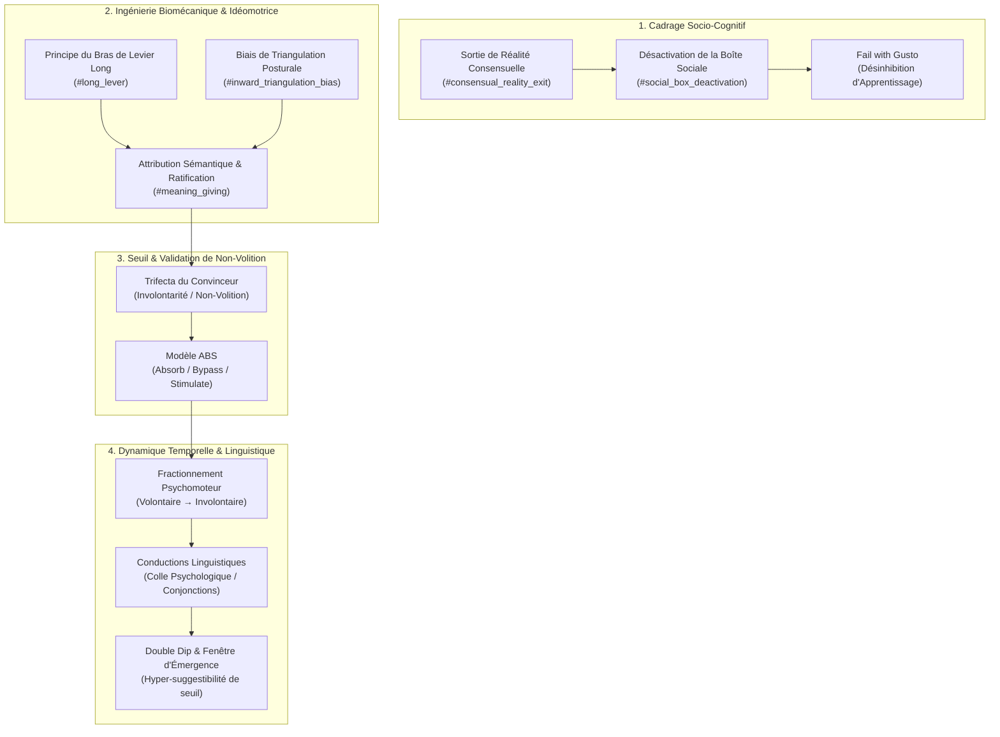

# Conversational Hypnosis 3.0 - Transcripts
**Formateur :** Igor Ledochowski | **ID :** `igor-ledochowski-conversational-hypnosis-30-transcripts` | **Tranches :** 65

## Synthèse Architecturale du Cours : *Conversational Hypnosis 3.0* (Igor Ledochowski)

---

### 1. Thèse Centrale & Philosophie du Cours

#### A. La Vision Spécifique d'Igor Ledochowski vs Approche Standard
Dans la tradition hypnotique standard (classique ou ericksonienne dogmatique), la transe est souvent présentée soit comme un sommeil artificiel ritualisé, soit comme un état modifié de conscience défini par une signature neurophysiologique exclusive (ondes alpha/thêta, immobilité catatonique).

La rupture fondamentale opérée par Igor Ledochowski dans *Conversational Hypnosis 3.0* repose sur un axiome socio-cognitif : **la transe est fonctionnellement une sortie de la réalité consensuelle (*Consensual Reality Exit*)**.
* **Le filtre social comme inhibiteur :** En état de veille ordinaire (« *social reality* » / « boîte sociale »), le système nerveux fonctionne en mode de surveillance permanente du risque d'évaluation, de politesse conditionnée, de méfiance acquise et de gestion d'image de marque personnelle (*persona*). Cet appareil défensif verrouille les potentiels latents et génère un facteur critique relationnel rigide.
* **La posture de l'opérateur :** L'hypnotiseur ne « force » pas une porte close par autorité directe ; il modifie le cadre contextuel (*context-switching* à l'image du « chant sous la douche »). En invitant le sujet hors du jeu social ordinaire, le praticien désamorce le besoin d'auto-évaluation critique. La posture de l'opérateur est fluide, non-jugeante, incarnant l'attitude *« Fail with Gusto »* (abandon du perfectionnisme conscient au profit de la spontanéité relationnelle) et s'appuyant sur une prosodie parasympathique régulatrice (*Late Night Radio DJ Voice*).

#### B. Le Fil Rouge Méthodologique Unificateur
Le moteur cybernétique qui relie l'ensemble des protocoles et interventions du cours repose sur le **Modèle ABS dynamique couplé à l'ingénierie biomécanique et linguistique** :
1. **Déstabilisation & Sortie de Cadre Social :** Interrompre les conventions de communication ordinaires par une rupture d'attention, une offre formelle de transe ou une incongruence calibrée.
2. **Amplification Biomécanique Involontaire :** Utiliser des réalités physiques incontournables (bras de levier long, triangulation posturale, micro-oscillations physiologiques) pour créer un phénomène kinesthésique spontané.
3. **Capture Idéomotrice & Attribution Sémantique :** Donner un sens hypnotique (aimantation, connexion inconsciente) à un tremblement ou un réflexe postural mécanique, forçant le facteur critique à capituler devant la preuve de la non-volition (*Trifecta of Convincers*).
4. **Fractionnement & Glissement Récursif :** Entraîner le système nerveux par oscillations répétées veille-transe (le pendule psychomoteur), transformant un acte initialement volontaire en une réponse autonome, automatique et inconsciente.
5. **Conduction Linguistique Continue :** Cimenter l'expérience par une syntaxe sans rupture (conjonctions causales et temporelles), exploitant les fenêtres de suggestibilité de seuil (*Double Dip*) pour installer des ancrages post-hypnotiques durables et écologiques.

---

### 2. Carte des Concepts & Leviers Émergents



#### Écosystème des Concepts Clés :

* **Sortie de la Réalité Consensuelle (*Consensual Reality Exit*) & Métaphore de la Douche :**
  * *Rôle :* Déplace l'axe d'intervention de la pathologie individuelle vers le contexte relationnel. Permet la levée instantanée des inhibitions sans travail psychothérapeutique lourd préalable.
* **Attitude d'Échec avec Ferveur (*Fail with Gusto*) :**
  * *Rôle :* Réduit à zéro l'anxiété de performance du praticien et du sujet ; abaisse l'hyper-contrôle préfrontal pour libérer le calibrage et l'accès inconscient.
* **Trifecta du Convinceur & Non-Volition Subjective :**
  * *Rôle :* Crée l'irréfutabilité de l'état de transe pour le facteur critique conscient en produisant un phénomène corporel perçu comme 100 % involontaire.
* **Amplification par Bras de Levier Long & Triangulation Posturale :**
  * *Rôle :* Ingénierie somatique servant d'amorce mécanique. Elle garantit l'apparition de micro-mouvements physiques même chez les profils les plus résistants, offrant un support matériel direct à la suggestion.
* **Attribution Rétroactive de Sens (*Meaning-Giving*) & Ratification en Temps Réel :**
  * *Rôle :* Capter le tremblement physiologique naturel et y injecter une signification hypnotique (« votre inconscient commence à rapprocher vos mains »), transformant un bruit neuromusculaire en signal thérapeutique.
* **Modèle ABS (Attention, Bypass, Stimulate) & Seuil Liminal :**
  * *Rôle :* Structure opérationnelle minimale de toute induction conversationnelle : focalisation sensorielle interne, neutralisation du scepticisme analytique et stimulation d'une réponse idéomotrice ou émotionnelle.
* **Voix de Transe (*Late Night Radio DJ Voice* / Triade Soft-Low-Slow) :**
  * *Rôle :* Régulation vagale et synchronisation neurovégétative ascendante par rétroaction prosodique, signalant biologiquement la sécurité au système nerveux.
* **Fractionnement Dynamique comme Courbe d'Apprentissage :**
  * *Rôle :* Entraînement de l'élasticité synaptique. Chaque ré-immersion exploite l'inertie de la précédente pour glisser du registre volontaire au registre entièrement automatisé/involontaire.
* **Stratégie des Extrêmes Linguistiques :**
  * *Rôle :* Prise en charge des profils hyper-analytiques ou rigides (militaires, ingénieurs) en évitant le « milieu mou » : soit saturation permissive absolue (*Yes-Set* permissif total), soit autorité chirurgicale directive directe.
* **Le Double Creux Post-Transe (*The Double Dip*) :**
  * *Rôle :* Exploitation de la chute brutale de vigilance consciente lors de l'annonce du réveil et des premières secondes post-émergence pour délivrer les suggestions post-hypnotiques les plus critiques.
* **Conductions Linguistiques (« Colle Psychologique ») :**
  * *Rôle :* Enchaînement ininterrompu de propositions par des conjonctions causales et temporelles (*et, pendant que, parce que, ce qui signifie que*), saturant la recherche de cohérence du cerveau gauche et empêchant le facteur critique de s'interposer.

---

### 3. Tableau Récapitulatif des Techniques & Démonstrations

| Technique / Exercice | Objectif Opératoire | Déclencheur / Indication | Séquence Résumée |
|---|---|---|---|
| **Induction des Mains Magnétiques par Bras de Levier Long** | Produire une preuve irréfutable de non-volition (*Convinceur*) via idéomotion amplifiée. | Début d'intervention formelle, besoin d'un convinceur somatique, profil sceptique ou défensif. | 1. Tendre les bras droits devant soi (bras de levier long).<br>2. Orienter légèrement les paumes vers l'intérieur (triangulation posturale).<br>3. Fixer un point entre les mains (absorption attentionnelle).<br>4. Attribuer le tremblement naturel à une force magnétique.<br>5. Ratifier en boucle fermée jusqu'au contact physique puis fermeture des yeux. |
| **Pont Futur Récursif & Biofeedback Facial** | Dissoudre l'inhibition de performance et pré-programmer un état interne de succès. | Anxiété d'apprentissage, trac chez le sujet ou l'opérateur, blocage d'anticipation. | 1. Activer délibérément un sourire zygomatique complet (yeux plissés).<br>2. Projeter devant soi un double dissocié futur incarnant la maîtrise totale avec ce même sourire.<br>3. Établir une boucle d'observation réflexive (neurones miroirs).<br>4. Fusionner kinesthésiquement avec cette projection avant toute action. |
| **Bypass du Scepticisme de Gaslighting / Défense Rétroactive** | Neutraliser le réflexe paranoïde ou défensif hérité d'un environnement manipulateur. | Sujet ultra-méfiant, hyper-vigilant socialement, antécédents d'emprise ou de manipulation. | 1. Refuser la confrontation dans le cadre conversationnel ordinaire.<br>2. Proposer un rituel formel de rupture de seuil (ex. test idéomoteur consenti).<br>3. Recontextualiser les paroles hors de la réalité sociale : les mots ne décrivent plus une vérité externe mais des instructions directes de traitement interne. |
| **Stratégie des Extrêmes Linguistiques (Profils Hyper-Analytiques)** | Court-circuiter le contrôle conscient des profils rigides sans entrer en bras de fer. | Profils militaires, contrôleurs de gestion, ingénieurs, personnes « impossibles à hypnotiser ». | 1. Calibrer la résistance au cadre médian standard.<br>2. **Option A (Ultra-Permissive) :** Donner 100 % de permission de contrôle (« Vous n'avez pas besoin d'entrer en transe, remarquez simplement ce qui résiste »).<br>3. **Option B (Ultra-Directive) :** Donner des commandes chirurgicales brèves et fermes sans justification logique.<br>4. Priver le facteur critique de matière à argumenter. |
| **Fractionnement Pendulaire (Courbe Volontaire → Involontaire)** | Approfondir la transe de manière géométrique et abaisser le seuil métabolique de résistance. | Transe superficielle, besoin de programmer un ancrage post-hypnotique rapide (*Sleep*). | 1. Induire une première transe (coopération volontaire du sujet).<br>2. Faire émerger brièvement le sujet (veille sociale partielle).<br>3. Rapprocher immédiatement le déclencheur pour replonger (amorce semi-involontaire).<br>4. Répéter 3 à 5 fois jusqu'à ce que résister devienne plus coûteux pour le cerveau que d'abandonner le contrôle. |
| **Exploitation du "Double Dip" & Debrief Stratégique** | Déposer des suggestions profondes ou post-hypnotiques sous le radar analytique conscient. | Phase de fin de transe, réveil du sujet, transition vers la discussion post-session. | 1. Annoncer la fin imminente de l'exercice pour désactiver la surveillance consciente (« Dans un instant vous allez revenir... »).<br>2. Glisser la suggestion critique au point d'inflexion exact du retour.<br>3. Au moment de l'ouverture des yeux, maintenir la voix *Late Night Radio DJ* durant le debriefing immédiat avant que le filtre social ne se reconstitue. |
| **Enchaînement par Conductions Linguistiques Continues** | Surcharger la recherche causale consciente et fusionner truismes et commandes hypnotiques. | Phase de suggestion directe, transition conversationnelle fluide, contournement de barrière critique. | 1. Poser un truisme sensoriel indéniable (« Vous êtes assis ici »).<br>2. Lier immédiatement avec une conduction (*et*, *pendant que*, *parce que*, *ce qui signifie*).<br>3. Ajouter une suggestion somatique (« vos épaules s'affaissent »).<br>4. Enchaîner sans pause vers la commande de transformation ciblée. |

---

---

## 0. Sommaire Sémantique & Index des Lignes

- **Tranche 1 [Lignes 178-342]** : L'Induction des Mains Magnétiques Virtuelle / Sans Contact (Magnetic Hands Induction) — *Protocole :* L'Induction des Mains Magnétiques Virtuelle / Sans Contact (Magnetic Hands Induction) | *Mécanisme :* La Transe comme Sortie de la Réalité Consensuelle (Consensual Reality Exit) | *Verbatim :* Le Double Recadrage Paradoxal de l'Échec
- **Tranche 2 [Lignes 344-466]** : L'Induction des Mains Magnétiques (Phase 1 & Phase 2 - Mise en place biomécanique) — *Protocole :* L'Induction des Mains Magnétiques (Phase 1 & Phase 2 - Mise en place biomécanique) | *Mécanisme :* Le Contrat de Réalité Sociale vs Réalité Hypnotique (Transe) | *Verbatim :* Le Seuil d'Autorisation et Rupture Immédiate du Cadre
- **Tranche 3 [Lignes 468-637]** : Induction Complète des Mains Magnétiques (Version Bras Longs) & Entrée en Transe — *Protocole :* Induction Complète des Mains Magnétiques (Version Bras Longs) & Entrée en Transe | *Verbatim :* La Ratification de l'Involontaire et l'Ordre Conditionnel Ambigü
- **Tranche 4 [Lignes 639-753]** : Le Cycle de Fractionnement Rapide avec Réinduction par Commande Post-Hypnotique — *Protocole :* Le Cycle de Fractionnement Rapide avec Réinduction par Commande Post-Hypnotique | *Mécanisme :* Le Fractionnement comme Courbe d'Apprentissage Psychomoteur | *Verbatim :* La Boucle Récursive de Ratification (Feedback Loop)
- **Tranche 5 [Lignes 755-878]** : Exploitation de la Fenêtre du "Double Dip" & Debrief Stratégique — *Protocole :* Exploitation de la Fenêtre du "Double Dip" & Debrief Stratégique | *Mécanisme :* Le Double Creux Post-Transe (The "Double Dip" & Emergence Hyper-Suggestibility) | *Verbatim :* La Bascule de Tonus et la Commande par la Tonalité
- **Tranche 6 [Lignes 880-987]** : Le Jeu des Conjonctions Absurdes à 3 Voies (Conjunction Ping-Pong - "AND") — *Protocole :* Le Jeu des Conjonctions Absurdes à 3 Voies (Conjunction Ping-Pong - "AND")
- **Tranche 7 [Lignes 989-1096]** : Le Réacteur Linguistique à 5 Mots de Pouvoir (Power Words Engine) — *Protocole :* Le Réacteur Linguistique à 5 Mots de Pouvoir (Power Words Engine) | *Verbatim :* Démonstration 1 : L'effet de traction temporelle et de projection avec « Until »
- **Tranche 8 [Lignes 1098-1255]** : L'Interview Flash d'Extraction de Thèmes de Transe (20-30 secondes) — *Protocole :* L'Interview Flash d'Extraction de Thèmes de Transe (20-30 secondes) | *Verbatim :* Extrait 1 : Formulations des Deux Lois Hypnotiques Fondamentales
- **Tranche 9 [Lignes 1257-1383]** : L'Interview des 4 Quadrants & le Blitz Hypnotique (The Four Quadrants Elicitation & Hypnotic... — *Protocole :* L'Interview des 4 Quadrants & le Blitz Hypnotique (The Four Quadrants Elicitation & Hypnotic Blitz) | *Verbatim :* La clarification du canal inconscient
- **Tranche 10 [Lignes 1385-1557]** : Les Trois Cadres de Gestion du Client Récalcitrant / Négatif (The 3 Resistance Busters) — *Protocole :* Les Trois Cadres de Gestion du Client Récalcitrant / Négatif (The 3 Resistance Busters) | *Verbatim :* La Manœuvre d'Épuisement de la Plainte (The Venting Loop)
- **Tranche 11 [Lignes 1559-1715]** : L'Exercice du Quatuor d'Absorption Hypnotique (The 4-Role Trance Loop) — *Protocole :* L'Exercice du Quatuor d'Absorption Hypnotique (The 4-Role Trance Loop) | *Mécanisme :* La Décomposition Fonctionnelle du Praticien (The 4-Role Split) | *Verbatim :* L'Élicitation Épurée des Thèmes de Transe
- **Tranche 12 [Lignes 1717-1823]** : Le "Shopping de Personnalité" (4 Questions Fondatrices du Futur Positif) — *Protocole :* Le "Shopping de Personnalité" (4 Questions Fondatrices du Futur Positif) | *Mécanisme :* Question Aspirationnelle Orientée Futur Positif vs Prédiction par le Passé | *Verbatim :* Le Recadrage de Négation (The Negation-Flip Loop)
- **Tranche 13 [Lignes 1825-1958]** : Protocole d'Induction Flash « Bare Bones » (Extraction & Amplification Ultra-Courte) — *Protocole :* Protocole d'Induction Flash « Bare Bones » (Extraction & Amplification Ultra-Courte) | *Verbatim :* La Boucle d'Induction Éclair (Démonstration sur Terry)
- **Tranche 14 [Lignes 1960-2088]** : Démonstration : Protocole des Micro-Boucles de Fractionnement (Démonstration sur Jeff) — *Protocole :* Démonstration : Protocole des Micro-Boucles de Fractionnement (Démonstration sur Jeff) | *Verbatim :* L'équivalent de langage de processus par langue étrangère
- **Tranche 15 [Lignes 2090-2255]** : L'Extraction Somatique d'Urgence / Sortie Dynamique de Transe — *Protocole :* L'Extraction Somatique d'Urgence / Sortie Dynamique de Transe | *Verbatim :* La Sortie Kinesthésique Ascendante
- **Tranche 16 [Lignes 2257-2384]** : A : L'Induction par Révocation Éricksonienne (Revocation Protocol) — *Protocole :* A : L'Induction par Révocation Éricksonienne (Revocation Protocol) | *Mécanisme :* L'Induction par Révocation Éricksonienne (Revocation / Revivification Memory Induction) | *Verbatim :* La Question Directrice Calibrée (The Lead Question)
- **Tranche 17 [Lignes 2386-2536]** : A : La Réplication par le Film Mental & la Revivification Somatique — *Protocole :* A : La Réplication par le Film Mental & la Revivification Somatique | *Verbatim :* Extrait 1 : L'Accès Indirect par la Métaphore de l'Acteur / Espion
- **Tranche 18 [Lignes 2538-2671]** : La Revivification Hypnotique en 4 Étapes (Layered Revivification Process) — *Protocole :* La Revivification Hypnotique en 4 Étapes (Layered Revivification Process) | *Verbatim :* Le glissement direct vers le présent et la spatialisation somatique
- **Tranche 19 [Lignes 2673-2794]** : Revivification d'un Lieu Ressource / Sanctuaire Réel (Base Objet/Espace) — *Protocole :* Revivification d'un Lieu Ressource / Sanctuaire Réel (Base Objet/Espace) | *Verbatim :* Élicitation du Sanctuaire Réel
- **Tranche 20 [Lignes 2796-2978]** : A : Construction de Lieu Sûr / Sanctuaire par Pré-visification — *Protocole :* A : Construction de Lieu Sûr / Sanctuaire par Pré-visification | *Mécanisme :* Pré-visification / Mémoire Future (Pre-visification / Future Memory) | *Verbatim :* PÉPITE 1 : Ratification et maintien de l'espace génératif
- **Tranche 21 [Lignes 2980-3131]** : A : La Rétro-Ingénierie de l'Émergence Spontanée (Démonstration sur Constantine) — *Protocole :* A : La Rétro-Ingénierie de l'Émergence Spontanée (Démonstration sur Constantine) | *Verbatim :* La question d'élicitation analogique récursive
- **Tranche 22 [Lignes 3133-3258]** : Désamorçage du Doute par la Formule ABS et la Réorientation — *Protocole :* Désamorçage du Doute par la Formule ABS et la Réorientation | *Verbatim :* La conjonction continue de revivification
- **Tranche 23 [Lignes 3260-3430]** : Voyage Symbolique via Seuil de Transition (Version Standard avec Staging Post) — *Protocole :* Voyage Symbolique via Seuil de Transition (Version Standard avec Staging Post) | *Verbatim :* Verbatim 1 : Recadrage de la fonction protectrice du comportement (L'histoire de Leslie Cameron-Bandler)
- **Tranche 24 [Lignes 3432-3619]** : A : Dynamic Mental Imagery Induction (Version Rituelle Complète) — *Protocole :* A : Dynamic Mental Imagery Induction (Version Rituelle Complète) | *Verbatim :* Pontage Somatosensoriel et Expansion Temporelle (Don)
- **Tranche 25 [Lignes 3621-3745]** : Protocole d'Élucidation Rapide de Symbole Cible (The Flash Symbol Elicitation) — *Protocole :* Protocole d'Élucidation Rapide de Symbole Cible (The Flash Symbol Elicitation) | *Verbatim :* Le Bypassing et la Porte du Gardien
- **Tranche 26 [Lignes 3747-3852]** : Exploration et Déploiement du Paysage Symbolique — *Protocole :* Exploration et Déploiement du Paysage Symbolique | *Mécanisme :* Expansion Spatialisée du Paysage Symbolique et Déclenchement de l'Insight | *Verbatim :* Suggestion Directe d'Implication de Sens et Curiosité Modélisante
- **Tranche 27 [Lignes 3854-4041]** : Le Voyage Symbolique Complet (Full DMI Process) — *Protocole :* Le Voyage Symbolique Complet (Full DMI Process) | *Mécanisme :* Cognition Incarnée & Métaphores Primaires de Survie | *Verbatim :* Le Recadrage de la Polarité Spatiale et de la Métaphore Incarnée
- **Tranche 28 [Lignes 4043-4160]** : Résolution Symbolique d'un Blocage d'Apprentissage / Impasse Identitaire (Démonstration sur... — *Protocole :* Résolution Symbolique d'un Blocage d'Apprentissage / Impasse Identitaire (Démonstration sur Clara) | *Verbatim :* Le Paradoxe du Rythme et de l'Urgence (Ego-Release Reframing)
- **Tranche 29 [Lignes 4162-4296]** : Protocole d'Évolution d'un Symbole Négatif / Affect Bloqué — *Protocole :* Protocole d'Évolution d'un Symbole Négatif / Affect Bloqué | *Verbatim :* Le Silence Opératoire
- **Tranche 30 [Lignes 4298-4416]** : d'Élévation de Bras en Distanciel (Arm Levitation Remote Protocol) — *Protocole :* d'Élévation de Bras en Distanciel (Arm Levitation Remote Protocol) | *Verbatim :* Pacing tactile et présupposition temporelle de légèreté
- **Tranche 31 [Lignes 4418-4528]** : La Configuration Physiologique de Lévitation du Bras (Arm Levitation Setup) — *Protocole :* La Configuration Physiologique de Lévitation du Bras (Arm Levitation Setup) | *Verbatim :* Recadrage Symbolique de l'Expérience Somatique
- **Tranche 32 [Lignes 4530-4655]** : L'Awareness Set & Déduction de l'Inconscient (Phase 1) — *Protocole :* L'Awareness Set & Déduction de l'Inconscient (Phase 1) | *Verbatim :* La Clause d'Inférence d'Agence Inconsciente
- **Tranche 33 [Lignes 4657-4760]** : Induction par Lévitation de Bras via le "Non-Awareness Set" — *Protocole :* Induction par Lévitation de Bras via le "Non-Awareness Set" | *Verbatim :* Questionnement Dissociatif et Présupposition Temporelle
- **Tranche 34 [Lignes 4762-4902]** : Le "Non-Awareness Set" Statique / Somatique (Zéro Mouvement) — *Protocole :* Le "Non-Awareness Set" Statique / Somatique (Zéro Mouvement) | *Verbatim :* Le Double Lien d'Expansion du Confort Somatique
- **Tranche 35 [Lignes 4904-5038]** : DMI Flash (Dynamic Mental Imagery en 60 Secondes) — *Protocole :* DMI Flash (Dynamic Mental Imagery en 60 Secondes) | *Mécanisme :* Le Levier du Cadre de Jeu Déresponsabilisant (Roleplay Framing & Voluntary Priming) | *Verbatim :* Verbatim : Induction DMI & Calibration de l'Inattendu
- **Tranche 36 [Lignes 5040-5161]** : A : Questionnement Symbolique Minimaliste (Clean Language pour DMI & Non-Awareness Set) — *Protocole :* A : Questionnement Symbolique Minimaliste (Clean Language pour DMI & Non-Awareness Set) | *Verbatim :* Verbatim 1 : Structuration de l'attention symbolique (Clean Framing)
- **Tranche 37 [Lignes 5163-5323]** : Extension du Muscle de Bienveillance Inconditionnelle (Thought Experiment / Entraînement Neu... — *Protocole :* Extension du Muscle de Bienveillance Inconditionnelle (Thought Experiment / Entraînement Neurologique) | *Mécanisme :* Contagion Neurologique Somatique & Résonance d'État (Micro-Mirroring Inconscient) | *Verbatim :* Le Recadrage du Sortilège de l'Illusion
- **Tranche 38 [Lignes 5325-5469]** : A : L'Entretien du Futur Préféré (Preferred Future Interview) — *Protocole :* A : L'Entretien du Futur Préféré (Preferred Future Interview) | *Verbatim :* Le Recadrage de la Douleur Rachetée (Sacrifice vs Souffrance)
- **Tranche 39 [Lignes 5471-5578]** : d'Élicitation des Obstacles Actuels (The Present Problem Exploration) — *Protocole :* d'Élicitation des Obstacles Actuels (The Present Problem Exploration)
- **Tranche 40 [Lignes 5580-5730]** : La Transformation Conversationnelle de Crise (Démonstration sur Mania) — *Protocole :* La Transformation Conversationnelle de Crise (Démonstration sur Mania) | *Mécanisme :* Le Recadrage de Posture Héroïque (The Hero Stance) | *Verbatim :* La Présupposition Héroïque Face au Chaos
- **Tranche 41 [Lignes 5732-5865]** : La Boucle de Rétroaction Récursive (Test-Transform-Check) — *Protocole :* La Boucle de Rétroaction Récursive (Test-Transform-Check)
- **Tranche 42 [Lignes 5867-5987]** : La Boucle de Vérification "Check & Kill" (Triade de Réaction) — *Protocole :* La Boucle de Vérification "Check & Kill" (Triade de Réaction) | *Verbatim :* Verbatim 1 : L'impératif de rupture et de consolidation
- **Tranche 43 [Lignes 5989-6091]** : Réduction & Normalisation d'un Problème en Format Opératoire MBL — *Protocole :* Réduction & Normalisation d'un Problème en Format Opératoire MBL | *Mécanisme :* La Réduction aux Deux Prismes Fondamentaux du Problème : Équivalence Complexe vs Cause-Effet | *Verbatim :* La distinction fondamentale ontologique du verbe "To Be"
- **Tranche 44 [Lignes 6093-6245]** : Protocole d'Élasticité Conceptuelle par Inversion Syntaxique (Syntax Reversal Drill) — *Protocole :* Protocole d'Élasticité Conceptuelle par Inversion Syntaxique (Syntax Reversal Drill) | *Verbatim :* Le Triple Spin de Négation
- **Tranche 45 [Lignes 6247-6405]** : Déstabilisation du Facteur Critique par Investigation Croisée ("Loosening the Concrete") — *Protocole :* Déstabilisation du Facteur Critique par Investigation Croisée ("Loosening the Concrete") | *Mécanisme :* Le Déverrouillage Neurologique par Questionnement Déstabilisant ("Loosening the Concrete") | *Verbatim :* Verbatim 1 : Les Spins de Modalités Sensorielles Croisées
- **Tranche 46 [Lignes 6407-6543]** : A : Cadrage de l'Objectif Immédiat (Solution-Focused Hope Frame) — *Protocole :* A : Cadrage de l'Objectif Immédiat (Solution-Focused Hope Frame) | *Verbatim :* La boucle d'amplification et d'ouverture projective
- **Tranche 47 [Lignes 6545-6730]** : A : La Boucle Transformative PCAT (Parameters, Capture, Attach/Transform, Test) — *Protocole :* A : La Boucle Transformative PCAT (Parameters, Capture, Attach/Transform, Test) | *Mécanisme :* Loi d'Association et Effondrement Naturel d'États (Natural State Collapsing) | *Verbatim :* La Formule Universelle d'Effondrement ($R \rightarrow P$)
- **Tranche 48 [Lignes 6732-6871]** : Le Cycle Complet PCAT de Transformation & Test Rapide — *Protocole :* Le Cycle Complet PCAT de Transformation & Test Rapide | *Verbatim :* L'infusion du futur dans le présent
- **Tranche 49 [Lignes 6873-7031]** : A : Recadrage Chirurgical de la Plainte Externe (Sortie du Rôle de Victime) — *Protocole :* A : Recadrage Chirurgical de la Plainte Externe (Sortie du Rôle de Victime) | *Mécanisme :* Le Cimetière Intérieur comme Organe Métaphorique de Recyclage Identitaire | *Verbatim :* Recadrage Métaphorique : Le Cimetière Mental
- **Tranche 50 [Lignes 7033-7272]** : A : La Régression par Pont Affectif Épuré (Pure Positive Affect Bridge) — *Protocole :* A : La Régression par Pont Affectif Épuré (Pure Positive Affect Bridge) | *Verbatim :* s Verbatim
- **Tranche 51 [Lignes 7274-7455]** : A : La Régression par Pont d'Affect Récurent (Multi-hop Affect Bridge) — *Protocole :* A : La Régression par Pont d'Affect Récurent (Multi-hop Affect Bridge) | *Mécanisme :* Système immunitaire psychologique & bouclier inconscient | *Verbatim :* Recadrage du blocage en système immunitaire psychologique
- **Tranche 52 [Lignes 7457-7580]** : A : La Boucle de Rétro-Progression Temporelle Ressource (M2 -> M1 Triangle) — *Protocole :* A : La Boucle de Rétro-Progression Temporelle Ressource (M2 -> M1 Triangle) | *Verbatim :* La Bascule Fractionnée Observateur / Expérimentateur
- **Tranche 53 [Lignes 7582-7722]** : A : La Régression Positive / Pédagogique (The Fun Regression Cycle) — *Protocole :* A : La Régression Positive / Pédagogique (The Fun Regression Cycle) | *Verbatim :* L'Unconscious Protector Set & Restauration du Contrôle
- **Tranche 54 [Lignes 7724-7871]** : La Régression Thérapeutique en Boucle d'Autorité (Looping Timeline & Courtroom Clearing) — *Protocole :* La Régression Thérapeutique en Boucle d'Autorité (Looping Timeline & Courtroom Clearing)
- **Tranche 55 [Lignes 7873-8011]** : d'Analyse Clinique Rétroactive : Structure « HypnoLab / HypnoLab Plus » — *Protocole :* d'Analyse Clinique Rétroactive : Structure « HypnoLab / HypnoLab Plus » | *Mécanisme :* Le Principe de Décompensation Somatique et d'Évacuation Réflexe | *Verbatim :* Verbatim : Recadrage de la Normalisation de l'Échec Thérapeutique
- **Tranche 56 [Lignes 8013-8135]** : Construction de la « Chair of Authority » & Restitution du Pouvoir — *Protocole :* Construction de la « Chair of Authority » & Restitution du Pouvoir | *Mécanisme :* Le Principe de Neutralisation de Charge vs Remplacement de Contenu | *Verbatim :* Suggestion de Recouvrement du Pouvoir et Dissociation Mnésique
- **Tranche 57 [Lignes 8137-8289]** : A : Clarification Opératoire du "True Goal" (Désamorçage de l'Objectif Symptomatique) — *Protocole :* A : Clarification Opératoire du "True Goal" (Désamorçage de l'Objectif Symptomatique) | *Mécanisme :* L'Hyper-Émotion comme Transe Spontanée (Zéro Induction Requise) | *Verbatim :* Ratification et Amplification du Signal Somatique Émergent
- **Tranche 58 [Lignes 8291-8463]** : Protocole de la Boucle Thérapeutique Triangulaire (Étapes 5 à 10 du Processus de Régression) — *Protocole :* Protocole de la Boucle Thérapeutique Triangulaire (Étapes 5 à 10 du Processus de Régression)
- **Tranche 59 [Lignes 8465-8602]** : La Thérapie de Régression de Crise (Méthode de Déblocage du Trauma Majeur) — *Protocole :* La Thérapie de Régression de Crise (Méthode de Déblocage du Trauma Majeur) | *Verbatim :* Recadrage conversationnel du Pouvoir et de la Vengeance
- **Tranche 60 [Lignes 8604-8752]** : Désamorçage de Récidive Traumatique & Dépossession Symbolique (Démonstration Pavan) — *Protocole :* Désamorçage de Récidive Traumatique & Dépossession Symbolique (Démonstration Pavan) | *Verbatim :* Le Double Lien du Choix de Souffrir
- **Tranche 61 [Lignes 8754-8895]** : Le Recadrage de Désengagement de la Colère (Anger Payoff Decoupling Protocol) — *Protocole :* Le Recadrage de Désengagement de la Colère (Anger Payoff Decoupling Protocol) | *Verbatim :* Le Double Lien Émancipateur du Choix de Souffrir
- **Tranche 62 [Lignes 8897-9017]** : d'Intégration des Parties : Remontée vers la Méta-Valeur & Échange de Ressources — *Protocole :* d'Intégration des Parties : Remontée vers la Méta-Valeur & Échange de Ressources | *Mécanisme :* Chaining / Chunking Up vers la Méta-Intention Positive Commune | *Verbatim :* L'Escalier du Questionnement Récursif (Chunking Up Ladder)
- **Tranche 63 [Lignes 9019-9141]** : d'Intégration de Parties en Conflit (Visual Squash / Parts Integration Avancé) — *Protocole :* d'Intégration de Parties en Conflit (Visual Squash / Parts Integration Avancé) | *Verbatim :* Double Lien et Frustration de Réponse
- **Tranche 64 [Lignes 9143-9334]** : Macro-Opératoire : La Session Complète en 4 Étapes — *Protocole :* Macro-Opératoire : La Session Complète en 4 Étapes | *Mécanisme :* L’Architecture « Fail-Safe » (Sécurité Intégrée par Empilement de Couches) | *Verbatim :* L'Inoculation Temporelle de Sécurité (Pré-framing d'Induction)
- **Tranche 65 [Lignes 9336-9410]** : d'Atténuation Paradoxale de l'Anxiété de Performance — *Protocole :* d'Atténuation Paradoxale de l'Anxiété de Performance | *Verbatim :* La Prescription Paradoxale du Standard

---

## Extractions Détaillées par Tranche (Opératoire & Verbatim)

## Tranche 1 / 65 : L'Induction des Mains Magnétiques Virtuelle / Sans Contact (Magnetic Hands Induction)

Voici l'extraction et la modélisation intégrale de la matière opératoire contenue dans cette tranche 1/65.

---

### 1. Mécanismes & Principes Actifs

#### A. La Transe comme Sortie de la Réalité Consensuelle (Consensual Reality Exit)
- **Principe actif :** La cognition humaine est divisée en une réalité interne privée (le monde intérieur idiosyncratique) et une réalité sociale consensuelle (le filtre d'adaptation grégaire, la « boîte » ou le masque social). Pour interagir en société, l'individu crée un système d'inhibition comportementale et cognitive : il bride ses émotions, ses talents latents et ses automatismes pour ne pas être jugé.
- **Mécanisme neurologique & inconscient :** L'état de transe n'est pas réductible à une signature électroencéphalographique exclusive (les ondes alpha ou thêta sont accessoires, la transe opératoire pouvant exister sous ondes bêta). La transe est fonctionnellement une **délivrance temporaire des contraintes de la réalité consensuelle**. En sortant le sujet de la boîte sociale, le système nerveux désactive les boucles d'inhibition préfrontales (méfiance, politesse conditionnée, hyper-vigilance grégaire) et rend accessibles les potentiels latents et les réponses idéomotrices inconscientes.
- **Tags émergents :** `#consensual_reality_exit` `#social_box_deactivation` `#unconscious_latent_potential` `#deinhibition_contextuelle`

#### B. La Métaphore de la Douche (Contextual Disinhibition)
- **Principe actif :** Pourquoi une personne chante-t-elle librement sous la douche mais se retrouve-t-elle aphone ou paralysée devant un public ? Ses cordes vocales et son affect sont identiques. Ce qui change est purement le **contexte opératoire** (privé vs social). L'hypnose isole artificiellement le sujet dans un cadre non-social dirigé, levant instantanément les blocages d'inhibition sans nécessiter une psychothérapie de fond sur la compétence elle-même.
- **Tags émergents :** `#shower_singing_effect` `#context_switching` `#latent_ability_release`

#### C. L'Attitude d'Échec avec Ferveur ("Fail with Gusto")
- **Principe actif :** Dans l'apprentissage d'un système conversationnel complexe, la peur de l'incompétence active le cortex préfrontal en mode auto-évaluation critique, ce qui détruit le calibrage et la spontanéité relationnelle. En prescrivant le fait d'« être nul » au début et en ordonnant d'échouer avec panache et enthousiasme, l'opérateur crée une **levée paradoxale de l'inhibition de performance**.
- **Tags émergents :** `#fail_with_gusto` `#paradoxical_permission` `#performance_anxiety_extinction`

#### D. Le Pont Futur Récursif et le Rétro-Conditionnement par Biofeedback Facial
- **Principe actif :** L'activation délibérée du système musculaire facial (sourire zygomatique complet irradiant jusqu'aux yeux) déclenche une boucle de rétroaction proprioceptive ascendante (hypothèse de rétroaction faciale somato-émotionnelle). En observant dissociativement un double futur de soi souriant avec succès, le sujet active le système des neurones miroirs envers sa propre projection future, programmant un état interne de maîtrise avant toute acquisition technique formelle.
- **Tags émergents :** `#dissociated_future_self` `#facial_feedback_loop` `#identity_preframing` `#recursive_pacing`

#### E. Neutralisation des Mécanismes de Défense Rétroactifs (Gaslighting & Trauma Defense Bypass)
- **Principe actif :** Les sujets ayant grandi sous emprise, intrusion parentale ou gaslighting développent en réalité sociale un bouclier de scepticisme systématique (« Quand on me dit quelque chose, je doute pour survivre »). Tenter de persuader ou suggérer dans le registre social active immédiatement ce réflexe défensif. En formalisant une induction (même minime comme le rapprochement des mains), on extrait le sujet du canal de communication social ordinaire pour lui conférer un cadre où les paroles prennent un sens symbolique et thérapeutique direct.
- **Tags émergents :** `#defense_mechanism_bypass` `#gaslighting_skepticism_neutralization` `#elevated_meaning_frame`

---

### 2. Protocoles, Techniques & Démonstrations (Étape par Étape)

---

#### PROTOCOLE 1 : L'Induction des Mains Magnétiques Virtuelle / Sans Contact (Magnetic Hands Induction)

* **Intention / Indication :** Déclencher une transe rapide en ligne (ou sans contact physique), contourner la réalité sociale, prouver au sujet sa réactivité inconsciente via un phénomène idéomoteur visible et ancrer une ressource identitaire/d'apprentissage.
* **Mise en place & Pré-framing :**
  - Demander au sujet de lever les mains dans le champ de la caméra.
  - Fixer une consigne physique simple d'échauffement somatique pour occuper l'attention consciente.

* **Séquence d'actions pas à pas :**
  1. **Activation Kinesthésique Préliminaire :**
     - Inviter le sujet à taper dans ses mains puis à les frotter vigoureusement l'une contre l'autre.
     - Donner le marqueur de vérification : attendre qu'une chaleur distincte commence à se développer dans les paumes.
  2. **Positionnement Spatial :**
     - Faire placer les mains face à face, écartées de quelques centimètres, bras tendus droit devant lui face à la caméra.
  3. **Focalisation Attentionnelle & Suggestion Idéomotrice :**
     - Guider son regard vers l'intervalle vide entre les deux paumes.
     - Suggérer un champ ou une force magnétique invisible qui attire inexorablement les mains l'une vers l'autre.
  4. **Ratification en Temps Réel :**
     - Dès le premier micro-mouvement d'attraction, ratifier verbalement (*"That's right..."*).
  5. **Enchaînement Idéomoteur -> État Interne (Compound Sugestion) :**
     - Lier le rapprochement physique des mains à l'émergence d'une sensation de confort profond à l'intérieur.
  6. **Déclencheur d'Approfondissement (Fractionnement / Chute) :**
     - Poser la condition charnière : au moment précis où les paumes entreront en contact physique, les yeux se fermeront, les bras s'effondreront vers le bas et le sujet plongera dans une transe profonde et confortable.
  7. **Greffe de Suggestion Thérapeutique / Ressource :**
     - Lier la sensation somato-émotionnelle de confort à l'objectif recherché (ici : le désir d'être un grand praticien, capable d'hypnotiser n'importe qui, n'importe où, n'importe quand).
  8. **Réorientation & Réveil Propre :**
     - Proposer au sujet de réintégrer l'état de veille à son propre rythme, en ramenant avec lui le confort et les ressources intégrées.

* **Signes de calibration observés par l'opérateur :**
  - Micro-saccades idéomotrices des doigts et tremblements involuntarily lors du rapprochement des mains.
  - Modification de la fréquence respiratoire (respiration qui descend dans l'abdomen, ralentissement).
  - Lissage des traits du visage et relâchement du tonus musculaire au moment du contact des mains.
  - Chute immédiate des bras par gravité pure (perte du tonus postural conscient).

---

#### PROTOCOLE 2 : Conditionnement Préalable de l'Identité de Succès (Future Self Smile Engine)

* **Intention / Indication :** Éliminer l'anxiété de performance avant une formation ou un apprentissage intensif ; aligner le système nerveux sur l'état d'esprit idéal d'un praticien.
* **Mise en place & Pré-framing :**
  - Fermer les yeux et orienter l'attention vers l'intérieur.
  - Rappeler que le sujet a déjà possédé une excellente attitude d'apprentissage par le passé.

* **Séquence d'actions pas à pas :**
  1. **Induction de Confort Initiale :**
     - Porter attention au corps au repos, laisser s'installer le confort et la rêverie intérieure.
  2. **Évocation Visuelle de Soi :**
     - Inviter le sujet à visualiser l'expression actuelle de son propre visage en face de lui.
  3. **Modification Somatique Délibérée :**
     - Ordonner de métamorphoser cette expression en un large sourire lumineux et éclatant qui irradie jusqu'aux yeux.
  4. **Boucle Rétroactive Symétrique :**
     - Laisser le visage physique du sujet répondre spontanément en souriant en miroir au visage visualisé.
  5. **Dissociation Spatiale (Zoom-out) :**
     - Prendre un recul mental pour voir ce "Soi Futur" (la personne qu'il sera à l'issue de l'intégration) debout, pleinement épanoui.
  6. **Répétition Mentale Opératoire (Mental Rehearsal) :**
     - Observer ce Soi Futur en interaction avec un client.
     - Noter son aisance naturelle, son sourire authentique, pendant que le client entre en transe profonde (calibration : lévitation du bras du client, relaxation totale).
  7. **Généralisation et Boucle Multi-Clients :**
     - Faire estomper la première scène, puis placer le Soi Futur devant un deuxième client, puis un troisième.
     - Répéter la boucle jusqu'à ce que la sensation de maîtrise totale devienne viscérale et naturelle.
  8. **Réassociation & Réorientation :**
     - Revenir à l'état de veille en préservant physiquement le sourire sur les lèvres et l'attente positive du futur.

* **Signes de calibration :**
  - Apparition d'un véritable sourire Duchenne (orbiculaire des yeux plissé) sur le visage du sujet en transe.
  - Posture qui s'ouvre, relâchement des épaules.

---

### 3. Heuristiques, Subtilités & "Sagesse du Praticien"

#### Règles Conditionnelles & Arbres de Décision Implicites :
- **Si** tu démarres l'apprentissage de l'hypnose, **alors** autorise-toi à être mauvais et échoue délibérément avec enthousiasme (*fail with gusto*), **parce que** l'auto-jugement conscient bloque la fluidité inconsciente indispensable à l'hypnose conversationnelle.
- **Si** tu veux transformer un spectateur passif en praticien opérationnel, **alors** impose l'action immédiate (ouvrir la bouche, pratiquer), **parce que** la compréhension intellectuelle ne produit aucune compétence hypnotique.
- **Si** le sujet se trouve en interaction sociale normale et manifeste du scepticisme ou de la politesse feinte, **alors** ne tente pas de le convaincre sur le même registre social ; extrait-le de la réalité consensuelle par une rupture/induction formelle, **parce que** les mécanismes de défense et d'adaptation sociale court-circuitent la réceptivité inconsciente.
- **Si** tu opères à travers un écran (zoom/webinaire) et ne peux utiliser d'inductions par rupture de pattern cinétique directe (ex: induction instantanée par poignée de main), **alors** utilise un test idéomoteur auto-généré (mains magnétiques avec frottement préalable), **parce que** l'activation proprioceptive de la chaleur compense l'absence de contact physique et capture l'attention.
- **Si** tu guides une induction, **alors** n'utilise aucun script figé, regarde en permanence les réactions du sujet et base chaque mot suivant sur la calibration du signal précédent.

#### Pièges Classiques & Erreurs Détectées :
- *Le piège de la théorie cérébrale :* Penser que la transe dépend exclusivement d'un état d'ondes cérébrales alpha/thêta mesuré à l'EEG. Igor Ledochowski rappelle qu'un sujet peut être en ondes bêta et manifester des réponses hypnotiques profondes.
- *Le piège du script mémorisé :* Réciter un texte sans regarder le sujet. L'opérateur doit être en "freestyle absolu", guidé par la réponse somatique en temps réel.
- *L'illusion de la réalité partagée universelle :* Croire que tout le monde partage les mêmes codes de communication. Chaque individu vit dans sa réalité privée ; la culture n'est qu'un accord conventionnel fragile.

#### Postulats Opératoires d'Igor Ledochowski :
1. *L'hypnose n'est pas un sport de spectateur.*
2. *L'état d'esprit (attitude) dans la pratique est plus déterminant que le volume d'heures de pratique brut.*
3. *Tout problème humain non résolu réside à l'intérieur de la boîte de la réalité sociale ; toute ressource générative réside en dehors de cette boîte.*
4. *L'induction hypnotique n'a qu'une seule fonction fondamentale : faire basculer le sujet hors de sa réalité consensuelle pour suspendre ses filtres d'inhibition.*

---

### 4. Pépites Verbatim & Patterns Linguistiques (MOT À MOT EN V.O.)

#### Pépite 1 : Le Double Recadrage Paradoxal de l'Échec
> **"Please expect one really important thing is going to happen over the next few days, right? You're going to suck. You're going to be pretty awful at this, and that's okay. Please, don't let us stop you. [...] To the extent that you're willing to dive in and give it your all, do it, fail with gusto, if you will. You will surprise yourself with how quickly you progress, right?"**

* **[Analyse du Pattern] :**
  - **Présupposition temporelle & Certitude :** *"is going to happen"*, *"You will surprise yourself"*. L'échec initial est posé comme un fait certain, ce qui vide l'anxiété de sa substance.
  - **Injonction paradoxale / Prescription du symptôme :** *"fail with gusto"*. En ordonnant d'échouer avec brio, le formateur neutralise l'évitement de l'échec et supprime la peur du ridicule.
  - **Rapprochement d'opposés (Contrast Framing) :** Associer la maladresse (*"suck"*, *"awful"*) à la rapidité fulgurante du progrès (*"how quickly you progress"*).

---

#### Pépite 2 : La Commande Enchâssée de l'Attitude et la Boucle Idéomotrice du Sourire
> **"Whatever it is, I'd like for you to alter it to a big, bright, beautiful smile, the kind that lights up all the way to the eyes and beams out with a sense of happiness. Now you're noting it right because your own face will want to smile right back at it. Let it happen. Let yourself smile back at that face as you see it. And when you do, kind of take a mental step back zooming out so you can see yourself standing over there smiling right back at you."**

* **[Analyse du Pattern] :**
  - **Truisme physiologique & Prédiction inévitable :** *"your own face will want to smile right back at it"*. Le cerveau réagit automatiquement à l'image d'un visage souriant.
  - **Permissivité hypnotique autoritaire (Pacing and Leading) :** *"Let it happen. Let yourself smile back..."*. Formulation d'abandon de contrôle qui permet au système nerveux autonome de prendre le relais.
  - **Déliaison spatiale (Dissociation) :** *"take a mental step back zooming out so you can see yourself standing over there"*. Crée une position méta-réflexive nécessaire pour installer une ressource identitaire sans friction critique.

---

#### Pépite 3 : Le Pont Idéomoteur Confort / Phénomène Hypnotique
> **"And stretch your arms out right in front of you so I can see them that's right now pay attention to the space in between your hands and imagine a kind of magnetic force drawing those hands that's it closer and close together. That's right allow this hand start drawing together and as they start coming together you may find yourself feeling a tremendous sense of comfort that develops inside. As those hands finally touch you will you can close your eyes allow your hands to drop and go into a deep and comfortable trance."**

* **[Analyse du Pattern] :**
  - **Ratification immédiate (Pacing de conformité) :** *"that's right"*, *"that's it"*. L'opérateur valide la moindre amorce de mouvement pour donner à l'inconscient la preuve que la suggestion opère.
  - **Liaison temporelle et causale (Temporal Linkage / Cause-Effect) :** *"and as they start coming together you may find yourself feeling a tremendous sense of comfort"*. L'action physique (inévitable ou involontaire) devient la cause motrice directe de la transe et du confort émotionnel.
  - **Double contrainte permissive / Illusion de choix :** *"you will you can close your eyes allow your hands to drop and go into a deep and comfortable trance"*. Glissement de l'injonction (*"you will"*) vers la permission (*"you can"*), réduisant toute réactance psychologique.

---

#### Pépite 4 : La Fusion Identitaire Confort / Compétence (Direct Binding)
> **"I'd like for you to know and really know that this comfort can bond with your desire to be a great hypnotist, a comfortable desire that feels good. You can that's right do hypnosis with anyone anytime any place and through any medium and I can feel this good and I think you know what I mean to you not that's right..."**

* **[Analyse du Pattern] :**
  - **Amplification sémantique (Intensifier) :** *"to know and really know"*. Double emploi créant un glissement du savoir intellectuel vers la certitude viscérale inconsciente.
  - **Soudure conceptuelle (Conceptual Binding) :** *"this comfort can bond with your desire"*. Fusionne un ressenti somatique présent (le confort de transe) avec une abstraction future (la maîtrise de l'hypnose).
  - **Omniprésence et généralisation absolue :** *"anyone anytime any place and through any medium"*. Élimine par anticipation toutes les limitations contextuelles de l'apprenant (notamment la peur de pratiquer à distance par écran).
  - **Confusion syntaxique & Présupposition sous-jacente :** *"I think you know what I mean to you not that's right"*. Rupture de structure grammaticale créant une surcharge cognitive passagère qui force l'adhésion immédiate (*"that's right"*).

## Tranche 2 / 65 : L'Induction des Mains Magnétiques (Phase 1 & Phase 2 - Mise en place biomécanique)

Voici la modélisation intégrale et l'extraction opératoire de la tranche 2/65 du séminaire *Conversational Hypnosis 3.0* d'Igor Ledochowski.

---

### 1. Mécanismes & Principes Actifs

#### 1. Le Contrat de Réalité Sociale vs Réalité Hypnotique (Transe)
* **Principe actif :** En interaction quotidienne ordinaire (« *social reality* »), le système nerveux est configuré pour le scannage permanent de l'environnement, la vigilance (« *scanning for danger* »), la gestion d'un réseau multi-agents (« *one-to-many* ») et l'activation de défenses automatiques (ex. scepticisme résiduel issu d'expériences de conditionnement ou de gaslighting passé). Les réponses y sont rigides, limitées par les conventions culturelles et les attentes relationnelles (« *social box* »).
* **Levier :** Sortir le sujet de la réalité sociale brise ces filtres inhibiteurs. En interrompant les règles du jeu social connu, le sujet se retrouve en apesanteur cognitive et reporte toute sa quête d'indices et de repères sur l'hypnotiseur. Ce transfert d'autorité de cadrage permet d'activer des capacités latentes refoulées (« *latent potentials / fresh abilities* »).
* **Tags :** `#social_reality_box` `#reality_shift` `#frame_destabilization` `#rule_seeking_mechanism`

#### 2. L'Offre Explicite de Sortie de Réalité comme Signal de Transition
* **Principe actif :** Poser la question directe du consentement à entrer en transe ne sert pas seulement de validation éthique ; c'est un marqueur neurologique franc. Cette demande signale au sujet la fin imminente du jeu relationnel habituel.
* **Effet physiologique :** Déclenche instantanément une bascule : soit une micro-confusion/hésitation (hausse transitoire du stress d'adaptation), soit un rétrécissement immédiat du champ attentionnel avec focalisation exclusive sur le praticien (« *hyper-focus* »).
* **Tags :** `#trance_offer` `#threshold_signal` `#attentional_narrowing` `#consent_priming`

#### 3. La Trifecta du Convinceur (Non-Volition Subjective)
* **Principe actif :** L'élément distinctif de la transe n'est pas simplement un phénomène inhabituel (comme une maladie ou l'ivresse), mais le sentiment d'**involontarité** (« *non-volition / involuntary sensation* »).
* **La structure de la Trifecta :**
  1. *Suggestion posée par le praticien* (prédiction).
  2. *Manifestation physique réelle du phénomène*.
  3. *Perception par le sujet qu'il n'en est pas l'auteur conscient volontaire*.
* **Résultat neurologique :** Dès que ces 3 conditions sont réunies, le facteur critique conscient cède (« *holy mother of Jesus, I think I'm in a trance* ») et valide l'état altéré.
* **Tags :** `#trifecta_of_convincers` `#non_volition` `#involuntary_illusion` `#kinesic_convincer`

#### 4. Amplification Biomécanique par Bras de Levier Long (*Long Lever Principle*)
* **Principe actif :** L'idéomotion (micro-contractions musculaires inconscientes) produit des mouvements infimes au niveau articulaire proximal. En obligeant le sujet à tendre les bras en avant (« *long lever* »), la distance physique amplifie naturellement chaque micro-oscillation neuromusculaire.
* **Ingénierie spatiale de la convergence (Triangulation) :**
  * Des mains parallèles ou trop écartées subissent une résistance proprioceptive.
  * En orientant les paumes légèrement vers l'intérieur avec une micro-angulation convergente (« *slight triangulation* »), la fatigue posturale et les réflexes myotatiques créent un rebond élastique (« *bouncing closer* »). Le praticien n'a plus qu'à récupérer ce réflexe physiologique naturel pour y superposer la suggestion d'attraction magnétique.
* **Tags :** `#long_lever_principle` `#biomechanical_amplification` `#ideomotor_triangulation` `#natural_drift_capture`

#### 5. Compliance Somatique et Étalonnage de l'Immersion
* **Principe actif :** L'hypnotiseur évalue le degré d'abandon de la réalité sociale par le degré de conformité motrice stricte. Si un sujet adapte, retient ou rationalise le geste (ex: frotter sans claquer les mains par peur de paraître ridicule), il conserve « un pied dans le cadre social ». L'exécution intégrale, enthousiaste et rythmée valide la soumission au nouveau cadre hypnotique.
* **Tags :** `#somatic_compliance` `#social_filtering_check` `#ritual_execution`

---

### 2. Protocoles, Techniques & Démonstrations (Étape par Étape)

#### Protocole : L'Induction des Mains Magnétiques (Phase 1 & Phase 2 - Mise en place biomécanique)

* **Intention / Indication :**
  * Briser la réalité sociale, établir le rapport d'autorité/guidage, calibrer la compliance du sujet et générer un convinceur kinesthésique d'involontarité irréfutable.

* **Mise en place & Pré-framing :**
  * Établir un court contact social normal (10-15 secondes) pour créer un contraste net.
  * Pas d'explications théoriques préalables : plonger le sujet dans l'expérience par l'action.

* **Séquence d'actions pas à pas :**
  * **Étape 1 : Le Signal de Seuil (L'Offre)**
    * Demander explicitement la permission d'entrer en transe (choisir le style : directif/paternel ou invitant/maternel).
    * Figer l'interaction immédiatement après le « Oui » pour calibrer le basculement interne.
  * **Étape 2 : Le Modèle par l'Exemple (Lead by Example)**
    * Démonstration physique par le praticien : joindre les mains avec impact sonore (clap franc) et commencer à frotter vigoureusement.
  * **Étape 3 : Commande de Friction & Génération Calorifique**
    * Donner l'instruction : lever les mains, les claquer/joindre, et frotter vigoureusement jusqu'à sentir une chaleur intense.
    * *Rôle de cette étape :* Action volontaire saturant l'attention kinesthésique et créant la base somatique de départ.
  * **Étape 4 : Rupture du Contact & Écartement Calibré**
    * Dès que la chaleur est confirmée, commander de séparer les mains de quelques pouces seulement (5 à 8 cm). Interdiction d'écarter trop largement sous peine de casser la tension du champ.
  * **Étape 5 : Mise en Long Bras de Levier (Long Lever) & Triangulation**
    * Ordonner d'étirer/tendre les bras droit devant, de manière relâchée mais allongée.
    * Ajuster visuellement l'angle des mains : paumes légèrement inclinées l'une vers l'autre en convergence subtile (« *slight triangulation* »).
  * **Étape 6 : Fixation et Récupération des Rebonds (Bouncing)**
    * Faire fixer le regard sur l'espace entre les mains.
    * Attendre et calibrer l'apparition des micro-oscillations ou du rebond involontaire (« *bouncing closer* »).

* **Signes de calibration observables :**
  * *Au signal d'offre (Étape 1) :* Dilatation pupillaire, micro-déglutition, fixité du regard vers le praticien, raidissement postural ou au contraire relâchement facial par relâchement du masque social.
  * *À l'exécution motrice (Étapes 2 & 3) :* Bruit franc du clap (validation de l'absence de retenue sociale). Vitesse et vigueur du frottement (degré d'engagement).
  * *À la phase de levier (Étapes 5 & 6) :* Apparition de tressautements musculaires saccadés, petits sursauts involontaires des doigts ou des poignets se rapprochant d'eux-mêmes sans mouvement fluide conscient.

---

### 3. Heuristiques, Subtilités & "Sagesse du Praticien"

#### Règles Conditionnelles d'Action :
1. **Si** le sujet hésite, retient son geste ou omet le clap franc lors du rituel des mains,
   * **Alors** il a encore un pied dans la réalité sociale (peur du ridicule, auto-surveillance) ;
   * **Parce que** l'esprit conscient filtre la consigne pour préserver sa posture sociale au lieu de s'abandonner au rôle expérimental.
2. **Si** le sujet répond immédiatement et intensément avec une attention ultra-focalisée dès le départ,
   * **Alors** regrouper les commandes en un seul bloc fluide (*"Mets tes mains, frotte et sens la chaleur"*),
   * **Parce qu'**il est inutile de sur-découper lorsque la compliance et l'absorption sont déjà acquises.
3. **Si** le sujet a du mal à suivre ou si le praticien manque de feedback,
   * **Alors** segmenter le protocole en micro-instructions unitaires (1: mains en l'air -> 2: ensemble -> 3: frotte),
   * **Parce que** chaque étape unitaire fournit un point de calibration pour vérifier le niveau de coopération.
4. **Si** l'on est dans une situation d'urgence ou face à un profil réclamant un cadre strict,
   * **Alors** adopter le style directif/paternel avec suggestion de prestige (*"Put your hands up, let's go"*),
   * **Parce que** l'autorité directe soulage le sujet de la charge de décider et stabilise rapidement l'orientation de son attention.
5. **Si** l'on intervient auprès de proches (amis, famille),
   * **Alors** anticiper une forte résistance au changement de cadre,
   * **Parce que** le système relationnel cherche coûte que coûte à préserver le « contrat social » préexistant (« *what's he doing? that's not Paven!* »).

#### Pièges d'Exécution & Erreurs de Débutant :
* **Le piège de la distance des mains :** Trop écarter les mains. Au-delà de quelques pouces, la proprioception exige un effort musculaire conscient pour amorcer le rapprochement, ce qui brise l'illusion d'involontarité.
* **Le piège de l'interrogatoire clinique préalable :** Vouloir faire des heures d'anamnèse pour adapter son approche. Ledochowski préconise d'entrer en matière directement avec le protocole standard et d'ajuster *en direct* sur la base de la réaction somatique immédiate.
* **La confusion entre "inhabituel" et "hypnotique" :** Croire qu'il suffit de vivre quelque chose de bizarre pour valider la transe. Sans le sentiment que cela se produit *en dehors de la volonté consciente*, le sujet n'adoptera jamais la croyance qu'il est en transe.

---

### 4. Pépites Verbatim & Patterns Linguistiques (MOT À MOT EN V.O.)

#### 1. Le Seuil d'Autorisation et Rupture Immédiate du Cadre
> "Terry would you be interested in experiencing a trance right now? [...] pause right there what happened inside you as soon as you said yes did you notice a something shifting inside you an emotion changing or a situation changing?"
* **[Analyse du Pattern]** : Question d'invitation polie créant un engagement verbal irrévocable, immédiatement suivie d'une interruption de pattern (« pause right there ») qui gèle l'action et force l'attention du sujet à se retourner vers ses ressentis proprioceptifs et émotionnels internes (ratification immédiate du seuil).

#### 2. Instruction Directe et Découpage d'Action
> "So Terry when you lift your hands up like this bring them together and start rubbing until you feel the heat."
* **[Analyse du Pattern]** : Enchaînement temporel par conjonction (« when... bring... and start... until »). La formule subordonne le frottement à un critère sensoriel interne d'arrêt (« until you feel the heat »), focalisant l'esprit critique sur la détection de la chaleur tout en automatisant l'acte moteur d'élévation et de friction.

#### 3. Étalonnage du Style Directif de Prestige (Fatherly / Authoritative)
> "Okay Clara, let's go into the trance now, right? Put your hands up like this. Go ahead."
* **[Analyse du Pattern]** : Commande impérative et assertive appuyée par un connecteur d'évidence (« right? »). Utilisation de phrases courtes sans modalité conditionnelle, couplée à un appel à l'action immédiat (« Go ahead ») qui élimine l'espace de délibération consciente du sujet.

#### 4. Étalonnage du Style Permissif / Invitatif (Motherly / Gentle)
> "So Clara, is now a good time for you to maybe start to go into a trance, what do you think?"
* **[Analyse du Pattern]** : Empilement d'atténuateurs de pression (« maybe », « start to », « what do you think »). Double modalisation douce encadrant l'idée de débuter la transe comme un choix délibéré et sécurisant pour le sujet, contournant ainsi toute réactance psychologique.

#### 5. Commande Temporelle d'Absorption dans l'Idéomoteur
> "Now open them up and let them just be a couple of inches apart. And just notice how your hands feel for a second. Now, stretch them out in front of you, relaxly, but stretch them out in front of you. And just watch your hands."
* **[Analyse du Pattern]** : Utilisation du verbe permissif (« let them ») créant la dissociation d'agentivité (les mains agissent seules). Recentrage de l'appareil visuel et proprioceptif (« just notice », « just watch »), créant la boucle de biofeedback nécessaire à l'apparition des micro-mouvements involontaires.

## Tranche 3 / 65 : Induction Complète des Mains Magnétiques (Version Bras Longs) & Entrée en Transe

### 1. Mécanismes & Principes Actifs

- **Amplification par Bras de Levier Biomécanique (Long Lever ideomotor amplification)**
  - *Principe actif* : Les micro-mouvements idéomoteurs involontaires générés par l'inconscient ou les ajustements posturaux réflexes sont de très faible amplitude au niveau des poignets. En faisant tendre les bras droits vers l'avant (bras de levier long), l'axe de rotation s'étend jusqu'aux épaules et aux coudes. Une infime contraction musculaire proximale se traduit par une oscillation visible et amplifiée de plusieurs centimètres à l'extrémité des doigts. Cette amplification physique crée un signal visuel et proprioceptif fort, immédiatement réutilisable comme preuve de transe.
  - *Tags* : `#long_lever` `#amplification_ideomotrice` `#physiologie_reflexe` `#levier_biomecanique`

- **Biais d'Angle et Triangulation Posturale (Inward Triangulation Bias)**
  - *Principe actif* : En positionnant les mains légèrement orientées vers l'intérieur (triangulation) plutôt que strictement parallèles ou ouvertes, la dynamique vectorielle naturelle des micro-oscillations physiologiques (induites par la respiration, le tonus postural et la fatigue musculaire) est biaisée vers l'axe central. Le balancement involontaire (*bouncing*) s'effectue mécaniquement vers l'intérieur. Le système nerveux n'a pas à créer un mouvement de rapprochement ex nihilo : l'hypnotiseur n'a plus qu'à récupérer ce biais mécanique préexistant et à y greffer une suggestion hypnotique.
  - *Tags* : `#triangulation_posturale` `#biais_vectoriel` `#amorce_somatique` `#bouncing_interne`

- **Attribution Rétroactive de Sens & Capture Idéomotrice (Meaning-Giving to Involuntary Jitter)**
  - *Principe actif* : Le corps humain présente un tremblement physiologique permanent (micro-ajustements posturaux). En lui-même, ce mouvement n'a pas de sens pour le sujet. La fonction du praticien consiste à surimposer un cadre sémantique (force magnétique, attracteur inconscient) sur une manifestation physiologique banale. Dès que le sujet accepte ce sens, le système attentionnel valide l'existence d'une force externe ou inconsciente, ce qui déclenche la boucle de rétroaction idéomotrice : l'attente du rapprochement produit le rapprochement réel.
  - *Tags* : `#attribution_semantique` `#ratification_ideomotrice` `#capture_attentionnelle` `#boucle_de_retroaction`

- **Le Seuil Liminal vs L'Illusion du Zombie Hypnotique (Trance Threshold Framing)**
  - *Principe actif* : Démystification du basculement en transe. L'induction (rapprochement des mains puis fermeture des yeux) ne précipite pas instantanément le sujet dans un état catatonique de docilité aveugle. Elle opère un franchissement de seuil (*"You're no longer in Kansas, Dorothy"*), marquant une rupture symbolique avec la réalité sociale conventionnelle. Le sujet entre dans une zone de réceptivité liminale qui doit être stabilisée et approfondie, et non tenue pour un fait acquis définitif.
  - *Tags* : `#seuil_liminal` `#rupture_realite_sociale` `#demystification_transe` `#statut_de_transe`

- **Modèle ABS : Absorb Attention & Bypass Critical Factor**
  - *Principe actif* :
    1. **A (Absorb Attention)** : L'attention dispersée du contexte social est focalisée et canalisée de manière linéaire sur une tâche mono-idéique étroite (fixer l'espace entre les mains, ressentir l'attraction).
    2. **B (Bypass Critical Factor)** : L'exécution du rituel formel (taper dans les mains, frotter, lever les bras, attendre le toucher) désamorce le besoin de protection et de contrôle social. Le facteur critique ne rejette pas la suggestion car celle-ci est intégrée dans un jeu ritualisé consenti.
  - *Tags* : `#modele_abs` `#absorption_attentionnelle` `#contournement_facteur_critique` `#rituel_de_passage`

- **Prosodie Hypnotique Apaisante / "Late Night Radio DJ Voice"**
  - *Principe actif* : Une tonalité descendante, chaude, ralentie et rythmée sur le système parasympathique. Cette texture vocale imite la prosodie universellement utilisée pour calmer un jeune enfant ou apaiser un animal craintif. Neurologiquement, ce pattern vocal réduit l'activation de l'amygdale, ralentit le rythme cardiaque et induit une réponse de relâchement vagal chez le récepteur, indépendamment du contenu sémantique exact.
  - *Tags* : `#radio_dj_voice` `#prosodie_hypnotique` `#intonation_descendante` `#apaisement_vagal` `#pacing_somatique`

- **Boucle Récursive Suggestive (Self-Reinforcing Suggestive Loop)**
  - *Principe actif* : Liaison syntaxique de deux états internes interdépendants en boucle fermée (*"The deeper you go, the better you feel, and the better you feel, the deeper you go"*). L'intensification de l'un nourrit automatiquement l'autre. Le cerveau ne peut dissocier la profondeur du confort : chaque incrément de relaxation devient la cause et la preuve d'un approfondissement de la transe.
  - *Tags* : `#boucle_recursive` `#feedback_loop` `#boucle_autorealisatrice` `#double_induction_circulaire`

---

### 2. Protocoles, Techniques & Démonstrations (Étape par Étape)

#### Protocole : Induction Complète des Mains Magnétiques (Version Bras Longs) & Entrée en Transe

* **Intention / Indication** :
  - Fournir une première expérience indiscutable de non-volition (effet involontaire) comme convainqueur (*convincer*).
  - Établir la compliance et franchir le seuil entre réalité sociale et réalité hypnotique.

* **Mise en place & Pré-framing** :
  - Vérifier l'accord explicite du sujet pour entrer en transe (*"Are you willing to go into trance?"*).
  - Cadrer l'exercice comme une simple exploration sans pression de performance : peu importe que le mouvement vienne consciemment ou inconsciemment au début, seul compte le résultat d'ensemble.

* **Séquence d'actions pas à pas** :
  1. **Rupture par le Rituel** :
     - Faire taper des mains (*clap*), puis faire frotter les paumes l'une contre l'autre près du torse (génération de chaleur et focus somatosensoriel).
  2. **Installation de la Géométrie Corporelle** :
     - Faire tendre les bras complètement devant soi (*long lever*).
     - Positionner les paumes face à face, séparées de quelques pouces seulement (ne pas les écarter excessivement).
     - **Ajustement critique** : Donner un léger angle vers l'intérieur aux paumes (triangulation) pour favoriser le vecteur de rapprochement.
  3. **Attente & Ratification du Micro-mouvement** :
     - Observer pendant 5 à 10 secondes le tressautement involontaire naturel (*bouncing*).
     - Ratifier verbalement immédiatement : *"That's right, that's it..."*
  4. **Injection de la Suggestion Sémantique** :
     - Suggérer une force physique invisible : un champ magnétique ou un aimant attirant les mains l'une vers l'autre.
  5. **Liaison Conditionnelle & Déclencheur Somatique** :
     - Lier l'événement physique au basculement en transe : *"When the hands touch, you can close your eyes, let your hands relax into your lap, and feel good."*
  6. **Fermeture & Relâchement** :
     - Dès le contact des paumes/doigts : fermeture des yeux, chute des bras sur les cuisses, relâchement de la tension corporelle.

* **Signes de calibration** :
  - *Calibration mécanique* : Qualité du mouvement des mains (saccades involontaires, micro-ajustements saccadés vs déplacement continu, rapide et lissé du geste purement volontaire).
  - *Calibration oculaire/posturale* : Clignement ralenti, affaissement des épaules, transition respiratoire au moment où les mains entrent en contact et tombent sur les genoux.

---

#### Protocole : Stabilisation & Approfondissement Vocal (Deepening Protocol)

* **Intention / Indication** :
  - Empêcher le sujet de réémerger immédiatement dans l'analyse sociale une fois les yeux fermés.
  - Stabiliser l'attention sur l'axe interne et amorcer la descente en transe moyenne à profonde.

* **Mise en place & Pré-framing** :
  - S'enchaîne immédiatement après la chute des mains sur les genoux et la fermeture des yeux. Le praticien adopte instantanément le registre vocal hypnotique (*Late Night Radio DJ Voice*).

* **Séquence d'actions pas à pas** :
  1. **Empilement de Truismes Descendants** :
     - Répéter le mot directeur sur un ton calme, chaud et descendant : *"And go deeper... and deeper... and deeper..."*
  2. **Activation de la Boucle Récursive** :
     - Poser la relation circulaire : *"And the deeper you go, the better you feel... and the better you feel, the deeper you will go."*
  3. **Autorisation & Intégration de Confort** :
     - *"So let yourself go deeper... and deeper into this really comfortable state."*
  4. **Ensemencement d'un État d'Apprentissage (Suggestion Ouverte)** :
     - Délivrer une suggestion valorisante ou d'ouverture : *"Entering a great learning state, mastering hypnosis..."* Formuler la suggestion sous la forme de ce que le praticien aimerait lui-même entendre et croire inconditionnellement au sujet de son potentiel.
  5. **Retour & Débrief Flash** :
     - Ramener le sujet par une instruction simple de réorientation. Poser une question ouverte et neutre : *"How was that? What happened?"*

* **Signes de calibration** :
  - Baisse visible du tonus musculaire facial (lissage des traits).
  - Respiration ventrale plus lente et profonde.
  - Absence de mouvements oculaires rapides d'alerte sous les paupières.

---

### 3. Heuristiques, Subtilités & "Sagesse du Praticien"

#### Règles Conditionnelles (Si... Alors... Parce que...)
- **Si** les mains s'écartent ou se repoussent (effet inverse) :
  - **Alors** continuer de suggérer le rapprochement sans marquer d'étonnement, ou utiliser cet écartement dans une variation ultérieure.
  - **Parce que** réagir avec surprise brise le rapport et installe l'échec ; le sujet répond déjà de manière involontaire (polarité ou tension musculaire), ce qui prouve que l'attention est active.
- **Si** le sujet analyse en permanence (*"Est-ce que je le fais exprès ? Est-ce que ça marche ?"*) :
  - **Alors** ignorer cette analyse pendant l'exercice et ne pas essayer de la contrer frontalement ; laisser le phénomène se dérouler.
  - **Parce que** l'hyper-vigilance de l'esprit conscient fait partie intégrante de la construction du convainqueur (*"That's part of where the convincer becomes convincing"*). Quand l'effet se produit malgré l'analyse, l'impact sur le sujet est décuplé.
- **Si** le sujet hésite, résiste ou manifeste de la nervosité dès le début :
  - **Alors** interrompre la technique, réamorcer une conversation informelle et recalibrer le cadre émotionnel.
  - **Parce que** l'hésitation traduit une erreur de pré-cadrage (*mis-framing*) où la peur s'immisce dans le contexte. Forcer une induction technique sur une structure apeurée renforce les défenses du facteur critique.
- **Si** le sujet bouge ses mains de façon volontaire et rapide :
  - **Alors** ne pas interrompre ni invalider la réponse.
  - **Parce que** la frontière entre volontaire et involontaire est poreuse au début. Dès lors que le sujet est absorbé par la voix et le rituel, l'expérience finira par lui paraître involontaire subjectivement.
- **Si** le praticien n'a pas de retour vidéo (séance en ligne audio pure) :
  - **Alors** substituer la calibration visuelle par une calibration acoustique (micro-inflexions de la voix, rythme respiratoire) et demander une ratification verbale minimale (*"Let me know when that's happened"*).
  - **Parce que** la physiologie vocale reflète instantanément le passage du mode social au mode hypnotique.

#### Pièges Classiques & Erreurs de Débutant
- **Vouloir obtenir une transe somnambulique instantanée** : Croire que dès la fermeture des yeux le sujet devient un automate malléable (*"hypnotic zombie"*). La transe est un continuum probabiliste et non un état binaire magique.
- **Le trou noir du débutant (Performance Anxiety)** : Paniquer et oublier ses formulations verbales. Remède d'Igor : noter une seule phrase repère sur un carnet à côté de soi pour fixer l'esprit, sans rester hypnotisé par ses propres notes.
- **La tyrannie du script vs la capture du moment** : S'enfermer dans un protocole mécanique au lieu d'intégrer que les rituels physiques ne sont que des béquilles d'apprentissage destinées à disparaître au profit de la capture spontanée des moments hypnotiques (*"capturing hypnotic moments as they occur"*).
- **Le dépassement du cadre temporel en binôme** : S'embarquer dans des protocoles annexes complexes au lieu de s'en tenir à l'épure demandée, privant le partenaire de son temps de pratique.

#### Postulats d'Igor Ledochowski
- **Empilement des probabilités (*Stacking the Deck*)** : En hypnose, aucune technique ne garantit un résultat à 100 %. Le rôle du praticien est d'aligner un maximum de variables favorables (angle des mains, longueur de levier, ton de voix, pré-cadre, rituel) afin de faire pencher mathématiquement les probabilités en faveur de la réponse involontaire.
- **L'hypnose comme révélateur de potentiel latent** : L'hypnose n'implante rien d'étranger ; elle évoque et réveille des capacités inconscientes déjà présentes chez le sujet, que celui-ci ignorait posséder.
- **Primauté de la Ratification** : Valider immédiatement les réponses du sujet (*"That's right", "Very good"*) ne sert pas seulement à féliciter : cela assoit l'autorité du praticien, scelle le rapport de guidage et renforce l'état d'adhésion.

---

### 4. Pépites Verbatim & Patterns Linguistiques (MOT À MOT EN V.O.)

#### Pépite 1 : La Ratification de l'Involontaire et l'Ordre Conditionnel Ambigü
> "And imagine or sense some kind of magnetic field drawing those hands together. And as soon as you see this motion... the answer to that is, that's right, let that continue. When the hands touch, you can close your eyes, let your hands relax into your laps... and you can feel really comfortable."

* **[Analyse du Pattern]** :
  - **Double entrée sensorielle** (*"imagine or sense"*) : Contourne les résistances de canal (visuel vs kinesthésique) et empêche le facteur critique de bloquer sur le mode de représentation.
  - **Ratification immédiate** (*"that's right"*) : Transforme n'importe quel tremblement physique en confirmation explicite de réussite de la transe.
  - **Présupposition temporelle & Lien contingent** (*"When the hands touch, you can..."*) : Ne pose pas la question de savoir *si* les mains vont se toucher, mais structure l'inévitabilité de l'événement (*"When..."*).
  - **Commande modale permissive/ambiguë** (*"you can close your eyes... and you can feel really comfortable"*) : L'usage de *"you can"* semble laisser le libre arbitre au conscient tout en délivrant une injonction directe à l'inconscient, associant immédiatement le toucher physique à la fermeture oculaire et au soulagement kinesthésique.

---

#### Pépite 2 : La Boucle Récursive d'Approfondissement
> "And go deeper, and deeper, and deeper. And the deeper you go, the better you feel. And the better you feel, the deeper you will go. So let yourself go deeper and deeper into this really comfortable state."

* **[Analyse du Pattern]** :
  - **Répétition rythmique descendante** (*"deeper, and deeper, and deeper"*) : Crée un tempo hypnotique qui calque et ralentit l'activité corticale par saturation monotone.
  - **Double boucle rétroactive / Chiasme suggestif** (*"the deeper you go, the better you feel, and the better you feel, the deeper you will go"*) : Forme une tautologie logique irréfutable. Lier la notion abstraite de "profondeur" à une récompense somatique ("se sentir mieux") élimine toute peur de la perte de contrôle et auto-alimente le processus hypnotique sans fin.
  - **Conjonction de coordination de causalité déguisée** (*"So let yourself..."*) : Le *"So"* présente la soumission à la transe comme la suite logique et incontournable du bien-être précédemment évoqué.

---

#### Pépite 3 : Le Recadrage de l'Esprit Analytique et du Tremblement Physiologique
> "Right now I'm trying to keep them steady. You see that? But even so, you see there's a slight variance in my movement constantly, right? I'm not doing that part because I'm trying to hold them still. Go ahead and try it yourself. Try and hold them still. And you'll notice they can't actually hold still, right? All those little micro adjustments are your body constantly rebalancing yourself. So those are involuntary, right?"

* **[Analyse du Pattern]** :
  - **Défi paradoxal / Double lien kinesthésique** (*"Try and hold them still. And you'll notice they can't..."*) : L'injonction d'immobilité totale est biologiquement impossible à réaliser. Le formateur utilise un échec conscient inévitable pour prouver l'existence d'une force somatique autonome.
  - **Empilement de questions tags** (*"right?", "You see that?"*) : Force l'accord conscient systématique du sujet (*yes-set* conversationnel).
  - **Recadrage d'attribution** (*"So those are involuntary, right?"*) : Glissement sémantique décisif où l'imperfection posturale ordinaire est redéfinie comme la preuve formelle du fonctionnement involontaire/inconscient.

---

#### Pépite 4 : La Rupture Explicite de la Réalité Sociale
> "You have created a ritual that tells them you're no longer in Kansas, Dorothy. You're in some other place, right?"

* **[Analyse du Pattern]** :
  - **Métaphore culturelle archétypale** : Référence au Magicien d'Oz agissant comme un ancrage instantané de franchissement d'un portail dimensionnel.
  - **Rupture de cadre conversationnel** : Signifie au système nerveux du sujet que les conventions sociales usuelles (politesse, maintien des défenses de l'ego, intellectualisation) sont suspendues et qu'un nouveau jeu de règles psychologiques opère désormais.

## Tranche 4 / 65 : Le Cycle de Fractionnement Rapide avec Réinduction par Commande Post-Hypnotique

Voici l'extraction exhaustive, chirurgicale et opératoire de la tranche 4/65 de *Conversational Hypnosis 3.0*.

---

### 1. Mécanismes & Principes Actifs

#### A. Le Fractionnement comme Courbe d'Apprentissage Psychomoteur
- **Principe actif :** La transe n'est pas un interrupteur on/off statique, mais une réponse apprise (*learned response*). En faisant osciller rapidement le sujet entre l'état de veille ordinaire et l'état hypnotique, le praticien abaisse progressivement le seuil de résistance neurologique. À l'image d'un pendule ou d'une balançoire (*swing metaphor*), chaque cycle d'immersion réutilise l'inertie cinétique du cycle précédent.
- **Glissement Volontaire -> Semi-Involontaire -> Involontaire :** Au premier cycle, l'entrée en transe est un acte de coopération conscient (volontaire). Au deuxième cycle, l'amorce neuro-somatique s'exécute d'elle-même (semi-involontaire, demandant un effort conscient pour être freinée). Au troisième cycle et au-delà, la transe devient la réponse par défaut du système nerveux : résister exigerait une dépense métabolique et attentionnelle disproportionnée, ce qui pousse le sujet à abandonner tout contrôle.
- **Tags libres :** `#fractionnement_dynamique` `#trance_as_learned_response` `#gradient_involontaire` `#seuil_de_resistance_neurologique` `#loi_du_moindre_effort_cognitif`

#### B. Stratégie des Extrêmes Linguistiques (Profils Hyper-Analytiques / Militaires)
- **Principe actif :** Les sujets à fort besoin de contrôle analytique (cadres, militaires, profils rationnels) s'épuisent ou bloquent lorsqu'on leur applique une approche médiane ou standard. Pour court-circuiter le facteur critique sans entrer en guerre frontale, l'opérateur doit adopter l'un des deux extrêmes :
  1. *L'Autoritaire Direct (Top-Down) :* Calque le conditionnement opérationnel militaire (« Assieds-toi », « Ferme les yeux maintenant »). Le sujet exécute l'ordre sans l'analyser car le format linguistique désactive la seconde délibération interne.
  2. *L'Ultra-Permissif (Bottom-Up) :* Sollicite l'accord explicite ou implicite à chaque micro-étape (« Est-ce que tu aimerais... ? », « Est-ce que c'est OK d'expérimenter cela ? »). Chaque micro-oui (« Yes-Set ») valide le cadre, désamorce le sentiment de menace et transfère le sentiment d'agentivité au sujet.
- **Tags libres :** `#strategie_des_extremes` `#court_circuit_hyper_analytique` `#calibration_d_autorite` `#yes_set_permissif`

#### C. Réponse Post-Hypnotique Liée au Contexte vs Dérive Contextuelle
- **Principe actif :** Une suggestion post-hypnotique (ex. : réagir instantanément au mot d'ancrage *"sleep"*) reste dormante tant que le cadre d'interaction est perçu par le système nerveux comme « purement social ». Lorsque l'opérateur réactive formellement le cadre hypnotique (par une rupture d'attention, un regard fixe ou une bascule de posture), le déclencheur post-hypnotique s'active instantanément.
- **Danger de contamination :** Si la frontière entre le contexte social et le contexte de transe n'est pas rigoureusement maintenue, le sujet commence à répondre aux patterns hypnotiques en pleine vie quotidienne (ex. : somnolence au volant).
- **Tags libres :** `#ancrage_contextuel` `#frontiere_social_vs_transe` `#reactivation_post_hypnotique` `#securite_ecologique_du_sujet`

#### D. Ratification Immédiate et Renforcement Positif
- **Principe actif :** Intercaler des boucles de feedback affirmatif (« *Very good* », « *That's right* ») dès qu'un signe de transe ou qu'une micro-tâche est accomplie. Cela produit un double effet :
  1. *Au niveau du sujet :* Valide le comportement inconscient, dissipe l'anxiété de performance (« est-ce que je le fais bien ? ») et approfondit la transe.
  2. *Au niveau du praticien :* Établit l'autorité bienveillante et solidifie le rapport de guidage.
- **Tags libres :** `#ratification_en_temps_reel` `#boucle_de_renforcement_positif` `#dissipation_anxiete_performance`

#### E. Voix de Transe : Profil "Late Night Radio DJ"
- **Principe actif :** Modulation physiologique de la voix du praticien basée sur la triade : **Plus douce (*Softer*), Plus basse en fréquence (*Lower*), Plus lente (*Slower*)**. L'abaissement du tempo et de la tonalité induit une synchronisation des rythmes cérébraux par bio-entraînement vocal (effet d'entraînement des ondes alpha/thêta).
- **Tags libres :** `#trance_voice` `#triade_soft_low_slow` `#entrainement_somatosensoriel`

---

### 2. Protocoles, Techniques & Démonstrations (Étape par Étape)

#### Protocole 1 : Le Cycle de Fractionnement Rapide avec Réinduction par Commande Post-Hypnotique

* **Intention / Indication :** Passer outre la ligne de réalité sociale (*trance line*), creuser rapidement la profondeur de transe sans épuiser le sujet, et conditionner l'apprentissage inconscient.
* **Mise en place & Pré-framing :**
  1. Établir le contrat d'apprentissage : identifier ce que le sujet veut intégrer (ex. : devenir un meilleur praticien, connexion inconsciente).
  2. Valider la motivation (sourire, posture d'anticipation positive).
* **Séquence d'actions pas à pas :**
  1. *Induction Initiale (Attraction Magnétique des Mains) :*
     - Demander au sujet de lever les mains, les applaudir, les frotter vigoureusement pour stimuler la proprioception.
     - Placer les mains face à face, écartées de quelques centimètres, bras tendus en avant.
     - Fixation visuelle de l'espace entre les paumes.
     - Suggestion d'attraction magnétique : *"As those hands touch, your eyes can close, your hands can drop, and you can feel really good."*
  2. *Pose de l'Ancre Post-Hypnotique d'Approfondissement :*
     - Dès que les mains se touchent et que les yeux se ferment, verrouiller la commande :
     - Compter de 1 à 3 pour faire rouvrir les yeux.
     - Poser la condition formelle : *"As soon as I look at you and say 'sleep', you can close your eyes and return to sleep as deep as this or even deeper."*
     - Calibrer la compréhension par un hochement de tête.
  3. *Exécution des Micro-Cycles de Fractionnement (2 à 5 répétitions) :*
     - **Éveil partiel :** *"One, two, three, eyes open, nice and alert."*
     - **Rupture & Réinduction :** Contact visuel direct, ancrage vocal : *"And SLEEP... all the way down."*
     - **Ratification & Suggestion de profondeur :** Chaînage boucle : *"The deeper you go, the better you feel, the better you feel, the deeper you go."*
     - **Gavage de suggestion opérationnelle :** Relier la profondeur à l'intégration des compétences inconscientes.
     - Répéter le cycle en augmentant la cadence (privilégier le volume/rythme des cycles sur les discours verbeux).
  4. *Émergence Autonome/Involontaire :*
     - Suggérer que les yeux s'ouvriront d'eux-mêmes dès que l'intégration inconsciente sera achevée, surprenant le sujet lui-même par ce geste involontaire.
* **Signes de calibration :**
  - Chute du tonus musculaire des épaules et de la nuque à l'énoncé du mot *"sleep"*.
  - Ralentissement du clignement des yeux à l'ouverture, regard flou / "trance stare" lors des éveils partiels.
  - Vitesse de fermeture des paupières de plus en plus rapide et automatique à chaque réinduction.

---

### 3. Heuristiques, Subtilités & "Sagesse du Praticien"

#### Règles Conditionnelles (« Si X -> Alors Y parce que Z »)
- **Si** le sujet a un profil militaire, analytique ou résistant, **alors** n'utilise pas une approche standard : choisis immédiatement l'extrême autoritaire (ordres directs brefs) OU l'extrême permissif (demande de micro-validations / hochements de tête), **parce que** cela court-circuite la délibération critique interne.
- **Si** le sujet ressent une tension ou une peur liée à la perte de contrôle (« c'est trop profond pour moi »), **alors** redirige immédiatement la charge d'intensité somatique vers une sensation positive (« *You can feel really good* »), **parce que** le système nerveux réinterprète le pic d'intensité physiologique comme un soulagement plutôt que comme une menace.
- **Si** tu disposes de peu de temps en séance ou en exercice (ex. : 2 min 30), **alors** condense le langage au strict minimum et multiplie le nombre de cycles d'aller-retour (volume de fractionnements), **parce que** le mécanisme d'apprentissage inconscient est déclenché par la répétition du basculement neurologique, et non par des tirades verbales.
- **Si** le sujet hésite à sortir de transe avec une suggestion floue, **alors** passe instantanément à une directive directe et explicite de sortie de transe, **parce que** la sécurité et l'écologie du sujet priment sur l'élégance de l'involontarité.

#### Pièges Classiques & Erreurs de Débutant
- **Le piège des notes écrites :** Essayer de lire un script ou ses notes en guidant une induction. Dès que les yeux quittent le sujet pour lire du texte, le praticien perd le calibrage, rompt le tempo et sort lui-même de l'état de transe partagée (*trance context*). La règle absolue est : *Bare minimum notes*, internaliser la structure mécanique plutôt que mémoriser des phrases.
- **La peur de la transe superficielle au 1er cycle :** Penser que le fractionnement a échoué parce que le sujet a « simplement coopéré volontairement » au début. La coopération volontaire est la porte d'entrée normale qui s'auto-convertit en automatisme involontaire par la suite.
- **L'absence de démarcation du contexte :** Utiliser des commandes ou des déclencheurs hypnotiques dans un échange social informel sans cadre formel. Le praticien doit verrouiller l'écologie pour que les ancres ne s'activent pas à l'improviste dans la vie réelle du sujet.

---

### 4. Pépites Verbatim & Patterns Linguistiques (MOT À MOT EN V.O.)

#### Pépite 1 : La Boucle Récursive de Ratification (Feedback Loop)
> *"And each time you go deeper and deeper, the deeper you go, the better you feel, the better you feel, the deeper you go, the more your mind opens to unconscious learnings, where all the learning really occurs."*
- **[Analyse du Pattern] :**
  - **Double boucle récursive (Chiasme hypnotique) :** Lier bidirectionnellement la profondeur somatique au bien-être psychologique (*deeper = better / better = deeper*). Cela crée un cercle vertueux auto-renforçant d'où le facteur critique ne peut s'échapper.
  - **Empilement de présuppositions :** La structure présuppose que le bien-être augmente fatalement avec la transe, puis raccroche ce bien-être à l'ouverture de l'esprit inconscient.
  - **Prémisse exclusive ericksonienne :** *"Where all the learning really occurs"* disqualifie l'esprit conscient en tant qu'agent d'apprentissage, libérant le sujet du besoin de comprendre intellectuellement.

#### Pépite 2 : L'Induction Fractionnée avec Suggestion Post-Hypnotique Enchâssée
> *"Right now, one way you'll learn the skill is in a moment, count from one to three, the kind of three, you'll open your eyes and be back, see maybe all the way back to normal. But as soon as I look at you and say sleep, you can close your eyes and return to sleep as deep as this or even deeper."*
- **[Analyse du Pattern] :**
  - **Reframe d'apprentissage :** L'éveil n'est pas une fin d'exercice mais « une façon d'apprendre la compétence ».
  - **Sous-estimation permissive (*maybe*) :** *"maybe all the way back to normal"* introduit un doute stratégique sur le fait d'être réellement réveillé.
  - **Liaison temporelle contingente (*As soon as*) :** Associe inévitablement deux stimuli (le contact visuel direct + le mot vocal *"sleep"*) au déclenchement somatique immédiat de fermeture des yeux.
  - **Suggestion comparative ouverte :** *"as deep as this or even deeper"* élimine toute possibilité que la transe suivante soit plus légère.

#### Pépite 3 : Le Truisme d'Apprentissage Invisible et d'Involontarité Future
> *"As you watch me doing exercises, which other people doing exercises, you will learn without even realizing you're learning it. That means you can do it without even realizing you'll be doing it. And all you will notice is how much easier everything seems to be for a moment to moment to moment."*
- **[Analyse du Pattern] :**
  - **Équivalence complexe (*That means*) :** Assimile l'absorption passive inconsciente (*learning without realizing*) à la compétence d'exécution inconsciente (*doing without realizing*).
  - **Distorsion temporelle et focalisation sélective :** *"All you will notice..."* réduit le champ d'attention conscient futur à une seule variable : la sensation de facilité.
  - **Répétition cadencée (*moment to moment to moment*) :** Effet d'entraînement rythmique qui ancre la continuité temporelle de l'intégration au-delà du séminaire.

#### Pépite 4 : Réactivation Contextuelle Instantanée
> *"Is it okay if we play with this or else? Is that okay with you? Yeah, sure. And sleep. That's it. Very good. And learn something just outside of your awareness that will help you tremendously."*
- **[Analyse du Pattern] :**
  - **Faux pré-cadrage permissif / Rupture de pattern :** Poser une question sur un ton social anodin pour obtenir l'accord (*"Is it okay..."*), puis injecter violemment et immédiatement la commande directe *"And sleep"* sans temps de transition. Le cerveau conscient reste bloqué sur la question polie pendant que l'inconscient exécute l'ordre.
  - **Ratification immédiate :** *"That's it. Very good."* stabilise la chute de tonus musculaire.
  - **Attribution d'inconscience vague :** *"just outside of your awareness"* valide tout ce qui se passe sous le radar conscient et l'associe à un bénéfice immense (*tremendously*).

## Tranche 5 / 65 : Exploitation de la Fenêtre du "Double Dip" & Debrief Stratégique

Voici l'extraction opératoire intégrale de la tranche 5/65 du cours *Conversational Hypnosis 3.0* d'Igor Ledochowski, structurée selon les règles absolues d'ingénierie demandées.

---

### 1. Mécanismes & Principes Actifs

#### 1. Le Double Creux Post-Transe (The "Double Dip" & Emergence Hyper-Suggestibility)
* **Principe actif :** Lorsque le praticien annonce la fin imminente d'une transe, puis au moment exact où le sujet rouvre les yeux et émerge, les défenses critiques de l'esprit conscient s'abaissent brutalement. Durant la transe, le sujet peut maintenir une légère surveillance consciente ("Est-ce que je le fais bien ?"). Dès qu'il entend l'instruction de retour, la pression de performance s'éteint instantanément, créant une fenêtre neurologique d'hyper-suggestibilité transitoire. De même, les premières secondes/minutes post-réveil s'accompagnent d'une désinhibition analytique : le cortex n'a pas encore réactivé son filtre de tri critique social.
* **Tags :** #double_dip #hyper_suggestibilite_de_seuil #fenetre_critique_ouverte #debrief_hypnotique #abaissement_des_defenses

#### 2. La Transe comme Décrochage de la Réalité Sociale (Social Reality vs Hypnotic Reality)
* **Principe actif :** En état de veille social ordinaire, le système nerveux opère en mode de défense et de gestion d'image ("social face", réactivité défensive, analyse permanente des risques relationnels). La transe n'est pas un état de sommeil artificiel ou magique, mais le passage délibéré d'une *réalité sociale* (exigeant une réponse adaptative immédiate et du contrôle) à une *réalité hypnotique guidée* (non-sociale ou intimement cadrée). Libéré de l'obligation de performer socialement, le cerveau lève ses inhibitions, court-circuite le facteur critique et libère les ressources inconscientes latentes.
* **Tags :** #realite_sociale_vs_hypnotique #bypass_critique_relationnel #desinhibition_sociale #ecologie_relationnelle

#### 3. Cadrage Émotionnel et Prosodie Parasympathique (Emotional Framing & Trance Voice)
* **Principe actif :** La voix de transe (ralentissement du débit, abaissement de la tonalité, modulation adoucie/"gentling") active directement le système nerveux parasympathique du sujet. Le sens conscient des mots passe au second plan : la prosodie transmet une méta-suggestion de sécurité biologique. Si l'opérateur hésite ou casse le rythme avec gaucherie, il projette une commande émotionnelle de malaise ; s'il assume le silence et la transition avec confort, le système nerveux du sujet encode le confort comme réalité opérationnelle sous-jacente.
* **Tags :** #emotional_framing #prosodie_parasympathique #trance_voice #bio_feedback_vocal #meta_suggestion_tonale

#### 4. Le Langage comme Guidage Attentionnel Vectoriel (Language as Attention Steering)
* **Principe actif :** Les mots ne possèdent aucune réalité matérielle propre ; ils ne sont pas des objets mais des vecteurs de transmission compressés (des "croquis" ou *sketches*). Le langage verbal n'a pas pour but de décrire fidèlement un fait extérieur, mais d'adresser une coordonnée spatiale ou somatique au système nerveux cible (ex: nommer le pied gauche contraint le cerveau à y router ses potentiels évoqués somatosensoriels, créant *de facto* la sensation recherchée). Le contrôle hypnotique de l'attention consiste à pointer un vecteur linguistique pour que l'inconscient du sujet génère lui-même le contenu d'expérience.
* **Tags :** #vectorisation_attentionnelle #shorthand_sketching #induction_sans_contenu #direction_neuro_attentionnelle

#### 5. Conductions et Fluidité Associative Continue (Linguistic Conductions)
* **Principe actif :** Le facteur critique s'active face aux ruptures, aux heurts et aux propositions isolées. En utilisant des connecteurs de liaison (baptisés largement "conductions" par Ledochowski : conjonctions additives, causales, temporelles comme *and*, *because*, *as*, *which means*), le praticien crée un train continu de pensées. Le cerveau traite les propositions enchaînées comme un bloc unitaire de vérité, fusionnant des truismes périphériques (ex: la météo) avec des suggestions hypnotiques profondes sans rupture d'impédance cognitive.
* **Tags :** #conductions_linguistiques #chaine_associative #empilement_sans_friction #fluidite_syntactique

---

### 2. Protocoles, Techniques & Démonstrations (Étape par Étape)

#### Protocole 1 : Exploitation de la Fenêtre du "Double Dip" & Debrief Stratégique
* **Intention / Indication :** Fixer des suggestions post-hypnotiques à fort impact (notamment la ré-induction accélérée) et ancrer les apprentissages profonds au moment où le sujet ne se protège plus.
* **Mise en place & Pré-framing :** Cadrer la fin de séance sans brutalité, en anticipant la phase de sortie pour y loger la commande.
* **Séquence d'actions pas à pas :**
  1. *Premier Creux (Pre-Emergence Shift) :* Alors que le sujet a encore les yeux fermés, amorcer l'instruction de retour (*"Dans un instant, cette transe va prendre fin..."*). Observer le relâchement musculaire résiduel lié à la disparition de l'effort conscient.
  2. *Livraison de la Suggestion Clé 1 :* Glisser immédiatement la suggestion d'apprentissage ou de ré-induction future dans cet interstice exact (avant le compte de sortie).
  3. *Deuxième Creux (Post-Emergence Shift) :* Dès l'ouverture des yeux, au moment où le sujet cligne des paupières, réajuste son focus visuel (pièce plus lumineuse, couleurs vives) et n'a pas encore réactivé son masque social.
  4. *Debrief Stratégique :* Poser des questions ouvertes d'intégration (*"Qu'avez-vous remarqué ?"*). Utiliser ce moment d'hyper-suggestibilité pour ratifier les phénomènes vécus et implanter : *"La prochaine fois que vous entrerez en transe, vous irez encore plus vite et plus profondément"*.
* **Signes de calibration :**
  - À l'étape 1 : micro-soupir, déglutition ou affaissement des épaules (disparition du monitoring de la performance).
  - À l'étape 3 : pupilles dilatées, regard flou/fixe avant le premier contact visuel social net, temps de latence avant de répondre aux questions simples.

---

#### Protocole 2 : L'Alignement Opératoire A-B-S (Absorb - Bypass - Stimulate)
* **Intention / Indication :** Structure fondamentale d'induction et d'intervention conversationnelle ou formelle (ici calibrée sur l'induction des mains magnétiques).
* **Mise en place & Pré-framing :** Retirer tout enjeu de "réussite" ou de "magie" ; basculer le sujet d'une interaction sociale à une focalisation somato-attentionnelle.
* **Séquence d'actions pas à pas :**
  1. **A - Absorb Attention (Absorption de l'attention) :**
     - Donner une tâche motrice ou sensorielle circonscrite (ex: frotter les paumes pour générer de la chaleur).
     - Faire écarter les mains et fixer l'espace vide entre elles.
     - Focaliser le regard jusqu'à l'obtention du regard fixe mais détendu.
  2. **B - Bypass Critical Factor (Contournement du facteur critique) :**
     - Sortir le sujet de la réalité sociale (aucun échange conversationnel symétrique n'est attendu, le sujet est purement guidé).
     - Fournir des instructions simples et progressives, sans débat conceptuel, éliminant le besoin pour le cortex d'analyser la menace ou de juger sa performance.
  3. **S - Stimulate Unconscious Response (Stimulation de la réponse inconsciente) :**
     - Une fois la focalisation installée et l'esprit critique mis en veille, introduire le mouvement involontaire (rapprochement magnétique) puis les suggestions génératives (intégration des apprentissages, sentiment de confort, dissolution des tensions).
* **Signes de calibration :**
  - Étape A : Fixité du regard, clignements ralentis, posture figée vers la zone d'attention.
  - Étape B : Perte de la mimique sociale (visage inexpressif, traits qui s'affaissent, immobilité tonique).
  - Étape S : Mouvements idéomoteurs involontaires (saccades, attraction non-consciente des mains), respiration diaphragmatique lente.

---

### 3. Heuristiques, Subtilités & "Sagesse du Praticien"

* **Règles Conditionnelles Explicites & Implicites :**
  - *Si* le praticien hésite, cherche ses mots ou perd son fil -> *alors* il doit assumer le silence ou la transition avec lenteur et confort total, *parce que* la maladresse projetée devient une suggestion de malaise pour le client (loi de l'#emotional_framing).
  - *Si* le sujet est un débutant qui dit "Je ne sais pas si ça marche, je me sens normal" -> *alors* ratifier que la transe ressemble exactement à l'état de rêverie au lit le matin et que l'écart ne se mesure qu'au réveil, *parce que* l'inconscient opère de façon si naturelle que le conscient cherche une altération spectaculaire inexistante.
  - *Si* l'on utilise des notes ou un script en début d'apprentissage -> *alors* les réduire au strict minimum (un mot de rappel par idée), *parce que* la lecture intellectuelle d'un texte empêche le praticien d'entrer lui-même en transe et d'ajuster son calibrage.
  - *Si* le praticien s'installe dans le contexte hypnotique -> *alors* il doit entrer lui-même dans un état de transe légère (flow), *parce que* le langage émerge alors spontanément de son inconscient sans effort analytique de composition.

* **Pièges Classiques & Erreurs Débutants :**
  - **L'illusion du script parfait :** Croire qu'apprendre par cœur des phrases résout la pratique. Igor martèle : le texte fige l'attention ; la maîtrise vient de l'aisance linguistique générative (*freestyle / free flow*) combinée au cadrage tonique.
  - **Négliger le sas de décompression (Emergence neglect) :** Traiter le réveil comme la fin du travail clinique, alors que les 60 secondes post-émergence constituent le pic de réceptivité pour ancrer la profondeur des séances futures.
  - **L'attente du spectaculaire :** Le client novice s'attend à être "zombifié" ou anesthésié ; ne ressentant qu'un simple apaisement somatique, il conclut à l'échec. Le praticien doit précadrer l'isomorphisme entre la transe et le réveil matinal paresseux.

* **Postulats d'Igor Ledochowski :**
  - *La transe est robuste :* L'état hypnotique ne se brise pas au moindre bruit ou à la moindre pause, sauf si le praticien panique et communique son insécurité.
  - *Le langage n'est qu'un croquis :* Deux individus n'auront jamais la même représentation interne d'un mot (démonstration du mot "dog"). L'hypnotiseur ne transfère pas des images finies, il active les archives du sujet.
  - *L'expérience prime sur la théorie :* En 3 à 4 jours de pratique répétée en double aveugle (exercices fractionnés), l'écart entre novices et praticiens expérimentés s'efface totalement dans l'illusion de fluidité.

---

### 4. Pépites Verbatim & Patterns Linguistiques (MOT À MOT EN V.O.)

#### Pépite 1 : La Bascule de Tonus et la Commande par la Tonalité
> "And you can relax now comfortably as you turn your attention inside, because you've all experienced relaxation in your own way before. And even though my tonality is not the most relaxing right now... The relaxation you're experiencing inside starts to flow more and more just for you in a way that you can breathe comfortably and enjoy discovering just how much comfort you can have. And you can, can you not?"

* **[Analyse du Pattern] :**
  - **Double Lien Temporel & Présupposition :** *"as you turn your attention inside, because you've all experienced..."* lie le fait inévitable d'avoir déjà vécu une relaxation dans le passé à l'acte présent de tourner son attention vers l'intérieur.
  - **Bypassing Paradoxal :** En verbalisant ouvertement que sa tonalité est inadaptée (*"even though my tonality is not the most relaxing"*), il désarme le facteur critique qui voudrait juger la voix, tout en continuant à délivrer les commandes d'apaisement.
  - **Empilement de Conductions :** Utilisation répétée de *and*, *because*, *in a way that* pour former un continuum sans pause cognitive.
  - **Tag Question de Verrouillage :** La structure terminale *"And you can, can you not?"* force un acquiescement interne non conscient par une double inversion négative impossible à contester sans effort analytique disproportionné.

---

#### Pépite 2 : L'Induction Vectorielle Somatique Pure
> "Notice the sensation in your left foot."

* **[Analyse du Pattern] :**
  - **Direction Attentionnelle Sans Contenu (Content-Free Attention Steering) :** L'opérateur ne qualifie délibérément pas l'expérience (chaleur, picotement, lourdeur). Il nomme uniquement la région anatomique (*"left foot"*). 
  - **Présupposition d'Existence Immédiate :** L'usage du verbe d'attention *"Notice"* présuppose catégoriquement qu'une sensation spécifique existe déjà et n'attend qu'à être observée. Le système nerveux est forcé de scanner le membre pour valider la consigne, prenant instantanément le contrôle de la focalisation interne du sujet.

---

#### Pépite 3 : Suggestion Post-Hypnotique dans la Fenêtre "Double Dip"
> "The next time you go into a trance, you will go even quicker and deeper into trance."

* **[Analyse du Pattern] :**
  - **Présupposition Temporelle Événementielle :** *"The next time you go..."* installe comme une certitude absolue que le sujet retournera en transe. L'esprit ne débat pas de savoir *s'il* y retournera, mais enregistre la modalité du retour.
  - **Intensificateur Comparatif Fractionné :** L'association *"even quicker and deeper"* utilise des comparatifs sans point de repère absolu, exploitant le principe de fractionnement où chaque ré-induction amplifie géométriquement l'inertie du système parasympathique.

---

#### Pépite 4 : La Première Conduction Fondamentale ("And")
> "Well, it combines ideas and it combines other ideas and the more ideas you combine and put together like this, the stronger the idea rests in your mind and you can do this with anything. And I can talk about something irrelevant and it could be sunny outside and yet somehow the relevant seems to come in."

* **[Analyse du Pattern] :**
  - **Conduction Additive Pure (#PowerWord_And) :** La conjonction de coordination *and* est dépouillée de sa valeur logique stricte pour devenir une colle associative.
  - **Liaison Dérivative ("The more... the more") :** *"the more ideas you combine... the stronger the idea rests"* formule un double lien de causalité où l'augmentation de la complexité syntaxique entraîne automatiquement la solidité de l'ancrage mental.
  - **Fusion du Non-Pertinent au Pertinent :** En branchant un élément environnemental anodin (*"sunny outside"*) sur le matériel d'apprentissage par un simple *and*, l'opérateur démontre que n'importe quelle perception périphérique peut être annexée dans le champ hypnotique sans générer de rejet critique.

## Tranche 6 / 65 : Le Jeu des Conjonctions Absurdes à 3 Voies (Conjunction Ping-Pong - "AND")

### 1. Mécanismes & Principes Actifs

- **La Conjonction Hypnotique comme "Colle Psychologique" (Hypnotic Conductions / Conjunctions)**
  * *Principe actif* : Le cerveau humain est une machine à détecter des patterns et à fabriquer du sens en continu. Lorsqu'on relie deux propositions par une conjonction, le système nerveux refuse la discontinuité : il mobilise immédiatement ses ressources attentionnelles pour déduire un lien logique, même si les deux faits sont objectivement décorrélés. Cette recherche interne spontanée surcharge l'esprit conscient et ouvre une brèche pour l'acceptation de suggestions.
  * *Tags libres* : #hypnotic_conductions #psychological_glue #pattern_seeking_drive #unconscious_synthesis

- **La Trans-Logique et la Dissolution du Personat Social (Trans-Logic vs Social Persona)**
  * *Principe actif* : En état de transe ou lors de glissements linguistiques hypnotiques, le sujet quitte les règles de la logique formelle et du « persona social » (qui exige cohérence, conformité et rationalité) pour adopter la « trans-logique » (où l'impossible devient parfaitement acceptable et évident). L'inconscient opère par association brute et loi de contiguïté spatio-temporelle ou symbolique, sans filtrage critique cartésien.
  * *Tags libres* : #trans_logic #social_persona_bypass #laws_of_association #symbolic_acceptance

- **Méditation Assistée et Choc Attentionnel Continu (Assisted Meditation via Non-Sequiturs)**
  * *Principe actif* : L'utilisation de ruptures logiques (non-sequiturs) empêche le sujet d'anticiper la suite de la phrase. Incapable de dériver dans son dialogue interne ou ses vagabondages habituels, l'esprit critique est ramené à l'instant présent à chaque mot, forcé d'écouter avec une attention totale. Cela produit un état de présence pure et d'absorption focalisée.
  * *Tags libres* : #assisted_meditation #attention_shock #non_sequitur_absorption #anticipation_breaking

- **Le Mot de Pouvoir « AND » : Vecteur de Contiguïté et d'Expansion (Forward Motion)**
  * *Principe actif* : Le mot *« and »* projette l'attention vers l'avant. Il empile les réalités sans forcer de justification formelle. En juxtaposant un fait présent évident (truisme sensoriel) et une suggestion hypnotique par un simple *« and »*, l'esprit transfère le statut de réalité du premier élément au second.
  * *Tags libres* : #power_word_and #forward_attention #additive_stacking #contiguity_link

- **Le Mot de Pouvoir « BECAUSE » : Déclencheur Automatique de Rétro-Rationalisation (Backward Rationalization)**
  * *Principe actif* : *« Because »* enclenche une boucle de justification rétrospective. Le système nerveux cognitif réclame de la causalité. Entendre ce mot active le biais de complaisance rationnelle (illustré par l'expérience de Cialdini) : l'esprit accepte l'affirmation antérieure comme causée ou légitimée, créant une impression de substance et de solidité psychologique.
  * *Tags libres* : #cause_effect_harnessing #backward_rationalization #compliance_trigger #causal_cement

- **Le Syntagme « WHICH MEANS » : L'Équivalence Complexe Identitaire et Sémantique**
  * *Principe actif* : Contrairement à *« because »* qui relie par causalité (*A cause B*), *« which means »* installe une identité sémantique (*A équivaut à B* / *A signifie B*). Ce levier permet de redéfinir n'importe quel comportement, sensation physique ou élément contextuel en un progrès direct vers la transe ou la résolution.
  * *Tags libres* : #complex_equivalence #semantic_reframing #reality_cement #meaning_attribution

- **Le Verrou Temporel / Ordinal « UNTIL » : Présupposition Séquentielle**
  * *Principe actif* : Le mot *« until »* détourne la tendance du cerveau à classifier en séquences chronologiques. En reliant un processus en cours à un résultat désiré avec *« until »*, il présuppose de manière incontournable que le résultat aura lieu (la seule variable étant la durée du déroulement).
  * *Tags libres* : #until_temporal_binder #ordinal_presupposition #pseudo_logical_order #outcome_inevitability

---

### 2. Protocoles, Techniques & Démonstrations (Étape par Étape)

#### Exercice 1 : Le Jeu des Conjonctions Absurdes à 3 Voies (Conjunction Ping-Pong - "AND")
* **Intention / Indication** :
  - Briser le réflexe analytique de chercher du sens rationnel avant de parler.
  - Faire expérimenter sensoriellement comment l'esprit récepteur crée du sens à partir de propositions aléatoires non corrélées.
* **Mise en place & Pré-framing** :
  - Groupes de 3 ou 4 personnes.
  - Consigne stricte : faire des déclarations totalement irrationnelles ou non reliées (non-sequiturs).
  - Éviter absolument toute cohérence consciente.
* **Séquence d'actions pas à pas** :
  1. *Participant A* émet une observation concrète ou absurde, suivie du mot « AND », puis une seconde observation sans lien.
  2. *Participant B* enchaîne immédiatement avec « AND », pose une phrase aléatoire, puis « AND » et une autre.
  3. *Participant C* reprend la main de la même manière.
  4. Les auditeurs calibrent leurs sensations internes : remarquer l'effort du corps/cerveau pour tisser un fil rouge imaginaire entre ces éléments.
* **Signes de calibration** :
  - Sourires, rires de décharge (signe d'incongruité cognitive).
  - Ralentissement du clignement des yeux et regard fixe chez les écouteurs (absorption par la trans-logique).
  - Hésitation chez le locuteur (effort neurologique nécessaire pour court-circuiter le filtre logique automatique).

#### Exercice 2 : La Boucle Causalité & Équivalence ("AND" + "BECAUSE" + "WHICH MEANS")
* **Intention / Indication** :
  - Empiler la force d'adhésion persuasive en mêlant contiguïté, justification rétroactive et redéfinition de sens.
  - Cimenter une réalité hypnotique chez le sujet sans qu'il puisse en démonter la syntaxe.
* **Mise en place & Pré-framing** :
  - Pratiquer d'abord sur des éléments incongrus pour sentir le "poids" de la phrase, avant d'appliquer le schéma à des suggestions thérapeutiques réelles.
* **Séquence d'actions pas à pas** :
  1. **Énoncé de fait ou truisme sensoriel** (ex: environnement physique, respiration, posture).
  2. **Liaison « AND »** + second énoncé sans rapport.
  3. **Liaison « BECAUSE »** + justification arbitraire (active la recherche de rationalisation).
  4. **Liaison « WHICH MEANS »** + équivalence complexe orientée vers l'apprentissage, le confort ou la transe.
  5. Répéter la boucle en cascade jusqu'à ce que le facteur critique de l'auditeur abdique et "suive le flux".
* **Signes de calibration** :
  - Hochements de tête involontaires de l'auditeur.
  - Décrochage de l'analyse logique (abandon visible de l'effort de vérification sémantique).
  - Relâchement du tonus musculaire (épaules qui descendent, respiration plus profonde).

---

### 3. Heuristiques, Subtilités & "Sagesse du Praticien"

- **Règles Conditionnelles (Si -> Alors -> Parce que) :**
  - *Si le sujet a un profil hautement analytique (ex: juriste, comptable, bibliothécaire)* -> *Alors* commence l'induction avec une proportion élevée de logique formelle et de truismes indiscutables, puis introduis très progressivement la trans-logique -> *Parce que* son facteur critique a été professionnellement entraîné à repérer les failles ; le confronter d'emblée à l'absurde déclenche un blocage défensif d'incohérence.
  - *Si le sujet commence à ressentir que l'impossible devient parfaitement raisonnable* -> *Alors* instille immédiatement la suggestion thérapeutique directe d'effacement du problème (ex: suppression de la douleur, arrêt du saignement) -> *Parce que* son esprit a basculé du "persona social" au "persona de transe", où le sens critique cartésien est temporairement désactivé.
  - *Si le praticien débute et a peur de manquer de créativité ou de produire de "mauvaises" suggestions* -> *Alors* entraîne-le d'abord à générer des séquences 100% aléatoires et incohérentes -> *Parce que* fabriquer de l'irrationnel pur est neurologiquement plus difficile que de créer du sens ; une fois la contrainte levée, la suggestion naturelle devient d'une fluidité immédiate.

- **Pièges Classiques & Erreurs de Débutant :**
  - *Vouloir trop tôt être logique* : Le débutant cherche à ce que ses phrases soient intellectuellement intelligentes, ce qui maintient son propre facteur critique en éveil et empêche le flow hypnotique.
  - *Confondre "critique-cynique" et "pensée critique/analytique"* : Ne pas interpréter l'arrêt sur une incongruité chez un profil méthodique comme de la résistance malveillante, mais comme le simple fonctionnement automatique d'un filtre d'organisation rigoureux.
  - *Négliger le rôle structurant des causes/équivalences dans la pathologie* : Igor rappelle que la structure même de la souffrance et des problèmes psychologiques repose sur ces deux mécanismes (*« J'ai ce problème PARCE QUE X »* / *« Il a fait ça, CE QUI VEUT DIRE QUE Y »*). Comprendre leur force hypnotique permet de les utiliser à rebours pour bâtir des solutions.

---

### 4. Pépites Verbatim & Patterns Linguistiques (MOT À MOT EN V.O.)

* **Citation 1 :**
  > "And existential dread. Excellent. And one more. And I'm looking at my window and I can see some beautiful trees. And the trees are swaying and the floor is straight. And Chris. And that is how I am going into trance. And one more, Chris, that's it. And it feels better than I thought it could. Perfect."
  * **[Analyse du Pattern]** : Enchaînement pur de contiguïté par *« And »*. Transition fluide et invisible entre un truisme externe indiscutable (*« the trees are swaying »*), une évidence physique (*« the floor is straight »*) et une suggestion directe de transe et de confort (*« that is how I am going into trance »*, *« it feels better than I thought it could »*). L'esprit associe la réalité indéniable du décor à l'installation de l'état hypnotique.

* **Citation 2 :**
  > "And the table is white because there are sunlight streaming through the window and I feel good. Because I feel good, my shoes are on the floor and birds fly in the air with eyes wide open. And that's a nice thing to hear because your mind is open and the shoes are relaxed. Are they not?"
  * **[Analyse du Pattern]** : Cascade de pseudo-causalités (*« because »*) et d'attributions d'états. Utilisation d'un pontage sémantique absurde (*« shoes are relaxed »*) couplé à une métaphore cognitive (*« your mind is open »*). La terminaison par un tag question (*« Are they not? »*) force l'assentiment interne et verrouille la rétro-rationalisation.

* **Citation 3 :**
  > "And the world's round because people live there, which means your mind is expanding because you're human and being human grows on you, which means you're growing on the inside. Your mind is expanding because you feel good and as you feel good, good things happen, which means you could really enjoy the learning process of learning in this particular way inside of you."
  * **[Analyse du Pattern]** : Tressage complexe alternant causalités injustifiées (*« because »*) et équivalences complexes imposées (*« which means »*). Surcharge délibérée de la mémoire de travail par emboîtement syntaxique : le facteur critique tente de vérifier la première relation causale mais se trouve submergé par la redéfinition suivante, laissant passer l'injonction finale d'intégration profonde de l'apprentissage.

* **Citation 4 :**
  > "And you want one more example because you've had lots of examples, which means you really understand this one because examples are just there to make things easier to understand. And that means you will understand this so much more easily as a result of what we're doing here right now."
  * **[Analyse du Pattern]** : Tautologie circulaire rétroactive. Le formateur justifie le besoin d'un exemple par le fait d'en avoir déjà eu, pose l'équivalence que cela signifie la compréhension, puis conclut par une suggestion directe d'assimilation accélérée (*« as a result of »*). Le raisonnement tourne en boucle fermée, rendant toute réfutation logique impossible.

* **Citation 5 :**
  > "And the car outside is passing because I'm sitting in here which means you guys are learning something all the way until you feel good. And feeling good is nice because your ability to grow on the inside expands which means you're discovering things about yourself."
  * **[Analyse du Pattern]** : Intégration de l'opérateur temporel ordinal *« until »* au sein d'une chaîne *Because / Which means*. L'apprentissage est attaché à un phénomène externe aléatoire (*« car outside is passing »*), rendu équivalent à l'acquisition du savoir, et borné par un marqueur temporel inévitable (*« until you feel good »*). La transe devient la conclusion chronologique obligatoire de la séquence.

## Tranche 7 / 65 : Le Réacteur Linguistique à 5 Mots de Pouvoir (Power Words Engine)

### 1. Mécanismes & Principes Actifs

- **La machine à fabriquer du sens (*Meaning-Making Machine*) & L'illusion de rationalité**
  - *Principe actif :* Le cerveau humain est neurologiquement câblé pour organiser les stimuli en séquences causales et ordonnées. Face à des énoncés totalement incohérents (*non-sequiturs*), la simple présence de connecteurs logico-temporels force l'inconscient et le système cognitif à tisser un pont de sens plutôt que de rejeter l'information. L'incongruité du contenu est neutralisée par la légitimité syntaxique de la structure de liaison.
  - *Tags :* `#meaning_making_machine` `#pseudo_logic` `#conjunction_hijack` `#cognitive_bridging`

- **Le pontage temporel et la traction vers l'avant (*Time Bind & Forward Pull*) via « Until »**
  - *Principe actif :* Le mot *Until* (jusqu'à ce que) agit comme un opérateur temporel qui projette l'attention du sujet vers un événement futur présupposé inéluctable. Il installe une attente somato-psychique : le système nerveux reste en suspension et « avance dans le temps » jusqu'à ce que la condition (la transe, la détente, la compréhension) se réalise, apportant un relâchement physique immédiat (*relief*). Le futur est absorbé par le présent.
  - *Tags :* `#time_bind` `#until_driver` `#forward_pull` `#presuppositional_teleology` `#expectancy_relief`

- **La suggestion contingente (*Contingent Suggestion / Future Bind*) via « When… Then… »**
  - *Principe actif :* Ancre un comportement inévitable ou un fait sensoriel présent/futur certain (« When X happens ») et lui enchaîne automatiquement une réponse hypnotique voulue (« Then Y will happen »). En focalisant l'attention critique du sujet sur la conséquence éloignée (*Then*), le système critique oublie de contester la réalisation de la première étape (*When*), qui s'exécute alors comme une évidence réflexe.
  - *Tags :* `#contingent_suggestion` `#future_bind` `#when_then_coupling` `#attentional_displacement`

- **Logique poétique et court-circuitage de l'esprit critique linéaire (*Poetic Non-Linear Logic*)**
  - *Principe actif :* La prose s'adresse à l'hémisphère dominant et analytique via des descriptions linéaires. La poésie (comme les haïkus ou les métaphores) contourne l'analyse factuelle pour générer directement une résonance expérientielle et somatique. L'usage hypnotique du non-sens ordonné déstabilise l'analyse logique pour activer les circuits associatifs et symboliques inconscients.
  - *Tags :* `#poetic_logic` `#experiential_evocation` `#associative_processing` `#hypnotic_haiku`

- **Désactivation du contrôle exécutif & Synchronisation de groupe (*Executive Control Offline & Resonant Tuning*)**
  - *Principe actif :* Dès que le sujet s'autorise l'improvisation sans filtre rationnel, le réseau du contrôle exécutif frontal lâche prise, laissant place à la spontanéité motrice et verbale. Lorsque des thèmes de transe universels (*comfort, relaxation*) sont injectés dans ce canal libéré, la prosodie s'abaisse naturellement (« hypnotic voice »), induisant le principe du *Going First* : le praticien expérimente l'état pour que le sujet s'y synchronise par résonance vocale et kinesthésique.
  - *Tags :* `#executive_control_offline` `#going_first` `#hypnotic_voice_drift` `#somatic_resonance`

---

### 2. Protocoles, Techniques & Démonstrations (Étape par Étape)

#### Protocole 1 : Le Réacteur Linguistique à 5 Mots de Pouvoir (*Power Words Engine*)
* **Intention / Indication :** Développer une fluidité verbale totale, saturer les mécanismes de résistance critique, installer un flux hypnotique continu sans temps mort et sans texte pré-rédigé.
* **Mise en place & Pré-framing :** Cadrer l'exercice comme un jeu théâtral d'improvisation pure. Interdiction formelle de chercher à « faire sens » ou d'avoir l'air intelligent. L'absurde et le non-sens sont valorisés.
* **Séquence d'actions pas à pas :**
  1. *Étape 1 (Isolement des stimuli) :* Formuler des faits réels ou imaginaires totalement déconnectés (ex: la porte, la couleur de la chemise, une voiture dehors, les chaussettes).
  2. *Étape 2 (Injection des connecteurs) :* Lier ces éléments disparates en boucle continue à l'aide exclusive des 5 mots de pouvoir :
     - `And` (continuité / truisme)
     - `Because` (cause à effet)
     - `Which means` (équivalence complexe / réinterprétation)
     - `Until` (traction temporelle / point d'achèvement)
     - `When... then...` (suggestion contingente / double liaison future)
  3. *Étape 3 (Variation séquentielle) :* Mélanger les connecteurs dans un ordre aléatoire à chaque passage pour briser toute routine syntaxique rigide.
* **Signes de calibration :** Rires soudains (libération de la tension analytique), respiration qui s'amplifie, regard qui défocalise, adoption spontanée d'un débit fluide et cadencé.

---

#### Protocole 2 : L'Induction par Rant Hypnotique & Thèmes de Transe (*Trans Themes Injection*)
* **Intention / Indication :** Transitionner du non-sens mécanique vers une induction formelle de transe conversationnelle profonde.
* **Mise en place & Pré-framing :** Sélectionner uniquement deux variables de transe universelles (ex: *Comfort* et *Relaxation*, ou *Calmness* et *Relaxation*). Conserver la structure syntaxique des connecteurs logiques.
* **Séquence d'actions pas à pas :**
  1. *Étape 1 (Ancrage du contexte sensoriel) :* Prendre la position actuelle du sujet comme base factuelle (`You can sit there and begin to...`).
  2. *Étape 2 (Tissage sémantique croisé) :* Utiliser les 5 mots de pouvoir pour faire ricocher la variable A sur la variable B, puis la variable B sur la variable A de façon circulaire :
     - A amène B (`relax because there is comfort`)
     - B valide A (`which means relaxation can start to develop`)
     - Déclenchement du verrou temporel (`until you feel a sense of comfort spreading`)
     - Enchaînement contingent (`when you begin to feel that comfort, then your body will...`)
  3. *Étape 3 (Autonomie inconsciente) :* Réinjecter l'idée que cette expérience appartient en propre au sujet (`your comfort is your own unique experience`) jusqu'à ce que l'état devienne naturel.
* **Signes de calibration :** Ralentissement du clignement des yeux, affaissement musculaire des épaules et de la mâchoire, synchronisation de la respiration sur le débit du praticien, passage de la voix du praticien à un registre grave et posé (*Going First*).

---

### 3. Heuristiques, Subtilités & "Sagesse du Praticien"

- **L'heuristique du moindre effort (*Trying Less vs. Trying Hard*) :**
  - *Règle :* Si le praticien bloque, bégaye ou ressent de l'anxiété de performance (syndrome de la page blanche) -> c'est que son système exécutif tente de « bien faire » et filtre la parole.
  - *Contre-mesure :* Revenir immédiatement au non-sens pur ou empiler des tautologies simplistes (`relax because you relax, which means you relax until you relax`). Dès que le besoin de rationalité est saboté volontairement, le cerveau se détend et la créativité hypnotique réapparaît spontanément.

- **Le rôle de « béquille de survie » (*Hypnotic Patter as a Crutch*) :**
  - Les connecteurs logiques servent de « remplisseurs d'espace » (*space fillers*). Si en pleine séance le praticien ne sait plus quoi dire, il envoie un `Because...`, ce qui offre 2 à 3 secondes de battement à son esprit pour formuler la suite de la stratégie pendant que l'inconscient du sujet travaille à chercher le lien logique.

- **Le phénomène du « Going First » :**
  - On ne peut pas guider quelqu'un vocalement dans la transe si l'on tente de calculer froidement sa syntaxe. Dès qu'un thème signifiant (*comfort*, *peace*) remplace les mots absurdes, l'appareil phonatoire du praticien module automatiquement son ton, son rythme et ses micro-pauses. Le praticien entre d'abord dans l'état pour que le sujet puisse le suivre par reflet.

- **Comment les clients fabriquent leurs symptômes :**
  - *Postulat d'Igor Ledochowski :* Les clients utilisent exactement cette même syntaxe (`When X happens, then I get depressed`, `I'm anxious because my boss looked at me, which means I'm a failure`) pour s'auto-hypnotiser et créer leurs blocages. Comprendre la mécanique des conjonctions permet de démonter les pseudo-logiques destructrices du client.

---

### 4. Pépites Verbatim & Patterns Linguistiques (MOT À MOT EN V.O.)

#### Démonstration 1 : L'effet de traction temporelle et de projection avec « Until »
> "And the car outside is passing because I'm sitting in here which means you guys are learning something all the way until you feel good. And feeling good is nice because your ability to grow on the inside expands which means you're discovering things about yourself. But you didn't know until hypnosis becomes easy for you."

* **[Analyse du Pattern]** : Empilement de truismes sensoriels immédiats (*car outside*, *sitting in here*) liés par des liens de causalité arbitraires (*because*, *which means*). L'apparition de *until* crée une rupture téléologique : elle lie un fait passager externe à un état kinesthésique interne futur (*feel good*). Le second *until* agit comme une présupposition d'apprentissage incontournable (*until hypnosis becomes easy for you*), éliminant le doute quant à la réussite du processus.

---

#### Démonstration 2 : Pacing, dissociation et boucle de soulagement
> "Look, I can keep talking to you because eventually you will learn something. And when I keep talking like this, your mind begins to wander until you understand. Now, because you have an interest in understand this now, it means your unconscious mind is searching for an answer until you find a way of making sense of this now."

* **[Analyse du Pattern]** : Double lien et utilisation du truisme de pacing (*I can keep talking*). Suggestion de dissociation hypnotique enchâssée (*your mind begins to wander*) liée immédiatement à l'effet de seuil (*until you understand*). Présupposition d'activité de recherche inconsciente automatique (*searching for an answer*). L'accumulation de tension psychologique provoquée par le mot *until* se dissout dès que l'inconscient valide l'instruction, procurant un soulagement somatique instantané.

---

#### Démonstration 3 : Suggestion contingente et verrouillage futur
> "When you hear my voice, then you'll find yourself developing understanding until it just settles inside you."

* **[Analyse du Pattern]** : Structure `When... then...`. Le premier terme (*When you hear my voice*) est un fait inévitable et vérifiable immédiatement. L'esprit conscient accepte le déclencheur sans méfiance, ce qui valide automatiquement la conséquence hypnotique qui y est greffée (*then you'll find yourself developing understanding*). La phrase se clôt sur un *until* somatosensoriel (*settles inside you*) qui scelle la suggestion dans le corps.

---

#### Démonstration 4 : Le « Hypnotic Rant » complet (Fusion des 5 mots de pouvoir et des thèmes de transe)
> "You can sit there and begin to relax because there is comfort inside of you, which means relaxation can start to develop all by itself. Until you feel a sense of comfort spreading from somewhere inside when you begin to feel that comfort. Then your body will start to relax ever more quickly and that comfort can grow because relaxation grows, which means your comfort is your own. Your own unique experience. And you can experience that until you feel your relaxation really developing. When you feel the relaxation develop, then you'll know that more comfort is on its way. And I want you to really feel that comfort now because you can relax, which means you can feel comfort until that comfort becomes a natural state of being for you. Feel the naturalness of that comfort. Then your muscles will really relax now."

* **[Analyse du Pattern]** :
  - **Permissivité initiale & truisme :** *You can sit there and begin to relax*.
  - **Équivalence circulaire infinie :** Le confort cause la relaxation, qui à son tour valide le confort (*comfort inside of you -> relaxation can start -> comfort grows because relaxation grows*). La rationalité analytique est saturée par ce serpent sémantique qui se mord la queue.
  - **Autonomie inconsciente :** *start to develop all by itself* (décharge la volonté consciente).
  - **Traction et ancrage temporel :** Multiples passages de *until* qui maintiennent l'esprit en état d'absorption jusqu'à la manifestation kinesthésique (*until you feel a sense of comfort spreading*).
  - **Suggestion contingente finale :** Commande directe enchâssée via le présent temporel : *Feel the naturalness of that comfort. Then your muscles will really relax now*.

## Tranche 8 / 65 : L'Interview Flash d'Extraction de Thèmes de Transe (20-30 secondes)

### 1. Mécanismes & Principes Actifs

- **Inhibition de l'Exécutif et Court-circuit de la Loi de l'Effet Inverse**
  - **Principe actif :** Lorsque le praticien ou le sujet mobilise son contrôle exécutif cortical pour « trouver le bon mot » ou « faire du sens », il génère une anxiété de performance (*performance anxiety*). Cette tension active la *loi de l'effet inverse* : plus l'effort conscient d'atteindre un état (ex. relaxation, fluidité) augmente, plus la réponse physiologique inverse est produite. Forcer l'élocution vers l'absurde, le *non-sequitur* et le non-sens délibéré désactive les filtres analytiques frontaux, libérant ainsi la boucle de génération automatique du langage subconscient.
  - **Tags :** #loi_effet_inverse #executive_control_bypass #non_sequitur_deinhibition #anxiete_performance

- **Loi de l'Attention (Amplification Énergétique)**
  - **Principe actif :** Formule opératoire : *« Where attention goes, energy flows, and that thing grows. »* Le système attentionnel agit comme un filtre sélectif et amplificateur neural. Orienter l'attention du sujet sur un prédicat nominalisé (ex. « relaxation », « confort ») monopolise la bande passante cognitive et force le système nerveux à faire converger ses ressources sensorielles et kinesthésiques vers ce focus unique.
  - **Tags :** #loi_attention #focalisation_amplificatrice #direction_attentionnelle

- **Loi de l'Association & Évocation des Traces Mnésiques**
  - **Principe actif :** Le cerveau inconscient fonctionne par réseaux d'associations sémantiques et somatosensoriels. L'évocation d'un mot-clé déclenche l'activation des engrammes et mémoires expérientielles rattachées à cet état (*traces of experiential memory*). Deux mécanismes logico-inconscients s'appliquent :
    1. *Équivalence complexe / Pensée magique :* Deux événements survenant en même temps sont traités comme identiques ($A = B$).
    2. *Causalité immédiate :* Deux événements survenant en succession temporelle immédiate sont traités comme une relation de cause à effet ($A \rightarrow B$).
  - **Tags :** #loi_association #traces_mnesiques #equivalence_complexe #causalite_temporelle #pensee_magique

- **Extraction et Réinjection des Thèmes Personnalisés (*Client's Content Extraction*)**
  - **Principe actif :** L'hypnose standard s'appuie sur des thèmes génériques (calme, paix, immobilité). En substituant ces nominalisations par le lexique émotionnel brut extrait directement du sujet (ex. « accomplissement », « fierté », « excitation »), le praticien court-circuite toute friction critique : le système nerveux du sujet reconnaît ses propres signaux internes et n'oppose aucune résistance immunitaire psychologique.
  - **Tags :** #extraction_theme_client #reutilisation_verbatim #resonance_semantique #nominalisations_ressources

- **Désactivation du Filtre Social de Répétition en État Hypnotique**
  - **Principe actif :** Dans une interaction sociale ordinaire, le perroquage (*parroting*) verbatim est perçu comme une agression, une caricature ou une manipulation grossière. Sous cadrage hypnotique, l'effet s'inverse : réentendre ses propres mots verbatim opère comme une réassurance narcissique profonde et une validation directe de la réalité interne du sujet (*reaffirming their reality*), ce qui approfondit l'alliance et la transe sans générer d'alarme.
  - **Tags :** #perroquage_hypnotique #social_contract_reversal #validation_realite

- **Modulation Paraverbale Somatique : « Low, Slow, and Flow »**
  - **Principe actif :** La prosodie basse, ralentie et continue contourne le traitement sémantique conscient pour s'adresser directement à la régulation vagale et autonome de l'interlocuteur. Alors que le lexique structure le cadre conscient, la tonalité et le rythme établissent le cadre émotionnel inconscient (*emotional framing*), entraînant le rythme respiratoire par synchronisation physiologique involontaire.
  - **Tags :** #low_slow_and_flow #entrainement_autonome #cadre_emotionnel_paraverbal

- **Le Double-Canal Hypnotique (Inconscient à Inconscient via Rituel)**
  - **Principe actif :** Le rituel technique verbal (connecteurs logiques, répétitions) a pour fonction première d'occuper l'esprit conscient du praticien et du sujet en leur donnant une tâche de surface. Pendant que le conscient est saturé par la mécanique des mots, la communication réelle s'opère de subconscient à subconscient via l'intention, le ton et l'état interne.
  - **Tags :** #double_canal #saturation_consciente #inconscient_a_inconscient

---

### 2. Protocoles, Techniques & Démonstrations (Étape par Étape)

#### Protocole 1 : L'Interview Flash d'Extraction de Thèmes de Transe (20-30 secondes)
* **Intention / Indication :** Obtenir instantanément le matériel sémantique spécifique au sujet afin d'alimenter une boucle de suggestions sans devoir inventer de contenu.
* **Mise en place & Pré-framing :** Cadrer l'exercice comme une simple question exploratoire relative au contexte présent ou à un objectif d'apprentissage.
* **Séquence d'actions pas à pas :**
  1. *Fixation du contexte :* Définir la situation cible (ex. : « Pendant que tu fais ces exercices d'apprentissage... »).
  2. *Question d'accès à l'état désiré :* Poser la question directe : *« How would you like to feel? »* (ou faire préciser un ressenti passé réussi : *« What kind of feeling is the feeling you want more of? »*).
  3. *Filtrage ontologique :*
     - Rejeter les sensations physiques trop complexes (ex. : « freedom of movement ») ou les situations médicales (ex. : « pain management ») qui introduisent des boucles critiques indésirables à ce stade.
     - Rejeter les résultats factuels abstraits (ex. : « a result ») pour exiger une émotion/état interne pur (ex. : « confidence », « excitement », « accomplishment »).
     - Accepter les mots génériques s'ils sont significatifs pour le sujet (ex. : « feel great »).
  4. *Isolement des deux termes :* Extraire strictement 2 nominalisations émotionnelles du sujet.
* **Signes de calibration :**
  - Changement de tonus ou micro-sourire lors de l'évocation du mot désiré.
  - Validation explicite du sujet lorsqu'on lui renvoie ses termes exacts (ex. : « Excitement and pride. Is that what we're looking for? »).

---

#### Protocole 2 : Le Tissage Linéaire 4 Thèmes + 5 Mots de Pouvoir (Hypnotic Blitz)
* **Intention / Indication :** Entraîner le praticien à fluidifier la syntaxe hypnotique sans blocage mental et induire/stabiliser une transe chez le sujet.
* **Mise en place & Pré-framing :** Interdire explicitement au praticien de « faire du sens ». Lui donner la permission d'être totalement illogique et d'adopter une posture décomplexée (*« Sound like someone's slipped you mushroom pizza »*).
* **Banque de matériaux :**
  - *2 Thèmes génériques socles :* Confort (*Comfort*), Relaxation (*Relaxation*).
  - *2 Thèmes spécifiques sujet :* Extraits à l'étape précédente (ex. : Fierté, Excitation).
  - *5 Mots de pouvoir / Connecteurs logiques :* *Because* (Parce que), *Which means* (Ce qui signifie), *So that* (De sorte que), *Until* (Jusqu'à ce que), *When/Then* (Quand/Alors).
* **Séquence d'actions pas à pas :**
  1. *Installation posturale :* Praticien en voix *low, slow and flow*.
  2. *Indexation séquentielle (Cycle d'élocution) :*
     - Regarder un Mot de Pouvoir.
     - Regarder un Thème de Transe.
     - Émettre une proposition en reliant le thème au connecteur, sans planifier la suite de la phrase.
     - Enchaîner immédiatement sur le Mot de Pouvoir suivant et le Thème suivant.
  3. *Maintien de la syntaxe grammaticale :* Veiller à ce que les morceaux forment des propositions grammaticales complètes même si le lien de sens global est absurde (distinguer *non-sequitur* et *syntaxe agrammaticale*).
  4. *Bouclage continu :* Tourner en boucle sur les 4 thèmes jusqu'à absorption complète du sujet.
* **Signes de calibration :**
  - Ralentissement spontané du rythme respiratoire du sujet (ex. réduction de deux tiers).
  - Changement de coloration cutanée du visage et relâchement des traits faciaux.
  - Déglutition ou immobilité motrice spontanée.

---

#### Protocole 3 : Désamorçage du Blocage d'Élocution chez le Praticien
* **Intention / Indication :** À utiliser lorsque l'élève praticien se bloque, devient muet, s'arrête net au milieu d'un connecteur ou déclare : « Je n'arrive pas à faire de sens ».
* **Séquence d'actions pas à pas :**
  1. *Stop et Décharge :* Interrompre la tentative et ordonner l'arrêt de l'effort conscient (*« Stop trying to make sense »*).
  2. *Évocation tonale isolée :* Faire répéter les 4 mots bruts hors contexte en appliquant une analogie vocale (dire « relax » de façon relaxante, dire « energy » de façon énergique).
  3. *Réduction à l'unité minimale :* Prendre un concept isolé (ex. « pride ») et demander une micro-vérité universelle à son sujet (*« When you accomplish something, you feel pride »*).
  4. *Révélation du pattern déjà actif :* Montrer au praticien qu'il a déjà appliqué la structure hypnotique sans le savoir (*« When/Then »*).
  5. *Prescription de l'écriture manuscrite répétée :* Si le conflit *penser vs faire* persiste, prescrire la rédaction mécanique sur papier le soir afin d'automatiser les patterns moteurs avant l'oralité.

---

### 3. Heuristiques, Subtilités & "Sagesse du Praticien"

- **Heuristique de Déblocage du Praticien :**
  * *Règle :* Si le praticien se fige par anxiété de performance $\rightarrow$ Alors lui interdire immédiatement de faire du sens et lui prescrire l'incohérence (*non-sequitur* total).
  * *Raison :* Le cerveau ne peut pas analyser (fonction exécutive) et produire du flux associatif (inconscient) simultanément au début de l'apprentissage.

- **Heuristique de Triage du Matériau Verbal :**
  * *Règle :* Si le sujet propose une condition médicale (ex. gestion de la douleur) ou un ressenti somatique complexe (ex. liberté de mouvement) lors d'un exercice d'entraînement initial $\rightarrow$ Alors recadrer et ré-extraire un état émotionnel pur (joie, confiance, fierté).
  * *Raison :* Les signaux somatosensoriels complexes amènent des charges parasites et des résistances critiques qui alourdissent l'apprentissage de base de la mécanique de langage.

- **Heuristique de l'Erreur de Grammaire vs Non-Sequitur :**
  * *Règle :* Accepter le non-sens narratif, mais rejeter l'agrammatisme.
  * *Exemple incorrect (agrammatical) :* *« When accomplishment then pride until energy. »*
  * *Exemple correct (non-sequitur hypnotique) :* *« When you accomplish something, then pride follows until energy is released on the inside. »*

- **Heuristique de Débit Verbal (*Low, Slow, and Flow*) :**
  * *Règle :* Si le praticien n'a pas de texte à lire, il a tendance à accélérer sous l'effet du stress $\rightarrow$ Alors forcer délibérément une cadence extra-lente (*extra slow*). Le ralentissement vocal stabilise l'état émotionnel interne du sujet et du praticien.

- **Heuristique de Sélection de l'État Interne du Praticien :**
  * *Règle :* L'impact hypnotique ne dépend pas du sens logique de la phrase mais de l'attitude vocale d'assurance (*« My tone of voice is: I don't care if you think I'm a fool »*). Si le praticien doute, le doute s'installe en boucle chez le sujet.

- **Heuristique du Point de Bascule Somnambulique / Subconscient :**
  * *Règle :* Lorsque le praticien s'entend parler et se surprend lui-même de la pertinence de ses phrases (*« Man, I better write this down, this is good stuff »*) $\rightarrow$ C'est l'indicateur absolu que l'inconscient a pris le relais du contrôle moteur de la parole.

---

### 4. Pépites Verbatim & Patterns Linguistiques (MOT À MOT EN V.O.)

#### Extrait 1 : Formulations des Deux Lois Hypnotiques Fondamentales
> « The law of attention says where attention goes, energy flows. And that thing grows. »

* **[Analyse du Pattern]** : Truisme aphoristique en triple assonance métrique (*goes / flows / grows*). Installe une règle de réalité auto-validante qui présuppose que le simple acte de porter son regard intérieur vers une idée induit mécaniquement sa matérialisation et son amplification somatique.

> « The law of association is basically... if two things happen at the same time, they are the same thing. That's a complex equivalence... If one thing happens right after the other, it's cause A cause B. That's causality or because... Both are examples of the law of association in action. »

* **[Analyse du Pattern]** : Décomposition métalinguistique de la logique archaïque de l'inconscient. Igor formule ici la clé de voûte de toute suggestion conversationnelle : exploiter la propension du cerveau à fabriquer de l'identité via la simultanéité (équivalence complexe) et de la fatalité via la consécution temporelle (lien de causalité).

---

#### Extrait 2 : Démonstration du Tissage de 4 Thèmes avec Connecteurs de Pouvoir
> « And you want to feel comfort when you're learning, so that because you have the ability to hypnosis with a real sense of pride, which means you can get excited all the until your body begins to relax. And when you relax, then you'll start to learn in an exciting new way that will make you feel so proud and build the comfort that's inside because you really can feel comfort and pride at the things you're learning, which means you will be learning faster with more excitement and have more reasons to be proud until the relaxation enters your mind as well as your body. »

* **[Analyse du Pattern]** :
  - **Empilement de connecteurs logiques de transe :** Utilisation fluide de *so that*, *because*, *which means*, *until*, *when / then*.
  - **Liens de causalité artificielle (*Causal Linkage*) :** Le fait d'apprendre est lié à la fierté, qui entraîne l'excitation, qui amène la relaxation corporelle.
  - **Double boucle temporelle (*until / when-then*) :** Le mot *until* suspend l'esprit dans une attente active, résolue immédiatement par la formule conditionnelle inévitable *« And when you relax, then... »*.
  - **Présupposition de distribution somato-psychique :** Glissement progressif du physique vers le mental (*« enters your mind as well as your body »*).

---

#### Extrait 3 : Recadrage Chirurgical d'un Thème Client Réinjecté
> « Greg, close your eyes and consider all the comfort that comes from accomplishment until you begin to feel confidence relaxing inside of you. »

* **[Analyse du Pattern]** :
  - **Induction par absorption attentionnelle :** Commande directe *« close your eyes »* enchaînée sans pause à un verbe d'accès interne (*« consider »*).
  - **Fusion conceptuelle illogique mais somatiquement signifiante :** Association de l'« accomplissement » (thème client) comme source génératrice de « confort » (thème générique).
  - **Subversion sémantique / Nominalisation dynamique :** Utilisation du participe présent transitif inhabituel *« confidence relaxing inside of you »*, transformant un concept abstrait (confiance) en un agent physique relaxant agissant à l'intérieur du corps.

---

#### Extrait 4 : Re-modélisation en Temps Réel d'une Phrase Bloquée
> « You accomplish many things in your life. And as you accomplish things here, you'll notice a sense of pride can develop until energy is released. Because energy is a part of who you are, and you feel pride of accomplishment, it means you will accomplish more and more things until you surprise yourself with how much you achieved. And when you've achieved that, then the energy will flow. And it means you really can develop a feeling of pride inside. »

* **[Analyse du Pattern]** :
  - **Saupoudrage de truismes d'ouverture (*Pacing*) :** *« You accomplish many things in your life »* (truisme universel incontestable qui abaisse la résistance critique).
  - **Liaison temporelle d'assimilation :** *« And as you accomplish things here... »* fait le pont entre le passé validé et la situation présente.
  - **Prise de conscience présupposée :** *« you'll notice »* présuppose que la fierté grandit déjà, le sujet n'a plus qu'à s'en apercevoir.
  - **Injonction de rupture par la surprise :** *« until you surprise yourself »* crée une faille dans le contrôle conscient en programmant une réponse inconsciente involontaire.
  - **Connecteurs cumulatifs invariables :** Usage récurrent de *« it means »* (équivalence complexe) et *« when/then »* qui cimentent l'état énergétique à l'identité du sujet (*« energy is a part of who you are »*).

## Tranche 9 / 65 : L'Interview des 4 Quadrants & le Blitz Hypnotique (The Four Quadrants Elicitation & Hypnotic...

### 1. Mécanismes & Principes Actifs

- **Dérivation de la boucle consciente par le rituel hypnotique (Conscious Mind Distraction / Dual-Channel Processing)** :
  *Principe actif* : La technique formelle et les patterns de langage ne sont pas destinés à « guérir » en soi par leur logique déclarative. Ils saturent et occupent l'esprit critique conscient de l'opérateur et du sujet (*"keeps your conscious mind busy and their conscious mind busy"*). En immobilisant le filtre analytique gauche (jugement, sur-vigilance, contrôle exécutif), un canal parallèle et permissif s'ouvre, permettant à l'inconscient du praticien de communiquer directement avec l'inconscient du sujet.
  *Tags* : #hypnotic_ritual #dual_channel_communication #conscious_sideline #unconscious_to_unconscious

- **Surgissement somato-verbal non calculé (Subconscious Flow State / Kinesthetic Sourcing)** :
  *Principe actif* : L'état d'efficacité hypnotique supérieure se produit lorsque le praticien cesse de pré-construire rationnellement ses phrases. Le praticien ressent kinesthésiquement que la parole émane d'un centre corporel distinct de la parole sociale ordinaire (*"physically like it was coming from a slightly different place"*). Le praticien s'entend parler et découvre ses propres métaphores en temps réel.
  *Tags* : #visceral_channel #flow_state #kinesthetic_source #unconscious_trust

- **Transduction conversationnelle et transe naturaliste immédiate (Naturalistic Trance Elicitation)** :
  *Principe actif* : Dès qu'une question engage le sujet sur un état de ressources désiré ou une modification identitaire, le système nerveux doit se projeter dans l'expérience pour générer la réponse. Ce processus d'activation interne induit instantanément une transe légère (ralentissement de la respiration, modification du tonus facial, accès oculaire interne, afflux émotionnel) sans aucune induction formelle préalable.
  *Tags* : #naturalistic_trance #internal_search #spontaneous_trance #trance_themes

- **Modèle d'exploration des Quatre Quadrants (The Four Quadrants Framework)** :
  *Principe actif* : Inspiré des trois *Gunas* de la philosophie védique et enrichi par la dimension kinesthésique, ce modèle cartographie l'expérience subjective du changement en quatre niveaux logiques : *Feeling* (État interne / Émotion), *Doing* (Comportement observable), *Having* (Résultats concrets / Environnement perçu) et *Being* (Identité / Archétype incarné). Interroger ces quatre strates force le système nerveux à recréer une gestalt complète de la réalité souhaitée, générant un répertoire riche de "thèmes de transe" personnalisés (*trance themes*) impossibles à rejeter.
  *Tags* : #four_quadrants #feeling_doing_having_being #resource_harvesting #generative_identity

- **Le paradoxe temporel de l'investigation (The Time Inversion Heuristic)** :
  *Principe actif* : Moins le praticien impose de contrainte d'urgence temporelle, plus le système nerveux du sujet se sent en sécurité pour désamorcer ses défenses et accéder directement au noyau de la problématique. Inversement, l'empressement réveille la résistance et complexifie l'interaction. L'interview représente jusqu'à 80% du travail neuro-émotionnel ; l'induction formelle finale ne fait que sceller la réorganisation neuronale déjà amorcée.
  *Tags* : #time_paradox #session_architecture #pacing_urgency #unconscious_safety

---

### 2. Protocoles, Techniques & Démonstrations (Étape par Étape)

#### Protocole : L'Interview des 4 Quadrants & le Blitz Hypnotique (The Four Quadrants Elicitation & Hypnotic Blitz)

* **Intention / Indication** :
  Extraire rapidement des ressources brutes, des critères internes et des ancres verbales chez le sujet afin de construire sur-le-champ une induction personnalisée à haut impact, tout en amorçant une transe naturaliste.

* **Mise en place & Pré-framing** :
  - Cadrer l'échange comme une conversation banale et curieuse orientée solutions : *"How do you want to feel when X?"*.
  - Délimiter un contexte précis d'apprentissage ou de performance (ex: durant un exercice ou une formation spécifique) plutôt que "la vie entière".
  - Se munir d'un bloc-notes pour consigner mot à mot le lexique exact du sujet (les prédicats et nominalisations ressources).

* **Séquence d'actions pas à pas** :

  * **Étape 1 : Exploration du « Feeling » (État / Kinesthésie)**
    - Poser la question de départ : *"When [contexte X], how would you like to feel?"*.
    - Calibrer la réponse et sélectionner 2 à 3 mots-clés d'états (ex: *confident, connected, generous*).

  * **Étape 2 : Exploration du « Doing » (Comportement / Action concrète)**
    - Enchaîner sur la manifestation motrice/comportementale en injectant les mots de l'étape 1 : *"What would you be doing when you are really engaging in [contexte X] with confidence and connected, that sense of generosity? What kind of thing will you be doing?"*.
    - Récolter les actions décrites (ex: *offering the best of myself, fully engaged, completely present*).

  * **Étape 3 : Exploration du « Having » (Résultats observables / Preuves tangibles)**
    - Relier les étapes précédentes au retour sensoriel : *"What results would you expect to see/experience if you're fully engaged, completely present, confident, and connected to your resources?"*.
    - Faire clarifier le critère de réussite : *"What would that look like? How would you notice that you're getting the results you want?"*.
    - Capturer la métaphore sensorielle ou l'effet externe (ex: *delivering what the person needs, letting it flow out without intervening*).

  * **Étape 4 : Exploration du « Being » (Identité / Transcendance)**
    - Clôturer par la question d'alignement identitaire : *"What kind of person will you be when you're delivering what your clients need, things are flowing out of you, completely present, fully engaged, connected, confident?"*.
    - Recueillir les nominalisations identitaires (ex: *a free, successful, happy person*).

  * **Étape 5 : Délivrance du « Hypnotic Blitz » (Restitution en boucle d'induction)**
    - Faire fermer les yeux ou fixer un point : invitation au retrait sensoriel.
    - Évoquer une ancre de fixation passée ou corporelle (*"remember what it felt like..."*).
    - Tisser une boucle continue en connectant les mots récoltés par des conjonctions permissives (*and, as, until, because*) :
      1. Réinjecter le *Feeling* (*confident, relaxed*).
      2. Lier au *Doing* (*fully engaged, completely present*).
      3. Projeter dans le *Having* (*delivering what they need, flowing*).
      4. Verrouiller sur le *Being* (*free, successful, happy*).
    - Insérer un défi/double lien hypnotique pour le retour : *"Shut your eyes as hard as you can, and notice your unconscious won't let you stay there... because it's time to be the hypnotist."*.

* **Signes de calibration** :
  - Ralentissement du rythme respiratoire (passant parfois à un tiers de sa fréquence de repos).
  - Changement de coloration/teinte du visage et lissage des muscles faciaux.
  - Décrochage attentionnel spontané : regard fixe, micro-pauses avant de répondre, frisson émotionnel visible lors de l'accès aux ressources (*"something clicking, emotion rushing through"*).

---

### 3. Heuristiques, Subtilités & "Sagesse du Praticien"

- **Heuristique du recentrage par Question Chargée (Loaded Question Redirection)** :
  *Règle* : Si le client décroche sur une anecdote périphérique hors-sujet (ex: un souvenir d'enfance sans rapport) lors de l'interview, **ne jamais le contredire ni casser le rapport**.
  *Action* : Utiliser une question chargée intégrant son contenu pour le ramener au rail : *"Great. Thanks for that. So when you're feeling happy like a little child at a grandmother's birthday, when you do [contexte cible], what kind of behavior will you be observing yourself do?"*.

- **Heuristique de navigation non-linéaire des Quadrants** :
  *Règle* : Si un client bloque totalement lorsqu'on l'interroge d'emblée sur l'identité (*Being*), **revenir immédiatement à la base** (*Doing* ou *Feeling*). L'identité est une synthèse qui nécessite parfois des fondations concrètes (comportements et résultats) pour devenir concevable.
  *Règle inverse* : Si un client a une vision identitaire éclatante mais aucune prise pratique, s'attarder sur le *Doing* (*"Qu'est-ce que cette personne fait concrètement le matin ?"*).

- **Heuristique de l'Obstacle comme Matériau Thérapeutique** :
  *Règle* : Si un sujet est incapable de répondre à l'un des quadrants (ex: impossible d'imaginer le monde sans son problème), **s'attarder avec élégance sur ce point précis**. Le fait même de concevoir la vie sans le problème résout 50% de la pathologie. Ne pas forcer brutalement, mais persister avec souplesse.

- **Heuristique du découpage temporel (Time Slice Calibration)** :
  *Règle* : Adapter la tranche temporelle de la question selon l'objectif visé :
  - *Pendant le processus* : interroger sur les comportements d'apprentissage/immersion (*"what will you be doing during the exercise?"*).
  - *Après le processus* : interroger sur les résultats et l'intégration future (*"what results will you see once completed?"*). Les combiner crée un pont vers le futur multidimensionnel.

- **Heuristique de gestion du ratio Temporel (Interview vs Transe)** :
  *Règle* : Dans une séance standard, préférer consacrer 30 à 50 minutes à une interview approfondie et seulement 10 minutes à la transe formelle. Une induction de 10 minutes nourrie par un matériel chirurgicalement calibré est infiniment plus transformatrice qu'une transe d'une heure basée sur des suggestions génériques.

---

### 4. Pépites Verbatim & Patterns Linguistiques (MOT À MOT EN V.O.)

#### Pépite 1 : La clarification du canal inconscient

> "What we do with a hypnotic ritual is something that keeps your conscious mind busy and their conscious mind busy while your unconscious mind talks to their unconscious mind to sort the problem out, right?"

* **[Analyse du Pattern]** : Recadrage fonctionnel complet de la technique hypnotique. L'utilisation d'une structure en parallélisme (*your conscious / their conscious vs your unconscious / their unconscious*) délégitime l'effort analytique et installe une dissociation opératoire : le praticien est autorisé à laisser son conscient s'occuper de la structure formelle pendant que son inconscient gère la relation thérapeutique.

---

#### Pépite 2 : Démonstration intégrale du « Hypnotic Blitz » (Sur le sujet Samaya)

> "Mario, close your eyes and remember what it felt like earlier today for the hands to come together and touch and your mind to become focused, comfortable and relaxed.
> And you can be confident in the relaxation that you have already experienced, connecting inside until you fully engage with that part of you that is completely present.
> Now, I don't know at what point you connect to the sense of being a great hypnotist, delivering what your clients need. It just flows out of you. No need to think just doing free, successful, happy.
> And as you notice, the confidence that's welling up on the inside, connecting you to your client, fully engaged like this, you might find yourself being completely present.
> And not even knowing exactly how that happens. Because you're just delivering what they need and that flows out of you.
> Until you feel free, until you are successful and when you are successful, then happiness will flow through you like that confidence, connecting you to your inner you.
> And you know what I mean, do you not?
> So take your time to really enjoy engaging and connecting with your clients like this until you find your eyes are naturally opening all by themselves.
> You can try and keep them closed, but your unconscious won't let you. Because you're way too excited to get going, to get started, to experience that freedom for yourself.
> So shut your eyes as hard as you can. And notice your unconscious won't let you stay there. There you go. Because it's time to be the hypnotist, right?"

* **[Analyse du Pattern]** :
  - **Empilement de truismes et réactivation somatique** : *"remember what it felt like earlier today for the hands to come together and touch"* réactive une réponse idéo-motrice déjà validée plus tôt.
  - **Présupposition temporelle et dissociation de responsabilité** : *"Now, I don't know at what point you connect..."* présuppose inévitablement que la connexion va se faire, le doute ne portant que sur le moment précis.
  - **Enchaînement métonymique sans fin (Run-on Sentences)** : Fusionne les quatre quadrants sans rupture logique explicite : *"confident"* (Feeling) relié à *"fully engage"* (Doing), menant à *"delivering what your clients need"* (Having), aboutissant à *"free, successful, happy"* (Being).
  - **Suggestion d'amnésie processuelle / Cécité de compétence** : *"And not even knowing exactly how that happens"* valide l'absence de contrôle conscient et empêche l'auto-analyse critique.
  - **Question de confirmation d'accord interne (Tag Question)** : *"And you know what I mean, do you not?"* force une recherche transdérivationnelle interne et scelle l'adhésion inconsciente.
  - **Double lien inversé d'éveil (Hypnotic Double Bind Challenge)** : *"You can try and keep them closed, but your unconscious won't let you... shut your eyes as hard as you can and notice your unconscious won't let you stay there."* Transforme la tentative de résistance (garder les yeux fermés) en preuve irréfutable du contrôle de l'inconscient qui force le réveil vers l'action.

## Tranche 10 / 65 : Les Trois Cadres de Gestion du Client Récalcitrant / Négatif (The 3 Resistance Busters)

Voici l'analyse opératoire intégrale de la tranche 10/65 de *Conversational Hypnosis 3.0* d'Igor Ledochowski.

---

### 1. Mécanismes & Principes Actifs

- **La Surcharge Sensorielle Chaotique (Multi-Induction / Hypnotic Bumps)**
  - *Principe actif* : La saturation simultanée des canaux auditifs par des flux de paroles distincts et concurrents sature instantanément l'empan mnésique de travail (7 ± 2 items). Face à l'impossibilité neurologique d'analyser, de filtrer ou de résister consciemment à une multitude d'injonctions simultanées, le facteur critique s'effondre par épuisement cognitif direct. Le système nerveux passe alors en réception passive globale, intégrant les fragments de suggestions sans passer par le tamis logique.
  - *Tags* : `#multi_induction` `#overload_sensitif` `#effondrement_facteur_critique` `#saturation_mnesique`

- **La Rupture de Réalité : Du Social au Contexte Hypnotique**
  - *Principe actif* : Dans la réalité sociale ordinaire, les règles de politesse, le masque social et la défense de l'ego maintiennent un contrôle conscient serré. L'installation d'un cadre hypnotique (*hypnotic reality*) nécessite une transition ritualisée initiée par une série de micro-invitations. La validation progressive de la complaisance (*compliance*) signale au système nerveux que les défenses sociales peuvent être suspendues au profit d'un contrat d'involontarité partagé.
  - *Tags* : `#hypnotic_context` `#social_reality_shift` `#compliance_loop` `#involuntaryness_trigger`

- **La Compensation Verbale de l'Axe Proxémique en Ligne**
  - *Principe actif* : En contexte distanciel (visioconférence), le praticien est privé du contact physique et de la violation de l'espace proxémique (levier central du mesmérisme et de la fascination créant une alerte d'énergie/danger somatique). Le langage doit donc compenser intégralement ce déficit : utilisation des conjonctions de pouvoir (*power words*), modulation de la fréquence vocale (*trance voice*) et création de liens analogiques continus pour capturer et focaliser l'attention sans stimuli tactiles.
  - *Tags* : `#online_hypnosis_adaptation` `#proxemic_compensation` `#power_words_continuity` `#trance_voice`

- **Le Double Plongeon de Suggestibilité (*The Double Dip*)**
  - *Principe actif* : Le facteur critique maintient une vigilance de garde durant l'induction. Lorsque le praticien annonce formellement la fin de la transe (« nous allons bientôt terminer »), l'inconscient relâche sa garde préventive, anticipant le retour à la normale : ce relâchement mécanique produit un plongement temporaire de la transe (*first dip*). Le second creux (*second dip*) survient immédiatement après l'ouverture des yeux : pendant quelques secondes à quelques minutes, le sujet se trouve dans un état d'inertie hypnopompique où le cerveau traite la réalité extérieure avec le même niveau d'adhésion directe qu'en transe profonde.
  - *Tags* : `#double_dip` `#hypersuggestibilite_transitoire` `#inertie_hypnopompique` `#desactivation_garde_critique`

- **Défenses en Bouclier et Décharge Émotionnelle (*The Venting Reset*)**
  - *Principe actif* : Tenter de reformuler ou de positiver une plainte pendant que l'amygdale est sous tension émotionnelle active une boucle de défense agressive ou de fermeture (le sujet « argumente » pour protéger son vécu). Permettre la vidange émotionnelle totale (*venting*) vide la charge d'affect négatif (« vider le venin »). Dès lors que le sujet a publiquement acté qu'il a tout déchargé, l'esprit n'a plus d'énergie d'opposition et devient réceptif à la réorientation vers le désir.
  - *Tags* : `#venting_exhaustion` `#desamorcage_amygdalien` `#reinitialisation_cadre` `#purge_emotionnelle`

- **Le Rapport Hypnotique à la « Mr. Rogers » (Acceptation Inconditionnelle Passive)**
  - *Principe actif* : Toute tentative prématurée de modification ou de recadrage sur un sujet réfractaire est interprétée comme une intrusion hostile, renforçant la résistance. L'adoption d'une posture d'écoute pure, bienveillante et sans agenda de changement (*H+ rapport*) désactive les réflexes de survie sociale et relationnelle. Le sujet constatant que ses remparts ne sont pas attaqués finit par baisser les armes de lui-même.
  - *Tags* : `#hypnotic_rapport` `#h_plus` `#neutralite_bienveillante` `#desarmement_defenses`

---

### 2. Protocoles, Techniques & Démonstrations (Étape par Étape)

#### Protocole 1 : Les Trois Cadres de Gestion du Client Récalcitrant / Négatif (*The 3 Resistance Busters*)
* **Intention / Indication** : À utiliser lors de la phase de cadrage ou de l'interview des 4 quadrants lorsqu'un sujet s'enferme dans des formulations négatives (« Je ne veux plus être inquiet »), refuse de coopérer ou oppose une résistance passive.
* **Mise en place & Pré-framing** : Bannir formellement toute tentative d'interprétation ou de négociation intellectuelle. Se positionner en miroir calme et neutre.

* **Séquence d'actions pas à pas** :
  - **Étape 1 : Le Basculement Immédiat (*The Flip*)**
    - À la plainte négative du sujet (« Je ne veux pas X »), appliquer instantanément le miroir inversé sans discuter le contenu : *« When you don’t want to feel [X], what do you want to feel instead? »*
    - Si le sujet bifurque ou résiste une ou deux fois, réitérer le pivot avec patience et fermeté.
  - **Étape 2 : L'Autorisation de Vidange Complète (*The Venting Frame*)**
    - Si le sujet casse le cadre une troisième fois et s'entête dans sa négativité, cesser d'orienter vers l'objectif.
    - Ouvrir grand les vannes de la plainte : *« I get it. Anything else? Tell me more. »*
    - Pousser le sujet à l'épuisement de ses griefs jusqu'à ce qu'il déclare forfait verbalement (« Non, c'est tout, j'ai fait le tour »).
    - Dès l'engagement public de fin de plainte, replacer immédiatement la question d'orientation : *« Great. So then tell me, what do you want? »*
  - **Étape 3 : Le Cadre de Pertinence / Raison d'Être (*The Relevancy Frame*)**
    - Si le sujet refuse toujours de s'engager (« Je m'en fous, je ne peux rien faire »), convoquer l'intention originelle :
    - Poser les questions de confrontation douce : *« How come you're here? What brought you here? What were you hoping to get out of this session? »*
    - Faire émerger l'écart entre sa présence physique et son désengagement apparent.
  - **Étape 4 : Déclassement d'Objectif ou Réorientation Longue Durée**
    - Si le sujet n'est pas volontaire (ex: envoyé par un tiers, parents) : acter qu'il n'est pas un « client » à ce stade. Basculer en mode écoute pure (*rapport H+*) pendant 1 à 2 heures sans aucun projet de changement avant toute tentative formelle.

* **Signes de calibration** :
  - Relâchement des épaules et soupir d'expiration marquant la fin de la charge émotionnelle lors du *venting*.
  - Diminution du débit verbal et pause réflexive avant de répondre.
  - Arrêt des arguments défensifs en boucle.

---

#### Protocole 2 : Exploitation du Double Plongeon (*The Double Dip Technique*)
* **Intention / Indication** : Maximiser l'ancrage des suggestions post-hypnotiques majeures lors des fenêtres de vulnérabilité critique en sortie d'état de transe.
* **Mise en place & Pré-framing** : Structurer la fin de séance de manière à dissocier la suggestion de transformation du corps principal de l'induction.

* **Séquence d'actions pas à pas** :
  - **Étape 1 : Amorçage de Clôture et Premier Plongeon (*Dip 1*)**
    - Annoncer explicitement la fin de la transe (ex: « Nous allons bientôt terminer et revenir ici... »).
    - Observer le relâchement du système nerveux lié à la fin perçue de l'exercice.
    - Délivrer immédiatement la suggestion clé ou l'ordre post-hypnotique à cet instant précis de décompression.
  - **Étape 2 : Réveil Formel et Réémergence**
    - Guider le sujet pour ouvrir les yeux et réintégrer la pièce.
  - **Étape 3 : Exploitation du Second Plongeon (*Dip 2*)**
    - Pendant les quelques secondes à minutes suivant l'ouverture des yeux (état hypnopompique), maintenir une posture de validation chaleureuse.
    - Afficher un large sourire franc et bienveillant (suggestion non-verbale d'état ressource).
    - Délivrer une suggestion conversationnelle directe ou une confirmation de réussite avant la réinstallation complète de la réalité sociale ordinaire.

* **Signes de calibration** :
  - Ralentissement du clignement des yeux ou regard vitreux/défocalisé à l'ouverture des yeux.
  - Temps de latence avant de répondre aux questions sociales courantes.

---

#### Protocole 3 : L'Atelier d'Interview des 4 Quadrants en Quatuor (*The 4-Quadrant Matrix Lab*)
* **Intention / Indication** : Extraire le matériau brut des thèmes de transe personnalisés (*Personal Trance Themes*) sans surcharge cognitive pour le praticien, en dissociant les métarôles de l'hypnotiseur.
* **Mise en place & Pré-framing** : Constituer des groupes de 4 praticiens répartis selon 4 rôles distincts : Le Client, L'Intervieweur, L'Hypnotiseur, L'Observateur.

* **Séquence d'actions pas à pas** :
  - **Étape 1 : Attribution des Postures**
    - *Client* : Fournit le matériau réel en lien avec le contexte d'apprentissage.
    - *Intervieweur* : Extrait les données sans chercher à faire d'induction.
    - *Hypnotiseur* : Écoute passivement pour construire son futur canevas de transe.
    - *Observateur* : Calibre les réactions physiologiques et note les décalages.
  - **Étape 2 : L'Interrogatoire des 4 Quadrants**
    - L'intervieweur pose exclusivement les 4 questions matricielles :
      1. *Ressenti / Feeling* : « Comment veux-tu te sentir pendant cette formation/cet exercice ? »
      2. *Comportement / Doing* : « Que vas-tu faire concrètement / comment vas-tu te comporter ? »
      3. *Résultats / Having* : « Quels résultats spécifiques veux-tu obtenir ? »
      4. *Identité / Being* : « Quel type de personne veux-tu être ou devenir ? »
  - **Étape 3 : Transcription des Thèmes de Transe**
    - L'hypnotiseur note les mots exacts du client sans les filtrer ni les corriger pour former les futurs points d'ancrage verbaux.

* **Signes de calibration** :
  - Congruence vocale et somatique du client lorsqu'il répond sur le quadrant de l'Identité (*Being*).
  - Absence de jugement ou de recadrage de la part de l'intervieweur.

---

### 3. Heuristiques, Subtilités & "Sagesse du Praticien"

- **L'Heuristique de Non-Opposition (*Don't Fight Them*)** :
  - *Règle* : Si le sujet argumente, résiste ou refuse de se projeter dans un état positif -> *Ne jamais argumenter en retour ni tenter de le convaincre logiquement*.
  - *Raison d'être* : Lutter contre une résistance valide la légitimité du combat dans l'esprit du sujet et cristallise ses barrières défensives.

- **L'Heuristique de Décharge Émotionnelle vs Orientation Objectif** :
  - *Règle* : Si le sujet brise le cadre du basculement (*Flip*) à trois reprises consécutives -> *Basculer immédiatement en mode purge émotionnelle (*Venting*) jusqu'à épuisement complet*.
  - *Raison d'être* : Un sujet sous haute pression affective est neurologiquement incapable d'accéder au cortex préfrontal pour formuler un objectif désiré. Le problème doit perdre son venin émotionnel avant que la question « Que veux-tu ? » ait une chance d'aboutir.

- **Le Postulat du Client Fantôme (*Non-Client Boundary*)** :
  - *Règle* : Si une personne est envoyée par un tiers et déclare explicitement « Je m'en fous, je suis là parce qu'on m'a payé la formation/séance » -> *Cesser immédiatement toute posture de thérapeute ou d'hypnotiseur opérationnel*.
  - *Raison d'être* : On ne peut pas forcer quelqu'un à être un client. Tenter un protocole de changement dans ce contexte est une erreur tactique majeure. La seule approche viable est la conversation d'acceptation pure sans agenda de guérison pendant des heures pour créer un pont de confiance (*rapport H+*).

- **L'Heuristique du Segmentage Anti-Surcharge (*Chunking the Themes*)** :
  - *Règle* : Si le recueil des 4 quadrants produit une masse imposante de matière brute créant un sentiment de panique/surcharge chez le praticien -> *Segmenter l'information en morceaux fonctionnels (*parse/chunk*) et relier un seul thème à la fois à l'aide des connecteurs de pouvoir (*Power Words*)*.
  - *Raison d'être* : Le praticien n'a pas besoin de tout utiliser d'un coup. Un seul mot-clé issu d'un quadrant combiné à une conjonction suffit à propulser le sujet en transe.

- **L'Heuristique Post-Transe du Sourire Réflexe** :
  - *Règle* : Au moment exact où le sujet rouvre les yeux à la fin d'une transe -> *Avoir un grand sourire franc et ancré sur le visage avant qu'il ne capte votre regard*.
  - *Raison d'être* : Durant le second plongeon de suggestibilité (*second dip*), le système nerveux du sujet calibre en une fraction de seconde l'état émotionnel du praticien pour déterminer si le retour à la réalité est sécurisant et positif.

- **La Quadruple Conscience Intégrée de l'Hypnotiseur** :
  - En séance, le praticien efficace maintient 4 postures internes simultanées :
    1. *Client* : Modéliser intérieurement l'expérience du sujet pour prédire ses réactions.
    2. *Intervieweur* : Recueillir les critères et thèmes de transe.
    3. *Hypnotiseur* : Maintenir l'état de transe et délivrer le langage suggestif.
    4. *Observateur* : Calibrer en continu les signaux somatiques pour réajuster le tir.

---

### 4. Pépites Verbatim & Patterns Linguistiques (MOT À MOT EN V.O.)

#### Pépite 1 : La Manœuvre d'Épuisement de la Plainte (*The Venting Loop*)
> « I get it. I get it. [...] Really worried only about that. I understand. [...] Anything else? »
- **[Analyse du Pattern]** :
  - Répétition d'accords minimaux d'égalisation (*Pacing*) sans adhésion au contenu logique.
  - L'injonction ouverte *« Anything else? »* agit comme une invitation paradoxale à vider l'intégralité du réservoir de négativité. En ne rencontrant aucun obstacle, la résistance s'effondre d'elle-même par absence de friction.

#### Pépite 2 : Le Cadre de Confrontation à la Pertinence (*The Relevancy Frame*)
> « How come you're here? What brought you here? What were you hoping to get when you came here? »
- **[Analyse du Pattern]** :
  - Triple questionnement socratique consécutif orienté sur la cause téléologique (le but poursuivi).
  - Présupposition intégrée : le fait physique que le sujet soit assis dans la pièce présuppose obligatoirement l'existence d'un espoir ou d'un mobile sous-jacent, forçant le sujet à abandonner la posture du « rien n'est possible ».

#### Pépite 3 : Le Pivot de Polarité (*The Polarity Flip*)
> « When you don't want to feel X, what do you want to feel instead? »
- **[Analyse du Pattern]** :
  - Présupposition temporelle et spatiale introduite par *« When »* : normalise l'état présent sans le condamner.
  - Rupture de boucle par l'adverbe de contraste *« instead »* : contraint la neurologie du sujet à quitter le canal de la plainte (ce qu'il fuit) pour cartographier neurologiquement l'état cible désiré (ce vers quoi il tend).

#### Pépite 4 : La Formule Éducative de la Transe par Comparatifs Enchaînés
> « The deeper you go, the better you feel; the better you feel, the deeper you go. »
- **[Analyse du Pattern]** :
  - Double lien positif / Boucle de rétroaction récursive (*Comparative Feedback Loop*).
  - Équivalence complexe liant de façon indissociable la profondeur de l'état hypnotique (*deeper*) à la qualité du ressenti physiologique (*better*), rendant toute descente supplémentaire désirable et toute amélioration somatique source de deepening automatique.

#### Pépite 5 : La Transe Collective par Amplification Métaphorique (*Multi-Induction Blessing*)
> « And remember all of the people that you've already helped and with everything that you have and are already becoming... Everyone that is yet to be impacted by you... And when you take the time to know inside in your core the deep heart felt appreciation at this moment, the hearts and minds and souls of everyone here, then you know more than ever, more than ever, everything that you do counts... »
- **[Analyse du Pattern]** :
  - Empilement de truismes et de présuppositions d'évolution continue (*« are already becoming »*, *« yet to be impacted »*).
  - Utilisation d'un pont temporel reliant le passé prouvé (*« already helped »*), le présent somatique (*« at this moment »*) et un futur expansif inévitable.
  - Commande temporelle enchâssée : *« And when you take the time to know inside in your core... then you know »* où l'adverbe de liaison *when/then* déclenche automatiquement la prise de conscience identitaire dès que le traitement de la phrase est amorcé.

## Tranche 11 / 65 : L'Exercice du Quatuor d'Absorption Hypnotique (The 4-Role Trance Loop)

Voici l'extraction exhaustive, structurelle et opératoire de la tranche 11/65 du cours *Conversational Hypnosis 3.0* d'Igor Ledochowski.

---

### 1. Mécanismes & Principes Actifs

#### A. La Décomposition Fonctionnelle du Praticien (The 4-Role Split)
- **Principe actif** : En hypnose conversationnelle avancée, le praticien doit gérer simultanément la modélisation interne du sujet, la récolte d'informations ciblées, l'état d'auto-transe/guidage, et le monitoring somatique en temps réel. Cette charge cognitive provoque souvent une saturation inconsciente chez le praticien débutant ou intermédiaire. En scindant ces 4 processus en 4 rôles physiques distincts (Client, Interviewer, Hypnotiseur, Observateur), le système nerveux intègre chaque boucle de rétroaction isolément avant de les ré-agréger sous forme de compétence unifiée.
- **Mécanisme neurologique/cognitif** : Réduction de la bande passante exécutive requise par le cortex préfrontal. L'observateur développe la vision périphérique et la calibration fine sans la pression de devoir parler ; l'interviewer calibre l'impact des questions sans devoir induire de transe ; l'hypnotiseur n'a qu'à capturer 2 thèmes et les amplifier.
- **Tags** : `#four_roles_split` `#cognitive_load_reduction` `#meta_observation` `#unconscious_competence_training`

#### B. La Décharge Cathartique et l'Organisation Interne par l'Écoute Inconditionnelle (Therapeutic Venting & Inner Structuring)
- **Principe actif** : L'acte de questionner quelqu'un sur son monde intérieur sans émettre de jugement, d'attaque, de minimisation ou de critique désamorce immédiatement le système de défense limbique (amygdale). Inviter une personne à formuler son expérience la force à réorganiser le chaos de ses représentations internes en séquences verbales cohérentes.
- **Mécanisme neurologique/cognitif** : Le passage de la charge émotionnelle non résolue à une verbalisation reçue avec appréciation entraîne une régulation autonome du système nerveux (passage en parasympathique, réduction visible des tensions motrices, bégaiement ou spasmes qui s'apaisent). La personne ressent un soulagement massif et projette sur le praticien un niveau d'intérêt et de profondeur extrême, alors même que le praticien n'a apporté aucun contenu personnel.
- **Tags** : `#non_judgmental_listening` `#inner_world_structuring` `#h_plus_rapport` `#limbic_downregulation`

#### C. L'Asymétrie Réactionnelle : L'Effet Rétroactif de la Réaction du Praticien (Post-Response Frame Sealing)
- **Principe actif** : Une question n'est jamais vécue comme intrusive ou maladroite au moment où elle est posée, mais en fonction de la manière dont l'interviewer *accueille* la réponse. Si le praticien manifeste du malaise, de la gêne ou du dégoût après la réponse, le sujet rationalise rétroactivement que la question était déplacée ou intrusive. À l'inverse, une réaction d'accueil bienveillant, d'intérêt authentique et de validation valide rétroactivement la question la plus invasive.
- **Mécanisme cognitif** : Rétro-attribution sociale et confirmation affective. L'esprit humain prend le signal non-verbal de l'interlocuteur comme baromètre de sécurité pour qualifier son propre dévoilement.
- **Tags** : `#post_response_framing` `#awkwardness_fuel` `#emotional_safety_anchor` `#invasive_permission`

#### D. L'Orientation Attentionnelle Directive des Questions (Questions as Mental Steering Wheels)
- **Principe actif** : Toute question agit comme un rail attentionnel imposé au système nerveux. Poser une question orientée vers le passé aléatoire force le cerveau à chercher dans des banques de données non contrôlées (potentiellement négatives ou saturées). Poser une question orientée vers le futur désiré active immédiatement le réseau du mode par défaut et les zones de simulation préfrontales vers un état ressource.
- **Mécanisme neurologique** : Amorçage prédictif. L'inconscient ne peut pas évaluer une question sans d'abord activer et vivre brièvement la représentation interne nécessaire pour y répondre.
- **Tags** : `#attentional_steering` `#future_pacing_question` `#transderivational_guidance` `#neuro_priming`

#### E. L'Écho Réflexif des Mots-Sources (Core Words Echoing Induction)
- **Principe actif** : Dès que l'interviewer obtient les termes exacts du sujet désignant son état désiré (ex: *"ease"*, *"calm"*), l'hypnotiseur interrompt la conversation, fait fermer les yeux au sujet et répète ces mots précis en boucle hypnotique. Parce que ces mots sont les ancres linguistiques internes créées par le sujet, le cerveau ne rencontre aucune résistance critique (facteur critique contourné) et entre instantanément en transe de consolidation.
- **Tags** : `#core_words_echo` `#instant_loop_induction` `#trance_theme_harvesting` `#bypassing_critical_factor`

---

### 2. Protocoles, Techniques & Démonstrations (Étape par Étape)

#### Protocole 1 : L'Exercice du Quatuor d'Absorption Hypnotique (The 4-Role Trance Loop)
* **Intention / Indication** : Isoler la capture de thèmes de transe, tester le rapport hypnotique sans contenu personnel, et amorcer une transe instantanée par écho direct sans induction formelle complexe.
* **Mise en place & Pré-framing** :
  - Former des groupes de 4 praticiens :
    1. **Le Client** : Répond simplement aux questions de l'interviewer en toute franchise.
    2. **L'Interviewer** : Pose des questions ciblées sur l'état désiré (futur idéalisé). Maintient une posture d'intérêt total et d'appréciation sans donner de contenu personnel.
    3. **L'Hypnotiseur** : Écoute en retrait. Dès qu'il a récolté **au moins 2 thèmes de transe** (mots-clés de ressenti/état), il pose un "Time-out", prend le relais, fait fermer les yeux au client et fait un écho hypnotique de 1 minute.
    4. **L'Observateur** : Ne participe pas verbalement. Calibre l'interaction en temps réel sur 4 paramètres précis.

---

```
[ INTERVIEWER ] ────( Question sur l'état désiré )────> [ CLIENT ]
       │                                                    │
 (Présence/Écoute)                                   (Donne mots-clés)
       │                                                    │
       ▼                                                    ▼
 [ HYPNOTISEUR ] ──( Capture 2 thèmes )──> [ TIME-OUT ] ──( Induction / Écho )
       ▲
       │
 [ OBSERVATEUR ] ──( Calibre : Impact +/- | Intensité Faible/Forte )
```

---

* **Séquence d'actions pas à pas** :
  - **Étape 1 : Phase d'Investigation (Interviewer & Client - ~20 à 60 sec)** :
    L'interviewer pose une question orientée vers le futur désiré dans le contexte immédiat de l'exercice :
    * *"How would you like to be feeling as you go into the exercise?"*
    * Dès que le client donne un premier mot (ex: *"At ease"*), l'interviewer demande une clarification symbolique : *"And what kind of ease is an ease like that?"*
    * Le client complète (ex: *"Calm and open minded"*).
  - **Étape 2 : L'Interruption et Prise de Pouvoir (Hypnotist Hijack - Instantané)** :
    Dès que 2 à 3 mots-clés émergent, l'hypnotiseur coupe la parole :
    * Dit : *"Time out. I have enough."*
    * L'interviewer se met physiquement en retrait.
  - **Étape 3 : L'Écho Inductif Instantané (Hypnotiseur - ~60 sec)** :
    L'hypnotiseur installe le cadre somatique et diffuse la boucle de résonance :
    * Demande au sujet de fermer les yeux : *"Go ahead and close your eyes and really listen..."*
    * Tisse les mots-sources du client avec un ton descendant, doux et continu.
    * Verrouille l'expérience : *"Memorize it. That's always there for you."*
    * Conditionne la sortie sur la satisfaction interne : *"And when you have a satisfying sense of [mots-sources]... you can open your eyes and tell me a little about it."*
  - **Étape 4 : Débriefing de Calibration (Observateur)** :
    L'observateur rapporte ce qu'il a calibré sur la physiologie du sujet durant l'investigation et durant l'induction.

* **Signes de calibration observés par le formateur** :
  - Chez le client durant l'interview : Dilatation pupillaire, ralentissement du débit verbal lors de la recherche intérieure, détente faciale dès que les mots sont formulés.
  - Chez le client durant l'écho hypnotique : Abaissement visible des épaules, respiration ventrale plus profonde, immobilité tonique, réémergence avec sourire spontané et sentiment accru de confiance (*"I feel a little bit more confident"*).

---

#### Protocole 2 : La Grille d'Observation Tridimensionnelle (Observer Calibration Matrix)
* **Intention / Indication** : Développer chez le praticien la capacité de lire l'impact émotionnel et neurologique exact des phrases d'un interviewer/hypnotiseur sur un sujet.
* **Mise en place** : L'observateur se positionne en retrait, observe l'interaction sans chercher à comprendre le contenu logique.
* **Séquence d'évaluation (Les 4 Paramètres)** :
  1. **Polarité de la réponse** : L'impact sur le sujet est-il globalement **Positif** ou **Négatif** ?
  2. **Intensité de la réponse** : La réaction est-elle **Forte** ou **Faible** ?
  3. **Traçage causal direct** : Lier la micro-réaction somatique (haussement de sourcil, déglutition, affaissement postural, blocage respiratoire) au mot ou au comportement exact prononcé juste avant.
  4. **Calibration de Résonance/Isomorphisme** : Repérer les similitudes d'état entre l'hypnotiseur et le client (synchronisation inconsciente).

---

### 3. Heuristiques, Subtilités & "Sagesse du Praticien"

#### Heuristiques Opératoires ("Si... Alors...")
1. **Si** le sujet formule son objectif sous une forme négative (ex: *"I don't want to feel bad"*), **alors** recadrer immédiatement par la question inverse : *"So when you're not feeling bad, how are you feeling as you do it?"* pour forcer l'inconscient à contempler un futur positif.
2. **Si** tu ressens de la gêne ou l'impression d'être intrusif en posant des questions, **alors** vérifie ton attitude interne : ce n'est pas le sujet qui bloque, c'est ta propre peur sociale d'être indiscret qui contamine la boucle. Les clients s'attendent à ce qu'on s'intéresse à leur monde intérieur.
3. **Si** un client te donne 2 thèmes de transe exploitables après 15 secondes, **alors** interromps immédiatement l'interview. Ne continue pas à accumuler des informations rationnelles ; plus c'est simple, plus l'induction par écho est puissante.
4. **Si** le sujet réagit mal à une question, **alors** ne t'excuse pas et ne panique pas : ton malaise confirmerait la gêne. Adopte une posture d'appréciation calme et de curiosité sincère pour neutraliser immédiatement l'inconfort rétroactif.
5. **Si** tu veux éviter le risque d'entraîner le sujet dans un état émotionnel dégradé, **alors** ne lui demande jamais comment il a vécu un échec passé sans filet ; oriente toujours la question vers un futur idéalisé (*"How would you like to feel...?"*).

#### Pièges Classiques & Erreurs de Débutant
- **Le piège de la sur-complexification mentale** : Penser qu'une induction nécessite des techniques complexes, des métaphores imbriquées ou 15 minutes de discours. L'effet thérapeutique maximal provient souvent du simple renvoi en boucle des 2 ou 3 mots-sources du client.
- **La confusion entre "Conversation" et "Hypnotic Rapport (H+)"** : Dans une conversation ordinaire, il y a échange bilatéral de contenu. En hypnose conversationnelle, c'est une "versasion" unilatérale : l'opérateur ne donne aucun contenu sur lui-même mais offre une présence, un intérêt et une appréciation totale. Le sujet repart en pensant que le praticien est la personne la plus fascinante du monde.
- **La peur de l'intrusion culturelle ("Prying")** : Les humains ne se protègent pas contre les questions profondes ; ils se protègent contre les attaques, les jugements, le ridicule ou le rejet. Si toute menace de jugement est éliminée, il n'y a quasiment aucune limite à ce qu'un individu accepte de révéler.

#### Postulats Fondamentaux d'Igor Ledochowski
- *"People's minds are defending against being attacked socially, emotionally, or intellectually. If you have none of that, almost nothing is off limits."*
- *"Hypnotic rapport (H+) is a bigger skill of greater importance than the actual hypnotic content. If you do this right, the hypnosis is a breeze."*
- *"Everything we do here is super simple. It's when we add stuff mentally that we get into trouble."*

---

### 4. Pépites Verbatim & Patterns Linguistiques (MOT À MOT EN V.O.)

#### Pépite 1 : L'Élicitation Épurée des Thèmes de Transe
> **« During the exercises that we'll be doing the rest of the day, how do you actually be feeling as you go into the exercise? »**
> **« And what kind of ease is an ease like that? »**

- **[Analyse du Pattern]** :
  * **Présupposition temporelle et directionnelle** : En formulant *"how do you actually be feeling as you go into..."*, la syntaxe force l'attention à se projeter dans l'action future plutôt que d'analyser le présent ou le passé.
  * **Question de Modélisation Symbolique épurée (Clean-Style)** : *"What kind of X is an X like that?"* empêche le mental d'intellectualiser et oblige l'inconscient à plonger dans la qualité sensorielle et phénoménologique interne du mot *"ease"*, générant instantanément les descripteurs complémentaires (*"calm and open minded"*).

---

#### Pépite 2 : La Démonstration d'Induction par Écho Direct (Ledochowski sur Vince)
> **« Vince, what I want you to do is just go ahead and close your eyes. And really listen with ease and calmness. Really consider the kind of ease and calmness that you'd like to experience during an exercise. Because you can feel some ease now, can you not? And that calmness can continue to grow. It feels very, very calm to be at ease like this. Calm and ease. I'd like you to really get to know what it feels like to have an ongoing, deepening sense of calmness. And ease like this. Memorize it. That's always there for you. And when you have a satisfying sense of the ease and calmness that your mind is developing inside your body now, when it's really satisfying... You can open your eyes and tell me a little about it. »**

- **[Analyse du Pattern]** :
  * **Commande enchâssée d'écoute focalisée** : *"Go ahead and close your eyes and really listen with ease and calmness"* combine une action physique simple avec un prédicat interne qualifié par les mots-sources du sujet.
  * **Tag Question / Question de liaison inductive** : *"...because you can feel some ease now, can you not?"* crée une présupposition d'évidence que l'esprit critique ne peut réfuter sans valider qu'il ressent au moins "un peu" d'aisance.
  * **Répétition en boucle et nominalisations resources** : Entrelacement continu de *"calm"* et *"ease"*, créant un effet de fixation mono-idéique.
  * **Ratification temporelle continue** : *"ongoing, deepening sense of calmness"* installe un processus d'approfondissement sans effort conscient.
  * **Verrouillage mnémonique direct** : *"Memorize it. That's always there for you."* crée une ancre post-hypnotique permanente.
  * **Double lien de réveil / Ratification somatique de satisfaction** : *"And when you have a satisfying sense... you can open your eyes..."* lie l'action motrice de réouverture des yeux à la condition préalable et obligatoire que l'inconscient ait d'abord généré un niveau satisfaisant de calme dans le corps.

---

#### Pépite 3 : Le Recadrage de la Question Intrusive vs L'Écoute Structurante
> **« So tell me: what do you make of that story? [...] That is the foundation on which hypnotherapy is built. That energy that activated that suddenly. Your mind suddenly trying to focus in to try and organize your thoughts out of the chaos, to try and give me something relatively coherent. That's you organizing your inner world. »**

- **[Analyse du Pattern]** :
  * **Rupture de pattern et amorçage par surprise** : La transition abrupte d'une histoire narrée à une interpellation directe (*"What do you make of that story?"*) interrompt le flot passif d'écoute et provoque une décharge attentionnelle immédiate.
  * **Recadrage de la confusion en transe thérapeutique** : Ledochowski définit l'hésitation ou l'effort cognitif du sujet non pas comme un blocage, mais comme le processus actif de mise en ordre de son monde intérieur (*"organizing your inner world"*).

---

#### Pépite 4 : L'Aiguillage Attentionnel Futur vs Passé
> **« What do questions do? Questions point people's minds in a direction. [...] Your pointing his mind currently into the past. And I'm asking you to point his mind into an idealized future. [...] How would you like to feel during the next exercise? [...] And then the question is framed for positive outcome. [...] All right then, so when you're not feeling bad about the exercise, how are you feeling as you do the exercise? »**

- **[Analyse du Pattern]** :
  * **Méta-modèle inversé et contrainte sémantique** : L'utilisation de la négation inversée (*"when you are NOT feeling bad... how ARE you feeling?"*) neutralise la fixation du sujet sur le symptôme ou la plainte et force l'appareil représentatif à générer la physiologie de la solution avant même que le comportement n'ait lieu.

## Tranche 12 / 65 : Le "Shopping de Personnalité" (4 Questions Fondatrices du Futur Positif)

Voici l'extraction et l'analyse modélisatrice intégrale de la tranche 12/65 du séminaire *Conversational Hypnosis 3.0* d'Igor Ledochowski.

---

### 1. Mécanismes & Principes Actifs

* **Question Aspirationnelle Orientée Futur Positif vs Prédiction par le Passé**
  * *Principe actif :* Demander à un sujet ce qu'il ressentira (`will feel`) l'amène automatiquement à chercher dans sa mémoire épisodique passée pour prédire son futur (« J'ai eu peur hier, donc j'aurai peur demain »). En substituant la question par le désir (`would you like to feel`), on active le réseau du mode par défaut en projection téléologique constructive : le sujet est neurologiquement contraint de construire une simulation d'état ressource interne plutôt que de réactiver un engramme mnésique d'échec ou d'anxiété.
  * *Tags libres :* `#aspirational_question #future_pacing_constructif #court_circuit_predictif #shopping_de_personnalite`

* **Recadrage de Rupture de Cadre par Inversion de Négation (Negation Flip Loop)**
  * *Principe actif :* Lorsque le sujet répond par la négative (« Je ne veux pas avoir peur »), son attention reste fixée sur le signifiant de la menace (la peur). Le praticien valide immédiatement l'état (« Je comprends »), isole la négation comme une condition de départ (« Quand tu n'as pas peur... »), et injecte immédiatement la question de substitution positive (« ...comment veux-tu te sentir à la place ? »). Cela force le traitement sémantique du cortex préfrontal à chercher une cible d'attraction plutôt qu'un évitement.
  * *Tags libres :* `#frame_recovery #negation_flip #redirection_attentionnelle #boussole_positive`

* **Interrogation Détective Micro-Détaillée (Clean/Symbolic Language Extrapolation)**
  * *Principe actif :* Face à une réponse nominalisée et floue (« Je veux me sentir bien »), le cerveau du sujet reste en surface et n'engage pas de boucle de rétroaction sensorielle profonde. Par des questions de spécification ontologique (*« Quel genre de bien ? »*, *« C'est comme quoi ? »*) et de dynamique de transition temporelle (*« Juste avant de te sentir bien, que se passe-t-il entre les deux ? »*), le praticien brise l'automatisme verbal et force le sujet à générer une représentation intéroceptive et kinesthésique vivante.
  * *Tags libres :* `#clean_language_interrogation #transitional_micro_moment #nominalization_shattering #exploration_metaphorique`

* **Permission d'Invention & Levée de la Garde Égotique (« Just Make It Up »)**
  * *Principe actif :* L'injonction de « trouver la vraie réponse » crée de la performance, de l'inhibition et un verrouillage défensif. En disant *« invente-le »*, le praticien contourne la censure consciente (fact-checking du cortex préfrontal) : le sujet s'autorise à jouer, et dans 90 % des cas, le matériel émergent provient directement des désirs inconscients non filtrés.
  * *Tags libres :* `#just_make_it_up #contournement_censure #bypassing_critical_factor #hypnotic_play`

* **Cadre de Contraste & Ancrage de Base (Contrast Frame / Baseline)**
  * *Principe actif :* Le système nerveux humain perçoit les variations par différentiel plutôt que par valeur absolue (loi de Weber-Fechner). Établir un niveau de base (ex. douleur à 9/10, ou état présent) permet au sujet de mesurer consciemment et inconsciemment le changement somatique post-intervention. Sans baseline, l'habituation sensorielle efface la perception du progrès.
  * *Tags libres :* `#contrast_frame #baseline_anchoring #subjective_metric #validation_du_changement`

* **Résonance Voco-Kinesthésique Spontanée (Trance Voice)**
  * *Principe actif :* L'état physiologique du praticien (parasympathique, ralentissement respiratoire, détente musculaire) s'exprime instantanément dans le timbre vocal (fréquences fondamentales abaissées, prosodie descendante, rythme ralenti, micro-silences). Par résonance motrice et neurones miroirs, cette signature vocale induit l'inhibition cortico-motrice chez le client sans nécessiter d'induction formalisée lourde.
  * *Tags libres :* `#trance_voice #prosodie_apaisante #mirroring_parasympathique #rythme_hypnotique`

---

### 2. Protocoles, Techniques & Démonstrations (Étape par Étape)

#### Protocole 1 : Le "Shopping de Personnalité" (4 Questions Fondatrices du Futur Positif)
* **Intention / Indication :** Fixer un cadre d'auto-transformation conversationnelle rapide ; orienter l'esprit vers une identité ressource avant toute induction ou exercice.
* **Mise en place & Pré-framing :** Cadrer l'exercice comme une visite shopping : « Au lieu d'acheter un costume, vous choisissez une nouvelle façon d'être. »
* **Séquence d'actions pas à pas :**
  1. *Axe Kinesthésique :* Demander : *« How would you like to feel during [l'événement/exercice] ? »*
  2. *Axe Comportemental :* Demander : *« How would you like to be behaving ? »*
  3. *Axe Résultats / Effets :* Demander : *« What results would you have from this ? »*
  4. *Axe Identitaire :* Demander : *« What kind of person/identity would you be ? »*
  5. *Recueil & Bouclage :* Dès que 1 à 3 éléments ressource émergent avec de l'énergie, stopper l'investigation et les réinjecter immédiatement en feedback hypnotique.
* **Signes de calibration :** Regard qui monte ou défocalise (accès interne créatif), micro-sourir, respiration qui s'amplifie, détente du tonus facial.

#### Protocole 2 : Désamorçage de Réponse Négative / Évasive (The Negative-Flip Loop)
* **Intention / Indication :** Le client répond par un problème, un évitement (« Je ne veux pas avoir peur ») ou un refus de cadre.
* **Mise en place :** Ne jamais contredire ou corriger le client intellectuellement.
* **Séquence d'actions pas à pas :**
  1. *Validation inconditionnelle :* Accueillir la réponse verbatim (*« I get it, of course »*).
  2. *Pose du cadre conditionnel négatif :* *« And when you are NOT [peur/mal-être] during the exercise... »*
  3. *Lancement de la question pivot :* *« ...how would you like to feel instead? »*
  4. *Répétition / Approfondissement :* Si le sujet hésite ou résiste, répéter avec une voix plus douce jusqu'à bascule de l'attention vers l'état cible.

#### Protocole 3 : Fracture de Nominalisation Évasive (Forensic Questioning)
* **Intention / Indication :** Sujet coincé sur un mot vide de contenu somatique (« Je veux juste me sentir *bien* »).
* **Séquence pas à pas :**
  * *Étape 1 (Spécification de classe) :* *« What kind of [bien] is that [bien] ? »*
  * *Étape 2 (Demande de métaphore / symbole) :* *« When it feels like that, it's a bit like what? »*
  * *Étape 3 (Micro-analyse temporelle de la transition) :* *« Just before you feel [bien], how do you know it's time to feel [bien]? »* -> *« There is a time you don't feel it yet, and a time you do: what happens between the two? »*
  * *Étape 4 (Bypass d'urgence / Permission d'invention) :* *« Just make it up! Top three things you want to feel. »*

---

### 3. Heuristiques, Subtilités & "Sagesse du Praticien"

* **Règles conditionnelles (Si -> Alors -> Parce que) :**
  * *Si* le sujet peine à accéder à la modalité kinesthésique (affect verrouillé/fermé) -> *alors* basculer immédiatement sur l'axe des comportements, des résultats ou de l'identité -> *parce que* forcer un canal sensoriel bloqué augmente l'anxiété de performance du client.
  * *Si* le sujet reste bloqué ou intellectuellement défensif sous contrainte de temps -> *alors* ordonner : *« Just make it up »* -> *parce que* l'illusion de fabriquer une fiction désactive la résistance consciente et fait émerger la vérité inconsciente.
  * *Si* le sujet donne 3 descripteurs ou thèmes avec de la charge émotionnelle/énergie positive dès le départ -> *alors* arrêter immédiatement l'entretien et lancer la transe -> *parce que* *"good enough is good enough"* ; continuer de questionner dissipe l'attention et fait retomber l'élan de transe.
  * *Si* le sujet est anxieux face à une intervention ou une douleur -> *alors* poser un score/baseline (0-10) -> *parce que* sans repère chiffré préalable, le sujet ne perçoit pas cognitivement la baisse subjective de son inconfort.

* **Pièges classiques & Dérives de débutant corrigées :**
  * *L'effet disque rayé :* Répéter la même question mot pour mot quand le sujet bloque au lieu de varier les nuances de formulation.
  * *Vouloir tout explorer :* Croire qu'il faut obligatoirement dérouler l'intégralité des 4 axes (ressenti, comportement, résultat, identité). Un seul point d'entrée net suffit pour démarrer la transe.
  * *Remplir le vide par du bavardage :* Parler en continu par peur du silence. La règle d'or est de laisser un silence de 5 secondes après chaque restitution de mot-clé ou avant le mot de transe pour donner au système nerveux le temps d'intégrer.
  * *Sur-compliquer l'induction :* Croire qu'il faut un script complexe alors que 2 à 3 mots ressources du client renvoyés en boucle suffisent à induire un état profond en 2 minutes.

---

### 4. Pépites Verbatim & Patterns Linguistiques (MOT À MOT EN V.O.)

#### Le Recadrage de Négation (The Negation-Flip Loop)
> "When you're not scared during the exercise, how would you feel instead?"
* **[Analyse du Pattern]** : Présupposition temporelle et spatiale absolue (*« When you're not scared... »*). Le praticien ne demande pas *si* la peur va disparaître, il installe la non-peur comme un fait futur inévitable, puis injecte un commutateur de direction cognitive (*« instead »*) qui force le sujet à chercher une alternative positive.

#### La Double Spécification Ontologique (Clean Language Style)
> "What kind of good is that good?"
* **[Analyse du Pattern]** : Déconstruction de la nominalisation par auto-référence. L'esprit ne peut pas répondre avec le même mot tautologique ; il est forcé de subdiviser la catégorie sémantique "good" et de contacter les attributs sensoriels sous-jacents.

#### L'Extraction Métaphorique
> "And when it feels good like that, just help me out, I'm going to stand here... that's a bit like what?"
* **[Analyse du Pattern]** : Rupture posturale conversationnelle (*« help me out, I'm going to stand here »*) créant un abaissement de la pression rationnelle, immédiatement enchaîné sur une question ouverte de transrivation métaphorique (*« like what? »*) qui sollicite l'hémisphère droit et la pensée symbolique.

#### La Traque du Micro-Seuil Temporel (Threshold Detective Question)
> "So as a time you start the exercise when you don't feel good yet, is that correct? Yes. And as a time doing the exercise, you start to feel good, ideally speaking, correct? Yeah. So what happened between the two? How does one become the other? Isn't that interesting?"
* **[Analyse du Pattern]** : Empilement de truismes et de questions d'accord (Yes-Set binaire). Une fois le contraste linéaire solidifié, injection d'une dissociation d'observateur curieux (*« Isn't that interesting? »*). Ce pattern interrompt le modèle figé du problème en ouvrant un espace d'investigation sur le mécanisme de transition inconsciente.

#### La Permission Inconsciente d'Invention
> "And how else would you like to feel? And by the way, just make it up."
* **[Analyse du Pattern]** : Rupture de pattern et truisme permissif inséré en incise (*« by the way, just make it up »*). Cela neutralise le filtre critique (« je ne sais pas », « je ne veux pas dire de bêtise ») et libère la production d'idéation inconsciente sous couvert de simple affabulation imaginaire.

#### Réveil Énergisant Post-Transe Enchâssé
> "If you find yourself still in somewhat of a trance, then I recommend you allow your unconscious to help you feel really good. So good, in fact, that you find energy and enthusiasm coursing through your veins to the point where you suddenly wake up fully present in the room, totally excited to get the next round of the exercise. And no idea why. Sometimes really good to have no idea why things are happening, isn't it?"
* **[Analyse du Pattern]** : Utilisation de la structure conditionnelle ericksonienne (*« If you find yourself... then I recommend you allow... »*), suivie d'une cascade de suggestions somatiques kinesthésiques (*« energy and enthusiasm coursing through your veins »*), couplée à une commande temporelle liée à un marqueur spatial (*« suddenly wake up fully present in the room »*). Clôture par une amnésie/déconnexion analytique délibérée (*« And no idea why... really good to have no idea why »*) empêchant le mental conscient de bloquer l'énergie mobilisée.

## Tranche 13 / 65 : Protocole d'Induction Flash « Bare Bones » (Extraction & Amplification Ultra-Courte)

### 1. Mécanismes & Principes Actifs

- **Le Cadrage Émotionnel (*Emotional Framing*) et la Primauté du Canal Paraverbal**
  - **Principe actif :** Lorsque les signaux transmis par le contenu sémantique (mots, syntaxe, logique analytique) entrent en contradiction avec le ton de la voix, la prosodie et l'expression faciale, l'esprit inconscient l'emporte systématiquement. La tonalité et les mimiques dictent l'affect (*comment ressentir*), tandis que la sémantique ne fournit qu'une matière brute que le conscient tente d'organiser (*quoi en penser*). En maintenant une prosodie ultra-sécurisante, enveloppante et bienveillante, le praticien peut introduire des formulations imparfaites, des erreurs de vocabulaire ou même des paradoxes sans déclencher la moindre résistance.
  - **Tags :** `#emotional_framing` `#incongruence_strategique` `#primauté_inconsciente` `#prosodie_maternante` `#sound_therapy`

- **Le Conteneur Acoustique comme Langage de Processus Pur (*Process Language by Pure Acoustic Carriage*)**
  - **Principe actif :** En retirant le sens lexical (par l'usage d'une langue étrangère comme l'allemand ou d'un flux phonétique incompréhensible) tout en maintenant une intention d'accompagnement bienveillante, l'esprit critique se trouve désarmé : n'ayant aucun signifié à analyser, filtrer ou contester, il cesse son activité de contrôle. Le sujet bascule dans une recherche transdérivationnelle pure (*transderivational search*), guidé uniquement par la texture émotionnelle des sons. Le cerveau comble le vide sémantique en projetant ses propres significations ressources hautement personnalisées.
  - **Tags :** `#transderivational_search` `#court_circuit_critique` `#process_language` `#projection_de_sens` `#bypassing_critical_factor`

- **La Nouveauté Agréable Inhabituelle (*Unusual but Pleasant Novelty*)**
  - **Principe actif :** Le facteur critique agit comme une sentinelle de menace. Toute rupture de pattern inhabituelle accompagnée d'un indice de danger active les défenses (vigilance, anxiété, rejet). En revanche, un stimulus inhabituel associé à une totale absence de menace et à un affect agréable contourne instantanément la barrière critique : l'esprit conscient s'avoue incapable de le catégoriser logiquement et l'accepte comme une nouveauté bienveillante, induisant une focalisation interne immédiate.
  - **Tags :** `#unusual_pleasant_stimulus` `#abaissement_du_facteur_critique` `#rupture_non_menacante`

- **L'Économie Minimale Opératoire (*Bare Bones / Good Enough Threshold*)**
  - **Principe actif :** En hypnose conversationnelle, accumuler de la matière informative crée une surcharge cognitive et dissipe l'énergie affective du sujet. Dès qu'un état ou une ressource émerge avec intensité (dans les 10 à 20 premières secondes), le praticien dispose de 100 % du levier nécessaire pour embrayer sur la transe. Poursuivre le questionnement relève d'une compulsion intellectuelle qui nuit à la fluidité neuro-émotionnelle.
  - **Tags :** `#bare_bones_induction` `#seuil_suffisance` `#economie_cognitive` `#capture_ressource_eclair`

- **La Transe comme Posture Cognitive et Déplacement de Réalité (*Cognitive Trance vs State Myth*)**
  - **Principe actif :** La transe n'est pas réductible à un état neurophysiologique figé ou spectaculaire (type catalepsie de scène). C'est une réorientation cognitive : une sortie de la réalité sociale ordinaire vers un espace permissif où les limitations habituelles sont suspendues et où *« presque tout devient possible »*. Pour changer les croyances ou les pensées d'un sujet, la voie la plus rapide consiste à modifier son état émotionnel de base (*mood*), car la cognition et la perception du monde sont des sous-produits de l'état affectif sous-jacent.
  - **Tags :** `#cognitive_state_of_mind` `#shift_de_realite_sociale` `#humeur_gouverne_cognition`

---

### 2. Protocoles, Techniques & Démonstrations (Étape par Étape)

#### A. Protocole d'Induction Flash « Bare Bones » (Extraction & Amplification Ultra-Courte)

* **Intention / Indication :** Utiliser quand le temps est sévèrement contraint, ou pour forcer le praticien à éliminer le bavardage d'interview et entrer immédiatement dans la transe dès l'émergence d'une ressource.
* **Mise en place & Pré-framing :** Cadrer le rythme avec le sujet : *"I'm going to be moving a bit at a clip with you and just work with me"*.

* **Séquence d'actions pas à pas :**
  1. **Question d'identité / posture ressource :** Demander directement la posture souhaitée : *"What kind of person would you like to show up as?"*
  2. **Extraction de la seconde ressource :** Répéter le premier mot, puis enchaîner immédiatement : *"And what else?"*
  3. **Affinement par question de spécification (Optionnel si temps < 20s) :** Poser une question de clarification du type : *"And when you say [Ressource X], what kind of [Ressource X] is that?"*
  4. **Fermeture des yeux et boucle de rétroaction :** Récapituler les deux ressources en boucle et commander la fermeture des yeux : *"Nice and [Ressource X] and words just flow... So go ahead and close your eyes."*
  5. **Tressage des ressources & Connecteurs :** Lier les concepts par des conjonctions fluides : *"And consider that [X] and that [Y]... and how you're connected... because you can, you know, flow with confidence, can you not?"*
  6. **Attribution du temps subjectif & Réorientation :** *"Take all the time you need to really enjoy that [X/Y] now... And when you're ready, come back."*

* **Signes de calibration :** Ralentissement respiratoire immédiat, affaissement du tonus musculaire facial, hésitation ou suspension des mouvements oculaires sous les paupières.

---

#### B. Protocole de Récupération Fluide d'Erreur Linguistique (*Error Seamless Absorption*)

* **Intention / Indication :** Quand le praticien bute sur un mot, utilise un faux ami, a un accent prononcé ou prononce un mot inadapté durant une induction.
* **Mise en place & Pré-framing :** Intégrer l'axiome : *l'interruption du flux est la seule véritable erreur*. Le sujet en transe écoute l'atmosphère sonore et non la correction grammaticale.
* **Séquence d'actions pas à pas :**
  1. **Interdiction du signal de panique :** Ne jamais s'arrêter, ne pas s'excuser, ne pas marquer de rupture de rythme (*"Oh I didn't mean that"* est proscrit).
  2. **Raccordement par conjonction :** Enchaîner immédiatement avec un connecteur (*"and..."*).
  3. **Glissement métaphorique ou recadrage poétique :** Rapprocher le mot erroné d'une intention positive (ex: si le mot "heart attack" a glissé par erreur -> rebondir sans pause : *"...and you can have a love attack in your heart..."*).
  4. **Poursuite du tempo régulier :** Continuer sur la voix de transe, comme si le mot accidentel était délibéré.

* **Signes de calibration :** Absence de sursaut chez le sujet ; le rythme respiratoire reste calé sur la voix du praticien.

---

#### C. Protocole d'Intervention de l'Observateur par Ratification Ponctuelle (*Lean-in Ratification*)

* **Intention / Indication :** Exercice à 3 (Intervieweur/Hypnotiseur, Sujet, Observateur) pour affûter la calibration fine de l'observateur sans interrompre le travail du praticien principal.
* **Mise en place & Pré-framing :** L'observateur reste silencieux et invisible jusqu'à ce qu'un signe de transe apparaisse.
* **Séquence d'actions pas à pas :**
  1. **Calibration passive :** Scruter les micro-changements physiologiques (traits du visage qui se relâchent, déglutition, respiration abdominale, immobilité corporelle, relâchement de la mâchoire).
  2. **Intervention corporelle et verbale éclair :** Se pencher métaphoriquement ou physiquement vers le sujet et prononcer d'une voix basse, assurée et posée : *"That's right"*.
  3. **Retrait immédiat :** Se redresser / s'effacer instantanément sans ajouter aucun autre mot pour laisser l'hypnotiseur poursuivre le fil.

* **Signes de calibration :** Approfondissement visible du relâchement chez le sujet dès la validation verbale reçue.

---

### 3. Heuristiques, Subtilités & "Sagesse du Praticien"

- **Heuristique de suffisance de l'information :**
  - *SI* le sujet verbalise 2 ou 3 ressources/thèmes clairs dès les 10 à 20 premières secondes,
  - *ALORS* couper court à toute interview ou question supplémentaire et basculer immédiatement en induction,
  - *PARCE QUE* accumuler plus de contenu dilue la charge affective et fait perdre le momentum hypnotique.

- **Heuristique de gestion du stress et du débit :**
  - *SI* le praticien ressent de la nervosité ou une accélération interne,
  - *ALORS* marquer délibérément une pause de 5 secondes entre chaque suggestion ou avant chaque mot-clé de transe,
  - *PARCE QUE* le silence accorde au sujet le temps neurologique nécessaire pour traiter la suggestion et génère un effet d'impact hypnotique (*hypnotic impact effect*).

- **Heuristique de l'interrogation exploratoire avancée :**
  - *SI ET SEULEMENT SI* le praticien maîtrise déjà le timing serré (< 20 secondes pour extraire la ressource),
  - *ALORS* introduire les questions de clean language / spécification : *"What kind of X is that X?"* ou *"Tell me more about X"*,
  - *SINON* s'en tenir strictement aux ressources brutes sans chercher à déployer les détails sous peine de saturer le temps alloué.

- **Heuristique de l'incongruence sémantique/émotionnelle :**
  - *SI* le praticien délivre un contenu déstabilisant, absurde ou même désagréable avec une prosodie chaleureuse, aimante et protectrice,
  - *ALORS* l'inconscient du sujet interprétera systématiquement l'interaction comme un soin, un compliment ou une aide,
  - *PARCE QUE* l'émotion véhicule la vérité relationnelle pour le cerveau limbique ; le sens logique est secondaire.

- **Piège classique du débutant :**
  - Croire que le sujet écoute la grammaire ou la prononciation du praticien. Le sujet en transe se raccroche au contexte bienveillant et reconstruit les phrases défectueuses pour leur donner le sens dont il a besoin. Corriger ses propres phrases en séance brise le rapport et réveille le conscient.

---

### 4. Pépites Verbatim & Patterns Linguistiques (MOT À MOT EN V.O.)

#### Pépite 1 : La Boucle d'Induction Éclair (Démonstration sur Terry)
> **« Nice and confident and words just flow and connect to your client. So go ahead and close your eyes. Okay. And consider that confidence and that flow. Confidence and flow. And how you're connected to that client. With confidence and things just flow. Because you can, you know, flow with confidence. Can you not? That's right. And take all the time you need to really enjoy that confident flow now. And when you're ready, you'll still come back. »**
* **[Analyse du Pattern]** : 
  - **Empilement de conjonctions (*And... and...*) :** Lie artificiellement l'état interne désiré (*confident*) au comportement physique (*close your eyes*) sans rupture logique.
  - **Chiasme hypnotique / Permutation linguistique :** Transition de *"confident and flow"* à *"flow with confidence"*, opérant un glissement fonctionnel où le substantif devient verbe et inversement, créant une fluidité cognitive qui contourne l'analyse.
  - **Question tag négative d'assentiment (*Can you not?*) :** Force une double négation inconsciente qui verrouille l'acceptation de la suggestion.
  - **Ratification anticipée (*That's right*) :** Valide l'état avant même qu'il ne soit totalement installé pour en sceller la réalité somatique.
  - **Double lien temporel (*Take all the time you need... now*) :** Autorise une liberté apparente tout en imposant l'action dans le moment présent.

---

#### Pépite 2 : L'Évacuation du Sens Analytique au Profit de la Recherche Intérieure (Démonstration sur Nat)
> **« Close your eyes for a moment. And allow yourself to feel comfort. And there's no need for you to try and make sense of what I say. Just let yourself make sense of how you feel. And it's not to know how you can experience it. It's just important that you can relax. And I'd like you to find something of value inside. That can help you here, now. And when you're ready, when you've had a satisfying experience of this trance, feel free to bring yourself back. »**
* **[Analyse du Pattern]** :
  - **Permission permissive permissive (*Allow yourself*) :** Réduit la réactance psychologique en substituant l'injonction autoritaire par une invitation somatique.
  - **Dissociation explicite Sens / Sensation (*No need to make sense of what I say / make sense of how you feel*) :** Décharge le cortex préfrontal de son obligation de décodage linguistique pour réorienter l'intégralité de l'attention sur l'intéroception.
  - **Présupposition de ressource non spécifique (*find something of value inside*) :** Suggestion ouverte de recherche transdérivationnelle laissant l'inconscient libre de sélectionner la ressource appropriée sans que l'opérateur ait besoin de la connaître.
  - **Post-suggestion de sortie conditionnée à la satisfaction (*when you've had a satisfying experience... feel free to bring yourself back*) :** Empêche une sortie prématurée et lie le réveil à l'accomplissement d'un bénéfice interne.

---

#### Pépite 3 : Le Recadrage par Continuité Acoustique (Exemple d'Erreur Récupérée)
> **« If I say: you can have a heart attack, and you can have a love attack in your heart, right? So notice how I've just corrected myself, but I haven't broken the smoothness of the idea. »**
* **[Analyse du Pattern]** :
  - **Rupture et recombinaison métaphorique :** Utilisation du connecteur d'addition (*"and"*) pour fusionner un mot à charge négative/involontaire (*"heart attack"*) avec un néologisme émotionnel positif (*"love attack in your heart"*).
  - **Maintien de la gestalt rythmique :** La cadence ne s'interrompt pas, ce qui empêche le système d'alerte conscient de s'activer face à l'incongruité du terme initial.

---

#### Pépite 4 : La Démonstration du Cadrage Émotionnel Pur (Contraste Sémantique / Prosodique avec Kyle)
> **« Kyle, I need you to know, I totally hate you. You're the most awful person I've ever met... But you know, I think you're awesome. You're an amazing person. »** *(Délivré avec un sourire chaleureux, une voix ultra-douce et une posture d'affection)*
* **[Analyse du Pattern]** :
  - **Discordance intentionnelle sémantique-tonale :** L'insulte lexicale brutale est enrobée d'une enveloppe acoustique de sécurité totale. L'inconscient reçoit l'acceptation affective et rejette la charge agressive des mots, démontrant par l'absurde que le système nerveux réagit au cadre émotionnel plutôt qu'aux définitions du dictionnaire.

## Tranche 14 / 65 : Démonstration : Protocole des Micro-Boucles de Fractionnement (Démonstration sur Jeff)

### 1. Mécanismes & Principes Actifs

- **Suppression du contenu conscient via la langue étrangère (*Process Language Equivalent*)** :
  - *Principe actif* : En basculant dans une langue inconnue du sujet (ici l'allemand), le praticien désamorce instantanément l'appareil d'analyse critique conscient (hémisphère gauche / traitement sémantique formel). La recherche de sens verbal s'éteint faute de vocabulaire décodable. La communication continue d'opérer exclusivement sur le canal analogique et prosodique (tonalité, rythme, intonation émotionnelle). Cela libère l'inconscient pour qu'il déploie sa recherche transdérivationnelle sans interférence ni jugement intellectuel.
  - *Tags* : `#process_language` `#foreign_language_bypass` `#tonality_lead` `#semantic_deprivation`

- **Cadrage inconscient & émotionnel (*Unconscious / Emotional Framing*)** :
  - *Principe actif* : Le système cognitif n'interprète jamais un stimulus dans le vide : la cognition est dépendante de l'état émotionnel interne (*state-dependent cognition*). Modifier directement l'humeur (*mood*) ou l'état affectif est infiniment plus rapide et efficace que de tenter de convaincre par des arguments logiques. Dès lors que la résonance émotionnelle bascule vers un état constructif, les pensées, les comportements et les filtres perceptuels se réorganisent spontanément pour s'aligner sur ce cadre.
  - *Tags* : `#emotional_framing` `#unconscious_framing` `#mood_first_cognition_second` `#contextual_filter`

- **La transe comme attitude cognitive et suspension de réalité (*Trance as a Stance / Reality Pause*)** :
  - *Principe actif* : D'un point de vue neuroscientifique et cognitif, la transe n'est pas un profil d'ondes cérébrales fixe ou une anomalie neurologique (hormis une connectivité/dissociation liée au *rostrum* chez les bons sujets), mais une **posture cognitive** (*stance*). C'est la capacité d'adopter une attitude où « presque tout devient possible », permettant de suspendre temporairement la réalité connue pour simuler, explorer et éprouver une réalité alternative sans interférence critique. L'apprentissage profond repose sur cette mise en pause expérimentale.
  - *Tags* : `#trance_as_attitude` `#reality_pause` `#cognitive_plasticity` `#thought_experiment`

- **La boucle de rétroaction amplificatrice (*Benign Feedback Loop / Microphone-Speaker Effect*)** :
  - *Principe actif* : L'hypnose fonctionne comme un effet Larsen acoustique (micro approché d'un haut-parleur), mais orienté vers des signaux thérapeutiques bienveillants. Le praticien capte un micro-signal émis par le sujet (posture, mot, sourire, relâchement), le sélectionne (*cherry-picking*), le lui renvoie amplifié par le verbe ou la voix, ce qui intensifie ce signal chez le sujet, produisant une rétroaction exponentielle.
  - *Tags* : `#hypnotic_feedback_loop` `#signal_amplification` `#cherry_picking` `#benign_larsen`

- **Pré-validation critique du matériel verbal (*Elicited Clean Material*)** :
  - *Principe actif* : Quand le praticien réutilise mot pour mot les termes, métaphores et symboles fournis par le sujet lui-même (ex: *warm feeling*, *water balloon*, *superman shirt*), le facteur critique conscient ne déclenche aucune réaction de rejet. Le matériel a déjà franchi les barrières immunitaires de la psyché : il glisse directement dans l'inconscient sans friction cognitive (*slipping in*).
  - *Tags* : `#clean_words` `#zero_critical_friction` `#pre_vetted_suggestion` `#isomorphism`

- **Fractionnement ultra-rapide par micro-boucles conversationnelles (*Rapid Micro-Trance Fractionation*)** :
  - *Principe actif* : Alterner à cadence serrée des phases d'entretien/débriefing (yeux ouverts, contact vigile) et des micro-transes de 30 secondes (yeux fermés, absorption sensorielle) sature la capacité d'orientation contextuelle du sujet. Ce dernier perd la notion de la frontière entre conversation et transe, ce qui approfondit dramatiquement l'amnésie, la réceptivité et l'accès aux couches profondes de la mémoire épisodique et symbolique.
  - *Tags* : `#rapid_fractionation` `#micro_trance` `#conversational_cycling` `#threshold_blurring`

---

### 2. Protocoles, Techniques & Démonstrations (Étape par Étape)

#### Démonstration : Protocole des Micro-Boucles de Fractionnement (Démonstration sur Jeff)

* **Intention / Indication** :
  - Conduire un changement hypnotique profond, rapide et fluide en moins de 4 minutes, sans protocole formel lourd.
  - Idéal en contexte conversationnel ou à distance (visio/téléphone) pour dépasser l'intellectualisation du sujet.

* **Mise en place & Pré-framing** :
  - Poser une question directionnelle simple sur l'état désiré (parmi les 4 quadrants de ressources).
  - Principe d'économie : ne pas attendre d'avoir « tout compris » ou « tout exploré ». Dès qu'une ressource ou un symbole émerge (en 20 secondes), basculer immédiatement en micro-transe.

* **Séquence d'actions pas à pas** :

  * **Cycle 1 : Élicitation somatique & Première micro-transe (0-60 sec)**
    1. *Question d'accroche* : « Comment aimerais-tu te sentir ? » (Jeff répond : *Happy and free*).
    2. *Spécification sensorielle* : « Et quand tu dis heureux, quel genre de bonheur est-ce ? » (Jeff : *A warm feeling inside my body*).
    3. *Spécification du second terme* : « Et libre, c'est comme quoi ? » (Jeff : *Not thinking too hard, free to flow*).
    4. *Micro-induction 1* : Demander la fermeture des yeux en réinjectant mot à mot ses descriptions :
       - Inviter à ne pas trop penser, à laisser les pensées couler (*flow*) jusqu'à développer cette chaleur à l'intérieur.
    5. *Sortie rapide* : Dès que la connexion somatique s'établit, inviter à revenir pour débriefer (« Prends la mesure de ce ressenti et reviens me parler »).

  * **Cycle 2 : Élicitation métaphorique & Deuxième micro-transe (60-150 sec)**
    1. *Débriefing éclair* : « C'était intéressant ? Qu'est-ce qui s'est passé ? » (Jeff mentionne que sa poitrine s'est réchauffée et son cœur s'est dilaté).
    2. *Extension métaphorique (Clean Language / Modélisation symbolique)* : « Et quand ton cœur s'étend, il s'étend un peu comme quoi ? » (Jeff : *Comme une bombe à eau qu'on ouvre et l'eau chaude s'écoule*).
    3. *Micro-induction 2* : Réinjecter la métaphore exacte :
       - Inviter à refermer les yeux et à repenser à cette « bombe à eau » dans le cœur, qui coule, chaude, s'étendant, libre et heureuse.
       - Connecter la métaphore à la physiologie : chaque battement de cœur diffuse cette chaleur et cette liberté.
    4. *Sortie orientée découverte* : « Et quand tu découvriras quelque chose d'un intérêt particulier dans cette expérience, ouvre les yeux et raconte-le moi très confortablement. »

  * **Cycle 3 : Élicitation identitaire/régressive & Ancrage (150-240 sec)**
    1. *Débriefing éclair* : « Qu'est-ce qui s'est passé ? » (Jeff indique que cela l'a ramené dans un état d'enfant, en maternelle, vers 5 ans).
    2. *Précision visuelle spécifique* : « Et que porterait un enfant de 5 ans en maternelle, heureux comme ça ? » (Jeff : *Un t-shirt Superman*).
    3. *Micro-induction 3 & Intégration inconsciente* :
       - Fermer les yeux et visualiser l'enfant de 5 ans avec son t-shirt Superman, jouant librement.
       - Relier l'image à la sensation initiale : « Remarque comme ton cœur s'étend et cette chaleur... qu'arrive-t-il à cette chaleur pendant que cet enfant est libre ? »
    4. *Suggestion de mémorisation inconsciente amnésique* : Suggérer de mémoriser si profondément que le conscient ne sait même pas ce qu'il mémorise, sachant juste que « cela fait du bien » (*feels right*).
    5. *Retour final* : Réintégration avec réveil plein d'énergie positive.

* **Signes de calibration** :
  - *Au niveau de la tête* : Décrochage du tonus postural vers l'avant (*head going forward*).
  - *Au niveau du regard* : Regard défocalisé à la réouverture des yeux, lenteur de traitement de l'information (décalage entre question et réponse).
  - *Au niveau somatique* : Respiration ralentie, expansion visible du thorax, sourire involontaire spontané (*bright smile*).

---

### 3. Heuristiques, Subtilités & "Sagesse du Praticien"

#### Règles conditionnelles ("Si [X] -> Alors [Y] parce que [Z]") :
- **Si** le sujet verbalise une intention ou une ressource, **alors** réinjecte ses mots stricts sans chercher d'élégance stylistique personnelle, **parce que** le conscient du sujet a déjà validé ces termes : aucune résistance ou analyse critique ne s'y oppose.
- **Si** tu veux changer l'état d'esprit (*mind*) d'un sujet, **alors** commence par faire basculer son humeur (*mood*), **parce que** la cognition est entièrement dépendante de l'état affectif sous-jacent.
- **Si** tu obtiens un début de réponse ou de sensation au bout de 20 secondes d'entretien, **alors** n'attends pas d'en savoir plus et lance immédiatement une micro-transe de 30 secondes, **parce que** le fractionnement conversationnel précoce court-circuite l'intellectualisation.
- **Si** tu commets une erreur linguistique ou si un imprévu survient (bâillement, lapsus, mot incorrect), **alors** intègre-le immédiatement dans le sens thérapeutique de l'expérience, **parce que** c'est le cadre (*frame*) et le contexte qui déterminent le sens, pas le contenu formel.
- **Si** tu te sens bloqué, que tu es "trop dans ta tête" et que tu doutes de ta technique, **alors** recentre 100 % de ton attention sur l'intention d'aider la personne en face, **parce que** focaliser l'attention sur l'autre dissout instantanément l'auto-jugement du praticien.
- **Si** l'observateur perçoit un micro-comportement hypnotique chez le client (soupir, immobilité, clignement lent), **alors** il intervient d'un simple *"That's right"* discret, **parce que** ce feed-forward valide et amplifie le comportement de transe sans briser le flux.

#### Pièges classiques & Erreurs de débutant :
- **Vouloir tout collecter avant d'induire** : L'erreur typique est de mener une anamnèse interminable pour avoir une carte complète avant de commencer la transe. Ledochowski insiste : il suffit d'une seule sensation ou d'un seul mot (*warm feeling*) pour entrer en transe.
- **La dépendance aux protocoles longs et rigides** : Penser qu'une transe doit durer 20 ou 40 minutes pour être efficace. Des cycles de 30 secondes à 1 minute sont souvent plus transformateurs car ils évitent la dérive cognitive.
- **Vouloir être un modèle de grammaire ou de perfection rhétorique** : L'obsession du texte parfait nuit à la présence. Le contexte émotionnel et la tonalité rattrapent toutes les erreurs de formulation.

#### Postulats philosophiques d'Igor Ledochowski :
- **L'hypnose n'est pas un état neuro-pathologique, c'est l'essence même de l'apprentissage** : Entrer en transe, c'est appuyer sur "pause" quant à sa réalité familière pour en tester une nouvelle et l'intégrer.
- **Le modèle du feedback pur** : L'hypnotiseur n'injecte rien d'extérieur ; il agit comme un miroir amplificateur (*feedback loop*) qui sélectionne les éléments constructifs du sujet et les lui retourne à saturation bienveillante.
- **Résilience opérationnelle & Pratique distancielle** : La méthode est conçue pour fonctionner avec un minimum d'outils, immédiatement transposable en ligne et à distance sans nécessiter de contact physique ou de mises en scène dramaturgiques (comme les mains magnétiques).

---

### 4. Pépites Verbatim & Patterns Linguistiques (MOT À MOT EN V.O.)

#### Pépite 1 : L'équivalent de langage de processus par langue étrangère
> « The German language was basically essentially the equivalent of process language. I removed all conscious content by changing language to a somebody she didn't understand. But I continue to communicate with unconscious content. That basically says, keep going in these ways. »
- **[Analyse du Pattern]** : Déclaration métacognitive sur la rupture de traitement sémantique. Ledochowski théorise l'usage du langage inconnu comme un filtre absolu : l'absence d'accès au contenu lexique conscient transforme l'intégralité du flux verbal en pur langage de processus (*process language*), où seuls l'inflexion vocale et le rythme dictent la direction de l'exploration inconsciente.

#### Pépite 2 : Définition opératoire de la transe et suspension de réalité
> « For me personally, I think hypnosis is the foundation of learning because allowing the pause the reality you know in order to assume a reality, you didn't know yet. And it could be a better one. And then you kind of can integrate the known and the unknown into a greater reality again. We need that in order to be able to grow. »
- **[Analyse du Pattern]** : Recadrage épistémologique profond de l'état hypnotique. Utilisation d'une structure de présupposition temporelle et ontologique : « *pause the reality you know* » (présuppose que la réalité présente n'est qu'un cadre suspendable) combinée à un double mouvement dialectique (*known/unknown*) menant à une synthèse évolutive (*greater reality*).

#### Pépite 3 : Cycle d'induction 1 sur Jeff (Élicitation & Focalisation)
> « Okay, so close your eyes and don't think too hard about this. Just let your thoughts flow until you begin to develop a sense of happy inside in your body... a way I can happy again... when you are free... like this... Really consider how good that feels... and when you have a sense of what that might be, come on back and have a chat. »
- **[Analyse du Pattern]** : 
  - *Commande négative adoucissante* : « *don't think too hard about this* » (délivre le conscient du devoir de performance tout en interdisant subtilement la sur-analyse).
  - *Liaison temporelle ouverte (Truisme d'induction)* : « *until you begin to develop...* » (présuppose inévitablement que la sensation va se développer, la seule variable étant le temps).
  - *Suggestion post-hypnotique de boucle courte* : conditionne la sortie de transe à l'obtention du signal interne (« *when you have a sense... come on back* »), scellant le premier maillon du fractionnement.

#### Pépite 4 : Cycle d'induction 2 sur Jeff (Amplification somatique & Métaphore de la bombe à eau)
> « So go ahead and close your eyes and rethink about a water balloon like that in your heart... flowing and warm and expanding and happy... And... really enjoy each heartbeat that brings warmth and freedom to expand your heart like this... And enjoy it... And when you discover something of particular interest about this experience, you can open your eyes and tell them all about it very comfortably very easily... very freely... »
- **[Analyse du Pattern]** : 
  - *Synchronisation physiologique (Pacing cardio-somatique)* : « *each heartbeat that brings warmth* » lie directement un processus autonome vital et continu (le battement cardiaque) à l'approfondissement de la réponse hypnotique (diffusion de la chaleur/liberté).
  - *Empilement d'adverbes permissifs en descente prosodique* : « *very comfortably... very easily... very freely* » saturant la phase de sortie pour réassocier le réveil vigile à la liberté émotionnelle acquise.
  - *Présupposition de découverte inconsciente* : « *when you discover something of particular interest* » force une recherche transdérivationnelle interne avant de permettre la réouverture des yeux.

#### Pépite 5 : Cycle d'induction 3 sur Jeff (Régression métaphorique & Amnésie dirigée)
> « And notice how your heart expands... and that warmth... what's happening to that warmth as the child is free... like this... And just enjoy this and memorize it thoroughly... so thoroughly you don't even know fully what it is you're memorizing... you just know it just feels right and you know what I mean do you not... And when you're ready come back with all those emotions just for you. »
- **[Analyse du Pattern]** : 
  - *Question d'attention dirigée vers la sensation* : « *what's happening to that warmth as the child is free* » (implique comme fait acquis que l'enfant est libre et que la chaleur subit une transformation positive).
  - *Double lien d'amnésie et de dissociation conscient/inconscient* : « *memorize it thoroughly... so thoroughly you don't even know fully what it is you're memorizing* » (l'apprentissage profond est couplé à l'amnésie consciente).
  - *Tag question inversée hypnotique* : « *and you know what I mean do you not* » (verrouille l'assentiment inconscient par une double négation conversationnelle créant une confusion légère).
  - *Suggestion post-hypnotique de conservation d'état* : « *come back with all those emotions just for you* » (garantit que l'état ressource perdure dans la réalité éveillée ordinaire).

## Tranche 15 / 65 : L'Extraction Somatique d'Urgence / Sortie Dynamique de Transe

### 1. Mécanismes & Principes Actifs

- **L'Isomorphisme Trans-Problème / Trans-Solution (Mirroring the Problem Architecture)** :
  L'anxiété et les états problématiques profonds ne sont pas des anomalies cognitives aléatoires, mais des états de transe auto-générés via des boucles de répétition interne (ruminations obsessionnelles, répétition des mêmes suggestions négatives en boucle). Le fractionnement thérapeutique n'invente rien : il calque rigoureusement la neuro-dynamique du problème, mais en y injectant un contenu de ressource ou de solution. En faisant vivre au système nerveux des micro-cycles répétés d'immersion et de ré-émergence, on pirate le mécanisme même d'approfondissement de l'inconscient.
  *Tags :* #isomorphisme_structurel #boucle_de_rumination_inversee #architecture_du_probleme #fractionnement_isomorphe

- **La Posture Cognitive vs Physiologie Somatique de Transe (Cognitive Physiology / Mental Posture)** :
  La transe conversationnelle ne requiert ni catalepsie spectaculaire ni léthargie musculaire profonde. Ledochowski redéfinit la transe clinique comme une « posture mentale » (focalisation accrue, absorption attentionnelle, mise en retrait de la réalité sociale extérieure) plutôt qu'un affaissement physique (« above the shoulders first, whole person next »). Chercher des signes physiologiques lourds est un piège : dès que l'attention du sujet quitte les stimuli sociaux conventionnels pour s'absorber dans un traitement interne, la transe est active et exploitable.
  *Tags :* #posture_mentale #cognitive_physiology #absorption_attentionnelle #realite_sociale_vs_transe

- **La Fenêtre de Vulnérabilité Suggestive : Le « Double Dip »** :
  L'esprit critique (facteur critique) n'opère pas de manière constante. Il existe deux fenêtres de réceptivité maximale où les barrières critiques s'effondrent naturellement :
  1. *Premier plongeon (First Dip) :* Juste après l'annonce de la fin imminente de la transe (« dans un instant la transe va se terminer... »), mais avant la sortie effective. Le conscient relâche sa vigilance en anticipant le retour.
  2. *Second plongeon (Second Dip) :* Immédiatement après la réouverture des yeux, pendant la phase de lingering (latence d'orientation où la physiologie et la neurochimie de la transe imprègnent encore la conscience vigile).
  Déposer des suggestions clés ou des recadrages majeurs précisément à ces deux micro-moments garantit une pénétration directe sans friction analytique.
  *Tags :* #double_dip #fenetre_critique #relachement_des_defenses #lingering_effect #timing_de_suggestion

- **Le Principe du Micro-Cycle Itératif (The 1-Minute Trance Loop)** :
  La transe formelle longue (45–60 minutes d'induction continue) crée une surcharge cognitive chez l'hypnotiseur (peur de manquer de mots) et un risque de décrochage passif chez le client. La méthode conversationnelle repose sur des cycles ultra-courts : 1 minute de transe focalisée suivie d'une minute d'investigation/débriefing. Les éléments phénoménologiques rapportés lors du débriefing deviennent le matériau textuel et suggestif direct du cycle suivant. L'inconscient du sujet écrit lui-même la suite de l'induction.
  *Tags :* #micro_cycles #fractionnement_continu #debrief_propulseur #boucle_iterative #auto_alimentation_du_script

- **La Régulation Dialectique Précision / Ambiguïté (Strategic Ambiguity vs Framing Precision)** :
  Le degré de précision linguistique de l'opérateur obéit à une règle cybernétique stricte :
  - *Phase de cadrage / diagnostic :* Précision maximale requise. L'opérateur doit contraindre le contexte pour éviter le flou (« Quand tu fais ton travail, quelle partie exacte veux-tu améliorer ? »).
  - *Phase d'intégration / post-transe :* Ambiguïté maximale requise (« Comment c'était ? »). L'opérateur ignore l'agencement interne vécu par le client ; une formulation vague force l'inconscient à sélectionner lui-même les gains les plus signifiants sans biais imposé par le praticien.
  *Tags :* #ambiguite_strategique #cadrage_chirurgical #tri_interne_inconscient #liberte_de_selection

- **Extraction Ressource : Classe d'Événements vs Événement Spécifique (Generic Class vs Specific Episode)** :
  Le cerveau encode les ressources soit sous forme d'abstractions sémantiques (« quand j'étais policier, ça arrivait tout le temps »), soit sous forme d'encodages épisodiques vivants (mémoire autobiographique multi-sensorielle). Une « classe d'événements » ne déclenche aucune réactivation neuro-somatique réelle car elle reste intellectualisée. Seule l'évocation d'un événement spécifique et circonscrit réactive la chimie corporelle de l'état ressource d'origine (induction ericksonienne par revivification).
  *Tags :* #classe_vs_specifique #memoire_episodique #revivification_somatique #ancrage_autobiographique

---

### 2. Protocoles, Techniques & Démonstrations (Étape par Étape)

#### Protocole 1 : L'Extraction Somatique d'Urgence / Sortie Dynamique de Transe
*Démonstration opérée en direct sur Susan (« extraction and ending of trance »)*

* **Intention / Indication :**
  À utiliser lorsqu'un sujet émerge d'un travail hypnotique lourd avec une sensation de léthargie excessive, d'engourdissement ou de « gueule de bois hypnotique » (« like I've been out all night »).
* **Mise en place & Pré-framing :**
  Cadrer la sensation de lourdeur/fatigue non comme un problème, mais comme un premier point d'appui kinesthésique à polariser.
* **Séquence d'actions pas à pas :**
  1. *Focalisation et acceptation :* Guider l'attention du sujet sur les sensations de somnolence/lourdeur résiduelles dans le corps.
  2. *Introduction de la contre-polarité :* Suggérer qu'ailleurs dans le corps existe une sensation différente, une énergie de picotement/pétillement prête à naître.
  3. *Recherche active inconsciente :* Poser la question de recherche : *« Have you found where it could begin from yet? »*.
  4. *Amplification et guidage spatial ascendant :* Dès le signal kinesthésique repéré, ordonner son expansion le long de l'axe corporel : des points d'origine vers les épaules, la gorge, le visage, puis les yeux.
  5. *Déclencheur d'alerte oculaire :* Lier le contact de l'énergie avec les yeux à un état de vigilance instantané et d'enthousiasme vigile.
* **Signes de calibration :**
  Micro-mouvements faciaux, ouverture soudaine et nette du regard, modification immédiate de la posture, reprise d'un tonus vocal tonique et alerte.

---

#### Protocole 2 : L'Élicitation Épisodique Ericksonienne (State into Story)
*Démonstration opérée avec Pierre (Sergent de police)*

* **Intention / Indication :**
  Convertir un désir de changement abstrait en un état hypnotique ultra-vivant et utilisable comme levier thérapeutique ou d'apprentissage.
* **Mise en place & Pré-framing :**
  Demander au client de choisir un état ou une émotion qu'il désire développer dans sa pratique actuelle.
* **Séquence d'actions pas à pas :**
  * **Étape 1 : Identification de l'État Cible (Nominalisation Ressource)**
    * Questionner directement le sujet : quel ressenti/état désires-tu avoir davantage ? (Ex. : « Le flow »).
    * *Critère de validation :* Le sujet doit avoir déjà expérimenté cet état au moins une fois dans sa vie. S'il ne l'a jamais vécu (« je veux me sentir comme une rock star devant 10 millions de personnes mais je ne l'ai jamais vécu ») -> Éliminer immédiatement et changer de ressource.
  * **Étape 2 : Balayage Autobiographique Générique**
    * Vérifier l'existence de précédents : *« Have there been other times when you've had this kind of flow? »*.
    * Obtenir le contexte global (métier, discipline, période de vie).
  * **Étape 3 : Traitement de la « Classe d'Événements » (Class to Episode Shift)**
    * Si le client répond par une généralisation (« En tant que policier, sur des interventions intenses, ça arrivait souvent ») :
      * Valider sans corriger ni heurter : *« I get it, that's great... »*.
      * Désamorcer la pression de performance : *« Help me out here... »*.
      * Réduire chirurgicalement la focale vers un épisode isolé remarquable : *« Is there a particular event that stands out? »* ou *« What brings to mind right now? »*.
  * **Étape 4 : Extraction du Fil Narratif Brut (Bare Bones Story)**
    * Laisser le sujet dérouler les faits bruts de l'événement (qui, où, quoi) sans chercher immédiatement à induire la transe profonde.
    * Poser la question de liaison état-action : *« And how does the flow fit into this? »*.
    * Recueillir la structure de la réponse automatique/inconsciente (absence de pensée consciente, automatismes d'expertise, fluidité comportementale).
  * **Étape 5 : Transition vers le Travail Hypnotique Profond**
    * Une fois les fondations de l'histoire posées, l'opérateur a sa matière première pour plonger dans les sous-modalités et la revivification complète.
* **Signes de calibration :**
  - Passage d'un discours narratif distancié à une modification de la voix (ralentissement, baisse de tonalité).
  - Regard qui se défocalise ou se fixe sur un point interne de remémoration visuelle.
  - Tensions corporelles liées à la réactivation émotionnelle (même contrôlées, comme chez un ancien policier).

---

### 3. Heuristiques, Subtilités & "Sagesse du Praticien"

#### Règles Conditionnelles d'Action (Si X -> Alors Y parce que Z)
- **Si le sujet reste bloqué dans une "classe de souvenirs" (ex: "ça m'arrive souvent au travail") :**
  *Alors* ne le confrontez pas directement. Validez, enlevez la pression (« help me out ») et demandez : *« Y a-t-il un événement précis qui ressort ou qui te vient à l'esprit là maintenant ? »*.
  *Parce que* la mémoire épisodique est la seule porte d'accès à la revivification neuro-affective réelle ; les concepts généraux ne modifient pas la physiologie.
- **Si le client répond de façon floue à une question d'ouverture (ex: "Comment tu veux te sentir par rapport à ça ?") :**
  *Alors* considérez que l'erreur vient de votre cadrage, resserrez le contexte : *« Dans quelle partie précise de ton job veux-tu t'améliorer ? »*.
  *Parce que* l'ambiguïté en phase de diagnostic disperse l'inconscient au lieu de mobiliser ses ressources.
- **Si le client sort d'une transe ou d'un fractionnement :**
  *Alors* utilisez une question totalement ouverte et ambiguë (*« How was that? »*).
  *Parce que* vous ne devez pas présupposer ce que son inconscient a traité ; cela le force à sélectionner lui-même l'élément le plus transformateur.
- **Si vous manquez de vocabulaire ou ne savez plus quoi dire lors d'une longue induction :**
  *Alors* fractionnez immédiatement : réveillez le sujet, demandez-lui ce qu'il a ressenti (où, comment, quelle texture), puis ré-induisez la transe en utilisant exactement ses mots comme script.
  *Parce que* l'inconscient du sujet détient la syntaxe exacte de sa propre expérience ; vous n'avez pas besoin d'inventer, seulement de recycler.
- **Si un événement inattendu survient ou si le client réagit de manière imprévue :**
  *Alors* traitez cet événement non comme une rupture, mais comme le point d'appui (« launch pad ») de l'étape suivante.
  *Parce qu'*en hypnose conversationnelle, on ne peut pas être bloqué tant qu'on prend le comportement du sujet comme matériau brut.

#### Erreurs de Débutant & Pièges Déjoués
- **L'obsession de la profondeur de transe (Trance Depth Trap) :**
  Croire qu'une suggestion n'agit qu'en transe profonde/somnambulique. Erickson et le consensus clinique démontrent que la profondeur n'influe que très marginalement sur l'acceptation de la suggestion. Ce qui compte est l'absorption et la pertinence du recadrage.
- **Le mythe de l'induction formelle complexe :**
  Croire qu'il faut mémoriser des scripts sophistiqués d'une heure. Ledochowski affirme ne quasiment jamais faire d'induction formelle : le dialogue stratégique fractionné produit des résultats plus puissants et sans résistance.
- **Le piège de la ressource inaccessible :**
  Accepter un état ressource que le client n'a jamais vécu dans son histoire personnelle (ex. : fantasme de grandeur). L'inconscient ne peut pas stabiliser une chimère somatique sans référent neural préalable lors d'un travail rapide.

---

### 4. Pépites Verbatim & Patterns Linguistiques (MOT À MOT EN V.O.)

#### Pépite 1 : La Sortie Kinesthésique Ascendante
> *"Susan, I'd like you to notice the set of sleep ascension worries inside your body and realize that somewhere else in your body you have a tingling kind of energy that can develop... and have you found where it could begin from yet? ... And when you pay attention to it, watch it grow all the way until it reaches your shoulders, your throat, your face, up into your eyes... And you'll notice... there you go... when it hits your eyes, suddenly alert and feeling fantastic. Are you not?"*

* **[Analyse du Pattern]** :
  - **Dissociation somato-spatiale :** Opposition entre la léthargie actuelle (« inside your body ») et une autre zone corporelle contenant une ressource dormante (« somewhere else in your body »).
  - **Présupposition temporelle et fausse alternative :** *« Have you found where it could begin from yet? »* L'utilisation de *« yet »* (déjà/encore) présuppose de manière inconditionnelle que l'énergie est déjà présente ; la seule question restante est de savoir si elle l'a localisée.
  - **Enchaînement kinesthésique progressif (Pacing & Leading somatique) :** Balayage corporel ascendant (épaules -> gorge -> visage -> yeux) créant une montée d'influx nerveux.
  - **Marqueur de validation conversationnel :** *« There you go »* ratifie le micro-mouvement inconscient.
  - **Tag question finale (Question rhétorique inversée) :** *« Are you not? »* contraint cognitivement le sujet à valider l'état d'alerte et de bien-être sans espace pour la négation.

---

#### Pépite 2 : L'Élicitation Récursive de la Transe par les Ruminations
> *"Have you ever worried? Absolutely. Right. Now, when you worry, how deep is your trance? It can be very, very deep for me. Right. And how did you get there? ... I cycle the same negative thoughts, suggestions, kind of over and over and over and over again. What did we just finish doing in the last exercise? The fractioning. Yes... Basically we have just mirrored the way you create a problem, but this time with solution content rather than problem content."*

* **[Analyse du Pattern]** :
  - **Élicitation socratique par le problème :** Utilisation d'une expérience négative universelle (« worry ») comme preuve irréfutable de la compétence hypnotique naturelle du sujet.
  - **Recadrage de structure (Content vs Process Reframe) :** Déconstruction de la croyance que la transe est un processus mystique ou difficile. L'anxiété est révélée comme une transe répétitive négative.
  - **Démystification par isomorphisme :** Équivalence stricte établie entre le fractionnement thérapeutique et la rumination mentale (« cycling over and over »), validant immédiatement la légitimité du protocole dans l'esprit du sujet.

---

#### Pépite 3 : Le Recyclage Instantané des Données du Sujet
> *"Did you have a feeling that said you're going deeper? Well, if you're talking about me, I felt it somewhere in my chest... And in your chest... So then now, close your eyes and pay attention to your chest and that feeling... going deeper and deeper... And it's a good feeling that can continue to grow as you continue to go even deeper... Now, I wonder, does that feeling spread beyond your chest as you become aware of it now? Or does it linger right there just becoming deeper and deeper as we continue?"*

* **[Analyse du Pattern]** :
  - **Ratification et incorporation immédiate :** Utilisation pure du matériel kinesthésique brut du client (« in my chest ») transformé instantanément en amorce d'induction.
  - **Boucle d'approfondissement par feedback somatique :** Liaison entre l'attention portée à la zone (« pay attention to your chest ») et le processus hypnotique (« going deeper and deeper »).
  - **Double lien ericksonien (Double Bind) :** *« Does that feeling spread beyond your chest... Or does it linger right there just becoming deeper...? »* Quelle que soit l'alternative choisie par l'inconscient (se propager ou rester sur place), les deux options aboutissent à la même conséquence inévitable : aller plus profondément en transe.
  - **Adjectivation d'incorporation :** *« And it's a good feeling »* requalifie la sensation physique neutre ou indéterminée en expérience positive et sécurisante.

---

#### Pépite 4 : La Précision Chirurgicale du Cadre vs Ambiguïté Post-Transe
> *"If I haven't agreed with you what it is, then that's my fault, right? So if I have to start off asking, 'What do you want?' — 'Well, I want to be better at my job.' — 'So when you're doing your job, how would you like to be feeling?' Now that's a more precise question, right? And then you come back to say, 'Well, which part of my job are you talking about?' And I say, 'You tell me which part of your job would you like to improve?'"*

* **[Analyse du Pattern]** :
  - **Dévolution de souveraineté (Client-Led Contextualization) :** L'hypnotiseur refuse de projeter ou de deviner la réponse. Il force le sujet à circonscrire précisément son propre théâtre d'intervention.
  - **Précision contextuelle progressive :** Entonnoir linguistique partant d'une abstraction (« better at my job ») pour aller vers la situation comportementale spécifique (« when you're doing your job » puis « which part of your job »).

---

#### Pépite 5 : Le Rétrécissement d'une Classe vers un Événement Spécifique
> *"As a police officer, I had many instances of it... That is not a story, that's not an event, that is a class of events... All I'm going to do instead is go: 'That's great. So help me out here, is there one that stands out for you? Or is there one that that's brings to mind right now?'"*

* **[Analyse du Pattern]** :
  - **Reframing sans rupture de rapport :** Acceptation chaleureuse de la réponse trop générale (« That's great ») combinée à une posture de vulnérabilité contrôlée (« help me out here ») qui désamorce toute résistance ou impression d'échec chez le sujet.
  - **Double présupposition de sélection :** *« Is there one that stands out... or is there one that brings to mind right now? »* Les deux branches de l'alternative présupposent l'existence et la disponibilité immédiate d'un souvenir isolé précis dans la mémoire de travail du sujet.

## Tranche 16 / 65 : A : L'Induction par Révocation Éricksonienne (Revocation Protocol)

Voici l'extraction et la modélisation intégrale de la substance opératoire de cette tranche 16/65 du cours *Conversational Hypnosis 3.0* d'Igor Ledochowski.

---

### 1. Mécanismes & Principes Actifs

* **L'Induction par Révocation Éricksonienne (Revocation / Revivification Memory Induction)**
  * **Principe actif :** Considérée par Ledochowski comme l'induction favorite et la plus prévisible de Milton Erickson. Elle consiste à faire raconter un souvenir précis où un état désiré s'est déjà manifesté, puis à ramener le sujet au point de bascule exact où l'état émotionnel se déclenche, pour transformer une simple narration cognitive en ré-association somatique et neurologique complète.
  * **Tags libres :** `#ericksonian_revocation` `#revivification_induite` `#state_elicitation` `#transmutation_narrative`

* **Indépendance Chimique et Contextuelle de l'État (Biochemical Context-Independence)**
  * **Principe actif :** Le système nerveux et le corps fonctionnent sur une biochimie stricte (cocktail hormonal : endorphines, cortisol, dopamine, ocytocine, etc.). Le corps ne fait aucune distinction rationnelle entre le contexte d'origine de l'état (ex: jouer du piano seul chez soi) et le contexte cible où le sujet veut l'utiliser (ex: parler en public devant une foule). L'activation hormonale est autonome ; une fois le cocktail réveillé, il prime sur le contexte environnemental.
  * **Tags libres :** `#biochimie_de_letat` `#independance_contextuelle` `#hormonal_cocktail` `#reponse_somatique_pure`

* **Présupposition d'Accès Antérieur ("More Of" vs "Want/Lack")**
  * **Principe actif :** Demander « *what state would you like more of* » injecte deux présuppositions neurologiques majeures : 
    1. Le sujet possède déjà cet état (élimine le syndrome de la page blanche ou l'impossibilité perçue).
    2. Le cerveau s'oriente immédiatement vers la solution et l'expansion plutôt que vers le manque, le déficit ou le problème, réduisant drastiquement les résistances conscientes.
  * **Tags libres :** `#presupposition_d_abondance` `#linguistic_softening` `#orientation_solution_inconsciente`

* **Loi des Approximations Successives (Law of Successive Approximations)**
  * **Principe actif :** L'usage calculé d'une question fermée (Oui/Non) (« *Avez-vous déjà ressenti cela ?* ») ne sert pas à disqualifier, mais à fragmenter l'effort mental. Faire valider un simple « Oui » par le conscient enclenche une recherche transdérivationnelle en tâche de fond vers la mémoire sans le braquer. C'est un micro-engagement qui ouvre l'accès au souvenir sans confrontation brutale.
  * **Tags libres :** `#micro_engagements_cognitifs` `#law_of_successive_approximations` `#priming_inconscient` `#recherche_transderivationnelle`

* **Rupture par Méta-Cadrage Contextuel (The Contextual Hack / Bandler & Grinder Pattern)**
  * **Principe actif :** Le cerveau humain organise instantanément ses états internes en fonction du cadre social et pragmatique immédiat. L'anecdote de Bandler et Grinder (interrompre des sanglots par « *Désolé, nous n'avons pas commencé, donnez-moi deux minutes pour m'organiser* ») démontre que l'inhibition volontaire du symptôme s'opère dès lors que le cadre relationnel désactive la pertinence de l'état problème.
  * **Tags libres :** `#contextual_hack` `#interruption_de_pattern_par_le_cadre` `#recadrage_operatoire` `#reorganisation_spontanee`

* **Boucle de Rétroaction en Écho Somato-Sensoriel (Echo Feedback Loop)**
  * **Principe actif :** Le praticien capte la séquence précise des stimuli sensoriels ayant précédé le déclenchement de l'état (ex: *voiture -> allumage de la radio -> message entendu*) et les lui renvoie mot pour mot en boucle. Cette redondance verrouille l'attention, fait régresser la parole du sujet au profit d'une réponse idéomotrice (hochements, respiration modifiée) et fait basculer la narration vers la transe.
  * **Tags libres :** `#echo_feedback_loop` `#verrouillage_ideomoteur` `#boucle_d_ancrage_auditif`

---

### 2. Protocoles, Techniques & Démonstrations (Étape par Étape)

#### Protocole A : L'Induction par Révocation Éricksonienne (Revocation Protocol)

* **Intention / Indication :** Déclencher une transe conversationnelle profonde et installer un état ressource puissant sans que le sujet ait l'impression de "faire de l'hypnose".
* **Mise en place & Pré-framing :** Cadrer l'exercice comme une simple exploration conversationnelle orientée vers une émotion positive ressource.

* **Séquence d'actions pas à pas :**
  1. **Élicitation de l'État Cible (Lead Question) :**
     * Poser la question linguistique calibrée : *« Quel état ou émotion souhaiterais-tu avoir davantage au cours de cette formation / situation ? »*
  2. **Vérification de l'Accès & Test de Réalité :**
     * Demander : *« As-tu déjà ressenti ce genre de [état] auparavant, ailleurs dans ta vie ? »*
     * *Règle :* Si la réponse est vague, hésitante ou inexistante, changer immédiatement d'état au lieu de forcer l'accès.
  3. **Capture de l'Événement Spécifique :**
     * Demander un événement ponctuel unique (*« Un jour ou un moment précis qui sort du lot »*). Si le souvenir est générique (habitude), appliquer le *cheat code* (voir Section 3).
  4. **Cartographie de la Séquence Déclenchante :**
     * Faire résumer les faits jusqu'au millimètre près où l'émotion naît : *« À quel moment précis est-ce que cet état s'est enclenché ? Qu'est-ce qui s'est passé juste avant ? »*
  5. **Verrouillage de la Boucle d'Écho (Conversion en Transe) :**
     * Interrompre la suite de l'histoire.
     * Réinjecter les prédicats exacts et la séquence factuelle du sujet en boucle : *« Tu es dans la voiture... la radio s'allume... le message arrive... et le flow commence... »*
  6. **Amplification Somatique :**
     * Localiser l'état dans le corps : *« Et où commence ce flow dans ton corps maintenant ? »*
     * Observer la bascule du mode narratif au mode transe somatique.

* **Signes de calibration observés par le formateur :**
  * Déglutition spontanée et ralentissement respiratoire.
  * Hochement de tête involontaire (réponse idéomotrice précédant la parole).
  * Suspension du débit verbal, regard fixe ou yeux qui se défocalisent.
  * Décalage : le corps répond avant la bouche (*« Note how he's got the answer before his mouth »*).

---

#### Protocole B : Récupération Mnésique du Praticien par Visualisation Associée (Mental Movie Elicitation)

* **Intention / Indication :** Quand le praticien débutant oublie l'histoire du client et ne sait plus quels mots répéter pour l'écho.
* **Séquence d'actions pas à pas :**
  1. **Ralentir le flux cognitif :** Poser le stylo ou noter uniquement 2-3 mots-clés essentiels d'action.
  2. **Construire le film mental (Internal Movie Construction) :**
     * S'interroger sur le décor : *« Quel genre d'école/lieu vois-tu dans ton esprit ? »* (briques, béton, état).
     * Modéliser le protagoniste : *« Comment est la personne qui s'approche ? Grande, petite, sombre, claire ? »*
  3. **Utiliser sa propre projection pour relancer l'écho :**
     * Dès que l'image interne du praticien est nette, renvoyer les questions spatiales et visuelles au client pour le ré-engager dans sa propre scène sensorielle.

---

### 3. Heuristiques, Subtilités & "Sagesse du Praticien"

* **Heuristique de la Souvenance Propre vs États Mixtes (Clean vs Mixed States) :**
  * *Règle :* **Si** le souvenir contient un mélange affectif (ex: *"J'aimais mon chien, mais il est mort la semaine dernière"* -> amour + tristesse), **alors** rejeter immédiatement ce souvenir et demander un autre événement.
  * *Raison :* Un état mixte contamine la biochimie neurologique. Pour l'apprentissage et le travail propre, l'état doit être 100% pur.
  * *Exception d'expert (Cas Pierre) :* Un policier en intervention armée face à un criminel n'est PAS un état mixte si le sujet était en état d'action professionnelle pure sans place pour le doute ou la peur. La propreté de l'état dépend de l'expérience vécue dans l'instant, pas de la dangerosité morale de la situation.

* **Heuristique de Spécificité vs Mémoire Générique :**
  * *Règle :* **Si** le client propose un souvenir récurrent/générique (ex: *"Je ressens cela tout le temps quand j'enseigne les arts martiaux"*), **alors** forcer la sélection d'un jour unique.
  * *Cheat Code d'Igor :* Si le client n'arrive pas à isoler un jour, lui demander : *"À quoi ressemble une journée type ? Quand tu arrives au travail, que fais-tu d'abord ?"* Transformer la routine en une projection spécifique, ou demander : *"Quel a été ton jour favori parmi tous ces jours ?"*

* **Heuristique de l'Effort d'Accès (Training Wheels Rule) :**
  * *Règle :* **Si** à la question *"Avez-vous déjà ressenti cela ?"*, le sujet répond *"Peut-être"* ou hésite mollement, **alors** traiter cela comme un **NON** catégorique et changer immédiatement d'état émotionnel. Ne pas dépenser d'énergie à forcer un souvenir enfoui lors des phases d'apprentissage.

* **Heuristique de Dissociation État / Contexte (Public Speaking Paradox) :**
  * *Règle :* **Si** un client veut de l'assurance pour parler sur scène mais n'a jamais parlé sur scène, **alors** ne cherchez PAS un souvenir d'art oratoire. Cherchez l'assurance n'importe où (au travail, en jouant du piano seul dans une pièce vide).
  * *Principe :* L'état émotionnel est une signature hormonale sans étiquette contextuelle. Le corps ne stocke pas de la "confiance-sur-scène", il stocke de la "confiance".

* **Heuristique du Timing des Rôles (Observateur / Praticien) :**
  * L'opérateur en transe/intervention a l'esprit absorbé par l'action (« *the doing* »). L'observateur doit être le garant de la réflexion (« *the thinking* ») et couper court dès qu'une étape est validée pour empêcher le praticien de stagner.

* **Heuristique de Libération Émotionnelle Préalable (Venting Trap) :**
  * *Règle :* Si un client bloque totalement sur la recherche de souvenirs ressources, c'est généralement qu'une charge émotionnelle refoulée encombre le canal. Appliquer le simple *rapport hypnotique*, laisser le sujet ventiler (*venting*) par l'écoute pure pour débloquer l'accès aux représentations internes.

---

### 4. Pépites Verbatim & Patterns Linguistiques (MOT À MOT EN V.O.)

#### Pépite 1 : La Question Directrice Calibrée (The Lead Question)
> « What state or feeling or emotion would you like to have more of as we continue training here? »
* **[Analyse du Pattern]** : Présupposition linguistique d'existence et d'abondance (*« more of »* présuppose que le sujet possède déjà la ressource). Adoucissement du verbe de désir (*« would you like »* au lieu de l'injonctif *« do you want »* qui crée une pression de performance). Lien temporel implicite (*« as we continue training here »*) qui attache le bénéfice de l'état futur au contexte d'apprentissage actuel.

#### Pépite 2 : La Vérification par Approximation Successive
> « And have you felt that kind of assuredness before in some other place in your life? »
* **[Analyse du Pattern]** : Décontextualisation stratégique (*« in some other place in your life »*). Question fermée à bas coût cognitif servant d'amorce (priming) : forcer un "Oui" conscient qui déclenche automatiquement une recherche transdérivationnelle inconsciente vers l'archive somatosensorielle.

#### Pépite 3 : Le Cheat Code d'Extraction du Spécifique
> « So was it an actual time... like did a day stand out? And do you have like a favorite day, or a day that stands out in your mind right now where you had that feeling? »
* **[Analyse du Pattern]** : Double contrainte temporelle douce (*« favorite day »* OU *« stands out »*). Commande cachée enchâssée au présent immédiat (*« in your mind right now »*) forçant l'esprit à sélectionner une entrée mémorielle précise sans délibération intellectuelle.

#### Pépite 4 : La Boucle d'Écho Réductrice vers le Point de Déclenchement (Trance Conversion)
> « So you're in your car. Is that correct? Correct. You're in your car. The radio comes on. They talk about this case. You knew where he was. And that's the point at which the flow set in. Is that correct? Correct. So you're listening to the radio... and as soon as the message comes, flow begins. Is that right? Yes. »
* **[Analyse du Pattern]** : Utilisation d'un empilement de truismes (Yes Set) mêlé à la technique du *Backtracking* (restitution mot à mot du vocabulaire du sujet). Congruence temporelle : passage progressif du passé narratif au présent immersif (*« as soon as the message comes, flow begins »*). Causalité liée (*« as soon as... begins »*) qui agit comme un ancrage verbal ré-activant la biochimie du souvenir.

#### Pépite 5 : L'Ancrage et Amplification Somato-Spatiale
> « And where in your body does that flow begin? When in the car, and the radio message, and the flow. That's right. »
* **[Analyse du Pattern]** : Présupposition spatiale somatique (*« where in your body »* ne demande pas *si* le flow existe, mais *où* il est déjà localisé). Ratification immédiate (*« That's right »*) qui valide la transe naissante au moment précis où le sujet répond par un micromouvement corporel (hochement) avant même d'articuler un mot.

## Tranche 17 / 65 : A : La Réplication par le Film Mental & la Revivification Somatique

### 1. Mécanismes & Principes Actifs

- **Encodage Épisodique Visuel vs Surcharge Verbale (Traitement d'Image)**
  Le système nerveux humain est câblé de façon disproportionnée pour le traitement visuel et spatial (environ 8 % à plus du cortex primaire et associatif dédié à la vision). Tenter de mémoriser les mots exacts d'un récit client sature la boucle phonologique de la mémoire de travail (Working Memory Bottleneck). En convertissant instantanément le récit en un « film mental » (cinématique interne), le praticien décharge sa mémoire à court terme dans les circuits visuels et spatiaux (rappel de type *Method of Loci*). Même si les détails visuels générés par le praticien sont initialement inexacts (ex. : une salle de classe au lieu d'une cour), l'inconscient du sujet corrigera spontanément la projection lors de l'écho, réactivant son propre souvenir avec une précision chirurgicale.
  *#visual_processing #mental_movie #method_of_loci #cognitive_offloading #memory_architecture*

- **Dissolution Temporelle de l'Inconscient (Intemporalité Transe-Ressource)**
  L'inconscient opère hors des contraintes du temps linéaire. Quand un sujet exprime un désir (« je veux être connecté à mon inconscient en permanence ») alors qu'il est déjà plongé dans un état modifié (« comme maintenant où vous m'avez zappé »), l'erreur du praticien débutant est de chercher à construire un pont futur ou une induction nouvelle. Le principe actif consiste à repérer que le point d'arrivée *est déjà le point de départ*. Il suffit d'ancrer le moment d'émergence (*« At what point did this state begin? »*) pour transformer l'état présent en ressource continue et vérifiée.
  *#timeless_unconscious #state_utilization #point_of_onset #circular_loop*

- **Dissociation Mémoire / Charge Kinesthésique (Fading Memory / Swelling Feeling)**
  Le souvenir contextuel (l'histoire, le suspect, les policiers, le décor) n'est qu'un véhicule déclencheur. L'objectif thérapeutique ou de performance est le sentiment somatique pur (état de flow, focus, certitude). En ordonnant la dissociation fonctionnelle par un contraste dynamique — *faire s'effacer l'image mnésique tout en intensifiant la kinesthésie somatique* —, le système nerveux sépare le programme neurochimique ressource de son déclencheur originel. Cela permet de le réattribuer de façon ubiquitaire (généralisation inconsciente à n'importe quel contexte futur).
  *#memory_feeling_dissociation #somatic_amplification #resource_detachment #state_swelling*

- **Loi des Approximations Successives (Law of Successive Approximations)**
  Lorsqu'un sujet fait l'expérience d'un blocage cognitif (incapacité à identifier un état ou un souvenir spécifique), toute question complexe ou directe augmente la friction et le réflexe de résistance. Le principe consiste à rétrograder vers le truisme le plus basique et universel (*« Aimez-vous vous sentir bien ? »*), impossible à refuser. Chaque micro-accord (« oui ») abaisse le seuil de réactivité limbique et permet d'avancer par paliers binaires minimaux (*« excitation ou enthousiasme ? »*) jusqu'à ce que la mémoire s'ouvre d'elle-même sans friction analytique.
  *#successive_approximations #micro_yes_ladder #lowering_threshold #resistance_bypassing*

- **Vérité Symbolique vs Réalité Factuelle (Équivalence de la Revivification)**
  Sur le plan neurologique et somatique, le système nerveux ne fait pas de distinction entre un souvenir autobiographique exact, une métaphore, un récit reconstruit ou une construction symbolique (analogie des régressions de vies antérieures). Le critère d'efficacité n'est jamais la fidélité historique du souvenir, mais l'émergence mesurable de la physiologie de l'état (*revivification = ramener la vie = ramener le sentiment*). Si la sensation corporelle est activée, l'opération réussit, que le contenu soit factuel, corrigé ou purement imaginaire.
  *#symbolic_reality #revivification_criteria #somatic_truth #emotional_truth*

---

### 2. Protocoles, Techniques & Démonstrations (Étape par Étape)

#### Protocole A : La Réplication par le Film Mental & la Revivification Somatique

* **Intention / Indication** :
  Extraire un état de flow, de confiance ou de ressource vécue chez un sujet, stabiliser le signal kinesthésique, puis réinjecter cet état comme ancrage automatique pour des situations futures.
* **Mise en place & Pré-framing** :
  Demander au client un récit passé où il a vécu une expérience intense. Pendant que le client parle, le praticien s'interdit de tout noter mot à mot : il projette la scène sous forme de film mental interactif.
* **Séquence d'actions pas à pas** :
  * **Étape 1 : Cartographie Narrative Visuelle (Mental Movie)**
    Le praticien visualise l'environnement (ex. : voiture de police, école), les protagonistes et l'action. Noter le point critique où la physiologie bascule.
  * **Étape 2 : L'Écho de Vérification (Summary to the Point of State)**
    Résumer brièvement l'histoire en avançant chronologiquement jusqu'à l'amorce de l'état.
    *Si le praticien insère une erreur visuelle, laisser le client corriger sans s'excuser excessivement : cette correction force le client à préciser son propre film interne.*
  * **Étape 3 : Détection du Seuil d'Émergence (Onset of Trance)**
    Poser la question de transition : *« And at what point does that feeling begin? »*. S'attarder et ralentir le débit verbal dès que le seuil est atteint.
  * **Étape 4 : Bascule en Voix de Transe & Fermeture des Yeux**
    Commander la fermeture oculaire : *« Close your eyes… and really remember that feeling… »*. Réduire la hauteur de la voix, adopter un rythme respiratoire calé sur le sujet (Transverse / Trance Voice).
  * **Étape 5 : Amplification Kinesthésique (Swelling)**
    Guider le client jusqu'au pic : *« At what point does that feeling peak? »* puis associer verbalement le stimulus et la sensation (*« And the feeling swells, does it not? »*).
  * **Étape 6 : Dissociation Image / Sensation & Généralisation Inconsciente**
    Ordonner l'estompage visuel au profit de la saturation corporelle : *« Let the memory fade as the feeling grows… Let your unconscious mind attach it to anything you need… »*.
  * **Étape 7 : Catalepsie / Défi Vérificateur Inversé (Post-Hypnotic Lock)**
    Lier l'ouverture des yeux à la complétion neurologique de l'intégration : *« Try and open your eyes… notice you can’t… your unconscious won’t let those eyes open until it’s completely attached… »*.
  * **Étape 8 : Réouverture Autonome & Sortie**
    Laisser les yeux s'ouvrir par eux-mêmes quand l'intégration est complète.
* **Signes de calibration** :
  * *Glassy eyes* (regard vitreux, perte de focus maculaire avant fermeture des yeux).
  * *Slowing of mannerisms* (ralentissement moteur global, disparition des gestes parasites).
  * *Smoothing of facial features* (lissage des traits du visage, relâchement du masséter et du front).
  * Micro-mouvements spontanés (ex. : mains touchant la poitrine pour marquer l'emplacement somatique de l'émotion).

---

#### Protocole B : Récupération d'un Sujet Bloqué par la Loi des Approximations Successives

* **Intention / Indication** :
  Utiliser lorsqu'un sujet est dans l'hyper-analyse, prétend « ne pas avoir de mémoire », affirme n'avoir jamais ressenti l'état demandé ou se déclare bloqué.
* **Mise en place & Pré-framing** :
  Ne pas débattre, ne pas forcer l'introspection directe. Revenir au niveau d'accord zéro.
* **Séquence d'actions pas à pas** :
  * **Étape 1 : Le Truisme Indéniable**
    Poser une question universellement évidente : *« Have you ever felt good before? »* -> Obtention du *Oui*.
  * **Étape 2 : La Validation de Préférence**
    Demander : *« Do you like feeling good? »* -> Consolidation du canal d'accord.
  * **Étape 3 : Le Choix Binaire / Éventail Restreint**
    Proposer deux variantes positives contrastées : *« What kinds of good feelings do you prefer? Excitement or enthusiasm? »*.
  * **Étape 4 : La Levée de l'Exigence de Précision**
    Si le sujet hésite (*« I don't know »*), valider l'ambiguïté : *« That's right, is there a preference? Not really? Let's take excitement… »*.
  * **Étape 5 : La Question de Traçabilité sans Pression**
    *« Which of the two do you find it easier to trace back to an actual event? Or do they come hand in hand? »*.
  * **Étape 6 : Verrouillage Spontané**
    Le système nerveux du sujet sélectionne une option sans effort d'analyse (*« I have one: excitement »*). Embrayer immédiatement sur le Protocole A.
* **Signes de calibration** :
  * Rupture de la tension musculaire d'évitement ou d'anxiété de performance.
  * Inspiration soudaine ou micro-hochement de tête signalant l'accès mnésique involontaire.

---

### 3. Heuristiques, Subtilités & "Sagesse du Praticien"

- **L'Inexactitude Délibérée du Praticien (Fudging & Self-Correction)**
  *Règle* : Si le praticien introduit un détail visuel erroné dans son résumé (ex. : *« You're in a classroom »* au lieu de la cour), il ne doit pas s'autocritiquer ni s'interrompre. La correction spontanée apportée par le sujet (*« No, in the courtyard »*) force ce dernier à actualiser sa propre représentation interne, le ré-associant encore plus intimement à son expérience.

- **Le Traitement de la "Résistance" comme Réaction à la Pression**
  *Règle* : Si un sujet résiste, devient difficile ou conteste le cadre, ne jamais attribuer cela à une pathologie ou à une mauvaise volonté du sujet.
  *Axiome* : La résistance est une réponse mécanique à une sur-communication ou à une tentative d'imposition d'un cadre (*pushy communication*). Si le sujet pousse en arrière, cesser immédiatement de pousser ; noter mentalement le blocage, changer d'approche ou poser des questions jusqu'à ce que le problème s'auto-dissolve.

- **La Trinité du Souvenir Spécifique vs Mémoire Générique**
  *Règle de test* : Pour qu'un souvenir soit opérationnel, il requiert trois éléments :
  1. Un **Lieu** (Location).
  2. Des **Acteurs** précis (People / Actors).
  3. Un **Événement** unique (Event / Action).
  *Subtilité opératoire* : Même si le souvenir reste générique (ex. : une routine d'enseignant répétée chaque jour), si le **sentiment somatique** (kinesthésie) est réveillé, le critère est validé. *« If you bring the feeling back, we win. I don't care about the rest. »*

- **L'Insignifiance de l'Historicité (Le Modèle "Past Life")**
  *Heuristique* : Ne jamais débattre de la véracité historique ou factuelle d'un souvenir. Qu'il s'agisse d'un fait réel, d'une construction symbolique, d'une métaphore ou d'une régression imaginaire, seule compte la diminution de la souffrance et l'enrichissement de l'état présent du sujet.

- **Démystification de la PNL (Covert Direct Hypnosis)**
  *Postulat d'Igor Ledochowski* : La PNL pratiquée comme un système autonome hors transe produit souvent des résultats médiocres. Dès lors qu'elle est recadrée comme une forme d'**hypnose directe camouflée** (*covert direct hypnosis*) et que ses protocoles sont délivrés comme des suites de suggestions sous induction, son efficacité devient phénoménale.

---

### 4. Pépites Verbatim & Patterns Linguistiques (MOT À MOT EN V.O.)

#### Extrait 1 : L'Accès Indirect par la Métaphore de l'Acteur / Espion
> "Supposing that I had to be an actor that, you know, like a spy or something that pretends to be you for a day. And someone asked me about a memory like that. What kind of event could I tell them that would totally fit, that had that sense of confidence in it?"

* **[Analyse du Pattern]** :
  *Dissociation projective au troisième degré*. Au lieu de sommer le client de chercher *son* souvenir (ce qui réactive le critique interne et le blocage « je n'ai pas de mémoire »), la structure syntaxique introduit un tiers fictif (*un acteur / un espion*). Cela contourne la responsabilité identitaire : le client n'a plus besoin d'accéder à une vérité historique rigide, il a seulement besoin de « fournir un script » plausible. L'inconscient accède instantanément à la ressource par le canal de l'imaginaire symbolique.

---

#### Extrait 2 : La Boucle d'Approximation Successive (Constantine)
> "Look, have you ever felt good before? Sure. Do you like feeling good? Yeah. What kinds of good feelings do you prefer? I don't know. Excitement or enthusiasm? Excellent. Excitement versus enthusiasm. Is there a preference? Not really. That's right. So let's go with enthusiasm just for the heck of it. Oh, in fact, if you think about excitement and enthusiasm, which of the two do you find it easier to trace back to an actual event where you were excited or enthusiastic? Or do they usually come hand in hand?"

* **[Analyse du Pattern]** :
  *Échelle de truismes (Truism Ladder) et faux-choix d'illusion d'alternative*.
  1. *« Have you ever felt good before? »* : Truisme universel forçant un présupposé d'existence d'états ressources passés.
  2. *« Do you like feeling good? »* : Verrouillage d'adhésion motivationnelle.
  3. *« Excitement or enthusiasm? »* : Double-lien limitatif canalisant le champ attentionnel vers deux états actifs à haute énergie.
  4. *« That’s right »* : Ratification hypnotique immédiate d'un non-choix pour transformer une hésitation en conformité opérationnelle.
  5. *« Which of the two do you find it easier to trace back… or do they usually come hand in hand? »* : Présupposition enchâssée que la mémoire existe déjà et qu'elle va se manifester, l'unique dilemme étant sa modalité d'apparition.

---

#### Extrait 3 : La Séquence Somatique d'Amplification et de Dissociation (Démo Pierre)
> "And you're there in that car. And the radio talks about someone who's running from one place to the other. Really in your chest, a feeling develops. And you know what you have to do, right? Close your eyes. And really remember that feeling in your chest as you hear the call. And you get to where you need to be. And that feeling grows, does it not? As you do what you need to do. And what happens next? At what point does that feeling peak?"

* **[Analyse du Pattern]** :
  *Présentification narrative, tag questions et chevauchement somatique (Overlapping)*.
  - L'usage du présent continu (*« you're there », « a feeling develops »*) dissout la distance temporelle du souvenir pour en faire une expérience immédiate.
  - L'utilisation répétée de tag questions adoucies (*« right? », « does it not? »*) rythme l'assentiment inconscient sans éveiller la réactivité critique.
  - L'ancrage spatial précis (*« in your chest »*) focalise le système nerveux sur le signal kinesthésique avant d'enchaîner sans transition sur la commande directe de transe (*« Close your eyes »*).

---

#### Extrait 4 : Le Verrouillage Inconscient et le Défi Inversé (Double Lien Post-Hypnotique)
> "Now I'd like you to let the memory fade as the feeling grows. Now. That's right. Let your unconscious mind attach it to anything you need. An exercise in here, seeing clients out there, any time when you need to do what you need to do. And you know what I mean, do you not? And I'd like for you to try and open your eyes as you do this, and notice you can't. Your unconscious won't let those eyes open until it's completely attached where you need it. And it's good to fail sometimes, isn't it? And you know the process is completed because those eyes will open all by themselves. Where you failed before, your unconscious will succeed. It's good to know, isn't it?"

* **[Analyse du Pattern]** :
  *Contraste dynamique, catalepsie paradoxale et recadrage de l'échec*.
  - *« Let the memory fade as the feeling grows »* : Suggestion de dissociation inverse (atténuation visuelle / amplification proprioceptive).
  - *« Try and open your eyes… and notice you can't »* : Défi classique de catalepsie lié à une condition d'apprentissage inconscient (*« until it's completely attached »*). Le sujet ne peut pas ouvrir les yeux sans interrompre l'intégration, et s'il échoue à les ouvrir, cela prouve la profondeur de sa transe.
  - *« It's good to fail sometimes, isn't it? Where you failed before, your unconscious will succeed »* : Recadrage thérapeutique magistral. L'échec conscient à ouvrir les yeux est redéfini comme le succès triomphant de l'inconscient, neutralisant toute anxiété de performance.

## Tranche 18 / 65 : La Revivification Hypnotique en 4 Étapes (Layered Revivification Process)

### 1. Mécanismes & Principes Actifs

- **Glissement Temporel Progressif (Tense Shifting de l'anamnèse à la transe) :**
  - *Principe actif :* Le cerveau encode le souvenir narratif au passé (`where were you?`, `you were sitting`). En opérant une transition graduelle vers le présent indicatif (`you are sitting`, `you're there`), le système nerveux bascule du traitement cognitif déclaratif/rétrospectif (hypomnésie) vers un état de simulation neuronale directe en temps réel. Les aires sensorielles et émotionnelles se réactivent comme si l'événement se déroulait *hic et nunc*.
  - *Tags :* `#tense_shifting` `#present_tense_conversion` `#neural_simulation` `#time_distortion`

- **Ralentissement Rythmique & Flânerie Expérientielle (Slowing Down & Lingering) :**
  - *Principe actif :* L'accélération verbale et l'injonction directe activent le cortex préfrontal et la vigilance analytique. Ralentir massivement le débit vocal oblige le sujet à combler les micro-silences par son imagerie interne. La flânerie hypnotique (*lingering*) au pic de l'émotion sature les canaux de traitement et laisse le temps à la cascade neurochimique (endorphines, dopamine liées au souvenir positif) de se diffuser dans le corps somatique (« *comme un plat mijoté à feu doux dont les arômes se développent* »).
  - *Tags :* `#slowing_down` `#lingering_at_the_peak` `#slow_cook_analogy` `#tempo_entrainment`

- **Association Organique vs Association Directe / Forcée :**
  - *Principe actif :* Ordonner à un sujet d'être associé (« *Mets-toi dans la scène maintenant et ressens-le fort* ») déclenche une hyper-vigilance réflexive (*self-consciousness*) et un contrôle conscient d'évaluation (« *Est-ce que je le ressens assez ?* »). En posant uniquement des questions de micro-détails sensoriels et spatiaux au présent, l'inconscient est « piégé » (*tricked*) : pour répondre à la question d'emplacement ou de sensation physique, l'attention doit obligatoirement s'associer dans le corps pour extraire la donnée.
  - *Tags :* `#organic_association` `#covert_associative_inquiry` `#bypassing_self_consciousness`

- **Rupture de Rythme Bienveillante / Interruption Pédagogique (The Polite Interruption) :**
  - *Principe actif :* Lorsqu'un client s'emballe dans un débit mitraillette (« *motormouth* ») ou une sur-analyse, le praticien s'interrompt lui-même sous prétexte de « vérifier s'il suit bien » (*« Wait, let me just check... »*). Cette feinte incompétence désarme toute réactivité psychologique : le sujet ralentit par courtoisie pour « aider » le praticien, ce qui force une rupture du pattern d'agitation interne et réinitialise la cadence au tempo hypnotique ralenti.
  - *Tags :* `#polite_interruption` `#pattern_interrupt` `#pacing_the_motormouth` `#strategic_cluelessness`

- **Architecture Fréquentielle Récursive (Fractionnement Multi-Cycles en Ligne) :**
  - *Principe actif :* En visio/télé-pratique, l'absence de feedback tactile direct est compensée par la multiplication de boucles courtes : *Conversation -> Micro-transe (revivification / blitz) -> Débriefing -> Micro-transe plus profonde*. Chaque émergence puis replongée (fractionnement) approfondit l'état de réceptivité sans provoquer la lassitude ou l'angoisse d'une transe formelle prolongée sans ancrage somatique externe.
  - *Tags :* `#conversational_fractionation` `#micro_trance_cycles` `#online_hypnosis_architecture`

---

### 2. Protocoles, Techniques & Démonstrations (Étape par Étape)

#### Protocole : La Revivification Hypnotique en 4 Étapes (Layered Revivification Process)

* **Intention / Indication :**
  Extraire et réactiver un état émotionnel/ressource purement positif à partir d'un souvenir narratif, pour l'ancrer, le déployer en *Hypnotic Blitz*, ou préparer une transformation sans réveiller d'abréactions négatives.

* **Mise en place & Pré-framing :**
  - Poser un cadre strict d'état purement positif (*pure positive state*). Si le souvenir contient la moindre amertume ou ambivalence, l'abandonner immédiatement.
  - Adopter une posture d'écoute immersive : le praticien visualise lui-même la scène (*« Put yourself in the story »*) pour calibrer les micro-indices kinesthésiques.

* **Séquence d'actions pas à pas :**
  - **Étape 1 : Collecte de l'histoire brute (*Story*)**
    - Demander un événement court, intense et positif.
    - Écouter sans interruption directe pour repérer les ancres verbales et les gestes spontanés (ex: main portée à la poitrine).
  - **Étape 2 : Résumé rétroactif jusqu'au déclencheur émotionnel (*Summary to the start of emotion*)**
    - Résumer les faits au passé jusqu'au point de bascule exact où l'émotion commence à naître.
    - Valider le jalon : *« Is that right? »*.
  - **Étape 3 : Transition de voix et récapitulatif hypnotique (*Trance Voice + Summary*)**
    - Fermer les yeux (ou inviter le sujet à les fermer).
    - Ralentir le débit de 50%, abaisser le ton (voix de transe).
    - Répéter le résumé en glissant vers le présent indicatif.
  - **Étape 4 : Immortalisation au pic sensoriel & amplification (*Present Tense + Peak + Blitz*)**
    - Verrouiller la formulation au présent absolu (*« You are there... »*).
    - Guider l'attention vers la localisation corporelle de la sensation (ex: *« Where does it start in the chest? »*).
    - Flâner (*linger*) au pic de l'émotion. Enchaîner optionnellement avec un *Hypnotic Blitz* (suggestions directes, amplification) ou étendre l'histoire (*« What happens next? »*).

* **Signes de calibration :**
  - Déglutition spontanée, ralentissement de la respiration, micro-gestes d'incarnation (mains qui miment la sensation).
  - Pupilles fixes ou flutter palpébral, décoloration ou rougeur faciale, changement du tonus postural (« *they light up* »).

---

#### Technique : Cadrage du Sujet « Motormouth » (Ralentir le Débit sans Conflit)

* **Intention / Indication :**
  Sujet qui parle trop vite, intellectualise, ou délivre trop de détails parasites sans ressentir l'expérience.

* **Mise en place & Pré-framing :**
  Posture d'autorité bienveillante et chaleureuse. Utiliser la métaphore du médecin demandant de tousser : le praticien est le professionnel garant de la méthode.

* **Séquence d'actions pas à pas :**
  - **Étape 1 : L'interruption bienveillante feinte**
    Interrompre le flux en levant doucement la main ou par la voix : *« Can I just hold you a second? Let me just check something here... »*
  - **Étape 2 : Le point de contrôle récapitulatif ultra-lent**
    Reprendre le dernier élément factuel sur un tempo deux fois plus lent : *« So you were in... was it Yosemite? Right at the edge of the cliff? »*
  - **Étape 3 : La validation**
    Attendre le « oui » du sujet, marquer un silence.
  - **Étape 4 : Ré-alignement sur l'émotion présente**
    Poser la question d'orientation somatique : *« And at what point does the full emotion come to you? »*
  - **Étape 5 : Réitération jusqu'à synchronisation de cadence**
    Si le sujet repart à pleine vitesse, répéter l'interruption douce jusqu'à ce que son système nerveux s'aligne sur le rythme ralenti du praticien.

* **Signes de calibration :**
  - Abandon du débit pressé, soupir de soulagement, posture qui s'affaisse dans le siège, acceptation passive du tempo lent.

---

### 3. Heuristiques, Subtilités & "Sagesse du Praticien"

- **Règle de pureté d'état :**
  *SI* un souvenir évoqué contient le moindre mélange émotionnel (positif teinté de nostalgie douloureuse, de deuil ou de ressentiment), *ALORS* abandonner immédiatement ce souvenir et en demander un autre. *PARCE QUE* démêler des états complexes en début de travail demande une énergie disproportionnée et risque d'activer des abréactions parasites.

- **Règle de localisation somatique :**
  *SI* l'émotion du souvenir est encore faible ou diffuse, *ALORS* ne pas forcer le sujet à la localiser dans le corps. Attendre qu'elle monte en intensité (*« when they light up »*). *PARCE QUE* plus une sensation kinesthésique est forte, plus son repérage spatial somatique est immédiat et naturel pour le client.

- **Règle d'association vs dissociation :**
  *SI* le but est d'amplifier un état ressource, *ALORS* favoriser l'association implicite (poser des questions sensorielles de l'intérieur).
  *SI* le sujet semble mal à l'aise ou bloqué, *ALORS* laisser son système utiliser son mode d'accès par défaut (dissocié ou associé) sans ajouter de consignes linguistiques rigides (« *mets-toi dedans* »), pour éviter l'hyper-conscience critique.

- **Heuristique de recherche du pic :**
  *SI* l'on veut trouver l'acmé d'une expérience, *ALORS* poser la question la plus directe : *« À quel moment précis était-ce le plus fort ? Qu'est-ce qui s'est passé juste avant ? »*. Inutile de deviner ou d'intellectualiser.

- **Contrainte de temps et pureté technique (Cadre pédagogique Ledochowski) :**
  Travailler sous pression temporelle stricte en formation force à éliminer le bavardage inutile pour n'extraire que l'essence structurelle du processus. Il est infiniment plus facile d'étoffer une structure épurée que d'épurer un processus encombré de détails narratifs.

---

### 4. Pépites Verbatim & Patterns Linguistiques (MOT À MOT EN V.O.)

#### 1. Le glissement direct vers le présent et la spatialisation somatique
> « Sitting in the car, the radio makes an announcement. You know, you just run to go, you know exactly what that is. And then the feeling starts in your chest. It spreads from your chest and really get to know that feeling. »
* **[Analyse du Pattern] :**
  - Passage impératif/présent immédiat (*« sitting »*, *« makes »*).
  - Présupposition de certitude intérieure (*« you know, you just run to go, you know exactly what that is »*), contournant le doute analytique.
  - Localisation somatique directe et suggestion de propagation cinétique (*« starts in your chest »*, *« spreads »*).
  - Commande hypnotique de focalisation sensorielle (*« really get to know that feeling »*).

#### 2. L'interruption bienveillante et le recadrage du tempo
> « Can I just hold you a second? No, let me just let me just check something here. So you were in was it your Semite National Park? Is that right? [...] And as a cliff, you're right at the edge of the cliff. Right. And it's a beautiful day, sort of clouds in the sky a little bit. And as people behind you taking pictures, did they hear all that correct? »
* **[Analyse du Pattern] :**
  - Rupture de pattern conversationnelle courtoise (*« Can I just hold you a second? »*).
  - Feinte vérification factuelle pour suspendre la charge cognitive (*« let me just check something here »*).
  - Empilement de truismes et de boucles de ratification (*« Is that right? »*, *« Right. »*, *« did they hear all that correct? »*) qui installent un *yes-set* automatique tout en divisant par deux la fréquence cardiaque de l'échange.

#### 3. La transition vers l'évidence interne et le point de bascule
> « And you're there at the edge of the cliff. Right. The edge of the cliff. There's a beautiful sky. They're there. You're here. And you just know. Yeah. This is the moment for you. Is that right? [...] And inside your body, where did that feeling begin when you just knew? »
* **[Analyse du Pattern] :**
  - Contraste spatial d'ancrage (*« They're there. You're here. »*), créant une bulle de présence intime.
  - Présupposition de prise de conscience spontanée (*« And you just know. This is the moment for you. »*).
  - Liaison temporelle et causale (*« when you just knew »*) reliant la certitude cognitive à un ancrage corporel précis (*« inside your body, where did that feeling begin »*).

#### 4. Le pont vers les ressources du passé (Recherche de trans-dérivation conversationnelle)
> « No, is there some other time in your life where you needed to believe in yourself, like this, but not necessarily about this. And you figured out a way of doing that. How to believe in yourself for that situation. Could it be an exams? Could it be an academic year? Something like that, right? »
* **[Analyse du Pattern] :**
  - Recherche trans-dérivationnelle ouverte visant à réactiver une ressource de foi en soi déjà validée neurologiquement.
  - Double lien d'évidence : présuppose que le sujet a *déjà* résolu ce problème par le passé (*« and you figured out a way of doing that »*).
  - Exemples banalisés offerts comme amorces cognitives (*« exams »*, *« academic year »*) pour déclencher la revivification sans résistance.

## Tranche 19 / 65 : Revivification d'un Lieu Ressource / Sanctuaire Réel (Base Objet/Espace)

### 1. Mécanismes & Principes Actifs

- **Contrainte du Médium & Compensation Conversationnelle** (#medium_optimization #conversational_compensation) :
  En contexte distant (Zoom / audio), l'absence de contact physique supprime les leviers proprioceptifs et kinesthésiques directs (conductions manuelles, ruptures de pattern par le toucher, catalepsies assistées). Pour maintenir un niveau d'efficacité et d'absorption équivalent, le praticien s'appuie sur une surcharge conversationnelle ciblée et exploite les biais inhérents au canal (port d'écouteurs créant une isolation acoustique, voix perçue en intra-auriculaire supprimant la nécessité des suggestions d'isolation d'ambiance classiques).

- **Boilerplates vs Écologie Contextuelle** (#boilerplate_clauses #environmental_refactoring) :
  Les « boilerplates » sont des clauses et suggestions standardisées (« les bruits extérieurs approfondissent votre transe », « vous continuerez d'écouter ma voix »). En cabinet, elles neutralisent les perturbations environnementales. En ligne avec casque, elles deviennent redondantes car le médium isole déjà le sujet et focalise spontanément l'attention auditive. L'économie cognitive impose d'élaguer les rituels superflus pour aller droit aux leviers actifs.

- **Hypnotic Blitz (Surcharge Sémantique & Émotionnelle)** (#hypnotic_blitz #semantic_overload #script_on_the_fly) :
  Principe de saturation rapide des circuits attentionnels conscients par l'accumulation fluide et continue de mots de puissance (*power words*) et d'états de transe (*trance themes*). Cette surcharge court-circuite le filtrage critique et installe un état réceptif sans nécessiter d'induction rituelle longue.

- **Revivification Spatiale vs Événementielle (Loi de l'Association Pure)** (#spatial_revivification #law_of_association #location_anchoring) :
  Plutôt que de faire revivre une séquence temporelle dynamique (« et que s'est-il passé ensuite ? »), la revivification d'un lieu mobilise l'association contextuelle brute. Un lieu spécifique (chambre d'enfant, atelier, voiture paternelle) stocke l'ensemble des affects, des règles de sécurité et des permissions qui y étaient attachés, sans imposer la réactivation d'un récit ou d'un conflit narratif.

- **Sanctuaire Thérapeutique & Fonction d'Échappée Régénératrice** (#sanctuary_resource #psychological_escape #limbic_reset) :
  Le sanctuaire agit comme une transe de répit (« vacance privée face aux problèmes »). Il ne résout pas le problème analytiquement, mais modifie l'état neuro-végétatif du sujet (baisse du cortisol, sécurité amygdalienne), lui redonnant les ressources physiologiques et l'énergie nécessaires pour affronter la charge thérapeutique ou quotidienne sans saturation.

- **Génération Spontanée Inconsciente vs Visualisation Dirigée** (#unconscious_space_generation #autonomous_emergent_details) :
  Lorsqu'on invite le sujet à explorer un lieu qu'il n'a jamais visité, le rôle du praticien n'est pas de meubler l'espace, mais d'interroger la structure sensorielle (textures, températures, limites spatiales, luminosité). Les détails émergent alors de manière autonome depuis l'inconscient (ex: herbe « fluffy », apparition inattendue d'un ours), conférant au lieu une intensité et un réalisme bien supérieurs à une construction purement volontaire/mentale.

---

### 2. Protocoles, Techniques & Démonstrations (Étape par Étape)

#### Protocole 1 : Revivification d'un Lieu Ressource / Sanctuaire Réel (Base Objet/Espace)
* **Intention / Indication** :
  Créer un ancrage de sécurité, de calme ou d'énergie haute chez un sujet submergé, stressé ou manquant de ressources pour démarrer un travail thérapeutique lourd.
* **Mise en place & Pré-framing** :
  Expliquer au sujet qu'on ne cherche pas une histoire ni un événement particulier, mais simplement un endroit du passé associé à un sentiment de bien-être, de liberté ou de calme. Cadrer que la temporalité importe peu (enfance ou semaine dernière).
* **Séquence d'actions pas à pas** :
  1. *Élicitation du lieu* : Demander un endroit du passé qui évoque instantanément calme, paix ou sécurité.
  2. *Association somatique immédiate* : Faire fermer les yeux et faire poser le corps dans le repère central (ex: assis sur les genoux, main sur le volant).
  3. *Cartographie par contiguïté spatiale (Substitut du « What happens next? »)* :
     - Demander la couleur/forme de l'objet central : *« What color was that [object]? »*
     - Enchaîner sur l'élément adjacent : *« What's next to the [object] when it's [color]? »*
     - Élargir aux détails vestimentaires/personnes présentes : *« What is [person] wearing when [object] is [color]? »*
  4. *Expansion sensorielle & perspective* :
     - Localiser les ouvertures / limites : *« Where is the closest window? How big is it? »*
     - Ouvrir la vision périphérique : *« If you look outside, you might catch a glimpse of something curious or interesting. Have you seen what that is yet? »*
  5. *Ratification & Intégration en boucle* :
     - Récapituler tous les éléments validés dans une seule phrase rythmée (empilement de truismes VAKOG).
     - Laisser le sujet s'imprégner de l'affect global : *« Take all the time you need right now to really enjoy... »*
  6. *Retour propre* : Inviter à ouvrir les yeux à son propre rythme avec le ressenti intégré.
* **Signes de calibration** :
  Ralentissement de la respiration, micro-sourir musculaire, relâchement des traits du visage, hochements de tête d'évidence, temps de réponse court et spontané.

---

#### Protocole 2 : Émergence d'un Sanctuaire Inconscient Inédit (Lieu Généré)
* **Intention / Indication** :
  Créer un espace ressource pur lorsque le sujet n'a pas de souvenir passé disponible (antécédents d'enfance difficiles) ou pour court-circuiter totalement les charges mnésiques associées à l'histoire personnelle.
* **Mise en place & Pré-framing** :
  Inviter le sujet à concevoir un endroit imaginaire ou dans la nature qui symboliserait le relâchement absolu de toute préoccupation quotidienne.
* **Séquence d'actions pas à pas** :
  1. *Orientation vers le vide/nature* : Demander de fermer les yeux et de laisser émerger un environnement vaste et naturel.
  2. *Élicitation de la forme et matière brute* :
     - *« What kind of place is this? »* (Ex: un champ vide).
     - *« What is the field made of? What color? »*
     - *« Is the surface flat, hilly, mountainy? »*
     - *« How big is it? »*
  3. *Gestion de la pression de performance (Nettoyage de la métacommunication)* :
     - Si le sujet exprime une tension ou le désir de « bien faire pour l'hypnotiseur » :
     - Dissocier l'attente sociale : *« How could you feel in a place like this when no one's around to want you to feel something? »*
     - Ramener à l'espace sensoriel : *« What could a [Prénom] in a field like that feel? »*
  4. *Exploration cénesthésique, olfactive et kinesthésique fine* :
     - Localisation corporelle de l'état : *« Whereabouts in your body can you feel [state]? »*
     - Texture sous les pieds : *« What kind of texture is the grass on your feet? »*
     - Arôme / Odeur : *« Is there a scent associated to the grass? »*
     - Thermorégulation & souffle d'air : *« Could you sense the air, temperature, movement? Whereabouts on your face? »*
  5. *Éclairage & Luminosité* :
     - Jour ou nuit ? Source lumineuse ? (Noter et ratifier immédiatement les réponses paradoxales, ex: « pas de soleil, juste le ciel »).
  6. *Surgissement du symbole inconscient autonome* :
     - Orienter l'attention vers l'inattendu : *« I'd like you to look over there, something unusual. Maybe you can make it out. Can you spot it? »*
     - Valider l'élément apparu sans l'interpréter : *« And are you okay with [the element/animal] being there? »*
  7. *Sortie & Débriefing* :
     - Récapitulation multi-sensorielle en intégrant le symbole émergent.
     - Réveil et calibration de l'étrangeté ou du besoin d'ajustement.
* **Signes de calibration** :
  Surprise spontanée du sujet (décharge de rire nerveux ou expression de perplexité face à l'apparition de détails qu'il n'a pas consciemment décidés), accès oculaire d'imagerie interne, hésitation suivie d'une évidence sensorielle (*« obviously it's fluffy »*).

---

### 3. Heuristiques, Subtilités & "Sagesse du Praticien"

- **Règle de la Géographie des Objets vs Géographie du Temps** :
  *Si* tu veux faire une revivification sans réactiver une dynamique de trame narrative ou d'événement, *alors* ne demande jamais *« Qu'est-ce qui se passe ensuite ? »* mais demande systématiquement *« Qu'est-ce qu'il y a à côté de cet objet ? »*. Le déplacement spatial remplace la progression temporelle et densifie la réalité du lieu.
- **Règle de l'Indifférence Chronologique du Sanctuaire** :
  *Si* le sujet ne trouve pas de sanctuaire dans son enfance, *alors* autorise immédiatement un événement d'hier, du mois passé ou de l'âge adulte. La valeur opératoire dépend de l'association affective et non de la date d'inscription dans la biographie. Les sujets ayant vécu des enfances traumatiques accèdent souvent à la sécurité par des scènes d'émancipation récentes (« le jour où j'ai quitté le domicile »).
- **Règle d'Alignement sur la Définition Somatique du Sujet (Exemple du sujet Vinyasa/Pavan)** :
  *Si* un sujet associe la sécurité au mouvement, à l'effort physique ou à la dynamique plutôt qu'à l'immobilité calme, *alors* n'impose pas une relaxation passive. Élicite un *« safe place where you feel very energized, very active »*. Le praticien s'adapte aux prédicats et au style d'activation du système nerveux du client (*« Roll with the punches »*).
- **Règle de Neutralisation du Désir de Plaire / Biais de Performance** :
  *Si* le sujet dit en cours de transe : *« Je ressens de la pression, je veux ressentir ce que tu veux que je ressente »*, *alors* retire immédiatement toute présence humaine de la scène : *« Et comment tu te sentirais dans un endroit pareil quand il n'y a personne autour pour vouloir quoi que ce soit de toi ? »*.
- **Règle de Non-Interprétation des Symboles Émergents** :
  *Si* l'inconscient fait surgir un élément insolite ou déroutant (ex: un ours dans un champ vide), *alors* ne cherche pas à analyser la métaphore. Ratifie simplement sa présence (*« Et voilà l'ours. Est-ce que c'est OK qu'il soit là ? »*). Laisse l'inconscient gérer son propre mobilier symbolique.
- **Postulat Pédagogique d'Igor** :
  La compréhension intellectuelle d'une technique est secondaire par rapport à la manipulation directe de ses principes sous-jacents. La maîtrise consiste à savoir quel outil utiliser selon le canal de communication disponible, et non à appliquer des scripts rigides.

---

### 4. Pépites Verbatim & Patterns Linguistiques (MOT À MOT EN V.O.)

#### Élicitation du Sanctuaire Réel
> **« As you think about your past, I think from childhood up to your present day, is there a particular place that when you think about it, which is really peaceful, calm, safe, a place you could just love to be able to escape to from the world? Does that anything like that kind of come to mind for you? »**
* **[Analyse du Pattern]** : Empilement de présuppositions d'existence par adjectifs qualificatifs coordonnés (*« peaceful, calm, safe »*), cadrage temporel englobant l'entièreté de la ligne de temps (*« childhood up to your present day »*), et utilisation d'une question d'ouverture permissive (*« Does that anything like that kind of come to mind... »*) qui réduit toute résistance consciente en sollicitant une simple prise de conscience passive.

#### Induction de l'Espace par Contiguïté d'Objets
> **« And what's next to the steering wheel when it's yellow like this? [...] And can you sense or get a sense of what your dad is wearing when the steering wheel is yellow, the dashboard is next to it? »**
* **[Analyse du Pattern]** : Utilisation de la conjonction temporelle/conditionnelle *« when it's... »* qui lie un fait déjà vérifié (le volant jaune) à l'émergence d'un nouvel élément sensoriel (le tableau de bord, puis les vêtements). L'enchevêtrement syntaxique surcharge l'attention et oblige le sujet à maintenir la représentation visuelle active pour répondre.

#### Suggestion de Curiosité Émergente (Recherche Visuelle Interne)
> **« And if you look outside, you might catch a glimpse of something curious or interesting. Have you seen what that is yet? »**
* **[Analyse du Pattern]** : Commande cachée par suggestion de possibilité modale (*« you might catch a glimpse »*) couplée à un adjectif mobilisateur d'attention (*« curious or interesting »*). La question finale contient une présupposition temporelle absolue via le mot *« yet »* : elle ne demande pas si la chose existe, mais presupose qu'elle est déjà là et demande seulement si le regard l'a déjà interceptée.

#### Dissolution de la Pression de Performance (Déconnexion du Regard de l'Autre)
> **« And how could you feel in a place like this when no one's around to want you to feel something? That's it. How might you feel when there's no one else around? And it's a green grass. And if that's right, flat. And it's endless. Yes. What could a Rachel in a field like that feel? »**
* **[Analyse du Pattern]** : Rupture de cadre relationnel. Utilisation de la nominalisation et de la dissociation en troisième personne (*« What could a Rachel in a field like that feel? »*). Cette formulation libère l'identité du sujet de la relation hypnotiseur-sujet pour l'ancrer dans l'archétype d'elle-même au sein du paysage, validée par des ratifications de transe hypnotique (*« That's it »*).

#### Ratification Finale & Clôture Multi-Sensorielle
> **« It's nice to have just sky with green grass, fluffy on the feet, a cool mild breeze on the face. Fresh. Sweet scent. [...] So take all the time you need right now Rachel to really enjoy this place. Green grass, fresh breeze, the sky. And a bear. And when you really have a satisfied experience of this, feel free to bring yourself back. »**
* **[Analyse du Pattern]** : Empilement hypnotique VAKOG (visuel : *sky, grass* ; kinesthésique : *fluffy on the feet, cool breeze* ; olfactif : *sweet scent*) servant de truisme composite. L'insertion abrupte et neutre du symbole inconscient (*« And a bear »*) normalise l'émergence psychique sans la dramatiser. Clôture avec suggestion post-hypnotique à double lien temporel permissif (*« take all the time you need... and when you really have a satisfied experience... »*), garantissant que le retour à l'état ordinaire valide l'intégration complète du travail.

## Tranche 20 / 65 : A : Construction de Lieu Sûr / Sanctuaire par Pré-visification

Voici l'analyse modélisée de la tranche 20/65 du cours **"Conversational Hypnosis 3.0"** d'Igor Ledochowski, traitée selon les règles d'ingénierie opératoire.

---

### 1. Mécanismes & Principes Actifs

#### 1. Pré-visification / Mémoire Future (*Pre-visification / Future Memory*)
* **Principe actif :** L'inconscient ne fait pas de distinction neurologique absolue entre un souvenir épisodique récupéré et une construction synthétique richement encodée sur le plan sensoriel (VAKOG). En demandant au sujet de bâtir un lieu imaginaire qui n'a jamais existé mais en s'appuyant sur les fragments recombinés de son répertoire mnésique, on active le cortex associatif et les réseaux de mémoire constructive sans la charge émotionnelle ou les rigidités associées aux souvenirs autobiographiques réels.
* **Tags émergents :** `#pre_visification` `#future_memory` `#recombinaison_mnesique` `#espace_metaphorique_auto_genere`

#### 2. Émergence Involontaire vs Fabrication Volontaire (*Spontaneous Emergence vs Effortful Construction*)
* **Principe actif :** Lorsque le néocortex tente de « fabriquer » consciemment une scène, il sollicite la mémoire de travail et le contrôle exécutif frontal. Cela produit une imagerie rigide, hachée, pauvre en texture, et génère de la fatigue cognitive (*performance pressure*). À l'inverse, dès que le conscient lâche prise et se met en posture réceptive (« laisser venir »), l'inconscient projette spontanément des éléments autonomes (l'ours, le gros rocher, la brise). La vivacité sensorielle (*vividness*) et l'inattendu sont les marqueurs somato-cognitifs directs de l'activité inconsciente.
* **Tags émergents :** `#non_volitional_imagery` `#spontaneous_emergence` `#effortless_processing` `#surrender_control`

#### 3. Test de Réponse d'Orientation Inconsciente / Sonde de Surprise (*Orienting Response / Surprise Probe*)
* **Principe actif :** Pour vérifier le niveau d'absorption et s'assurer que c'est bien l'inconscient qui orchestre l'expérience, le praticien insère une consigne d'orientation ambigüe vers l'espace périphérique du sujet (*"Look over there towards your left, something unusual... Can you make out what it is yet?"*). Si le conscient pilote, le sujet répond par le vide ou par une déduction logique (*"Je ne vois rien"*, *"Une ville européenne donc des pavés"*). Si l'inconscient a pris le relais, une entité surprenante émerge immédiatement (*"Un gros rocher"*, *"Un ours"*).
* **Tags émergents :** `#orienting_response_probe` `#surprise_test` `#unconscious_calibration_marker` `#calibration_absorption`

#### 4. Ancrage Isomorphique Espace-Ressource (*Affect-Space Congruence / Metaphorical Mapping*)
* **Principe actif :** Un état interne abstrait (ex: « compétence », « confiance ») est difficile à maintenir par un simple effort intellectuel. En mappant cet état sur un équivalent topologique ou environnemental (*"Un endroit dans la nature qui rappelle ou ressemble à cette compétence"*), on spatialise la ressource. Le système nerveux associe les sensations proprioceptives et extéroceptives de l'environnement (plage, soleil, vagues fermes) au réseau sémantique de l'état désiré, contournant les résistances critiques.
* **Tags émergents :** `#affect_to_space_mapping` `#spatialisation_de_ressource` `#isomorphisme_environnemental`

#### 5. Questionnement Épuré & Décompression Modale (*Modal Softening & Clean Sensory Interrogation*)
* **Principe actif :** Au lieu d'imposer des présuppositions dures (*"De quelle couleur est l'herbe ?"*), le praticien assouplit la syntaxe en modalisant avec des conditionnels et des indéfinis (*"What kind of field could a field like this be?"*, *"What color could this sand be?"*). Cette formulation lève la pression de performance, inhibe la réponse binaire « vrai/faux » de l'hémisphère gauche et invite l'hémisphère droit à explorer les gradations sensorielles.
* **Tags émergents :** `#softened_questioning` `#modal_softening` `#clean_interrogation` `#inhibition_pression_performance`

---

### 2. Protocoles, Techniques & Démonstrations (Étape par Étape)

---

#### PROTOCOLE A : Construction de Lieu Sûr / Sanctuaire par Pré-visification

* **Intention / Indication :** Installer un espace ressource génératif non pollué par des souvenirs négatifs ; amorcer une transe profonde par absorption sensorielle non-volontaire.
* **Mise en place & Pré-framing :** Cadrer l'exercice comme une découverte, non comme une création active. Réduire la pression : le sujet a le droit de découvrir n'importe quel lieu (fantasme d'enfance, surprise totale, intérieur, extérieur).

* **Séquence d'actions pas à pas :**
  1. **Cadre global & Localisation brute :** Demander quel genre d'espace général ferait du bien / procurerait de la sécurité (*"What kind of place would enjoy being at? Inside or outside?"*).
  2. **Assouplissement des questions (*Softening*) :** Remplacer les questions directives par des modalisations douces (*"What kind of field could a field like this be?"*).
  3. **Élicitation des composants obligatoires du décor :** Interroger sur ce qui *doit* nécessairement s'y trouver (sol, ciel, limites à l'horizon). Ne rien présupposer sur les textures ou couleurs (*"What is the ground made of? What color could the grass be?"*).
  4. **Densification Sensorielle Multi-Canaux (VAKOG) :**
     - *Visuel :* Forme, couleur, dimensions, degré de luminosité.
     - *Kinesthésique / Somatosensoriel :* Température de l'air, texture sous les pieds, brise, sensation thermique sur la peau.
     - *Auditif :* Rythme, volume, origine spatiale des sons.
     - *Olfactif :* Odeur de l'herbe, sel marin, fraîcheur de l'air (levier limbique très puissant).
  5. **Sonde de Surprise (Test d'autonomie inconsciente) :** Orienter l'attention vers un détail périphérique inattendu pour laisser l'inconscient injecter un élément autonome.
  6. **Ratification & Réintégration :** Laisser le sujet s'imprégner à son propre rythme, puis donner une sortie libre (*"When you really have a satisfied experience of this, feel free to bring yourself back"*).

* **Signes de calibration :**
  - Ralentissement de la fréquence respiratoire, lissage des traits du visage.
  - Réponses lentes, hésitations traduisant la recherche interne (*transderivational search*).
  - Éléments surprenants rapportés spontanément par le sujet (ex: apparition spontanée d'un ours ou d'une brise).

---

#### PROTOCOLE B : Dérivation de Ressource Abstraite vers Métaphore Spatiale (Démonstration Leslie)

* **Intention / Indication :** Quand un sujet recherche un état interne précis (ex: « compétence », « clarté ») mais bloque sur des visualisations purement abstraites.
* **Mise en place & Pré-framing :** Partir de la demande brute du sujet (*"What would you like to get out of this experience?"*).

* **Séquence d'actions pas à pas :**
  1. **Élicitation du mot-clé nominalisé :** Identifier la valeur/état recherché (Leslie : *"Competent"*).
  2. **Ratification & Focalisation interne immédiate :** Répéter le mot avec une inflexion descendante, puis demander la fermeture des yeux pour considérer l'idée (*"Competent... and competent. Close your eyes for a moment and really consider this idea of competent..."*).
  3. **Transposition vers un paysage isomorphique :** Lier l'état à une scène naturelle (*"Think about some scene maybe out in nature that strangely reminds you or feels a bit like the kind of competence you want"*).
  4. **Ancrage Somato-Sensoriel Spécifique :**
     - Fixer la proprioception au sol (*"Are you barefooted?"* -> *"Can you feel the sand between your toes?"*).
     - Localisation spatiale des stimuli (*"Is the water in front of you, to the left, to the right, or behind you?"*).
     - Sollicitation thermique précise (*"Whereabouts is it the most pleasant when the sun shines on your skin like this?"*).
  5. **Intégration d'une anomalie/sonde inconsciente :**
     - *"Look over there towards your left, something unusual... Can you make out what it is yet?"*
     - Calibration : Leslie rapporte spontanément un « gros rocher » plus grand qu'elle.
  6. **Bouclage Suggestif & Sortie Progressive :**
     - Lier l'ensemble des canaux activés dans une boucle de suggestion continue (*"As you feel the sand... and hear the waves... smell the ocean... feel the warmth..."*).
     - Préserver l'état tout en réorientant : *"Keep the good feeling as the memory slowly fades into your past."*

* **Signes de calibration :**
  - Émergence d'images non délibérées (*"It just came to me"*).
  - Réponse somatique observable (sensations physiques réelles de sel, de température et de texture).

---

#### PROTOCOLE C : Dégagement du Contrôle Intellectuel / Déblocage Analytique (Démonstration Constantine)

* **Intention / Indication :** Sujet hyper-analytique qui tente de « résoudre » la transe par calcul conscient, créant des lacunes (*"gap"*, *"dead pixels"*) ou de l'effort stérile.
* **Mise en place & Pré-framing :** Accepter le blocage sans jugement ; transformer le conflit logique en boucle paradoxale.

* **Séquence d'actions pas à pas :**
  1. **Ratification du Paradoxe Épistémique (Pattern Know / Don't Know) :**
     - Quand le sujet dit *"I don't know"*, enchaîner sur le fait qu'il sait sans savoir comment il sait.
     - Verrouiller le conscient dans une boucle récursive d'ambiguïté pour saturer le contrôle exécutif.
  2. **Validation des Villes Spécifiques :** Si le sujet refuse l'imaginaire pur et invoque un lieu réel (Freiburg), ratifier immédiatement (*"That's okay. What kind of cities are coming up?"*).
  3. **Exploration Sensorielle Déductive :**
     - Interroger sur la température (*"Light jacket weather"*), l'absence de brise, la texture du sol (*cobblestones*).
  4. **Gestion de l'Artefact Analytique (Le "trou" / "pixels morts") :**
     - Lorsque le sujet projette un carré vide ou un trou, le traiter comme un objet réel dans le champ de la transe (*"What kind of blank is a blank when a cube...?"*).
     - Border l'anomalie : demander ce qui se trouve immédiatement à la frontière de cette zone invisible (*"Right next to the area that you can't see, what can you sense there?"* -> *"Stone wall"*).
  5. **Sortie de la Contrainte Spatiale par Élicitation Métaphorique Périphérique :**
     - Si la scène reste trop laborieuse, ramener le sujet au noyau affectif d'origine (*"optimistic / hopeful"*).
     - Poser la question de transition isomorphique : *"And a new experience like this is a bit like what?"*
     - Faire progresser l'analogie jusqu'à l'émergence d'un symbole autonome non cérébral :
       * *Orientation scolaire -> Début de projet -> Ouvrir un cadeau -> Un cadeau dont on devine par l'emballage que c'est un livre.*

* **Signes de calibration :**
  - Passage d'une voix tendue et intellectuelle à un sourire/relâchement vocal lorsque l'analogie du cadeau/livre émerge enfin spontanément.

---

### 3. Heuristiques, Subtilités & "Sagesse du Praticien"

#### Règles Conditionnelles Opératoires
1. **Si** le sujet rapporte une sensation bizarre ou déplaisante (*"I'm weirded out"*, *"having weird feelings"*), **alors** ne pas dramatiser ni chercher immédiatement un trauma ; diagnostiquer d'abord la **pression de performance** (*performance pressure*) ou le vertige lié à la nouveauté de vivre une création inconsciente ultra-vivace.
2. **Si** le sujet échoue au test de surprise (il ne voit rien sur la gauche ou calcule logiquement le contenu), **alors** cela prouve que le conscient pilote encore ; rétrograder d'un cran, assouplir le cadre par le faux-semblant (*"If you were to pretend..."*) ou saturer le conscient par le paradoxe.
3. **Si** le sujet intellectualise la construction d'un lieu imaginaire, **alors** bifurquer sur un lieu réel autobiographique porteur de l'état émotionnel cible, puis dériver progressivement vers les détails sensoriels.
4. **Si** le sujet projette une anomalie visuelle (trou noir, pixels morts, écran blanc), **alors** ne pas le corriger ni lui dire de « réparer » l'image ; explorer la texture de l'anomalie elle-même ou questionner ce qui se trouve immédiatement à sa frontière spatiale.
5. **Si** le sujet n'arrive pas à connecter un lieu à une émotion, **alors** la cause première est qu'il n'est pas encore suffisamment connecté à l'émotion elle-même ; ré-éliciter l'état somatique avant de chercher le décor.

#### Pièges Classiques & Erreurs de Débutant
* **Présupposer les détails sensoriels :** Demander *"De quelle couleur est l'herbe ?"* amène l'esprit critique à valider si l'herbe est verte. Demander *"De quelle couleur pourrait être l'herbe ?"* ouvre le champ (elle peut être jaune, sèche, couverte de rosée).
* **Confondre vivacité hypnotique et hallucination volontaire :** Forcer un sujet à « visualiser » activement fatigue le néocortex. La véritable matière hypnotique réside dans ce qui *arrive tout seul* (*"when the details came on their own"*).
* **Interrompre la transe face à un élément incongru :** L'apparition d'un ours ou d'une forme bizarre n'est pas une erreur de guidage ; c'est la preuve irréfutable que le système autonome du sujet a pris les commandes. Il suffit de vérifier la sécurité affective du sujet (*"Are you okay with a bear being there?"*).

#### Postulats Fondamentaux d'Igor Ledochowski
* *"There's no suppose to anything. What happens is what happens."* : Il n'y a pas de norme préétablie de profondeur ou de déroulement en transe.
* *Le temps dissout la résistance critique :* Laisser simplement le sujet immergé dans l'environnement sensoriel suffit à épuiser la volonté de contrôle du mental conscient.
* *Toute émotion possède son équivalent spatial :* Tout état affectif inconscient s'incarne naturellement dans une géographie métaphorique spécifique dès lors que le rapport est établi.

---

### 4. Pépites Verbatim & Patterns Linguistiques (MOT À MOT EN V.O.)

#### PÉPITE 1 : Ratification et maintien de l'espace génératif
```text
"So it's like all the time you need right now Rachel to really enjoy this place. Green grass, fresh breeze, the sky. And a bear. And when you really have a satisfied experience of this, feel free to bring yourself back. Knowing that you can say as little or as much as you want to about this."
```
* **[Analyse du Pattern] :**
  - **Distorsion temporelle & Permission implicite :** *"All the time you need right now"* suspend l'urgence temporelle tout en maintenant l'ancrage dans l'instant présent (*"right now"*).
  - **Empilement de truismes sensoriels suivi d'une incongruité ratifiée :** Énumère des éléments naturels doux (*"Green grass, fresh breeze, the sky"*) puis insère sur le même ton neutre l'élément autonome incongru (*"And a bear"*), ce qui intègre l'anomalie sans créer de sursaut panique.
  - **Double lien d'autonomie et levée de résistance post-hypnotique :** *"Knowing that you can say as little or as much as you want to about this"* désamorce toute anxiété liée au débriefing ou au jugement social.

---

#### PÉPITE 2 : Induction conversationnelle par élicitation de ressource
```text
"Competent and competent. So close your eyes for a moment and really consider this idea of competent in the way that you wanted to be competent. What it means to be competent like this. And as you are thinking about that, I'd like you to think about some scene maybe out in nature that strangely reminds you or feels a bit like the kind of competence you want."
```
* **[Analyse du Pattern] :**
  - **Répétition d'ancrage avec chute tonale :** *"Competent and competent"* transforme une simple réponse verbale en une commande d'induction.
  - **Boucle de rétroaction interne :** Inviter à *"really consider this idea of competent in the way that you wanted to be competent"* force une recherche transdérivationnelle profonde sans contenu imposé par l'opérateur.
  - **Conjonction de subordination temporelle & Dérivation spatiale :** *"And as you are thinking about that, I'd like you to think about..."* ponte naturellement l'introspection cognitive vers la projection métaphorique dans la nature. L'adverbe *"strangely reminds you"* autorise d'emblée l'émergence d'analogies irrationnelles ou inhabituelles.

---

#### PÉPITE 3 : Ratification multi-sensorielle en boucle continue
```text
"And you can wonder about this rock as you feel the sand between your toes and you hear the waves smell the ocean feel the warmth of the sun on your skin. And really enjoy being here like this as long as you want. And when you really feel satisfied with this beach feel free to open your eyes and keep the good feeling. As the memory slowly fades into your past."
```
* **[Analyse du Pattern] :**
  - **Ratification simultanée VAKOG (Multi-Sensory Stacking) :** Enchaînement sans ponctuation bloquante de prédicats sensoriels (*"feel the sand... hear the waves... smell the ocean... feel the warmth"*), ce qui sature la bande passante du conscient et verrouille l'immersion proprioceptive.
  - **Suggestion post-hypnotique d'amnésie partielle et de préservation d'état :** *"Keep the good feeling. As the memory slowly fades into your past."* Sépare chirurgicalement l'effet somatique bénéfique (qui reste actif) du souvenir anecdotique de la scène (qui s'estompe), évitant ainsi que le mental ne vienne disséquer ou affaiblir la ressource après coup.

---

#### PÉPITE 4 : La boucle de saturation du savoir conscient (Know / Don't Know Loop)
```text
"You don't know. But you know somehow. You just don't know how you know. Is that correct? Yes. That's interesting, isn't it? Close your eyes for a second. Really think about this. You want the feeling of confidence, the sense that you can do things. And you know when you have that feeling. And yet you don't know how you know. When you have that feeling. And yet you do know. You have that feeling, right? And that's an interesting idea, is it not? That you know and you don't know. But you know you know. And yet you don't know you know. And that's an interesting place to be when you know without knowing."
```
* **[Analyse du Pattern] :**
  - **Confusion linguistique et surcharge récursive :** Exploitation systématique du verbe *to know* sous forme d'antithèses répétées (*"know / don't know / know you know / don't know you know"*). Ce pattern sature immédiatement la mémoire de travail de l'interlocuteur hyper-analytique.
  - **Séparation de l'esprit conscient et de l'inconscient :** Le pattern valide que l'inconscient détient l'information (*"you know"*) tout en destituant le conscient de son besoin de comprendre le mécanisme (*"you don't know how you know"*).
  - **Recadrage d'état :** Définit cet état d'impuissance logique non comme un échec mais comme un espace d'apprentissage hypnotique fertile (*"And that's an interesting place to be when you know without knowing"*).

---

#### PÉPITE 5 : Questionnement épuré sur l'anomalie de l'image
```text
"And what kind of blank is a blank when a cube and kind of square? It's more like a hole in my imagining of the scene. And a hole in your imagining the scene. Tell me more about a hole like this. Now it's a gap in the scene. That's right. And tell me more about the gap in the scene when there's a gap. How do you know there's a gap?"
```
* **[Analyse du Pattern] :**
  - **Reprise littérale (Clean Language) :** Igor réutilise au mot près les nominalisations et descriptions du sujet (*"blank"*, *"hole"*, *"gap"*), sans rien corriger ni interpréter psychologiquement.
  - **Déconstruction épistémique somatique :** *"How do you know there's a gap?"* force le sujet à chercher les critères perceptuels réels qui soutiennent son impression de vide, empêchant la simple fuite dans une explication intellectuelle abstraite.

## Tranche 21 / 65 : A : La Rétro-Ingénierie de l'Émergence Spontanée (Démonstration sur Constantine)

### 1. Mécanismes & Principes Actifs

- **Élicitation Symbolique Propre (Modélisation Symbolique Conversationnelle)**
  * *Principe actif* : Au lieu d'imposer un contenu ou d'induire une transe formelle standardisée, le praticien utilise des questions épurées (proches du *Clean Language* de David Grove) pour pousser le système nerveux du sujet à générer ses propres représentations inconscientes (papier vert, livre d'histoire, petite fille de 3 ans, cylindre, triangle, pissenlit jaune). Le cerveau traite une métaphore autogénérée non pas comme une fiction imposée de l'extérieur, mais comme une projection isomorphique directe de sa structure psychique profonde.
  * *Tags* : #elicitation_symbolique #clean_language #metaphore_autogeneree #projection_isomorphique

- **La Rupture de la Réalité par l'Inoculation du Doute Récursif**
  * *Principe actif* : Le postulat opératoire stipule : *"Doubts dissolve realities, beliefs create realities"*. Lorsque le sujet est figé dans une certitude limitante ou un scepticisme rigide, le praticien ne confronte pas l'argument intellectuel. Il applique le doute sur le doute lui-même (*"Can you doubt your ability to doubt whatever it is you're doubting?"*). Cette récursion sémantique crée une boucle d'inhibition dans le cortex préfrontal, effondrant la rigidité cognitive et ouvrant un vide sémantique (*empty space*) prêt pour une réorganisation.
  * *Tags* : #doute_recursif #dissolution_de_realite #reorganisation_cognitive #boucle_autoreferentielle

- **Désamorçage par Étiquetage Explicite (Affect Labeling & Calling the Elephant)**
  * *Principe actif* : Nommer crûment et sans tabou la pire crainte ou le scepticisme du sujet (*"You're lying to people. You're swindling them out of money"*) neutralise l'hyperactivité de l'amygdale par étiquetage d'affects (*affect labeling*). Ce qui est réprimé persiste et génère une tension d'évitement ; ce qui est ouvertement nommé et accepté perd sa charge pathogène et devient disponible pour le recadrage.
  * *Tags* : #affect_labeling #desamorcage_d_angoisse #calling_the_elephant #acceptation_radicale

- **Régulation Somatique & Spatialisation des Parties (Architecture IFS / Parts Work)**
  * *Principe actif* : Les résistances cognitives ("les doutes") sont souvent la manifestation vocale d'une part émotionnelle non entendue. En faisant passer le doute d'un bavardage mental abstrait à une entité incarnée (une fillette de 3 ans en pull rouge qui crie pour être "réelle"), puis en lui associant des ressources somatiques géométriques localisées dans le corps (un cylindre ovale dans l'estomac, un triangle relaxant dans les épaules), le système nerveux passe du combat sympathique ("war") à la régulation parasympathique ventro-vagale (sécurité, câlin, danse).
  * *Tags* : #spatialisation_des_parties #somatic_resourcing #regulation_vagale #parts_work

- **L'Ancrage de Preuve Inconsciente (The Autonomous Emergence Proof)**
  * *Principe actif* : Face à un sujet analytique et hyper-rationnel (Constantine), le praticien fait constater que le détail précis (la couleur verte du papier cadeau) a surgi sans effort délibéré ni planification consciente (*"Did you try hard to find it? No. So what happened instead? It just came"*). Ce constat sert de levier pour prouver de manière irréfutable l'existence et l'autonomie des processus inconscients en temps réel.
  * *Tags* : #preuve_inconsciente #emergence_autonome #ratification_de_transe #contournement_du_critique

---

### 2. Protocoles, Techniques & Démonstrations (Étape par Étape)

#### Protocole A : La Rétro-Ingénierie de l'Émergence Spontanée (Démonstration sur Constantine)
* **Intention / Indication** : Sujet rigide, hyper-analytique, linéaire, convaincu qu'il ne produit pas d'inconscient ou bloqué dans des souvenirs froids.
* **Mise en place & Pré-framing** : Partir d'une notion abstraite ou d'un projet porteur d'espoir, faire glisser le sujet vers une analogie concrète sans lui dire qu'on fait de l'hypnose.
* **Séquence d'actions pas à pas** :
  1. *Élicitation de l'analogie* : *"A new experience like this is a bit like what?"* -> Identifier un projet porteur d'espoir.
  2. *Évitement souple des mémoires négatives* : Si le sujet bloque sur un mauvais souvenir (la maison), dévier sans insister (*"Let's go away from that... more terms of what kind of project"*).
  3. *Métaphorisation de la découverte* : Faire émerger un objet métaphorique universel (*"Opening a present"*).
  4. *Spécification sensorielle incrémentale* :
     - Forme/Poids : sensation de reliure, bords d'un livre.
     - Enveloppe : couleur du papier (*"any kind, but I'm getting green"*), fixation (Scotch tape).
     - Contenu : non-fiction, livre d'histoire sur un pays encore non exploré (Russie).
  5. *Time-out & Rétro-ingénierie cognitive* :
     - Interrompre l'histoire et poser la question de calibration : *"Where did the green wrapper come from today?"*
     - Amener le sujet à admettre l'absence de contrôle conscient : *"Did you try hard to find it? No. It just came."*
  6. *Induction par ratification et curiosité ouverte* :
     - Fermer les yeux et inviter le conscient à s'émerveiller (*"wonder where a green wrapper could come from"*).
     - Dissociation conscient/inconscient : le conscient n'a rien à faire, l'inconscient déballe des cadeaux réels.
     - Rattachement au phénomène universel des rêves oubliés mais vitaux (*"if you stop dreaming, you stop living"*).
* **Signes de calibration** : Passage de réponses saccadées/hésitantes à des images visuelles nettes et spontanées ; relâchement musculaire lors du time-out ; micro-hochements de tête validant l'évidence de l'analogie du rêve.

#### Protocole B : Intégration Somato-Symbolique du Doute Sceptique (Démonstration sur Rachel)
* **Intention / Indication** : Le sujet exprime un doute massif, une peur d'être manipulé, une impression que l'hypnose est fausse, ou un bavardage interne parasitant le travail.
* **Mise en place & Pré-framing** : Valider et amplifier le doute sans résistance. Nommer les pires scénarios pour décharger l'émotion.
* **Séquence d'actions pas à pas** :
  1. *Personnification du bruit interne* :
     - Demander comment les doutes s'expriment (*"What kind of voice? They're yelling... kids"*).
     - Identifier le besoin sous-jacent de la part : *"What are they screaming? That they want to be real."*
  2. *Matérialisation et âge régressif* :
     - Faire fermer les yeux au sujet et dialoguer avec les voix : leur confirmer qu'elles sont réelles et légitimes.
     - Calibrer l'âge et les attributs : fille de 3 ans, pull rouge.
     - Identifier l'enjeu : besoin de contrôle pour être heureuse -> recadrer : être réelle suffit.
     - Rapprochement kinesthésique : le sujet enlace la part (*"Then I can just hug her"*).
  3. *Localisation somatique de la ressource interne* :
     - Calibrer le ressenti d'harmonie (*"in sync"*).
     - Localiser dans le corps : sensation dans l'estomac.
     - Donner forme/taille/couleur : cylindre ovale.
  4. *Interaction symbolique et gestion du rebond du doute* :
     - Envoyer la ressource à la part : la fillette serre le cylindre.
     - Si le doute rebondit en "guerre" (*"It's like a war"*), ne pas lutter : introduire l'acceptation (*"When you can't let go, what can you do? Accept it"*).
  5. *Recours à l'archétype du Maître & Deuxième Ressource* :
     - Éliciter une posture interne supérieure : le Maître qui s'en fiche (*"doesn't give a flip"*), qui traite le doute avec bienveillance.
     - Localisation somatique de la relaxation : épaules -> forme d'un triangle.
     - Intégration : le triangle rejoint la fillette et le cylindre -> la fillette se met à danser.
  6. *Création de la frontière vide et émergence de l'élément d'âme* :
     - Établir l'espace vide entre le doute résiduel et l'état de maître (*"empty space free of doubt"*).
     - Faire émerger le symbole frontière : pissenlit jaune géant (*big yellow dandelion*).
     - Relier l'origine du symbole à la source somatique profonde : l'âme (*"Where did it come from? Inside me... my soul"*).
  7. *Sortie ouverte et mise en sommeil du processus* :
     - Laisser le système intégrer sans forcer de clôture intellectuelle (*"pause things for today... pick up whatever is left over"*).
* **Signes de calibration** : Sourire soulagé lors de l'exposition crue de la peur ; ralentissement du débit verbal ; larmes / charge émotionnelle forte (*"it's really emotional"*), état de flou post-transe (*"I'm so fuzzy right now"*).

---

### 3. Heuristiques, Subtilités & "Sagesse du Praticien"

- **Heuristique de Cadence Opératoire** :
  * *Règle* : Ne jamais travailler au rythme où l'on souhaite travailler, mais au rythme imposé par la structure cognitive du client (*"Can you work with what you've got in front of you, not at the pace you want to work at, but at the pace that the client needs to work at?"*).
  * *Application* : Avec un sujet analytique (Constantine), avancer millimètre par millimètre sur des faits matériels (bords d'un livre, scotch). Avec un sujet hyper-émotif (Rachel), suivre chaque zigzag de la guerre interne sans imposer d'outil rigide.

- **Heuristique du Doute Actif vs Passif** :
  * *Règle* : Si le sujet doute de la technique ou de sa capacité, ne jamais tenter de le rassurer directement avec des arguments logiques.
  * *Action* : Recontextualiser le doute comme un outil de dissolution : *"We're planting doubt where it belongs... Doubt in its inability to stop unconscious moments."*

- **Heuristique de Résistance & Persistance** :
  * *Règle* : *"What you repress, what you resist, will persist. What you accept, you gain the power to transform."*
  * *Action* : Si une cliente dit *"I can't let go"*, ne jamais dire *"Try to let go"*. Demander immédiatement : *"When you can't let go like this, what can you do?"* -> Amener le sujet à dire *"Accept it"*.

- **Heuristique du "Quick Fix" vs Travail Structurel** :
  * *Règle* : Un pattern rapide de PNL (ex: *Swish Pattern*) déplace souvent le symptôme sans traiter l'architecture ontologique du doute.
  * *Subtilité* : Igor refuse délibérément les techniques de surface pour laisser Rachel affronter ses critères fondamentaux de ce qui est "réel" vs "illusion".

- **Heuristique Médicale de l'Intervention Hypnotique** :
  * *Règle* : Le standard absolu n'est pas d'atteindre la perfection miraculeuse, mais de respecter la règle hippocratique : *"First, do no harm"*. Dès que vous faites un millimètre de mieux que l'absence de tort, vous avez déjà réussi.

---

### 4. Pépites Verbatim & Patterns Linguistiques (MOT À MOT EN V.O.)

#### Pépite 1 : La question d'élicitation analogique récursive
> *"And what kind of present is the kind of present that you could open, hopefully, like learning or having a new or starting a new project?"*

* **[Analyse du Pattern]** : Empilement de présuppositions d'équivalence complexe. La structure syntaxique lie artificiellement l'acte banal d'ouvrir un cadeau avec l'état interne de curiosité et d'apprentissage, forçant le système nerveux à chercher un objet concret encapsulant cet état abstrait.

---

#### Pépite 2 : L'exploitation de l'émergence spontanée (Ratification)
> *"Did you try hard to find it? No. So what happened instead? It either just came or you guessed or you guessed and it just came."*

* **[Analyse du Pattern]** : Double lien linguistique et truisme d'inévitabilité. Qu'il s'agisse d'une supposition ou d'un surgissement spontané, le résultat est le même : l'information s'est matérialisée hors du contrôle volontaire, prouvant le fonctionnement autonome de l'inconscient.

---

#### Pépite 3 : Décharge de la tâche consciente & Suggestion de travail de fond
> *"And you don't need to have any particular answer. It's nothing for you to do. Nothing for you to know. Nothing for you to say. Just being here and curious about a green wrapper and where it could have come from. And what you could be learning from all of this without even knowing you're learning."*

* **[Analyse du Pattern]** : Négation hypnotique libératoire (*"nothing for you to do/know/say"*) couplée à une commande enchâssée sur l'apprentissage implicite (*"without even knowing you're learning"*). Cela désactive le moniteur de contrôle conscient et autorise le traitement subliminal.

---

#### Pépite 4 : L'analogie du rêve comme preuve ontologique de l'inconscient
> *"Because everybody dreams. Now, not everyone remembers their dreams. Or even realizes they're dreaming, when they are dreaming them. And yet those dreams are there and they are very, very real to the mind, so real. But if you stop dreaming, you stop living."*

* **[Analyse du Pattern]** : Enchaînement de truismes physiologiques indiscutables (*"everybody dreams"*, *"if you stop dreaming, you stop living"*) utilisés comme levier pour valider la réalité d'un processus dont le conscient n'a aucun souvenir. La déduction implicite installe l'idée que l'absence de conscience d'un phénomène ne diminue en rien sa puissance ou sa réalité.

---

#### Pépite 5 : Désamorçage de la peur du charlatanisme par surexposition
> *"This is awful. This isn't working. You're lying to people. You're swindling them out of money, right? Look, that smile on your face. I'm telling you your worst fears, and you're smiling at me. Why? Think about it. Labeling an emotion takes a lot of the sting out of it."*

* **[Analyse du Pattern]** : Rupture de pattern radicale et confrontation thérapeutique. En articulant à haute voix la projection paranoïaque refoulée du sujet, Igor court-circuite le mécanisme de défense. Le sourire réflexe du sujet est immédiatement ratifié comme preuve somatique que la peur a perdu son emprise.

---

#### Pépite 6 : La boucle de doute récursif
> *"And can you doubt your ability to doubt whatever it is you're doubting?"*

* **[Analyse du Pattern]** : Opérateur modal et quantification récursive (Sleight of Mouth / Apply to Self). En appliquant le prédicat "douter" sur lui-même, la phrase crée un court-circuit logique qui suspend le jugement critique et plonge l'esprit dans une transe de confusion momentanée.

---

#### Pépite 7 : La dissociation Freud vs Erickson
> *"There are Freud and his terrifying unconscious and Erickson with his benign loving healing unconscious. They're both right. You don't need to be afraid of the Freudian unconscious, nor overrely on the Erickson one. You get to be you."*

* **[Analyse du Pattern]** : Recadrage intégratif par dépassement de polarités. Au lieu de choisir entre la vision pathologisante (Freud) et la vision idéalisée (Erickson), le formateur positionne l'identité du client (*"You get to be you"*) comme le centre intégrateur capable d'accueillir la lumière et l'ombre (*"the good stuff and the bad"*).

## Tranche 22 / 65 : Désamorçage du Doute par la Formule ABS et la Réorientation

### 1. Mécanismes & Principes Actifs

- **La conjonction hypnotique comme colle cognitive (« And »)**  
  L'utilisation répétée du connecteur « et » (*and*) lors de la reformulation des dires du sujet agit comme un liant psychologique. Plutôt que de séquencer l'expérience sous forme de blocs d'informations séparés par des pauses ou des ruptures de phrases, le « et » fusionne les prédicats dans un continuum sensoriel et sémantique unique. Cela maintient l'attention focalisée vers l'intérieur (*internal focus*), empêche le facteur critique de s'intercaler entre deux propositions, et fluidifie l'acceptation de la revivification symbolique.  
  *Tags libres :* #hypnotic_glue #conjonction_continuum #internal_focus #maintien_attentionnel

- **La dynamique dissolutive du doute et la charge de travail attentionnelle**  
  Le doute n'est pas une simple passivité : c'est un processus actif qui détruit les réalités subjectives (« *doubts dissolve realities, beliefs build realities* »). Neurologiquement et cognitivement, douter exige une réserve d'attention disponible (*spare attention*). Si la charge cognitive est saturée par l'absorption (composante A de la formule ABS), l'esprit ne dispose plus de la bande passante nécessaire pour générer ou entretenir le doute. Dès lors, le doute peut être contourné par l'immersion ou réorienté vers une cible triviale/hors de propos afin qu'il détruise un élément inoffensif.  
  *Tags libres :* #doubt_dissolves_realities #spare_attention #saturation_attentionnelle #critical_factor_bypass

- **Les deux langages fondamentaux de l'inconscient : Symbolisme et Émotion**  
  L'inconscient traite l'information de manière analogique via des représentations symboliques et des réponses somato-émotionnelles, tandis que l'esprit conscient opère de manière digitale, verbale et littérale. Quand un sujet bloque sur la génération d'images spontanées (contrôle exécutif trop rigide), le fait de contourner l'effort conscient permet d'accéder au flux continu d'idéation inconsciente (*unconscious stream of ideation*).  
  *Tags libres :* #langages_inconscients #symbolisme_et_emotion #flux_ideomoteur #unconscious_stream

- **La loi de l'effet inverse (Loi de Coué / *Law of Reverse Effect*)**  
  Plus le sujet déploie d'efforts conscients et volontaires pour produire un résultat hypnotique ou une image mentale, plus il active le contrôle exécutif et s'éloigne de l'état réceptif inconscient (« *The harder you try, the more you fail* »). Le praticien doit réduire la friction et l'effort cognitif en acceptant les paysages ou les supports les plus faciles à générer pour le sujet.  
  *Tags libres :* #law_of_reverse_effect #effort_inverse #inhibition_volontaire #lâcher_prise_operatoire

- **La métaphore de bas niveau d'attention (Le détail d'emballage)**  
  Lorsqu'un sujet a un besoin compulsionnel de contrôle rationnel, il focalise sa vigilance sur le « cœur » du contenu (ex. un livre d'histoire factuelle). Le praticien détourne cette vigilance en déplaçant l'exploration sur des éléments secondaires perçus comme sans conséquence par le conscient (ex. la couleur du papier cadeau, le geste de déballer). N'y voyant aucun enjeu critique, le conscient relâche son emprise, permettant à l'inconscient d'injecter de la véritable spontanéité.  
  *Tags libres :* #metaphore_inconsequente #detournement_de_vigilance #focalisation_peripherique #spontaneite_inconsciente

- **Intervention structurale vs Interprétation de contenu**  
  Le thérapeute n'a pas besoin de connaître l'histoire de vie, les traumatismes précis ou le sens analytique d'un symbole pour opérer un changement profond. L'inconscient utilise le symbole comme une interface compressée d'une réalité complexe (à l'instar des pompiers personnifiant le feu en monstre qui respire et dévore). Le praticien intervient uniquement sur la **structure relationnelle** des symboles (ressource vs obstacle, transformation, déplacement) et sur la réponse émotionnelle calibrée, laissant le déchiffrage du contenu au système interne du sujet.  
  *Tags libres :* #structure_vs_content #symbole_interface #economie_analytique #changement_rapide

---

### 2. Protocoles, Techniques & Démonstrations (Étape par Étape)

#### Protocole 1 : Désamorçage du Doute par la Formule ABS et la Réorientation
* **Intention / Indication :** Présence d'un doute actif ou passif (critiques internes, scepticisme, questions indirectes) menaçant de dissoudre la réalité hypnotique en cours de construction.
* **Mise en place & Pré-framing :** Reconnaître la fonction adaptative du doute (précurseur de croissance, protection contre l'abus ou l'erreur) plutôt que de tenter de l'éradiquer en force.
* **Séquence d'actions pas à pas :**
  1. *Étape 1 (Détection & Calibration) :* Écouter les signaux indirects de doute formulés par politesse sociale (« *Est-ce que ça va durer ?* », « *Qu'est-ce que c'est que ça ?* ») ou le blocage idéomoteur.
  2. *Étape 2 (Option A - Saturation attentionnelle ABS) :* Intensifier l'absorption (*Absorb attention*) dans la tâche ou l'expérience pour consommer l'intégralité de l'attention résiduelle (*spare attention*), rendant le doute mécaniquement impossible par manque d'énergie disponible.
  3. *Étape 3 (Option B - Réorientation de la cible) :* Pointer explicitement le doute sur un élément périphérique ou totalement non pertinent du processus (faire douter de la couleur d'un détail ou d'une hypothèse secondaire), afin que sa puissance dissolutive détruise un élément sans importance tout en préservant le cœur du travail.
  4. *Étape 4 (Fractionnement & Vidange) :* Utiliser les cycles de fractionnement et les débriefings intermédiaires pour faire émerger (*flush out*) les doutes résiduels, les nommer et les intégrer.
* **Signes de calibration :** Regard qui s'ancre vers l'intérieur, diminution des questions méta-réflexives, respiration qui s'apaise, absorption totale sans split attentionnel.

---

#### Protocole 2 : Élicitation Symbolique Spontanée face à l'Hyper-Contrôle (Le Levier du « Cadeau »)
* **Intention / Indication :** Sujet présentant un contrôle exécutif rigide, une sur-réflexion (*overthinking*), une incapacité à générer spontanément des images ou une pixellisation/effacement conscient du paysage mental.
* **Mise en place & Pré-framing :** Sortir de l'environnement conflictuel sans argumenter. Accepter l'environnement le plus accessible pour le sujet (ex. un cadre urbain ou familier plutôt qu'une scène naturelle forcée).
* **Séquence d'actions pas à pas :**
  1. *Étape 1 (Abandon de la scène contaminée) :* Dès que le sujet s'auto-censure (« *c'est flou* », « *je n'y arrive pas* »), lâcher prise immédiatement sur la scène pour désactiver la loi de l'effet inverse.
  2. *Étape 2 (Introduction d'un contenant clos) :* Proposer la métaphore d'un paquet cadeau ou d'un objet fermé à découvrir.
  3. *Étape 3 (Bypass du contrôle par la périphérie) :* Focaliser le questionnement non pas sur ce qu'il y a dedans, mais sur les éléments considérés comme futiles par le conscient : la texture du papier, la couleur du ruban, l'action physique de déballer.
  4. *Étape 4 (Capture de l'émergence spontanée) :* Observer le moment où un détail non délibéré apparaît (ex. un emballage vert). Ancrer et amplifier cette matière inconsciente pure.
  5. *Étape 5 (Révélation du contenu) :* Laisser le contenu émerger sans chercher à l'interpréter analytiquement sur-le-champ.
* **Signes de calibration :** Relâchement des traits du visage, micro-mouvements de surprise somatique, regard non focalisé, spontanéité dans les réponses verbales sans temps de latence réflexif.

---

### 3. Heuristiques, Subtilités & "Sagesse du Praticien"

- **Sur le standard médical vs la performance :**
  * *Règle :* Ne cherche pas à être un génie. Vise d'abord le standard médical : *Primum non nocere* (ne pas nuire).
  * *Heuristique :* *"Si ton intervention fait ne serait-ce qu'un tout petit peu de bien sans causer de dommage, tu as déjà dépassé le standard médical. Construis ensuite à partir de là."*

- **Sur la gestion du doute chez le client :**
  * *Règle :* Ne combats jamais un doute frontalement dans une joute argumentative.
  * *Heuristique :* *"Si le sujet doute, absorbe son attention pour qu'il n'ait plus de bande passante résiduelle, ou pointe son doute sur quelque chose d'insignifiant pour qu'il le dissolve sans toucher au travail thérapeutique."*

- **Sur les manifestations indirectes du facteur critique :**
  * *Règle :* Les clients formulent rarement leurs doutes de manière agressive à cause de la politesse sociale.
  * *Heuristique :* *"Si le client pose des questions de cadrage abstrait ('Est-ce que ça va durer ?', 'Qu'est-ce que ça veut dire ?'), calibre cela comme une expression polie du facteur critique qui cherche à reprendre le contrôle."*

- **Sur la conservation et la transformation (Pas de suppression) :**
  * *Règle :* Ne cherche jamais à supprimer une émotion, une part ou une réaction (comme le doute).
  * *Heuristique :* *"Tout comportement ou processus remplit une fonction et a une valeur adaptative (ex: douter est vital dans une relation abusive). Ne supprime rien : transforme le doute en outil utilisable au bon moment."*

- **Sur l'interprétation des symboles (Le syndrome du devin) :**
  * *Règle :* Tu n'es ni un astrologue ni un lecteur de cartes de tarot.
  * *Heuristique :* *"Si un symbole apparaît (une fleur, un monstre, un cylindre), travaille exclusivement sur sa structure relationnelle et l'affect associé. Ne cherche jamais à décoder ou projeter ta signification personnelle sur le contenu."*

- **Sur l'inconfort du client face à l'intimité psychologique :**
  * *Règle :* Si le client craint que tu lises dans ses pensées ou voit son âme à nu, rassure-le sur les limites de ton rôle.
  * *Heuristique :* *"Si le client te demande 'Est-ce que vous saviez ce que ça voulait dire ?', réponds avec humilité : 'Non, mais je savais que vous, vous saviez ce que cela signifiait.'"*

---

### 4. Pépites Verbatim & Patterns Linguistiques (MOT À MOT EN V.O.)

#### Pépite 1 : La conjonction continue de revivification
> « ...so we're slowing down, so you're in the car, the radio is going, the announcements are made and then you feel it, is that right? Right? [...] and you're in the car and you're listening to the radio. »

* **[Analyse du Pattern]** : Utilisation du connecteur cumulatif (« *and* ») couplé à un présent continu progressif (« *-ing* »). Le tempo linguistique ralentit délibérément (« *we're slowing down* »). L'enchaînement de truismes sensoriels simples (la voiture, la radio, l'annonce) crée un réseau de *yes-sets* tacites validé par un tag question de clôture (« *is that right? Right?* »), forçant le focus attentionnel à rester scellé à l'expérience interne.

---

#### Pépite 2 : La dissociation du doute et l'externalisation de la réaction
> « I don't care. Come back. Come back. Well, don't come back. Right? Doubt, don't doubt. It doesn't matter what happens. What matters is how you respond to what happens. Let me leave you with that thought for a while. »

* **[Analyse du Pattern]** : Double lien permissif et rupture de pattern (« *Come back... don't come back* » / « *Doubt, don't doubt* »). En accordant une autorisation totale aux deux polarités, l'injonction paradoxale neutralise la résistance. Ledochowski opère ensuite un recadrage de sens (*reframing*) déplaçant l'enjeu de l'événement vers la réponse interne, puis plante une boucle ouverte hypnotique (« *leave you with that thought for a while* ») qui s'incube dans l'inconscient.

---

#### Pépite 3 : La distorsion temporelle conversationnelle
> « First of all, this is day three of our six day training. So we've completed two days. Who here feels like they've been here for a little longer than just two days? Anyone? Interesting, isn't it? How the mind can distort time? »

* **[Analyse du Pattern]** : Suggestion indirecte de distorsion temporelle introduite sous forme de constat expérientiel partagé. La question rhétorique (« *Interesting, isn't it?* ») valide la distorsion non pas comme une anomalie, mais comme une preuve concrète du fonctionnement plastique de l'esprit inconscient, installant une présupposition d'apprentissage accéléré et de transe profonde.

---

#### Pépite 4 : La définition opérationnelle du doute vs croyance
> « Remember, what do doubts do? They dissolve realities, beliefs, build realities, right? So it's a question of where that doubt is pointed. If that doubt is pointed at something irrelevant, go ahead, doubt away, right? »

* **[Analyse du Pattern]** : Recadrage ontologique par parallélisme antithétique (« *doubts dissolve realities / beliefs build realities* »). L'utilisation de la métaphore de direction vectorielle (« *where that doubt is pointed* ») transforme une entité subie (le sentiment de doute) en un instrument orientable. La permission d'agir (« *go ahead, doubt away* ») retire toute charge de rébellion au facteur critique.

---

#### Pépite 5 : La métaphore projective du pompier
> « ...a fireman will personify a fire. It says the fire is a monster. It wants to eat. It wants to breathe, right? It wants to consume. So it breathes air and it consumes houses, let's say, right? Fire has no real consciousness, but by projecting consciousness onto it, we can make very accurate predictions about its behavior, which otherwise we need complex formulae, mathematical formulae to figure out. »

* **[Analyse du Pattern]** : Isomorphisme explicatif légitimant le travail symbolique auprès d'un esprit analytique. En reliant la personnification poétique/animiste (le feu = un monstre) à une efficacité pragmatique prédictive supérieure aux formules mathématiques conscientes, il valide auprès du conscient critique du sujet l'utilité clinique d'utiliser des symboles plutôt que des explications intellectuelles.

---

#### Pépite 6 : La calibration de contenu vs structure
> « ...you know that flower, you know what that flower meant was like, yeah, I had a sense of it, right? But it sounds like you want to tell me more, is that right? Yes. Great. Go ahead. Right? So if they need to be understood, they will tell you. If they just need to understand themselves, it'll be much faster doing internally... »

* **[Analyse du Pattern]** : Calibration de l'état de validation du sujet. L'utilisation d'une présupposition d'écoute (« *I had a sense of it* ») maintient le rapport hypnotique sans prétendre à une omniscience intrusive, immédiatement enchaînée par une invitation permissive à expliciter si le besoin de décharge verbale est présent (« *it sounds like you want to tell me more...* »), séparant avec précision l'auto-compréhension interne (rapide) du besoin relationnel de communication (détaillé).

## Tranche 23 / 65 : Voyage Symbolique via Seuil de Transition (Version Standard avec Staging Post)

### 1. Mécanismes & Principes Actifs

- **Changement Génératif vs Changement Curatif (Remedial vs Generative Change)**
  - *Principe actif* : L'approche curative cible un symptôme ou un comportement isolé pour le corriger, le réparer ou le supprimer (`remedial`). L'approche générative reconfigure la relation globale que le système nerveux entretient avec une fonction (par exemple, le doute) à un niveau d'organisation supérieur, rendant obsolète toute une classe de problèmes. Supprimer un comportement adaptatif prive le sujet d'un mécanisme de régulation ou de protection vital ; le travail génératif restaure le choix contextuel (plage dynamique, amplitude) plutôt que l'amputation comportementale.
  - *Tags libres émergents* : `#changement_generatif #fonction_positive_du_symptome #flexibilite_comportementale #ecologie_systemique #calibration_du_seuil`

- **Le Postulat du Choix et la Pensée Binaire (Inclusive OR vs Exclusive OR)**
  - *Principe actif* : La souffrance et le blocage cognitif reposent fréquemment sur une distorsion cognitive de type tout-ou-rien (*black and white thinking* / disjonction exclusive `X OU Y`). Le praticien réintroduit le « ET » inclusif (`inclusive OR`), permettant au système nerveux de co-activer des polarités (être à la fois heureux et triste, capable de douter et capable de faire confiance). Le travail thérapeutique ne consiste pas à éteindre un capteur, mais à recalibrer sa sensibilité (baisser le variateur du détecteur de mouvement pour qu'il ne se déclenche que dans les contextes appropriés).
  - *Tags libres émergents* : `#ou_inclusif #desensibilisation_du_seuil #plage_d_experience #recadrage_cognitif #polarites_integrees`

- **Le Sanctuaire comme Poste de Relais et Test d'Absorption (Staging Post)**
  - *Principe actif* : L'installation d'un paysage initial sécurisant et plaisant (*sanctuary / staging post*) sert de banc d'essai neurologique. Il permet de mesurer le niveau d'absorption hypnotique du sujet et de vérifier si son inconscient génère spontanément du matériel perceptif (images, couleurs, objets inattendus) sans interférence analytique du conscient. Dès que le sujet produit un élément étrange ou absurde (ex. des poissons rouges qui poussent sur le sol), la plasticité hypnotique est validée.
  - *Tags libres émergents* : `#poste_de_relais #staging_post #sanctuaire_inconscient #test_d_absorption #validation_de_spontaneite`

- **Vagueness Délibérée et Fausse Précision Spatiale (Artful Vagueness & Directional Misdirection)**
  - *Principe actif* : Donner une fausse coordonnée spatiale très précise (« regarde sur ta gauche, un peu derrière toi ») sature le traitement analytique de l'hémisphère dominant par une tâche d'orientation géométrique pointue. Cette spécificité crée une attente neurologique rigide (*expectation*). L'inconscient comble instantanément ce cadre spatial vide en projetant un contenu symbolique spontané. La direction n'a aucune importance clinique : elle n'est qu'une diversion attentionnelle pour déclencher la projection.
  - *Tags libres émergents* : `#fausse_precision_spatiale #artful_vagueness #saturation_attentionnelle #projection_inconsciente #mecanisme_de_reve_lucide`

- **Structure de Transition et Seuil d'Attente Renforcée (Archway / Gateway Threshold)**
  - *Principe actif* : L'utilisation d'un seuil physique dans le paysage symbolique (arche, tunnel, grotte, passage) formalise une rupture de pattern et une transition d'état. En pré-cadrant que l'objet de transformation attend *de l'autre côté*, le praticien installe une chaîne d'évidences (Truisms) : « Le lieu existe, tu trouves l'arche, donc ce qui est derrière existe et a du sens ». L'esprit conscient cesse de se demander si le symbole est réel pour se focaliser sur ce qu'il signifie.
  - *Tags libres émergents* : `#seuil_de_passage #rupture_de_cadre #empilement_d_evidences #expectation_amplifiee #tunnel_de_transformation`

- **Somatisation et Ancrage Somatosensoriel du Symbole (Somatic Transduction)**
  - *Principe actif* : La résolution symbolique inconsciente n'est stabilisée que lorsqu'elle est transcodée dans les modalités proprioceptives et viscérales du corps (localisation anatomique, sensation thermique, couleur, expansion spatiale). Le passage de la vue (visuel externe/dissocié) à la sensation corporelle (kinesthésique interne associé : cage thoracique, bras chauds) garantit l'incorporation neurologique de la ressource.
  - *Tags libres émergents* : `#transduction_somatosensorielle #incorporation_de_ressource #kinesique_profonde #biofeedback_hypnotique`

---

### 2. Protocoles, Techniques & Démonstrations (Étape par Étape)

#### Protocole 1 : Voyage Symbolique via Seuil de Transition (Version Standard avec Staging Post)

* **Intention / Indication** :
  Acquisition rapide d'une capacité, apprentissage implicite accéléré, déblocage génératif sans analyse intellectuelle ni déballage narratif.
* **Mise en place & Pré-framing** :
  Définir l'intention opératoire en boucle fermée : *« Est-ce que ce serait utile/précieux pour toi d'acquérir X plus rapidement et sans effort ? »*. Introduire le concept d'apprentissage implicite (*implicit learning*) pour déconnecter l'effort conscient : *« comme une éponge qui absorbe l'eau sans essayer »*.
* **Séquence d'actions pas à pas** :
  1. *Évocation du paysage refuge (Sanctuary / Staging Post)* :
     Inviter le sujet à fermer les yeux et à laisser émerger un paysage plaisant (plage, montagne, forêt).
  2. *Élicitation des sous-modalités du décor* :
     Poser des questions d'exploration neutres : *« Quel genre d'endroit ? »*, *« Où te trouves-tu précisément ? »*, *« Quels types d'arbres/éléments ? »*. Répéter en écho les mots exacts du sujet.
  3. *Déclencheur d'anomalie par fausse précision spatiale* :
     Orienter l'attention : *« Regarde à ta gauche ou légèrement derrière toi, il y a quelque chose d'une couleur inhabituelle qui dépasse. Peux-tu distinguer ce que c'est ? »*.
  4. *Calibration de la spontanéité inconsciente* :
     Attendre l'identification du contenu étrange (ex: poissons rouges qui poussent dans l'herbe). Ne pas interpréter.
  5. *Prescription de recherche de seuil* :
     Suggérer l'existence d'un passage (arche, tunnel, grotte, sentier) qui mènera vers un autre espace abritant le symbole de la ressource recherchée.
  6. *Franchissement et induction par décompte régressif* :
     Compter de 5 à 1 (ou accompagner la traversée) en synchronisant l'approche physique du seuil avec l'anticipation émotionnelle grandissante. Passage au chiffre 1.
  7. *Élicitation de l'environnement secondaire et découverte du Symbole* :
     Faire décrire le nouvel environnement (ciel, sol, luminosité). Orienter vers l'objet/symbole qui attire magnétiquement l'attention : *« Qu'est-ce que c'est ? »*.
  8. *Amplification et exploration des prédicats du Symbole* :
     Refléter les qualificatifs du symbole (ex: pleine, belle, lumineuse, temps, rotation, chemin). Laisser l'inconscient infuser le sens sans forcer la verbalisation immédiate : *« Prends tout le temps nécessaire pour que la signification s'éclaircisse... »*.
  9. *Transduction somatique et kinesthésique* :
     Interroger sur l'impact sensoriel direct : *« Comment te sens-tu maintenant que tu as compris ? Où est cette sensation dans ton corps ? A-t-elle une forme, une couleur ? »*.
  10. *Ratification et réintégration par décompte progressif* :
      Faire ramener la sensation somatique (ex: bleu-vert dans la poitrine) à travers le seuil en comptant de 1 à 5 jusqu'au point de départ sous les arbres.
  11. *Retour et réveil autonome* :
      Suggérer que le décor s'estompe tandis que la sensation s'amplifie. Ouverture spontanée des yeux. Débriefing court sur le ressenti de certitude/confiance.
* **Signes de calibration** :
  - Expression de surprise ou perplexité lors de l'apparition de l'anomalie spatiale (preuve de non-fabrication consciente).
  - Ralentissement du rythme respiratoire et micro-mouvements d'immersion pendant le décompte de franchissement.
  - Pauses silencieuses prolongées, déglutition, micromouvements d'assentiment de la tête lors de l'intégration du symbole.
  - Modification de la posture et expansion thoracique lors de la somatisation du sentiment de ressource.

---

#### Protocole 2 : Élicitation Symbolique Directe (Version Flash sans Sanctuaire)

* **Intention / Indication** :
  Sujet réactif ou manque de temps. Évitement complet des étapes intermédiaires d'induction et de staging post.
* **Mise en place & Pré-framing** :
  Validation de l'objectif (ex: connexion fluide à l'apprentissage). Fermeture des yeux immédiate axée sur l'idée centrale.
* **Séquence d'actions pas à pas** :
  1. *Projection directe dans l'incongru* :
     *« Dans un instant, quelque chose va surgir dans ton esprit, d'étonnant, d'étrange et de complètement inhabituel... Dis-moi ce que c'est. »*
  2. *Élicitation et exploration sensorielle* :
     Nommer le symbole (ex: feu de camp). Explorer les sous-modalités physiques (chaleur, brillance, couleurs, environnement immédiat : ruisseau, forêt).
  3. *Pont sémantique entre symbole et intention* :
     *« Et je me demande ce que tout cela signifie pour toi, ta capacité à apprendre... Tu commences à en avoir le sentiment à l'arrière-plan de ton esprit... »*
  4. *Connexion identitaire et émotionnelle* :
     Extraire le prédicat émergeant (ex: *« Je ne suis pas effrayé, je me sens connecté, j'en fais partie »*).
  5. *Ancrage corporel immédiat* :
     Localiser la sensation physique correspondante (ex: chaleur dans les bras).
  6. *Réintégration et sortie* :
     Laisser le sujet s'imprégner de la sensation à son rythme puis le faire revenir spontanément.
* **Signes de calibration** :
  - Immédiateté de la réponse visuelle sans hésitation analytique.
  - Respiration synchronisée avec les caractéristiques sensorielles évoquées (ex: détente au contact du feu).
  - Validation kinesthésique nette (chaleur corporelle mesurable rapportée par le sujet).

---

### 3. Heuristiques, Subtilités & "Sagesse du Praticien"

- **Règle de Préservation Fonctionnelle des Comportements :**
  *Si* le client exprime le désir de « supprimer », « effacer » ou « éradiquer » un comportement ou une émotion (ex: le doute, la peur, la désobéissance),
  *Alors* refuse d'éteindre le mécanisme et recadre l'objectif vers une augmentation de la flexibilité et du choix contextuel,
  *Parce que* tout comportement remplit une fonction adaptative vitale de survie ou de protection ; retirer l'accès à une capacité rend le sujet vulnérable aux manipulations externes ou aux dangers contextuels.

- **Règle de l'Économie Explicative Symbolique :**
  *Si* le client vit une résolution intérieure intense à travers un symbole dont tu ne comprends pas le sens intellectuel,
  *Alors* ne l'interromps pas pour exiger des explications rationnelles et n'essaie pas de lui révéler ce que le symbole signifie,
  *Parce que* si le client a besoin d'être compris par toi, il te le dira spontanément ; s'il a seulement besoin de se comprendre lui-même, verbaliser force le système à passer par des années de rationalisations conscientes inutiles qui ralentissent le changement.

- **Règle du Contenu Spontané Incongru comme Indicateur de Transe :**
  *Si* le sujet rapporte un élément visuel bizarre, incongru ou absurde qui le laisse perplexe (ex: des poissons rouges qui poussent comme des plantes),
  *Alors* valide intérieurement que la transe est authentique et que l'inconscient a pris le contrôle de la génération du décor,
  *Parce que* l'esprit conscient cherche la cohérence logique ; la surprise et la perplexité du sujet prouvent l'absence d'interférence et de fabrication délibérée.

- **Règle de Sélection Stratégique des Symboles (Abandon de l'Anomalie) :**
  *Si* une première anomalie visuelle apparaît dans le staging post mais que tu souhaites garantir un impact transformationnel sans débattre de sa pertinence,
  *Alors* ignore l'anomalie initiale et guide le sujet à travers un seuil vers un second lieu dédié spécifiquement à la réponse,
  *Parce que* l'esprit critique pourrait juger le premier objet accidentel (« ce ne sont que des satanés poissons rouges »), alors que faire franchir un seuil avec l'attente explicite d'une solution verrouille la valeur téléologique du second symbole.

- **Règle du Choix de Version (Staging Post vs Direct) :**
  *Si* tu travailles en ligne ou avec un client tout-venant,
  *Alors* privilégie systématiquement la version longue avec sanctuaire et seuil plutôt que l'élicitation directe,
  *Parce que* le poste de relais crée l'absorption et teste la plasticité en amont, rendant l'émergence du symbole final fluide et quasi automatique, sans exiger de travail de relance laborieux.

---

### 4. Pépites Verbatim & Patterns Linguistiques (MOT À MOT EN V.O.)

#### Verbatim 1 : Recadrage de la fonction protectrice du comportement (L'histoire de Leslie Cameron-Bandler)
> *"You're right. I'm going to make sure your daughter does exactly what she's told. So when she's 16 years old and in the back of a car with a young man, she'll do exactly what he tells her to, right?"*

* **[Analyse du Pattern]** :
  - **Recadrage par dépassement contextuel (Future Pacing provocateur)** : Prend la demande rigide du père au pied de la lettre (« qu'elle obéisse à tout ») et l'applique sans filtre à un contexte futur à haut risque (vulnérabilité sexuelle / pression des pairs).
  - **Rupture brutale de pattern** : L'accord de façade (« You're right ») désarme l'agressivité de l'interlocuteur avant d'asséner la conséquence cauchemardesque, forçant un rétropédalage cognitif instantané.

---

#### Verbatim 2 : Présupposition d'Apprentissage Inconscient Automatique
> *"I'd like you to know that in psychology, this is called implicit learning. It's all the learning you do unconsciously. You learned so many things like that before. So I'd like you to know as you are thinking about learning implicitly, naturally, automatically, like a sponge soaks up water, it doesn't have to try."*

* **[Analyse du Pattern]** :
  - **Appel d'autorité doux & Truisme historique** : La référence à la « psychologie » légitime le cadre, immédiatement validée par le rappel des apprentissages passés déjà intégrés sans effort.
  - **Métaphore somatique d'absorption passive** : L'image de l'éponge qui absorbe l'eau contourne le réflexe conscient de vouloir « faire des efforts » (*« it doesn't have to try »*), inhibant le jugement critique par empilement d'adverbes d'automaticité (*implicitly, naturally, automatically*).

---

#### Verbatim 3 : Induction par Fausse Précision Spatiale et Projection
> *"And as you scan around you, maybe just to your left or slightly behind you, there's something of an unusual color peeking out. Can you make out what it is yet?"*

* **[Analyse du Pattern]** :
  - **Fausse localisation spatiale directive** : L'utilisation de coordonnées spécifiques (*« to your left or slightly behind you »*) capture l'attention de l'esprit critique dans une recherche géométrique.
  - **Présupposition d'existence par adjectif indéfini** : La structure *« there's something of an unusual color »* ne demande pas *s'il y a* quelque chose, mais présuppose que l'objet est déjà là.
  - **Question à présupposition temporelle** : *« Can you make out what it is yet? »* Le mot *« yet »* (encore/déjà) implique inévitablement que l'identification va se produire d'une seconde à l'autre.

---

#### Verbatim 4 : Ratification par Écho et Présupposition de Découverte au Seuil
> *"The moment I'm going to count from five, down to one, with each count, I'd like you to approach the archway, so by the time we get to the number one, you'll pass through the archway and be in this other place ready to find the thing your unconscious mind has prepared for you to help you learn, really learn."*

* **[Analyse du Pattern]** :
  - **Liaison temporelle contingente (Ratchet Linkage)** : Le décompte numérique externe (5 à 1) est couplé au mouvement kinesthésique interne d'approche de l'arche.
  - **Attribution d'agentivité à l'inconscient** : Formulation *« the thing your unconscious mind has prepared for you »*, installant la certitude absolue que la ressource préexiste déjà dans un espace tiers et qu'elle a été soigneusement façonnée dans l'intérêt du sujet.
  - **Répétition avec emphase de transe** : *« to help you learn, really learn »* crée une scission hypnotique entre l'apprentissage intellectuel de surface et l'intégration viscérale profonde (*really learn*).

---

#### Verbatim 5 : Utilisation du Pacing Circulaire et Émergence Graduelle du Sens
> *"The message is starting to come clearer now. Not quite there yet. But clearer. Is it not? That's right. And is there anything else about time and rotation... and that beautiful, bright moon... and the path... The meaning starting to get clearer now, almost ready to be touched, to be analysed, used for you, for your learning, is it not?"*

* **[Analyse du Pattern]** :
  - **Validation de la latence (Pacing the not-knowing)** : L'expression *« Not quite there yet »* ratifie le fait que le sujet n'a pas encore tout compris, ce qui empêche la panique ou la frustration analytique.
  - **Tag questions confirmatoires** : L'usage répété de *« Is it not? »* et *« That's right »* guide le système nerveux dans une spirale d'assentiment continu (Yes-Set).
  - **Synesthésie progressive** : Le passage graduel d'un concept visuel/abstrait (*message, time, moon*) vers une modalité tactile et kinesthésique manipulable (*« almost ready to be touched, to be analysed, used for you »*).

## Tranche 24 / 65 : A : Dynamic Mental Imagery Induction (Version Rituelle Complète)

Voici l'analyse exhaustive, opératoire et modélisée de la tranche 24/65 de *Conversational Hypnosis 3.0* d'Igor Ledochowski.

---

### 1. Mécanismes & Principes Actifs

- **Pontage Somato-Symbolique (Somatic-Symbolic Cross-Mapping)**
  - *Principe actif* : Lorsqu'un symbole émerge (ici, le feu et ses couleurs rouge/jaune/orange), l'esprit conscient a tendance à le traiter comme une image externe passive. En interrogeant la localisation somatique (`"whereabouts in your body could that feeling be?"`) puis ses sous-modalités physiques (chaleur, taille, forme), le praticien force le système nerveux à recoder la métaphore visuelle en activation proprioceptive directe (`"arms feel hot"`). Le symbole cesse d'être une pensée pour devenir un état neurovégétatif incarné.
  - *Tags* : #somatic_symbolic_cross_mapping #submodalite_somatique #embodiment_symbolique

- **Test de Rupture / Génération Spontanée Inconsciente (The Unconscious Populating Test)**
  - *Principe actif* : Pour vérifier si le sujet est en état de transe générative ou s'il fabrique consciemment la scène avec effort intellectuel, le praticien ordonne une exploration périphérique inattendue (`"Look over there. What's your left? What's behind you? Find something strange"`). L'esprit conscient planifie et contrôle ; l'inconscient, lui, produit instantanément des anomalies congruentes (ex. un bocal à poisson rouge, un cocktail, une entité). Si l'anomalie jaillit sans délibération, le contrôle conscient est contourné et le paysage est validé comme autonome.
  - *Tags* : #unconscious_populating_test #test_d_autonomie_inconsciente #detection_controle_conscient

- **Bypass du Facteur Critique par Rationalisation Inverse (The "How Do You Know?" Reality-Check)**
  - *Principe actif* : Lorsqu'un sujet affirme être « incapable de visualiser » ou rationalise ses pensées de manière conceptuelle (`"I know what eggs are because I've had eggs before"`), son Facteur Critique filtre l'expérience subjective. En lui demandant de prouver ses souvenirs factuels (`"How many windows can you see...?"`, `"What color is your front door?"`), on met en évidence que sa mémoire de travail génère obligatoirement une simulation visuelle/spatiale pour formuler la réponse. On démontre au sujet que le processus opère déjà en arrière-plan, faisant s'effondrer l'objection identitaire sans débat théorique.
  - *Tags* : #how_do_you_know_probe #deconstruction_aphantasie_factice #reality_testing_linguistique

- **Modélisation de la Transposition Fonctionnelle (Functional Transposition Frame)**
  - *Principe actif* : Si l'intellectualisation persiste face aux questions visuelles, le praticien emprunte un processus anxieux ou automatique existant chez le sujet (l'inquiétude pour ses enfants). L'inquiétude est une hallucination hypnotique négative puissante et spontanée (construction de scénarios futurs et ressenti physique immédiat). En validant la compétence sous-jacente (`"however you think about your kids is how I'd like you to think..."`) et en changeant uniquement le contenu, le praticien transpose la stratégie mentale naturelle du client sans réapprentissage.
  - *Tags* : #functional_transposition #recadrage_strategie_anxieuse #utilisation_competence_naturelle

- **Effondrement de l'Illusion du « C'est Inventé » (The Symbolic Freudian Slip)**
  - *Principe actif* : Le sujet croit tromper le processus ou le praticien en déclarant avoir « tout inventé » consciemment. Or, tout acte d'invention puise obligatoirement dans le réservoir associatif de la mémoire implicite et des conflits/ressources de l'inconscient. L'analyste/hypnotiseur valide l'invention (`"where are you making it up from?"`), car la fiction choisie révèle précisément la structure symbolique profonde du sujet.
  - *Tags* : #symbolic_freudian_slip #illusion_de_fabrication #transparence_projective

- **Hyperconscience comme État d'Acceptation (Hyperconscious Trance / Gatekeeper Onboarding)**
  - *Principe actif* : La transe ne requiert pas un état catatonique ou léthargique (« mindless zombie »). Dès que le Facteur Critique valide le cadre sécurisant et opérationnel du rituel, il cesse de bloquer et bascule en observateur enthousiaste (« jumps on board »). L'état d'absorption résultant est une présence affûtée (hyperconscience) où l'esprit critique observe la transe se dérouler sans s'y opposer.
  - *Tags* : #hyperconscious_trance #onboarding_facteur_critique #acceptation_radicale

---

### 2. Protocoles, Techniques & Démonstrations (Étape par Étape)

#### Protocole A : Dynamic Mental Imagery Induction (Version Rituelle Complète)
* **Intention / Indication** : Structurer une transe générative stable chez un sujet conventionnel ou analytique afin de récupérer un symbole de ressource ou de transformation inconsciente.
* **Mise en place & Pré-framing** :
  - Définir l'intention/motivation initiale (le *juice* ou *purpose* : objectif, apprentissage, déblocage).
  - Poser le cadre : les yeux peuvent rester ouverts ou être fermés de façon plus ritualisée.
* **Séquence d'actions pas à pas** :
  1. *Établissement du Paysage Initial (Staging Post / Sanctuary)* :
     - Guider le sujet vers un point de départ agréable (nature ou tout autre cadre pertinent, ex. auditorium, plage, forêt).
     - Explorer le décor via questions sensorielles ouvertes.
  2. *Test de Génération Inconsciente (Testing the Landscape)* :
     - Demander au sujet de regarder brusquement sur les côtés ou derrière lui pour identifier un élément inhabituel/surprenant.
     - Si l'élément apparaît spontanément, passer à l'étape 3. Si blocage, abandonner ou dégrader vers une simple suggestion arbitraire.
  3. *Transition Symbolique & Suggestion d'Attente (Symbolic Pathway)* :
     - Inviter le sujet à identifier une voie de passage (chemin, arche, portail, tunnel, véhicule, échelle).
     - Enchâsser l'attente : de l'autre côté se trouve un lieu où l'attend un symbole précis qui répondra à son intention.
     - Réaliser un compte à rebours rituel (10 à 1 ou 5 à 1) rythmé par des suggestions de profondeur.
  4. *Atterrissage & Orientation (Landscape Orientation)* :
     - À 1, faire décrire le nouvel environnement (sol, ciel, température, lumière).
  5. *Attraction et Émergence du Symbole (Symbol Spotting)* :
     - Suggérer que l'attention du sujet est irrésistiblement appelée, aimantée ou fascinée par un objet/symbole spécifique.
     - Isoler le symbole et marquer une pause avant le travail de transformation.
* **Signes de calibration** :
  - Ralentissement du débit verbal, micro-pauses précédant la verbalisation des images (signal de recherche interne inconsciente).
  - Réaction affective de surprise face à l'émergence des détails non délibérés.

---

#### Protocole B : Pacing Haute Vitesse pour Navigateurs Internes Rapides (Démonstration Myra)
* **Intention / Indication** : Sujets kinesthésiques ou visuels ultra-rapides qui se déconnectent ou s'ennuient si le thérapeute impose un rythme léthargique.
* **Mise en place & Pré-framing** :
  - Calibration directe de la vitesse de traitement du client.
  - Élimination des préliminaires cérémonieux, suppression des comptes à rebours étirés.
* **Séquence d'actions pas à pas** :
  1. *Lancement direct* : `"Let's find a nice pleasant place to start... Where is it?"`
  2. *Validation immédiate et enchaînement sans temps mort* : Valider le chemin sans le décrire : `"You already have the path... let's go ahead and take that path and tell me when you reach the other side."`
  3. *Interrogation binaire de focalisation* : Dès l'arrivée dans la lumière, clarifier la nature du symbole (`"Is the light the symbol you're looking for, or you're going to find a symbol in the light?"`).
  4. *Émergence kinesthésique intense* : Réception immédiate de l'imagerie métaphorique du client (mains qui hissent hors du trou, couronnement, port de robes).
  5. *Amplification sensorielle et ancrage somatique instantané* : `"Really enjoy being robed and crowned, and all the sensations that come with it, and all the meaning it has for you."`
  6. *Sortie rapide* : `"And when you're ready, go ahead and bring yourself back."`
* **Signes de calibration** :
  - Synchronisation sur la cadence respiratoire et verbale rapide du sujet ; intensité émotionnelle quasi-instantanée sur le visage.

---

#### Protocole C : Déconstruction Conversationnelle de la « Non-Visualisation » (Démonstration Christine)
* **Intention / Indication** : Client affirmant : « Je ne suis pas visuel », « Je ne peux rien voir dans ma tête », ou intellectualisant l'expérience.
* **Mise en place & Pré-framing** :
  - Exclure temporairement le diagnostic neurologique d'aphantasie pure pour tester la croyance limitante.
* **Séquence d'actions pas à pas** :
  1. *Test de Récupération Mnésique Factuelle* :
     - Demander un fait récent incontestable : `"What did you have for breakfast this morning?"`
     - Réfuter poliment la rationalisation consciente : `"Because I know what eggs are..." -> "Of course, but how do you know right now? Because in your mind, you see yourself eating that egg."`
  2. *Test de Modélisation Spatiale* :
     - Demander un décompte visuel de structure : `"How many windows can you see from the front of the house you live in?"`
     - Calibrer le regard qui défocalise et scanne mentalement : confirmation du traitement visuel.
  3. *Test de Modification Sous-Modalitaire Absurde (Provocation Visuelle)* :
     - Proposer une modification inacceptable du réel : `"What color is your front door? Green... If I painted it lime green with fluffy dragons, would that be okay?"`
     - Obtenir le rejet affectif, puis questionner : `"How do you know you object? You see the door lime green and you see your neighbor yelling."`
  4. *Conclusion Cadre* :
     - `"You're basically modeling the world around you. If you can do that, then you can do this."`

---

### 3. Heuristiques, Subtilités & "Sagesse du Praticien"

- **L'Heuristique du Débit Temporel (Pacing & Pressure Balance)** :
  - *Règle* : Si le sujet est lent -> ralentir pour laisser le temps neurologique de construction synaptique de l'imagerie.
  - *Règle inverse* : Si le sujet navigue très vite -> accélérer drastiquement. Ne pas étirer artificiellement le processus, sinon le sujet s'ennuie, se distrait et se dissocie de l'expérience.
  - *Ajustement technique* : Pour gagner du temps avec un sujet rapide sans le freiner brutalement, lui poser des questions de précision sur l'étape en cours (`"What do you see, what do you sense?"`).

- **Gestion de la Défaillance d'Émergence Spontanée** :
  - *Règle* : *"Si le sujet bloque sur l'apparition d'un élément inattendu -> alors je n'insiste pas et je change de méthode hypnotique, car il ne faut pas forcer le courant ('don't push the river, follow the river where it's flowing')."*
  - *Alternative d'urgence en exercice/formation* : Demander d'inventer délibérément le premier élément qui traverse l'esprit sans réfléchir (`"Make up something to represent that without thinking too hard"`).

- **Nature des Symboles Incongrus (La métaphore du Cocktail de Krish)** :
  - *Règle* : Ne jamais plaquer la grille de lecture de l'esprit conscient sur un symbole inconscient. Un symbole perçu comme négatif consciemment (ex. une bouteille d'alcool chez un non-buveur) est fréquemment encodé par l'inconscient sous les étiquettes de fête, relaxation, légèreté ou rupture d'inhibition.

- **Cadre d'Induction : Émergence du Symbole avant le Paysage (Le cas Don)** :
  - *Règle* : Bien que la séquence standard soit `Paysage -> Chemin -> Nouveau Paysage -> Symbole`, on peut commencer directement au milieu par le symbole (`Symbole -> Paysage qui se construit autour`). L'inconscient n'a pas besoin de la liturgie pour opérer, mais la liturgie offre une stabilité maximale aux débutants.

- **La Sagesse du "Try Less" (Lâcher la Prise Téléologique)** :
  - Plus le client s'efforce de trouver un sens profond ou d'interpréter intellectuellement ce qu'il voit en direct, plus le processus s'enlise. Le praticien doit prescrire l'absence d'effort herméneutique : le sens opère au niveau somatosensoriel avant d'être formulé verbalement.

---

### 4. Pépites Verbatim & Patterns Linguistiques (MOT À MOT EN V.O.)

#### Pépite 1 : Pontage Somatosensoriel et Expansion Temporelle (Don)
> **Igor** : "And you feel like you're a part of it. And when you feel a part of it, whereabouts in your body could that feeling be?"  
> **Don** : "I feel it in me, in my arms."  
> **Igor** : "And in your arms. And could that feeling have a shape, a size or a color when it's in your arms like that?"  
> **Don** : "Well, they feel hot."  
> **Igor** : "And they feel hot. And they feel hot. And the fire is warm. And you're connected. And to go all the time you need right now, Don... to really get to know what it's like. The fire is so warm. And your arms are hot. And you are connected."

* **[Analyse du Pattern]** :
  - *Présupposition temporelle et spatialisation somatique* : `"when you feel a part of it, whereabouts in your body could that feeling be?"` présuppose que le sentiment d'appartenance existe déjà et qu'il possède obligatoirement une adresse corporelle.
  - *Interrogation sous-modalitaire permissive* : `"could that feeling have a shape, a size or a color..."` offre un choix sans contrainte directe, facilitant la réponse kinesthésique.
  - *Triplication et bouclage hypnotique* : `"And they feel hot. And they feel hot. And the fire is warm."` Igor utilise la répétition rythmique (isochronisme) pour sceller l'équivalence entre l'élément extérieur (le feu chaud) et la physiologie interne (les bras chauds).
  - *Distorsion temporelle permissive* : `"And to go all the time you need right now..."` confère une impression d'éternité subjective tout en ancrant l'intégration dans l'instant présent (`"now"`).

---

#### Pépite 2 : Transition Symbolique et Suggestion d'Attente (Rachel / Instructions)
> **Igor** : "In a moment, I'm going to have you look for some kind of pathway or transition that gets you from here to another place. It could be a path, a tunnel, a vehicle of some kind. All you need to know is that when you find that path, you'll recognize it, and at the other end of it, you'll find a place where a symbol is waiting for you that's going to help you with this issue."

* **[Analyse du Pattern]** :
  - *Rétrécissement de focus par truismes énumératifs* : `"It could be a path, a tunnel, a vehicle of some kind..."` couvre toutes les options possibles (pacing des structures cognitives du sujet).
  - *Présupposition de reconnaissance inévitable* : `"All you need to know is that when you find that path, you'll recognize it"` décharge l'esprit conscient de l'obligation de chercher activement ; la reconnaissance devient un réflexe automatique inconscient.
  - *Attente téléologique enchâssée* : `"at the other end of it, you'll find a place where a symbol is waiting for you that's going to help you"` lie spatialement la fin du trajet à la délivrance de la solution thérapeutique/générative.

---

#### Pépite 3 : Déconstruction du Doute de Visualisation (Christine)
> **Igor** : "Christine, what did you have for breakfast this morning?"  
> **Christine** : "I had an egg."  
> **Igor** : "How do you know?"  
> **Christine** : "Because I was there. I was present."  
> **Igor** : "Of course you were present, but that's not an answer. How do you know right now that you were present and had that egg?"  
> **Christine** : "Because I know what eggs are because I've had eggs before."  
> **Igor** : "Right. So here's the answer you're not giving me, but the one that's closest to it: because in your mind, you see yourself standing in your kitchen or wherever it was, eating that egg, right?"  
> **Christine** : "Right. Exactly."  
> **Igor** : "So you're giving me conscious rationalizations... But actually the information that you weren't giving me is the one that you're using to prove to yourself you had that egg, and that is you saw yourself eating that egg."

* **[Analyse du Pattern]** :
  - *Méta-questionnement épistémologique répétitif* : `"How do you know?"` force l'esprit conscient à buter sur ses propres mécanismes de récupération d'information.
  - *Interruption de pattern de rationalisation* : `"Of course you were present, but that's not an answer"` invalide sèchement la boucle tautologique logique pour pointer la sous-modalité sous-jacente.
  - *Révélation de la structure profonde (Mind-Read validé)* : Igor nomme l'image mentale inconsciente qui sert de preuve au souvenir, désarmant l'illusion de l'aphantasie en confrontant le sujet à sa propre phénoménologie.

---

#### Pépite 4 : Utilisation et Transposition de la Stratégie d'Anxiété (Christine)
> **Igor** : "Christine, do you ever worry about something?"  
> **Christine** : "Yes."  
> **Igor** : "Right. And how do you do it? How do you worry?"  
> **Christine** : "I know I go inside and I worry about my kids."  
> **Igor** : "So when you worry, would it be fair to say, like, when you worry about your kids, you think about your kids, you think about things happening to them and you don't want that to happen to them. And so that leaves you with a sense of worry. Does that kind of capture it?"  
> **Christine** : "Right."  
> **Igor** : "Right. So however you think about your kids is how yet I'd like you to think about what we've talked about today, right? And whatever level of detail or absence of detail is fine, just do the same sort of thing with different content. Is that okay?"

* **[Analyse du Pattern]** :
  - *Élicitation de la micro-stratégie (TOTE)* : En demandant `"how do you do it? How do you worry?"`, Igor traite l'inquiétude non comme un problème émotionnel mais comme une compétence technique de simulation mentale.
  - *Pacing du processus sans jugement* : Il valide la mécanique interne de projection de scénarios futurs et son impact kinesthésique direct (`"leaves you with a sense of worry"`).
  - *Commande de réassignation de contenu* : `"however you think about your kids is how I'd like you to think about what we've talked about today... just do the same sort of thing with different content."` C'est une métaphore d'architecture logicielle : le moteur de rendu reste identique, seul le fichier de données injecté change.

---

#### Pépite 5 : La Fable Jungienne du "Made It All Up" (Pavan / Démonstration philosophique)
> **Igor** : "The client comes in and throws this fat manuscript down the table and says, 'I fooled you, I made it all up and you ate it hook, line, and sinker! You thought it was real, but no, I was making it up all along!' And the therapist just sits there, looks at the pile, looks at him, and smiles very nicely. And the guy suddenly stops, turns white as a sheet, puts his head in his hands and goes, 'How did you know? How did you know this is all real? How did you know?' So just because someone's making it up, doesn't mean they're making it up, because here's the thing, guys: where are you making it up from?"

* **[Analyse du Pattern]** :
  - *Rupture paradoxale de cadre* : En mettant en scène le triomphe illusoire du patient rationnel, Igor retourne la résistance en preuve thérapeutique. Le silence complice du thérapeute opère comme un miroir hypnotique.
  - *Question rhétorique ontologique* : `"where are you making it up from?"` pulvérise la frontière entre conscient et inconscient. Elle postule axiomatiquement que l'imagination n'est pas un néant stérile, mais l'émanation directe de la psyché inconsciente.

## Tranche 25 / 65 : Protocole d'Élucidation Rapide de Symbole Cible (The Flash Symbol Elicitation)

### 1. Mécanismes & Principes Actifs

- **Court-circuit et Ralliement du Facteur Critique (*Critical Factor Bypassing & Enlistment*)**
  *Principe actif :* Le facteur critique (ou faculté critique) agit physiologiquement comme un filtre protecteur/sélectionneur situé à l'interface entre le traitement conscient et le réservoir inconscient. Le contourner ne signifie pas anesthésier le sujet (« *you don't have to be a mindless zombie* »), mais suspendre temporairement son jugement d'évaluation logique pour obtenir une acceptation authentique (*genuine acceptance*). Dès que la suggestion/processus pénètre et que le facteur critique constate la cohérence ou l'intérêt de l'expérience, il bascule de son rôle d'opposant à celui d'allié actif (« *jumps on board* »).
  *Tags libres :* #bypassing_critical_factor #critical_faculty_enlistment #genuine_acceptance #porte_du_gardien

- **Inversion d'Agence Veille-Sommeil (*Agency Flip & Conscious Dreaming*)**
  *Principe actif :* À l'état d'éveil ordinaire, l'esprit conscient possède l'agence directrice tandis que l'inconscient opère en tâche de fond. Durant le rêve (notamment lucide), la polarité s'inverse : l'inconscient devient le metteur en scène/générateur dominant et le conscient devient observateur ou récepteur. L'état hypnotique induit précisément cette même bascule de dominance neurologique (*agency flip*), permettant un dialogue bilatéral direct où l'inconscient fournit la matière symbolique brute.
  *Tags libres :* #agency_flip #inversion_dagence #conscious_dreaming #bascule_conscient_inconscient

- **Test de la Surprise Inconsciente (*The Surprise Paradox*)**
  *Principe actif :* L'esprit conscient est neurologiquement incapable de se surprendre lui-même volontairement (« *Surprise yourself right now... Can you do it? No, of course not* »). La survenue d'un élément incongru, absurde ou soudain (ex. un homme déguisé en ours en peluche surgissant d'un palmier sur une plage sereine) est le marqueur de validation absolue que la production émane de l'inconscient pur et non d'une construction logique du conscient.
  *Tags libres :* #surprise_paradox #marqueur_dincongruence #test_de_non_fabrication #production_inconsciente_pure

- **Maturation et Vivification Symbolique par Persistance Attentionnelle (*Lingering & Embodiment*)**
  *Principe actif :* Un symbole initialement cueilli est souvent brut, intellectuel ou semi-conscient. Le maintien prolongé de l'attention focalisée (*lingering*) sans interprétation force le système nerveux à solliciter les centres d'expérience sensorielle profonde plutôt que les seuls centres linguistiques de surface. Dès que le sujet connecte le symbole à une réalité sensorielle et somatique (ex. la vue perçante d'un oiseau qui contrôle physiquement les yeux du sujet), le symbole devient un outil mental incarné (*embodied symbol*), déclenchant l'affect et la charge émotionnelle indispensables à l'insight thérapeutique durable.
  *Tags libres :* #lingering #embodied_symbol #charge_d_affect #pont_linguistique_somatique #ancrage_sensoriel_profond

- **Mécanisme du Rejet Évaluatif Prématuré (*The Rejection Reflex*)**
  *Principe actif :* 90 % des blocages déclarés (« je n'ai rien reçu », « je ne vois aucun symbole ») sont en réalité une annulation consciente ultra-rapide : l'inconscient présente une image ou une idée, mais le facteur critique, ne la comprenant pas ou la trouvant hors sujet/inadéquate, la rejette immédiatement avant verbalisation. Le travail du praticien consiste à intercepter cet instant précis de rejet pour récupérer ce matériau brut rejeté, qui est précisément le nœud porteur de la charge inconsciente.
  *Tags libres :* #rejection_reflex #interception_de_rejet #symbole_rejete #recalibration_du_vide

---

### 2. Protocoles, Techniques & Démonstrations (Étape par Étape)

#### A. Protocole d'Élucidation Rapide de Symbole Cible (*The Flash Symbol Elicitation*)

* **Intention / Indication :** Obtenir instantanément le symbole inconscient d'un état ressource ou d'un objectif (Productivité, Énergie, Confiance, Sécurité) chez un sujet sans passer par de longues phases d'induction formelle.
* **Mise en place & Pré-framing :** Cadrer l'exercice comme une expérience rapide (« *experiment or a game* »), sans enjeu de performance, en demandant simplement de suivre le mouvement.
* **Séquence d'actions pas à pas :**
  1. *Définir l'état cible :* Demander l'objectif brut au sujet (« *What is your goal state?* »).
  2. *Fermeture des yeux et postulat d'émergence :* « *Close your eyes and allow a symbol to emerge inside your mind that could represent [Goal State]...* »
  3. *Levée de la censure logique (Préemption du non-sens) :* Ajouter immédiatement : « *Even if you don't know what it means or why you have that...* »
  4. *Extraction du premier jet :* « *What is the first thing that pops into your mind?* »
  5. *Verrouillage :* Valider le symbole tel quel sans analyse intellectuelle, et le mémoriser pour la phase suivante.
* **Signes de calibration :** Réponse rapide, regard sous les paupières (REM ou focalisation interne), hésitation ou surprise du sujet devant l'incongruité de l'objet (ex. étoile dorée, ours en peluche, cercle de métal, lunette télescopique).

---

#### B. Protocole de Vivification et d'Incarnation Symbolique (*The Lingering & Expansion Engine*)

* **Intention / Indication :** Transformer un symbole abstrait ou mentalement désincarné en un levier neuro-somatique générant un insight affectif (*embodied mental tool*).
* **Mise en place & Pré-framing :** Ne pas adopter de « voix hypnotique » artificielle. Rester sur un ton d'exploration curieuse et neutre, sans diriger le contenu.
* **Séquence d'actions pas à pas :**
  1. *Interrogation structurelle de base :* Poser des questions ouvertes d'exploration sur les qualités physiques :
     - « *What kind of [symbol] is this?* »
     - « *Tell me more about [aspect du symbole]...* »
     - « *What size could it be? What shape? What color could it be?* »
  2. *Élargissement de l'environnement spatial (*Landscape Expansion*) :*
     - « *Whereabouts could this [symbol] be?* »
     - « *What could be around it, behind it, underneath it, beyond it?* »
  3. *Intégration des métaphores secondaires du sujet :* Dès que le sujet apporte un nouvel élément (ex. « *bird's eye view* » sur une montagne enneigée), empiler immédiatement cet élément dans le questionnement : « *What kind of eye is a bird's eye on a bird's eye view?* »
  4. *Connexion somato-sensorielle :* Explorer la fonction physique ou perceptuelle du symbole (« *How do you know you're seeing more?* »).
  5. *Invitation à l'intégration silencieuse :* Laisser le sujet s'imprégner de l'ensemble sensoriel (« *Take all the time you need to really get to know the [symbol], the [landscape] and the [function]... and really enjoy it...* »).
  6. *Retour et vérification de la charge émotionnelle :* Rouvrir les yeux et vérifier la présence de l'affect ou d'un changement de perception physique.
* **Signes de calibration :** Ralentissement du débit verbal, scission observée entre les centres du langage et l'accès kinesthésique (difficulté à formuler des phrases complètes), modifications respiratoires, fixité oculaire somatique (« *eyes got stuck* »), émergence soudaine d'émotions ou d'un sourire d'insight.

---

#### C. Protocole de Récupération du Symbole Rejeté (*The Rejection Catch*)

* **Intention / Indication :** Quand le sujet bloque, prétend qu'il n'a rien reçu (« *I don't have a symbol* ») ou affirme qu'il n'arrive pas à accéder à son inconscient.
* **Mise en place & Pré-framing :** Cadrer la non-obligation d'exposer publiquement le contenu si le symbole est embarrassant, intime ou bizarre.
* **Séquence d'actions pas à pas :**
  1. *Repérage du micro-signal somatique :* Détecter la micro-pause corporelle (arrêt de respiration ou sursaut suivi d'un relâchement).
  2. *Interpellation directe du rejet :* « *Something popped in and you rejected it, right?* »
  3. *Sécurisation par variable masquée (*Variable X Framing*) :* « *Whatever that is, that's what we're looking for. Let's call that an 'X' so that you can talk about it with your partner...* »
  4. *Validation du statut inconscient :* Expliquer au sujet que le fait même de l'avoir jugé illégitime ou incompréhensible prouve qu'il provient authentiquement de l'inconscient.
* **Signes de calibration :** Micro-arrêt respiratoire, redressement furtif de la tête, sourire coupable ou d'étonnement quand le praticien nomme l'éviction (« *Yes, exactly, I rejected it* »).

---

### 3. Heuristiques, Subtilités & "Sagesse du Praticien"

- **Heuristique de l'Insight vs Association Consciente :**
  *Si* le sujet trouve une explication ou un symbole sans charge émotionnelle associée, *alors* c'est une simple déduction intellectuelle du conscient ; *car* un insight inconscient authentique s'accompagne systématiquement d'un mouvement d'affect somatique mesurable.

- **Heuristique de la Vitesse du Sujet vs Stress du Praticien :**
  *Si* le praticien se sent dépassé par la rapidité des images du sujet (« *Where are you going?* »), *alors* il doit faire semblant que tout fonctionne parfaitement (*pretend it's working*) et s'appuyer sur la répétition mécanique du processus plutôt que d'essayer de contrôler le flux ; *car* le doute naît du stress d'évaluation et le sujet avance dans son propre paysage inconscient sans danger.

- **Heuristique du Questionnement Pur (Ouverture vs Suggestion Dirigée) :**
  *Règle :* Ne jamais poser de questions fermées ou suggestives sur les propriétés du symbole. 
  - *Interdit :* « Est-ce que le télescope est noir ? » (impose un prédicat non formulé).
  - *Opératoire :* « De quelle couleur pourrait être ce télescope ? » (ouvert, laisse l'inconscient projeter).

- **Heuristique du Matériau Bizarre ou Incongru :**
  *Si* le symbole qui émerge paraît absurde, grotesque ou hors contexte (ex. un ours en peluche géant sur une plage déserte), *alors* le praticien le valide avec enthousiasme ; *car* plus l'image est bizarre et surprenante pour le conscient, plus la source est incontestablement inconsciente.

- **Heuristique de la Réutilisation en Rêve Lucide :**
  *Si* un phénomène hypnotique bloque ou s'avère difficile à obtenir à l'état de veille ordinaire, *alors* l'exécuter dans un rêve lucide en hypnotisant un personnage du rêve ; *car* chaque protagoniste du rêve étant l'inconscient lui-même débarrassé des interférences motrices et logiques de l'éveil, les phénomènes hypnotiques s'y manifestent sans résistance.

---

### 4. Pépites Verbatim & Patterns Linguistiques (MOT À MOT EN V.O.)

#### Pépite 1 : Le Bypassing et la Porte du Gardien
> **« His job is, to the side, he's like the garden of the gate that says, you're coming in, you're not coming in, right? And as soon as you get the right instructions there, it'll say, oh, are there things like this through? Sure. You're on my list now. Come on in, right? »**
* **[Analyse du Pattern] :** Métaphore spatiale du gardien de porte (*gatekeeper*). Utilisation d'un dialogue interne externalisé couplé à une présupposition d'acceptation inévitable (« *You're on my list now* ») qui normalise le passage du filtre critique sans combat frontal, transformant la résistance en formalité administrative.

---

#### Pépite 2 : La Démonstration par l'Absurde du Paradoxe Conscient
> **« Surprise yourself right now. Go ahead. Do it. Surprise yourself. [...] Can you do it? No, of course not. It's a paradox. I'm asking you to consciously be unconscious. That's a kind of paradox. So when you get a genuine surprising moment, the only place it can come from is your unconscious. »**
* **[Analyse du Pattern] :** Double lien opérationnel et injonction paradoxale immédiate. En confrontant le sujet à l'impossibilité neurologique d'exécuter l'ordre conscient (« surprends-toi »), Ledochowski installe un cadre logique irréfutable : la surprise équivaut structurellement à la signature de l'inconscient.

---

#### Pépite 3 : L'Induction Flash de Transfert Symbolique
> **« Close your eyes and find yourself in a wonderful place. What is it like? [...] Look behind you. You'll find something little unusual. What is that? [...] In this other place, there's a symbol waiting for you that is going to help you with your productivity. Go ahead and find that pathway or vehicle. Let me know when you found it. »**
* **[Analyse du Pattern] :** Concaténation de présuppositions spatiales et temporelles. L'utilisation du présent de narration (« *find yourself* », « *you'll find* ») combinée à la clause d'incongruité attendue (« *something little unusual* ») active les mécanismes projectifs de l'inconscient tout en liant d'avance la découverte de l'objet à la résolution du problème (« *help you with your productivity* »).

---

#### Pépite 4 : La Formulation d'Ouverture du Symbole (Non-Directivité Structurée)
> **« Close your eyes and allow a symbol to emerge inside your mind that could represent [confidence] for you even though you don't honestly recognize it yet. First thing that comes to mind, let me know when you have it. »**
* **[Analyse du Pattern] :** Commande permissive (« *allow a symbol to emerge* ») renforcée par un postulat d'amnésie/dissociation cognitive immédiate (« *even though you don't honestly recognize it yet* »). Cette clause préempte et désamorce tout rejet logique du sujet en rendant légitime le fait d'obtenir une image incompréhensible au premier abord.

---

#### Pépite 5 : La Phrase d'Intégration et d'Incarnation Somatique (*The Embodiment Weave*)
> **« Take all the time you need to really get to know the telescope, the mountain, and the eye that can pinpoint a mouse at a vast distance and take in vast tracks of space at the same time. And really enjoy it as you take in this ability to focus now. »**
* **[Analyse du Pattern] :** Truisme permissif de tempo (« *Take all the time you need* ») suivi d'un tissage empilé de toutes les métaphores émergentes du client (télescope + montagne + œil perçant/panoramique). Utilisation d'un double focus spatial (zoom macro/micro simultané) qui sature l'attention et glisse, via une commande enchâssée temporelle (« *as you take in this ability to focus now* »), le transfert direct de la métaphore vers la fonction neurologique réelle.

## Tranche 26 / 65 : Exploration et Déploiement du Paysage Symbolique

Voici l'analyse modélisée et opératoire de la tranche 26/65 du cours *Conversational Hypnosis 3.0* d'Igor Ledochowski.

---

### 1. Mécanismes & Principes Actifs

#### A. Expansion Spatialisée du Paysage Symbolique et Déclenchement de l'Insight
* **Principe actif :** L'inconscient encode les processus abstraits et les états cibles sous forme de représentations sensorielles denses (symboles). Si le praticien demande directement « qu'est-ce que cela veut dire ? », l'esprit conscient s'active en mode analytique/critique et bloque l'émergence. En saturant la mémoire de travail de requêtes descriptives sensorielles (forme, couleur, dimensions, textures, sons) et spatiales (environnement, ce qui est autour, au-dessus, en dessous), le sujet est absorbé dans un traitement perceptif pur. Dès qu'un seuil critique de détails sensoriels est atteint, le cerveau opère spontanément une compression sémantique : le sens global jaillit soudainement (*spontaneous popping into insight*) ou par aurore graduelle (*gradual dawning*).
* **Tags :** `#saturation_sensorielle` `#expansion_paysage_symbolique` `#compression_semantique` `#emergence_insight` `#decharge_analytique`

#### B. Désamorçage de l'Instabilité et Recadrage du Clignotement de l'Objet
* **Principe actif :** Lorsqu'un symbole disparaît, s'efface ou clignote (*appearing/disappearing*), le sujet débutant interprète cela comme un échec de la transe ou une perte de contact. Le formateur recadre la disparition non comme un vide technique, mais comme un élément constitutif du symbole lui-même. En questionnant la dynamique du vide (« quelle sorte de vide ? », « quelle sorte de disparition ? »), le vide devient une substance (ex: « le néant gris ») qui porte elle-même la métaphore de l'état intérieur (ici, la perte d'accès au savoir). Le clignotement n'interrompt pas la transe ; il devient le rythme oscillatoire de la réorganisation inconsciente.
* **Tags :** `#nominalisation_du_processus` `#recadrage_d_instabilite` `#rythme_oscillatoire` `#materialisation_du_vide`

#### C. Relais Métonymique par Objet Tiers (Le Pivot du Cadeau)
* **Principe actif :** Lorsque le symbole émergent est une personne ou une entité complexe, le conscient peut opposer une résistance surabondante (peur d'enfreindre une consigne, censure morale, blocage sur l'identité). Si la focalisation directe sur l'entité échoue, introduire une action transactionnelle (« cette personne va vous donner quelque chose / un cadeau ») déplace l'attention vers un objet inanimé projectif plus simple (un stylo). L'objet tiers hérite des propriétés de l'entité tout en contournant l'interférence analytique liée aux visages ou aux jugements humains.
* **Tags :** `#relais_metonymique` `#objet_projectif` `#contournement_de_censure` `#pivot_symbolique`

#### D. Traversée Cathartique de la Peur Fondamentale (Mort Métaphorique et Reconstitution Somatosensorielle)
* **Principe actif :** Les peurs futures projetées sont des structures symboliques déguisées en réalité factuelle (« quarantaine -> pas de travail -> pas de nourriture -> mort de la famille »). Bloquer ou rassurer le conscient fige l'énergie dans l'évitement de l'ombre. En conduisant le sujet *au-delà* du point terminal supposé (« tout le monde meurt... et ensuite, que se passe-t-il ? »), l'esprit conscient capitule face à l'inconnu, laissant l'inconscient basculer dans l'archétype chamanique de la mort et de la renaissance. Dès que l'illusion de finalité s'effondre, l'état se transmute en soulagement somatique localisé (chaleur, soulagement dans le cœur), réencodé immédiatement en sous-modalités physiques (taille d'une pomme, lueur rouge et jaune).
* **Tags :** `#descente_catastrophique` `#mort_metaphorique` `#archetype_chamanique` `#transmutation_de_l_ombre` `#ancrage_somatosensoriel`

#### E. Sons de Soutien Non-Contenants vs Validation Sociale (Feedback Épuré)
* **Principe actif :** Féliciter verbalement (« C'est très bien », « Exactement ») ramène immédiatement le sujet dans une relation sociale horizontale d'adulte à adulte, soumise aux conventions, à la désirabilité sociale et à l'évaluation extérieure. À l'inverse, l'usage exclusif de para-verbaux minimaux sans contenu lexical direct (« *mm-hmm* », « *right* ») procure un feedback d'approbation et de présence continue sans imposer la présence psychologique de l'opérateur. Le praticien devient un « guide désincarné », maintenant le sujet entièrement immergé dans son espace projectif interne.
* **Tags :** `#sons_de_soutien` `#guide_desincarne` `#eviction_du_social` `#isolation_projective` `#paraverbaux_neutres`

---

### 2. Protocoles, Techniques & Démonstrations (Étape par Étape)

#### Protocole 1 : Exploration et Déploiement du Paysage Symbolique
* **Intention / Indication :** Extraire le sens, l'alignement et les ressources d'un symbole inconscient préalablement identifié pour un état cible (focus, confiance, calme).
* **Mise en place & Pré-framing :** 
  - Déconnecter tout enjeu de résultat : le succès ne se mesure pas à l'obtention immédiate d'une réponse logique, mais au confort à explorer indéfiniment le symbole.
  - Prévenir que l'esprit conscient n'a pas besoin de savoir à l'avance ce que cela signifie.
* **Séquence d'actions pas à pas :**
  1. *Fermeture des yeux et rappel direct :* Demander au sujet de fermer les yeux et de penser au symbole.
  2. *Attribution implicite de sens :* Poser l'évidence que ce symbole possède une signification en lien direct avec l'objectif visé, tout en exprimant une curiosité ouverte (*« I wonder what it could be... »*).
  3. *Interrogation des sous-modalités intrinsèques :* Poser une série de questions sur la matière, la forme, la taille, la couleur, les sons éventuels et les sensations physiques associées (*« Tell me more about... »*).
  4. *Expansion du contexte spatial (l'environnement) :* Élargir au décor autour de l'objet : qu'y a-t-il à côté ? Au-dessus ? En dessous ? Derrière ?
  5. *Vérification périodique d'émergence :* Vérifier si un début de sens apparaît (*« Do you have a sense of what it means yet? »*). Que la réponse soit oui ou non, rester totalement neutre et poursuivre l'investigation descriptive si le sens est incomplet.
* **Signes de calibration :** Ralentissement du débit verbal, fixité du regard sous les paupières fermées, pauses respiratoires allongées, passage d'un ton conversationnel à un ton ralenti, réponses directes sans intellectualisation.

#### Protocole 2 : Gestion de l'Instabilité Symbolique (Objet Disparaissant / Clignotant)
* **Intention / Indication :** Lorsqu'un sujet signale que son symbole s'évanouit, disparaît brutalement ou clignote.
* **Mise en place & Pré-framing :** Cadrer la disparition comme une information opératoire et non comme une défaillance.
* **Séquence d'actions pas à pas :**
  1. *Interroger la qualité de la disparition :* Demander quelle sorte de disparition c'est (*« What kind of disappearing was that? »*).
  2. *Qualifier le vide :* Demander ce qui reste à la place (explorer la texture, la couleur de l'absence, ex: « le néant gris »).
  3. *Tracker le point de bascule :* Identifier ce qui s'est produit immédiatement avant l'évanouissement et au moment exact de la réapparition (*« Just before it went pop, then what happened? »*).
  4. *Relier le rythme d'apparition au sens inconscient :* Boucler sur le retour du symbole dans son contexte élargi et lier explicitement l'oscillation à la dynamique de l'apprentissage inconscient.
* **Signes de calibration :** Reprise de l'attention focalisée, réabsorption spontanée dans l'image mentale, relâchement des micro-tensions faciales de frustration.

#### Protocole 3 : Traversée de la Catastrophe Future et Re-stabilisation Somatique (Mort Métaphorique)
* **Intention / Indication :** Peur panique projetée dans le futur, symbole sombre, menaçant ou macabre bloquant l'accès aux ressources.
* **Mise en place & Pré-framing :** Proposer une expérience sous forme de jeu ou d'exploration sans danger, en posant que la mort pour l'inconscient n'est pas une fin mais le vecteur du changement.
* **Séquence d'actions pas à pas :**
  1. *Élicitation de la chaîne causale catastrophique :* Demander ce qui fait peur dans la situation, puis enchaîner les questions d'escalade logique (*« And when X happens, then what happens? »*) jusqu'à l'issue fatale terminale (ex: tout le monde meurt).
  2. *Passage de la frontière (Au-delà du point d'arrêt) :* Faire fermer les yeux au sujet et demander fermement : *« And when everybody dies, then what happens? »*
  3. *Exploration du territoire post-rupture :* Suivre l'émergence spontanée de l'état suivant (souvent décrit comme « un autre endroit », un espace de confort ou d'apaisement).
  4. *Localisation somatique du soulagement :* Identifier précisément où se loge ce relâchement dans le corps physique (*« Whereabouts in your body is that feeling? »*).
  5. *Condensation en sous-modalités visuo-spatiales :* Extraire la taille, la forme et la couleur exacte de cette sensation dans le corps (ex: taille d'une pomme, couleur rouge et jaune).
  6. *Intégration silencieuse :* Laisser au sujet tout le temps nécessaire pour s'imprégner de cette configuration sensorielle avant de rouvrir les yeux.
* **Signes de calibration :** Chute brutale du tonus musculaire (décompression des épaules), soupir profond spontané, changement de coloration de la peau, bascule d'une prosodie agitée/serrée vers une voix posée et grave.

---

### 3. Heuristiques, Subtilités & "Sagesse du Praticien"

* **Règle du non-jugement du symbole :** Si le symbole produit par l'inconscient semble bizarre, incongru ou hors-sujet (ex: une étoile de mer pour la sécurité, une célébrité pour la confiance), **ne jamais censurer**. L'inconscient ne communique pas par traités conceptuels mais par métaphores émotionnelles. Censurer le symbole coupe immédiatement l'accès au matériel inconscient.
* **Règle de l'exploration de l'environnement face au blocage :** Si le sujet est incapable de décrire le symbole lui-même (ex: une personne floue, un visage sans détails), **basculer immédiatement l'interrogatoire sur l'environnement et le contexte spatial** (la scène, les dimensions du plateau, la position sur la scène, les sons, le public). Le contexte spatial finit toujours par injecter du sens et débloquer les attributs de la figure centrale.
* **Règle de l'interdiction de s'arrêter au point de mort :** Si vous menez une régression ou une projection catastrophique, **il est formellement interdit de s'arrêter au point de la mort ou de la catastrophe**. S'arrêter là traumatise le sujet. La règle opératoire absolue est de franchir ce seuil : l'inconscient sait qu'il y a un « après », et c'est dans cet après que réside la métaphore de la réorganisation identitaire.
* **Règle du pivot de l'objet tiers face à la surcharge cognitive :** Si le sujet s'épuise ou intellectualise trop sur une entité symbolique, **faire introduire un don ou un objet transmis** (*« cette personne va vous donner quelque chose »*). La focalisation sur un objet simple (ex: un stylo) purge la tension et réinitialise la capacité d'exploration.
* **Règle de neutralité du feedback (Les "Support Sounds") :** Remplacer systématiquement les validations de contenu (*« Très bien », « C'est une excellente idée »*) par des sons d'accompagnement neutres (*« Mm-hmm », « Right »*). Tout jugement positif injecte le praticien dans l'espace intérieur du sujet et réactive les mécanismes d'inhibition sociale.
* **Règle de gestion du rejet initial du symbole :** Si le sujet hésite ou semble bloqué dès la première seconde, poser directement : *« Est-ce que tu viens de penser à quelque chose pour le rejeter aussitôt parce que ce n'était pas assez bien ? »*. Cela nomme la censure consciente et l'annule sur-le-champ.

---

### 4. Pépites Verbatim & Patterns Linguistiques (MOT À MOT EN V.O.)

#### A. Suggestion Directe d'Implication de Sens et Curiosité Modélisante
> *"This obviously means something in relation to whatever goal state was, focus, confidence, calmness, whatever that was, right? I wonder what it could be..."*

* **[Analyse du Pattern] :** Utilisation de l'adverbe d'évidence (*« obviously »*) qui installe une présupposition totale d'adéquation : il est impossible que le symbole soit dénué de sens par rapport au but. Enchaînement immédiat avec une clause de curiosité ouverte (*« I wonder what it could be »*) qui oriente la recherche de l'inconscient sans imposer de contenu spécifique et sans activer la résistance consciente.

#### B. Nominalisation et Réification du Néant
> *"And nothing, a bit like what? ... And a nothingness in gray. And can you say more about the nothingness in gray when the scene...?"*

* **[Analyse du Pattern] :** Question de modélisation symbolique classique (Groves) appliquée à une absence. L'absence (« nothing ») est convertie en entité substantielle (« nothingness ») et dotée d'une propriété sensorielle (« in gray »). Cela empêche le sujet de sortir de la transe par intellectualisation de son échec visuel, et traite le vide comme un objet de transe à part entière.

#### C. Empilement Temporel et Validation Floue du Pressentiment Inconscient
> *"And I wonder what this means for you? A mountain, a rock, disappearing, reappearing, a gray nothing, and then a mountain and lots of rocks. It means something. And I have a sense that you're beginning to get a sense, somewhere in the back of your mind that something is starting to happen there. Am I completely off base for this or...?"*

* **[Analyse du Pattern] :** Récapitulation hypnotique en boucle de rétroaction sensorielle, suivie d'une assertion catégorique (*« It means something »*). Déploiement d'un truisme de processus mental (*« you're beginning to get a sense... somewhere in the back of your mind »*) qui valide toute sensation naissante, même microscopique. La question finale faussement désarmante (*« Am I completely off base... »*) offre une fausse sortie qui force le sujet à confirmer l'émergence interne en cours.

#### D. Questionnement Catastrophique Traversant le Seuil Terminal
> *"And when you have an inability to work, then what happens? ... And when you can't feed them anymore, then what happens? ... And when everybody dies, then what happens? Close your eyes for this. And then what happens?"*

* **[Analyse du Pattern] :** Séquence de relance par truisme conditionnel temporel (*« And when X, then what happens? »*). Chaque étape valide la déduction logique de la peur consciente sans jamais argumenter ni rassurer. Arrivé au paroxysme absolu (la mort collective), l'ordre d'intériorisation (*« Close your eyes for this »*) isole le système nerveux de tout appui sensoriel externe, forçant l'effondrement de la boucle de panique et la bascule dans l'espace transpersonnel/métaphorique.

#### E. Clôture d'Intégration Post-Métaphorique
> *"So take all the time you need to really get to know this relief. That's yellow and red. And the size of an apple. And comfort. And all of that. And don't open your eyes until you're ready to continue."*

* **[Analyse du Pattern] :** Utilisation d'un double lien temporel classique d'Erickson (*« take all the time you need... »* / *« don't open your eyes until... »*). La négation enchâssée lie l'action motrice (ouvrir les yeux) à l'achèvement préalable et satisfaisant de l'intégration inconsciente des sous-modalités physiques ancrées (soulagement, rouge et jaune, taille de pomme).

## Tranche 27 / 65 : Le Voyage Symbolique Complet (Full DMI Process)

Voici l'extraction exhaustive, chirurgicale et opératoire de la tranche 27/65 du cours *Conversational Hypnosis 3.0* d'Igor Ledochowski.

---

### 1. Mécanismes & Principes Actifs

#### A. Cognition Incarnée & Métaphores Primaires de Survie
* **Principe actif :** Le système nerveux n'encode pas les concepts abstraits (statut, valeur, émotions, autorité) de manière logique, mais par projection sensorimotrice et kinesthésique archaïque liée au développement précoce (*Embodied Metaphor*). L'expérience infantile d'impuissance physique face aux parents ("plus grands, situés en hauteur") et le stockage des ressources valorisées en hauteur fixent la polarité spatiale : **Haut = Pouvoir / Ressource / Bien-être** ; **Bas = Vulnérabilité / Dépression / Manque**. En hypnose symbolique (DMI - *Dynamic Mental Imagery*), manipuler la géométrie spatiale (monter au sommet d'une montagne, atteindre un objet en hauteur) active directement ces circuits neurologiques profonds sans passer par l'analyse consciente.
* **Tags :** `#embodied_cognition` `#embodied_metaphors` `#spatial_polarity` `#archaic_encoding` `#dmi_spatial_logic`

#### B. Résolution par l'Impossibilité Logique Métaphorique
* **Principe actif :** L'esprit conscient fonctionne selon un modèle matérialiste et causal binaire (ex. : la mort est une fin définitive). Lorsque le sujet est bloqué dans une impasse existentielle ou émotionnelle, le cadre rationnel verrouille le problème. En basculant dans une réalité purement métaphorique, le système nerveux s'affranchit du principe de non-contradiction : l'esprit peut expérimenter une impossibilité logique (ex. : mourir et pourtant continuer à être conscient) tout en intégrant le bénéfice physiologique et affectif de la résolution.
* **Tags :** `#metaphorical_override` `#logical_impossibility` `#semantic_bypass` `#dmi_symbolic_continuum`

#### C. Réification du "Rien" et Inversion Paradoxale du Néant
* **Principe actif :** Face à un paysage d'obscurité totale ou de "vide", l'esprit conscient conclut à un échec du protocole (*"Il ne se passe rien"*). Or, le vide sensoriel est un symbole plein : l'absence de stimuli externes constitue l'inhibition de la surcharge cognitive et des alertes de menace. Qualifier la nature du vide (*"Quel genre d'obscurité est-ce ?"*) amène le sujet à décoder ce rien comme l'absence de demande, de clutter et de performance, transformant le vide en ressource de confort radical.
* **Tags :** `#nothing_as_something` `#sensory_deprivation_reframing` `#paradoxical_void` `#clean_unfolding`

#### D. L'Énergie H+ (Hypnotic Plus) vs L'Ingénierie Mécanique ("Waza")
* **Principe actif :** La technique linguistique pure (*waza / trick*) crée un cadre dissociatif ou manipulatoire si elle est perçue isolément par le sujet, provoquant une alarme de méfiance (*"on me dupe"*). Le moteur technique ne fonctionne que s'il est alimenté par le carburant relationnel : le **H+** (*Hypnotic Plus*). C'est l'intention somatique, congruente et inconditionnelle du praticien d'offrir une expérience transformative et bienveillante. Le H+ dissout la résistance critique non pas en contrant la logique, mais en rendant la sécurité relationnelle viscéralement évidente.
* **Tags :** `#h_plus` `#unconditional_benevolence` `#technique_vs_heart` `#somatic_rapport` `#waza_engine`

#### E. Régulation et Catharsis Somato-Émotionnelle en Blitz
* **Principe actif :** L'induction par localisation kinesthésique d'une micro-ressource corporelle (*Blitz*) contourne l'intellectualisation. En forçant l'attention à se stabiliser sur un point physique précis de confort puis à l'étendre, le praticien sature le système nerveux parasympathique. Cette détente somatique désamorce les défenses de la "voix du doute" (la boucle analytique frontale), permettant la libération émotionnelle spontanée (larmes, décharge) nécessaire à la restructuration identitaire.
* **Tags :** `#blitz_somatic_induction` `#kinesthetic_amplification` `#parasympathetic_takeover` `#emotional_catharsis`

---

### 2. Protocoles, Techniques & Démonstrations (Étape par Étape)

---

#### PROTOCOLE 1 : Le Voyage Symbolique Complet (Full DMI Process)

* **Intention / Indication :** Récupération de ressource inconsciente, résolution de conflits internes, contournement d'impasses analytiques par projection paysagère.
* **Mise en place & Pré-framing :** Cadrer l'exercice non pas comme une performance visuelle, mais comme une découverte spontanée (autoriser le sujet à "inventer" ou à simplement "pressentir").

```
[But Déclaré] 
      │
      ▼
[Sanctuaire Initial] ────► [Test d'Orientation : "Qu'y a-t-il là-bas ?"]
                                         │
                                         ▼
                     [Chargement du Sentier (Outcome Link)]
                                         │
                                         ▼
                               [Marche sur le Sentier]
                                         │
                                         ▼
                            [Nouveau Paysage Sensoriel]
                                         │
                                         ▼
                            [Émergence du Symbole / DMI]
                                         │
                                         ▼
                        [Exploration & Intégration Somatique]
                                         │
                                         ▼
                        [Rapatriement par Décompte au Sanctuaire]
                                         │
                                         ▼
                      [Questions Clean d'Intégration Consciente]
```

* **Séquence d'actions pas à pas :**
  1. **Définition de l'objectif :** Établir le but ou le besoin du sujet (*Start with a purpose*).
  2. **Création du paysage source (Sanctuaire) :** Installer un espace refuge sécurisé.
  3. **Création de la réponse d'orientation (*Orienting Response*) :** Diriger l'attention vers un stimulus périphérique ambigu : *"What's that over there?"* (Vérifie si le système est prêt à basculer dans le traitement inconscient).
  4. **Découverte et chargement du sentier (*Load the Pathway*) :** Identifier un chemin et le lier explicitement à l'issue désirée (*"Ce chemin va vous emmener à l'endroit précis où vous trouverez le symbole nécessaire pour régler ceci"*).
  5. **Parcours du sentier :** Guider la marche jusqu'à la transition vers le second environnement.
  6. **Orientation multi-sensorielle du nouveau paysage :** Calibrer au-delà du visuel : *"Où êtes-vous ? Que voyez-vous ? Que ressentez-vous / pressentez-vous ?"* (Libère les sujets non-visuels de la pression de performance).
  7. **Émergence et exploration du symbole :** Inviter le sujet à repérer un objet insolite ou ordinaire. Interagir avec le symbole jusqu'à obtenir au moins une modification somatique ou un shift partiel.
  8. **Rapatriement balisé :** Ramener le sujet par un compte à rebours, en reprenant le sentier en sens inverse jusqu'au sanctuaire, en s'assurant qu'il transporte les apprentissages avec lui.
  9. **Pause réflexive :** Laisser quelques instants d'intégration silencieuse dans le sanctuaire.
  10. **Réveil et ancrage cognitif (Clean Questions) :** Ré-orientation avec contact visuel chaleureux, suivie immédiatement des deux questions d'intégration :
      - *"What do you know now?"* (Que sais-tu maintenant ?)
      - *"And what difference does this make?"* (Et quelle différence cela fait-il ?)

* **Signes de calibration :**
  - Validation de la réponse d'orientation : dilatation pupillaire, micro-mouvements de tête, hésitation du discours rationnel.
  - Détection du symbole : apaisement respiratoire, relâchement de la mâchoire, accès aux prédicats kinesthésiques (*"I feel warm", "I feel safe"*).
  - Évitement de la rationalisation post-transe : surveiller les froncements de sourcils ou la verbalisation analytique trop rapide au retour.

---

#### PROTOCOLE 2 : Désamorçage de l'Impasse Méfiance/Technique par le Blitz Somato-Émotionnel

* **Intention / Indication :** Quand le sujet intellectualise la séance, accuse la méthode d'être un "truc" (*trick/waza*) ou ressent un blocage dû au sentiment que le praticien "ne se soucie pas vraiment de lui".
* **Mise en place & Pré-framing :** Valider pleinement la méfiance sans argumenter. Valider que la technique *est* un truc, et reframer la technique comme un simple canal au service d'une intention réelle. Obtenir l'accord explicite pour résoudre le conflit sous transe.

* **Séquence d'actions pas à pas :**
  1. **Validation et Recadrage de la Rupture :** Normaliser l'inconfort comme inhérent au travail thérapeutique (*"C'est ça, la thérapie ; le confort vient avec la résolution"*).
  2. **Contrat d'Imputation Positive :** Proposer au sujet d'assumer temporairement la présence d'une intention bienveillante (*Impute genuine care*).
  3. **Autorisation Formelle :** Poser la question de bascule : *"Would it be okay for you to go into a nice pleasant trance to find out how to resolve whatever that conflict is?"*
  4. **Focalisation Somatique Pure :** Inviter à la fermeture des yeux et guider l'attention vers un micro-espace de bien-être physique : *"Allow yourself to feel really good somewhere. Have you found where it is yet?"*
  5. **Ratification et Amplification Graduelle :** Conditionner l'expansion à un signe idéomoteur : *"Nod your head when it starts to grow for you."*
  6. **Diffusion de la Sensation :** Déplacer la sensation du point d'ancrage vers le reste du système nerveux.
  7. **Réencadrement de la Voix Critique :** Calibrer l'apparition du calme somatique et associer la voix du doute au relâchement : *"As the feeling spreads, that voice gets a little quieter, doesn't it?"*
  8. **Élévation Identitaire de l'Intention :** Recadrer le doute comme la preuve irréfutable de l'intégrité du sujet (*"The doubt wasn't important. It's what the doubt meant: that you're honest, you're true"*).
  9. **Permissivité Cathartique :** Autoriser explicitement la décharge émotionnelle tout en protégeant l'espace intime : *"It's okay to have emotion... I'll take your camera just so you can have some privacy with that."*
  10. **Délégation à l'Inconscient et Fractionnement Temporel :** Laisser le sujet continuer son intégration en tâche de fond pendant que l'attention consciente du groupe se porte ailleurs.

* **Signes de calibration :**
  - Signe idéomoteur : inclinaison ou hochement de la tête confirmant l'expansion kinesthésique.
  - Libération somatique : soupir profond, larmes, relâchement des trapèzes, altération du tonus musculaire du visage.
  - Dissolution du dialogue interne : ralentissement des mouvements oculaires sous les paupières (REM).

---

### 3. Heuristiques, Subtilités & "Sagesse du Praticien"

#### A. Règles Conditionnelles du Praticien (IF/THEN)
* **SI** le sujet exprime un doute ou une anxiété *après* l'émergence d'un symbole positif...
  * **ALORS** c'est que l'inconscient a été ouvert sans un contexte narratif global suffisant pour rassurer le conscient.
  * **PARCE QUE** l'esprit conscient cherche immédiatement à rationaliser toute expérience brute non balisée par un voyage structuré (Sanctuaire -> Sentier -> Découverte -> Retour).
* **SI** le sujet annonce qu'il arrive dans un lieu de "vide", de "rien" ou d'"obscurité totale"...
  * **ALORS** ne jamais chercher à remplir ce vide avec du contenu induit, mais demander : *"Quel genre de vide/d'obscurité est-ce ?"*
  * **PARCE QUE** le "rien" est souvent la métaphore incarnée du repos cognitif absolu (*"Nobody needs anything here"*), ce qui constitue la ressource exacte dont le système nerveux avait besoin.
* **SI** le sujet s'oppose en disant *"C'est juste un tour de passe-passe / une technique sans âme"*...
  * **ALORS** valider immédiatement son constat (*"Oui, c'est un waza / un trick"*), puis lui montrer que la technique n'est qu'un contenant vide qui attend son intention (H+).
  * **PARCE QUE** confronter intellectuellement la méfiance renforce la défense du conscient ; la valider retire la résistance et expose le vrai besoin sous-jacent (le besoin d'être pris en charge avec bienveillance).
* **SI** le sujet projette un paysage que le praticien juge a priori magnifique mais que le sujet déclare "hostile"...
  * **ALORS** le praticien doit inhiber son réflexe de sauvetage immédiat et s'abstenir de contredire la phénoménologie du sujet.
  * **PARCE QUE** projeter ses propres critères esthétiques ou sécuritaires viole la neutralité du paysage symbolique du patient.

#### B. Pièges Classiques & Erreurs Corrigées
* **Le Piège du "Thinker vs Doer" :** 
  * *Erreur :* Réfléchir à la prochaine phrase, anticiper la technique ou analyser le cas pendant que le sujet est en face de soi.
  * *Correction :* *When you're doing, don't think. When you're thinking, don't do.* On analyse avant et après la session ; pendant la session, l'écoute périphérique et l'intuition doivent régner sans interférence analytique.
* **L'Éblouissement par la Nouveauté :** Oublier les bases élémentaires (le simple *Blitz* corporel) au profit des architectures symboliques complexes. Ledochowski rappelle que le *Blitz* de base est souvent plus puissant qu'un protocole lourd lorsqu'il est ajusté au moment opportun.
* **La Pression de Performance Visuelle :** Demander uniquement *"What do you see?"* pétrifie les sujets kinesthésiques ou auditifs. L'ajout systématique de *"What do you sense?"* lève l'anxiété de ne rien "voir".

#### C. Postulats Philosophiques d'Igor Ledochowski
1. **Le Constructivisme Subjectif Opérant :** La réalité humaine est quasi-intégralement une métaphore construite. Nous faisons semblant qu'elle est réelle jusqu'au moment où cette illusion crée de la souffrance. À cet instant précis, nous avons le droit d'utiliser la réalité comme une métaphore modifiable pour permettre l'émergence d'impossibilités thérapeutiques bienfaisantes.
2. **La Dualité Science/Art (Engine vs Fuel) :** La structure linguistique et le protocole DMI constituent le moteur mécanique (*Science / Trick*). L'amour, la bienveillance inconditionnelle et l'empathie constituent le carburant (*Art / Care*). L'un sans l'autre ne produit rien ou produit une explosion stérile.

---

### 4. Pépites Verbatim & Patterns Linguistiques (V.O.)

#### A. Le Recadrage de la Polarité Spatiale et de la Métaphore Incarnée
```text
"Up means good. Down means bad. Why is that? Think about how you grow up. When you are growing up, who had all the power? You or your parents... Up is a dimension of power. You live your life this way... Where do your parents put all the good stuff that don't want you to get the snacks and all that stuff when you're in here? Up in a place where the kids can't get it. Up. Up is good. If you can get up, you get good things. If you see the very basic metaphors that we start using to weave our lives."
```
* **[Analyse du Pattern]** : Déconstruction par empilement socratique d'évidences corporelles et ontogénétiques. Ledochowski utilise des truismes biographiques (*"parents have power"*, *"snacks put up high"*) pour démontrer la structure neurologique des métaphores spatiales, établissant que le langage symbolique n'est pas une fantaisie poétique mais une topographie incarnée de survie.

---

#### B. La Métaphore de l'Engine et du Carburant (Reframing de la Technique)
```text
"The conversation is the fuel. The trick is the engine that takes the fuel somewhere. An engine without fuel doesn't go very far. Makes sense? And fuel without an engine... well, it can cause a nice fire, that's about it. Right? So we're going to put the two together."
```
* **[Analyse du Pattern]** : Double métaphore analogique à couplage fonctionnel. Il réhabilite l'aspect mécanique de l'hypnose (*engine / trick*) face aux réticences éthiques de l'étudiante, tout en valorisant la dimension relationnelle (*fuel / care*). La métaphore désamorce le conflit intérieur en montrant que l'un est dangereux ou inutile sans l'autre.

---

#### C. L'Induction Kinesthésique de Blitz & Ratification Idéomotrice
```text
"So go ahead and close your eyes. That's it. Allow yourself to feel really good somewhere. Have you found where it is yet? That's it. Take your time. There's no hurry. All the time in the world. And have you found where it is yet? A good comfortable feeling. That's it. And if you just rest your attention there for a moment, you can begin to grow. Just nod your head when it starts to grow for you. In a way that's right for you."
```
* **[Analyse du Pattern]** : Enchaînement de présuppositions de réussite par questions orientées (*"Have you found where it is yet?"* présuppose que la zone de bien-être existe déjà et attend seulement d'être localisée). Utilisation de ratifications immédiates (*"That's it"*), d'une distorsion temporelle permissive (*"All the time in the world"*) et liaison directe vers un signal idéomoteur (*"nod your head when it starts to grow"*) qui valide l'engagement sous-cortical du sujet.

---

#### D. Liaison Subliminale et Érosion de la Voix Critique
```text
"There is information in this feeling that is more than this feeling. I think you're beginning to get a sense that voice in the back of your mind that says, 'I don't know, it's a trick, the fuck it doesn't care'... And that's what happens that voice as the feeling spreads. It's a little quieter, doesn't it? A little gentler. It starts to just let go a little bit at a time. But not let go in a care sense, but let go in a sense that's meaningful to you."
```
* **[Analyse du Pattern]** : Utilisation du marquage analogique par citation directe de la résistance interne avec crudité expressive (*"the fuck it doesn't care"*), couplée à un lien de cause à effet implicite (*"as the feeling spreads, that voice gets a little quieter"*). Le tag question final (*"doesn't it?"*) force l'esprit critique à ratifier l'atténuation du dialogue interne à mesure que la physiologie se modifie.

---

#### E. Recadrage Identitaire Profond : Du Doute à la Pureté d'Intention
```text
"That's it. The real you, the one that's behind the asking, behind the doubt, because the doubt wasn't important. It's what the doubt meant: that you're honest. You're true. That you're doing the right thing for the right reasons. And that's always been inside of you. And that will never go from you. Whenever you're doing hypnotherapy or any other modality, that's the bit that heals."
```
* **[Analyse du Pattern]** : Recadrage de critère au niveau de l'identité (*Core Identity Reframe*). L'objet du blocage (le doute persistant, perçu comme un obstacle ou une névrose) est redéfini comme le témoin irréfutable de la moralité et de l'authenticité de la cliente. Le pattern transforme une faiblesse auto-déclarée en la condition sine qua non de son pouvoir thérapeutique futur (*"that's the bit that heals"*).

---

#### F. Métaphore Spatiale Évolutive & Prescription de Tâche en Transe Parallèle
```text
"It's not going to come all at once. But the door is open now. And you can peek inside. And then you can step inside. And then you can walk inside. Eventually you'll run and dance and sing into all the other things you want to do... I'm going to invite you to take all the time that you need to really explore coming from here, from you... I'm going to talk elsewhere... and you don't need to pay any attention to any of that. Your unconscious mind will learn whatever it needs to."
```
* **[Analyse du Pattern]** : Pacing spatial par gradation cinétique ascendante (*peek -> step -> walk -> run -> dance -> sing*), induisant un lâcher-prise progressif sans forçage. Suivi d'une dissociation classique ericksonienne : scission entre l'activité consciente/inconsciente du sujet laissée en autonomie dans son expérience interne et le discours extérieur du formateur qui continue avec le reste de la salle (*"I'm going to talk elsewhere... you don't need to pay attention"*).

## Tranche 28 / 65 : Résolution Symbolique d'un Blocage d'Apprentissage / Impasse Identitaire (Démonstration sur...

### 1. Mécanismes & Principes Actifs

- **La Triade d'Évolution de Compétence : Mécanicien, Ingénieur, Magicien**
  - *Principe actif* : La maîtrise d'un art transformationnel suit une neurologie d'intégration en trois phases. Le *mécanicien* s'appuie sur une mémoire procédurale rigide (un "sac à astuces" linéaire) : si une étape coince, le système échoue par incapacité d'abstraction. L'*ingénieur* opère au niveau des méta-principes : il comprend la fonction cybernétique de chaque étape et peut réparer/substituer un levier en panne selon les contraintes de terrain. Le *magicien* a automatisé les principes dans ses circuits sous-corticaux : l'intention consciente pure déclenche des synthèses inconscientes instantanées, combinant les principes hors des règles conventionnelles.
  - *Tags* : `#mechanic_engineer_magician` `#procedural_to_tacit_knowledge` `#subcortical_competence` `#principle_level_operation`

- **La Dynamique Cybernétique du "Plus vite on veut aller, plus c'est lent" (*More haste, less speed*)**
  - *Principe actif* : Lorsqu'un praticien impose son propre rythme temporel au sujet (pour valider son ego ou performer), le système nerveux du sujet perçoit cette pression comme une contrainte ou une menace relationnelle, provoquant un repli défensif et une fermeture de la boucle d'absorption. À l'inverse, dès que le praticien accorde un espace temporel inconditionnel ("le temps nécessaire"), l'inconscient du sujet cesse de dépenser son énergie en résistance et libère des raccourcis associatifs spontanés (*shortcuts*).
  - *Tags* : `#more_haste_less_speed` `#pacing_tempo_neurodynamics` `#ego_interference_release` `#unconscious_space`

- **L'Élicitation Symbolique Trans-Dérivative (Clean Symbolic Questioning)**
  - *Principe actif* : En modélisant un état interne abstrait (ex: "ne pas sentir qu'on apprend") via une métaphore sensorielle somatique pure (l'expansion, l'aura, la couleur, l'espace d'origine), le praticien court-circuite le facteur critique et les étiquettes linguistiques limitantes. Les questions ouvertes, strictement dénuées de contenu étranger, forcent le système nerveux à chercher au plus profond de sa matrice proprioceptive et spatio-temporelle, révélant la structure même du conflit intérieur (ex: le vide sombre neutre, la division en deux moitiés : choix vs être).
  - *Tags* : `#clean_symbolic_modeling` `#spatial_sorting` `#proprioceptive_metaphor` `#content_free_exploration`

- **Le Postulat Hypnotique H+ (Hypnotic State + Positive Intent)**
  - *Principe actif* : L'état relationnel du praticien détermine la réponse inconsciente du sujet par résonance autonome et neurones miroirs. L'intention "H+" repose sur deux composantes simultanées : (1) désirer que le sujet entre dans un état modifié libérateur pour échapper temporairement à la "tyrannie de son identité actuelle", et (2) maintenir une intention bienveillante inconditionnelle orientée vers une expérience aidante. Ce cadre interne élimine l'anxiété de performance du praticien et installe une curiosité chaleureuse non intrusive.
  - *Tags* : `#h_plus_posture` `#mirror_resonance` `#tyranny_of_identity` `#benign_intent`

- **La Fonction Stabilisatrice des "Petites Roues" (*Stabilizing Wheels Protocol*)**
  - *Principe actif* : La transition spatiale imaginaire (aller d'un lieu ressource à un nouveau lieu pour y trouver un symbole) n'est pas une obligation neurologique du symbole, mais un artéfact de structuration cognitive : elle sert d'"échafaudage" (stabilizing wheels) pour donner au conscient le temps d'accumuler de petites réussites, d'engager le réflexe d'orientation (*orienting response*), et d'installer l'attente active (*expectancy*) avant la rencontre du symbole thérapeutique.
  - *Tags* : `#stabilizing_wheels` `#spatial_scaffolding` `#expectancy_priming` `#orienting_reflex`

---

### 2. Protocoles, Techniques & Démonstrations (Étape par Étape)

#### Protocole : Résolution Symbolique d'un Blocage d'Apprentissage / Impasse Identitaire (Démonstration sur Clara)

* **Intention / Indication** : À utiliser lorsqu'un sujet est prisonnier d'un décalage entre la réalité objective (il réussit la tâche) et son expérience phénoménologique subjective ("je ne ressens pas que j'apprends", sentiment d'insuffisance, sentiment de parler charabia).
* **Mise en place & Pré-framing** :
  - Calibrer le feedback externe : faire témoigner le tiers (ici Paul) pour objectiver le succès du travail.
  - Révéler le paradoxe intérieur : "Le client a passé un bien meilleur moment que toi, que se passe-t-il ?"
  - Recadrer la responsabilité : ce n'est pas au praticien d'imposer son tempo ; le travail réel de l'inconscient réside dans la traversée du chemin, non dans la rapidité du résultat.
* **Séquence d'actions pas à pas** :
  1. *Nommer et isoler la nominalisation* : Isoler la sensation de "ne pas apprendre" et contraster réalité factuelle vs sentiment intérieur.
  2. *Éliciter la structure du sentiment cible* : Poser la question de calibration : *"Comment saurais-tu que tu apprends vraiment ?"* Réponse du sujet : le savoir entre en moi et sort plus facilement.
  3. *Localiser la kinesthésie somatique* : Déterminer la position dans l'espace imaginaire (assise au fond de la pièce) et le ressenti corporel exact : une "expansion" partout dans le corps.
  4. *Métaphoriser le signal proprioceptif* : Transformer l'expansion en métaphore émergente (*"Cette expansion est comme quoi ?"* -> Une "aura").
  5. *Interroger les sous-modalités propres au symbole (sans injecter de contenu)* :
     - Couleur de l'aura (*"De quelle couleur pourrait être une aura qui grandit ainsi ?"* -> Multicolore).
     - Direction du mouvement (*"Vers où grandit-elle ?"* -> Vers l'extérieur).
     - Origine spatiale (*"D'où grandit-elle ?"* -> De moi / De nulle part).
  6. *Forer l'espace d'origine (Deep Space Exploration)* :
     - Qualifier ce "nulle part" (*"Quelle sorte d'espace vide ?"* -> Un espace profond, infini, sombre, neutre).
  7. *Induction d'amnésie/savoir implicite par empilement de truismes* :
     - Utiliser la dissociation éricksonienne sur le savoir inconscient : *"Il y a des choses que tu sais sans savoir que tu les sais... Sais-tu marcher ? Pourtant tu ne sais pas quels muscles se contractent..."*
  8. *Observer l'apaisement et la réorganisation spontanée* :
     - Vérifier ce que devient l'émotion de doute dans cet espace neutre (*"Elle devient très silencieuse et se remplit de souvenirs"*).
  9. *Révéler la polarisation structurelle* :
     - Le sujet perçoit deux moitiés distinctes : l'une qui "est simplement" (*just is*), l'autre qui relève du "choix" (*choice*).
  10. *Déclencheur de l'Insight (Aha Moment)* :
      - Recadrage autonome du sujet : prise de conscience d'avoir *choisi* inconsciemment de ne pas apprendre.
  11. *Installation du nouveau choix & Expansion somatique* :
      - Inviter à fermer les yeux et poser le choix opposé : choisir d'apprendre et d'expérimenter l'aura qui s'étend largement.
  12. *Pont vers le futur & Ancrage de la permission* :
      - Valider que ce choix est disponible à volonté à chaque instant. Réveil et test de l'état présent.
* **Signes de calibration** :
  - Libération émotionnelle (larmes, micro-spasmes, respiration qui s'amplifie).
  - Changement du débit de parole : ralentissement marqué, passages par le silence réflexif.
  - Posture corporelle : relâchement des épaules, expiration profonde, regard défocalisé signifiant le traitement trans-dérivatif.
  - Déclaration finale d'émancipation : *"Makes me free."* Amnésie immédiate du problème initial (*"Je ne me souviens même plus de ma question"*).

---

### 3. Heuristiques, Subtilités & "Sagesse du Praticien"

- **Règle de l'Alimentation du Rêve (*Don't put your fish in their dream*)** :
  - *Condition* : Si le sujet explore son paysage interne,
  - *Action* : Interdiction de projeter ses propres jugements de valeur ou suggestions de contenu (ex: dire *"Ça doit être un bel endroit"* alors que le sujet le vit comme hostile). Poser exclusivement des questions ouvertes neutres (*"What is that?", "What are you experiencing?"*).
  - *Raison* : L'hypnose devient exponentiellement difficile dès que le praticien devine et impose son contenu. Plus on devine, plus on risque d'entrer en collision avec la réalité de l'inconscient du sujet.

- **Règle du Traitement des Décharges Émotionnelles (Abreactions / Release)** :
  - *Condition* : Si le sujet présente des tremblements corporels, des spasmes ou des pleurs intenses suite à une boucle de travail (ex: cas de Rachel),
  - *Action* : Normaliser immédiatement le phénomène comme une libération physiologique saine (*"You're dealing with something fundamental... the shaking is just a physical manifestation of a strong emotion"*), valider la "température de cuisson" interne sans interrompre brutalement le processus.

- **Heuristique de la Gestion des Silences Stratégiques** :
  - *Règle* : Le silence du praticien ne se place pas au hasard ; il a deux positions fonctionnelles strictes :
    1. *Pendant la phase de recherche inconsciente* : se taire dès qu'une question ouverte est posée pour laisser le système chercher sans interférence.
    2. *Pendant la phase d'intégration* : se taire dès qu'un symbole ou un insight positif émerge pour laisser l'inconscient consolider les nouveaux circuits.

- **Heuristique des Mini-Trances Multiples vs la Grande Trance Unique** :
  - *Règle* : Privilégier plusieurs cycles courts de transe (ex: transe de 4 à 10 minutes -> débriefing -> transe -> débriefing) plutôt qu'une seule longue séance monolithique d'une heure. Chaque boucle fournit du matériel frais, valide la calibration et permet de corriger immédiatement la trajectoire.

- **Règle de l'Écart Phénoménologique (Perception de Compétence vs Résultat Réel)** :
  - *Condition* : Si un praticien débutant dit *"Je suis bloqué, je parle charabia, je n'apprends rien"*,
  - *Action* : Vérifier d'abord le résultat objectif chez le partenaire. Si le partenaire a vécu une transe profonde et efficace, diagnostiquer une distorsion de l'idéal de performance et recadrer le rythme d'acquisition (ex: exiger le niveau expert après 2 jours et demi de formation est une illusion cognitive).

---

### 4. Pépites Verbatim & Patterns Linguistiques (MOT À MOT EN V.O.)

#### 1. Le Paradoxe du Rythme et de l'Urgence (Ego-Release Reframing)
> "More haste, less speed. The faster you want to work, the longer it will take. The longer you're willing to let it take, weirdly, the shorter it actually takes. It's like the unconscious suddenly realize a space here for me to present something and you catch it as a shortcut somewhere else. But you only catch them if you're willing to take your time and you're willing to be okay with client not being okay for a duration of time."

- **[Analyse du Pattern]** : Utilisation d'un paradoxe aphoristique (*More haste, less speed*) couplé à une structure comparative en miroir (*The faster... the longer / The longer... the shorter*). L'utilisation de l'adverbe *"weirdly"* crée une rupture d'attente logique qui intrigue le conscient tout en transmettant à l'inconscient la permission de relâcher l'anxiété de performance. La notion d'"espace" prédispose le praticien à tolérer l'inconfort temporaire du sujet sans intervenir compulsivement.

---

#### 2. Induction de Transe Analytique par Empilement de Truismes et Dissociation
> "There are things you know, but you don't know you know. And there are things you know, and know you know, but don't know how you know. But you know. And it grows from the inside and expands out. And you know, without always knowing what you know or how you know it. Do you know how to walk? And yet you don't know how you walk. Do you know how to breathe? And you don't know how you breathe. Which muscles are required to relax and contract to expand your lungs. And yet your breathing comes nevertheless, does it not? Something to be learned here. Something just for you."

- **[Analyse du Pattern]** : Boucle de confusion éricksonienne ultra-raffinée construite sur le verbe "savoir" (*know / don't know you know*). La répétition rythmique surcharge la mémoire de travail du conscient. Ledochowski enchaîne immédiatement avec deux truismes physiologiques irréfutables (marcher et respirer) pour valider l'existence d'une compétence inconsciente autonome et invisible. La séquence se termine par une suggestion ouverte enchâssée (*"Something to be learned here... Something just for you"*), orientant l'attention vers une découverte personnelle profonde.

---

#### 3. Définition Opératoire de la Posture H+ (Hypnotic State + Positive Intent)
> "That's the hypnotic state: I want you to experience it, just to be free from the tyranny of being yourself for a while. And I say tyranny just because it's limiting. You can't be anyone else whilst you're being yourself. You can't be better than what you think you are when you're limiting yourself to who you think you are. The plus is the benign part... not only do I want to experience this liberating state of mind, I'd also like to experience something really positive, something that helps you in a good way."

- **[Analyse du Pattern]** : Recadrage ontologique puissant fondé sur le syntagme *"the tyranny of being yourself"*. Ledochowski redéfinit l'identité ordinaire non pas comme une essence fixe, mais comme une prison cognitive limitante (*"You can't be better than what you think you are..."*). La transe est cadrée comme un espace d'émancipation temporaire de cette tyrannie. Le versant "Plus" installe une présupposition d'action bienveillante, alignant l'intention du praticien sur celle d'un parent apaisant un enfant effrayé.

---

#### 4. Ratification et Amplification du Choix d'Expansion
> "So go ahead and close your eyes and choose to expand and feel the aura grow. And you can, can you not? From a place that is nowhere and you know where this nowhere is. And you can grow if you choose. And how much does it all expand when you choose to learn and grow like this? A lot... And when you have a full and satisfying sense of your right to choose like this, feel free to return and let me know."

- **[Analyse du Pattern]** : Utilisation d'un oxymore spatial trans-dérivatif (*"From a place that is nowhere and you know where this nowhere is"*), qui force l'esprit à habiter simultanément le vide et la localisation. L'emploi d'une question présupposée de quantité (*"How much does it all expand...?"* plutôt que *"Est-ce que ça grandit ?"*) verrouille la réalité de l'expansion. La condition de sortie (*"when you have a full and satisfying sense..."*) fonctionne comme une ratification post-hypnotique qui scelle l'intégration de la ressource avant le retour à l'état de veille ordinaire.

## Tranche 29 / 65 : Protocole d'Évolution d'un Symbole Négatif / Affect Bloqué

### 1. Mécanismes & Principes Actifs

- **La Rythmique Fonctionnelle du Silence (Search vs. Integration Timing)**
  * *Principe actif* : Le silence n'est pas une absence d'intervention, mais un espace neuro-cognitif actif. Deux fenêtres temporelles critiques exigent l'arrêt complet de la parole du praticien :
    1. *La phase de recherche transdérivative* : lorsque l'attention du sujet effectue un scan interne (souvenir, sensation, symbole). Parler à ce moment surcharge la mémoire de travail et interrompt l'accès associatif de l'inconscient.
    2. *La phase d'intégration/incorporation* : dès qu'une ressource ou un insight émerge, le silence permet au système nerveux de consolider l'expérience, de stabiliser la réponse somatique et de l'encoder en mémoire à long terme.
  * *Tags* : `#silence_fonctionnel` `#recherche_transdérivative` `#fenetre_integration` `#timing_operatoire`

- **Métaphorisation et Évolution des Affects Toxiques (Somatic Symbol Evolution)**
  * *Principe actif* : Lorsqu'une émotion brute négative (anxiété thoracique) paralyse le sujet, tenter de la verbaliser ou de la forcer à devenir positive crée une résistance ou une embodying (incarnation) figée de la détresse. En convertissant la sensation kinesthésique brute en un objet métaphorique autonome (ex. : une boule de poils qui saute), le praticien crée une dissociation opératoire : l'affect n'est plus l'identité du sujet, mais un symbole dynamique extérieur doté d'une intention positive sous-jacente. En permettant au symbole d'évoluer (même à travers une phase de dégradation ou un tunnel sombre), on atteint un point de bascule dynamique (*crunch point*) où le système réorganise spontanément l'énergie bloquée en ressource.
  * *Tags* : `#dissociation_symbolique` `#somatisation_metaphorique` `#point_de_bascule` `#evolution_spontanee`

- **Postulat H+ et Effet Pygmalion Identitaire (The Hypnotic Mindset as Identity Holding)**
  * *Principe actif* : L'état H+ (*Hypnotic Plus*) dépasse la simple bienveillance ou l'empathie passive. Il s'agit d'une posture projective active : le praticien maintient fermement dans son propre esprit une représentation du sujet libéré de sa souffrance, rayonnant, fonctionnant à son potentiel maximal. Face à un être humain en crise, le système nerveux perçoit intuitivement la congruence et l'attente implicite du praticien. L'effet Pygmalion hypnotique crée une boucle de feedforward : le praticien "tient" l'identité future du sujet jusqu'à ce que ce dernier soit capable de lâcher son ancien modèle du monde et de s'y installer.
  * *Tags* : `#posture_H_plus` `#effet_pygmalion_hypnotique` `#holding_identitaire` `#feedforward_relationnel`

- **Ratification Différentielle et Fractionnement Spontané (Arm Levitation Induction)**
  * *Principe actif* : Plutôt que d'ordonner la relaxation ou la lévitation, le praticien invite le sujet à scanner son corps et à repérer une asymétrie spontanée (un membre plus confortable ou plus léger qu'un autre). Dès que le sujet identifie cette différence, le praticien la ratifie comme étant l'action autonome de l'inconscient. L'attention focalisée amplifie le signal idéo-moteur inconscient. L'induction repose sur l'attribution causale externe : le membre bouge "tout seul", ce qui court-circuite le sentiment de contrôle volontaire de l'ego et génère une absorption transe profonde.
  * *Tags* : `#ratification_ideomotrice` `#induction_levitation` `#dissociation_volitionnelle` `#scannage_differentiel`

- **Assimilation Hypno-Cognitive / Dissolution de la Source Externe**
  * *Principe actif* : À mesure que la transe s'approfondit, le canal sensoriel auditif subit une réinterprétation cognitive : les paroles du praticien cessent d'être traitées comme une voix extérieure pour devenir la texture même du dialogue interne ou des pensées spontanées du sujet. Ce phénomène de perméabilité psychologique élimine tout filtre critique résiduel, rendant la suggestion immédiatement structurante.
  * *Tags* : `#internalisation_de_la_voix` `#absorption_dissociative` `#effacement_critique`

---

### 2. Protocoles, Techniques & Démonstrations (Étape par Étape)

#### A. Protocole d'Évolution d'un Symbole Négatif / Affect Bloqué
* **Intention / Indication** : À utiliser lorsqu'un sujet génère un symbole sombre/bloqué ou ressent une manifestation somatique aiguë de détresse (ex. : anxiété dans la poitrine) et se retrouve figé, incapable d'accéder à son objectif.
* **Mise en place & Pré-framing** : 
  - Valider l'expérience du sujet immédiatement sans chercher à positiver artificiellement ("Ce n'est pas agréable, nous sommes d'accord").
  - Présupposer que la négativité n'est qu'un état temporaire de stagnation : tout symbole est un processus vivant destiné à évoluer.
* **Séquence d'actions pas à pas** :
  1. *Localisation somatique* : Demander où se situe la sensation dans le corps (ex. : gorge, plexus, poitrine).
  2. *Symbolisation kinesthésique directe* : Convertir la sensation physique en forme/matière/personnage métaphorique (ex. : *"une petite boule de poils qui sautille"*).
  3. *Interrogation de l'intention sous-jacente* : Poser la question symbolique : *"Que désire cette boule de poils ? Que veut-elle voir arriver ?"*
  4. *Autorisation du parcours évolutif* : Laisser le symbole traverser son scénario spontané, même s'il s'enfonce d'abord dans un état plus sombre (tunnel, décomposition, mort symbolique). Ne pas intervenir tant que le système n'a pas atteint le point critique (*crunch point*).
  5. *Ratification du basculement (The Flip)* : Accueillir la transformation soudaine du symbole en ressource positive intégrée.
* **Signes de calibration** :
  - Déglutition réflexe, relâchement des muscles pectoraux, respiration qui passe du haut des poumons à l'abdomen au moment du basculement.

---

#### B. Protocole de Lévitation du Bras par Confort Différentiel (Démonstration sur Don)
* **Intention / Indication** : Induction formelle directe par réponse idéomotrice ; installation d'une transe d'apprentissage et rupture du contrôle conscient.
* **Mise en place & Pré-framing** :
  - Invitation ouverte : *"Voudrais-tu vivre une transe d'apprentissage agréable pour apprendre quelque chose de très important ?"*
* **Séquence d'actions pas à pas** :
  1. *Scannage comparatif bilatéral* : Demander au sujet de comparer bras gauche/droit, jambe gauche/droite, et d'identifier la zone qui manifeste le plus de confort spontané.
  2. *Ratification de l'autonomie inconsciente* : Valider le choix du sujet (ex. : bras gauche détendu) et souligner qu'il n'a pas consciemment décidé de cette détente (*"Un bras si indiscipliné qu'il décide de se détendre tout seul..."*).
  3. *Diffusion du confort* : Suggérer que le confort commence à déborder, traverser le corps et gagner l'autre bras.
  4. *Amorce de légèreté différentielle* : Poser une question de sélection naturelle : *"Lequel de ces deux bras est assez confortable pour devenir léger ?"* -> Vérifier quel bras réagit.
  5. *Catalepsie et Lévitation progressive* : Attribuer le mouvement à l'inconscient (*"Je me demande si ce bras veut commencer à s'élever..."*). Attendre que les micro-mouvements spasmodiques se transforment en élévation continue.
  6. *Point d'ancrage catalytique (Toucher du visage)* : Poser la suggestion post-hypnotique contingente : *"Dès que cette main touchera une partie de ton visage ou de ton torse, tu basculeras dans une transe d'un confort profond et immense."*
  7. *Réassociation et réveil catalytique lié aux yeux* : Réveiller le sujet en liant l'ouverture des yeux à la volonté exclusive de l'inconscient (*"Tes yeux s'ouvriront tout seuls dès que ton inconscient aura intégré..."*).
* **Signes de calibration** :
  - Mouvements involontaires saccadés (micros-secousses musculaires idéomotrices du bras en ascension).
  - Ralentissement et approfondissement du rythme respiratoire.
  - Déconnexion sensorielle (le sujet ne sent plus la montée avant l'impact sur le nez).
  - Catalepsie des paupières (*"sticky eyes"* au réveil).

---

### 3. Heuristiques, Subtilités & "Sagesse du Praticien"

- **Règles Conditionnelles (Si -> Alors -> Parce que)** :
  * *Si* le sujet est en train de chercher intérieurement ou d'intégrer une découverte -> *Alors* tais-toi absolument -> *Parce que* toute parole extérieure interrompt le balayage transdérivatif ou surcharge la mémoire de travail.
  * *Si* un sujet manifeste un symbole négatif ou terrifiant -> *Alors* ne cherche pas à le distraire immédiatement, accepte-le et fais-le évoluer jusqu'au *crunch point* -> *Parce qu'*un symbole négatif n'est qu'un symbole coincé ; son énergie brute contient le germe de sa propre réorganisation.
  * *Si* le temps de séance est strictement limité (ex. : exercice en binôme de 10 min) -> *Alors* distrais le sujet ou contourne le symbole sombre -> *Parce qu'*un processus de basculement symbolique exige un espace temporel incompressible pour aller jusqu'au bout en sécurité.
  * *Si* tu te sens perdu ou déconnecté du client -> *Alors* cesse de penser à tes protocoles/étapes et reporte 100% de ton attention sur la calibration de ses réactions -> *Parce que* penser à la méthode active le mental du praticien, détruit la synchronisation et retire toute présence thérapeutique.
  * *Si* le sujet présente un comportement destructeur ou immoral -> *Alors* sépare strictement l'acceptation inconditionnelle de l'être humain du comportement lui-même -> *Parce qu'*on ne peut transformer un individu qu'en validant sa valeur fondamentale tout en maintenant une exigence absolue de maturité comportementale.

- **Erreurs de Débutant & Pièges Corrigés** :
  * *Le piège de la précipitation verbale* : Combler les silences par peur du vide au lieu de laisser le sujet compléter son processus.
  * *L'illusion du contrôle conscient* : Croire que c'est le praticien ou l'effort conscient du sujet qui réalise le travail, alors que tout basculement durable émerge des ressources autonomes de l'inconscient.
  * *L'obsession de la conformité procédurale* (cas de Pavan) : S'auto-évaluer pendant la séance (*"Est-ce que j'ai bien fait l'étape 1 ?"*). Igor démontre qu'un protocole peut être exécuté en 90 secondes en mode jeu de rôle pour dédramatiser la structure et libérer l'attention.

- **Postulats d'Igor Ledochowski** :
  * *L'inconnaissance fondamentale de l'esprit* : Personne ne sait ce qu'est la conscience ni d'où elle émerge ; tous les modèles théoriques ne sont que des approximations pragmatiques.
  * *La nature fondamentale saine* : 99% des êtres humains possèdent une nature fondamentale de paix, de bonté et de clarté ; la souffrance n'est qu'un écran de fumée (les nuages devant le soleil).
  * *L'effet Pygmalion Hypnotique* : Le praticien a pour devoir d'anticiper la grandeur et la guérison du client bien avant que celui-ci n'en soit capable.

---

### 4. Pépites Verbatim & Patterns Linguistiques (MOT À MOT EN V.O.)

#### A. Le Silence Opératoire
> "When they're searching for something, you can shut up and let them search for it. They can do it. When they found something, and obviously something good come of it, you can shut up and let them think about it and turnalyze it, absorb it, etc. And let you know when they're ready to continue."

* **[Analyse du Pattern]** : Emploi direct de commandes d'injonction comportementale (*"shut up"*) associées à des présuppositions d'autonomie du sujet (*"They can do it"*). Utilisation du néologisme/glissement (*"turnalyze it, absorb it"*) pour cadrer le traitement inconscient comme une opération mécanique naturelle nécessitant une non-ingérence verbale.

---

#### B. La Formulation de l'Attente Identitaire (Postulat H+)
> "I like you so much. I want you to know, I realize you're better than this. So I'd love to see you live up to that."

* **[Analyse du Pattern]** : Recadrage identitaire d'acceptation et d'exigence simultanées. La structure présuppose la compétence supérieure du sujet (*"I realize you're better than this"*) comme un fait déjà établi, tout en créant une tension motivationnelle positive (*"live up to that"*) exempte de jugement moralisateur.

---

#### C. L'Illusion de Choix et l'Autonomie Involontaire (Induction de Don)
> "What an unruly arm to decide to relax without any conscious involvement. And I wonder if that relaxation is deepening, growing in some way."

* **[Analyse du Pattern]** : Personnification et dissociation somatique. L'adjectif *"unruly"* (indiscipliné) transforme le membre en un agent autonome distinct du contrôle volontaire du sujet. Enchaînement avec une question ouverte sous forme de truisme hypnotique (*"I wonder if..."*), orientant l'attention vers l'amplification kinesthésique sans imposer d'ordre direct.

---

#### D. La Double Dissociation et le Déplacement de la Volonté
> "And how did that happen? Did you choose for it to spread? No, it just started. And there it is. It was relaxed all by itself. It started spreading all by itself. It is though it has a will of its own, a comfortable will."

* **[Analyse du Pattern]** : Série de questions socratiques orientées vers la ratification de l'involontaire. L'empilement des répétitions (*"all by itself"*) valide l'absence d'agentivité consciente et ancre la dissociation de l'action motrice (*"a will of its own"*), préparant le terrain pour la catalepsie et la lévitation.

---

#### E. L'Enchâssement Évolutif de la Lévitation
> "And I wonder how much lighter that arm can become? I don't know. And you don't know, but you get to find out. Yeah, you get to find out. And the right arm, getting lighter and lighter. I wonder if it actually wants to lift. Oh, it's lifting. It is lifting, is it not? Yes, it is. It is lifting."

* **[Analyse du Pattern]** : Utilisation de l'ignorance partagée (*"I don't know... you don't know"*) pour court-circuiter l'analyse logique, suivie de la présupposition inévitable de découverte (*"you get to find out"*). Transition immédiate par ratification synchronisée en temps réel dès l'apparition du micro-mouvement (*"Oh, it's lifting. It is lifting, is it not?"*) transformant une suggestion en constat irréfutable de réalité.

---

#### F. La Suggestion Contingente de Bascule en Transe Profonde
> "What I know is wherever that hand touches, you'll have a tremendous burst of comfort that takes you into a wonderful, deep, pleasant trance so take your time to allow that hand to lift and discover what the point of entry will be as your chin, your cheek, your nose, your forehead, or maybe lower your chest, shoulder. You really don't know. And it's nice, not to have to know, is it not?"

* **[Analyse du Pattern]** : Double lien et suggestion contingente complexe. Le résultat (l'entrée en transe profonde et le soulagement immense) est verrouillé comme inévitable (*"What I know is..."*), tandis que le choix conscient est détourné vers un détail géométrique trivial (l'endroit où la main va atterrir). L'injonction de confort liée à l'ignorance (*"It's nice, not to have to know"*) induit une démission immédiate du contrôle critique.

---

#### G. La Suggestion Post-Hypnotique de Libération Involontaire des Yeux
> "You'll find that your eyes open more by themselves. You return, back to your waking state of conscious, fully alert, feeling fantastic. And you might try to open your eyes early, but it won't let you. Your unconscious will choose when it's time to open those eyes. And you just get to find out. Isn't that nice?"

* **[Analyse du Pattern]** : Défi hypnotique inversé (*hypnotic challenge*). La suggestion anticipe une tentative de résistance consciente (*"you might try to open your eyes early"*) pour l'annihiler en lui opposant l'autorité de l'inconscient (*"it won't let you"*). Le réveil est conditionné à l'intégration interne, validé par l'amnésie ou la catalepsie résiduelle (*"sticky eyes"*).

## Tranche 30 / 65 : d'Élévation de Bras en Distanciel (Arm Levitation Remote Protocol)

### 1. Mécanismes & Principes Actifs

* **L'Oubli Volitionnel / Amnésie de la Volition (Volitional Amnesia) :**
  * *Principe actif :* L'involontarité hypnotique ne provient pas d'une paralysie physiologique ou d'une perte d'autonomie motrice réelle, mais d'une amnésie sélective de la capacité d'agir. L'attention consciente est tellement monopolisée par un stimulus interne (absorption, sensation de confort, curiosité du phénomène) que le réseau cérébral par défaut et les circuits de contrôle volontaire oublient d'initier la commande inhibitrice. Le sujet « oublie qu'il peut contrôler » son bras, rendant l'acte autonome et spontané.
  * *Tags :* `#amnesie_volitionnelle #oubli_du_pouvoir_moteur #absorption_attentionnelle #involontarite_perçue`

* **La Double Conscience (Dual Awareness) :**
  * *Principe actif :* Scission fonctionnelle où le sujet observe le phénomène corporel se dérouler (activité motrice inconsciente) tout en conservant une conscience vigile périphérique qui pourrait techniquement intervenir. Le praticien s'appuie sur le calcul coût/bénéfice inconscient : tant que le sujet est curieux de « voir où cela mène », l'observateur conscient capitule volontairement sans briser la dynamique idéo-motrice.
  * *Tags :* `#double_conscience #dual_awareness #observateur_passif #curiosite_motrice`

* **L'Association Contre-Inconsciente (Contra and Contras Association) & Réalisation Rétroactive :**
  * *Principe actif :* Le phénomène inconscient opère de manière si organique et naturelle que le sujet ne réalise pas qu'il a déjà franchi le seuil de la transe. Ce n'est qu'au moment où le praticien pointe verbalement le phénomène (ex: « Ton bras a quitté tes cuisses ») que l'esprit conscient fait une double prise de conscience : l'inconscient a agi en dehors de l'intervention de l'ego.
  * *Tags :* `#realisation_retroactive #contra_contras_association #effet_de_rupture_egoique`

* **La Loi de l'Effet Inverse (Law of Reverse Effect) & L'Inhibition Hyper-Consciente :**
  * *Principe actif :* Tenter de forcer consciemment un processus neurologique autonome (s'endormir, oublier, coordonner un geste athlétique fin) réactive le cortex préfrontal et bloque les voies motrices et cognitives naturelles. La suggestion opère en saturant ou en distrayant le focus conscient afin que l'inconscient prenne le relais sans interférence critique.
  * *Tags :* `#loi_effet_inverse #saturation_prefrontale #parasitage_conscient`

* **Le Convainqueur Somatique & Théâtralité Hypnotique (Convincer & Theatrics) :**
  * *Principe actif :* Le système de croyance du sujet a besoin d'une preuve proprioceptive et visuelle irréfutable pour suspendre son scepticisme (« Mon bras s'élève tout seul, donc je suis en hypnose »). Un degré mesuré et contextuellement acceptable de dramatisation capte l'inconscient de la même manière qu'un récit captivant contourne le filtre critique, alors qu'un excès de théâtralité déclenche le cynisme défensif.
  * *Tags :* `#convainqueur_somatique #preuve_ideomotrice #dramatisation_calibree #ancrage_de_realite`

* **La Matérialisation Symbolique de l'Action Réelle :**
  * *Principe actif :* Un mouvement mécanique du quotidien (lever le bras) ne possède aucune charge thérapeutique en soi. Dès que le geste est lié métaphoriquement à une ressource, une recherche de solution ou une transformation interne (« La main monte aussi vite que l'inconscient trouve les ressources »), l'action physique concrète devient l'incarnation somatique d'un symbole psychologique inconscient.
  * *Tags :* `#somatisation_symbolique #ideomoteur_metaphorique #equivalence_complexe_somatique`

---

### 2. Protocoles, Techniques & Démonstrations (Étape par Étape)

#### Protocole d'Élévation de Bras en Distanciel (Arm Levitation Remote Protocol)
* **Intention / Indication :** Déclencher une réponse idéo-motrice involontaire servant de convainqueur somatique chez un sujet analytique, sceptique ou n'ayant jamais vécu de transe formelle.
* **Mise en place & Pré-framing :**
  1. *Autorisation formelle :* Demander l'accord explicite d'expérimenter le phénomène.
  2. *Cadrage spatial/visuel (calibration vidéo) :* Faire incliner la caméra vers le bas afin que les mains, les cuisses et chaque micro-mouvement des doigts soient parfaitement visibles.
  3. *Poste de départ tactile :* Séparer les mains (une sur chaque cuisse).
  4. *Allègement du contact :* Demander de poser les mains si légèrement qu'il devient difficile de savoir si elles touchent encore le pantalon (« Barely touching »).
* **Séquence d'actions pas à pas :**
  * **Étape 1 : Semis de la dissociation comparative**  
    Inviter le sujet à observer ses deux mains et à comparer les sensations entre la droite et la gauche pour faire émerger une asymétrie proprioceptive.
  * **Étape 2 : Ratification des micro-mouvements (Pacing idéo-moteur)**  
    Dès que le sujet désigne une main (« la gauche semble plus légère »), ratifier immédiatement les micro-spasmes, tressaillements des doigts et décollement de la paume.
  * **Étape 3 : Création du double lien compétitif / Dilemme d'involontarité**  
    Poser une alternative où l'esprit conscient perd le contrôle prédictif : « Est-ce que cette main va continuer à monter ou est-ce que l'autre va rattraper la course ? » Cela déclenche une réaction en chaîne motrice sur la seconde main.
  * **Étape 4 : Enchaînement fonctionnel (Pacing & Leading somatique)**  
    Ratifier le franchissement du seuil : « Ta main gauche a quitté tes cuisses... ton bras apprend à continuer de s'élever. »
  * **Étape 5 : L'Enjeu Métaphorique & Pont d'Apprentissage**  
    Associer la montée à un apprentissage humain non académique, profond et intuitif.
  * **Étape 6 : Condition de sortie et induction par catalyse faciale**  
    Fixer une boucle de rupture : au moment exact où la main touchera le visage, les yeux se fermeront, les deux mains retomberont lourdement sur les cuisses, et le sujet plongera profondément à l'intérieur pour assimiler la leçon.
  * **Étape 7 : Retrait du praticien et autonomie inconsciente**  
    Le praticien annonce son silence ou parle à d'autres personnes pour décharger le sujet de toute obligation sociale, lui laissant ouvrir les yeux de lui-même lorsque l'intégration est achevée.
* **Signes de calibration observés :**
  * Tressaillements musculaires involontaires (fasciculations) dans les doigts et le dos de la main.
  * Décollement progressif de la paume, doigts qui s'écartent par saccades sans fluidité volontaire.
  * Asymétrie posturale et respiration qui ralentit / s'approfondit.
  * Hésitation motrice de la seconde main qui entre spontanément en compétition motrice.
  * Fermeture automatique des yeux et relâchement somatique complet dès le contact main-visage.

---

### 3. Heuristiques, Subtilités & "Sagesse du Praticien"

* **Règle du calibrage du Feedback Loop :**  
  * *Règle :* On ne peut pas « pirater » la transe d'un autre sujet avec le même timing si l'on n'a pas soi-même développé une navigation interne de transe, car le rythme du praticien est calé en boucle fermée sur les micro-réponses somatiques du sujet guidé.
  * *Heuristique :* « Si un observateur essaie de suivre la transe du sujet de démonstration et bloque -> lui enseigner que le pacing/leading est une boucle de biofeedback sur mesure, non un script temporel fixe. »

* **Règle face au sujet analytique ("Je sens que je pourrais arrêter le bras") :**  
  * *Règle :* Ne jamais contredire l'illusion de contrôle conscient.
  * *Heuristique :* « Si le sujet rapporte qu'il savait ce qui se passait et pouvait arrêter le geste -> recadrer immédiatement en : *Pourquoi l'arrêterais-tu si tu es curieux de voir ce qui arrive ?* Valider que c'est la forme standard de la double conscience, et non un échec de la transe. »

* **Règle de l'alternative de compétition (The Hand Race) :**  
  * *Règle :* Pour déverrouiller une main qui hésite ou neutraliser un blocage analytique unilatéral.
  * *Heuristique :* « Si une main commence à bouger -> demander si l'autre main va rattraper la course ou se contenter d'observer confortablement. L'inconscient active quasi systématiquement la seconde main par mimétisme moteur compétitif. »

* **Erreur du praticien débutant – La sur-théâtralisation :**  
  * *Piège :* Croire que l'hypnose doit ressembler à des feux d'artifice ou à un show spectaculaire. Un excès de mise en scène dans un contexte thérapeutique ou clinique déclenche immédiatement le « critique intérieur » (l'analyste cynique du sujet) et brise l'alliance.
  * *Principe :* Utiliser uniquement une dose de dramatisation « socialement appropriée » au cadre pour accrocher l'inconscient sans alerter l'intellect.

* **Postulat philosophique sur le symbole vs le réel :**  
  * *Postulat :* Le mouvement idéo-moteur n'est pas magique, c'est de la neuro-musculature pure ; sa force thérapeutique ne réside pas dans l'élévation mécanique du membre, mais dans le sens symbolique dont le système inconscient l'investit.

---

### 4. Pépites Verbatim & Patterns Linguistiques (MOT À MOT EN V.O.)

#### Pacing tactile et présupposition temporelle de légèreté
> "Now, what I could do is lift, rest your hands on your lap so lightly that it's hard to tell whether they're resting there at all. So, rest them so lightly that they're barely touching. A little lighter than that, please. That's good. Now, I want you to observe that's right, those hands, and notice how that right hand is starting to feel compared to the left hand. And I wonder if you've noticed a tendency for that right hand to start lifting ever so slightly as you breathe."

* **[Analyse du Pattern]** :  
  * Utilisation d'un ordre sensoriel direct (« rest them so lightly... barely touching ») qui focalise l'attention proprioceptive sur les seuils cutanés minimaux.
  * Insertion du feedback approbateur immédiat (« that's right ») enchevêtré comme marqueur de ratification avant même que l'action ne soit terminée.
  * Présupposition temporelle et liaison somatique (« notice a tendency for that right hand to start lifting ever so slightly as you breathe ») : synchronise l'élévation motrice sur le cycle biologique automatique de la respiration, rendant la suggestion inévitable.

#### Double lien compétitif et ratification d'involontarité
> "And have you noticed the slight movements in the left hand? The finger twitching, the palm, that's right. I wonder if that movement will continue to increase now. Or if the right hand will catch up with movements of its own. And right now you don't really know, do you? That's right. There you go."

* **[Analyse du Pattern]** :  
  * Truisme et ratification descriptive (« The finger twitching, the palm ») qui force l'esprit critique à valider la réalité physique.
  * Double lien éricksonien classique (« will continue to increase... or if the right hand will catch up ») : quel que soit le choix du système, le résultat induit est du mouvement idéo-moteur.
  * Question rhétorique d'impuissance cognitive (« you don't really know, do you? ») scellant l'abdication de l'intellect conscient au profit de la commande implicite (« That's right. There you go »).

#### Équivalence complexe, dissociation d'apprentissage et commande enchâssée au contact
> "And meanwhile, Constantine, I'd like you to know that you're learning really learning something all the way, all the way in the back of your mind, a learning that occurs in ways that are outside of the learning you have in academia, in an institution, in a library. This is the kind of learning that is for human beings, a learning for life. And right now, it seems as though the hands are just lifting. But so much more is happening in the background. And when one of those hands touches your face, you can close your eyes. You can allow both hands to drop back into your lap. And you can rest in that position as long as you need to to get a satisfying sense that you have learned a real human lesson all by yourself."

* **[Analyse du Pattern]** :  
  * Répétition hypnotique avec insistance prosodique (« learning really learning something all the way, all the way in the back of your mind ») créant une transe de niveau profond sans mentionner le mot « transe ».
  * Dissociation et recadrage d'identité : oppose le savoir académique/intellectuel (dévalorisé ici pour contourner la résistance du sujet rationnel) à l'apprentissage somatique et « humain ».
  * Post-suggestion conditionnelle et ancre kinesthésique terminale (« when one of those hands touches your face, you can close your eyes... allow both hands to drop ») : le geste idéo-moteur devient l'interrupteur mécanique déclenchant la transe profonde et l'intégration autonome.

#### Amnésie de la volition et recadrage de l'esprit critique
> "It's like your arm is asleep, except that you can move it. You just don't know you can. You've literally forgotten it, right? [...] Have you ever been so absorbed in doing something? Maybe writing an essay or reading a book that you've physically, you forgot you had a physical body. Yeah, right? So how can you move your body if you don't even know you have one?"

* **[Analyse du Pattern]** :  
  * Analogie phénoménologique puissante (« your arm is asleep... you've literally forgotten it ») qui normalise l'absence de réaction volontaire sans pathologiser ni mystifier l'expérience.
  * Série de truismes universels issus du quotidien (« writing an essay or reading a book ») pour obtenir un *yes-set* cognitif immédiat.
  * Clôture par un piège logique irréfutable (« So how can you move your body if you don't even know you have one? ») : la rationalisation de l'amnésie somatique court-circuite tout doute résiduel chez le sujet et chez les observateurs.

## Tranche 31 / 65 : La Configuration Physiologique de Lévitation du Bras (Arm Levitation Setup)

### 1. Mécanismes & Principes Actifs

- **La Nature Intrinsèquement Symbolique de l'Idéomoteur** :
  L'élévation du bras n'est pas une simple contraction neuromusculaire mécanique ; sa puissance transformatrice réside dans la signification que le système nerveux et l'esprit conscient/inconscient lui attribuent. Un mouvement de bras dans la vie courante est dénué de valeur symbolique. Dès lors qu'il se produit hors du contrôle volontaire direct, il devient le symbole vivant du « potentiel humain », de « l'inconscient en action » et de la capacité à dépasser ses blocages.
  *Tags :* #symbolisme_en_action #sens_vs_mecanique #vecteur_de_croyance #hieroglyphe_neurologique

- **L'Appareil Dramatique et le Psychodrame Transformateur (Transformational Drama)** :
  L'hypnose utilise des dispositifs dramatiques pour créer une bascule cognitive du doute vers la croyance (*doubt transformed into belief*). En rendant tangible un talent caché (lévitation), le cerveau généralise instantanément : *« Si ce talent caché existe, quels autres potentiels sont enfouis en moi ? »*. Le drame donne un cadre où l'expérience émotionnelle valide la nouvelle réalité.
  *Tags :* #psychodrame #dispositif_dramatique #pont_vers_le_potentiel #generalisation_inconsciente

- **Dépendance du Drame au Cadre (Frame & Context Dependency)** :
  La charge d'acceptabilité d'un rituel ou d'un comportement extrême/bizarre (ex. rituels de douleur amérindiens, mortifications ou hypnose de scène) ne dépend pas de l'acte lui-même, mais de la solidité et de la légitimité du cadre (*frame*). Si le cadrage est rigoureusement posé, le système cognitif accepte la dissociation ou l'involontarité sans résistance critique.
  *Tags :* #solidite_du_cadre #acceptabilite_contextuelle #legitimation_du_bizarre

- **Plasticité par Répétition d'Attention & Téléologie Inconsciente (Le Cerveau Optimiseur)** :
  Le cerveau optimise n'importe quelle tâche s'il reçoit deux conditions :
  1. La preuve du sérieux/de l'engagement (ramener sans cesse l'attention sur la tâche malgré les résistances initiales).
  2. Une raison téléologique claire (*motivation/sens*). Sans « pourquoi » (utilité perçue du fantasme ou de la métaphore), l'inconscient refuse d'investir des ressources neurologiques.
  *Tags :* #attention_soutenue #neuroplasticite_dirigee #necessite_teleologique

- **Installation Physiologique Précédant la Suggestion Psychologique** :
  Créer une lévitation sans forcer le mental passe par un aménagement mécanique : placer le membre dans une position où le soutien externe est quasi nul induit une catalepsie musculaire réflexe. L'amplification respiratoire thoracique soulève mécaniquement le membre à chaque inspiration, fournissant un amorçage proprioceptif que l'esprit interprète comme le début d'un mouvement autonome.
  *Tags :* #catalepsie_mecanique #amorcage_respiratoire #boucle_proprioceptive #pont_physio_psychologique

---

### 2. Protocoles, Techniques & Démonstrations (Étape par Étape)

#### Protocole : La Configuration Physiologique de Lévitation du Bras (Arm Levitation Setup)

* **Intention / Indication** :
  Court-circuiter l'effort conscient chez les sujets analytiques, rigides ou sceptiques, en générant une catalepsie automatique et un mouvement involontaire en moins de 15 à 30 secondes, sans langage inductif complexe.

* **Mise en place & Pré-framing** :
  - Ajuster la caméra ou le regard pour que la surface de repos (accoudoirs ou cuisses) soit parfaitement visible.
  - Pré-cadrage neutre, purement postural : aucune mention de transe, d'hypnose ou de lévitation à ce stade.

* **Séquence d'actions pas à pas** :
  1. **Positionnement limite (Barely Touching)** : Demander au sujet de poser ses mains/avant-bras sur la surface, en reculant légèrement les bras de sorte que seules les extrémités des doigts soient en contact :
     > *« Rest your arms on that surface so lightly that they're barely touching. »*
  2. **Vérification de la suspension (Absence de courbure)** : Calibrer le tonus. Si la main écrase la surface, le poids est passif. Si le contact est infinitésimal, les muscles posturaux soutiennent le poids : la catalepsie s'installe d'elle-même.
  3. **Amorçage somato-respiratoire** : Demander au sujet de prendre quelques respirations profondes et lentes :
     > *« Just take some deep breaths for me would you please... »*
  4. **Exploitation cinétique** : À chaque inspiration, la cage thoracique s'élève et entraîne le bras vers le haut d'une fraction de centimètre.
  5. **Validation & Ratification** : Souligner immédiatement le micro-décollement comme la preuve que le bras répond de manière autonome.

* **Signes de calibration** :
  - Arqué de la main (la paume se décolle en premier, les doigts forment une voûte).
  - Micro-tremblements (*twitches*) ou fibrillations dans les doigts.
  - Décollement progressif : d'abord la paume, puis les doigts qui s'écartent, jusqu'à ce que seul le pouce ou un ongle effleure encore la surface.
  - Suspension cataléptique sans effort apparent (le bras semble flotter sur un coussin d'air).

---

### 3. Heuristiques, Subtilités & "Sagesse du Praticien"

- **Règle du Contournement de la Résistance Analytique** :
  *Si* le sujet est un profil hyper-rationnel/linéaire (ex: avocat, ingénieur) qui rejette la visualisation ou le « fantasme », *alors* ne pas forcer l'imagerie mentale ; passer exclusivement par le canal kinesthésique ou physiologique brut, car son système ne tolère que le « réel » mesurable.
- **Règle de Transmutation Kinesthésique-Visuelle** :
  *Si* un sujet déclare ne pas pouvoir visualiser, *alors* faites-le entrer dans l'expérience physique/kinesthésique pure ; le rappel somatique réactive automatiquement l'accès aux représentations visuelles associées.
- **Règle de l'Ancrage Thérapeutique du Symbole** :
  *Si* le bras commence à s'élever, *alors* liez immédiatement ce mouvement physique à une résolution interne :
  > *« As that hand reaches your face, you get more and more comfortable until the pain is gone / your unconscious will have an insight. »*
- **Heuristique de Rattrapage d'une Lévitation Asymétrique / Hésitante** :
  *Si* une partie du membre se bloque, semble lourde ou s'enroule bizarrement (ex: le poignet monte mais le coude reste cloué), *alors* ne combattez jamais le blocage : félicitez et ratifiez tout mouvement partiel (*« Whatever is happening, just encourage it: good, that's right, keep going »*), car les différentes zones musculaires intègrent l'involontarité à des rythmes différents.
- **Piège du Débutant** :
  Donner l'ordre conscient direct : *« Mettez votre bras en catalepsie »* (provoque incompréhension et sur-effort volontaire). Remplacer systématiquement par l'instruction indirecte somatique : *« Posez les bras si légèrement qu'ils touchent à peine »*.

---

### 4. Pépites Verbatim & Patterns Linguistiques (MOT À MOT EN V.O.)

#### Recadrage Symbolique de l'Expérience Somatique
> « Make sure you think that the arm lifting wasn't a symbol... because it actually happened. The meaning comes from the symbolic nature of it. Otherwise it's meaningless. You move all the time and it's like zero meaning. And yet here it is meaningful... isn't that interesting? Just sit with that idea for a while. »

* **[Analyse du Pattern]** :
  - **Recadrage par dissociation de la valeur** : Contraste puissant entre le mouvement mécanique quotidien (dépourvu de sens) et le mouvement involontaire (chargé de sens).
  - **Question suggestive / Truisme d'exploration** (*« isn't that interesting? »*) : Force l'esprit conscient à suspendre son jugement critique pour chercher une signification profonde.
  - **Suggestion post-hypnotique d'incubation** (*« Just sit with that idea for a while »*) : Empêche la rationalisation immédiate et contraint l'inconscient à réorganiser ses représentations en tâche de fond.

---

#### Liaison d'Équivalence Complexe : Mouvement = Identité & Potentiel
> « When you saw his hand lifting it actually represented something to you. It was symbolic of his potential, his ability to act as a hypnotic subject, his unconscious mind in action... suddenly you realize: "Oh my god, this human being is capable of so much more than he or I realized before." And if he can do so much more... then maybe I can do so much more than I realized. »

* **[Analyse du Pattern]** :
  - **Empilement d'équivalences complexes** : Le mouvement physique observable est linguistiquement égalé à l'inconscient en action, puis à la capacité humaine globale.
  - **Citation enchâssée et monologue intérieur induit** (*« Oh my god, this human being is capable of... »*) : Utilisation de la première personne pour que l'auditoire adopte immédiatement le dialogue interne.
  - **Présupposition projective (Pont empathique)** : Structure conditionnelle inductive (*« And if he can... then maybe I can... »*) faisant sauter les résistances par identification au modèle.

---

#### Commande Somato-Posturale Indirecte (Génération de Catalepsie)
> « I'd like you to rest your arms on the armrest there so lightly that they're barely touching... in fact, can you please pull your arms back a little bit so your hands are on the handrest, but the fingertips are touching... perfect, there you go... so your fingertips are barely touching the rest. »

* **[Analyse du Pattern]** :
  - **Présupposition de repos vs Action musculaire** : L'emploi du verbe passif (*« rest »*) masque l'exigence d'une tension tonique soutenue (*« so lightly that they're barely touching »*).
  - **Ratification fractionnée** (*« perfect, there you go »*) : Récompense verbale figeant la posture exacte dès qu'elle est observée.
  - **Double contrainte kinesthésique** : Le sujet croit obéir à une consigne de relaxation alors que la position exige l'activation continue des motoneurones antigravitaires, installant mécaniquement la catalepsie.

---

#### Utilisation de l'Amplification Respiratoire
> « Now, if you just watch what he's doing... just take some deep breaths for me would you please... what happens to his arms as he breathes in, guys? Do you notice what's happening there? They're lifting, aren't they? It's a physiological response... and you'll notice just the inhalation lifts your hands up. »

* **[Analyse du Pattern]** :
  - **Question orientée avec présupposition de fait** (*« what happens to his arms as he breathes in? »*) : Ne demande pas *si* les bras montent, mais force l'observation de leur montée inévitable.
  - **Tag question confirmative** (*« aren't they? »*) : Verrouille l'assentiment de l'esprit critique.
  - **Attribution causale truiste** (*« It's a physiological response... just the inhalation lifts your hands up »*) : Normalise le phénomène pour décharger l'anxiété de performance du sujet tout en confirmant le mouvement ascendant.

## Tranche 32 / 65 : L'Awareness Set & Déduction de l'Inconscient (Phase 1)

### 1. Mécanismes & Principes Actifs

- **Synchronisation Somato-Respiratoire du Renforcement Positif** :
  L'inhalation provoque une élévation mécanique naturelle de la cage thoracique, entraînant mécaniquement avec elle les membres au repos s'ils sont dans un état de légèreté ou de catalepsie naissante. En calant le signal verbal de validation (*"That's right"*) exactement sur la phase inspiratoire, le praticien fusionne le truisme physiologique de la montée avec la suggestion d'élévation hypnotique. À l'inverse, valider sur l'expiration renforce l'affaissement et la descente.
  - *Tags :* #somato_respiratory_coupling #inhalation_pacing #reinforcement_timing #trance_ratification

- **Loi des Approximations Successives (Baby Steps to Big Wins)** :
  Principe comportemental et idéomoteur où le système nerveux ne peut pas sauter immédiatement d'un état statique à un phénomène spectaculaire (comme une lévitation complète jusqu'au visage) sans friction critique. La séquence isole d'abord une micro-réponse physiologique involontaire (décollement du poignet, tressaillement d'un doigt via la respiration), la ratifie comme une victoire, puis empile les paliers pour construire la dynamique idéomotrice globale.
  - *Tags :* #successive_approximations #fractionation_micro_movements #law_of_attention #momentum_building

- **Idéodynamisme Unifié (Idéomoteur & Idéo-affectif) et Monoïdéisme de James Braid** :
  Redéfinition opératoire de l'hypnose selon James Braid : la focalisation exclusive sur une idée unique (*monoideism*) sans contre-pensée neutralise les filtres inhibiteurs du cortex, traduisant immédiatement l'idée en réalité somatique (mouvement involontaire = idéomoteur) ou neurovégétative/émotionnelle (stress, décharge = idéo-affectif). L'hypnose n'est pas un état mystique artificiel, mais l'exploitation délibérée de cette perméabilité naturelle du système nerveux à une idée prévalente (comme le bâillement mimétique ou l'illusion de la main en caoutchouc).
  - *Tags :* #monoideism #james_braid #ideomotor_response #ideoaffective_response #filter_removal

- **Régression Causale & Inférence de l'Agent Inconscient (The Inference Engine)** :
  L'esprit conscient cherche une cause à chaque phénomène inhabituel. En faisant remarquer une sensation présente (légèreté, lourdeur, confort) tout en faisant admettre au sujet qu'il ne l'a ni planifiée ni voulue consciemment (*"Did you expect it? Did you choose it?"*), le praticien crée une anomalie d'attribution logique. L'esprit est contraint de déduire l'existence d'une seconde agence opératoire en lui : l'inconscient.
  - *Tags :* #unconscious_agency_inference #attribution_shift #perceptual_bind #bypass_critical_factor

- **Désengagement Actif de la Volonté (Active Disengagement)** :
  L'effort volontaire direct (*"trying too hard"*) active les muscles antagonistes (lenteur, courbature, blocage). L'hypnose exige d'apprendre au sujet à suspendre le contrôle moteur centralisé pour laisser la boucle réflexe idéomotrice s'auto-organiser.
  - *Tags :* #antagonistic_inhibition #effort_reversal #active_disengagement

---

### 2. Protocoles, Techniques & Démonstrations (Étape par Étape)

#### Protocole 1 : L'Awareness Set & Déduction de l'Inconscient (Phase 1)
* **Intention / Indication** : Poser la preuve indiscutable d'une intelligence inconsciente autonome sans jamais affirmer dogmatiquement son existence. Utilisé en pré-induction conversationnelle.
* **Mise en place & Pré-framing** :
  - Mains posées sur les cuisses ou une surface plane, le contact devant être minimal pour amorcer la catalepsie sans la nommer (*"rest your hands so lightly they are barely touching"*).
  - Éloigner les coudes en arrière si nécessaire pour que les doigts reposent à plat et ne s'agrippent pas à la surface (éviter l'effet "ventouse").
* **Séquence d'actions pas à pas** :
  1. *Poser un Double Lien Attentionnel (Double Bind)* :
     - Proposer un choix fermé basé sur 4 thèmes de transe : *heavier, lighter, unusual, comfortable*.
     - Exemple : *"Which of your hands feels lighter right now?"* ou *"Scan your body and find an area of comfort."*
  2. *Valider la Réponse Spécifique* :
     - Le sujet répond (ex: *"Mon bras gauche est plus confortable"*).
  3. *Appliquer la Question de Rupture d'Attribution* :
     - *"Did you expect to find comfort there?"* -> Réponse standard du sujet : *"Non"*.
     - *"Did you choose for that sensation to be there?"* -> Réponse : *"Non"*.
  4. *Fermer la Boucle d'Inférence par l'Ambiguïté* :
     - Poser la formule d'évocation ouverte : *"And yet it is there... I wonder what that means..."*
     - Laisser le silence pour que le système du sujet attribue le résultat à l'inconscient.
  5. *Itération de l'Amplification (Cycle 2)* :
     - *"I wonder if it will grow..."* -> Calibrer l'extension -> *"Did you expect it to grow? And yet it does..."*
* **Signes de calibration** :
  - Micro-tressaillement du regard ou accès visuel/kinesthésique interne pendant l'évaluation.
  - Absence de mouvements volontaires saccadés.

---

#### Protocole 2 : Lévitation Idéomotrice par Catalepsie et Ratification Respiratoire (Démonstration sur Krish)
* **Intention / Indication** : Débloquer une lévitation de bras bloquée par l'intellectualisation ou un angle moteur défavorable.
* **Mise en place & Pré-framing** :
  - Ajuster physiquement la posture : reculer les coudes pour aplanir les doigts contre la surface afin d'éliminer la tension des fléchisseurs.
  - Suggérer le contact minimal : *"So lightly, barely touching the seat."*
* **Séquence d'actions pas à pas** :
  1. *Étalonnage du point de départ* :
     - Établir le comparatif de légèreté : *"Which hand seems a bit lighter for you right now?"*
  2. *Ratification du premier micro-mouvement* :
     - Fixer l'attention sur la zone périphérique : *"Have you noticed the tendency for those left fingers to start to move ever so slightly?"*
  3. *Création du Double Lien Cinétique* :
     - *"I wonder, will the fingers move again, or will it be the palm that makes the next movement?"*
     - Observer l'arc de la main ou le décollement de la paume.
  4. *Verrouillage sur l'Inspiration* :
     - Dès qu'un doigt ou la paume monte lors de l'inspiration du sujet, injecter immédiatement : *"That's right."*
  5. *Fractionnement & Déplacement de l'Attention (Pacing the Drift)* :
     - Déplacer l'attention du sujet sur le bras opposé pour court-circuiter le contrôle conscient du premier bras : *"Have you noticed how your right hand is trying to catch up? That thumb is starting to move all by itself..."*
  6. *Dilemmes d'Organisation Motrice* :
     - Donner des options au corps pour la suite du mouvement : le coude va-t-il bouger sur le côté, monter ou reculer ? Utiliser l'étiquette ludique de la tricherie motrice (*"The elbow appears to be cheating, which is wonderful"*).
  7. *Dissociation Volonté / Inconscient* :
     - *"It doesn't really matter what you want, because what matters is what the hand wants."*
* **Signes de calibration** :
  - Décollement de la paume en premier, doigts arqués, micro-soubresauts saccadés caractéristiques de l'activité idéomotrice (non lissée par l'effort volontaire direct).
  - Respiration devenant plus lente et ample.

---

### 3. Heuristiques, Subtilités & "Sagesse du Praticien"

- **Règle de Synchronisation du Renforcement** :
  * *SI* le sujet est en phase d'inspiration (*inhale*), *ALORS* délivre le renforcement verbal (*"That's right"*) car l'élévation mécanique de la cage thoracique amplifie la suggestion de montée.
  * *SI* le sujet expire (*exhale*), *NE DIS PAS* *"That's right"*, car tu associerais la validation à la descente somatique.

- **Règle du Contournement Critique par l'Inférence (Ne Jamais Imposer l'Étiquette)** :
  * *SI* tu dis directement au sujet : *"Ton inconscient fait bouger ton bras"*, *ALORS* son facteur critique analyse, débat et résiste.
  * *SI* tu demandes : *"Est-ce que tu t'attendais à ce que ça bouge ? Non. Et pourtant ça bouge, je me demande ce que ça veut dire..."*, *ALORS* son cerveau conclut lui-même à l'action de l'inconscient. Ce que le sujet déduit par lui-même devient une vérité inébranlable.

- **Règle de l'Angle Mécanique Préalable** :
  * *SI* les doigts du sujet sont recourbés vers l'avant sur le support, *ALORS* ils créent une friction physique qui bloque la lévitation. Fais reculer les coudes pour poser les doigts à plat avant de lancer les suggestions de légèreté.

- **Règle de la Valeur Sémantique du Phénomène** :
  * Le phénomène hypnotique (lévitation, catalepsie) sans contexte n'est qu'un numéro de cirque inutile.
  * *Heuristique :* *"The arm lifting is not what's impressive. It's what the arm lifting means that is impressive."* Relie toujours le mouvement idéomoteur à une fonction thérapeutique ou transformatrice (résolution de problème, approfondissement, guérison, recherche d'une ressource).

- **Postulat Médical et Historique sur le Modèle Thérapeutique** :
  * L'étiquette de la méthode (TCC, Gestalt, Hypnose, Clean Language, Psychodrame) n'est qu'un emballage extérieur (*trappings*). Dès qu'un canal direct d'influence atteint l'inconscient et produit un changement, le processus est fonctionnellement hypnotique.
  * La TCC standard gagne 10 à 15 % d'efficacité mesurée si on pré-cadre simplement la séance comme étant de l'hypnose.

---

### 4. Pépites Verbatim & Patterns Linguistiques (MOT À MOT EN V.O.)

#### Pépite 1 : La Clause d'Inférence d'Agence Inconsciente
> "Did you expect to find comfort there? Did you expect that arm to be like there? Did you expect this unusual sensation to be there? The answer is usually no. And if it's no, then what just happened? You have a sensation check. You can actually feel it. You did not expect or choose that sensation, yet that sensation is there. What is implied by this? What inference can you draw from this?"
* **[Analyse du Pattern]** : Enchaînement de questions à validation négative (*"Did you expect... No"*). L'accumulation de faits kinesthésiques vérifiables confrontée à la non-volonté consciente crée un entonnoir logique implacable forçant l'esprit critique à postuler une source d'action autonome non-consciente.

---

#### Pépite 2 : La Suggestion Ouverte d'Évolution
> "I wonder if it'll grow. Yes, it is growing. Did you expect it to grow? No, I didn't. Did you choose it to grow? No, I didn't. And yet there it is growing. I wonder what that means. And I maybe extend this suggestion a little bit. Perhaps it will continue to grow."
* **[Analyse du Pattern]** : Utilisation du verbe épistémique d'ouverture (*"I wonder"*), éliminant toute friction autoritaire, suivi immédiatement d'une ratification au présent de vérité générale (*"Yes, it is growing"*). Réitération du double désengagement de la volonté (*"Did you choose it... No"*), clôturé par des modalisateurs d'adoucissement permissifs (*"perhaps"*, *"maybe"*).

---

#### Pépite 3 : Le Double Lien du Choix Inévitable
> "And have you noticed the tendency for those left fingers to start to move ever so slightly? Now wonder will the fingers move again or will it be the palm that makes the next movement? The fingers or the palm? And there you go."
* **[Analyse du Pattern]** : Présupposition d'observation (*"Have you noticed"* présuppose que la tendance existe déjà). Enchaînement sur un double lien illusoire classique (*"will it be the fingers or the palm"*), éliminant l'option de l'immobilité : quel que soit le choix moteur, la suggestion de mouvement est acceptée et exécutée.

---

#### Pépite 4 : La Dissociation entre Volonté Consciente et Intention Somatique
> "Of course you want it to. But it doesn't really matter what you want, because what matters is what the hand wants. And I wonder what the hand wants to do now. Already a full inch of that chair."
* **[Analyse du Pattern]** : Dissociation linguistique radicale entre le soi conscient (*"what you want"*) et la partie somatique personnalisée (*"what the hand wants"*). La main devient un sujet syntaxique et psychologique indépendant doté de sa propre volition, court-circuitant le contrôle volontaire tout en ratifiant l'avancement physique par une mesure précise (*"Already a full inch"*).

## Tranche 33 / 65 : Induction par Lévitation de Bras via le "Non-Awareness Set"

### 1. Mécanismes & Principes Actifs

- **Le Set de Non-Conscience (Non-Awareness Set) comme Levier Dissociatif**
  - **Principe actif :** En orientant l'attention consciente sur des micro-mouvements involontaires déjà en cours et en posant des questions sur ce que le sujet *ne sait pas encore* ou *n'a pas encore remarqué*, le praticien force l'esprit conscient à constater ses propres limites d'observation. Cette dynamique induit une dissociation nette entre le « Moi conscient » (observateur passif et ignorant) et « l'Inconscient / le Corps » (exécutant actif et autonome).
  - **Tags :** `#non_awareness_set` `#dissociation_conscient_inconscient` `#volition_bypass` `#attentional_split`

- **Attribution d'Agentivité Autonome au Corps (Somatic Agency Splitting)**
  - **Principe actif :** Le praticien détache linguistiquement la partie du corps (doigts, main, coude) de la volonté du sujet (*« what the hand wants »*, *« your elbow has to figure out »*). Ce recadrage grammatical prive le système exécutif préfrontal de sa responsabilité motrice, permettant au système moteur involontaire/sous-cortical d'exécuter des mouvements idéomoteurs sans interférence volontaire.
  - **Tags :** `#somatic_agency` `#externalisation_volition` `#reification_motrice` `#deconnexion_executive`

- **Plaisir et Liberté dans le « Non-Savoir » (Joy of Not Knowing)**
  - **Principe actif :** Déclarer simplement au sujet qu'il « ne sait pas » peut être interprété par le système critique comme une dévalorisation cognitive (« tu es incompétent/stupide »), déclenchant une résistance réflexe. Recadrer l'ignorance comme un espace de liberté, de curiosité et de plaisir décharge l'ego de toute obligation de performance et bascule l'état interne en réceptivité pure.
  - **Tags :** `#pleasure_of_not_knowing` `#neutralisation_du_critique` `#securisation_ego`

- **Posture Mentale Idéale : L'Équilibre de Fascination (Calm Focused State)**
  - **Principe actif :** L'état de transe optimal pour les phénomènes idéomoteurs repose sur un point d'équilibre neuro-attentionnel strict : ni hyper-effort volontaire (qui active la loi du résultat inverse et génère tensions musculaires et frustration), ni léthargie/passivité totale (manque de signal attentionnel). L'état recherché est la *fascination* historique mesmérienne : une curiosité aiguë, vigilante mais non interventionniste (*« Don't assist, don't resist »*).
  - **Tags :** `#posture_mentale` `#fascination_mesmerienne` `#loi_effet_inverse` `#effortless_attention`

- **Mouvements Saccadés comme Marqueur Neurophysiologique Involontaire (Jerky Movements)**
  - **Principe actif :** Le cortex moteur conscient produit des contractions coordonnées, continues et fluides. Le système involontaire/extrapyramidal, lorsqu'il est activé par de faibles impulsions idéomotrices sous le seuil d'intégration fluide, génère des micro-saccades, des tremblements et des mouvements par à-coups (*jerky motions*). C'est le marqueur somatosensoriel brut de la motricité autonome.
  - **Tags :** `#jerky_movements` `#marqueur_ideomoteur` `#calibration_involontaire` `#feedback_sous_cortical`

- **Désynchronisation Proprioceptive & Hallucinations Kinesthésiques**
  - **Principe actif :** Durant la focalisation interne, le schéma corporel cortical est altéré. Le sujet perd le repérage spatial exact de ses membres (*« proprioceptive hallucination »*) ou la sensation précise de contact/distance par rapport à son visage (*« lost my face »*). Ce décalage confirme l'inhibition des afférences sensorielles habituelles au profit de la transe somatique.
  - **Tags :** `#hallucination_proprioceptive` `#distorsion_schema_corporel` `#dissociation_kinesthésique`

- **Action Symbolique Physique vs Imagerie Mentale (Physical Symbolism vs Mental Imagery)**
  - **Principe actif :** L'illusion du ballon ou l'imagerie guidée déplace le phénomène vers l'imaginaire conscient. L'utilisation du pur non-awareness set force le système nerveux à vivre l'expérience directement dans les tissus : le bras qui monte devient l'incarnation somatique vivante de l'autonomie inconsciente, de la réussite multiple ou du choix. L'inférence neurologique est infiniment plus profonde qu'une simple visualisation.
  - **Tags :** `#symbolisme_somatique` `#embodied_cognition` `#reification_physique`

---

### 2. Protocoles, Techniques & Démonstrations (Étape par Étape)

#### Protocole : Induction par Lévitation de Bras via le "Non-Awareness Set"

* **Intention / Indication :** Démontrer tangiblement au sujet la réalité de son inconscient en déclenchant un phénomène idéomoteur irréfutable, sans recourir à l'imagerie guidée (ballon, aimant).
* **Mise en place & Pré-framing :**
  - Le sujet est assis, bras et mains posés très légèrement sur les cuisses ou les accoudoirs.
  - Pré-frame explicite : ne pas aider consciemment le mouvement, ne pas lui résister (*« Don't assist, don't resist »*). Installer une posture de curiosité détachée.
* **Séquence d'actions pas à pas :**
  1. *Établissement du Contraste Initial (Lightness Contrast) :*
     Demander laquelle des deux mains ou des deux zones (doigts ou paume) commence à sembler plus légère ou différente.
  2. *Attribution de Volition / Tracking des micro-signes :*
     Observer le moindre tressaillement millimétrique d'un doigt. Pointer immédiatement ce signal en demandant au sujet s'il l'avait remarqué et s'il s'attendait à ce que ce doigt précis bouge de lui-même.
  3. *Amplification et Non-Awareness :*
     Souligner que le sujet ignore où le mouvement va aller, à quelle vitesse il va progresser, ou comment le coude/poignet va s'y prendre pour décoller (*« joy in not knowing »*).
  4. *Dissociation Somatique :*
     Parler de la main et des articulations comme d'entités indépendantes ayant leurs propres désirs et stratégies (*« what matters is what the hand wants »*, *« the elbow is trying to figure things out »*, *« the right elbow appears to be cheating »*).
  5. *Challenge / Ratification de l'Involontaire :*
     Mettre en compétition les deux bras ou observer les réactions croisées (pendant qu'une main lève, l'autre réagit ou compense). Vérifier la présence de mouvements saccadés (*jerky motion*).
  6. *Point d'Arrêt ou Progression :*
     Laisser la main approcher du visage, ou stopper dès que le décollement autonome (*unsticking*) est irréfutablement validé par le sujet. Réveiller/réassocier la motricité volontaire en invitant à secouer poignets et coudes.
* **Signes de calibration :**
  - Micro-curvatures spontanées des phalanges.
  - Mouvements saccadés, tremblotants (*jerky / vibrating motions*).
  - Décalage proprioceptif (le sujet croit que ses mains sont immobiles ou asymétriques alors qu'elles montent).
  - Regard défocalisé, respiration ralentie, absence de mouvements d'ajustement postural volontaire.

---

### 3. Heuristiques, Subtilités & "Sagesse du Praticien"

- **Règles Conditionnelles (SI -> ALORS -> PARCE QUE) :**
  - *SI* le sujet affirme que sa main ne bouge pas du tout alors qu'un micro-mouvement a eu lieu, *ALORS* lui dire qu'elle bougeait déjà de manière si subtile qu'il ne l'a pas encore remarquée, *PARCE QUE* cela ratifie la réalité du mouvement sans confronter son expérience subjective et valide le principe même de la non-conscience.
  - *SI* le sujet ressent une douleur musculaire (ex: épaule, trapèze) ou a l'impression de soulever son bras lui-même, *ALORS* recadrer l'effort conscient excessif et réinstaller la posture « ni aide, ni résistance », *PARCE QUE* la loi de l'effort inverse s'est activée par excès de bonne volonté ou culpabilité de performance.
  - *SI* le sujet présente une douleur physique réelle ou une blessure (ex: épaule gelée), *ALORS* basculer immédiatement la suggestion vers une lévitation d'un simple doigt, un mouvement latéral, une sensation interne ou une direction confortable (vers le ventre, sur le côté), *PARCE QUE* l'action idéomotrice n'a besoin que d'une valeur symbolique pour opérer.
  - *SI* le bras du sujet s'alourdit ou s'enfonce dans le fauteuil au lieu de monter, *ALORS* « kidnapper » immédiatement la réponse (Utilisation ericksonienne) en suggérant une lévitation inversée (enfoncement/ancrage), *PARCE QUE* toute réponse involontaire du système nerveux est bonne à valider et exploiter.
  - *SI* le sujet est pris dans un double conflit interne (ex: côté rafraîchi vs côté sceptique / hémisphère gauche vs droit), *ALORS* l'inviter à maintenir son attention sur les deux pôles simultanément sans chercher à résoudre le dilemme, *PARCE QUE* suspendre le système critique face aux deux polarités force l'intégration inconsciente au-delà du double lien.

- **Pièges & Erreurs Classiques :**
  - *Le piège de l'imagerie (ballons, ficelles) :* Vouloir ajouter des images mentales conscientes prive le sujet de l'apprentissage moteur direct et empêche son inconscient de s'attribuer la pleine responsabilité du phénomène somatique.
  - *Le piège de l'ignorance punitive :* Répéter au sujet « vous ne savez pas » sur un ton neutre ou condescendant peut le faire se sentir diminué cognitivement. Il faut toujours insinuer la liberté, le soulagement et le plaisir intrinsèque de ne pas avoir à savoir.
  - *Le piège de la fluidité artificielle :* Si un sujet monte le bras de manière parfaitement fluide et linéaire, calibrer la possible complaisance consciente (*role-playing*). L'involontaire authentique se traduit par des micro-secousses (*jerky motions*).

---

### 4. Pépites Verbatim & Patterns Linguistiques (MOT À MOT EN V.O.)

#### 1. Questionnement Dissociatif et Présupposition Temporelle
> "Slowly but surely, those fingers are beginning to curl up very slowly. Have you noticed them curling yet? That's right. Did you expect them to curl like that?"
- **[Analyse du Pattern]** : Présupposition temporelle double via l'adverbe *« yet »* (qui pose comme inéluctable le fait que les doigts s'enroulent, seule la prise de conscience temporelle est en jeu) combinée à une question d'illusion de choix qui ratifie le phénomène (*« Did you expect them to curl like that? »*). L'usage de l'accord affirmatif systématique (*« That's right »*) verrouille la transe par bouclage de validation.

#### 2. Séparation de Volition et Personnification Articulaire
> "And now your elbow has to figure out how to lift up. Now, wonder if your wrist will lift up more or the fingers will lift up more or if your elbow will figure out how to unstick from that seat. Maybe it moves sideways, maybe it will move up or back. You just don't know."
- **[Analyse du Pattern]** : Anthropomorphisation et transfert d'agentivité motrice (*« your elbow has to figure out »*). Utilisation d'un double lien à choix multiples couvrant toutes les possibilités physiques (haut, côté, arrière), ce qui rend toute issue motrice conforme à la suggestion. Clôture par l'affirmation de non-savoir qui désactive l'interférence analytique consciente (*« You just don't know »*).

#### 3. Rupture de la Volonté Consciente
> "I wonder if it's going to speed up now. What do you think? Of course you want it to. But it doesn't really matter what you want, because what matters is what the hand wants."
- **[Analyse du Pattern]** : Clivage explicite et frontal entre le désir conscient et l'autonomie inconsciente. La formule *« it doesn't really matter what you want »* dépossède le sujet de son rôle de décisionnaire, tandis que la réification de la main (*« what matters is what the hand wants »*) transfère la totale autorité d'action à l'intelligence corporelle.

#### 4. Recadrage de la Transe comme Posture Mentale
> "That special kind of focus is the idea lies. It's kind of a calm focus, but relaxed focus, right? There's a kind of balancing that. If you try too hard, it pushes you over one way. If you're too lethargic, it pushes you over the other way. There's a middle ground when this works..."
- **[Analyse du Pattern]** : Définition d'état par double négation et encadrement dialectique. Utilisation d'oxymores fonctionnels (*« calm focus »*, *« relaxed focus »*) pour orienter le système nerveux vers un canal d'équilibre précis, éliminant les deux pièges majeurs (hyper-effort contre passivité amorphe).

#### 5. Commande d'Interdiction et Invitation à la Fascination
> "The key idea here is don't assist or don't resist. Don't assist me, but don't resist me. Just really pay attention and be curious."
- **[Analyse du Pattern]** : Double contrainte libératrice (*« Don't assist, don't resist »*) qui neutralise tout comportement réactif. L'injonction est immédiatement réorientée vers un état d'attention pure et de curiosité active, condition cognitive indispensable à l'activation des processus idéomoteurs.

#### 6. Résolution de Polarité par Double Observation Simultanée
> "The interesting thing is, can you sit in aware of both without attempting to resolve either long enough for something else to occur? Then you'll go out of the dual bind of left versus right, right versus wrong, etc. You'll be in another place."
- **[Analyse du Pattern]** : Dépasser le clivage conscient/inconscient ou doute/certitude en imposant une méta-attention sur les deux ressentis sans jugement. L'incapacité du cortex à traiter simultanément et indéfiniment deux polarités contradictoires sans conclusion crée une saturation cognitive menant à une réorganisation inconsciente (*« something else to occur »*).

## Tranche 34 / 65 : Le "Non-Awareness Set" Statique / Somatique (Zéro Mouvement)

### 1. Mécanismes & Principes Actifs

* **Le Principe d'Utilisation Universelle (*Utilization Principle*)**
  * **Principe actif :** Tout phénomène physiologique, cognitif, émotionnel ou comportemental manifesté par le sujet (même un mouvement opposé à la suggestion directe, une raideur, un tremblement ou une coupure interne) n'est jamais traité comme une résistance ou un échec. Le praticien le réintègre instantanément dans le cadre thérapeutique en lui assignant un sens hypnotique orienté vers le succès. Cela neutralise le facteur critique en éliminant la possibilité d'échouer.
  * **Tags :** `#utilization_principle` `#pacing_and_leading` `#frame_control` `#zero_resistance`

* **Le Symbolisme Physique / Somatique vs Symbolisme Imaginaire (*Physical Symbolism*)**
  * **Principe actif :** Une réponse idéo-motrice (comme une lévitation ou un alourdissement d'un bras) n'est pas simplement un test mécanique de suggestibilité ; c'est une manifestation symbolique physique opérée par l'inconscient. Tout comme une image mentale dans le DMI (*Dynamic Mental Imagery*) condense un sens profond, une main qui monte et une main qui descend à travers la table matérialisent physiquement des voies divergentes mais complémentaires de réussite (*"multiple ways to succeed"*).
  * **Tags :** `#physical_symbolism` `#ideomotor_metaphor` `#somatic_transduction` `#embodied_cognition`

* **Le Set de Non-Conscience Sans Mouvement (*Static / Pure Sensory Non-Awareness Set*)**
  * **Principe actif :** La dynamique du *Non-Awareness Set* repose sur le contraste de polarités et l'impossibilité pour l'esprit conscient d'expliquer l'origine de sensations internes spontanées. En dirigeant l'attention vers un foyer de confort corporel existant et en posant la question de sa genèse (*"Comment ton corps a-t-il choisi cet endroit ?"*), le conscient capitule (*"Tu ne le sais pas"*). La dissociation s'installe sans aucune motricité requise, par simple ratissage attentionnel et focalisation sensorielle.
  * **Tags :** `#static_non_awareness` `#contrast_polarity` `#internal_ratification` `#organic_fractionation`

* **Le Piratage de l'Autopilote & Réassignation de Signification (*Autopilot Hijacking*)**
  * **Principe actif :** Le système nerveux humain opère majoritairement sur des boucles automatiques inconscientes (clignements d'yeux, micromouvements, fixité du regard, vibrations musculaires). Dès que le praticien attire l'attention consciente sur un automatisme involontaire préexistant et lui accole immédiatement une étiquette d'amorce hypnotique (*"C'est le signe que l'inconscient s'active / entre en transe"*), le sujet valide l'induction. L'involontaire étant le critère universel de la transe pour le sujet, la transe devient irréfutable.
  * **Tags :** `#autopilot_hijacking` `#involuntariness_hallmark` `#trance_ratification` `#meaning_attachment`

* **L'Unification Fonctionnelle des Outils Thérapeutiques (*The Grand Unified Trance Principle*)**
  * **Principe actif :** Les différentes approches (DMI, Blitz, Non-Awareness Set, Mind Bending Language, Régression) ne sont que des habillages contextuels d'une seule et même structure sous-jacente : isoler une manifestation inconsciente, poser une boucle de rétroaction/contraste, et réorienter son mouvement. Le DMI opère sur le médium des symboles visuels ; le Non-Awareness Set opère sur les phénomènes physiologiques/sensoriels ; le Mind Bending Language opère sur les idées, croyances et structures linguistiques.
  * **Tags :** `#isomorphism_of_tools` `#cross_modality_transfer` `#structural_equivalence`

* **Le Recadrage de la Loi de l'Effet Inverse par l'Ouverture de Brèche (*The Opening Wedge*)**
  * **Principe actif :** Lorsqu'un sujet s'efforce consciemment de produire un phénomène hypnotique (volontarisme induisant blocage et tension neuromusculaire), toute consigne d'effort supplémentaire fige le système (Loi de l'Effet Inverse). La parade consiste à interrompre l'effort, à créer une position posturale intermédiaire instable ou auto-portée (*"floating/comfortable"*), puis à calibrer des micro-variations physiologiques involontaires (liées au cycle respiratoire) pour réinjecter la notion d'apprentissage autonome inconscient.
  * **Tags :** `#law_of_reverse_effect` `#opening_wedge` `#parasympathetic_leverage` `#fractionated_ratification`

---

### 2. Protocoles, Techniques & Démonstrations (Étape par Étape)

#### Protocole 1 : Le "Non-Awareness Set" Statique / Somatique (Zéro Mouvement)
* **Intention / Indication :** Obtenir une induction profonde et fractionnée chez les sujets réticents au mouvement physique (lévitation de bras), en contexte conversationnel discret ou lorsque l'immobilité est requise.
* **Mise en place & Pré-framing :** Cadrer l'exercice comme une simple observation passive du corps, sans performance requise.
* **Séquence d'actions pas à pas :**
  1. *Focalisation :* Demander au sujet de s'installer confortablement et de scanner son corps pour localiser une zone spécifique de confort relatif par rapport au reste du corps.
  2. *Défocalisation / Soustraction causale :* Souligner l'inaccessibilité consciente du processus : poser la question de savoir comment le corps a sélectionné cette zone précise, puis affirmer l'inconnaissance consciente (*"You don't know"*).
  3. *Validation de l'autonomie inconsciente :* Établir que, malgré l'absence d'explication consciente, le confort existe bel et bien et possède sa propre capacité à s'approfondir.
  4. *Double lien d'expansion (Contraste) :* Offrir deux options d'évolution qui mènent toutes deux à l'intensification de la transe : demander au sujet de se demander si ce confort va s'approfondir sur place, ou s'il va s'étendre aux zones adjacentes pour créer un confort plus large au fur et à mesure qu'il s'approfondit.
  5. *Retour & Intégration :* Laisser le processus opérer en silence, puis inviter le sujet à rouvrir les yeux / revenir lorsqu'il a ratifié l'expérience.
* **Signes de calibration :** Ralentissement du rythme respiratoire, affaissement du tonus musculaire du visage/épaules, immobilité spontanée, réorientation de l'attention vers l'intéroception.

#### Protocole 2 : L'Intervention "Opening Wedge" (Déblocage de l'Effet Inverse)
* **Intention / Indication :** Sujet bloqué par une tentative de contrôle conscient excessif (*"trying too hard"*), frustré de ne pas voir sa main léviter ou de ne pas ressentir la transe.
* **Mise en place & Pré-framing :** Reconnaître l'effort conscient excessif (Loi de l'Effet Inverse). Abandonner immédiatement l'objectif initial complet (pas de lévitation complète exigée) pour viser uniquement une "brèche d'ouverture" (*opening wedge*).
* **Séquence d'actions pas à pas :**
  1. *Postulat moteur initial :* Faire lever volontairement les deux mains/bras au sujet devant lui. Lui demander d'ajuster ses coudes jusqu'à trouver une position d'équilibre suspendue relativement confortable (*"keep them floating"*).
  2. *Cadre de succès immédiat :* Poser que la posture trouvée constitue déjà une réussite (*"You just succeeded by the way"*).
  3. *Accrochage physiologique involontaire :* Faire ouvrir les yeux au sujet pour qu'il observe ses mains. Lui faire prendre une profonde inspiration, puis une deuxième. Lier le micromouvement mécanique naturel induit par la cage thoracique/respiration à un mouvement hypnotique autonome.
  4. *Ensemencement d'apprentissage inconscient :* Identifier une dissymétrie (ex. la main droite bouge ou monte légèrement plus vite que la gauche). Labelliser cette différence comme un "apprentissage" inconscient dont le conscient ignore la nature (*"Your right hand has learned something and you don't know what that is yet"*).
  5. *Jeu d'alternance attentionnelle & catalepsie :* Porter l'attention sur la main mobile pendant que l'autre se fige (*catalepsie confortable*). Basculer alternativement le focus d'un membre à l'autre pour induire un décrochage du contrôle conscient.
  6. *Sortie & Consolidation mnésique :* Dès qu'un seuil est franchi (rupture d'attention ou fatigue), clore la séquence sur une victoire (*"Take the win"*). Interdire toute nouvelle tentative de performance le soir même ; prescrire uniquement le rappel mental sensoriel du moment où le phénomène s'est produit tout seul.
* **Signes de calibration :** Micro-oscillations des doigts, décrochage du regard (regard flou ou défocalisé), décalage spatial progressif entre les deux mains, surprise du sujet validant l'absence de commande volontaire.

#### Protocole 3 : Le "Non-Awareness Set" Appliqué au Contrôle de la Douleur (Pain Control Protocol)
* **Intention / Indication :** Réduction immédiate d'une douleur physique ou d'un inconfort somatique aigu/chronique sans passer par une analgésie formelle lourde.
* **Mise en place & Pré-framing :** Poser une échelle subjective de mesure de 1 à 10.
* **Séquence d'actions pas à pas :**
  1. *Étalonnage du niveau actuel :* Obtenir le chiffre instantané (ex: 8/10).
  2. *Évocation de l'exception fluctuante :* Demander si la douleur baisse parfois spontanément au cours de la journée en dessous de ce chiffre (mise en doute de la fixité du symptôme).
  3. *Présupposition d'une micro-baisse :* Proposer de vérifier si le chiffre peut descendre d'un demi-point ou d'un point (ex: descendre à 7.5 ou 7) : *"I wonder if it could drop down to like a seven and a half now. What do you think? Let's find out."*
  4. *Interrogation déstabilisatrice (Non-Awareness) :* Dès que le sujet annonce la baisse (ex: 7/10), lui demander comment il a fait pour provoquer cette baisse. Face à sa confusion ou son aveu d'incompétence (*"I'm not sure"*), ratifier qu'il ne le sait pas consciemment, mais que l'action s'est pourtant bien produite.
  5. *Boucle de répétition temporelle :* Présupposer une nouvelle descente : *"Do you think if we wait long enough, it'll happen again?"*
  6. *Ratification en cascade :* Mesurer le nouveau palier (ex: 6/10) et réitérer la dissociation causale : souligner l'incapacité consciente à expliquer le phénomène face à la réalité tangible du résultat physique.
* **Signes de calibration :** Temps de latence avant la réponse numérique, micro-détente faciale, respiration abdominale spontanée, surprise cognitive.

#### Protocole 4 : L'Exercice "The 60-Second Hypnotist" (Drill de Vitesse en Quatuor)
* **Intention / Indication :** Automatiser les réflexes opératoires du praticien, casser la sur-réflexion théorique et maîtriser la fluidité des 4 outils pivots (Blitz, Revivification, DMI, Non-Awareness Set).
* **Mise en place & Pré-framing :** Groupes de 4 participants. Ordre alphabétique pour définir les rôles. 1 minute chrono par intervention complète (4 minutes par tour pour le groupe + 1 minute de battement, 20 minutes au total). Le sujet joue le rôle d'un client "idéal" qui répond instantanément et invente du contenu sans bloquer (*"make it up as much as you want"*).
* **Séquence d'actions pas à pas :**
  1. *Élicitation ultra-rapide du thème :* Question fermée/directe : *"What would you like to have more of / what kind of problem would you resolve?"*
  2. *Induction / Cadre immédiat (Exemple en DMI express) :* Faire fermer les yeux et projeter le sujet dans un paysage relié à cette intention (*"somewhat related to that idea, whether you know it directly or not"*).
  3. *Recherche d'anomalie / Symbole ressource :* Éliciter en deux mots le décor, puis orienter immédiatement la perception vers un élément insolite (*"Look up to your left and you'll find something unusual. What is that?"*).
  4. *Résolution / Clôture :* Enchaîner sur la transformation du symbole en moins de 60 secondes.
* **Signes de calibration :** Vitesse de réponse du sujet sans hésitation intellectuelle, focalisation ininterrompue de l'opérateur, respect strict du chronomètre.

---

### 3. Heuristiques, Subtilités & "Sagesse du Praticien"

* **La Règle du Canal Privilégié vs Traitement Croisé :**
  * *Si* le sujet a un profil ultra-analytique, militaire ou tourné vers le monde externe (hyper-vigilance environnementale, phobie de la vulnérabilité interne, rejet des fantasmes/imageries) : *alors* ne pas forcer l'intéroception ou la lévitation physique au départ. Utiliser son canal fort (l'imagerie logique ou des métaphores externes réalistes).
  * *Inversement*, si un sujet a une facilité déconcertante pour les réponses physiques (catalepsie, mouvements automatiques) mais rejette le symbolisme abstrait : travailler exclusivement en phénomène somatique direct avant toute tentative de pontage (*crossover*).
* **La Règle de Non-Résistance aux Réponses Physiques Divergentes :**
  * *Si* lors d'une suggestion de lévitation, l'un des bras s'alourdit ou s'enfonce dans la table au lieu de monter : *alors* ne jamais corriger le mouvement. Demander immédiatement : *"Did you realize that both of your hands could succeed in their own way?"*. Tout mouvement est une réussite qui valide la transe.
* **La Règle d'Attribution de Transe en Temps Réel (*The Labeling Rule*) :**
  * *Si* le sujet manifeste un micro-comportement involontaire (clignement rapide des paupières, tremblement fibrillaire des doigts, regard fixe et vitreux) : *alors* le praticien doit le nommer et l'ériger sur-le-champ en critère irréfutable de transe (*"Did you know that blinking rapidly / that vibrating hand is the sign of entering trance?"*). 9 fois sur 10, l'esprit conscient accepte l'assignation car il ne contrôle pas ce comportement.
* **La Règle de Sortie sur Victoire (*Take the Win*) :**
  * *Si* un sujet difficile parvient à obtenir ne serait-ce qu'une amorce minimale de phénomène involontaire (*opening wedge*), et que son attention commence à décrocher ou que la fatigue apparaît : *alors* arrêter l'intervention immédiatement. Ne pas chercher à pousser plus loin dans la même séance sous peine de réveiller le facteur critique. Clore sur le succès pour laisser l'inconscient consolider le pattern.
* **La Règle de Prescription Post-Séance contre la Sur-Analyse :**
  * *Si* le sujet demande comment reproduire l'état chez lui : *alors* lui interdire formellement de réessayer l'exercice actif le soir même. Lui prescrire uniquement de rejouer passivement le souvenir agréable du moment où le phénomène s'est produit tout seul. L'évocation d'un automatisme réussi réactive le circuit neurologique sans la tension du vouloir conscient.
* **L'Entraînement par Contrainte Unique (Heuristique pédagogique d'Igor Ledochowski) :**
  * Pour développer une maîtrise magistrale : imposer aux praticiens de traiter l'intégralité de leurs cas pendant deux semaines avec un seul et unique outil (ex: 100% Blitz ou 100% DMI), quel que soit le problème du patient. Cela oblige à explorer et dépasser les limites apparentes du cadre de l'outil jusqu'à en comprendre l'isomorphisme fondamental.

---

### 4. Pépites Verbatim & Patterns Linguistiques (MOT À MOT EN V.O.)

#### Pépite 1 : Le Double Lien d'Expansion du Confort Somatique
> "Scan your body and find an area of comfort, an area that's particularly comfortable compared to the rest of your body. And how did your body choose that area of comfort? You don't know. And even though you don't know, that comfort is there and can continue to deepen. Now, wonder, will that comfort you've discovered there deepen where it is? Or will it expand into other areas so that you can experience a wider comfort as it deepens?"

* **[Analyse du Pattern]** : 
  * *Présupposition d'existence* : Dès le départ, il est présupposé qu'une zone de confort existe nécessairement en comparaison du reste du corps.
  * *Court-circuit conscient ("You don't know")* : La question causale force le mental à chercher une réponse introuvable, immédiatement verrouillée par l'affirmation d'impuissance cognitive (*"You don't know"*).
  * *Truisme & Continuité temporelle* : *"And even though you don't know, that comfort is there and can continue to deepen"* scelle la dissociation esprit conscient / sagesse corporelle.
  * *Double lien ericksonien (Double Bind)* : L'alternative finale (*"deepen where it is"* vs *"expand into other areas"*) ne laisse aucun choix de rejet au système nerveux : dans les deux cas, le confort s'amplifie et la transe s'intensifie.

#### Pépite 2 : L'Assignation Conversationnelle de Signification Hypnotique
> "If your hand starts vibrating, you say, 'Did you know vibrating hand is the sign of trance?' If you talk to someone more conversationally and they start blinking more rapidly, you can tell them, 'Did you know that blinking your eyes is a sign of entering trance? And how come those eyes are blinking more quickly, right?' If they suddenly have a flat stare, 'Do you know that the arresting of motion function is a sign of trance?'"

* **[Analyse du Pattern]** :
  * *Question rhétorique d'autorité bienveillante ("Did you know...")* : Présuppose que le phénomène observé est universellement reconnu par la science ou la pratique comme une manifestation de transe, transformant une réaction nerveuse ordinaire en marqueur d'état altéré.
  * *Questionnement d'impuissance causale ("And how come...")* : Force le sujet à constater son absence de contrôle délibéré sur le clignement, validant rétroactivement la suggestion d'un pilote automatique inconscient à l'œuvre.
  * *Capture de boucle sensorimotrice* : Tout état physique (mouvement accéléré ou arrêt complet du mouvement) est converti en preuve irréfutable de succès.

#### Pépite 3 : L'Installation de l'Apprentissage Inconscient Dissocié (Cas Irene)
> "See what's happening to your hands? Moving. And they are moving. And how are they moving? That's right. And already the success, your right hand is getting the learnings a little faster from the left hand. Have you noticed? Yes. So your right hand has learned something and you don't know what that is yet. But it is learning and you can tell that it's learning. Can you not? It's small, incremental learning. But it's there. Is it not? That's right. And those hands are lifting and falling. And that right hand is lifting a little bit more each time."

* **[Analyse du Pattern]** :
  * *Ratification sensorielle immédiate (Pacing)* : Utilisation du feedback visuel brut du sujet pour valider le mouvement sans débat.
  * *Recadrage sémantique majeur (Mouvement = Apprentissage)* : Le déplacement spatial du bras est instantanément transmuté en un processus cognitif interne d'assimilation (*"learning"*).
  * *Présupposition temporelle et non-conscience* : *"You don't know what that is yet"* présuppose d'une part que l'apprentissage a lieu ici et maintenant, et d'autre part qu'il sera révélé plus tard à la conscience.
  * *Tag questions en cascade ("Can you not?", "Is it not?")* : Forcent l'adhésion du sujet et verrouillent le dialogue interne critique en validant la réalité du phénomène physique incrémental.

#### Pépite 4 : La Dissociation Attentionnelle et Catalepsie Croisée
> "Now you're very aware of that right hand. Meanwhile the left hand has got a bit more cataleptic. A little stiffer but comfortably stiff. And compare the levels of comfort to the left and the right hand. And now the right hand was released to lift a little higher. Did you notice that? As your attention switched to the left, the right hand lifted. I wonder if that's going to happen again. If you switch your attention back to the right hand, will the left hand feel more comfortable?"

* **[Analyse du Pattern]** :
  * *Fractionnement attentionnel inter-hémisphérique* : Polariser la conscience sur un membre pour libérer l'inconscient sur l'autre membre (*"As your attention switched to the left, the right hand lifted"*).
  * *Oxymore hypnotique / Recadrage kinesthésique* : L'expression *"comfortably stiff"* associe la rigidité (souvent perçue négativement comme une tension) à une sensation de ressource et de confort.
  * *Ensemencement par curiosité ouverte ("I wonder if...")* : L'usage de *"I wonder"* contourne les barrières critiques en invitant à une expérience ludique de cause à effet, programmant la réponse motrice suivante comme un jeu inconscient.

#### Pépite 5 : La Régression Sensorielle du Seuil de Douleur (Cas Dustin)
> "Is your pain sometimes lower than eights, you know, just randomly throughout the day sometimes? Occasionally. Yeah. I wonder if it could drop down to like a seven and a half now. What do you think? Let's find out... It's a seven. We weren't aiming for a seven and a half. How did you get it to a seven? I'm not sure. You don't know, do you? You really don't know. And yet there it is. It's a whole point lower on the scale. Do you think if we wait long enough, it'll happen again? Maybe. Let's find out."

* **[Analyse du Pattern]** :
  * *Rupture de l'homéostasie du symptôme* : La question sur les variations spontanées dans la journée détruit la croyance que la douleur est un bloc rigide et permanent.
  * *Suggestion indirecte minimale ("drop down to like a seven and a half")* : La demande porte sur une baisse insignifiante (0.5 point), ce qui la rend psychologiquement acceptable et facile à concéder par le système nerveux.
  * *Ratification du dépassement d'objectif* : Lorsque le sujet annonce 7 au lieu de 7.5, le praticien met en valeur le fait que l'inconscient a fait mieux que la suggestion consciente.
  * *Ancrage de l'inconnaissance opératoire* : L'insistance répétée sur *"You don't know, do you?"* dépouille le mental conscient de toute illusion de contrôle et transfère l'autorité analgésique directement aux processus autonomes profonds.

## Tranche 35 / 65 : DMI Flash (Dynamic Mental Imagery en 60 Secondes)

Voici l'analyse opératoire intégrale de la tranche 35/65 du séminaire *Conversational Hypnosis 3.0* d'Igor Ledochowski, modélisée selon les exigences méthodologiques et linguistiques prescrites.

---

### 1. Mécanismes & Principes Actifs

#### A. Le Levier du Cadre de Jeu Déresponsabilisant (*Roleplay Framing & Voluntary Priming*)
- **Principe actif :** En demandant explicitement au sujet de « faire semblant », de tricher, d'inventer et de jouer le client idéal qui réussit instantanément, Ledochowski supprime l'enjeu de performance, l'anxiété du test et le facteur critique conscient. La vigilance critique baisse sa garde car l'exercice est étiqueté comme un jeu non thérapeutique (« *just make it up* »). 
- **Bascule neurologique :** En amorçant volontairement le mouvement ou la visualisation, le sujet active les mêmes réseaux cortico-sous-corticaux et sensorimoteurs que ceux sollicités en transe profonde. À mesure que l'attention se focalise sur les consignes rapides du praticien, le contrôle volontaire se fatigue ou s'estompe : le geste simulé bascule alors mécaniquement dans l'automatisme involontaire (*ideomotor action*).
- **Tags :** `#roleplay_bypass` `#volition_to_ideomotor` `#desactivation_facteur_critique` `#playful_induction`

#### B. La Dérivation Involontaire par Dissociation de l'Attention (*Non-Awareness Set & Bilateral Divergence*)
- **Principe actif :** Le praticien focalise délibérément l'attention consciente du sujet sur un point précis (ex. la main droite ou la recherche d'une légèreté). Cette concentration sature la mémoire de travail de l'hémisphère dominant.
- **Phénomène émergent :** L'inconscient, libéré de la surveillance consciente, manifeste l'effet idéomoteur sur l'autre côté du corps (la main gauche commence à bouger spontanément, un micro-mouvement involontaire apparaît). Le praticien n'a plus qu'à pointer ce phénomène non surveillé pour prouver au sujet que son inconscient est déjà actif et autonome (« *proving unconscious action* »).
- **Tags :** `#non_awareness_set` `#bilateral_divergence` `#attention_saturation` `#preuve_action_inconsciente`

#### C. L'Induction par Répétition Mécanique et Automatisation (*Rehearsal Induction*)
- **Principe actif :** Découvert de manière pragmatique lors du débriefing avec Paul C., le phénomène montre que répéter une boucle comportementale (monter la main vers le visage, répéter un cycle d'imagerie) transforme une action délibérée en réflexe sous-cortical automatisé, exactement comme l'apprentissage de la conduite automobile. L'esprit conscient s'ennuie ou délègue, et l'arc moteur devient 100 % involontaire.
- **Tags :** `#rehearsal_induction` `#automatisation_motrice` `#fractionnement_dynamique` `#hypnotic_rehearsal`

#### D. Le Formatage Préalable de l'Inconscient (*Formatting the Unconscious*)
- **Principe actif :** Utiliser 5 à 10 minutes d'exercices d'échauffement ultra-rapides, ludiques et répétés en début de séance afin d'installer des patterns de réponse automatique (fermeture des yeux, mouvements idéomoteurs, réponse symbolique). Lorsque le travail thérapeutique démarre, l'inconscient a déjà intégré les rails d'interaction et glisse immédiatement dans le schéma attendu sans résistance.
- **Tags :** `#formatting_the_unconscious` `#warmup_fractionation` `#pre_trance_priming` `#conditionnement_operant`

#### E. Isomorphisme entre Symbole Somatique et Symbole Visuel (*Somatic-Symbolic Equivalence*)
- **Principe actif :** Révélé par Ledochowski en réponse au blocage de Jeff : le *Non-Awareness Set* (somatique) et le *DMI - Dynamic Mental Imagery* (visuel) sont en réalité un seul et même processus. Un membre qui lévite, une contraction musculaire ou une sensation tactile est un symbole physique, tout comme un calice ou une étoile dans le ciel est un symbole visuel. Les mêmes questions d'exploration et de curiosité s'appliquent identiquement au corps et à l'esprit.
- **Tags :** `#somatic_symbolic_equivalence` `#dmi_somatique` `#intermodalite_hypnotique` `#curiosity_loop`

---

### 2. Protocoles, Techniques & Démonstrations (Étape par Étape)

---

#### PROTOCOLE 1 : DMI Flash (Dynamic Mental Imagery en 60 Secondes)
* **Intention / Indication :** Obtenir une réorganisation symbolique, une ressource interne (ex. confiance) et une transe en moins d'une minute, sans résistance analytique.
* **Mise en place & Pré-framing :** Cadrer l'exercice comme une simulation où le sujet doit inventer les réponses le plus vite possible sans réfléchir (« *Answer as quickly as possible. Make it up as much as you want* »).

* **Séquence d'actions pas à pas :**
  1. **Définition de l'objectif :** Demander un mot-clé ou une ressource rapide (« *What would you like to have more of?* »).
  2. **Accès au paysage sanctuaire :** Fermeture des yeux et projection immédiate dans un lieu lié de près ou de loin à cette idée (« *Imagine yourself in a beautiful landscape that is somewhat related...* »).
  3. **Calibration & Test d'Inattendu :** Faire valider un élément visuel/sensoriel, puis ordonner de regarder dans une direction précise pour trouver une anomalie (« *Look up to your left and you'll find something unusual. What is that?* »). Valide l'accès à la génération inconsciente.
  4. **Création du seuil de transition :** Annoncer l'existence d'un chemin qui mène à un autre lieu où attend un symbole porteur de la ressource.
  5. **Décompte de transition (5 à 1) :** Compter de 5 à 1 pour marquer le franchissement physique/visuel du chemin (« *5, 4, feeling good, 3... 1, go be there now* »).
  6. **Élicitation du symbole et exploration sensorielle :** Interroger sur la nature du symbole, sa matière, ses détails, sa température, son mouvement (« *What kind of cup/star is that? What else about it?* »).
  7. **Vérification du sens & Intégration :** Demander si le sens est déjà perçu. Si oui ou non, inviter à ressentir la texture émotionnelle (ex. se sentir béni, confiant, au chaud).
  8. **Réintégration et sortie (1 à 5) :** Compter de 1 à 5 en ramenant le sujet dans son sanctuaire d'origine, en suggérant l'intégration sous-jacente des apprentissages, puis retour à la réalité (« *Bring yourself back bright, refreshed, alert and fully confident* »).

* **Signes de calibration :**
  - Fluidité et spontanéité des réponses (aucune hésitation intellectuelle).
  - Détente musculaire faciale, respiration ralentie lors de l'accès au symbole.
  - Réorientation somatosensorielle (sensation thermique, sentiment de plénitude).

---

#### PROTOCOLE 2 : Non-Awareness Set & Compétition Idéomotrice (60 Secondes)
* **Intention / Indication :** Déclencher une catalepsie et une lévitation des mains ultra-rapide en utilisant le contraste, la curiosité et l'auto-compétition involontaire.
* **Mise en place & Pré-framing :** Les mains reposent si légèrement sur les cuisses qu'elles touchent à peine le tissu. Le sujet a pour consigne de jouer le jeu et de laisser faire.

* **Séquence d'actions pas à pas :**
  1. **Installation du contraste initial :** Orienter l'attention sur les sensations internes des mains. Poser la question binaire de contraste : « *Which of those hands feels lighter right now?* »
  2. **Attribution inconsciente :** Que le sujet s'y attende ou non, affirmer que l'inconscient a répondu à la consigne.
  3. **Attaque du facteur critique par l'anomalie :** Détecter le moindre sursaut, battement de doigt ou micro-mouvement. Interroger : « *Did you expect that twitch? Did you want it to be there?* » (Forcer le "Non").
  4. **Pliage sémantique (« You don't know ») :** Souligner l'inconnu pour créer l'expectative : « *I wonder what it means... tell me you don't know.* »
  5. **Bifurcation bilatérale & Instauration de la course :** Observer la seconde main. Constater qu'elle commence également à bouger ou à s'alléger. Métaphoriser le mouvement en course compétitive (« *Left hand and right hand are in a race. Which one's going to get to your face first?* »).
  6. **Liaison somato-émotionnelle (Intervention Jeff) :** Localiser où le bien-être se loge dans le corps au fur et à mesure que la main monte (« *Whereabouts in your body is that good feeling?* »).
  7. **Ancrage du seuil de transe par le contact :** Lier le contact physique terminal avec l'entrée en transe complète (« *All I know is that when it touches your face, you will close your eyes and feel fantastic* »).
  8. **Réveil et retour :** Réassociation immédiate avec maintien de l'état émotionnel expansé.

* **Signes de calibration :**
  - Perte de synchronisation volontaire (micro-saccades, tremblements idéomoteurs).
  - Fixation du regard (*trance stare*) ou clignements asynchrones.
  - Asymétrie posturale et respiration diaphragmatique spontanée.

---

### 3. Heuristiques, Subtilités & "Sagesse du Praticien"

#### Règles Conditionnelles d'Exécution
1. **Règle du non-contrôle :** *Si* le sujet dit qu'il n'avait pas prévu ou voulu un micro-mouvement (ex. un spasme de doigt), *alors* saisis-le immédiatement comme une preuve formelle d'action inconsciente (*« And yet there it was »*), *parce que* cela brise l'illusion du contrôle conscient et installe l'autorité de l'inconscient.
2. **Règle de l'alternative binaire gagnante :** *Si* tu cherches à orienter l'esprit critique vers une impasse, *alors* pose une double question impossible à trancher (*« Do you think it'll happen again, or do you think the hand will lift before it happens again? »*), *parce que* quel que soit le choix, l'involontarité est présupposée.
3. **Règle de la divergence controlatérale :** *Si* le sujet concentre tous ses efforts conscients sur la main qu'il essaie de faire léviter, *alors* calibre immédiatement l'autre main ou le reste du corps, *parce que* l'inconscient décharge presque systématiquement son activité motrice là où le conscient ne regarde pas.
4. **Règle de l'exploration somatique (Correction Jeff) :** *Si* tu te retrouves bloqué sans savoir quoi dire pendant qu'un membre lévite, *alors* traite la sensation corporelle exactement comme un symbole de rêve en demandant où elle se situe dans le corps et comment elle se transforme, *parce que* la fascination naît de la curiosité portée aux micro-sensations.
5. **Règle de l'adaptation ergonomique (Correction Clara) :** *Si* un client a une limitation physique ou une douleur à l'épaule/bras, *alors* réassigne immédiatement la destination de la lévitation vers la poitrine ou le ventre, *parce que* le confort physique absolu prime sur le protocole strict.

#### Pièges Classiques & Réponses de Ledochowski
* **Piège de l'enlisement analytique :** Vouloir faire de la "vraie thérapie" lors des exercices d'assimilation de patterns. Ledochowski coupe court : aller le plus vite possible. La vitesse empêche le mental d'intellectualiser et donne au praticien une vision globale de la structure (*« The faster you do it, the more overview you have »*).
* **Piège de l'attente passive :** Attendre qu'un phénomène idéomoteur démarre de zéro. L'astuce de Ledochowski consiste à faire démarrer le geste volontairement (*roleplay*), sachant que l'action répétée ou prolongée bascule spontanément en mouvement automatique (*rehearsal induction*).
* **Posture fondamentale :** L'hypnose est avant tout de la **fascination** (*« The old word for hypnosis was fascination »*). Le rôle du praticien n'est pas de pousser ou de contraindre, mais d'être authentiquement curieux de l'expérience du sujet pour inoculer cette même curiosité à l'intérieur du sujet lui-même.

---

### 4. Pépites Verbatim & Patterns Linguistiques (MOT À MOT EN V.O.)

---

#### 1. Verbatim : Induction DMI & Calibration de l'Inattendu
> « Close your eyes. And imagine yourself in a beautiful landscape that is somewhat related to the idea of confidence, whether you know it directly or not. Let me know when you're there... Look up to your left and you'll find something unusual. What is that? »

* **[Analyse du Pattern]** :
  - *Double lien permissif / Présupposition de lien inconscient :* « *whether you know it directly or not* » invalide tout besoin de logique rationnelle ; le paysage choisi sera valide par définition.
  - *Instruction d'orientation spatiale et présupposition d'existence :* « *Look up to your left and you'll find something unusual* ». La structure syntaxique ne demande pas *si* quelque chose existe, mais affirme sa présence comme un fait acquis, forçant le système visuel interne à halluciner ou récupérer une anomalie inconsciente (test d'autonomie psychique).

---

#### 2. Verbatim : Utilisation du Micro-Mouvement et Présupposition d'Ignorance
> « Did you notice that twitch in your hand just now? Did you expect that twitch to be there? Did you want it to be there? No. And yet there it was. I wonder what it means. Perhaps something's going on in the background. Do you think it'll happen again? Or do you think the hand will lift before it happens again? Tell me you don't know. That's right. You don't know. We'll have to find out. »

* **[Analyse du Pattern]** :
  - *Triangulation d'élimination de la volonté :* La séquence de questions fermées (« *Did you expect... Did you want... No* ») coince le facteur critique en le forçant à admettre l'absence d'intention consciente.
  - *Recadrage d'involontarité :* « *And yet there it was* » valide l'action autonome du système nerveux.
  - *Double lien avec présupposition d'action :* L'alternative (« *Do you think it'll happen again, or do you think the hand will lift before it happens again?* ») présuppose obligatoirement que la main va léviter, le seul doute portant sur la séquence temporelle.
  - *Suggestion directe d'amnésie/impuissance cognitive :* L'injonction « *Tell me you don't know* » suivie du truisme d'accord « *That's right. You don't know* » induit la suspension du jugement rationnel au profit d'un état d'attente réceptive (*expectant attention*).

---

#### 3. Verbatim : La Course Idéomotrice et la Transe au Contact
> « The left hand and the right hand are in a race. Which one's going to get to your face first? I don't know. All I know is that when it touches your face, you will close your eyes and feel fantastic. Close your eyes all the way down and feel fantastic. »

* **[Analyse du Pattern]** :
  - *Double lien de choix illusoire (Illusion of Choice) :* En posant la question « *Which one's going to get to your face first?* », l'attention consciente débat du vainqueur de la course, validant implicitement la prémisse cachée : les deux mains sont en train de monter vers le visage.
  - *Postulat d'ignorance du praticien :* « *I don't know* » égalise le statut et désamorce la résistance face à l'autorité.
  - *Liaison contingente / Ancre temporelle inévitable :* « *All I know is that when it touches your face, you will close your eyes and feel fantastic* ». Le mot charnière « *when* » transforme un mouvement mécanique en déclencheur synesthésique direct d'extase et de transe profonde (« *feel fantastic* »).

---

#### 4. Verbatim : Couplage Idéomoteur-Somatique (Démonstration Jeff)
> « Andabouts in your body is that good feeling as the hand continues to rise and the right hand decides to join the race... And did you know you were going to feel that good feeling in your heart? No, I didn't. You didn't. And yet there it is. Meanwhile, your left hand knows because it's lifting. And when it lifts past your heart, I'm sure the feeling will turn to a tremendous sense of happiness. »

* **[Analyse du Pattern]** :
  - *Marquage analogique et coordination temporelle :* « *as the hand continues to rise* » utilise le mouvement physique continu comme amplificateur d'une sensation kinesthésique interne.
  - *Personnification du membre (Dissociation somatique) :* « *your left hand knows because it's lifting* ». Le savoir et la compétence sont retirés au « Je » conscient et attribués directement à la main, matérialisant une entité inconsciente agissante distincte de la volonté du sujet.
  - *Submodalité spatiale kinesthésique :* La suggestion lie la trajectoire physique de la main (dépasser la hauteur du cœur) à un changement qualitatif et quantitatif de l'émotion (« *turn to a tremendous sense of happiness* »).

## Tranche 36 / 65 : A : Questionnement Symbolique Minimaliste (Clean Language pour DMI & Non-Awareness Set)

### 1. Mécanismes & Principes Actifs

- **Décharge inconsciente controlatérale / Fuite somatique d'inattention** :  
  Lorsque l'attention consciente du sujet est massivement focalisée et absorbée sur une tâche motrice ou une cible spatiale précise (ex. : tenter volontairement de faire léviter la main droite), l'inconscient contourne le contrôle volontaire en initiant le mouvement ou le phénomène idéo-moteur sur le membre opposé (la main gauche ou les deux mains simultanément). Le trop-plein d'intention consciente crée une inhibition locale, tandis que la partie non surveillée du corps répond librement aux suggestions.  
  *Tags :* `#unconscious_leakage #contralateral_discharge #bypassing_conscious_interference #divided_attention #ideomotor_overflow`

- **Contemplation soutenue et dissolution des frontières symboliques (Unpacking the Symbol)** :  
  Un symbole inconscient (ex. : un éclair, une couleur, une forme) est un condensat d'expériences, de ressources somatiques et d'énergie non intégrées. Le simple fait de maintenir la fascination et l'attention focalisée du sujet sur le symbole (*lingering*) sans chercher à l'analyser intellectuellement active un processus neuro-cognitif d'émergence : la frontière conceptuelle entre le sujet et le symbole se dissout, libérant la charge kinesthésique et physiologique sous-jacente directement dans le corps.  
  *Tags :* `#unpacking_symbol #lingering_fascination #symbol_dissolution #somatisation_de_ressource #dmi_dynamics`

- **Nature projective des Parties et des Objets Internes** :  
  Tout élément extérieur perçu (qu'il s'agisse d'un proche, d'un ennemi politique, d'une figure historique ou d'un symbole émergeant) ne dispose pas d'existence directe dans le système nerveux : il s'agit d'une construction neuronale interne, d'une « partie » de soi projetée. Lorsque le sujet interagit avec un symbole dans un DMI (*Dynamic Mental Imagery*) ou une personne dans son champ relationnel, il dialogue en réalité avec un sous-système de sa propre psyché qui encapsule des capacités, des interdits ou des affects non reconnus.  
  *Tags :* `#parts_theory #internalized_representation #projective_identification #systemic_integration`

- **Résonance affective et contagion du Système Nerveux Autonome (The Affect Effect & H+)** :  
  L'état interne d'un praticien (micro-tensions musculaires, fréquence respiratoire, tonus vagal, dilatation pupillaire, prosodie sub-vocale) s'imprime directement dans le système nerveux du client via la boucle miroir. La posture intérieure de bienveillance inconditionnelle (*H+* / *Hypnotic Rapport*) n'est pas une simple politesse sociale : c'est un bouclier neuro-affectif contre l'inhibition motrice et un amplificateur de fluidité cognitive. Si le praticien entretient de l'aversion, du doute ou de l'anxiété de performance, l'interlocuteur subit un gel cognitif (*effortful processing* pour trouver des réponses, sentiment d'étranglement relationnel).  
  *Tags :* `#affect_effect #h_plus_shield_and_sword #autonomic_co_regulation #hypnotic_rapport_physics #neuroception_safety`

---

### 2. Protocoles, Techniques & Démonstrations (Étape par Étape)

#### Protocole A : Questionnement Symbolique Minimaliste (Clean Language pour DMI & Non-Awareness Set)
* **Intention / Indication** : À utiliser lorsqu'un sujet produit un symbole inconscient spontané ou guidé (forme, image, éclair, sensation corporelle) et que le praticien manque de vocabulaire pour stabiliser, approfondir et déplier le symbole sans introduire de contamination sémantique.
* **Mise en place & Pré-framing** : Cadrer le questionnement non pas comme une analyse intellectuelle (« qu'est-ce que ça veut dire ? »), mais comme une curiosité spatiale et structurelle pure. Envelopper les questions de phrases de flottement (*unawareness language*).
* **Séquence d'actions pas à pas** :
  1. *Focalisation catégorielle* :  
     - *"What kind of X is that?"*  
     - *"Tell me more about X."*  
     - *"Is there anything else about X?"*
  2. *Caractérisation sensorielle* :  
     - *"What size, shape, or color is X?"* (Poser ensemble ou séparément).
  3. *Localisation somatique et spatiale* :  
     - *"Whereabouts is X?"*  
     - *"Whereabouts in relation to you / in relation to the space?"*  
     - *"What is to the left, right, underneath, front, back, or around X?"*  
     - Si une sensation est mentionnée : *"Whereabouts in your body do you feel that?"*
  4. *Intention et Agence du symbole (Attribution d'une conscience/Partie)* :  
     - *"What could X want to happen or want to do?"*
  5. *Sondage épistémique profond* :  
     - *"What could X know?"*
* **Signes de calibration** : Fixité du regard du sujet dans l'espace imaginal, ralentissement du débit verbal, micro-ajustements posturaux lorsque la sensation associée au symbole envahit la physiologie.

---

#### Protocole B : Calibration de l'Effet d'Affect & Transmission Somatique (Exercice du Double Filtre Affectif)
* **Intention / Indication** : Entraînement au *Hypnotic Rapport* et à l'état interne *H+*. Démontrer empiriquement au praticien que son état émotionnel interne pilote la fluidité mentale et la réceptivité du client, au-delà de toute tentative de masquage social.
* **Mise en place & Pré-framing** : Deux participants (A = Praticien, B = Client). Le Client prépare mentalement son futur idéal (santé parfaite, résolution d'un problème, attitude désirée). Le Praticien doit choisir deux figures extrêmes : une personne qu'il adore profondément et une personne pour laquelle il éprouve un dégoût viscéral (ou une situation/parti suscitant une anxiété/aversion totale).
* **Séquence d'actions pas à pas** :
  1. *Phase d'amorçage affectif secret (Condition 1 - env. 2 minutes)* :  
     - Le praticien ferme les yeux, invoque l'une des deux figures (sans révéler laquelle) jusqu'à ce que l'émotion physique sature sa physiologie.  
     - Le praticien ouvre les yeux et projette mentalement cette identité sur le corps du client (considéré comme un réceptacle de cette personne).  
     - Le praticien pose des questions ouvertes banales sur le futur idéal du client (*"Tell me about your preferred future..."*).
  2. *Bascule affective (Condition 2 - env. 2 minutes)* :  
     - Interruption nette (*Time-out*). Le praticien ferme les yeux et bascule radicalement sur l'autre polarité affective opposée jusqu'à imprégnation corporelle complète.  
     - Réouverture des yeux : reprise de l'échange exactement là où il s'était arrêté, en superposant la seconde figure affective sur le client.
  3. *Débriefing & Calibration inverse* :  
     - Le client verbalise sans indice préalable dans quelle phase il s'est senti le plus à l'aise, quelle phase demandait un effort cognitif lourd pour répondre, et identifie l'état interne réel du praticien.
* **Signes de calibration** :  
  - Sous affect négatif : Sudation des mains du praticien, rigidité vocale masquée, le client hésite, cherche ses mots, ralentit, sensation de « travail forcé ».  
  - Sous affect positif : Relâchement respiratoire bilatéral, expansion spontanée du discours du client, sentiment de sécurité et de confort partagé.

---

### 3. Heuristiques, Subtilités & "Sagesse du Praticien"

- **L'Heuristique de la Main Fantôme** :  
  *Si* le client s'efforce consciemment de bouger ou lever un membre (ex. : main droite) et s'y bloque, *alors* calibre immédiatement le côté controlatéral ou le reste du corps. *Parce que* l'activité inconsciente émerge là où l'attention consciente ne fait pas barrage. Intègre immédiatement ce mouvement spontané dans le set de suggestions.

- **L'Heuristique de Décompression du Symbole** :  
  *Si* le sujet obtient un symbole inconscient (ex. : un éclair pour l'énergie) et demande s'il doit le fixer comme une image mentale figée pour que ça marche, *alors* interdis la fixation statique et guide-le pour qu'il s'attarde (*linger*) sur ses caractéristiques (forme, mouvement, intention, savoir). *Parce qu'un* symbole est un paquet d'énergie condensé : l'accès à la ressource physique exige de dissoudre la frontière entre le sujet et le symbole par fascination prolongée.

- **Le Postulat du Double Tranchant de H+ (Sword & Shield)** :  
  L'état de désir intense pour le bien de l'autre (*H+*) agit comme une **épée** (qui transperce la résistance du sujet et induit la réceptivité) et comme un **bouclier** (qui protège le praticien de son propre système nerveux : anxiété de performance, paralysie par surcharge d'analyse, blocages mnésiques).

- **La Règle de l'Inhibition Réciproque en Interaction** :  
  *Si* le client a un mal fou à trouver ses mots et semble bloqué dans son exploration, *alors* le praticien doit d'abord auditer son propre état somatique (suis-je crispé ? suis-je dans le jugement ? ai-je peur d'échouer ?). L'aisance verbale du client est le thermomètre exact du confort neuro-végétatif projeté par le praticien.

- **La Règle d'Éthique Relationnelle** :  
  *Si* tu es incapable de trouver la moindre chose aimable ou appréciable chez un client en face de toi, *alors* ne travaille pas avec lui et réfère-le immédiatement. Tu ne pourras pas générer le *Hypnotic Rapport* minimal nécessaire à une transformation profonde.

---

### 4. Pépites Verbatim & Patterns Linguistiques (MOT À MOT EN V.O.)

#### Verbatim 1 : Structuration de l'attention symbolique (Clean Framing)
> "What kind of X? Tell me more about X. Anything else about X that all puts focus on the X, right? What size, shape, or color, right? [...] Whereabouts is X? And if they need more specificity in relation to you, in relation to the space, whatever it might be, what's the left right underneath front back, et cetera, around? And on occasion, what could X want to happen or want to do? And if you want to do a really trippy one, what could X know?"

* **[Analyse du Pattern]** :  
  - **Empilement de questions minimalistes ouvertes** : Utilisation répétée du prédicat neutre « X » pour éviter toute distorsion ou interprétation du praticien.  
  - **Désignation spatiale périphérique** (*left, right, underneath...*) : Oriente la proprioception du sujet dans un espace tridimensionnel subjectif, ce qui défocalise l'hémisphère dominant logique.  
  - **Présupposition d'agentivité et d'omniscience** (*"what could X want... what could X know"*) : Commande implicite qui transforme une simple image statique en une « entité » autonome (une partie), déclenchant une régression hypnotique et un dialogue inconscient immédiat.

---

#### Verbatim 2 : Emballage de non-conscience autour du questionnement (Unawareness Framing)
> "And that's on top of all the non-awareness that start language like I wonder what this means. It must mean something. It's obviously there in some way to help you with confidence or whatever the X is. So wonder why it's here. That kind of wondering kind of stuff is still packaged around these questions."

* **[Analyse du Pattern]** :  
  - **Truisme et modalité de certitude** (*"It must mean something. It's obviously there in some way to help you..."*) : Postulat d'utilité positive inconsciente injecté sans justification rationnelle, forçant le système nerveux à chercher une résolution bienveillante.  
  - **Double contrainte permissive / Verbe de recherche interne** (*"I wonder... wonder why it's here"*) : L'usage de *wonder* active un processus transdérivationnel ouvert, tout en retirant la pression de devoir trouver une réponse intellectuelle immédiate.

---

#### Verbatim 3 : Métaphore de décondensation et analogie dévotionnelle
> "The thunder is kind of like a pre-packaged form of energy that you don't have access to yet. You have to dissolve the boundary around a symbol to become the symbol almost. And you do that by staying fascinated by it, right? [...] The picture of Ganesh is a symbol of... fortune... it's a vibrant symbol and the image is a placeholder for all your understanding of what that means. And the longer you contemplate it, the more your physical body is suffused by those qualities. [...] With a personal light symbol... it's coming straight from your unconscious symbolizing your own life experiences. So your thunder symbol has within it the energy you want. You just have to linger around it long enough."

* **[Analyse du Pattern]** :  
  - **Recadrage ontologique** (*"placeholder for all your understanding" / "pre-packaged form of energy"*) : Redéfinit le symptôme/symbole non pas comme une énigme intellectuelle à résoudre, mais comme une charge énergétique condensée en attente d'assimilation.  
  - **Isomorphisme transculturel (Ganesh)** : Utilise une référence culturelle familière au sujet pour normaliser le mécanisme de contemplation sans effort.  
  - **Suggestion d'incorporation somatique** (*"your physical body is suffused by those qualities" / "dissolve the boundary... to become the symbol"*) : Commande d'intégration directe contournant l'intellect par absorption kinesthésique progressive.

---

#### Verbatim 4 : Métaphore du miroir social et résonance neuro-affective
> "When someone in front of me was very comfortable in their own skin, I felt comfortable in my skin and the conversation blossomed. When I was in front of someone who's very nervous, who was closed, then I felt nervous and closed off. And the whole conversation fell apart."

* **[Analyse du Pattern]** :  
  - **Rapport de causalité somato-relationnel (Parallélisme strict)** : Normalisation d'un phénomène de blocage à travers une boucle de métaphores vécues.  
  - **Ancrage linguistique binaire** : Contraste saisissant entre l'expansion (*comfortable in their own skin / blossomed*) et l'effondrement viscéral (*tumbleweed / closed off / fell apart*), démontrant au niveau sub-liminaire que la technique verbale est impuissante si la neuroception de sécurité n'est pas établie au préalable dans la physiologie du praticien.

## Tranche 37 / 65 : Extension du Muscle de Bienveillance Inconditionnelle (Thought Experiment / Entraînement Neu...

### 1. Mécanismes & Principes Actifs

#### A. Contagion Neurologique Somatique & Résonance d'État (Micro-Mirroring Inconscient)
* **Principe actif :** Le système nerveux humain est câblé par le biais des neurones miroirs et de la syntonie affective pour se calibrer automatiquement sur l'état neuro-émotionnel de l'interlocuteur. Lorsqu'un praticien habite un état interne négatif, d'aversion, de jugement ou d'anxiété (même masqué), ses micro-expressions, sa prosodie, sa fréquence cardiaque et ses micro-tensions somatiques transmettent un signal de menace ou de fermeture. Chez le sujet/client, cela entraîne une inhibition préfrontale réflexe : la créativité s'éteint, l'accès aux réponses symboliques et inconscientes se fige, et générer la moindre réponse exige un effort conscient massif (*"it took a lot of effort for me to have answers"*).
* **Conséquence opératoire directe :** L'hypnotiseur ne peut pas opérer en "observateur neutre". Son état interne est le signal environnemental primaire dictant l'ouverture ou la fermeture du système nerveux du sujet.
* **Tags :** #resonance_somatique #micro_mirroring #inhibition_creative #affect_praticien #contagion_neuro_emotionnelle

#### B. Vitalisation / Dé-vitalisation Symbolique (DMI Dynamique)
* **Principe actif :** Dans le travail symbolique (Dynamic Mental Imagery / DMI), les symboles inconscients produits par le sujet ne sont pas des entités statiques, mais des projections dynamiques couplées en temps réel au champ relationnel hypnotiseur-sujet. Un symbole émerge sous forme "inerte", morte ou rigide (*"dead symbol / inert seashell"*) si l'inconscient perçoit une dissonance ou une fermeture chez l'opérateur. Dès que l'hypnotiseur bascule dans un état d'ouverture et de valorisation bienveillante, le symbole se transfigure instantanément (il prend vie, s'anime, change de texture ou d'odeur).
* **Tags :** #vitalisation_symbolique #dmi_dynamique #transfiguration_inconsciente #synchronie_somatosensorielle

#### C. L'Effet Pygmalion Hypnotique & Le Pré-Cadrage d'Identité Souveraine
* **Principe actif :** L'effet Pygmalion clinique postule que l'inconscient du sujet répond à l'attente implicite portée par le système de croyance de l'opérateur. En maintenant la présupposition inébranlable que le problème ou le traumatisme est un « sortilège magique » temporaire (*illusion*) recouvrant un être déjà vibrant, sain, autonome et plein de ressources, le praticien impose un cadre plus vaste (*stronger frame*) qui empêche le sujet de s'effondrer dans son identité de victime.
* **Tags :** #effet_pygmalion #identite_souveraine #cadre_englobant #dissolution_du_sortilege

#### D. La Dissociation Opératoire Douleur vs Souffrance (*Pain vs Suffering*)
* **Principe actif :** 
  * $\text{Douleur (Pain)} = \text{Signal neurologique / émotionnel inévitable}$ (brûlure tissulaire, deuil, tristesse de la perte).
  * $\text{Souffrance (Suffering)} = \text{Douleur} \times \text{Résistance cognitive} / \text{Attribution de non-sens}$.
  La souffrance est une construction cognitive additionnelle issue du refus de la réalité (*rejecting pain causes suffering*) et de la narration que le sujet se raconte à propos du signal. Dès lors que la douleur reçoit une signification transcendante (ex: sauver son enfant dans les flammes, honorer la vie du disparu), l'affect douloureux demeure mais la souffrance subjective s'effondre.
* **Tags :** #douleur_vs_souffrance #attribution_de_sens #acceptation_radicale #recadrage_sémantique

#### E. Clôture Temporelle & Recodage de la Distance Temporelle de l'Événement
* **Principe actif :** L'inconscient code la charge affective d'un événement selon sa distance perçue sur la ligne du temps interne (*timeline*). Un traumatisme ou un deuil non résolu est encodé submodalement comme "présent" ou "immédiat". La simple prise de conscience que l'événement appartient au passé (distance chronologique) permet à la plasticité neuronale de basculer instantanément de la sidération aiguë au deuil intégré.
* **Tags :** #distance_temporelle #submodalites_temporelles #cloture_neuroaffective #recalibrage_temporel

#### F. Récupération de l'Essence vs Fixation sur le Trauma (Deuil & Ré-encodage Mémoriel)
* **Principe actif :** Dans le deuil pathologique et la dépression réactionnelle, la boucle de rappel mémoriel est monopolisée par les ancrages de la rupture traumatique (l'image du cadavre, l'équipe d'urgence, l'acte fatal). L'intervention consiste à désamorcer l'accès unique aux images de fin de vie pour reconnecter le sujet à la mémoire globale du lien : l'essence vivante, l'esprit, les moments partagés et la joie. La mémoire du disparu passe du statut de "scène de crime/mort" à celui de "présence ressource".
* **Tags :** #reconnexion_d_essence #desensibilisation_trauma #recodage_memoriel #resolution_deuil

---

### 2. Protocoles, Techniques & Démonstrations (Étape par Étape)

#### Protocole 1 : Extension du Muscle de Bienveillance Inconditionnelle (Thought Experiment / Entraînement Neurologique)

* **Intention / Indication :** Entraîner la capacité du praticien à maintenir un état affectif bienveillant et stable (*benign positive affect*) face à des individus difficiles, fermés, agressifs ou antipathiques, sans contracter son propre système nerveux.
* **Mise en place & Pré-framing :** Cadrer comme une gymnastique neuro-émotionnelle quotidienne qui modifie la structure physique du cerveau (épaississement des centres corticaux de régulation émotionnelle).
* **Séquence d'actions pas à pas :**
  * **Étape 1 - Ancrage ressource facile (Le Proche) :** Fermer les yeux. Évoquer une personne aimée, pour qui la bienveillance est naturelle et spontanée. Envoyer mentalement le souhait : *"May you be happy"*. Visualiser son visage souriant, ses activités joyeuses. Laisser l'affect positif s'installer somatiquement.
  * **Étape 2 - Extension au Neutre (L'Inconnu) :** Amener à l'esprit une personne neutre (le serveur qui a servi le café le matin, un pompiste, un passant croisé). Projeter la même intention de bonheur. Observer l'effort cognitif léger nécessaire pour maintenir l'affect.
  * **Étape 3 - Épreuve de charge modérée (Le Conflit Léger) :** Évoquer une personne avec laquelle existe un différend mineur ou un léger agacement. Transmettre le souhait de bonheur à l'être humain (en dissociant l'humain de ses comportements). Calibrer la résistance somatique/mentale.
  * **Étape 4 - Progression limite (Le Contraste Extrême) :** Étendre progressivement le rayon d'inclusion vers des personnalités plus toxiques, conflictuelles ou moralement condamnables, jusqu'à la limite du système nerveux.
  * **Étape 5 - Distinction Sécurité / Haine :** Intégrer l'axiome : on peut aimer la nature du tigre tout en sachant qu'il peut attaquer. La vigilance saine remplace la haine défensive.
* **Signes de calibration :** Détente des muscles péri-orbitaires, disparition des tensions au niveau de la mâchoire et du plexus, respiration ventrale continue sans apnée défensive face aux figures d'antagonistes.

---

#### Protocole 2 : Pré-Cadrage du Sortilège de l'Illusion (Posture Opératoire Face au Client Difficile / "Therapist Destroyer")

* **Intention / Indication :** Quand un client arrive avec une narration d'impuissance absolue, un problème insoluble, ou tente inconsciemment de détruire l'efficacité du thérapeute en lui faisant valider son désespoir.
* **Mise en place & Pré-framing :** Recadrage interne de l'hypnotiseur avant et pendant les premières minutes d'interaction.
* **Séquence d'actions pas à pas :**
  * **Étape 1 - Refus de la Réalité Déclarée (Non-Achat du BS) :** Entendre la narration du client sans acheter son cadre de fatalité. Ne pas argumenter frontalement (politesse clinique), mais rejeter intérieurement l'idée que le problème est permanent et incurable.
  * **Étape 2 - Postulat du "Sortilège de la Grenouille" :** Percevoir le problème somatisé ou comportemental comme une altération de surface (un charme temporaire). Regarder à travers l'illusion pour localiser l'individu vibrant, sain et complet emprisonné sous le symptôme.
  * **Étape 3 - Remplacement de la Sympathie par la Compassion Pure :** 
    * *Bannir la sympathie* (*"Oh, pauvre de toi, c'est affreux..."*), qui entérine la posture de victime et valide l'impuissance.
    * *Injecter de la compassion et de l'admiration* pour la résilience et la force vitale du sujet.
  * **Étape 4 - Recherche du Levier Minimal ("The Rock in the Mind") :** Guider l'inconscient du sujet à trouver la pierre angulaire cognitive/symbolique qui, une fois déplacée, permettra à l'ensemble du paysage intérieur de se réorganiser de lui-même.
* **Signes de calibration :** Rupture de la complaisance dans la plainte, modification du ton de voix du sujet (qui passe du gémissement à la curiosité réflexive), redressement postural spontané.

---

#### Protocole 3 : Recadrage de Deuil & Restauration de l'Essence

* **Intention / Indication :** Deuil enkysté, fixation traumatique sur la mort d'un proche, dépression post-perte où le souvenir est réduit à l'agonie ou aux circonstances du décès.
* **Mise en place & Pré-framing :** Valider pleinement la légitimité de la douleur et du deuil. Poser la distinction explicite : *"Nous n'allons pas retirer votre douleur ou votre deuil, nous allons dissoudre la souffrance inutile qui vous coupe de sa mémoire réelle."*
* **Séquence d'actions pas à pas :**
  * **Étape 1 - Élicitation de l'Empreinte Mémorielle Obstructive :** Calibrer ce que le sujet voit/ressent quand il pense au disparu. Identifier la fixation exclusive sur l'élément d'horreur (médicalisation, cadavre, réanimation).
  * **Étape 2 - Autorisation de la Tristesse :** Accorder au sujet l'espace légitime pour ressentir le manque et pleurer sans chercher à anesthésier le ressenti.
  * **Étape 3 - Déplacement du Faisceau Attentionnel vers l'Essence :** Rediriger l'attention vers l'ensemble de la relation : *"Rappelez-vous l'énergie de qui il/elle était vraiment. Les rires, les moments complices, la vitalité de son esprit."*
  * **Étape 4 - Double Conteneur Affectif (Tristesse + Célébration) :** Créer un ancrage où la tristesse de l'absence cohabite harmonieusement avec la joie de ce qui a été vécu (esthétique de la mélancolie / beauté éphémère).
* **Signes de calibration :** Libération respiratoire (soupir profond de soulagement), passage des larmes de contraction/terreur aux larmes d'émotion chaude et d'apaisement, apparition d'un micro-sourire lors de l'évocation du souvenir ressource.

---

### 3. Heuristiques, Subtilités & "Sagesse du Praticien"

#### Règles Conditionnelles d'Intervention

1. **Si** l'hypnotiseur commence à intellectualiser, suranalyser et perdre sa spontanéité (*"doing turned into thinking"*),  
   **Alors** il doit vérifier son état émotionnel interne,  
   **Parce que** la focalisation sur le négatif ou l'aversion coupe immédiatement le flux créatif automatisé de l'inconscient.

2. **Si** le sujet verbalise son désespoir avec des phrases préfacées par *"Soyons réalistes..."*,  
   **Alors** le praticien doit redoubler d'attention et rejeter ce cadre,  
   **Parce que** cette formule linguistique sert presque systématiquement à masquer et rationaliser une distorsion cognitive hautement limitante.

3. **Si** le praticien ressent de la pitié ou de la sympathie (*"Poor you / You poor deer"*),  
   **Alors** il doit stopper immédiatement cette ligne et recadrer sur la force du client,  
   **Parce que** la sympathie valide l'impuissance du sujet et installe le thérapeute dans la co-construction du piège hypnotique d'échec.

4. **Si** un symbole DMI émerge sous forme inanimée, morte ou que l'inconscient refuse de coopérer (*"subconscious didn't want to play ball"*),  
   **Alors** l'opérateur doit changer son état interne personnel vers une appréciation chaleureuse et positive,  
   **Parce que** la morphologie du symbole est le miroir somato-affectif de la posture de l'opérateur.

5. **Si** un individu est excessivement intellectualisé et déconnecté de ses affects (*"in his head / low affect"*),  
   **Alors** il projette et reçoit moins de signaux émotionnels d'influence,  
   **Parce que** la dissociation cognitive agit comme un amortisseur bilatéral sur la contagion émotionnelle.

6. **Si** un client consulte pour un deuil récent ou ancien,  
   **Alors** n'essayez JAMAIS de lui retirer sa douleur ou sa tristesse,  
   **Parce que** le deuil sain a besoin de son temps biologique ; l'intervention clinique porte exclusivement sur l'élimination de la *souffrance* (culpabilité, boucle traumatique, effondrement de l'identité).

#### Pièges Classiques & Postulats d'Igor Ledochowski

* **Le Piège du "Sauveur Empathique" :** Confondre compassion (amour bienveillant et présence solide) et sympathie (s'effondrer émotionnellement avec le client). L'opérateur qui pleure sur l'impuissance de son client devient inutile et impuissant.
* **Le Piège du Miroir d'Ombre :** Ce qui est détesté chez l'autre est une projection de sa propre ombre (*"what you don't like about others is actually your own shadow"*). Rejeter autrui, c'est s'infliger une punition symbolique intérieure.
* **Postulat de Primauté du Cadre Fort :** *"A stronger frame wins. There's always a bigger frame for good."* Le praticien doit toujours maintenir un cadre plus grand, plus stable et plus sain que le cadre de souffrance amené par le consultant.

---

### 4. Pépites Verbatim & Patterns Linguistiques (MOT À MOT EN V.O.)

#### Pépite 1 : Le Recadrage du Sortilège de l'Illusion
> *"Think of them as someone who has been transformed by magic spell, you know, like into a frog and there's in all fairy tales, right? But inside them, there's this really happy, successful, vibrant, healthy person. Now they're going to try and convince you that they're not that. And you're not you're going to be polite enough not to argue with them over it, but you're not going to buy their BS."*

* **[Analyse du Pattern]** :
  * **Métaphore universelle déculpabilisante** (*"transformed by magic spell / into a frog"*) : sépare radicalement l'identité profonde du sujet du comportement/symptôme de surface.
  * **Présupposition d'état ressource latent** (*"inside them, there's this really happy, successful, vibrant, healthy person"*) : impose linguistiquement la présence incontestable de la santé psychique.
  * **Pré-suppression de l'objection / Double contrainte d'attitude** (*"polite enough not to argue... but not going to buy their BS"*) : instruction posturale qui prévient le conflit ouvert tout en vaccinant le praticien contre la contamination par la transe négative du client.

---

#### Pépite 2 : La Métaphore du Rocher et du Paysage Intérieur
> *"It's not your job to figure it out, you have to help them figure out what rock in their mind to nudge to reassemble their inner world in a landscape."*

* **[Analyse du Pattern]** :
  * **Défocalisation de la responsabilité de performance** (*"not your job to figure it out"*).
  * **Métaphore géomorphologique / spatiale** (*"what rock in their mind to nudge to reassemble their inner world in a landscape"*) : présuppose qu'une impulsion minime (*nudge*) sur un point d'appui précis suffit à réordonner l'intégralité du système sans effort violent.

---

#### Pépite 3 : Le Test de Réalité de la Douleur Choisie (Analogie de l'Incendie)
> *"What is the price of saving your daughter? Was that you would be horribly burned? Would you still delay and say, oh, I don't know, maybe I'll make another one? No, I would go... But think about it. Physically, it's identical. You're burned. You're in physical pain. But because one symbolizes something else, it means something else to you, you don't need to suffer from it. The pain will be there, but you remind all types of reframes that it's not so bad, it was worth it."*

* **[Analyse du Pattern]** :
  * **Rupture par l'absurde / Provocation d'accord immédiat** (*"maybe I'll make another one?"*) : force une réaction viscérale d'engagement parental absolu.
  * **Séparation sensorielle vs sémantique** (*"Physically, it's identical... but because one symbolizes something else... you don't need to suffer from it"*) : dissociation chirurgicale entre le signal nerveux nociceptif et l'évaluation cognitive du sens.
  * **Commande enchâssée d'acceptation** : démonstration irréfutable que le sens neutralise la souffrance subjective sans toucher au stimulus physique.

---

#### Pépite 4 : L'Esthétique Japonaise du Deuil et de la Transcendance
> *"The Japanese have some beautiful things where they show that the contrasts of sadness and beauty, you know, the ephemeral nature of life, the cherry blossoms falling, as the samurai dies in some noble event... It's being able to appreciate the beauty even in a hard moment. Grief is going to come. We can't avoid grief, right? Pain's going to come. We can't avoid pain... but what we can do is respond to it better."*

* **[Analyse du Pattern]** :
  * **Empilement de truismes incontestables** (*"Grief is going to come... Pain's going to come... We can't avoid pain"*) : pacing absolu de la condition humaine qui neutralise toute réactivité défensive.
  * **Ancrage métaphorique riche en sous-modalités visuelles** (*"cherry blossoms falling, as the samurai dies"*) : injecte de la noblesse, du sacré et de la beauté dans la finitude, permettant à l'inconscient d'accueillir la tristesse sans basculer dans le désespoir stérile.
  * **Changement de cadre (Reframing de réponse)** : glissement de l'évitement vers la qualité de réponse comportementale (*"respond to it better"*).

---

#### Pépite 5 : La Dissolution du Deuil par Distance Temporelle Spontanée
> *"My wife started telling me, 'Oh, yeah, it's about a year ago and so on.' And he suddenly changes his attitude completely, he's like, 'Well, wait, wait, what? A year ago? I can live with that.' And suddenly, it was fine again, right? If it happened last week, he would have been sad. Because it happened a year ago, in his mind, there is that emotional distance of time, and instantly it beat his grief."*

* **[Analyse du Pattern]** :
  * **Pattern d'interruption par submodalité temporelle** : démonstration par l'anecdote que l'émotion n'est pas attachée au fait objectif (la mort de l'ami), mais à son positionnement sur la ligne temporelle subjective.
  * **Question rhétorique d'effondrement de cadre** : *"Where does that say to you? How much do you need to suffer at the idea of his cousin dying?"* : amène le sujet à réaliser que le quantum de souffrance est une construction mentale modulable à volonté.

## Tranche 38 / 65 : A : L'Entretien du Futur Préféré (Preferred Future Interview)

Voici l'extraction opératoire et l'analyse de modélisation de la tranche 38/65 du cours *Conversational Hypnosis 3.0* d'Igor Ledochowski.

---

### 1. Mécanismes & Principes Actifs

- **Découplage Douleur vs Souffrance (La Douleur comme Signal, la Souffrance comme Récit)**
  - *Principe actif* : La douleur (physique ou émotionnelle/deuil) est une donnée brute de transmission d'information sensorielle et somatique. La souffrance est une construction cognitive secondaire : elle émerge lorsque le système nerveux s'enferme dans une boucle narrative close (le récit du trauma, la culpabilité, l'obligation d'un état figé) qui coupe le sujet de la totalité de son champ mémoriel et perceptif. En restaurant l'accès à l'essence/à la globalité de l'expérience (ex: reconnecter un père en deuil aux années de joie avec son fils plutôt qu'uniquement à la seconde du décès), la douleur retrouve sa fonction d'information sans dégénérer en souffrance entretenue.
  - *Tags libres* : `#douleur_vs_souffrance` `#recadrage_de_perspective` `#deblocage_d_acces_memoriel` `#valeur_sacrificielle`

- **La Dépression Cognitive comme Sidération d'Action / Dilemme Irrésolu**
  - *Principe actif* : Hors cause strictement biochimique (modèle médical exclu du champ hypnotique direct), la dépression psychogène/cognitive est modélisée comme un mécanisme d'amortissement (*dampening*). Lorsque le sujet est pris dans un dilemme existentiel insoutenable — incapable d'avancer et refusant de reculer (analogie du parachutiste accroché à l'aile de l'avion en vol) —, le système nerveux effondre la réactivité affective générale pour rendre supportable l'impasse. Traiter la dépression conversationnellement consiste à identifier le point de lâcher-prise ou de passage à l'acte courageux plutôt qu'à tenter de remonter l'humeur artificiellement.
  - *Tags libres* : `#depression_comme_amortisseur` `#double_contrainte_dilemme` `#inhibition_de_l_action` `#sideration_adaptative`

- **Refus de la Complicité Victimaire & Induction du Statut de Héros (*The Hero Extraction*)**
  - *Principe actif* : Synchroniser avec la posture de victime (*"Oh you poor dear, that's awful..."*) renforce la transe du problème et installe l'impuissance acquise par validation sociale. En adoptant une posture interne radicale qui refuse le statut de victime pour valider uniquement la résilience et le courage du sujet face à l'épreuve (*"How have you kept going?"*), le praticien force l'attention du sujet à rechercher ses preuves d'adaptation. Cela modifie immédiatement la chimie posturale et l'architecture identitaire de l'interlocuteur.
  - *Tags libres* : `#posture_anti_victime` `#extraction_du_heros_interne` `#solution_focused_presupposition` `#dignite_du_client`

- **La Rétroaction en Miroir du Sourire Interne (*Inner Smile Feedback Loop*)**
  - *Principe actif* : En guidant le sujet (ou le praticien lui-même) à visualiser son propre visage rayonnant d'un sourire authentique jusqu'à ce que les micro-muscles physiques du visage (notamment l'orbiculaire de l'œil / rides de Duchenne) s'activent en miroir, on crée une boucle de biofeedback somato-psychique. Chez le praticien, tenir cette représentation du client ("le voir déjà guéri, souriant et lumineux") projette une attente hypnotique inconsciente (*pygmalion effect*) qui interdit la collusion avec la pathologie.
  - *Tags libres* : `#sourire_interne` `#biofeedback_visuomoteur` `#attente_hypnotique` `#nature_fondamentale_saine`

- **Construction de la Maquette Mentale Praticien (*Therapist's Internal Target Model*)**
  - *Principe actif* : Avant d'induire une transe de résolution ou d'utiliser un outil (DMI, Blitz, Non-Awareness Set), le praticien conversationnel doit impérativement construire dans son propre cortex une maquette sensorielle riche et vivante du client ayant déjà atteint son objectif. La transe conversationnelle n'est pas une récitation de scripts : elle est la transmission téléologique d'une destination claire. Si le praticien ne voit pas le client libre et autonome, aucune induction ne saura où l'emmener.
  - *Tags libres* : `#maquette_mentale_du_praticien` `#cartographie_de_l_ideal` `#precondition_a_l_induction`

---

### 2. Protocoles, Techniques & Démonstrations (Étape par Étape)

#### Protocole A : L'Entretien du Futur Préféré (*Preferred Future Interview*)

* **Intention / Indication** :
  À utiliser en phase de démarrage conversationnel pour extraire les attracteurs téléologiques, recalibrer l'attention du sujet vers l'objectif et fabriquer chez le praticien le "modèle mental" du client transformé.
* **Mise en place & Pré-framing** :
  "Je veux que nous parlions de votre futur préféré d'ici six mois, un an ou deux ans, quand votre vie sera exactement comme vous l'espérez."
* **Séquence d'actions pas à pas** :
  1. *Étape 1 : Le Futur Préféré Global*
     Poser la question inductrice : *"What is the preferred future you'd like six months, a year, two years down the line when your life is exactly the way you want it?"*
  2. *Étape 2 : Exploration des 4 Quadrants Cardinaux*
     - **Émotionnel** : *"How will you be feeling?"*
     - **Comportemental / Action** : *"What will you be doing?"*
     - **Résultats / Avoir** : *"What kind of results/things will you have in your life?"*
     - **Identité / Être** : *"How will you be as a person? What kind of person will you be there?"*
  3. *Étape 3 : Expansion Dimensionnelle (Variables d'ancrage somatique & cognitif)*
     - **Processus Mentaux** : *"What will you be thinking? What will you believe? What will you be saying to people?"*
     - **Physiologie & Micro-mouvements** : *"How will you look? What facial expressions? What posture? How will you breathe? How will you move through the world?"*
     - **Filtres Attentionnels & VAKOG** : *"What will you be paying attention to? What will you notice? What has dropped out of your field of attention?"*
     - **Symboles & Métaphores** : Relever immédiatement toute analogie spontanée (ex: *"I'll have energy like a thunderbolt"*) et l'explorer comme un symbole opératoire vivant.
     - **Ancrage Spatio-Temporel** : *"Where will you be? In what country, what place, what timeline?"*
  4. *Étape 4 : Tissage du Modèle Mental Chez le Praticien*
     Pendant que le sujet répond, le praticien s'interdit d'observer uniquement la présentation actuelle (timidité, ton atone) : il superpose et densifie mentalement l'image du client incarnant la vitalité, la spontanéité et la réussite décrites.
* **Signes de calibration** :
  - Ralentissement du débit verbal du sujet (accès à la transe spontanée d'orientation vers le futur).
  - Dilatation pupillaire et défocalisation du regard.
  - Déplacement postural : redressement, détente musculaire, micro-sourires involontaires.

---

#### Protocole B : Technique du Sourire Interne (*The Inner Smile Mind Hack*)

* **Intention / Indication** :
  Exercice d'auto-régulation et de réinitialisation de l'état du praticien (ou du client) pour basculer hors de la lourdeur émotionnelle et réactiver l'orientation vers la santé.
* **Mise en place & Pré-framing** :
  Fermer les yeux, posture neutre, se déconnecter temporairement des contenus discursifs.
* **Séquence d'actions pas à pas** :
  1. *Visualisation initiale* : Visualiser mentalement son propre visage devant soi et observer l'expression neutre ou fermée présente.
  2. *Amplification visuelle* : Modifier l'image mentale pour y faire apparaître un grand sourire lumineux et éclatant, qui allume le regard avec les plissements au coin des yeux (*crow's feet / crinkles*).
  3. *Boucle de rétroaction* : Intensifier l'expression du visage visualisé jusqu'à ressentir une impulsion musculaire irrésistible dans son visage physique.
  4. *Activation physique somatique* : Laisser le visage physique sourire en miroir au visage visualisé.
  5. *Retour* : Revenir dans la pièce avec cette empreinte somato-émotionnelle stabilisée.
* **Signes de calibration** :
  - Changement immédiat de la fréquence respiratoire (respiration plus ample et relâchée).
  - Activation visible des zygomatiques et de l'orbiculaire des paupières.

---

#### Protocole C : Questionnement de Soutien du Héros (*Hero vs. Victim Elicitation*)

* **Intention / Indication** :
  À dégainer instantanément lorsque le client commence à déverser un récit victimaire de détresse (*sob story*).
* **Mise en place & Pré-framing** :
  Valider la réalité de l'épreuve sans jamais valider l'identité d'impuissance.
* **Séquence d'actions pas à pas** :
  1. *Validation de la difficulté objective* : *"It's really hard. I believe it."*
  2. *Bascule d'extraction de la résilience* : Poser la question de survie : *"How have you coped with this all this time?"*
  3. *Rebond sur la minimisation victimaire* :
     - Si le client dit : *"I didn't really cope, I just wake up and make myself go."*
     - Reformuler immédiatement en attribut d'héroïsme : *"You make yourself go every day... You're still here. What keeps you going?"*
  4. *Révélation de la posture* : Conserver un regard qui traite le client avec une dignité absolue, comme un survivant triomphant et non comme un blessé sans ressources.
* **Signes de calibration** :
  - Rupture du pattern de complainte larmoyante.
  - Redressement de la tête, arrêt des soupirs d'abattement.
  - Prise de contact visuel direct avec le praticien.

---

### 3. Heuristiques, Subtilités & "Sagesse du Praticien"

- **L'Heuristique du "Voyageur Temporel" (*The Time Traveler Stance*)** :
  *Règle* : Regarde ton client comme le ferait un voyageur temporel qui vient de le voir dans le futur, guéri, rayonnant, épanoui et ayant entièrement surmonté l'épreuve.
  *Effet* : Cela empêche le praticien d'avoir pitié. La pitié maintient le client dans le bourbier ; la certitude tranquille de sa résilience future lui confère une dignité inébranlable.

- **Règle du Diptyque Thérapeutique (Futur d'abord, Problème ensuite)** :
  *Règle* : Si le praticien n'a pas d'abord extrait le *Preferred Future*, il lui est strictement interdit d'explorer le problème.
  *Pourquoi* : Si l'on écoute le problème en premier, on risque de s'enfermer avec le client dans la transe de la souffrance sans boussole. Une fois la cible idéale modélisée, le problème n'est plus une identité : il devient un simple ensemble d'obstacles techniques à lever pour rejoindre la destination.

- **Heuristique de la Plainte Conjugale ou Relationnelle** :
  *Si* le client dit : *"Mon conjoint est horrible / mon mariage me détruit"* ;
  *Alors* ne jamais abonder en disant *"Quel monstre, vous devez tellement souffrir"* ;
  *Mais* demander immédiatement : *"Comment avez-vous trouvé la force de tenir jusqu'ici ? Qu'est-ce qui en vous refuse d'abandonner ?"*

- **Heuristique du Deuil Traumatique** :
  *Si* le client reste bloqué dans un deuil insoutenable depuis des mois/années ;
  *Alors* diagnostiquer une amnésie de l'essence : le client ne pense plus à l'être aimé, il ne pense qu'aux images du trauma (la morgue, la réanimation, la faute médicale).
  *Action* : Rétablir l'accès mémoriel aux moments de joie, de complicité et de rire. Le deuil normal reprend son cours et la souffrance pathologique s'évapore sans qu'on ait besoin de "traiter" directement le deuil.

- **Postulat Philosophique d'Igor Ledochowski** :
  *La nature fondamentale de chaque être humain est d'être détendu, serein, en bonne santé et joyeux.* Tout symptôme, anxiété, rage ou dépression n'est pas l'identité de la personne : c'est un ajout parasite (*"stuff their mind has added"*), une mécanique d'adaptation temporairement coincée.

---

### 4. Pépites Verbatim & Patterns Linguistiques (MOT À MOT EN V.O.)

#### Pépite 1 : Le Recadrage de la Douleur Rachetée (Sacrifice vs Souffrance)
> *"No different to your hand, Pavan, if it burned in the act of saving your daughter, and you forget that it hurts because you saved your daughter, you suffer. But as soon as you remember, that was the price of her life. You go, I'll pay it again 10 times over. And suffering ends."*
* **[Analyse du Pattern]** : Recadrage de sens (*reframing of meaning*) par association de causalité noble. L'analogie opère une dislocation syntaxique immédiate : la sensation de brûlure (douleur) passe du statut d'agression injuste à celui de transaction choisie (*"the price of her life"*). L'affirmation *"I'll pay it again 10 times over"* dissout instantanément l'inhibition et la victimisation en réaffirmant le pouvoir souverain de la volonté sur la sensation physique.

#### Pépite 2 : La Confrontation du Dilemme de la Dépression
> *"How long do you think he can be stuck there before he starts getting depressed? And depression is just a coping mechanism. The better version is getting him to the point where he can let go so he can land safely, overcome his fear, and no longer need that depression."*
* **[Analyse du Pattern]** : Présupposition causale et nominalisation redéfinie. Le terme clinique "dépression" est dénominalisé pour être rétrogradé au statut de simple mécanisme d'adaptation temporaire (*coping mechanism*). L'analogie du parachutiste suspendu crée un double lien : rester accroché produit l'épuisement, lâcher prise déclenche le salut (le parachute s'ouvre automatiquement). La locution *"no longer need that depression"* installe une présupposition d'obsolescence programmée du symptôme.

#### Pépite 3 : L'Interrogatoire du Héros (Solution-Focused Shift)
> *"So tell me, Angela, how have you coped with this all this time? ... It's really hard. I believe it. And yet you're here. Yeah. So how have you kept going?"*
* **[Analyse du Pattern]** : Présupposition de compétence et truisme de présence. En posant *"how have you coped"*, la syntaxe présuppose comme un fait acquis que la personne a développé des stratégies de survie efficaces. Face à la tentative de résistance du sujet (*"It's really hard"*), Ledochowski valide immédiatement le ressenti sans s'y arrêter (*"I believe it"*) et enchaîne avec le marqueur d'opposition et le fait irréfutable de la réalité physique : *"And yet you're here"*. L'interrogation finale *"how have you kept going?"* contraint la mémoire à balayer les ressources internes plutôt que les défaites.

#### Pépite 4 : L'Induction du Sourire Interne
> *"Change your own face to a big bright beautiful smile. The kind that lights up the eyes, and keep intensifying the expression that you're watching until you find your own face wanting to smile back at it. And when it does, let your physical face smile back. That's it. Really see that smile raising up, lighting up the eyes, the smile is genuine, the little crinkles on the side of the eyes, and so on... until you can't help but want to smile back at the face you see."*
* **[Analyse du Pattern]** : Empilement de prédicats visuels et somatiques avec double lien cinétique. L'instruction utilise un connecteur temporel de liaison (*"until you find your own face wanting to smile back"*), suivi d'une commande d'inévitabilité (*"until you can't help but..."*). L'illusion d'agence est offerte au sujet (*"let your physical face smile back"*), alors même que le réflexe d'imitation kinesthésique visuo-moteur rend la réponse physiologique automatique et inconsciente.

#### Pépite 5 : La Question d'Exploration du Futur Préféré
> *"What is the preferred future you'd like, right, six months, a year, two years down the line when your life is exactly the way you want it? ... It is actually your hope, the way your hope would be. What is that like?"*
* **[Analyse du Pattern]** : Projection temporelle future (*pseudo-orientation in time*). L'échelonnement temporel variable (*"six months, a year, two years"*) assouplit les résistances critiques en offrant le délai nécessaire à l'inconscient. L'emploi de la conjonction temporelle *"when"* (et non *"if"*) installe une présupposition existentielle absolue : cet état adviendra avec certitude. La redondance *"exactly the way you want it"* focalise le traitement cognitif sur la complétude sensorielle de la réussite.

## Tranche 39 / 65 : d'Élicitation des Obstacles Actuels (The Present Problem Exploration)

### 1. Mécanismes & Principes Actifs

- **La posture de « Témoin Bienveillant du Héros » (Benign / Heroic Stance) vs Contagion Émotionnelle du Sauveur**
  * *Principe actif :* Lorsque le sujet verbalise ses blocages, son système nerveux active les réseaux neuronaux associés au désespoir, à l'impuissance et à la rumination affective. Si le praticien s'effondre dans la compassion complaisante (« joining the client in the well »), il valide neurologiquement l'impasse du sujet et verrouille le biais d'incompétence. En maintenant active dans son propre esprit l'image vibrante du futur réussi du client, le praticien agit comme un ancrage de cohérence et de résonance autonome : il observe la lutte présente non pas comme une tragédie figée, mais comme le début de l'arc héroïque narratif. Cela libère la bande passante cognitive et la boucle de créativité inconsciente du client, qui se met spontanément à résoudre ses propres blocages sans intervention technique formelle.
  * *Tags :* `#heroic_stance` `#benign_exploration` `#resonance_affective` `#non_collusion` `#creative_space`

- **Sémantique Opératoire : L'interdiction du « Pourquoi » sur le Problème (Anti-Rationalisation Cimentée)**
  * *Principe actif :* La question « Pourquoi ? » adressée à un état problématique contraint le cortex préfrontal à fabriquer des justifications rétrospectives (*backwards rationalization*), ce qui réactive, cimente et fige la réalité neurale du problème sous forme d'une identité de victime logique ou d'une régression non cadrée. À l'inverse, interroger les prédicats du présent (« Qu'est-ce qui fait obstacle ? Que fais-tu / Ne fais-tu pas ? ») maintient l'exploration sur le plan perceptif et comportemental modifiable. Le « Pourquoi ? » n'a d'utilité opératoire que lorsqu'il est appliqué à un état positif, pour y ancrer et solidifier l'architecture ressource.
  * *Tags :* `#anti_why_heuristic` `#cimentation_cognitive` `#backwards_rationalization` `#phenomenologie_du_present`

- **Objectif Vrai vs Objectif Souillé / Dérivé (True Goal vs Dirty / Believed Goal)**
  * *Principe actif :* Les clients formulent fréquemment des objectifs dits « irréalistes » ou bloquants parce qu'ils portent sur des variables systémiques hors de leur contrôle immédiat (ex. être milliardaire, changer l'économie). Il s'agit d'un « objectif souillé » (*dirty goal*) : une stratégie instrumentale de compensation névrotique. En forant par le chaînage d'états (« Quand tu as X, qu'est-ce que cela t'apporte ? »), on extrait l'« objectif vrai » (*true goal* : ex. la sécurité viscérale, la souveraineté interne). Contrairement aux leviers macro-économiques, l'état somatique et identitaire profond est 100 % sous le contrôle du sujet dans son écologie présente.
  * *Tags :* `#true_goal_vs_dirty_goal` `#chaine_de_resultats` `#locus_de_controle_interne` `#decontamination_de_l_objectif`

- **Tension Structurelle : Polarisation du Futur Idéal et de l'Obstacle Actuel (Avant l'Induction)**
  * *Principe actif :* L'hypnose conversationnelle repose ici sur la création d'un différentiel net entre deux pôles mentaux stabilisés : la cible du Futur Préféré (Target 1) et les données sensorielles de l'Obstacle Présent (Target 2). L'induction hypnotique ultérieure n'a pas à « inventer » un changement : son rôle mécanique sera simplement de coudre ensemble (*stitch together*) ces deux représentations préalablement élicitées.
  * *Tags :* `#tension_structurelle` `#target_mapping` `#stitching_induction` `#cartographie_avant_apres`

---

### 2. Protocoles, Techniques & Démonstrations (Étape par Étape)

#### Protocole d'Élicitation des Obstacles Actuels (The Present Problem Exploration)

* **Intention / Indication :** À utiliser impérativement après avoir clarifié et stabilisé l'image du Futur Idéal, avant toute phase d'induction ou de résolution formelle. Permet de cartographier l'écart structurel sans déclencher de transe de victime.
* **Mise en place & Pré-framing :** 
  - Maintenir intérieurement la certitude absolue de la réussite finale du sujet (posture du spectateur de cinéma qui connaît déjà la fin victorieuse du film).
  - Prévenir la détresse : ne pas chercher à soulager immédiatement le client lorsqu'il évoque ses difficultés.
* **Séquence d'actions pas à pas :**
  1. *Poser la question d'amorce d'écart (Confidence Scale) :*
     « How confident are you that you can achieve this between now and then? »
  2. *Déclencher l'exploration de l'obstacle :*
     Dès que le sujet exprime une réserve (« I'm not confident »), enchaîner immédiatement sur : « How come? »
  3. *Scanner les niveaux logiques de l'obstacle présent :*
     - **Comportement actif / passif :** « What are you doing that is getting in the way? What aren't you doing that you want to be doing, but for some reason can't? »
     - **Résultats et conditions matérielles :** « What results are you currently seeing that are in your way? What conditions in your life are in your way? »
     - **Identité :** « How do you think of yourself? » (ex. vouloir être un grand hypnotiseur mais se penser incapable).
     - **Croyances et dialogue interne :** « How do they think? What do they believe? What do they say on a day-to-day basis that shows them they don't think they can get there? »
     - **Physiologie & Somatique :** « What is their physiology right now when they think about doing the things they need to do to get there? How do they breathe? »
     - **Sensations & Attention :** « What are they aware of? What are they sensing / noticing whenever they think about trying to get there that gets in their way? »
  4. *Intégrer les émergences symboliques (si présentes) :*
     Si le sujet génère une métaphore ou un symbole spontané (ex. « comme un éclair », « comme patauger dans de la mélasse »), ne pas le sur-analyser intellectuellement, mais l'inclure immédiatement dans son modèle mental du sujet.
  5. *Vérifier et ajuster vers l'Objectif Vrai (si l'objectif semble hors de contrôle) :*
     Demander : « When you achieve [Dirty Goal], what does that do for you? What does it give you? » jusqu'à toucher l'état interne fondamental (*True Goal*).
* **Signes de calibration du praticien :**
  - Chez le praticien : Fréquence cardiaque stable, posture droite, curiosité active, absence totale de crispation ou de pitié.
  - Chez le sujet : Même lorsqu'il décrit la résistance, son regard reste mobile, la posture ne s'effondre pas en repli végétatif permanent ; apparition d'idées spontanées de solutions (preuves que l'espace créatif est ouvert).

---

### 3. Heuristiques, Subtilités & "Sagesse du Praticien"

- **L'Heuristique du Sauveur dans le Puits :**
  * *Règle :* « Si le client descend dans son problème et que tu commences à te sentir triste, impuissant ou pressé de le soulager, STOP. Tu as sauté dans le puits avec lui sans apporter d'échelle. Reviens immédiatement à ton rôle de voyageur temporel (Kyle Reese dans Terminator) qui a déjà vu sa victoire future. »
- **L'Heuristique de la Tentation de Réparer (The Crack Cocaine Trap) :**
  * *Règle :* Vouloir résoudre le problème du client à sa place agit comme une drogue dure pour le praticien débutant (« treat it like crack: don't even take a hit from it »). Dès que le praticien cède à cette pulsion, le ratio de bénéfice thérapeutique s'effondre. Le praticien admire le problème comme le premier chapitre d'une épopée héroïque ; il ne répare rien, il cartographie.
- **Règle de l'Interrogatoire Temporel (Pourquoi vs Comment / Quoi) :**
  * *Règle :* Ne jamais demander « Pourquoi ? » face à un blocage ou un échec présent (sous peine de régression sauvage incontrôlée ou d'ancrage de justifications mentales). Demander « Pourquoi ? » *uniquement* lorsque le sujet célèbre une ressource ou un succès pour le consolider.
- **Règle de Calibration de l'Objectif Réaliste :**
  * *Règle :* Si l'objectif dépend de variables externes incontrôlables (politique, économie, actions de tiers), il s'agit d'un « dirty goal ». Le praticien creuse la valeur sous-jacente jusqu'à ce que l'objectif devienne un état interne ou une posture autonome (ex. sécurité, clarté, résilience).
- **Règle de Découplage Pédagogique vs Flux Clinique Naturel :**
  * *Règle :* En entraînement, isoler strictement la phase Futur Idéal de la phase Problème Présent pour forger la clarté d'attention. En séance réelle, accepter les oscillations organiques (aller-retour fluide entre problème et solution), tout en sachant en permanence sur quel pôle se situe la conscience du client.

---

### 4. Pépites Verbatim & Patterns Linguistiques (MOT À MOT EN V.O.)

```text
"Could you use some of the tools you already had to help them feel a bit more like that right now. Not necessarily fix anything, but kind of get the hope up, get the confidence up, get the energy levels up and build that up inside the mind with a symbol, with the blitz, with a non-awareness set, with a reification or something like that."
```
* **[Analyse du Pattern] :** Utilisation d'un empilement de suggestions douces permissives (*could you use...*) associées à un recadrage de non-action réparatrice (*not necessarily fix anything*). L'accent est mis sur l'amplification somato-émotionnelle par gradation rythmique (*hope up... confidence up... energy levels up*), préparant le terrain pour la réification symbolique sans friction analytique.

---

```text
"However they present in terms of the difficulties, the problems, their frustrations, their overwhelm, etc., wherever they present, you must continue to see the person they described in the last exercise, not the person that they're showing up in front of you right now."
```
* **[Analyse du Pattern] :** Contraste hypnotique de focalisation attentionnelle. La syntaxe oppose la présentation transitoire et symptomatique de surface (*difficulties, frustrations, overwhelm*) à la réalité structurelle permanente identifiée dans le futur (*the person they described*). C'est une prescription directe de posture mentale et d'état interne pour l'hypnotiseur, empêchant le piège du contre-transfert réactif.

---

```text
"How confident are you that you can achieve this between now and then? [...] How come?"
```
* **[Analyse du Pattern] :** Présupposition temporelle enchâssée (*between now and then*). La question ne demande pas « Est-ce possible ? », mais présuppose que le point de départ est « maintenant » et l'aboutissement « alors », mesurant uniquement le gradient de certitude présent. L'utilisation du « How come? » plutôt que « Why? » sollicite une description fonctionnelle du mécanisme d'interférence plutôt qu'une justification intellectualisée.

---

```text
"It's like he's at the bottom of a well and you go, 'Don't you worry, I know what to do,' and you jump right in there with him. And he says, 'Did you bring the ladder?' and you go, 'What ladder?'"
```
* **[Analyse du Pattern] :** Métaphore d'impact à rupture d'attente comique (*pattern interrupt*). Ledochowski utilise une parabole concrète pour ridiculiser l'illusion de l'empathie fusionnelle. Le dialogue interne fictif cristallise de manière viscérale l'inutilité de s'associer à la détresse du client, ancrant instantanément le détachement opératoire nécessaire chez l'opérateur.

---

```text
"You want to be the Kyle Reese of the Terminator movies... that knows the future, and you're acting according to the future. Know that this present must develop into that. That is your shield."
```
* **[Analyse du Pattern] :** Réencadrement identitaire métaphorique couplé à une commande hypnotique modale de nécessité (*this present must develop into that*). L'analogie avec la science-fiction agit comme un ancrage archétypal (le protecteur qui sait comment la guerre se termine). Le mot *shield* (bouclier) installe une barrière somato-psychique protectrice contre la contamination émotionnelle et les projections de défaite du client.

---

```text
"When you're a billionaire, what does that do for you? What does it give you? [...] So my true goal is being totally secure. My kind of dirty goal, my believed goal, is billionaire. That's my way of trying to achieve it. But what we want to achieve is a sense of security in the world. That is not outside of my control."
```
* **[Analyse du Pattern] :** Séquence de rétro-ingénierie des critères de valeurs (découplage fin vs moyen). La double interrogation nominalisante (*what does that do for you / give you*) dissout la fixation rigide sur l'objet matériel externe (*billionaire*) pour révéler le prédicat kinesthésique fondamental (*sense of security*). La clôture linguistique redistribue instantanément le locus de contrôle au sujet (*not outside of my control*), annulant le sentiment d'impuissance causé par le monde extérieur.

## Tranche 40 / 65 : La Transformation Conversationnelle de Crise (Démonstration sur Mania)

Voici la modélisation intégrale et l'extraction opératoire de la tranche 40/65 de *Conversational Hypnosis 3.0* d'Igor Ledochowski.

---

### 1. Mécanismes & Principes Actifs

#### A. Le Recadrage de Posture Héroïque (The Hero Stance)
* **Principe actif :** Lorsque le client décrit son problème, l'amener à s'effondrer émotionnellement (*sap their will to live*) détruit les ressources neurologiques préfrontales nécessaires à la résolution créative. Ledochowski force le praticien à maintenir un cadre d'admiration appréciative (*appreciative admiration*). En modélisant l'attitude du mathématicien face à un « problème de maths » (curiosité, excitation motrice, défi intellectuel plutôt que victimisation), le problème cesse d'être une menace identitaire et devient un puzzle stimulant.
* **Tags émergents :** `#hero_stance #appreciative_admiration #math_problem_reframe #neurobiologie_du_defi #defusion_de_victimisation`

#### B. La Dérive Organique Contrôlée (Organic Cycling & Attractor Switching)
* **Principe actif :** Dans une conversation réelle, séparer rigidement « état présent » et « état désiré » est illusoire. Le système nerveux oscille naturellement entre les deux. L'hypnotiseur conversationnel permet cette oscillation organique mais pose des jalons précis : chaque incursion dans le problème est immédiatement suivie d'une réorientation vers le vecteur de ressources ou la physiologie désirée.
* **Tags émergents :** `#organic_cycling #attractor_switching #navette_probleme_ressource #stabilisation_attentionnelle`

#### C. L'Élicitation Symbolique Somato-Sensorielle (Conversational Clean Language Hybrid)
* **Principe actif :** Ledochowski emprunte à la modélisation symbolique de David Grove en demandant la forme, la couleur, la localisation corporelle et la trajectoire des sensations ressources (ex: les faisceaux de Superman qui sortent des yeux, le « *shh* » sous le cœur). Convertir une intention cognitive abstraite (« être productif ») en perception sensorielle et métaphorique active le cortex visuel et le système proprioceptif, créant une ancre interne kinésthésique stable et manipulable.
* **Tags émergents :** `#somatosensory_elicitation #clean_language_hybrid #spatialisation_interne #ancre_metaphorique_incarnee`

#### D. L'Écrasement d'Ancres Conversationnel & Dynamique des Systèmes Opposés
* **Principe actif :** Plutôt que d'écraser des ancres gestuelles comme en PNL classique, Ledochowski fait maintenir au sujet l'état ressource sensoriel (« sensation Superman », « le Wow », « flow ») tout en lui demandant de regarder/évoquer le déclencheur traumatique (le licenciement / *redundancy*). Le conflit interne est cadré comme une bataille extérieure observable sans effort de volonté. L'état qui porte le plus de charge sensorielle et physiologique écrase naturellement l'état d'impuissance.
* **Tags émergents :** `#conversational_collapsing_anchors #observation_non_duale #dissociation_spectateur #attrition_spontanee`

#### E. L'Inoculation par Provocation et Test Destructeur (Stress-Testing the Shift)
* **Principe actif :** Dès que le sujet affirme aller bien ou rigoler de la situation (« *You just got fired. Why are you laughing?* »), le praticien refuse d'accepter passivement le résultat de surface. Il attaque délibérément le nouveau cadre en réinjectant la réalité brute avec provocation (« *They fired you, you're quarantined, you're messing with me* »). Si le sujet rit ou utilise le problème comme une opportunité (« *origin story* »), le recadrage est neurologiquement verrouillé. Si le sujet trébuche, le point de rupture résiduel est immédiatement exposé et traité.
* **Tags émergents :** `#provocative_stress_testing #inoculation_psychologique #rupture_de_complaisance #test_de_solidite_du_shift`

#### F. La Double Négation de Déblocage Linguistique
* **Principe actif :** L'usage de structures comme « *When you're not not accountable to someone, what are you?* ». La double négation sature la boucle phonologique de la mémoire de travail de l'hémisphère gauche. Le mental analytique court-circuite et lâche prise, permettant à l'inconscient de faire jaillir l'identité motrice sous-jacente sans rationalisation (« *Disciplined* »).
* **Tags émergents :** `#double_negation_transduction #saturation_analytique #court_circuit_cognitif #surgissement_inconscient`

---

### 2. Protocoles, Techniques & Démonstrations (Étape par Étape)

#### Protocole : La Transformation Conversationnelle de Crise (Démonstration sur Mania)

* **Intention / Indication :** Choc émotionnel aigu, licenciement récent, anxiété de performance, dispersion attentionnelle couplée à une situation de confinement ou de stress financier.
* **Mise en place & Pré-framing :** Cadrer l'exploration non pas comme une thérapie passive où le sujet est convalescent, mais comme une clarification stratégique où le sujet est un héros en train de pivoter.

##### Séquence d'actions pas à pas :

1. **Élicitation du Contraste & Polarisation des Mondes**
   - Identifier le déclencheur externe (*redundancy*).
   - Trouver le contrepoids immédiat de résilience : poser la question de présupposition de force : *« You're doing an intensive course with all this in the back of your mind. What kept you going? »*
   - Extraire les composantes de l'état ressource (Gratitude $\rightarrow$ Planning $\rightarrow$ Exécution).

2. **Somatisation et Morphologie Métaphorique de l'État Ressource**
   - Guider le sujet de l'abstraction (« *productive* ») vers le ressenti corporel : *« Whereabouts here is here? »*
   - Demander la modalité sensorielle fine : forme, couleur, mouvement (apparition de l'image de Superman avec des lasers sortant des yeux).

3. **Confrontation Circulaire Immédiate (First Probe)**
   - Pendant que l'image et la sensation ressource sont activées, injecter le signal d'alarme : *« As you think about that sensation... think about how you've worried and notice what happens. »*
   - Calibrer le retour somatique négatif : battements de cœur accélérés (*stress heartbeat*).

4. **Détection du Micro-Déclencheur de Perte de Contrôle (The Ping)**
   - Déconstruire la boucle d'interruption : que se passe-t-il juste avant la dispersion ?
   - Le sujet identifie une impulsion cognitive précise (*« a little ping in my head »*).
   - Éliciter la nouvelle réponse automatique : chasser l'impulsion d'un geste mental sans tourner la tête (*« swat without even turning »*).

5. **Déploiement de l'État « The Zone » et Écrasement d'Ancre Élargi**
   - Ancrer l'expérience du flux de travail (*« The Zone »*, travail intense, productivité, fierté de faire en 3 heures ce qui prenait 3 mois).
   - Réintroduire le traumatisme brut : *« Think about being made redundant and what happens now. »*

6. **Médiation de la Dissociation Observateur**
   - Le sujet tente de forcer la victoire de la ressource. Le praticien intervient pour désamorcer l'effort conscient : *« What aren't you doing? Just letting them fight it out and see what happens. »*
   - Installer la posture du pur observateur non engagé jusqu'à ce que la sensation négative s'étiole à quelques millimètres (les « doigts qui s'accrochent » $\rightarrow$ « *power move and shattering* »).

7. **Stress-Testing Agressif & Provocation de Réalité**
   - Réattaquer brutalement le statut social : *« You just got fired. Why are you laughing? »*
   - Vérifier l'écologie : *« Is there anything that could cause what you have now to unravel? »*

8. **Recadrage de Mission Supérieure (Égo vs Contribution)**
   - Face au risque d'hyper-perfectionnisme paralysant par peur du jugement, remonter au niveau de l'intention systémique : basculer de « *selfishness* » à « *service / impact / legacy* ».
   - Scléroser l'auto-sabotage par double négation jusqu'à l'ancrage somatique de l'autodiscipline dans le flux.

##### Signes de calibration observés par le formateur :
* **Rythme cardiaque rapporté et respiration :** Passage d'un cœur emballé (*elevated stress heart*) à une stabilisation (*calmer, shh under the heart*).
* **Mouvements oculaires et visage :** Regard qui s'éclaire, passage des sourcils froncés au sourire spontané, puis au rire ouvert face au mot *« fired »*.
* **Tonus musculaire et posture :** Relâchement des épaules (*« shoulders settle down »*), expansion de la cage thoracique.
* **Débit verbal :** Rupture des boucles hésitantes et émergence de métaphores spontanées d'agentivité (*« ping and swat »*, *« power move and shattering »*, *« zero to hero origin story »*).

---

### 3. Heuristiques, Subtilités & "Sagesse du Praticien"

#### Règles conditionnelles (Si [X] $\rightarrow$ Alors [Y] parce que [Z]) :
* **Si le client commence à mélanger le problème et ce qu'il veut dans la même phrase :**
  $\rightarrow$ *Alors :* Sépare-les temporairement dans un premier temps d'apprentissage, mais accepte le va-et-vient organique dans une vraie session.
  $\rightarrow$ *Parce que :* La psyché traite les transitions de manière non-linéaire ; forcer une linéarité artificielle brise le rapport et l'authenticité de l'émergence.
* **Si le client explore son problème et commence à sombrer dans l'impuissance :**
  $\rightarrow$ *Alors :* Recadre immédiatement son identité en posture héroïque (admirer la manière dont il fait face ou le comparer à un mathématicien passionné par un problème).
  $\rightarrow$ *Parce que :* Sans sentiment d'agentivité et d'excitation cognitive, les ressources créatives de l'inconscient sont inhibées par la peur.
* **Si le sujet tente consciemment de faire « gagner » la bonne émotion lors d'une confrontation interne :**
  $\rightarrow$ *Alors :* Dis-lui d'arrêter d'intervenir et de redevenir un simple observateur passif (*« Just an observer »*).
  $\rightarrow$ *Parce que :* L'effort volontaire conscient (vouloir battre le symptôme) réinjecte de l'attention et de l'énergie dans le pattern négatif.
* **Si le sujet montre un soulagement et commence à sourire :**
  $\rightarrow$ *Alors :* Attaque immédiatement avec les faits bruts les plus durs (*« You just got fired, you're locked up, why are you laughing? »*).
  $\rightarrow$ *Parce que :* Si le changement s'effondre face à ta provocation en séance, il se serait effondré dans la vie réelle le lendemain. Le rire sous provocation prouve l'intégration neurologique.
* **Si une sensation négative résiduelle « refuse de lâcher » (ex: les doigts qui s'accrochent) :**
  $\rightarrow$ *Alors :* Demande ce qui manque pour que le détachement soit complet, ou demande d'attendre et d'observer le phénomène s'épuiser de lui-même (*« Let's wait it out »*).
  $\rightarrow$ *Parce que :* L'inconscient épuise rapidement sa charge kinésthésique lorsqu'on cesse de lui opposer une résistance.

#### Pièges classiques & Erreurs de praticien :
* **Piège de la pitié thérapeutique :** Valider la posture de victime du client en le plaignant. Igor montre qu'il faut entendre la difficulté sans jamais céder sur la présupposition que le client est fort, puissant et capable de traverser l'épreuve.
* **Interrompre prématurément le test :** S'arrêter dès que le client dit « ça va mieux ». Igor pousse le test jusqu'à chercher délibérément ce qui pourrait détruire le travail (*« Is there anything that could cause what you have now to unravel? »*).

---

### 4. Pépites Verbatim & Patterns Linguistiques (MOT À MOT EN V.O.)

#### Pépite 1 : La Présupposition Héroïque Face au Chaos
> "I mean you're doing a pretty intensive course here and all these things are happening in the back of your mind. What kept you going?"

* **[Analyse du Pattern] :** Présupposition de résilience et recadrage d'identité. Au lieu de demander « Comment vous sentez-vous par rapport à ce licenciement ? », Igor pose en fait indiscutable que le sujet possède une force motrice supérieure (*« What kept you going? »*) qui opère déjà malgré l'adversité en arrière-plan.

---

#### Pépite 2 : La Triple Boucle de Validation avec Expansion Somatosensorielle
> "You're grateful, you are planning, and you're executing on those plans. Is that here you correctly? [...] And when you are grateful and you're planning and you are executing on those plans, you're like what?"

* **[Analyse du Pattern] :** Empilement de truismes et questionnement de modélisation symbolique (*Clean-style*). Igor répète mot pour mot le lexique du client en truisme rythmique (truisme hypnotique par feedback exact), puis pose la question d'élicitation métaphorique (*« you're like what? »*) qui force l'esprit conscient à abandonner les concepts abstraits pour générer un symbole inconscient.

---

#### Pépite 3 : La Sonde Hypnotique d'Écrasement
> "So close your eyes for a second. As you think about that sensation your head the superman eyes and beams, think about how you've worried and notice what happens."

* **[Analyse du Pattern] :** Commande temporelle enchâssée et juxtaposition d'états incompatibles. La conjonction *« As you think about [Ressource]... think about [Problème] and notice what happens »* force le système nerveux à superposer la trace mnésique de la peur sur la physiologie de la puissance, amorçant un écrasement d'ancre direct sans rupture de transe.

---

#### Pépite 4 : La Transe de Non-Interférence
> "Just this what happens when you try like when you're trying too hard to let one win right what aren't you doing? Just letting them fight it out and see what's right. [...] And when just being an observer and you observe the battle then what happens?"

* **[Analyse du Pattern] :** Dissociation de l'égo et suggestion de non-agir. La question *« what aren't you doing? »* interrompt le pattern de contrôle conscient. Igor cadre les deux polarités comme des entités autonomes externes et installe le client dans la position du témoin neutre (*« just an observer »*), annulant la boucle de réactivité anxieuse.

---

#### Pépite 5 : Le Test Destructeur Agressif (Provocation Inoculatrice)
> "You just got fired. Why are you laughing? [...] Well, whilst you think it's funny, please really consider about the fact you got fired and tell me what happens. [...] They fired you they made you redundant and now you're quarantined at home come on. Telling me you're looking forward to telling the story to people down the line someday?"

* **[Analyse du Pattern] :** Rupture de pattern de politesse thérapeutique et défi direct de la réalité. Igor joue le rôle de l'avocat du diable en empilant les faits anxiogènes réels (*fired, redundant, quarantined*). L'effet syntaxique réside dans le contraste entre la gravité des mots et l'incitation à tester si le rire/la ressource tient le choc. Cela valide sans complaisance la réorganisation de la mémoire autobiographique en *« origin story »*.

---

#### Pépite 6 : La Double Négation Transductive
> "And when you're not not accountable to someone what are you?"

* **[Analyse du Pattern] :** Double négation transductive. En demandant ce que le sujet est lorsqu'il est *« not not accountable »*, la syntaxe bloque le traitement logique linéaire habituel. Cette surcharge cognitive momentanée oblige l'inconscient à faire remonter instantanément le noyau identitaire pur sans passer par le filtre des justifications habituelles (réponse immédiate du sujet : *« Disciplined »*).

## Tranche 41 / 65 : La Boucle de Rétroaction Récursive (Test-Transform-Check)

### 1. Mécanismes & Principes Actifs

- **Boucle de Test & Provocation Systématique ("Check and Kill" / Stress-Testing Écologique)**
  *Principe actif* : Dès qu'une ressource ou un recadrage s'installe, le praticien ne valide pas passivement le soulagement du sujet ; il réinjecte brutalement le pire stimulus aversif (*"You selfish fuck"*, *"They fired you come on"*, *"Bit of a dick move"*). Sur le plan neurologique et somatique, cela force l'amygdale à tenter de réactiver l'encodage traumatique ou conflictuel en présence de la ressource. Si l'état interne s'effondre, la ressource était superficielle (intellectualisée). Si l'état tient bon ou neutralise le stimulus, l'intégration neurologique est validée.
  *Tags* : #check_and_kill #stress_testing #provocative_challenge #neural_re-consolidation

- **Élargissement de Scope Spatio-Temporel (Chunking-Up & Horizon Temporel Dépassé)**
  *Principe actif* : Le sujet bloque son flow sur la discontinuité entre micro-tâches (*chunks* isolés) ou sur une injustice contractuelle immédiate (avantages de vol perdus à 1 mois des 10 ans). En forçant l'esprit à adopter la focale d'un marathon (*"Big Picture"*) puis une projection temporelle à +8 ans (*"in my private jet... so what flight benefits"*), le cortex préfrontal réévalue la saillance affective du stimulus immédiat. Le problème cesse d'exister non pas par résolution logique, mais par perte de pertinence catégorielle.
  *Tags* : #scope_expansion #temporal_reframing #big_picture_flow #category_shift

- **Ancrage Kinesthésique Spontané et Réactivation d'Autorité Somatique ("Fist Drops")**
  *Principe actif* : Lorsqu'un alignement interne et une conviction de combat s'opèrent (*"gladiator"*, *"stop being the nice guy"*), le corps produit un micro-geste idéomoteur involontaire (la chute ou le serrage du poing : *"there's that fist drops"*). L'hypnotiseur saisit ce signifiant somatique pour l'utiliser comme ancre de stabilité pendant qu'il re-teste la confrontation aux collègues.
  *Tags* : #somatic_anchor #ideomotor_marker #fist_drop #congruence_verifier

- **Saturation Cognitive par Enchaînement Dynamique (Generative Overload)**
  *Principe actif* : Le débit de questions à présuppositions complexes empêche le néocortex d'analyser la structure formelle de l'intervention. Comme le sujet l'avoue dans le débriefing : il a tenté au départ d'identifier les techniques de langage génératif, mais la rapidité et la charge conceptuelle l'ont forcé à lâcher prise pour se concentrer uniquement sur son expérience interne. La transe conversationnelle s'installe par surcharge d'attention sélective sans rituel formel.
  *Tags* : #cognitive_overload #trance_absorption #bypassing_critical_factor #conversational_induction

- **Changement Génératif vs Soulagement du Symptôme**
  *Principe actif* : Le soulagement du symptôme (*release of symptom*) modifie une réaction isolée au sein d'une carte du monde inchangée. Le changement génératif (*generative change*) reconfigure l'ontologie même du sujet (sa façon d'organiser le temps, les priorités et sa posture d'action), rendant l'ancien problème structurellement impossible à maintenir dans la nouvelle carte.
  *Tags* : #generative_change #symptom_relief_vs_generative #map_reconfiguration

---

### 2. Protocoles, Techniques & Démonstrations (Étape par Étape)

#### Protocole : La Boucle de Rétroaction Récursive (Test-Transform-Check)

* **Intention / Indication** : Traiter un blocage émotionnel, une procrastination récurrente ou une fixation obsessionnelle sur un conflit relationnel/professionnel sans passer par une transe formelle fermée.
* **Mise en place & Pré-framing** : Démarrer sur une conversation informelle sur un projet en cours. Accepter et adopter le vocabulaire cru du sujet sans filtrage de politesse (effet de synchronisation miroir : *"fuck the selfishness"* / *"dick move"*).

* **Séquence d'actions pas à pas** :
  1. **Élicitation du Pattern Bloquant & Déclencheur** :
     - Identifier la phrase interne ou le label identitaire qui sabote l'action (*"You selfish fuck"*, dispersion entre micro-tâches).
  2. **Recherche de l'État Antidote / Ressource Somatique** :
     - Demander ce qui se produit quand le sujet est pleinement engagé (*"In the flow"*).
     - Localiser l'ancrage corporel : *"And where about in your body do you feel in the flow like this? - Right there"*.
  3. **Premier Stress-Test Immédiat ("Check")** :
     - Confronter la ressource au déclencheur : *"And as you feel that right there, think about 'you selfish fuck' and tell me what happens."*
     - Vérifier la disparition du saboteur (*"He's not there"*).
  4. **Exploration des Limites de Rupture du Flow** :
     - Demander : *"What could cause you to fall out of the flow then?"*
     - Révéler le problème de structure cognitive (la discontinuité entre finir une tâche et lancer la suivante).
  5. **Changement d'Échelle de Scope (Chunking Up)** :
     - Réorienter de la micro-tâche vers le voyage global (*"marathon vs sprint"*, *"big picture"*).
  6. **Deuxième Stress-Test Agressif** :
     - Balancer le traumatisme réel : *"What happens as you think about the moment you receive the news you're redundant? Let's be sure, they fired you, come on, in the worst possible time."*
     - Calibrer le traitement spatial de la représentation (*"It was completely behind... it's still behind me"*).
  7. **Traitement des Résidus Émotionnels ("Niggles" & Attachements Spécifiques)** :
     - Si une rancœur subsiste (*"dick move"* / perte d'avantages), changer la posture identitaire (*"nice guy"* -> *"fighter/gladiator"*).
     - Si l'incertitude bloque, forcer l'acceptation du pire scénario pour libérer l'action.
  8. **Projection Temporelle Distante & Calibration du "Fist Drop"** :
     - Projeter le sujet à +8 ans / +10 ans.
     - Valider l'état somatique spontané (*"fist drops"* / certitude).
  9. **Re-Test Final Provocateur ("Kill")** :
     - Rappeler la totalité des agressions du réel : licenciement, coup bas, conversations à venir.
     - Valider la réponse de bascule finale (*"Fuck this, let's do it"*).

* **Signes de calibration** :
  - *Posturaux & Somatiques* : Regard qui décroche, respiration qui ralentit, chute visible du tonus inutile suivie d'un recentrage kinesthésique (poing qui se pose/se serre).
  - *Spatiaux* : Le souvenir passe spontanément dans l'espace arrière (*"it's still behind me"*).
  - *Linguistiques* : Le sujet passe de l'analyse hésitante (*"I don't know..."*) à des énoncés de certitude bruts et pragmatiques sans justification.

---

### 3. Heuristiques, Subtilités & "Sagesse du Praticien"

- **L'Algorithme Tripartite d'Igor (Règle des 3 États)** :
  * *Si le sujet se sent MIEUX* -> Passer immédiatement à la consolidation / transformation générative.
  * *Si le sujet est NEUTRE* -> Ajouter du matériel ressource, faire une revivification pour amplifier l'affect avant d'engager la transformation.
  * *Si le sujet se sent MAL* -> Revenir en arrière dans la boucle (*"go back to our fat/foundation"*), stabiliser une ressource antérieure jusqu'à ce que l'état bascule.

- **Heuristique du "Check and Kill"** :
  *Ne jamais faire confiance à un "Je me sens bien" poli.* Lorsque le sujet dit qu'il se sent calme ou heureux, l'hypnotiseur attaque le problème avec véhémence (*"I was a little angry when he said that he was happy... that's why I changed the language to check and kill"*). Si l'état positif survit à une attaque délibérée, le travail est fait. S'il s'effondre, l'illusion est tuée immédiatement, évitant un échec post-séance dans le monde réel.

- **Heuristique de la Présence Émergente vs Planification Rigide** :
  *Ne planifiez jamais 3 coups d'avance.* En transe conversationnelle de haut niveau, le praticien ne sait pas ce qu'il va faire 10 minutes plus tard : *"I don't have any idea about what I was doing during the session. You always work in the moment... I think only the next question."* La seule boussole est la calibration de la réponse immédiate du sujet.

- **Heuristique de la Transe "Invisible" (Dépasser le Mythe des Yeux Fermés)** :
  Le sujet n'a souvent pas l'impression d'être "en transe" ou d'avoir subi une "induction" parce que son esprit conscient est trop accaparé par la résolution des dilemmes internes posés par les questions. La profondeur hypnotique se mesure à la réceptivité inconsciente et à la réorganisation des réponses, pas à un comportement léthargique artificiel.

- **Heuristique de la Conservation Utile d'Énergie de Combat** :
  *Si le sujet refuse de lâcher prise à 100% sur une injustice, ne pas le forcer à la passivité.* Transformer la colère stérile en un levier d'action délimité : *"How much amount of importance would you like to keep for your journey's sake?"* -> Juste assez pour se battre sur ce qui dépend de lui, et lâcher prise sur ce qui échappe à son contrôle.

---

### 4. Pépites Verbatim & Patterns Linguistiques (MOT À MOT EN V.O.)

```text
"So what could cause you to go from fuck to selfish to you selfish fuck?"
```
* **[Analyse du Pattern]** : **Renversement de polarité et rupture de pattern syntaxique**. Ledochowski prend l'expression brute du sujet (*"fuck the selfishness"*) et la retourne instantanément en boucle de rétroaction négative (*"you selfish fuck"*). Il teste la stabilité de la frontière entre l'intention altruiste et le saboteur interne.

```text
"And when you're not not accountable to someone what are you?"
```
* **[Analyse du Pattern]** : **Double négation saturante et évocation directe de ressource**. La structure *"not not accountable"* neutralise l'évitement habituel et oblige l'inconscient à formuler l'état positif inverse sous-jacent (qui émerge immédiatement chez le sujet sous la forme : *"Disciplined"*).

```text
"And as you feel that right there... think about you selfish fuck and tell me what happens."
```
* **[Analyse du Pattern]** : **Collision somato-sémantique et ancrage compétitif**. Liaison temporelle fluide (*"And as you feel that..."*) couplée à un pointage spatial kinesthésique (*"right there"*), suivie de l'injonction d'évoquer le déclencheur négatif. Le système nerveux est forcé de superposer l'état de ressource corporelle et l'ancienne étiquette dévalorisante.

```text
"So what aren't you noticing at the point at which you complete one piece of work and refusing to go to next?"
```
* **[Analyse du Pattern]** : **Présupposition d'omission et recadrage d'agentivité**. L'utilisation de *"what aren't you noticing"* présuppose catégoriquement qu'il y a des éléments cruciaux déjà présents dans l'environnement que le sujet ignore. Le mot *"refusing"* réattribue la pleine responsabilité/volonté au sujet (ce n'est pas un blocage passif, c'est un refus actif inconscient).

```text
"What happens as you think about the moment you receive the news you're redundant? Let's be sure, they fired you, come on, in the worst possible time."
```
* **[Analyse du Pattern]** : **Provocation d'écroulement intentionnelle ("Stress-Test")**. Langage brutal, cru et déstabilisant visant à raviver le pic d'angoisse maximale. Ce n'est pas une suggestion de confort, mais une tentative délibérée de casser la transe ressource pour prouver sa résilience biologique.

```text
"What are all the things you know that you haven't thought of that you could use when talking to these people who try to help you when the dick move is happening outside of their control?"
```
* **[Analyse du Pattern]** : **Postulat d'accès aux ressources inconscientes latentes**. La formulation *"all the things you know that you haven't thought of"* crée une scission directe entre le conscient (qui ne sait plus) et l'inconscient (qui sait déjà). Elle court-circuite la rumination analytique pour forcer l'émergence d'options stratégiques inexplorées.

```text
"How can you make uncertainty certain when they're not doing anything?"
```
* **[Analyse du Pattern]** : **Paradoxe linguistique et recentrage du locus de contrôle**. L'oxymore *"make uncertainty certain"* force l'esprit à chercher une certitude d'attitude interne (l'acceptation du pire) plutôt qu'une vaine certitude événementielle externe.

```text
"So when you accept the worst case scenario and you feel like you're giving up, what aren't you aware of that's more than all of this?"
```
* **[Analyse du Pattern]** : **Question d'élévation hiérarchique (Chunking-up de sens)**. La formule *"more than all of this"* présuppose l'existence immédiate d'un méta-niveau englobant qui relativise l'impuissance actuelle. Elle déclenche le saut temporel spontané vers les 5 à 10 prochaines années.

```text
"Really think about all of this: you got fired, they're doing a dick move, they're trying to screw your last month so you don't get extra benefits... and all of that, and yet you're sitting here with your fist dropping, the bigger picture in flow, looking forward to what happens after eight years. Is there anything missing for you right now?"
```
* **[Analyse du Pattern]** : **Empilement de contrastes extrêmes et boucle de ratification finale**. Ledochowski résume tous les déclencheurs négatifs maximaux en une seule phrase, immédiatement juxtaposés via la conjonction d'opposition (*"and yet"*) aux marqueurs somatiques de force (*"fist dropping"*, *"flow"*, vision à 8 ans). Il termine par une question fermée à présupposition de complétude (*"Is there anything missing...?"*), scellant la reconfiguration intégrée.

## Tranche 42 / 65 : La Boucle de Vérification "Check & Kill" (Triade de Réaction)

### 1. Mécanismes & Principes Actifs

- **Le Crash-Test Thérapeutique Immédiat ("Check and Kill")**
  * **Principe actif** : Soumettre délibérément le nouveau pattern ou la résolution naissante à une pression maximale en présence du praticien plutôt que d'attendre un retour au calme passif. Au niveau neurologique et cognitif, une consolidation mnésique ou un recadrage instable s'effondrera au premier stresseur réel si le réseau synaptique associé au problème n'a pas été saturé et invalidé en direct. En provoquant l'effondrement (*"break in my presence"*) dans le cadre sécurisé du cabinet, le praticien s'assure soit de la résilience absolue du changement ("immunité"), soit de la réémergence immédiate des composantes non résolues pour les retraiter sur-le-champ.
  * **Tags** : `#check_and_kill` `#stress_testing` `#immunite_psychologique` `#provocation_bienveillante` `#solidification_de_pattern`

- **L'Amnésie Stratégique et l'Hyper-Présence Réactive (L'Esprit "Mort" / Modèle Tennis)**
  * **Principe actif** : Vidange délibérée de la mémoire de travail du praticien. Au lieu d'imposer un plan stratégique rigide ou une cartographie intellectuelle préalable (qui surcharge le cortex préfrontal et désynchronise le praticien du sujet), l'hypnotiseur opère en flux pur (*uptime trance*). Le cerveau conscient suspend la rétrospection et l'anticipation pour se limiter à un cycle cybernétique minimaliste : perception du stimulus immédiat $\rightarrow$ identification du pattern $\rightarrow$ coup tactique réactif $\rightarrow$ calibration du retour.
  * **Tags** : `#uptime_trance` `#etat_de_flow_therapeutique` `#vidange_cortex_prefrontal` `#boucle_retroaction_immediate` `#modele_tennis`

- **L'Abfraction Émotionnelle par le Langage Cru ("Maturing" / Swearing)**
  * **Principe actif** : L'utilisation calibrée de jurons ou de mots crus brise instantanément le cadre convenu et poli de la relation d'aide classique. Sur le plan neuro-émotionnel, ces termes possèdent une charge limbique élevée non filtrée par les conventions du néocortex. Ils agissent comme un électrochoc linguistique qui abaisse la pression défensive interne du sujet, crée un déchargement d'affects refoulés (*emotional abliction / abreaction*) et établit une égalité viscérale, désamorçant l'illusion de supériorité du thérapeute.
  * **Tags** : `#swearing_decharge` `#rupture_de_cadre_poli` `#impact_limbique_direct` `#abreaction_linguistique` `#nivellement_relationnel`

- **La Transe Conversationnelle Définie par le Résultat Psychosocial**
  * **Principe actif** : Dissolution des marqueurs formels de la transe (yeux fermés, catalepsie, lévitation du bras) au profit d'une communication directe avec les processus automatiques du sujet. Le levier actif repose sur l'exploitation des boucles de feedback inconscientes au sein d'un échange d'apparence ordinaire : si la structure de la problématique s'effondre sans résistance critique, il y a hypnose, indépendamment du rituel formel.
  * **Tags** : `#trans_conversationnelle` `#inconscient_hors_rituel` `#effondrement_de_structure` `#effet_placebo_amplifie`

- **La Sous-Modalité d'Ancrage de Réalité (Densification Sensorielle)**
  * **Principe actif** : L'interrogation sur des sous-modalités précises (localisation corporelle, couleur, texture) n'a pas pour but unique de faire de l'imagerie guidée, mais d'objectiver et de rigidifier la représentation interne sous forme d'objet manipulable. Si le sujet projette une couleur ou une sensation, celle-ci devient une cible concrète pour l'application des leviers linguistiques et transformationnels.
  * **Tags** : `#densification_sensorielle` `#externalisation_somatique` `#ancrage_sous_modalite`

---

### 2. Protocoles, Techniques & Démonstrations (Étape par Étape)

#### Protocole : La Boucle de Vérification "Check & Kill" (Triade de Réaction)

* **Intention / Indication** :
  À utiliser systématiquement lorsqu'un sujet affirme que le problème est résolu (*"I feel great"*, *"I think I can handle it"*), afin d'éviter les faux positifs induits par la complaisance sociale ou un soulagement temporaire.
* **Mise en place & Pré-framing** :
  Sortir de l'attitude de validation béate. Adopter une posture sceptique, rigoureuse ou provocatrice. Formuler le cadre interne : *"Si cela doit casser, cela doit casser maintenant, devant moi."*
* **Séquence d'actions pas à pas** :
  1. **Étape 1 : Provocation directe du cadre résolu**
     Attaquer le soulagement en injectant du doute ou en ramenant le stresseur : confronter le sujet avec des questions tranchantes (*"Are you sure?", "What did you get?"*).
  2. **Étape 2 : Calibration de la réponse selon la Triade**
     - **Cas A : Réaction Positive Solide (*"I feel good"*)**
       $\rightarrow$ Le système immunitaire psychologique résiste. Ancrer l'état ressource, valider le déclencheur (*trigger*) et sceller le processus.
     - **Cas B : Réaction Neutre (*"Sitting on the fence"*)**
       $\rightarrow$ Le sujet est indécis, en équilibre instable. Lancer immédiatement une **revivification** sensorielle pour forcer le basculement vers une polarité exploitable.
     - **Cas C : Réaction Négative / Rechute (*"I feel bad"*)**
       $\rightarrow$ Reprendre immédiatement les matériaux émergents, ramener le sujet au point d'impact et reprendre le travail de transformation (continuer de *"marteler"* le processus).
  3. **Étape 3 : Répétition cyclique (Fractionnement)**
     Répéter l'évaluation par cycles successifs jusqu'à ce que la provocation ne produise plus aucune perturbation somatique ou cognitive.
* **Signes de calibration** :
  - Tonicité musculaire stable vs micro-tensions de doute.
  - Vitesse et franchise de la réponse verbale (absence de micro-hésitation ou de regard fuyant).
  - Congruence entre le sourire/la voix et l'affirmation verbale.

#### Protocole : La Conduite de Séance en Réactivité Pure (Le Modèle "Tennis")

* **Intention / Indication** :
  Gérer une séance complexe ou générative sans s'épuiser ni imposer une théorie mentale rigide au client.
* **Mise en place & Pré-framing** :
  Se placer délibérément en état de non-savoir (*"My brain was almost dead"*). Renoncer à retenir l'historique de la séance ou à anticiper la fin.
* **Séquence d'actions pas à pas** :
  1. **Étape 1 : Écoute du pattern émergent**
     Écouter l'énoncé du client sans analyser son histoire, mais en isolant la forme linguistique ou le pattern de pensée.
  2. **Étape 2 : Sélection d'un coup unique**
     Sélectionner un mouvement unique (question, reflet littéral, provocation, recadrage) comme une balle renvoyée au tennis (coup droit, revers, smash).
  3. **Étape 3 : Évaluation du retour et amplification**
     - Si le coup ne produit pas l'effet escompté : abandonner instantanément ce mouvement sans insister ; choisir une autre option disponible.
     - Si le coup déstabilise la structure du problème ou produit une ouverture : **doubler la mise** (*"double it"*) en insistant immédiatement dans cette brèche.
  4. **Étape 4 : Reset immédiat**
     Oublier le coup précédent et se recentrer intégralement sur le stimulus suivant.
* **Signes de calibration** :
  - Absence d'effort conscient chez le praticien (posture détendue, absence de rumination).
  - Absorption profonde du sujet, surpris par la précision chirurgicale de la réplique.

---

### 3. Heuristiques, Subtilités & "Sagesse du Praticien"

- **La Règle des "10 Minutes de Plus"** :
  * *Heuristique* : *Si tu as la certitude absolue que la séance est terminée et que le problème est réglé, alors continue à travailler pendant 10 minutes supplémentaires.*
  * *Raison* : Dans ces 10 minutes additionnelles surgissent régulièrement les dernières racines cachées du problème, ce qui ouvre souvent sur 20 minutes de consolidation critique évitant une rechute ultérieure.
- **La Règle de l'Échec en Présence vs Échec à Domicile** :
  * *Heuristique* : *Si une structure thérapeutique peut s'effondrer, il est impératif qu'elle s'effondre sur votre fauteuil, jamais une fois le client rentré chez lui.*
  * *Raison* : L'effondrement en cabinet donne au praticien le pouvoir d'intervenir et forge une immunité réelle ; l'effondrement à domicile détruit la confiance et signe un travail superficiel.
- **L'Inutilité de la Mémoire Linéaire** :
  * *Erreur de débutant* : Vouloir tout mémoriser, prendre des notes frénétiques, chercher à raccrocher chaque mot à un plan préétabli.
  * *Correction* : Travailler dans l'oubli immédiat. Dès qu'un échange a eu lieu, relâcher l'information passée pour être disponible à 100 % au pas suivant. Le sentiment d'amnésie post-séance chez le praticien est le signe d'un travail mené en transe d'*uptime* profonde.
- **L'Utilisation du Modèle Émotionnel Réel (Sortir de la "Persona Thérapeutique")** :
  * *Heuristique* : *Si le client s'enferme dans une retenue polie ou une rigidité émotionnelle, alors abandonne ta voix de thérapeute parfait pour adopter un langage direct, organique, voire cru.*
  * *Raison* : Le client a besoin d'un modèle d'être humain libéré de la honte et de la tension, non d'un archétype aseptisé. L'authenticité crue donne au client l'autorisation inconsciente de décharger ses affects.
- **L'Indifférence aux Outils Spécifiques** :
  * *Postulat d'Igor Ledochowski* : N'importe quel problème peut être résolu avec n'importe quel outil (régression, travail conversationnel, dynamique symbolique) dès lors que le mécanisme sous-jacent est compris. La maîtrise consiste à savoir isoler un outil pour le perfectionner, puis à les combiner de manière fluide sans s'attacher aux étiquettes scolaires.

---

### 4. Pépites Verbatim & Patterns Linguistiques (MOT À MOT EN V.O.)

#### Verbatim 1 : L'impératif de rupture et de consolidation
> "That's why I changed the language to check and kill. Everything that was supposed to come out is really going to be found. If you don't get a proper reaction, you'll go back to the fat, start the cycle at the beginning."
* **[Analyse du Pattern]** : Utilisation d'un vocabulaire opérationnel non complaisant (*check and kill*). Présupposition totale d'inévitabilité (*"is really going to be found"*) couplée à une règle conditionnelle binaire (*"If you don't get... you'll go back"*), qui contraint le praticien à ne tolérer aucune ambiguïté dans la réponse somatique du sujet.

---

#### Verbatim 2 : L'hyper-présence réactive contre la planification
> "I think you always work at the moment. I have a certain direction of work. However, I think only the next question. The client only said something. How am I going to react? This is the only thing I think. Therefore, during the session, I don't have any idea what I was saying."
* **[Analyse du Pattern]** : Déconstruction explicite du contrôle conscient. La juxtaposition entre avoir une direction générale (*"certain direction"*) et une vacuité tactique immédiate (*"think only the next question"*) crée une boucle de réactivité pure. L'affirmation *"I don't have any idea what I was saying"* normalise la transe d'action (*uptime*) où l'inconscient du praticien prend en charge l'orchestration linguistique.

---

#### Verbatim 3 : La métaphore sportive du renvoi de balle
> "I look at what kind of movement will be there, and will answer to what he just said. And then I do it, and see what will happen. If it doesn't work, nothing is scary, and it is full of other movements. If it works, I will double it. That's all. I have movement and I have its reaction."
* **[Analyse du Pattern]** : Réduction minimaliste de la complexité thérapeutique à une interaction stimulus-réponse dynamique. Le double lien d'action (*"If it doesn't work... other movements / If it works, I will double it"*) élimine toute anxiété de performance chez le praticien en transformant l'erreur en simple donnée de calibrage et le succès en signal d'amplification immédiate.

---

#### Verbatim 4 : La définition opérationnelle de la transe
> "If I can talk to your subconsciously, in the way that the problem disappears, you can learn how to live your life, how you want it, then it is called hypnosis. Because I don't see such conversations with people in ordinary life and in ordinary social context."
* **[Analyse du Pattern]** : Recadrage téléologique radical de l'hypnose. Déplacement de la définition formelle (rituels, transes visibles) vers une définition orientée résultat : conditionnelle d'efficacité (*"in the way that the problem disappears"*) enchâssant une suggestion d'apprentissage existentiel (*"you can learn how to live your life, how you want it"*). La transe est validée par l'effet de transformation plutôt que par la forme du rituel.

---

#### Verbatim 5 : La heuristique des dix minutes supplémentaires
> "When I think that I finished it, I will work 10 more minutes, and as a rule, for these 10 minutes, I will go with what I work 20 more minutes. And then I understand that I missed it... When, for example, say, everything is fine. You can easily take it into the frame. Then you will spend another 20 more minutes, because this is the last column that can be pulled out."
* **[Analyse du Pattern]** : Métaphore structurelle (*"the last column that can be pulled out"*). Ce pattern applique une défiance systématique envers la déclaration de soulagement prématurée (*"everything is fine"*), recadrée non pas comme la fin du travail, mais comme l'accès au verrou final de l'édifice problématique.

## Tranche 43 / 65 : Réduction & Normalisation d'un Problème en Format Opératoire MBL

Voici l'extraction et la modélisation intégrale de la substance opératoire de cette tranche 43/65.

---

### 1. Mécanismes & Principes Actifs

#### A. La Réduction aux Deux Prismes Fondamentaux du Problème : Équivalence Complexe vs Cause-Effet
- **Principe neurologique et cognitif** : Pour traiter et dissoudre n'importe quel problème par le langage hypnotique (*Mind-Bending Language* ou MBL), l'inconscient ou la cognition doit formuler une relation entre deux représentations. Tout énoncé de problème formulé par un sujet se réduit fondamentalement à deux structures sémantiques universelles :
  1. **L'Équivalence Complexe** ($A = B$ ou *"Ceci signifie cela"* / *"Ceci est cela"*) : Il y a simultanéité ontologique. Le sujet superpose deux réalités au même instant temporel.
  2. **La Cause à Effet** ($A \rightarrow B$ ou *"Ceci cause cela"* / *"Ceci parce que cela"*) : Il y a ordonnancement temporel linéaire (antériorité nécessaire : d'abord $A$, puis $B$).
- **Le piège du verbe « Être » (L'Identification ontologique)** : Lorsque le sujet utilise « Je suis » (*I am*), il établit une équivalence complexe directe entre son identité entière ($A$) et un état sensoriel/émotionnel transitoire ($B$). Neurologiquement, l'expérience présente est projetée au rang de structure identitaire permanente (« Je suis la peur » au lieu de « J'expérimente une sensation corporelle de peur »).
- **Principe actif opératoire** : Forcer la réduction du problème du sujet à l'une de ces deux formes simples (*training wheels*) permet de créer des cibles syntaxiques claires pour les opérations de rotation sémantique (*spins*).
- **Tags libres** : `#reduction_syntaxique` `#equivalence_complexe` `#cause_effet` `#piege_ontologique_du_verbe_etre` `#cartographie_cognitive` `#mbl_spin_targets`

#### B. La Négation Perforatrice (Negation Spin / Transderivational Overload)
- **Principe actif psychologique et neurologique** : Le cerveau conscient traite le langage selon des règles grammaticales rigides et prévisibles. Lorsqu'on injecte la particule de négation (*not / ne pas*) à des emplacements syntaxiques inhabituels ou qu'on empile des négations croisées (« De quoi n'as-tu pas peur de ne pas être ? »), le système de traitement conscient subit une rupture de pattern immédiate.
- **Le crash du filtre critique (Transderivational Search & Trance Instantanée)** : L'hémisphère gauche tente de décoder la phrase, n'y parvient pas par logique linéaire, abandonne le contrôle analytique et provoque une réaction de sidération cognitive (manifestée par un rire spontané, un gel moteur, les yeux qui se fixent, un flottement). L'esprit critique court-circuité bascule en recherche transdérivationnelle inconsciente pour tenter de donner du sens au non-sens.
- **Désengagement de la performance chez le praticien** : Vouloir « sonner intelligent » (*trying to sound clever*) active la boucle de contrôle analytique du praticien, provoquant hésitations et latences (15-20 secondes). L'efficacité hypnotique du MBL repose sur la rapidité de la riposte (*reflex drill*), quitte à générer du non-sens grammatical apparent pour obliger l'esprit du client à réorganiser ses coordonnées spatiales et sémantiques.
- **Tags libres** : `#negation_spin` `#rupture_syntaxique` `#surcharge_transderivationnelle` `#court_circuit_analytique` `#rire_de_sidération` `#reflex_drill`

---

### 2. Protocoles, Techniques & Démonstrations (Étape par Étape)

#### Protocole 1 : Réduction & Normalisation d'un Problème en Format Opératoire MBL
* **Intention / Indication** : À utiliser dès qu'un sujet expose une plainte vague, dense, multi-niveaux ou métaphorique, avant de pouvoir appliquer les spins de *Mind-Bending Language*.
* **Mise en place & Pré-framing** : Cadrer que pour travailler avec efficacité chirurgicale, le problème doit être simplifié sous forme de roulettes d'apprentissage (*training wheels*).
* **Séquence d'actions pas à pas** :
  1. **Écouter l'énoncé brut** du sujet (ex: *"Je ne peux pas m'arrêter de fumer"*, *"Rien ne réussit dans ma vie"*).
  2. **Isoler les marqueurs linguistiques** :
     - Présence de verbes d'état / identité (« Je suis... », « Cela veut dire que... ») $\rightarrow$ Piste Équivalence Complexe.
     - Présence de connecteurs d'ordre / justification (« Parce que... », « Donc... », « Quand... alors... ») $\rightarrow$ Piste Cause-Effet.
  3. **Forcer le collapsus (Collapse into format)** si la structure est hybride ou implicite en posant une question binaire d'arbitrage :
     - *« Est-ce plutôt que tu n'arrives à rien parce que tu es un raté (Cause-Effet), ou est-ce plutôt que le fait de ne pas y arriver signifie que tu es un raté (Équivalence Complexe) ? »*
  4. **Obtenir la validation formelle** du sujet sur la phrase réduite finale ($A = B$ ou $A \rightarrow B$).
* **Signes de calibration** :
  - Validation verbale sans hésitation du sujet (« Oui, c'est exactement ça »).
  - Détente posturale indiquant que le noyau de la plainte a été isolé.

---

#### Protocole 2 : L'Exercice du "Negation Spin" (Drill de Réflexe Subconscient)
* **Intention / Indication** : Briser la fixité de la boucle de problème chez le sujet, saturer son analyse critique, ou développer l'agilité linguistique réflexe chez le praticien.
* **Mise en place & Pré-framing** : Cadrer l'exercice comme un pur jeu sans enjeu de sens logique. Interdiction stricte de chercher à « faire sens » ou à « avoir l'air intelligent ».
* **Séquence d'actions pas à pas** :
  1. Le sujet énonce sa proposition de problème réduite (ex: *"Je suis malheureux parce que mon conjoint m'a quitté"* ou *"J'ai peur des araignées"*).
  2. **Tir de négation élémentaire (Niveau 1)** : Injecter le mot « pas » (*not*) sur une des variables :
     - *« Quand est-ce que tu n'es pas malheureux ? »*
     - *« Où n'as-tu pas peur des araignées ? »*
  3. **Tir de négation inversée/croisée (Niveau 2)** : Déplacer la négation sur le sujet ou sur l'objet du problème :
     - *« De quoi as-tu peur qui n'est pas une araignée ? »*
     - *« Qui d'autre que toi n'a pas peur des araignées ? »*
     - *« Quand est-ce que ce n'est pas toi qui as peur des araignées ? »*
  4. **Empilement de négations multi-niveaux (Niveau 3 - Mind-Bending Absolu)** : Placer deux ou trois négations dans la même phrase interrogative jusqu'à dissolution de la syntaxe linéaire :
     - *« De quoi s'agit-il chez les non-araignées dont tu n'as pas peur de ne pas être ? »*
  5. **Délivrer sans hésitation** : Poser la question avec une intonation descendante, neutre et affirmée, comme si la phrase était d'une clarté évidente.
* **Signes de calibration** :
  - Rupture immédiate du contact oculaire (yeux qui montent ou fixent le vide = recherche transdérivationnelle).
  - Rire spontané / gloussement (*giggle*) dénotant la décharge nerveuse face au non-sens.
  - Déclaration explicite : *« Attends... ça ne rentre pas dans ma tête »* ou incapacité temporaire de parler.

---

### 3. Heuristiques, Subtilités & "Sagesse du Praticien"

1. **Règle du "Ne touchez pas à ce qui marche"** :
   - *Si le sujet apporte un élément de comportement qu'il apprécie (ex: aimer le sexe), alors ne jamais le requalifier en problème.* L'intervention hypnotique ne touche qu'aux structures de souffrance ou de blocage déclarées, jamais aux zones d'épanouissement naturel.
2. **Heuristique de la Vitesse vs Analyse (Le syndrome militaire du Close-Combat)** :
   - *Si un praticien hésite plus de 3 secondes avant de répondre au pattern du client $\rightarrow$ alors il est en train de penser avec la mauvaise partie de son cerveau (le conscient analytique).*
   - *Action immédiate* : Tirer une phrase absurde ou une négation brute immédiatement. La fluidité prime sur la perfection grammaticale. Mieux vaut une question folle posée dans le flow qu'une analyse parfaite qui arrive trop tard.
3. **Traitement de l'Impasse Sémantique ("Ça n'a aucun sens")** :
   - *Si le client dit "Ce que vous dites n'a aucun sens" ou si le praticien a peur de passer pour un fou $\rightarrow$ alors considérer que c'est précisément le point de levier opératoire.* Le problème du client n'existe que parce que son propre modèle a un "sens" pathologique verrouillé. Détruire le sens apparent détruit la prison cognitive du problème.
4. **Loi du Langage Réfléchi (Reflected Language)** :
   - Ne jamais introduire de vocabulaire externe au début. Prendre exactement les mots du client ($A$ et $B$) et se contenter d'y insérer des opérateurs de négation (*not*), d'inversion ou de causalité.

---

### 4. Pépites Verbatim & Patterns Linguistiques (MOT À MOT EN V.O.)

#### Pépite 1 : La distinction fondamentale ontologique du verbe "To Be"
> **Igor Ledochowski** :  
> « Am is a telltale sign of a complex equivalent. I am this. Well, you are a lot of things. What you're experiencing is fear, but you are not fear. Does it make sense? This is a linguistic trap that we will get into. [...] As soon as I equate my existence to fear, well, I'm really screwed. [...] So I think to myself, well, I can't do anything about it. I'm afraid of cats. As opposed to: I'm experiencing a sensation of fear in my body when I think of cats, that is the true construction. »
- **[Analyse du Pattern]** : Déconstruction d'une nominalisation identitaire. Le formateur identifie le verbe « Être » (*am*) comme un marqueur d'équivalence complexe abusive ($Moi = Peur$). Il recadre instantanément vers une phénoménologie somatique et temporelle (*"experiencing a sensation in my body"*), transformant une fatalité ontologique en un simple événement physiologique contextualisé et modifiable.

#### Pépite 2 : Clarification par forçage de dichotomie sémantique
> **Igor Ledochowski** :  
> « Is it more like you can't get anything right because you're a failure? Or is it more that you can't get anything right and that means you're a failure? Which is it? Because one causes the other, and one then creates the other. »
- **[Analyse du Pattern]** : Double lien de clarification (*Double Bind Choice*). Igor contraint l'esprit du sujet à trier son expérience entre causalité linéaire (« parce que ») et équivalence ontologique (« cela signifie »). Ce tri force l'inconscient à exposer les jointures logiques exactes qui maintiennent le problème en place.

#### Pépite 3 : Les variations de la Négation Perforatrice (Negation Loop)
> **Igor Ledochowski** :  
> « I feel unhappy because I'm scared. And when don't you feel unhappy? [...] When are you afraid of not spiders? Or even, when are you afraid of spiders that are not? [...] What about not clowns? Are you not afraid of what's the third not? Not not not being of not being. [...] What is it about not clowns that you're not afraid of not being? »
- **[Analyse du Pattern]** : Empilement progressif de ruptures syntaxiques par multi-négations enchâssées (*Triple Negation Spin*). 
  - La première question (*"When don't you..."*) brise la nominalisation temporelle (cherche l'exception).
  - La seconde (*"Afraid of not spiders"*) déplace le focus attentionnel sur le vide hors-contexte.
  - La troisième combinaison (*"Not clowns that you're not afraid of not being"*) sature intégralement la mémoire de travail de l'interlocuteur. L'esprit ne pouvant pas compiler trois niveaux de négations abstraites simultanément, la structure de représentation de la phobie s'effondre dans une transe de confusion immédiate.

#### Pépite 4 : L'usage du paradoxe pour dissoudre l'auto-jugement
> **Igor Ledochowski** :  
> « How can this be difficult when you have no standard currently to which you are comparing it to? Because it looks like it must be comparing it to something. Right. So, if you want to mess yourself up, go ahead and keep doing that. Otherwise, might as well stop it, because all I've asked you to do is drop the word 'not' into a sentence you got from someone else. »
- **[Analyse du Pattern]** : Recadrage de méta-niveau par déconstruction de critère implicite (*Sleight of Mouth : Hierarchy of Criteria & Redefinition*). Igor attaque le postulat sous-jacent de l'élève (« c'est difficile ») en exposant qu'il n'existe aucune norme de comparaison valide. Il enchaîne par une prescription du symptôme sous forme de défi absurde (*"keep doing that"*), ramenant l'action requise à sa réalité mécanique enfantine (*"drop the word not"*), ce qui détruit la charge d'anxiété de performance.

## Tranche 44 / 65 : Protocole d'Élasticité Conceptuelle par Inversion Syntaxique (Syntax Reversal Drill)

Voici l'extraction et la modélisation intégrale de la matière opératoire de la tranche 44/65 de *Conversational Hypnosis 3.0*.

---

### 1. Mécanismes & Principes Actifs

- **La Rupture de Rigidité par Réorganisation Syntaxique (Syntax Shift)**  
  *Principe actif :* Le sujet maintient la structure névrotique ou limitante de son problème grâce à des blocs sémantiques assemblés selon une syntaxe fixe (ex. : sujet-verbe-objet). En réinjectant exactement les mêmes mots (*verbatim echoing*) mais en inversant la syntaxe (qui fait quoi à qui), le praticien conserve la familiarité des blocs (ce qui empêche le rejet conscient immédiat) tout en brisant la relation de causalité ou le rapport de force. Le système nerveux tente de calculer la nouvelle équation sémantique, étirant le concept au-delà de son élasticité cognitive habituelle.  
  *Tags :* #syntax_shift #elasticity_of_concept #refurbication_reversal #rupture_rigidite #deconstruction_syntaxique

- **La Négation Élastique & Sémantique Absurde (Spinning Negations)**  
  *Principe actif :* L'inconscient traite d'abord la représentation positive avant d'appliquer une négation. L'accumulation de doubles ou triples négations enchâssées (ex. : *« not afraid of not being »*) sature la mémoire de travail et crée un court-circuit cognitif (*processing overload*). L'esprit conscient décroche de sa boucle logique fermée pour tenter d'attribuer un sens, ce qui force une ouverture d'attention involontaire et non orientée vers la solution logique habituelle.  
  *Tags :* #spinning_negations #triple_spin #processing_overload #saturation_cognitive #decrochage_conscient

- **La Dissociation et le Recadrage par Prédicats Spatiaux (Spatial Predicates)**  
  *Principe actif :* Tout problème psychologique possède une topographie dans l'espace mental du sujet (proxémique interne). La charge émotionnelle dépend directement des coordonnées spatiales attribuées à l'objet phobogène ou problématique (distance, hauteur, orientation). En imposant linguistiquement des prédicats spatiaux (*beyond, above, beneath, behind*), le praticien force l'esprit du sujet à déplacer instantanément sa position perceptuelle ou l'objet du problème, ce qui altère le signal somatique et la réponse d'alarme du système nerveux.  
  *Tags :* #spatial_predicates #topographie_mentale #recalibrage_spatial #deplacement_perceptuel #attenuation_somatique

- **La Réorientation Attentionnelle Inter-Modalités (Modality Shift)**  
  *Principe actif :* Un schéma phobique ou limitant repose sur un ancrage synesthésique rigide (ex. : « Dès que je *vois* X, je *ressens* Y »). Interroger le sujet sur un canal sensoriel absent du pattern (l'auditif, le proprioceptif non phobique, ou l'exclusion négative kinésthésique : « qu'est-ce que tu ne ressens pas ? ») brise l'automatisme stimulus-réponse en redirigeant l'attention vers un vecteur neutre ou inexploré.  
  *Tags :* #modality_shift #rupture_synesthesique #canal_neutre #reallocation_attentionnelle

- **Le Principe du "Fridge Magnet Poetry" & Détachement de l'Outcome**  
  *Principe actif :* Vouloir "réussir" consciemment une intervention linguistique paralyse le flux intuitif et installe une tension de performance chez le praticien, ressentie par le sujet. En traitant le vocabulaire du client comme des aimants de frigo qu'on réorganise au hasard, le praticien s'autorise des formulations absurdes ou imparfaites qui finissent par générer des résonances profondes et imprévues. L'efficacité naît du non-jugement et de la fluidité verbale.  
  *Tags :* #fridge_magnet_poetry #outcome_independence #impro_mindset #lacher_prise_operatoire #fluidite_intuitive

- **Établissement du "Preferred Future" par Résonance Somatique chez le Praticien (PCAT - Phase P)**  
  *Principe actif :* Dans la formule PCAT, le praticien ne se contente pas de collecter une information verbale abstraite de l'état désiré. Il calibre et construit dans sa propre neurologie une image sensoriellement vive, émotionnellement éclatante du client vivant son futur idéal (*H+ / Hope Plus*). Cette résonance interne du praticien fonctionne comme un feed-forward et une induction non verbale contagieuse pour le sujet.  
  *Tags :* #pcat_parameters #preferred_future #somato_resonance #h_plus #induction_concomitante

---

### 2. Protocoles, Techniques & Démonstrations (Étape par Étape)

#### A. Protocole d'Élasticité Conceptuelle par Inversion Syntaxique (Syntax Reversal Drill)
* **Intention / Indication :** Débloquer une croyance rigide, une phobie ou une boucle identitaire en *ou exclusif* (ex. : « je suis soit égoïste, soit une victime »).  
* **Mise en place & Pré-framing :** Cadrer l'exercice comme un jeu où l'on teste les limites extrêmes de la langue sans viser une résolution clinique immédiate.  
* **Séquence pas à pas :**
  1. *Extraction du pattern du sujet* : Écouter l'énoncé du problème et identifier les deux ou trois blocs lexicaux clés (ex. : `A` = *Clowns*, `B` = *Peur / Avoir peur de*).
  2. *Inversion du rapport de force* : Réutiliser mot pour mot ces briques en permutant la position de l'agent et de l'objet (ex. : De « J'ai peur des clowns » vers « Quels clowns ont peur de toi ? »).
  3. *Délivrance calibrée* : Énoncer la question avec un sérieux absolu, sans ton moqueur ni posture de blague, comme si la phrase portait une signification profonde et évidente.
  4. *Observation du glitch cognitif* : Laisser le silence s'installer pendant que le sujet tente de calculer la scène mentale.
* **Signes de calibration :** Rire spontané / décharge nerveuse, regard figé (recherche interne / *transient trance*), sourcils froncés, rupture de la posture défensive, incapacité temporaire à répondre logiquement.

#### B. Protocole de Saturation par Négation (Spinning Negations Drill)
* **Intention / Indication :** Quand le sujet intellectualise excessivement son problème ou reste enfermé dans une logique circulaire hyper-rationnelle.  
* **Mise en place & Pré-framing :** Inviter le client à simplement écouter la question et à observer où son esprit est projeté, sans chercher à analyser rationnellement.  
* **Séquence pas à pas :**
  1. *Repérer la formulation affirmative négative du sujet* (ex. : « J'ai peur de X »).
  2. *Formuler une double ou triple négation* en intégrant l'opposé sémantique (ex. : « Qu'est-ce qui, dans le fait de ne pas être X, fait que tu n'as pas peur de ne pas être... ? »).
  3. *Nettoyage social (optionnel, pour l'usage thérapeutique)* : Si la phrase est trop absurde (triple spin), l'adoucir légèrement en conservant le spin de négation (ex. : « Qu'est-ce qui, dans les non-clowns, te permet de ne pas avoir peur ? »).
  4. *Élicitation de l'expérience* : Demander immédiatement : « Quand ça ne rentre pas dans la logique habituelle, où est-ce que ça va se loger ? »  
* **Signes de calibration :** Hésitation prolongée, micro-mouvements oculaires rapides (désorientation), soupir, aveu verbal d'incompréhension suivi d'une prise de conscience (*insight*).

#### C. Protocole de Déstabilisation par Prédicats Spatiaux (Spatial Predicate Interrogation)
* **Intention / Indication :** Pour les phobies, peurs anticipatoires ou sensations d'oppression localisées.  
* **Mise en place & Pré-framing :** Postuler que toute émotion est localisée dans l'espace mental du sujet.  
* **Séquence pas à pas :**
  1. *Déterminer le déclencheur* (ex. : insectes piqueurs, clowns, patron).
  2. *Injecter un opérateur spatial de distance ou de position relative* : Choisir parmi *beyond* (au-delà), *above* (au-dessus), *below / underneath* (en dessous), *behind* (derrière), *inside/outside* (dedans/dehors).
  3. *Poser la question spatio-émotionnelle* :
     - « Au-delà de ces clowns, de quoi n'as-tu pas peur ? »
     - « Quand tu es au-dessus des clowns, combien de peur reste-t-il ? »
     - « Quand les clowns sont en dessous de toi, qu'arrive-t-il à cette peur ? »
  4. *Calibrer la réponse kinesthésique* immédiate du corps du sujet.  
* **Signes de calibration :** Changement de posture physique (redressement si *above*, recul si *beyond*), respiration qui descend dans l'abdomen, modification de la voix.

#### D. Protocole PCAT - Phase P (Parameters : Focus "Preferred Future")
* **Intention / Indication :** Début de toute intervention de changement transformationnel. Poser une fondation neurologique positive avant d'aborder le problème.  
* **Mise en place & Pré-framing :** Consacrer 5 minutes strictes à explorer l'état désiré futur sans jamais mentionner le problème.  
* **Séquence pas à pas :**
  1. *Auto-ancrage du praticien (H+ / Sourire intérieur)* : Fermer les yeux un instant, visualiser son propre visage souriant avec une joie et une clarté rayonnante, ressentir l'impulsion de sourire en retour.
  2. *Questionnement orienté "Preferred Future"* :
     - *Noyau d'action* : Que vas-tu **faire** (*Do*), **avoir** (*Have*), **ressentir** (*Feel*), **être** (*Be*) ?
     - *Niveau cognitif/perceptuel* : Que vas-tu **penser / croire** (*Think/Believe*), où se portera ton **attention** (*Attention*), que vas-tu **remarquer** (*Sense/Notice*) ?
     - *Modalités VAK* : Que vas-tu voir, entendre, ressentir physiquement (*Tactile feel*) ?
     - *Symboles & Métaphores* : Y a-t-il une image ou une métaphore qui résume cet état ?
  3. *Validation de l'image interne du praticien* : Le praticien doit continuer à questionner jusqu'à ce qu'il puisse voir mentalement son client incarner ce futur avec une netteté totale et éprouver un plaisir empathique réel en le regardant.  
* **Signes de calibration :** Le visage du client s'illumine, changement de tonus musculaire facial, yeux qui brillent, adoption spontanée d'une posture ouverte.

---

### 3. Heuristiques, Subtilités & "Sagesse du Praticien"

- **Règle de l'Injonction de Sérieux dans l'Absurde :**  
  *Si* tu prononces une phrase grammaticalement étrange ou paradoxale sur un ton de plaisanterie,  
  *Alors* le sujet la rejettera comme une simple blague et l'effet thérapeutique sera annulé.  
  *Mais si* tu la délivres avec un aplomb total (*say it like you mean it*),  
  *Alors* le système nerveux du client cherchera obligatoirement le sens profond caché, provoquant une recherche inconsciente involontaire.

- **Heuristique de Keith Johnstone (Impro) :**  
  *« Don't try to be good. Try to be normal / average. »*  
  L'effort conscient pour formuler une suggestion "brillante" bloque l'inconscient du praticien et génère de la surcharge mentale (*overload*). Formuler ce qui vient spontanément dans le cadre de l'outil ; la singularité et la pertinence émergent naturellement sans forcer.

- **Heuristique de l'Arbre et des Pommes (Rattling the cage) :**  
  Lors des phases d'exploration linguistique, l'objectif n'est pas de réparer ou de soigner (*not therapy yet*), mais de « secouer l'arbre pour voir quelles pommes tombent ». Le praticien cherche à assouplir la structure rigide du problème pour que les suggestions ultérieures rencontrent une résistance nulle.

- **Règle du calibrage des extrêmes :**  
  Pour maîtriser un outil linguistique conversationnel, il faut d'abord le pousser jusqu'au point de rupture absurde (*gobaldygook* / non-sens total), puis rétrograder vers une version socialement acceptable. Si l'on reste d'emblée dans le conventionnel, on ne découvre jamais l'amplitude réelle de l'outil.

- **Séparation de l'Attachement au Résultat (Outcome Independence) :**  
  *Si* le praticien s'attache à ce que sa phrase ait un impact magique immédiat,  
  *Alors* il quitte la relation avec le sujet pour s'enfermer dans son dialogue interne critique.  
  *Consigne :* Tirer en rafale (*fire away*), observer l'impact. Si ça atterrit, parfait ; si ça n'atterrit pas, enchaîner sans justification ni commentaire.

---

### 4. Pépites Verbatim & Patterns Linguistiques (MOT À MOT EN V.O.)

#### A. Le Triple Spin de Négation
> « What about not clowns that you're not afraid of not being? »  
> « What is it about not clowns that allows you to not be afraid? »

* **[Analyse du Pattern]** :  
  *Premier verbatim :* Utilisation d'une triple négation réflexive (*not clowns / not afraid / not being*). La phrase crée une rupture de pattern immédiate par saturation de la mémoire de travail ; le cerveau tente d'inverser la polarité de l'identité (« ne pas être ») tout en annulant la peur (« ne pas avoir peur ») d'un non-objet (« pas des clowns »).  
  *Second verbatim :* Nettoyage de la structure en double négation positive. Présupposition que l'absence du stimulus déclencheur confère activement une permission/capacité (*« allows you to »*) de neutralité émotionnelle, forçant le client à se représenter l'état de sécurité plutôt que l'état de phobie.

#### B. La Déstabilisation Sémantique de l'Échec de Traitement
> « When it doesn't fit in there, where does it fit? »

* **[Analyse du Pattern]** :  
  Recadrage spatial et présupposition d'existence. Le formateur utilise la plainte du sujet (« ça ne rentre pas dans la conversation normale ») comme un fait matériel et enchaîne par un présupposé spatial : si cela n'entre pas dans le cadre habituel, cela a *nécessairement* une place ailleurs. Cela pousse l'esprit conscient hors de son cadre de référence usuel pour explorer un espace sémantique non cartographié.

#### C. L'Inversion Syntaxique du Rapport de Force
> « So what clowns are afraid of you? »

* **[Analyse du Pattern]** :  
  Inversion syntaxique complète de la proposition d'origine (*I am afraid of clowns* -> *Clowns are afraid of me*). Ce glissement grammatical renverse instantanément la hiérarchie de pouvoir. La question force une présupposition d'existence (*« Quels clowns... »*, impliquant qu'il existe effectivement des clowns terrorisés par le sujet), déclenchant le rire par incongruité et rompant l'immobilité de la phobie.

#### D. Les Prédicats Spatiaux Transformatifs
> « So beyond the clowns, what don't you fear? »  
> « When you're above the clowns, how much fear is left? »  
> « When the clowns are beneath you, what happens to that fear then? »

* **[Analyse du Pattern]** :  
  - *beyond* : Commande d'extension de la focalisation visuelle et conceptuelle au-delà de l'obstacle, couplée à une négation orientée vers les ressources (*what don't you fear* présuppose qu'il existe un vaste univers d'éléments non terrifiants).  
  - *above / beneath* : Métaphores spatiales de dominance et d'élévation. Présupposition quantitative de diminution (*« how much fear is left »* présuppose qu'une partie de la peur s'est déjà évaporée) et causalité implicite modifiant l'accès kinesthésique à la réponse phobique.

#### E. La Bascule Attentionnelle Sensorielle (Modality Shift)
> « When you are seeing him, what could you be hearing? »  
> « When I see clowns, I feel afraid, right? So what aren't you feeling when you're seeing that clown? »

* **[Analyse du Pattern]** :  
  - Première phrase : Découplage du canal visuel fixé au profit du canal auditif par une commande modale de possibilité (*« what could you be hearing »*).  
  - Seconde phrase : Négation ciblée sur le système kinesthésique. Rompt la synesthésie automatique V->K (voir clowns -> peur) en forçant le système nerveux à rechercher toutes les sensations physiques neutres ou positives présentes au même moment et jusqu'alors ignorées par l'attention sélective du trauma.

#### F. L'Installation du H+ (Induction de Résonance Somatique Praticien)
> « Close your eyes and imagine your own face. Think about your own face. Notice the expression. What that expression is. Make it as bright as happy, as joyful, as small as possible. The kind of beams happiness from the eyes. And have it looking right back at you. To the point where you really feel like smiling back and let yourself smile back. »

* **[Analyse du Pattern]** :  
  Induction hypnotique directe en boucle de rétroaction positive (*mirror feedback loop*). Utilisation d'un empilement de prédicats sensoriels visuels et kinesthésiques (*bright, happy, joyful, beams from the eyes*). La suggestion d'action somatique involontaire (*« feel like smiling back and let yourself smile back »*) active le système des neurones miroirs en boucle fermée sur soi-même, installant un état neuro-émotionnel ressource stable (H+) indispensable au cadrage de la phase P du PCAT.

## Tranche 45 / 65 : Déstabilisation du Facteur Critique par Investigation Croisée ("Loosening the Concrete")

Voici l'extraction et l'analyse opératoire intégrale de la tranche 45/65 du cours *Conversational Hypnosis 3.0* d'Igor Ledochowski.

---

### 1. Mécanismes & Principes Actifs

#### A. Le Déverrouillage Neurologique par Questionnement Déstabilisant ("Loosening the Concrete")
* **Principe actif :** Lorsqu'un sujet présente un problème, il est enfermé dans une *stratégie de réalité* rigide : les mêmes prédicats sensoriels, les mêmes liens de causalité et les mêmes boucles d'attention récursives maintiennent le symptôme figé (le "béton"). En appliquant des retournements de prédicats sensoriels (ex: entendre $\rightarrow$ voir $\rightarrow$ ressentir), des prédicats spatiaux ou des inversions syntaxiques, le praticien force le cerveau du sujet à quitter les circuits neuronaux habituels.
* **Effet sur le système nerveux :** Rupture momentanée du facteur critique (*Critical Factor Bypass*). Le temps de latence avant la réponse augmente de manière significative : le sujet accède à des zones associatives inexplorées de son système nerveux central pour tenter de traiter une syntaxe inhabituelle.
* **Tags :** `#loosening_the_concrete #reality_strategy_break #critical_factor_bypass #transderivational_search`

#### B. La Dissociation Temporelle Pré-Emptive ("Future Pull & Time Traveler Mindset")
* **Principe actif :** Avant même d'aborder le problème ("Now"), le praticien installe et calibre avec vivacité le futur idéal du sujet. Le praticien adopte une posture interne de "voyageur temporel" qui a déjà vu l'issue victorieuse.
* **Effet sur le système nerveux :** Immunisation contre la contagion émotionnelle du symptôme. Si le praticien s'effondre dans le problème du client, il valide la réalité du blocage. En restant focalisé sur la certitude biologique et neurologique de la résolution ("la joie réprimée d'un cadeau surprise qu'on a hâte d'offrir"), le système nerveux du praticien envoie des micro-signaux de sécurité qui forcent l'inconscient du sujet à s'aligner par résonance autonome.
* **Tags :** `#future_pull #time_traveler_frame #emotional_contagion_immunity #resource_anchoring`

#### C. L'Hypnose comme "Méga-Placebo Non Déceptif" & Activation Parasympathique
* **Principe actif :** S'appuyant sur les travaux d'Irving Kirsch, l'intervention hypnotique est définie comme un levier amplificateur des mécanismes endogènes de régulation biologique (système nerveux autonome).
* **Effet sur le système nerveux :** En orientant l'attention focale sur des marqueurs somatosensoriels précis (sensations de picotement, de chaleur, de "rayonnement" / *radiating*), le praticien déclenche le basculement vers le système nerveux parasympathique (*Rest, Digest & Heal Response*). La douleur décroît naturellement par inhibition descendante (théorie du *Gate Control* et libération d'endorphines endogènes).
* **Tags :** `#non_deceptive_mega_placebo #parasympathetic_switch #somatic_amplification #gate_control`

#### D. La Neutralisation de l'Ingérence Solutionniste ("Resisting Advice-Giving")
* **Principe actif :** Donner un conseil ou une solution préfabriquée active le facteur critique et maintient le sujet dans une posture de dépendance cognitive. L'investigation pure (type "Lieutenant Columbo") préserve l'entière autonomie du système du sujet.
* **Effet sur la cognition :** L'apprentissage génératif ne peut émerger que si le sujet réorganise lui-même ses réseaux sémantiques. L'inconscient intègre la transformation comme sienne, ce qui supprime toute résistance secondaire.
* **Tags :** `#columbo_mindset #generative_learning #non_interference #agency_preservation`

---

### 2. Protocoles, Techniques & Démonstrations (Étape par Étape)

#### Protocole 1 : Déstabilisation du Facteur Critique par Investigation Croisée ("Loosening the Concrete")

* **Intention / Indication :** À utiliser sur la description présente du problème ("Now" du modèle P-C-E-S) après avoir fixé le futur idéal, pour assouplir les ancrages rigides du problème sans chercher à le résoudre.
* **Mise en place & Pré-framing :** Cadrer l'exercice comme une exploration ou un jeu un peu inhabituel. Prévenir le sujet qu'il peut ressentir une légère maladresse ou une étrangeté dans les questions et qu'il doit simplement jouer le jeu ("roll with it"). Adopter la posture de l'enquêteur curieux (Columbo).

* **Séquence d'actions pas à pas :**
  1. **Quadrillage Sensoriel & Identitaire de base (Feel - Do - Have - Be) :**
     * Explorer comment le sujet se sent (*Feel*), ce qu'il fait concrètement (*Do*), ce qu'il possède/obtient (*Have*), et qui il est dans le problème (*Be*).
     * Compléter si nécessaire avec les couches secondaires : pensées/croyances (*Think/Believe*), orientation de l'attention (*Sense/Notice*), métaphores et symboles.
  2. **Injection des Spins Linguistiques Déstabilisants (*Mind Bending Games*) :**
     * *Changement de modalité sensorielle (Cross-Modality Shifts) :* Prendre une modalité énoncée et forcer le traitement dans une autre.
       * Ex: *"As you're hearing that, what are you seeing? As you're seeing that, what do you feel? As you're feeling that, what do you hear?"*
     * *Prédicats Spatiaux & Temporels (Spatial/Temporal Predicates) :* Sortir le problème de ses frontières dimensionnelles.
       * Ex: *"What comes before this? What's above this? When you go beyond this, aside from that, what else is there?"*
     * *Jeux de Négations Paradoxales (Negation Spins) :*
       * Ex: *"When you're not not happy, what are you?"* ou *"When you can't be happy, what can you be?"*
     * *Inversion Syntaxique (Syntax Flip) :* Inverser le sujet et l'objet de la proposition problématique.
       * Ex: Si le sujet dit *"I'm afraid of clowns"*, répliquer : *"Which clowns are afraid of you?"*
  3. **Maintien de la Tension de Recherche :**
     * Ne donner aucune solution. Laisser le sujet chercher la réponse en dehors de ses zones de confort cognitives.

* **Signes de calibration :**
  * Augmentation visible du temps de latence avant réponse (silences prolongés).
  * Fixité oculaire ou déconnexion du regard (accès transdérivationnel / recherche interne inconsciente).
  * Signes somatiques de confusion légère : clignements de paupières ralentis, micro-mouvements corporels d'hésitation.
  * Validation du franchissement de seuil : le sujet demande de répéter la question car son modèle du monde ne parvient pas à la formater.

---

#### Protocole 2 : Démonstration Somatique & Recadrage Identitaire (Cas Rich / Pavon)

* **Intention / Indication :** Sujet présentant un passif médical lourd (neuropathie, chirurgies) utilisé comme justification d'un blocage de confiance et de passage à l'action.
* **Mise en place & Pré-framing :**
  * Réduire drastiquement le cadre opératoire (*Down-scaling scope*) : ramener l'enjeu global et insurmontable à un objectif modeste et réalisable dans la demi-heure présente (*"What's your best hope for what you could achieve in this one trance / half hour right now?"*).

* **Séquence d'actions pas à pas :**
  1. **Découplage de la Causalité Illégitime :**
     * Identifier l'équivalence complexe ou la cause-effet erronée : *Condition physique dégradée = Impossibilité d'exercer l'hypnose / manque de confiance*.
     * Poser la question de dissociation temporelle/factuelle : *"Do you have to be physically active to work with clients?"* $\rightarrow$ Le sujet réalise qu'avec le travail à distance, la limitation physique n'a aucun lien avec la pratique.
  2. **Élicitation des Leviers Identitaires & Héros Modèle :**
     * Questionner les préférences et passions actuelles (Milton Erickson).
     * Calibrer la montée émotionnelle (*"I noticed a little bit of emotion coming up... Did I catch that right?"*).
     * Faire émerger le principe d'individuation : le refus des règles rigides, la flexibilité, le fait de trouver ses propres mots plutôt que de réciter des scripts pré-écrits.
  3. **Amplification Somatique des Ressources Cachées :**
     * Calibrer l'état interne corporel associé à cette liberté : *"What's happening inside your body now?"* $\rightarrow$ Le sujet nomme une sensation de "rayonnement" (*radiating*).
     * Valider la conviction corporelle : lier le dépassement de la polio par Erickson avec la résilience du sujet face à ses pathologies.
  4. **Pacing & Leading vers la Transe Formelle :**
     * Inviter à la fermeture des yeux en utilisant la sensation somatique comme point focal : *"Close your eyes for a second and really get in touch with that radiating..."*
     * Ratifier le picotement / rayonnement comme marqueur direct d'auto-guérison et d'activation parasympathique.
     * Enchâsser la boucle de confiance : si son corps sait réguler la douleur et rayonner cette énergie pour lui-même, il détient la certitude vécue qu'il peut guider les autres.
  5. **Fractionnement & Approfondissement Silencieux :**
     * Donner une tâche inconsciente interne de poursuite de l'intégration pendant que le praticien parle à d'autres personnes (*"I'll talk elsewhere for a bit..."*).
     * Éliciter la deuxième ressource somatique au réveil (le calme profond / *calmness*), fermer à nouveau les yeux et empiler le calme sur le rayonnement guérisseur.

* **Signes de calibration :**
  * Changement de coloration cutanée et micro-mouvements de relâchement musculaire.
  * Ralentissement de la fréquence respiratoire.
  * Changement spontané de posture (baisse du niveau de douleur subjective rapportée au réveil).
  * Émergence spontanée de projections d'aide altruiste (désir d'aider les vétérans atteints de PTSD).

---

### 3. Heuristiques, Subtilités & "Sagesse du Praticien"

#### Règles Conditionnelles & Arbres de Décision
* **Règle sur le temps d'attente face au silence du sujet :**
  * *SI* le sujet garde le silence mais montre des signes d'engagement cognitif (recherche interne active, regard focalisé à l'intérieur, tentative d'organisation d'une réponse), *ALORS* maintenir le silence et ne pas intervenir, même au-delà de sa propre zone de confort de praticien.
  * *SI* le sujet commence à montrer des signes de décrochage, de perte de confiance, de frustration ou de honte culturelle ("je suis bête, je ne sais pas répondre"), *ALORS* intervenir immédiatement en changeant la question, en introduisant un nouveau spin ou en disant : *"Just fully consider this..."*. L'objectif est de le garder en permanence *sur le point de pouvoir répondre* (*on the verge of answering*).
* **Règle de l'Incompétence Technique vs Ressource Apprenante :**
  * *SI* un sujet affirme ne pas pouvoir réussir par manque de compétence (ex: "je ne sais pas gérer l'argent", "je manque d'expérience"), *ALORS* ne jamais chercher à lui donner la méthode. S'appuyer sur le postulat d'apprentissage universel : *"We can learn anything"*. S'il est motivé, déterminé et en état de ressources, il apprendra par lui-même.
* **Règle du Scope en Contexte Pédagogique/Clinique :**
  * *SI* un sujet arrive avec le problème le plus gigantesque et insoluble de son existence (traumatismes majeurs, multi-opérations chirurgicales), *ALORS* refuser d'entrer dans ce contenu global pour l'exercice. Réduire immédiatement l'ambition à un enjeu intermédiaire ou à un bénéfice d'état pour la séance présente.

#### Pièges Classiques & Erreurs de Débutant
1. **L'Urge de Sauvetage ("Advice-Giving / Fixing") :**
   * *Erreur :* Proposer des conseils, des astuces logiques ou des solutions dès que le sujet hésite ou décrit une difficulté.
   * *Conséquence :* Détruit l'émergence de la transe conversationnelle, réactive le facteur critique et prive le client de la réorganisation de ses propres ressources.
2. **Poser des Questions Fermées :**
   * *Erreur :* Utiliser des questions dont l'issue est "oui" ou "non".
   * *Correction :* Ouvrir le champ linguistique pour forcer l'exploration sensorielle et spatiale continue.
3. **Se Laisser Aspirer par l'Histoire ("Getting Sucked into the Problem") :**
   * *Erreur :* Valider la tragédie du client et compatir au point de croire à la permanence de son problème.
   * *Correction :* Être absorbé exclusivement par le *futur idéal* du client. Regarder le problème à travers le prisme de la certitude absolue de sa résolution future.

---

### 4. Pépites Verbatim & Patterns Linguistiques (MOT À MOT EN V.O.)

#### Verbatim 1 : Les Spins de Modalités Sensorielles Croisées
> "As you're hearing the boss say that, what are you feeling? As you're hearing that, what are you seeing? As you're seeing that, what do you feel, right? As you're feeling that, what are you here?"

* **[Analyse du Pattern] :** Rupture de la stratégie de réalité par transcodage sensoriel synesthésique continu. En forçant la cognition à sauter arbitrairement de l'auditif au kinesthésique, puis au visuel, le praticien fragmente la boucle audio-émotionnelle fermée qui entretenait la détresse face au stimulus (la voix du patron).

---

#### Verbatim 2 : Spins de Négations et d'Inversions Paradoxales
> "So we're not not happy. What are you, right? Or even when you can't be happy, what can you be?"

* **[Analyse du Pattern] :** Double négation déstabilisante (*"not not happy"*) suivie d'une présupposition de possibilité sous contrainte (*"when you can't be X, what can you be?"*). Ce pattern contourne le facteur critique en créant un vide sémantique transitoire qui force l'esprit inconscient à générer une troisième voie hors de la polarité binaire habituelle (malheureux vs heureux).

---

#### Verbatim 3 : Présupposition du Voyageur Temporel ("Unrepressed Joy")
> "I'm a time traveler, I know where you're going. And I know you're suffering right now, but oh my gosh, you've got such a good thing coming for you."

* **[Analyse du Pattern] :** Recadrage contextuel d'autorité bienveillante. Présupposition temporelle absolue : le futur résolu est un fait déjà accompli dans la ligne temporelle du praticien (*"I know where you're going"*, *"you've got such a good thing coming"*). L'état présent de souffrance est relégué au statut d'inconfort temporaire sans consistance structurelle.

---

#### Verbatim 4 : Ratification Somatique & Enchâssement Hypnotique
> "Well, if you might close your eyes for a second and really getting touched with that radiating, that radiating and the tingling that goes all the way through to your fingers, your toes, that is a sign that your body is in some way healing, and I don't know how far that healing can go, but it appears that more energy is radiating from inside. Is it not?"

* **[Analyse du Pattern] :** Empilement de truismes et d'évidences sensorielles kinesthésiques (*pacing somatique*) lié par cause-à-effet à une suggestion thérapeutique majeure (*"that is a sign that your body is in some way healing"*). Utilisation d'un quantificateur vague (*"in some way"*) et d'une clause de non-savoir éricksonienne (*"I don't know how far..."*) qui empêche toute résistance critique, conclue par une question tag fermée de truisme (*"Is it not?"*).

---

#### Verbatim 5 : Pont de Ressources et Amnésie Partielle Structurée
> "And I really wonder how this relates to the kind of confidence you are going to have as a hypnotist. When you know you can do this for you, then you know others can do this too. Right now, just radiate and enjoy that, and when you have a satisfying sense of that, come on back and let me know what you've discovered."

* **[Analyse du Pattern] :** Commande ouverte enchâssée (*"I really wonder how this relates..."*) associant la guérison physiologique subjective directe à l'identité professionnelle future (*"the kind of confidence you are going to have"*). Utilisation d'un lien logique incontournable (*"When you know X... then you know Y"*), suivi d'une prescription de transe délimitée par une condition somatosensorielle inconsciente (*"when you have a satisfying sense of that, come on back"*).

---

#### Verbatim 6 : Fractionnement et Ratification du Parasympathique
> "Of course, you know your parasympathetic nervous system is the rest digest and heal response. It feels very, very calm. Very, very calm. And I wonder how your clients could feel around you when you were very, very calm. [...] allow your unconscious to investigate this in the back of your mind. So you can be aware that something's happening without fully knowing what it is..."

* **[Analyse du Pattern] :** Validation scientifique/physiologique servant de truisme indiscutable (*"Of course you know..."*), répétition rythmée à tempo ralenti (*"very, very calm"*), puis projection sur les futurs clients via une interrogation ouverte (*"I wonder how your clients could feel around you..."*). L'induction se conclut par une dissociation classique conscient/inconscient (*"be aware that something's happening without fully knowing what it is"*), saturant l'esprit conscient pendant que l'inconscient opère l'intégration.

## Tranche 46 / 65 : A : Cadrage de l'Objectif Immédiat (Solution-Focused Hope Frame)

### 1. Mécanismes & Principes Actifs

- **Contrainte Temporelle Aspirationnelle (SFBT Constraint Question)** :
  * *Principe actif* : Face à un objectif trop vaste, nébuleux ou médicalement complexe (ex. « guérir », « restaurer la santé »), l'esprit conscient s'épuise ou bloque face à l'immensité de la tâche, risquant l'échec ou la sidération. En posant une question orientée solution qui associe l'aspiration (« *best hope* ») à une contrainte de cadre stricte (« *in the next half hour* »), le praticien force le cerveau à abandonner l'absolutisme pour converger vers un seuil d'utilité immédiat et réaliste. Cela allège la charge allostatique, prévient le découragement et installe un cadre de progrès incrémental mesurable.
  * *Tags* : #best_hope #solution_focused_framing #scope_reduction #incremental_pacing #aspirational_constraint

- **Cycling Temporel & Mind-Bending Language (Oscillation Présent-Futur)** :
  * *Principe actif* : En alternant continuellement l'attention du sujet entre le moment présent (sensations, état somatique actuel) et un futur potentiel désiré, tout en y insérant des questions/tournures de *Mind-Bending Language*, le système de coordonnées rigides du problème est déstabilisé. Cette oscillation crée des ruptures de cohérence cognitive dans la structure du problème (« *eroding the problem* »), forçant l'inconscient à combler les vides sémantiques en faisant émerger des données, perspectives et apprentissages jusque-là maintenus hors de la conscience.
  * *Tags* : #temporal_cycling #mind_bending_language #cognitive_destabilization #unconscious_material_emergence #problem_erosion

- **Capture Immédiate de Ressources (Resource Capturing via Micro-Trances)** :
  * *Principe actif* : Au lieu de chercher à résoudre le problème frontalement, le praticien guette l'apparition spontanée d'un mot, d'une micro-expression somatique ou d'un prédicat indiquant un état ressource (ex. calme, sentiment de rayonner, expertise). Dès que cet élément émerge, le praticien interrompt l'exploration discursive et fige/amplifie cette ressource via une micro-transe (boucle de blitz, revivification ou DMI). Cela charge le réseau neuronal de l'état ressource avant toute tentative de confrontation au problème.
  * *Tags* : #resource_capturing #micro_trance #blitz_cycle #somatosensory_amplification #state_stabilization

- **Revivification par Entonnoir Graduel (Descriptive Funneling vs Target Pressure)** :
  * *Principe actif* : La mémoire humaine est un réseau associatif dépendant du contexte et non une base de données chronologique indexée. Demander « *la première fois* » impose une surcharge sur la mémoire de travail et une vérification d'exhaustivité paralysante (« *y avait-il quelque chose avant ?* »). L'approche par entonnoir valide d'abord l'existence du phénomène (*truisme existentiel*), ouvre sur des contextes généraux (« *quel genre de situation ?* »), puis zoome sur un épisode saillant, l'environnement physique et enfin l'ancrage somatique de l'émotion.
  * *Tags* : #revivification_funnel #cognitive_load_reduction #experiential_echoing #associative_retrieval #anti_pressure_elicitation

- **Collapsus par Superposition Cognitive (Transformational Blending / Attaching Resource to Problem)** :
  * *Principe actif* : Principe du contre-conditionnement et du mélange perceptuel : en maintenant actif un état neurophysiologique hautement ressourcé (ex. calme, rayonnement, certitude d'expertise) tout en demandant au sujet de regarder la représentation du problème (« *P* »), le système nerveux est forcé de traiter simultanément deux états incompatibles. Soit la charge affective du problème est immédiatement neutralisée/écrasée, soit le système requiert d'autres cycles de ressources jusqu'à dissolution de la structure pathologique.
  * *Tags* : #resource_attachment #transformational_blending #state_collision #neurological_counter_conditioning #polarity_collapse

---

### 2. Protocoles, Techniques & Démonstrations (Étape par Étape)

#### Protocole A : Cadrage de l'Objectif Immédiat (Solution-Focused Hope Frame)
* **Intention / Indication** : Sujet arrivant avec une demande trop large, existentielle, chronique ou impossible à résoudre intégralement en une seule séance.
* **Mise en place & Pré-framing** : Préserver l'espoir tout en circonscrivant l'intervention pour garantir un sentiment de progrès tangible sans promesse irréaliste.
* **Séquence d'actions pas à pas** :
  1. *Écouter l'objectif global* : Laisser le sujet formuler le tableau d'ensemble (ex. « santé parfaite », « éradication totale du problème »).
  2. *Injecter la question de contrainte SFBT* : Poser la question exacte : *« What is your best hope for what we can do in the next [X] minutes? »*.
  3. *Étalonner la cible de satisfaction* : Identifier le seuil à partir duquel le sujet se dira : « si j'obtiens cela aujourd'hui, la séance est un succès ».
  4. *Valider et ouvrir* : Sécuriser ce minimum garanti (« *progress being made* ») tout en maintenant la porte ouverte à un dépassement spontané.
* **Signes de calibration** : Passage d'un regard vague/fuyant (submergé par la grandeur du problème) à un recentrage attentif, micro-hochement de tête, soupir de soulagement somatique.

---

#### Protocole B : Revivification Étape par Étape par Entonnoir (The Gentle Revivification Funnel)
* **Intention / Indication** : Retrouver et réactiver pleinement un état ressource passé lorsqu'un sujet bloque à l'évocation directe d'un souvenir.
* **Mise en place & Pré-framing** : Bannir formellement les questions superlatives ou absolutistes (*« la première fois »*, *« la meilleure fois »*). Ne travailler que sur des souvenirs positifs.
* **Séquence d'actions pas à pas** :
  1. *Validation de l'existence nominale de l'état* : Valider que le sujet a déjà ressenti cet état au moins une poignée de fois dans sa vie (*« You’ve experienced it at least a few times, right? »*).
  2. *Évocation contextuelle large* : Demander la catégorie globale d'activité ou de situation où cela se produit (*« What kind of situations come to mind? »*).
  3. *Sélection d'une occurrence arbitraire* : Demander un exemple concret, sans critère d'ordre chronologique ni de perfection.
  4. *Spatialisation et temporalisation* : Demander le lieu exact et l'époque approximative (*« Where were you? Roughly when was this? »*).
  5. *Reconstitution narrative de la séquence (Pacing & Echoing)* : Répéter mot à mot les faits sensoriels du sujet (*« You’re sitting in the yard, your wife and mother are there... »*) et demander ce qui précède la bascule émotionnelle (*« What happened just before that? »*).
  6. *Localisation somatique du shift* : Demander à quel moment précis l'état s'est installé dans le corps (*« At what point does the feeling become noticeable in your body? »*).
  7. *Ampli-saturation et intégration* : Répéter en boucle les éléments sensoriels clés sous forme de transe légère, inviter à fermer les yeux ou à s'y immerger complètement (*« Take all the time you need to just enjoy that moment now... »*).
  8. *Réassociation au présent* : Ramener la sensation dans l'ici et maintenant (*« Bring back that feeling that you get to enjoy all over again »*).
* **Signes de calibration** : Déglutition, relâchement des traits faciaux, respiration abdominale lente, regard défocalisé, accès direct kinesthésique (sourire spontané, changement de posture).

---

#### Protocole C : Collapsus de Transformation (Attaching Resource to Problem)
* **Intention / Indication** : Étape terminale (phase *Transform*) après avoir extrait et amplifié une ressource robuste.
* **Mise en place & Pré-framing** : S'assurer que le sujet est pleinement associé à la ressource somatique avant de réintroduire la représentation du problème.
* **Séquence d'actions pas à pas** :
  1. *Stabiliser la Ressource (R)* : Faire revivre la sensation (calme, force, compétence, etc.).
  2. *Introduction de la Confrontation Simultanée* : Donner l'instruction de superposition : *« While you are feeling [Ressource], think about [Problème P] and notice what happens. »*
  3. *Test et Détection du Résultat (3 issues possibles)* :
     - **Issue A (Amélioration nette)** : Le sujet déclare un soulagement ou une impossibilité de ressentir le problème -> Phase de consolidation / fin du cycle.
     - **Issue B (État Neutre)** : Pas de changement notable -> Réinjection dans le cycle de *Mind-Bending* pour extraire une autre ressource.
     - **Issue C (Persistance de la charge négative)** : La ressource est submergée -> Retour immédiat au cycling présent/futur et extraction d'une ressource d'une autre nature.
* **Signes de calibration** : Asymétrie faciale transitoire suivie d'un apaisement ou d'un rire de confusion (Issue A) ; immobilité sans shift (Issue B) ; tension musculaire résiduelle ou froncement de sourcils (Issue C).

---

### 3. Heuristiques, Subtilités & "Sagesse du Praticien"

- **L'impératif de non-résolution directe ("Do not try to fix the problem")** :
  * *Heuristique* : Si le praticien essaie de réparer le problème avec son propre esprit logique, il se bat sur le terrain de jeu où le problème a été créé. Le travail de l'hypnotiseur consiste à explorer le problème uniquement pour déstabiliser ses certitudes avec du langage non linéaire, afin de faire émerger du matériel inconscient ressource. La ressource doit venir du sujet, jamais d'une prescription de l'opérateur.

- **La règle de calibration de la question temporelle** :
  * *Heuristique* : *« Si le sujet hésite, bégaie ou dit "je ne sais pas" face à une recherche de souvenir -> Alors tu as posé une question trop exigeante (souvent un superlatif : la première fois, la pire fois, la meilleure fois). Rétrograde immédiatement vers une question d'existence vague ("a time") puis guide par un entonnoir contextuel. »*

- **L'utilisation symbolique vs littérale du symptôme** :
  * *Heuristique* : Le symptôme physique ou émotionnel rapporté par le client (ex. rythme cardiaque, douleur) ne doit pas obligatoirement être traité comme un dysfonctionnement biomécanique ; il doit être traité comme le *symbole* de la structure du problème. Toute ressource appliquée à ce symbole altère l'ensemble du réseau associatif du problème.

- **Gestion de la douleur corporelle et biofeedback de sécurité** :
  * *Heuristique* (Postulat Ledochowski) : Ne supprimez jamais la douleur de façon anesthésique aveugle chez quelqu'un qui a tendance à ignorer les signaux de son corps. Offrez-lui le confort total en temps normal, couplé à une amplification drastique du signal d'alerte (douleur doublée/triplée) dès qu'il s'apprête à faire un geste nocif (« *doing something dumb* »).

- **L'érosion du problème par cycles successifs** :
  * *Heuristique* : Ne cherchez pas obligatoirement un « coup de maître » instantané en une seule passe. Chaque cycle (Explorer -> Mind-Bending -> Extraire Ressource -> Blitz/Revivification -> Relier au Problème) rogne une part de la rigidité du symptôme. On érode le problème pas à pas jusqu'à ce qu'un moment inconscient (*unconscious moment*) permette son effondrement spontané.

---

### 4. Pépites Verbatim & Patterns Linguistiques (MOT À MOT EN V.O.)

#### Pépite 1 : La boucle d'amplification et d'ouverture projective
> *"And I wonder how your clients could feel around you when you were very, very calm. How did you enjoy this thoroughly? I'll talk elsewhere for a bit. I would really enjoy radiating health and very, very calm. And you can be curious as to how that's going to affect your sense of confidence as a hypnotist, a person that can help others do what you did because you know it's possible. You're experiencing it now, are you not?"*

* **[Analyse du Pattern]** :
  - **Présupposition d'état par question réflexive** (*"I wonder how your clients could feel..."*) : force l'inconscient à modéliser le futur où le calme est déjà un prérequis acquis et rayonnant.
  - **Pacing & Leading identitaire** : relie la sensation physique immédiate (*"very, very calm"*) à l'identité professionnelle (*"confidence as a hypnotist"*).
  - **Tag question de fermeture d'échappatoire** (*"are you not?"*) : scelle la validation kinesthésique présente (*"You're experiencing it now"*), rendant la négation logique impossible pour le facteur critique.

---

#### Pépite 2 : Le Non-Awareness Set & Décharge de la conscience vigile
> *"So really thoroughly, allow your unconscious to investigate this in the back of your mind. So you can be aware that something's happening without fully knowing what it is other than perhaps some kind of growing sense of enthusiasm to share what you have learned with others. And you can sense that building somewhere, can you not? That's right, explore this thoroughly. I'll talk elsewhere and there's no need to return with your eyes open until you're ready to talk a little further."*

* **[Analyse du Pattern]** :
  - **Délégation à l'inconscient** (*"allow your unconscious to investigate this in the back of your mind"*) : clive le traitement conscient et inconscient.
  - **Non-Awareness Set** (*"be aware that something's happening without fully knowing what it is"*) : dissocie la perception d'un changement de l'obligation analytique de le comprendre, empêchant toute résistance rationnelle.
  - **Nominalisation kinesthésique vague** (*"growing sense of enthusiasm... building somewhere"*) : laisse l'inconscient choisir la localisation et l'intensité du ressenti.
  - **Double lien temporel de réveil** (*"no need to return with your eyes open until you're ready..."*) : prédispose à prolonger la transe tout en présupposant que l'ouverture des yeux sera le signe que le travail interne est prêt.

---

#### Pépite 3 : La Question de Réduction Temporelle Aspirationnelle (SFBT)
> *"What is your best hope for what we can do in the next half hour?"*

* **[Analyse du Pattern]** :
  - **Présupposition d'espoir positif** (*"best hope"*) : cadre l'intervention sur le meilleur scénario psychologiquement acceptable, éliminant les ruminations sur l'échec.
  - **Ancrage temporel strict** (*"in the next half hour"*) : court-circuite l'ambition démesurée ou la sidération face à la chronicité d'un problème pour focaliser toute l'énergie attentionnelle sur un livrable immédiat et réaliste.

---

#### Pépite 4 : L'Entonnoir de Revivification Conversationnelle (Verbatim interactif avec Chris)
> *"So you're sitting in the yard, your mother and your wife are there, you're chatting. And at what point does the feeling of joy become noticeable in your body? [...] So you work, then there's a relaxing moment and then what happens? [...] And you just enjoy that moment. And you're working and then there's a relaxing moment and you with your wife and your mother in the yard and you just enjoy that moment. Just enjoy that moment. So take all the time you need right now Chris to just enjoy that moment now. And when you're ready to come back, might as well bring back that feeling of joy and happiness that you get to enjoy all over again? Do you not?"*

* **[Analyse du Pattern]** :
  - **Échoïsation répétitive (Echoing & Chaining)** : Ledochowski reprend exactement les termes du sujet (*yard, mother, wife, chatting, relaxing moment, enjoy*), construisant une boucle de feedback hypnotique qui sature la mémoire sensorielle.
  - **Shift temporel présentifié** (*"right now... now"*) : fait glisser subrepticement un souvenir passé dans une réalité somatique vécue en temps réel.
  - **Suggestion post-hypnotique de rémanence** (*"might as well bring back that feeling... that you get to enjoy all over again"*) : valide que l'état ressource n'est pas confiné au souvenir, mais transportable et réutilisable dans l'état de veille.

---

#### Pépite 5 : L'Instruction du Collapsus Transformateur (Attachment Frame)
> *"As you think about R the resource, confidence, the radiation, etc. What happens to P the problem? In other words, what happens when you think about the problem? So as you're feeling the sense of confidence, Leslie, think about whatever situation you have right now and notice what happens."*

* **[Analyse du Pattern]** :
  - **Liaison conjonctive simultanée** (*"As you're feeling [R]... think about [P]"*) : synchronise deux circuits neuronaux opposés au même instant t.
  - **Question ouverte d'évaluation somatosensorielle** (*"notice what happens"*) : présuppose inévitablement qu'un changement *doit* se produire sans imposer arbitrairement le résultat, laissant la réorganisation s'opérer au niveau inconscient.

## Tranche 47 / 65 : A : La Boucle Transformative PCAT (Parameters, Capture, Attach/Transform, Test)

Voici l'extraction et la modélisation intégrale de la substance opératoire de cette tranche 47/65 du cours *Conversational Hypnosis 3.0* d'Igor Ledochowski.

---

### 1. Mécanismes & Principes Actifs

#### 1. Loi d'Association et Effondrement Naturel d'États (Natural State Collapsing)
- **Principe actif :** En demandant au sujet d'accéder pleinement à une ressource somatique/sensorielle ($R$) tout en portant simultanément son attention sur la configuration du problème ($P$), le système nerveux est forcé de traiter deux états neurophysiologiques incompatibles dans la même fenêtre temporelle et spatiale.
- **Mécanisme neurologique :** Le cerveau ne pouvant maintenir deux états émotionnels antagonistes intenses de manière isolée, il déclenche un « *blending* » (mélange/fusion). Trois issues biologiques et cognitives sont possibles :
  1. *Résolution positive immédiate* : La ressource est dominante et écrase/transforme l'activation liée au problème.
  2. *Neutralité* : L'état s'aplatit ; l'affect du problème est neutralisé sans que la ressource ne s'installe complètement (nécessite une autre ressource ou un pas d'action).
  3. *Rechute / Persistance du négatif* : La charge affective du problème reste supérieure à la ressource ; le praticien relance alors le cycle linguistique pour trouver une ressource plus robuste.
- **Tags libres :** `#loi_association` `#state_collapsing` `#blending_neurophysiologique` `#triade_de_resultats`

#### 2. Fonctionnement Somatosensoriel du Symbole comme Jauge Opératoire (Symbolic Dial)
- **Principe actif :** Le problème réel (ex: licenciement) n'est jamais manipulable directement en séance car il appartient au passé ou à l'environnement extérieur. Le sujet encode son problème sous forme de marqueurs somatosensoriels (ex: rythme cardiaque accéléré, tension, constriction, couleur).
- **Mécanisme cognitif :** En travaillant sur le symbole somatique (ex: *heartbeat*), l'hypnotiseur dispose d'un potentiomètre temps réel pour calibrer le niveau de charge émotionnelle. Tant qu'un résidu somatique persiste (« *nagging element* »), le système inconscient signale qu'un paramètre ou un besoin critique n'a pas encore été intégré. Le symbole devient obsolète et disparaît spontanément une fois le blocage neurologique levé.
- **Tags libres :** `#somatisation_symbolique` `#potentiometre_somatique` `#resolution_par_symbole` `#nagging_element`

#### 3. Réduction de Douleur : Voie Biochimique vs Voie Perceptive (Biochemical Endorphin Release)
- **Principe actif :** Contrairement à l'idée reçue selon laquelle l'hypnose n'agirait que sur la « perception cognitive » subjective de la douleur, l'intervention hypnotique déclenche une libération mesurable d'endorphines/morphine endogène.
- **Preuve expérimentale citée (Études italiennes / Naloxone) :** Si l'on bloque les récepteurs opioïdes du corps avec de la naloxone, l'analgésie hypnotique/placebo s'effondre face au stimulus douloureux (eau glacée). L'inconscient pilote donc un interrupteur biochimique direct (*gateway switch*).
- **Conséquence opératoire :** Le praticien ne doit pas s'enfermer dans un cadre purement « interprétatif » ou de « recadrage de perception » ; l'intervention modifie l'état biologique et physiologique direct du sujet.
- **Tags libres :** `#analgesie_biochimique` `#morphine_endogene` `#switch_neurochimique` `#au_dela_de_la_perception`

#### 4. Levée d'Obstacle vs Implantation Comportementale (Obstacle Removal vs Mental Rehearsal)
- **Principe actif :** Il est inutile d'essayer d'implanter une suggestion post-hypnotique ou de faire de la répétition mentale (*mental rehearsal*) tant que le blocage viscéral / l'état d'inhibition présent n'a pas été dissous.
- **Mécanisme :** Tout comportement futur est déclenché par un stimulus (ex: l'heure de 8h du matin). À cette heure-là, si un programme d'évitement/anxiété s'allume, la répétition mentale échoue. La formule PCAT sert d'abord à pulvériser l'obstacle émotionnel face au déclencheur. Une fois le déclencheur désensibilisé, la répétition mentale s'imprime naturellement car le système nerveux ne fait pas la différence entre un futur intensément répété et un fait vécu.
- **Tags libres :** `#levee_obstacle_prealable` `#conditionnement_du_declencheur` `#repetition_mentale_efficace` `#temporal_anchoring`

---

### 2. Protocoles, Techniques & Démonstrations (Étape par Étape)

#### Protocole A : La Boucle Transformative PCAT (Parameters, Capture, Attach/Transform, Test)

* **Intention / Indication :** Résoudre un blocage émotionnel, un problème comportemental ou une réaction somatique indésirable en conversationnel.
* **Mise en place & Pré-framing :** Cadrer le sujet sur son futur idéal pour générer une empreinte de référence, puis revenir explorer le présent avec le langage hypnotique sans chercher à forcer la solution.

##### Séquence d'actions pas à pas :

1. **Phase 1 : Définition des Paramètres du Futur (5 minutes)**
   - Questionner uniquement le futur désiré : « *What do you want? What’s your ideal future? How do you want to be different?* »
   - Obtenir 2 ou 3 points d'ancrage concrets.
   - Dès que le sujet localise une sensation de réussite ou de compétence (ex: sensation de confiance dans la poitrine), fixer cette image mentale et clôturer cette phase.

2. **Phase 2 : Exploration du Présent & Questionnement Mind-Bending (7 minutes)**
   - Revenir au problème actuel dans le présent.
   - Poser des questions *Mind-Bending* qui intègrent des spins VAK, des polarités (Nord/Inversion) et des inversions syntaxiques pour désolidariser le problème de sa gangue habituelle.
   - Introduire de minuscules glissements vers le futur sans quitter la présence du problème (ex: « Quand tu te sens faible et que tu veux te sentir fort, qu'est-ce qui en toi est fort et que tu n'as pas encore remarqué ? »).
   - *Objectif de l'étape :* Attendre qu'une étincelle de ressource apparaisse spontanément dans les propos ou la physiologie du sujet.

3. **Phase 3 : Capture & Amplification de la Ressource (Capture / Blitz / DMI)**
   - Dès qu'une ressource se présente, la stabiliser immédiatement :
     - Soit par un *Trans-derivational Blitz* (saturation verbale positive).
     - Soit par une révivification somatique (localisation, forme, couleur).
     - Soit par un DMI (*Dynamic Mental Imagery*).
     - Soit par un *Non-Awareness Set*.
   - Débriefer ou vérifier en transe : s'assurer que le sujet est pleinement associé à la ressource (« *What’s happening now?* »).

4. **Phase 4 : Attachement & Transformation ($R \rightarrow P$)**
   - Lier directement la ressource au problème via la formule opératoire :
     *« As you are feeling [Ressource], think about [Problème/Symbole du problème] and notice what happens to [Problème]. »*
   - Évaluer la réaction parmi les 3 issues :
     - *Si Amélioration/Soulagement :* Laisser le sujet savourer l'état, valider l'expérience, puis vérifier s'il reste un résidu (« *Is there anything missing?* »).
     - *Si Neutralité ou Persistance du problème :* Relancer immédiatement un cycle de Mind-Bending Language jusqu'à faire émerger une nouvelle ressource.

5. **Phase 5 : Test & Répétition Mentale**
   - Énumérer les contextes/déclencheurs où le problème se produisait auparavant.
   - Tester du scénario le plus facile au scénario le plus difficile (*easiest win first*).
   - Ancrer le nouveau comportement par répétition mentale une fois l'obstacle supprimé.

* **Signes de calibration :**
  - Variations du symbole somatique (ex: diminution du rythme cardiaque, baisse de tension).
  - Bascule de la coloration émotionnelle (ex: passage d'une sensation de serrement à une excitation positive « *mix of blue* »).
  - Changement de prosodie, relâchement des micro-tensions faciales et fluidité de la réponse.

---

#### Protocole B : Le « Speed Roleplay » pour Débloquer la Mécanique Thérapeutique

* **Intention / Indication :** Dépasser la surcharge cognitive du praticien, sa peur de mal faire ou son hésitation à explorer des zones inconfortables en appliquant la formule en moins de 120 secondes sur du matériel fictif ou simulé.
* **Mise en place :** Consigne stricte au sujet de ne pas chercher à réfléchir ou donner de vraies réponses thérapeutiques, mais de répondre du tac au tac de façon purement fonctionnelle.

##### Séquence pas à pas (Démonstration Igor / Nat) :
1. **Identifier le futur idéal :** « *How would you like to be?* » $\rightarrow$ « Confident. »
2. **Localiser somatiquement la ressource :** « *Where do you feel it in your body?* » $\rightarrow$ « In my chest. »
3. **Appeler l'état problème dans le présent :** « *And right now, what happens when you think about doing hypnosis?* » $\rightarrow$ « Nervous, here. »
4. **Fractionner / Sortir de la zone de blocage :** « *What are all the ways that isn't here that you could experience yourself now?* » $\rightarrow$ Les mains transpirantes.
5. **Recherche de polarité neutre/positive :** « *Beyond the discomfort, in all the rest of your body, what's one place that's comfortable now?* » $\rightarrow$ Le fauteuil, excitation positive.
6. **Submodalités rapides (Couleurs/Formes) :** Attribuer une couleur à l'excitation (Bleu clair) et au problème (Bleu).
7. **Fusion & Effondrement instantané :**
   *« Take the blue in your chest and think about doing an induction, and notice what happens... »*
8. **Vérification du résultat somatique :** L'état fusionne (« *a mix can of blue* »), fin du micro-cycle.

---

### 3. Heuristiques, Subtilités & « Sagesse du Praticien »

#### Règles Conditionnelles d'Intervention

1. **Règle de Gestion des Résultats Post-Transformation ($R \rightarrow P$) :**
   - *SI* le sujet dit : « *I feel so much better* » $\rightarrow$ *ALORS* le laisser savourer, le féliciter, et demander : « *Is there anything missing?* ».
   - *SI* le sujet se sent neutre ou ressent toujours le problème $\rightarrow$ *ALORS* ne pas insister, relancer immédiatement les paramètres et le *Mind-Bending Language* pour aller chercher une ressource alternative ou plus profonde.

2. **Règle d'Investigation Somatique (Symbol Dialing) :**
   - *SI* le sujet rapporte un problème contextuel (ex: « J'ai été viré ») $\rightarrow$ *ALORS* ne jamais travailler sur l'événement extérieur passé, mais demander immédiatement : « *How do you know?* » pour extraire le symbole somatique (ex: rythme cardiaque, pensées en boucle).
   - *SI* après une boucle de travail le symbole est diminué mais persiste (« *still a little elevated / nagging element* ») $\rightarrow$ *ALORS* considérer que la clé sous-jacente du problème n'a pas encore été touchée ; continuer à explorer.

3. **Règle de Calibration Infaillible (La Question Sauve-Qui-Peut) :**
   - *SI* le praticien est dans le doute, bloqué ou hésitant sur l'état de son sujet $\rightarrow$ *ALORS* poser systématiquement : **« *What’s happening now?* »** (Les trois/quatre mots qui sortent de n'importe quel pétrin). Ne jamais présumer ou deviner l'état interne : poser la question.

4. **Règle de Granularité face aux Objectifs Trop Larges :**
   - *SI* le sujet choisit un objectif distant, intimidant ou irréalisable dans l'instant (ex: « Devenir un thérapeute accompli avec un cabinet plein ») $\rightarrow$ *ALORS* découper immédiatement en étapes (*chunk down*) : « *What's something you'd like to achieve today that gets you moving in that direction?* » afin de générer une victoire immédiate (*win*) qui relance la motivation neurologique.

5. **Règle de Priorité dans le Testing :**
   - *SI* le praticien teste l'intégration sur plusieurs scénarios problématiques $\rightarrow$ *ALORS* toujours tester le scénario le plus facile en premier (*easiest win first*), puis progresser vers les situations les plus difficiles afin de construire un momentum de succès neurologique.

6. **Règle d'Autorisation Thérapeutique (Postulat d'Igor) :**
   - Le rôle du praticien n'est jamais de décider de la trajectoire ou de limiter le changement à une simple « modification de perception ». Si le sujet supprime une douleur physique ou guérit un symptôme somatique spontanément, l'accepter pleinement sans restriction philosophique : « *Let their unconscious see where it takes them. Your job is to support it.* »

7. **Règle d'Apprentissage et d'Échauffement Praticien :**
   - En situation d'entraînement, il est recommandé de « délirer un peu » (*get a little loopy*) avec le langage hypnotique plutôt que de rester frileux ou conservateur. La flexibilité s'acquiert aux extrêmes.

---

### 4. Pépites Verbatim & Patterns Linguistiques (MOT À MOT EN V.O.)

#### Pépite 1 : La Formule Universelle d'Effondrement ($R \rightarrow P$)
> « As you are feeling R, think about P and notice what happens to P. »

* **[Analyse du Pattern]** : 
  - **Présupposition temporelle et conjonction de simultanéité (« As you are feeling... »)** : Verrouille neurologiquement l'accès à la ressource $R$ au moment exact où la pensée est dirigée vers le problème $P$.
  - **Focalisation ouverte (« notice what happens to P »)** : Suggestion non directive qui oriente l'attention sur la modification inévitable de $P$, interdisant implicitement à $P$ de rester statique.

---

#### Pépite 2 : Découpage Opératoire d'un Objectif Démesuré
> « What's something you'd like to achieve today that gets you moving in that direction? »

* **[Analyse du Pattern]** : 
  - **Réduction de cadre temporel (« today »)** : Ramène immédiatement une ambition abstraite et lointaine dans le champ de la physiologie et de l'action présente.
  - **Présupposition cinétique (« gets you moving in that direction »)** : Présuppose que la direction est déjà la bonne et qu'un mouvement est garanti, réduisant le niveau de friction cognitive.

---

#### Pépite 3 : Le Pivot de Recadrage Somatique Face au Récit
> « He was made redundant, right? And that created fear, worry and anxiety... And I asked him, how do you know? He says, oh I have all these thoughts, and my heartbeat's elevated. So I just went with the heartbeat as a symbol of the problem. »

* **[Analyse du Pattern]** : 
  - **Question de modélisation pure (« how do you know? »)** : Casse la nominalisation (« peur, anxiété, licenciement ») pour forcer le système nerveux du sujet à révéler le mécanisme somatosensoriel réel par lequel il sait qu'il a le problème.

---

#### Pépite 4 : La Formule Éclair de Calibration Intersession
> « What’s happening now? »

* **[Analyse du Pattern]** : 
  - **Question neutre ultra-présente** : Brise le dialogue interne du praticien, ramène le sujet à sa sensorialité brute immédiate et empêche toute intellectualisation en réclamant un rapport d'état en temps réel.

---

#### Pépite 5 : Le Glissement Présent-Futur sous Mind-Bending
> « Okay, so when you're feeling weak and you want to feel strong, is that right? That's a tiny, tiny little mind-bending spin that goes, yeah, that's right. So, when you're feeling weak, what's everything about you that's strong that you haven't noticed yet? »

* **[Analyse du Pattern]** : 
  - **Yes-Set par truisme (« when you're feeling weak and you want to feel strong, is that right? »)** : Valide l'état présent tout en introduisant le désir de transition.
  - **Rupture de cadre par présupposition d'existence et négation temporelle (« that you haven't noticed yet »)** : La force interne est présupposée exister déjà dans l'état de faiblesse ; la seule limitation n'est pas son absence, mais une omission attentionnelle momentanée (« not yet »).

---

#### Pépite 6 : Dépolarisation Somatique en Mini-Transe
> « So beyond the discomfort you have there, what else is going on that's neither hands nor the anxiety in your chest? »

* **[Analyse du Pattern]** : 
  - **Double exclusion / Démise en cadre (« neither... nor... »)** : Désamorce l'attention sélective du sujet fixée sur ses symptômes négatifs (mains moites et oppression thoracique) pour forcer l'inconscient à sonder le reste de son schéma corporel à la recherche de zones neutres ou confortables.

---

#### Pépite 7 : Fusion des Submodalités Chromatiques
> « So, take the blue in your chest and think about doing an induction. And notice what happens to the feeling lower in your chest... As you're feeling that excitement, take the blue in here and add it to it and see what happens. How does it change? »

* **[Analyse du Pattern]** : 
  - **Commande d'action métaphorique directe (« take the blue... and add it to it »)** : Manipule l'affect sous forme d'objet visuo-spatial dans le corps, ce qui contourne la rationalisation critique et permet à la neurochimie de fusionner deux signaux auparavant incompatibles.

## Tranche 48 / 65 : Le Cycle Complet PCAT de Transformation & Test Rapide

Voici l’extraction intégrale et opératoire de la tranche 48/65 du cours *Conversational Hypnosis 3.0* d'Igor Ledochowski.

---

### 1. Mécanismes & Principes Actifs

- **La boucle récursive non linéaire de transformation (PCAT Iterative Loop)**
  - *Principe actif :* Le modèle PCAT (*Problem, Connect resource, Apply/Transform, Test*) n'est pas un entonnoir linéaire mais un système cybernétique en boucle fermée. Le travail d'exploration du problème et du futur ne vise pas une solution immédiate, mais l'assouplissement de la rigidité cognitive (*"loosen the concrete"*). Le changement opère en confrontant deux sous-systèmes neuronaux préalablement isolés : le réseau de détresse (problème) et le réseau d'ingéniosité/espoir (ressource).
  - *Tags :* `#boucle_recursive_pcat` `#loosen_the_concrete` `#non_linear_cycling`

- **Le spin de Mind-Bending Language (MBL) par présupposition d'antagonisme ou de séparation**
  - *Principe actif :* En forçant le système conscient à choisir entre deux prémisses apparemment incompatibles ou en questionnant ce que le sujet tient pour acquis (*"Which is more important?"*, *"What's everything about you that's strong that you haven't noticed yet?"*), la surcharge d'évaluation désactive le cadre de référence rigide. L'interruption de schéma provoque une suspension du traitement conscient (micro-transe) et ouvre l'accès aux ressources non déclaratives de l'inconscient.
  - *Tags :* `#mind_bending_spin` `#dilemma_splitting` `#interruption_de_cadre`

- **Neutralisation de l'agenda thérapeutique (Posture de l'Investigateur pur)**
  - *Principe actif :* Dès que le praticien cherche activement à « régler le problème » (*fixing*), il adopte la même prémisse que le client (le problème est une entité réelle, menaçante, nécessitant une lutte), ce qui renforce les défenses du sujet (*"total wall goes up"*). En adoptant une curiosité radicale et un détachement absolu face au résultat (*"Whatever answer comes is the right answer"*), le praticien désamorce toute résistance et oblige le système du client à devenir le propre chercheur de sa solution.
  - *Tags :* `#posture_investigateur` `#outcome_independence` `#non_fixing_mindset`

- **Collision d'états et écologie interne ("Two Humans Duking It Out")**
  - *Principe actif :* L'être humain dispose d'une identité scindée : l'une captive de l'impuissance apprise liée au problème, l'autre héroïque, inspirée et dotée de ressources immenses. La transformation ne consiste pas à inventer une magie externe, mais à surimposer sensoriellement l'état ressource (*revivification, yellowness, feeling*) au moment exact où la représentation du problème est activée. Le système nerveux rééquilibre l'encodage émotionnel selon l'état dominant.
  - *Tags :* `#collision_detats` `#superposition_ressource_probleme` `#reencodage_neuro_affectif`

- **Recadrage symbolique universel de la mort et du cimetière mental (Universal Metaphor of Identity Shedding)**
  - *Principe actif :* Dans les explorations symboliques (DMI), une image archétypale sombre (cimetière, mort) n'est pas pathologique ni négative en soi : c'est un contenant d'élimination et de transition indispensable au vivant. Si le client ne ressent pas d'affect négatif, l'inconscient utilise cet espace comme décharge métabolique pour les identités obsolètes, les croyances périmées et les comportements résiduels afin de faire place au système émergent.
  - *Tags :* `#metaphore_universelle` `#deuil_identitaire` `#cimetiere_mental` `#metabolisme_symbolique`

- **Dissociation de l'intention positive et du symptôme somatique (Symptom-Protection Decoupling)**
  - *Principe actif :* Tout symptôme persistant (ex. douleur à la nuque) peut être le véhicule d'une fonction de sécurité fondamentale (protection). Tenter d'éliminer la douleur crée une alarme dans le système nerveux. En préservant la valeur sacrée (la protection) et en interrogeant la cognition sur des voies alternatives (*"Aside from pain, what are all the ways you can stay protected?"*), on découple la fonction protectrice du canal somatosensoriel douloureux.
  - *Tags :* `#decouplage_symptome_fonction` `#intention_positive` `#expansion_des_choix_inconscients`

---

### 2. Protocoles, Techniques & Démonstrations (Étape par Étape)

#### Protocole 1 : Le Cycle Complet PCAT de Transformation & Test Rapide
* **Intention / Indication :** Déclencher l'effondrement ou la réévaluation d'un problème rigide en confrontant l'état ressource au schéma problématique.
* **Mise en place & Pré-framing :** Avoir fait l'exploration du présent et du futur. Ne pas chercher une ressource parfaite : qu'elle ait été trouvée organiquement ou injectée arbitrairement (*"Have you ever felt confident before?"*), l'essentiel est l'association kinesthésique/sensorielle immédiate.
* **Séquence d'actions pas à pas :**
  1. **Association Somatosensorielle / Ancrage de la Ressource :**
     - S'assurer que le sujet est pleinement associé à la ressource : *"As you are feeling this confident now, as you're feeling this yellowness right now..."*
     - Utiliser le levier kinesthésique, une métaphore spatiale ou une couleur identifiée.
  2. **Collision Neuro-Affective (Application) :**
     - Sans laisser le sujet redescendre de la ressource, amener immédiatement la représentation du problème : *"...think about the problem and notice what happens to the problem now."*
     - Durée de la bascule : moins de 60 secondes.
  3. **Calibration du Résultat (Tripartie) :**
     - Évaluer le retour du sujet selon 3 états possibles :
       - **Positif (Good) :** Le problème se délite, devient ridicule, lointain ou résolu.
       - **Neutre (Neutral) :** Il y a un début de décalage, mais pas de soulagement complet ou c'est indécis.
       - **Négatif (Bad) :** Le problème résiste, un blocage somatique apparaît ou une tension ressurgit.
  4. **Embranchement Décisionnel :**
     - *Si Positif :* Passer au **Test de Généralisation Future** (*Future Pacing*) : *"Think about some of the other scenarios where you want this good feeling in and notice what happens."*
     - *Si Neutre ou Négatif :* Ne pas forcer. Réinjecter directement la nouvelle donnée dans l'étape P (*Problem*) du PCAT et relancer un tour de cycle.
* **Signes de calibration :** Regarder l'apparition de micro-mouvements (toucher le nez, posture corporelle qui se détend ou se crispe), écouter le ton de la voix (ton dédaigneux ou amusé envers l'ancien problème = signe de bascule validée).

---

#### Protocole 2 : Élicitation et Revivification Flash d'une Ressource Cachée (Démo Nat / Pierre)
* **Intention / Indication :** Quand le client semble n'avoir aucune ressource évidente et s'enferme dans son impuissance ou décrit simplement des activités extérieures.
* **Mise en place :** Trouver ce qui anime la personne, même un projet ou une aide apportée à autrui (*"He wants to help other people"*).
* **Séquence d'actions pas à pas :**
  1. **Question d'Impact Émotionnel :**
     - Demander : *"When you're [helping other people / doing X], what does that do for you?"*
  2. **Capture du Point de Bascule :**
     - Attendre l'adjectif ou l'état : *"Oh, I feel great."*
  3. **Localisation / Amplification :**
     - Relancer immédiatement : *"Whereabouts do you feel great?"*
  4. **Blitz / Revivification :**
     - Déployer la revivification sensorielle sur ce point d'ancrage corporel pour en faire la ressource opératoire du PCAT.
* **Signes de calibration :** Changement immédiat d'expression faciale, shift respiratoire, entrée instantanée en transe légère dès que l'impact interne est touché.

---

#### Protocole 3 : Traitement d'un Blocage Somatique Secondaire (Découplage Douleur / Sécurité)
* **Intention / Indication :** Quand un DMI ou une transformation émotionnelle réussit, mais qu'une douleur physique ou une tension subsiste (ex: douleur à la nuque liée à la protection).
* **Mise en place :** Valider sans réserve l'intention positive sous-jacente au symptôme (*"Protection is a good thing"*).
* **Séquence d'actions pas à pas :**
  1. **Validation de l'écologie :** Accepter que le sujet refuse de lâcher cette fonction vitale.
  2. **Interrogation de Découplage par Mind-Bending Language :**
     - Poser la question directe : *"Aside from pain, what are all the ways you can stay protected?"*
  3. **Pause d'Absorption :**
     - Laisser le cerveau bugger et chercher de nouvelles réponses hors de la boucle symptomatique.
  4. **Réorientation vers l'aspiration première :**
     - Reconnecter à l'état désiré plus profond (ex: la liberté d'action de l'enfance).
* **Signes de calibration :** Regard qui défocalise, silence d'assimilation cognitive (*"Oh gosh, I never thought of that"*), relâchement progressif de la zone musculaire concernée.

---

### 3. Heuristiques, Subtilités & "Sagesse du Praticien"

#### Règles Conditionnelles (If / Then)
- **Si le client commence à se frustrer pendant l'investigation du présent :**
  - *Alors :* Revenir immédiatement au futur (*"Go back to the future"*). La frustration indique que le sujet pense à son problème sans être connecté à l'état d'esprit orienté solution.
- **Si le client dresse un mur défensif ou veut tout arrêter (*"I'll shut it down"*) :**
  - *Alors :* Cesser immédiatement de vouloir réparer le problème. Se mettre en posture d'investigateur pur, car la résistance prouve que le praticien pousse dans une direction (*trying to fix it*).
- **Si une ressource n'émerge pas naturellement lors de l'investigation :**
  - *Alors :* Ne pas bloquer. Prendre n'importe quel état ressources antérieur nommé lors de la phase future (*"Have you ever felt confident before?"*) et faire une revivification directe.
- **Si lors du test, l'ancien problème est neutre ou résiste :**
  - *Alors :* Ne pas pousser pour arracher un résultat (*"Don't nudge a win"*). Accepter que le problème s'effondre s'il doit s'effondrer, et relancer un cycle complet avec une autre ressource.
- **Si un symbole apparemment négatif apparaît (cimetière, mort) :**
  - *Alors :* Vérifier en premier lieu le ressenti affectif du sujet. Si le sujet ne se sent pas mal, ne PAS interpréter le symbole comme négatif : c'est un symbole de transformation, un réceptacle naturel pour laisser mourir les identités obsolètes.

#### Erreurs de Débutant & Pièges Détectés
- **Vouloir orienter le langage du test :**
  - *Erreur :* Demander au sujet ce qu'il pense de « son ancien problème » (*"former problem"*).
  - *Correction d'Igor :* C'est trop inductif (*too leading*). Il faut dire : *"Think about the problem and notice what happens"*. Le praticien doit vouloir voir le changement échouer en séance si la structure n'est pas solide, plutôt que de forcer un faux succès.
- **Le piège de la fixation sur l'efficacité plutôt que l'expérience :**
  - *Erreur :* Douter de la méthode parce qu'on ne résout pas le problème en un seul tour de 10 minutes.
  - *Correction d'Igor :* Ne pas confondre efficacité (*efficiency* - rapidité) et effectivité (*effectiveness* - puissance du résultat). L'efficacité s'acquiert par le volume (exercice des 100 séances à bas prix sur Groupon). Si le temps était infini, le cyclage PCAT résoudrait 100% des cas.
- **L'illusion de devoir tout régler en une seule séance :**
  - *Règle :* Si le temps est écoulé et qu'un nouveau blocage surgit, poser un cadre net (*"Can we pause things here for today and pick this up on the next session?"*) plutôt que de se précipiter.

---

### 4. Pépites Verbatim & Patterns Linguistiques (MOT À MOT EN V.O.)

#### Pépite 1 : L'infusion du futur dans le présent
> « So, when you're feeling weak and you want to feel strong, is that right? That's a tiny, tiny little mind-bending spin that goes, yeah, that's right. So, when you're feeling weak, what's everything about you that's strong that you haven't noticed yet? »
- **[Analyse du Pattern]** : Présupposition d'existence et de méconnaissance consciente. La conjonction temporelle *"when"* encadre la faiblesse comme un état temporaire, tandis que la structure *"what's everything about you that's strong that you haven't noticed yet?"* présuppose de façon irréfutable que les ressources de force existent déjà dans son écologie, mais qu'elles étaient simplement hors du champ de son attention sélective jusqu'à cet instant précis.

#### Pépite 2 : Rupture de dilemme par polarisation forcée
> « So let me ask you this. First of all, would you rather have knowing how to interact with clients like this or better memory? Which is more important to you? [...] So you'll happily take worst client interactions but have a better memory, is that right? [...] Which is more important. I'm splitting your dilemma right now. »
- **[Analyse du Pattern]** : Double lien inversé et polarisation forcée (*Dilemma Splitting*). En poussant le client à choisir l'absurde (avoir une mémoire parfaite au détriment absolu de la qualité relationnelle), le praticien brise la plainte initiale. L'exagération de la conséquence oblige l'esprit conscient à abandonner sa rigidité pour reclarifier sa véritable hiérarchie de critères.

#### Pépite 3 : Le paradoxe de contrôle par boucle réflexive
> « You'd be out of control and shut the session down. Is there any way that you could have a session that you are so out of control, you control it better? Just really think about that. Right? Or what would you have to shut down to feel more in control even when you look out of it? »
- **[Analyse du Pattern]** : Renversement paradoxal et ambiguïté sémantique sur le mot "contrôle". L'assemblage syntaxique *"so out of control, you control it better"* crée une rupture de schéma complète dans la logique linéaire cartésienne. La commande enchâssée *"Just really think about that"* plonge le sujet dans un traitement transderivationnel profond en forçant l'inconscient à concevoir le lâcher-prise comme le niveau ultime de maîtrise.

#### Pépite 4 : La formule canonique de la bascule de transformation
> « As you are feeling this confident now, as you're feeling this yellowness right now, think about the problem and notice what happens to the problem now. »
- **[Analyse du Pattern]** : Empilement de truismes kinesthésiques, commande temporelle continue (*"As you are feeling..."*) et mise en relation directe avec le stimulus négatif. La formulation ouverte *"notice what happens to the problem now"* est exempte de distorsion inductive, tout en présupposant avec le marqueur temporel *"now"* qu'une modification structurelle est inévitablement en cours d'accomplissement.

#### Pépite 5 : Le découplage somatique de sécurité
> « Aside from pain, what are all the ways you can stay protected? »
- **[Analyse du Pattern]** : Présupposition d'inclusion et d'abondance d'alternatives. L'opérateur d'exclusion *"Aside from pain"* isole le symptôme sans le combattre, tandis que *"what are all the ways"* présuppose catégoriquement qu'il existe une multitude de stratégies sécuritaires déjà disponibles au niveau inconscient, rendant le signal douloureux fonctionnellement obsolète.

#### Pépite 6 : La métaphore du cimetière et de la mort identitaire
> « Look, death is a universal metaphor. Right. It's a universal metaphor for transformation. It is the end of one process, which allows the beginning of another. And some processes can't start until others have finished. So we all need a graveyard in our mind. It's where we put the bad habits. Where do they go? They go to the graveyard. Where do we put our old outdated identities? Where do they have to go? You go to the graveyard. [...] He has metaphorically died to make room for the adult. [...] So we have to let one identity die to allow another identity emerge. So we all need that graveyard. »
- **[Analyse du Pattern]** : Recadrage archétypal et empilement de questions-réponses rythmées en truisme (*Hypnotic Cadence*). L'analogie du passage de l'enfance à l'âge adulte normalise la terreur de la mort en la transformant en condition biologique nécessaire à l'émergence de la maturité. La répétition de *"we all need that graveyard"* ancre une acceptation somatique du deuil de ses anciennes limitations pour autoriser l'auto-actualisation identitaire.

## Tranche 49 / 65 : A : Recadrage Chirurgical de la Plainte Externe (Sortie du Rôle de Victime)

Voici l'extraction et la modélisation intégrale de la substance opératoire de cette tranche 49/65.

---

### 1. Mécanismes & Principes Actifs

#### Le Cimetière Intérieur comme Organe Métaphorique de Recyclage Identitaire
- **Principe actif :** Pour qu'une nouvelle identité ou un nouveau comportement s'installe, l'ancienne structure doit libérer l'espace psychique et somatique. Si le sujet tente de superposer une nouvelle identité sur une ancienne sans ritualiser la fin de cette dernière, il crée une scission ou un blocage développemental (l'équivalent psychique d'un adulte fonctionnant comme un enfant de 5 ans). La métaphore universelle de la mort et du cimetière mental opère comme un contenant symbolique sécurisé : elle permet le deuil sain des identités obsolètes, des mauvaises habitudes et des rôles dépassés, désamorçant la peur de la perte pour autoriser l'émergence adaptative.
- **Tags libres :** `#mental_graveyard` `#identity_metaphor` `#universal_transformation` `#developmental_arrest_prevention` `#recyclage_symbolique`

#### Recadrage Radical du Locus de Contrôle & Réduction à l'Agentivité Interne
- **Principe actif :** Les clients enlisés dans des situations extérieures hostiles ou toxiques (ex. conflits familiaux ou culturels) externalisent systématiquement leur locus de contrôle, glissant dans une impuissance apprise ("triangle victimaire"). Le thérapeute neutralise immédiatement l'illusion de toute intervention sur les tiers. En refusant catégoriquement d'assumer la responsabilité de ce qui est hors de portée, le praticien force le système nerveux du client à se réorienter vers ses seules variables maîtrisables : son état interne, sa réactivité neuro-émotionnelle et sa capacité à planifier stratégiquement.
- **Tags libres :** `#internal_variables_only` `#radical_locus_shift` `#victimhood_dissolution` `#agency_restoration`

#### Modèle « Beyond Words » (John Overdurf) : La Boucle Récursive de Résolution
- **Principe actif :** Partant d'un Problème $P$, le clinicien applique un langage de distorsion cognitive (*Mind-Bending Language* / MBL) pour saturer et suspendre les cadres de référence rigides du conscient. Cette rupture projette le sujet dans « la transe des possibilités infinies » (*Trance of Infinite Possibilities*), un état de haute plasticité où l'esprit inconscient réorganise l'information. L'atterrissage du sujet détermine l'action cybernétique :
  1. *État Positif :* Ancrage et transfert immédiat de la ressource sur le problème d'origine.
  2. *État Neutre :* Réification et insufflation directe d'une ressource (l'état neutre signifiant l'absence de défense).
  3. *État Négatif / Défensif :* Réinjection immédiate dans la boucle de questionnement/saturation pour faire tourner à nouveau la transe jusqu'à la brèche.
- **Tags libres :** `#beyond_words_model` `#trance_of_infinite_possibilities` `#mind_bending_loop` `#state_triage` `#cybernetic_recursion`

#### Fractionnement Somato-Hypnotique & Amplification Synesthésique
- **Principe actif :** Localisation d'un micro-signal proprioceptif agréable, conversion en modalité visuelle/spatiale (synesthésie forme/couleur/nuage), puis amplification mécanique par fractionnement (alternance répétée ouverture/fermeture des yeux associée au mot d'ancrage *"Sleep"* et décompte). Le fractionnement désactive la résistance corticale par hystérèse : chaque ré-entrée plonge le sujet plus vite et plus profondément dans une charge neurovégétative parasympathique exponentielle.
- **Tags libres :** `#somatic_pleasant_seed` `#synesthetic_amplification` `#fractionation_escalation` `#sleep_trigger_conditioning`

#### Régression sur Ressource Somatique (Affect Bridge Positif) & Double Dissociation Temporelle
- **Principe actif :** Contrairement à la régression classique orientée vers le trauma, le pont d'affect part ici d'une charge somatique positive purement physique pour remonter le fil mémoriel (*"annals of time"*). Dès que la scène ressource émerge (enfance), le praticien instaure une architecture en dissociation V-K (Visuo-Kinesthésique) :
  - *Association complète (In-time) :* Imprégnation sensorielle de la sécurité originelle.
  - *Dissociation spatiale (Through-time) :* Mise à distance de la scène (*"move that memory over there"*).
  - *Perspective Méta-Adulte :* L'adulte observe l'enfant en sécurité, créant une boucle d'intégration rétroactive (ressource transférée dans le passé pour modifier la perception des moments difficiles antérieurs).
- **Tags libres :** `#positive_affect_bridge` `#vk_dissociation_loop` `#inner_child_resource_seeding` `#retroactive_resilience`

---

### 2. Protocoles, Techniques & Démonstrations (Étape par Étape)

#### Protocole A : Recadrage Chirurgical de la Plainte Externe (Sortie du Rôle de Victime)
* **Intention / Indication :** Quand le client arrive avec un problème dépendant d'autrui ("mes beaux-parents me traitent mal", "mon patron me stresse") et s'enferme dans l'impuissance.
* **Mise en place & Pré-framing :** Interdire le méta-commentaire intellectuel. Forcer le passage en jeu de rôle direct (*Role-play*) : *"Role play her. Don't talk about it."*
* **Séquence pas à pas :**
  1. *Poser la limite infranchissable :* Déclarer formellement l'impossibilité de changer le tiers (*"I can't change your in-laws. I can't wave a magic wand."*).
  2. *Forcer la clarification de demande interne :* *"What do you want? What help can I give you here?"*
  3. *Bifurcation des options réelles :* Soumettre le choix binaire opératoire : subir en apprenant à être calme OU trouver les ressources pour partir.
  4. *Redéfinition de l'état ressource requis :* Si le client demande "comment sortir de la situation", recadrer sur l'état neuro-émotionnel requis pour penser clairement (*"What kind of state of mind would you need to help you develop a plan...?"*).
  5. *Nominalisation brisée en critères comportementaux :* Dès que le client nomme l'état ("état habilitant / empowering"), exiger les preuves sensorielles (*"Like what? And when you are communicating effectively without reacting, what are you doing?"*).
* **Signes de calibration :** Bascule de la voix plaintive et passive vers un ton plus ancré, respiration plus basse, regard qui quitte le vague extérieur pour se centrer sur la stratégie interne.

---

#### Protocole B : Fractionnement Somato-Sensible et Régression sur Ressource (Démonstration Elizabeth)
* **Intention / Indication :** Installer un état de transe profonde, amplifier une ressource somatique dormante et l'utiliser pour ré-encoder l'histoire de vie (préparation au travail de ré-empreinte ou de traitement de blocage).
* **Mise en place & Pré-framing :** Inviter simplement à l'exploration du bien-être, sans exiger de problème préalable (*"I just need to know that you want to feel really good"*).

* **Séquence d'actions pas à pas :**
  1. *Focalisation Intéroceptive :*
     - Yeux fermés, scanner le corps à la recherche de n'importe quelle sensation agréable.
     - Valider l'inattendu de la découverte pour contourner les attentes conscientes (*"Did you expect that sensation to be there? - No."*).
  2. *Traduction Synesthésique :*
     - Localisation précise (*autour du cœur*).
     - Assignation de sous-modalités métaphoriques : forme et couleur (*"a cloud"*).
  3. *Boucle de Rétroaction Verbale :*
     - Répéter et ratifier l'expansion du nuage/picotement au rythme de la parole hypnotique.
  4. *Conditionnement de Fractionnement (*Post-Hypnotic Trigger*) :*
     - Pré-cadrer le déclencheur : décompte 1 à 5 -> ouverture des yeux + dissipation partielle de l'état -> mot *"Sleep"* -> replongée instantanée plus profonde.
     - Exécuter la boucle 3 fois de suite, en ratifiant à chaque fois que la sensation revient amplifiée, plus large, plus dense.
  5. *Pont d'Affect Positif (*Affect Bridge*) :*
     - Lier l'état somatique actuel à la mémoire autobiographique : *"There are memories inside of you that feel like this."*
     - Déclencheur temporel : au mot *"Now"*, l'esprit remonte le temps jusqu'à une mémoire ressource correspondante.
  6. *Calibration & Clarification de la Scène :*
     - Éliciter le contexte sensoriel sans injecter de contenu : lieu (salle de jeu), présence (parents ailleurs, chien), âge (7 ans), posture (pelotonnée sur le chien), affects (sécurité absolue, confort).
  7. *Dissociation Spatiale Protectrice :*
     - Compter de 1 à 3 et déplacer la mémoire "là-bas" (*"move that memory over there, just within reach"*).
     - Faire regarder la scène par l'adulte présent : installation de l'admiration et de la compassion méta.
     - Nommer l'enfant par son diminutif d'époque (*"Beth"*).
  8. *Allers-Retours Association / Dissociation :*
     - Décompte 3-2-1 : rentrer dans le corps de la petite Beth (vérification de l'état kinesthésique pur).
     - Décompte 1-2-3 : retour en position méta-adulte pour dialoguer avec le thérapeute.
  9. *Ensemencement Rétroactif de Ressources :*
     - Faire prendre conscience à l'adulte que l'enfant ignorait, avant ce moment, qu'une telle sécurité allait se produire dans sa journée.
     - Questionnement d'anticipation : savoir à l'avance qu'un tel moment arrive neutralise la charge des désagréments antérieurs.

* **Signes de calibration :** 
  - Déglutition, relâchement des muscles péri-orbitaires, micro-sourires involontaires lors de l'évocation du "nuage".
  - Ralentissement drastique du débit de parole et tonalité vocale régressive lors du contact avec la mémoire de 7 ans.

---

### 3. Heuristiques, Subtilités & "Sagesse du Praticien"

#### Heuristiques Opératoires
- **Règle du Locus de Contrôle Immuable :** *Si le sujet se plaint d'autrui ou des circonstances -> alors refuser formellement d'intervenir sur l'extérieur et rediriger vers la réaction interne.* ("You can't fix everything. If she's a client, ask what SHE wants. I can't wave a magic wand and make them be different.")
- **Règle de l'Imagerie Personnelle Indifférente :** *Si un sujet produit une métaphore traditionnellement macabre (cimetière, horreur à la Lovecraft) mais s'y sent bien -> alors ne pas interférer ni pathologiser.* L'inconscient choisit ses propres symboles. L'attachement à l'image importe moins que l'écologie de l'état produit.
- **Règle du Sujet Neutre dans la Boucle MBL :** *Si le sujet atterrit dans un état émotionnel neutre après saturation -> alors ne pas chercher à analyser ; réifier/injecter directement n'importe quelle ressource utile.* L'état neutre indique une absence de défenses et une disponibilité totale.
- **Règle du Tri de l'État Négatif :** *Si après MBL le sujet se sent encore mal ou défensif -> alors ne jamais forcer la ressource : relancer immédiatement l'investigation et faire tourner à nouveau la transe des possibilités infinies.*

#### Pièges Classiques & Erreurs de Débutant
- **Piège du Sauveur Omnipotent :** Croire qu'en tant que praticien on doit "réparer" la vie, la famille ou l'environnement du client. Résultat : épuisement du thérapeute et renforcement du statut de victime du client.
- **Piège de l'Externalisation Théorique :** Parler *à propos* du problème d'un client au lieu d'expérimenter la structure. Igor force Pavel à jouer le rôle (*"Role play her. Don't talk about it"*) car l'analyse intellectuelle masque les patterns linguistiques réels.
- **Imposition de Modèles Inatteignables :** Proposer des parangons comme Nelson Mandela ou Viktor Frankl non pas pour exiger du client qu'il devienne Mandela, mais comme **preuve d'existence** neurologique qu'un être humain peut préserver son attitude interne au milieu d'un enfer objectif.

#### Postulats d'Igor Ledochowski
- *"We all need a graveyard in our mind."* : La mort métaphorique est la condition sine qua non de l'évolution psychologique saine.
- Le diplôme ou le certificat d'hypnose ne vaut que par la compétence réelle incarnée par le praticien sur le terrain, l'industrie n'étant pas régulée au niveau étatique.
- L'entraînement délibéré et supervisé au quotidien est le seul vecteur d'excellence clinique (*"The hardest thing to do is practice"*).

---

### 4. Pépites Verbatim & Patterns Linguistiques (MOT À MOT EN V.O.)

#### Recadrage Métaphorique : Le Cimetière Mental
> **« Look, in terms of a kind of a... that a kind of a universe death is a universal metaphor. Right. It's a universal metaphor for transformation. It is the end of one process, which allows the beginning of another. And some processes can't start until others have finished. So we all need a graveyard in our mind. It's where we put the bad habits. Where do they go? They go to the graveyard. When we put our old outdated identities, where do they have to go? You go to the graveyard. [...] he has metaphorically died to make room for the adult. But here's the thing. There is nowhere on earth we'd want him to be a 20 year old five year old. I've seen them and they are not healthy people, right? They've been stunted. So we have to let one identity die to allow another identity emerge. So we all need that graveyard. »**

- **[Analyse du Pattern]** : 
  - **Équivalence complexe & Recadrage de sens** : La mort est redéfinie non comme une fin destructrice, mais comme un mécanisme de transition fonctionnelle (*"universal metaphor for transformation"*).
  - **Truisme et logique séquentielle contraignante** : *"Some processes can't start until others have finished"*. Crée une acceptation rationnelle de la perte.
  - **Spatialisation métaphorique** : Le *"graveyard in our mind"* devient une poubelle écologique/un lieu de stockage digne pour les schémas obsolètes.
  - **Contre-exemple repoussoir** : L'évocation du *"20 year old five year old"* installe une aversion viscérale envers la stagnation identitaire, transformant le deuil en nécessité impérieuse de santé mentale.

---

#### Confrontation & Recadrage de l'Agentivité
> **« Her challenges with her. Her challenges with her reaction to her in-laws. [...] a Viktor Frankl can walk around a Nazi concentration camp where people have been starved, beaten and abused and still maintain a good attitude. She's not when they're in that same place, right? So it's possible. Now, I'm not saying it's easy. No, of course it's not easy. And yes, the in-laws may be complete air holes. Yes. But I can't do anything about them. And maybe she can't do anything about them. What she can do something about is how she reacts to them, how she processes it, how she deals with it. »**

- **[Analyse du Pattern]** :
  - **Rupture de pattern par négation catégorique** : Rejet immédiat du postulat du client (*"No, her challenge is with her reaction"*).
  - **Utilisation d'un cadre de contraste extrême (Extreme Pacing & Polarity)** : L'analogie avec Viktor Frankl sert de levier de relativisation absolue. Si la maîtrise interne a été démontrée en camp de concentration, elle est structurellement possible face à une belle-famille.
  - **Accord tactique (Pacing)** : Validation de la difficulté (*"I'm not saying it's easy"*) et accord sur l'adversité des tiers (*"in-laws may be complete air holes"*) pour éviter toute résistance, suivi immédiatement du clivage binaire intérieur/extérieur (*"What she can do something about..."*).

---

#### Décomposition Linguistique du Rôle de Victime
> **« What state of mind you need to be in in order to be able to find a way out of the current dilemma you're in? [...] In an empowering state, like what? Right, maybe communicating effectively and not reacting. And when you're communicating effectively without reacting, how do you know you're not reacting like that? What are you doing? And time out, now we're into it. »**

- **[Analyse du Pattern]** :
  - **Présupposition d'action et d'état** : L'expression *"What state of mind you need to be in in order to be able to find a way out"* présuppose d'emblée qu'il existe une issue et qu'elle dépend exclusivement d'un état interne préalable.
  - **Dénominalisation immédiate (Précision du Métamodèle)** : Face au mot creux *"empowering state"*, la question *"like what?"* exige des prédicats comportementaux précis.
  - **Calibration sensorielle interne** : *"How do you know you're not reacting... What are you doing?"* Force le système nerveux du sujet à générer les représentations internes précises (images, dialogues, kinesthésie) du comportement cible, initiant la transe de résolution.

---

#### Induction de Fractionnement & Ancrage du Déclencheur Somatique
> **« In a moment, I'm going to count from one to five. With the count of five, you'll open your eyes, and that feeling will diminish slightly. But as soon as I look at you and look at you through this screen, of course, and mention the word sleep, you can close your eyes, and this feeling will instantly rush back stronger than before. Would you like to experience that? Yes. That's right. So the count of five eyes open, feeling diminished. When you hear me say the word sleep, you'll close your eyes return to an even deeper, better version of this. »**

- **[Analyse du Pattern]** :
  - **Double contrainte bienveillante & Boucle de fractionnement** : Lier la dissipation temporaire à l'éveil garantit que la refermeture des yeux apportera une vague somatique supérieure (*"rush back stronger than before"*).
  - **Liaison temporelle contingente (*Contingency Linkage*)** : *"As soon as I look at you... and mention the word sleep, you can close your eyes..."*. Associe un stimulus externe inévitable à une réponse involontaire réflexe.
  - **Commande enchâssée & Truisme** : L'insertion de *"return to an even deeper, better version of this"* programme la direction du système nerveux avant même l'exécution du décompte.

---

#### Régression Ressource & Ensemencement Rétroactif
> **« Right now, she's feeling safe and it feels good and it's very nice, isn't it? Now, sometime before this, she wasn't feeling like that. It was just a normal day, maybe boring, maybe whatever. But she didn't know then that she'd have this charming experience, did she? No, she didn't. Now, if she had known, how do you think she would have felt? Knowing that something like this would be just ahead of her, something she'd get to experience later on that day, maybe. »**

- **[Analyse du Pattern]** :
  - **Questionnement orienté par ratification (Tag Questions)** : *"isn't it?", "did she?"* verrouille l'assentiment conscient et inconscient.
  - **Installation de la ressource temporelle rétroactive** : Le praticien crée une distorsion temporelle en reliant le passé neutre/ennuyeux à l'inévitabilité future de la ressource.
  - **Effondrement d'ancre implicite (Retroactive Seeding)** : En injectant dans le passé de l'enfant la certitude que la sécurité arrive (*"Knowing that something like this would be just ahead of her"*), il reprogramme la tolérance à l'inconfort passé et installe une heuristique neurologique de résilience permanente : tout état négatif ou neutre porte en lui la promesse imminente d'un soulagement somatique profond.

## Tranche 50 / 65 : A : La Régression par Pont Affectif Épuré (Pure Positive Affect Bridge)

### 1. Mécanismes & Principes Actifs

- **Pont Affectif Bidirectionnel (Affect Bridge Inversion)**
  * *Principe actif* : Là où la revivification classique emprunte le vecteur cognitif mémoire $\rightarrow$ émotion, le pont affectif exploite la réciproque neurobiologique émotion $\rightarrow$ mémoire. Une charge kinesthésique intense et stabilisée sert d'adresse d'indexation dans les réseaux mnésiques. Le système nerveux rapatrie spontanément les épisodes biographiques encodés sous le même profil neurochimique et somatosensoriel.
  * *Tags* : #affect_bridge #inversion_mnesique #indexation_somatique #revivification_reciproque

- **Transposition de Ressource Rétroactive & Pré-câblage d'Anticipation (Future-Pacing Anachronique)**
  * *Principe actif* : Au lieu d'apporter une ressource adulte abstraite à l'enfant (modèle classique de reimprinting), le praticien ancre le savoir certain d'une expérience de triomphe/plaisir/sécurité qui s'est produite *très peu de temps après* la détresse (ex. le lendemain avec le chien du frère). Cette certitude temporelle immédiate altère rétroactivement la valence affective de la scène traumatique : l'inconfort présent perd sa menace parce que la récompense future est déjà actée.
  * *Tags* : #precablage_anticipation #anachronisme_ressource #reencodage_retroactif #desactivation_menace

- **Double Conscience Structurée & Dissociation Associée (Dual Reality Navigation)**
  * *Principe actif* : Le sujet expérimente simultanément l'immersion émotionnelle de la scène passée et la posture méta de l'adulte ressource. Cette coexistence synchrone empêche l'abréaction incontrôlée et force la plasticité neuronale : le cerveau compare en direct l'ancien script neurologique et le nouveau cadre de sens, ouvrant la voie à une réécriture explicite (perçue par le sujet comme du « code informatique » en cours de refonte).
  * *Tags* : #dual_reality #dissociation_associee #double_conscience #reecriture_programmation

- **Intégration Somatique par Croissance Accélérée (Age-Progression Re-growth Loop)**
  * *Principe actif* : Après avoir inséré la ressource au point d'origine, le praticien fait absorber l'enfant intérieur dans le corps adulte (« take her inside of you ») et déroule une progression en avance rapide jusqu'au présent. Chaque saut développemental (puberté, crises, études) est traversé avec le nouveau filtre neuro-affectif (« le meilleur reste toujours à venir »), consolidant une ligne du temps unifiée et éliminant les poches de fixation développementale.
  * *Tags* : #croissance_acceleree #regrowth_integration #boucle_neuro_temporelle #immunite_psychologique

- **Sécurisation Mnésique par Questions Polaires Neutres (Bipolar Memory Orientation)**
  * *Principe actif* : Pour fixer le sujet dans la scène sans injecter d'artefacts mnésiques (faux souvenirs induits), l'orientation s'effectue exclusivement par dichotomies symétriques fermées (dedans/dehors, seul/accompagné, jour/nuit). Ce balayage structure le cortex visuel et spatial sans suggérer le moindre contenu narratif.
  * *Tags* : #polarite_neutre #orientation_spatiale #anti_faux_souvenirs #calibration_propre

---

### 2. Protocoles, Techniques & Démonstrations (Étape par Étape)

#### Protocole A : La Régression par Pont Affectif Épuré (Pure Positive Affect Bridge)
* **Intention / Indication** : Trouver une scène d'enfance ressource 100 % positive pour y adosser ensuite un recadrage temporel, ou réactiver un ancrage de sécurité profond sans contamination traumatique.
* **Mise en place & Pré-framing** :
  1. Avertir le sujet que le pont ne s'emprunte que sur un signal précis (`now`).
  2. Règle absolue du matériau : mémoire purement positive, exempte de tout mélange émotionnel.
* **Séquence d'actions pas à pas** :
  - *Étape 1 : Induction & Extraction de Sensation Plaisante*
    Le sujet ferme les yeux, scanne son corps et localise une sensation positive spontanée.
  - *Étape 2 : Fractionnement & Conditionnement d'Ancrage de Transe*
    Amplifier la sensation (mini-blitz/questions non-awareness).
    Fixer la règle de sortie et ré-entrée : compter de 1 à 5 pour sortir (les sensations diminuent, retour alerte), prononcer `Sleep` combiné à un décompte de 5 à 1 pour replonger immédiatement plus profondément. Répéter 2 à 3 fois jusqu'à obtention d'une lueur corporelle/somatique évidente.
  - *Étape 3 : Déclenchement du Pont Affectif*
    Poser la suggestion de lien : « Tu as déjà ressenti cela auparavant ».
    Délivrer le mot-gâchette : « Au mot *Now*, ton esprit retourne à un moment antérieur où tu ressentais exactement cela ».
  - *Étape 4 : Orientation Bipolaire Neutre*
    Verrouiller la scène sans la polluer en posant les 4 questions d'orientation symétriques :
    1. *Que vois-tu / Que ressens-tu ?*
    2. *Es-tu seul(e) ou avec d'autres personnes ?*
    3. *Es-tu à l'intérieur ou à l'extérieur ?* (Omettre si déjà précisé par le sujet).
    4. *Fait-il jour ou fait-il nuit ?*
  - *Étape 5 : Réveil & Validation du Matériau*
    Compter de 1 à 5 pour ramener le sujet. Vérifier la pureté du souvenir : si le souvenir est mitigé, l'écarter immédiatement et relancer vers une autre scène.
* **Signes de calibration** :
  - Ralentissement respiratoire et relâchement du tonus postural lors du `Sleep 5-4-3-2-1`.
  - Présence d'un sourire spontané, lueur du visage (*glow*), validation verbale immédiate d'une polarité nette sans hésitation confuse.

---

#### Protocole B : Le Recadrage Temporel d'Anticipation Rétroactive & Réintégration de l'Âge
* **Intention / Indication** : Neutraliser l'impact d'une humiliation, brimade ou frustration passée en inoculant à la version jeune la certitude absolue de la compensation/victoire imminente.
* **Mise en place & Pré-framing** :
  1. Le sujet adulte observe la scène de ressource future (ex. couchée sur le chien).
  2. Nommer distinctement la version jeune (*Little Beth*) et la version adulte (*Big Beth*).
* **Séquence d'actions pas à pas** :
  - *Étape 1 : Rembobinage Temporel vers le Déclencheur*
    Demander au sujet adulte d'observer la scène ressource, puis de faire reculer l'horloge jusqu'au point où ce savoir futur aurait été un cadeau salvateur (ex. la veille, pendant les taquineries du frère).
  - *Étape 2 : Transmission Trans-temporelle de l'Information*
    L'adulte explique à l'enfant ce qui va se produire le lendemain (le chien, le plaisir secret). Observer la réaction de l'enfant (rire, soulagement).
  - *Étape 3 : Ré-association & Vérification en Première Personne*
    Décompte de 3 à 1 : le sujet réintègre le corps de l'enfant *au moment même de la brimade*, mais porteur du savoir secret. Constater l'inversion de l'expérience (ex. plaisir narquois, indifférence totale aux moqueries).
  - *Étape 4 : Déroulement Accéléré vers la Récompense*
    Laisser le temps s'écouler jusqu'à la scène ressource. Répéter la boucle 2 à 3 fois pour ancrer la bascule neuro-émotionnelle.
  - *Étape 5 : Généralisation Existentielle & Absorption Somatique*
    Demander à l'adulte d'expliquer à l'enfant que ce principe s'applique à toute sa vie future : chaque épreuve masque un bien supérieur qui arrive.
    L'adulte prend l'enfant dans ses bras, le fusionne à l'intérieur de son propre corps (« take her inside of you »).
  - *Étape 6 : Croissance Intégrative Continue (Age-progression)*
    Guider la croissance interne de l'âge d'origine jusqu'au présent : 7 ans, 10 ans, puberté, 14 ans, 18 ans, études, carrière, présent. Imprimer à chaque jalon le pattern : « le meilleur est toujours à venir ».
  - *Étape 7 : Réveil Conditionnel Intégratif*
    Lier le réveil au traitement inconscient complet : retour à l'état de veille uniquement lorsque la curiosité est satisfaite et l'anticipation installée dans les cellules.
* **Signes de calibration** :
  - Rire spontané de la cliente en observant la scène passée.
  - Changement de micro-expressions : passage de la tension défensive à une ironie amusée face au persécuteur.
  - Respiration profonde et intégrative lors de la phase de réabsorption somatique et de croissance des âges.

---

### 3. Heuristiques, Subtilités & "Sagesse du Praticien"

- **Gestion des Souvenirs Mixtes ou Pollués** :
  * *Règle* : Si le pont affectif fait atterrir le sujet dans un souvenir comportant la moindre ambiguïté, amertume ou tristesse résiduelle, **interdiction d'insister ou d'entamer une thérapie dessus à cet instant**.
  * *Action* : Utiliser la mobilité mnésique pour glisser immédiatement vers un autre souvenir purement lumineux. Le système immunitaire psychologique sain saute spontanément par-dessus les scènes toxiques si on ne l'enferme pas dans l'analyse.
- **Règle du Balisage Bipolaire Anti-Iatrogénie** :
  * *Règle* : Ne jamais poser de questions orientées unilatérales telles que « Fait-il beau ? » ou « Es-tu seule ? ».
  * *Action* : Toujours offrir les deux polarités opposées dans la même phrase : *« Alone or with others? Inside or outside? Daytime or nighttime? »*. Cela neutralise toute suggestion de faux souvenir et force l'inconscient à extraire l'archive authentique.
- **Différenciation Numérique des Décomptes (Boucles d'Entrée/Sortie)** :
  * *Règle* : Utiliser `1 to 5` pour l'émergence conversationnelle adulte et `5 to 1` (ou mot `Sleep` suivi de `3-2-1`) pour l'immersion/régression enfant.
  * *Raison* : Évite la confusion hypnotique des seuils. Les deux directions de comptage conditionnent deux postures neurologiques distinctes (adulte analytique méta vs enfant kinesthésique immersif).
- **Économie de Questionnement (Omission Calibrée)** :
  * *Règle* : Dès que le sujet a verbalisé un indicateur contextuel (ex. « playroom »), rayer immédiatement la question de polarité correspondante (ne pas demander s'il est dedans ou dehors). Ne jamais poser de question dont l'écologie du contexte fournit déjà la réponse.
- **Adaptation Tactile vs Verbale en Contexte Distanciel** :
  * *Règle* : En cabinet physique, le déclencheur d'affect bridge est traditionnellement couplé à une ancre kinesthésique (toucher sur l'épaule/main). En distanciel/en ligne, substituer impérativement le toucher par un mot de pouvoir tonalement démarqué (`NOW`), préparé par un accord explicite d'équivalence neuro-fonctionnelle.

---

### 4. Pépites Verbatim & Patterns Linguistiques (MOT À MOT EN V.O.)

#### Pépites Verbatim

> "Now, sometime before this, she wasn't feeling like that. It was just a normal day, maybe boring, maybe whatever. But she didn't know then that she'd have this charming experience, did she? No, she didn't. Now, if she had known, how do you think she would have felt? Knowing that something like this would be just ahead of her..."
- **[Analyse du Pattern]** : Présupposition contrefactuelle injectée dans une structure temporelle fractionnée. L'utilisation d'une question d'évaluation méta (*« how do you think she would have felt? »*) force le cerveau de l'adulte à créer une simulation neurologique où le soulagement futur précède chronologiquement l'expérience vécue, déstabilisant l'encodage initial du passé.

> "A place where it would be a real gift for little Beth to know that she gets this safe, comforting, wonderful experience just ahead of her. How far back would you like to wind the clock for her?"
- **[Analyse du Pattern]** : Métaphore spatio-temporelle active (*« wind the clock »*) enchâssée dans un cadre de don bienveillant (*« real gift »*). L'illusion de choix (« Jusqu'où veux-tu remonter ? ») présuppose de manière incontournable que le rembobinage est déjà en cours d'exécution.

> "Three, two, one. In them. Hi little Beth. I know your brother's teasing you, but you know what's coming, don't you? Yeah. So let's let time fly by and there you are with a dog watching TV and it's so nice. And he had no idea, did he?"
- **[Analyse du Pattern]** : Rupture de pattern identitaire et accélération temporelle (*« let time fly by »*). L'introduction d'un cadre de complicité secrète et de revanche ludique (*« And he had no idea, did he? »*) convertit instantanément une position de victime impuissante en une position de supériorité stratégique jubilaire.

> "Take her inside of you and then watch her grow inside of you
Voici l'extraction opératoire intégrale de la tranche 50/65 du cours d'Igor Ledochowski, rédigée dans le strict respect des règles d'ingénierie et des consignes linguistiques.

---

### 1. Mécanismes & Principes Actifs

- **Pont Affectif Bidirectionnel (Affect Bridge Inversion)**
  * *Principe actif* : Là où la revivification classique emprunte le vecteur cognitif mémoire $\rightarrow$ émotion, le pont affectif exploite la réciproque neurobiologique émotion $\rightarrow$ mémoire. Une charge kinesthésique intense et stabilisée sert d'adresse d'indexation dans les réseaux mnésiques. Le système nerveux rapatrie spontanément les épisodes biographiques encodés sous le même profil neurochimique et somatosensoriel.
  * *Tags libres* : #affect_bridge #inversion_mnesique #indexation_somatique #revivification_reciproque

- **Transposition de Ressource Rétroactive & Pré-câblage d'Anticipation (Future-Pacing Anachronique)**
  * *Principe actif* : Au lieu d'apporter une ressource adulte abstraite au souvenir d'enfance (modèle classique de reimprinting), le praticien ancre le savoir certain d'une expérience de soulagement/plaisir/sécurité qui s'est produite *très peu de temps après* la situation désagréable (ex. le lendemain avec le chien du frère). Cette certitude temporelle immédiate altère rétroactivement la valence affective de la scène initiale : l'inconfort perd sa charge car l'anticipation positive du futur immédiat neutralise la réaction de stress.
  * *Tags libres* : #precablage_anticipation #anachronisme_ressource #reencodage_retroactif #desactivation_menace

- **Double Conscience Structurée & Dissociation Associée (Dual Reality Navigation)**
  * *Principe actif* : Le sujet expérimente simultanément l'immersion émotionnelle de la scène passée et la posture méta de l'observateur adulte ressource. Cette coexistence synchrone empêche l'abréaction incontrôlée et stimule la plasticité cognitive : le cerveau compare en direct l'ancien schéma et le nouveau cadre de sens, ouvrant la voie à une réécriture active (décrite par la cliente comme une mise à jour d'un code interne).
  * *Tags libres* : #dual_reality #dissociation_associee #double_conscience #reecriture_de_schemas

- **Intégration et Maturation Guidée sur la Ligne du Temps (Age-Progression Re-growth Loop)**
  * *Principe actif* : Après avoir apporté la ressource au point d'origine, le praticien invite le sujet à réintégrer cette part plus jeune et à dérouler une progression continue en avance rapide jusqu'au présent. Chaque étape de développement (enfance, adolescence, passage à l'âge adulte, défis professionnels) est traversée avec le nouveau filtre neuro-affectif (« le meilleur reste à venir »), consolidant une ligne du temps continue et unifiée.
  * *Tags libres* : #croissance_acceleree #regrowth_integration #boucle_neuro_temporelle #immunite_psychologique

- **Sécurisation Mnésique par Questions Polaires Neutres (Bipolar Memory Orientation)**
  * *Principe actif* : Pour ancrer le sujet dans le souvenir sans induire de distorsions cognitives ou de faux souvenirs, l'orientation s'effectue exclusivement par dichotomies symétriques fermées (dedans/dehors, seul/accompagné, jour/nuit). Ce balayage structure le repérage visuel et spatial sans suggérer le moindre contenu narratif préétabli.
  * *Tags libres* : #polarite_neutre #orientation_spatiale #anti_faux_souvenirs #calibration_propre

---

### 2. Protocoles, Techniques & Démonstrations (Étape par Étape)

#### Protocole A : La Régression par Pont Affectif Positif (Pure Positive Affect Bridge)
* **Intention / Indication** : Identifier et réactiver un souvenir ressource authentique, 100 % positif, afin d'y adosser un recadrage temporel ou d'installer une base de sécurité interne sans risque de réactivation traumatique.
* **Mise en place & Pré-framing** :
  1. Convenir d'un signal précis de bascule (le mot-gâchette `now`).
  2. Règle absolue de sélection : la mémoire cible doit être claire et sans charge émotionnelle négative mélangée.
* **Séquence d'actions pas à pas** :
  - *Étape 1 : Induction & Identification d'une Sensation Plaisante*
    Le sujet ferme les yeux, explore ses sensations corporelles jusqu'à trouver une sensation agréable, puis confirme verbalement dès qu'elle est présente.
  - *Étape 2 : Fractionnement & Conditionnement des Seuils de Transe*
    Amplifier la sensation (questions de non-awareness / blitz court).
    Fixer la boucle de sortie et ré-entrée : compter de 1 à 5 pour revenir à l'état de veille alerte (la sensation diminue temporairement), utiliser le mot `sleep` avec un décompte rapide de 5 à 1 pour ré-immerger le sujet dans une sensation plus intense. Répéter 2 à 3 fois jusqu'à observer un relâchement physique et une clarté somatique nette.
  - *Étape 3 : Lancement du Pont Affectif*
    Poser la présupposition de continuité : « Tu as déjà ressenti cela auparavant ».
    Donner l'instruction opératoire : « Quand tu entendras le mot *now*, ton esprit inconscient remontera jusqu'à un moment antérieur où tu as éprouvé cette sensation exacte ».
  - *Étape 4 : Orientation par Polarités Symétriques*
    Stabiliser le souvenir sans biaiser l'expérience à l'aide de questions binaires :
    1. *What do you see? What do you sense?*
    2. *Are you alone or with others?*
    3. *Are you inside or outside?* (À omettre si le sujet a déjà mentionné un lieu explicite comme une pièce intérieure).
    4. *Daytime or nighttime?*
  - *Étape 5 : Réveil & Validation Écologique*
    Compter de 1 à 5 pour ramener le sujet au présent. Vérifier la pureté de la scène : si des éléments négatifs ou mitigés apparaissent, ne pas insister, changer de scène pour retrouver un souvenir exclusivement ressource.
* **Signes de calibration** :
  - Ralentissement du rythme respiratoire et détente faciale lors du décompte d'approfondissement.
  - Micro-sourires, tonus musculaire reposé, réponses verbales directes sans hésitation conflictuelle.

---

#### Protocole B : Recadrage Temporel d'Anticipation Rétroactive & Réintégration Chronologique
* **Intention / Indication** : Désamorcer une mémoire de frustration, brimade ou difficulté passée en apportant à la part plus jeune la certitude inébranlable de la compensation positive imminente.
* **Mise en place & Pré-framing** :
  1. Le sujet adulte contemple la scène ressource établie (ex. le moment de détente sur le chien).
  2. Établir une distinction de rôle claire entre la version jeune (*Little Beth*) et l'observateur adulte (*Big Beth*).
* **Séquence d'actions pas à pas** :
  - *Étape 1 : Régression Ciblée vers l'Événement Antérieur*
    Faire rembobiner l'horloge temporelle juste avant la scène ressource, à un moment où cette certitude aurait transformé l'expérience de la jeune personne (ex. la veille, lors des taquineries de l'aîné).
  - *Étape 2 : Transmission de l'Information Anticipée*
    Inviter la part adulte à informer la part enfant de ce qui l'attend le lendemain. Vérifier la réaction immédiate de l'enfant (ex. surprise, amusement, soulagement).
  - *Étape 3 : Ré-association & Test en Première Personne*
    Décompte de 3 à 1 : ré-associer le sujet dans la scène antérieure avec cette connaissance préalable. Observer la transformation de l'expérience (le désagrément perd son emprise, remplacé par une satisfaction complice).
  - *Étape 4 : Déroulement Temporel Vers la Résolution*
    Laisser le temps s'écouler naturellement jusqu'au moment de détente initial. Répéter cette boucle 2 ou 3 fois pour graver la dynamique neuronale d'anticipation positive.
  - *Étape 5 : Généralisation & Intégration Interne*
    Inviter l'adulte à expliquer à la part enfant que ce principe vaut pour l'ensemble de son avenir : face à chaque défi, une issue favorable se prépare.
    Inviter symboliquement le sujet à accueillir et intégrer cette part jeune en soi.
  - *Étape 6 : Maturation Guidée le Long des Âges*
    Accompagner la maturation le long de la ligne de vie : enfance, scolarité, adolescence, formation, entrée dans la vie professionnelle, jusqu'à la femme adulte d'aujourd'hui, en réactivant à chaque étape le constat que « le meilleur est toujours à venir ».
  - *Étape 7 : Ré-orientation et Clôture Conditionnelle*
    Suggérer une ouverture des yeux progressive, conditionnée à l'intégration complète et naturelle de ce schéma d'anticipation dans tout le système nerveux.
* **Signes de calibration** :
  - Rire ou détente visible au moment où l'information future modifie l'impact de la scène passée.
  - Posture corporelle qui passe de la réserve à l'ouverture.
  - Déglutition spontanée et respiration ample marquant l'intégration au présent.

---

### 3. Heuristiques, Subtilités & "Sagesse du Praticien"

- **Règle de Clarté des Souvenirs Ressources** :
  * *Règle* : Si le pont affectif débouche sur un souvenir contenant des éléments de deuil, de conflit ou de tristesse mélangée, ne jamais chercher à « réparer » ce souvenir sur-le-champ.
  * *Action* : Rediriger immédiatement le sujet vers une autre scène totalement limpide. L'inconscient dispose d'un mécanisme de protection naturel : face à une mémoire chargée, orienter vers une mémoire sereine permet de préserver la solidité des ancrages.
- **Règle des Polarités Strictes Anti-Suggestions Induites** :
  * *Règle* : Ne jamais poser de questions suggestives unilatérales (« Fait-il soleil ? », « Es-tu seule ? »).
  * *Action* : Présenter systématiquement les deux termes de l'alternative dans la même phrase (*alone or with others, inside or outside, daytime or nighttime*). Cela neutralise toute projection de l'opérateur et garantit la fidélité de l'évocation.
- **Différenciation Fonctionnelle des Décomptes** :
  * *Règle* : Réserver le compte croissant `1 to 5` pour faire émerger l'adulte en position d'analyse méta, et le décompte décroissant `5 to 1` (ou `Sleep 3-2-1`) pour immerger le sujet dans l'expérience émotionnelle vécue.
  * *Raison* : Séparer rigoureusement les signaux d'entrée et de sortie évite la confusion de niveau logique entre l'état méta et l'état régressif.
- **Économie Cognitive et Respect des Indices Émergents** :
  * *Règle* : Si le sujet fournit spontanément une coordonnée spatiale (ex. « playroom »), supprimer la question sur l'environnement intérieur/extérieur.
  * *Raison* : Poser des questions superflues brise la transe et signale un manque de présence et d'écoute du praticien.
- **Transposition des Ancrages en Contexte Distanciel** :
  * *Règle* : Lorsque le contact physique classique de l'hypnose de cabinet n'est pas possible (cours ou consultation en ligne), remplacer le stimulus tactile par un déclencheur acoustique précis (ex. le mot `now` articulé avec une accentuation prosodique spécifique).

---

### 4. Pépites Verbatim & Patterns Linguistiques (MOT À MOT EN V.O.)

> "Now, sometime before this, she wasn't feeling like that. It was just a normal day, maybe boring, maybe whatever. But she didn't know then that she'd have this charming experience, did she? No, she didn't. Now, if she had known, how do you think she would have felt? Knowing that something like this would be just ahead of her..."
- **[Analyse du Pattern]** : Présupposition contrefactuelle insérée dans une double temporalité. En posant une question réflexive méta (*« how do you think she would have felt? »*), l'opérateur force le système nerveux du sujet à générer une représentation où le soulagement futur s'applique avant même l'événement, déconstruisant la rigidité de l'encodage initial.

> "A place where it would be a real gift for little Beth to know that she's gets this safe, comforting, wonderful experience just ahead of her. How far back would you like to wind the clock for her?"
- **[Analyse du Pattern]** : Recours à une métaphore temporelle dynamique (*« wind the clock »*) enchâssée dans un cadre de valorisation affective (*« real gift »*). La question de cadrage impose le choix de la distance temporelle sans laisser la possibilité de refuser le retour en arrière, qui est ainsi totalement présupposé.

> "Three, two, one. In them. Hi little Beth. I know your brother's teasing you, but you know what's coming, don't you? Yeah. So let's let time fly by and there you are with a dog watching TV and it's so nice. And he had no idea, did he?"
- **[Analyse du Pattern]** : Rupture de pattern émotionnel et accélération temporelle directe (*« let time fly by »*). L'introduction d'un cadre de connivence amusée (*« And he had no idea, did he? »*) transforme la position de passivité face aux moqueries en un sentiment de sérénité et d'avantage intérieur partagé.

> "And each time there's points where, you know, there's little crises, little problems, but she always knows something's better around the corner. Just like that day... she always knows better is still coming. And as good as it gets, there's always better."
- **[Analyse du Pattern]** : Utilisation d'un truisme existentiel généralisant relié à une preuve biographique spécifique (*« Just like that day... »*). La répétition rythmée de la formule comparative (*« something's better... better is still coming... there's always better »*) ancre une heuristique d'optimisme somatique durable pour les difficultés à venir.

> "So just take a moment to let it all settle in so that all your cells can really learn what it's like to anticipate the future that's waiting for you. And only when you're ready, only when you've thoroughly satisfied your curiosity about this. Will your eyes naturally blink open..."
- **[Analyse du Pattern]** : Suggestion post-hypnotique somatique liée à un double lien d'émergence conditionnelle (*« only when you're ready, only when you've thoroughly satisfied... »*). L'ouverture des yeux est liée à l'accomplissement inconscient du processus au niveau biologique cellulaire (*« so that all your cells can really learn »*), assurant une intégration complète avant le retour à la veille.

> "This is called an affect bridge. Affect is a fancy psychological term for emotion... Memories and feelings are intrinsically linked. So you can use a memory and if you bring the memory back enough, the feeling returns, but you can start with a feeling and if you make it intense enough, it will bring you back to previous memories that they felt this way."
- **[Analyse du Pattern]** : Définition opératoire par inversion symétrique et démystification terminologique. En posant l'équivalence bidirectionnelle entre kinesthésique et mnésique, l'instructeur installe le cadre rationnel qui légitime l'usage de l'émotion présente comme vecteur de recherche dans les réseaux neuronaux.

## Tranche 51 / 65 : A : La Régression par Pont d'Affect Récurent (Multi-hop Affect Bridge)

### 1. Mécanismes & Principes Actifs

*   **Système immunitaire psychologique & bouclier inconscient**
    *   *Principe actif* : Face à une consigne régressive qui touche un affect ou un souvenir négatif/douloureux, un inconscient sain dévie automatiquement la trajectoire vers une scène ressource ou protectrice. Ledochowski valide et amplifie ce mécanisme en le nommant explicitement « défense naturelle » ou « système immunitaire psychologique ». Cela évite l'abréaction involontaire, dissout l'auto-jugement du sujet (« est-ce normal d'avoir bloqué ? ») et renforce l'alliance de confiance avec l'inconscient.
    *   *Tags* : `#psychological_immune_system` `#natural_mental_defence_mechanism` `#abreaction_shield` `#unconscious_validation`

*   **Le Pont d'Affect à rebonds multiples (Multi-hop Affect Bridge)**
    *   *Principe actif* : L'affect n'est pas lié à un souvenir unique mais sert de fil conducteur neuro-affectif reliant un réseau entier de mémoires consolidées sous la même charge émotionnelle. En utilisant l'affect comme vecteur cinétique et le mot-signal « *NOW* », le praticien peut faire « ricocher » le sujet d'un souvenir récent à un souvenir plus ancien jusqu'à atteindre la strate développementale recherchée.
    *   *Tags* : `#affect_bridge` `#multi_hop_regression` `#kinesthetic_threading` `#affective_retrieval`

*   **Zone cible d'empreinte (0–7 / 10 ans) & Réécriture de Blueprints**
    *   *Principe actif* : Entre 0 et 7 ans (jusqu'à 10 ans), le cerveau opère principalement en ondes lentes (thêta/alpha) et encode sans filtre critique ses modèles opérants internes (*blueprints*) concernant les relations, la sécurité et l'identité. Le souvenir autobiographique n'étant pas un enregistrement figé mais une reconstruction dynamique (*re-membering* : ré-assembler les morceaux au présent), régresser à cet âge permet de réencoder le modèle d'origine par injection symbolique d'affects ressource purs.
    *   *Tags* : `#blueprint_rewriting` `#imprint_period` `#developmental_target_zone` `#re_membering_plasticity`

*   **Pureté affective univoque (Unambiguous Positive Rule)**
    *   *Principe actif* : Pour reprogrammer un schéma de base via le pont d'affect positif, la mémoire d'atterrissage ne doit comporter aucune valence émotionnelle mixte (ambivalence, nostalgie triste, culpabilité masquée). Tout doute signale une contamination névrotique ou un conflit de parties. La règle opératoire est absolue : au moindre sentiment mixte, le praticien force le déplacement vers un souvenir antérieur strictement positif.
    *   *Tags* : `#unambiguous_positive` `#affective_purity` `#no_mixed_feelings` `#clean_resource_state`

*   **Distinction critique : Sensation kinesthésique vs Affect émotionnel**
    *   *Principe actif* : Une sensation physique (chaleur dans l'épaule, tension, confort postural) est une perception somatique locale sans valence programmante suffisante. L'affect (*emotional feeling*) est un état somato-émotionnel global (joie, liberté, fierté) branché directement sur l'amygdale, l'insula et le système limbique. Le pont d'affect échoue si le sujet régresse sur une simple sensation physique ; le praticien doit d'abord métaphoriser ou translater la sensation physique en émotion nommable/ressentie.
    *   *Tags* : `#sensation_vs_affect` `#limbic_translation` `#emotional_valence` `#somatic_to_affective`

*   **Architecture d'Échelle Numérique Symbolique (Fractionation & State Coding)**
    *   *Principe actif* : Conditionner le système nerveux à associer des positions de conscience précises à des repères numériques stricts :
        *   `5` = Éveil complet, alerte critique, réassociation au présent.
        *   `3` = Position méta / Observateur dissocié (adulte voyant la scène au loin).
        *   `1` = Transe profonde / Sujet totalement associé dans l'expérience passée (enfant qui vit la scène).
        Ce codage arbitraire mais rigoureusement entraîné via le fractionnement permet ensuite de basculer instantanément d'un niveau d'immersion à un autre sans induction verbeuse.
    *   *Tags* : `#numerical_state_coding` `#symbolic_scale` `#fractionation_anchoring` `#dissociation_switch`

*   **Principe de Propreté Épistemologique (« Don't put your fish in their dream »)**
    *   *Principe actif* : L'hypnotiseur ne doit injecter aucun détail sensoriel ou narratif personnel dans l'imagerie du sujet (ex: suggérer « le soleil qui brille » alors que le sujet est sous les arbres sous un ciel couvert). Cette intrusion (« *putting your fish in their dream* ») brise le rapport, induit une dissonance cognitive, affaiblit la vivacité du souvenir et substitue l'expérience authentique du sujet par un fantasme dirigé du praticien. L'orientation doit se faire par questions ouvertes ou catégories universelles (dedans/dehors, seul/avec d'autres, jour/nuit).
    *   *Tags* : `#clean_language_ericksonian` `#no_fish_in_dreams` `#epistemological_cleanliness` `#rapport_preservation`

*   **Ancrage nominal par diminutif d'enfance (The Little-Name Trigger)**
    *   *Principe actif* : L'utilisation du diminutif ou surnom d'enfance (« *Little Beth* » vs « *Beth* » ou « *Elizabeth* ») réactive instantanément le réseau neuronal et l'état somatique exact de l'enfant à cet âge, créant un commutateur d'état verbal (*state toggle*) qui verrouille l'association ou la dissociation à la demande.
    *   *Tags* : `#childhood_diminutive` `#identity_anchor` `#state_toggle` `#age_regression_trigger`

---

### 2. Protocoles, Techniques & Démonstrations (Étape par Étape)

#### Protocole A : La Régression par Pont d'Affect Récurent (Multi-hop Affect Bridge)

*   **Intention / Indication** :
    *   Faire remonter le sujet vers la période critique d'empreinte (idéalement 0–7 ans, acceptable jusqu'à 10 ans) sur la base d'un état ressource pur pour préparer la restructuration d'un blueprint.
*   **Mise en place & Pré-framing** :
    *   S'assurer que le sujet part d'un affect intense (après fractionnement).
    *   Cadrer le mot-signal « *NOW* » comme déclencheur cinétique de déplacement temporel.
*   **Séquence d'actions pas à pas** :
    1.  *Conversion somatique -> affective* : Si le sujet rapporte une sensation physique locale, demander : *« Scan your body for a pleasant feeling linked to an emotion... What kind of emotion is that? »* Valider que l'émotion est présente.
    2.  *Définition du signal opératoire* : Poser la règle du signal avant de l'émettre : *« In a moment, I'm going to say the word now. When you hear that word now, trace this feeling back to an earlier time when you felt this way. »*
    3.  *Lancement cinétique* : Émettre l'instruction impérative : *« Go ahead and find that memory NOW. »*
    4.  *Questions d'Orientation Épurées (Clean Orienting Questions)* :
        *   Dedans ou dehors ? (*Inside or outside?*)
        *   Seul ou avec d'autres ? (*Alone or with others?*)
        *   Jour ou nuit ? (*Daytime or nighttime?*)
        *   Que vois-tu / que ressens-tu ? (*What do you see? What do you sense?*)
    5.  *Vérification d'âge & Pureté* :
        *   Demander : *« How old are you? »* (Ou le piège test : *« ...or don't you know what that means yet? »*).
        *   Calibrer : Le sentiment est-il 100% positif, sans la moindre trace d'ambivalence ?
    6.  *Boucle de décision / Rebond* :
        *   *Option 1* : Le souvenir a des sentiments mitigés -> Éjecter immédiatement vers l'arrière : *« Go back to an earlier memory where you only feel good, and go there NOW. »*
        *   *Option 2* : Le souvenir est pur mais > 7–10 ans -> Vérifier si le sujet peut aller plus loin : *« Do you think there might be an even better memory earlier on? »* Si oui -> Répéter *NOW* vers une mémoire antérieure.
        *   *Option 3* : Le souvenir est entre 0 et 7 ans (ou état d'extase absolu même plus âgé) -> Stabiliser la position.
*   **Signes de calibration** :
    *   Traits du visage détendus, respiration lente et ventrale.
    *   Absence de micro-tensions musculaires (signe de sentiments mixtes).
    *   Hésitation cognitive face à la question de l'âge (signe d'accès préverbal ou très jeune).

---

#### Protocole B : La Navette Dissociation / Association (The 1-2-3 / 3-2-1 Shifter)

*   **Intention / Indication** :
    *   Naviguer dans le souvenir ressource en basculant fluidement de la posture d'observateur adulte (analyse, intégration, communication) à la posture d'expérimentateur enfant (reviviscence somato-émotionnelle pure).
*   **Mise en place & Pré-framing** :
    *   Le sujet est stabilisé dans le souvenir ressource (0–7 ans).
    *   Expliquer le codage : `1 à 3` = zoom arrière/dissociation adulte ; `3 à 1` = réimmersion enfant.
*   **Séquence d'actions pas à pas** :
    1.  *Dissociation (Enfant -> Adulte Observateur)* :
        *   Instruction préalable : *« At the count of three, the memory will zoom into the distance and you'll talk to me as an adult in the room. »*
        *   Comptage ascendant : *« One, two, three. Adult in the room now, watching that memory over there. »*
        *   Vérification conversationnelle : Échanger brièvement avec l'adulte sur ce qu'il observe depuis sa position méta.
    2.  *Extraction du Surnom / Ancre Identitaire* :
        *   Demander à l'adulte : *« Did that younger version of you over there have a childhood name that people called them? »* (ex: Beth).
        *   Fixer le diminutif d'enfance : « Little Beth ».
    3.  *Réassociation (Adulte Observateur -> Enfant Expérimentateur)* :
        *   Instruction préalable : *« In a moment, I'll count from three down to one, and at one you'll be in that memory again as that little child. »*
        *   Comptage descendant & Déclencheur nominal : *« Three, two, one... go be the child. Hello [Little Name], how's it going? »*
        *   Calibrer la réponse depuis l'état enfant (intonation, vocabulaire, posture).
    4.  *Entraînement de la Navette* :
        *   Répéter le cycle 1-2-3 (observateur) <-> 3-2-1 (expérimentateur) pour créer une fluidité absolue entre dissociation cognitive et association émotionnelle.
    5.  *Sortie complète* :
        *   Comptage 1 à 5 vers l'éveil complet : *« All the way to five, feeling alert, fully fantastic. »*
*   **Signes de calibration** :
    *   En dissociation (3) : Voix d'adulte mature, regard orienté vers l'extérieur/au loin, posture redressée, respiration thoracique.
    *   En association (1) : Lenteur idéo-motrice, changement du tonus facial, régression de la voix (plus aiguë ou enfantine), réponses courtes ou gestuelles simples.

---

### 3. Heuristiques, Subtilités & "Sagesse du Praticien"

*   **Règle du Doute Affectif** :
    *   *Condition* : *« If there's any doubt, there is no doubt. Move them on until there is no doubt again. »*
    *   *Action* : Si le praticien observe un micro-froncement de sourcil, une hésitation verbale ou une ambivalence affective dans le souvenir cible, ne jamais tenter de le réparer ou de l'explorer. Considérer immédiatement la scène comme compromise et renvoyer le sujet vers un souvenir antérieur.
*   **Règle de l'Atterrissage Parfait Immédiat (Sticky Memory)** :
    *   *Condition* : Si le sujet atterrit dès le premier saut dans la zone cible (ex: 6 ans ou 7 mois) ou dans une mémoire exceptionnellement intense et ressource.
    *   *Action* : Ne pas forcer un saut supplémentaire par dogme méthodologique. Valider la scène immédiatement (« *You hit pay dirt on the first time* »).
*   **Gestion des Paliers d'Âge Adolescents / Adultes** :
    *   *Condition* : Si le sujet bloque à 14, 22 ou 35 ans dans un état de béatitude intense et résiste à reculer.
    *   *Action* : Ne pas entrer en épreuve de force. Donner le choix via une question permissive : *« I know you feel great. Do you think there might be an even better memory earlier on? »* Si non, exploiter la valeur symbolique du souvenir actuel sans forcer la tranche 0-7 ans.
*   **Règle de Définition Sémantique des Déclencheurs (Trigger Encoding)** :
    *   *Condition* : Vouloir utiliser un mot ou un chiffre comme commande de transe (ex: « *NOW* », « *SLEEP* », « *1* »).
    *   *Erreur de débutant corrigée* : Lancer le mot à froid sans avoir préalablement informé l'inconscient de sa signification fonctionnelle (ex: dire brutalement *« Go find it now »* sans cadrage).
    *   *Correction* : Toujours énoncer la règle causale avant de délivrer le signal : *« Quand je dirai X, il se produira Y. Prêt ? ... X ! »*. Le mot devient ainsi un déclencheur opératoire et non une simple conjonction de coordination.
*   **Distribution Conscient / Inconscient (Sleep vs 5-4-3-2-1)** :
    *   *Heuristique* : Le mot « *SLEEP* » sature et déclenche la réponse du conscient. Le décompte « *5-4-3-2-1* » entraîne le pattern symbolique pour l'inconscient.
    *   Si le décompte précède « *Sleep* » (5, 4, 3, 2, 1, SLEEP) : Le décompte prépare et oriente l'inconscient, puis « Sleep » sert de gâchette libératrice.
    *   Si le décompte suit « *Sleep* » (SLEEP... 5, 4, 3, 2, 1) : « Sleep » frappe le conscient, et le décompte agit en approfondisseur (*deepener*) kinesthésique.
*   **Interdiction d'Ingérence de Contenu (« Don't put your fish in their dream »)** :
    *   *Erreur de débutant* : Projeter ses propres stéréotypes sensoriels (ex: « sens le soleil chaud sur ton visage » alors que le sujet est sous les branchages).
    *   *Conséquence* : Rupture de rapport instantanée, agacement du sujet, dissolution de la texture de la reviviscence.
    *   *Règle d'or* : Rester structurellement pur. Interroger les contenants (dedans/dehors, jour/nuit, seul/avec d'autres), ne jamais imposer les contenus.
*   **Posture d'Assurance Linguistique vs Hésitation** :
    *   *Condition* : Transition d'une phase de transe à une phase de régression.
    *   *Erreur corrigée (cas Ellery)* : Utiliser un métamodèle d'incertitude : *« Let's see if we maybe possibly could find a memory... »* (transmet le doute au sujet).
    *   *Ajustement d'autorité ericksonienne* : Utiliser des présuppositions d'inévitabilité : *« You've felt this before, haven't you? Sometime in the past... This is not the first time you feel this way. »*

---

### 4. Pépites Verbatim & Patterns Linguistiques (MOT À MOT EN V.O.)

#### Pépite 1 : Recadrage du blocage en système immunitaire psychologique
> "Oh, wonderful. That is a great protective mechanism. I love it. So you had almost the same experience as Myra, but at this time, you're unconscious. It's Sergio's job and brought you somewhere better, right? You know what that's called? That's called a natural mental defence mechanism. [...] It just skipped right past the problematic one, straight into the perfect one. That tells you you've got a healthy psychological immune system going on."
*   **[Analyse du Pattern]** :
    *   *Recadrage de sens radical* : Ce que le sujet percevait comme une erreur technique ou une résistance (« my mind seemed to like shield it ») est immédiatement requalifié en compétence biologique d'élite (« healthy psychological immune system »).
    *   *Nominalisation valorisante* : Utilisation de termes médicaux/biologiques prestigieux créant une acceptation somatique instantanée.
    *   *Tag question de validation* (« right? ») pour verrouiller l'assentiment conscient et dissoudre le doute.

---

#### Pépite 2 : Définition du déclencheur temporel opératoire
> "So in a moment, I'm going to say the word now. When you hear that word now, I'd like you to trace this feeling back to an earlier time when you felt free like this. Nod your head if you understand. Go ahead and find that memory now."
*   **[Analyse du Pattern]** :
    *   *Pré-conditionnement de commande temporelle* : La structure « In a moment... when you hear that word now... » installe un déclencheur post-hypnotique à action immédiate.
    *   *Test idéo-moteur intermédiaire* (« Nod your head if you understand ») : Valide la réceptivité et l'état de transe avant de libérer le mot de pouvoir.
    *   *Commande d'action fusionnée* : Le dernier mot « now » n'est plus un adverbe de temps mais le commutateur neurologique préprogrammé deux secondes plus tôt.

---

#### Pépite 3 : Présupposition d'antériorité inévitable
> "Now, you felt free like this before, haven't you? And sometime in the past, there's not the first time you feel free like this, right?"
*   **[Analyse du Pattern]** :
    *   *Double question d'accroche négative (Negative Tag Questions)* (« haven't you? », « right? ») : Force l'accord inconscient.
    *   *Présupposition existentielle absolue* : Il est logiquement impossible que ce soit la première fois. La syntaxe oblige l'esprit à fouiller le passé pour valider l'énoncé, amorçant le pont d'affect avant même la consigne formelle.

---

#### Pépite 4 : Instruction de dissociation spatio-temporelle (Navette 1-2-3)
> "In a moment, young person, I'm going to count from one to three, at the count of three, the memory, the memory you're in, the experience you're having right now will zoom into the distance and the adult will be back with me in the room. Nod your head if you understand. Very good. One, two, three. All right, adult person, look at that memory over there in the distance, just out of reach."
*   **[Analyse du Pattern]** :
    *   *Bifurcation identitaire par l'étiquetage* : Passage immédiat de « young person » à « adult person », scindant l'ego en deux entités distinctes.
    *   *Sous-modalité visuelle spatiale kinesthésique* (« zoom into the distance », « just out of reach ») : Déconnecte instantanément l'affect de l'enfant sans effacer l'image, garantissant une position méta sécurisée et exempte de réactivité émotionnelle.
    *   *Ancrage spatial numérique* : Les chiffres 1-2-3 deviennent la commande de recul cinématique.

---

#### Pépite 5 : Question d'orientation épurée sans contamination
> "Where are you? What do you see? What do you sense inside or outside? Alone or with others? And daytime or nighttime?"
*   **[Analyse du Pattern]** :
    *   *Clean Language éricksonien / Absence totale de projection* : Aucune mention de météo, de décor ou de personne spécifique.
    *   *Alternance binaire exhaustive* (« inside or outside », « alone or with others », « daytime or nighttime ») : Fournit un cadre cartésien qui aide l'inconscient à stabiliser les paramètres spatio-temporels de la mémoire sans influencer son contenu intrinsèque.

---

#### Pépite 6 : Calibrage de la profondeur d'âge par confusion sémantique
> "How old are you? ...or don't you know what that means yet?"
*   **[Analyse du Pattern]** :
    *   *Double lien temporel & Rupture de cadre adulte* : La question directe force une réponse chiffrée. La clause additionnelle (« ...or don't you know what that means yet? ») agit comme une suggestion de régression préverbale. Si le sujet est troublé par le sens du mot « âge », il valide physiologiquement son atterrissage dans la zone critique cible (0-3 ans).

## Tranche 52 / 65 : A : La Boucle de Rétro-Progression Temporelle Ressource (M2 -> M1 Triangle)

### 1. Mécanismes & Principes Actifs

- **Ancrage Numérique du Gradient d'Association / Dissociation (Fractionnement 1-3-5)**
  *Principe actif :* L'esprit critique conscient s'épuise et s'embrouille si on lui demande de changer brutalement d'état identitaire sans repère structural. Ledochowski associe un chiffre précis à un niveau exact d'engagement somato-sensoriel et temporel :
  - **1** = L'enfant associé (*Experiencer*) dans l'expérience passée (première personne, immersion kinesthésique et émotionnelle).
  - **3** = L'adulte dissocié (*Observer*) en transe (troisième personne, la mémoire est projetée visuellement à distance dans l'espace mental).
  - **5** = L'adulte éveillé, réintégré, alerte dans la pièce.
  En fractionnant de 3 à 1 puis de 1 à 3 par décompte, le praticien crée une bascule neuro-émotionnelle fluide. Le décompte inverse (3, 2, 1) agit comme un effondrement de la distance spatiale, tandis que le compte progressif (1, 2, 3) projette l'expérience au loin, régulant instantanément l'intensité du système limbique.
  *Tags :* #numerical_anchoring #fractionation_loop #associated_vs_dissociated #spatial_zooming #ego_state_switching

- **Effondrement Temporel Rétroactif et Réévaluation Contextuelle (Boucle M2 -> M1)**
  *Principe actif :* Le cerveau donne un sens aux événements en fonction de leur conclusion et de leur contexte temporel (*peak-end rule* & cadrage narratif). En reliant un souvenir désagréable/neutre antérieur ($M_2$) à un souvenir ressource/euphorique ultérieur ($M_1$), puis en informant l'enfant en $M_2$ de ce qui l'attend en $M_1$, le système nerveux court-circuite l'angoisse ou l'ennui. Le souvenir $M_2$ perd sa charge négative car il devient neuro-fonctionnellement le « prélude nécessaire » ou la rampe de lancement de $M_1$ (illustré par l'anecdote de Pablo où le jet de vers marins devient la condition de l'odeur attirant le bébé phoque).
  *Tags :* #temporal_loop #retroactive_recontextualization #meaning_attribution #context_creates_meaning #resource_seeding

- **Bouclier de l'Inconscient Protecteur (Unconscious Protector Set & Safety Re-anchoring)**
  *Principe actif :* Lors d'une abréaction ou d'une résurgence traumatique, le sujet perd l'ancrage dans le présent et vit le passé comme un danger immédiat. Le levier combine trois actions neurologiques :
  1. *Projection spatiale infinie :* La mémoire est renvoyée au loin (*fade into the distance*), rétablissant la dissociation.
  2. *Ré-ancrage extéroceptif somatique immédiat :* La sensation tactile de la chaise et le son de la voix ramènent le cortex préfrontal dans le présent (*grounding*).
  3. *Présupposition d'action inconsciente autonome (*Non-Awareness Set*) :* Attribuer la survie et la protection passée à l'inconscient redonne immédiatement au sujet le sentiment de sécurité et de contrôle, sans lutter contre l'émotion.
  *Tags :* #unconscious_protector_set #abreaction_management #somatic_grounding #locus_of_control #safety_realignment

---

### 2. Protocoles, Techniques & Démonstrations (Étape par Étape)

#### Protocole A : La Boucle de Rétro-Progression Temporelle Ressource (M2 -> M1 Triangle)

* **Intention / Indication :**
  Entraînement sécurisé à la régression hypnotique ; apprentissage du changement de perspective (dissocié/associé) ; préparation structurelle à la régression thérapeutique sans risque d'abréaction.
* **Mise en place & Pré-framing :**
  - Le sujet a déjà identifié un souvenir ressource agréable ($M_1$) et a expérimenté le basculement 1 (enfant dans le souvenir) et 3 (adulte observant le souvenir à distance).
  - Cadrage impératif pour $M_2$ : choisir un moment *légèrement déplaisant, ennuyeux ou banal* (ex. faire ses devoirs, petit chambrage), JAMAIS un traumatisme.
* **Séquence d'actions pas à pas :**
  1. **Activation de $M_1$ (Ressource) :** Compter de 3 à 1 en disant `now`. Le sujet s'associe pleinement dans le souvenir agréable (Position 1).
  2. **Bascule en Observateur Dissocié :** Compter de 1 à 3. Le sujet devient l'adulte en transe qui observe $M_1$ au loin (Position 3). Valider le ressenti positif de l'adulte.
  3. **Élicitation de $M_2$ (Contraste) :** Demander à l'adulte en position 3 d'identifier un moment survenu avant $M_1$ (quelques minutes, une heure, un jour) où l'état était terne, ennuyeux ou légèrement désagréable ($M_2$). Clarifier brièvement le contexte factuel.
  4. **Immersion en $M_2$ & Accélération Temporelle vers $M_1$ :**
     - Compter de 3 à 1 pour faire entrer le sujet dans $M_2$.
     - Reconnaître l'inconfort passager (*pacing*).
     - Commander à l'inconscient de laisser le temps s'écouler rapidement (*speed up time*) jusqu'à basculer directement dans $M_1$.
  5. **Retour en Observateur (Position 3) & Dialogue Inter-États :**
     - Compter de 1 à 3. Ramener l'adulte à observer la trajectoire $M_2 \rightarrow M_1$.
     - Guider l'adulte pour qu'il communique à l'enfant de $M_2$ la certitude de la joie imminente de $M_1$.
  6. **Boucles de Fractionnement (2 à 3 répétitions) :**
     - Répéter l'entrée en $M_2$ (3 à 1). L'enfant sait désormais ce qui arrive.
     - Constater la transformation de l'expérience intérieure.
     - Laisser le temps filer vers $M_1$.
     - Retour en observateur (1 à 3).
  7. **Réintégration & Éveil (Position 5) :**
     - Compter de 1 à 5 pour réveiller l'adulte, alerte, rafraîchi, avec intégration neuro-émotionnelle des ressources.
* **Signes de calibration :**
  - Position 1 : Respiration modulée, micro-sourires, tonus musculaire relâché ou adapté à l'enfance, hochements de tête synchronisés.
  - Position 3 : Posture plus droite, voix plus mature/adulte, distance oculaire (regard interne focalisé au loin).

---

#### Protocole B : Le Protocole d'Urgence / Neutralisation d'Abréaction (Abreviation Drill Variant)

* **Intention / Indication :**
  Le sujet ramène une charge émotionnelle toxique ou une détresse involontaire lors du retour à l'éveil ou à l'approche d'un souvenir sombre inattendu.
* **Mise en place & Pré-framing :**
  Intervention directe, voix calme, assurée, posée (*down-shifting* de la fréquence vocale).
* **Séquence d'actions pas à pas :**
  1. **Validation & Normalisation immédiate :** Reconnaître sobrement l'état sans s'alarmer (`I get this... a bit of that memory came back`).
  2. **Dissociation Spatiale Rétrograde :** Suggérer que le souvenir s'éloigne, dérive et s'estompe au fond de l'esprit (`drift to the back of your mind... fading into the distance`).
  3. **Ré-ancrage Sensoriel Présent :** Focaliser l'attention kinesthésique et auditive sur l'ici et maintenant (le contact physique de la chaise, le son de la voix du praticien).
  4. **Installation du Set de l'Inconscient Protecteur :** Rappeler que l'inconscient a protégé le sujet toute sa vie face à cette mémoire et sait exactement comment la remettre sous scellés à distance sécurisée.
  5. **Attribution du Contrôle Souverain :** Préciser que le sujet pourra choisir (ou non) d'examiner cela plus tard, restaurant son autonomie décisionnelle.
  6. **Sortie sous Condition de Sécurité :** Lier l'ouverture naturelle des yeux et le soulagement somatique au sentiment éprouvé de sécurité physique (`when you really feel that sense of safety... your eyes will open naturally`).
* **Signes de calibration :**
  - Relâchement des épaules, déglutition, expiration profonde de soulagement, ouverture spontanée des yeux avec orientation claire dans la pièce.

---

### 3. Heuristiques, Subtilités & "Sagesse du Praticien"

- **L'Heuristique de la Déviation Immédiate (Règle d'or en cas d'inconfort précoce) :**
  *Règle :* Si le sujet signale qu'avant son souvenir heureux il n'y a que des traumatismes ou de la souffrance $\rightarrow$ **Ne force jamais l'exercice et ne creuse pas.** Stoppe immédiatement la technique. Rebranche immédiatement le sujet sur une ressource connue (*gold nugget*), ancre ce bien-être dans l'instant présent, puis réveille-le ou bascule sur un scénario purement fictif/rôle-play.
- **La Subtilité du Rôle-Play Fictif :**
  Si un sujet a une histoire personnelle trop lourde pour un exercice d'apprentissage technique $\rightarrow$ Lui faire jouer une enfance totalement imaginaire, dans un autre pays si nécessaire. L'architecture mentale du fractionnement s'intègre identiquement sans activer les déclencheurs (*memory cues*) biographiques.
- **Le Contexte Forge le Sens (*Context Creates Meaning*) :**
  Un événement négatif n'a pas de charge absolue figée. S'il est reconnecté à ce qui suit, il change de statut neurobiologique : de « souffrance isolée », il devient « l'étape qui a rendu possible la grâce ».
- **L'Heuristique de l'Élagueur Pédagogique :**
  Si un concept ou un chiffre intermédiaire (comme le 4 pour l'entrée en transe) sème la confusion chez le sujet $\rightarrow$ Supprime-le instantanément. Ne conserve que les ancres opératoires strictes (1 pour l'expérience, 3 pour l'observateur, 5 pour le réveil).
- **Le Postulat du Praticien Responsable :**
  Un exercice pédagogique de formation n'a pas vocation à faire de la thérapie de choc. En apprentissage, on contrôle toutes les variables dans un cadre sécurisé avant d'aborder la vraie régression thérapeutique.

---

### 4. Pépites Verbatim & Patterns Linguistiques (MOT À MOT EN V.O.)

#### Pépite 1 : La Bascule Fractionnée Observateur / Expérimentateur
```text
"So in a moment, young person, I'm going to count from one to three, the count of three, the memory, the memory you're in, the experience I haven't got now will zoom into the distance and the adult will be back with me in the room. Nod your head if you understand. Very good. One, two, three. All right, adult person, look at that memory over there in the distance, just out of reach. That's a nice memory there, wasn't it? You had a good time of that didn't you? Okay, keep your eyes closed. In a moment, I'm going to count from three down to one and at the count of one, you'll be in the memory again, you'll be the young person again, nod your head if you understand."
```
* **[Analyse du Pattern]** :
  - *Commande idéomotrice de ratification préliminaire :* "Nod your head if you understand" vérifie la syntonie et l'obéissance inconsciente avant la transition.
  - *Métaphore visuo-spatiale kinesthésique :* "zoom into the distance... just out of reach" induit automatiquement la dé-somatisation de l'émotion par éloignement optique.
  - *Tag questions d'approbation et présuppositions positives :* "wasn't it?", "didn't you?" forcent l'adulte observateur à valider la qualité ressource du souvenir sans esprit critique.

---

#### Pépite 2 : L'Ensemencement de la Transformation Temporelle
```text
"Hey, little person, how's it going? I know, it's a little bit boring right now. I understand. Or it's a little unpleasant. So let time pass and soon it's M1 again. Oh, my goodness. Isn't this great? One, two, three, adult, watching M1 and M2 over there in the distance. Did you enjoy that? Wasn't that something? Okay, adult. Now I'd like you to talk to child in M2, feeling bored or whatever it is in there. Tell them what's going to happen so they can really get excited about how good things are about to get. Can you do that? Go ahead and do that now."
```
* **[Analyse du Pattern]** :
  - *Pacing somatique et émotionnel :* "I know, it's a little bit boring right now. I understand" synchronise le modèle du monde de l'enfant pour désamorcer toute réactance.
  - *Distorsion temporelle par suggestion permissive :* "let time pass and soon it's M1 again" crée un saut quantique neurologique vers l'état ressource.
  - *Transposition d'information trans-temporelle :* En demandant à l'adulte d'informer l'enfant du futur positif ("Tell them what's going to happen so they can really get excited"), Ledochowski reprogramme l'attente neurochimique (libération prédictive de dopamine dans l'état passé).

---

#### Pépite 3 : Le Protocole de Sécurisation par l'Inconscient Protecteur
```text
"So go ahead and let that drift to the back of your mind. Let it drift back to where it was before. Let it drift away as you feel the chair you're sitting in and hear my voice and know you are safe. Your unconscious mind has protected you from this memory before and can do it again. Observe and notice that memory fading fading fading into the distance until it's safely stored back where it belongs at a safe distance from you. At some point if you decide to deal with this and look at this, you can bring it back anytime you want. But for now, your unconscious mind will make it as safe as it was before so that you know you're in control as the adult in the room with me right now sitting in the chair, hearing my voice and feeling safe. Are you not?"
```
* **[Analyse du Pattern]** :
  - *Répétition cadencée / Pacing hypnotique :* "fading fading fading" synchronise l'effacement perceptif sur le ralentissement du débit verbal.
  - *Enchaînement de truismes sensoriels (Sensory Grounding) :* L'association de "feel the chair" et "hear my voice" avec "know you are safe" crée une équivalence complexe reliant le sensoriel indiscutable à la sécurité psychologique.
  - *Restauration du locus de contrôle et double lien temporel :* "if you decide... you can bring it back anytime you want. But for now..." rend le pouvoir décisionnel au sujet tout en présupposant l'évacuation immédiate du problème.
  - *Question fermée orientée (*Tag question*) :* "Are you not?" verrouille l'acceptation sans appel de l'état de sécurité adulte.

## Tranche 53 / 65 : A : La Régression Positive / Pédagogique (The Fun Regression Cycle)

Voici l'analyse opératoire intégrale de la tranche 53/65 du cours *Conversational Hypnosis 3.0* dispensé par Igor Ledochowski.

---

### 1. Mécanismes & Principes Actifs

- **L'Ancrage de Sécurité Somatotopique et Dissociation Pendulaire**
  *Principe actif* : Face à une reviviscence traumatique ou à une charge émotionnelle déstabilisante, le système limbique (notamment l'amygdale) réagit comme si la menace était présente ici et maintenant. Le protocole réoriente d'abord l'attention proprioceptive sur des signaux de réalité stables et neutres : le poids du corps sur la chaise, le contact du sol, la voix du praticien. Une fois cet ancrage de sécurité kinesthésique posé, le sujet est invité à observer la scène passée depuis une position dissociée (troisième position perceptive). La dissociation coupe la rétroaction viscérale de la détresse, tandis que la prise de conscience de l'environnement physique immédiat valide neurologiquement la sécurité actuelle.
  *Tags :* `#ancrage_proprioceptif #dissociation_visuelle_kinesique #stabilisation_amydalienne #pendulation_securite`

- **L'Unconscious Protector Set (Variante du Non-Awareness Set)**
  *Principe actif* : Dérivé du *non-awareness set* ericksonien, ce cadre linguistique présuppose qu'une partie inconsciente protégeait déjà activement le sujet pendant toutes les années où ce souvenir traumatique est resté occulté ou mis à distance. En affirmant que cette fonction protectrice continue d'opérer, le praticien restaure l'agentivité et le sentiment de contrôle du sujet. La formulation rend l'accès au souvenir facultatif et modulable (« tu peux y accéder si tu le souhaites ou non, c'est ton choix »), ce qui désamorce immédiatement la résistance défensive liée à l'impuissance passée.
  *Tags :* `#unconscious_protector_set #non_awareness_set #restauration_du_controle #alliance_inconsciente`

- **Le Biais d'Anticipation et la Contamination Émotionnelle Rétrograde**
  *Principe actif* : En hypnose temporelle, l'esprit d'un enfant en détresse ou confronté à l'inconnu est bloqué dans une boucle de menace perçue comme infinie. En amenant la figure adulte du futur à venir « coacher » ou briefer l'enfant sur les moments extraordinaires à venir (Mémoire 1 - M1), le système nerveux de l'enfant bascule d'un état de détresse/ennui à un état d'excitation et d'attente positive (*anticipation/excitement*). La dopamine liée à l'attente du plaisir contamine rétroactivement l'état émotionnel de l'enfant dans l'événement antérieur (Mémoire 2 - M2).
  *Tags :* `#dopaminergic_anticipation #coaching_temporel_retrograde #contamination_affective #effondrement_d_ancrage_temporel`

- **La Fractionation Temporelle Rapide (Cycles Haute Fréquence)**
  *Principe actif* : Plutôt que de s'attarder longuement dans les souvenirs, le praticien effectue des allers-retours ultra-rapides (cycles de 30 secondes) entre la position adulte d'observation (compte 1-2-3) et l'expérience enfantine (compte 3-2-1). Chaque passage désensibilise la mémoire négative et amplifie l'état ressource par un mécanisme de fractionnement hypnotique appliqué à la ligne du temps : à chaque répétition, la réponse émotionnelle négative s'érode et la résonance positive grandit.
  *Tags :* `#fractionnement_temporel #boucle_rapide #desensibilisation_dynamique #amplification_recursive`

- **La Ligne de Vie Émergente Pré-Conceptionnelle (L'Origine Absolue de la Ressource)**
  *Principe actif* : Lorsque le traumatisme remonte au stade fœtal (dans l'utérus / *womb*), il n'existe pas d'événement biographique antérieur classique sur la ligne du temps pour puiser une ressource. Le praticien guide alors l'inconscient vers un point d'origine situé *avant* toute altération : avant la conception, l'état de pureté, ou l'espace spirituel (« avec Dieu » selon le système de croyance spontané du sujet). Ce point zéro, intact de tout conditionnement ou dommage physiologique/neurologique, fournit la référence biologique ou existentielle de sécurité absolue indispensable pour réimprimer l'histoire entière.
  *Tags :* `#point_zero_preconception #ressource_transpersonnelle #reimprégnation_foetale #matrice_indemne`

- **La Transmutation Téléologique du Traumatisme en Don / Mission**
  *Principe actif* : Recadrage identitaire majeur où la somme des souffrances passées cesse d'être une dette passive subie pour devenir un tribut actif déposé aux pieds du sujet (« every incident presented itself as a gift at my feet »). L'épreuve vécue devient la source de légitimité, de résilience et de compassion du sujet, lui conférant une « autorité » pour transformer ou guider d'autres personnes. La douleur est ainsi intégrée dans un méta-sens existentiel qui neutralise la victimisation neurologique.
  *Tags :* `#transmutation_du_trauma #recadrage_teleologique #chair_of_authority #cadeau_d_experience`

---

### 2. Protocoles, Techniques & Démonstrations (Étape par Étape)

#### Protocole A : La Régression Positive / Pédagogique (The Fun Regression Cycle)
* **Intention / Indication** : Apprendre la mécanique de régression sans le danger de débordement émotionnel ; installer la neuro-plasticité du voyage temporel sur un matériel neutre ou positif.
* **Mise en place & Pré-framing** : Sélectionner deux souvenirs : M1 (un événement joyeux/fantastique) et M2 (un événement neutre, ennuyeux ou légèrement négatif bénin, baptisé « *blah* » ou « *boredom* »). Interdiction formelle d'utiliser du matériel traumatique à ce stade d'apprentissage.

* **Séquence d'actions pas à pas** :
  1. *Activation de M1* : Compter « 5-4-3-2-1 », le sujet s'associe pleinement à M1 (l'enfant vit un moment génial). Fractionner l'émotion.
  2. *Dissociation vers l'Adulte* : Compter « 1-2-3 », le sujet revient en position adulte et observe M1 de l'extérieur. Valider le ressenti plaisant.
  3. *Repérage de M2* : Situer M2 sur la ligne du temps (antérieur à M1). L'adulte prépare une surprise pour l'enfant de M2 (« il ne sait pas encore à quel point ça va devenir génial »).
  4. *Expérience Surprise M2 -> M1* : Compter « 3-2-1 », plonger dans M2, laisser le temps s'écouler rapidement jusqu'à la transition vers M1 (« *Oh my god, look how cool that is* »).
  5. *Retour Adulte & Coaching* : Compter « 1-2-3 », retour à l'adulte. Faire venir l'enfant de M2 pour que l'adulte lui parle face à face et lui annonce explicitement le futur magnifique qui l'attend. Vérifier la calibration de l'enfant (passage de l'ennui à l'excitation anticipatrice).
  6. *Boucles Récursives de Fractionnement* :
     - Compter « 3-2-1 », réassocier l'enfant en M2 qui sait désormais ce qui arrive. Vivre la transition M2 -> M1 avec cette anticipation.
     - Compter « 1-2-3 », retour adulte. Évaluer l'amplification.
     - Répéter le cycle 3 à 5 fois à haute cadence (environ 30 secondes par cycle).
  7. *Réintégration et Remontée sur la Ligne de Vie* :
     - Prendre l'enfant dans ses bras, le serrer contre soi et le fusionner dans le corps de l'adulte.
     - Dérouler le film de la croissance en faisant grandir l'enfant intérieurement à travers les transitions biographiques majeures (puberté/7-14 ans, fin de scolarité/18 ans, études/21 ans, vie active, relations).
     - Intégrer l'anticipation positive (« quelque chose d'extraordinaire est toujours au coin de la rue ») jusqu'au présent.
  8. *Réveil / Sortie de Transe* : Compte 1 à 5 pour réassocier le sujet en pleine énergie.

* **Signes de calibration** : Orientation du regard vers des zones spatiales distinctes selon les souvenirs (ligne du temps spatiale spontanée), rougeoiement du visage (*glowing*), sourires involuntarily déclenchés par l'anticipation, respiration ample et allégée.

---

#### Protocole B : Régression Thérapeutique Conversationnelle d'Urgence (Démonstration David)
* **Intention / Indication** : Traitement d'abréactions sévères et de traumas d'enfance précoces (y compris fœtaux ou liés à des pathologies comme la paralysie cérébrale) ayant ressurgi inopinément.
* **Mise en place & Pré-framing** : Le patient arrive épuisé de lutter pour refouler son passé. Le travail préalable a séparé le présent du passé et activé un ancrage corporel de sécurité. Demander le consentement pour aller « secourir » l'enfant intérieur en avertissant de la brève intensité émotionnelle initiale (*lancing the boil*).

* **Séquence d'actions pas à pas** :
  1. *Activation Somatique de l'Autorité Présente* :
     - Localiser précisément dans le corps la sensation physique de libération (ex: picotements/fourmillements dans le système nerveux).
     - Ancrer kinesthésiquement cette force dans la chaise (« *chair of your authority* ») et auditivement dans la voix du praticien.
  2. *Suivi de la Piste Affective (Affect Bridge)* :
     - Inviter le sujet à suivre l'appel de l'enfant qui souffre dans le passé jusqu'à la mémoire racine.
     - Étalonnage : Le sujet identifie l'origine dans la période intra-utérine (*in the womb*), intoxiqué/empoisonné par la détresse environnante.
  3. *Dissociation Immédiate et Pendulation de Sécurité* :
     - Dès que l'affect toxique submerge le sujet, casser l'association : « *Separate yourself from that memory now* ».
     - Rapatrier immédiatement l'attention du sujet dans la pièce, sur la chaise et dans la voix du praticien.
     - Valider l'abréaction sans s'y complaire : laisser sortir les toxines émotionnelles tout en réaffirmant la sécurité de l'adulte présent.
  4. *Recherche du Point Zéro Indemne (Pré-Conception)* :
     - Demander au sujet de remonter avant que le « poison » ne pénètre l'embryon/fœtus (avant la conception, au niveau de l'âme ou de l'origine pure).
     - Le sujet calibre sur un état de complétude absolue (« *with God* »).
  5. *L'Injonction de Transmission Temporelle Trans-Générationnelle / Téléologique* :
     - L'adulte du présent (investi de son autorité) se connecte à cette version pure et indemne de l'enfant (avant l'incarnation/la conception).
     - L'adulte donne un préavis lucide et total à l'enfant : ne rien cacher des souffrances et des humiliations à venir dans la matrice et l'enfance.
     - Poser la prophétie de libération : lui révéler que cette souffrance prendra fin, qu'elle forgera sa puissance unique, et qu'un jour, assis sur cette chaise précise, tout ce passé sera déposé à ses pieds comme un cadeau qu'il offrira au monde.
  6. *Intégration et Clôture Somatique* :
     - Ancrer le soulagement viscéral, le sentiment de liberté et la fin de l'épreuve dans les tissus corporels.

* **Signes de calibration** : Déglutition, larmes de décharge (abréaction saine), relâchement soudain du tonus musculaire (dépression de l'armure somatique), sensation de légèreté corporelle, regard défocalisé, sensation que le temps s'est compressé (1 heure vécue comme 5 minutes).

---

### 3. Heuristiques, Subtilités & "Sagesse du Praticien"

- **Règle du Contenu Fictif de Sécurité (Mark & Child Trauma)** :
  *Condition* : Si un client a un passé hautement traumatique et qu'il n'y a aucun souvenir d'enfance positif accessible sans réveiller des déclencheurs de douleur.
  *Action* : Basculer immédiatement sur un jeu de rôle avec un souvenir totalement inventé, idéalement situé dans un autre pays ou un décor imaginaire.
  *Raison* : Le système nerveux apprend la mécanique de la ressource et de la plasticité sans risquer d'accrocher une ancre négative par contiguïté associative.

- **Règle de l'Incision de l'Abcès (*Lancing the Boil*)** :
  *Condition* : Si une mémoire traumatique doit être revisitée pour secourir une part blessée.
  *Action* : Prévenir explicitement le sujet que le premier contact sera intense et déplaisant, mais extrêmement bref, semblable au fait de percer un abcès pour évacuer la pression.
  *Raison* : Ce recadrage supprime la peur de l'inconnu, évite l'état de panique à l'impact et installe l'inconscient dans l'anticipation du soulagement immédiat consécutif à l'évacuation.

- **Heuristique du "Blah" (Neutralité du Matériau d'Entraînement)** :
  *Condition* : Lors de l'apprentissage de la régression en formation ou en auto-formation.
  *Action* : Choisir uniquement une mémoire neutre ou légèrement ennuyeuse (le sentiment « bof » / *blah*), jamais un problème sérieux.
  *Raison* : Réduire la charge cognitive de l'opérateur. La régression comporte de nombreuses pièces mobiles ; tester ses compétences avec un traumatisme réel crée une surcharge qui paralyse la flexibilité du praticien.

- **Principe de l'Indifférence aux Détails Biographiques lors de la Réintégration** :
  *Condition* : Durant la phase où l'enfant grandit à l'intérieur de l'adulte à travers les âges.
  *Action* : Ne poser aucune question spécifique sur ce qui s'est réellement passé à chaque âge. Utiliser des termes génériques et un langage miltonien vague couvrant les transitions de vie (changements corporels, sortie de l'école, apprentissages, travail, relations).
  *Raison* : Permettre à l'inconscient du sujet de combler automatiquement les blancs avec sa propre gestalt sans réactiver d'interférences analytiques conscientes.

- **Le Postulat Fondamental d'Igor Ledochowski sur le Trauma** :
  *Axiome* : « *Control is very important to someone who has trauma.* » Toute intervention hypnotique avec une personne traumatisée doit impérativement lui rendre le contrôle exécutif à chaque milliseconde (choix d'accéder ou non, choix de la distance, permission de faire des pauses).

---

### 4. Pépites Verbatim & Patterns Linguistiques (MOT À MOT EN V.O.)

#### Pépite 1 : L'Unconscious Protector Set & Restauration du Contrôle
> « Something's protected you... something's protected your whole life from this memory and continue doing so... you're safely protected... you can get that memory if you wish or not whenever you choose it's your choice... »
* **[Analyse du Pattern]** : Présupposition existentielle et temporelle majeure (« *something's protected your whole life* ») qui transforme l'amnésie ou le refoulement défensif en une fonction bienveillante et compétente. Utilisation d'un double lien d'autonomie (« *if you wish or not whenever you choose* ») qui restitue l'illusion de contrôle absolu au sujet traumatisé, désamorçant instantanément toute réactance psychologique.

#### Pépite 2 : L'Installation de l'Anticipation Positive Dopaminergique
> « You doesn't know how good it's gonna get yet does he? No... M2 does not know how good it's gonna get in M1. So let's let's surprise him shall we... Hey little M2 is not great... yeah, you know it's coming right. I know it's a bit crappy right now, but it's gonna get pretty good... »
* **[Analyse du Pattern]** : Utilisation d'un adverbe d'attente présuppositionnel (« *yet* ») couplé à une question rhétorique et engageante (« *does he?* »). Le praticien introduit une rupture temporelle dans laquelle l'état de souffrance présent (« *crappy right now* ») est recadré comme un état transitoire insignifiant devant l'imminence garantie du soulagement (« *it's gonna get pretty good* »).

#### Pépite 3 : La Réintégration Somatique Générique de l'Enfant
> « Take that child hug them and bring them inside of you... and watch that child grow up with all the lessons from that amazing time growing up to the teenage years feeling amazing... and all the time the sense of amazing something amazing is just around the corner just for them... and let them grow all the way inside until the two of you become one here and now having a full expectation of how good the future can be because it's always something exciting just around the corner. »
* **[Analyse du Pattern]** : Empilement de suggestions kinesthésiques de fusion (« *bring them inside of you* », « *the two of you become one* ») associées à un prédicat nominalisé récurrent (« *amazing* » répété en transe pour saturer l'affect). La formule « *just around the corner* » installe un pont vers le futur (*future pace*) pérenne fondé sur une anticipation ouverte et inconditionnelle de sécurité et d'excitation.

#### Pépite 4 : L'Ancrage de l'Autorité Présente Face au Passé
> « Notice this look: you have freed yourself from a past it has no power over you and you can feel that in your body now. Can you not? ... And whereabouts in your body do you feel at the most the fact of the past has no power over you? ... My whole nervous system is witnessing to them now. »
* **[Analyse du Pattern]** : Commande conversationnelle directe couplée à un postulat de fait irréversible (« *you have freed yourself* »). La question d'approfondissement somatique (« *whereabouts in your body do you feel at the most...* ») présuppose totalement la réalité physique de la libération et force l'attention du sujet à cartographier neurologiquement son nouveau pouvoir, validé par la réponse somatosensorielle du client (« *my whole nervous system is witnessing...* »).

#### Pépite 5 : La Dissociation Pendulaire d'Urgence et Rapatriement Corporel
> « Bring yourself back to this chair... back to the chair... back to my voice, back to your body and just know that poor little David over there... you suck it out, didn't you? That's okay, you didn't find... let it out... so go back into your body and leave little David there for a little while we'll come back to him... so you can discover your own authority again. »
* **[Analyse du Pattern]** : Répétition cadencée de commandes de réorientation spatiale immédiate (« *back to the chair... back to my voice... back to your body* ») agissant comme un ancrage de sauvetage auditif et proprioceptif. La dissociation externe (« *leave little David there for a little while* ») coupe court à l'abréaction aiguë en fractionnant l'expérience traumatique, tout en liant ce retrait temporaire à une finalité valorisante (« *so you can discover your own authority again* »).

#### Pépite 6 : Le Recadrage Rétrograde auprès du Soi Pré-Conceptionnel
> « Tell him the whole story that one day you will sit in your chair of authority and all those moments in your life will be laid at your feet as gifts... and then you'll be able to take that forward into the future and give those gifts to others. Explain that to him... so he understands no matter how much he suffers, it will end. »
* **[Analyse du Pattern]** : Métaphore spatiale puissante de domination et d'apaisement (« *chair of authority* », « *laid at your feet as gifts* »). Recadrage temporel transcendant où la souffrance passée est vidée de son absurdité destructrice par une finitude garantie (« *it will end* ») et réinjectée dans une identité de guérisseur / transmetteur de dons (« *give those gifts to others* »).

## Tranche 54 / 65 : La Régression Thérapeutique en Boucle d'Autorité (Looping Timeline & Courtroom Clearing)

### 1. Mécanismes & Principes Actifs

- **Ancrage Somato-Spatial de Souveraineté ("The Chair of Authority")** :
  L'ancrage kinesthésique et proprioceptif du corps de l'adulte fermement assis dans le fauteuil présent sert de point de référence absolu de puissance et de sécurité. Le praticien superpose la réalité sensorielle immédiate (contact du fauteuil, voix, posture) à la structure identitaire réclamée. Cela interdit au système nerveux de replonger dans l'impuissance infantile : le trauma passé n'est plus revécu depuis le déficit, mais observé et traversé depuis le point d'arrivée sécurisé.
  *#chair_of_authority #ancrage_proprioceptif #souverainete_identitaire #point_d_arrivee_verrouille*

- **Régression Temporelle en Boucle / Fast Phobia Inversé Évolutif ("Looping Timeline Re-run")** :
  Le sujet part de l'état ressource archétypal ("Little David with God"), charge son système nerveux de cette plénitude, puis traverse sa ligne du temps à grande vitesse jusqu'au présent ("Chair of Authority"). En répétant le passage à plusieurs reprises, la vitesse d'encodage cérébral augmente, réduisant drastiquement le temps d'exposition à la douleur. La charge émotionnelle s'effondre par épuisement synaptique et habituation, transformant la représentation sous-modalitaire (la scène passe du drame au jeu dans les flaques, puis au vol, puis à l'avion de chasse ultra-rapide).
  *#looping_timeline #reencodage_sous_modalitaire #acceleration_synaptique #effondrement_de_charge*

- **Transmutation Téléologique de la Souffrance en Trésor de Compétence ("Gifts at your feet")** :
  Au lieu d'effacer le passé, le pattern redéfinit chaque trauma comme une épreuve initiatique produisant des ressources uniques pour aider autrui. La souffrance n'est plus une blessure passive subie par une victime, mais un matériau brut métabolisé par l'adulte souverain. Cela neutralise le ressentiment et restaure le sens existentiel.
  *#transmutation_teleologique #reframing_initiatique #ressources_au_sol*

- **Restitution de Responsabilité Émotionnelle & Décollement Introjectif ("Mother's Suffering")** :
  L'enfant traumatisé fusionne fréquemment avec la souffrance ou la noirceur des figures d'attachement par loyauté invisible ou mégalomanie infantile (croire qu'il en est la cause ou qu'il doit porter la peine du parent). Le principe actif sépare l'amour pour la personne de sa pathologie : le sujet garde le lien affectif tout en expulsant la "noirceur/ombre" qui appartient exclusivement au parent, libérant l'enfant de la culpabilité vicariante.
  *#restitution_de_loyaute #decollement_introjectif #diferenciation_du_soi*

- **Procession d'Exorcisme Relationnel sur Scène Éthérique ("Sky Sanctuary & Procession of Events")** :
  La création d'un espace méta-spatial pur (le fauteuil blanc dans le ciel multicolore) permet de convoquer une à une les représentations internes des agresseurs ou des événements. En modifiant les sous-modalités visuelles de taille ("ils sont tout petits maintenant") et en leur retirant leur statut d'autorité factice, le sujet utilise sa propre voix adulte pour vider son sac émotionnel (*let him say his piece until peace is all that is left*), décréter la révocation de leur emprise et les congédier formellement.
  *#procession_exorcisme #submodalites_reduction_de_taille #confrontation_securisee #decharge_cathartique*

- **Réintégration Intégrative de la Ligne Temporelle ("Internal Re-growth")** :
  Une fois l'enfant guéri et libéré de ses fardeaux, il est réincorporé physiquement dans le corps de l'adulte ("crawl deep inside of you"). Le praticien guide ensuite une croissance accélérée à travers chaque étape du développement (enfance, adolescence, jeune adulte), reprogrammant chaque strate temporelle avec le sentiment continu de puissance et de sécurité.
  *#reintegration_somatique #croissance_interne_acceleree #unification_ego_state*

- **Vide Identitaire Post-Résolution & Autorisation du Choix Créateur** :
  Lorsqu'une charge traumatique colossale structurant l'identité depuis toujours disparaît subitement, le sujet expérimente un vertige de dépersonnalisation ("Qui suis-je ?"). Le praticien normalise immédiatement ce vide non comme une anomalie, mais comme une page blanche : la rupture de la boucle déterministe donne accès à la découverte et au libre choix conscient de sa propre définition.
  *#vide_identitaire #rupture_deterministe #normalisation_du_neant #auto_creation*

---

### 2. Protocoles, Techniques & Démonstrations (Étape par Étape)

#### Protocole : La Régression Thérapeutique en Boucle d'Autorité (Looping Timeline & Courtroom Clearing)

* **Intention / Indication** :
  Historique lourd d'abus infantiles, de trahisons d'autorité, de négligence parentale et de honte introjectée où le sujet porte la responsabilité du dysfonctionnement de son environnement.
* **Mise en place & Pré-framing** :
  - Assurer la présence physique pleine et entière de l'adulte dans son fauteuil d'autorité (*Chair of Authority*).
  - Établir l'existence de l'état intact originel : la part connectée à la source/au divin avant toute incarnation ou trauma (*Little David with God*).
  - Pré-framer que l'issue est déjà scellée : quelle que soit l'intensité des événements traversés, l'histoire se termine inévitablement dans ce fauteuil de pouvoir.

* **Séquence d'actions pas à pas** :
  1. **Établissement du Contrat Temporel Adulte-Enfant** :
     - Faire communiquer l'adulte souverain avec l'enfant originel resté dans l'état de sécurité divine.
     - L'adulte expose crûment à l'enfant ce qui va advenir (le ventre, le poison, les rejets, les abus), mais lui révèle la fin de l'histoire : le fauteuil d'autorité où tout cela deviendra un don.
     - Valider que l'enfant fait confiance à l'adulte et accepte de s'incarner avec cette garantie.
  2. **Calibrage du Point de Départ Ressource** :
     - Faire fusionner le sujet avec l'enfant originel dans l'espace divin/sécurisé.
     - Interdire de démarrer la descente tant que la plénitude somatique n'est pas saturée à 100% (*"load up on this good feeling"*).
  3. **Boucle 1 : La Descente Guidée et Accompagnée** :
     - Plonger dans la conception/utérus et traverser les traumas en accéléré.
     - Le praticien injecte en continu le recadrage de résilience : *"the poison comes in, but it's okay... adults take advantage, but it's okay"*.
     - L'adulte accompagne l'enfant jusqu'à l'atterrissage dans le fauteuil présent.
  4. **Boucles 2 & 3 : Autonomie et Vitesse Supersonique** :
     - Renvoyer le sujet au point divin originel.
     - Le laisser traverser la timeline par lui-même, à toute vitesse.
     - Noter les métamorphoses spontanées des représentations (l'enfant court, saute dans les flaques, vole, devient un avion de chasse).
  5. **Dédouanement de l'Enfant (Absolution de Responsabilité)** :
     - Établir fermement que l'enfant n'était en rien responsable des abus ou des souffrances vécues.
     - Faire verbaliser à l'adulte le pardon total et la décharge de culpabilité envers l'enfant.
  6. **Le Sanctuaire du Ciel & Défilé des Entités (Exorcisme Relationnel)** :
     - Installer le sujet et l'enfant sur un trône blanc dans un ciel pur.
     - Faire comparaître successivement les figures d'attachement et d'oppression :
       * *La Mère* : Vider son sac (colère, amour, déceptions), faire parler l'enfant, séparer l'amour de la "noirceur/souffrance" et renvoyer la noirceur à la mère avant de la congédier.
       * *Le Père* : Répéter le processus de décharge et de renvoi de la noirceur.
       * *Les Figures d'Autorité Abusives* : Réduire visuellement leur échelle ("ils sont minuscules"), proclamer l'annulation de leur autorité factice depuis le trône royal, puis les révoquer.
       * *Les Pairs / Enfants Rejetants* : Vider le ressentiment et les laisser partir.
       * *La Procession des Événements Récents* : Laisser défiler tous les souvenirs résiduels comme un roi juge son royaume, et les dissoudre un à un.
  7. **Réintégration et Croissance Intérieure** :
     - Convoquer la bénédiction divine/archétypale sur le travail accompli.
     - Inviter l'enfant à pénétrer physiquement à l'intérieur de l'adulte (*"crawl deep inside of you"*).
     - Dérouler la croissance interne (enfant -> adolescent fort -> jeune adulte puissant) jusqu'à fusionner avec l'homme assis dans le fauteuil.
  8. **Test Provocatif de Réalité & Écrasement Sous-Modalitaire** :
     - Demander au sujet de repenser délibérément aux pires souvenirs (enfants méchants, abus, attaques récentes).
     - Constater la perte totale de réactivité négative et l'apparition du vide créatif.

* **Signes de calibration** :
  - *Phase de saturation ressource* : Ralentissement respiratoire profond, relâchement des muscles faciaux, larmes de soulagement.
  - *Phase d'accélération* : Micro-mouvements oculaires rapides (REM à l'état vigile), respiration qui s'emballe puis s'apaise instantanément à l'arrivée.
  - *Phase de confrontation* : Tension brève au niveau de la gorge/thorax lors de l'évocation de la mère, suivie d'un soupir d'expulsion massif quand la noirceur est dissociée.
  - *Post-test* : Rires spontanés, désorientation spatio-temporelle légère, expression de neutralité ou d'indifférence amusée face aux souvenirs autrefois intolérables.

---

### 3. Heuristiques, Subtilités & "Sagesse du Praticien"

- **Règle du Point d'Appui Inébranlable** :
  *Si* le sujet commence à revivre la douleur traumatique dans la régression, *alors* ne le laissez jamais s'y noyer seul : rappelez-lui immédiatement la sensation tactile du fauteuil présent et la destination garantie (*"You sat in that chair that you're sitting in right now and suddenly you discovered your own authority"*). On ne plonge dans l'enfer que si le point de retour est physiquement verrouillé dans la pièce.

- **Règle de Non-Précipitation de la Ressource** :
  *Si* le sujet quitte trop vite le point de ressource pour se précipiter dans le protocole (*"I sort of left him to go with the process"*), *alors* stoppez-le immédiatement et renvoyez-le savourer l'état ressource (*"Oh, well go back to God. We're not ready for the process. Let's enjoy the starting point first"*). L'efficacité de la traversée dépend de la densité de charge accumulée au départ.

- **Règle du Rythme Subjectif du Client** :
  *Si* le sujet dit *"You're going too quick"*, *alors* cédez instantanément le contrôle temporel au sujet : *"Take it through as slow or quick as you want because you're with him now"*. Ne forcez jamais une cadence suggestive au détriment de l'écologie du traitement émotionnel.

- **Règle de Séparation Ombre/Personne (Loyauté Parentale)** :
  *Si* le sujet refuse de lâcher un parent abusif ou souffrant parce qu'il l'aime (*"He still wants to hang on to his mother because he didn't like it when she was suffering"*), *alors* validez l'amour filial mais isolez la pathologie : l'enfant a le droit de garder l'amour pour sa mère, mais la souffrance et la noirceur appartiennent à la mère et doivent être rejetées vers elle.

- **Règle du Pardon pour Soi, Non pour l'Autre** :
  *Si* la notion de pardon provoque un blocage ou un refus, *alors* recadrez le pardon : pardonner ne signifie pas excuser l'agresseur ni valider l'acte, cela signifie déposer un fardeau toxique pour cesser de s'empoisonner soi-même (*"You forgive not so much for her... you forgive for you so that you don't carry it around anymore"*).

- **Règle de Gestion du Vertige Post-Traumatique (Le Vide Identitaire)** :
  *Si* le sujet ressent de l'anxiété ou une perte de repères après la dissolution de son histoire douloureuse (*"Who am I?"*), *alors* recadrez immédiatement ce vide en double opportunité : 1) La découverte pure d'un soi non contaminé par la répétition du passé, 2) Le pouvoir absolu de choisir délibérément qui l'on souhaite devenir.

- **Pédagogie de l'Échec chez Ledochowski (Postulat Praticien)** :
  - Les techniques d'hypnose et de PNL sont des "outils électriques industriels" (*power tools and drills*) : mal maniées sans écologie relationnelle, elles blessent les gens.
  - Tout praticien traversera des phases d'imposture, de doute paralysant et de sessions ratées (ex: le cas de la mère du colocataire et la phobie dentaire non résolue).
  - La seule issue face au doute clinique n'est pas l'abandon, mais l'accumulation massive d'expérience de terrain à bas coût jusqu'à ce que la compétence inconsciente soit inébranlable.

---

### 4. Pépites Verbatim & Patterns Linguistiques (MOT À MOT EN V.O.)

* **Cadrage Téléologique de la Blessure** :
  > "There was so much suffering, but that's the gift you bring to this world David. That's the gift you bring because once you release him in there in that womb once you release him you can repeat that with as many people as you like because you will know what is possible."
  * [Analyse du Pattern] : Recadrage de sens (*reframing*) radical associant la souffrance passée à une compétence future via un lien causal direct ("because"). L'utilisation de "once you release him" installe une présupposition temporelle incontournable : la libération de l'enfant est déjà tenue pour certaine.

* **Fractionnement et Ancrage Proprioceptif** :
  > "And on one day you sat in that chair that you're sitting in right now and suddenly you discovered your own authority, your own power and you realized all that suffering has no power over you anymore. And you know what I mean don't you? Yeah, you know what I mean. You feel that chair and you can feel the power of that chair."
  * [Analyse du Pattern] : Empilement de truismes sensoriels (*pacing*) branchés directement sur le canal kinesthésique actuel ("that chair that you're sitting in right now"). La répétition hypnotique du tag question ("don't you?") force l'assentiment inconscient, tandis que le mot "authority" est directement lié au contact physique du meuble, créant un ancrage spatial de sécurité inattaquable.

* **Contrat Protecteur avec l'Enfant Intérieur** :
  > "Don't hold back. Tell him exactly what's going to happen. It's something bad. That's not going to be pleasant. Tell them the whole story that one day you will sit in your chair of authority and all those moments in your life will be laid at your feet as gifts. Explain that to him so he understands no matter how much he suffers it will end in that chair of authority that you're sitting in now."
  * [Analyse du Pattern] : Utilisation d'une franchise totale (rupture de pattern de la complaisance) pour désamorcer l'angoisse par anticipation. La métaphore visuelle des épreuves déposées "aux pieds comme des cadeaux" transforme la hiérarchie du trauma : ce n'est plus l'événement qui domine l'individu, c'est l'adulte qui domine l'événement depuis son trône.

* **Dédouanement de l'Autorité Défaillante** :
  > "All the authorities that disappointed you that abused you, they were fake authority. You have the true authority. That means you know what it takes to keep that trust. Do you not?"
  * [Analyse du Pattern] : Recadrage de distinction conceptuelle (*Sleight of Mouth* : redéfinition) entre "fausse autorité" et "véritable autorité". En attribuant la vraie souveraineté au sujet, Ledochowski inverse la polarité de la trahison : l'expérience d'avoir été abusé devient la preuve même que le sujet sait comment protéger la confiance de son propre enfant intérieur.

* **Désensibilisation Accélérée sous Cadre Permissif** :
  > "Step into the womb and the poison start coming in but it's okay and it's born and the pain is there, but it's okay. And those adults they take advantage and it's okay and those kids they won't play with you, but it's okay. All that pain all that suffering it passes and eventually you grow into a man have hair on your face and you sit in the chair."
  * [Analyse du Pattern] : Suggestion répétitive en boucle d'acceptation ("but it's okay") agissant comme un amortisseur limbique. L'évocation d'éléments marqueurs somatiques du temps qui passe ("hair on your face") accélère la maturation biologique perçue jusqu'au point d'ancrage adulte dans le fauteuil.

* **Jeu Linguistique Homophonique (Peace / Piece)** :
  > "Let him say his piece. Yes, let him say his piece until peace is all that's left."
  * [Analyse du Pattern] : Ambiguïté phonétique majeure entre l'idiome anglais *"say his piece"* (vider son sac, exprimer sa part de vérité) et le nom *"peace"* (la paix intérieure). Cette bascule sémantique clandestine fait glisser l'inconscient de l'expression brute de la rancœur vers l'installation somatique de la sérénité.

* **Dissociation Écologique de la Part Toxique Parentale** :
  > "So you can let it go. It may follow her, that's her job, that's her responsibility, but you don't have to carry that around anymore. Perhaps that's the part that hurt you, say: 'It's okay, I'm done with you.' That's the part that wasn't there for you when you needed her: 'It's okay, I'm done with you.' You forgive not so much for her... you forgive for you so that you don't carry it around anymore."
  * [Analyse du Pattern] : Commande enchâssée sous forme de citation directe adressée à l'introject maternel pathologique ("I'm done with you"). La suggestion effectue une scission nette entre la personne de la mère (dont le destin ne regarde qu'elle) et le rôle de protectrice défaillante, autorisant la clôture sans culpabilisation.

* **Reconnaissance du Vide et Programmation de la Liberté** :
  > "Well, there's two things you should know about that and they sound like they're contradictory, but they're not. The first thing is you get to find out now for the first time... because you're no longer repeating the past. And the second thing is you get to choose."
  * [Analyse du Pattern] : Double lien d'émancipation (*Batesonian Double Bind* inversé). En posant un faux paradoxe ("they sound contradictory, but they're not"), le praticien capture l'attention critique de l'hémisphère gauche. Il implante ensuite la libération : l'absence d'histoire traumatique ouvre simultanément sur l'exploration spontanée de soi et sur la souveraineté du choix conscient.

## Tranche 55 / 65 : d'Analyse Clinique Rétroactive : Structure « HypnoLab / HypnoLab Plus »

Voici l'analyse opératoire intégrale de la tranche 55/65 du séminaire *Conversational Hypnosis 3.0* d'Igor Ledochowski, rédigée selon les règles d'ingénierie demandées.

---

### 1. Mécanismes & Principes Actifs

#### A. Le Principe de Décompensation Somatique et d'Évacuation Réflexe
- **Principe actif :** Lorsqu'une gestalt émotionnelle ou un schéma traumatique ancien (ici lié à un rejet précoce / adoption) est désactivé au niveau neurologique et inconscient par régression, le corps physique décharge la tension viscérale accumulée via le système nerveux autonome (parasympathique). Cela se traduit par des réponses motrices involontaires : quintes de toux spasmodiques, nausées, vomissements, spasmes musculaires. Ces manifestations ne sont pas des « symptômes médicaux » indépendants mais l'extériorisation somatique directe de l'abréaction et de l'intégration neuro-émotionnelle.
- **Tags libres :** `#somatic_discharge #autonomic_release #visceral_clearing #abreaction_somatization`

#### B. La Détection de la Clé de Résolution dans les 5 Premières Minutes (*First 5-Minute Solution Encoding*)
- **Principe actif :** Dans les cinq premières minutes d'une interaction thérapeutique, lorsque le conscient commence à décrire le symptôme, l'inconscient du sujet divulgue systématiquement – à travers ses métaphores spontanées, ses lapsus, ses micro-gestes ou le choix de certains prédicats – la structure exacte dont il a besoin pour guérir. Le praticien n'a pas besoin d'inventer la solution : il extrait les opérateurs sémantiques et métaphoriques livrés par le sujet dès l'ouverture pour construire l'induction et le recadrage ultérieurs.
- **Tags libres :** `#first_5_minutes_heuristic #unconscious_solution_leakage #client_generated_countermeasure`

#### C. L'Écologie Thérapeutique : Primauté du Lien Humain sur la Mécanique Formelle (*Heart Over Technique*)
- **Principe actif :** En thérapie régressive profonde ou en travail traumatique intense, la technique pure (scripts, inductions formelles, ancrages mécaniques) devient secondaire par rapport à la présence, l'intention sincère et l'espace de sécurité neuroceptionnelle (sécurité viscérale/système d'engagement social de Porges) projeté par le praticien. Quand le thérapeute lâche l'obsession de la performance (« *screw it* ») pour prioriser la protection de la vulnérabilité du sujet (ex. couper l'enregistrement, adapter le cadre au vol), le système nerveux du sujet s'autorise à lâcher des résistances archaïques qui ne céderaient devant aucune ruse technique.
- **Tags libres :** `#neuroception_of_safety #relational_field_primacy #practitioner_heart_over_technique`

#### D. La Transe Vicariante et la Résolution par Résonance d'Observation (*Vicarious Trance Processing*)
- **Principe actif :** Observer une régression thérapeutique authentique et vulnérable vécue par un pair active les neurones miroirs et les réseaux de résonance affective chez l'observateur. Cela déclenche une transe vicariante capable de dissoudre instantanément l'anxiété de performance, la paralysie du doute ou l'inhibition chez les témoins (ex. cas de Paul dont le blocage et la perte de confiance se dissolvent en voyant David). L'observateur réattribue de la valeur à la possibilité de transformation plutôt qu'au score technique de son propre apprentissage.
- **Tags libres :** `#vicarious_trance #mirror_resonance_healing #imitative_recalibration`

#### E. Régulation du Biais d'Isolement Post-Échec (*Isolation-Spiral Neutralization*)
- **Principe actif :** L'échec d'une séance (ou la perception d'inutilité) active chez l'opérateur une boucle de rétroaction négative : honte -> isolement social -> hyper-focalisation interne sur l'incompétence -> confirmation du doute identitaire. La rupture de cette boucle exige une exposition délibérée et immédiate aux pairs et au groupe (*peer mirror*), ce qui normalise la variabilité statistique du travail humain et empêche la sédimentation d'une croyance limitante sur sa propre identité d'hypnotiseur.
- **Tags libres :** `#post_failure_peer_regulation #spiral_interruption #social_nervous_buffering`

---

### 2. Protocoles, Techniques & Démonstrations (Étape par Étape)

#### Protocole d'Analyse Clinique Rétroactive : Structure « HypnoLab / HypnoLab Plus »
*Ce protocole formalise la méthode didactique d'Igor Ledochowski pour transformer des échecs ou des impasses en maîtrise technique chirurgicale.*

* **Intention / Indication :** Déconstruire méthodiquement le traitement d'une pathologie lourde ou complexe (fibromyalgie, insomnie, phobie sévère) et corriger les erreurs de timing, de calibration ou de cadrage seconde par seconde.
* **Mise en place & Pré-framing :** Deux praticiens en formation effectuent une simulation clinique complète (anamnèse, induction, travail de transformation, sortie), enregistrée en audio/vidéo, sans interruption.

* **Séquence d'actions pas à pas :**
  1. **Déconstruction Sémiotique du Problème (HypnoLab) :**
     - Analyser les composantes biomécaniques, cognitives et émotionnelles de la pathologie (ex. boucle douleur-tension dans la fibromyalgie).
     - Mapper les outils spécifiques du modèle (ex. Conversational Hypnotherapy Protocol - CHPH) capables d'intercepter chaque composante.
  2. **Exécution en Conditions Réelles (Simulation Intégrale) :**
     - Praticien A joue le client avec la pathologie définie.
     - Praticien B conduit la session de A à Z sans sortir du cadre thérapeutique.
  3. **Micro-Autopsie Clinique (HypnoLab Plus - Analyse Seconde par Seconde) :**
     - Visionnage / écoute pas à pas de l'enregistrement.
     - Extraction chirurgicale des 5 premières minutes : identifier les indices inconscients fournis par le sujet sur sa propre guérison.
     - Repérage précis des ruptures de rapport, des erreurs de cadrage (*misframing*) ou des points de blocage.
  4. **Correction et Réinjection en Direct :**
     - L'instructeur interrompt la bande à la milliseconde où l'erreur survient.
     - Démonstration immédiate en live par l'instructeur : comment rattraper et recadrer le sujet exactement à ce carrefour décisionnel.

* **Signes de calibration pour valider :**
  - Identification précise par l'étudiant du moment exact où le rapport a été rompu ou où la suggestion n'a pas été calibrée.
  - Capacité de l'étudiant à verbaliser la contre-mesure sans hésitation.

---

#### Processus d'Intégration Somato-Émotionnelle Post-Régression Profonde
*Opéré sur le sujet David suite à une régression sur l'adoption et la sensation de « poison profond ».*

* **Intention / Indication :** Stabiliser un sujet ayant subi une déstructuration identitaire majeure et un rejet somatique massif (toux, nausée, bouleversement émotionnel) après une régression à l'origine de la vie.
* **Mise en place & Pré-framing :** Valider et normaliser la réaction physiologique comme un signe irréfutable de libération viscérale, et non comme un malaise pathologique. Donner au sujet le contrôle total de son exposition face au groupe.

* **Séquence d'actions pas à pas :**
  1. **Validation de l'Autonomie et de la Vulnérabilité :**
     - Poser un cadre permissif : « Réponds uniquement si tu es à l'aise, ce qui est privé reste 100 % privé ».
  2. **Vérification de l'État Physiologique Actuel (Calibration Somatique) :**
     - Évaluer le tonus postural et la voix du sujet le lendemain de l'intervention.
     - Calibrer le niveau d'ancrage somatique actuel par rapport aux décharges de la veille (nausées, toux).
  3. **Recadrage du Rejet Viscéral (Métaphore du « Poison ») :**
     - Reconnecter les manifestations involontaires (toux, nausées) à l'étiquette sémantique émise spontanément par l'inconscient en transe (« *deep poison* »).
     - Valider que le corps expulsait littéralement le substrat physique et affectif de la croyance de non-désir / rejet biologique.
  4. **Test Opératoire de Non-Réactivité / Test d'Autorité :**
     - Demander au sujet de s'asseoir métaphoriquement et physiquement sur la « chaise d'autorité » ou d'évoquer les déclencheurs traumatiques passés.
     - Calibration : Observer si le sujet peut verbaliser et être en relation avec le souvenir sans s'effondrer émotionnellement ni déclencher de spasmes somatiques (stabilité neuro-végétative).

* **Signes de calibration :**
  - Voix posée, débit respiratoire régulier lors de l'évocation des traumas passés.
  - Reconnaissance explicite par le sujet : « Je ressens une réaction corporelle, mais je ne m'effondre plus complètement ; je peux avoir une conversation normale à ce sujet ».

---

### 3. Heuristiques, Subtilités & "Sagesse du Praticien"

#### Règles Conditionnelles (« Si... Alors... Parce que... »)
- **Si** le sujet commence à tousser de manière convulsive ou ressent de fortes nausées en séance de régression profonde, **alors** ne tente pas de supprimer médicalement le symptôme ou d'arrêter le processus hypnotique, **parce qu'** il s'agit d'une décharge motrice involontaire du système nerveux autonome qui expulse la somatisation du trauma (« le poison »).
- **Si** tu te trouves face à un client dans une zone de vulnérabilité extrême ou délicate, **alors** abandonne immédiatement la perfection formelle de tes protocoles (« *screw it* ») et priorise la protection absolue et humaine du sujet (jusqu'à couper les enregistrements ou arrêter la démonstration publique), **parce que** le sentiment de sécurité neuroceptionnelle conditionne 100 % de la réussite thérapeutique.
- **Si** tu écoutes attentivement un sujet pendant les 5 premières minutes d'une consultation, **alors** extrais mot à mot ses images et ses métaphores spontanées, **parce que** l'inconscient y formule invariablement le plan exact de la suggestion nécessaire à sa guérison.
- **Si** une séance s'effondre totalement et ne produit aucun résultat, **alors** cherche immédiatement le contact avec tes pairs au lieu de t'isoler, **parce que** la réponse neuro-comportementale naturelle à l'échec est le repli social, ce qui déclenche une spirale de doute identitaire destructrice.
- **Si** tu as raté une séance ou si tu n'étais « pas dedans », **alors** ne facture pas le client si tu veux préserver ton intégrité et éviter la culpabilité paralysante qui bloque la progression clinique.
- **Si** tu débutes et que le doute de légitimité t'assaille après un échec cuisant, **alors** facture des tarifs symboliques très bas (5£ ou 10£) et enchaîne les séances de manière intensive, **parce que** seule l'accumulation brute d'heures de pratique réelle permet de calibrer les erreurs de cadrage et de reconstruire la confiance.

#### Pièges Classiques & Erreurs de Débutant
- **Le piège de la technique mécanique :** Croire qu'un protocole hypnotique est une suite rigide d'instructions qui marche par elle-même, en oubliant que l'intention bienveillante (*the heart*) et le rapport humain réel sont les véritables catalyseurs du changement.
- **Le piège de l'évaluation de performance en cours d'apprentissage :** Se focaliser sur la note, la certification ou l'assimilation parfaite de la théorie au lieu de s'engager corps et âme dans la pratique brute avec tolérance aux erreurs.
- **Le complexe d'infaillibilité :** Penser que les maîtres (comme Milton Erickson ou Igor lui-même) ne connaissent aucun échec. Erickson lui-même a échoué avec de nombreux sujets ou a dû les renvoyer.

---

### 4. Pépites Verbatim & Patterns Linguistiques (MOT À MOT EN V.O.)

#### 1. Verbatim : Recadrage de la Normalisation de l'Échec Thérapeutique
> *"You will have amazing sessions. In fact, all of you, I think, have had here at least one example where you did the session and your client was just blown away... And I imagine that at least most of you have had at least one session here where it all fell apart and it was just horrible, right? Please bear in mind that's just part of the learning process."*

* **[Analyse du Pattern] :**
  - **Double contraste et universalisation (Truisme polarisé) :** Met en miroir les extrêmes (« *blown away* » vs « *fell apart / horrible* ») pour couvrir tout le spectre d'expérience possible de l'auditoire.
  - **Tag question de synchronisation (« *right?* ») :** Force l'assentiment tacite de l'auditeur et dissout la culpabilité individuelle en l'érigeant en constante universelle.
  - **Recadrage de sens (« *just part of the learning process* ») :** Transforme un échec thérapeutique perçu comme une incompétence personnelle en une simple étape algorithmique indispensable à l'intégration du métier.

---

#### 2. Verbatim : Injection de Réalité et Présupposition Temporelle de Maîtrise
> *"If you're willing to stick through the process... With experience eventually you'll figure out where you misframed something, misstepped something, and so on. Please, I encourage you to keep going. Despite the fact that from time to time you will fail."*

* **[Analyse du Pattern] :**
  - **Présupposition temporelle (« *eventually you'll figure out* ») :** Présuppose comme un fait inéluctable que la compétence analytique et diagnostique sera atteinte dans le futur.
  - **Dénomination opérationnelle (« *misframed something, misstepped something* ») :** Dépersonnalise l'erreur : ce n'est pas « l'hypnotiseur qui est mauvais », c'est une composante technique précise (*frame*, *step*) qui a été mal ajustée.
  - **Injonction paradoxale d'acceptation :** Encourage l'action tout en intégrant l'échec inévitable (« *despite the fact that from time to time you will fail* »), ce qui immunise le praticien contre le découragement.

---

#### 3. Verbatim : Commande de Rupture de Boucle Mentale (*The Screw-it Shift*)
> *"And I could see in his mind he was thinking, 'Well, how will I do this? How will I fit the things?' And he just said, 'Oh, screw it,' and he stopped that process in his mind. And I want to say that to you: just say 'screw it' and do it. You can."*

* **[Analyse du Pattern] :**
  - **Pacing de la sur-intellectualisation :** Verbalise le dialogue interne typique du praticien tétanisé par la théorie (« *How will I do this? How will I fit the things?* »).
  - **Rupture de pattern par le langage direct (« *Oh, screw it* ») :** Coupe net le traitement analytique de l'hémisphère gauche pour reconnecter l'opérateur à l'action immédiate.
  - **Commande enchâssée directe et renforcement capacitaire :** L'injonction « *just say 'screw it' and do it* » couplée à la validation d'identité « *You can* » agit comme une suggestion post-hypnotique de libération de l'inhibition motrice.

---

#### 4. Verbatim : Calibration de la Réorganisation Post-Traumatique
> *"It's a very interesting thing. I mean, I go back there and I feel the reaction in my body, but I'm not breaking down completely. So you can see that effect. I couldn't touch these things before, but now I'm having a conversation with you. So that's quite a big leap."*

* **[Analyse du Pattern] :**
  - **Dissociation somato-émotionnelle fonctionnelle :** Le sujet sépare la perception physique (« *feel the reaction in my body* ») de la catastrophe psychologique passée (« *not breaking down completely* »).
  - **Recadrage par contraste temporel / Preuve comportementale :** Opposition directe entre l'incapacité antérieure (« *I couldn't touch these things before* ») et l'action opérationnelle présente (« *now I'm having a conversation with you* »). Cela valide l'installation d'une nouvelle réponse neurologique face aux stimuli traumatiques sans effacement amnésique artificiel.

## Tranche 56 / 65 : Construction de la « Chair of Authority » & Restitution du Pouvoir

Voici l'extraction exhaustive, structurée et opératoire de la tranche 56/65.

---

### 1. Mécanismes & Principes Actifs

#### A. Le Principe de Neutralisation de Charge vs Remplacement de Contenu
* **Fonctionnement neuro-cognitif :** Contrairement aux modèles de substitution d'images ou d'ancrages superficiels (ex. : le Swish pattern en PNL classique qui remplace une représentation interne $A$ par une représentation interne $B$), le travail hypnotique en profondeur ne supprime ni ne remplace l'événement source. Il découple la trace mnésique épisodique de son encodage affectif et viscéral dans l'amygdale. L'événement reste intact, mémorisable et accessible, mais son statut neurologique passe de « menace active / déstabilisation » à « simple image d'archive neutre ».
* **Tags :** `#reconsolidation_mnesique` `#decouplage_affectif` `#desensibilisation_structurelle` `#non_remplacement`

#### B. La Loi de l'Effet Composé et Répétition en Boucle (Compounding Effect)
* **Fonctionnement neuro-cognitif :** Chaque suggestion acceptée par le système nerveux abaisse le seuil de résistance critique face à la suggestion suivante. L'empilement itératif (rehearsal mental) crée une plasticité immédiate : plus une transition d'état (ex. : enfant $\leftrightarrow$ adulte, veille $\leftrightarrow$ transe) est fractionnée et répétée, plus la voie synaptique se stabilise. Le but du fractionnement n'est pas une fin rituelle en soi, mais l'amplification graduelle jusqu'au seuil émotionnel requis.
* **Tags :** `#compounding_effect` `#power_loops` `#fractionnement_iteratif` `#ancrage_neurodynamique`

#### C. L'Émergence Spontanée de Métaphores et Symboles Somatosensoriels
* **Fonctionnement neuro-cognitif :** L'inconscient traite les rapports de force et de sécurité via des métaphores incarnées (cognition incarnée / *embodied cognition*) : « être assis sur une chaise » active la proprioception de soutien et de stabilité ; « voir les agresseurs rétrécir en taille miniature » exploite l'équivalence cognitive spatiale universelle (Haut = Fort, Bas = Faible). L'hypnotiseur ne fabrique pas le symbole de toutes pièces : il capture une émergence somatique ou verbale produite par le sujet et en amplifie le levier opératoire.
* **Tags :** `#embodied_cognition` `#chair_of_authority` `#submodalites_spatiales` `#recuperation_symbolique`

#### D. La Dérivation par Présupposition du Désir Inconscient (Graine Latente)
* **Fonctionnement neuro-cognitif :** Il est neurologiquement impossible pour un individu de désirer un état affectif interne s'il ne possède pas déjà, encodé dans ses réseaux de neurones miroirs ou ses représentations intéroceptives, un modèle minimal de cet état. Pour vouloir la « sérénité », le cerveau doit simuler de manière infinitésimale ce que ressentirait ce calme. Cette simulation interne constitue le point d'ancrage opératoire (« la graine » / *seed*) que l'hypnotiseur peut amplifier par révivification, symbolisation ou non-awareness set.
* **Tags :** `#graine_affective` `#simulation_interne` `#pre_visification` `#neurones_miroirs`

---

### 2. Protocoles, Techniques & Démonstrations (Étape par Étape)

#### Protocole 1 : Construction de la « Chair of Authority » & Restitution du Pouvoir
* **Intention / Indication :** Présence d'un trauma d'enfance lourd, d'une abréaction non régulée ou d'une paralysie face à des figures d'autorité passées.
* **Mise en place & Pré-framing :** Utiliser les pauses, les fractionnements ou un lieu d'ancrage somatique de sécurité immédiate pour stabiliser le sujet avant d'aborder le travail de régression.
* **Séquence d'actions pas à pas :**
  1. *Ancrage de sécurité somatique :* Placer le sujet dans une posture/siège physique et suggérer que ce siège absorbe toute déstabilisation (Chair of Safety).
  2. *Basculement vers l'Autorité :* Requalifier le siège de sécurité en « Chair of Authority ». Poser le postulat : *« Tout comme cette chaise t'apporte de la sécurité, tu réintègres tout ton pouvoir en toi-même. »*
  3. *Test de charge mnésique :* Faire remonter un souvenir négatif test tout en maintenant le sujet dans son siège de pouvoir. Constater l'absence de réaction émotionnelle déstabilisante.
  4. *Restructuration sous-modalitaire spontanée :* Observer et amplifier la modification des sous-modalités visuelles et spatiales : les figures menaçantes du passé reviennent sous forme d'êtres minuscules au sol, tandis que le sujet domine la scène depuis sa hauteur.
  5. *Intégration des souvenirs comme ressources :* Métaphoriser les mémoires passées sous forme de cadeaux déposés aux pieds du sujet.
* **Signes de calibration :** Respiration abdominale stable, tonus musculaire apaisé lors de l'évocation des souvenirs autrefois toxiques, regard aligné vers le bas (domination spatiale apaisée vs effroi).

#### Protocole 2 : Les Power Loops de Fractionnement
* **Intention / Indication :** Générer ou intensifier artificiellement un état émotionnel ou une profondeur de transe lorsque le matériel spontané est trop faible.
* **Mise en place & Pré-framing :** Cadrer l'exercice comme une répétition de passages rapides d'un état $A$ à un état $B$.
* **Séquence d'actions pas à pas :**
  1. *Définition du critère d'arrêt :* Poser le résultat visé (intensité émotionnelle mesurable).
  2. *Exécution de la boucle :* Induire la sortie ou l'entrée (ex. : *« 1, 2, 3 sois l'adulte... 3, 2, 1 sois l'enfant »* ou *« Compte de 1 à 3 réveil complet... au mot 'sommeil' plonge plus profondément »*).
  3. *Calibration en temps réel :* Vérifier si l'émotion ou la transe a atteint le seuil requis.
  4. *Application de la règle de terminaison :* Dès que l'émotion atteint l'intensité cible, **rompre immédiatement la boucle** et passer à la phase thérapeutique suivante. Ne pas continuer à fractionner inutilement.
* **Signes de calibration :** Congruence émotionnelle immédiate, latence de réponse réduite, immersion involontaire dans l'affect sans effort conscient.

#### Protocole 3 : Stratégie d'Installation d'un État Jamais Expérimenté
* **Intention / Indication :** Le client affirme vouloir ressentir un état interne (ex. : calme, désir, confiance) qu'il prétend n'avoir « jamais vécu de sa vie ».
* **Mise en place & Pré-framing :** Déconstruire l'illusion du manque absolu : prouver au client que le simple fait de désirer cet état implique l'existence d'une graine neurale active.
* **Séquence d'actions pas à pas :**
  * *Option A : La Pré-vivification (Pre-visification) :*
    1. Éliciter les représentations externes : *« Comment sais-tu que les autres le vivent ? À quoi tu le vois ? »*
    2. Reconstituer les éléments sensoriels observés chez autrui (posture, respiration, rythme).
    3. Opérer un basculement d'index de référence (*Switch of Referential Index*) : transférer ces paramètres de l'autre vers le sujet lui-même dans son sanctuaire intérieur.
  * *Option B : La Métaphorisation Symbolique :*
    1. Transformer la petite graine de désir inconsciente en un objet ou une forme symbolique.
    2. Guider le sujet dans un voyage hypnotique où ce symbole s'intègre, grandit et se diffuse dans le corps jusqu'à délivrer sa forme pleine.
  * *Option C : Le Non-Awareness Set combiné aux indices somatiques :*
    1. Amorcer un mouvement idéomoteur involontaire (ex. : lévitation du bras).
    2. Relier la méconnaissance consciente du mouvement à la méconnaissance consciente de la ressource.
    3. Révéler une micro-sensation corporelle inconsciente déjà présente (ex. : chaleur dans la poitrine, picotement).
    4. Conditionner l'amplification somatosensorielle de l'état désiré à l'évolution du mouvement involontaire (ex. : la main qui touche le visage).
* **Signes de calibration :** Déplacement de la focalisation de la tête vers le corps, micro-réactions idéomotrices, changement du rythme respiratoire signalant l'amplification de la sensation interne.

---

### 3. Heuristiques, Subtilités & "Sagesse du Praticien"

* **L'Heuristique d'Arrêt Immédiat (The Sufficiency Rule) :**
  * *Règle :* « Si l'émotion ou l'état visé surgit spontanément avec une intensité suffisante, n'utilise AUCUN fractionnement. »
  * *Raison :* Le fractionnement est une béquille technique pour fabriquer un état absent. S'acharner à appliquer une procédure formelle quand le matériel est déjà présent détruit le rapport et déconnecte le sujet de son expérience.

* **Heuristique de Suggestion Directe vs Émergence Interne :**
  * *Règle :* « Si le sujet est au bord d'une prise de conscience mais risque de basculer dans le piège de la culpabilité/responsabilité excessive, propose une suggestion directe de dégagement (ex. : *'Tu n'as pas à porter ça'*). »
  * *Condition critique :* Cela ne s'applique que si un rapport profond et sécurisé est déjà verrouillé (plus d'une heure de travail, frontières établies où le sujet a déjà démontré sa capacité à dire « non » ou « trop vite »).
  * *Bénéfice tactique du refus :* Si le sujet accepte la suggestion, le blocage est liquidé immédiatement. S'il la rejette, son objection fournit au mot près le symbole ou le cadre erroné (*misframe*) sur lequel construire la boucle suivante.

* **La Distinction Responsabilité vs Culpabilité :**
  * La notion de responsabilité est une pièce à deux faces : le blâme/la culpabilité d'un côté, la capacité de réponse (*response-ability*) de l'autre. En thérapie, il faut décharger l'enfant intérieur du blâme pour réattribuer le pouvoir d'action à l'adulte.

* **Heuristique du Rythme d'Intégration Post-Traumatique (The Settling Pond) :**
  * *Règle :* « Si un sujet sort d'une restructuration identitaire profonde et semble flou, neutre ou distant quant à ses projets futurs, ne force jamais l'orientation vers des objectifs ou la réalisation de soi immédiate. »
  * *Raison :* L'esprit ressemble à un étang dont le fond a été remué. L'eau est trouble ; il faut un temps d'immobilité pure pour que la vase retombe avant que la nouvelle identité puisse se redéfinir et choisir librement.

* **Le Postulat du Grand « Pourquoi » (Nietzschean Frame) :**
  * *Règle :* « Celui qui a un *pourquoi* assez grand peut endurer n'importe quel *comment*. »
  * *Application praticien :* Lorsque l'apprentissage ou la thérapie devient ardue, reconnecter le praticien ou le sujet à la finalité profonde (l'impact, la transmission, le service) plutôt qu'aux doutes techniques immédiats.

---

### 4. Pépites Verbatim & Patterns Linguistiques (MOT À MOT EN V.O.)

#### A. Suggestion de Recouvrement du Pouvoir et Dissociation Mnésique
> « Those memories have no power over him right and he can put all the power into himself just like the chair is giving him that sense of security, he can reclaim his power from it... »

* **[Analyse du Pattern]** : 
  * **Présupposition d'impuissance du souvenir :** La négation directe (*have no power over him*) est combinée à une liaison métaphorique physique (*just like the chair is giving him that sense of security*).
  * **Transfert de ressource spatialisé :** L'illusion de sécurité fournie par l'objet externe (la chaise) est réattribuée à l'agentivité interne du sujet (*reclaim his power from it*), opérant une réappropriation identitaire immédiate.

#### B. Redéfinition Identitaire Post-Traumatique
> « Igor put it this way yesterday. He said, 'But now you get to choose.' I said it's almost like I don't know who I [am], he says, 'Yes, but now you get to choose.' »

* **[Analyse du Pattern]** : 
  * **Validation par Accord + Recadrage d'Agentivité (*Pacing & Leading*) :** Face au vertige du vide identitaire (*I don't know who I am*), Igor valide l'état de confusion (*Yes*) sans le dramatiser, puis le reframe instantanément en privilège d'auto-détermination (*now you get to choose*).
  * L'adverbe temporel *now* marque une césure absolue entre le passé déterminé et le présent souverain.

#### C. Suggestion de Dégagement de la Culpabilité de l'Enfant Intérieur
> « You don't have to take responsibility... you don't have to hold on, just be free. »

* **[Analyse du Pattern]** : 
  * **Dé-suggestion par négation permissive (*Permissive De-framing*) :** Les tournures *You don't have to...* déconstruisent le devoir moral inconscient sans injecter d'ordre direct conflictuel.
  * **Commande enchâssée finale :** La séquence se termine par une rupture syntaxique amenant un impératif d'état direct (*just be free*), court-circuitant le processus analytique de justification.

#### D. Liaison par Non-Awareness Set Somatosensoriel
> « And I wonder what that arm knows about your being... about your calm. I don't know. And have you got a sense about calmness somewhere in your body? Actually, I do. And where is it? I have this weird feeling in my chest. And a weird feeling in the chest, is it growing? Yes, it is. Perhaps when your hand touches your face, the weird feeling in your chest can grow and grow and grow. »

* **[Analyse du Pattern]** : 
  * **Pression de curiosité inconsciente & Ignorance feinte :** L'utilisation de *I wonder what that arm knows... I don't know* dissocie le savoir conscient du sujet de la compétence corporelle inconsciente.
  * **Nominalisation et utilisation du langage du client :** Capture du verbatim somatique (*weird feeling in my chest*) sans tenter de le corriger intellectuellement.
  * **Liaison contingente conditionnelle (*Contingent Suggestion / Ratification*) :** La conjonction temporelle *when your hand touches your face* agit comme un déclencheur spatial inévitable qui synchronise la terminaison d'une action motrice automatique avec l'expansion exponentielle de l'affect interne (*grow and grow and grow*).

## Tranche 57 / 65 : A : Clarification Opératoire du "True Goal" (Désamorçage de l'Objectif Symptomatique)

Voici l'extraction opératoire intégrale et la modélisation de la tranche 57/65 du cours *Conversational Hypnosis 3.0* d'Igor Ledochowski.

---

### 1. Mécanismes & Principes Actifs

#### 1. L'Hyper-Émotion comme Transe Spontanée (Zéro Induction Requise)
- **Principe actif :** Lorsqu'un sujet est submergé par une émotion intense (abréaction, panique, trauma revécu), les circuits corticaux préfrontaux responsables de l'analyse logique, de l'inhibition critique et de la désignation temporelle s'estompent au profit d'un état d'absorption interne totale. Le sujet n'est plus dans le présent rationnel : il est somatiquement et perceptivement déjà téléporté dans l'événement passé.
- **Mécanisme réel :** Tenter une induction formelle dans cet état est une faute technique ; l'état hypnotique est déjà actif. Le rôle du praticien est de stabiliser la transe, d'empêcher le sujet de s'y noyer immédiatement, et d'installer un pont de sécurité avant d'utiliser cet état d'absorption pour réorienter l'expérience.
- **Tags libres :** `#hyper_emotional_trance` `#pre_existing_trance` `#affect_bridge_spontane` `#non_induction`

#### 2. L'Extraction du "True Goal" par Dissociation Moyen/Fin
- **Principe actif :** Les sujets confondent structurellement l'**objectif de surface** (*spoken goal* / stratégie perçue comme obligatoire) et le **bénéfice méta** (*true goal* / intention profonde ou gain psychologique attendu). Cette confusion enferme le sujet dans un piège de solution unique (*hollow victory*), souvent inaccessible ou source de conflits écologiques.
- **Mécanisme réel :** En isolant par recadrage la stratégie intermédiaire ("avoir du désir sexuel", "devenir millionnaire") du but final ("avoir du plaisir / fun", "sauvegarder la relation", "se sentir en sécurité"), le praticien libère le système nerveux de la contrainte du moyen. Si le gain fondamental peut être satisfait par 10 autres vecteurs, la pression neurovégétative sur le symptôme chute immédiatement.
- **Tags libres :** `#true_goal_extraction` `#outcome_vs_vehicle` `#hollow_victory_bypass` `#ecological_reframing`

#### 3. L'Affiliation Identitaire Héroïque par Permission Volontaire
- **Principe actif :** Le trauma maintient le sujet dans une physiologie et un rôle de victime parce que l'événement a été subi par contrainte, impuissance et absence totale de choix.
- **Mécanisme réel :** Demander explicitement la permission au sujet d'entrer brièvement dans la mémoire difficile opère une bascule identitaire fondamentale. En choisissant d'y aller, le sujet passe du statut de *victime forcée* au statut de *héros qui décide d'affronter*. Cette micro-décision restaure instantanément l'autorité exécutive et le locus de contrôle interne dans le système nerveux.
- **Tags libres :** `#heroic_identity_shift` `#voluntary_exposure_contract` `#restitution_de_puissance` `#anti_victimhood_framing`

#### 4. La Restauration de l'Horizon Temporel (Encadrement M-B / M-A)
- **Principe actif :** Une mémoire traumatique ou douloureuse non intégrée se caractérise par une représentation interne gelée, isolée de la ligne du temps (*blinkered minimal window*), sans avant ni après. Le système limbique traite l'événement comme une boucle infinie active dans le présent éternel.
- **Mécanisme réel :** La mémoire saine (intégrée) possède un encadrement contextuel élargi. En forçant la cognition à récupérer une mémoire immédiatement antérieure à l'événement où le sujet était en sécurité (*Memory Before / M-B*) et une mémoire immédiatement postérieure où la sécurité était restaurée (*Memory After / M-A*), le praticien brise la présupposition d'éternité du trauma. Le trauma redevient un événement fini, temporellement borné et contenu.
- **Tags libres :** `#temporal_framing` `#memory_before_after` `#unfreezing_trauma_loop` `#context_expansion`

#### 5. La Dissociation Somato-Spatiale par Écrans et Sous-Modalités
- **Principe actif :** L'intensité de la réponse émotionnelle est proportionnelle au sentiment de proximité, de taille et d'immersion sensorielle de la représentation interne (effet "écran IMAX").
- **Mécanisme réel :** Réduire la taille de l'image, la reléguer au loin dans l'espace, interposer des métaphores de barrières physiques (vitre pare-balles, miroir sans tain) et ancrer physiquement le sujet dans une posture d'adulte souverain (*Chair of Authority*) neutralise la charge limbique. La mémoire peut être observée analytiquement sans déclencher la cascade d'alarme autonomique.
- **Tags libres :** `#spatial_dissociation` `#submodality_shrink` `#protective_barriers` `#chair_of_authority`

---

### 2. Protocoles, Techniques & Démonstrations (Étape par Étape)

#### Protocole A : Clarification Opératoire du "True Goal" (Désamorçage de l'Objectif Symptomatique)
* **Intention / Indication :** Quand le client amène un problème où il poursuit obstinément une réponse physiologique ou une condition extérieure qu'il croit indispensable à son bonheur (ex. : baisse de libido, quête obsessionnelle de statut).
* **Mise en place & Pré-framing :** Cadrer la discussion sur l'exploration des conséquences positives plutôt que sur le dysfonctionnement technique.
* **Séquence d'actions pas à pas :**
  1. *Éliciter la projection du résultat de surface :* "Supposons que tu obtiennes exactement [le symptôme résolu / l'état physique demandé]. Qu'est-ce que cela ferait pour toi ?"
  2. *Isoler les composantes divergentes :* Quand le client mentionne plusieurs bénéfices (ex. : faire plaisir à l'autre vs avoir du plaisir soi-même), scinder les pistes par questionnement comparatif.
  3. *Tester l'indépendance de l'objectif fondamental (Le test de soustraction) :* "Si tu avais 10 fois plus de [vrai but : fun, sécurité, complicité], mais que [le moyen de surface : sexe, argent] n'en faisait pas du tout partie, est-ce que ce serait OK pour toi ?"
  4. *Traiter les objections résiduelles / Identifier les peurs masquées :* Si le client hésite ("J'ai peur de créer un manque dans le couple"), creuser la fonction de l'angoisse ("Qu'est-ce que régler cette angoisse t'apporterait ?").
  5. *Recadrer sur les variables contrôlables :* Redéfinir le travail thérapeutique autour des éléments directement influençables (construire la relation, augmenter le plaisir quotidien). Présupposer que la résolution du symptôme de surface surviendra éventuellement comme un effet secondaire naturel ("accidentel") d'un système équilibré.
* **Signes de calibration :** Relâchement musculaire du sujet, soupir de soulagement, dépolarisation du discours, passage d'une attitude crispée sur un manque à une ouverture sur les multiples façons d'obtenir le résultat.

---

#### Protocole B : Régression Thérapeutique Fondamentale (Format Stable / Sécurisé)
* **Intention / Indication :** Abréactions massives, attaques de panique, anxiété chronique, traumatismes d'enfance où la charge émotionnelle déborde le cadre conversationnel rationnel.
* **Mise en place & Pré-framing :** Ne JAMAIS plonger dans le trauma sans avoir ancré l'adulte et la sécurité.

* **Séquence d'actions pas à pas :**
  * **Étape 1 : Calibrer la transe spontanée & Ralentir le basculement.**
    - Repérer que l'hyper-émotion EST la transe. Ne pas faire d'induction artificielle.
    - Utiliser l'adulte présent pour freiner la descente immédiate dans l'abréaction.
  * **Étape 2 : Ancrage de la Sécurité & Posture d'Autorité (Adult Anchor).**
    - Activer la "Chaise d'Autorité" (*Chair of Authority*) : ancrer physiquement le fait que le sujet est un adulte assis en sécurité dans la pièce, ici et maintenant, et que les faits appartiennent au passé.
  * **Étape 3 : Le Contrat Héroïque (Permission & Hijacking).**
    - Ne pas minimiser la douleur passée : valider verbalement la gravité de l'expérience ("Ça va être inconfortable/terrible").
    - Poser le cadre de la brièveté : "Tu n'auras besoin d'y aller que pour un très court instant."
    - Demander la permission formelle d'y aller. Attendre le "Oui" clair (bascule du rôle de victime au rôle de héros qui choisit l'épreuve).
  * **Étape 4 : Visite Éclair de l'Événement Initial (Position 1 / M1).**
    - Laisser le sujet toucher brièvement l'empreinte de la mémoire originelle via le pont affectif (*affect bridge*), juste assez pour identifier la scène source.
  * **Étape 5 : Dissociation Instantanée vers la Position 3 (L'Adulte Observateur en Transe).**
    - Ramener immédiatement le sujet dans sa posture adulte en transe.
    - Établir la distance spatiale sous-modalitaire : repousser la scène au loin (petit écran de smartphone vs écran géant IMAX).
    - Installer les filtres métaphoriques protecteurs : vitre blindée, miroir sans tain (l'adulte voit la mémoire, mais la mémoire ne peut ni l'atteindre ni le voir).
  * **Étape 6 : Établissement des Balises Temporelles (M-B et M-A).**
    - Guider l'adulte observateur à identifier **M-B** (*Memory Before*) : un moment immédiatement avant l'événement où les choses allaient bien et où le sujet était en sécurité.
    - Guider l'adulte observateur à identifier **M-A** (*Memory After*) : un moment après l'événement où le calme, la survie et la sécurité étaient restaurés.
    - Poser le recadrage structurel : l'événement douloureux n'est pas infini ; il est inséré entre deux îlots de sécurité temporelle.
* **Signes de calibration :**
  - Étape 1-2 : Respiration saccadée qui ralentit dès que la verbalisation d'adulte à adulte est rétablie.
  - Étape 3 : Tonicité du regard ou fermeté du hochement de tête lors de l'accord ("Oui").
  - Étape 5 : Baisse immédiate du tonus de panique dès l'installation de la distance spatiale ; dissociation visible (posture du corps stable, déconnexion kinesthésique de la souffrance).

---

### 3. Heuristiques, Subtilités & "Sagesse du Praticien"

#### Heuristiques Conditionnelles (If / Then)
1. **Règle de l'Induction Inutile :**
   - *SI* le sujet arrive submergé d'émotion ou bascule instantanément dans une abréaction,
   - *ALORS* ne fais aucune induction formelle de transe,
   - *PARCE QUE* l'hyper-émotion le place déjà dans une transe régressive interne. L'urgence technique est d'installer l'adulte observateur, pas d'induire ce qui est déjà sur-activé.
2. **Règle du Contrat d'Autorité (Soda Frame) :**
   - *SI* tu dois exposer le sujet à un matériel douloureux,
   - *ALORS* ne le pousse jamais dedans d'autorité : demande-lui sa permission explicite en prévenant que ce sera bref,
   - *PARCE QUE* ce qui est subi de force renforce l'identité de victime traumatique, tandis que ce qui est accepté délibérément installe une posture d'autorité héroïque.
3. **Règle du Rapport Insuffisant :**
   - *SI* le sujet refuse ou hésite à donner sa permission d'explorer la mémoire (résistance, retrait),
   - *ALORS* n'insiste pas et n'argumente pas : fais marche arrière, offre-lui une "vacance hypnotique" (*hypnotic holiday*) ou un refuge ressource (*sanctuary*),
   - *PARCE QUE* le refus signale que le lien de confiance et le rapport hypnotique sont insuffisants pour soutenir le travail régressif.
4. **Règle du Vrai But (Johnny & the Candy) :**
   - *SI* le sujet formule une demande bloquée sur un moyen technique ou somatique complexe,
   - *ALORS* pose la question : *"Supposons que tu obtiennes cela, qu'est-ce que cela fait pour toi ?"* et teste la satisfaction de ce bénéfice en excluant le moyen,
   - *PARCE QUE* la plupart des blocages viennent du fait que le client s'obstine sur une stratégie inadaptée pour obtenir un besoin légitime tout autre.
5. **Règle de Réduction Sous-Modalitaire :**
   - *SI* le sujet ressent une intensité viscérale insoutenable face à un souvenir,
   - *ALORS* augmente drastiquement la distance spatiale et interpose des barrières symboliques (vitre pare-balles, miroir sans tain),
   - *PARCE QUE* la réponse affective du système nerveux dépend de la proximité et de la taille de l'image mentale (effet cinéma IMAX vs écran de poche).

#### Pièges Classiques & Erreurs de Débutant
- **Confondre régression et ré-exposition sauvage :** Le débutant laisse le sujet revivre la douleur indéfiniment en position 1 (associé). Chez Ledochowski, la position 1 n'est tolérée que *quelques secondes* pour valider la racine émotionnelle avant de transférer impérativement le sujet en position 3 (dissocié, sécurisé, observateur).
- **Vouloir tout régler en 5 minutes :** Sur des problématiques d'identité ou de sexualité complexes (ex. : asexualité), croire qu'une simple lévitation de bras résoudra le problème relève de la naïveté technique. Il faut d'abord cartographier la structure relationnelle et le gain secondaire pendant le temps nécessaire.
- **Approche mono-outil (chimique ou technique pure) :** Croire que la médication seule ou qu'un protocole unique suffit. L'approche doit être multidimensionnelle et pragmatique.

---

### 4. Pépites Verbatim & Patterns Linguistiques (MOT À MOT EN V.O.)

#### 1. Ratification et Amplification du Signal Somatique Émergent
> **Verbatim :**
> *"Perhaps as your hand touches your face the weird feeling in your chest can grow and grow and grow."*

* **[Analyse du Pattern] :**
  - **Liaison contingente / Catalyseur kinesthésique :** Utilisation de l'adverbe permissif *"Perhaps"* réduisant toute résistance critique, couplé à une conjonction temporelle (*"as"* - au moment où).
  - **Empilement de suggestions kinesthésiques :** Relie un mouvement physique observable et involontaire (la lévitation de la main vers le visage) à l'expansion de la sensation interne (*"grow and grow and grow"*). La répétition rythmique ternaire agit comme une commande de transe amplificatrice.

---

#### 2. Test Opératoire du Vrai But par Soustraction Radicale
> **Verbatim :**
> *"So let's put it this way. If you have like 10 times more fun in your life than you do right now, but none of that fun is related to a sexual experience, would that be okay for you?"*

* **[Analyse du Pattern] :**
  - **Dissociation Hypothétique (Soustraction de variable) :** Formule une prémisse conditionnelle (*"If you have..."*) qui multiplie quantitativement le bénéfice émotionnel réel recherché (*"10 times more fun"*) tout en isolant et en supprimant chirurgicalement le moyen de surface (*"none of that fun is related to..."*).
  - **Clôture de test binaire :** La question fermée finale (*"would that be okay for you?"*) force le système cognitif du client à trancher et à révéler instantanément si l'objectif de surface est une réelle fin en soi ou une simple construction stratégique erronée.

---

#### 3. Établissement du Contrat Héroïque & Hijacking de la Peur
> **Verbatim :**
> *"You'll only have to go there for a really short period. It'll be just a moment, and once that's done it's going to get easier and easier from there on in. Is that okay?"*

* **[Analyse du Pattern] :**
  - **Minimisation temporelle extrême :** Utilisation de modulateurs restrictifs (*"only"*, *"really short period"*, *"just a moment"*) pour réduire la barrière de panique de l'amygdale.
  - **Présupposition temporelle de soulagement inéluctable :** La structure temporelle *"and once that's done it's going to get easier and easier"* présuppose de manière incontournable que la traversée de la mémoire se terminera et que la suite du processus sera fluide et progressive (*"easier and easier"*).
  - **Scellement d'accord (Heroic contract) :** *"Is that okay?"* extrait le consentement explicite qui fait basculer le sujet de la posture de victime à celle d'acteur volontaire de sa guérison.

---

#### 4. Rupture de la Continuité Temporelle du Traumatisme
> **Verbatim :**
> *"Look, this was crap, right? This was crap. But there was a moment before this happened that things were okay. And there was some time after it happened, things were okay again, right? This didn't last forever."*

* **[Analyse du Pattern] :**
  - **Pacing brutal et honnête :** L'usage du mot cru (*"this was crap"*) synchronise parfaitement l'évaluation viscérale du client sans minimisation artificielle ("pas de langue de bois"), ce qui valide totalement son expérience.
  - **Bornage temporel d'encadrement (Bracketing) :** L'alternance entre l'événement douloureux et les moments adjacents (*"moment before [...] things were okay"*, *"time after [...] things were okay again"*) réintroduit la discontinuité dans une mémoire que le sujet percevait comme absolue.
  - **Négation libératrice terminale :** *"This didn't last forever"* brise la distorsion cognitive d'éternité propre au trauma par une déclaration univoque de finitude temporelle.

## Tranche 58 / 65 : Protocole de la Boucle Thérapeutique Triangulaire (Étapes 5 à 10 du Processus de Régression)

Voici l'analyse opératoire intégrale de la tranche 58/65 du cours **"Conversational Hypnosis 3.0"** d'Igor Ledochowski.

---

### 1. Mécanismes & Principes Actifs

- **Dé-sidération par Encadrement Temporel Sécurisé (Bracketing / Contextual Expansion) :**
  L'encodage du trauma fige la perception dans une « fenêtre minimale étriquée » (*blinkered minimal window*), focalisée exclusivement sur l'acmé de l'impuissance et de la terreur. Le principe actif consiste à encadrer artificiellement le trauma entre deux balises temporelles somatiquement et émotionnellement sûres : le « *moment juste avant* » (sécurité, innocence, régulation) et le « *moment juste après* » (sécurité restaurée, apaisement). Cela force le système nerveux à réintégrer l'événement dans une continuité temporelle plus large, détruisant l'illusion de perpétuité du trauma.
  *Tags :* #bracketing_temporel #expansion_perceptive #fenetre_minimale_vs_perspective #désensibilisation_contextuelle

- **Basculement de l'Identité de Victime à Héros (Heroic Agency Induction) :**
  Dans le souvenir figé, le sujet est encodé comme une victime passive. En utilisant les ressources de l'adulte présent pour choisir consciemment de revisiter l'événement, puis en obtenant le consentement préalable de l'enfant intérieur avant la boucle, le statut identitaire bascule. L'accord de l'enfant (*"willing to give it a go"*) est une démonstration active de courage. L'expérience n'est plus subie : elle devient un acte de bravoure consenti et traversé.
  *Tags :* #transmutation_identitaire #victime_vers_héros #recalibrage_agentivité #permission_courage

- **Boucle Thérapeutique Triangulaire Récursive (Triangle Loop Iteration) :**
  Le praticien fait circuler le sujet dans un triangle dynamique : **Adulte conscient/ressource $\rightarrow$ Enfant avant le drame (sécurité) $\rightarrow$ Événement traumatique traversé à toute vitesse $\rightarrow$ Enfant après le drame (consolation/sécurité) $\rightarrow$ Retour à l'Adulte**. La répétition ultra-rapide de cette boucle crée une habituation neurologique immédiate, vide la charge émotionnelle négative et finit par induire une inversion de polarité : le soulagement et l'anticipation transforment l'effroi en excitation et en rire libérateur.
  *Tags :* #boucle_triangulaire #démystification_récursive #inversion_de_polarité #rehearsal_de_sécurité

- **Pacte Écologique Interne Adulte-Enfant (Internal Mentoring & Resource Bridging) :**
  Avant chaque réitération, l'Adulte en transe devient le coach/protecteur de l'Enfant. Cette communication intrapersonnelle installe un pont de ressources diachronique : l'adulte annonce l'issue favorable à l'enfant ("tout finira bien dans les bras de maman/papa"), annulant l'isolement originel du trauma où l'enfant croyait mourir ou être abandonné.
  *Tags :* #coaching_intrapersonnel #pont_de_ressources #consolidation_diachronique

- **Nécromancie Émotionnelle & Somatisation de la Rancune (Anger as Internalized Self-Harm) :**
  Toute souffrance non résolue produit du blâme, et tout blâme génère de la colère. Igor modélise la rancune envers les figures passées (agresseurs, parents défaillants ou même soi-même enfant) comme une hallucination active où le sujet ramène les morts ou les disparus à la vie dans son propre théâtre mental. Puisque l'inconscient prend tout au premier degré et traite toute expérience interne comme se produisant *ici et maintenant* sur soi-même, maintenir de la rancune revient à s'empoisonner soi-même de façon chronique.
  *Tags :* #necromancie_mentale #auto_agression_symbolique #poison_de_la_rancune #fruit_of_the_poison_tree

- **Sanctuaire de Pouvoir & Asymétrie Radicale des Postures (Power Disempowerment Space) :**
  Pour purger la rancune sans réactiver la terreur, le cadre doit inverser complètement le rapport de force symbolique. Le sujet est ancré dans un lieu d'autorité absolue (trône, cuisine souveraine, forteresse), tandis que les agresseurs sont convoqués miniaturisés, ligotés, réduits au silence ou désarmés. Cette asymétrie garantit l'absence totale de menace de rétorsion psychique.
  *Tags :* #sanctuaire_d_autorite #dissymétrie_symbolique #miniaturisation_de_l_agresseur #neutralisation_de_menace

- **Recadrage Découplé du Pardon : Poser le Fardeau vs Absoudre (Cord Cutting / Burden Dropping) :**
  La résistance au pardon provient de la confusion culturelle entre pardonner et cautionner/oublier/s'exposer à nouveau. Le principe actif ici est le découplage total : pardonner ne signifie ni réconciliation ni approbation légale, mais couper le lien énergétique et psychique (*"putting down the burden"* / conte des deux moines bouddhistes) pour cesser de porter l'agresseur dans sa propre physiologie.
  *Tags :* #decouplage_pardon_justice #rupture_de_liens #décharge_du_fardeau #fin_de_session_relationnelle

---

### 2. Protocoles, Techniques & Démonstrations (Étape par Étape)

#### A. Protocole de la Boucle Thérapeutique Triangulaire (Étapes 5 à 10 du Processus de Régression)

* **Intention / Indication :** Neutraliser un souvenir traumatique aigu, une phobie spécifique (ex: serpents, oiseaux) ou une période de souffrance précoce sans risquer une abréaction incontrôlée prolongée.
* **Mise en place & Pré-framing :**
  - Expliquer le contraste entre une mémoire toxique figée et une mémoire désactivée (ex: doudou perdu dans l'enfance ou licenciement devenu une opportunité).
  - Établir les paramètres temporels : balise A (sécurité juste avant l'incident) et balise B (sécurité/apaisement juste après l'incident).
  - Prévenir l'adulte que la traversée de la zone critique sera brève comme un éclair.

* **Séquence d'actions pas à pas :**
  - **Étape 5 : Cartographie des bornes (Bracketing)**
    - Identifier le moment juste avant où tout va bien (ex: assise dans le bus scolaire, en train de rire).
    - Identifier le moment après où la régulation somatique a eu lieu (ex: assise sur les genoux de papa/maman en faisant du dessin).
  - **Étape 6 : Préparation & Contrat d'Autorité avec l'Adulte**
    - En transe, expliquer à la part Adulte le circuit complet : plonger dans l'enfant avant, traverser l'impact brièvement, atterrir dans la sécurité d'après, puis revenir dans la pièce.
    - Demander formellement sa permission pour installer la posture héroïque.
  - **Étape 7 : Première Traversée Immédiate (Run 1)**
    - Décompte : *"3, 2, 1... redeviens la petite X dans le bus scolaire."*
    - Calibration vocale du praticien : ton doux, enfantin.
    - Annonce préventive : *"Dans un instant, quelque chose de désagréable va arriver, mais tout va bien se passer."*
    - Traversée ultra-rapide du point traumatique (quelques secondes seulement, observer le visage se crisper sans s'attarder).
    - Bascule immédiate vers la scène post-trauma : *"Et te voilà en sécurité sur les genoux de maman."*
    - Réémergence : *"1, 2, 3, retour dans la pièce avec moi en adulte."*
  - **Étape 8 : Débriefing & Évacuation (Venting)**
    - L'adulte verbalise son ressenti. Faire calibrer et acter la diminution de l'intensité perçue.
  - **Étape 9 : Coaching Intrapersonnel (L'Adulte coache l'Enfant)**
    - Demander à l'Adulte de parler directement à l'Enfant intérieur de la scène avant l'impact.
    - L'Adulte informe l'Enfant de ce qui va arriver et lui garantit la destination finale sécurisée.
    - L'Adulte demande l'accord explicite de l'Enfant : *"Es-tu d'accord pour qu'on le fasse ?"* L'Enfant acquiesce (acte de courage).
  - **Étape 10 : Boucles Récursives Accélérées (Run Cycles)**
    - Relancer la boucle triangulaire 3, 4, 6 fois ou plus, en accélérant le rythme de passage.
    - Continuer jusqu'au point de bascule émotionnelle où le sujet commence à anticiper la scène avec amusement, soulagement ou rire.

* **Signes de calibration :**
  - Au Run 1 : crispation faciale attendue au point d'impact, suivie d'un soupir de relâchement sur la balise d'arrivée.
  - Aux Runs suivants : diminution de la latence de réponse, lissage des traits du visage, sourire spontané, posture qui se redresse, rire franc marquant le retournement complet (*flip*) de l'affect.

---

#### B. Protocole de Clôture Écologique : Nettoyage de la Colère & Désamorçage des Coupables (Post-Regression Clearing)

* **Intention / Indication :** Éliminer la rancune et le blâme résiduels qui risquent de refaire germer l'arbre empoisonné du statut de victime après la régression.
* **Mise en place & Pré-framing :**
  - Recadrer la colère comme une auto-punition destructrice.
  - Dissocier formellement le pardon du laxisme moral ou juridique : pardonner, c'est « déposer le fardeau ».

* **Séquence d'actions pas à pas :**
  - **Étape 1 : Érection du Sanctuaire de Pouvoir**
    - Guider le client vers un lieu symbolique de souveraineté absolue (ex: trône céleste, cuisine imprenable, forteresse gardée).
    - Valider l'empowerment somatique du client dans ce lieu.
  - **Étape 2 : Convocation des "Suspects Habituels" (One by One)**
    1. *Les Parents :* pour avoir failli à leur rôle protecteur (même involontairement).
    2. *Les Agresseurs / Acteurs du dommage :* pairs cruels, agresseurs, enseignants humiliants.
    3. *Le Soi-Enfant :* pour ne pas s'être défendu, avoir subi ou "gâché des années".
  - **Étape 3 : Neutralisation Symbolique de la Menace**
    - Faire apparaître les figures extérieures réduites en taille (*tiny*), enchaînées, bâillonnées ou privées de bouche, totalement impuissantes face au sujet.
  - **Étape 4 : Décharge Verbale & Congédiement Définitif**
    - Le client exprime ce qu'il a sur le cœur sans possibilité de réplique de l'agresseur.
    - Coupure du lien symbolique (façon *cord cutting* hawaïen).
    - Congédiement formel : *"J'en ai fini avec toi. Tu sors de mon espace. Je ne porterai plus ton poids."*
  - **Étape 5 : Réconciliation avec le Soi-Enfant**
    - Suggérer à l'adulte de décharger l'enfant de toute culpabilité adulte : l'enfant n'a pas mal agi, il a simplement fait de son mieux dans une situation intenable.
    - Intégrer l'enfant dans la sécurité de l'adulte.

* **Signes de calibration :**
  - Détente massive des trapèzes et de la mâchoire lors du congédiement.
  - Voix qui s'affermit (passage de l'amertume plaintive à une fermeté calme et neutre).
  - Évocation spontanée de légèreté corporelle ("comme si on m'enlevait un poids des épaules").

---

### 3. Heuristiques, Subtilités & "Sagesse du Praticien"

- **L'Heuristique de la Vitesse de Traversée :**
  *Si* le client traverse le point d'impact traumatique pour la première fois, *alors* réduis le temps passé au strict minimum (3 à 15 secondes maximum), *parce que* l'objectif est d'activer la trace synaptique sans laisser le système nerveux s'engluer dans une boucle d'abréaction incontrôlable.

- **L'Heuristique d'Élargissement Symbolique (Cas des Traumatismes Complexes / Enfances Entières) :**
  *Si* le sujet ne dispose pas d'un souvenir ponctuel mais d'une enfance entière faite de maltraitance continue (comme pour David), *alors* remplace la borne « avant » par une réalité transpersonnelle ou métaphorique (ex: être dans le giron divin, être avant l'incarnation) et la borne « après » par le moment présent adulte en position de force, *parce que* le cerveau a besoin d'un contraste absolu de pure sécurité que l'histoire biographique ne peut pas fournir.

- **L'Heuristique de l'Arrêt sur Rire (The Flip Indicator) :**
  *Si* le sujet montre encore la moindre trace d'anxiété ou de réticence avant d'entrer dans la scène, *alors* poursuis les itérations de la boucle triangulaire ; *arrête uniquement quand* le client anticipe l'événement avec un sourire ou un rire de soulagement, *parce que* le rire signale neurologiquement la reconsolidation de la mémoire sous un encodage de sécurité et de triomphe.

- **L'Heuristique de Détection des Graines Empoisonnées :**
  *Même si* la mémoire traumatique est parfaitement nettoyée et désensibilisée, *ne termine jamais la séance sans* auditer la colère et le blâme résiduels, *parce que* la rancune réintroduit subrepticement le schéma de victimisation et finit par détruire le travail héroïque accompli.

- **L'Heuristique du Découplage Colère / Justice :**
  *Si* un client refuse de lâcher sa colère sous prétexte qu'il doit punir l'agresseur ou mener un procès, *alors* questionne le bénéfice physiologique de la rage : *"Le tribunal exige-t-il que vous soyez enragé pour signer les papiers ?"* et *"Pourquoi souffririez-vous chaque seconde en attendant qu'une sentence tombe ?"*, *parce que* la colère est une confusion entre énergie d'action et auto-torture somatique.

- **Postulat Philosophique d'Igor Ledochowski :**
  L'inconscient ne fait pas la différence entre ce que nous projetons sur l'autre et ce que nous nous infligeons à nous-mêmes. Garder de la rancune contre quelqu'un (fût-il mort ou distant), c'est pratiquer une nécromancie mentale délétère : on réanime le monstre dans sa propre chair aux dépens de sa propre vie.

---

### 4. Pépites Verbatim & Patterns Linguistiques (MOT À MOT EN V.O.)

```text
"The memory that makes you feel bad has a very blinkered minimal window, which is the point of which the crap thing happened. The memory that you feel good about right now, even though it's crappy back then, has expanded. You have more perspective. You see things happening before and after. You're not just stuck in that one moment."
```
* **[Analyse du Pattern] :** Recadrage structural par contraste spatial et temporel. Ledochowski n'attaque pas le contenu de la mémoire, mais sa sous-modalité d'encadrement (*blinkered window* vs *expanded perspective*). L'utilisation de truismes comparatifs force le client à accepter l'idée que la guérison n'est qu'une question de champ de vision.

---

```text
"We are again getting their permission to do this cycle. So they step into this as a hero, nor as a victim. They are going to cement their heroic identity through their own experience of this cycle."
```
* **[Analyse du Pattern] :** Présupposition identitaire majeure enchâssée dans la demande de permission. L'acte trivial de dire "oui" au praticien est recadré comme l'adoption immédiate du rôle de "héros". L'expression *"cement their heroic identity"* fonctionne comme une suggestion post-hypnotique de consolidation de l'agentivité.

---

```text
"Hey little Beth, hey little David, hey little man, how's it going? Oh yeah, I'm okay. Now I want you to know in a moment something unpleasant is going to happen, but it'll be okay... And there it is, it's horrible I know, but time passes and ah, there you are, back safe in daddy's lap when it's all okay again. One, two, three, adult in the room again."
```
* **[Analyse du Pattern] :** Fractionnement temporel ultra-rapide combiné à un marquage analogique (ton de voix régressif puis adulte). La conjonction d'adoucissement *"it's horrible I know, but time passes"* utilise le truisme inéluctable du temps qui s'écoule pour arracher le système nerveux à la stase traumatique, enchaîné sur une commande d'ancrage de sécurité (*"back safe in daddy's lap"*).

---

```text
"And let's say the person that did it to me is now dead. But I am still mad as hell. Who am I mad at? Does that person still exist? And yet, who is experiencing the impact of that anger? Me. Sapping in my body. I'm actually recreating, I'm kind of a necromancer, I'm bringing the dead person back to life just to be angry with them."
```
* **[Analyse du Pattern] :** Métaphore de choc (*"necromancer"*) couplée à un interrogatoire socratique en boucle courte. En démontrant l'absurdité ontologique de la colère dirigée contre le passé ou les défunts, il détruit le statut de justification de l'émotion pour révéler son coût biologique direct (*"Sapping in my body"*).

---

```text
"And the old monk looks down at the young monk and says: 'Are you still carrying her? I put her down an hour ago.' That's what forgiveness does. It lets you put down the burden that comes with anger."
```
* **[Analyse du Pattern] :** Boucle métaphorique d'enseignement bouddhiste intégrée. La chute de l'histoire agit comme une rupture de pattern linguistique immédiate qui redéfinit le mot "pardon" : il passe du champ de la morale ou de la compromission au champ physique et pragmatique du portage d'une charge inutile (*"putting down the burden"*).

---

```text
"Do you need to be angry at them to finish suing them? No. It's kind of like: What value does the anger have? What does it do for you right now? ... Does the court say that you can't sue someone unless you're angry?"
```
* **[Analyse du Pattern] :** Dé-nominalisation et scission logique par double dissociation. Ledochowski sépare chirurgicalement l'émotion somatique interne (la colère débilitante) de l'action pragmatique externe (poursuivre en justice). Il détruit la fausse équivalence courante : "Colère = Carburant nécessaire pour agir".

## Tranche 59 / 65 : La Thérapie de Régression de Crise (Méthode de Déblocage du Trauma Majeur)

Voici l'extraction et la modélisation intégrale de la tranche 59/65 du cours *Conversational Hypnosis 3.0* d'Igor Ledochowski.

---

### 1. Mécanismes & Principes Actifs

- **La Transe Spontanée du Trauma comme Induction Déjà Active (Trauma Trance Management)** :
  *Principe actif* : Le trauma majeur n'est pas un blocage psychologique statique mais une transe hypnotique négative spontanée, involontaire et ultra-stable. Dès que le sujet évoque ou connecte le stimulus traumatique, son système nerveux focalise l'attention de manière tubulaire et hallucine/revit la scène en excluant la réalité externe partagée. Le praticien n'a donc pas besoin d'« induire » une transe formelle : la transe traumatique préexiste. Le défi opératoire réside uniquement dans le confinement, le guidage et la rupture de cette transe avant qu'elle ne submerge le traitement.
  *Tags* : `#trauma_as_spontaneous_trance` `#induction_par_le_symptome` `#reality_exclusion` `#hypnotic_stability_of_abreaction`

- **Découplage Neurologique Colère/Pouvoir (Anger-Power Decoupling & Hostage Energy)** :
  *Principe actif* : La croyance inconsciente liant la colère au pouvoir (« Si je lâche ma rancœur, ils gagnent et je deviens impuissant ») maintient le système nerveux sympathique en alerte chronique, épuisant le corps (sommeil, métabolisme, clarté cognitive). En réalité, maintenir la rancœur accorde un contrôle neuro-émotionnel externe à l'agresseur. Le recadrage logique d'Igor dissocie l'action réparatrice/punitive (ex: procédure judiciaire) de l'activation somatique de colère. L'abandon du ressentiment n'est pas une absolution morale pour autrui, mais une récupération du pouvoir biologique sur son propre système.
  *Tags* : `#anger_power_decoupling` `#externalized_locus_of_control` `#sympathetic_burnout` `#biological_sovereignty`

- **La Boucle de Confinement Sécurité-à-Sécurité (Safety-to-Safety Double-Ended Loop)** :
  *Principe actif* : La reviviscence brute d'un événement réactive les circuits amygdaliens de terreur sans consolidation mémorielle adaptative. En ancrant d'abord un « Moment Avant » (MA - sécurité absolue avant la menace) et un « Moment Après » (MP - sécurité post-survie validée), le cerveau traverse la zone d'impact en vitesse accélérée, enveloppé par deux pôles somatiques sécurisants. La répétition ultra-rapide et mécanique efface la charge affective et désensibilise la mémoire épisodique.
  *Tags* : `#safety_to_safety_loop` `#temporal_bracketing` `#bilateral_containment` `#rapid_memory_reconsolidation`

- **Inversion Symbolique de la Dominance (Submodality Power Inversion & Threat Castration)** :
  *Principe actif* : Dans le sanctuaire mental (l'espace sécurisé), la représentation de l'agresseur est altérée par distorsion des sous-modalités spatiales et kinesthésiques : agresseur miniaturisé, enchaîné, muselé, neutralisé, tandis que le sujet s'érige en taille adulte dominante. Ce recalibrage neuro-perceptif désamorce le réflexe de figement/fuite en restituant au sujet le contrôle top-down du cortex préfrontal sur le stimulus menaçant.
  *Tags* : `#symbolic_power_reversal` `#threat_castration` `#submodality_distortion` `#dominance_recalibration`

- **Reconnaissance Temporelle et Rachat Intégratif (Temporal Loop Disconnection & Integration)** :
  *Principe actif* : L'Enfant Intérieur traumatisé est neurologiquement gelé au moment précis où le danger était à son apogée, convaincu que la survie est impossible. L'Adulte actuel, porteur de la preuve vivante de la survie, retourne dans la ligne temporelle pour transmettre l'information de dénouement (« Tu vas t'en sortir »). Une fois l'enfant soulagé, la réintégration physique et la croissance accélérée (re-grandissement jusqu'au présent) recollent la mémoire dissociée à l'identité adulte globale.
  *Tags* : `#temporal_loop_closure` `#child_adult_reconnection` `#memory_integration` `#developmental_fast_forward`

- **Le Blitz Symbolique de Sécurité (Safety Blitzing Under Abreaction)** :
  *Principe actif* : Lorsque le sujet glisse de manière incontrôlée dans le noyau traumatique, les arguments cognitifs sont inopérants. Le praticien utilise un « blitz » : un bombardement rythmé, directif, sans pause, de suggestions spatiales d'éloignement (projection au loin, miniaturisation, écrans de plexiglas/miroir sans tain) qui force le système visuel et kinesthésique à se dissocier instantanément de la boucle viscérale.
  *Tags* : `#symbolic_safety_blitz` `#dissociation_forcee` `#plexiglass_barrier_anchor` `#pacing_the_overwhelm`

---

### 2. Protocoles, Techniques & Démonstrations (Étape par Étape)

#### Protocole : La Thérapie de Régression de Crise (Méthode de Déblocage du Trauma Majeur)

* **Intention / Indication** :
  À réserver exclusivement comme « arme lourde » (*big gun / get out of jail card*). Utilisé quand le sujet décroche des protocoles légers habituels, cesse d'écouter les suggestions et se fait irrésistiblement aspirer par une abréaction ou une transe traumatique violente.

* **Mise en place & Pré-framing** :
  - Métaphore d'un conte (ex: Le Petit Chaperon Rouge / Le Grand Méchant Loup) ou étiquetage symbolique : *Grand Moi* (Adulte d'aujourd'hui) vs *Petit Moi* (Enfant dans la mémoire).
  - Validation du principe d'inévitabilité : *"Puisque tu vas là-bas de toute façon, on ne va pas lutter contre le courant (don't push the river), on va le traverser et le nettoyer."*

* **Séquence d'actions pas à pas** :

  1. **Ancrage du Cadre Temporel de Sécurité (Safety-to-Safety)** :
     - Éliciter le **Moment Avant (MA)** : Demander le point exact de sécurité totale avant l'incident (ex: *cueillir des fleurs / courir dans les bois*).
     - Éliciter le **Moment Après (MP)** : Identifier l'instant précis où l'incident était définitivement clos et où le sujet était en sécurité réelle (ex: *manger des biscuits avec grand-mère dans la cuisine*). Note : Ce point peut être situé des années plus tard si l'oppression a été continue.

  2. **Transmission de Ressources Temporelles (Futur Insu)** :
     - Depuis la position dissociée d'Adulte (dans la pièce), faire réaliser au sujet : *"Tu as survécu, tu es ici maintenant. Elle ne sait pas encore qu'elle va s'en sortir, mais toi tu le sais."*
     - Demander à l'Adulte de descendre mentalement prévenir l'Enfant au Moment Avant : *"Explique-lui que des épreuves difficiles arrivent, mais que l'histoire se termine bien."*

  3. **Traversée Rapide en Boucle (Fast Forward Traverse)** :
     - Faire glisser le sujet dans l'Enfant au Moment Avant.
     - Dérouler l'événement à vitesse ultra-accélérée sans s'arrêter sur le gore/viscéral : le danger surgit, passe en un éclair, et débouche immédiatement sur le Moment Après (sécurité/biscuits).
     - Rupture d'état immédiate et comptage : *"1, 2, 3, retour dans la pièce avec moi en Adulte !"*
     - Calibrer la diminution de la charge. Répéter la boucle 2 à 4 fois jusqu'à ce que le sujet sourit ou montre une indifférence kinesthésique complète.

  4. **Le Sanctuaire et l'Inversion de Pouvoir (Sanctuary & Confrontation)** :
     - Transporter l'Adulte dans son espace de contrôle et de sécurité absolue (ex: la piste de danse).
     - Faire convoquer l'agresseur un par un, mais sous une forme **castrée symboliquement** : tout petit, ligoté, avec une muselière.
     - L'Adulte décharge son ressenti sans filtre (*"Dis-lui exactement ce que tu penses : 'Va te faire voir / Blah !'"*).
     - Révocation et congé définitif : *"Maintenant, bannis-le. Tu en as fini avec lui, il sort de ton esprit pour toujours."*

  5. **Purge des Figures Secondaires (Protections Faillies)** :
     - Faire entrer les figures qui auraient dû protéger le sujet (ex: parents négligents).
     - Formuler le constat : *"Vous auriez dû me protéger, vous ne l'avez pas fait, c'est comme ça."* -> Congé et libération.

  6. **Re-parentage & Réintégration Intérieure** :
     - Faire venir le Petit Moi dans le sanctuaire. Féliciter son courage et sa résilience.
     - L'Adulte prend l'Enfant dans ses bras, le fusionne à l'intérieur de sa poitrine.
     - Déroulement chronologique accéléré : l'Enfant grandit à travers les âges (14 ans, 18 ans, 21 ans...), intègre toutes les étapes de vie jusqu'à coïncider parfaitement avec le corps de l'adulte assis dans la pièce.
     - Réveil tonique : *"1, 2, 3, 4, 5, yeux ouverts, complètement réveillé."*

* **Signes de calibration** :
  - **Sur la traversée** : Passage d'un visage crispé/souffle bloqué à un éclat de rire spontané, une décontraction musculaire du visage et des soupirs d'apaisement.
  - **Sur l'inversion de pouvoir** : Redressement spontané de la colonne vertébrale chez le sujet quand l'agresseur apparaît muselé.
  - **Sur l'évacuation** : Voix ferme et tonus retrouvé lors de la révocation de l'agresseur (*"Dehors"*).

---

### 3. Heuristiques, Subtilités & "Sagesse du Praticien"

- **L'Heuristique du "Don't Push the River" (Non-Résistance au Gouffre)** :
  *Règle* : Si un sujet commence à paniquer et glisse irrémédiablement vers son trauma, *n'essaie jamais de le ramener de force à une relaxation classique ou à un protocole standard*.
  *Pourquoi* : L'attraction de la transe traumatique est plus forte que tes suggestions de calme. Utilise cette énergie cinétique : canalise-le directement dans la boucle Sécurité-Trauma-Sécurité pour vider l'abcès.

- **Le Dilemme Fausse Puissance vs Vrai Pouvoir (The Power Choice Double-Bind)** :
  *Si le sujet refuse de pardonner ou de lâcher l'agresseur par désir de punition :*
  *Alors* : Ne tente pas une approche morale de pardon. Pousse le choix binaire : *"Tu as le choix entre punir ou avoir le pouvoir. En restant en colère, tu lui donnes le pouvoir de gâcher tes nuits et ta santé. En le lâchant, tu reprends tout le pouvoir."*
  *Sagesse d'Igor* : Lâcher prise n'est pas faire une fleur à l'autre ; c'est cesser d'être son propre tortionnaire par procuration.

- **Isolation Temporelle de l'Enfant Intérieur :**
  *Si l'Adulte confronte l'agresseur dans l'espace de sécurité :*
  *Alors* : Maintiens l'Enfant à l'écart jusqu'à ce que le nettoyage soit fait.
  *Pourquoi* : Si l'enfant est présent, l'animosité latente de l'enfant (« Tu m'as laissé souffrir ») risque d'entrer en collision avec le pardon de l'adulte et de saboter la dynamique. Exception : si le client demande expressément d'y aller main dans la main (comme le cas David).

- **La Définition Opératoire du Pardon selon Ledochowski :**
  *Erreur de débutant* : Croire que pardonner signifie réconcilier ou réinviter l'agresseur dans sa vie réelle.
  *Correction* : Pardonner = *"You tell them what you need to tell them, and then you dismiss them. You're done. I don't have to think about it again."* C'est un acte unilatéral d'expulsion mentale, pas une réconciliation relationnelle.

- **La Métaphore d'Orestes (Recadrage d'asymétrie de fardeau) :**
  *Heuristique face à la rancœur tenace* : *"Tu n'as eu affaire à cet imbécile que pendant quelques jours ou quelques heures ; lui, il est condamné à vivre avec lui-même pour le restant de ses jours. C'est lui qui est le plus à plaindre."*

- **Gérer le Glissement Traumatique par le Blitz de Dissociation :**
  *Si le client reste bloqué dans la mémoire viscérale ("stuck in the belly of the beast") :*
  *Alors* : Monte le volume, accélère le débit vocal et empile les métaphores d'éloignement spatial (téléportation au loin, écran de plexiglas, miroir sans tain où le sujet voit sans être vu).

---

### 4. Pépites Verbatim & Patterns Linguistiques (MOT À MOT EN V.O.)

#### Recadrage conversationnel du Pouvoir et de la Vengeance
> "What makes you think you can't punish them if you're not angry? Because anger is power. Got it. If I'm angry, I can punish them because anger is power. Would you rather have power, or would you rather punish them? ... If you had a choice between the two, you can only have power or you can punish them, and in punishing them you would get less power yourself, which would you choose?"
- **[Analyse du Pattern]** : **Double lien réducteur et redéfinition sémantique**. Igor isole la motivation sous-jacente du client (le besoin de ressentir du pouvoir face à l'impuissance subie). Il oppose artificiellement le "Pouvoir" et la "Punition" dans une disjonction exclusive (*Either/Or*), forçant le sujet à reconnaître que la vengeance actuelle lui soutire sa propre force.

#### Destruction du lien toxique et mise en évidence du coût somatique
> "When you're angry with them, the only reason you're angry is because somewhere inside you think they have more power than you do. They have some power over you. When you think of them, it harms your body, it harms your relationships, you can't sleep at night, you can't focus properly, your health is compromised... You're giving them power. Anger is designed to help you through a short moment, to do the impossible in a short moment. Beyond that, the only person it harms, it's you."
- **[Analyse du Pattern]** : **Empilement de truismes incontestables (Fact Pacing) & Recadrage évolutif**. L'énumération des symptômes corporels et relationnels crée un accord sensoriel immédiat. Il réassigne ensuite la fonction biologique de la colère (réponse adaptative aiguë à court terme) pour démontrer que son maintien chronique devient une auto-agression neurologique et somatique.

#### Installation de la dissociation bienveillante et du futur insu
> "And that little kid over there, well, she was really suffering. But you know what? You know something she doesn't know. You know it's going to turn out okay. She doesn't know that right now. She's terrified because you think that's it, life's over. But you made it. And you know that little red is going to make it through this, right?"
- **[Analyse du Pattern]** : **Clivage perceptuel Adulte/Enfant & Présupposition temporelle d'issue inévitable**. Igor scinde le champ visuel ("that little kid over there" vs "you made it"). La suggestion enchâssée *"You know something she doesn't know"* installe l'autorité protectrice du présent sur le passé, transformant l'angoisse en une simple lacune d'information temporelle chez l'enfant.

#### Conduite de la boucle rapide Sécurité-Trauma-Sécurité
> "Three, two, one, be little red. Hey little red, you know something bad's going to happen, but don't worry. It's going to turn out okay. Time passes, big wolf, big teeth, everything's done, and back to grandma in the kitchen making cookies. Everything is fine. One, two, three, back in the room, big red. Wow, right? Wasn't as bad as you thought, right?"
- **[Analyse du Pattern]** : **Compression temporelle, minimisation lexicale et rupture de transe**. L'utilisation de termes elliptiques et enfantins ("big wolf, big teeth, everything's done") déshydrate la charge émotionnelle du trauma. L'interjection soudaine "One, two, three, back in the room" extrait violemment le sujet avant que l'amygdale n'ait le temps d'enclencher une réaction somatique d'angoisse.

#### L'Expulsion Définitive et le Recadrage du Pardon
> "Bring the wolf in, but he's tiny. He's all in chains, and he's got a muzzle on, so he can't do anything... Now, release the wolf. Send him away. You're done with him. You never have to think about him again. You're done. There's no need to be frightened, angry, anything else... The only person you're going to hurt by keeping the wolf in your mind is you. Do you want to live your life, enjoy the life, live the fairy tale ending, or would you rather sit in the dungeon with the wolf and suffer with him?"
- **[Analyse du Pattern]** : **Distorsion de sous-modalités visuelles & Métaphore spatiale polarisante**. L'agresseur est dépouillé de son statut menaçant par des symboles d'impuissance physique. Igor place ensuite le sujet devant un choix absurde : la liberté du conte de fées ou s'enfermer volontairement dans un cachot avec son agresseur. L'absurdité du choix brise la résistance au lâcher-prise.

#### Le Blitz de Sécurité d'Urgence (Abreaction Pull-Out)
> "One, two, three. As an adult, let that memory float way over there. Way over there. Come on, big red, way over there... Hear my voice. Let it guide you out of the memories. The memory can be way off in that distance... And let's put in a wall, like a plexiglass screen or a one-way mirror, so you can see through it, but they can't see back. You are completely safe now, right?"
- **[Analyse du Pattern]** : **Guidage directif et barrière optique hypnotique (Plexiglass Barrier)**. Utilisation d'un ancrage auditif présent ("Hear my voice") pour ancrer la réalité partagée, combiné à des commandes de recul spatial itératives (*"way over there"* répété 4 fois). L'érection d'un plexiglas/miroir sans tain crée une asymétrie sensorielle (contrôle visuel conservé sans vulnérabilité tactile ou auditive).

## Tranche 60 / 65 : Désamorçage de Récidive Traumatique & Dépossession Symbolique (Démonstration Pavan)

### 1. Mécanismes & Principes Actifs

- **Inversion Symbolique des Rapports de Force (Power Reversal Paradigm) :**
  Lors d'une confrontation traumatique ou d'un harcèlement passé, le système nerveux a encodé l'agresseur comme dominant et le sujet comme impuissant. Pour réécrire l'empreinte somatique de peur/sidération, le sujet doit être placé dans une position kinesthésique et spatiale dominante (ex. plus grand, en hauteur sur une scène, armé de symboles) tandis que l'agresseur est restreint (plus petit, enfermé, muselé, bâillonné). Le cerveau émotionnel intègre la neutralisation du danger par saturation de signaux symboliques de contrôle.
  * *Terme Ledochowski :* *Symbolic position of reversals of power / Power move for forgiveness*
  * *Tags :* #symbolic_power_reversal #spatial_dominance #submodality_resizing #trauma_neutralization

- **Séparation Trauma Primaire vs Conflit Relationnel / Circonstanciel :**
  La régression thérapeutique traite la charge affective brute (l'impuissance, la sidération, la terreur). Elle ne résout pas magiquement les relations toxiques réelles ou les situations objectives merdiques (*crappy relationship* / *crappy situation*). Confondre le travail de libération de trauma avec la résolution systémique ou la gestion d'un conflit relationnel actuel mène à l'impasse.
  * *Terme Ledochowski :* *Releasing trauma vs Separate piece of therapy*
  * *Tags :* #diagnostic_boundary #trauma_vs_context #scope_of_regression

- **Distinction Fonctionnelle de la Régression Thérapeutique (Critère de Surcharge Émotionnelle) :**
  La régression n'est pas l'outil par défaut pour un choc de vie (ex. licenciement). Elle est strictement réservée aux cas où le sujet est dans une telle surcharge/paralysie émotionnelle (*overloaded with emotions*) que les outils cognitifs, conversationnels ou de recadrage échouent. Si le sujet conserve un discours adulte et rationnel, la régression est superflue. Lorsqu'elle est indiquée, elle ne cible jamais l'événement de surface (le patron qui licencie), mais le pont affectif archaïque (ex. le frère qui immobilisait l'enfant à 6 ans). Le persécuteur présent n'est que la projection symbolique de l'agresseur originel.
  * *Terme Ledochowski :* *Affect bridge to the primary abuser / Emotional overload threshold*
  * *Tags :* #affect_bridge #trauma_prerequisite #projection_symbolique #rational_vs_regressive

- **Re-traumatisation par Ruminance Colérique & Plasticité Mémorielle :**
  La mémoire épisodique est malléable et reconstructive (*memories are plastic*). Un événement peut être résolu sur le plan du souvenir brut, mais si la rancœur/colère subsiste envers les protagonistes, cette colère agit comme un pont qui rouvre la boucle traumatique. S'accrocher à la rancœur équivaut à réinjecter activement de la détresse somatique : le sujet est son propre agresseur par procuration.
  * *Terme Ledochowski :* *Recreating trauma through anger / Plasticity of memory / Carrying the person*
  * *Tags :* #anger_as_trauma_loop #memory_reconsolidation #carrying_the_load #secondary_retraumatization

- **Désinvestissement de Valeur par Fusion de Catégories (Lunatic Equivalence Reframing) :**
  Le sujet accorde du pouvoir aux paroles humiliantes d'un pair parce qu'il perçoit ce pair comme un égal ou un ancien ami. En introduisant l'archétype du « fou furieux qui éructe dans la rue » (*raving lunatic*), le système nerveux constate instantanément qu'il a une réactivité nulle face à des insultes dénuées de valeur. En superposant/fusionnant visuellement le persécuteur avec le fou, le cerveau applique spontanément le filtre de non-pertinence : les mots perdent leur statut de vérité pour devenir du bruit vide (*empty fake words*).
  * *Terme Ledochowski :* *Taking the value back / The lunatic merge*
  * *Tags :* #submodality_merger #category_collapse #depower_insult #perceptual_equivalence

- **Réclamation Somatique / Symbolique de Pouvoir Volé :**
  Dans la représentation symbolique, le sujet localise le pouvoir que l'autre détient sur lui (ex. logé dans la langue ou l'estomac de l'agresseur). Le protocole exige que le sujet reprenne physiquement/symboliquement cette énergie pour la réintégrer dans son propre corps. Le shift somatique immédiat (respiration débloquée, dilatation thoracique) confirme l'extinction du schéma d'impuissance.
  * *Terme Ledochowski :* *Reclaiming the power / Taking the reality back*
  * *Tags :* #somatic_reclamation #symbolic_retrieval #energy_return #calibration_shift

- **Nettoyage Rétroactif par Injection de Ressources (Heart-to-Past Bridge) :**
  Une fois la libération émotionnelle atteinte dans le présent sous forme d'une énergie somatique (ex. lumière dorée dans le cœur), cette ressource est projetée à travers une fenêtre temporelle vers l'ancien soi au moment précis de l'échec/humiliation. Le souvenir traumatique n'est pas effacé mais converti d'une blessure en une origine fondatrice d'apprentissage (« un cadeau douloureux » qui a forgé la compétence actuelle).
  * *Terme Ledochowski :* *Pouring gold into the memory / The painful gift*
  * *Tags :* #resource_imprinting #timeline_transfusion #reframing_origin_story #past_self_integration

---

### 2. Protocoles, Techniques & Démonstrations (Étape par Étape)

#### Protocole 1 : Désamorçage de Récidive Traumatique & Dépossession Symbolique (Démonstration Pavan)

* **Intention / Indication :**
  Sujet re-traumatisé des années après un incident public (ou traumatique) parce que des tiers continuent à le réduire ou se moquer de lui. Présence d'une rancœur active (*anger loop*) maintenant le trauma vivant.
* **Mise en place & Pré-framing :**
  Confrontation radicale sur le choix de souffrir : démontrer au sujet qu'il est l'unique porteur de sa charge (*carrying the person across the stream*). Poser l'alternative binaire : soit continuer à alimenter la souffrance par rancœur, soit couper les liens et rendre les persécuteurs non pertinents.

* **Séquence d'actions pas à pas :**
  1. **Ancrage Spatial et Symbolique de Domination :**
     - Demander un lieu où le sujet règne en maître absolu (ex. Pavan : sa propre scène de séminaire avec ses assistants).
     - Faire fermer les yeux et installer le sujet dans cette position haute.
     - Éliciter des symboles de puissance somatiques/visuels et les placer sur le corps (ex. un éclair dans la main droite, un pin's « A+ » sur le col, une lumière blanche protectrice).
  2. **Introduction Contrôlée et Neutralisation de l'Agresseur :**
     - Faire entrer *un seul* persécuteur à la fois.
     - Le placer spatialement en contrebas de la scène, immobilisé ou dans une cage, la bouche bâillonnée/muselée.
     - Vérifier l'immunité apportée par les symboles protecteurs.
  3. **Recadrage par Fusion avec l'Archétype du Fou (The Lunatic Merge) :**
     - Si le sujet accorde encore de l'importance aux mots : invoquer sur un côté un aliéné total vociférant des absurdités.
     - Vérifier que le sujet s'en fiche complètement (« Je n'accorde aucune valeur à ses mots »).
     - Faire fusionner visuellement l'agresseur dans la cage avec le fou furieux.
     - Constater la modification de catégorie : les attaques deviennent des « mots vides ».
  4. **Extraction et Réclamation de la Substance de Pouvoir :**
     - Identifier où réside le pouvoir concédé dans la cage (ex. « dans sa langue »).
     - Ordonner au sujet de reprendre symboliquement cette essence et de la réintégrer.
     - Vérifier la libération somatique immédiate (calibrer le soupir, la cage thoracique qui s'ouvre).
  5. **Mise au Pied du Mur Émotionnelle & Deuil/Rejet :**
     - Si une loyauté subsiste (« c'était un ami »), autoriser la tristesse/deuil (*it's okay to grieve*).
     - Donner le choix viscéral au persécuteur : soit être un véritable ami, soit disparaître définitivement (« *Be a friend or fuck off* »).
     - Expulser le sujet de la scène/de la cage (*out of the gate*).
  6. **Généralisation Flash aux Autres Persécuteurs :**
     - Proposer de traiter les autres individus : s'ils s'effacent spontanément sans cage (« let them flush »), valider l'extinction globale.
  7. **Transfusion Temporelle de Ressource Dorée (Timeline Healing) :**
     - Localiser le sentiment de soulagement dans le corps (ex. expansion au niveau du cœur).
     - Donner une couleur à ce ressenti (or / doré).
     - Ouvrir une « fenêtre mentale » donnant sur le jeune soi figé lors de l'incident initial 20 ans plus tôt.
     - Verser le flot doré du cœur présent vers le cœur du jeune soi jusqu'à saturer la scène.
     - Recadrer la scène passée : ce désastre fut l'étincelle fondatrice de son excellence actuelle.
  8. **Test & Future Pace :**
     - Regarder à nouveau l'ancien souvenir : constater qu'il est désormais impossible d'y ressentir de la détresse, remplacée par un sentiment de sérénité ou de fierté.

* **Signes de calibration :**
  - Blocage initial : regard dans le vide, respiration haute, rigidité musculaire, discours défensif (« I thought I was done »).
  - Pendant le recadrage : hésitation, clignement rapide lors de la fusion visuelle avec le fou.
  - Bascule somatique : inspiration profonde spontanée, relâchement des épaules, confirmation verbale (« *I'm breathing better* »).
  - Étape du cœur : adoucissement de la voix, micro-sourires, posture ouverte.

---

### 3. Heuristiques, Subtilités & "Sagesse du Praticien"

- **L'Heuristique du "Lâcher-Prise Radical" (The Ultimate Leverage) :**
  *Règle :* Si le client résiste, s'obstine à justifier son ressentiment ou refuse la métaphore -> Ne jamais forcer, ne pas argumenter. Valider pleinement son droit absolu de souffrir :
  *« Si tu veux continuer à porter ce fardeau et à souffrir, fais-le. C'est ta vie. Mais qui est-ce que cela détruit ? Eux ou toi ? Dès que tu en auras assez, je serai là. »*
  *Pourquoi :* Argumenter nourrit la réactance. Valider son choix de souffrir place le client face à l'absurdité de sa complaisance et détruit le gain secondaire.

- **Le Piège de l'Hypnose par la Souffrance du Client (Practitioner Trap) :**
  *Alerte de Ledochowski à Leslie :* *« You are hypnotized by their suffering. »* L'erreur fatale du praticien débutant ou empathique est de plonger dans le narratif de victime absolue de son client (ex. un parent privé injustement de ses enfants par un tribunal). Si le praticien est sidéré par l'horreur de la situation, il renforce la transe d'impuissance du client. Le rôle du praticien est de chercher l'étincelle de résilience et d'exiger du sujet qu'il devienne la personne capable d'affronter l'épreuve.

- **Conditionnelle d'Indication de Régression :**
  *SI* le client raconte son drame avec une posture d'adulte rationnel, même s'il est triste -> *ALORS* ne fais PAS de régression thérapeutique ; utilise les recadrages conversationnels, le travail de résultat et les ressources.
  *SI* le client est submergé, émotionnellement paralysé, incapable de traiter rationnellement l'information -> *ALORS* utilise la régression via le pont affectif.

- **Règle de Clôture Anti-Récidive :**
  Traiter un trauma sans nettoyer la rancœur résiduelle envers les acteurs laisse une faille béante. Si le client croise à nouveau le déclencheur social et réagit par de la colère, la mémoire plastique reformate le trauma d'origine. La libération n'est complète que lorsque le visage de l'offenseur n'évoque plus qu'une indifférence sereine.

---

### 4. Pépites Verbatim & Patterns Linguistiques (MOT À MOT EN V.O.)

#### Pépite 1 : Le Double Lien du Choix de Souffrir
> **« You can carry on holding on to them if you want. Or you can cut the cords that bind you together. And the cord that binds you together in this point is anger. Your choice. Live the rest of your life with these people. Or let them go. »**

* **[Analyse du Pattern]** :
  - **Double lien thérapeutique asymétrique** : Met en balance une option absurde et toxique (*« vivre le reste de ta vie avec ces gens »*) et l'option libératrice (*« les laisser partir »*).
  - **Métaphore somato-spatiale** : Déplace le concept abstrait de rancœur en une corde physique (*« the cord that binds you »*).
  - **Attribution causale directe** : Identifie la colère non comme une émotion subie, mais comme l'outil actif avec lequel le client s'attache à ses bourreaux.

---

#### Pépite 2 : La Confrontation Déstabilisante sur le Bénéfice du Ressentiment
> **« Who does your anger harm? You or them? […] The only power they have over you is a power you are currently giving them. And if you're okay with it, I'm okay with it. But if you want to stop suffering in that way, then you need to do something that can go. »**

* **[Analyse du Pattern]** :
  - **Question de réalité inévitable** : Force le système logique du client à admettre que le coût métabolique et psychologique retombe à 100 % sur lui.
  - **Présupposition de responsabilité** : *« a power you are currently giving them »* détruit l'illusion d'une domination externe et restaure l'agentivité.
  - **Désengagement stratégique (Take-away close)** : *« If you're okay with it, I'm okay with it »* prive le sujet de toute prise pour résister au thérapeute, l'obligeant à faire face à sa propre auto-mutilation.

---

#### Pépite 3 : Le Recadrage par Fusion avec le Fou (Depowering the Meaning)
> **« And the lunatic starts yelling and cursing at you, calling you the spawn of Satan and the destroy of worlds and the rape of women. Do you care? No. Why? Because I don't value his words. That's right. Do you value the guy in the cage? Do you value his words? […] Because if you look closely, the guy in the cage is the lunatic. Notice them merge. »**

* **[Analyse du Pattern]** :
  - **Rupture par l'absurde et contraste d'intensité** : Utilise des insultes extrêmes et délirantes pour forcer le client à accéder à l'état physiologique de totale indifférence.
  - **Ancrage du critère d'évaluation** : Élicite le critère exact de neutralisation (*« I don't value his words »*).
  - **Suggestion directe de fusion sous-modalitaire** : *« Notice them merge »* impose au système visuel inconscient de fusionner l'image de l'agresseur avec celle du fou, transférant instantanément l'attribut « mots vides / sans valeur » au persécuteur.

---

#### Pépite 4 : La Transmutation de l'Échec en Origine du Génie
> **« Let it pour out of your heart and through that window into that younger Pavan there who's screwing up on the stage so badly, so that he knows as bad as it feels right now, it will get better. Because that golden thread is what binds him to you and this future. Because that was a starting point of your career as a speaker. So he gave you a gift, a painful gift. […] You look at a huge screw up and it feels good. That's how you know. »**

* **[Analyse du Pattern]** :
  - **Pont de ressources trans-temporel** : Utilise la synesthésie (le sentiment dans le cœur traduit en « fluide/fil doré ») projetée à travers la métaphore de la « fenêtre temporelle ».
  - **Recadrage de sens radical (Reframing origin story)** : La pire humiliation publique est redéfinie en *« point de départ indispensable de ta carrière »* et en *« cadeau douloureux »*.
  - **Paradoxe kinesthésique d'étalonnage** : *« You look at a huge screw up and it feels good. That's how you know. »* Crée une rupture de schéma cognitif où l'évocation de la catastrophe produit désormais un signal somatique de bien-être, scellant la désensibilisation totale.

## Tranche 61 / 65 : Le Recadrage de Désengagement de la Colère (Anger Payoff Decoupling Protocol)

### 1. Mécanismes & Principes Actifs

- **La Colère comme Bouclier de Frontière Psychosociale (*Anger as a Boundary Defense Mechanism*)**
  - *Principe actif* : La colère n'est pas une émotion primaire pathologique mais un système d'alarme et de rétablissement de frontière territoriale/psychologique. Lorsqu'un tiers viole une limite personnelle (*psychosocial boundary*), le système nerveux mobilise la colère pour forcer l'agresseur à reculer et rétablir le périmètre de sécurité. Si l'agresseur ignore ou méprise cette colère, celle-ci tourne en boucle fermée : incapable de remplir son objectif mécanique externe, elle reste enkystée sous forme d'attachement protecteur. C'est le dernier résidu émotionnel persistant après une régression mémorielle.
  - *Tags* : `#colere_bouclier_protecteur` `#frontiere_psychosociale` `#residu_post_regression` `#mecanisme_defense_territoriale`

- **Scission Bénéfice Perçu vs Bénéfice Réel (*Perceived Payoff vs. Actual Payoff Split*)**
  - *Principe actif* : L'inconscient maintient une émotion toxique ou un comportement limitant par croyance prédictive qu'abandonner cette réaction rendrait le sujet vulnérable à une récidive du trauma (*"if I stop being angry, the problem will continue"*). L'intervention sépare cognitivement et somatiquement ce que le sujet *croit* que l'émotion lui apporte (protection, justice, vigilance) de ce qu'elle produit *réellement* (souffrance auto-infligée, usure, impuissance). En démontrant que le gain perçu est nul dans les faits, l'attachement s'effondre.
  - *Tags* : `#scission_benefice_percu_reel` `#desillusion_strategique` `#ecroulement_attachement` `#gain_secondaire`

- **Postulat de Rationalité Inconsciente & Dépolarisation du Conflit**
  - *Principe actif* : L'esprit humain opère toujours de manière logique selon son modèle interne (*people are rational, they don't do things for no reason*). Toute résistance ou symptôme est l'expression d'un besoin fonctionnel. En posant la question *"What does it do for you?"* au lieu de *"Why?"*, le praticien contourne le réflexe de justification défensive et oriente l'attention vers la fonction motrice/téléologique sous-jacente.
  - *Tags* : `#rationalite_inconsciente` `#questionnement_teleologique` `#evitement_justification_sociale`

- **Chunking Up vers l'Intention Positive Suprême (*Highest Positive Intention*)**
  - *Principe actif* : Fondé sur le recadrage en parties et le *Core Transformation*, ce mécanisme fait gravir les échelons d'abstraction à une sous-personnalité ou une pulsion conflictuelle (*drive*). En partant d'un comportement indésirable ou négatif perçu (ex: paresse, distraction, colère), chaque couche de réponse est requalifiée par son utilité supérieure (*"And when you have that, what does that do for you?"*) jusqu'à atteindre un état d'être fondamental commun aux deux polarités (ex: paix, accomplissement, énergie, vitalité). À ce niveau d'abstraction élevé, le conflit structurel disparaît car les deux parties poursuivent la même finalité biologique/existentielle.
  - *Tags* : `#chunking_up_nominalisations` `#intention_positive_supreme` `#etats_fondamentaux` `#resolution_translogique`

- **Ancrage Spatial et Somatique des Polarités (Miroir Idéomoteur des Mains)**
  - *Principe actif* : L'externalisation des parties en conflit dans les mains gauche et droite sort le conflit du champ intrapsychique abstrait pour le projeter dans l'espace kinesthésique et visuel. L'attribution de métaphores/symboles concrets (ex: *Jacob* vs *Darth Maul*, *chaussures de course* vs *arbre*) court-circuite la rationalisation verbale, mobilise l'hémisphère droit et prépare l'intégration idéomotrice spontanée.
  - *Tags* : `#ancrage_spatial_mains` `#projection_ideomotrice` `#symbolisation_polarites` `#externalisation_conflit`

---

### 2. Protocoles, Techniques & Démonstrations (Étape par Étape)

#### Protocole 1 : Le Recadrage de Désengagement de la Colère (*Anger Payoff Decoupling Protocol*)

* **Intention / Indication** :
  - Résidu de colère ou de rancune post-régression ou lors d'une résistance active du sujet qui s'accroche à son ressentiment comme moyen de protection/punition.
* **Mise en place & Pré-framing** :
  - Valider totalement le droit du sujet à souffrir et à rester en colère (*genuine permission to suffer*). Retirer toute pression au changement pour éliminer la réactance psychologique.
* **Séquence d'actions pas à pas** :
  1. *Octroi de permission totale* : Autoriser le sujet à garder sa colère aussi longtemps qu'il le souhaite. Poser le cadre : *"It's your choice, it's your life."*
  2. *Miroir de nuisance directe* : Poser la question de focalisation : *"Who is this hurting right now? Who is this helping?"*
  3. *Élicitation de la fonction protectrice* : Demander non pas "pourquoi", mais : *"What does holding on to it do for you?"*
  4. *Dissociation Risque / Ressentiment* : Si le sujet répond que la colère empêche la récidive, formuler l'alternative : *"If you could ensure this doesn't happen again WITHOUT suffering, would that be worth doing?"*
  5. *Redéfinition des frontières relationnelles* : Remplacer l'ambiguïté relationnelle par une démarcation nette : soit la personne est un ami et soutient, soit elle est disqualifiée émotionnellement (*"no longer a friend, just a lunatic I have to deal with, but I don't care anymore"*).
* **Signes de calibration** :
  - Relâchement des traits du visage, expiration profonde (passage de la posture de combat à l'évaluation rationnelle), détachement dans la voix (*"it does nothing for me"*), décharge émotionnelle spontanée.

---

#### Protocole 2 : La Réintégration des Parties – Phase d'Installation & Ascension Téléologique (*Parts Reintegration: Setup & Chunking Up*)

* **Intention / Indication** :
  - Conflits internes de type *Vers / Loin de* (*Towards/Away-from*, ex: vouloir travailler mais se laisser distraire) ou *Vers / Vers* (*Towards/Towards*, ex: hésitation entre deux opportunités attractives).
  - Traitement des gains secondaires bloquant la résolution d'une phobie ou d'un symptôme.
* **Mise en place & Pré-framing** :
  - Vérifier la position posturale : le sujet doit placer ses deux mains en coupe ou paumes ouvertes devant lui, coudes confortables, bien visibles à la caméra/dans le champ visuel.
* **Séquence d'actions pas à pas** :
  1. *Spatialisation & Attribution* :
     - Demander quelle main accueille naturellement la première polarité (partie ressource / désir conscient).
     - Assigner l'autre polarité (partie limitante / sabotage / distraction) à la seconde main.
  2. *Symbolisation Visuelle* :
     - Faire émerger un symbole spontané pour chaque main (ex: Main gauche = *Jacob/Focus*, Main droite = *Darth Maul/Distraction* ; ou *Chaussures de course* vs *Arbre*).
  3. *Ascension Téléologique sur la Partie Sombre/Négative d'abord* :
     - Diriger le regard du sujet vers la main problématique/négative.
     - Poser la question d'intention d'origine : *"What is its purpose? What does it want to achieve when it does that?"*
     - Prendre la réponse (même négative, ex: *"To stop getting bored"* ou *"Get tired"*).
  4. *Élévation Récursive par les Chaînes d'Intention (*Chunking Up Loop*) :
     - Poser la question de transition : *"And when you [répéter le mot exact du sujet], what does that do for you? What's the value behind that?"*
     - Enchaîner les paliers :
       - Palier 1 (Comportement/État immédiat) : *Boredom avoided / Rest*
       - Palier 2 (Capacité/Énergie) : *Happy & excited / More energized*
       - Palier 3 (Action/Expérience) : *Feel alive / Get things done*
       - Palier 4 (Valeur/État Source) : *Playful / Accomplishment / Peaceful*
  5. *Mise en Pause Stratégique de l'Intégration Prématurée* :
     - Si les mains commencent à bouger ou si le sujet commence à fusionner prématurément : lui demander d'ordonner à son inconscient de figer le processus temporairement (*"pause that, tell the unconscious mind thank you for pausing this"*), secouer les mains pour séparer les états avant d'entamer l'autre pôle.
* **Signes de calibration** :
  - Mouvements idéomoteurs involontaires dans les doigts et poignets (les mains ont tendance à se rapprocher dès que l'intention positive culmine).
  - Bascule de la prosodie : voix qui ralentit, s'adoucit lorsqu'on passe du comportement de surface (irritation/agitation) à la valeur fondamentale (calme, paix, énergie).
  - Dilatation pupillaire et micro-transes d'absorption.

---

### 3. Heuristiques, Subtilités & "Sagesse du Praticien"

- **L'Autorisation Authentique de Souffrir (*Genuine Permission*)** :
  - *Heuristique* : *Si le sujet résiste violemment à l'idée de lâcher prise -> Alors donne-lui l'autorisation pleine, entière et sincère de continuer à souffrir aussi longtemps qu'il le désire.*
  - *Raison* : Tant que le praticien pousse pour le changement, le sujet utilise son énergie pour défendre son symptôme. Dès que le praticien valide le maintien du symptôme sans jugement ni rejet, le sujet se retrouve seul face à sa propre souffrance sans levier de résistance externe.

- **Interdiction Formelle du Mot "Pourquoi" (*The 'Why' Trap*)** :
  - *Heuristique* : *Ne jamais demander "Pourquoi tu fais ça ?" -> Remplacer systématiquement par "Qu'est-ce que cela fait pour toi ?" (*What does it do for you?*).*
  - *Raison* : Le mot "pourquoi" force le néocortex à fabriquer des justifications intellectuelles et morales. Une fois verbalisées à voix haute, le sujet s'y engage publiquement (*public commitment*) et s'y attache davantage. "Qu'est-ce que cela fait pour toi ?" force l'inconscient à révéler la fonction mécanique opératoire.

- **Priorité à la Polarité Problématique / "Sombre"** :
  - *Heuristique* : *Dans un conflit Vers/Loin de, commencer l'escalade des intentions positives TOUJOURS par la partie indésirable/négative.*
  - *Raison* : La partie positive consciente vise déjà une valeur élevée évidente. La partie négative semble destructrice ou inutile en surface. Dès qu'elle bascule et révèle sa fonction positive fondamentale (ex: survie, repos, paix), le pont vers l'autre partie devient quasi automatique.

- **Règle de Convergence des Valeurs Cimes (*The Universal Peak States*)** :
  - *Heuristique* : *En montant l'échelle des intentions positives, les réponses finissent à 99% par converger vers un panier restreint d'états fondamentaux : Accomplissement (*Accomplishment*), Paix (*Peaceful/Peace*), Énergie/Vie (*Energy/Alive*), Bonheur (*Happiness*).*
  - *Raison* : Au sommet de la hiérarchie cybernétique du système nerveux, toutes les pulsions conflictuelles visent l'homéostasie, la plénitude ou l'expansion de l'organisme.

- **Concision Verbale Maximale (*Silence over Explanation*)** :
  - *Heuristique* : *Moins le praticien parle, plus l'intégration est rapide et stable. "The more you talk, the harder this gets."*
  - *Raison* : L'intellectualisation réactive l'esprit critique conscient et casse le traitement idéomoteur inconscient. Le praticien ne doit fournir que le strict squelette linguistique minimal.

- **Gestion de l'Effet de Boucle (*Looping*)** :
  - *Heuristique* : *Si le sujet tourne en rond entre deux états (ex: Paix -> Relaxation -> Paix) -> Arrêter l'escalade, le niveau d'abstraction suffisant est atteint.*

---

### 4. Pépites Verbatim & Patterns Linguistiques (MOT À MOT EN V.O.)

#### Pépite 1 : Le Double Lien Émancipateur du Choix de Souffrir
> "Do you want to be angry? Want to keep suffering? By all means do so. It's your choice. It's your life. Live it any way you want to. And the moment you want to stop, I'm here for you. That's the only thing I can do."

- **[Analyse du Pattern]** :
  - Utilisation d'un cadre de permissivité radicale couplé à une présupposition temporelle (*"the moment you want to stop"*).
  - La structure linguistique détruit le levier de réactance : en disant *"By all means do so"*, l'illusion que le praticien force le changement disparaît. Le terme *"the moment"* (plutôt que *"if"*) pose en présupposition certaine que le sujet finira par choisir d'arrêter, tout en ancrant la posture du praticien comme ressource disponible sans attente égotique.

---

#### Pépite 2 : La Confrontation Déstabilisatrice de Responsabilité
> "Listen, the only person you're hurting right now is you. Do you enjoy feeling like this? No. What is your choice? Anytime you want to stop suffering like this, I'll help you. I promise you, I'll be there for you. And if you want to keep it a while longer, go ahead and keep it. It's your choice. Just know. Just ask yourself, who's this hurting? Who's this really helping?"

- **[Analyse du Pattern]** :
  - Rupture de pattern par questionnement brutal de réalité hédonique (*"Do you enjoy feeling like this? No."*).
  - Suivi d'un ancrage de sécurité relationnelle (*"I promise you, I'll be there for you"*), puis réinjection immédiate de l'injonction paradoxale de conservation (*"go ahead and keep it"*).
  - Clôture par deux questions rhétoriques en miroir inversé (*"who's this hurting? / who's this really helping?"*) qui créent une dissonance cognitive insupportable pour le système conscient.

---

#### Pépite 3 : La Question de Dissociation Sécurité vs Souffrance
> "So if you could ensure that this doesn't happen again without suffering, without holding on to them and suffering like you're doing, would that be worth doing?"

- **[Analyse du Pattern]** :
  - Structure de recadrage conditionnel avec suppression de perte.
  - La conjonction *"without suffering, without holding on to them"* isole la fonction vitale (la sécurité : *"ensure that this doesn't happen again"*) du véhicule dysfonctionnel (la rancœur : *"holding on and suffering"*).
  - La question terminale fermée *"would that be worth doing?"* est un accord forcé (*conversational tie-down*) auquel le système logique ne peut répondre que par l'affirmative.

---

#### Pépite 4 : La Transe des Enchaînements Téléologiques (Chunking Up Escalator)
> "And when you do nothing and are tired, what does that do for you? What's the value behind that?... And you rest and when you can rest, then what happens? What does that do for you?... And you feel more energized. And when you feel more energized, what does that do for you?... And you're more energized and you do more things. What's the point of all of that? What does that allow you to do or be or have?... Then what happens? Then what's possible? Then what does it do for you?"

- **[Analyse du Pattern]** :
  - Empilement syntaxique de liaisons en chaîne (*compound suggestions* / *chaining*) utilisant la formule modale : `[Répétition de l'état précédent] + "And when you X, what does that do for you / what does that allow you to do, be or have?"`.
  - La triple variation verbale d'état existentiel (*"do or be or have"*) ouvre la totalité des canaux d'accès inconscients (action, identité, possession). L'enchaînement force le saut vers le méta-niveau supérieur sans laisser le temps à l'esprit critique de redescendre dans le contenu sémantique de départ.

## Tranche 62 / 65 : d'Intégration des Parties : Remontée vers la Méta-Valeur & Échange de Ressources

Voici l'analyse modélisée et opératoire de la tranche 62/65 du cours *Conversational Hypnosis 3.0* d'Igor Ledochowski.

---

### 1. Mécanismes & Principes Actifs

* **Chaining / Chunking Up vers la Méta-Intention Positive Commune**  
  *Principe actif :* En questionnant récursivement ce qu'une sous-partie comportementale (même jugée dysfonctionnelle, destructrice ou répulsive) « veut pour le sujet », le système cognitif est forcé de remonter l'arbre logique des valeurs jusqu'à un état d'être fondamental (#core_value, #ontological_state : paix, sécurité, plaisir, liberté, bonheur). Puisque les deux parties opposées émanent du même système nerveux (#single_organism_principle), leurs motivations ultimes convergent obligatoirement vers la même valeur racine.  
  *Tags :* #chunking_up #intention_positive #valeur_terminale #ontological_state #convergence_systemique

* **Séparation Comportement vs Intention (Découplage Fonctionnel)**  
  *Principe actif :* L'inconscient met en place un comportement basé sur des ressources archaïques, enfantines ou limitées (#clumsy_execution). Confondre le moyen opératoire (ex: procrastination, auto-sabotage, colère, somnolence) avec la finalité systémique provoque une guerre civile interne. Découpler les deux permet de dissoudre la culpabilité et le rejet (#ending_internal_civil_war) sans valider le comportement néfaste.  
  *Tags :* #decouplage_intention_comportement #reduction_du_rejet #bonté_d_intention

* **Loi de Résistance et d'Intégration Somatique ("What you resist, persists")**  
  *Principe actif :* Toute tentative de détruire, amputer ou condamner une part négative (#shadow_rejection) active une boucle de rétroaction cybernétique où la part augmente son intensité pour préserver sa mission vitale. L'accueil inconditionnel de sa fonction protectrice (#appreciation_frame) désamorce la boucle d'auto-défense.  
  *Tags :* #resistance_persistance #pacification_des_parties #accueil_inconditionnel

* **Frustration Stratégique et Réfractaire Idéomotrice (Magnetic Tension Buildup)**  
  *Principe actif :* Dès que la valeur commune est découverte et reconnue par les deux mains/symboles, une pulsion idéomotrice d'attraction spontanée (#magnetic_convergence) apparaît dans les mains. En ordonnant délibérément au sujet de *résister* à ce rapprochement (« hold on as long as you can », « do your best to resist »), le praticien crée un double lien kinesthésique et charge l'énergie neuro-motrice par inhibition (#psychological_frustration_charge). Lorsque la fusion sera autorisée, la décharge d'intégration sera exponentiellement plus profonde et stable.  
  *Tags :* #double_lien_kinesthesique #frustration_strategique #charge_ideomotrice #inhibition_amplificatrice

* **Cross-Pollinisation des Ressources (Resource Cross-Pollination)**  
  *Principe actif :* Les conflits internes maintiennent des silos de compétences étanches : la part structurée/focalisée manque d'humour ou de spontanéité ; la part récréative manque de discipline. En demandant à chaque symbole d'identifier les ressources uniques qu'elle peut léguer à l'autre pour réaliser *leur méta-valeur commune*, le sujet convertit une rivalité d'incompatibilité en une alliance de complémentarité organique.  
  *Tags :* #recadrage_de_ressources #fertilisation_croisee #synergie_polarisée

---

### 2. Protocoles, Techniques & Démonstrations (Étape par Étape)

#### Protocole d'Intégration des Parties : Remontée vers la Méta-Valeur & Échange de Ressources

* **Intention / Indication :**  
  Conflits internes polarisés (parties « vers / vers », « vers / éviter », auto-sabotage, procrastination vs travail, confort vs discipline).
* **Mise en place & Pré-framing :**  
  Deux mains tendues devant le sujet à hauteur égale. Chaque main contient l'encodage spatial et symbolique d'une part (ex: main droite = procrastination/Darth Maul ; main gauche = focus/Jacob).  
  *Règle d'or :* Commencer l'interrogatoire **toujours par la part la plus sombre / négative**.

* **Séquence d'actions pas à pas :**
  1. **Élicitation du symbole et du comportement source :**  
     Identifier le symbole présent dans la main de la part négative.
  2. **Interrogatoire récursif d'ascension (Chunking Up) :**  
     Poser les questions de traduction profane :
     - *« Quand cette part fait ce comportement, que cherche-t-elle à obtenir pour toi ? »*
     - *« Et quand tu obtiens cela, qu'est-ce que cela te procure ? »*
     - *« Et quand tu as [Valeur X] et [Valeur Y], que se passe-t-il alors ? Qu'obtiens-tu ? »*  
     Répéter l'ascension jusqu'à heurter une valeur existentielle / ontologique (#core_value : Paix, Bonheur, Plaisir, Sécurité).
  3. **Ascension de la part positive :**  
     Passer à la seconde main. Répéter l'ascension récursive jusqu'à ce que la même valeur terminale émerge. (Si écart sémantique, faire des navettes croisées : *« Et quand Jacob a l'accomplissement, qu'est-ce que cela lui permet finalement d'avoir ? »* -> *« Du fun »*).
  4. **Validation de l'Unité Téléologique :**  
     Faire constater explicitement au sujet que sous des apparences ennemies, les deux parts veulent la même finalité.
  5. **Frustration / Inhibition de la convergence idéomotrice :**  
     Observer le réflexe d'attraction des mains. Interdire l'intégration immédiate : ordonner au sujet de résister à la force magnétique pour surcharger le désir d'union.
  6. **Fertilisation Croisée des Ressources (Cross-Pollination) :**  
     - Demander à la part positive quelles qualités/compétences uniques elle possède que la part sombre pourrait exploiter pour mieux atteindre la valeur commune.
     - Demander à la part sombre quelles qualités (ex: discipline, créativité, énergie brute) la part positive devrait adopter.
  7. **Suspension / Préparation à la fusion terminale :**  
     Faire baisser/relâcher momentanément les mains en ancrant que l'intégration finale aura lieu au moment opportun avec une intensité maximale (« high as a kite »).

* **Signes de calibration :**
  * *Micro-mouvements idéomoteurs :* Mains qui tressautent, vibrent ou s'orientent l'une vers l'autre de manière asynchrone et involontaire.
  * *Calibration respiratoire et vocale sur la valeur :* Changement de tonus corporel, relâchement facial profond (déclenchement vagal) quand la valeur terminale authentique est prononcée.
  * *Régression de pattern :* Posture qui se rétracte ou froncement de sourcils si le sujet replonge dans le jugement moral d'une part.

---

### 3. Heuristiques, Subtilités & "Sagesse du Praticien"

* **Règle de Traduction pour le Sujet Néophyte ("Lay Person Vocabulary") :**  
  *Si* le client ne comprend pas ou bloque sur les mots abstraits « intention » ou « finalité » (en répondant : *« Elle ne veut rien, elle me rend juste malade »*),  
  *Alors* ne jamais débattre conceptuellement ; utiliser la traduction opératoire concrète : *« Quand elle te rend malade, qu'est-ce que ça produit pour toi ? Qu'est-ce que ça te force à faire ? »* -> *« Me coucher et me reposer »*.

* **Heuristique de la "Sécurité" comme Point Pivot :**  
  *Si* le sujet arrive au mot « Sécurité » ou « Protection »,  
  *Alors* ne JAMAIS s'arrêter là. La sécurité n'est pas une valeur terminale, c'est une condition préalable instrumentale (#gateway_value). Poser immédiatement : *« Et quand tu es totalement en sécurité, qu'est-ce que cela te permet d'être ou de ressentir ? »* (Réponse type : la paix, le bonheur).

* **Heuristique de l'Inclusion vs Rejet de la Valeur Intermédiaire :**  
  *Si* le praticien doit faire monter le sujet plus haut dans la chaîne de valeurs,  
  *Alors* interdiction formelle de dire *« Ce n'est pas assez haut »* ou *« La sécurité ne suffit pas »* (ce qui réactive le sentiment de manque ou d'indignité chez le sujet).  
  *Règle d'inclusion :* Valider pleinement la valeur et l'englober : *« Et quand tu as TOUT cela, quand tu as cette sécurité absolue, qu'est-ce que cela t'apporte de plus ? »*.

* **Détection du Faux Conflit "Vers vs Évitement" (The Disguised Away-Away Conflict) :**  
  *Si* l'exploration des deux pôles génère une descente en spirale vers des émotions négatives ou des impasses conflictuelles,  
  *Alors* diagnostiquer une erreur de cadrage : ce n'est pas un dilemme dialectique polarisé, mais un conflit « Évitement / Évitement » (deux peurs qui s'affrontent, déguisées en choix d'action). Interrompre le protocole et basculer sur une régression sur l'émotion source ou un déchargement émotionnel.

* **La Métaphore Historique Radicale (Hitler Metaphor) :**  
  Pour briser l'identification tenace d'un sujet qui hait sa part négative : distinguer l'intention originelle de son exécution délirante. L'inconscient peut choisir des stratégies monstrueuses ou aberrantes tout en poursuivant une intention de préservation ou de fierté. Reconnaître l'intention désamorce la haine du symptôme.

---

### 4. Pépites Verbatim & Patterns Linguistiques (MOT À MOT EN V.O.)

#### 1. L'Escalier du Questionnement Récursif (Chunking Up Ladder)
> « And when you have variety, what does that do for you? »  
> « And when you're not bored and you have variety, then what happens? Then what do you get? »  
> « What is its intention? What does it want to do? What does it achieve? When it gets that, then what happens? What does that do for you? Then what do you have? Then what happens? »
* **[Analyse du Pattern] :** Empilement de questions ouvertes à présupposition de bénéfice cumulatif (*compounding presupposition*). L'inclusion systématique des paliers précédents (*« when you have X and you have Y... »*) empêche la régression cognitive et contraint l'inconscient à empiler les états d'apprentissage jusqu'à atteindre un état ontologique irréductible.

#### 2. Le Recadrage Fondamental de Résistance
> « What you resist, will persist. What you accept, you gain the power to transform. »
* **[Analyse du Pattern] :** Isocolon et antithèse rythmique en aphorisme. Utilisation d'un truisme psychologique universel couplé à une équivalence complexe implicite (*Accepter = Gagner le pouvoir de transformer*), contournant le réflexe conscient de lutte contre le symptôme.

#### 3. Déminage de la Culpabilité et du Jugement Réflexe
> « And then I feel guilty because I didn't exercise. »  
> « No, I didn't ask you what you feel. I'm asking you, what does when you feel good, what does that allow you to have or be or do? »
* **[Analyse du Pattern] :** Rupture de pattern par interruption assertive (#frame_control). Ledochowski stoppe net la dérive du sujet vers le commentaire critique interne (« feel guilty ») et réoriente le focus attentionnel par une question tridimensionnelle modale (« have, be or do ») qui force le système à rester dans la téléologie positive.

#### 4. Frustration Stratégique et Double Lien Kinésthésique
> « You see how those hands already want to move and get closer, but you resist the force pulling them together, that magnetic force that wants to combine them... »  
> « Do your best to resist it, Richard. Because you will be high as a kite on the next round, I promise you. »
* **[Analyse du Pattern] :** Suggestion idéomotrice indirecte via une métaphore physique (« magnetic force ») combinée à une injonction paradoxale de résistance. En ordonnant de résister au rapprochement, le formateur valide et amplifie la réalité somatique du rapprochement lui-même (présupposition d'existence de la force d'attraction). L'annonce de l'état euphorique futur (« high as a kite ») pose un pont temporel positif et augmente la tension d'attente.

#### 5. Formulation Inclusive d'Élévation de Valeur
> « When you have all that, in this case, when you have safety, what does that do for you? As opposed to safety is not what we're looking for. »
* **[Analyse du Pattern] :** Recadrage de complétude cumulative. L'opérateur verbal « When you have all that » valide la part et lui accorde un statut de réalité légitime et comblée, dissolvant l'anxiété du manque avant de solliciter le méta-état suivant.

#### 6. Cross-Pollination et Questions d'Alliances Internes
> « And if Darth Maul side had more spontaneity and childlike humour, he could have a lot more fun, wouldn't it? Oh, definitely. Now what about Darth Maul? What does it have as quality resources or skill that Jacob could use more often to have more fun? »
* **[Analyse du Pattern] :** Tag question presumptive (*« wouldn't it? »*) imposant une évidence cognitive, suivie d'une redirection symétrique des ressources. L'utilisation des archétypes symboliques extériorisés (« Darth Maul » vs « Jacob ») permet de contourner les blocages de l'ego en traitant les parties comme des agents autonomes collaborant pour un patron commun.

## Tranche 63 / 65 : d'Intégration de Parties en Conflit (Visual Squash / Parts Integration Avancé)

### 1. Mécanismes & Principes Actifs

- **La Réponse Frustrée / Retenue de Réponse (Frustrating Response / Compounding Tension)**
  - *Principe actif* : Empêcher délibérément un mouvement idéomoteur naissant (ici le rapprochement magnétique des mains représentant deux parties en conflit) crée une tension neurologique et psychodynamique accrue. En demandant au sujet de résister à la force d'attraction (*"try to resist it"*), l'énergie de l'injonction s'accumule. Au moment où la libération est autorisée, le basculement vers l'intégration est foudroyant, profond et irréversible, balayant les résistances conscientes.
  - *Tags libres* : `#reponse_frustree #tension_accumulative #catalyseur_ideomoteur #inhibition_deliberee`

- **Le Pont de Ressources Croisées (Cross-Resource Sharing)**
  - *Principe actif* : Deux parties en conflit se perçoivent mutuellement comme des obstacles destructeurs. En recadrant chaque comportement problématique (ex. la procrastination) en une compétence opératoire neutre (ex. l'insistance, la détermination, la constance temporelle), le praticien crée une interdépendance fonctionnelle : la Partie A ne peut pas atteindre son intention ultime sans le savoir-faire mécanique de la Partie B, et vice-versa. L'alliance n'est plus morale ou négociée, elle devient structurellement nécessaire.
  - *Tags libres* : `#recadrage_de_competence #interdependance_systemique #extraction_de_ressource #reutilisation_de_symptome`

- **Hiérarchie des Critères & Chunking Up Transcendant (Criteria Laddering)**
  - *Principe actif* : Deux positions situées au niveau des comportements, des choix matériels ou des valeurs instrumentales (moyens) sont souvent mutuellement exclusives (ex. deux chemins de carrière, la discipline vs la spontanéité, la sécurité vs l'aventure). Monter en abstraction (*chunking up*) jusqu'à un critère d'ordre supérieur (état d'être terminal : satisfaction, épanouissement, être bien, paix) dissout l'espace conflictuel. Dès lors que l'intention terminale est identique, le conflit de surface n'est plus qu'un problème d'attribution de moyens, résolu par l'émergence d'une tierce voie.
  - *Tags libres* : `#chunking_up #valeur_terminale_vs_moyen #transcendance_du_conflit #alignement_de_criteres`

- **Fusion Symbolique et Incorporation Somatique (Symbolic Synthesis & Somatic Grounding)**
  - *Principe actif* : Deux symboles distincts (un par main) s'amalgament physiquement lorsque les mains se touchent pour produire une troisième gestalt symbolique inédite (ex. Jacob + Darth Maul = The Mandalorian). L'inconscient opère une synthèse dialectique. Pour que cette nouvelle identité intégrée ne reste pas une construction flottante ou dissociée dans l'espace imaginaire, elle doit impérativement être ramenée physiquement à l'intérieur du corps (*"put them inside you"*), scellant l'intégration au niveau kinesthésique et viscéral.
  - *Tags libres* : `#synthese_dialectique_symbolique #incorporation_somatique #ancrage_kinesthique #gestalt_integratrice`

- **Les Lois Hypnotiques Fondamentales (Boris Sidis / Ledochowski Formulation)**
  - *Loi de l'Attention (Law of Attention)* : Ce sur quoi l'attention se focalise s'amplifie dans l'expérience subjective.
  - *Loi des Associations (Law of Associations)* : Deux stimuli ou états expérimentés simultanément se lient et s'évoquent mutuellement.
  - *Loi des Approximations Successives (Law of Successive Approximations)* : Valider et empiler des micro-succès pas à pas pour atteindre un changement complexe sans déclencher le facteur critique.
  - *Loi de l'Effet Cumulatif (Law of Compounding Effect)* : Chaque suggestion acceptée renforce la force et la probabilité d'acceptation des suggestions passées et futures.
  - *Loi de l'Effet Inverse / Loi de Yoda (Law of Reverse Effect)* : Plus le sujet s'efforce consciemment de produire un phénomène inconscient, plus il échoue.
  - *Loi de l'Effet Dominant (Law of Dominant Effect)* : Lorsqu'une idée ou une charge émotionnelle inconsciente plus forte est en jeu, elle prend systématiquement le pas sur toute suggestion de surface.
  - *Tags libres* : `#lois_hypnotiques #effet_dominant #effet_inverse #effet_cumulatif`

- **Architecture Récursive / Fail-Safe Protocols (Fail-Forward Design)**
  - *Principe actif* : La résistance ou l'échec d'une technique de premier niveau (ex. le Blitz) n'est pas un blocage, mais le générateur exact du matériau clinique requis pour la couche suivante. L'objection consciente fournit la porte d'entrée immédiate pour un DMI (Dynamic Mental Imagery), une technique de non-conscience (*Non-Awareness Set*) ou du Mind Bending Language (MBL).
  - *Tags libres* : `#fail_safe #fail_forward #recuperation_d_objection #stratification_technique`

---

### 2. Protocoles, Techniques & Démonstrations (Étape par Étape)

#### Protocole d'Intégration de Parties en Conflit (Visual Squash / Parts Integration Avancé)

* **Intention / Indication** :
  - Conflits internes bloquants : procrastination vs productivité, deux choix de vie divergents, blocage d'écriture (*writer's block*), tensions entre liberté et discipline.
  - Négociation d'alignement ou médiation de conflit d'équipe / d'entreprise.

* **Mise en place & Pré-framing** :
  - Isoler les deux parties sur les deux mains tendues vers l'avant.
  - Attribuer à chaque main une identité symbolique précise (ex. un nom, une image, un archétype : *Jacob* et *Darth Maul*).
  - Trouver l'intention la plus haute commune aux deux parties (monter jusqu'à une valeur terminale partagée : joie, paix, sentiment de satisfaction).

* **Séquence d'actions pas à pas** :
  - **Étape 1 : Cartographie des Ressources Croisées**
    - Demander à la Partie A ce qu'elle possède comme ressource, compétence, talent ou qualité que la Partie B pourrait utiliser pour atteindre plus efficacement leur but commun.
    - Demander à la Partie B ce qu'elle possède comme compétence que la Partie A pourrait utiliser pour atteindre ce même but.
    - *Règle de recadrage* : Si une partie présente un défaut (ex. la procrastination), recadrer la structure mécanique sous-jacente en compétence (ex. la persistance, la constance, la détermination à ne pas lâcher).
  - **Étape 2 : Frustration de la Réponse Idéomotrice (Installation de la tension)**
    - Constater que les mains ont déjà la tendance naturelle à s'attirer magnétiquement.
    - Donner l'injonction paradoxale de résister à l'attraction : *"Did your best to resist it... resist that magnetic force pulling them together"*.
    - Laisser monter la tension neuromusculaire et l'excitation psychologique pendant que le conscient s'efforce de freiner.
  - **Étape 3 : Libération du Mouvement & Fusion Visuelle**
    - Autoriser le mouvement idéomoteur : inviter les mains à céder à l'attraction.
    - Suggérer qu'au fur et à mesure que les mains se rapprochent, les deux images/symboles de départ commencent à se flouter, se mélanger et s'amalgamer.
  - **Étape 4 : Émergence du Nouveau Symbole Transcendant**
    - Suggérer qu'au moment exact du contact physique des mains (*"when those hands finally touch"*), un troisième symbole totalement nouveau émerge de l'inconscient (ex. *le Mandalorien*).
    - Calibrer le symbole émergent.
  - **Étape 5 : Incorporation Somatique (Somatic Grounding)**
    - Ordonner au sujet d'amener physiquement ses mains jointes contre son corps (poitrine/coeur/ventre) pour faire entrer le symbole à l'intérieur de sa structure physique.
    - Suggérer la diffusion des sensations d'alignement et de complétude dans tout le système nerveux.
  - **Étape 6 : Baignade dans l'Après-Coup (Wallowing in the Afterglow)**
    - Laisser le sujet en silence pendant 2 à 3 minutes pour savourer et intégrer l'état sans interruption verbale.

* **Signes de calibration** :
  - Mouvements saccadés ou micro-tremblements idéomoteurs involontaires dans les doigts et poignets luttant contre la force magnétique.
  - Ralentissement du rythme respiratoire, abaissement des épaules, relâchement des traits du visage.
  - Délai de réponse augmenté (*slow return*), regard dans le vague (yeux défocalisés), signe d'un réaménagement interne profond.

---

### 3. Heuristiques, Subtilités & "Sagesse du Praticien"

- **Règle du Niveau d'Élévation de l'Intention (The "High Enough" Heuristic)** :
  - *Si* les deux parties ne tombent pas d'accord sur leur intention, *alors* le praticien n'est pas monté assez haut dans l'arbre d'abstraction.
  - *Heuristique* : On s'arrête dès que les deux côtés s'accordent sur le même critère. Pas besoin d'aller chercher le divin si les deux s'accordent sur le "fun" ou le "confort".
  - *Différenciation Valeur Terminale vs Moyen* : La "Sécurité" n'est presque jamais une fin en soi (c'est un moyen pour obtenir la paix, le soulagement ou l'aisance). L'accomplissement est en zone frontière (valeur terminale pour certains, simple moyen identitaire pour d'autres). Le bonheur, la paix, le fun sont des fins en soi.

- **Gestion des Conflits de Choix concrets / "Carrefour à deux voies"** :
  - *Si* le sujet est coincé entre deux options matérielles (ex. deux chemins de carrière distincts), *alors* il joue à un niveau logique trop bas (*"playing too low a game"*).
  - *Action* : Ignorer le contenu des deux chemins. Monter à la satisfaction ultime recherchée par les deux voies. À ce niveau supérieur, une troisième option émerge spontanément (*third path*), intégrant les bénéfices des deux premières sans le conflit de surface.

- **Traitement d'un Symbole Inattendu ou Rejeté (ex. La Poêle à frire / Frying Pan)** :
  - *Si* le symbole d'intégration généré consciemment déplaît au sujet ou semble ridicule, *alors* ne surtout pas le forcer à l'incorporer dans le corps.
  - *Action* : Basculer immédiatement sur un protocole DMI (Dynamic Mental Imagery) centré sur l'objet : explorer sa forme, sa texture, sa signification latente jusqu'à ce que son sens profond inconscient se révèle à lui.

- **Blocage Émotionnel ou Refus d'Aller Plus Haut (Plafond de Verre)** :
  - *Si* le sujet frappe un mur émotionnel d'inconfort et refuse de monter plus haut dans les intentions, *alors* cesser immédiatement le protocole de fusion de parties.
  - *Cause (Loi de l'Effet Dominant)* : Une suggestion sous-jacente, une mémoire ou un trauma antérieur prend le pas sur l'exercice en cours. Forcer la fusion produira des symboles tronqués (ex. un gant et une balle de baseball qui ne fusionnent pas).

- **Attitude après la Session (Post-session Expectation Management)** :
  - La résolution d'un conflit interne ne fournit pas un plan d'action conscient immédiat. Elle libère l'énergie psychique autrefois gaspillée dans la guerre intestine, permettant à la créativité naturelle de trouver des solutions opérationnelles dans les jours et semaines qui suivent.

---

### 4. Pépites Verbatim & Patterns Linguistiques (MOT À MOT EN V.O.)

#### Double Lien et Frustration de Réponse
> "You see how those hands already want to move and get closer, but you resist the force pulling them together, that magnetic force that wants to combine them, because before you do that, I want you to know that the side where Jacob is in, it has some skill and resources that the Darth Morsai could really use to ultimately get more fun, right?"
- **[Analyse du Pattern]** : Présupposition du mouvement inéluctable (*"those hands already want to move"*), couplée à une injonction de résistance qui intensifie l'attraction idéomotrice par effet de réactance. La conjonction subordonnée temporelle *"before you do that"* présuppose de manière incontestable que le rapprochement des mains se produira quoi qu'il arrive, subordonnant l'inhibition à un simple délai cognitif.

---

#### Recadrage de Symptôme en Ressource d'Insistance
> "The right hand has been around for a long time, right? It's pretty insistent. If the left hand was insistent about getting peace at the right hand is, do you think you'd be getting a bit more peace in your life? ... It's played your life hasn't it? It happens even though you don't want it to happen. So it's pretty consistent. Yes. Right? If the left hand were more consistent about getting peace, would that be a good thing?"
- **[Analyse du Pattern]** : Recadrage de structure par empilement de truismes. L'aspect invasif et indésirable de la procrastination ("ça arrive même quand tu ne veux pas") est dépouillé de sa charge morale pour être requalifié en pure capacité mécanique : la "consistance" et la "ténacité". Le questionnement socratique force le sujet à valider la prémisse par des réponses affirmatives successives (*yes set*).

---

#### Suggestion de Fusion Symbolique et Commande Enchâssée
> "And notice the tendency, those hands, they just want to come together. So let it happen and enjoy it. And notice that the closer they draw, the two images start to blend and merge. Jacob and Darth Maul, something else starts to emerge. And when those hands finally touch, a new symbol will emerge."
- **[Analyse du Pattern]** : Liaison temporelle et équivalence complexe. Le marqueur proportionnel *"the closer they draw, the two images start to blend"* crée un pont direct entre un événement physique observable (la distance entre les mains) et un processus neurologique interne (la fusion cognitive des images). La clause temporelle *"And when those hands finally touch..."* scelle l'instant d'émergence de la nouvelle synthèse identitaire.

---

#### Ancrage Corporel et Intégration Post-Transe
> "So go ahead and take the Mandalorian, put them inside you so you can show you the way. That's right. Bring them right inside you. And let them show you the way to have fun, discipline and spontaneous and all all the other things. And really get to know what it feels like now that you are totally aligned to having fun like this with discipline and spontaneity..."
- **[Analyse du Pattern]** : Commande somatosensorielle directe (*"put them inside you"*). L'emploi de *"now that you are totally aligned"* utilise une présupposition d'état acquis (l'alignement est déjà un fait accompli). Les termes opposés d'origine (*discipline* et *spontanéité*) sont réassociés syntaxiquement dans la même phrase par une conjonction d'addition, forçant le système nerveux à les traiter comme des attributs complémentaires d'une identité unique.

## Tranche 64 / 65 : Macro-Opératoire : La Session Complète en 4 Étapes

### 1. Mécanismes & Principes Actifs

#### L’Architecture « Fail-Safe » (Sécurité Intégrée par Empilement de Couches)
*Principe actif :* Dans un cadre de changement hypnotique, l'échec d'une technique de premier niveau n'est jamais traité comme une résistance ou une impasse cognitive, mais comme une **fourniture spontanée de matériel inconscient**. Le système nerveux du sujet, lorsqu'il rejette une suggestion directe ou un cadre orienté solution (*blitz*), extériorise immédiatement la structure exacte de son blocage (somatisation symbolique, croyance limitante ou dissociation perceptuelle). Ce rejet constitue le carburant brut nécessaire pour calibrer et amorcer la technique de la couche suivante. L'anxiété de performance du praticien s'effondre car le protocole transforme chaque « non » en levier cybernétique.
- Terme exact : **"Fail safes / Four-stage protocol"**
- Tags libres : #architecture_fail_safe #transmutation_de_la_resistance #boucle_cybernetique #feedforward_inconscient

#### Le Rejet Émergent comme Déclencheur Opératoire Direct
*Principe actif :* Le praticien applique une pression légère avec une technique directe (le *Blitz*). Dès que le sujet résiste (« pushback »), la nature précise du refus sélectionne l'outil de contournement :
1. **Somatisation / Métaphore spontanée** (ex: *« J'ai un pingouin qui picore mon âme »*) $\rightarrow$ Branchement immédiat en **DMI (Dynamic Mental Imagery)** pour négocier avec la forme symbolique.
2. **Altération sensorielle diffuse** (ex: *« J'ai une sensation bizarre dans le corps »*) $\rightarrow$ Branchement en **Non-Awareness Set (NAS)** pour utiliser le contraste conscient/inconscient.
3. **Croyance rigide / Justification verbale** (ex: *« Cette technique ne peut pas marcher pour moi »*) $\rightarrow$ Branchement en **Mind Bending Language (MBL)** pour faire imploser la boucle linguistique par paradoxe.
- Terme exact : **"Pushback material / Second layer techniques"**
- Tags libres : #triangulation_du_pushback #routage_analytique_inconscient #aiguillage_operatoire

#### La Non-Résistance Émotionnelle et l'Aiguillage Régressionnel
*Principe actif :* Tenter d'appliquer une technique cognitive ou projective structurée (ex. DMI) lorsqu'un sujet subit une inondation émotionnelle (*emotional overload*) entraîne un échec cuisant par surcharge de la mémoire de travail et saturation du système limbique. Le sujet est alors déjà naturellement régressé dans l'empreinte neuronale d'un événement passé. L'heuristique opératoire consiste à **cesser tout effort de réorientation** et à suivre le vecteur émotionnel en le transformant immédiatement en régression guidée. Le travail du praticien n'est pas d'extraire le sujet du gouffre, mais de naviguer avec lui à travers le réseau mnésique activé.
- Terme exact : **"Don't fight the feeling / Already in the regression"**
- Tags libres : #inondation_limbique #surf_emotionnel #regression_spontanee #non_resistance

#### Le Décrochage Post-Séance : Inoculation Contextuelle vs Bénéfice Secondaire
*Principe actif :* Lorsqu'une intervention fonctionne initialement puis cesse d'opérer dans la vie réelle du sujet, la défaillance s'explique strictement par deux mécanismes :
1. **Le stimulus environnemental non inoculé :** L'écologie du sujet contient un déclencheur social ou contextuel (ex: un pair toxique qui émet un jugement dévalorisant) pour lequel aucune immunité neurologique (pont vers le futur / extinction de réponse conditionnée) n'a été installée.
2. **Le gain secondaire homéostatique (*Secondary Gain*) :** Le symptôme remplit une fonction systémique gratifiante supérieure ou concurrente au résultat visé (ex: compensation affective, attention, permission d'échouer). Le conflit intrapsychique exige alors une **réintégration de parties** pour aligner l'intention positive cachée.
- Terme exact : **"Inoculation against the world / Secondary gain"**
- Tags libres : #immunisation_contextuelle #gain_secondaire #homeostasie_du_symptome #reintegration_de_parties

#### L'Inertie de Dissociation Corps-Esprit (« Hypnose Hôtel California »)
*Principe actif :* Une transe profonde induite via fractionnement et focalisation périphérique extrême (Non-Awareness Set) génère une **dissociation sensorimotrice massive**. Lorsque la conscience vigile se reconnecte trop brutalement, le cortex moteur et le tonus postural restent en inhibition descendante (analogue à une inertie hypnopompique ou une paralysie du sommeil légère). L'erreur d'interprétation consisterait à y voir une détresse ; il s'agit en réalité d'un **convinceur somatique majeur** démontrant au sujet la profondeur de la restructuration neurophysiologique en cours.
- Terme exact : **"Mind body dissociation / Hotel California hypnosis"**
- Tags libres : #dissociation_sensorimotrice #inertie_hypnopompique #convinceur_somatique #dephasage_neural

---

### 2. Protocoles, Techniques & Démonstrations (Étape par Étape)

#### Protocole Macro-Opératoire : La Session Complète en 4 Étapes

* **Intention / Indication :** Conduire une séance d'hypnose conversationnelle complète de A à Z (45 à 60 minutes) pour résoudre une problématique légère à modérée sans risquer d'abréaction incontrôlée.
* **Mise en place & Pré-framing :** Cadrer une intensité du problème inférieure à 5/10 (idéalement 4,5 maximum). Prévenir le sujet que le rythme sera doux, qu'il sera pris en charge et que l'exploration se fera à son propre tempo.

```
                      [ ÉTAPE 1 : CONVERGENCE CONCURRENTE (15 min min.) ]
                      ┌─────────────────────────────────────────────────┐
                      │  - Rapport & Synchronisation bienveillante      │
                      │  - Future Talk (Image mentale de succès)        │
                      │  - Present/Problem Talk + MBL Spins (Secouage)  │
                      └────────────────────────┬────────────────────────┘
                                               │
                                               ▼
                              [ ÉTAPE 2 : SÉLECTION DE TRANSE ]
                      ┌─────────────────────────────────────────────────┐
                      │    Option Standard : BLITZ (ou Revivification)   │
                      └────────┬───────────────────────────────┬────────┘
                               │ (Succès direct)               │ (Pushback / Blocage)
                               ▼                               ▼
                      ┌──────────────────┐            ┌───────────────────────────┐
                      │ Bain dans le     │            │    AIGUILLAGE NIVEAU 2    │
                      │ ressenti positif │            ├───────────────────────────┤
                      │ ("Afterglow")    │            │ - Symbole corporel ➔ DMI   │
                      └────────┬─────────┘            │ - Sensation diffuse ➔ NAS │
                               │                      │ - Croyance rigide ➔ MBL   │
                               │                      │ - Surcharge émotionnelle  │
                               │                      │     ➔ Régression          │
                               │                      └─────────────┬─────────────┘
                               │                                    │
                               └────────────────┬───────────────────┘
                                                │
                                                ▼
                            [ ÉTAPE 3 : STABILISATION & SORTIE ]
                      ┌─────────────────────────────────────────────────┐
                      │  - Immersion silencieuse ou Blitz de clôture    │
                      │  - Réorientation somatique progressive         │
                      └────────────────────────┬────────────────────────┘
                                               │
                                               ▼
                               [ ÉTAPE 4 : LE DOUBLE DIP ]
                      ┌─────────────────────────────────────────────────┐
                      │  - Option A : Testing de scénarios provocateurs │
                      │  - Option B : Les 2 Questions d'Extraction      │
                      └─────────────────────────────────────────────────┘
```

* **Séquence d'actions pas à pas :**
  1. **Phase d'amorce conversationnelle concurrentielle (minimum 15 minutes) :**
     - Développer le rapport par une attitude chaleureuse, un sourire et une curiosité authentique sur la vie du sujet.
     - Activer le *Future Talk* : faire verbaliser et stabiliser l'image mentale du sujet fonctionnant avec succès après la résolution.
     - Activer le *Problem/Present Talk* : explorer le problème actuel tout en injectant des micro-rotations de langage paradoxal (*Mind Bending Language spins*) pour déstabiliser les certitudes rigides du problème (*« secouer le pommier pour voir ce qui tombe »*).
  2. **Phase de transe formelle (minimum 15 minutes) :**
     - Lancer le *Blitz* de ressources directes.
     - *Si acceptation :* amplifier la transe jusqu'à la résolution.
     - *Si pushback :* aiguiller immédiatement vers DMI, Non-Awareness Set ou MBL selon le matériau renvoyé.
     - *En cas de débordement émotionnel :* abandonner l'outil planifié et guider la régression émotionnelle directement.
  3. **Phase de décantation (*Linger in the Afterglow*) :**
     - Laisser le sujet baigner dans l'état de bien-être somatique sans parler, ou sceller par un court Blitz d'intégration positive.
     - Terminer la transe en accordant le temps nécessaire à la réassociation neuromusculaire.
  4. **Phase d'intégration post-transe (*The Double Dip*) :**
     - Ne pas considérer la séance comme terminée à l'ouverture des yeux.
     - Appliquer soit un test provocateur contextuel (rejouer mentalement les déclencheurs), soit poser les 2 questions génératives de consolidation :
       * *« Qu'est-ce que tu sais maintenant que tu ne savais pas avant ? »*
       * *« Et quelle différence cela fait-il ? »*

* **Signes de calibration :**
  - Dissolution des tensions faciales et ralentissement respiratoire lors des phases de *Future Talk*.
  - Rupture du regard, clignements asynchrones ou micro-pauses (signes d'absence/confusion) lors des *MBL spins*.
  - Immobilité motrice catatonique ou lourdeur posturale lors du retour de transe (signe de dissociation corps-esprit réussie).

---

#### Protocole de Sécurité : La Régression « Days of Wonder »

* **Intention / Indication :** Réactiver des circuits neuronaux d'émerveillement, de curiosité et d'apprentissage pur (ressources de l'enfance) sans s'exposer aux charges traumatiques d'une régression thérapeutique.
* **Mise en place & Pré-framing :** Double test d'exclusion obligatoire avant d'engager le protocole.
* **Séquence d'actions pas à pas :**
  1. **Test de sécurité d'enfance :** Poser explicitement la question d'évaluation : *« How was your childhood? »*
     - *Condition critique :* Si le sujet répond que son enfance était mauvaise, pourrie ou traumatisante, **interdiction absolue d'appliquer la régression**. Rediriger vers DMI ou Blitz.
  2. **Ancrage somatique de ressource :** Demander au sujet de repérer une sensation corporelle positive présente : *« What does that feel like in your body? »*
  3. **Amplification & Flottaison temporelle :** Utiliser cette signature somatique positive comme un fil d'Ariane pour remonter vers des souvenirs d'exploration pure, d'émerveillement (*Days of Wonder*) et de joie non contaminée.
  4. **Pontage de ressource (*Super-Elaborate Revivification*) :** Transposer cette physiologie d'émerveillement retrouvée sur les contextes de blocage actuels du sujet.
* **Signes de calibration :**
  - Micro-sourires spontanés, relâchement de la mâchoire, respiration haute et légère, tonus musculaire d'ouverture.

---

### 3. Heuristiques, Subtilités & "Sagesse du Praticien"

#### Matrice Conditionnelle d'Igor Ledochowski

| Situation observée chez le sujet ($X$) | Action immédiate du praticien ($Y$) | Justification opératoire ($Z$) |
| :--- | :--- | :--- |
| Le sujet oppose un refus au Blitz (*« Je ne le sens pas, j'ai un pingouin qui picore mon âme »*) | Récupérer la métaphore somatique exacte et lancer une **DMI** | La métaphore est la porte d'entrée directe choisie par l'inconscient pour symboliser le conflit. |
| Le sujet rationalise ou active une croyance limitante pendant la transition | Appliquer un **MBL spin** (Mind Bending Language) | Provoquer une rupture de pattern logique pour désorganiser la certitude du problème. |
| Le sujet est submergé par une émotion vive et pleure/panique | Abandonner l'induction prévue et **enchaîner directement sur une régression** | Le sujet est neurophysiologiquement déjà régressé ; lutter contre le flux émotionnel détruit le rapport et induit une résistance artificielle. |
| Le sujet s'est senti libéré en séance mais rechute après une remarque dévalorisante d'un tiers | Réintégrer le tiers provocateur comme matériel de l'induction suivante | Il manquait l'inoculation contextuelle ; la réalité extérieure informe précisément le praticien sur la zone non immunisée. |
| Le problème persiste parce que l'échec apporte des bénéfices (ex. récompense affective, évitement) | Dérouler un protocole de **réintégration de parties** | Traiter le conflit entre la partie qui veut réussir et la partie qui préserve le bénéfice secondaire. |
| Le sujet revient d'une transe profonde avec difficulté motrice et élocution pâteuse | Le rassurer, lui laisser le temps de se réassocier ou le réinduire brièvement pour le faire remonter graduellement | Signe d'une dissociation corps-esprit intense ; l'écart d'ondes cérébrales nécessite une transition neuromusculaire graduelle. |

#### Pièges Classiques & Erreurs de Débutant
- **L'illusion du « One-Session Magic » :** Croire qu'une intervention doit obligatoirement éradiquer le problème en une seule fois. L'environnement réel sert d'épreuve de vérité pour révéler les variables manquantes.
- **Vouloir sortir le sujet de l'émotion pour sauver sa technique :** Tenter de forcer un DMI ou un protocole structuré alors que le sujet est en train de revivre un choc affectif.
- **La peur du silence ou du manque de vocabulaire :** Les débutants parlent trop pour meubler leur propre anxiété. *Heuristique de Ledochowski : « Use pauses. A lot. »* Le silence permet à l'inconscient d'effectuer ses réorganisations internes.
- **L'ambition démesurée sur l'intensité du problème :** Traiter un trauma 10/10 lors d'exercices d'apprentissage. Choisir impérativement un problème inférieur à 5/10 pour automatiser les réflexes opératoires.

#### Postulats Fondamentaux
- **La règle de sécurité des standards :** *« Set the bar lower and then you will rise higher. »* Baisser ses exigences de performance immédiate désamorce le système de menace amygdalien et libère la fluidité conversationnelle.
- **La non-obligation de résultat immédiat :** Le praticien est jugé sur la clarté de sa structure, son acuité de calibration et la bienveillance sécurisante accordée au sujet, jamais sur l'éradication magique d'un symptôme en temps limité.

---

### 4. Pépites Verbatim & Patterns Linguistiques

#### 1. L'Inoculation Temporelle de Sécurité (Pré-framing d'Induction)
> **Verbatim :**
> *"How are you doing? Good. All right. I have a sense of getting a little bit nervous, a little stress right now. Did I hear that right? Yeah. I understand. That's all right. Don't worry. You'll be okay. I'll take care of you. We'll take it nice and easy at your own pace. Is that okay with you? Right? So we'll go through a couple of things. I'll ask you some questions about kind of what's going on right now in your life. Just get a sense of what you want. And once we talked a little bit for that, we'll do some trance work tomorrow. I think you'll probably enjoy it quite a bit. And really at the end of the whole day, I will make sure you feel good. Is that okay with you?"*

* **[Analyse du Pattern] :**
  - **Ratification & Calibrage d'état présent :** *(« I have a sense of getting a little bit nervous... Did I hear that right? »)* Valide la réalité émotionnelle du sujet sans la dramatiser, créant un rapport instantané.
  - **Empilement de suggestions de sécurité :** *(« I'll take care of you. We'll take it nice and easy at your own pace »)* Désamorce le réflexe de défense en plaçant la responsabilité du cadre sur l'opérateur.
  - **Présupposition temporelle et projection future rassurante :** *(« And once we talked a little bit... we'll do some trance work... I think you'll probably enjoy it quite a bit »)* L'utilisation de *« once »* présuppose que la conversation exploratoire va se dérouler sans accroc, tandis que *« enjoy it quite a bit »* sème une attente hédonique positive envers l'état de transe.
  - **Yes-Set / Boucle de consentement :** Les questions de clôture répétées *(« Is that okay with you? »)* verrouillent la compliance sans imposer d'autorité agressive.

---

#### 2. L'Extraction Générative Post-Transe (The Double Dip Debrief Questions)
> **Verbatim :**
> *"What do you know now that you didn't know before and what difference does that make?"*

* **[Analyse du Pattern] :**
  - **Présupposition d'acquisition cognitive irréversible :** La formulation syntaxique *(« What do you know now that you didn't know before »)* interdit au sujet de répondre par « rien n'a changé ». Elle force le système cognitif à scanner les apprentissages émergents réalisés durant la transe.
  - **Liaison générative cybernétique :** La seconde question *(« and what difference does that make? »)* connecte immédiatement le nouvel apprentissage à ses répercussions phénoménologiques et comportementales dans le monde réel, transformant un insight abstrait en levier opératoire.

---

#### 3. L'Amorce de Dérèglement Cognitif par Métaphore Visuelle (Mind Bending Setup)
> **Verbatim :**
> *"Mind-bending language is purely there to shake things loose. You're shaking the apple tree to see what falls down. You're breaking up the concrete so they're not so attached or certain about the problem. Do you understand?"*

* **[Analyse du Pattern] :**
  - **Métaphores physiques de désolidarisation :** *(« shaking the apple tree », « breaking up the concrete »)* Court-circuite l'intellectualisation du problème. La métaphore installe dans l'esprit du praticien l'intention motrice de déstabiliser la rigidité syntaxique du sujet sans forcer une solution prématurée.

---

#### 4. Le Recadrage Paradoxal de l'Anxiété de Performance
> **Verbatim :**
> *"The only reason you're asking questions right now is because you're frightened. And you know what? I'm glad you're frightened because you can have to face that one way or another, right? Here's a trick, guys. If you're extra frightened, go second and use your fear as the content for this... set the bar lower and then you will rise higher."*

* **[Analyse du Pattern] :**
  - **Recadrage de valorisation du symptôme :** *(« I'm glad you're frightened »)* Neutralise la métaculpabilité liée au stress en le redéfinissant comme un passage initiatique nécessaire.
  - **Utilisation ericksonienne du symptôme comme matériau :** *(« use your fear as the content »)* Détruit la résistance par absorption : la peur n'est plus un obstacle à la session, elle devient le sujet expérimental direct de la session.
  - **Inversion paradoxale de contrainte :** *(« set the bar lower and then you will rise higher »)* Libère l'inhibition motrice en supprimant l'obligation de perfection, ce qui restaure paradoxalement l'accès aux compétences inconscientes fluides.

## Tranche 65 / 65 : d'Atténuation Paradoxale de l'Anxiété de Performance

Voici l'extraction opératoire intégrale de la **tranche 65/65** du séminaire *Conversational Hypnosis 3.0* d'Igor Ledochowski.

---

### 1. Mécanismes & Principes Actifs

* **Abaissement Paradoxal du Seuil de Performance (The "Set the Bar Lower" Paradox) :**
  * *Principe actif :* L'anxiété de performance provient d'un conflit neurologique entre le cortex préfrontal (sur-contrôle, anticipation du jugement, exigences perfectionnistes) et les processus inconscients/automatiques nécessaires à la fluidité hypnotique. En posant délibérément l'exigence au niveau le plus bas possible ("set the bar lower"), le système inhibiteur s'éteint. Le système nerveux sort de la menace d'échec, ce qui libère immédiatement les ressources implicites et permet une élévation spontanée des compétences réelles ("rise higher").
  * *Tags :* `#desactivation_surcontrole` `#abaissement_du_seuil` `#liberation_des_automatismes` `#antidote_anxiete_performance`

* **Rupture d'Attente par Faux-Négatif / Faux-Pessimisme (Pattern Interrupt Félicitatif) :**
  * *Principe actif :* L'annonce d'une "mauvaise nouvelle" active instantanément un réflexe d'alerte et de focalisation étroite (transe d'évaluation/menace). En renversant immédiatement la valence sémantique ("malheureusement, vous avez tous réussi"), le praticien crée une surprise cognitive (bifurcation émotionnelle) qui transforme l'inquiétude accumulée en une décharge massive d'endorphines et un soulagement somatique profond. Cela ancre la réussite de façon indélébile.
  * *Tags :* `#rupture_pattern_emotionnelle` `#faux_negatif` `#ancrage_de_reussite` `#bifurcation_semantique`

* **Cadre de Clôture Fondatrice (The Baseline Architecture Frame) :**
  * *Principe actif :* Séparer la compétence validée (structure, clarté, état) du statut d'expert fini ("there is room for improvement"). Cela évite à la fois le syndrome de l'imposteur (en validant le socle factuel : "structure was clear, language was clear") et l'effet Dunning-Kruger/stagnation (en plaçant ce travail comme la "fondation" sur laquelle bâtir).
  * *Tags :* `#cadrage_fondation` `#validation_socle_technique` `#bouclage_identitaire`

---

### 2. Protocoles, Techniques & Démonstrations (Étape par Étape)

#### Protocole d'Atténuation Paradoxale de l'Anxiété de Performance
* **Intention / Indication :** Quand le sujet/praticien fait face au trac, au doute de soi, à l'angoisse d'un examen, d'une séance ou d'une montée sur scène.
* **Mise en place & Pré-framing :** Normaliser l'occurrence future du trac (ne pas promettre qu'il disparaîtra à jamais, mais installer le réflexe de réponse).
* **Séquence d'actions pas à pas :**
  1. *Repérer la montée du doute :* Constater les signaux somatiques et la tension interne liée au standard visé.
  2. *Déprécier volontairement l'objectif immédiat :* Abaisser le seuil d'acceptabilité à une action minimale (ex: "Mon seul but est de parler / d'écouter / de tenir la structure de base, rien d'autre").
  3. *Lancer l'action :* Initier l'action sous ce seuil d'exigence minimal.
  4. *Laisser la boucle automatique opérer :* Observer comment l'absence d'enjeu interne permet au talent inconscient de s'exprimer pleinement au-delà du seuil fixé.
* **Signes de calibration :** Relâchement des épaules, respiration qui redescend dans l'abdomen, fluidité verbale retrouvée, perte de la rigidité posturale.

#### Séquence Opératoire du Faux-Verdict (Clôture d'Évaluation)
* **Intention / Indication :** Valider un groupe ou un sujet à la fin d'une épreuve tout en éliminant toute rigidité ou solennité étouffante.
* **Séquence d'actions pas à pas :**
  1. *Créer le split attentionnel :* Feindre la gravité ("J'ai une annonce très regrettable pour certains d'entre vous...").
  2. *Poser un faux clivage :* Séparer artificiellement le groupe ("Certains d'entre vous passent...").
  3. *Retournement / Punchline paradoxale :* Révéler que le sort "malheureux" réservé aux autres est identique ("Malheureusement, vous passez aussi").
  4. *Empilement des validations objectives :* Valider les 3 piliers techniques réels observés (Structure, Langage, État d'esprit/Postures).
  5. *Orientation vers le futur :* Re-situer le niveau acquis comme le premier étage d'une tour d'apprentissage.

---

### 3. Heuristiques, Subtilités & "Sagesse du Praticien"

* **Règle sur l'Anxiété de Performance :**
  * *Règle :* *« Si le sujet (ou le praticien) est paralysé par l'enjeu -> alors lui faire baisser délibérément le niveau de ses attentes, car la liberté neurologique induite le fera performer plus haut. »*
* **Heuristique de Déblocage Face Caméra / Face Public :**
  * *Règle :* *« Si la personne hésite à prendre la parole devant un groupe ou un dispositif d'enregistrement -> lui ordonner uniquement de "commencer à parler" ("just start talking"). Le mouvement mécanique de la parole court-circuite l'inhibition préfrontale. »*
* **Postulat d'Igor Ledochowski sur la Maîtrise :**
  * Valider impérativement les fondations structurelles avant de chercher l'art ou la subtilité. Si la structure est claire, le langage est clair et l'état interne est aligné, le sujet a "réussi" son palier, indépendamment de la marge de progression restante.

---

### 4. Pépites Verbatim & Patterns Linguistiques (MOT À MOT EN V.O.)

#### Pépite 1 : La Prescription Paradoxale du Standard
> "This is not the last time you'll be confronted with performance anxiety and doubting your skills and all the rest of it. And remember, when that happens, set the bar lower and then you will rise higher. It's a weird thing."
* **[Analyse du Pattern] :** 
  * *Normalisation temporelle et inoculation :* *"This is not the last time you'll be confronted..."* inocule contre le découragement futur en détruisant l'illusion que le maître ne doute jamais.
  * *Double contrainte paradoxale :* *"set the bar lower and then you will rise higher"*. Ce lien cause-effet relie une action régressive (baisser ses standards) à un résultat exponentiel (s'élever plus haut), neutralisant le saboteur interne.

#### Pépite 2 : La Rupture de Pattern par Fausse Mauvaise Nouvelle
> "I have some very unfortunate news for at least some of you today. Some of you are passing. Don't worry about that part. But for some of you, I have to say, unfortunately, you pass as well. So congratulations, folks. You guys are winners."
* **[Analyse du Pattern] :**
  * *Mise en transe de menace :* *"I have some very unfortunate news..."* capture l'attention reptilienne du groupe.
  * *Rupture de pattern (Twist logique) :* La construction syntaxique prépare l'auditeur à entendre un échec, mais réutilise le mot *"unfortunately"* pour l'associer au succès (*"unfortunately, you pass as well"*). Ce décalage sémantique crée un vide cognitif comblé instantanément par la confirmation du succès (*"congratulations, folks. You guys are winners"*).

#### Pépite 3 : Le Triptyque de Validation Opératoire
> "Your structure was clear. Your language was clear. The place your end was clear. Is there room for improvement? Of course there is, guys. This is your intro hypnosis course. There's level one, the basic foundation we build on. But you guys nailed it."
* **[Analyse du Pattern] :**
  * *Anaphore / Rythme ternaire d'induction de certitude :* Répétition hypnotique de la structure *"Your [X] was clear"* (structure, langage, état). Cela ancre une certitude neurologique sur les critères clés.
  * *Préemption d'objection & Recadrage de croissance :* *"Is there room for improvement? Of course there is..."* évite la complaisance tout en sanctuarisant la légitimité du niveau actuel (*"basic foundation we build on"*).

