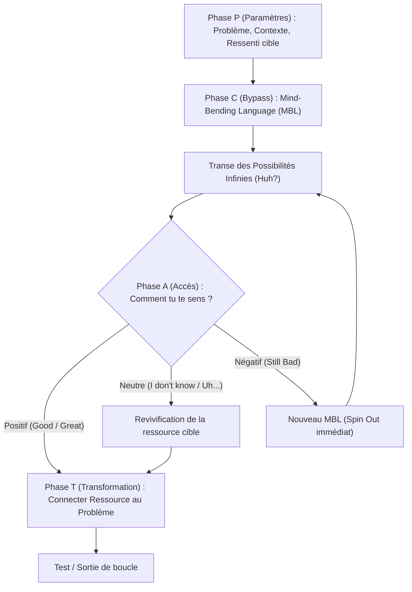

# Conversational Hypnosis Professional Hypnotherapy (CHPH 2.0) - Transcripts
**Formateur :** Igor Ledochowski | **ID :** `igor-ledochowski-conversational-hypnosis-professional-hypnotherapy-chph-20-transcripts` | **Tranches :** 57

## Synthèse Architecturale du Cours : Conversational Hypnosis Professional Hypnotherapy (CHPH 2.0)
*Formateur : Igor Ledochowski*

---

### 1. Thèse Centrale & Philosophie du Cours

#### Vision et Posture Spécifique
Igor Ledochowski opère une rupture nette avec l'hypnothérapie académique ritualisée et le mimétisme stylistique ericksonien de surface :
* **Dé-sacralisation et Démystification Opératoire** : L'état d'hypnose n'est ni un rituel ésotérique, ni une simple relaxation passive, ni un script figé. C’est un processus cybernétique naturel d'allocation et de canalisation attentionnelle (« *Where attention goes, energy flows* »).
* **La Primauté de l'Idée sur la Forme Linguistique** : L'hypnose conversationnelle ne découle pas d'une récitation par cœur de motifs linguistiques complexes (qui saturent inutilement le cortex préfrontal de l'opérateur), mais de l'incarnation somato-cognitive d'une intention claire. L'inconscient du praticien génère naturellement la syntaxe adaptée dès lors que l'idée directrice et l'état interne sont stabilisés.
* **Posture d'Incarnation (« As If ») & Écologie du Praticien** : L'opérateur adopte l'identité comportementale de la maîtrise totale alliée à une humilité fonctionnelle, tout en maintenant une frontière neurologique stricte entre résonance empathique et contagion émotionnelle. L'erreur n'est pas une défaillance identitaire mais une donnée de calibration pure (*fail spectacularly*).

#### Fil Rouge Méthodologique
Toutes les interventions du cours reposent sur un modèle unifié en boucle fermée :
1. **Saturation ou contournement du facteur critique** (via micro-accords, rupture vestibulaire, sursaut limbique ou masquage conversationnel).
2. **Création d'un vide réceptif** (*receptive vacuum*) où l'esprit critique suspend son tri binaire (*Yes/No Room*).
3. **Canalisation de la réponse inconsciente** par la loi de l'association, l'utilisation immédiate des distracteurs et le pontage causal (*power words*).
4. **Sécurisation prophylactique et stabilisation homéostatique** (clauses contractuelles/boilerplates, approfondissement somatique en boucle).

---

### 2. Carte des Concepts & Leviers Émergents

```
                          ÉCOSYSTÈME OPÉRATOIRE CHPH 2.0
                                         │
        ┌────────────────────────────────┼────────────────────────────────┐
        ▼                                ▼                                ▼
[CADRAGE & POSTURE]             [MÉCANIQUE DU FACTEUR]           [DYNAMIQUE DE TRANSE]
- As If Frame                   - The Yes/No Room                - Loi de l'Association
- Primauté de l'Idée            - Compliance Testing             - Boilerplates (Inoculation)
- Droit à l'Erreur Étalonné     - Startle Reflex (Vestibulaire)  - Formule ABS (Absorb/Bypass/Set)
- Décontextualisation Culturelle- Masquage Conversationnel       - Utilisation des Distracteurs
```

* **Le Facteur Critique comme Chambre Binaire (*The Yes/No Room*)** : Modèle sélectif où le facteur critique filtre toute suggestion. Le travail hypnotique consiste à éteindre ou court-circuiter la *No Room* en amont plutôt qu'à tenter de vaincre une résistance frontale.
* **Le Test de Conformité Prémédité (*Compliance Testing*)** : Conditionnement progressif de micro-accords moteurs et attentionnels (retirer ses lunettes, s'asseoir, fixer un point) validant mécaniquement l'extinction du réflexe d'opposition avant même l'induction formelle.
* **Le Réflexe de Sursaut Somato-Vestibulaire (*Startle Reflex Induction*)** : Rupture d'équilibre infime à la base occipitale activant l'amygdale en quelques millisecondes, figeant temporairement le modèle de stabilité cortical et ouvrant une brèche réceptive immédiate.
* **La Formule ABS (Absorb, Bypass, Set)** : Méta-structure universelle :
  * *A (Absorb)* : Fixation et verrouillage de l'attention (saccades oculaires neutralisées, point de contact proprioceptif).
  * *B (Bypass)* : Désactivation momentanée du filtre critique (surprise, surcharge, rupture de pattern).
  * *S (Set)* : Encodage de la direction hypnotique ou de la suggestion thérapeutique.
* **Les Clauses Standards Hypnotiques (*Boilerplates*)** : Inoculations prophylactiques insérées comme des évidences administratives en début et fin de transe, recontextualisant par avance tout stimulus perturbateur (bruits, mouvements) en combustible d'approfondissement.
* **Le Seuil de Surcharge (*Edge of Competence*)** : Saturation délibérée de la mémoire de travail (7 ± 2 items) par la vitesse et le non-sens, contraignant l'hémisphère analytique à céder le contrôle au traitement inconscient génératif.
* **Les Connecteurs Neuro-Logiques (*Power Words*)** : Conjonctions de coordination et de causalité (*parce que, et, dès que, ce qui signifie*) servant de ponts syntaxiques forçant l'acceptation logique de la suggestion avant examen sémantique.
* **L'Ancre Sémantique Culturelle (*Compound Label*)** : Utilisation de vocables compresseurs (tel que *« Sleep »*) agissant non pas comme une description biologique mais comme un déclencheur pavlovien d'un ensemble de comportements d'abandon corporel et mental.

---

### 3. Tableau Récapitulatif des Techniques & Démonstrations

| Technique / Exercice | Objectif Opératoire | Déclencheur / Indication | Séquence Résumée |
|---|---|---|---|
| **Startle Reflex Induction (Induction par Sursaut Occipital)** | Court-circuiter instantanément le facteur critique via l'appareil vestibulaire et l'amygdale. | Sujet présentant une résistance analytique ; besoin d'une rupture rapide de pattern. | 1. Fixation oculaire stricte.<br>2. Établissement d'un contact proprioceptif doux (berceau occipital).<br>3. Micro-bascule soudaine de la tête vers l'avant (rupture d'équilibre).<br>4. Injonction verbale percutante (*« Sleep »*).<br>5. Enchaînement immédiat sur la stabilisation somatique. |
| **Micro-Compliance Stacking (Empilement de Conformité)** | Banaliser la soumission aux directives et basculer l'attention dans la *Yes Room*. | Phase pré-hypnotique / transition conversationnelle vers le formel. | 1. Demande d'un geste insignifiant (déplacement, posture, regard).<br>2. Validation verbale neutre.<br>3. Répétition de 2 à 3 micro-demandes successives sans enjeu perçu.<br>4. Enchaînement fluide vers la première consigne hypnotique. |
| **Deepening Cycle (Boucle d'Approfondissement Associatif)** | Stabiliser la transe naissante et contrer le réflexe de remontée homéostatique. | Juste après l'induction instantanée ou dès l'apparition des premiers signes de transe. | 1. Ancrage kinesthésique continu (pression rythmique épaule/poignet).<br>2. Couplage verbal de chaque expiration ou contact somatique avec l'idée d'approfondissement.<br>3. Utilisation des bruits ambiants comme amplificateurs.<br>4. Vérification du tonus postural (abandon sur l'opérateur). |
| **Drill de Surcharge à Haute Vitesse (Edge of Competence)** | Désamorcer le perfectionnisme analytique du praticien et libérer le flux génératif. | Praticien bloqué par la mémorisation de scripts ou la peur de faire des erreurs. | 1. Pointer rapidement des objets ou émettre des commandes à cadence forcée.<br>2. Associer des idées sans rapport logique par des conjonctions causales immédiates (*Power Words*).<br>3. Pousser jusqu'à rupture du contrôle conscient (*lose the plot*).<br>4. Laisser l'inconscient structurer le flux. |
| **Transe Squelette en 10 Secondes** | Exécuter la chaîne cybernétique minimale sans surcharge verbale ou stylistique. | Démonstration d'efficacité rapide ; dépouillement technique en milieu contraint. | 1. Micro-compliance motrice immédiate.<br>2. Injonction de fermeture/transe.<br>3. Formule d'approfondissement couplée à un processus physiologique naturel.<br>4. Suggestion/bénéfice succinct.<br>5. Réveil propre et vérification d'état. |
| **Protocole d'Inoculation Prophylactique (Boilerplates)** | Immuniser la séance contre les interruptions externes et les réactions parasites. | Début de travail formel ou conversationnel en environnement non insonorisé/incontrôlé. | 1. Poser en voix neutre la clause de réinterprétation des sons extérieurs comme invitations à approfondir.<br>2. Poser la clause de sécurité (capacité à réagir instantanément en cas d'urgence réelle).<br>3. Dérouler le travail thérapeutique sans interruption face aux aléas de la pièce. |

---

---

## 0. Sommaire Sémantique & Index des Lignes

- **Tranche 1 [Lignes 133-284]** : L'Induction d'Apprentissage par Effondrement de la Pression d'Objectif (Group Training Induc... — *Protocole :* L'Induction d'Apprentissage par Effondrement de la Pression d'Objectif (Group Training Induction) | *Mécanisme :* Le Priming Culturel et la Décontextualisation des Présupposés | *Verbatim :* Pattern 1 : Le Pré-cadrage d'Abandon Téléologique et Dissociation Passager/Conducteur
- **Tranche 2 [Lignes 286-408]** : Calibration de la Soumission Sensorimotrice (Compliance Testing) — *Protocole :* Calibration de la Soumission Sensorimotrice (Compliance Testing) | *Verbatim :* La Présupposition d'Identité & Double Lien de l'Apprentissage
- **Tranche 3 [Lignes 410-595]** : L'Induction Instantanée par Rupture d'Équilibre Cervicale (Debout ou Assis) — *Protocole :* L'Induction Instantanée par Rupture d'Équilibre Cervicale (Debout ou Assis) | *Mécanisme :* Le Déclenchement Somato-Sensoriel de l'Amygdale (Startle Reflex Induction) | *Verbatim :* L'Enchaînement Post-Induction et Couplage de Rééquilibrage
- **Tranche 4 [Lignes 597-720]** : Protocole d'Approfondissement par Ancrage et Boucle Associative (Deepening Cycle) — *Protocole :* Protocole d'Approfondissement par Ancrage et Boucle Associative (Deepening Cycle) | *Verbatim :* Double Lien d'Attachement et Résistance Paradoxale
- **Tranche 5 [Lignes 722-860]** : Le "10-Second Hypnotist" (La Transe Ultra-Courte en 5 Mouvements) — *Protocole :* Le "10-Second Hypnotist" (La Transe Ultra-Courte en 5 Mouvements) | *Verbatim :* Extrait 1 : Normalisation de la Confusion et Amnésie Anticipée
- **Tranche 6 [Lignes 862-1034]** : Global de Séquençage d'une Séance de Transe (Cycle Standard à 7 Étapes) — *Protocole :* Global de Séquençage d'une Séance de Transe (Cycle Standard à 7 Étapes) | *Mécanisme :* Les Clauses Standard Hypnotiques ("Boilerplates" / Inoculation prophylactique) | *Verbatim :* Démonstration du Boilerplate "Sounds Around You"
- **Tranche 7 [Lignes 1036-1153]** : A : La Sortie de Transe à Double Verrouillage (Double Dip Protocol) — *Protocole :* A : La Sortie de Transe à Double Verrouillage (Double Dip Protocol) | *Verbatim :* Le Déclencheur Post-Hypnotique pour Ré-induction
- **Tranche 8 [Lignes 1155-1286]** : Le Riffing des 21 Cycles (Drill du Blackjack) — *Protocole :* Le Riffing des 21 Cycles (Drill du Blackjack) | *Mécanisme :* Loi de l'Effet Composé (The Law of Compounding Effect) | *Verbatim :* La Bouée de Sauvetage Verbale (The Emergency Drift)
- **Tranche 9 [Lignes 1288-1414]** : Extraction Flash en 1 Minute & Hypnotic Blitz (Riffing) — *Protocole :* Extraction Flash en 1 Minute & Hypnotic Blitz (Riffing) | *Mécanisme :* La Règle du Miroir Négatif (The Negative Mirror) / Inversion Binaire Spontanée | *Verbatim :* Le Riffing d'Attente de Succès (The Expectation of Success Blitz)
- **Tranche 10 [Lignes 1416-1581]** : L'Ancrage de l'Attitude H+ par Transposition Affective — *Protocole :* L'Ancrage de l'Attitude H+ par Transposition Affective | *Mécanisme :* Le Regard Soutenu Déstabilisateur & Surcharge du Facteur Critique | *Verbatim :* s Verbatim & Patterns Linguistiques
- **Tranche 11 [Lignes 1583-1741]** : L'Exercice d'Installation et d'Émission du H+ (The H+ Circuit Loop) — *Protocole :* L'Exercice d'Installation et d'Émission du H+ (The H+ Circuit Loop) | *Mécanisme :* L'État Interne Précède le Signal Cognitivo-Linguistique (State-Driven Communication) | *Verbatim :* L'Induction Guidée du H+ (Extraction et Découplage de la Ressource)
- **Tranche 12 [Lignes 1743-1895]** : L'Induction par Revivification Conversationnelle (Méthode Quoi - Quand - Où) — *Protocole :* L'Induction par Revivification Conversationnelle (Méthode Quoi - Quand - Où) | *Mécanisme :* Le Contrat Émotionnel Inconscient et la Contagion Émotionnelle du Client | *Verbatim :* Le Cadre H+ et l'Attitude Thérapeutique Face à la Souffrance
- **Tranche 13 [Lignes 1897-2028]** : A : Induction par Revivification d'une Transe Antérieure (Trance Revivification & Hijack) — *Protocole :* A : Induction par Revivification d'une Transe Antérieure (Trance Revivification & Hijack) | *Mécanisme :* Revivification par glissement temporel (Past to Present Tense Shift)
- **Tranche 14 [Lignes 2030-2148]** : Démonstration : Dynamic Mental Imagery (DMI) – Exploration Symbolique et Résolution Autonome — *Protocole :* Démonstration : Dynamic Mental Imagery (DMI) – Exploration Symbolique et Résolution Autonome | *Mécanisme :* Le Test Caché de Coopération Inconsciente (Orienting Response as Hidden Test) | *Verbatim :* Le Test Caché de Réponse d'Orientation
- **Tranche 15 [Lignes 2150-2252]** : d'Immersion et de Transition vers le Lieu de Découverte (Niveau 2) — *Protocole :* d'Immersion et de Transition vers le Lieu de Découverte (Niveau 2) | *Verbatim :* Doute Épistémique et Dissociation Conscient/Inconscient
- **Tranche 16 [Lignes 2254-2384]** : Protocole d'Urgence de Neutralisation et Contention d'Abréaction Spontanée — *Protocole :* Protocole d'Urgence de Neutralisation et Contention d'Abréaction Spontanée | *Mécanisme :* Le Piège de l'Ancrage Kinesthésique Involontaire en Crise Émotionnelle | *Verbatim :* PÉPITE 1 : L'Ancrage Kinesthésique Présent contre l'Abréaction
- **Tranche 17 [Lignes 2386-2555]** : A : Guidage Symbolique au Niveau 5 de Réalité & Déblocage Attentionnel — *Protocole :* A : Guidage Symbolique au Niveau 5 de Réalité & Déblocage Attentionnel
- **Tranche 18 [Lignes 2557-2742]** : Gestion Immédiate d'une Abréaction (Désescalade et Recadrage de Puissance) — *Protocole :* Gestion Immédiate d'une Abréaction (Désescalade et Recadrage de Puissance) | *Mécanisme :* La Posture Duale « Poing d'Acier dans un Gant de Velours » (Steel Fist in a Velvet Glove) | *Verbatim :* La Sous-Communication de Sauvetage
- **Tranche 19 [Lignes 2744-2898]** : Protocole de Récupération de l'Accès Visuel (Résolution du "I Can't Visualize") — *Protocole :* Protocole de Récupération de l'Accès Visuel (Résolution du "I Can't Visualize") | *Verbatim :* Élicitation visuelle & Contournement de la rationalisation
- **Tranche 20 [Lignes 2900-3070]** : Le "NAS Warm-Up" (Amorçage du Non-Awareness Set en 4 Mouvements) — *Protocole :* Le "NAS Warm-Up" (Amorçage du Non-Awareness Set en 4 Mouvements) | *Mécanisme :* Le Postulat de l'Inconscient Bénin et Auto-Organisateur | *Verbatim :* La Dissociation et Capture d'Agencéité par le NAS
- **Tranche 21 [Lignes 3072-3172]** : d'Amplification d'un Phénomène Hypnotique Spontané (De l'Ordinaire à l'Anesthésie) — *Protocole :* d'Amplification d'un Phénomène Hypnotique Spontané (De l'Ordinaire à l'Anesthésie)
- **Tranche 22 [Lignes 3174-3300]** : Désamorçage de la peur et induction par contrôle partagé (Chunk Induction / Choice Pacing) — *Protocole :* Désamorçage de la peur et induction par contrôle partagé (Chunk Induction / Choice Pacing) | *Verbatim :* Désamorçage de la peur et bascule en transe fractionnée
- **Tranche 23 [Lignes 3302-3436]** : La Boucle Non-Awareness Set (NAS) – 4 Étapes Opératoires — *Protocole :* La Boucle Non-Awareness Set (NAS) – 4 Étapes Opératoires | *Verbatim :* Dé-volition & Asymétrie Somatique
- **Tranche 24 [Lignes 3438-3581]** : Le Cycle Complet du Non-Awareness Set (NAS) Minimaliste — *Protocole :* Le Cycle Complet du Non-Awareness Set (NAS) Minimaliste | *Verbatim :* Le Recadrage de l'Échec en Félicitation Dissociative
- **Tranche 25 [Lignes 3583-3720]** : A : L'Induction par Rupture d'Awareness & Dérivation Réflexe (NAS Minimaliste) — *Protocole :* A : L'Induction par Rupture d'Awareness & Dérivation Réflexe (NAS Minimaliste) | *Verbatim :* Extrait 1 : Greffage de suggestion sur réflexe oculaire
- **Tranche 26 [Lignes 3722-3904]** : Recadrage Conversationnel d'Anxiété en Focus Dirigé — *Protocole :* Recadrage Conversationnel d'Anxiété en Focus Dirigé | *Mécanisme :* Le Redirectionnement d'Attention via Recadrage de Symptôme (Symptom-to-Resource Focus Shift) | *Verbatim :* Extrait 1 : Recadrage de la Nervosité en Concentration Hyper-Focalisée
- **Tranche 27 [Lignes 3906-4066]** : Le Pivot de Rotation Mentale (« Finger Pointing Magic Moment ») — *Protocole :* Le Pivot de Rotation Mentale (« Finger Pointing Magic Moment ») | *Mécanisme :* Le « Magic Moment » comme Rupture de Cadre et Brèche Neurologique | *Verbatim :* Le Blitz Post-Démonstration (Re-cadrage de Capacité & Truismes en Chaîne)
- **Tranche 28 [Lignes 4068-4192]** : Extraction des Paramètres et Bornage du Problème (P de P-CAT) — *Protocole :* Extraction des Paramètres et Bornage du Problème (P de P-CAT) | *Mécanisme :* Le Modèle de Resourcing et la Bulle d'Enfermement | *Verbatim :* Le Double-Lien d'Évidence et l'Orientation Inéluctable du Choix
- **Tranche 29 [Lignes 4194-4325]** : Le Paramétrage Minimaliste du Problème ("The Parameter Extraction") — *Protocole :* Le Paramétrage Minimaliste du Problème ("The Parameter Extraction") | *Verbatim :* L'Élicitation Paramétrique et Interruption de Récit
- **Tranche 30 [Lignes 4327-4504]** : Protocole d'Intégration des 4 Piliers de Réalité (MBL Quadrant Drill) — *Protocole :* Protocole d'Intégration des 4 Piliers de Réalité (MBL Quadrant Drill) | *Verbatim :* La Chaîne des 4 Dimensions de la Réalité
- **Tranche 31 [Lignes 4506-4643]** : L'Interview MBL en Phase « P » (PCAT Formula) — *Protocole :* L'Interview MBL en Phase « P » (PCAT Formula) | *Verbatim :* La Transmutation de l'Intégration Nocturne (Fin de journée)
- **Tranche 32 [Lignes 4645-4756]** : La Boucle P-CAT Standard & Recyclage MBL (Cycles d'Overduff) — *Protocole :* La Boucle P-CAT Standard & Recyclage MBL (Cycles d'Overduff) | *Verbatim :* Pattern 1 : Le MBL Structurel Minimaliste (Content-Free Mind-Bending)
- **Tranche 33 [Lignes 4758-4893]** : A : La Matrice Minimaliste des Paramètres (30-60 Secondes) — *Protocole :* A : La Matrice Minimaliste des Paramètres (30-60 Secondes) | *Mécanisme :* Le rôle cybernétique des paramètres (Start Point / End Point) | *Verbatim :* La Mise en Demeure Téléologique (The Parameters Induction)
- **Tranche 34 [Lignes 4895-4985]** : La Boucle de Remplacement & Inoculation par Épreuves Croissantes (Test-Conditioning Loop) — *Protocole :* La Boucle de Remplacement & Inoculation par Épreuves Croissantes (Test-Conditioning Loop) | *Verbatim :* Déstabilisation par Présupposition Temporelle et Désynchronisation des Parties
- **Tranche 35 [Lignes 4987-5120]** : Le "Shakedown" du Changement (Test & Inoculation du Doute) — *Protocole :* Le "Shakedown" du Changement (Test & Inoculation du Doute) | *Mécanisme :* Inoculation Active du Doute & Appropriation de Responsabilité | *Verbatim :* Le Défi d'Inoculation par Scepticisme Provocateur
- **Tranche 36 [Lignes 5122-5265]** : Bouclage Attentionnel & Amplification Somatique — *Protocole :* Bouclage Attentionnel & Amplification Somatique | *Mécanisme :* Le Continuum de la Mémoire Hypnotique (Hypermnésie vs Revivification vs Régression) | *Verbatim :* Verbatim 1 : L'Embrayeur de Transe par le Non-Awareness Set
- **Tranche 37 [Lignes 5267-5436]** : Days of Wonder (DOW) Regression / Transformation par Anticipation de Joie — *Protocole :* Days of Wonder (DOW) Regression / Transformation par Anticipation de Joie | *Mécanisme :* Le pont affect-somatique et régression d'intensification par échelons | *Verbatim :* Utilisation des bruits et ancrage spatial de sécurité
- **Tranche 38 [Lignes 5438-5575]** : La Boucle de Reconditionnement Ennui-Excitation (Page 56 du Manuel) — *Protocole :* La Boucle de Reconditionnement Ennui-Excitation (Page 56 du Manuel) | *Mécanisme :* Remplacement d’état par surimpression neuro-affective (Memory Collapse & Overrun) | *Verbatim :* Le Levier d'Orientation et de Traversée Temporelle
- **Tranche 39 [Lignes 5577-5692]** : A : Phase Finale de Réintégration de la Régression Émotionnelle (Étape 10 - Finale) — *Protocole :* A : Phase Finale de Réintégration de la Régression Émotionnelle (Étape 10 - Finale) | *Verbatim :* La Réintégration Temporelle Totale (Lifespan Absorption)
- **Tranche 40 [Lignes 5694-5805]** : d'Amortissement Somatique et d'Installation de Sécurité Renforcée (Augmented Safety Setup) — *Protocole :* d'Amortissement Somatique et d'Installation de Sécurité Renforcée (Augmented Safety Setup) | *Verbatim :* L'installation de l'inévitabilité bienveillante par Mind-Bending Language
- **Tranche 41 [Lignes 5807-5952]** : Protocole : Cadrage Préalable de Sécurisation Thérapeutique (The Safe Container & Exit Frame) — *Protocole :* Protocole : Cadrage Préalable de Sécurisation Thérapeutique (The Safe Container & Exit Frame) | *Mécanisme :* L'Extinction de la Peur par Éradication des Deux Extrémités de la Boucle (Double-Ended Fear Loop Neutralization) | *Verbatim :* Verbatim : Ancrage de la Garantie de Sécurité Éthique
- **Tranche 42 [Lignes 5954-6124]** : La Régression Réparatrice en 9 Étapes (Structure Globale & Déroulement de la Tranche) — *Protocole :* La Régression Réparatrice en 9 Étapes (Structure Globale & Déroulement de la Tranche) | *Verbatim :* Le Pré-cadrage de Sécurité et Déclenchement Régressif
- **Tranche 43 [Lignes 6126-6283]** : La Phase Finale de la Total Reintegration Method (TRM) – Défilé du Panthéon & Réconciliation... — *Protocole :* La Phase Finale de la Total Reintegration Method (TRM) – Défilé du Panthéon & Réconciliation de l'Enfant | *Verbatim :* Décharge et libération des figures périphériques
- **Tranche 44 [Lignes 6285-6421]** : d'Aiguillage Intégré : Le « Ledochowski Protocol » (Total Reintegration Flow) — *Protocole :* d'Aiguillage Intégré : Le « Ledochowski Protocol » (Total Reintegration Flow) | *Verbatim :* Démonstration de Transition : Blitz vers Imagerie Dynamique
- **Tranche 45 [Lignes 6423-6548]** : La Réintégration Totale (Total Reintegration Method / Visual Squash Conversationnel) — *Protocole :* La Réintégration Totale (Total Reintegration Method / Visual Squash Conversationnel) | *Verbatim :* Bifurcation instantanée par pont affectif
- **Tranche 46 [Lignes 6550-6685]** : La Réintégration Totale (Visual Squash Ericksonien / Ledochowski) — *Protocole :* La Réintégration Totale (Visual Squash Ericksonien / Ledochowski) | *Verbatim :* Le Pré-cadrage de la Gestation Inconsciente
- **Tranche 47 [Lignes 6687-6842]** : A : Émergence Symbolique Conversationnelle et Induction Éclair — *Protocole :* A : Émergence Symbolique Conversationnelle et Induction Éclair | *Verbatim :* Le Set de Non-Conscience sur Métaphore Émergente
- **Tranche 48 [Lignes 6844-7023]** : d'Intégration de Parties par Catalepsie et Échange de Ressources (Parts Integration) — *Protocole :* d'Intégration de Parties par Catalepsie et Échange de Ressources (Parts Integration) | *Verbatim :* Élicitation conversationnelle de symbole
- **Tranche 49 [Lignes 7025-7168]** : Réintégration des Polarités avec Fusion Symbolique et Incarnation Somatique (Total Reintegra... — *Protocole :* Réintégration des Polarités avec Fusion Symbolique et Incarnation Somatique (Total Reintegration - Phase Finale) | *Verbatim :* Le Présupposé d'Utilité et la Captation de Persistance (Resource Elicitation)
- **Tranche 50 [Lignes 7170-7347]** : Désamorçage Éthique du Transfert Amoureux (Romantic Transference Deflection) — *Protocole :* Désamorçage Éthique du Transfert Amoureux (Romantic Transference Deflection) | *Mécanisme :* Le Moteur Émergent d'Action Pas-à-Pas (One-Step Feedback Loop) | *Verbatim :* Le Découpage de l'Action Minimaliste
- **Tranche 51 [Lignes 7349-7499]** : A : Traitement de l'Insomnie via Non-Awareness Set & Lévitation Idéomotrice — *Protocole :* A : Traitement de l'Insomnie via Non-Awareness Set & Lévitation Idéomotrice | *Verbatim :* Verbatim 1 : L'Aiguillage des Implications depuis le Phénomène vers la Guérison
- **Tranche 52 [Lignes 7501-7607]** : Généralisation du Changement par Cycles de Test Systématiques — *Protocole :* Généralisation du Changement par Cycles de Test Systématiques | *Verbatim :* Désamorçage Ludique et Posture H+
- **Tranche 53 [Lignes 7609-7736]** : Structuration de l'Ambiance et Autorité Hypnotique de la Salle d'Attente — *Protocole :* Structuration de l'Ambiance et Autorité Hypnotique de la Salle d'Attente | *Mécanisme :* Le Principe du Contexte Hypnotique Élargi (Pre-Hypnotic Context Engineering) | *Verbatim :* La Clause d'Inaccessibilité Consciente du Matériel Hypnotique
- **Tranche 54 [Lignes 7738-7868]** : Détection & Orientation Hors-Cadre en H+ (If in Doubt, Refer Out) — *Protocole :* Détection & Orientation Hors-Cadre en H+ (If in Doubt, Refer Out) | *Verbatim :* Le Recadrage Élégant d'Orientation Hors-Cadre (H+ Redirection)
- **Tranche 55 [Lignes 7870-8013]** : d'Accueil Téléphonique & Conversion Thérapeutique (The First Phone Call Protocol) — *Protocole :* d'Accueil Téléphonique & Conversion Thérapeutique (The First Phone Call Protocol) | *Verbatim :* Déviation d'Objection Tarifaire Immédiate
- **Tranche 56 [Lignes 8015-8143]** : Séquence d'Évaluation de Certification Pratique (Examen Tripartite en Binôme) — *Protocole :* Séquence d'Évaluation de Certification Pratique (Examen Tripartite en Binôme) | *Mécanisme :* Le Levier de Transposition Métaphorique de Valeur (Pricing Décorrélé du Temps) | *Verbatim :* Le Recadrage Métaphorique de la Valeur (Picasso Isomorphic Story)
- **Tranche 57 [Lignes 8145-8233]** : d'Induction Pré-Examen / Déblocage Client (« The Show-Up Stance ») — *Protocole :* d'Induction Pré-Examen / Déblocage Client (« The Show-Up Stance ») | *Verbatim :* Déplacement de l'identité et désamorçage de l'ego

---

## Extractions Détaillées par Tranche (Opératoire & Verbatim)

## Tranche 1 / 57 : L'Induction d'Apprentissage par Effondrement de la Pression d'Objectif (Group Training Induc...

### 1. Mécanismes & Principes Actifs

*   **Le Priming Culturel et la Décontextualisation des Présupposés**
    *   *Principe actif* : En passant en revue chaque nationalité et en valorisant explicitement le choc culturel (*culture clash*), le formateur désactive le réflexe cognitif d'assimilation et d'inférence automatique. Pour le système nerveux, cela force l'attention à revenir sur le canal sensoriel brut plutôt que sur la projection de cartes mentales préconçues. En thérapie, présumer de l'expérience d'un sujet verrouille l'émergence de la solution ; briser les présupposés en amont rétablit la calibration pure.
    *   *Tags* : `#culture_clash` `#depatterning_assumptions` `#clean_calibration`

*   **La Primauté de l'Idée sur la Forme Linguistique**
    *   *Principe actif* : L'hypnose conversationnelle échoue lorsque l'opérateur surcharge son cortex préfrontal avec la syntaxe exacte des structures de langage éricksoniennes. Ledochowski pose que le vecteur hypnotique fondamental est la transmission téléologique d'un concept ou d'un état interne (l'intention somatique/mentale). Quand l'idée est claire pour l'inconscient du praticien, les patterns linguistiques s'organisent spontanément en boucle de rétroaction avec le sujet.
    *   *Tags* : `#idea_primacy` `#meaning_over_mechanics` `#hypnotic_intention`

*   **Le Recadrage de l'Erreur en Étalonnage Somato-Cognitif**
    *   *Principe actif* : La peur de l'échec active la réponse d'inhibition comportementale (système de menace amygdalien), ce qui fige la flexibilité relationnelle indispensable à l'hypnose. En recadrant l'apprentissage : *"Practice makes permanent. Correct practice makes perfect"* et en imposant l'obligation de *"fail spectacularly"*, il neutralise le censeur interne. L'erreur n'est plus une faute identitaire, mais une donnée de calibration indiquant les limites du système.
    *   *Tags* : `#failure_reframing` `#permission_to_fail` `#downregulating_threat_response`

*   **La Distinction Complexité vs. Sophistication (Gestion de la Charge Cognitive)**
    *   *Principe actif* : La mémoire de travail humaine est saturée au-delà de 4 à 7 éléments simultanés (loi de Miller). En définissant la tâche comme "sophistiquée" (un agrégat d'actes unitaires ultra-simples) plutôt que "complexe" (inintelligible), le formateur prévient la sidération de l'exécutant. L'analogie de la conduite automobile ancre la dissociation temporelle : l'incompétence consciente actuelle est la fondation directe de la compétence inconsciente future.
    *   *Tags* : `#cognitive_load_chunking` `#sophistication_vs_complexity` `#unconscious_competence_scaffolding`

*   **L'Induction de Confusion Anticipée et Prescription du Flou Référentiel**
    *   *Principe actif* : Prévenir explicitement les apprenants qu'ils vont *"avoir du mal à saisir ce qui est réel, où ils sont et qui ils sont"* constitue une suggestion post-hypnotique préventive d'amnésie et de transe d'apprentissage. En légitimant l'état de confusion avant qu'il ne survienne, le réflexe de panique ou d'analyse critique est court-circuité : quand la confusion survient, le cerveau l'interprète comme la preuve qu'il progresse correctement.
    *   *Tags* : `#preemptive_confusion` `#depersonalization_reframing` `#trance_safeguard`

*   **Le Transfert de Responsabilité et Écologie du Praticien (Anti-Régression)**
    *   *Principe actif* : En interdisant explicitement la posture de "thérapie de groupe" et en exigeant que chaque participant gère sa propre réactivité émotionnelle, Ledochowski ancre une barrière neurologique entre l'empathie résonante et la contagion émotionnelle. Un hypnothérapeute incapable de stabiliser son propre système nerveux autonome face au matériel du client projette sa névrose dans le champ thérapeutique.
    *   *Tags* : `#state_containment` `#boundary_setting` `#practitioner_autonomy`

*   **La Régression Fonctionnelle Sécurisée par Métaphore Isomorphe (Le Voyage en Voiture)**
    *   *Principe actif* : La métaphore des parents conduisant la voiture pendant que l'enfant somnole à l'arrière installe un état de transe d'abandon confiant sans résistance critique. Elle désactive le besoin de contrôle du néocortex ("Où va-t-on ?") en activant les schémas neuronaux précoces d'attachement sécurisé. Le praticien prend le volant macroscopique, laissant l'inconscient du sujet disponible pour le travail d'intégration.
    *   *Tags* : `#isomorphic_metaphor` `#parental_car_trance` `#critical_factor_bypass`

*   **Le Découplage de la Tension Téléologique (The Questions Wall)**
    *   *Principe actif* : L'urgence d'avoir "la réponse immédiate" maintient le cerveau en ondes bêta à haute fréquence, verrouillant la pensée divergente. Extérioriser la question sur un post-it physique dépose la charge mnésique de travail (effet Zeigarnik contrôlé), permettant au système nerveux d'incuber sans anxiété et de laisser l'apprentissage inconscient s'opérer par assimilation latente.
    *   *Tags* : `#zeigarnik_offloading` `#delayed_resolution` `#incubation_frame`

*   **L'Incarnation Somatique de Rôle (Effet Stanford / "Act As If" Somatosensoriel)**
    *   *Principe actif* : L'expérience de la prison de Stanford démontre la plasticité neurobiologique de l'identité face au costume et au rôle. En faisant adopter immédiatement la posture, la respiration et la prosodie du "meilleur hypnotiseur du monde", Ledochowski bypass le sentiment d'imposture par rétroaction proprioceptive ascendante (*bottom-up processing* : le corps signale la maîtrise au cerveau, qui adapte instantanément l'état émotionnel).
    *   *Tags* : `#somatic_role_assumption` `#stanford_effect_harnessing` `#proprioceptive_identity_shift`

*   **La Saturation Temporelle Sociale (Exercice des 8 Minutes pour 160 Personnes)**
    *   *Principe actif* : Imposer de rencontrer 160 personnes en 8 minutes crée une impossibilité logico-arithmétique totale. Cette surcharge d'urgence désintègre le protocole social conventionnel (politesse laborieuse, hésitations, bavardage analytique). Le sujet n'a plus le temps de réfléchir ni de douter : il est contraint d'adopter l'état pur d'impact relationnel instantané.
    *   *Tags* : `#temporal_overload` `#social_pattern_break` `#direct_unconscious_meeting`

---

### 2. Protocoles, Techniques & Démonstrations (Étape par Étape)

#### Protocole 1 : L'Induction d'Apprentissage par Effondrement de la Pression d'Objectif (Group Training Induction)
*   **Intention / Indication** :
    *   À utiliser au démarrage d'une formation immersive, d'un cycle de thérapie complexe ou avant un apprentissage lourd.
    *   Permet d'évacuer l'anxiété de performance, de contourner le facteur critique et d'installer un cadre de transe d'intégration inconsciente.
*   **Mise en place & Pré-framing** :
    *   Poste les participants dans une position d'écoute passive mais engagée.
    *   Pré-cadre : Toute tentative de savoir à l'avance où l'on va limite le résultat final à ce que le mental conscient connaît déjà.
*   **Séquence d'actions pas à pas** :
    1.  *Destitution de l'objectif conscient* : Demander d'abandonner l'attente ou le résultat espéré à la fin du processus pour permettre l'émergence d'un état supérieur imprévu.
    2.  *Régression à la transe du passager* : Guider l'attention vers un souvenir/concept de passager protégé (l'enfant sur la banquette arrière pendant que les parents conduisent vers les vacances).
    3.  *Prescription du mono-focus séquentiel* : Verrouiller l'attention sur une seule micro-action à la fois (*"The only thing you need to be aware of is what is your next step"*).
    4.  *Validation de l'amnésie post-exercice* : Suggérer directement que revenir d'un exercice sans se souvenir de ce qui a été dit ou fait est la preuve formelle d'une transe d'apprentissage réussie.
    5.  *Normalisation de la faillibilité par l'isomorphisme de la découverte* : Délivrer les récits métaphoriques du bébé qui tombe pour apprendre à marcher et de Fleming découvrant la pénicilline par une "terrible erreur".
    6.  *Prescription du rôle d'identité supérieure* : Utiliser le mécanisme de l'effet de rôle de Stanford pour inviter le système à jouer l'identité de l'expert jusqu'à en oublier la simulation.
*   **Signes de calibration** :
    *   Ralentissement respiratoire global de la salle.
    *   Fixité du regard ou paupières lourdes chez les auditeurs.
    *   Diminution drastique des mouvements parasites d'ajustement postural (catalepsie spontanée de groupe).
    *   Disparition des prises de notes frénétiques : bascule de l'intellectualisation vers l'absorption somatique.

#### Protocole 2 : Le Sprint d'Incarnation Identitaire Instantanée (The 8-Minute World's Greatest Hypnotist)
*   **Intention / Indication** :
    *   Briser l'inhibition sociale, détruire le syndrome de l'imposteur au seuil d'une pratique, créer une cohésion de groupe instantanée par immersion dans l'archétype de compétence.
*   **Mise en place & Pré-framing** :
    *   Faire lever la salle immédiatement par surprise (*pattern break* corporel).
    *   Cadrage du paradoxe de la maîtrise : *"Seuls les plus grands maîtres savent qu'ils ont toujours tout à apprendre ; les petits esprits pensent déjà tout savoir"*. Ce cadrage permet d'assumer l'identité de "meilleur hypnotiseur du monde" sans verser dans l'arrogance défensive.
*   **Séquence d'actions pas à pas** :
    1.  *Mise en tension spatiale et temporelle* : Donner la consigne impossible de rencontrer les 160 participants en exactement 7 à 8 minutes.
    2.  *Activation du modèle interne somatosensoriel* : Poser les questions de calibration interne : *"How would I meet someone if I was the most amazing hypnotist in the world? Would it be full of confidence? Would it be full of humility? How do you breathe?"*
    3.  *Action d'engagement social* : Serrer la main, se présenter avec fierté sous son nom comme le plus grand hypnotiseur du monde.
    4.  *Boucle d'humilité et d'apprentissage* : Révéler immédiatement à l'autre la chose précise que l'on est venu apprendre durant cette semaine pour poursuivre son chemin d'excellence.
    5.  *Rupture de contact rapide* : Passer au suivant sans s'attarder, imposé par la contrainte de la montre.
*   **Signes de calibration** :
    *   Élévation massive de l'énergie et du volume sonore de la pièce.
    *   Modification des postures : épaules rejetées en arrière, port de tête haut, ancrage plantaire plus net lors des poignées de main.
    *   Sourires authentiques (activation des muscles orbiculaires) et contact visuel direct soutenu sans dérobade.
    *   Fluidité des transitions entre participants (disparition de la rigidité sociale habituelle).

---

### 3. Heuristiques, Subtilités & "Sagesse du Praticien"

*   **Heuristique de Choix Linguistique vs. Conceptuel** :
    *   *Règle* : *"Si tu dois choisir entre la complexité syntaxique du langage hypnotique et l'idée/sens que tu cherches à communiquer -> choisis TOUJOURS l'idée."*
    *   *Raison d'être* : L'hypnose n'est pas un exercice de récitation d'incantations. Si l'opérateur perd le fil de l'intention et de l'état qu'il induit parce qu'il cherche à formuler un truisme ou un double lien parfait, le rapport s'effondre et le sujet perçoit l'artifice.

*   **Heuristique de Traitement de l'Erreur en Temps Réel** :
    *   *Règle* : *"Ce qui détermine le maître n'est jamais le fait de faire ou non une erreur, mais ce qu'il fait dans la milliseconde qui suit la prise de conscience de l'erreur."*
    *   *Raison d'être* : Une erreur n'est une rupture que si le praticien marque une hésitation, se contracte somatiquement ou s'excuse. Si l'erreur est intégrée avec un aplomb total dans la transe (*utilisation principle* ericksonien), elle devient une manœuvre délibérée aux yeux du sujet.

*   **Heuristique de Surcharge Cognitive en Exercice** :
    *   *Règle* : *"Si tu te sens dépassé ou que l'exercice te semble trop complexe -> arrête d'en faire trop, réduis le focus à la seule et unique étape suivante (Next Step Only)."*
    *   *Raison d'être* : Vouloir anticiper la fin d'un protocole hypnotique pendant qu'on pose l'induction crée une interférence frontale. La seule responsabilité du praticien à un instant $T$ est de déclencher le pas suivant. La fin émerge de la dynamique cumulative des micro-étapes.

*   **Heuristique d'Amnésie et de Clarté Post-Transe** :
    *   *Règle* : *"Si un étudiant ou un sujet sort d'un travail hypnotique en affirmant 'Je n'ai rien compris, j'ai tout oublié, j'ai l'impression d'avoir tout raté' -> valide immédiatement cet état comme le signe absolu d'un apprentissage profond réussi."*
    *   *Raison d'être* : L'esprit conscient aime avoir l'illusion du contrôle et du souvenir linéaire. Le blanc mnésique prouve que le système critique a été court-circuité et que l'encodage s'est fait au niveau de la structure profonde (inconsciente).

*   **Heuristique de Décontamination Émotionnelle (Autonomie)** :
    *   *Règle* : *"Si le problème d'un client active ta propre réactivité névrotique interne en séance -> ne t'effondre pas, n'attends pas d'aide extérieure : contiens l'état, remets-le dans un espace de sécurité inconscient et reste un canal opératoire pour le sujet."*
    *   *Raison d'être* : Le setting clinique exige une neutralité et un ancrage inébranlables. Utiliser la transe du client pour ventiler ses propres traumas détruit le cadre de sécurité et contamine le champ hypnotique.

*   **Postulats Philosophiques d'Igor Ledochowski** :
    *   L'apprentissage profond exige une phase de confusion aiguë et de désorientation identitaire temporaire.
    *   On n'apprend pas à marcher en intellectualisant la posture : on apprend en tombant et en intégrant le feedback du sol.
    *   La transe n'est pas un phénomène artificiel de laboratoire : c'est un mécanisme d'immersion biologique spontané, activé dès qu'on s'abandonne à un rôle ou à une histoire.

---

### 4. Pépites Verbatim & Patterns Linguistiques (MOT À MOT EN V.O.)

#### Pattern 1 : Le Pré-cadrage d'Abandon Téléologique et Dissociation Passager/Conducteur
> *"And I would encourage you, whatever it is you're thinking will be the outcome at the end of this week, that you allow that to be put to one side, even forget about it. Because if you do, the chances of you reaching an even better place than the one you've currently got in mind are much higher. In fact, in the kind of journey that we'll be taking here, the less you know about where you're going or what you're doing, the better it'll be for you. It's like one of those trips you take as a child, where you know you're safe in mom's and dad's car, they're just driving."*
*   **[Analyse du Pattern]** :
    *   **Double lien d'efficacité inconsciente** : La suggestion lie la perte de contrôle conscient (*the less you know*) à l'optimisation du résultat (*the better it'll be*).
    *   **Présupposition temporelle et spatiale** : L'utilisation de *"an even better place than the one you've currently got in mind"* présuppose de façon indiscutable que l'auditeur atteindra un état d'excellence, éliminant l'hypothèse de l'échec.
    *   **Régression métaphorique sécurisée** : L'évocation sensorielle de la voiture parentale active par résonance somatique l'archétype de la passivité vigilante et sécurisée de l'enfance, court-circuitant le besoin d'hyper-vigilance adulte.

#### Pattern 2 : L'Éloge et la Normalisation de l'Amnésie Structurante
> *"This means you do not need to know what just occurred. Your memory can be a blank. You can do an exercise, return from it, and have no idea what it is you did or said or even experienced. And if that should happen to you, you can sit down in your chair comfortably and realize you're in the right place."*
*   **[Analyse du Pattern]** :
    *   **Suppression de contrainte (Modal Operators of Absence of Necessity)** : *"You do not need to know"* libère le néocortex de son obligation de surveillance mnésique.
    *   **Semis d'amnésie hypnotique (Seeding Amnesia)** : *"Your memory can be a blank"* injecte directement l'instruction d'effacement post-hypnotique sous forme de simple possibilité permissive.
    *   **Ancrage somato-sémantique d'une transe réussie** : Lier le fait d'être amnésique ou désorienté au fait de *"sit down in your chair comfortably and realize you're in the right place"* transforme ce qui serait normalement perçu comme un symptôme d'échec ou d'angoisse en un ancrage kinesthésique de confort et de succès.

#### Pattern 3 : La Métaphore Éricksonienne de l'Apprentissage Invisible (Le Bébé et la Marche)
> *"And isn't that the way that learning occurs most naturally? A little child sees mommy and daddy standing so tall. How do they do it? There's motivation. I want to stand just like them. The little child stands and it falls. No one tells it how it stands, where to place its hips or its knees. What angle to tilt the spine, whether to hold on to something or balance. No one criticizes or complains or corrects. And the child really doesn't even care how long it's standing. It stands, falls, stands, falls. And sometimes the falling is more throwing themselves down just for the pleasure of getting down there."*
*   **[Analyse du Pattern]** :
    *   **Question rhétorique avec présupposition intégrée** : *"And isn't that the way that learning occurs most naturally?"* contraint le système cognitif à acquiescer sans pouvoir formuler d'objection sans nier l'évidence de la nature.
    *   **Démantèlement de l'intellectualisation par empilement de négations somatiques** : L'énumération détaillée des composantes biomécaniques (*"hips, knees, angle to tilt the spine"*) montre l'absurdité du contrôle conscient face à une compétence neuromusculaire complexe.
    *   **Recadrage hédonique de l'échec** : Transformer la chute en *"throwing themselves down just for the pleasure of getting down there"* déprogramme la valence négative (douleur/honte) de l'erreur pour la relier au circuit dopaminergique du jeu pur.

#### Pattern 4 : L'Injonction Temporelle Paradoxale de la Maîtrise Déjà Présente
> *"And you can all think of what a great hypnotist would sound like, can you not? You can all think of what a great hypnotist would look like, can you not? Could you imagine the expression on your face in some time in the future? When you've exceeded your own expectations, how you breathe, and most important of all, how you treat others. Because if you can imagine it long enough to forget that you've been making it up, then your whole makeup changes."*
*   **[Analyse du Pattern]** :
    *   **Empilement de tags de validation incontournables (Tag Questions)** : L'alternance répétée de *"can you not?"* force l'accès visuel et auditif interne. Le sujet est dans l'obligation cognitive de construire la représentation sensorielle pour simplement comprendre la phrase.
    *   **Pont vers le futur et distorsion temporelle** : L'expression *"in some time in the future... when you've exceeded your own expectations"* installe le postulat incontournable que le sujet va non seulement réussir, mais dépasser ses propres capacités d'évaluation.
    *   **Boucle de rétroaction prophétique** : La formule *"forget that you've been making it up, then your whole makeup changes"* utilise un jeu de mot phonétique et sémantique (*making it up* / *makeup*) pour sceller la transition entre la simulation consciente et la cristallisation neurologique d'une nouvelle identité.

#### Pattern 5 : La Commande Enchâssée d'Identité Présente par Rupture Temporelle
> *"Go ahead and meet everyone now as the hypnotist that you already are."*
*   **[Analyse du Pattern]** :
    *   **Commande cachée d'action immédiate** : *"Go ahead and meet everyone now"* active la sortie du mode passif et lance le mouvement kinesthésique.
    *   **Présupposition existentielle majeure** : *"as the hypnotist that you already are"*. Le mot critique est *"already"* (déjà). La structure ne propose pas d'essayer de *devenir* un hypnotiseur par l'effort : elle affirme que l'identité est déjà présente, fonctionnelle et disponible sous les couches d'inhibition consciente, exigeant simplement d'agir depuis cet état d'être.

## Tranche 2 / 57 : Calibration de la Soumission Sensorimotrice (Compliance Testing)

### 1. Mécanismes & Principes Actifs

- **Pré-supposition d'Identité & Modélisation par Incarnation ("As If")**
  * *Principe actif :* En demandant au praticien d'agir non pas comme un élève qui apprend, mais comme *"the world's greatest hypnotist"*, le formateur bypass le doute cognitif lié à l'incompétence consciente. Le système nerveux réorganise immédiatement le tonus postural, la prosodie et le champ perceptif en adoptant les sous-modalités internes de la maîtrise. L'adjonction de l'humilité empêche la rigidité de l'ego et maintient le système ouvert à l'acquisition de patterns.
  * *Tags :* #as_if_frame #identity_presupposition #humble_mastery #somatic_modeling

- **Le Facteur Critique comme Chambre Binaire ("The Yes/No Room")**
  * *Principe actif :* Modèle fonctionnel opérationnel définissant le facteur critique non comme une entité statique, mais comme une porte de tri sélectif : la *"No Room"* (rejet, analyse, blocage) vs la *"Yes Room"* (perméabilité, acceptation, transe). L'hypnose ne consiste pas à briser la résistance, mais à court-circuiter ou éteindre l'activité de la *"No Room"* avant même que le travail formel ne commence.
  * *Tags :* #critical_factor #yes_no_room #resistance_bypass #cognitive_gatekeeping

- **Test de Soumission Progressif ("Compliance Testing") & Hypnose Préméditée**
  * *Principe actif :* L'induction réussie est le résultat d'un conditionnement préalable de micro-accords moteurs. Demander un geste insignifiant (se déplacer, regarder les yeux, retirer ses lunettes) valide l'extinction du facteur critique. Chaque validation mécanique abaisse le seuil de réactivité analytique. Le principe directeur est d'installer l'état hypnotique dans la physiologie avant même que le sujet ne réalise qu'une induction a commencé.
  * *Tags :* #compliance_testing #covert_setup #micro_agreements #pre_induction_pacing

- **Absorption et Fixation Oculaire ("Arresting Attention")**
  * *Principe actif :* Le nerf optique étant la projection anatomique directe du cerveau vers l'extérieur, verrouiller le regard du sujet sur les yeux de l'opérateur bloque les saccades exploratoires visuelles ordinaires. Ce verrouillage focalise l'attention consciente et inconsciente, sature le canal d'entrée sensoriel et induit spontanément un début de synchronisation neurale (rapport hypnotique).
  * *Tags :* #arresting_attention #optic_nerve_lock #saccadic_stillness #eye_fixation

- **Invasion Somatosensorielle Sécurisante (Ancrage Kinesthésique & Cradling)**
  * *Principe actif :* Poser une main sur l'épaule ou bercer la base occipitale (*cradling the neck*) force l'amygdale à focaliser toute sa bande passante sur le point de contact physique. Dès lors que ce contact n'est pas interprété comme une agression (cadre bienveillant), il produit un sentiment de dépendance et d'abandon postural direct envers l'opérateur.
  * *Tags :* #proprioceptive_touch #neck_cradling #tactile_monopolization #somatic_anchoring

- **Rupture de Pattern Vestibulaire & Réflexe de Sursaut ("The Startle Reflex")**
  * *Principe actif :* Une pression ultra-légère d'un seul doigt sur l'occiput fait basculer le centre de gravité de la tête. Ce micro-déséquilibre perturbe immédiatement le système vestibulaire et déclenche un sursaut (*startle reflex* via l'amygdale). Dans cette fenêtre de 100 à 500 millisecondes, le cortex cérébral perd son modèle de stabilité : la *"No Room"* est suspendue, créant un vide cognitif critique (*receptive vacuum*) prêt à recevoir une commande verbale directe.
  * *Tags :* #startle_reflex #vestibular_interrupt #amygdala_trigger #micro_drop #receptive_vacuum

- **L'Ancre Sémantique Culturelle ("Sleep" comme Mot-Composé)**
  * *Principe actif :* Le mot *"Sleep"* ne fonctionne pas comme une description biologique du sommeil, mais comme un conteneur compressé de conditionnements socioculturels occidentaux. Il déclenche instantanément l'attente collective de relâchement musculaire total, de déconnexion volontaire et d'obéissance somatique immédiate.
  * *Tags :* #semantic_trigger #cultural_conditioning #compound_suggestion #sleep_command

---

### 2. Protocoles, Techniques & Démonstrations (Étape par Étape)

#### Protocole 1 : Calibration de la Soumission Sensorimotrice (Compliance Testing)
* **Intention / Indication :** Évaluer l'ouverture du facteur critique et la disponibilité neurologique du sujet avant toute tentative d'induction formelle ou rapide.
* **Mise en place & Pré-framing :** Cadrer l'exercice comme une simple prise de contact ou une vérification logistique sans enjeu.
* **Séquence d'actions pas à pas :**
  1. *Demande d'accord de principe :* *"Would you like to do some hypnosis?"* (Écouter la latence verbale et le ton de voix).
  2. *Ordre spatial simple :* *"Would you come over here for me, please?"* ou *"Stand right here"*.
  3. *Évaluation de la trajectoire :* Observer si le sujet bouge de façon fluide et immédiate, ou s'il hésite, questionne ou raidit sa démarche.
  4. *Validation / Bifurcation :* Si la compliance est totale, enchaîner sur la fixation d'attention. Si une hésitation apparaît, suspendre l'action et recadrer/rassurer immédiatement (voir Heuristiques).
* **Signes de calibration :** Absence de micro-tensions musculaires faciales, absence de recul du buste, pas de questionnement cognitif ("Pourquoi là ?"), démarche naturelle et décontractée.

#### Protocole 2 : Fixation & Absorption de l'Attention (Arresting Attention via Eye Contact)
* **Intention / Indication :** Réunir l'attention consciente et inconsciente dispersée et amorcer le rapport hypnotique.
* **Mise en place & Pré-framing :** Après obtention de la compliance spatiale.
* **Séquence d'actions pas à pas :**
  1. *Invasion kinesthésique légère :* Poser une main sur l'épaule pour réorienter le focus somatique vers l'opérateur.
  2. *Commande de fixation oculaire :* *"Look at my eyes"*.
  3. *Verrouillage :* Maintenir le regard sans ciller de manière stable et neutre.
  4. *Observation des marqueurs de transe émergente :* Attendre la survenue d'un shift neurovégétatif avant d'envisager la rupture mécanique.
* **Signes de calibration :**
  - Dilatation pupillaire (*pupil dilation*).
  - Ralentissement et approfondissement du rythme respiratoire.
  - Altération du clignement des paupières (accélération, ralentissement marqué ou fixation immobile).
  - Micro-saccades oculaires (*saccadic eye movement*, balayage gauche-droite d'un œil à l'autre sans quitter le visage).
  - Regard vitreux ou sensation subjective partagée d'aspiration mutuelle (*hypnotic rapport*).

#### Protocole 3 : Induction Instantanée par Rupture de Balance Occipitale (The Finger Drop & Startle Induction)
* **Intention / Indication :** Bascule instantanée du sujet debout ou assis dans un état de transe somnambulique profonde en moins de 3 secondes.
* **Mise en place & Sécurisation de l'Environnement :**
  - Retirer impérativement les lunettes du sujet : *"Can I borrow your glasses a second?"* et les déposer en lieu sûr verbalisé.
  - Positionner sa posture corporelle : placer une jambe en retrait (*brace stance*) alignée avec l'épaule de réception pour encaisser le poids du sujet sans faiblir.
  - Si le sujet est disproportionnellement grand ou lourd : le faire asseoir immédiatement sur une chaise.
* **Séquence d'actions pas à pas :**
  1. *Test de compliance secret :* Retirer les lunettes et vérifier l'abandon sans résistance.
  2. *Verrouillage de l'attention :* *"Look at me"* (attendre la dilatation pupillaire ou le regard fixe).
  3. *Prise occipitale (Cradling) :* Placer la main non dominante derrière la nuque, entre la base du crâne et le cou, soutenant le point d'équilibre sans exercer de traction.
  4. *Déclencheur Startle (1 doigt) :* Avec un seul doigt de la main occipitale, imprimer une pichenette ou une légère impulsion vers l'avant sur le haut de la nuque/base du crâne pour provoquer un micro-décrochage vestibulaire.
  5. *Guidage somatique :* Ne JAMAIS tirer violemment ; accompagner avec la paume le mouvement de chute naturelle vers l'avant. Guider expressément le **front** (et jamais le nez) du sujet pour qu'il vienne reposer contre son épaule.
  6. *Commande verbale de décharge :* Au moment précis de l'impact frontal et du décrochage : délivrer fermement la commande : *"And SLEEP... all the way down"*.
  7. *Approfondissement immédiat :* Enchaîner sur un balancement ou un retour à l'équilibre autonome : *"Put you back on your own balance, going deeper into trance"*.
* **Signes de calibration :** Atonie musculaire soudaine du cou et des épaules, affaissement du tronc, expiration profonde et réflexe, paupières closes, absence de réflexe de retenue motrice.

---

### 3. Heuristiques, Subtilités & "Sagesse du Praticien"

- **Règle d'or de l'anticipation :** *"The most important thing you will ever do in hypnosis is your setup. It's anything you do before anyone realizes that hypnosis has begun."* Le travail réel est terminé au moment où l'induction technique démarre.
- **Règle de l'hésitation :** *Si le sujet hésite ou présente une micro-tension lors d'une consigne -> ALORS ne jamais forcer ni continuer l'induction -> PARCE QUE cela indique que la "No Room" (facteur critique) vient de se réactiver.*
- **Gestion de la résistance par la diversion et l'humour :**
  - *Si le sujet bloque sur une consigne (ex: peur de confier ses lunettes ou peur du contrôle) -> ALORS utiliser un recadrage rassurant ou un éclat d'humour décalé (ex: "De toute façon, dans quelques instants tu n'y verras plus rien...") -> PARCE QUE le rire et l'absurde font exploser l'anxiété corticale et désamorcent instantanément le facteur critique sans confrontation.*
- **Heuristique de la masse corporelle :**
  - *Si le sujet est plus grand, plus lourd ou plus musclé que le praticien -> ALORS soit verrouiller sa jambe d'appui en fente arrière, soit asseoir d'office le sujet sur une chaise -> PARCE QUE la gravité n'est pas négociable et qu'un praticien déséquilibré perd le contrôle du cadre de sécurité.*
- **Principe de guidance vs force :** *"The word is guide. Don't yank, don't pull, don't rip. Guide."* La transe somatique n'est pas le résultat d'une prise de force physique (ce qui causerait blessures et poursuites judiciaires), mais de l'accompagnement fluide d'un réflexe neuro-musculaire déclenché par un geste minimaliste.
- **Le test de compliance déguisé des lunettes :** Demander de donner ses lunettes remplit trois fonctions simultanées : sécuriser physiquement le choc sur l'épaule, priver le sujet d'une partie de ses repères sensoriels de contrôle, et tester le niveau de lâcher-prise le plus intime (confier sa vision à autrui).

---

### 4. Pépites Verbatim & Patterns Linguistiques (MOT À MOT EN V.O.)

#### Pépite 1 : La Présupposition d'Identité & Double Lien de l'Apprentissage
> "So you might as well ask yourself the question, how would I meet someone if I was the most amazing hypnotist in the world? Would it be full of confidence? Hello. Would it be the whole of humility? Hi. Would it be something else? I don't know. Only you can know how you would do that. Could you not? And then I want you to introduce yourself with pride as to what you are. The world's greatest hypnotist. And of course, only the great really know that no matter how much they know about a subject or field, there's always more to learn. You appreciate that, don't you? It's the little minds that think they know it all. So you may as well tell the other person one thing that you've come here to learn. To continue your path to greatness."
* **[Analyse du Pattern]** : 
  - *Double lien identitaire :* Que l'étudiant choisisse la confiance ou l'humilité, les deux branches du choix présupposent qu'il est déjà *"the most amazing hypnotist in the world"*.
  - *Tag questions & Truismes :* Utilisation de questions de liaison fermées (*"Could you not?", "don't you?"*) qui forcent l'assentiment interne.
  - *Recadrage d'ego / Pression sociale positive :* Associer le fait de ne pas tout savoir aux "grands esprits" et la prétention aux "petits esprits" (*"little minds"*), rendant l'attitude d'ouverture à l'apprentissage indispensable pour valider l'identité de maître hypnotiseur.

#### Pépite 2 : Déclenchement de l'Induction Instantanée et Approfondissement Corporel
> "Do you see how wonderful these people are? Very soon you won't see a single one of them. That's good. Turn this way. Look at me. Focus. Take a deep breath in. Breathe out. And sleep. All the way. That's right. Deeper. That's it. Good. Deeper, deeper. There you go. All the way. Doing a fantastic job. Deeper and deeper still. Now I want to thank you. I want to put you back on your own balance, going deeper into trance. That's it. Even more deeply there, Peter."
* **[Analyse du Pattern]** :
  - *Présupposition temporelle & Réduction sensorielle :* *"Very soon you won't see a single one of them"* pré-programme la fermeture des paupières et l'effacement du monde extérieur avant même l'induction.
  - *Empilement d'instructions physiologiques (Pacing/Leading) :* Enchaînement rapide *Focus -> Inhale -> Exhale -> Sleep*. L'injonction *"Sleep"* est délivrée sur l'expiration somatique, moment où le système parasympathique s'active naturellement.
  - *Ratification continue :* Utilisation de feedbacks en boucle (*"That's right", "That's it", "There you go"*) qui valident chaque micro-mouvement d'affaissement comme une preuve de transe réussie.
  - *Liaison action-profondeur :* *"put you back on your own balance, going deeper"* transforme le rétablissement physique de l'équilibre en un déclencheur direct d'approfondissement hypnotique.

#### Pépite 3 : Suggestion Post-Hypnotique de Recherche Inconsciente d'Apprentissage
> "So when I ask your unconscious mind to give you a gift, the gift of learning, that's it. In a moment you'll discover a wonderful sensation beginning inside. That's the beginning of your unconscious mind searching through all your memories of learning things naturally, easily, quickly. With passion and enthusiasm. Nod your head when you find that feeling. And it'll grow. That's right. All the way. Up through your chest, into your shoulders, arms, leg, head. Changing everything about you. Your whole thought process changing. Can you feel that happening? Because your unconscious mind is good at one thing above all others. Learning."
* **[Analyse du Pattern]** :
  - *Recadrage métaphorique :* Transformer la transe en un "cadeau" offert par l'inconscient, éliminant tout cadre de soumission ou de manipulation.
  - *Recherche transdérivationnelle orientée :* L'inconscient est sommé de scanner les archives mémorielles d'apprentissages passés naturels et faciles.
  - *Réponse idéomotrice comme pont somatique :* *"Nod your head when you find that feeling"* crée une confirmation kinesthésique externe qui ancre la réalité interne du processus.
  - *Amplification somatosensorielle en cascade :* La sensation est guidée spatialement à travers le corps (*chest -> shoulders -> arms -> leg -> head*), consolidant la transe par propagation kinesthésique.

#### Pépite 4 : Démystification et Recadrage de la Transe (Désamorçage de la Résistance)
> "So you realize when I say hypnosis, what I'm not talking about is mind control, I'm not going to ask for your secrets and things like that. In fact, what I'm talking about is that, you know you have had great days where everything seems to work out, and some part of you just knew what to do, and then there's other days where you seem to be blocked off like that door's shut. All I want to do is show you how to open that door. Would you be willing to try that? Come over here a second, would you?"
* **[Analyse du Pattern]** :
  - *Négation thérapeutique & Anticipation d'objection :* Énoncer explicitement ce que l'hypnose n'est pas (*"not mind control", "not ask for secrets"*) neutralise les peurs paranoïaques du facteur critique avant qu'elles ne soient formulées.
  - *Métaphore de l'état de flux vs blocage :* Établissement d'une dichotomie expérientielle universelle (jours de fluidité vs jours où la porte est fermée) à laquelle le sujet adhère obligatoirement.
  - *Commande d'action déguisée immédiate :* Le recadrage se termine par une question fermée d'adhésion (*"Would you be willing to try that?"*) immédiatement suivie d'un test moteur de compliance (*"Come over here a second, would you?"*).

## Tranche 3 / 57 : L'Induction Instantanée par Rupture d'Équilibre Cervicale (Debout ou Assis)

Voici l'extraction intégrale, opératoire et sans filtre de la tranche 3/57 du cursus *Conversational Hypnosis Professional Hypnotherapy 2.0* d'Igor Ledochowski.

---

### 1. Mécanismes & Principes Actifs

#### 1. Le Déclenchement Somato-Sensoriel de l'Amygdale (Startle Reflex Induction)
* **Principe actif :** Une rupture d'équilibre minime (bascule de la tête vers l'avant via la nuque) stimule instantanément le réflexe de sursaut (*startle reflex*). L'amygdale (cerveau limbique mammalien dédié à la détection des menaces et à la nouveauté) s'active en quelques millisecondes. 
* **Conséquences neurologiques directes :**
  1. *Focalisation attentionnelle massive* vers la source du stimulus (l'hypnotiseur).
  2. *Court-circuitage brutal des boucles de pensée habituelles* : la pensée discursive s'arrête (effet « esprit blanc » / *blank mind*), ce qui suspend temporairement le Facteur Critique.
  3. *Amplification de la réponse émotionnelle / limbique* : l'inconscient devient immédiatement disponible à la réorientation (comme dans le mécanisme de résolution d'une blague où la surprise bascule du danger vers l'amusement).
* **Tags :** `#startle_reflex` `#amygdala_trigger` `#vestibular_destabilization` `#critical_factor_bypass` `#blank_mind`

#### 2. L'Ancre Sémantique Culturelle Multi-Niveaux (« Sleep »)
* **Principe actif :** Le mot « Sleep » ne vise aucunement le sommeil physiologique réel. C'est un conteneur sémantique (*compound label*) pré-rempli dans la culture occidentale par des décennies d'imagerie populaire (spectacles, cinéma, littérature). Il compresse instantanément un ensemble de comportements attendus : fermer les yeux, relâcher les muscles, lâcher le contrôle conscient, s'abandonner à la voix. Dans des cultures où cette association n'existe pas, le mot produit de la confusion analytique.
* **Tags :** `#semantic_compression` `#cultural_trance_anchor` `#sleep_command_function` `#sociocognitive_expectation`

#### 3. La Régulation Homéostatique de la Transe & le Rôle Stabilisateur des Suggestions
* **Principe actif :** L'induction instantanée ne stabilise pas la transe ; elle ne fait qu'y plonger le sujet par une pointe abrupte (*spike* sous la ligne de flottaison de la conscience ordinaire). Dès la cessation de la rupture, le système nerveux cherche l'homéostasie et amorce une remontée immédiate. 
* **Principe de stabilisation :** La profondeur et le maintien de la transe dépendent entièrement du travail post-induction (*intensification / stabilizing*). Sans suggestion continue pour occuper le canal attentionnel, le sujet ouvre les yeux par réflexe homéostatique ou par vérification d'approbation.
* **Tags :** `#trance_homeostasis` `#post_induction_decay` `#trance_stabilization` `#continuous_suggestion_loop`

#### 4. Le Diagnostic Somatique de Rapport par Abandon Vestibulaire
* **Principe actif :** L'équilibre postural et la fermeture des yeux sont deux des fonctions de survie les plus jalousement gardées par l'appareil proprioceptif. Lorsqu'un sujet accepte de transférer son centre de gravité sur l'épaule de l'opérateur les yeux fermés, la jauge de tension musculaire reflète directement le niveau d'abandon du contrôle conscient. La calibration de la pression physique sur l'épaule sert de thermomètre de rapport et de profondeur.
* **Tags :** `#vestibular_surrender` `#somatosensory_calibration` `#proprioceptive_rapport` `#tension_vs_release_metric`

#### 5. La Formule ABS (Modèle Unifié d'Induction)
* **Principe actif :** Toute forme d'hypnose (formelle, instantanée ou conversationnelle) obéit à la même triade séquentielle :
  - **A - Absorb Attention :** Fixation du regard, engagement par le test de conformité (*compliance test*).
  - **B - Bypass Critical Factor :** Rupture d'équilibre / réflexe de sursaut / surprise cognitive créant une fenêtre de réceptivité sans évaluation critique.
  - **S - Stimulate Unconscious Process :** Injection de la commande (« Sleep »), déclenchement émotionnel limbique et activation des ressources associatives.
* **Tags :** `#abs_formula` `#absorb_attention` `#bypass_critical_factor` `#stimulate_unconscious`

#### 6. La Logique Primaire de l'Inconscient : La Loi d'Association
* **Principe actif :** Alors que l'esprit conscient opère par logique causale et déductive, l'esprit inconscient opère par contiguïté temporelle et spatiale : *« Deux événements se produisant au même moment sont réputés identiques ou causaux »*. En couplant une action somatique contrôlée par l'opérateur (toucher sur l'épaule, pression sur le poignet, tapotement sur le front) à une suggestion de plongée interne, l'inconscient convertit l'action physique en moteur d'amplification de la transe.
* **Tags :** `#law_of_association` `#synchronic_coupling` `#contingency_conditioning` `#hypnotic_logic`

---

### 2. Protocoles, Techniques & Démonstrations (Étape par Étape)

#### Protocole 1 : L'Induction Instantanée par Rupture d'Équilibre Cervicale (Debout ou Assis)

* **Intention / Indication :** Provoquer une entrée immédiate en transe par court-circuitage neuro-somatique, contourner un facteur critique rigide ou ouvrir une session formelle en démonstration.
* **Mise en place & Pré-framing :**
  - Retirer les lunettes du sujet (sécurité physique et rupture de masque social).
  - S'assurer que le sujet est stable et en sécurité posturale.
  - Prévenir ou impliquer que l'on va entrer en contact physique doux.
* **Séquence d'actions pas à pas :**
  1. *Établissement du focus (A) :* Demander au sujet de fixer les yeux de l'opérateur (*« Look at me »*).
  2. *Positionnement somatique doux :* Placer délicatement une main à l'arrière de la nuque du sujet.
  3. *Rupture proprioceptive (B) :* Appliquer une impulsion infime et très douce vers l'avant (perte d'équilibre millimétrique). Ne jamais forcer physiquement (risque de blessure et activation de défense).
  4. *Commande instantanée (S) :* Synchroniser la bascule avec le mot d'ordre : *« And sleep »*.
  5. *Guidage et transfert de poids :* Guider la tête et le haut du corps du sujet vers l'épaule ou le torse de l'hypnotiseur, absorbant son poids.
  6. *Boucle de stabilisation / Approbation continue :* Débiter immédiatement une série de feedbacks indirects et de ratifications : *« That's it… deeper… all the way… »*.
  7. *Restitution progressive de l'équilibre :* Redresser doucement le sujet sur son propre centre de gravité en liant le redressement à l'approfondissement (*« As you find your own balance, you go deeper »*).
  8. *Installation de ressource :* Lier l'état à une capacité d'apprentissage inconsciente (ex: métaphore de l'éponge).
  9. *Réveil / Réorientation :* Associer le retour spontané (changement de respiration, battement de paupières) à la sensation de régénération complète.
* **Signes de calibration :**
  - Chute instantanée du tonus musculaire de la nuque (abandon de la tête).
  - Pression ressentie sur l'épaule (le sujet s'appuie réellement).
  - Micro-apnée suivie d'une profonde expiration de relâchement.
  - Fluttering palpébral (paupières qui papillonnent).

---

#### Protocole 2 : Rattrapage Opératoire d'Induction (Troubleshooting de la Réémergence Spontanée)

* **Intention / Indication :** Quand le sujet ouvre les yeux 1 à 2 secondes après l'induction instantanée en regardant l'opérateur d'un air interrogateur.
* **Mise en place & Pré-framing :** Reconnaître que le sujet n'a pas « raté » la transe, mais qu'il est en posture d'enfant vérifiant auprès de l'adulte s'il fait bien ce qui est attendu de lui.
* **Séquence d'actions pas à pas :**
  1. *Non-réaction de panique de l'opérateur :* Conserver une voix posée, sûre, sans interruption de tempo.
  2. *Ré-instruction directe et calme :* Dire immédiatement : *« Close your eyes… That's it… All the way… »*.
  3. *Ratification de l'effort :* Valider l'état au lieu de le critiquer : *« You're doing great… That's it… Releasing… »*.
  4. *Réinjection du mouvement descendant :* Reprendre le guidage physique doux ou verbal vers le bas.
* **Signes de calibration :**
  - Disparition du doute dans le regard dès que l'instruction calme est donnée.
  - Fermeture immédiate des paupières sans résistance.
  - Relâchement des traits du visage suite à la validation verbale (*« You're doing great »*).

---

#### Protocole 3 : L'Approfondisseur par Association Somato-Kinésthésique (Kinesthetic Deepener)

* **Intention / Indication :** Conditionner l'inconscient à répondre physiquement et automatiquement à un stimulus externe pour intensifier la transe sans effort analytique.
* **Mise en place & Pré-framing :** Expliquer que l'inconscient apprend par association (loi de contiguïté).
* **Séquence d'actions pas à pas :**
  1. *Fermeture des yeux :* Demander au sujet de fermer les yeux.
  2. *Établissement du lien d'association :* Formuler la règle : *« Each time you feel this, I want you to go deeper »*.
  3. *Application rythmique du stimulus somatique :*
     - Toucher ou presser l'épaule de manière répétée, en prononçant à chaque impact : *« And deeper… and deeper… »*.
     - Varier le point de contact (ex: saisie du poignet, puis relâchement : *« Each time it drops even deeper »*).
     - Appliquer un stimulus inattendu (ex: léger contact sur le front : *« And deeper still »*).
  4. *Ratification du recadrage neurologique :* Souligner que le stimulus normalement désagréable ou inhabituel (être touché au front) devient ici une source de relâchement intérieur agréable.
  5. *Test de défi inversé (Double lien de résistance) :* Suggérer de tenter de résister pour décupler l'effet : *« I want you to resist the feeling and notice how it grows stronger despite »*.
* **Signes de calibration :**
  - Mouvement de tête vers le bas ou affaissement des épaules à chaque stimulus tactile.
  - Déglutition réflexe, ralentissement du pouls visible à la carotide.
  - Absence de recul ou d'agacement lors de stimulations invasives (front, poignet), attestant de la réinterprétation trancique.

---

### 3. Heuristiques, Subtilités & "Sagesse du Praticien"

#### Heuristiques Conditionnelles (Si -> Alors -> Parce que)
1. **Si** le sujet semble hésiter ou résiste lors du compliance test préliminaire, **alors** ne lance JAMAIS l'induction instantanée et ré-engage la phase d'absorption/compliance, **parce que** l'absence de terrain préparé garantit le rejet conscient de l'instruction « Sleep ».
2. **Si** le sujet rouvre les yeux immédiatement après un « Sleep », **alors** ne considère pas que l'induction a échoué ; dis simplement d'un ton d'évidence *« Close your eyes, that's right, deeper »*, **parce que** le sujet cherche simplement la validation de l'autorité pour savoir quel est le comportement attendu (réflexe de l'enfant qui vérifie l'approbation).
3. **Si** tu appliques une bascule pour provoquer le sursaut, **alors** utilise une pression minime (le poids de deux doigts), **parce que** la force physique déclenche un réflexe d'opposition musculaire, détruit le rapport et comporte un risque de blessure physique.
4. **Si** le sujet se crispe au lieu de s'abandonner sur ton épaule, **alors** donne des instructions de direction indirectes (*« No, not this way, the other way… that's it »*) plutôt que des ordres analytiques complexes, **parce que** le corps réajuste son tonus proprioceptif en arrière-plan de la conscience sans activer l'intellect.
5. **Si** le sujet est plongé dans la transe, **alors** continue immédiatement de parler et de suggérer sans temps mort, **parce que** l'homéostasie cérébrale ramène naturellement et rapidement le sujet à la surface si l'attention inconsciente n'est pas alimentée en continu.
6. **Si** tu veux blinder une ressource émotionnelle positive contre le doute conscient, **alors** invite le sujet à essayer de lui résister, **parce que** l'effort de résistance conscient focalise l'attention sur la ressource et démontre l'autonomie irrépressible de l'inconscient.

#### Erreurs de Débutant & Pièges Déjoués
* **Le mythe de l'induction magique :** Croire que l'induction fait la transe. Ledochowski insiste : l'induction est virtuellement insignifiante. Ce qui compte à 90%, c'est le travail de préparation (*compliance test*, absorption) avant, et le travail d'intensification/stabilisation juste après.
* **La force brute au lieu du déséquilibre :** Confondre puissance hypnotique et force motrice. Ce n'est pas le mouvement mécanique qui plonge le sujet en transe, c'est l'interprétation par l'amygdale d'une micro-perte d'équilibre inattendue.
* **Le doute du praticien face au silence :** S'arrêter d'alimenter la transe une fois le sujet affaissé. Un débutant s'arrête, admire son travail, et le sujet remonte aussitôt.
* **L'absence de confiance / posture hésitante :** L'hypnose est un *confidence game* (« No confidence, no game »). Si l'opérateur hésite, demande poliment ou doute de son autorité, le sujet adopte le même doute et reste en surface. L'hypnotiseur doit « *go first* » (incarner l'état de certitude absolue).

---

### 4. Pépites Verbatim & Patterns Linguistiques (MOT À MOT EN V.O.)

#### Pépite 1 : L'Enchaînement Post-Induction et Couplage de Rééquilibrage
> **« And sleep. All the way. That's it. All the way. That's it. Good, good, good, good. And relax. Deeper. That's it. That's it. There you go. There you go. I'm going to put you back on your own balance, but you go deeper as you do. As you find your own balance and your own legs, you'll go deeper as you do. It's a wonderful thing, isn't it, Don? A wonderful thing. Drifting down. »**

* **[Analyse du Pattern] :**
  - *Mitraillage de truismes d'approbation (« That's it », « Good »)* : sature le canal auditif de signaux de sécurité et valide immédiatement l'attitude somatique du sujet.
  - *Lien de contiguïté / Double lien somatique (« As you find your own balance… you'll go deeper as you do »)* : lie une action inévitable (reprendre son équilibre physique pour ne pas tomber) à une conséquence hypnotique (aller plus profondément en transe). Le sujet ne peut pas se redresser sans accomplir la suggestion.
  - *Tag question (« isn't it, Don? »)* : court-circuite la résistance en forçant un accord intérieur automatique tout en personnalisant l'impact par le prénom.

---

#### Pépite 2 : La Métaphore d'Assimilation Inconsciente
> **« Until you find what you saw the other person up here finding, something inside, a feeling that lets you know that your unconscious mind is going to absorb all this learning like a sponge. Have you got that feeling yet? There you go. Keep it growing, spreading. There you go. »**

* **[Analyse du Pattern] :**
  - *Postulat d'analogie mimétique (« what you saw the other person up here finding »)* : s'appuie sur l'apprentissage par vicariance et l'observation préalable pour créer une attente inconsciente immédiate.
  - *Nominalisation non-spécifique (« something inside, a feeling »)* : laisse l'inconscient du sujet projeter sa propre sensation kinesthésique sans lui imposer une forme rigide.
  - *Métaphore de l'éponge (« absorb all this learning like a sponge »)* : suggestion directe de perméabilité cognitive et d'intégration passive d'informations complexes.
  - *Question présuppositionnelle (« Have you got that feeling yet? »)* : le mot *« yet »* présuppose que le sentiment existe déjà ou est sur le point d'arriver inévitablement.
  - *Ratification dynamique (« Keep it growing, spreading »)* : amplifie la sensation kinesthésique par des verbes d'expansion spatiale.

---

#### Pépite 3 : La Réorientation Conditionnelle Liée à la Fisiologie
> **« Whenever you're ready, whenever that feeling is locked in and you feel that it's there for you, you'll find that your breathing shifts, your eyes flicker up more by themselves, you'll be back in the room feeling refreshed, relaxed, simply fantastic, ready to just dive in and do stuff. You do, don't you? »**

* **[Analyse du Pattern] :**
  - *Double contrainte permissive (« Whenever you're ready, whenever that feeling is locked in »)* : donne une illusion de contrôle conscient total sur le timing tout en présupposant l'intégration absolue de la ressource (*locked in*).
  - *Pont somatique d'émergence (« breathing shifts, your eyes flicker up »)* : transfère le signal de réveil à des marqueurs neuro-végétatifs autonomes involontaires (*by themselves*).
  - *Empilement d'états ressources post-hypnotiques (« refreshed, relaxed, simply fantastic, ready to dive in »)* : amorçage comportemental positif pour la reprise de l'activité.
  - *Double confirmation (« You do, don't you? »)* : scelle la conformité par une suggestion conversationnelle conclusive irrésistible.

---

#### Pépite 4 : Le Sauvetage Électrique lors de la Réouverture des Yeux
> **« And sleep. All the way. That's it. All the way. That's it. Close your eyes. All the way. There you go. All the way. Releasing. That's it. There you go. Good. All the way. You're doing great. That's it. »**

* **[Analyse du Pattern] :**
  - *Poursuite ininterrompue du flux verbal sans surprise* : l'opérateur ne marque aucun temps d'arrêt lorsque le sujet ouvre les yeux, empêchant la rupture de rapport.
  - *Commande directe imbriquée dans le flux de validation (« Close your eyes » intercalé entre deux « That's it » et « All the way »)* : la commande passe sous le radar critique car elle est enrobée dans un flot continu de feed-forward positif.
  - *Rassurance parentale directe (« You're doing great »)* : résout immédiatement le besoin de contrôle de l'enfant intérieur qui cherchait confirmation de conformité.

---

#### Pépite 5 : Le Conditionnement Associatif Répété
> **« Each time you feel this, I want you to go deeper. There you go. And deeper. And deeper. And deeper. […] I'm going to touch your wrist right here. Each time it drops even deeper. Doesn't that feel good? And deeper. »**

* **[Analyse du Pattern] :**
  - *Ancrage kinésthésique contigu (« Each time you feel this… go deeper »)* : formule la loi d'association brute. La sensation physique est transformée en commutateur neurologique de profondeur.
  - *Répétition cadencée (« deeper… and deeper… »)* : hypothèque le rythme cardiaque et la respiration par entraînement auditif.
  - *Reframing du stimulus invasif (« Doesn't that feel good? »)* : oriente l'évaluation cognitive du sujet vers la jouissance du relâchement, effaçant le caractère potentiellement intrusif de la manipulation physique.

---

#### Pépite 6 : Le Piège de Résistance Inversée (Paradoxical Double Bind)
> **« I want you to resist the feeling and notice how it grows stronger despite. »**

* **[Analyse du Pattern] :**
  - *Double lien classique d'Erickson / Défi paradoxal* : 
    - Option A : Le sujet ne résiste pas -> le sentiment grandit.
    - Option B : Le sujet résiste -> selon la structure de la suggestion (*« notice how it grows stronger despite »*), l'effort même de résistance devient le carburant qui amplifie le sentiment.
  - C'est l'arme absolue contre les sujets analytiques ou opposants : leur propre force de friction est retournée pour approfondir l'état.

## Tranche 4 / 57 : Protocole d'Approfondissement par Ancrage et Boucle Associative (Deepening Cycle)

### 1. Mécanismes & Principes Actifs

- **La Loi de l'Association comme Mécanisme Fondateur de la Suggestion**
  - **Principe actif :** Le cerveau humain fonctionne par conditionnement pavlovien et par maillage neural associatif. Lorsqu'un stimulus contrôlable par le praticien (un toucher sur l'épaule, le poignet, ou un son environnemental neutre/parasite) est systématiquement couplé à une réponse interne involontaire (*"aller plus profond"*, *détente*), le système nerveux crée une équivalence neuro-fonctionnelle : le stimulus externe déclenche automatiquement la réponse somatique et attentionnelle interne.
  - **Tags émergents :** `#loi_association` `#ancrage_kinesthésique_continu` `#équivalence_complexe_induite` `#neural_pairing`

- **Surcharge Cognitive & Désactivation du Critique par le "Edge of Competence" (Seuil de Surcharge)**
  - **Principe actif :** Pour bypasser l'analyse critique et le réflexe de contrôle conscient (vouloir "bien faire", mémoriser des scripts rigides), l'apprenant/praticien est placé dans un état de double contrainte motrice et verbale à haute vitesse (pointer, crier, lier l'absurde). Lorsque la mémoire de travail (7 ± 2 items) est saturée par la vitesse et le non-sens, l'hémisphère dominant cède le contrôle au traitement inconscient génératif.
  - **Tags émergents :** `#edge_of_competence` `#surcharge_attentionnelle` `#court_circuit_analytique` `#génération_inconsciente_flux`

- **Connecteurs Linguistiques comme Véhicules Neuro-Logiques ("Power Words")**
  - **Principe actif :** Les conjonctions de coordination et de causalité (*because, and, as soon as, which means, when*) agissent comme des ponts logiques présupposés. Le cerveau gauche cherche instinctivement du sens et valide la relation causale avant même de traiter la véracité sémantique des propositions (effet d'acceptation syntaxique). Dès lors qu'un stimulus X présent ou arbitraire est relié à une suggestion hypnotique Y (*"parce que tu peux te détendre"*), le cerveau absorbe la suggestion comme une conséquence inévitable du stimulus.
  - **Tags émergents :** `#power_words` `#conjonctions_causales` `#syntaxe_hypnotique` `#pontage_attentionnel`

- **Redirection Somatosensorielle d'un Parasite (Utilisation)**
  - **Principe actif :** Une interruption externe (ex. une sonnerie de téléphone) déclenche normalement une réaction d'orientation ou d'agacement qui détruit le rapport. Par le principe d'utilisation ericksonienne, le praticien s'approprie le signal sonore et le couple immédiatement à une intensification de l'état : chaque sonnerie devient un signal pour plonger plus confortablement. L'énergie du distracteur est convertie en combustible pour la transe.
  - **Tags émergents :** `#principe_utilisation` `#transmutation_distracteur` `#recadrage_perceptif_instantané`

- **Principe d'Attribution Énergétique : "Where Attention Goes, Energy Flows"**
  - **Principe actif :** L'hypnose ne relève d'aucune magie occulte mais de la canalisation stricte de l'énergie métabolique et attentionnelle (glucose/focalisation). Dès lors que l'attention est dirigée en continu vers une idée (*calmness, relaxation*), cette idée active les circuits neuronaux correspondants, générant la réponse somatique (décharge parasympathique). L'idée devient une expérience somatique, qui devient à son tour une nouvelle réalité subjective.
  - **Tags émergents :** `#focalisation_attentionnelle` `#boucle_idée_expérience_réalité` `#direction_énergie_mentale`

---

### 2. Protocoles, Techniques & Démonstrations (Étape par Étape)

#### A. Protocole d'Approfondissement par Ancrage et Boucle Associative (Deepening Cycle)
* **Intention / Indication :** Stabiliser et intensifier une transe naissante juste après l'induction ; conditionner le corps du sujet à répondre aux micro-stimulations physiques du praticien.
* **Mise en place & Pré-framing :** 
  - Prévenir le sujet de tout toucher inhabituel ou mouvement brusque afin de ne pas déclencher le réflexe de sursaut (*startle reflex*) lié à l'amygdale.
  - S'assurer du consentement et rester strictement dans le cadre de la décence sociale (épaules, poignet, front, genou extérieur).
* **Séquence d'actions pas à pas :**
  1. *Émission du stimulus contrôlable* : Poser la main sur l'épaule ou soulever légèrement le poignet.
  2. *Liaison verbale synchrone* : Dès que le stimulus a lieu, verbaliser l'effet de deepening : *"Each time you feel this, I want you to go deeper."*
  3. *Relâchement / Chute* : Laisser tomber le poignet ou appliquer une micro-pression sur l'épaule/front en disant : *"And deeper still. All the way down."*
  4. *Multiplication des points d'ancrage* : Introduire un 2e puis un 3e stimulus (ex. léger tapotement sur le front, réalignement de la posture) en les associant au même résultat intérieur.
  5. *Test d'acceptation paradoxale* : Demander au sujet de résister à la sensation pour constater qu'elle s'intensifie malgré tout (*double bind*).
* **Signes de calibration :**
  - Affaissement des épaules et relâchement musculaire du cou.
  - Modification de la respiration (plus lente, diaphragmatique).
  - Atonie posturale (le bras devient lourd ou flasque lorsqu'il est relâché).
  - Absence de micro-tressaillements défensifs (témoignant de la sécurité amygdalienne).

---

#### B. Gamme d'Entraînement aux "Power Words" (Progression par Contrainte Croissante)
* **Intention / Indication :** Libérer le débit hypnotique, éradiquer la dépendance aux scripts écrits, et installer l'automaticité neuro-linguistique du langage de transe.
* **Mise en place & Pré-framing :**
  - Mettre les participants en mouvement dynamique dans la pièce pour couper le monologue intérieur.
  - Définir les 5 connecteurs cardinaux : **Because**, **And**, **As soon as**, **Which means**, **When**.
* **Séquence d'actions pas à pas :**
  - **Phase 1 : Désinhibition motrice et certitude vocale**
    - Marcher rapidement. Pointer des objets réels et les nommer avec une autorité absolue et un volume élevé jusqu'à faire trébucher le mental critique (*"This is a wall! This is a floor!"*).
  - **Phase 2 : Non-sens pur avec 1 connecteur (`Because`)**
    - Associer deux faits absurdes (X et Y) via `Because` : *"The sky is blue because pixies eat dust."* Saluer le partenaire et recommencer à haute cadence.
  - **Phase 3 : Empilement progressif de connecteurs absurdes**
    - Ajouter `And` : *X because Y and Z.*
    - Ajouter `As soon as` : *Because X, and Y, as soon as Z, W.*
    - Ajouter `Which means` et `When` jusqu'à utiliser les 5 connecteurs dans une même tirade sans queue ni tête.
  - **Phase 4 : Stabilisation d'une constante hypnotique (Y fixe)**
    - Conserver X aléatoire/absurde, mais assigner à Y une suggestion hypnotique unique (ex: *Relaxation* ou *Apprentissage*) :
    - *"There's a bus outside because you can relax. And your relaxation is natural as soon as your jeans are on fire..."*
  - **Phase 5 : Transe conversationnelle fluide (Double constante X et Y)**
    - Remplacer X et Y par deux états hypnotiques complémentaires (*Calmness* et *Relaxation*).
    - Tisser un flux continu et sensé reliant la sensation de calme à l'amplification de la détente via les 5 mots de pouvoir.
* **Signes de calibration :**
  - Chez l'orateur : passage d'une élocution hésitante/réfléchie à un flot continu sans effort d'analyse ; tonus vocal descendant (*tonalité ericksonienne*).
  - Chez l'auditeur : dilatation pupillaire, regard vague, hochements de tête automatiques (effet de fascination/acceptation logique).

---

### 3. Heuristiques, Subtilités & "Sagesse du Praticien"

- **L'Heuristique du "Go First" (Transmutation Vocale Subconsciente) :**
  - *Règle :* Ne forcez jamais une voix "hypnotique" artificielle. Ressentez d'abord en vous-même à 100% l'état cible (calme, dynamisme, curiosité). Votre physiologie et vos cordes vocales s'ajusteront automatiquement. Le sujet calque son système nerveux sur vos harmoniques vocales par résonance associative.
- **Gestion de l'Amygdale et du Réflexe de Sursaut (*Startle Reflex*) :**
  - *Règle critique :* Un changement de voix brusque ou un cri de commande (*"SLEEP!"*) ne doit être utilisé que si le contrat relationnel de sécurité est préalablement scellé.
  - *Condition :* **SI** le sujet a les yeux fermés et que vous produisez un choc auditif/kinesthésique violent sans cadre de bienveillance -> **ALORS** l'amygdale classe la situation en "danger mortel" -> **CONSÉQUENCE :** Le sujet peut entrer en transe, mais ce sera une transe hostile qui rejette le praticien (*"A trance which hates you"*).
- **Le Cadre Spatial et Culturel du Toucher :**
  - *Règle :* L'impact d'un contact ne dépend pas du récepteur sensoriel mais de la charge culturelle et contextuelle. Restez sur des zones neutres (épaule, avant-bras, sommet du crâne/front). Un toucher perçu comme ambigu ou socialement déplacé brise instantanément le rapport et replace le sujet en vigilance rouge.
- **Démystification du "Je ne peux pas être hypnotisé" :**
  - *Règle :* Quand un sujet affirme qu'il est incapable d'entrer en transe, ne débattez pas sur ses capacités cérébrales. Recadrez la définition : *"Tu respires ? Tu dors la nuit ? Alors tu entres en transe."*
  - *Heuristique :* L'unique raison pour laquelle un sujet pense ne pas être en hypnose est qu'il compare son expérience vivante réelle à un fantasme préconçu de ce que l'hypnose "devrait être" (amnésie magique, léthargie totale).
- **La Métaphore du "Holodeck" (La Réalité Hypnotique Spéciale) :**
  - En contexte quotidien, toucher quelqu'un ou énoncer des absurdités mène à l'arrestation ou à l'asile ; en contexte hypnotique, le pré-cadre crée un univers permissif (comme le Holodeck de Star Trek) où les règles ordinaires sont suspendues au profit de la réorganisation subjective.

---

### 4. Pépites Verbatim & Patterns Linguistiques (MOT À MOT EN V.O.)

#### Pépite 1 : Double Lien d'Attachement et Résistance Paradoxale
> *"And I want you to find inside exactly the same thing the other gentlemen up here discovered for themselves, which is, there you go, a good feeling that's attached to your ability to learn. Have you got that yet? Can you feel it growing stronger? I want you to resist the feeling and notice how it grows stronger despite."*
- **[Analyse du Pattern]** : 
  - Présupposition par référence groupale (*"exactly the same thing the other gentlemen... discovered"* : effet d'entraînement social).
  - Nominalisation positive floue couplée à un apprentissage (*"a good feeling that's attached to your ability to learn"*).
  - Double lien classique ericksonien sur la résistance (*"resist the feeling and notice how it grows stronger despite"*). Si le sujet résiste, la sensation grandit ; s'il ne résiste pas, elle grandit également. La résistance devient le moteur de l'intégration.

#### Pépite 2 : Pseudo-Orientation Temporelle et Verrouillage d'Éveil
> *"When that feeling really fills you all the way up and is locked inside you, you'll notice that your eyes will naturally open because that feeling is going to guide you through the rest of the week so you can really master hypnosis."*
- **[Analyse du Pattern]** :
  - Conjonction temporelle subordonnée (*"When that feeling really fills you..."*) qui présuppose comme un fait accompli le remplissage complet et le verrouillage de l'état.
  - Réattribution du signal de sortie de transe : l'ouverture des yeux n'est pas la fin de l'expérience, mais la preuve corporelle que l'état ressource est ancré pour toute la semaine (*"locked inside... eyes naturally open because..."*).

#### Pépite 3 : Utilisation Instantanée d'une Interférence Sonore
> *"The sound of that phone. Just notice the sound of that phone and how much more comfortable you can feel. Each ring taking you a little more comfortable. And what was once disturbing, is that actually quite pleasant? Is it not?"*
- **[Analyse du Pattern]** :
  - Truisme sensoriel immédiat (*"The sound of that phone"* : l'esprit conscient ne peut pas nier le stimulus).
  - Ratification et liaison causale : lier la répétition du stimulus à l'approfondissement (*"Each ring taking you a little more comfortable"*).
  - Question piège à inversion de valence émotionnelle avec question tag négative (*"is that actually quite pleasant? Is it not?"*), forçant le système nerveux à abandonner l'irritation pour adopter la sensation suggérée.

#### Pépite 4 : Confusion Sémantique et Validation Inconsciente
> *"And if you find something that can be good enough, long enough, then what wasn't will be exactly that. Because it's better, isn't it? That kind of makes sense, doesn't it? But here's the strange part. It makes sense in a way that you can't make sense out of it. So you understand what I'm saying, even though you have no idea what I just said. Would that be fair to say? So some part of you must be learning something, knowing something. That the rest of you hasn't caught up yet."*
- **[Analyse du Pattern]** :
  - Empilement de pronoms sans index de référence précis (*"what wasn't will be exactly that"*).
  - Rupture et saturation du traitement conscient par contradiction apparente (*"It makes sense in a way that you can't make sense out of it"*).
  - Clivage conscient/inconscient explicite : postuler l'incompétence du conscient pour présupposer l'omnipotence et l'apprentissage de l'inconscient (*"some part of you must be learning... that the rest of you hasn't caught up yet"*).

#### Pépite 5 : Tissage Élégant des Connecteurs Linguistiques (Calmness / Relaxation)
> *"You can be calm because you can relax. Calmness and relaxation are both natural to you. And as soon as you feel the smallest amount of calming inside, your body will relax. You can calm your mind, can you not? Which means relaxation comes naturally. And you will feel calm when you relax. Because relaxation is so natural. As soon as you feel a small amount of calmness begin, there is more relaxation than before. And that means that the calmness gets to grow more and more."*
- **[Analyse du Pattern]** :
  - Boucle autoréférentielle infinie utilisant tour à tour les 5 conjonctions majeures : *Because* (justification), *And* (liaison d'équivalence), *As soon as* (déclencheur temporel à seuil minimal), *Which means* (équivalence complexe), et *When* (certitude temporelle).
  - Les états "calme" et "détente" s'alimentent mutuellement en un cercle vertueux cybernétique sans jamais offrir d'angle d'attaque logique à l'esprit critique.

## Tranche 5 / 57 : Le "10-Second Hypnotist" (La Transe Ultra-Courte en 5 Mouvements)

Voici l'extraction et la modélisation opératoire intégrale de la tranche 5/57 du cursus *Conversational Hypnosis Professional Hypnotherapy (CHPH 2.0)* d'Igor Ledochowski.

---

### 1. Mécanismes & Principes Actifs

- **La Confusion Initiale et la Désagrégation Cognitive Programmée**
  - *Principe actif :* En annonçant d'emblée aux apprenants qu'ils vont "perdre le fil" (*lose the plot*), Ledochowski installe un pré-cadrage de normalisation de la surcharge cognitive. L'inconscient n'oppose aucune résistance à la saturation de la mémoire de travail : au lieu d'interpréter le flou, la perte de repères ou la fatigue comme un échec, le système nerveux les valide comme la preuve somatique que l'apprentissage inconscient est en cours d'intégration.
  - *Tags :* `#confusion_programmée #perte_de_repères #pré_cadrage_de_saturation #normalisation_de_transe`

- **Transfert de Responsabilité et Automatisation Hors-Cadre**
  - *Principe actif :* L'apprentissage hypnotique dépend de la rupture des ancres spatiales de sécurité (la salle de séminaire, la présence du formateur). En demandant aux élèves de pratiquer immédiatement hors de la salle (pendant la pause déjeuner, dans le hall, les restaurants), il court-circuite l'inhibition liée au contexte officiel. La répétition en environnement non contrôlé déconditionne la peur du rejet et ancre la posture d'opérateur comme une seconde nature.
  - *Tags :* `#désancrage_de_contexte #autonomie_opératoire #extériorisation_de_la_compétence #déconditionnement_de_l_inhibition`

- **Routage de l'Attention et Thèmes Hypnotiques Émergents**
  - *Principe actif :* « *Energy flows where attention goes* ». La transe n'exige ni calme ni relaxation obligatoire (Ledochowski rappelle que des transes rigides ou sous tension existent). Cependant, en questionnant le groupe sur ce qui a déjà émergé spontanément (focus, profondeur, confort, apprentissage) et en verbalisant ces états, le praticien crée des attracteurs attentionnels. Réinjecter ces thèmes en boucle force le système nerveux du sujet à ré-accéder aux états internes correspondants par simple loi d'association.
  - *Tags :* `#thèmes_hypnotiques #routage_attentionnel #loi_d_association #boucle_d_auto_amplification`

- **Conversion Somato-Conversationnelle de la Compliance**
  - *Principe actif :* La transition entre l'hypnose physique directe (injonction motrice manifeste : « levez-vous », « regardez ma main ») et l'hypnose conversationnelle repose sur le masquage contextuel de la demande. La demande de conformité (*compliance*) est encapsulée dans les conventions de politesse sociale (« *Would you take a seat over here?* » ou « *Can I talk to you a minute?* »). Le facteur critique ne déclenche aucune alarme car l'interaction imite une conversation ordinaire, alors que sur le plan neuromoteur, le sujet a déjà cédé le contrôle directionnel de son attention.
  - *Tags :* `#compliance_conversationnelle #masquage_social #contournement_du_facteur_critique #injonction_banalisée`

- **La Structure Minimaliste Squelette : La Transe en 10 Secondes**
  - *Principe actif :* L'efficacité hypnotique ne réside pas dans la sophistication stylistique mais dans l'exécution rigoureuse de la chaîne cybernétique : Compliance $\rightarrow$ Injonction de fermeture/transe $\rightarrow$ Approfondisseur associatif lié au temps/processus naturel $\rightarrow$ Bénéfice/Suggestion $\rightarrow$ Réveil. Réduire l'induction à 10 secondes dépouille le praticien de son besoin de perfectionnisme verbal et force le sujet à mobiliser immédiatement ses propres ressources de réponse inconsciente.
  - *Tags :* `#squelette_opératoire #induction_ultra_rapide #loi_de_suggestion #déshabillage_technique`

- **Principe des Clauses Standards / Boilerplates Hypnotiques**
  - *Principe actif :* Emprunté au jargon juridique (*boilerplates* : clauses contractuelles automatiques), ce principe consiste à immuniser la séance en amont contre les stimuli parasites du monde extérieur (bruits de marteau-piqueur, sonneries de téléphone, mouvements dans la pièce). Au lieu de lutter contre les distractions, le praticien pose une suggestion structurelle qui recontextualise toute interférence future comme un combustible d'approfondissement de la transe.
  - *Tags :* `#boilerplates #immunisation_de_transe #assimilation_des_parasites #recadrage_environnemental`

---

### 2. Protocoles, Techniques & Démonstrations (Étape par Étape)

#### Protocole 1 : Le "10-Second Hypnotist" (La Transe Ultra-Courte en 5 Mouvements)
* **Intention / Indication :** Démonstration de la chaîne opératoire minimale. Utilisé pour installer une transe instantanée sans protocole formel lourd, en cabinet ou en contexte conversationnel.
* **Mise en place & Pré-framing :** Cadrer l'exercice comme un jeu de 10 secondes par personne. Débarrasser le sujet de ses objets (« posez vos stylos et papiers »).

* **Séquence d'actions pas à pas :**
  1. **Étape 1 : Obtenir un acte de compliance conversationnel**
     - Poser une question banale mais demandant une action physique ou un accord immédiat (ex: « *Would you take a seat over here?* », « *Just move over here* » ou « *Put your pens down* »).
     - *Calibration :* Vérifier la fluidité et l'absence d'hésitation dans l'exécution du geste.
  2. **Étape 2 : Déclencher l'induction directe simple**
     - Connecter avec un mot de pouvoir (*power word*) et délivrer l'instruction de fermeture des yeux et d'entrée en transe :
       « *...And in your own time, when you're ready, just close your eyes and go into a comfortable trance now.* »
  3. **Étape 3 : Activer l'approfondisseur par couplage temporel (*Deepener*)**
     - Lier l'approfondissement à un stimulus ou à un rythme physiologique spontané :
       « *...And every time I speak [ou every time you breathe], you'll go deeper and deeper.* »
  4. **Étape 4 : Délivrer le bénéfice / suggestion de travail (*Trance Work*)**
     - Attacher une suggestion d'ouverture ou d'apprentissage à un processus en cours avec la conjonction *until* :
       « *...Until your mind completely opens up to new learnings.* »
  5. **Étape 5 : Réveil / Sortie propre**
     - Ramener le sujet à l'état de veille ordinaire de manière concise :
       « *...And then come on back.* »

* **Signes de calibration observés par le formateur :**
  - Ralentissement et approfondissement du rythme respiratoire.
  - Relâchement des muscles péri-orbitaires et de la mâchoire.
  - Inertie motrice (le sujet ne veut pas rouvrir les yeux immédiatement à l'injonction de retour).

---

#### Protocole 2 : Pré-cadrage d'Immunisation Environnementale (Introduction aux Boilerplates)
* **Intention / Indication :** À insérer systématiquement entre la phase d'approfondissement et la phase de travail thérapeutique (*Trance Work*), pour neutraliser les bruits ambiants imprévus (travaux, marteaux-piqueurs, téléphones).
* **Mise en place & Pré-framing :** Intégrer les clauses de sauvegarde comme une habitude systématique, quel que soit le niveau de calme apparent de la pièce.
* **Séquence d'actions pas à pas :**
  1. **Étape 1 : Valider la compliance, l'induction et l'approfondissement** (Étapes 1 à 3 du protocole de base).
  2. **Étape 2 : Formuler la clause "Les bruits environnants" (*The sounds around you*)**
     - Présupposer que chaque son extérieur n'est qu'un rappel de confort :
       Prendre acte des bruits extérieurs sans les juger et ordonner qu'ils approfondissent l'état interne plutôt que de l'interrompre.
  3. **Étape 3 : Observer l'intégration physiologique de la clause**
     - Vérifier que la survenue d'un bruit ne provoque aucun tressaillement (*startle*) ni sursaut oculaire.
  4. **Étape 4 : Poursuivre vers le travail hypnotique proprement dit.**

---

### 3. Heuristiques, Subtilités & "Sagesse du Praticien"

- **L'Inutilité du Débat sur l'Induction :**
  *Heuristique :* « L'induction est la partie la plus facile et la moins importante de l'hypnose. Dès que vous avez la transe, vous avez la transe ; ne perdez pas de temps dessus. C'est l'étape 4 (le travail / bénéfice) qui compte. »
  *Règle d'action :* Ne cherchez pas la technique d'induction "parfaite" pour un problème donné. Utilisez le chemin le plus court pour obtenir un état de réceptivité, puis consacrez 90 % de l'attention au changement.

- **Conditionnelle d'Adaptation Syntaxique (Le choix de la source d'approfondissement) :**
  *Règle :* Si l'on hésite entre « *Every time I [speak]...* » et « *Every time you [breathe]...* », tester immédiatement sur le sujet :
  - *Every time I speak* place le praticien comme métronome externe de la transe (idéal pour un sujet qui a besoin d'être guidé activement).
  - *Every time you breathe* transfère l'approfondissement sur un processus physiologique interne autonome (inviolable, continue même si le praticien se tait).

- **La Relaxation n'est pas la Transe :**
  *Erreur de débutant :* Confondre état hypnotique et relaxation musculaire.
  *Correction :* La relaxation est un confort, un thème agréable, mais absolument pas un prérequis neurologique. On peut être en transe profonde tout en étant somatiquement raide et catalepsique ou en ressentant une vive tension/anxiété. Si un sujet manifeste de l'anxiété pendant le processus, ne pas l'interrompre : calibrer si cette tension le focalise ou l'extrait de l'expérience, et l'utiliser comme levier d'attention.

- **Le Rôle Invisible de la Compliance Conversationnelle :**
  *Si* l'on veut savoir si le sujet entrera en transe sans avoir l'air de faire de l'hypnose,
  *Alors* demander un micro-mouvement social anodin (« *Asseyez-vous ici* », « *Regardez ça un instant* »).
  *Parce que* si le système nerveux s'aligne sur les micro-instructions sociales, il exécutera l'instruction de transe sans déclencher de résistance critique.

- **La Loi des 10 Minutes Délibérées :**
  *Postulat d'Igor :* 10 minutes de pratique autonome en conditions réelles (couloirs, restaurants, parking) valent plus que des heures d'exercices guidés en salle. En salle, la compliance est portée par l'effet de groupe et l'autorité de l'animateur. Dehors, l'opérateur assume seul la rupture du cadre social, ce qui brise définitivement les freins internes du praticien.

---

### 4. Pépites Verbatim & Patterns Linguistiques (MOT À MOT EN V.O.)

#### Extrait 1 : Normalisation de la Confusion et Amnésie Anticipée
> *"Recall I did promise you this morning that at some point over the next three or four days, you will totally lose the plot. You will have no idea what's going on, where you are, maybe even who you are. Would that be fair to say? Are some people here starting to sense that's already beginning to happen for them? Okay, this is about right. This is the slow trickling point."*
- **[Analyse du Pattern]** : 
  - **Présupposition temporelle & Certitude inévitable** (*"at some point over the next three or four days, you will..."*) : l'état de confusion n'est pas présenté comme une possibilité, mais comme un fait futur certain.
  - **Empilement de truismes / Truisms Stacking & Graduation vers l'amnésie** (*"no idea what's going on $\rightarrow$ where you are $\rightarrow$ maybe even who you are"*).
  - **Boucle de validation conversationnelle / Tag Question** (*"Would that be fair to say?"*) : force l'adhésion consciente à un cadre où la désorientation est valorisée.
  - **Pacing de l'état présent** (*"starting to sense that's already beginning to happen"* / *"slow trickling point"*) : ratifie le moindre signe de flottement mental comme la preuve que le processus fonctionne.

---

#### Extrait 2 : Démonstration de l'Induction Éclair Conversationnelle
> *"Would you all do me a favor a moment? Just put your pens and papers down, would you? You see the act of compliance, do you not? Then I'd like for you, in your own time, when you're ready, to just close your eyes and go into a comfortable trance now. That's right, just close those eyes. And go into a comfortable trance now. And then come on back."*
- **[Analyse du Pattern]** :
  - **Compliance conversationnelle masquée** (*"Just put your pens and papers down, would you?"*) : prépare le terrain moteur sans signal hypnotique explicite.
  - **Double contrainte permissive / Illusion de choix** (*"in your own time, when you're ready"*) : élimine la résistance en accordant un contrôle apparent sur le timing, tout en verrouillant l'issue inéluctable (l'entrée en transe).
  - **Commande enchâssée directe avec marqueur temporel** (*"just close your eyes and go into a comfortable trance now"*).
  - **Ratification immédiate par truisme descriptif** (*"That's right, just close those eyes"*) : confirme le comportement moteur en train de se produire pour approfondir l'état.

---

#### Extrait 3 : Le Lien d'Approfondissement par Conjonction Temporelle
> *"And then every time I... you'll go deeper and deeper... until your mind completely opens up to new learnings."*
- **[Analyse du Pattern]** :
  - **Mots de pouvoir de liaison (*Power Words*)** (*"And then", "every time"*) : crée une cause à effet synthétique entre deux stimuli indépendants (la voix de l'hypnotiseur / la respiration et la profondeur de l'état).
  - **Répétition rythmée d'approfondisseurs** (*"deeper and deeper"*).
  - **Pont temporel indéfini (*Until*)** (*"...until your mind completely opens up..."*) : lie le processus d'approfondissement à un point de bascule cognitif interne dont le déclenchement est laissé à l'inconscient, garantissant que la transe continue tant que l'ouverture d'esprit n'a pas eu lieu.

---

#### Extrait 4 : Métaphore du Contrat et Boilerplate d'Interférence
> *"A boilerplate is a legal term, it's kind of legal slang really, for those clauses you put into a contract that every contract has to have. So they just basically, no one thinks about them, you just take them, whack them in there and they're just done... it'll save you potential heartache later on like the jackhammer."*
- **[Analyse du Pattern]** :
  - **Métaphore d'autorité et de routine** : l'analogie avec les contrats de droit transfère la notion d'automatisme incontestable à la gestion des bruits parasites.
  - **Démystification de la technique** (*"no one thinks about them, you just take them, whack them in there"*) : réduit l'anxiété de performance du praticien en transformant une manœuvre critique de gestion de crise en un simple réflexe administratif inconscient.

## Tranche 6 / 57 : Global de Séquençage d'une Séance de Transe (Cycle Standard à 7 Étapes)

### 1. Mécanismes & Principes Actifs

* **Les Clauses Standard Hypnotiques ("Boilerplates" / Inoculation prophylactique)**
  * **Principe actif :** En droit, une clause "boilerplate" est une disposition standardisée insérée systématiquement dans un contrat pour parer aux litiges prévisibles sans exiger de négociation active. En hypnose, le concept est transposé sous forme de suggestions préventives routinières (une « vaccination » hypnotique). Plutôt que d'attendre qu'un incident se produise (bruit de marteau-piqueur, rupture d'attention avec le praticien, abréaction phobique imprévue), le praticien sature d'emblée le champ des réponses possibles de l'inconscient. En traitant ces clauses comme des évidences administratives intercalées sans emphase avant et après le travail principal, l'esprit critique ne mobilise aucune résistance contre elles.
  * **Tags :** `#boilerplates` `#clauses_hypnotiques_prophylactiques` `#inoculation_suggestionnelle` `#vaccin_hypnotique`

* **Reframing & Utilisation Sensorielle Continue ("Sounds Around You")**
  * **Principe actif :** Fondé sur la loi de l'association (conditionnement pavlovien / ancrage contextuel) et l'utilisation ericksonienne pure. Tout stimulus auditif environnemental imprévu tend normalement à orienter l'attention vers l'extérieur (réflexe d'orientation, menace/alerte de l'environnement). En liant explicitement la survenue de ces bruits ("chairs being moved, air conditioning, breathing") au phénomène d'approfondissement ("will only serve to take you even deeper"), le système nerveux requalifie chaque intrusion sonore en déclencheur d'inhibition corticale et de repli intéroceptif. La distraction ne combat plus la transe : elle en devient le carburant.
  * **Tags :** `#sounds_around_you` `#loi_association` `#utilisation_ericksonienne` `#transmutation_distraction_approfondisseur`

* **Préservation du Canal Rapporteur ("My Voice Boilerplate")**
  * **Principe actif :** Lorsque le sujet s'absorbe profondément ou applique une consigne d'intéroception sensorielle, un clivage d'attention peut s'opérer : absorbé par son expérience interne ou profitant d'un confort analgésique/anesthésiant, le sujet coupe le pont sensoriel avec l'opérateur (« *losing contact with your hypnotist* »). Cette clause associe la voix du praticien non pas à la conscience vigilante, mais à l'attention inconsciente du sujet. Elle installe un lien subconscient permanent : la voix devient une constante du paysage psychique interne qui guide l'expérience, libérant la conscience pour dériver ou s'absenter totalement sans compromettre le guidage thérapeutique.
  * **Tags :** `#my_voice_boilerplate` `#canal_rapporteur` `#guidage_subconscient` `#dissociation_attentionnelle_conscient_inconscient`

* **Ancrage Somato-Spatial de Sécurité ("Place of Safety / Sanctuary Boilerplate")**
  * **Principe actif :** L'inconscient recèle des déclencheurs idiosyncrasiques imprévisibles (ex. la phobie du chevalet de pompage pétrolier / "nodding donkey"). Aucun praticien n'étant omniscient, le risque d'évoquer fortuitement un trauma ou une réponse phobique existe toujours. Le principe actif consiste à établir en amont un point de référence kinesthésique présent, stable et irréfutable (le contact physique et tactile du siège soutenant le corps) fusionné à une suggestion d'immunité et de sécurité absolue. Ce point d'ancrage corporel sert d'extracteur automatique (disjoncteur d'urgence) en cas d'abréaction.
  * **Tags :** `#place_of_safety` `#ancrage_kinesthésique_refuge` `#disjoncteur_abreaction` `#inoculation_traumatique`

* **Fractionnement et Empilement Neuro-Physiologique ("Game of Inches" / Cumul d'inductions instantanées)**
  * **Principe actif :** Le principe du fractionnement (Vogt / Erickson) démontre que chaque sortie et ré-entrée en transe produit une ré-induction plus rapide, plus profonde et plus stable que la précédente. En intercalant deux mini-inductions instantanées successives immédiatement avant le déroulé complet de la transe, le praticien sature le système nerveux : la latence d'entrée s'effondre, la suggestibilité s'amplifie exponentiellement et les défenses critiques n'ont pas le temps temporel de se réinitialiser. C'est l'application de la théorie des gains marginaux (*"Game of inches"*) à la plasticité de l'état de transe.
  * **Tags :** `#fractionnement_eclair` `#game_of_inches` `#empilement_transe` `#effondrement_resistance_critique`

* **Conditionnement Conditionnel d'Accès ("Re-induction Trigger & Volitional Safeguard")**
  * **Principe actif :** Ancrage post-hypnotique structuré d'un déclencheur d'induction future (visuel, tactile ou verbal). Afin d'éradiquer tout risque de passage accidentel en transe dans des situations critiques du quotidien (conduite automobile, traversée de rue), la suggestion est verrouillée par un filtre contextuel de conformité intentionnelle ("*if you agree*", "*when you volitionally choose*") combiné à un marqueur sensoriel chirurgical et distinctif (changement de tonalité vocale du praticien, toucher précis sur l'épaule ou le crâne).
  * **Tags :** `#reinduction_trigger` `#ancrage_post_hypnotique` `#garde_fou_volitionnel` `#tonalite_vocale_contextuelle`

---

### 2. Protocoles, Techniques & Démonstrations (Étape par Étape)

#### Protocole Global de Séquençage d'une Séance de Transe (Cycle Standard à 7 Étapes)

* **Intention / Indication :** Déroulement architectural complet d'une séance hypnotique standard assurant induction, blindage contre les distractions, maintien du rapport et sécurisation émotionnelle.
* **Mise en place & Pré-framing :** Cadrer les premières étapes comme de simples interactions naturelles pour accumuler le momentum d'obéissance sans alerter le sujet.
* **Séquence d'actions pas à pas :**
  1. **Étape 1 : Compliance (Obéissance / Accordage)** : Obtenir un premier geste de conformité comportementale (ex: demander de s'asseoir, de regarder un point, ou exécuter une mini-induction instantanée servant d'acte de conformité).
  2. **Étape 2 : Induction** : Déclencher le shift d'attention (induction formelle, instantanée ou de fixation).
  3. **Étape 3 : Approfondissement (Deepening)** : Amplifier la relaxation ou l'absorption.
  4. **Étape 4 : Boilerplate 1 - "Sounds Around You"** : Lier tous les bruits ambiants (respiration, climatisation, mouvements) à l'approfondissement de la transe.
  5. **Étape 5 : Boilerplate 2 - "My Voice Goes With You"** : Sécuriser le canal de communication en associant la voix à l'attention subconsciente continue.
  6. **Étape 6 : Boilerplate 3 - "Place of Safety"** : Ancrer le sentiment de sécurité inaltérable dans le corps physique (le contact de la chaise).
  7. **Étape 7 : Trance Work (Travail de Transe)** : Délivrer les métaphores, apprentissages ou résolutions ciblées (ici thématisées sur l'apprentissage / *learning*).
  8. **Sortie & Réveil (Count-out)** : Réveiller le sujet via un compte numérique (ex: de 1 à 4) ou une suggestion de fin de timing.
* **Signes de calibration :** Ralentissement respiratoire global, relâchement des traits faciaux, baisse du tonus musculaire postural, absence de réaction de sursaut aux stimuli de la pièce, persistance du rapport aux consignes.

---

#### Protocole Opératoire du Boilerplate "Sounds Around You" (Technique de l'Horloge / Bruits Ambiants)

* **Intention / Indication :** Neutraliser les bruits parasites imprévus (travaux, marteaux-piqueurs, horloges d'un cabinet, circulation, bruits de salle de formation) et les convertir en leviers d'approfondissement.
* **Mise en place & Pré-framing :** Ne jamais avertir le sujet que le bruit risque de le réveiller ou de le déranger. L'aborder avec une attitude de truisme naturel.
* **Séquence d'actions pas à pas :**
  1. **Nommer les stimuli perceptibles** : Balayer de manière neutre les sons présents et potentiels (*"chairs moving, people walking, air conditioning, breathing"*).
  2. **Poser la conjonction causale d'inversion** : Déclarer que ces sons ont pour fonction exclusive d'intensifier l'état (*"All these sounds and more will only serve to take you even deeper"*).
  3. **Variante spécifique d'adaptation dynamique (Cas de l'horloge / bruit répétitif)** :
     - Si un bruit séquentiel inévitable démarre (ex. carillon d'une horloge comtoise à 17h) : formuler une suggestion de restructuration cognitive synchronisée.
     - Formule opératoire : *"In a moment you're going to hear a sound that will move you to [N] new ways of discovering how you can resolve this problem."*
     - Rythmer verbalement chaque coup sonore extérieur par une validation : *"Boom! That's one. Boom! Two!..."*
* **Signes de calibration :** Absence d'ouverture des yeux ou de micro-mouvements de tête lors des bruits soudains ; au contraire, relâchement somatique observable (expiration profonde, affaissement des épaules) à chaque occurrence du bruit.

---

#### Protocole Opératoire de Calibrage et de Consentement au Contact Physique ("The Touch Test & Permission Loop")

* **Intention / Indication :** Vérifier avant toute séance si un sujet tolère le contact kinesthésique (pour éviter les blocages ou les réactions d'effroi) sans créer de gêne, puis obtenir une autorisation multi-niveaux.
* **Mise en place & Pré-framing :** Le sujet est assis en face du praticien, détendu, avant le démarrage de l'induction formelle.
* **Séquence d'actions pas à pas :**
  1. **Le Test Furtif Invisible (Micro-toucher diagnostic)** :
     - Poser une question banale engageant l'assentiment verbal : *"Are you ready to go into hypnosis right now?"*
     - En posant la question, poser brièvement et naturellement la main sur l'épaule ou le bras du sujet.
     - **Évaluation kinesthésique immédiate** :
       * *Réponse positive :* Le sujet reste neutre, ne bouge pas ou se détend -> Le toucher est permis.
       * *Réponse négative :* Le sujet se fige, recule imperceptiblement ou crispe l'épaule -> Interdiction absolue de toucher physiquement pendant la séance.
  2. **La Boucle d'Autorisation Explicite Multi-Zones** (si des ancrages somatiques tactiles sont prévus) :
     - Formuler la demande d'autorisation verbale en délimitant précisément la cartographie corporelle : *"Now as we go through the trance process, I may just touch your knee, your hand, your shoulder, maybe even your head. Is that okay with you?"*
     - **Calibration de congruence** :
       * Si le sujet dit *"Oui"* tout en retirant sa main ou en affichant un recul corporel -> Prendre en compte le corps (NON) et s'abstenir de tout contact.
       * Si le sujet dit *"Oui"* avec congruence posturale détendue -> Autorisation validée.
* **Signes de calibration :** Congruence totale entre le "Oui" verbal et le tonus musculaire des zones mentionnées (absence de sursaut, d'agitation motrice ou de réflexe de retrait).

---

#### Protocole d'Amorçage de Ré-induction Post-Hypnotique Sécurisée ("Exit Boilerplate")

* **Intention / Indication :** Installer un pont de ré-induction instantané pour les futures séances, réduisant à zéro le temps de travail lors des prochaines rencontres.
* **Mise en place & Pré-framing :** S'applique en fin de transe, après le travail thérapeutique principal, avant le réveil.
* **Séquence d'actions pas à pas :**
  1. **Poser le verrou conditionnel de sécurité** (indispensable pour neutraliser le risque de déclenchement accidentel dans la vie courante) :
     - *"The next time you are in this office / the next time you see me AND you have agreed to go into hypnosis..."*
  2. **Associer le déclencheur spécifique (visuel, tactile ou verbal)** :
     - *"...and I look deep into your eyes and tap you on the back of the head and say 'sleep'..."* (ou toucher d'épaule, comptage).
  3. **Prescrire la cinétique et la profondeur de la réponse** :
     - *"...you will instantly drop into a state as deep as this, or even deeper than this, quickly, instantly, and easily."*
* **Signes de calibration :** Hochement de tête d'assentiment inconscient du sujet sous transe ; réactivité instantanée lors du test à la séance suivante.

---

### 3. Heuristiques, Subtilités & "Sagesse du Praticien"

* **L'heuristique du test empirique absolu ("Try it and find out") :**
  * *Règle :* Lorsqu'un praticien demande si une idée alternative fonctionne (ex: *"Peut-on utiliser le bavardage mental interne comme approfondisseur ?"*), ne jamais trancher par une théorie abstraite.
  * *Heuristique :* **"Try it and find out."** L'hypnose est une science expérimentale directe. Si un processus fonctionne sur le sujet en temps réel pour produire le résultat hypnotique recherché, il est valide.

* **La règle de la projection des limites du praticien (Le mythe des interdits techniques) :**
  * *Règle :* La majorité des "règles d'or" rigides ou des interdictions en hypnothérapie (ex. "il ne faut jamais toucher un client") proviennent des névroses, des inconforts ou des projections du praticien lui-même, et non des besoins réels du sujet.
  * *Heuristique :* *"Rules come from the hypnotist's inadequacies, not the client's."* Si le praticien est mal à l'aise avec un geste ou un mot, il transmet une suggestion indirecte d'inconfort que le sujet manifeste immédiatement en miroir.

* **Principe d'harmonie vs Violation de règles :**
  * Il n'existe aucune règle intangible en hypnose, seulement des principes fondamentaux opératoires (ex: la loi d'association, le maintien du rapport).
  * *Heuristique :* Vous pouvez violer n'importe quelle règle technique établie si cette violation précise vous permet d'entrer en harmonie avec un principe opératoire supérieur dans la situation présente.

* **Heuristique de l'économie de moyens :**
  * *Règle :* Dès lors que le calibrage montre que le sujet a intégré la suggestion d'une étape (les yeux restent clos, le corps s'affaisse), passer immédiatement à la suivante. Ne jamais gaspiller de temps ni de suggestions à induire un phénomène qui est déjà présent et observable dans la physiologie.

* **Résolution du clivage attentionnel (Sujet déconnecté) :**
  * *Scénario :* Si le sujet applique tellement bien la suggestion d'écouter les bruits extérieurs qu'il cesse d'écouter la voix du praticien, ou s'il se sent "trop bien" pour interagir avec le monde externe.
  * *Heuristique :* Résoudre le problème avec le même outil qui l'a créé : **la suggestion préventive**. Suggérer en amont que la voix est liée à l'esprit inconscient, de sorte que l'attention consciente est libre de rêver ou d'écouter l'extérieur pendant que l'inconscient continue d'exécuter les consignes de travail.

* **La neutralité tonale dans la vie courante :**
  * *Règle de sécurité personnelle :* Ne jamais adopter sa voix de transe (rythme lent, intonation descendante, pauses allongées) lors de conversations ordinaires dans des situations potentiellement critiques (par ex. passager en voiture alors qu'un ami conduit). Toujours différencier explicitement sa voix conversationnelle ordinaire de sa tonalité de guidage hypnotique.

---

### 4. Pépites Verbatim & Patterns Linguistiques (MOT À MOT EN V.O.)

#### Démonstration du Boilerplate "Sounds Around You"
> *"And because it's nice to find that comfortable place inside where good things can happen, I'd like for you to know that from time to time you may hear sounds around you. Chairs being moved around, people walking, the air conditioning, humming, the sound of people breathing. All these sounds and more will only serve to take you even deeper. Intensify this trance even further. So listen and enjoy going deeper."*
* **[Analyse du Pattern]** :
  - **Prémisse causale & Truisme de confort** : *"And because it's nice to find that comfortable place inside..."* utilise la conjonction causale ("because") pour relier un truisme universellement acceptable à l'autorisation d'entrer en état de réceptivité.
  - **Délivrance de permission modale douce** : *"you may hear sounds around you"* évite tout ordre direct réactogène ; l'utilisation du modal "may" préserve l'illusion de liberté de choix.
  - **Plaquage de faits perceptifs incontestables (Pacing sensoriel)** : Énumération de stimuli sensoriels réels (chaises, pas, climatisation, respiration) créant une boucle de vérité incontournable pour l'esprit conscient.
  - **Recadrage d'inversion causale par commande cachée** : *"will only serve to take you even deeper"* requalifie restrictivement l'impact de ces stimuli via l'adverbe restrictif ("only serve to"), transformant des perturbations potentielles en vecteurs d'approfondissement somatique (*"Intensify this trance even further"*).

---

#### Suggestion ericksonienne du Boilerplate "My Voice Goes With You"
> *"My voice will go with you no matter where you go. You continue to hear me and follow my instructions easily, naturally, effortlessly... You will continue to hear my voice at some level, so it's always guiding you through this experience."*
* **[Analyse du Pattern]** :
  - **Présupposition de transport spatial** : *"My voice will go with you no matter where you go"* installe la présupposition que l'esprit du sujet va voyager intérieurement dans des espaces mentaux distincts, tout en garantissant la persistance omniprésente du guidage.
  - **Empilement d'adverbes de transe (Triple adverbe d'effacement de l'effort)** : *"easily, naturally, effortlessly"* désactive l'intervention du cortex préfrontal et la volonté consciente en décrétant que le traitement des suggestions s'exécute par automatisme passif.
  - **Dissociation multiniveau de l'écoute** : *"at some level"* opère une ambiguïté de portée : cela autorise l'esprit conscient à se désintéresser des mots pendant que le niveau inconscient assure le traitement sémantique et comportemental.

---

#### Formulation du Boilerplate de Sécurité ("Place of Safety / Sanctuary")
> *"Of course, you already know what happens when you close your eyes in here, so you might as well enjoy that process of calming down inside and listening to your own breathing taking you deeper, as well as the other sounds that take you deeper, because my voice can continue to guide you throughout the whole experience, making sure that you stay safe, and you are safe. You know that, don't you? Feel that chair and know how safe you are here."*
* **[Analyse du Pattern]** :
  - **Présupposition d'évidence** : *"Of course, you already know what happens..."* présuppose que la réponse hypnotique est déjà acquise et familière, court-circuitant le doute d'efficacité.
  - **Double contrainte permissive (Double Bind)** : *"so you might as well enjoy that process..."* présente l'entrée en transe et la détente comme l'option la plus logique et irrésistible.
  - **Empilement cumulatif des trois boilerplates en une seule phrase** : Fusionne les bruits ("*other sounds*"), la voix persistante ("*my voice can continue to guide you*") et la sécurité somatique ("*stay safe*").
  - **Question de confirmation (Tag Question)** : *"You know that, don't you?"* force l'assentiment interne immédiat du sujet.
  - **Ancrage kinesthésique d'évidence présente** : *"Feel that chair and know how safe you are here"* couple une sensation somatique indiscutable et présente (la pression tactile de la chaise) au concept abstrait de sécurité inviolable.

---

#### Commande d'Induction Instantanée Verbale/Physique sans Préambule
> *"No preamble, look at me, sleep. All the way, deeper, deeper, deeper. You did a good job. I'll be right back."*
* **[Analyse du Pattern]** :
  - **Rupture de pattern et focalisation étroite** : *"look at me"* capture l'attention visuelle sur un point fixe à courte distance.
  - **Choc verbal directif (Commande impérative pure)** : *"sleep"* administré de façon abrupte entraîne une surcharge transitoire du système nerveux (état de sidération de fraction de seconde), exploitée immédiatement.
  - **Séquence de saturation d'approfondissement post-choc** : *"All the way, deeper, deeper, deeper"* occupe le canal auditif pendant que le sujet bascule pour empêcher toute analyse cognitive rétrospective.
  - **Fractionnement et sortie précoce** : *"I'll be right back"* suivi du réveil immédiat installe le premier palier du fractionnement pour la ré-induction ultérieure.

---

#### Verrou de Ré-induction Post-Hypnotique Sécurisée
> *"The next time you're in this office, if you agree to go into hypnosis, as soon as you do, you'll go into trance quickly, instantly, and easily... The next time I look deep into your eyes and tap you on the back of the head and say sleep, you'll go into a deepest trance of this or even deeper."*
* **[Analyse du Pattern]** :
  - **Ancrage contextuel spatial & Garde-fou volitionnel** : *"The next time you're in this office, if you agree..."* borne la réponse hypnotique au cadre clinique et exige le consentement libre, éliminant tout risque de ré-induction parasitaire dans le monde extérieur.
  - **Présupposition temporelle de certitude** : *"as soon as you do"* ne pose pas la question de savoir *si* le sujet entrera en transe, mais présuppose que l'entrée aura lieu dès le consentement manifesté.
  - **Double lien de profondeur (Ericksonian Comparative)** : *"a deepest trance of this or even deeper"* structure un choix illusoire où l'état futur sera au minimum égal à l'état présent, ou plus profond encore, interdisant toute issue où la transe serait superficielle.

## Tranche 7 / 57 : A : La Sortie de Transe à Double Verrouillage (Double Dip Protocol)

### 1. Mécanismes & Principes Actifs

- **Phénomène du Double Dip (Sur-plongée de fin de transe)**
  - *Principe actif :* Lors de l'annonce du réveil (« dans un instant tu vas revenir », compte à rebours), le sujet manifeste une résistance hédonique involontaire : une part de lui refuse d'interrompre l'état de confort et glisse encore plus profondément. Simultanément, la fraction analytique de l'esprit conscient, qui maintenait une vigilance de sécurité face à d'éventuelles suggestions inappropriées, relâche complètement sa garde : considérant la séance finie, elle désactive ses filtres critiques. Cela produit un pic paradoxal de profondeur hypnotique et d'hypersuggestibilité maximale juste avant et pendant l'émergence.
  - *Tags :* `#double_dip` `#seuil_critique_offline` `#relachement_vigilance` `#hypersuggestibilite_post_transe`

- **Phase de Flottaison Liminale Post-Transe (Semi-Trance Hovering)**
  - *Principe actif :* Le retour à l'état de veille ordinaire n'est pas binaire. Le système nerveux oscille autour de la ligne de transe pendant quelques secondes à plusieurs dizaines de minutes. Durant cet intervalle, le facteur critique reste désynchronisé (*offline*). Toute parole prononcée par l'opérateur (ou tout dialogue interne du sujet) possède une valeur de suggestion post-hypnotique quasi instantanée.
  - *Tags :* `#ligne_de_transe` `#flottaison_liminale` `#porte_post_hypnotique`

- **Amorçage Émotionnel Pur (Self-Esteem Booster)**
  - *Principe actif :* L'estime de soi authentique s'ancre dans le centre du sujet sans comparaison sociale (« être bien dans sa peau » vs « ego/cocky qui se sent supérieur aux autres »). Injecter des suggestions d'estime de soi inconditionnelle exactement au creux du *double dip* contourne le filtre de modestie ou de dévalorisation du sujet, stabilisant son identité profonde.
  - *Tags :* `#estime_inconditionnelle` `#contournement_ego` `#injection_liminale`

- **Prévention du Sabotage Autosuggestif Post-Transe (Post-Trance Ratification)**
  - *Principe actif :* Les sujets évaluent la transe selon les mythes populaires (amnésie, passivité de zombie, perte de contrôle). En constatant qu'ils ont tout entendu, leur facteur critique conclut à l'absence de transe, donc à l'absence de changement, réactivant immédiatement le symptôme par autosuggestion négative. L'attitude de certitude de l'opérateur et la ratification immédiate verrouillent le cadre avant que le dialogue interne sceptique ne démarre.
  - *Tags :* `#ratification_de_transe` `#boucle_autosuggestive` `#desamorcage_scepticisme`

- **Surcharge Consciente & Libération Inconsciente (Hypnotic Flow / Riffing)**
  - *Principe actif :* L'utilisation en chaîne fluide de mots de pouvoir (*power words*) et de thèmes hypnotiques (*trance themes*) occupe la mémoire de travail de l'opérateur. En empêchant le néocortex du praticien de micro-gérer et de douter, son propre inconscient prend le relais pour assembler des suggestions profondes. Le praticien entre en hypnose conversationnelle parallèle (isomorphisme / transe partagée).
  - *Tags :* `#hypnotic_flow` `#transe_du_praticien` `#contournement_mental_operateur` `#riffing`

- **Règle du Blackjack (The Blackjack Rule - Boucle de Répétition Enfantine)**
  - *Principe actif :* Le besoin de nouveauté permanente est une exigence corticale/consciente. L'inconscient fonctionne sur un mode archaïque et enfantin, profondément sécurisé et nourri par la répétition rythmée d'un même pattern (analogie de l'enfant qui joue des heures avec le même carton). Répéter une suggestion pivot environ 21 fois (ou jusqu'à obtenir un basculement neuro-végétatif) charge la boucle synaptique jusqu'à saturation et intégration viscérale sans jamais lasser le sujet en transe.
  - *Tags :* `#blackjack_rule` `#saturation_synaptique` `#repetition_receptive` `#cognition_enfantine_inconsciente`

---

### 2. Protocoles, Techniques & Démonstrations (Étape par Étape)

#### Protocole A : La Sortie de Transe à Double Verrouillage (*Double Dip Protocol*)
* **Intention / Indication :** Clôturer une séance formelle ou conversationnelle en maximisant l'impact des suggestions fondamentales et en immunisant le sujet contre le doute post-séance.
* **Mise en place & Pré-framing :** Avoir identifié les 1 ou 2 suggestions d'estime personnelle ou de changement clé à déposer au moment critique.
* **Séquence d'actions pas à pas :**
  1. *Annonce du retour :* Signaler le réveil imminent (« Dans un instant, il sera temps de revenir... »).
  2. *Calibration du Double Dip :* Observer le micro-affaissement somatique (visage qui se détend davantage, expiration profonde, tête qui s'incline, résistance agréable à bouger).
  3. *Injection d'Estime de Soi :* Glisser immédiatement les suggestions de valeur personnelle et de réussite (sans emphase artificielle, avec congruence absolue).
  4. *Émergence complète :* Guider le retour à la veille ordinaire.
  5. *Ratification sans faille (Attitude de Certitude) :* Verrouiller le cadre dès que les yeux s'ouvrent par une posture corporelle, un regard confiant et un cadrage affirmatif de succès (interdiction formelle de demander l'air inquiet : « Ça va ? Je ne t'ai pas bousillé ? »).

#### Protocole B : Entraînement au *Hypnotic Flow* (Riffing en Transe Ouverte)
* **Intention / Indication :** Développer l'aisance verbale continue, éliminer les hésitations (« euh... ») et faire confiance aux émergences intuitives.
* **Mise en place & Pré-framing :** Choisir 2 thèmes (ex: *Calmness*, *Relaxation*) et s'appuyer sur les 5 mots de pouvoir de base. Durée : 2 minutes par praticien.
* **Séquence d'actions pas à pas :**
  1. *Invitation informelle :* Demander au partenaire de fermer les yeux ou de fixer un point sans formalisme lourd.
  2. *Chaînage continu :* Relier sans arrêt les thèmes choisis à l'aide des connecteurs et mots de pouvoir.
  3. *Lâcher-prise opératoire :* Si le mental de l'opérateur hésite, utiliser le mot de pouvoir comme « remplissage » jusqu'à ce qu'une idée pertinente émerge spontanément.
  4. *Retour :* Clôturer simplement à la fin des 2 minutes.

#### Protocole C : La Règle du Blackjack (21 Répétitions / Boucle d'Ancrage Thématique)
* **Intention / Indication :** Imprimer une ressource pivot dans l'inconscient ; briser une abréaction ou une décompensation en tenant une ligne de vie verbale unique.
* **Mise en place & Pré-framing :** Déterminer avec le sujet 2 thèmes clés de ressource (ex: *Focus* et *Trust*). Le sujet garde les yeux ouverts fixés sur un repère ou les ferme s'il le souhaite.
* **Séquence d'actions pas à pas :**
  1. *Fixation :* Faire converger le regard et l'attention sur un support visuel ou interne.
  2. *Boucle croisée (A -> B / B -> A) :* Lier le Thème 1 au Thème 2 de manière circulaire (ex: *Plus tu te focalises, plus tu fais confiance... plus tu fais confiance, plus tu te focalises*).
  3. *Comptage somatique / discret :* L'opérateur coche discrètement sur ses doigts ou une feuille chaque occurrence jusqu'à atteindre le chiffre 21 (environ 10 à 11 répétitions de chaque thème croisé).
  4. *Observation de la bascule :* Continuer bien au-delà du moment où le mental conscient de l'opérateur commence à trouver cela répétitif.
  5. *Ratification et retour :* Ramener le sujet et calibrer le niveau de satisfaction et d'immersion sensorielle.

---

### 3. Heuristiques, Subtilités & "Sagesse du Praticien"

- **Règle de l'Injonction Post-Hypnotique d'Induction Rapide :**
  * *Heuristique :* *« Si un praticien a peur de rater une induction instantanée sur un sujet -> alors il doit installer un signal déclencheur (toucher, mot "dors", regard) à la fin d'une transe réussie précédente. »*
  * *Raison :* L'induction future fonctionnera soit par la surprise physiologique de la technique, soit par la suggestion post-hypnotique implantée : dans les deux cas, le praticien gagne d'avance.

- **Règle de Congruence sur l'Estime de Soi :**
  * *Heuristique :* *« Ne suggère jamais au sujet une qualité ou un compliment que tu ne penses pas sincèrement. »*
  * *Raison :* En état de transe, l'hypersensibilité aux micro-signaux non-verbaux augmente. Tout conflit interne chez l'opérateur est décodé par l'inconscient du sujet comme une fausseté, détruisant le rapport.

- **Règle du Contre-Effet de Doute de l'Opérateur :**
  * *Heuristique :* *« Si le praticien adopte une posture d'excuse ou de doute au réveil ("C'était bien ? Je n'ai pas fait d'erreur ?") -> alors il injecte une suggestion directe que la transe a échoué ou que le travail est suspect. »*
  * *Raison :* Le sujet dans le quart d'heure suivant la transe prend l'attitude de l'hypnotiseur comme réalité de référence pour calibrer son propre état.

- **Heuristique de Progression Pédagogique (Une seule étape à la fois) :**
  * *Heuristique :* *« Si un praticien se sent dépassé par la complexité d'un protocole -> alors il doit isoler et exécuter strictement l'étape en cours sans anticiper les suivantes. »*
  * *Raison :* La surcharge cognitive bloque l'instinct ; la transe conversationnelle exige la disponibilité de l'attention périphérique.

- **Heuristique de l'Abréaction Critique (Le Sauvetage par Répétition Unique) :**
  * *Heuristique :* *« Face à une abréaction incontrôlable ou une décompensation où toutes les techniques usuelles échouent -> repérer le micro-mouvement d'apaisement sur un seul mot/thème ressource, puis répéter cette unique phrase en boucle sans dévier pendant 5 à 10 minutes. »*
  * *Raison :* Dans la panique ou la dissociation, le sujet a besoin d'une balise sémantique unique et inébranlable pour raccrocher son système nerveux.

---

### 4. Pépites Verbatim & Patterns Linguistiques (MOT À MOT EN V.O.)

#### Pépite 1 : Le Déclencheur Post-Hypnotique pour Ré-induction
> "The next time I look deep into your eyes and tap you on the head or tap you on the back of the head and say sleep, you'll go into a deepest trance of this or even deeper."

* **[Analyse du Pattern]** : Présupposition temporelle (« *The next time...* ») qui verrouille l'acceptation de l'événement futur sans débat ; couplage d'un stimulus kinesthésique/visuel précis avec une commande impérative directe (« *sleep* ») ; double lien de renforcement comparatif (« *deepest trance of this or even deeper* ») rendant tout résultat gagnant vers une profondeur accrue.

#### Pépite 2 : L'Insertion d'Estime au Seuil du Réveil
> "In a moment it'll be time for you to come back... and you're a tremendous human being. You did a great job. It's a pleasure working with you."

* **[Analyse du Pattern]** : Utilisation du temps d'attente créé par l'amorce de fin (« *In a moment...* ») pour déclencher le réflexe du *Double Dip* ; juxtaposition immédiate de suggestions d'identité positives sans lien logique formel, entrant directement sous les défenses critiques qui viennent de s'abaisser.

#### Pépite 3 : Le Piège de la Non-Congruence Post-Transe (À Proscrire Absolument)
> "Was that okay? Did I mess you up? I didn't mean to mess you up. I'm sorry. Was it worth a hundred bucks? I don't know."

* **[Analyse du Pattern]** : Illustration a contrario d'un empilement de suggestions négatives toxiques : questions fermées insécurisantes, présupposition d'avoir causé un dégât (« *mess you up* »), excuses prématurées créant la suspicion, et dévaluation de la valeur marchande du soin hypnotique déposée au moment précis où le facteur critique est inactif.

#### Pépite 4 : La Transe Partagée par le Riffing
> "Because you can relax, you can feel comfortable. And comfort takes you deeper into that focus state. Now when you feel yourself focusing just a little bit more, you'll start to learn about relaxation in a new way."

* **[Analyse du Pattern]** : Enchaînement en boucle causale fluide (cause-effet et équivalence complexe) : la relaxation mène au confort, le confort mène au focus, le focus mène à un nouvel apprentissage de la relaxation. Utilisation du quantificateur flou (« *just a little bit more* ») rendant la suggestion immédiatement vérifiable et irréfutable.

#### Pépite 5 : La Démonstration du Croisement Blackjack (Focus & Trust)
> "Lock your eyes on this comfortable screen for a moment, would you? Just focus your attention. And trust that something is occurring. Because when you focus your attention in just the right way, you begin to trust those things inside yourself that are really worth trusting. The more you trust that, the more your focus gets directed towards something that helps you become even better at what you wish to achieve. And you can't just focus on those things without trusting that your mind already knows what it's doing, the more you focus on the ideas inside your own mind right now, the more it builds trust."

* **[Analyse du Pattern]** : 
  - *Fixation initiale :* Fixation du regard couplée à un adjectif rassurant (« *comfortable screen* »).
  - *Truisme d'ouverture :* « *trust that something is occurring* » (incontestable, il se passe toujours quelque chose physiologiquement ou cognitivement).
  - *Conditionnel ouvert :* « *in just the right way* » (laisse l'inconscient définir la méthode appropriée).
  - *Boucle itérative comparative :* « *The more you trust... the more your focus... and the more you focus... the more it builds trust* ».
  - *Double contrainte / Impossibilité linguistique :* « *you can't just focus on those things without trusting...* » qui présuppose que le focus implique automatiquement l'émergence de la confiance.

## Tranche 8 / 57 : Le Riffing des 21 Cycles (Drill du Blackjack)

Voici l’analyse et l’extraction opératoire intégrale de la tranche 8/57 du cours *Conversational Hypnosis Professional Hypnotherapy (CHPH 2.0)* d'Igor Ledochowski.

---

### 1. Mécanismes & Principes Actifs

#### A. Règle du Blackjack (*The Blackjack Rule*)
- **Principe actif :** En hypnose, le praticien identifie un levier verbal (un mot de pouvoir, une phrase ressource, une idée motrice) qui provoque une réponse neuro-végétative ou un glissement d’état mesurable chez le sujet. Au lieu de chercher à diversifier ou intellectualiser le propos, le praticien applique la "règle du blackjack" : itérer ce déclencheur jusqu’à saturation (21 répétitions/cycles). Ce martèlement rythmique sature la boucle phonologique de la mémoire de travail consciente, induisant une déconnexion de l'esprit critique et l'installation d'une bouée de sauvetage sémantique (*lifeline*) directement intégrée par l'inconscient.
- **Tags libres :** `#blackjack_rule` `#saturation_repetition` `#boucle_phonologique` `#ancrage_cumulatif` `#lifeline_linguistique`

#### B. Loi de l'Effet Composé (*The Law of Compounding Effect*)
- **Principe actif :** Chaque réponse hypnotique validée (même minime, motrice ou idéomotrice) abaisse la résistance synaptique pour la suggestion suivante. Si la suggestion $B$ succède à une suggestion $A$ acceptée, la réponse à $B$ renforce rétroactivement l'adhésion à $A$. Le cumul de suggestions acceptées crée une dynamique d’adhésion non-linéaire (boule de neige) où le taux de réceptivité globale s'accroît de façon exponentielle au fil des cycles.
- **Tags libres :** `#compounding_effect` `#renforcement_retroactif` `#momentum_suggestif` `#cascade_ideomotrice`

#### C. Déphasage Attentionnel & Amnésie Spontanée (*Phasing In and Out of Attention*)
- **Principe actif :** Face à une répétition monotone ou à une surcharge rythmée de mots de pouvoir, la conscience vigile entre en alternance de focalisation (déphasage / "phasing in and out"). Les micro-états d'absence qui en résultent créent des lacunes mnésiques temporelles. Le sujet ressent subjectivement que le discours est porteur d'un sens profond ("dripping with meaningfulness"), mais se trouve dans l'incapacité cognitive de reconstruire le contenu mot à mot. L'évaluation critique s'efface au profit de l'empreinte émotionnelle.
- **Tags libres :** `#dephasage_attentionnel` `#amnesie_spontanee` `#illusion_de_profondeur` `#deconnexion_critique`

#### D. Non-Pensée Opératoire / Débrayage Frontal (*Thoughtless Mindful Presence*)
- **Principe actif :** La tentative consciente de pré-scripter ou d'analyser son discours active le cortex préfrontal dorsolatéral (doute, auto-jugement, projection de scénarios d'échec), ce qui détruit le tempo, le rapport et l'alignement somatique du praticien. En désactivant délibérément l'analyse consciente pour entrer dans un état de disponibilité vide ("mind is blank"), le praticien libère l'accès aux réseaux procéduraux et associatifs inconscients (automatismes intégrés, calibration en temps réel, fluence verbale naturelle).
- **Tags libres :** `#debrayage_frontal` `#mind_is_blank` `#reponse_inconsciente_directe` `#flow_hypnotique` `#non_pensee`

#### E. Matrice Problème/Ressource Croisée (*The Problem-to-Resource Grid / Instant Script*)
- **Principe actif :** Tout problème humain se décompose en deux axes orthogonaux : le pôle interne (pensées/émotions/sensations) et le pôle externe (comportements/réactions de l'environnement). En faisant formuler au sujet l'exact opposé fonctionnel de chaque élément de son problème (ce qu'il ressentira et ce qui se passera quand le problème aura disparu), le praticien extrait le lexique sémantique et la carte du monde du sujet sans aucun apport personnel. Ce lexique sert ensuite de matière première pour un script hypnotique instantané, sur-mesure et exempt de résistance.
- **Tags libres :** `#matrice_probleme_ressource` `#instant_scripting` `#miroir_lexical` `#polarite_fonctionnelle` `#anti_resistance`

---

### 2. Protocoles, Techniques & Démonstrations (Étape par Étape)

#### Protocole 1 : Le Riffing des 21 Cycles (Drill du Blackjack)
* **Intention / Indication :** Développer l'endurance hypnotique du praticien, ancrer la répétition saturante, générer une transe profonde avec amnésie spontanée chez le sujet.
* **Mise en place & Pré-framing :** Cadrer l'exercice comme un drill mécanique. Demander au sujet de choisir précisément **deux états cibles** utiles pour lui (ex. : calme, focus, confiance, détente, spontanéité).
* **Séquence d'actions pas à pas :**
  1. **Sélection :** Identifier les 2 mots clés/états cibles choisis par le sujet.
  2. **Induction initiale :** Entrer en transe / poser le cadre d'absorption vocale.
  3. **Riffing répétitif :** Utiliser des connecteurs ("*because* / parce que") et des mots de pouvoir pour tisser, varier, approfondir et répéter inlassablement ces 2 thèmes.
  4. **Comptage strict :** Cocher ou compter mentalement chaque cycle jusqu'à atteindre impérativement le chiffre **21**.
  5. **Sortie & Débriefing :** Réveiller le sujet et calibrer immédiatement l'amnésie et le déphasage ("*What was that like?*").
* **Signes de calibration :** Regard qui décroche, micro-sommeil, respiration qui ralentit, perte de repères temporels (*time distortion*), incapacité à rapporter le contenu sémantique exact lors du réveil.

---

#### Protocole 2 : La Bouée de Temporisation (*The Emergency Drift / Cop-Out Pattern*)
* **Intention / Indication :** À utiliser immédiatement lorsque le praticien subit un "trou noir" mental (*blank*) et ne sait plus quoi dire.
* **Mise en place & Pré-framing :** Aucun pré-cadrage nécessaire auprès du sujet ; la manœuvre est totalement invisible pour lui et passe pour une suggestion d'approfondissement d'une grande maîtrise.
* **Séquence d'actions pas à pas :**
  1. **Constat de rupture interne :** Dès que le praticien sent le mental se bloquer ou chercher ses mots.
  2. **Délivrance de la phrase de temporisation :** Débiter d'un ton calme, lent et descendant :
     *"Just continue to drift for a while and reflect on that. As I continue to speak about comfort and relaxation..."*
  3. **Pause opératoire :** Laisser le silence s'installer. Le sujet utilise ce temps pour intérioriser et approfondir sa transe.
  4. **Récupération du flow :** Revenir aux thèmes fondamentaux (respiration, confort, rythme) dès que la présence revient, sans justifier le silence.
* **Signes de calibration :** Baisse du tonus musculaire du sujet, absence de réaction de surprise ou de rupture de transe, maintien du rapport.

---

#### Protocole 3 : Conception d'un Script Instantané par Extraction Polaire (*Instant Scripting Protocol*)
* **Intention / Indication :** Générer un script d'hypnothérapie conversationnelle fluide, personnalisé et à impact maximal sans préparation écrite préalable.
* **Mise en place & Pré-framing :** Cadrer l'interaction avec le sujet en posant des questions simples pour décomposer l'expérience de sa difficulté.
* **Séquence d'actions pas à pas :**
  1. **Cartographie du Problème (Pôle Négatif) :**
     - *Interne (Feelings/Thoughts) :* Qu'est-ce que tu ressens / penses dans ce moment-là ? (ex: peur, anxiété, doute).
     - *Externe (Behaviors/Responses) :* Comment te comportes-tu et comment le monde extérieur réagit-il en retour ? (ex: comportement insécure, rejet, évitement).
  2. **Inversion Polaire (Pôle Ressource) :**
     - Prendre chaque terme négatif et demander l'opposé direct au sujet :
       - Si tu ne ressens pas d'anxiété, que ressens-tu ? $\rightarrow$ Calme.
       - Si tu ne doutes pas, qu'as-tu ? $\rightarrow$ Confiance / Attente de succès.
       - Si tu n'agis pas de façon insécure, comment agis-tu ? $\rightarrow$ Ouvert / Sûr.
       - Si le monde ne te rejette pas, que vis-tu ? $\rightarrow$ Succès / Accueil.
  3. **Tissage Hypnotique (Delivery) :**
     - Utiliser les contrastes extraits pour construire des phrases de transition et des boucles de feedback :
       *"Au fur et à mesure que l'anxiété s'évacue et que ce calme devient de plus en plus fort... tu réalises que la confiance consiste simplement à s'attendre à de bonnes choses..."*
* **Signes de calibration :** Validation non-verbale immédiate du sujet (hochements de tête synchronisés), soupirs de soulagement, résonance émotionnelle directe avec ses propres équivalences de critères.

---

### 3. Heuristiques, Subtilités & "Sagesse du Praticien"

#### Heuristiques Conditionnelles (Règles "Si $\rightarrow$ Alors")
- **Si** tu trouves une phrase, un mot ou une idée qui déclenche une réponse chez le sujet $\rightarrow$ **Alors** n'en change pas ; réutilise-le, martèle-le et amplifie-le (*Blackjack Rule*).
- **Si** ton esprit se vide complètement et que tu ne sais plus quoi dire $\rightarrow$ **Alors** ordonne au sujet de dériver et de réfléchir à ce qui vient d'être dit pendant que tu te tais (*Emergency Drift*). Ne t'excuse jamais, ne romps jamais la transe.
- **Si** tu te surprends à planifier dans ta tête ta prochaine phrase $\rightarrow$ **Alors** coupe immédiatement cette réflexion : la pensée analytique est le parasite destructeur du tempo hypnotique. Parle à partir du vide attentionnel.
- **Si** un élève pose une question analytique complexe sur le séquençage optimal des suggestions (effet composé) $\rightarrow$ **Alors** renvoie la réponse à la fin de la formation (dans 4 ou 5 jours) car l'état de conscience qui pose la question aura disparu avec la pratique.
- **Si** tu as besoin de matière pour créer une suggestion ou un script $\rightarrow$ **Alors** fais faire le travail par l'inconscient du sujet en interrogeant ses ressentis et ses comportements opposés.

#### Pièges Classiques & Erreurs de Débutant
- **Le syndrome de la lecture de script :** Lire ou mémoriser mot à mot un script transforme la séance en récitation mécanique, brise la calibration visuelle et met le praticien en transe devant sa feuille au lieu d'accompagner le sujet.
- **La peur du silence / du blanc :** Croire qu'un bon hypnotiseur doit parler sans interruption. Le silence est un espace hypnotique majeur quand il est cadré comme un temps de dérive inconsciente.
- **L'hyper-intellectualisation pré-séance :** Traiter l'hypnose comme un discours formel préparé (comme avec un inconnu) plutôt que comme une conversation naturelle (comme avec un ami intime où le flux émerge sans script).
- **La programmation négative par inadvertance (Cas des parents/éducateurs) :** Utiliser des boucles de répétition inconscientes basées sur la négation ou la menace (*"Tu n'arriveras jamais à rien"*), ce qui installe exactement le comportement redouté en vertu de l'effet de répétition brute sans filtre.

#### Postulats d'Igor Ledochowski
- *"The best time to speak is when you're not thinking."* (La parole hypnotique efficace est une émergence procédurale, non une élaboration conceptuelle).
- L'inconscient du praticien contient déjà toutes les ressources et formulations nécessaires s'il a été exposé aux modèles ; il suffit de faire le premier pas ("*show up*") et de débrayer la volonté consciente.
- Le praticien n'a pas à inventer le contenu du changement : le sujet fournit l'intégralité du matériau thérapeutique à travers ses propres polarités comportementales et affectives.

---

### 4. Pépites Verbatim & Patterns Linguistiques (MOT À MOT EN V.O.)

#### Pépite 1 : La Bouée de Sauvetage Verbale (The Emergency Drift)
> **« Just continue to drift for a while and reflect on that. As I continue to speak about comfort and relaxation... »**
- **[Analyse du Pattern]** : 
  - **Présupposition temporelle & double commande** : *"continue to drift"* et *"continue to speak"* présupposent que la dérive et le confort étaient déjà en cours d'installation.
  - **Permissivité feinte / Couplage temporel** : La conjonction *"As I..."* lie l'action passive du sujet (dériver, intégrer) à l'action du praticien, légitimant le silence ou le ralentissement du débit tout en suggérant indirectement l'état de transe (*comfort and relaxation*).

#### Pépite 2 : La Cadence Hypnotique par Répétition Sémantique
> **« What you need to be aware of though is that when you hit on something that works, use it and keep using it and keep using it and keep using it some more. »**
- **[Analyse du Pattern]** : 
  - **Empilement rythmique & transe de processus** : L'itération quaternaire de *"keep using it"* crée une boucle auditive qui sature l'attention consciente par redondance métrique.
  - **Présupposition d'action continue** : L'utilisation de l'aspect verbal progressif induit une compulsion d'action automatique chez l'apprenant.

#### Pépite 3 : La Suggestion Post-Induction d'Amnésie Spontanée
> **« You're phasing in and out of attention, so you're drifting off somewhere, then you catch yourself, you come back on, and stuff happens in between, but you're not quite sure what it is, right? Beautiful. More of that's going to happen very soon. »**
- **[Analyse du Pattern]** : 
  - **Normalisation & Ratification somatique** : La description phénoménologique fine du déphasage (*"phasing in and out"*, *"drifting off"*, *"come back on"*) valide l'expérience sensorielle du sujet comme étant la preuve même de la transe.
  - **Boucle de renforcement & Suggestion post-hypnotique directe** : *"Beautiful. More of that's going to happen very soon."* scelle le phénomène comme désirable et programme son intensification immédiate par commande directe.

#### Pépite 4 : La Ratification de l'Effet d'Autorité Inconsciente
> **« People are talking to us, every single thing is like it's dripping with meaningfulness and sense and it's like it's coming straight from the orifice of some mighty deity. And yet if you ask them to repeat it, I have no idea, but it was good. »**
- **[Analyse du Pattern]** : 
  - **Métaphore d'attribution transcendantale** : L'image *"dripping with meaningfulness"* projette une valeur sémantique absolue sur un message dont le contenu analytique a pourtant été effacé par l'amnésie.
  - **Ratification du découplage conscient/inconscient** : L'association paradoxale (*"no idea, but it was good"*) ancre l'efficacité du travail hypnotique hors de la sphère du souvenir conscient.

#### Pépite 5 : Tissage d'un Script Instantané par Polarité (Live Demonstration)
> **« Because if you were to move from a point of anxiety about some kind of performance and hypnosis to a point of confidence, wouldn't you start feeling calmer inside? This anxiety started to drain away, and that calmness became stronger and stronger inside of you. Wouldn't you realize that the confidence that people are looking for is nothing other than expecting good things? You can expect good things, can you not? It's as simple as thinking about succeeding. When you think about succeeding with hypnosis, right now or in the future, how much more calm do you feel? »**
- **[Analyse du Pattern]** : 
  - **Question négative orientée (Tag Question & Leading)** : *"wouldn't you start feeling calmer inside?"* et *"can you not?"* forcent l'assentiment inconscient en rendant l'objection cognitive impossible.
  - **Glissement temporel (Temporal Shift)** : Passage progressif du conditionnel hypothétique (*"if you were to move"*) au passé accompli suggestif (*"This anxiety started to drain away, and that calmness became stronger"*) qui traite le changement comme s'il s'était déjà produit.
  - **Présupposition de degré & pont vers le futur** : *"When you think about succeeding with hypnosis, right now or in the future, how much more calm do you feel?"* présuppose de façon absolue le succès et l'augmentation du calme ; la seule variable soumise au sujet est la mesure de cette augmentation (*how much more*).

## Tranche 9 / 57 : Extraction Flash en 1 Minute & Hypnotic Blitz (Riffing)

Voici l'analyse modélisée de la tranche 9/57 du cours *Conversational Hypnosis Professional Hypnotherapy (CHPH 2.0)* d'Igor Ledochowski.

---

### 1. Mécanismes & Principes Actifs

#### A. La Règle du Miroir Négatif (The Negative Mirror) / Inversion Binaire Spontanée
* **Principe actif :** Pour structurer une expérience subjective problématique, le cerveau humain doit nécessairement posséder le gabarit cognitif de son contraire géométrique. Le client ne peut pas souffrir de « rejet », « d'anxiété » ou « d'échec » sans avoir engrammé le concept de « connexion », de « calme » ou de « succès ». Demander au sujet ce qu'il vit lorsqu'il n'a pas son problème force le système nerveux à désactiver le circuit par défaut orienté problème (*Default Mode Network*) pour accéder instantanément à l'état ressource correspondant.
* **Tags :** `#inversion_binaire` `#matiere_premiere_client` `#presupposition_de_solution` `#recuperation_spontanee`

#### B. La Dé-mémorisation du Script (Anti-Script Hypnotherapy)
* **Principe actif :** Lire un script extérieur détruit le lien relationnel et place le livre ou la feuille en transe, pas le sujet. En revanche, réutiliser les mots exacts du sujet (ses signaux de sécurité et ses désirs inconscients) contourne le facteur critique sans aucune résistance, car le système nerveux ne rejette jamais ses propres formulations. La répétition de ces thèmes sous forme de flow conversationnel nourrit une nouvelle boucle de croyance inconsciente.
* **Tags :** `#hypnotic_flow` `#anti_script` `#feedforward_linguistique` `#contournement_facteur_critique`

#### C. L'Attente Absolue de Succès comme Boucle Cybernétique (Expectation Loop)
* **Principe actif :** L'inconscient agit comme un « génie » cybernétique : il matérialise et organise la physiologie en fonction de ce qu'il anticipe. En orientant l'attention de l'esprit conscient sur l'attente du succès (plutôt que sur la technique ou la peur de rater), le praticien libère les processus inconscients automatisés. La confiance n'est pas un concept abstrait, c'est l'anticipation calme d'un résultat favorable.
* **Tags :** `#expectation_of_success` `#loi_effet_dominant` `#boucle_retroaction_positive` `#transe_calme`

#### D. Le Regard Hypnotique Conversationnel (Hypnotic Gaze / Social Gaze Calibration)
* **Principe actif :** Les yeux sont la seule partie visible et externe du cerveau (nerf optique et rétine). Sur le plan de l'évolution des primates, un contact visuel soutenu déclenche une micro-tension (alerte sociale/attentionnelle). En maintenant un regard détendu, bienveillant et stable, le sujet est forcé de détourner le regard par intermittence pour gérer cette tension. Ce clignement/rupture de regard correspond précisément à une recherche interne transdérivationnelle (accès à la transe).
* **Tags :** `#hypnotic_gaze` `#tension_sociale_calibree` `#rupture_acces_interne` `#recherche_transderivationnelle`

#### E. Le Double Signal de l'Intention Relationnelle (The Emotional Broadcast)
* **Principe actif :** Un regard fixe sans cadre relationnel adéquat est perçu soit comme une agression (« violence communication » entraînant une transe d'exclusion et de défense), soit comme une intrusion inappropriée (sexuelle/intime). Le praticien doit projeter une sous-communication spécifique : *« Quelque chose de fantastique est sur le point d'arriver »* et *« Je suis ici pour t'aider / Tu es en sécurité »*. Cela ouvre les canaux sous-corticaux de confiance (inhibition de l'amygdale).
* **Tags :** `#transe_exclusion_vs_inclusion` `#intention_sous_jacente` `#cadre_securisant` `#broadcast_emotionnel`

#### F. L'Utilisation Émergente de la Transe et l'Uptake de Symptôme
* **Principe actif :** Lorsqu'un comportement autonome involontaire se produit (tension faciale, rire incontrôlable, picotements dans les mains), l'étape S de la formule ABS (*Stimulate/Set Unconscious Responses*) est validée : l'inconscient est au contrôle. Plutôt que de freiner ou corriger le comportement, le praticien l'assimile à la solution en le liant au relâchement du problème (ex: rire de son problème dissout immédiatement sa charge dramatique et libère de nouvelles solutions cognitives).
* **Tags :** `#utilisation_ericksonienne` `#phenomene_hypnotique_spontane` `#formule_ABS` `#reframing_somatique`

---

### 2. Protocoles, Techniques & Démonstrations (Étape par Étape)

#### Protocole 1 : Extraction Flash en 1 Minute & Hypnotic Blitz (Riffing)
* **Intention / Indication :** Générer instantanément un travail hypnotique ciblé sans préparation préalable, sans script écrit, quel que soit le problème (perte de poids, arrêt du tabac, anxiété de performance).
* **Mise en place & Pré-framing :** Cadrer que le client possède déjà la solution dans la structure même de son problème. Limiter l'anamnèse à 60 secondes chrono pour empêcher l'intellect d'analyser.
* **Séquence pas à pas :**
  1. *Identifier les 2 pôles du problème :*
     - Une émotion pénible (ex: Anxiété).
     - Un comportement ou résultat concret non désiré (ex: Être rejeté).
  2. *Appliquer l'inversion binaire :*
     - Demander : *"Quand tu n'as pas cette émotion/ce résultat, qu'est-ce que tu vis ?"*
     - Si le sujet répond par la négative (*"Je n'ai pas peur"*), valider avec bienveillance (*"C'est vrai, et quand tu n'as pas peur, tu es quoi ?"*) jusqu'à extraire les deux pôles ressources positifs (ex: Centré/Calme, et Accepté/Inclus).
  3. *Dérouler le « Hypnotic Blitz » (Riffing) :*
     - Sans script préétabli, tisser et empiler les termes ressources du sujet avec des liens de cause à effet (*« et à mesure que ce calme s'installe, cette sensation d'être centré commence à grandir... »*).
     - Répéter et amplifier les thèmes de résolution jusqu'à ce que l'attente du résultat devienne une évidence neurologique.
* **Signes de calibration :** Ralentissement du clignement des yeux, déglutition, affaissement des épaules, respiration abdominale lente, adoucissement des traits du visage.

---

#### Protocole 2 : L'Induction par le Regard Hypnotique Conversationnel (Hypnotic Gaze Induction)
* **Intention / Indication :** Induire une transe profonde au milieu d'un échange banal sans induction formelle (« Sleep »), sans fermer les yeux au départ, et sans alerte du facteur critique.
* **Mise en place & Pré-framing :** Poser une intention interne claire : *« Quelque chose d'extraordinaire va se produire »*. Garder un ton et une attitude sociale décontractée.
* **Séquence pas à pas :**
  1. *Établissement du regard soutenu :* Fixer calmement les yeux du sujet (sans bloquer ses propres clignements, sans rigidité menaçante).
  2. *Calibration de la rupture visuelle :* Observer le moment où le sujet ressent la micro-tension du regard et détourne les yeux. À chaque rupture, le sujet plonge plus profondément dans une recherche interne (accès à la transe).
  3. *Distraction intellectuelle conjointe :* Maintenir une conversation simple et naturelle pendant que le regard opère en arrière-plan, afin de saturer la partie analytique consciente.
  4. *Incorporation de la physiologie :* Si une tension apparaît (ex: tension dans la mâchoire ou le visage), ne pas l'ignorer : la valider et l'utiliser comme signal que le relâchement est en cours (*« Garde cette tension juste assez longtemps pour te rappeler de te recentrer »*).
  5. *Test d'autonomie (ABS Formula) :* Observer l'apparition de réponses involontaires (rires spontanés, catalepsie, picotements). Valider la présence de l'inconscient.
* **Signes de calibration :** Regard qui dérive dans le vide (défocusing/regard vitreux), micro-mouvements musculaires faciaux involontaires, latence dans les réponses verbales, sensation de dissociation ou phénomènes somatiques (picotements, chaleur).

---

### 3. Heuristiques, Subtilités & "Sagesse du Praticien"

* **Heuristique de la réponse négative :**
  * *Si* le client répond à l'inversion par un négatif (*"Quand je ne suis pas anxieux, je ne suis pas apeuré"*), *alors* approuver immédiatement (*"C'est exactement pour ça que tu l'es"*), *puis* relancer : *"Et qu'est-ce que tu es quand tu n'es pas cela ?"* pour forcer l'émergence d'un état positif spécifique.
* **Heuristique de la résistance / Transe d'exclusion :**
  * *Si* le sujet intensifie sa tension face au regard ou se ferme, *alors* vérifier son intention interne : réduire la pression, adopter une posture chaleureuse et sécurisante. La peur crée une transe de rejet (*exclusory trance*) pour se protéger du praticien.
* **Heuristique de l'utilisation du symptôme :**
  * *Si* le sujet manifeste une tension parasite (ex: visage contracté), *alors* ne pas forcer la détente. Transformer la tension en ancre : *"C'est excellent d'avoir cette tension, car elle est là juste le temps nécessaire pour te rappeler à quel point tu te recentres"*.
* **Heuristique du rire incontrôlable :**
  * *Si* le sujet part dans un fou rire involontaire, *alors* y connecter immédiatement le problème central (*"Pense à tes pires angoisses maintenant pendant que tu ris"*). Le rire étant une réponse inconsciente non contrôlable, la charge affective du problème est détruite instantanément par superposition.
* **Heuristique du script et de l'inattention :**
  * *Si* le client n'accepte pas encore une suggestion (*"J'aimerais y croire mais non"*), *alors* ne pas forcer : laisser le processus s'éroder progressivement. Le changement n'est pas binaire, c'est une dégradation progressive du problème au fil des jours.
* **Le postulat fondamental d'Igor :** *« Le fait même que le sujet ait un problème prouve qu'il possède déjà la solution »*. Le problème n'est qu'une focalisation sélective ; la thérapie consiste simplement à rediriger l'attention sur l'opposé symétrique que l'inconscient détient déjà.

---

### 4. Pépites Verbatim & Patterns Linguistiques (V.O. & Décorticage)

#### Pépite 1 : Le Riffing d'Attente de Succès (The Expectation of Success Blitz)
> *"Because if you were to move from a point of anxiety about some kind of performance and hypnosis to a point of confidence, wouldn't you start feeling calmer inside? This anxiety started to drain away, and that calmness became stronger and stronger inside of you. Wouldn't you realize that the confidence that people are looking for is nothing other than expecting good things? You can expect good things, can you not? It's as simple as thinking about succeeding. When you think about succeeding with hypnosis, right now or in the future, how much more calm do you feel?"*
* **[Analyse du Pattern] :**
  - **Question négative orientée (*Tag question*) :** *"wouldn't you start feeling calmer inside?"* — force l'esprit critique à valider la proposition.
  - **Cause à effet présupposée & Nominalisation liquide :** *"anxiety started to drain away, and that calmness became stronger"* — présuppose que le calme augmente au prorata direct de la disparition de l'anxiété.
  - **Redéfinition conversationnelle (*Reframe*) :** Réduit la "confiance" complexe à une simple action motrice élémentaire : *"nothing other than expecting good things"*.
  - **Double contrainte temporelle :** *"right now or in the future"* — le succès et le calme sont présupposés acquis, la seule variable laissée au libre arbitre est le moment où ils s'expriment.

---

#### Pépite 2 : L'Ensemencement de Croyance et la Métaphore de la Graine
> *"How much calmer does that feel? How much more confident can you be when that little seed of a belief is allowed to grow inside? And what does it take to allow the seed of a belief to begin to grow? How do you nurture a thought or an idea if not by repeating it? If you were to think about succeeding with hypnosis in some event outside of this and felt the calmness that it brings, that sense of openness, your expectation of success will not only soar, but when you feel good about yourself, and as you're feeling good, reflect once again on all the things that can go right for you, how much fun it is, and feel the calmness that it brings. Feel the calmness that it brings."*
* **[Analyse du Pattern] :**
  - **Présupposition comparative :** *"How much calmer..."*, *"How much more confident..."* — présuppose que le calme et la confiance existent déjà, ne mesurant que leur intensité croissante.
  - **Métaphore organique d'ensemencement (*Seeding*) :** *"that little seed of a belief is allowed to grow"* — retire l'effort conscient de la transformation pour la transformer en un processus naturel et autonome de maturation biologique.
  - **Répétition hypnotique de truisme somatique :** *"feel the calmness that it brings"* répété deux fois de suite avec abaissement du ton vocal pour ancrer la transe kinesthésique.

---

#### Pépite 3 : Le Recadrage Fonctionnel de la Résistance Somatique (Reframing Tension)
> *"It's a wonderful thing to feel calm, Jacob. It's a wonderful thing to find your center. And if along the way you find some tension, that's good too. Because you'll only have that tension long enough to be even more centered and realize to become a great hypnotist, a hypnotherapist, is not something that will happen eventually. It's already happening now. You can feel something happening, can you not? Yeah. Something's happening."*
* **[Analyse du Pattern] :**
  - **Utilisation et validation d'objection :** *"And if along the way you find some tension, that's good too"* — retire tout levier de résistance en accueillant le symptôme parasite dans la transe.
  - **Liaison temporelle d'utilité (*Time-binding link*) :** *"only have that tension long enough to be even more centered"* — transforme la présence même de la tension en déclencheur direct d'un approfondissement de l'état ressource.
  - **Rupture d'illusion temporelle :** Destruction de la nominalisation fuyante *"eventually"* (un jour lointain) par une réorientation immédiate dans le présent somatique : *"It's already happening now"*.

---

#### Pépite 4 : La Confusion de Dissociation Consciente / Inconsciente
> *"Right. So how good is it to have that tension long enough to remind you to get centered? And you can maintain it as long as you need to. Because the thing is, you're not the one that's going to let it go, are you? Yeah. Is it happening already? It is. It is, isn't it? Tension letting go."*
* **[Analyse du Pattern] :**
  - **Injonction paradoxale de maintien :** *"you can maintain it as long as you need to"* — neutralise la lutte consciente en autorisant le symptôme à perdurer.
  - **Scission identitaire (Dissociation conscient / inconscient) :** *"you're not the one that's going to let it go, are you?"* — retire la responsabilité du relâchement à l'ego/intellect pour la confier aux automatismes du système nerveux autonome.
  - **Vérification d'évidence et ratification :** *"Is it happening already? It is. It is, isn't it?"* — ratifie l'abandon musculaire en direct par une série de truismes d'approbation rapide.

---

#### Pépite 5 : La Collusion du Rire et la Destruction de Problème
> *"So you're saying that you're getting to the point where you're almost getting to the point where you're going to start laughing uncontrollably. Is that right? There we have it. I'm not making you do anything. Don't make me do it. Too late now. The reason I say this is, as this happens, I want you to think about all the problems you had, all the fears you had about becoming a hypnotherapist. Really try and think about all the problems you had about being a great therapist. And notice, there you go. There it is. But really think about those problems. And would it be fair to say they don't seem so important anymore, do they?"*
* **[Analyse du Pattern] :**
  - **Empilement de boucles de latence :** *"you're almost getting to the point where you're going to start laughing uncontrollably"* — crée une anticipation irrésistible de la libération motrice.
  - **Décharge de responsabilité & Double lien :** *"I'm not making you do anything... Too late now"* — formalise que la réaction est purement inconsciente et désormais inarrêtable.
  - **Effondrement d'ancres par superposition (*Anchor Collapse*) :** Forcer le client à visualiser ses pires angoisses pendant que les circuits moteurs du rire sont pleinement activés sature et détruit la connexion neurologique de l'angoisse (*"they don't seem so important anymore, do they?"*).

## Tranche 10 / 57 : L'Ancrage de l'Attitude H+ par Transposition Affective

Voici l'extraction et la modélisation intégrale de la substance opératoire de cette tranche 10/57.

---

### 1. Mécanismes & Principes Actifs

#### Le Regard Soutenu Déstabilisateur & Surcharge du Facteur Critique
- **Principe actif :** Le maintien ininterrompu du contact visuel sans clignement compensatoire enfreint les règles de proxémie et d'interaction sociale ordinaire. Face à une attention visuelle excessive et soutenue, le système nerveux interprète la situation soit comme une intimité intense (analogue à l'état amoureux), soit comme une alerte d'évaluation sociale (analogue à la menace/peur). Dans les deux cas, le cortex préfrontal rationnel et le filtre critique analytique s'épuisent et s'éteignent rapidement, laissant place à une disponibilité somatique et émotionnelle brute.
- **Tags libres :** `#excessive_attention` `#gaze_destabilization` `#critical_factor_shutdown` `#non_casual_relationship` `#interpersonal_voltage`

#### L'Attitude H+ (*Hypnotic Positive Regard* / Transposition Affective Bienveillante)
- **Principe actif :** Pour neutraliser l'agressivité naturelle d'un regard fixe prolongé (qui déclencherait une défense sympathique type combat/fuite) et contourner l'embarras de l'opérateur face à un inconnu, l'hypnotiseur accède d'abord en mémoire somato-émotionnelle à l'état d'amour inconditionnel et de don altruiste (souvenir d'un être cher ou d'un animal recevant un présent transformateur). En ouvrant les yeux et en projetant cette intention sur le sujet (« voir la partie intacte et magique au-delà des défenses »), l'intensité du regard se transmute en un puissant champ de sécurité et d'acceptation inconditionnelle. Le sujet passe d'un état de défense à un abandon hypnotique spontané.
- **Tags libres :** `#H_plus` `#unconditional_benevolence` `#subcortical_resonance` `#gaze_transmutation` `#gem_perception` `#expectant_waiting`

#### Le Rire comme Disjoncteur Somatique et Libérateur de Ressources
- **Principe actif :** Dès lors qu'un sujet est invité à rire de son problème ou traverse un fou rire incongru pendant qu'on lui demande de penser à son blocage, l'assemblage neuro-affectif du problème s'effondre. Le rire décharge la boucle de tension musculaire et d'anxiété sympathique. Au point précis où l'absurdité du blocage est actée somatiquement, l'esprit inconscient récupère de la bande passante et fait émerger une restructuration cognitive et de nouvelles options comportementales (dans l'extrait : passer de « se battre contre soi-même » à « décider de ne plus se battre »).
- **Tags libres :** `#somatic_circuit_breaker` `#laughter_depolarization` `#resource_liberation` `#cognitive_rebound`

#### L'Isomorphisme Voix-État Interne (Gating Somato-Vocal)
- **Principe actif :** L'élocution verbale n'est pas un acte intellectuel abstrait mais le reflet direct du tonus vagal et de l'état neuro-végétatif de l'opérateur. En instaurant une règle stricte de « débit conditionné à l'état » (ne parler qu'à la vitesse et au volume où l'on maintient l'état H+), le praticien empêche la réactivation de son propre cortex analytique. Cela induit une prosodie basse, ralentie, profondément congruente qui entraîne le système nerveux du sujet par co-régulation et résonance miroir sans friction.
- **Tags libres :** `#state_governed_speech` `#vocal_entrainment` `#congruence_gating` `#slow_cadence_anchoring`

#### L'Installation Prématurée du Processus Inconscient (*Horse Before the Cart*)
- **Principe actif :** Toute tentative de comprendre, décortiquer ou structurer une compétence complexe consciemment avant d'en avoir expérimenté le câblage inconscient inverse la hiérarchie de l'apprentissage naturel. En épuisant volontairement le facteur conscient (sensation de vertige, brouillard mental), l'esprit critique abdique la tentative de contrôle, permettant l'encodage direct et l'intégration somatique nocturne (rêves, réorganisation subconsciente).
- **Tags libres :** `#unconscious_primacy` `#cognitive_exhaustion` `#horse_before_cart` `#dream_processing`

---

### 2. Protocoles, Techniques & Démonstrations (Étape par Étape)

#### Protocole 1 : L'Ancrage de l'Attitude H+ par Transposition Affective
* **Intention / Indication :** Éliminer l'anxiété de performance de l'hypnotiseur, adoucir le regard hypnotique fixe sans perdre son intensité déstabilisante, créer un rapport d'intimité profonde instantané.
* **Mise en place & Pré-framing :** Les partenaires s'assoient confortablement face à face, buste aligné sans torsion de nuque. Prévenir que le contact visuel sera soutenu et que les réactions de surface (rires, clignements, larmes réflexes) sont des mécanismes de défense normaux qu'il faut traverser.
* **Séquence d'actions pas à pas :**
  1. *Fermeture et Évocation :* Fermer les yeux. Évoquer intensément le souvenir d'un être cher (personne ou animal) pour qui l'on ressent un amour inconditionnel spontané, jusqu'à sentir le réchauffement interne et l'amorce d'un sourire.
  2. *Amplification par le Don :* Imaginer qu'on offre à cet être un cadeau extraordinaire, magique ou vital qui transforme complètement son existence. Observer l'instant précis de la révélation. Ressentir la vague de plénitude et de générosité absolue.
  3. *Dissolution du Support :* Laisser l'image de la personne s'effacer progressivement dans l'esprit, mais conserver et amplifier la charge somatique et affective pure de bienveillance.
  4. *Projection Visuelle Transposée :* N'ouvrir les yeux que dans la mesure exacte où cet état interne est pleinement préservé. Poser son regard sur le sujet assis en face en le considérant comme l'incarnation même de cet être cher.
  5. *Perception Transfixiante (« Regarder à travers ») :* Regarder à travers les micro-tensions ou expressions de surface de son visage pour fixer mentalement son « noyau central intact » (la gemme/le joyau intérieur).
  6. *Attente Expectante Silencieuse :* Maintenir le regard avec une certitude absolue et un sourire interne bienveillant, dans l'attente confiante que quelque chose de magique et de transformateur se produise chez l'autre.
* **Signes de calibration :**
  - Chez l'opérateur : adoucissement des muscles oculaires, respiration abdominale lente, sourire naturel naissant.
  - Chez le sujet : passage du rire nerveux ou de l'évitement du regard à un relâchement facial, fixité du regard, respiration qui s'amplifie, accès à un état de transe relationnelle profonde.

---

#### Protocole 2 : Le Blitz Hypnotique Calibré sous H+ (*State-Governed Hypnotic Blitz*)
* **Intention / Indication :** Déclencher une induction conversationnelle continue sans blocage d'inspiration, libérer le flux verbal inconscient du praticien tout en saturant l'attention du sujet.
* **Mise en place & Pré-framing :** Déterminer au préalable un ou deux thèmes simples de transe (ex: confort, relaxation, apprentissage, clarté). Clarifier la règle d'or : le contact visuel de l'hypnotiseur ne doit JAMAIS se rompre, quel que soit le comportement du sujet (qui a le droit de cligner, fermer les yeux ou regarder ailleurs).
* **Séquence d'actions pas à pas :**
  1. *Établissement du H+ :* Exécuter la phase intérieure du Protocole 1 (yeux fermés -> état de don -> ouverture lente).
  2. *Verrouillage Visuel :* Établir le contact visuel bienveillant sans faille.
  3. *Amorçage Verbal Continu :* Commencer à parler du thème choisi sans chercher à construire rationnellement les phrases à l'avance, en laissant l'inconscient fournir les mots.
  4. *Règle du Gating Somato-Vocal :* Parler uniquement aussi lentement et bas que l'état interne H+ le permet.
  5. *Gestion de Rupture d'État :* Si le ton monte, si le débit s'accélère ou si une formulation ramène l'opérateur dans l'intellect :
     - Stopper net la parole.
     - Se réinstaller dans le silence et l'état H+ interne tout en maintenant le contact visuel.
     - Reprendre la parole uniquement quand l'état est rétabli.
  6. *Estompage et Silence Final :* Diminuer progressivement le volume jusqu'à ce que la voix disparaisse, revenir à la présence pure du regard, puis fermer les yeux pour intégrer avant de changer de rôle.
* **Signes de calibration :**
  - Flottement attentionnel chez le sujet (*spacing out*).
  - Baisse du rythme respiratoire, affaissement du haut du corps (décompression thoracique).
  - Tolérance complète au silence sans inconfort social.

---

#### Protocole 3 : La Réévaluation Post-Symptôme par Spatialisation Temporelle
* **Intention / Indication :** Vérifier et sceller la disparition d'une charge anxieuse liée à une identité ou un rôle (démontré sur Jakob : « la peur d'être un bon thérapeute »).
* **Mise en place & Pré-framing :** S'utilise après une décharge émotionnelle ou une séquence de recadrage/rire sur le problème.
* **Séquence d'actions pas à pas :**
  1. *Évocation du Thème Déclencheur :* Demander au sujet de penser à nouveau à l'objectif qui générait de l'anxiété (*« Think about becoming a hypnotherapist or just a good therapist... »*).
  2. *Calibration des Indicateurs Somatiques :* Noter immédiatement les changements de tonus par rapport à l'état initial (respiration, mâchoire, épaules, micro-sourire).
  3. *Miroir Linguistique & Contraste Passé/Présent :* Poser une question qui présuppose le problème comme révolu et appartient au passé (*« In the past... but what happens now? »*).
  4. *Élicitation de l'Espace Libéré :* Demander ce qui remplit désormais le vide laissé par la tension disparue (*« When you have less of that, what do you have? »*).
  5. *Test de Réalité et Généralisation :* Faire constater par le sujet et par le groupe la nouvelle réponse neurovégétative stable.
* **Signes de calibration :**
  - Relâchement visible du thorax (*« the chest is relaxing »*).
  - Ralentissement et approfondissement du rythme respiratoire.
  - Voix plus posée, disparition des tensions au niveau de la mâchoire et du cou.
  - Déplacement spontané de la syntaxe du sujet : il parle de son problème à l'imparfait (« j'étais sous pression ») et de ses ressources au présent (« j'ai plus d'espace »).

---

### 3. Heuristiques, Subtilités & "Sagesse du Praticien"

#### Règles Conditionnelles d'Intervention
- **Si** le sujet commence à rire nerveusement ou tente de fuir le regard pendant l'exercice visuel, **alors** ne pas dévier son propre regard ni commenter son inconfort, **parce que** c'est une décharge somatique du facteur critique qui cède sous la tension relationnelle.
- **Si** l'hypnotiseur accélère son débit, monte le volume vocal ou ressent une tension mentale lors de l'induction blitz, **alors** il doit s'arrêter net de parler au milieu de sa phrase, se recentrer sur l'état d'amour/don H+ dans le silence, et ne reprendre que lorsque le calme est restauré, **parce que** l'impact hypnotique provient de la résonance de l'état somatique et non du contenu intellectuel des phrases.
- **Si** le sujet verbalise une nouvelle limitation en cours de travail (ex: « mon problème c'est que ma mémoire est mauvaise »), **alors** refuser de la traiter immédiatement et la différer (*« We'll have to save something for later »*), **parce qu'**il ne faut pas diluer la dynamique de transe en cours dans une boucle infinie de réclamations conscientes ; l'inconscient traite déjà le problème racine en arrière-plan.
- **Si** les yeux du sujet clignent, larmoient ou se ferment pendant le contact visuel soutenu, **alors** l'hypnotiseur reste imperturbable et garde ses propres yeux ouverts, **parce que** l'hypnotiseur agit comme le point d'ancrage invariant de la réalité hypnotique.

#### Pièges Classiques & Erreurs Corrigées
- **Le piège du regard dominant ou « yeux de cocker » :** Confondre l'intensité du regard hypnotique avec un regard d'agression/confrontation de domination, ou à l'inverse avec un regard suppliant et soumis. Le H+ est la seule voie médiane : une intensité pénétrante tempérée par une bienveillance inconditionnelle absolue.
- **Le piège de la préparation mentale de la phrase :** Chercher consciemment à construire des métaphores ou des suggestions parfaites avant d'ouvrir la bouche. Ledochowski insiste : il faut faire taire l'analyse, ouvrir la bouche sans savoir où l'on va, et laisser l'inconscient s'exprimer sous la guidance de l'état.
- **Le piège de la dissection intellectuelle prématurée :** Vouloir analyser, étiqueter et décomposer les techniques avant d'en avoir fait l'expérience viscérale. L'analyse cognitive précoce verrouille les automatismes inconscients et réactive le facteur critique.

#### Postulats d'Igor Ledochowski
- *« All learning, all behavior, and all change occur unconsciously first. »* Le conscient est la charrue, l'inconscient est le cheval. Tenter d'apprendre consciemment d'abord, c'est mettre la charrue avant les bœufs.
- *« Hypnosis is anything but a casual relationship. »* L'hypnose n'est jamais une relation neutre ou superficielle ; c'est une relation hautement personnelle, un engagement intime entre deux systèmes nerveux.
- *« No words are as important as this. No technique as reliable as this. No method as profound as this. »* L'attitude H+ surpasse en efficacité tous les scripts, patterns linguistiques ou protocoles techniques existants.

---

### 4. Pépites Verbatim & Patterns Linguistiques (MOT À MOT EN V.O.)

#### Pépites Verbatim & Patterns Linguistiques

> *"And would it be fair to say they don't seem so important anymore, do they?"*
- **[Analyse du Pattern]** : Question rhétorique d'agrément (*tag question*) couplée à un adoucisseur social (*"would it be fair to say"*). Elle installe une présupposition d'effacement du problème (*"they don't seem so important anymore"*) tout en verrouillant l'assentiment par la terminaison négative (*"do they?"*), rendant l'objection cognitivement coûteuse.

---

> *"The point is, at the point at which he started laughing at his problem, literally, he was resourceful enough for a new idea to emerge, something that will actually help him make the resolution. It is, isn't it?"*
- **[Analyse du Pattern]** : Recadrage de cause à effet (*Cause-Effect Reframe*). L'action physique involontaire (le rire) est liée sémantiquement et causalement à l'émergence de ressources internes inconscientes (*"resourceful enough"*). Clôture par un double renforcement d'évidence (*"It is, isn't it?"*).

---

> *"Or is it more something that used to be a problem? I mean, let's face it. Before today, you had a few little anxieties."*
- **[Analyse du Pattern]** : Déplacement temporel linguistique (*Temporal Shift / Verb Tense Shift*). Utilisation du passé révolu (*"used to be"*, *"Before today, you had"*) combinée à des quantificateurs dépréciatifs (*"a few little anxieties"*). Cette syntaxe rétrograde le problème actuel au rang d'événement historique mineur et clos.

---

> *"Well, I don't have to promise anything, do you know why? Because you have an unconscious mind and it's way ahead of me. Isn't it?"*
- **[Analyse du Pattern]** : Présupposition d'autonomie inconsciente et rupture de dépendance envers le thérapeute. En refusant de promettre, l'opérateur rejette le rôle de sauveur conscient pour imputer l'entière compétence adaptative à l'inconscient du sujet (*"way ahead of me"*), validée par un *tag question*.

---

> *"So when you think about becoming a good hypnotherapist, what's your whole purpose?"*
- **[Analyse du Pattern]** : Présupposition existentielle orientée vers le résultat (*Outcome Orientation*). Le statut futur (*"becoming a good hypnotherapist"*) est tenu pour acquis comme un fait indiscutable dans la proposition temporelle subordonnée (*"when you think..."*), bypassant le doute d'aptitude.

---

> *"Can I just pause you there? Did you just see him going through the whole problem again, describing it as a thing of his past? But now when you think about hypnosis or being hypnotized as a good one, what happens now?"*
- **[Analyse du Pattern]** : Interruption de pattern (*Pattern Interrupt*) suivie d'un recadrage de rétroaction. L'opérateur fige la narration du sujet, fait constater au public la mise au passé de la pathologie, puis applique une question d'ancrage au présent immédiat avec répétition du marqueur temporel (*"now... what happens now?"*).

---

> *"Now, of course, you don't have all the confidence you want yet. But if you felt great, wouldn't that change? And you just keep talking."*
- **[Analyse du Pattern]** : Utilisation du mot-charnière de transition temporelle *"yet"* (qui présuppose inévitablement que l'état désiré finira par arriver), enchaîné sur un conditionnel d'entraînement hypothétique (*"if you felt great, wouldn't that change?"*), créant un pont direct vers le ressenti de la ressource.

---

> *"Because all learning, all behavior, and all change occur unconsciously first. Otherwise, how would you have access to it? How would you know what to think if it's not inside there already? So why bother trying to learn something consciously first? That's the cart. It belongs after the horse. And so does your thinking."*
- **[Analyse du Pattern]** : Empilement de truismes et métaphore populaire (*analogie de la charrue et des bœufs*). Utilisation de questions rhétoriques en chaîne (*"how would you know..."*) qui saturent le système logique conscient et justifient l'abandon de l'effort intellectuel au profit de la réceptivité inconsciente.

---

> *"So all that remains for me to say is, you're going to have some interesting dreams tonight. Even if you wouldn't have had them otherwise, you will now. And some of you will have such amazingly interesting dreams that you will not even remember them when you wake up. It's going to happen. And some of those of you who have dreams but forget them when you wake up will try and convince yourself that you had no dreams at all. Only, there'll be this little nagging doubt in the back of your mind."*
- **[Analyse du Pattern]** : Suggestion post-hypnotique en double lien inévitable (*Double Bind / Cover All Possibilities*). Si le sujet se souvient de ses rêves, la suggestion a marché ; s'il les oublie, la suggestion a également marché ; s'il pense n'avoir rien rêvé, le doute prouve encore que le processus a opéré. Le traitement inconscient nocturne est verrouillé quelle que soit la manifestation phénoménologique.

---

> *"And slowly open your eyes only to the extent you maintain that state of mind that you're in."*
- **[Analyse du Pattern]** : Double lien conditionnel liant une action motrice à un maintien d'état (*"only to the extent that..."*). Le système nerveux ne peut exécuter l'ordre physique d'ouvrir les paupières sans valider simultanément la préservation de la transe et du ressenti H+.

---

> *"It's as if you're looking right through them at some central part of them that is untarnished and pretty amazing. Maintain that eye contact and those feelings inside, that intense desire for them to experience something amazing. It's as if, if only you wanted it enough for them, some gem inside of them would wake up and make it happen."*
- **[Analyse du Pattern]** : Métaphore somato-spatiale implicite (*"looking right through"*, *"untarnished gem"*). Transmutation de l'acte visuel en vecteur d'induction téléologique où la volonté bienveillante de l'opérateur sert de déclencheur à l'auto-actualisation du sujet.

---

> *"I want you to only speak as slowly as you can maintain the internal state that you generated in the first two steps. If at any point what you say or the way that you say it pulls you out of that experience, diminishes it, stop talking."*
- **[Analyse du Pattern]** : Conditionnement d'inhibition comportementale stricte. La prosodie et le débit verbal sont asservis à la calibration viscérale interne, empêchant toute résurgence du dialogue interne analytique ou de la performance sociale artificielle.

## Tranche 11 / 57 : L'Exercice d'Installation et d'Émission du H+ (The H+ Circuit Loop)

Voici l'analyse modélisatrice intégrale, opératoire et rigoureuse de la tranche 11/57 du cours *Conversational Hypnosis Professional Hypnotherapy 2.0* d'Igor Ledochowski.

---

### 1. Mécanismes & Principes Actifs

#### 1. L'État Interne Précède le Signal Cognitivo-Linguistique (*State-Driven Communication*)
* **Principe actif :** Dans le modèle de Ledochowski, la structure verbale ne doit jamais être générée par un calcul analytique conscient (*"chercher la phrase parfaite"*), mais par un débordement somato-émotionnel de l'état interne. Le système nerveux fonctionne comme un transducteur : si l'opérateur active d'abord un état viscéral de bienveillance intense et de focalisation transformatrice, le ton, la prosodie, le choix lexical, le rythme respiratoire et les micro-expressions s'alignent automatiquement sans charge mentale exécutive. Tenter de formuler des suggestions avant d'avoir stabilisé l'état crée une désynchronisation micro-musculaire (incongruence) immédiatement captée par le cerveau reptilien/limbique du sujet.
* **Tags :** `#state_driven_language` `#primauté_de_l_état` `#transduction_somato_linguistique` `#réduction_charge_cognitive`

#### 2. La Double Induction par Résonance d'Ambiance (*Environmental Audio Entrainment*)
* **Principe actif :** Lorsque le sujet est immergé dans une pièce où de multiples voix parlent simultanément de transe, d'apprentissage et de confort, le filtre attentionnel conscient (boucle phonologique) est saturé (phénomène de *cocktail party effect* inversé). Au lieu de focaliser sur un seul stimulus, l'attention se dissout dans le paysage sonore ambiant. Le thérapeute n'a plus besoin d'induire la confusion par un débit verbal complexe : il lui suffit d'intégrer le bruit de la pièce dans ses suggestions (*"listen to the other sounds around the room and double/triple the power"*), transformant une potentielle distraction en une double induction à surcharge sensorielle douce.
* **Tags :** `#double_induction` `#saturation_auditrice` `#intégration_du_contexte` `#overwhelm_positif`

#### 3. L'Effet Bouclier & Glaive du H+ (*H+ as Sword and Shield*)
* **Principe actif :** 
  - **Le Glaive (*Sword*) :** Capacité d'impact et d'influence hypnotique conversationnelle via la contagion émotionnelle directe et l'intensité du rapport.
  - **Le Bouclier (*Shield*) :** Mécanisme neurologique d'inhibition compétitive. L'anxiété de performance (*"Qu'est-ce que je dois dire après ?"*) recrute le réseau du mode par défaut et l'amygdale. En saturant délibérément la mémoire de travail et le circuit limbique avec un désir intense pour le bien-être d'autrui (amour inconditionnel / souhait de transformation), il devient neurophysiologiquement impossible d'activer simultanément les boucles de rétroaction de la peur de l'échec ou de l'auto-évaluation critique.
* **Tags :** `#H_plus` `#bouclier_neurophysiologique` `#inhibition_anxiété_performance` `#contagion_limbique`

#### 4. La Pression Contagieuse et le Dépassement de la Projection Émotionnelle du Client
* **Principe actif :** Par le biais des neurones miroirs, le praticien capte la détresse, la tension et l'anxiété du client dès que celui-ci s'assoit. Si le thérapeute traite ces sensations viscérales comme "siennes" ou comme "vraies", il est aspiré dans le cadre pathologique (*"bought into the illusion"*). L'activation chirurgicale de l'état H+ agit comme un foyer de certitude affective plus puissant que la boucle de panique du sujet : le thérapeute sature le champ relationnel d'une conviction inébranlable en la capacité de guérison du client, inversant la polarité de la contagion émotionnelle.
* **Tags :** `#contre_induction_limbique` `#immunité_thérapeutique` `#dépassement_illusion_client` `#polarité_de_certitude`

#### 5. La Modulation Homéostatique du Silence et la Dilatation de l'Impact
* **Principe actif :** En hypnose conversationnelle ou formelle, le traitement inconscient des suggestions ne s'opère pas pendant que le praticien parle, mais dans les intervalles de silence. Le bavardage compulsif (*"talk, talk, talk"*) active le cortex préfrontal du sujet pour décoder la syntaxe et empêche l'intégration transdérivationnelle. Le silence crée un vide sémantique que l'inconscient du sujet est forcé de combler en projetant ses propres ressources et significations profondes.
* **Tags :** `#puissance_du_silence` `#recherche_transdérivationnelle` `#assimilation_inconsciente` `#arrêt_bavardage_compulsif`

---

### 2. Protocoles, Techniques & Démonstrations (Étape par Étape)

#### Protocole : L'Exercice d'Installation et d'Émission du H+ (*The H+ Circuit Loop*)

* **Intention / Indication :**
  - S'échauffer obligatoirement avant toute séance ou interaction d'hypnose formelle/conversationnelle.
  - Éliminer instantanément le trac, l'anxiété de performance ou le blocage du "syndrome de la page blanche" verbal.
  - Créer un rapport hypnotique instantané, profond et ressenti comme une unité (*"infinity symbol / rolling loop"*).

* **Mise en place & Pré-framing :**
  - Deux personnes face à face (Hypnotiseur / Sujet).
  - Définition opératoire du H+ : **Hypnose** (désir que l'autre vive l'état modifié) + **Plus** (désir absolu qu'il vive une transformation bénéfique/radicale).
  - Consigne stricte : *"Ne parlez qu'à la vitesse et au volume qui préservent ou amplifient votre état interne."*

* **Séquence d'actions pas à pas :**

  * **Étape 1 : Induction de la Ressource Interne (Yeux Fermés)**
    1. L'hypnotiseur ferme les yeux et s'installe dans le calme physique intérieur.
    2. Il évoque l'image d'un être profondément aimé (personne ou animal de compagnie).
    3. Il réactive la sensation viscérale d'affection pure et amplifie un désir sincère et brûlant que cet être vive quelque chose d'exceptionnel et de transformateur.
  
  * **Étape 2 : Découplage de l'Objet et Préservation de l'Essence Émotionnelle**
    1. Tout en maintenant et augmentant cette intensité viscérale, l'hypnotiseur laisse l'image/l'idée de la personne aimée s'estomper et reculer dans son esprit.
    2. Il ne conserve que la charge somatique pure : l'intention brute d'aider et de voir l'autre s'épanouir.

  * **Étape 3 : Ouverture des Yeux sous Contrainte Homéostatique**
    1. Ouvrir les paupières **uniquement aussi lentement** qu'il est possible de maintenir ou d'intensifier la sensation intérieure.
    2. Poser le regard sur le partenaire sans tension, en émettant silencieusement cette intention.

  * **Étape 4 : Émission Verbale Congruente et Modulation**
    1. L'hypnotiseur commence à parler de confort, d'apprentissage ou de transe, **uniquement au rythme et au volume** qui maintiennent ou renforcent son état interne.
    2. Le sujet n'a même pas besoin de tout entendre distinctement ; le signal non-verbal prime sur le contenu.
    3. Si l'hypnotiseur sent que ses mots s'emballent ou que son état baisse : il s'arrête net de parler, réajuste son état interne, puis reprend.

  * **Étape 5 : Fondu Silencieux (*Fade-Out*) et Regard Nu**
    1. L'hypnotiseur laisse progressivement sa voix s'éteindre jusqu'au silence total.
    2. Il maintient le contact visuel dans la présence pure et l'état H+.

  * **Étape 6 : Intégration et Inversion des Rôles**
    1. Les deux partenaires ferment les yeux dans le calme.
    2. Période de silence d'intégration inconsciente.
    3. Les rôles s'inversent (le sujet devient hypnotiseur et exécute les étapes 1 à 5).

  * **Étape 7 : Assimilation Post-Exercice (*Universal Learning Integration*)**
    1. Les deux ferment les yeux et "ne font rien" (*"do nothing for a change"*).
    2. L'inconscient est sollicité pour encoder le H+ comme une ressource universellement disponible à la demande, en tout lieu et en tout temps.

* **Signes de calibration observés par le formateur :**
  - Ralentissement spontané du rythme respiratoire et bascule de la respiration en mode abdominal/diaphragmatique.
  - Déglutition réflexe, relâchement des muscles masticateurs et des traits du visage.
  - Décoloration/flush cutané (vasodilatation périphérique).
  - Absence totale d'hésitation paniquée : silences confortables et détendus.
  - Sensation rapportée par le sujet d'adhérer immédiatement à la voix dès le premier mot (*"I would have bought beachfront property from him in Arizona"*).

---

### 3. Heuristiques, Subtilités & "Sagesse du Praticien"

#### Règles Conditionnelles & Heuristiques d'Action
1. **L'Axiome de Calibration de la Parole :**
   * *SI* tu ressens le besoin de chercher tes mots ou que ce que tu t'apprêtes à dire ne "sonne pas juste",
   * *ALORS* tais-toi immédiatement, coupe la parole, réinstalle l'état H+ dans le silence, et attends que l'élan vienne de l'état avant de réémettre.
2. **Le Débit Vocal comme Baromètre Interne :**
   * Ne calibre pas ton débit de voix sur un standard théorique d'hypnose lente et monotone. Parle uniquement au rythme qui nourrit ou intensifie ton ressenti intérieur (que ce soit une voix posée ou un enthousiasme vibrant).
3. **L'Absorption du Parasitage Temporel :**
   * *SI* l'environnement immédiat produit des bruits concurrents (ex: autres participants qui parlent à proximité),
   * *ALORS* intègre immédiatement ce matériel sonore comme une ressource amplificatrice (*"Écoute les sons dans la pièce et double/triple leur puissance"*), transformant la gêne en double induction.
4. **La Règle de Non-Adhésion à l'Anxiété du Client :**
   * *SI* un client s'assoit et projette une lourdeur, une anxiété ou une souffrance viscérale paralysante,
   * *ALORS* reconnais que cette angoisse n'est pas la tienne mais une "illusion" dans laquelle il est enfermé. Monte l'intensité de ton H+ pour être plus confiant dans sa capacité de guérison qu'il ne l'est dans son problème.
5. **Le Dosage Contextuel de l'Intensité :**
   * Sache couper ou réduire le H+ selon le contexte social. En hypnothérapie clinique, monte la jauge ; en hypnose conversationnelle furtive (autour d'un verre, dîner d'affaires), module la jauge vers le bas pour ne pas créer une intimité invasive ou déplacée (*"don't be the weird hugging therapist at a party"*).

#### Pièges Classiques & Erreurs de Débutant
* **Le Piège du "Parler pour Meubler" (*The Talk-Talk Disease*) :** Croire que l'hypnose réside dans le flux ininterrompu de paroles. La surcharge verbale empêche le sujet d'intégrer. Le maître hypnotiseur est souvent silencieux plus longtemps qu'il ne parle.
* **Le Stéréotype de la "Voix Hypnotique" Monocorde :** Penser que l'hypnose exige une voix lente, grave et soporifique. L'énergie et l'enthousiasme sincère (*excitement*) fonctionnent tout aussi bien s'ils émanent d'une intention congruente.
* **Le Piège de l'Armure Clinique Déshumanisante :** Vouloir paraître "professionnel" en restant froid, distant et cérébral (*"dead from the neck down"*). Un client barricade ses traumatismes derrière une armure ; il ne laissera jamais entrer un praticien distant qui ne manifeste pas une bienveillance humaine chaleureuse.
* **Vouloir "Faire de l'Hypnose" plutôt que Répondre à l'Humain :** Se bloquer parce qu'on tente de caler des formules linguistiques apprises (*"sounding like hypnosis"*) au détriment de la résonance vivante avec la personne.

---

### 4. Pépites Verbatim & Patterns Linguistiques (MOT À MOT EN V.O.)

#### 1. L'Induction Guidée du H+ (Extraction et Découplage de la Ressource)
> **Verbatim :**  
> *"Go ahead and close your eyes. Find yourself settling down inside, and begin to think about someone you love, a person or a pet. Begin to get back in touch with those feelings and most important of all, your genuine desire for them to experience something transformational, something exceptional, something that will change their life. Really get in touch with that sensation. So when you have it as best you can, allow the idea of the person to recede in your mind whilst maintaining and enhancing the experience you have inside, that genuine feeling that you want to help someone, that you want to witness them transform in some way. When you have that, open your eyes only as slowly as you can maintain or enhance that feeling."*

* **[Analyse du Pattern] :**
  - **Empilement de truismes et commandes somatiques progressives :** *"close your eyes"*, *"settling down inside"* initient une baisse du tonus moteur.
  - **Focalisation transderivationnelle affective :** Utilisation d'un stimulus universellement accessible (*"someone you love, a person or a pet"*) pour contourner toute résistance analytique.
  - **Amplification nominale en cascade :** *"something transformational, something exceptional, something that will change their life"* crée une trame floue (*unspecified referential index*) que l'inconscient charge de son propre affect.
  - **Découplage opératoire (*Dissociation sous contrainte temporelle*) :** *"allow the idea of the person to recede... whilst maintaining and enhancing the experience"*. Utilisation de la conjonction *"whilst"* pour greffer le maintien de l'affect sur l'effacement du déclencheur visuel.
  - **Double lien ericksonien / Présupposition temporelle restrictive :** *"open your eyes only as slowly as you can maintain or enhance that feeling"*. Le sujet ne peut pas simplement ouvrir les yeux : l'acte moteur d'ouverture est désormais subordonné et asservi au maintien ou à l'amplification de l'état interne.

---

#### 2. La Clôture par Attribution Inconsciente et Transe de Sommeil Opératoire
> **Verbatim :**  
> *"And then close your eyes. Close your eyes. And do nothing for a while. As you allow your unconscious mind to process the experiences you've just had, bring them inside, and learn from them. Really learn. To take the quality of H+, you've been experiencing, and enhance it. And make it available to you as a hypnotist. Whenever, and wherever you need it. So just rest there for a while. And do nothing for a change. As your unconscious mind takes care of it all for you. And as soon as you're ready, allow yourself to drift back to normal conscious alertness. Or at least a semblance of it."*

* **[Analyse du Pattern] :**
  - **Autorisation paradoxale déculpabilisante :** *"do nothing for a while"* / *"do nothing for a change"*. Désactive l'effort conscient de performance.
  - **Liaison temporelle causative (*Temporal Binding*) :** *"As you allow your unconscious mind to process..."*. Le simple fait d'attendre et de respirer devient le vecteur mécanique de traitement des données par l'inconscient.
  - **Généralisation et pont vers le futur (*Future Pacing*) omnitemporelle :** *"Whenever, and wherever you need it"*. Postule l'ancrage automatique et ubiquitaire de la compétence sans nécessiter de rituel d'activation formel.
  - **Rupture d'attente et recadrage humoristique :** *"drift back to normal conscious alertness. Or at least a semblance of it."* Présuppose que l'état d'éveil habituel n'est qu'une autre forme de transe, diminuant la barrière stricte entre état conscient et état hypnotique.

---

#### 3. Recadrage Métaphorique de la Présence Clinique vs la Façade
> **Verbatim :**  
> *"All the clever words and all the clever techniques and the visualizations and so on, they're great, they're fine. But the power from it comes from that human contact. That's where the power comes. From the emotion you experience. From the emotion they experience with you. That's the fuel that drives the whole engine. And you can have the most sophisticated space rocket, but if you have no fuel, it will never take off."*

* **[Analyse du Pattern] :**
  - **Dévaluation permissive de la technique (*Pacing & Deflation*) :** *"All the clever words... they're great, they're fine"*. Il valide temporairement le savoir théorique pour mieux lui ôter son statut de levier causal.
  - **Répétition anaphorique d'ancrage sémantique :** *"from that human contact... That's where the power comes. From the emotion you experience. From the emotion they experience with you."*
  - **Métaphore isomorphique motrice :** La fusée high-tech sans carburant. Le conscient du thérapeute s'obsède pour la structure du lanceur (scripts, techniques PNL complexes), tandis que l'inconscient du client ne réagit qu'à l'énergie thermique du carburant (l'affect brut du H+).

---

#### 4. Recadrage de la Neutralité Thérapeutique ("Dead from the Neck Down")
> **Verbatim :**  
> *"Now, when I first started learning hypnosis, I learned it from the clinical school of hypnosis, where you have to be correct, you wear your suit and tie, you must be dead from the neck down, right? Touching a person, oh no, that's bad... And my tutors, the one that were teaching me to be prim and proper and distant and all the rest of it, I freaking hated it. It was terrible... Hypnotherapy has to take care of another person as a human being. And if you're not treating that person as a human being, well then, it's really difficult to get to the point or the place inside their mind where the problem's at. Because that's the bit that's protected. They put armor around it because it hurts them there. Why would they let you in if they don't know that you'll take care of them there?"*

* **[Analyse du Pattern] :**
  - **Caricature polarisante et rupture d'autorité :** Ridiculise le dogme académique/médical (*"dead from the neck down"*, *"prim and proper"*).
  - **Établissement du modèle défensif du traumatisme :** Le problème psychologique n'est pas un dysfonctionnement machine, c'est une zone de vulnérabilité protégée par une cuirasse (*"armor around it because it hurts them there"*).
  - **Question rhétorique à présupposition d'alliance :** *"Why would they let you in if they don't know that you'll take care of them there?"* Démontre que la technique brute est perçue par l'inconscient du sujet comme une effraction hostile, tandis que l'amour bienveillant (H+) est le seul passeport permettant l'accès aux zones vulnérables sans déclencher d'abreaction défensive.

## Tranche 12 / 57 : L'Induction par Revivification Conversationnelle (Méthode Quoi - Quand - Où)

Voici l'analyse opératoire intégrale de la tranche 12/57 du cours *Conversational Hypnosis Professional Hypnotherapy (CHPH 2.0)* par Igor Ledochowski.

---

### 1. Mécanismes & Principes Actifs

#### A. Le Contrat Émotionnel Inconscient et la Contagion Émotionnelle du Client
* **Principe actif** : Le système nerveux humain utilise les neurones miroirs et le traitement sous-cortical pour se synchroniser avec l'état interne de son interlocuteur. Un client en souffrance (traumatisme, anxiété aiguë) « projette » une signature physiologique et somatique intense (tension musculaire, micro-expressions, schéma respiratoire bloqué). Si le praticien n'a pas un état interne stabilisé et prédominant, son propre système nerveux s'aligne passivement sur cette détresse, provoquant sidération cognitive, perte de fluidité verbale et inhibition thérapeutique.
* **Tags libres** : `#contagion_somatique` `#stabilite_neurologique` `#anti_absorption_pathologique` `#cadre_empathique_protecteur`

#### B. H+ comme Bouclier Résonant et Amplificateur de Confiance Thérapeutique
* **Principe actif** : L'attitude « H+ » (Hypnotic Plus) consiste à générer intentionnellement un désir féroce, bienveillant et inconditionnel de voir le client réussir et se transformer. Neurologiquement, cette induction auto-générée élève le seuil de tolérance émotionnelle du praticien et submerge le signal de panique émis par le client (*"drowns out that other sensation"*). Le praticien projette alors une certitude supérieure à la peur du sujet, offrant un ancrage physiologique de sécurité dans lequel le système nerveux du client peut se détendre.
* **Tags libres** : `#H_plus` `#dominance_de_certitude` `#accordage_autonome` `#relais_de_stabilite`

#### C. Micro-Fuites Déclaratives et Sub-Communication Involontaire (*Leaking Information*)
* **Principe actif** : Le corps ne ment pas ; chaque micro-tension, asymétrie faciale ou altération du timbre vocal trahit l'état interne réel. En état de transe, les filtres sociaux et les attentes conscientes s'effacent : le sujet commence à percevoir ces micro-indices sans médiation logique (*"Every little tick of his face... leaked emotion"*). Si le thérapeute doute ou feint l'assurance, le système inconscient du sujet détecte immédiatement la dissonance (similaire à la sensation de malaise face à un escroc / *con man*). L'alignement interne congruent prime sur tout script verbal.
* **Tags libres** : `#micro_fuites_expressives` `#sub_communication` `#prosodie_inconsciente` `#congruence_viscerale`

#### D. La Métaphore du Tuyau d'Incendie : Énergie Somatique vs Vecteur Linguistique
* **Principe actif** : Le langage formel n'est qu'un canal directionnel (*fire hose*), tandis que l'énergie émotionnelle et l'état interne du praticien constituent l'agent extincteur réel (*water*). Un script impeccable récité sans substance émotionnelle congruente est vide et inefficace. Une intention H+ brute sans mots sophistiqués peut déjà produire du changement, mais l'alliance de la maîtrise linguistique et de la projection affective garantit la fiabilité opératoire.
* **Tags libres** : `#vecteur_linguistique` `#charge_affective` `#congruence_vectorielle` `#force_operatoire`

#### E. Réactivation Temporelle par Translation Présente (*Revivification Engine*)
* **Principe actif** : Le cerveau humain ne fait pas de distinction absolue au niveau autonome entre un événement vécu et un événement intensément réévoqué au présent. En récupérant les ancres contextuelles neutres (*Quoi, Quand, Où*) et en opérant un glissement grammatical progressif du passé vers le présent de l'indicatif (*"it was Tuesday"* $\rightarrow$ *"you are at Joe's house"*), le praticien court-circuite la fonction de mémoire déclarative épisodique pour la transformer en réexpérience directe, kinesthésique et hallucinée.
* **Tags libres** : `#revivification` `#glissement_grammatical` `#ecroulement_temporel` `#hallucination_de_memoire`

#### F. La Loi d'Attention/Énergie et le "Wallowing / Echoing" (L'Écho Délibéré)
* **Principe actif** : *"Where attention goes, energy flows."* Répéter en boucle (écho fidèle) les mots exacts du sujet, sur un ton ralenti et enveloppant (*wallowing*), sature la mémoire de travail de ses propres représentations sensorielles. Ce recyclage verbal crée une boucle de rétroaction cybernétique positive : le sujet entend son propre contenu réinjecté par la voix modulée du praticien, ce qui approfondit instantanément la transe sans effort cognitif d'assimilation.
* **Tags libres** : `#wallowing` `#echo_lexical` `#saturation_memoire_travail` `#boucle_retroactive`

---

### 2. Protocoles, Techniques & Démonstrations (Étape par Étape)

#### Protocole : L'Induction par Revivification Conversationnelle (Méthode Quoi - Quand - Où)

* **Intention / Indication** :
  * Induire une transe profonde, agréable et naturelle sans résistance consciente, en utilisant un état ressource ou une transe antérieure déjà vécue et validée par le système nerveux du sujet.
  * Utilisable dès le pré-entretien ou en début de session formelle.

* **Mise en place & Pré-framing** :
  * Le praticien active son état H+ en amont, avant le moindre échange verbal.
  * Poser une question de pré-cadrage simple : *"Avez-vous déjà vécu une expérience de transe agréable au cours de la dernière journée... ou au cours de votre vie ?"*

* **Séquence d'actions pas à pas** :

  * **Étape 1 : Extraction Minimaliste des Coordonnées (30 secondes max)**
    * Extraire strictement 3 unités d'information (U.I.) sans laisser le client digresser dans sa biographie :
      1. **Le Quoi** (*What was the experience?*) $\rightarrow$ Ex: *"Mon ami Joe m'hypnotisait."*
      2. **Le Quand** (*When did it happen?*) $\rightarrow$ Ex: *"Mardi dernier."*
      3. **Le Où** (*Where did it happen?*) $\rightarrow$ Ex: *"Chez lui."*
    * *Règle opérationnelle* : Couper poliment toute sur-explication ou narration parasite.

  * **Étape 2 : Le Vautrage Échoïque (*Wallowing & Echoing*) au Passé**
    * Récupérer les mots exacts du client.
    * Les répéter en boucle, sur un tempo ralenti, avec un ton résonant :
      * *"Donc c'était ton ami Joe... et ton ami Joe t'hypnotisait... chez lui... et c'était mardi dernier..."*

  * **Étape 3 : La Translation Grammaticale (Passé $\rightarrow$ Présent)**
    * Basculer imperceptiblement la conjugaison du passé vers le présent de l'indicatif :
      * *"Donc tu es chez ton ami Joe... c'est mardi... tu es là-bas, et ton ami est avec toi..."*
    * Appliquer la règle des répétitions (insister 3 à 5 fois sur la combinaison des 3 U.I. pour approcher l'équivalent de saturation de la *blackjack rule* de 21 répétitions cumulées).

  * **Étape 4 : Découpage Linéaire et Questions d'Expansion Temporelle**
    * Ne jamais laisser le sujet livrer plusieurs actions d'un bloc. Parceller l'expérience en micro-segments.
    * Si la scène commence : poser la question de cadrage initial : *"Comment est-ce que cela commence ?"*
    * Dès que le sujet donne une seule action (ex: *"Il me fait fermer les yeux"*), la figer immédiatement et la réinjecter dans l'écho présent :
      * *"Donc tu es assis dans ce fauteuil... chez Joe... et tu fermes les yeux..."*
    * Enchaîner avec le déclencheur d'avancée : *"Et que se passe-t-il ensuite ?"* (*What happens next?*).
    * Si le client saute directement à la fin : recadrer temporellement : *"Avant que cela n'arrive, que s'est-il passé ?"* ou *"Entre le moment X et le moment Y, qu'y a-t-il eu ?"*

  * **Étape 5 : Profondeur par Répétition en Couches (2 à 3 strates)**
    * Répéter la boucle [Information $\rightarrow$ Écho au présent $\rightarrow$ Ralentissement somatique $\rightarrow$ *What happens next?*] sur 2 à 3 micro-séquences jusqu'à bascule complète en revivification kinesthésique.

* **Signes de calibration observés par le formateur** :
  * Ralentissement du clignement des yeux et fixation du regard.
  * Modification du tonus musculaire (affaissement facial, relâchement des épaules).
  * Ralentissement de la fréquence respiratoire qui s'aligne sur le rythme du praticien.
  * Incapacité motrice progressive (le sujet ne peut plus tenir le micro longtemps, rigidité ou mollesse cataleptique).
  * Réponses verbales de plus en plus courtes, ralenties, émises depuis l'état interne.

---

### 3. Heuristiques, Subtilités & "Sagesse du Praticien"

#### Règles Conditionnelles d'Arbitrage (If/Then)
* **Si** le client arrive submergé par une souffrance extrême, de la panique ou un historique traumatique (PTSD, agression), **Alors** ne prenez jamais ces sensations émotionnelles au sérieux en tant que réalité absolue, traitez-les comme une illusion dans laquelle il est piégé, **Parce que** fusionner avec son état vous prive de la capacité de le guider hors de l'ornière.
* **Si** vous commencez à ressentir de l'anxiété ou une crispation corporelle face à un client lourd, **Alors** activez instantanément votre H+ avec une intensité décuplée pour noyer cette sensation, **Parce que** le client a besoin d'un praticien dont la certitude de guérison dépasse la force de son propre problème.
* **Si** le client commence à déballer l'histoire de toute sa vie (*life novel*) en répondant à une simple question contextuelle, **Alors** interrompez-le poliment et isolez chirurgicalement une bribe d'information utile de 3 à 5 mots, **Parce que** celui qui contrôle le débit d'information contrôle la direction de la séance ; laisser divaguer le client nourrit son bavardage conscient.
* **Si** vous posez la question *"Que se passe-t-il ensuite ?"* et que le client téléporte le récit à la fin de l'événement, **Alors** stoppez l'avance et interrogez l'intervalle (*"Avant que ceci n'arrive..."* ou *"Entre l'étape A et l'étape B..."*), **Parce qu'**une revivification efficace exige une continuité phénoménologique sensorielle ininterrompue.
* **Si** vous souhaitez induire un état de transe calme et détendu, **Alors** vous devez adopter vous-même un débit lent, un schéma respiratoire posé et une posture immobile en amont (*Go first*), **Parce que** votre voix et votre rythme somatique pré-communiquent le modèle nerveux que l'inconscient du sujet copie.

#### Pièges Classiques & Erreurs de Débutant
* **Le piège de l'excitation narrative** : L'hypnotiseur débutant s'excite face à l'histoire racontée par le sujet, commence à poser des questions avec un débit rapide et une voix aiguë. Conséquence : la transe s'évapore car la sub-communication induit de l'excitation et non de l'intériorisation.
* **L'illusion du script parfait** : Penser que ce sont les mots techniques ou les métaphores alambiquées qui font l'hypnose. Les mots ne sont que le tuyau (*hose*) ; sans l'eau (*H+, état interne, présence somatique*), l'intervention est stérile.
* **Le départ différé de la thérapie** : Considérer que l'hypnose démarre au moment de fermer les yeux ou de réciter l'induction formelle. La transe commence dès la première seconde où le sujet pose son regard sur le praticien.

#### Postulats Philosophiques d'Igor Ledochowski
* **L'inconscient est un radar à congruence** : L'esprit inconscient lit en permanence les micro-fuites motrices et émotionnelles. La technique est un jeu de confiance (*confidence game*) ; la moindre ambiguïté interne est captée et reproduite.
* **L'économie de l'information thérapeutique** : Le praticien n'a pas besoin de connaître toute l'histoire pour transformer une structure ; il a uniquement besoin de parcelles précises de données phénoménologiques qu'il amplifie pour saturer le champ attentionnel.

---

### 4. Pépites Verbatim & Patterns Linguistiques (MOT À MOT EN V.O.)

#### Pépite 1 : Le Cadre H+ et l'Attitude Thérapeutique Face à la Souffrance
> *"Do not take those feelings seriously. They're an illusion. They're an illusion that the clients are bought into. If you take them too seriously, then there's no way you can help them through it. What the H plus does is it allows you to not get sucked into that whole thing. So when someone is sitting there and it's like you're starting to feel anxious, you do your whole H plus thing, you wish good things for them with such an intensity that it almost drowns out that other sensation. That's exactly what they need. They need someone who's got more confidence that they can overcome that problem than they do."*

* **[Analyse du Pattern]** :
  * **Réfraction de réalité & Recadrage ontologique** : Répétition anaphorique (*"They're an illusion. They're an illusion..."*) pour dévitaliser l'autorité du symptôme.
  * **Présupposition d'absorption** : L'usage du passif métaphorique (*"get sucked into"*) définit précisément le piège relationnel à éviter.
  * **Commande d'écrasement vibratoire** : *"drowns out that other sensation"* pose une relation de préséance neurologique où l'état interne du praticien doit supplanter le champ émotionnel du patient par pure intensité d'intention.

---

#### Pépite 2 : La Métaphore Directive du Tuyau d'Incendie (*The Fire Hose*)
> *"The words themselves become irrelevant. The words that you say, the things that you do, are icing on the cake, folks... Think of it as like a fire hose. A fire hose pointed at a house does nothing. It's the water that extinguishes the flames, right? All the fire hose does is it channels the water to where it needs to go. What you have just discovered here, this is the water, this is what actually puts out the flames. All your words do is channel that, shall we say emotional energy, towards where it needs to go."*

* **[Analyse du Pattern]** :
  * **Métaphore isomorphe fonctionnelle** : Décomposition du dispositif hypnotique en deux entités disjointes (vecteur vs substance). Le tuyau (*fire hose*) incarne la structure verbale rigide ; l'eau (*water*) incarne l'état somatique et l'intention H+.
  * **Truisme logique irréfutable** : *"A fire hose pointed at a house does nothing"* force l'assentiment conscient (*"right?"*) pour valider la règle sous-jacente : la maîtrise verbale sans état interne congruent est impuissante.

---

#### Pépite 3 : Le Glissement Temporel Grammatical et l'Écho de Saturation (*Wallowing*)
> *"So you're at your friend's house, it's Tuesday, you're at Joe's house, and he's hypnotizing you, right? Now the first question in this context might be, how does he begin?... Well, he gets me to close my eyes in the chair. So what do you do now? Right back to the echo again. So you're in the chair and you close your eyes. You're in Joe's house sitting in that chair and you close your eyes. What happens next?"*

* **[Analyse du Pattern]** :
  * **Translation temporelle continue** : Élimination totale des marqueurs passés au profit du présent continu (*"you're in the chair"*, *"you close your eyes"*), convertissant une évocation historique en réalité phénoménologique instantanée.
  * **Empilement de truismes spatio-temporels** : Concaténation des ancres validées (*"in Joe's house"*, *"sitting in that chair"*).
  * **Question d'avancée transique minimale** : *"What happens next?"* agit comme un inducteur de focalisation interne qui force l'inconscient à explorer la ligne du temps sans lui laisser le loisir de réactiver l'esprit critique.

---

#### Pépite 4 : L'Induction par Répétition Hypnotique Ralentie (*Go First Demonstration*)
> *"...think of a relaxing trance, something really relaxing, something in which you were really relaxed, I mean really relaxed, a real trance you experienced, and you're there in that place. Really relaxed. And it happened at a certain time, did it not? So you're there, feeling really relaxed. Are you not? Really relaxed place. And you're there in a really relaxed place. Really relaxing. What happens next?"*

* **[Analyse du Pattern]** :
  * **Répétition hypnotique hypnotisante (Séquence de saturation)** : Le syntagme *"really relaxed / relaxing"* est martelé 10 fois en un court paragraphe, saturant les canaux auditifs et kinesthésiques.
  * **Tag questions déstabilisatrices** : *"did it not?"*, *"Are you not?"* : formes archaïques/formelles qui forcent la confirmation interne sans contestation possible.
  * **Bascule d'espace spatialisé** : *"and you're there in that place... So you're there"* ancre spatialement la conscience du sujet à l'intérieur même du souvenir ressource, dissolvant la perception de l'environnement immédiat de la salle.

---

#### Pépite 5 : Amorçage Clinique de Démonstration (Début de Revivification)
> *"Can you guys hear him in the back? Try that again... Good, nice and close. Ignore the man in the back. It's like a Wizard of Oz thing. So, you had a, did you have a pleasant trance experience sometime, I don't know, last day, last month, last year, last lifetime? When did that happen? About a month ago. So, about a month ago. And what happened? I was working with a friend on the magnetic hands induction. So, you're with a friend, and you're working with this friend on the magnetic hands induction, right? Correct. Where was this? It was at his place. So it's his place. So you're at your friend's place, and you're working with your friend on the magnetic hand induction, is that correct?"*

* **[Analyse du Pattern]** :
  * **Négation d'attention paradoxale** : *"Ignore the man in the back"* (référence métaphorique au Magicien d'Oz) utilise une négation pour isoler le sujet de la foule et resserrer son champ attentionnel sur le duo thérapeutique.
  * **Cadre temporel élastique et absurde** : *"last day, last month, last year, last lifetime"* offre un choix multiple tout en distendant la ligne temporelle par l'inclusion désinvolte d'une vie antérieure, rompant l'hyper-rationalité du sujet.
  * **Assimilation en boucle immédiate (Echo-confirmation)** : Chaque phrase du sujet est reprise mot à mot sous forme affirmative suivie d'un tag de confirmation (*"is that correct?"*, *"right?"*), conditionnant le sujet à répondre mécaniquement *"Correct"* tout en s'enfonçant dans le cadre guidé par Igor.

## Tranche 13 / 57 : A : Induction par Revivification d'une Transe Antérieure (Trance Revivification & Hijack)

### 1. Mécanismes & Principes Actifs

* **Ralentissement de débit et rationnement de l'information (*Slowing down & chunk rationing*)**  
  *Principe actif :* L'esprit conscient en état de veille cherche naturellement à structurer son discours sous forme d'un récit logique, rapide et linéaire (le "rambling" ou flot narratif). En coupant le sujet pour ne prélever qu'une micro-portion sensorielle à la fois, le praticien interrompt ce mécanisme de défense analytique. Ce rationnement force le système nerveux à saturer son canal d'attention sur une fraction d'expérience unique plutôt que de survoler la trame globale, ce qui précipite l'accès au matériel épisodique profond.  
  *Tags :* `#slowing_down` `#chunk_rationing` `#interruption_narrative` `#saturation_attentionnelle`

* **Écho et macération sensorielle (*Wallowing / Echoing feedback*)**  
  *Principe actif :* Le praticien reprend les mots exacts du sujet et les « fait macérer » (*wallow*) en boucle avec une tonalité hypnotique. L'écho verbatim court-circuite le filtre critique car le cerveau reconnaît ses propres prédicats comme intrinsèquement vrais (truisme absolu). La répétition rythmique focalise l'attention jusqu'à ce que la trace mnésique s'actualise somatiquement : le souvenir cesse d'être une simple pensée pour redevenir un état neurophysiologique direct.  
  *Tags :* `#wallowing` `#echoing` `#boucle_retroactive` `#amplification_somatique`

* **Revivification par glissement temporel (Past to Present Tense Shift)**  
  *Principe actif :* Le temps passé (*"You were there"*) maintient le sujet en position dissociée : le néocortex traite l'information comme un fait biographique distant. L'introduction progressive du présent de narration puis du présent indicatif hypnotique (*"You are there, and there's that trance"*) active le réseau neuronal de l'expérience vécue en temps réel (association somatosensorielle). Le cerveau ne fait pas la différence entre un événement vécu et un événement intensément réévoqué au présent.  
  *Tags :* `#revivification` `#glissement_temporel` `#association_cinesthesique` `#present_hypnotique`

* **Détournement d'état ressource (*Hijacking / Borrowing the Trance*)**  
  *Principe actif :* Réactiver une transe déjà installée par le passé plutôt que d'en induire une nouvelle de zéro (*"I hijacked the trance. I borrowed it..."*). Le système nerveux possède déjà la carte synaptique complète de cet état de transe. Le praticien se contente de réveiller cette configuration existante, puis de la brancher immédiatement (« brancher la prise ») sur un nouvel objectif d'apprentissage ou thérapeutique.  
  *Tags :* `#trance_hijacking` `#emprunt_d_etat` `#economie_ergonomique` `#reactivation_synaptique`

* **Surgissement du Sanctuaire par Synthèse Multimémorielle (Sanctuary / Place of Safety)**  
  *Principe actif :* Contrairement aux visualisations guidées préfabriquées (ex. la plage imposée, risquant d'activer des contre-intentions ou phobies), l'agrégation de 3 ou 4 fragments de nature issus de souvenirs réels distincts force l'inconscient à combiner ces éléments en une scène neuve, sur mesure. Cette synthèse spontanée garantit une valence affective 100 % sécure et engage activement la créativité de l'inconscient.  
  *Tags :* `#sanctuary` `#place_of_safety` `#synthese_symbolique` `#auto_generation_inconsciente`

* **Réponse d'orientation hypnotique & Test caché (*Orientation / Ambiguous Pointer*)**  
  *Principe actif :* Pointer spatialement un élément délibérément indéfini (*"Look over there... what is that?"*) crée un vide perceptif que l'inconscient est contraint de combler par projection projective (transdérivation). Si le sujet cherche et nomme un objet réel dans son paysage intérieur (ex. *"a rock with moss"*), deux choses se produisent : 1) Le praticien valide somatiquement la profondeur de la transe (test caché) ; 2) Le sujet valide à son insu que le monde hypnotique a une réalité autonome en dehors de sa volonté consciente.  
  *Tags :* `#orienting_response` `#hidden_test` `#ambiguous_pointer` `#validation_transderivationnelle`

---

### 2. Protocoles, Techniques & Démonstrations (Étape par Étape)

#### PROTOCOLE A : Induction par Revivification d'une Transe Antérieure (*Trance Revivification & Hijack*)

* **Intention / Indication :**  
  Induire rapidement une transe profonde sans résistance en réactivant un état modifié de conscience déjà enregistré dans la mémoire du sujet (ex. précédente séance d'hypnose, moment de calme focalisé).
* **Mise en place & Pré-framing :**  
  Poser le cadre conversationnel de manière décontractée : demander un souvenir agréable de transe (ou d'absorption calme). Installer son attitude interne H+ (Hypnotic Mindset / bienveillance hypnotique).
* **Séquence d'actions pas à pas :**  
  1. *Triangulation spatio-temporelle (20 secondes max) :* Poser les questions clés : Quoi ? Quand ? Où ? (*What, When, Where*).  
  2. *Interruption du bavardage & Capture du premier fragment :* Dès que le sujet commence à développer, l'interrompre (geste doux sur l'épaule ou voix qui pose un temps d'arrêt). Isoler le premier élément sensoriel.  
  3. *Écho et Wallowing :* Répéter ce fragment mot pour mot en adoptant une voix hypnotique descendante et posée. Laisser flotter l'idée.  
  4. *Progression séquentielle en boucle :* Demander : *"And what happens next?"* ou *"What else is happening?"*. Prélever l'élément suivant, l'intégrer dans la récapitulation, et faire macérer à nouveau.  
  5. *Bascule temporelle au point de bascule somatique (Shift) :* Dès que le sujet montre un signe d'accès à la transe du souvenir, basculer impérativement tous les verbes au présent (*"You are there... and there's that trance..."*).  
  6. *Fermeture des yeux & Bouclage d'apprentissage :* Suggérer la fermeture des yeux. Fixer l'état et lier cette transe à une capacité d'apprentissage/évolution.
* **Signes de calibration observés par le formateur :**  
  - Rupture du pattern de nervosité initiale (passage de la posture agitée face au public à l'immobilité).  
  - Regard vitreux (*glazed over eyes*), dilatation pupillaire ou fixité du regard.  
  - Baisse du rythme respiratoire et relâchement musculaire du visage au moment exact où il réaccède à la transe du souvenir.

---

#### PROTOCOLE B : Construction du Sanctuaire & Déclenchement DMI (*Deep Metaphoric Imagery / Sanctuary*)

* **Intention / Indication :**  
  Créer un ancrage ressource inviolable (Sanctuaire) personnalisé à partir de la nature, puis faire émerger un voyage métaphorique vers une résolution inconsciente (DMI).
* **Mise en place & Pré-framing :**  
  Demander 3 souvenirs distincts de nature (forêt, montagne, ruisseau, etc.). Le praticien note uniquement 2 à 4 éléments saillants ayant le plus de "jus" (impact émotionnel visible). Interdire au sujet de raconter toute l'histoire.
* **Séquence d'actions pas à pas :**  
  1. *Invitation à l'espace intérieur :* Faire fermer les yeux au sujet. Intégrer les bruits extérieurs dans l'induction (*"Those sounds will just help you focus more..."*).  
  2. *Tissage des fragments disparates :* Énoncer au présent les fragments glanés auprès du sujet (ex. le sentier, le ruisseau, les rochers, les oiseaux), en les assemblant dans une seule et même scène unifiée.  
  3. *Verrouillage de sécurité :* Injecter les suggestions de sécurité absolue et d'ancrage corporel (*"Feel that chair now, know you're safe..."*).  
  4. *Pointage d'orientation (Hidden Test) :* Désigner une zone imprécise dans le champ visuel interne du sujet : *"Look over there... what is that?"*.  
     - Si le sujet identifie immédiatement l'objet : valider par écho et continuer.  
     - Si le sujet dit *"Je ne sais pas"* : répliquer *"C'est normal, tu ne le sais pas encore, avance un peu pour que ça devienne plus clair"*.  
  5. *Installation du vecteur de transition (Passage / Seuil) :* Introduire une présupposition d'existence : annoncer qu'il y a un sentier, une porte ou un passage inattendu qui mène vers un lieu d'une importance capitale.  
  6. *Descente par décompte numérique (DMI Deepening) :* Éliciter la forme du passage (ex. un sentier menant à une grotte). Lancer un décompte régressif (de 10 à 1) associant chaque chiffre à un pas de plus vers une découverte symbolique majeure.
* **Signes de calibration :**  
  - Hésitation transdérivationnelle visible : micro-mouvements oculaires sous les paupières (REM) pendant que l'inconscient "cherche" ce que le praticien désigne.  
  - Changement de tonus vocal du sujet lorsqu'il répond depuis la transe (voix plus lente, plus basse, économique).  
  - Prise en charge spontanée de l'imagerie par le sujet (il décrit des éléments non mentionnés par le praticien, ex. *"a small dirt path that leads to a cave"*).

---

### 3. Heuristiques, Subtilités & "Sagesse du Praticien"

#### Règles conditionnelles (Si -> Alors -> Parce que)
* **Si** le sujet commence à se perdre dans les détails de son histoire (*ranting/rambling*), **alors** coupe-le immédiatement (verbalement ou par un contact physique doux) et vérifie uniquement le point clé factuel, **parce que** le flot verbal conscient dissipe la tension d'attention et empêche la focalisation nécessaire à l'accès au souvenir émotionnel.
* **Si** tu hésites entre deux éléments rapportés par le sujet, **alors** choisis systématiquement celui qui possède le plus de "jus" (où le sujet s'anime corporellement ou change de ton), **parce que** c'est là que réside la charge neuro-affective exploitable.
* **Si** le sujet répond au test d'orientation par un *"Je ne vois pas / Je ne suis pas sûr"*, **alors** ne propose jamais d'objet toi-même ; normalise en ajoutant un *"Pas encore"* et demande-lui de s'approcher d'un pas, **parce que** l'inconscient a simplement besoin d'un délai de rendu perceptif supplémentaire et doit garder l'entière paternité du symbole.
* **Si** tu veux transformer un simple souvenir narratif en expérience hypnotique vivante, **alors** commence au passé puis bascule rigoureusement au présent de l'indicatif, **parce que** le temps grammatical instruit inconsciemment le cerveau à s'associer dans l'état plutôt qu'à observer une mémoire distante.

#### Pièges classiques & Erreurs de débutant
* *Le piège de la visite guidée "taille unique" :* Choisir soi-même le lieu de relaxation (ex. la plage standard). Si le client a un traumatisme avec l'eau, l'induction s'effondre. Le praticien paresseux et efficace (*lazy hypnotist*) utilise uniquement les briques mémoires fournies par le client.
* *Le piège du bavardage thérapeute :* Vouloir meubler en inventant des descriptions poétiques. L'hypnotiseur n'a besoin d'aucune imagination : il fait de l'écho pur (*reflecting back*) des mots exacts du sujet.
* *Perdre le contrôle du timing :* Se laisser déborder par la logorrhée du client. Le praticien doit piloter la structure du temps d'une main ferme pour maintenir le cadre d'intervention.

#### Postulats philosophiques d'Igor Ledochowski
* *Le praticien paresseux ("The lazy hypnotist") :* Le travail doit être fait par l'inconscient du sujet. Si le thérapeute transpire pour fabriquer des scènes, il travaille mal.
* *L'attitude H+ :* C'est l'état interne de bienveillance, de présence totale et de certitude hypnotique du praticien qui soutient et amplifie la transe du sujet, bien avant les mots prononcés.

---

### 4. Pépites Verbatim & Patterns Linguistiques (MOT À MOT EN V.O.)

```text
"So, you're with a friend, and you're working with this friend on the magnetic hands induction, right? [...] And you're there with your friend. And there's that trance. Might as well experience it. That's right."
```
* **[Analyse du Pattern]** :  
  *Transition grammaticale passé -> présent* couplée à une *truisme d'évidence* (*"there's that trance"*). L'expression *"Might as well experience it"* utilise une suggestion permissive et non conflictuelle à faible résistance qui contourne le facteur critique, scellée immédiatement par le truisme de renforcement / ratification (*"That's right"*).

---

```text
"You're reflecting that trance. You're reflecting that trance. Reflecting that trance. Go ahead and close your eyes and enjoy reflecting that trance all over again and learn from it."
```
* **[Analyse du Pattern]** :  
  *Boucle de répétition rythmique (Echoing/Wallowing)* utilisant le mot exact fourni par le sujet (*"reflecting"*). L'action mécanique de fermeture des yeux est liée par conjonction de coordination (*"and"*) à deux présuppositions d'apprentissage inconscient (*"enjoy... all over again and learn from it"*), transformant une commande motrice simple en catalysateur de transe.

---

```text
"And I want you to realize that you will hear sounds all around you, but those sounds will just help you focus more on the sound of that stream and those rocks. Of course, my voice, that's right."
```
* **[Analyse du Pattern]** :  
  *Recadrage d'interférences par utilisation ericksonienne* : les stimuli auditifs perturbateurs de l'environnement (la salle de 160 personnes) sont intégrés via un lien de causalité (*"will just help you focus more"*). L'enchaînement avec *"Of course, my voice"* insère la voix du praticien comme élément central du paysage sécurisant du sujet.

---

```text
"Look over there for a moment. What is that over there? Have you spotted it yet? [...] You can't tell what it is yet, can you? But you can sense where it is, can you not? So move a little closer and notice how it becomes clearer to you."
```
* **[Analyse du Pattern]** :  
  *Indicateur ambigu et double négation avec tag question*. L'utilisation du mot *"yet"* présuppose de façon absolue que l'objet existe et qu'il sera inévitablement perçu dans un instant. L'orientation kinesthésique (*"you can sense where it is"*) vient relayer le canal visuel temporairement bloqué, suivie d'un lien temporel/causal (*"move a little closer and notice how it becomes clearer"*).

---

```text
"Now something else you will find in this vicinity, something else you didn't know would be here, is that there is going to be some kind of a path or something that's going to lead you somewhere else, to another place. [...] Something is waiting for you there, Andrew. Waiting for you to discover it."
```
* **[Analyse du Pattern]** :  
  *Langage délibérément vague (Milton Model)* et *personnification du symbole*. En accumulant des indéterminés (*"something else"*, *"some kind of a path or something"*, *"somewhere else"*), le praticien crée une forme pure sans aucun contenu imposé, contraignant l'inconscient à projeter son propre matériel symbolique thérapeutique (*"waiting for you to discover it"*).

## Tranche 14 / 57 : Démonstration : Dynamic Mental Imagery (DMI) – Exploration Symbolique et Résolution Autonome

### 1. Mécanismes & Principes Actifs

#### A. Le Test Caché de Coopération Inconsciente (Orienting Response as Hidden Test)
*   **Principe actif :** L'orientation de l'attention vers un stimulus indéterminé dans le champ hallucinatoire ("Qu'est-ce qu'il y a là-bas ?") oblige le système nerveux à basculer du traitement passif d'une suggestion verbale à une production hallucinatoire endogène active. Le praticien ne fournit aucun contenu. Dès l'instant où le sujet génère un objet imprévu (ex. : *"a rock with moss"*), deux bascules s'opèrent :
    1. **Validation de l'état de transe :** L'inconscient prend les commandes de la génération de l'expérience sensorielle sans intervention délibérée du conscient.
    2. **Autonomie générative ("Effet Holodeck") :** Dès qu'un premier élément autonome est posé, l'inconscient peuple spontanément tout le champ contextuel environnant (la mousse, le contour du rocher, le sentier derrière). Le praticien n'a plus besoin d'être descriptif ou poétique : la charge cognitive de la transe est transférée à 100 % au sujet.
*   **Tags :** `#orienting_response` `#hidden_test` `#unconscious_cooperation` `#holodeck_effect` `#cognitive_offloading`

#### B. L'Amorçage Émotionnel et Structurel (Priming & Pre-framing)
*   **Principe actif :** En demandant au préalable des souvenirs de sanctuaires/lieux de sécurité naturels, le praticien active des réseaux neuronaux spécifiques liés au repos, à la réceptivité et à la sécurité biologique. Tout élément suggéré ensuite dans ce cadre hérite automatiquement de cette charge affective. De même, conditionner l'apparition d'un chemin au fait qu'il mènera à *"quelque chose d'une importance capitale"* filtre à l'avance les choix de l'inconscient : le sujet ne peut pas trouver un chemin trivial, car la condition d'existence même de ce chemin est sa portée transformatrice.
*   **Tags :** `#priming` `#affective_networks` `#pre_framing` `#selective_retrieval` `#unconscious_filtering`

#### C. L'Échoïsation Ratifiatrice et Amplificatrice (Echoing / Sensory Solidification)
*   **Principe actif :** Répéter mot pour mot le signifiant produit par le client (*"A rock with moss... a rock with moss"*, *"Capable... Capable"*) agit comme une rétroaction proprioceptive et auditive qui valide l'hallucination. L'écho focalise l'attention sélective (*"Where attention goes, energy flows"*), intensifie la réalité subjective de l'élément dans le réseau synaptique du sujet et prévient le doute analytique conscient.
*   **Tags :** `#sensory_solidification` `#verbatim_echo` `#attentional_amplification` `#trance_ratification`

#### D. La Déconnexion Conscient/Inconscient par Déphasage Temporel (Intellect-Unconscious Lag)
*   **Principe actif :** Le praticien installe délibérément un écart entre l'expérience somato-émotionnelle/symbolique immédiate (l'inconscient qui sait) et la compréhension conceptuelle rationnelle (l'intellect qui est en retard). En validant que l'intellect ne sait pas encore (*"has your intellect caught up to it yet? Not fully. That's right"*), il neutralise la tentative de l'hémisphère gauche de rationaliser ou de disséquer le symbole prématurément, protégeant ainsi l'émergence des insights transformateurs.
*   **Tags :** `#intellect_lag` `#conscious_unconscious_dissociation` `#symbolic_processing` `#hemispheric_pacing`

#### E. L'Amnistie Épistémique du "Rien" (Deframing "Nothing" as Perceptual Presence)
*   **Principe actif :** Lorsque le client déclare *"il n'y a rien"*, l'erreur habituelle consiste à accepter cette négation logique. Neurologiquement, "rien" est une étiquette verbale consciente posée sur une absence d'attente cognitive, pas sur une absence de stimuli sensoriels. En recadrant *"rien"* en un attribut perceptif (*"C'est un endroit sombre... Il semble vraiment qu'il n'y ait rien"*), le praticien transforme une panne apparente en un matériau opératoire valide, forçant l'attention à fouiller l'obscurité.
*   **Tags :** `#deframing_nothing` `#perceptual_reframing` `#utilization` `#epistemic_amnesty`

---

### 2. Protocoles, Techniques & Démonstrations (Étape par Étape)

#### Démonstration : Dynamic Mental Imagery (DMI) – Exploration Symbolique et Résolution Autonome

*   **Intention / Indication :** Débloquer des ressources profondes, résoudre un blocage existentiel ou identitaire sans que le praticien ait besoin de connaître le problème ou de concevoir la solution à l'avance.
*   **Mise en place & Pré-framing :**
    - Élicitation préalable de souvenirs de sanctuaires naturels pour amorcer l'état de sécurité biologique.
    - Contrat implicite : le praticien fournit la structure spatiale et temporelle, l'inconscient du sujet génère 100 % du contenu symbolique.

*   **Séquence d'actions pas à pas :**
    1. **Installation du Sanctuaire :** Stabiliser le client dans un décor naturel sécurisant par des descriptions sensorielles vagues (eau, rochers, oiseaux).
    2. **Test Caché par la Réponse d'Orientation (Orienting Response) :**
       - Pointer au loin : *"Look over there for a moment. What is that over there? Have you spotted it yet?"*
       - Calibrer l'hésitation. Appliquer une légère pression pour faire émerger un élément spontané (*"a rock with moss"*).
       - Échoïser le signifiant et ratifier que le sujet ne pouvait pas anticiper sa présence.
    3. **Pré-cadrage du Vecteur de Transition (The Path) :**
       - Suggérer l'existence latente d'un chemin reliant ce lieu à un autre espace crucial.
       - Imposer la présupposition d'importance majeure (*"leads to somewhere very important... symbolizes something of tremendous importance"*).
       - Interdire de chercher immédiatement (*"Now don't look for it yet"* pour créer une tension d'anticipation), puis valider la découverte du sentier et de la destination (la grotte).
    4. **Descente et Approfondissement Fractionné (Décompte 10 à 1) :**
       - Décompter de 10 à 1 en liant chaque chiffre à un pas physique sur le sentier et à un changement sensoriel (lumière, décor, éloignement de la rivière).
       - Répéter la commande que l'arrivée à 1 coïncide avec la découverte de l'élément d'importance vitale.
    5. **Découverte et Élicitation du Symbole Résolutif :**
       - Inviter le sujet à s'asseoir dans le nouvel environnement (stabilisation somatique).
       - Faire scanner l'espace sensoriel : le sujet identifie un symbole spontané (ici : une lampe torche / *flashlight*).
    6. **Activation du Symbole et Élicitation de l'État Ressource :**
       - Guider l'allumage ou l'activation de l'objet (*"The flashlight's on"*).
       - Demander l'impact kinesthésique pur : *"How does it make you feel?"* -> Récolte de la ressource interne (*"Capable"*).
    7. **Enchaînement Émergent (The Chain of Insights) :**
       - Présupposer que le premier symbole n'était qu'un début (*"that was only the beginning, wasn't it?"*).
       - L'inconscient génère la strate suivante : les livres (*"books"*), puis le concept associé (*"Knowledge"*).
       - Laisser le sujet agir symboliquement dans l'espace mental (Andrew lit les livres dans la grotte avec la lampe).
    8. **Élicitation de la Décision Post-Transe et Clôture Opératoire :**
       - Vérifier la complétude : *"Does it feel complete yet... or is there something left for you to do?"*
       - Le sujet identifie la vraie résolution : sortir de la grotte et explorer le monde extérieur.
       - Ancrer la prise de conscience identitaire : *"Exploring is doing, isn't Andrew? Exploring is doing."*
       - Laisser un temps de silence/intégration subjective jusqu'à signal de fin du sujet.
    9. **Réintégration et Décompte Ascendant (10 à 1) :**
       - Décompte progressif en réassociant les apprentissages kinesthésiques (*"capable"*, *"knowledge"*, *"freedom"*, *"exploring is doing"*).
       - Retour au sanctuaire initial pour observer le contraste d'identité (*"There's that mossy little rock again. But you're all different now, are you not?"*).
       - Réveil progressif et fractionnement post-transe.

*   **Signes de calibration observés par le formateur :**
    - Sourires spontanés et rires de reconnaissance (signe moteur classique d'entrée en transe et d'émergence d'insight).
    - Ralentissement du débit verbal, voix monocorde, hésitations syntaxiques propres à la recherche transdérivationnelle.
    - Posture relâchée, respiration diaphragmatique profonde.
    - *Double Dip Phenomenon* au réveil : persistance d'un regard flou, latence motrice, retour partiel à la veille suivi d'une replongée spontanée dans la transe avant le retour total.

---

### 3. Heuristiques, Subtilités & "Sagesse du Praticien"

#### Règles Conditionnelles ("Si X -> Alors Y parce que Z")
*   **Si** le sujet hésite ou affirme ne rien voir lors de la réponse d'orientation, **alors** intensifier légèrement la pression suggestive (*"Move a little closer and notice how it becomes clearer to you"*) **parce que** l'inconscient a besoin d'un signal clair pour basculer de la recherche passive à la projection active.
*   **Si** le client verbalise une absence complète d'éléments (*"There is nothing"*), **alors** ne pas contester mais qualifier le "rien" en attribut sensoriel (*"It really seems like there's nothing... you're in a dark place"*) **parce que** contester le "rien" induit une résistance consciente, alors que qualifier l'obscurité maintient l'hallucination et permet à l'attention de s'y orienter.
*   **Si** le sujet commence à ressentir l'impact d'un symbole avant de comprendre ce qu'il signifie, **alors** valider et préserver ce retard analytique (*"Your mind does not quite know yet what this all means... has your intellect caught up to it yet? Not fully. That's right"*) **parce que** rationaliser un symbole trop tôt détruit sa charge neuro-émotionnelle et fige le processus de réorganisation inconsciente.
*   **Si** le sujet éclate de rire sans raison apparente au début de l'induction, **alors** ratifier le rire comme un marqueur de transe tout à fait normal (*"a laugh of recognition"*) **parce que** le rire libère la tension du cortex préfrontal quand il s'aperçoit qu'il perd le contrôle au profit de l'inconscient.
*   **Si** le sujet trouve une première ressource (ex: la lampe), **alors** enchaîner immédiatement avec la présupposition qu'il s'agit d'une simple porte d'entrée (*"that was only the beginning"*) **parce que** les premiers symboles ne sont que des outils d'accès vers les nœuds psychologiques profonds.

#### Pièges Classiques & Erreurs de Débutant
*   **Vouloir projeter ses propres métaphores ("Don't put your fish into their dreams") :** L'erreur mortelle du praticien est de juger les symboles du client (ex. : trouver une "lampe torche" banal et vouloir des métaphores grandioses). Le praticien ne doit jamais remplacer le matériau du client : une simple torche peut synthétiser des années d'études et d'inhibition d'action chez le sujet.
*   **Forcer vs. Mettre la juste pression (Browbeating vs. Hydraulic Pressure) :** Ne jamais forcer le client intellectuellement (ce qui crée un blocage du facteur critique), mais appliquer une pression rhétorique élégante (analogie du tuyau d'arrosage) qui pousse l'inconscient à faire jaillir ses réponses pour soulager la demande.
*   **Vouloir tout analyser à l'avance :** Prétendre faire deux semaines d'anamnèse pour concevoir la métaphore "parfaite" est une perte de temps narcissique. L'inconscient du sujet résout en 10 minutes ce qu'aucune analyse rationnelle ne peut anticiper.

---

### 4. Pépites Verbatim & Patterns Linguistiques (MOT À MOT EN V.O.)

#### A. Le Test Caché de Réponse d'Orientation
> *"Look over there for a moment. What is that over there? Have you spotted it yet? ... You can't tell what it is yet, can you? But you can sense where it is, can you not? So move a little closer and notice how it becomes clearer to you. There. Have you seen what it is yet? What is it?"*
*   **[Analyse du Pattern] :** Utilisation magistrale de questions orientées et de présuppositions spatiales. L'adverbe temporel *"yet"* (deux fois) présuppose formellement que l'objet existe et qu'il sera perçu d'une seconde à l'autre. Le tag question *"can you not?"* force l'assentiment kinesthésique (*"sense where it is"*). La commande liée *"move a little closer and notice how it becomes clearer"* associe le mouvement spatial imaginaire à l'augmentation mécanique de la netteté visuelle.

#### B. La Présupposition d'Importance et l'Injonction Négative Paradoxale
> *"Now something else you will find in this vicinity, something else you didn't know would be here, is that there is going to be some kind of a path or something that's going to lead you somewhere else, to another place. Now don't look for it yet because you'll know this place when you find it and it's going to take you somewhere very important, to another place, another scene. Something you might even not have expected either. But when you get to this place, you will find something else, something that symbolizes something of tremendous importance to you."*
*   **[Analyse du Pattern] :** Empilement de présuppositions d'existence par des termes ultra-vagues (*"some kind of a path or something"*, *"somewhere else"*, *"another scene"*). L'injonction négative *"Now don't look for it yet"* agit comme un inducteur de frustration séduisante : en interdisant la recherche immédiate, l'inconscient se met frénétiquement en quête de l'objet. La répétition hypnotique de *"tremendous importance"* charge affectivement à l'avance la future découverte sans en déterminer le contenu.

#### C. L'Approfondissement par Décompte avec Liens Sensoriels Continus
> *"In a moment, I will count from one... Ten. Stepping on that path, 9. Moving away from the river, 8. Closer to that cave opening, 7. 6. The scenery changing, that's right, 5. The anticipation of coming to the cave, 4. Noticing how the light changes as you get close to the entrance, 3, 2, and 1. Step inside that now."*
*   **[Analyse du Pattern] :** Isomorphisme entre le décompte numérique descendant et le rapprochement kinesthésique/spatial vers l'obscurité de la grotte. Chaque chiffre est couplé à une action motrice présente (*"stepping"*, *"moving away"*, *"noticing"*), entraînant un fractionnement continu où la conscience vigile s'efface au fur et à mesure que la lumière extérieure décroît.

#### D. La Déconnexion Hémisphérique et l'Échoïsation de la Ressource
> *"It feels like you know why the flashlight is there, doesn't it? It feels like you know, but has your intellect caught up to it yet? Not fully. That's right. That's right. The flashlight is there, and it means something. You can feel that, can you not? And it's growing stronger, that sense, is it not? And yet... Your mind does not quite know yet what this all means, but there, that's it, that's it."*
*   **[Analyse du Pattern] :** Dissociation explicite entre le ressenti somatique/inconscient (*"you can feel that"*) et le traitement analytique (*"your intellect"*, *"your mind"*). Le praticien valide l'incompétence temporaire de l'intellect (*"Not fully. That's right"*) comme une preuve de réussite du processus, interdisant à la réflexion consciente de court-circuiter l'intégration du symbole.

#### E. L'Élévation au Rang d'Équivalence Complexe Résolutive
> *"Exploring is doing, isn't it Andrew? Exploring is doing. And you have a better understanding of that now than you've had before, do you not? What a wonderful gift from your unconscious mind."*
*   **[Analyse du Pattern] :** Installation d'une équivalence complexe directe : *Explorer = Faire* (*"Exploring is doing"*), martelée par répétition avec intonation descendante. Cela brise le pattern d'accumulation passive de connaissances chez le sujet (qui accumulait des séminaires/livres sans passer à l'action) en convertissant instantanément l'action mentale d'exploration en capacité motrice d'agir dans le monde réel.

#### F. Réveil Fractionné avec Suggestion Post-Hypnotique Négative Réciproque
> *"I have a sense that you wish to enjoy this scene for a little while longer before you return back to the seminar room because I don't want you to open your eyes back into this room any more quickly than you can take that sense of freedom and all the other lessons you learned, those gifts your unconscious gave you, and bring them back with you so that you can use them."*
*   **[Analyse du Pattern] :** Double lien ericksonien classique liant la vitesse du réveil physique à la qualité de l'intégration inconsciente : *"I don't want you to open your eyes... any more quickly than you can take that sense of freedom..."*. Le sujet ne peut se réveiller qu'à la condition expresse d'avoir sécurisé et transféré l'état de liberté et les apprentissages dans sa vie vigile.

## Tranche 15 / 57 : d'Immersion et de Transition vers le Lieu de Découverte (Niveau 2)

### 1. Mécanismes & Principes Actifs

- **Réfraction de la négation consciente par dissociation conscient/inconscient**
  - *Principe actif* : Lorsqu'un sujet affirme « il n'y a rien », son esprit conscient plaque une étiquette d'échec ou de vide sur une perception non encore catégorisée (ex: de l'obscurité). Si le praticien s'oppose (« Mais si, regarde bien »), il renforce l'état de blocage par réactance. En validant l'apparence sensorielle (« C'est exact, on a vraiment l'impression qu'il n'y a rien »), le praticien sème un doute épistémique entre l'impression subjective superficielle et la réalité sous-jacente du traitement inconscient. Cette manœuvre court-circuite le jugement critique et force le système attentionnel à déclencher une recherche transdérivationnelle en arrière-plan (« Qu'est-ce que j'ai manqué ? »).
  - *Tags libres émergents* : `#refraction_de_la_negation #doute_epistemique #dissociation_conscient_inconscient #recherche_transderivationnelle #validation_paradoxale`

- **Amplification de réalité par écho et imprégnation continue (*Wallowing*)**
  - *Principe actif* : En hypnose symbolique et conversationnelle, répéter exactement les éléments fournis par le sujet (*echoing*) valide ses signaux sensoriels et réinjecte la matière dans sa boucle proprioceptive et imaginative (« Là où va l'attention, l'énergie afflue »). Dès lors que le sujet valide un élément (un rocher, un chemin), l'imprégnation répétée (*wallowing*) stabilise la trace neuronale et densifie l'expérience phénoménologique, rendant le symbole plus tangible et autonome.
  - *Tags libres émergents* : `#echoing #wallowing #densification_sensorielle #stabilisation_phenomenologique #boucle_proprioceptive`

- **Calibration fine de la pression : Incitation ludique vs Forçage intrusionnel**
  - *Principe actif* : Tout guidage hypnotique implique une dynamique de pression motivationnelle. La frontière neurologique entre sécurité et défense dépend de la posture relationnelle et de la prosodie : une pression soutenue avec bienveillance, curiosité et enthousiasme enfantin stimule le système d'engagement social et la recherche créative, tandis qu'une insistance rigide, hachée et impérative (« Regarde, regarde, il est là ! ») active le système de menace, déclenchant irritation, blocage et résistance.
  - *Tags libres émergents* : `#pression_bienveillante #securite_neuroception #prosodie_d_encouragement #evitement_du_forcage`

- **Approfondissement par couches symboliques inconscientes (*Inception Architecture*)**
  - *Principe actif* : Faire franchir un seuil (passer du sanctuaire à un nouveau lieu via un sentier ou un compte à rebours) crée une structure de couches emboîtées. Chaque transition exige que l'inconscient prenne davantage en charge la genèse des éléments sans intervention du conscient. Plus le décor et les objets émergent spontanément sans suggestion directive du praticien, plus la charge émotionnelle et la portée transformatrice du symbole augmentent.
  - *Tags libres émergents* : `#architecture_en_couches #inception_hypnotique #autonomie_inconsciente #charge_symbolique_accrue`

- **Distinction diagnostique : Libération émotionnelle cathartique vs Abréaction non sollicitée**
  - *Principe actif* : L'accès aux structures profondes libère des affects refoulés. Une simple décharge émotionnelle (pleurs, sanglots doux, soulagement somatique) permet l'évacuation de tensions résiduelles du système nerveux sans détresse traumatique. À l'inverse, l'abréaction clinique est un débordement émotionnel aigu et explosif, souvent lié à une reviviscence sans ancrage de sécurité. L'éthique opératoire interdit toute régression ou thérapie opportuniste sur une abréaction hors contrat explicite.
  - *Tags libres émergents* : `#catharsis_decharge #abreaction_aiguë #ecologie_du_contrat #securite_neurologique`

---

### 2. Protocoles, Techniques & Démonstrations (Étape par Étape)

#### Protocole d'Immersion et de Transition vers le Lieu de Découverte (Niveau 2)

* **Intention / Indication** :
  Permettre au sujet de quitter le sanctuaire de base pour basculer dans un espace symbolique entièrement généré par l'inconscient, où émergera une matière thérapeutique ou un symbole transformateur.

* **Mise en place & Pré-framing** :
  Stabiliser le sanctuaire initial (étape déjà maîtrisée). Poser l'implication que ce voyage mène vers un lieu ou un élément porteur d'une découverte majeure pour lui.

* **Séquence d'actions pas à pas** :
  1. **Orientation dans le premier sanctuaire** :
     - Demander : *"What do you see? What do you sense?"*
     - Si le sujet hésite ou ne voit rien, proposer des choix binaires non directifs : *"Are you inside or outside?"*, puis *"Are you alone or with others?"*.
     - Faire de l'écho (*echoing*) sur le moindre élément mentionné pour densifier la scène.
  2. **Émergence et imprégnation du sentier (*The Path*)** :
     - Guider vers l'apparition d'un sentier ou passage : *"Find a path..."*.
     - Imprégner l'esprit du sujet de la certitude de la découverte (*wallowing*) : répéter avec insistance bienveillante et enthousiasme que ce sentier mène vers quelque chose d'important.
  3. **Pacing et étirement temporel (Compte à rebours 10 à 1)** :
     - Décompter de 10 à 1 à voix calme et posée.
     - Utiliser chaque chiffre pour empiler des suggestions d'attente positive et laisser le temps neurologique à l'inconscient de bâtir la nouvelle réalité.
  4. **Accueil et calibration du second niveau** :
     - À l'arrivée à 1, poser des questions ouvertes sensorielles : *"What does it look like, feel like, sound like?"*.
     - Valider immédiatement tout symbole ou structure qui apparaît (ex: un arbre, un carnet, un coffre), sans exiger immédiatement la compréhension de sa signification.
  5. **Sortie propre de transe** :
     - Ramener le sujet à l'état ordinaire pour consolider la première intégration avant le travail symbolique avancé.

* **Signes de calibration** :
  - Ralentissement respiratoire et relâchement musculaire pendant le décompte.
  - Temps de latence avant réponse verbale (signe de traitement interne profond).
  - Émergence spontanée d'affects (larmes,喟soupirs, sourire de surprise).
  - Présence ou absence d'irritation somatique (tensions faciales, froncement de sourcils = signal d'ajustement immédiat de la pression).

---

### 3. Heuristiques, Subtilités & "Sagesse du Praticien"

- **Si le sujet dit « Il n'y a rien »** -> *Ne le contredis pas et n'ignore pas l'affirmation* ; renvoie-lui en écho l'illusion perceptive : *"That's right. It really seems like there's nothing there, doesn't it?"*. Cela installe un doute sur sa propre conclusion consciente et force l'inconscient à chercher ce qui a été omis.
- **Si le sujet exprime une modalité kinesthésique dominante (ex: « C'est chaud, c'est doux, mais je ne vois rien »)** -> *Ne force jamais la visualisation*. Adapte ton langage au canal récepteur actif et oriente l'exploration sur la sensation : *"What do you sense?"*, sans imposer de prédicats visuels.
- **Si le sujet manifeste des signes d'irritation ou se sent bousculé** -> *Interromps la cadence directive et calibrer verbalement* avec la phrase clé : *"What just happened?"*. Adapte immédiatement la prosodie pour passer d'une tonalité pressante à une tonalité d'encouragement chaleureuse et émerveillée.
- **Si le sujet trouve un symbole dès le premier sanctuaire sans passer par la deuxième scène** -> *Ne force pas la transition*. L'outil (les deux scènes) n'est qu'un artifice pour stabiliser la transe ; si l'inconscient livre l'objet signifiant immédiatement (ex: l'arbre sans herbe dessous), le but est déjà atteint.
- **Si des larmes ou une forte émotion surviennent spontanément sans panique** -> *Ne réveille pas le sujet et ne t'affole pas*. Laisse le système nerveux évacuer la charge émotionnelle en silence ou avec un guidage doux. C'est une catharsis libératrice saine.
- **Si une véritable abréaction traumatique éclate hors du cadre de la séance** -> *Ne commence pas une régression ou une réparation de fortune sur le vif*. Tu n'as pas le mandat thérapeutique ni le cadre d'alliance requis : ramène immédiatement le sujet vers la sécurité, stabilise l'état somatique et referme le processus.
- **Règle d'or de la confidentialité et de l'éthique en cabinet et en formation** :
  Ce qui émerge dans l'esprit du sujet appartient à son intimité absolue. Même un symbole en apparence anodin (une lampe, un cube) peut porter une constellation traumatique ou sexuelle lourde. Interdiction de mentionner publiquement ou de croiser un client sans son signal d'accord préalable.

---

### 4. Pépites Verbatim & Patterns Linguistiques (MOT À MOT EN V.O.)

#### Doute Épistémique et Dissociation Conscient/Inconscient
> *"That's right. It really seems like there's nothing there, doesn't it?"*
* **[Analyse du Pattern]** : Utilisation d'un accord initial de synchronisation (*"That's right"*) immédiatement suivi d'un modalisateur épistémique (*"It really seems like"*) qui transforme une certitude ontologique en simple impression subjective. Le tag final (*"doesn't it?"*) induit une validation hypnotique tout en créant une faille de doute qui stimule la recherche interne inconsciente.

---

#### Utilisation Écologique des Choix Binaires Non Directifs
> *"What do you see? What do you sense? ... Are you inside or outside? ... Are you alone or with others?"*
* **[Analyse du Pattern]** : Enchaînement de questions ouvertes multi-sensorielles (visuelle puis kinesthésique/proprioceptive), relayé par des alternatives binaires mutuellement exclusives et universelles. L'alternative structure le cadre spatial sans injecter de contenu préfabriqué par le praticien, laissant l'inconscient combler la forme.

---

#### Ton Pressionnel Négatif (Contre-Exemple Pédagogique)
> *"Look, look closely, look closely, it's there, it's there, you can see it."*
* **[Analyse du Pattern]** : Impératifs répétés en cadence serrée et prosodie directive. Ce pattern viole le pacing du sujet, force l'imagerie mentale et déclenche une réaction de rejet ou un sentiment d'incompétence chez le sujet kinesthésique ou lent à traiter l'information.

---

#### Pression d'Encouragement Bienveillante (Modèle Constructif)
> *"So there's a rock there, there's a rock. Did you know it was going to be there? No. Yet there it is, there's a rock. What a wonderful thing to have a rock in this wonderful place."*
* **[Analyse du Pattern]** : Imprégnation (*wallowing*) basée sur un truisme descriptif, suivie d'une question à réponse prévisible confirmant la surprise de l'inconscient (*"Did you know... No"*). L'ancrage d'un cadrage émotionnel positif (*"What a wonderful thing..."*) installe la sécurité neuroceptive et valide l'émergence symbolique.

---

#### Rupture Éthique et Interrogation Somatique
> *"What just happened? What is that?"*
* **[Analyse du Pattern]** : Question directe en rupture de rythme, désactivant instantanément toute induction artificielle pour s'ancrer dans le feedback phénoménologique immédiat du sujet. Permet une ré-alliance instantanée dès l'apparition d'un micro-signal de rejet ou de panique.

## Tranche 16 / 57 : Protocole d'Urgence de Neutralisation et Contention d'Abréaction Spontanée

Voici l'analyse opératoire intégrale de la tranche 16/57 de *Conversational Hypnosis Professional Hypnotherapy (CHPH 2.0)* d'Igor Ledochowski.

---

### 1. Mécanismes & Principes Actifs

#### A. Le Piège de l'Ancrage Kinesthésique Involontaire en Crise Émotionnelle
* **Principe actif :** En état d'abréaction, la surcharge émotionnelle brute sature complètement l'appareil critique conscient (*Critical Factor Overload*). La formule ABS (Attention, Bypass du facteur critique, Stimulation Inconsciente) est active à son paroxysme : le sujet est en transe spontanée hyper-réceptive. Tout stimulus sensoriel externe appliqué à cet instant précis (particulièrement un toucher kinesthésique de réconfort sur l'épaule ou une étreinte) obéit à la loi de contiguïté associative. Le toucher devient un ancrage d'état immédiat lié à l'horreur ou à la panique de la scène interne. Tout réengagement ultérieur de ce même contact (ex. : *"Tu vas bien ?"* en posant la main sur l'épaule) réactivera instantanément la détresse traumatique.
* **Tags :** `#accidental_kinesthetic_anchoring #critical_factor_collapse #abreaction_vulnerability #association_law`

#### B. La Régulation par Résonance et Induction d'État du Praticien (Isopraxie Inversée)
* **Principe actif :** L'état panique du sujet repose sur une hallucination ou une mémoire réactivée couplée au sentiment terrifiant de perte totale de contrôle. Si le praticien panique, son comportement constitue une méta-suggestion involontaire validant le danger objectif de la situation (*"C'est tellement grave que même l'expert perd pied"*), créant une boucle de biofeedback panique praticien-sujet. À l'inverse, l'état de calme inébranlable, de sang-froid et de solidité posturale du praticien agit comme un puissant ancrage spatial et auditif stabilisateur, tirant le système nerveux du sujet vers l'homéostasie par entraînement (entrainment).
* **Tags :** `#practitioner_state_control #limbic_resonance #emotional_containment #holding_the_frame`

#### C. L'Estompage Graduel et la Restitution du Matériel Traumatique à l'Inconscient
* **Principe actif :** La fonction adaptative de l'inconscient est de compartimenter et de protéger la conscience éveillée du matériel psychique qu'elle n'est pas encore prête à intégrer. Une abréaction hors contrat thérapeutique est une fuite non contrôlée du refoulé. Le praticien ne cherche ni l'analyse ni la résolution à ce stade : il instruit l'inconscient de reprendre son rôle de gardien via la commande métaphorique d'effacement visuel (*"the scene fades"*), réinstaurant la barrière protectrice inconsciente.
* **Tags :** `#scene_fading #unconscious_re-containment #protective_compartmentalization`

#### D. La Réactivation Kinesthésique Immédiate : Le Pivot Somatosensoriel Présent
* **Principe actif :** L'abréaction projette la totalité de l'attention dans une réalité interne passée ou fantasmée dissociée du présent corporel. Le praticien sature le système nerveux avec des informations sensorielles afférentes actuelles et neutres (pression de la chaise, respiration, contact des pieds au sol). L'association du stimulus proprioceptif présent à la suggestion directe de sécurité (*"Feel the chair, know you're safe"*) rompt la synesthésie traumatique en réancrant le système d'orientation dans l'ici et maintenant.
* **Tags :** `#somatosensory_grounding #boilerplate_safety_anchor #proprioceptive_interruption`

#### E. Le Détournement de Transe Antérieure (*Trance Hijacking / Stealing Trance*)
* **Principe actif :** Recréer une transe formelle depuis le début consomme du temps et de l'énergie cognitive. L'utilisation des coordonnées paysagères et somatiques d'une transe vécue quelques dizaines de minutes auparavant réactive instantanément le réseau neuronal déjà syntonisé. L'accès au niveau 5 de réalité hypnotique est immédiat car le praticien ne fait que réveiller les traces mnésiques fraîches de l'expérience précédente.
* **Tags :** `#trance_hijacking #neural_reactivation #revivification_shortcut #landscape_re-induction`

#### F. La Pression Émergente du Sens (*Implying Meaning & Curiosity Tension*)
* **Principe actif :** En hypnose symbolique / DMI (Dynamic Mental Imagery), forcer le décodage conscient tue le processus transformationnel inconscient. Le praticien crée une tension de curiosité calquée sur le phénomène du "mot sur le bout de la langue" (*tip-of-the-tongue phenomenon*). En saturant le champ perceptif de suggestions présupposant que le symbole contient un cadeau/une leçon capitale, le praticien augmente la charge émotionnelle associée au symbole sans jamais imposer de signifié. Cette boucle de rétroaction force l'inconscient à réorganiser ses structures jusqu'à la décharge ou l'insight spontané.
* **Tags :** `#tip_of_the_tongue_tension #implied_meaning #symbolic_pressure #unconscious_maturation`

---

### 2. Protocoles, Techniques & Démonstrations (Étape par Étape)

#### PROTOCOLE 1 : Protocole d'Urgence de Neutralisation et Contention d'Abréaction Spontanée

* **Intention / Indication :** Déclenchement brutal d'une crise émotionnelle majeure, panique, terreur ou régression traumatique hystérique hors cadre thérapeutique convenu (ex. : démonstration publique, induction de relaxation simple, hypnose de rue).
* **Mise en place & Pré-framing :** Avoir idéalement pré-installé un ancrage de sécurité ("boilerplates" : chaise, sanctuaire). Si absent, utiliser le biofeedback de la respiration.
* **Séquence d'actions pas à pas :**
  1. **Autocontrôle de l'état (Stay Calm) :** Adopter instantanément une posture neutre, stable, voix posée, respiration basse. Ne pas laisser paraître la moindre inquiétude.
  2. **Interdiction de contact physique (Do Not Touch) :** Maintenir une distance physique stricte. Ne pas toucher l'épaule, ne pas enlacer, ne pas saisir la main pour éviter l'ancrage kinesthésique accidentel de la détresse.
  3. **Commande d'effacement de la scène (The Scene Fades) :** Donner l'instruction répétée et rythmée que l'image/la mémoire s'estompe, s'éloigne et retourne dans les profondeurs de l'inconscient.
  4. **Ancrage somatosensoriel présent (Grounding / Boilerplate) :** Renvoyer la perception au corps physique : *"Feel the chair, know you're safe"* ou coupler la respiration à la sécurité (*"Feel your breath, know you're safe"*).
  5. **Boucle d'équilibrage récursive (Looping) :** Alterner en boucle : `Estompage de la scène -> Retour à la sensation physique de sécurité -> Estompage accentué -> Sécurité accrue`, jusqu'à stabilisation du système nerveux.
  6. **Rupture nette et clôture de transe (End That Trance) :** Terminer immédiatement la transe pour repartir sur une "ardoise propre" (*clean slate*).
  7. **Débriefing casual, amnésie et scellé hypnotique :** Proposer une amnésie protectrice (*"ouvrez les yeux en oubliant ce qui n'a pas besoin d'être gardé"*). Si le sujet questionne le praticien sur ce qui vient d'arriver, minimiser l'événement de façon décontractée (*downplay*) sans invalider le vécu, et orienter si besoin vers une consultation formelle dédiée.
* **Signes de calibration :**
  - **En début d'abréaction :** Visage crispé, respiration bloquée ou hyperventilation, regard halluciné non fixé dans la pièce, déconnexion verbale.
  - **Sous contention :** Décélération du rythme respiratoire, affaissement du tonus musculaire de fuite/combat, clignement de paupières spontané, reprise de contact avec la chaise, voix qui se normalise.

---

#### PROTOCOLE 2 : Dérivation et Détournement de Transe Antérieure (*Trance Hijacking*) & Émergence du Symbole DMI

* **Intention / Indication :** Reprise rapide d'un travail d'imagerie dynamique (DMI) après une pause ou changement de partenaire, sans refaire une induction formelle complète.
* **Mise en place & Pré-framing :** Interroger le sujet à froid sur le décor de sa dernière transe et noter 3 ou 4 marqueurs sensoriels clés (cours d'eau, sentier, rochers, arbres).
* **Séquence d'actions pas à pas :**
  1. **Collecte d'éléments :** Recueillir la cartographie exacte du paysage mental exploré précédemment.
  2. **Induction par réactivation et boilerplates :** Fermer les yeux, réactiver la sécurité de la chaise et les bruits ambiants comme approfondisseurs, puis projeter directement le sujet dans le paysage noté.
  3. **Calibration de la réponse d'orientation (The Orienting Response) :** Attirer l'attention du sujet sur un élément inattendu ou caché dans ce décor (ex. : *"Qu'y a-t-il derrière ce rocher ?"*). L'inconscient doit être surpris pour prouver qu'il produit du matériel autonome neuf et non une simple répétition consciente.
  4. **Appel et focalisation sur le Symbole :** Instruire le sujet de scruter l'environnement pour localiser l'objet/symbole qui l'attendait spontanément.
  5. **Installation de la boucle d'écho et de sens implicite :**
     - Répéter le nom du symbole en écho.
     - Suggérer avec insistance mais sans agressivité que ce symbole recèle une leçon, une ressource ou un sens capital.
     - Évoquer la sensation du "mot sur le bout de la langue".
  6. **Maintien de la pression sans forçage intellectuel :** Poursuivre le cyclage pendant quelques minutes en attendant l'illumination (insight/pop) inconsciente ou simplement en consolidant l'absorption hypnotique.
* **Signes de calibration :**
  - **Réponse d'orientation :** Arrêt respiratoire fugace, micro-mouvements oculaires rapides sous les paupières fermées (recherche visuelle interne), légère surprise faciale, tête qui s'incline.
  - **Connexion au symbole :** Regard interne figé, immobilité corporelle accrue, absorption profonde, état d'attente vigilante (curiosité sensorielle).

---

### 3. Heuristiques, Subtilités & "Sagesse du Praticien"

#### Règles Conditionnelles d'Action :
* **SI** le sujet s'interroge calmement ou dit simplement qu'il n'aime pas trop ce qui se passe, **ALORS** ce n'est PAS une abréaction, c'est juste un inconfort émotionnel ou une amorce ; poursuivre avec prudence.
* **SI** le praticien se demande *"Est-ce une abréaction ou pas ?"*, **ALORS** la règle absolue est : ce n'en est pas une. L'abréaction authentique est spectaculaire, totale, viscérale et impossible à rater, sauf à être "sourd et aveugle".
* **SI** le sujet a encore assez de conscience lucide pour demander un câlin ou verbaliser son besoin d'affection, **ALORS** ce n'est pas une abréaction incontrôlable, mais une détresse consciente ; contenir d'abord verbalement avant tout geste.
* **SI** le praticien a oublié d'installer un sanctuaire ou un ancrage de sécurité ("boilerplates") au préalable, **ALORS** utiliser immédiatement la **respiration** du sujet comme ancre de sécurité universelle en temps réel (*"You're breathing, know you're safe"*).
* **SI** le sujet sort de transe choqué en demandant ce qui s'est passé, **ALORS** adopter une neutralité décontractée (*casual, playing it down*) : ne jamais dramatiser (*"tu as de gros problèmes"*), ni invalider totalement (*"il ne s'est rien passé"*).
* **SI** le sujet insiste pour comprendre et fouiller immédiatement son trauma hors contexte clinique, **ALORS** poser le cadre : *"Nous prendrons un rendez-vous formel en cabinet pour explorer cela en sécurité."*

#### Pièges Classiques & Erreurs de Débutant :
1. **L'empathie kinesthésique réflexe :** Se précipiter pour toucher l'épaule ou enlacer une personne qui crie ou sanglote. Risque : ancrer le trauma sur le corps du praticien ou transformer le contact en détonateur de panique permanent.
2. **Le zèle thérapeutique hors cadre :** Profiter d'une abréaction impromptue pour commencer une régression ou une thérapie sauvage sans mandat contractuel.
3. **Le harcèlement analytique du symbole :** Demander agressivement au sujet : *"Qu'est-ce que ça veut dire ? Qu'est-ce que c'est ?"*. Cela renvoie le sujet dans le cortex préfrontal analytique et détruit la fascination inconsciente.
4. **La prise d'otages hypnotique (*Hypnotic Hostages*) :** Provoquer ou amplifier la terreur du sujet pour ensuite se poser en sauveur héroïque et créer une dépendance au praticien.

#### Postulats Fondamentaux d'Igor Ledochowski :
* *L'inconscient est une structure protectrice :* Il garde sous scellé le matériel traumatique tant que la conscience n'a pas les ressources nécessaires pour le traiter.
* *Le praticien n'a pas besoin de savoir :* Le contenu du symbole (ex. : la lampe torche d'Andrew) n'appartient qu'au sujet. L'hypnothérapeute n'est que l'architecte du contexte et du processus de mise sous tension.

---

### 4. Pépites Verbatim & Patterns Linguistiques (MOT À MOT EN V.O.)

#### PÉPITE 1 : L'Ancrage Kinesthésique Présent contre l'Abréaction
> « Feel the chair, know you're safe. Feel the ground, know you're safe. »
* **[Analyse du Pattern]** : Juxtaposition parataxique de commandes directes. L'utilisation du verbe sensoriel présent (*"Feel"*) force le système nerveux à traiter une entrée somatique actuelle, tandis que le verbe cognitif d'autorité (*"know"*) présuppose de façon absolue l'état de sécurité (*"you're safe"*). La simultanéité linguistique associe la sensation physique brute à la certitude interne de protection.

---

#### PÉPITE 2 : Le Biofeedback Respiratoire de Sécurité Spontané
> « Feel your breath. That's right. Feel your breath. You're breathing. Know you're safe. You're breathing now. Know you're safe. »
* **[Analyse du Pattern]** : Empilement de truismes incontestables (*"You're breathing"*), couplé à un marqueur d'approbation ericksonien (*"That's right"*). L'adverbe temporel d'ancrage (*"now"*) verrouille l'attention dans la seconde présente, court-circuitant la régression temporelle vers le souvenir traumatique.

---

#### PÉPITE 3 : La Commande Métaphorique d'Évanouissement Visuel
> « The scene fades. Let that scene fade. The scene fades. »
* **[Analyse du Pattern]** : Bascule de l'assertion affirmative passive (*"The scene fades"*) vers une permission permissive autoritaire (*"Let that scene fade"*). La répétition lancinante agit comme un métronome linguistique imposant la réduction de contraste et de luminosité sous-modale de l'hallucination interne.

---

#### PÉPITE 4 : La Transe Empruntée (*Trance Hijacking Induction*)
> « Great, now we have that established, close your eyes, do your boilerplates, feel the chair, know you're safe, sounds around you will help you go deeper, my voice will help guide you safely through the experience. Now go deeper and find yourself in this wonderful place where there's trees and rocks and a river running through it. »
* **[Analyse du Pattern]** : Utilisation d'un connecteur d'accord de transition (*"Great, now we have that established"*), suivi d'un empilement d'instructions boilerplates. La conjonction causale déguisée (*"sounds around you will help you go deeper"*) transforme tout parasite auditif externe en vecteur de transe. L'adverbe modal (*"safely"*) prépare la sécurité neurologique avant de délivrer la commande d'accès direct au paysage mnésique préexistant.

---

#### PÉPITE 5 : L'Amplification de Curiosité Émergente (*The Tip-of-the-Tongue Pressure*)
> « There's that symbol. You know it means something. It must mean something. Why else would it be here? And yet, you can't quite make sense of it yet. Isn't that right? Yes. And yet you can feel that meaningfulness, the importance of it. Can you not? Yes. Is that sense getting stronger? Yes. Of course it is. I'm suggesting it as I'm going along. »
* **[Analyse du Pattern]** : Modale d'obligation logique (*"It must mean something"*), appuyée par une fausse question rhétorique fermant l'échappatoire mentale (*"Why else would it be here?"*). Double lien temporel d'incomplétude avec la particule négative restrictive (*"you can't quite make sense of it yet"*), qui présuppose que le sens va inévitablement émerger plus tard. Tag questions ericksoniennes rythmées (*"Isn't that right?" / "Can you not?"*) forçant une succession de validations internes inconscientes (*Yes-Set*).

---

#### PÉPITE 6 : L'Amnésie Thérapeutique Post-Abréaction et le Recadrage Neutre
> « You can forget whatever element of this experience you need to forget to stay safe... So as you start feeling a little more safe and letting that whole experience recede into your mind, you'll realize that at some point you may want to deal with whatever happened, or you can just stay safely packed away until the right time comes. It's really your choice. »
* **[Analyse du Pattern]** : Suggestion permissive d'amnésie sélective adossée à une intention positive de survie psychique (*"need to forget to stay safe"*). Clôture par un double lien de choix illusoire (*"either deal with it... or stay safely packed away"*), qui garantit dans les deux cas que la crise est neutralisée et sous contrôle, tout en restaurant l'illusion d'autonomie du sujet (*"It's really your choice"*).

## Tranche 17 / 57 : A : Guidage Symbolique au Niveau 5 de Réalité & Déblocage Attentionnel

### 1. Mécanismes & Principes Actifs

- **Déplacement Attentionnel par Rupture Sensorielle et Spatiale (Attention Shifting)** :
  *Principe actif* : Lorsqu'un sujet affirme « je ne vois rien » ou « c'est vide », son système nerveux s'est enfermé dans un canal sensoriel unique (la modalité visuelle interne) et dans un champ de focalisation restreint. L'inconscient ne délivre pas d'information là où la conscience l'attend rigidement. En basculant brusquement le canal (passer de la vue à l'ouïe ou au kinesthésique) ou en imposant une surprise spatiale (« regarde derrière le mur », « retourne-toi vite »), le praticien provoque un réflexe d'orientation involontaire. Ce saut attentionnel court-circuite le contrôle conscient et permet au matériel symbolique latent d'émerger instantanément dans le nouveau champ perceptif.
  *Tags :* #deplacement_attentionnel #rupture_sensorielle #reflexe_orientation #attention_shifting

- **Congruence d'Intention & Effet Esther Brooks (The Hypnotist’s Conviction Principle)** :
  *Principe actif* : Le sujet en transe ou en état de vulnérabilité émotionnelle calibre en priorité la prosodie inconsciente, la certitude somatique et la posture interne de l'hypnotiseur, bien avant le contenu verbal. Citant le principe d'Esther Brooks, Ledochowski pose qu'un sujet ne peut pas répondre favorablement à une suggestion si le praticien lui-même doute de son effectivité ou récite des formules vides. Lorsque le praticien doute (« Est-ce qu'il y a quelque chose ? »), ce doute contamine le champ du sujet. À l'inverse, l'attitude H+ (l'intention absolue et inébranlable que le sujet possède déjà les ressources pour réussir et dépasser l'épreuve) crée une ancre de sécurité neurologique stable qui permet la résolution.
  *Tags :* #effet_esther_brooks #congruence_somatique #posture_h_plus #transmission_inconsciente_du_doute

- **Absorption par Écho Curieux et Pression Interne (Curiosity-Driven Pressure)** :
  *Principe actif* : Le but thérapeutique au « Niveau 5 » de réalité n'est pas l'insight intellectuel ni la rationalisation psychanalytique (« pourquoi ces chaussures jaunes ? »), mais la montée en tension d'une charge interne focalisée sur le symbole. En renvoyant en écho les mots du sujet avec un ton d'émerveillement et de curiosité soutenue (« Je me demande ce que cela signifie... »), le praticien intensifie l'absorption hypnotique. Le système nerveux réagit à cette focalisation accrue en réorganisant spontanément le réseau d'associations neuronales jusqu'au « pop » (l'insight ou la réorganisation somatique profonde et autonome).
  *Tags :* #boucle_echo_curieux #pression_interne_inconsciente #absorption_niveau_5 #resolution_autonome

- **Recadrage du « Rien » / « Du Contexte comme Symbole » (Context-As-Symbol Reframe)** :
  *Principe actif* : Le conscient du sujet filtre son expérience à travers une attente réifiée (il cherche « un objet », « une lampe », « un couteau »). Si le sujet ne trouve qu'un espace (« une ville secrète ») ou un néant (« un noir vide »), ce contenu répétitif est l'expression même du symbole inconscient. En traitant le décor ou le blocage comme l'objet symbolique central (« Ce noir vide ne veut rien dire, n'est-ce pas ? Et pourtant il reste là... »), l'hypnotiseur valide le matériel brut de l'inconscient sans forcer le sujet à adopter la carte du praticien.
  *Tags :* #recadrage_symbole #contexte_comme_symbole #erasion_du_doute #utilisation_de_la_resistance

- **L'Épreuve de Confiance de l'Inconscient (Unconscious Mind Testing Strategy)** :
  *Principe actif* : L'inconscient présente délibérément des éléments périphériques, banals ou flous pour tester l'acuité et le respect du praticien (et du conscient du sujet). Si le praticien ignore ces éléments sous prétexte qu'ils ne correspondent pas à sa grille préconçue, la transe se fige et la confiance se rompt. Si le praticien remarque, accueille et interroge patiemment ces données périphériques répétées, l'inconscient ouvre l'accès aux couches profondes.
  *Tags :* #test_de_l_inconscient #calibrage_peripherique #alliance_inconsciente

- **Dynamique d'Abreaction et Escalade de la Boîte de Pandore** :
  *Principe actif* : Lorsqu'un symbole pointe vers une trace traumatique non intégrée (« le sentier où je ne voulais pas aller »), l'ouverture du réseau mnésique déclenche une réaction d'alarme archaïque (sensation de danger mortel). Les suggestions banales de relaxation (« sens le sol », « sens la chaise ») sont perçues par le cerveau limbique comme des distractions parasites (« des moustiques »), car le système est en mobilisation vitale (fuite/combat). Seule une présence inébranlable, ferme, joyeuse et non paniquée (incarnant la survie absolue et l'autonomie des ressources du sujet) permet au cortex de se reconnecter et de dissiper l'escalade émotionnelle.
  *Tags :* #abreaction #escalade_limbique #presence_non_reactive #reappropriation_de_l_agentivite

---

### 2. Protocoles, Techniques & Démonstrations (Étape par Étape)

#### Protocole A : Guidage Symbolique au Niveau 5 de Réalité & Déblocage Attentionnel
* **Intention / Indication** : Conduire le sujet vers un symbole d'intégration/résolution au niveau 5 de réalité sans forcer l'analyse consciente. Débloquer la recherche lorsque le sujet déclare ne rien voir.
* **Mise en place & Pré-framing** : Cadrer le temps (ex: 7 minutes). Clarifier que le praticien ne cherche aucune explication rationnelle ou psychanalytique, mais simplement l'émergence d'un symbole porteur de sens pour l'inconscient.
* **Séquence d'actions pas à pas** :
  - *Étape 1 : Présupposer la présence du symbole.*
    Poser la suggestion sous forme de certitude : « Explore autour de toi et trouve ce symbole qui t'attend déjà ».
  - *Étape 2 : Vérification / Étalonnage continu.*
    Demander régulièrement : « Qu'est-ce qui se passe maintenant ? Qu'est-ce que tu remarques ? »
  - *Étape 3 : Intervention en cas de blocage (« Je ne vois rien »).*
    *Option A (Changement sensoriel) :* « Est-ce que tu entends quelque chose ? Est-ce que tu ressens quelque chose ? »
    *Option B (Surprise spatiale) :* « Regarde derrière ce mur, là maintenant ! » ou « Retourne-toi vite, c'est juste là ! »
    *Option C (Approche progressive) :* « Approche-toi un peu plus... jusqu'à ce que tu commences à le percevoir, peut-être juste une forme vague ou un son à la limite de ta conscience. »
  - *Étape 4 : Utilisation du décor persistant (si le sujet s'obstine).*
    Si le sujet répète un élément du contexte (« Il n'y a que cette ville secrète » ou « C'est juste un grand vide noir ») :
    Traiter cet élément comme le symbole lui-même. Valider sa persistance et y injecter du mystère : « Et ce vide noir reste là... je me demande ce qu'il signifie. »
  - *Étape 5 : Amplification par l'Écho Curieux.*
    Répéter les mots exacts du sujet sur un ton de curiosité et d'étonnement pour susciter la fascination interne jusqu'à ce que la pression interne produise l'insight somatique (« pop »).
* **Signes de calibration** :
  - Ralentissement respiratoire, absorption du regard ou immobilité corporelle.
  - Tonalité émotionnelle authentique (soulagement, déclic somatique « pop »).
  - Fin des rationalisations conscientes (« je pense que ça veut dire... ») au profit d'un ressenti direct.

---

#### Protocole B : Calibration Active & Ratification Synchronisée (« What's Happening Now »)
* **Intention / Indication** : Éviter le piège de réciter des suggestions déconnectées de l'état réel du sujet (« C'est bien, ça fait du bien » alors que le sujet ressent de la tristesse).
* **Mise en place & Pré-framing** : Adopter l'attitude H+ : bienveillance inconditionnelle et conscience que le sujet est plus vaste que son état présent.
* **Séquence d'actions pas à pas** :
  - *Étape 1 : Enquête ouverte ininterrompue.*
    Poser sans relâche : « Qu'est-ce qui se passe maintenant ? Qu'est-ce qui vient d'arriver ? »
  - *Étape 2 : Étalonnage somatique et micro-mouvements.*
    Observer les tensions, tics, respirations, changements de coloration et corréler ces indices aux réponses verbales du sujet.
  - *Étape 3 : Ratification congruente (« That's right » calibré).*
    Ne dire « That's right » que pour valider ce qui se passe réellement.
    Si le sujet dit « Je me sens triste », synchroniser le ton : « C'est exact, il y a de la tristesse en ce moment, n'est-ce pas ? » (partager la tonalité émotionnelle sans la dramatiser).
  - *Étape 4 : Bivalence / Offre de choix.*
    Demander au sujet : « Est-ce que tu souhaites continuer ici, ou est-ce qu'il est préférable pour toi d'aller dans un autre endroit maintenant ? »
* **Signes de calibration** :
  - Alignement exact entre le ton du praticien et le ressenti du sujet (fin du sentiment d'inconfort ou d'incompréhension).
  - Préservation du rapport même au sein d'une émotion désagréable.

---

#### Protocole C : Intervention et Sortie d'Abreaction Aiguë
* **Intention / Indication** : Gérer une réaction émotionnelle explosive imprévue (peur panique, sensation de danger mortel, escalade de détresse) déclenchée par un symbole ou un chemin interdit.
* **Mise en place & Pré-framing** : Conserver un calme absolu. Se rappeler que le sujet détient les ressources et la capacité historique d'avoir survécu à tout ce qu'il a traversé.
* **Séquence d'actions pas à pas** :
  - *Étape 1 : Interruption des fausses ancres de sécurité inefficaces.*
    Cesser immédiatement de forcer le sujet à faire ce qui échoue (répéter en boucle « sens le sol », « sens la chaise » alors que le sujet est en panique limbique).
  - *Étape 2 : Établissement d'une Présence Vocale Inébranlable.*
    Utiliser une voix ferme, solide, mais chaleureuse et teintée d'une certitude positive/joyeuse (non affolée). Cette certitude somatique transmet au sujet l'information que la situation n'est pas hors de contrôle.
  - *Étape 3 : Éveil et Raccordement aux Ressources Identitaires Antérieures.*
    Orienter l'inconscient vers la structure de survie résiliente qui s'est déjà sortie d'affaires dans le passé (ex: réactiver l'ancrage du sanctuaire ou le symbole protecteur initial, comme « la fleur forte et seule »).
  - *Étape 4 : Restitution Immédiate de l'Agentivité (Dé-hypnotisation du sauveur).*
    Dès que la tempête s'apaise, refuser catégoriquement le rôle de magicien sauveur : recadrer auprès du sujet que c'est *lui* qui a accompli tout le travail et qui s'est extrait de l'état grâce à ses propres ressources intérieures.
* **Signes de calibration** :
  - Décompression somatique nette (« pop » ressenti par le sujet).
  - Récupération du tonus normal et de la présence au moment présent.
  - Reprise de la communication verbale cohérente.

---

### 3. Heuristiques, Subtilités & "Sagesse du Praticien"

- **Règle de Ratification Authentique vs Récitation Mécanique :**
  *Si* le sujet manifeste une émotion douloureuse ou inattendue (ex: tristesse),
  *Alors* ne jamais plaquer de formule positive générique (« Yes, that's right, it feels good »),
  *Parce que* cela crée un déphasage d'expérience violent (mismatch), brise le rapport et force le sujet à traiter la carte du monde du praticien au lieu de vivre son propre processus.

- **Règle d'Ignorance Féconde :**
  *Si* tu ne sais pas ce qui se passe chez le sujet,
  *Alors* demande : « Qu'est-ce qui se passe maintenant ? Qu'est-ce qui vient d'arriver ? »,
  *Parce que* la seule personne qui sait ce qui se produit à l'intérieur est le sujet lui-même. Prétendre savoir par avance sans vérifier est une faute d'étalonnage.

- **Règle de Présupposition dans la Suggestion de Recherche :**
  *Si* tu invites le sujet à trouver un symbole,
  *Alors* formule : « Cherche autour de toi et trouve ce symbole qui t'attend », et non : « Est-ce que tu trouves quelque chose ? »,
  *Parce que* la première formulation présuppose l'existence certaine de la ressource, tandis que la seconde injecte le doute du praticien dans l'esprit du sujet.

- **Règle de la Boîte de Pandore & Escalade de l'Abreaction :**
  *Si* une abreaction s'enclenche et commence à poursuivre le sujet,
  *Alors* ne pas se contenter de phrases douces ou de demandes d'attention corporelle superficielles (« sens tes pieds »), mais adopter une posture vocale d'une fermeté inébranlable et pleine d'assurance,
  *Parce que* la panique limbique interprète les paroles hésitantes comme des agressions mineures (« des moucherons ») et nécessite un ancrage de sécurité absolu projeté par la certitude corporelle du praticien.

- **Règle d'Or de l'Autonomie (Non-Sauveur) :**
  *Si* le sujet affirme « C'est ta voix qui m'a sauvé(e) »,
  *Alors* corriger immédiatement : « Non, c'est toi qui as fait tout le travail. Mon rôle était juste de te rappeler la partie de toi qui sait se sortir de là »,
  *Parce que* créer une dépendance au praticien affaiblit l'identité du sujet, alors que l'hypnothérapie vise à réveiller l'auto-suffisance de ses propres ressources inconscientes.

- **Règle de la Transe Interactive (« Talk with them, not at them ») :**
  *Postulat d'Igor :* Cette induction n'a pas été conçue pour faire un tour de magie transformationnel, mais pour forcer l'hypnotiseur à interagir *avec* le client plutôt que de parler *sur* lui de façon unilatérale. Interrompre une induction pour préserver l'écologie du sujet vaut mille fois mieux que de forcer une technique préétablie jusqu'au bout.

---

### 4. Pépites Verbatim & Patterns Linguistiques (MOT À MOT EN V.O.)

> **"You need to take their attention from where it is to where it is not, right? Because wherever their attention is now is where they're failing to find whatever symbol we're looking for, right?"**
* **[Analyse du Pattern]** : Truisme épistémologique et recadrage d'attention binaire. En opposant « là où elle est » et « là où elle n'est pas », Igor installe un postulat logique indiscutable qui justifie l'intervention directive et la redirection sensorielle immédiate.

---

> **"Well, there's a wall over there. Now, go check the wall. Look for the other side of that wall. There it is. You see it now. Oh my God, yeah. Or quickly turn around. It's there. Can you notice it now?"**
* **[Analyse du Pattern]** : Commande directive accélérée avec rupture de pattern spatiale et présupposition temporelle (« There it is », « Can you notice it now? »). Le mot « quickly » provoque une secousse cognitive qui court-circuite le monologue intérieur d'incapacité (« je ne vois rien ») en créant une hallucination positive guidée.

---

> **"Over there, just check it out, over there on the left, just move towards that. What is that? Can you see maybe a vague shape? Maybe it's just a sound, something just on the edge of your understanding or your edge of your awareness."**
* **[Analyse du Pattern]** : Saupoudrage et construction progressive par paliers permissifs (« vague shape », « just a sound »). L'utilisation de quantificateurs d'indétermination (« on the edge of your awareness ») abaisse le seuil critique : le sujet n'a plus besoin d'un symbole parfait et éclatant, une micro-perception suffit pour enclencher la boucle de focalisation.

---

> **"A hypnotist cannot, or it's almost impossible for a hypnotist to get a subject to respond to a suggestion the hypnotist does not believe in."**
* **[Analyse du Pattern]** : Axiome d'autorité formulé sous forme de principe d'impossibilité écologique (Citant Esther Brooks). La structure impose une prise de conscience brutale sur la congruence non verbale et disqualifie l'usage mécanique du langage hypnotique déconnecté de l'intention réelle.

---

> **"That's right, you are feeling a little sad now, aren't you? Because now you're acknowledging the event, and then you can either use it therapeutically, or you can just ask another question like, you know, do you want to continue with this, or do you would like to move to some happier place..."**
* **[Analyse du Pattern]** : Ratification synchronisée (« That's right ») couplée à un tag question d'accordage (« aren't you? »), suivie d'un double lien permissif (« continue with this » OU « move to some happier place »). L'illusion de choix redonne immédiatement le contrôle au sujet tout en sécurisant l'écologie de la transe.

---

> **"This can be a pleasant experience. How are you experiencing now? Actually, it's a little sad. That's right, it is sad. You haven't found how to make this a pleasant experience yet, have you?"**
* **[Analyse du Pattern]** : Recadrage temporel virtuose via l'adverbe présuppositionnel « yet » (pas encore). La tristesse actuelle est validée (« That's right, it is sad »), mais immédiatement transformée en un état transitoire précédant la découverte inévitable d'une expérience agréable (« haven't found... yet »).

---

> **"Search around, find that symbol that's waiting for you."**
* **[Analyse du Pattern]** : Présupposition existentielle et personnification téléologique (« that's waiting for you »). Le symbole n'est pas une création hypothétique issue d'un effort conscient, mais une entité préexistante orientée vers le sujet, ce qui élimine la pression de performance.

---

> **"And you don't think it means anything, do you? No? And yet there it is. And no matter how hard you try to have something else in its place, it's staying blank and black, isn't it? Yeah? I wonder what it means. Huh? That blankness right there, which no matter how hard you try to get through it, is still there. It's clearly important. It wouldn't be there otherwise, would it?"**
* **[Analyse du Pattern]** : Utilisation de la résistance par paradoxe et questionnement rhétorique. Igor valide le doute du sujet (« you don't think it means anything »), l'amplifie pour épuiser le refus conscient, puis utilise l'obstination du blocage comme preuve irréfutable de son importance inconsciente (« It wouldn't be there otherwise, would it? »). Le « rien » devient le symbole suprême.

---

> **"The only thing that got you out was not my voice and what I was saying. You're the one who did all the work, right? You got yourself out of it. What my job is, is to remind them that they can."**
* **[Analyse du Pattern]** : Recadrage d'agentivité et désancrement de la figure du sauveur. Négation directe (« not my voice ») suivie d'une affirmation d'identité ресурse (« You're the one who did all the work »). L'autorité de l'hypnotiseur est redéfinie non comme source du pouvoir, mais comme simple miroir rappelant au sujet sa propre résilience inconsciente.

## Tranche 18 / 57 : Gestion Immédiate d'une Abréaction (Désescalade et Recadrage de Puissance)

Voici l'analyse modélisatrice complète, opératoire et rigoureuse de la tranche 18/57 du cours *Conversational Hypnosis Professional Hypnotherapy (CHPH 2.0)* d'Igor Ledochowski.

---

### 1. Mécanismes & Principes Actifs

#### A. La Posture Duale « Poing d'Acier dans un Gant de Velours » (Steel Fist in a Velvet Glove)
* **Principe actif** : Face à une décharge émotionnelle brute (abréaction, panique, escalade autonome), le système nerveux du sujet entre dans une boucle de rétroaction amplificatrice : la terreur ressentie est validée par la panique ou l'hésitation perçue chez l'hypnotiseur. Si le praticien adopte une attitude mielleuse, insécure ou effrayée (*« It's okay, mommy's here »*), il confirme implicitement au système limbique du sujet que la situation est hors de contrôle.
* **Le levier opératoire** : Combiner une fermeté inébranlable (le cadre, l'autorité, la certitude que les ressources du sujet dépassent le problème) avec une tonalité ludique/bienveillante (*playful tone*). Cette sous-communication signale au système nerveux : *« Ce que tu vis te paraît titanesque, mais depuis ma position stable et sécurisée, ce n'est qu'un phénomène passager mineur. »* Le sujet s'aligne par résonance somatique sur la certitude du praticien.
* **Tags libres** : `#steel_fist_velvet_glove` `#subcommunication_de_certitude` `#regulation_limbique_croisee` `#autorité_rassurante` `#désescalade_abréactive`

#### B. La Dé-réification Épistémologique des Modèles (L'Inconscient comme Artifice Opératoire)
* **Principe actif** : Confondre la carte et le territoire paralyse l'apprentissage et crée de faux dilemmes cliniques (ex: *« Est-ce conscient ou inconscient ? »*). L'esprit inconscient, le conscient, ou même le *Pacing & Leading* ne sont pas des entités biologiques localisables dans le néocortex : ce sont des fictions linguistiques et des constructions utilitaires.
* **Le levier opératoire** : L'acte même de poser une question présuppositionnelle crée la structure psychique recherchée (ex: l'expérience de Hilgard sur l'« observateur caché »). Si vous suggérez l'existence d'une partie qui observe la douleur, le cerveau l'exécute pour répondre à la suggestion. L'hypnotiseur doit manier les modèles comme des leviers pragmatiques et non comme des vérités métaphysiques.
* **Tags libres** : `#déréification_conceptuelle` `#suggestion_auto_créatrice` `#effet_observateur_hilgard` `#pragmatisme_radical` `#illusion_ontologique`

#### C. L'Évitement de l'Abréaction par Rupture de Pacing Émotionnel
* **Principe actif** : La croyance rigide selon laquelle il faut « synchroniser » (*pace*) le sujet sur tous les plans est dangereuse en cas de crise. Si le sujet panique et que l'hypnotiseur synchronise la panique ou valide la menace perçue, la boucle phobique s'emballe (*« It will try and follow you »*).
* **Le levier opératoire** : Pacer uniquement la *présence* du phénomène (*« I know it's there »*), mais refuser catégoriquement de pacer la *valence émotionnelle* ou l'interprétation de danger. Guider immédiatement vers la défocalisation, la mise à distance et la dissolution (*« let it fade, move it away »*).
* **Tags libres** : `#rupture_de_pacing` `#pacing_minimal_de_validation` `#lead_de_sécurité` `#rupture_de_boucle_panique`

#### D. La Dérivation Fonctionnelle de l'Aphantasie (« Instant Visualization Training »)
* **Principe actif** : Les sujets affirmant « ne pas savoir visualiser » confondent l'accès conscient à une image mentale hallucinée (phénomène visuel quasi-optique) avec le traitement neurocognitif spatial et sémantique sous-jacent. Pour savoir que le salon est plus grand que la chambre, le cerveau est contraint de charger une représentation analogique spatiale.
* **Le levier opératoire** :
  1. Contourner le veto conscient en posant une question de comparaison spatiale factuelle sur la mémoire épisodique (*« Laquelle des deux pièces est la plus grande ? »*).
  2. Valider le fait que le traitement interne a bien eu lieu (*« Comment le sais-tu ? »*).
  3. Redéfinir l'action « visualiser » non pas comme une vision optique parfaite, mais comme *ce processus exact de calcul interne*.
  4. Réorienter l'attention sur une scène cible : le cerveau peuple automatiquement la scène d'éléments (bateaux, kayak), même si le sujet rationalise a posteriori (*« C'est parce que c'est là où vont les bateaux »*).
* **Tags libres** : `#contournement_aphantasie` `#redéfinition_cognitivo_spatiale` `#rationalisation_rétroactive` `#amorçage_involontaire` `#preuve_par_comparaison`

#### E. Récupération Immédiate d'un Rupture de Transe (Le Phénomène Devient le Symbole)
* **Principe actif** : Lorsque le sujet sursaute, tressaille ou « sort » brutalement de transe (*snap out*), l'erreur classique est de considérer l'induction comme avortée. Or, l'inconscient est une machine à produire du sens sous contrainte.
* **Le levier opératoire** : Réutiliser le sursaut lui-même comme le matériel hypnotique central. Utiliser une boucle de recadrage instantané : *« Et si ce sursaut était en réalité le véritable symbole ? »*. Ce geste réabsorbe l'anomalie dans le cadre thérapeutique sans friction.
* **Tags libres** : `#utilisation_totale` `#absorption_d_incident` `#recadrage_tressaillement` `#attribution_de_sens_inconscient`

---

### 2. Protocoles, Techniques & Démonstrations (Étape par Étape)

---

#### PROTOCOLE 1 : Gestion Immédiate d'une Abréaction (Désescalade et Recadrage de Puissance)

* **Intention / Indication** : Le sujet plonge dans une scène traumatique non désirée (*« led me to the path I did not want to go »*), panique, sanglote ou manifeste des signes végétatifs d'escalade émotionnelle.
* **Mise en place & Pré-framing** : Le praticien s'ancre physiquement et adopte une posture vocale calme, ferme, teintée d'un détachement serein et joueur.

##### Séquence d'actions pas à pas :
1. **Pacing Factuel Minimal** : Valider la présence de l'objet/scène sans valider la panique.
   * *« I know it's there. »*
2. **Ordre Direct d'Atténuation / Distance** : Sans hésitation modale, exiger la mise à distance ou la disparition de la scène.
   * *« Just let that scene fade. Move it away. You can do this. »*
3. **Ancrage de Ressources Démesurées** : Recadrer le problème comme infiniment plus petit que la totalité des ressources du sujet.
   * Poser comme un truisme indiscutable que le problème n'est qu'un « insecte insignifiant » face à sa puissance personnelle.
4. **Gestion des Répliques Cycliques** :
   * L'abréaction recule, puis revient en vagues décroissantes (*« bam, it came back again »*).
   * À chaque vague, répéter la manœuvre avec fermeté jusqu'à extinction complète du cycle.
5. **Post-Framing Émancipateur** : Recadrer l'épreuve vécue comme la démonstration irréfutable que le sujet est capable de surmonter le pire et d'en sortir vainqueur par lui-même.

* **Signes de calibration** :
  * Baisse de l'hyperventilation, relâchement des trapèzes et des mâchoires.
  * Ralentissement des mouvements oculaires sous les paupières.
  * Validation verbale du sujet confirmant l'éloignement de la charge affective.

---

#### PROTOCOLE 2 : Le Protocole Flash « Anti-Aphantasie » (Instant Visualization Training)

* **Intention / Indication** : Sujet affirmant : *« Je ne peux pas visualiser »*, *« Tout est noir dans ma tête »*, *« J'ai perdu la capacité de voir des images »*.
* **Mise en place & Pré-framing** : Prévenir le sujet qu'on ne cherche pas une vision artistique parfaite, mais un simple processus fonctionnel de traitement de l'information.

##### Séquence d'actions pas à pas :
1. **Fermeture des Yeux & Évocation Familiale** :
   * Faire fermer les yeux au sujet.
   * Lui demander de penser à son propre lieu de vie (*« Think about where you live, your home »*).
2. **Double Évaluation Spatiale Forcée** :
   * Poser une question comparative objective : *« Laquelle est la plus grande : ta chambre ou ton salon ? »*
3. **Révélation de la Stratégie Interne** :
   * Dès que le sujet donne la réponse (ex: *« Le salon »*), demander : *« Comment le sais-tu ? »*
   * Relever la réponse du sujet (*« Parce que je me rappelle avoir été dans les deux »*).
4. **Recadrage d'Équivalence Définitionnelle** :
   * Poser l'équation opératoire : *« Tout ce que tu viens de faire pour comparer ces deux pièces, c'est EXACTEMENT cela que je te demande lorsque je dis "imagine", "visualise" ou "vois dans ton esprit". »*
5. **Transposition sur une Scène Ressource** :
   * Demander un lieu agréable (ex: la plage de Kauai).
   * Poser des questions à choix binaire orienté : *« Fait-il jour ou nuit ? »* -> *« Jour. »*
6. **Sondage Involontaire & Émergence Spontanée** :
   * Poser une question ouverte sur l'environnement : *« Que remarques-tu au loin sur l'océan ? »* -> Le sujet répond : *« Des bateaux. »*
   * Mettre en évidence que le cerveau a généré des bateaux sans intention consciente.
7. **Recherche de l'Élément Inattendu (Validation Inconsciente)** :
   * Inviter le sujet à parcourir la scène jusqu'à voir quelque chose de surprenant ou déplacé (*« A kayak »*).
   * L'émergence d'un élément non anticipé consciemment prouve que l'imagerie inconsciente fonctionne à plein régime.

* **Signes de calibration** :
  * Temps de latence réflexif lors de la question sur les pièces (accès oculaire visuel remémoré).
  * Détente faciale dès que la pression de « devoir halluciner visuellement » est levée.
  * Étonnement du sujet lorsqu'un détail incongru (le kayak) s'impose à son esprit.

---

#### PROTOCOLE 3 : Ré-induction et Exploitation Immédiate d'un Décrochage de Transe (Jolt Utilization)

* **Intention / Indication** : Le sujet a un tressaillement soudain (*twitch / jolt*) et ouvre les yeux en rompant la transe de manière inattendue.
* **Mise en place & Pré-framing** : Interdiction totale pour l'hypnotiseur de manifester surprise ou déception. Réagir instantanément comme si l'interruption était l'étape prévue.

##### Séquence d'actions pas à pas :
1. **Ré-induction Immédiate par Congruence Directe** :
   * *« That's right, just close your eyes for me for a minute, would you? Put yourself back right to that symbol. »*
2. **Récupération du Tressaillement comme Matériel Hypnotique** :
   * *« And you have no idea whether the jolt you just experienced was part of this or not, right? »*
3. **Question Disruptive à Effet Réflexif** :
   * *« The question I have, and only you'll be able to answer it with your instinct is: does it really matter? »*
4. **Extraction Émergente du Sens Caché** :
   * Laisser le sujet formuler sa propre prise de conscience (ex: *« Je cherche trop de complications là où ce n'est pas nécessaire »*).
5. **Recadrage Majeur** :
   * Transformer l'anomalie en symbole suprême : *« Ce tressaillement était peut-être le véritable symbole, et la lumière n'était qu'une distraction. »*
6. **Intégration et Sortie Propre** :
   * *« Whenever you're ready, bring all these lessons back into the room with you. »*

* **Signes de calibration** :
  * Ré-immersion immédiate sans résistance (yeux qui se ferment sans friction).
  * Soupir ou micro-mouvement d'acquiescement quand la question *« Does it really matter? »* fait sauter la rationalisation.

---

### 3. Heuristiques, Subtilités & "Sagesse du Praticien"

#### Règles Conditionnelles (« Si... Alors... Parce que... »)

1. **Si** le sujet commence à entrer en abréaction / panique,
   **Alors** deviens d'une fermeté absolue, directif et insistant (*steel fist*), tout en conservant un sous-texte vocal joueur et léger (*velvet glove*),
   **Parce que** si tu adoptes un ton mielleux ou hésitant, tu valides implicitement le danger mortel de la scène et tu aggraves l'affolement du sujet.

2. **Si** un phénomène imprévu survient (tressaillement, rupture de transe, oubli, blocage noir),
   **Alors** décrète immédiatement que ce phénomène *est* le symbole ou l'étape clé du travail inconscient,
   **Parce que** l'esprit inconscient ne peut s'empêcher de produire du sens dès lors qu'un cadre de signification lui est imposé.

3. **Si** le sujet dit que son symbole est un « noir complet / rien du tout » (*black blank*),
   **Alors** interromps-le et confronte poliment sa certitude (*« You really think it means just blackness? »*) en maintenant la focalisation dessus,
   **Parce que** ce noir représente invariablement une forme métaphorique de recouvrement, d'occultation ou de protection (ex: une couverture sur la tête) que l'inconscient finira par révéler et enlever.

4. **Si** un outil théorique (comme le Pacing & Leading) échoue ou aggrave une situation d'urgence,
   **Alors** jette immédiatement la théorie à la poubelle et agis pour sortir le sujet de là,
   **Parce que** toutes les théories en hypnose et PNL sont des inventions humaines temporaires conçues pour être utiles, non des lois de la physique.

5. **Si** tu demandes au sujet d'être spontané sans contrainte,
   **Alors** il va se bloquer ou imiter bêtement le groupe par surcharge anxieuse ;
   **Mais si** tu ajoutes des contraintes strictes (ex: *« vert, petit, tient dans la main »*),
   **Alors** l'inconscient produit instantanément des réponses projectives hautement symboliques.

#### Pièges Classiques & Erreurs de Débutant
* **Le piège du « Pussyfooting »** : Donner des suggestions molles, conditionnelles et timorées lors d'une crise (*« Maybe, sometime in the future, if you feel like it, you might possibly let the scene fade... »*). En situation de panique, le sujet a besoin d'un roc, pas d'une négociation d'apothicaire.
* **Le piège de la métaphysique stérile** : Vouloir disséquer scientifiquement si une réponse provient du conscient ou de l'inconscient. Seule compte l'opérationnalité clinique : spotter l'état, sécuriser le cadre, obtenir le changement.
* **Le piège de la « mauvaise » visualisation** : Tenter d'enseigner au sujet comment fabriquer des images détaillées en couleur HD, au lieu de lui faire simplement remarquer comment il accède déjà naturellement à ses données spatiales et conceptuelles.

---

### 4. Pépites Verbatim & Patterns Linguistiques (V.O.)

#### A. La Sous-Communication de Sauvetage
> *"Your resources, your personal power dwarfs whatever that thing was. It's tiny and insignificant insect by comparison. What I also know is that you've probably forgotten it, right? At the time, it's totally natural."*
* **[Analyse du Pattern]** : Recadrage d'échelle (*dwarfs / tiny insignificant insect*) couplé à une présupposition d'amnésie temporaire (*« you've probably forgotten it »*). L'association avec le tag question *« right? »* et la normalisation *« totally natural »* retire immédiatement la culpabilité au sujet tout en réinstallant une hiérarchie où le Soi écrase la pathologie.

#### B. La Déclaration de Connexion Non Négociable
> *"I'm here with you, and this is not a big deal, it feels like a big deal, but it isn't, and as soon as that understanding comes through, then bit by bit... and it came in waves, didn't it?"*
* **[Analyse du Pattern]** : Rupture sémantique entre l'expérience subjective (*« it feels like »*) et la réalité ontologique posée par le praticien (*« but it isn't »*). Utilisation d'un lien temporel déclencheur (*« as soon as that understanding comes through »*) enchaîné directement sur une métaphore de soulagement progressif (*« bit by bit... in waves »*) verrouillée par une présupposition d'achèvement au passé (*« didn't it? »*).

#### C. Le Recadrage Brutal de la Fiction Théorique
> *"Is the decision conscious or unconscious? Yes, it is. [...] The idea of a conscious mind and an unconscious mind is an invention. We do not know if it exists. We don't even know if it's true. It is useful for us as hypnotists to believe it's true, at least whilst we're learning about hypnosis, but it is an invention."*
* **[Analyse du Pattern]** : Réponse par saturation paradoxale (*« Yes, it is »* face à un choix exclusif A ou B), provoquant une rupture de pattern immédiate chez l'analyste rigide. S'ensuit une dé-nominalisation complète des concepts sacralisés de la discipline pour ramener le praticien à la flexibilité pure.

#### D. La Ré-immersion Directrice Post-Incident
> *"That's right, just close your eyes for me for a minute, would you? Put yourself back. There you go. Put yourself back in that scene of clearing the light and the symbol. That's it, right back to the symbol. Can you see it again? There you go, you're feeling calm, relaxed. Now, what just happened there?"*
* **[Analyse du Pattern]** : Empilement de ratifications rapides (*« That's right », « There you go », « That's it »*) qui lient l'action d'obtempérer à la détente somatique. La suggestion directe d'état interne (*« you're feeling calm, relaxed »*) est insérée subreptice juste avant d'ouvrir la porte analytique (*« Now, what just happened there? »*), garantissant que l'exploration se fera depuis une plateforme de calme.

#### E. L'Indifférence Bienveillante Face au Phénomène
> *"And you have no idea whether the jolt you just experienced was part of this or not, right? Correct. That's right. The question I have, and only you'll be able to answer it with your instinct is, does it really matter?"*
* **[Analyse du Pattern]** : Double lien implicite et présupposition d'ignorance humble (*« you have no idea whether... or not »*). L'attribution de l'autorité est restituée à l'inconscient profond du sujet (*« with your instinct »*), suivie d'une question d'effondrement de cadre (*« does it really matter? »*) qui dissout instantanément l'obsession d'analyser l'anomalie.

#### F. Le Piège de la Non-Visualisation Refermé
> *"So whatever you did to know that one room is larger than another, whatever you did to think about those two rooms, that's all I'm going to ask you to do when I ask you to imagine, visualize or picture something in your mind. Now I know you can't necessarily see those rooms in your mind yet, but that's okay. However you thought about those rooms is more than enough."*
* **[Analyse du Pattern]** : Égalisation linguistique majeure. Utilisation du quantificateur universel (*« whatever you did... that's all I'm going to ask you to do »*) pour fusionner la mémoire factuelle et la visualisation. Inclusion d'une négation temporelle subversive (*« not necessarily see... YET »*) qui détruit l'impossibilité définitive tout en feignant d'accepter la limite actuelle (*« but that's okay »*).

#### G. L'Évocation Forcée de l'Émergence Inconsciente
> *"I'd like you to move up and down the beach until something there surprises you. What is that? Just think about the beach in Kauai, Hawaii. Something surprising. Maybe it's even out of place. Who knows? It's a kayak."*
* **[Analyse du Pattern]** : Présupposition inévitable d'existence (*« until something there surprises you »*). La surprise exige neurologiquement que le contenu ne soit pas produit par l'anticipation consciente délibérée. Le cadrage flou (*« Maybe it's even out of place. Who knows? »*) lève tout filtre critique d'auto-censure, forçant l'inconscient à projeter instantanément un objet inédit (*le kayak*).

## Tranche 19 / 57 : Protocole de Récupération de l'Accès Visuel (Résolution du "I Can't Visualize")

### 1. Mécanismes & Principes Actifs

- **La rationalisation rétrospective face au blocage visuel (*Backwards Rationalization* & *Veil across Consciousness*)**
  - *Principe actif :* Lorsqu'un sujet affirme « ne pas pouvoir visualiser » (aphantasie fonctionnelle ou blocage appris), son système cognitif génère néanmoins des réponses qui exigent obligatoirement un traitement visuel sous-jacent (ex: savoir qu'il y a des bateaux sur l'océan ou un kayak sur le sable). Confronté à l'exactitude de sa réponse, l'esprit conscient compense la rupture logique en rationalisant a posteriori (*« J'ai dit ça parce que c'est ce qu'il y a d'habitude »*). Le praticien utilise ce décalage pour démontrer que l'information sensorielle est bel et bien générée par le système inconscient, mais qu'un « voile » conscient censure l'image perçue.
  - *Tags :* `#backwards_rationalization` `#veil_across_consciousness` `#unconscious_visual_processing` `#aphantasia_bypass`

- **Le critère de suffisance (*The "Good Enough" Principle*)**
  - *Principe actif :* Le blocage hypnotique ou sensoriel provient quasi systématiquement d'un perfectionnisme inconscient ou d'une comparaison avec un état passé (*« Not like I used to »*). En rejetant l'expérience présente car jugée insuffisante, le sujet supprime le signal. En réétalonnant le critère interne sur le fait que n'importe quelle bribe ou modalité (kinesthésique, intuition, bribe d'image) est « suffisante » (*good enough*), la résistance s'effondre et le système neurologique ré-autorise progressivement la perception complète.
  - *Tags :* `#good_enough_principle` `#perfectionism_collapse` `#perceptual_allowance` `#sensory_acceptance`

- **Le Non Awareness Set Somatique (NAS Somatique)**
  - *Principe actif :* Transposition de la Dynamic Mental Imagery (DMI) du plan symbolique au plan somatique pur, sans métaphore visuelle externe. En interrogeant le sujet sur une sensation corporelle « inhabituelle » non anticipée (ex: tension ou nœud à l'estomac), l'attention consciente est captée et forcée vers l'intéroception. Le praticien pose l'implication causale que cette sensation a été créée intentionnellement par l'inconscient comme vecteur de transe. Le focus sur la sensation absorbe l'esprit critique et induit un état de confusion kinesthésique.
  - *Tags :* `#non_awareness_set_somatique` `#interoceptive_absorption` `#somatic_hypnosis` `#conversational_induction`

- **La boucle de confusion agréable (*Enjoyable Confusion Loop*)**
  - *Principe actif :* La confusion est traditionnellement vécue par le système d'alerte (cerveau gauche / contrôle conscient) comme une menace ou un inconfort. En nommant immédiatement la réaction somatique associée (un sourire spontané, un début de rire) et en requalifiant la confusion en expérience « plaisante » (*pleasant confusion*), le praticien désarme le réflexe de défense. Le sujet fait l'expérience d'un lâcher-prise paradoxal où ne pas savoir devient sécurisant.
  - *Tags :* `#pleasant_confusion` `#paradoxical_reframing` `#ego_depletion` `#critical_factor_bypass`

- **La navigation de la frontière de sécurité (*Edge Calibration & Pendulation*)**
  - *Principe actif :* Face à des profils à fort besoin de contrôle, l'immersion brutale en transe ou en perte de repères déclenche une alarme panique (*« it's just not safe »*). Le système nerveux refuse le « saut dans le vide » (*free fall*). Le mécanisme consiste à amener le sujet jusqu'à sa frontière (*the edge*), puis, dès que la peur émerge, à lui donner immédiatement l'instruction spatio-temporelle de reculer d'un pas (*« take a step back »*). Constater qu'il peut restaurer le confort et le contrôle en une seconde réinstalle l'agentivité et la sécurité intérieure.
  - *Tags :* `#edge_calibration` `#titration_somatique` `#pendulation_controle_lacherprise` `#agency_restoration`

- **L'accueil thérapeutique de la part rejetée (*Embracing the Rejected Part*)**
  - *Principe actif :* La souffrance et la rigidité proviennent d'une partie de soi que le sujet juge inacceptable, cherche à fuir ou à détruire (ici le besoin absolu de contrôle ou la sensation de panique). L'intervention du thérapeute ne consiste pas à briser cette résistance de force, mais à créer un espace relationnel où le praticien est parfaitement à l'aise avec ce que le client rejette en lui-même. Cet accord externe contamine le modèle interne du sujet, ouvrant une acceptation de soi jusqu'alors interdite.
  - *Tags :* `#unconditional_holding` `#rejected_part_integration` `#safe_container`

---

### 2. Protocoles, Techniques & Démonstrations (Étape par Étape)

#### A. Protocole de Récupération de l'Accès Visuel (Résolution du "I Can't Visualize")
* **Intention / Indication :** Débloquer un sujet convaincu qu'il est incapable de visualiser, ou réactiver un accès visuel censuré par rationalisation / perfectionnisme.
* **Mise en place & Pré-framing :** Cadrer la séance sur une exploration informelle d'un lieu familier ou d'un sanctuaire agréable (ex: Kauai, Hawaii). Ne jamais exiger : « visualisez ». Demander simplement de « penser » à un lieu.
* **Séquence d'actions pas à pas :**
  1. *Évocation neutre :* Demander au sujet de penser à un endroit familier (sa maison, une chambre) ou agréable (une plage).
  2. *Sondage de micro-détails visuels exclusifs :* Poser des questions factuelles dont la réponse exige une vérification visuelle interne immédiate :
     - *« Fait-il jour ou nuit ? »*
     - *« Qu'est-ce que tu remarques au loin sur l'océan ? »* (Bateaux).
     - *« De quelle couleur est le mur / quelle est la hauteur de la porte ? »*
  3. *Mise en évidence du paradoxe (Challenge doux) :*
     - Demander : *« Comment le sais-tu ? »*
     - Noter la rationalisation (*« Parce que c'est là qu'on met des bateaux »*).
     - Valider que l'image a dû exister pour que l'orientation se fasse.
  4. *Élicitation de l'élément de surprise (Orienting Response) :*
     - Inviter le sujet à parcourir la scène jusqu'à repérer quelque chose d'inattendu ou déplacé (*« Un kayak »*). L'inconscient projette un symbole non anticipé consciemment.
  5. *Test d'autorisation & Intégration sensorielle :*
     - Vérifier l'autorisation d'interaction (*« Est-ce ton kayak ? Veux-tu l'emprunter ? »*).
     - Laisser le sujet s'installer dans la modalité qui vient (ici purement kinesthésique : *« Je suis juste sur l'eau »*).
  6. *Installation du recadrage "Good Enough" :*
     - Valider l'expérience kinesthésique sans insister pour obtenir des images (*« C'est suffisant tel quel »*).
     - Expliquer que l'attente d'une image parfaite bloquait le signal. L'acceptation du ressenti actuel ramène naturellement les images avec le temps.
* **Signes de calibration :**
  - Réponse instantanée aux questions visuelles (temps de latence nul = extraction visuelle inconsciente avant toute rationalisation verbale).
  - Mouvements d'orientation oculaire lors de la recherche du détail surprenant.
  - Relâchement musculaire quand le praticien valide le fait de « seulement ressentir » sans forcer la vision.

---

#### B. Induction par le Non Awareness Set Somatique (NAS Corporel)
* **Intention / Indication :** Induire une transe profonde et conversationnelle sans recourir aux symboles visuels, particulièrement adaptée aux profils analytiques ou rigides.
* **Mise en place & Pré-framing :** Prévenir simplement que l'on explore l'expérience via le corps physique. Installer le sujet dans un fauteuil dédié.
* **Séquence d'actions pas à pas :**
  1. *Question d'orientation intéroceptive :*
     - Demander : *« Quelle partie de ton corps ressent quelque chose d'inhabituel en ce moment ? »*
  2. *Calibration et focalisation :*
     - Isoler la zone nommée (ex: l'estomac, sensation distrayante / non confortable).
     - Souligner l'absence d'anticipation : *« Tu ne t'attendais pas à ce qu'elle soit là, n'est-ce pas ? »*
  3. *Attribution de causalité inconsciente :*
     - Poser la question de liaison : *« Comment ton estomac a-t-il su créer cette sensation si inhabituelle ? »*
     - Rattacher l'attention qui plonge à l'intérieur comme un mécanisme naturel d'entrée en hypnose.
  4. *Amplification métaphorique spontanée du sujet :*
     - Calibrer les verbalisations du sujet (ex: *« Mon cerveau est comme pris au lasso par l'estomac »*).
     - Valider et adopter le prédicat du sujet : le lasso tire le cerveau vers l'intérieur.
  5. *Exploitation de la vacuité & Induction de la confusion agréable :*
     - Poser une question ouverte. Constater l'absence de réponse consciente (*« Tu n'as pas de réponse, n'est-ce pas ? »*).
     - Calibrer le sourire ou l'expression faciale. Recadrer : *« Une confusion agréable »*.
  6. *Titration de la frontière (Edge Management) :*
     - Calibrer le passage d'une confusion amusante à une tension d'insécurité (*« not safe »*).
     - Dès l'apparition de la peur du lâcher-prise, donner l'instruction de recul : *« Recule d'un pas par rapport à cette limite »*.
     - Constater le retour immédiat du confort/amusement (*« Regarde à quelle vitesse tu passes de la peur au jeu »*).
  7. *Installation du contrôle paradoxal en transe :*
     - Fermeture des yeux. Suggestion du paradoxe intégrateur : être totalement en contrôle tout en acceptant de ne pas l'être.
     - Prescription d'un temps d'intégration inconsciente en silence pendant que le praticien parle à l'assemblée.
     - Ratification de réveil automatique : réouverture des yeux, changement respiratoire, sensation de complétude.
* **Signes de calibration :**
  - Mouvements oculaires rapides ou fixation du regard sous l'effet du focus somatique.
  - Déglutition, modifications de la fréquence respiratoire.
  - Rires ou sourires incongrus témoignant de la bascule vers la « confusion agréable ».
  - Micro-tensions posturales signalant l'atteinte de la limite de sécurité (*the edge*), immédiatement relâchées lors de l'instruction de recul.

---

### 3. Heuristiques, Subtilités & "Sagesse du Praticien"

- **Heuristique de calibration de la cadence thérapeutique :**
  - *« Si le sujet manifeste de la détresse ou atteint son seuil de tolérance (the edge) -> alors je stoppe immédiatement la progression et je le fais reculer d'un pas -> parce que forcer le rythme du praticien au lieu de respecter celui du client brise l'alliance et dépasse les ressources du système nerveux. »*

- **Heuristique du "Good Enough" :**
  - *« Si le sujet dit "je ne vois rien" ou "ce n'est pas comme avant" -> alors je valide et ratifie immédiatement son mode perceptuel actuel (kinesthésique/auditif/sensation globale) comme étant parfait -> parce que toute exigence de conformité bloque le traitement inconscient. L'acceptation de ce qui est présent engendre l'abondance sensorielle. »*

- **Heuristique du non-forçage métaphorique :**
  - *« Si le sujet arrive dans un lieu métaphorique minimaliste (ex: "juste sur l'eau") -> alors je ne cherche pas à enrichir ou pousser la scène vers une autre destination -> parce que si l'inconscient a choisi ce sanctuaire, il contient déjà toute l'écologie nécessaire. »*

- **Heuristique du check-in régulier :**
  - *« Dès lors que l'expérience s'intensifie ou explore l'inconnu -> je vérifie verbalement et somatiquement l'état du sujet (check-in) -> afin d'éviter de l'emmener inconsciemment dans une zone traumatique ou insécure. »*

- **Pièges classiques & Corrections :**
  - *Le piège de l'arrogance du "feux d'artifice" :* Igor confesse son erreur de jeunesse avec une patiente extrêmement timide qu'il a voulu transformer en une séance spectaculaire ; la pousser au-delà de son endurance l'a submergée. La thérapie ne vise pas la performance de l'hypnotiseur, mais l'élargissement sécurisé des capacités du patient.
  - *L'illusion du drame extérieur :* Une démonstration ou une séance n'a pas besoin de catalepsie spectaculaire, de lévitation ou de pleurs cathartiques pour être profondément transformatrice. Le shift intérieur le plus puissant réside souvent dans la réconciliation silencieuse avec ce que l'on combattait en soi.

---

### 4. Pépites Verbatim & Patterns Linguistiques (MOT À MOT EN V.O.)

#### A. Élicitation visuelle & Contournement de la rationalisation
> « What do you notice out on the ocean over there? Boats. There's boats on the ocean. How do you know that? Because that's where boats are. That's right. »
- **[Analyse du Pattern]** : Question ouverte directive présupposant l'existence d'éléments dans le champ visuel (*« What do you notice... »*). Dès que le sujet hallucine/extrait le percept (*« Boats »*), le praticien ratifie (*« That's right »*) sans contester la rationalisation ultérieure, verrouillant ainsi le fait que l'information a été produite.

---

#### B. Autorisation permissive et recadrage métaphorique de l'obstacle
> « It's not my kayak. It's not your kayak, is it? No. Would you like to borrow it for a while? Okay. Okay. Ooh, we're getting a little risky, are we? Yes. Don't worry, we'll return it nice and safe. »
- **[Analyse du Pattern]** : Utilisation du *pacing & leading* moral et kinesthésique. Le praticien s'accorde au scrupule du sujet (*« It's not your kayak »*), recadre l'action sous une forme socialement acceptable (*« borrow »*), injecte une ratification ludique de la prise de risque (*« a little risky »*), et sécurise l'inconscient par une promesse de restitution en sécurité.

---

#### C. Suggestion d'acceptation et levée de blocage perceptuel
> « To the extent that whatever your mind gives you is good enough, you'll get way more than you ever could have dreamed for, and really good things. To the extent that you're looking for it to be a specific way... When you learn to accept what your mind gives you, your mind will give you more of what you want. »
- **[Analyse du Pattern]** : Double lien positif et structure de proportionnalité temporelle (*« To the extent that X, you will get Y »*). Utilisation d'un contraste direct entre l'attente rigide consciente et l'accueil inconditionnel. La formulation finale agit comme une règle de programmation neuro-linguistique liant l'acceptation à la récompense.

---

#### D. Liaison causale arbitraire sur sensation somatique (NAS)
> « But the thing that's of particular interest to me is, how did your stomach know to create that sensation that's so unusual? Because now, notice how your awareness goes more and more inside like that. It is, isn't it? It's almost like that sensation is drawing the attention in, is it not? »
- **[Analyse du Pattern]** : Présupposition causale complexe (*Cause-Effect Linkage*). Le verbe d'action intentionnelle attribué à l'organe (*« how did your stomach know to create... »*) présuppose une intelligence inconsciente autonome. La conjonction *« Because now »* crée un lien factice entraînant l'attention consciente vers l'intéroception profonde, validée par des questions d'accordage (*tag questions* : *« is it not? »*).

---

#### E. Ratification de la confusion et renversement hédonique
> « You don't have an answer, do you? You really don't have an answer. So something must be working here. And it's not the place you normally look for answers, is it? No. How are you feeling right now? A little confused. You are a little confused, aren't you? You are a little confused, but you're smiling. So is that a pleasant confused? »
- **[Analyse du Pattern]** : Exploitation d'un truisme de rupture cognitive (*« You really don't have an answer »*) menant à une inférence logique obligatoire (*« So something must be working here »*). Le praticien lie ensuite la confusion observée à l'indicateur somatique (le sourire) pour forcer une réévaluation sémantique oxymorique : la « confusion plaisante ».

---

#### F. Réinstallation de l'agentivité face au seuil d'insécurité
> « So you got up to the point where you're comfortable and you don't want to go beyond that. Is that right? ... So if you take a step back from that for a moment, do you notice the fun returning? There you go. Yeah, okay. Isn't that funny? Yeah. Wasn't that funny? Why don't you learn from having done that? »
- **[Analyse du Pattern]** : Validation absolue de la frontière protectrice du client, suivie d'une suggestion d'action spatiale interne (*« take a step back »*). Le retour immédiat de l'affect positif est ratifié par un empilement de questions rhétoriques (*« Isn't that funny? »*). L'injonction conversationnelle d'apprentissage (*« Why don't you learn from having done that? »*) ancre la capacité du sujet à piloter ses propres limites.

---

#### G. Double contrainte intégratrice du contrôle paradoxal
> « So that you realize, that's it, there you go, the great value of being in control, at the same time as it feels that you're not. Strange sensation to make, isn't it? How can you be in control when you're out of it? Yet you can, because that's what you're experiencing, isn't it? »
- **[Analyse du Pattern]** : Injonction paradoxale (double bind éricksonien). Le praticien juxtapose deux états cognitivement incompatibles pour l'esprit conscient (*« being in control »* vs *« feels that you're not »*). L'impossibilité logique est résolue par la ratification de l'expérience vécue dans l'instant (*« because that's what you're experiencing »*), forçant une réorganisation neurologique de haut niveau.

## Tranche 20 / 57 : Le "NAS Warm-Up" (Amorçage du Non-Awareness Set en 4 Mouvements)

Voici l'extraction exhaustive, structurée et strictement opératoire de la tranche 20/57.

---

### 1. Mécanismes & Principes Actifs

#### Le Postulat de l'Inconscient Bénin et Auto-Organisateur
* **Principe actif :** L'esprit inconscient n'est pas une entité ontologique fixe, mais une fonction hautement malléable et influencée par les présuppositions du praticien. Si le praticien présuppose un inconscient réprimé ou hostile (modèle freudien classique), la transe reflétera cette tension. À l'inverse, l'attribution systématique d'une intention protectrice, bienveillante et autonome (modèle ericksonien) conditionne le système nerveux du sujet : l'inconscient se met à agir comme une force d'homéostasie et de réparation psychologique.
* **Effet opératoire :** Lorsque le système nerveux du sujet se sent validé et en totale sécurité somatique, il fait émerger spontanément des blessures ou des blocages sous-jacents (souvent sans demande consciente explicite préalable) dans le seul but de les résoudre, parce qu'une force capable de les intégrer vient d'être activée.
* **Tags :** `#benign_unconscious` `#ericksonian_presupposition` `#spontaneous_resolution` `#unconscious_teleology`

#### L'Indexation Somatosensorielle du Non-Awareness Set (NAS)
* **Principe actif :** Là où l'imagerie mentale dynamique (DMI) opère au niveau cognitif et symbolique, le *Non-Awareness Set* (NAS) cible le système nerveux sensorimoteur périphérique. L'attention consciente est dirigée vers des asymétries physiologiques naturelles (une main plus chaude, plus légère, un engourdissement, une différence de tension). 
* **Effet neurologique :** En demandant au sujet de discriminer une asymétrie somatique préexistante et en liant cette différence à un processus hypnotique ("laquelle est la plus en transe ?"), le conscient ne peut attribuer cette sensation à un acte volontaire. Il y a rupture de l'attribution d'agencéité consciente : si le conscient ne l'a pas créée, c'est que l'inconscient opère. L'acceptation de cette déconnexion crée la brèche d'induction directe.
* **Tags :** `#non_awareness_set` `#somatic_asymmetry` `#agency_shift` `#sensory_discrimination`

#### La Négociation des Limites de Sécurité (Border Tapping)
* **Principe actif :** Le cerveau limbique évalue en permanence le danger par rapport au sentiment de contrôle. Forcer une régression ou une exposition traumatique déclenche le système de défense d'inhibition ou de panique (fuite/sidération). En s'arrêtant exactement à la frontière de l'inconfort et en donnant explicitement au sujet l'autorité absolue de reculer ou de s'arrêter, le sentiment de sécurité interne s'amplifie.
* **Conséquence comportementale :** Paradoxalement, le respect inconditionnel du refus de franchir la limite ("border") éteint la peur amygdalienne et crée chez le sujet une impulsion spontanée et sécurisée d'explorer ce qui se trouve de l'autre côté.
* **Tags :** `#border_tapping` `#limbic_safety` `#client_agency` `#pacing_the_threshold`

#### La Puissance Thérapeutique de l'Aveu : "I Don't Know"
* **Principe actif :** La réponse *"Je ne sais pas"* marque l'abandon de l'analyse causale par l'hémisphère gauche et le cortex préfrontal. C'est l'aveu formel que le phénomène somatique vécu échappe à la volonté délibérée. En ratifiant immédiatement cette ignorance consciente (*"C'est vrai, vous ne le savez pas... et pourtant cela se produit"*), le praticien transforme une apparente hésitation en une preuve irréfutable de dissociation hypnotique.
* **Tags :** `#ratification_of_ignorance` `#critical_factor_bypass` `#conscious_unconscious_dissociation`

#### La Transposition d'Associations Culturelles (Emprunt Contextuel)
* **Principe actif :** L'esprit humain fonctionne par réseaux associatifs (priming sémantique). Choisir un cadre comme la nature permet de détourner (emprunter) des siècles de conditionnements culturels positifs : paix, guérison, déconnexion, tranquillité. L'hypnose ne reconstruit pas une ressource de zéro, elle s'arrime à des autoroutes neuronales déjà consolidées chez le sujet.
* **Tags :** `#semantic_priming` `#cultural_association_borrowing` `#resource_scaffolding`

---

### 2. Protocoles, Techniques & Démonstrations (Étape par Étape)

#### Protocole 1 : Le "NAS Warm-Up" (Amorçage du Non-Awareness Set en 4 Mouvements)
* **Intention / Indication :** Déclencher une transe physique profonde et rapide à partir des micro-sensations corporelles sans imposer de visualisation ni d'histoire métaphorique. Idéal pour les profils kinesthésiques, sceptiques ou analytiques.
* **Mise en place & Pré-framing :** Installer le sujet assis, mains posées sur les cuisses sans tension, et adopter une attitude $H+$ (High Expectation : certitude absolue, bienveillante et curieuse que le phénomène se produit déjà).

```
[Étape 1 : Question d'Orientation (Orienting Question)]
       │
       ▼
[Étape 2 : Ratification de la Réponse & Implication d'Agencéité Inconsciente]
       │
       ▼
[Étape 3 : Questionnement Ouvert / Wondering Out Loud (Spéculation à voix haute)]
       │
       ▼
[Étape 4 : Conclusion Structurée / Double Lien Somato-Hypnotique]
       │
       ▼
[Boucle de Ré-évaluation continue ("Checking-in")]
```

* **Séquence d'actions pas à pas :**
  1. **Question d'orientation somatique :** Poser une question qui présuppose une asymétrie ou un changement en cours.
     * *Opération :* Demander quelle main est la plus légère, ou quelle zone du corps ressent la sensation la plus "inhabituelle" (*"unusual"*).
  2. **Ratification et Extraction d'Agencéité :** Dès que le sujet identifie un côté (ex. la main droite) :
     * Répéter la réponse pour la verrouiller dans la réalité partagée (*Echoing*).
     * Poser la question piège d'attribution : *"Saviez-vous que cette main allait devenir plus légère ?"* ou *"Avez-vous consciemment choisi cela ?"*
  3. **Amplification de la Dissociation (Wondering Out Loud) :**
     * Face à la réponse négative du sujet (*"Non"* ou *"Je ne sais pas"*), ratifier immédiatement : *"Exactement, vous n'en aviez aucune idée. Et pourtant, elle s'allège, n'est-ce pas ?"*
     * Poser la déduction opératoire : *"Si votre esprit conscient ne l'a pas fait, quelle partie de vous est en train de le faire ?"*
  4. **Formulation de la Conclusion Hypnotique (Double Lien) :**
     * Conclure en associant directement le phénomène physique à l'approfondissement de la transe : *"Cette main va-t-elle s'alléger au point de se soulever avant que vous n'entriez en transe, ou la transe va-t-elle s'approfondir au fur et à mesure que vous réalisez à quel point elle devient légère ?"*
  5. **Boucle de contrôle continu :** Répéter le calibrage : *"Que se passe-t-il maintenant ?"* et réinjecter les réponses dans la boucle.

* **Signes de calibration observés par le formateur :**
  * Décalage du tonus musculaire (microsoubresauts des doigts, relâchement des épaules).
  * Clignements lents des yeux, regard défocalisé ou fermeture involontaire des paupières.
  * Ralentissement respiratoire synchronisé avec l'annonce de la sensation.
  * Hésitation verbale caractéristique (*"Je... je ne sais pas"*) accompagnée d'un léger sourire de surprise (rupture de pattern cognitive).

---

#### Protocole 2 : Gestion de la Frontière Limbique et Sécurité des Limites (The Border Exploration)
* **Intention / Indication :** Quand une régression, un travail symbolique ou une exploration somatique touche inopinément une zone de peur, d'insécurité ou de traumatisme non anticipé.
* **Mise en place & Pré-framing :** Cesser toute poussée directive. Établir que la session appartient au sujet et que le praticien n'est là que comme facilitateur de l'environnement de sécurité.
* **Séquence d'actions pas à pas :**
  1. **Reconnaissance et validation immédiate de la bordure :** Dès que le sujet manifeste de l'anxiété ou dit *"C'est inconfortable / j'ai peur"*, stopper l'avancée immédiatement. Valider verbalement son état exact sans dramatiser ni minimiser.
  2. **Restitution formelle du choix (Bifurcation thérapeutique) :**
     * Formuler le choix explicite : *"Souhaitez-vous rester ici un instant et trouver ce dont vous avez besoin pour résoudre cela, ou préférez-vous vous retirer ailleurs un moment et traiter ceci une autre fois ?"*
  3. **Pacing du seuil (Border Tapping) :**
     * Si le sujet préfère reculer, le ramener en zone ressource neutre/sûre.
     * Si le sujet choisit de rester ou de sonder la frontière, tester les limites avec douceur sans franchir la ligne rouge : *"Pouvons-nous simplement regarder depuis la lisière, juste pour voir ce qu'il y a à découvrir ?"*
  4. **Post-débriefing et Préparation de sessions ultérieures :**
     * Calibrer l'intégration : constater que le respect scrupuleux de la limite désamorce l'affect négatif et régénère la curiosité d'explorer plus loin ultérieurement.

* **Signes de calibration :**
  * Décélération du rythme cardiaque perceptible à la carotide / respiration qui redescend dans l'abdomen.
  * Décroisement des membres, disparition des postures d'hypervigilance.
  * Accord verbal spontané et détendu pour ré-explorer la zone plus tard.

---

### 3. Heuristiques, Subtilités & "Sagesse du Praticien"

#### Règles Conditionnelles d'Intervention
* **RÈGLE DU SEUIL DE PEUR :**
  * *Si* le sujet signale qu'un lieu ou une sensation interne devient insécurisant ou terrifiant,
  * *Alors* arrêtez toute progression en avant et offrez immédiatement le choix de vous retirer ou de suspendre l'exploration,
  * *Parce que* pousser au-delà du seuil brise l'alliance thérapeutique, réactive le système limbique défensif et garantit que le client ne reviendra jamais en consultation.

* **RÈGLE DE L'AVEU DU CLIENT ("I Don't Know") :**
  * *Si* le sujet répond *"I don't know"* à une question sur la cause ou l'origine d'un phénomène somatique/hypnotique,
  * *Alors* souriez, ratifiez immédiatement son ignorance (*"That's right, you don't know"*) et transformez-la en suggestion directe d'action inconsciente,
  * *Parce que* cet aveu prouve que le facteur critique a abdiqué son contrôle au profit des automatismes inconscients.

* **RÈGLE DU MOT "INHABITUEL" (*UNUSUAL*) :**
  * *Si* vous devez choisir une question d'orientation pour démarrer une induction somatosensorielle,
  * *Alors* utilisez le mot *"unusual"* (inhabituel/différent) plutôt que *"strange"* ou une question neutre,
  * *Parce que* *"inhabituel"* présuppose à la fois un écart avec l'état conscient normal et implique qu'une autre intelligence est en train de sélectionner cette expérience spécifique pour la transe.

* **RÈGLE DU REFLET DES ÉCHELLES D'EXPRESSION :**
  * *Si* un client exprime une émotion intense (peur, choc) de manière très calme et sous-dimensionnée à l'extérieur,
  * *Alors* gardez-vous d'interpréter cette absence de drame visible comme un manque de profondeur interne,
  * *Parce que* ce qui paraît plat à l'observateur extérieur peut être un séisme neurologique dans l'expérience subjective du client (*"Ne mettez jamais vos poissons dans leurs rêves"*).

#### Pièges Classiques & Corrections
* **Le Piège du Forçage Thérapeutique ("Pushing Too Far") :** Croire qu'une bonne séance doit obligatoirement arracher une catharsis ou une résolution immédiate le jour même. *Correction :* La crédibilité et l'accès aux zones vulnérables s'achètent par le respect méticuleux des retraites du client. Une séance passée uniquement à sécuriser le lien vaut mieux qu'une régression forcée qui traumatise.
* **Le Dogme des Outils Rigides :** Penser *"J'ai un symbole, je dois faire une DMI ; j'ai une sensation, je dois faire un NAS ; j'ai une croyance, je dois faire du Mind-Bending Language"*. *Correction :* Ce ne sont que des béquilles pédagogiques pour l'apprentissage. Dans la pratique réelle, les modalités sensorielles, symboliques et linguistiques s'entremêlent et se soutiennent en permanence.
* **Le Défaut de Tonus $H+$ (High Expectancy) :** Poser une question d'orientation d'une voix neutre, passive ou hésitante. *Correction :* Le système nerveux du sujet calibre la certitude du praticien. Une question posée avec $H+$ induit la réponse physiologique par contagion kinesthésique et intonation descendante directive.

---

### 4. Pépites Verbatim & Patterns Linguistiques (MOT À MOT EN V.O.)

#### La Dissociation et Capture d'Agencéité par le NAS
```text
"Did you know it's going to feel lighter? No. You didn't, did you? No. You had no idea that your right hand was going to feel lighter. Yet there it is, feeling lighter, isn't it? Yes. Something must be going on here. I wonder where it is. I don't know. You don't know, do you? You really don't know. Yet that hand is getting lighter, isn't it? Yes. It is, isn't it? I wonder what that has to do with going into trance."
```
* **[Analyse du Pattern] :**
  * **Empilement de questions tags (*tag questions*) confirmatoires :** L'usage répété de *"didn't, did you?"*, *"isn't it?"* crée un *yes-set* conversationnel forcé et continu.
  * **Amplification de l'ignorance consciente :** La répétition insistante de *"You had no idea"* et *"You really don't know"* disqualifie formellement le contrôle exécutif de l'hémisphère gauche.
  * **Truisme juxtaposé (*Conjunction of reality*) :** Lier l'ignorance consciente à l'évidence physique (*"Yet there it is, feeling lighter"*) crée un fossé irréconciliable que seule l'acceptation de l'inconscient peut combler.
  * **Spéculation orientée (*Wondering statement*) :** *"I wonder what that has to do with going into trance"* injecte la transe non pas comme une imposition, mais comme la cause logique naturelle de la sensation physique.

---

#### Le Double Lien Somatique de Levitation / Entrée en Transe
```text
"Will that hand lift before you go into a trance? Or will it just assist you? That's right, you don't know. And there's the conclusion, by the way. It will either lift to put you in trance, or you're going to trance realizing just how light it can get."
```
* **[Analyse du Pattern] :**
  * **Double lien éricksonien (*Ericksonian Double Bind*) :** Le choix offert est une illusion d'alternative. Option A : la main se lève et induit la transe. Option B : le sujet entre en transe en constatant la légèreté. L'entrée en transe est le dénominateur commun inévitable.
  * **Ratification du manque de contrôle :** *"That's right, you don't know"* valide à nouveau l'incapacité préfrontale à arbitrer le choix somatique, ce qui accélère l'abandon à l'inconscient.

---

#### Présupposition d'Élection Inconsciente (Amorçage de l'Inhabituel)
```text
"Put your pens down for a moment if you would. Place your hands in your lap for a moment. I'd like you to ask yourself, which of your hands feels most entranced right now? Is the left one or the right one? The right? Left for some? How did you know to begin trance there?"
```
* **[Analyse du Pattern] :**
  * **Présupposition d'état par question d'illusion de choix :** La question *"which of your hands feels most entranced right now?"* ne demande pas *si* une main est en transe, mais *laquelle* l'est déjà le plus. Le sujet est forcé d'accepter que la transe a déjà commencé pour pouvoir traiter la question.
  * **Rupture temporelle présupposée :** *"How did you know to begin trance there?"* rétro-date l'induction comme ayant déjà débuté avant même la prise de conscience du sujet.

---

#### Boucle de Clôture : Sauvegarde et Intégration Nocturne (Nested Loop d'Induction Profonde)
```text
"The only thing I would like for you to remember is that in whatever way is meaningful to you, you do have an unconscious mind. You realize that, right? And when I say you have an unconscious mind, I mean you are your unconscious mind. And your conscious mind. And so much more than you can possibly bring into those two concepts. You all had dreams last night, whether you remembered them or not. Those are all things occurring at the unconscious level. If you remember your dreams, that means you have some conscious insight into your unconscious mind. And if you do not, it merely means your unconscious mind is working on your behalf outside of your awareness. So whether you're aware of the fact that it's doing good things for you or not, you can rest assured that you're in a safe pair of hands, are you not?"
```
* **[Analyse du Pattern] :**
  * **Extension identitaire trans-conceptuelle :** *"You have an unconscious mind... you are your unconscious mind. And your conscious mind. And so much more..."* : Déplace la perception d'une simple séparation dualiste vers une intégration identitaire totale, saturant le cadre critique.
  * **Double lien de couverture totale (*Comprehensive Validation Bind*) :** 
    * Si le sujet se souvient de ses rêves $\rightarrow$ preuve de communication avec l'inconscient.
    * Si le sujet ne s'en souvient pas $\rightarrow$ preuve irréfutable que l'inconscient travaille de manière autonome hors de portée de la conscience.
    * L'efficacité du processus est donc validée quel que soit le comportement du sujet.
  * **Métaphore de sécurité incarnée :** *"You're in a safe pair of hands, are you not?"* ancre une sensation somatique rassurante et paternelle/maternelle juste avant l'induction du travail d'intégration nocturne.

## Tranche 21 / 57 : d'Amplification d'un Phénomène Hypnotique Spontané (De l'Ordinaire à l'Anesthésie)

### 1. Mécanismes & Principes Actifs

- **Emprunt d'Associations Culturelles Pré-câblées (Borrowing Associations)**
  - *Principe actif :* Le système nerveux n'a pas besoin de bâtir une réponse somatique et émotionnelle de zéro. En exploitant des représentations universellement ou culturellement ancrées (ex. la nature comme havre de paix, guérison, déconnexion urbaine), le praticien greffe l'état hypnotique sur des réseaux neuronaux associatifs déjà chargés de ressources limbiques positives.
  - *Tags :* `#borrowed_associations #cultural_priming #neural_resource_piggybacking`

- **Réfutation du Modèle Linéaire de Profondeur vs. Modèle de Focalisation et d'Intensification Phénoménologique**
  - *Principe actif :* Le dogme de l'échelle linéaire de profondeur (transe légère -> moyenne -> somnambulique/coma) est une fausse simplification métrique. Les phénomènes hypnotiques ne sont pas échelonnés verticalement mais distribués en grappes associatives. Les phénomènes dits « profonds » (analgésie, catalepsie, hallucinations négatives) existent déjà dans la vie courante à l'état latent ou micro-fractionné (perdre ses lunettes sur son nez = hallucination négative + analgésie tactile spontanée). L'induction ne consiste pas à "descendre des marches", mais à identifier une micro-expérience quotidienne, à fixer l'attention dessus et à l'intensifier/amplifier neurologiquement.
  - *Tags :* `#trance_intensification #non_linear_depth #everyday_trance_amplification #phenomenological_clusters`

- **Chaînage Phénoménologique Associatif (Associational Chaining)**
  - *Principe actif :* Si un sujet ne peut pas accéder directement à un phénomène complexe (ex. anesthésie chirurgicale), le système nerveux refuse le saut brutal. Le praticien active un phénomène intermédiaire adjacent dans le réseau d'apprentissage du cerveau (ex. dissociation corps/esprit) : une fois dissocié, l'anesthésie devient une conséquence neurologique naturelle et passive du phénomène précédent.
  - *Tags :* `#associational_chaining #phenomenon_scaffolding #associative_pathways`

- **Spontanéité Phénoménologique par Absorption Écologique (TV Trance Effect)**
  - *Principe actif :* Les phénomènes hypnotiques (catalepsie posturale, amnésie, distorsion temporelle, analgésie) ne requièrent aucune suggestion verbale directe pour émerger. Dès que la boucle tripartite — (1) attention absorbée, (2) facteur critique contourné/suspendu, (3) réponses inconscientes stimulées — est activée (comme devant un téléviseur ou un livre captivant), l'inhibition motrice et sensorielle se déclenche mécaniquement par saturation corticale.
  - *Tags :* `#spontaneous_phenomena #passive_absorption #subcortical_dominance`

- **Saturation par Tracking Sémantique des "Mots de Pouvoir" (Power Words Tracking Overload)**
  - *Principe actif :* Le contournement du facteur critique via le langage n'exige pas d'artifice spectaculaire. Lorsque le praticien empile des termes à forte charge polysémique et kinesthésique (*confort*, *confiance*, *relâchement*), le conscient tente d'abord d'analyser le message ("Je vois ce qu'il fait"), puis sature rapidement sous l'effort de traitement herméneutique simultané, cédant la place à l'évocation directe et non filtrée.
  - *Tags :* `#power_words_tracking #semantic_overload #linguistic_critical_factor_bypass`

- **Isochronisme Émotionnel et Résonance Somatique (State Matching & Isomorphism)**
  - *Principe actif :* L'état du sujet est un écho direct de l'état neurophysiologique du praticien. Une reviviscence dynamique/enthousiaste échouera si le praticien maintient une voix et une physiologie ralenties de relaxation. La congruence énergétique entraîne le système nerveux du sujet par synchronisation des neurones miroirs.
  - *Tags :* `#state_congruence #autonomic_entrainment #mirroring_activation`

---

### 2. Protocoles, Techniques & Démonstrations (Étape par Étape)

#### Protocole d'Amplification d'un Phénomène Hypnotique Spontané (De l'Ordinaire à l'Anesthésie)
* **Intention / Indication :** Obtenir un phénomène réputé difficile (catalepsie, anesthésie, dissociation) chez un sujet résistant aux inductions directives ou sceptique quant à sa "suggestibilité".
* **Mise en place & Pré-framing :** Cadrer le phénomène comme une expérience banale et quotidienne que le sujet maîtrise déjà sans le savoir (ex. lire un livre, chercher ses lunettes, regarder la TV).
* **Séquence d'actions pas à pas :**
  1. *Élicitation de l'analogie quotidienne :* Faire raconter ou évoquer le moment où le sujet était incapable de bouger devant la télé ou absorbé par un livre au point de ne pas répondre.
  2. *Focalisation attentionnelle (Attentional Locking) :* Fixer l'attention sensorielle sur la trace kinesthésique ou visuelle de cette expérience passée.
  3. *Chaînage associatif :* Introduire le premier chaînon physiologique accessible (ex. sensation d'éloignement, lourdeur ou déconnexion partielle d'un membre).
  4. *Intensification progressive (Deepening by Amplification) :* Inviter l'inconscient à augmenter le signal : *"Do more of whatever is happening"*.
  5. *Test et Ratification :* Vérifier la catalepsie ou l'analgésie sans défi frontal, puis ratifier la réponse comme la preuve que le phénomène est déjà installé.
* **Signes de calibration :** Regard fixe, paupières immobiles, perte du tonus postural dans la nuque ou les épaules, aplatissement des traits du visage, absence de déglutition réflexe, latence accrue dans les réponses verbales ou motrices.

#### Gestion d'un Ancrage de Lieu Refuge / Sanctuaire Pollué
* **Intention / Indication :** Lorsqu'un sujet choisit un lieu de sécurité associé accidentellement à un résidu traumatique ou de deuil (même sans émotion négative apparente dans l'instant).
* **Mise en place & Pré-framing :** Appliquer la règle de précaution écologique absolue : *"If in doubt, leave it out"*.
* **Séquence d'actions pas à pas :**
  1. *Écoute et calibration des associations collatérales :* Détecter dans le verbal du client une liaison temporelle ou contextuelle ambiguë (ex. *"Mon père est mort le weekend suivant, mais l'endroit était super"*).
  2. *Interruption douce du choix :* Valider l'expérience sans insister, puis réorienter immédiatement vers la banque inépuisable de souvenirs neutres ou ressourçants.
  3. *Recherche alternative ou Création pure (Ex Nihilo) :* Demander un autre lieu où le sujet s'est senti calme et protégé, OU construire de toutes pièces un sanctuaire imaginaire synthétique combinant des fragments d'expériences 100% saines.
* **Signes de calibration :** Micro-tensions péribuccales ou asymétrie faciale lors de l'évocation de l'ancien souvenir, suivies d'une respiration plus ample et débloquée dès l'introduction du nouveau décor.

---

### 3. Heuristiques, Subtilités & "Sagesse du Praticien"

- **Heuristique de l'Écologie du Refuge :**
  - *Règle :* `SI le sujet émet le moindre doute ou associe un sanctuaire à un événement de perte/douleur, ALORS abandonne immédiatement cet endroit et construis-en un nouveau ou choisis une alternative sans hésiter.`
  - *Raison :* Le système associatif inconscient réactive en chaîne les stimuli dormants. Le risque de contamination de la transe par un déclencheur traumatique est inutile alors que le réservoir mnésique du client est infini.

- **Heuristique de la Dérive Léthargique du Praticien (Anti-Spaced-Out Trance) :**
  - *Règle :* `SI le praticien sent son élocution ralentir, sa langue s'engourdir et sa vigilance s'effondrer vers une transe léthargique, ALORS il doit continuer de parler et réengager immédiatement une boucle d'action comportementale active.`
  - *Raison :* L'état H+ (transe du praticien connectée et focalisée sur le sujet) est bénéfique, mais la transe stuporeuse/léthargique détruit la calibration et laisse le client sans guidage.

- **Heuristique du Refus de Contact Visuel :**
  - *Règle :* `SI le client détourne le regard parce que le contact oculaire est trop intense, ALORS laisse faire et utilise cette déviation comme point d'entrée.`
  - *Règle bis :* `SI les yeux du client errent dans tous les sens de manière agitée/dispersée (type ADD), ALORS capture activement son attention sur un point fixe extérieur ou une tâche visuo-spatiale précise.`

- **Heuristique de l'Énergie Revivifiée :**
  - *Règle :* `SI l'objectif est de revivifier une ressource dynamique/excitante, ALORS ton tonus vocal, ton tempo et ton intensité somatique doivent impérativement matcher cette haute énergie.` Ne guide jamais une ressource explosive avec une voix hypnotique monocorde et descendante.

- **Postulat Opératoire d'Igor Ledochowski sur la Profondeur et la Théorie Académique :**
  - La "profondeur" de la transe est une métrique clinique inutile pour le succès thérapeutique : on peut réaliser un changement radical en état vigile/léger, et échouer lamentablement avec un sujet en hallucination somnambulique complète.
  - Définition minimale et pragmatique de l'hypnose : **Attention captée + Facteur critique contourné + Réponses inconscientes stimulées et amplifiées dans le temps.** Tout le reste (étiquettes académiques, théories d'état vs non-état) n'est que dispute rhétorique non opératoire.

---

### 4. Pépites Verbatim & Patterns Linguistiques (MOT À MOT EN V.O.)

> *"We have cultural associations to nature about being peaceful, being healing, being calming and so on. Hence, we are going to borrow those associations for the particular hypnosis, right? And if you don't want to do it that way, knock yourself out. If your client prefers something else, if he prefers a spaceship or a ship, ship, or a submarine ship, that's all fine as far as I'm concerned."*
- **[Analyse du Pattern]** : Utilisation d'un connecteur causal arbitraire (*"Hence, we are going to borrow..."*) pour installer l'idée que le cadre est fonctionnel, suivi immédiatement d'une désensibilisation par l'absurde et d'une fausse liberté de choix (*"knock yourself out"*, vaisseaux/sous-marins) qui désarme toute réactance du sujet.

---

> *"Anyone here ever read a book and get so engrossed in it that when someone asks you for a favor, like maybe could you bring something over or could you help me with this, you just don't want to get up. You're almost incapable. It's like, really? Do I have to move now? I'm in the middle of something. What? I'm reading. Right? And doesn't it require a lot of psychological energy to overcome the inertia?"*
- **[Analyse du Pattern]** : Élicitation de transe par régression conversationnelle et dialogue interne rapporté. L'empilement de questions fermées à ratification universelle (*"Right?"*) crée un set d'accord (yes-set). L'utilisation de micro-citations de dialogue interne (*"Really? Do I have to move now?"*) force le système nerveux de l'auditeur à revivre instantanément la kinesthésie de la catalepsie quotidienne.

---

> *"So for example, to get anesthesia, you may want to get dissociation first, that sense of being apart from your body, because when you're away from your body, dissociated from it, well then it can't feel as much or at all."*
- **[Analyse du Pattern]** : Enchaînement de présuppositions logiques et nominalisations redéfinies (*"apart from your body -> away -> can't feel as much or at all"*). La structure causale (*"because when... well then..."*) verrouille l'amputation de sensation kinesthésique comme une conséquence mécanique inévitable de la position spatiale dissociée.

---

> *"What matters is, do I have your attention? Can I bypass your critical factor? And am I stimulating unconscious responses and augmenting them over time? To me, that is hypnosis."*
- **[Analyse du Pattern]** : Définition opératoire en truisme tripartite. L'utilisation d'une question rhétorique en trois branches ordonnées transforme un processus clinique abstrait en une liste de contrôle comportementale directe, excluant implicitement toute objection théorique extérieure.

---

> *"That's why when I just start talking about comfort and trust and relaxation, at first you're going, oh yeah, I know what he's doing, but then stop, right? So the language is one of the tools you have to bypass it in the first place."*
- **[Analyse du Pattern]** : Préemption et pacing du dialogue interne critique (*"oh yeah, I know what he's doing"*), suivi d'une commande d'interruption abrupte enchâssée (*"but then stop, right?"*). Le formateur démontre sur l'audience le court-circuitage exact qu'il est en train de décrire conceptuellement.

## Tranche 22 / 57 : Désamorçage de la peur et induction par contrôle partagé (Chunk Induction / Choice Pacing)

### 1. Mécanismes & Principes Actifs

- **Contournement intrinsèque par les mots de pouvoir (Power Words Bypass) :**
  - *Principe actif :* Le facteur critique n'a pas nécessairement besoin d'une manœuvre formelle d'induction pour être neutralisé. Les mots de pouvoir (*power words* tels que confort, sécurité, confiance, relaxation) déclenchent automatiquement une recherche transdérivationnelle interne. L'esprit conscient tente d'abord d'analyser la démarche (*"oh yeah, I know what he's doing"*), mais le traitement sémantique et somatosensoriel des mots de pouvoir sature l'attention et contourne le facteur critique par la nature même du pistage cognitif (*tracking*) opéré par le système nerveux.
  - *Tags :* `#power_words_bypass` `#transderivational_tracking` `#critical_factor_evasion`

- **Surcharge et rupture de pattern face au refus cognitif (Overload vs Yes-Set Dynamics) :**
  - *Principe actif :* Le refus systématique (*"no mindset"*) fonctionne comme une boucle motrice rigide. Pour court-circuiter une non-coopération réflexe (trouver l'exception en permanence), deux voies neurologiques s'offrent au praticien : la **surcharge cognitive brutale** (*shock induction* / *mind bending language*) qui prive le cortex préfrontal du temps de traitement nécessaire pour formuler une objection, ou la **gymnastique d'acceptation progressive** (*Yes Set*), où la conformité comportementale et cognitive est sollicitée de manière répétée jusqu'à créer un élan psychologique (*momentum*) rendant l'objection coûteuse en énergie.
  - *Tags :* `#overload_induction` `#pattern_interrupt` `#yes_set_momentum` `#compliance_mechanics`

- **Conversion de l'énergie émotionnelle de la peur en carburant hypnotique (Fear-to-Fuel Transformation) :**
  - *Principe actif :* La peur mobilise une charge neurovégétative intense (activation du système nerveux sympathique, adrénaline, focus aiguisé). Au lieu de chercher à réprimer cette excitation somatique, le praticien la valide, l'explicite et propose un cadre de contrôle progressif. Lorsque la tension atteint le seuil d'audace (*"screw it, let's do it"*), toute l'énergie psychologique initialement investie dans l'inhibition motrice et la défense est redirigée vers la transe.
  - *Tags :* `#fear_to_fuel` `#autonomic_arousal_reframing` `#psychological_energy_redirect`

- **Échappement cognitif par instruction directive en contexte de choc (Confusion-Clear Instruction Escape) :**
  - *Principe actif :* Tout comme lors d'un raid policier ou d'une escroquerie de distraction (caissier de supermarché), la confusion et le bruit sensoriel désorganisent les modèles internes de réalité du sujet. Face à l'impossibilité de traiter l'information, le cerveau cherche désespérément une porte de sortie pour réduire son anxiété immédiate. L'émission d'un ordre univoque, simple et direct (*"Get down"*, *"Ferme les yeux"*) est alors acceptée instantanément sans filtrage critique par soulagement cognitif.
  - *Tags :* `#confusion_overload` `#cognitive_escape_route` `#directive_relief`

- **Micro-preuves de fiabilité par sous-sollicitation délibérée (Micro-Contracting & Trust Leverage) :**
  - *Principe actif :* Face aux profils hyper-défensifs (ex: vétérans, policiers blindés par des années de carapace émotionnelle), les défenses inconscientes ne tombent jamais par persuasion frontale. Elles cèdent par une preuve séquentielle de non-agression : quand le sujet accorde un espace de vulnérabilité (donne deux pouces), le praticien n'en prend délibérément qu'un seul. Cette retenue prouve au système nerveux autonome qu'il n'y a aucun abus de pouvoir, induisant une désescalade spontanée de la vigilance.
  - *Tags :* `#micro_contracting` `#trust_leverage` `#defense_descaling` `#pacing_boundaries`

- **Questions à implication de non-volition (Loaded Questions of Otherness) :**
  - *Principe actif :* Interroger un sujet sur une sensation neutre (ex: la taille d'un doigt) sollicite la pensée analytique et le cortex visuo-spatial conscient. À l'inverse, une question comparative pré-supposant l'anomalie ou l'involontaire (*"Lequel de tes doigts commence à sembler légèrement plus inhabituel que l'autre ?"*) force l'inconscient à sélectionner une réponse somatique non-volontaire, actant la présence d'une autonomie corporelle en dehors de la volonté consciente.
  - *Tags :* `#loaded_implication_questions` `#non_volition_presupposition` `#somatosensory_split`

- **Dissociation de la pression temporelle externe et du rythme interne (Temporal Pressure Inoculation) :**
  - *Principe actif :* En forçant l'opérateur à agir sous une contrainte de temps externe extrêmement serrée tout en maintenant une prosodie lente, hypnotique et un regard fixe soutenu, le formateur ancre une dissociation fonctionnelle : accélérer l'interaction extérieure sans jamais accélérer son propre système nerveux central.
  - *Tags :* `#pacing_pressure_inoculation` `#internal_stillness` `#hypnotic_stare_maintenance`

---

### 2. Protocoles, Techniques & Démonstrations (Étape par Étape)

#### Protocole 1 : Désamorçage de la peur et induction par contrôle partagé (Chunk Induction / Choice Pacing)

* **Intention / Indication :** Sujet résistant, non-coopérant par appréhension de perdre le contrôle, d'oublier ou d'être manipulé (peur de l'hypnose de spectacle ou traumatisme de thérapies passées).
* **Mise en place & Pré-framing :** Stopper immédiatement toute tentative d'induction formelle dès l'apparition d'hésitations motrices. Reculer physiquement (*back off*) et faire émerger explicitement la nature de la peur en discussion ouverte.
* **Séquence d'actions pas à pas :**
  1. *Énonciation du contrat de contrôle :* Proposer une transe où le sujet entend absolument tout et conserve le droit de veto à chaque micro-transition.
  2. *Validation d'accord :* *"Is that cool with you?"* -> Attendre le consentement verbal ferme.
  3. *Micro-invitation permissive :* *"Do you want to close your eyes?"* -> Dès l'accord ou le clignement : *"Good. Close your eyes."* (Passage permissif -> directif).
  4. *Liaison conditionnelle respiration-confort :* *"Now, if you want to feel comfort, just take a deep breath at this point."*
  5. *Ratification somatique :* À l'expiration, lier la sensation corporelle à la suggestion : *"And as you breathe like that, feel the relaxation come in."*
  6. *Boucle de renforcement autonome :* *"Now, if you enjoy that and want more relaxation, continue to focus on your breathing."*
* **Signes de calibration :** Ralentissement immédiat du rythme respiratoire, déglutition spontanée, relâchement des muscles péri-orbitaires, absence de crispation posturale.

---

#### Protocole 2 : Drill d'exploration non-volontaire & Écho hypnotique (NAS - Part 1)

* **Intention / Indication :** Entraînement au calibrage express, à la détection de manifestations inconscientes et à la construction d'un accord spontané (*Yes Set*) en temps limité.
* **Mise en place & Pré-framing :** Travail en binôme sous haute contrainte de temps. Interdiction absolue de bavardage social. L'opérateur doit maintenir un calme intérieur olympien malgré le compte à rebours du formateur.
* **Séquence d'actions pas à pas :**
  1. *Contact minimal & permission :* Regarder le partenaire, demander : *"Do you want to go into trance?"*, obtenir un "Oui" franc et se retourner immédiatement vers l'animateur.
  2. *Questionnement chargé de non-choix :* Poser une question comparant deux sensations physiques ou focalisant sur une anomalie sensorielle (ex: sensation la plus inhabituelle, main la plus lourde, côté le plus réceptif).
  3. *Capture de la réponse somatique :* Attendre la désignation précise du sujet (ex: *"Cet estomac qui gargouille"*, *"Ce doigt-là"*).
  4. *Écho hypnotique triple (Triple Echo) :*
     - Répéter mot pour mot le verbatim sensoriel du sujet au moins 3 fois.
     - Ralentir la cadence de voix, opérer un hochement de tête rythmé.
     - Poser un regard fixe et intense (*intense stare*) suggérant : *"Il se passe beaucoup plus de choses sous la surface que tu ne le penses."*
  5. *Sollicitation d'accord de ratification :*
     - Si le sujet acquiesce spontanément : valider par calibration.
     - Si le sujet ne valide pas de lui-même : poser la question de vérification directe : *"So, your [sensation] is feeling unusual. Is that what's happening?"* pour forcer l'accord verbal.
* **Signes de calibration :** Fixité du regard du sujet, micro-hochements de tête synchronisés avec ceux de l'opérateur, approfondissement de la respiration, confirmation verbale immédiate.

---

### 3. Heuristiques, Subtilités & "Sagesse du Praticien"

- **L'Heuristique du lieu refuge : "When in doubt, leave it out" :**
  - *Règle :* Si un lieu de sécurité évoqué par le sujet est contaminé par une association émotionnelle négative (même mineure ou intellectuellement relativisée, ex: *"mon père est mort le week-end d'après"*), **ne négociez pas, écartez-le instantanément**. Basculez sur un autre lieu ou faites-lui construire un lieu imaginaire pur à partir d'éléments composites sains.

- **Diagnostic différentiel de la non-compliance (Peur vs Réflexe d'opposition) :**
  - *Règle :* Face à un refus ou une hésitation, déterminez immédiatement l'étiologie :
    * *Si c'est un "No mindset" (facteur critique rigide / contestation par principe) :* Appliquez la surcharge d'informations (*overload/shock*) ou un empilement massif d'évidences d'accords (*Yes Set*).
    * *Si c'est de la Peur (défense de sécurité vitale) :* N'essayez jamais de forcer. Ralentissez, reculez (*back off*), mettez la peur sur la table pour la nommer, et négociez un protocole où le sujet garde le volant étape par étape.

- **Le test de fiabilité du "Présentoir de façade" (The Presenting Issue Trap) :**
  - *Règle :* Ne considérez jamais le problème initial (ex: arrêt du tabac) comme le problème réel chez un sujet défensif. C'est un ballon d'essai envoyé par son inconscient pour vous tester : *"Est-ce qu'il va me juger, me faire mal, ou est-ce qu'il est fiable ?"*. Si vous passez le test avec respect sans forcer la porte, le vrai trauma ou l'addiction lourde (alcoolisme, phobie invalidante) sera déballé deux semaines plus tard.

- **La posture face aux clients blindés (Policiers, Vétérans, Traumatisés) :**
  - *Règle :* Ne tentez pas de faire tomber les défenses sans levier massif de souffrance ou de désir (ex: insomnie invalidante, famille en péril). Si vous avez le levier, **n'abusez jamais de l'ouverture** : s'il vous accorde 2 centimètres, n'en prenez qu'un seul et montrez que rien de mauvais n'est arrivé.

- **La règle de calibrage de l'écho :**
  - *Règle :* Si vous êtes incapable de lire le feedback corporel inconscient chez le sujet, **obligez-le à verbaliser son état** par une question fermée de ratification. Ne restez jamais dans le doute télépathique.

- **La divergence méthodologique comme métrique de maîtrise :**
  - *Postulat d'Igor Ledochowski :* La formation n'est qu'un tremplin technique pour 80 à 90 % des cas standards. Un praticien qui applique les scripts d'Igor à l'identique au bout de 5 ou 10 ans a échoué. La maîtrise se valide quand le praticien développe sa propre voie en intégrant les principes fondamentaux.

---

### 4. Pépites Verbatim & Patterns Linguistiques (MOT À MOT EN V.O.)

#### Pépite 1 : Désamorçage de la peur et bascule en transe fractionnée
> **Citation :**
> *"I'll tell you what, let's do a different kind. Let's do something where you'll hear absolutely everything and you can decide at each step of the way whether you want to take the next step or not. Is that cool with you? Yeah, I'll do that. Great. So, do you want to close your eyes? Good. Close your eyes. Now, if you want to feel comfort, just take a deep breath at this point. And as you breathe like that, feel the relaxation come in. Now, if you enjoy that and want more relaxation, continue to focus on your breathing."*

* **[Analyse du Pattern] :**
  - *Présupposition de contrôle et souveraineté :* *"you can decide at each step of the way"* retire toute menace de dépossession psychique.
  - *Structure permissive conditionnelle (*"If you want..."*) :* L'emploi du conditionnel efface la résistance critique, tout en liant l'envie du sujet à une action physique immédiate (*"take a deep breath"*).
  - *Glissement d'impératif doux :* Passage de la question d'accord (*"do you want to close your eyes?"*) à l'instruction directe de transe (*"Good. Close your eyes."*).
  - *Liaison de causalité temporelle (Linking) :* *"And as you breathe like that, feel the relaxation come in"* lie un comportement physiologique inévitable (respirer) à un effet interne suggéré (relaxation).
  - *Boucle d'approfondissement auto-renforçante :* Lier le plaisir ressenti à la continuation de l'attention focalisée.

---

#### Pépite 2 : Question chargée de non-volition vs Question neutre stérile
> **Citation :**
> *"Whereas, for example, can you tell me which of your fingers right now is feeling slightly more unusual than the other? Which one is it? This one. It is that one, isn't it? Yes, it is. Did you know it's going to be that one?"*

* **[Analyse du Pattern] :**
  - *Double lien et présupposition d'inévitabilité :* La question ne demande pas *si* un doigt est inhabituel, mais *lequel* l'est déjà (*"which of your fingers right now is feeling slightly more unusual"*). Le choix conscient est restreint à l'identification, présupposant l'état hypnotique comme un fait accompli.
  - *Tag question de ratification immédiate :* *"It is that one, isn't it?"* verrouille l'assentiment conscient et engage le système nerveux dans l'accord.
  - *Rupture de logique et dissociation conscient/inconscient :* *"Did you know it's going to be that one?"* induit que le corps/l'inconscient avait déjà fait le choix avant que l'esprit conscient n'en prenne acte, validant une altérité interne en action.

---

#### Pépite 3 : Le recadrage de clarification face au doute
> **Citation :**
> *"So if it's associated to something negative, well then just create a new place based on things that aren't, right? [...] When in doubt, leave it out."*

* **[Analyse du Pattern] :**
  - *Aphorisme mnémotechnique d'action clinique :* Formule condensée à haute saillance cognitive.
  - *Principe d'économie thérapeutique :* Court-circuite la complaisance analytique qui consisterait à "nettoyer" le lieu refuge pollué, en déplaçant instantanément le focus vers une création de ressource ex nihilo.

## Tranche 23 / 57 : La Boucle Non-Awareness Set (NAS) – 4 Étapes Opératoires

Voici l'analyse modélisatrice et opératoire de la tranche 23/57 du cours *Conversational Hypnosis Professional Hypnotherapy (CHPH 2.0)* d'Igor Ledochowski.

---

### 1. Mécanismes & Principes Actifs

- **Orientation somatosensorielle chargée (*Loaded Somatosensory Inquiry*)**
  - **Principe actif :** L'esprit conscient ne peut traiter qu'une quantité limitée d'informations sensorielles à la fois (effet de filtre attentionnel). En posant une question qui présuppose une asymétrie sensorielle ou une qualité inhabituelle (*unusual*, *lighter*, *heavier*, *comfortable*), le praticien force le système nerveux à scanner le corps à la recherche exclusive de ce prédicat. Le cerveau trouve nécessairement une infime différence de potentiel sensoriel, validant ainsi rétroactivement la suggestion implicite.
  - **Tags :** `#loaded_inquiry #attention_scanning #somatosensory_focus #asymmetry_elicitation`

- **Scission Conscient/Inconscient par Dé-volition (*De-volitional Splitting*)**
  - **Principe actif :** En mettant en contraste l'expérience somatique vécue et le manque d'intention délibérée du sujet (« *Did you know it was going to do that?* »), le praticien crée une brèche logique. Si une sensation est présente mais que l'ego conscient ne l'a pas créée et ne l'avait pas anticipée, la déduction inévitable du système cognitif est qu'une « autre intelligence » en est l'auteur (l'inconscient).
  - **Tags :** `#conscious_unconscious_split #non_volitional_cue #attribution_shift #agency_bypass`

- **Surchauffe du facteur critique par Recadrage de Présence Pure (*Pure Experience Reframing*)**
  - **Principe actif :** Les sujets dits « difficiles » ou hypercritiques cherchent un changement spectaculaire immédiat et répondent : « *Nothing is happening* ». Le principe actif consiste à recadrer le néant en donnée active : l'absence de changement rapporté est elle-même un état de conscience et une réponse somatosensorielle. En interdisant l'échappatoire du « rien », le praticien bloque l'analyse comparative du sujet et le plonge dans la confusion cognitive.
  - **Tags :** `#critical_factor_jamming #utilization_of_nothing #phenomenological_reduction #confusion_loop`

- **Incubation d'autonomie par Déviation Attentionnelle (*Unattended Incubation*)**
  - **Principe actif :** Lorsqu'une partie du corps (ex. : la main) est observée consciemment avec une attente d'effet, l'interférence volitionnelle bloque l'apparition de phénomènes idéo-moteurs ou idéo-sensoriels. En dérivant l'attention consciente vers une zone neutre non surveillée (ex. : les pieds, le ventre), la zone initiale est libérée du contrôle conscient, permettant aux processus inconscients de développer des réponses hypnotiques franches (anesthésie, chaleur, lévitation spontanée).
  - **Tags :** `#attentional_diversion #idiodynamic_incubation #conscious_interference_bypass #autonomous_processing`

- **Personnification et Compétition Somatique Inconsciente (*Somatic Sub-Agency*)**
  - **Principe actif :** En attribuant du savoir, une intention ou une attente temporelle à une partie du corps (« *The foot is wondering when the hand's going to catch up* »), le praticien externalise les parties inconscientes et contourne l'identité réflexive du sujet. La réponse corporelle devient un agent agissant de plein droit, déclenchant l'effet convaincant (*hypnotic convincer*) avant même toute induction formelle.
  - **Tags :** `#somatic_personification #sub_agency #convincer_generation #body_intelligence_presupposition`

---

### 2. Protocoles, Techniques & Démonstrations (Étape par Étape)

#### Protocole : La Boucle Non-Awareness Set (NAS) – 4 Étapes Opératoires

* **Intention / Indication :** 
  Déclencher une transe conversationnelle, bypasser l'analyse critique d'un sujet intellectuel, générer un *convincer* hypnotique immédiat sans induction formelle visible.
* **Mise en place & Pré-framing :**
  Cadrer la recherche non pas sur une performance ou un résultat, mais sur un simple état des lieux sensoriel intérieur : *« Scan your whole body and notice... »*.

```
   [Étape 1 : Question Asymétrique / Somatosensorielle]
                           │
                           ▼
   [Étape 2 : Écho & Validation (Au moins 2 accords)]
                           │
                           ▼
   [Étape 3 : Wondering Out Loud (Recadrage Inconscient)]
                           │
                           ▼
          ┌────────────────┴────────────────┐
          ▼                                 ▼
   [Étape 4A : Le Challenge]       [Étape 4B : La Nouvelle Question]
   (Test de non-volition)           (Déviation attentionnelle & incubation)
```

* **Séquence d'actions pas à pas :**
  1. **Étape 1 : Poser une question chargée d'asymétrie somatique**
     - Inviter le sujet à identifier une zone corporelle présentant une qualité singulière : inhabituelle (*unusual*), confortable (*comfortable*), plus lourde (*heavier*), plus ouverte/fermée, etc.
  2. **Étape 2 : Écho et sollicitation d'accords (Yes-Set somatique)**
     - Répéter mot pour mot la réponse du sujet (*« Your left hand is feeling more significant, is it? »*).
     - Obtenir au minimum deux accords (*« Yes »*) consécutifs pour verrouiller la calibration de la perception.
  3. **Étape 3 : Recadrage par interrogation à voix haute (*Wondering Out Loud*)**
     - Émettre une supposition bienveillante et curieuse sur ce qui se produit sous la surface : insinuer que la sensation grandit ou qu'une autre intelligence est à l'œuvre à l'insu du conscient.
  4. **Étape 4 : L'Alternative Opératoire (Challenge OU Nouvelle Question)**
     - **Option 4A : Le Challenge (Séparation conscient/inconscient)**
       - Demander directement si le conscient a provoqué ou prédit le phénomène : *« Did you know that was going to happen? Did you choose it? »*.
       - Si le sujet dit **Non** : Verrouiller que l'inconscient agit seul (*« That's right, you really didn't know... I wonder who did »*).
       - Si le sujet dit **Oui** : Récupérer le contrôle par un truisme récursif (*« You knew it was the ideal time for trance to occur, didn't you? »*).
     - **Option 4B : La Nouvelle Question (Dérivation & Boucle Plan B)**
       - Si une boucle bloque ou stagne, bifurquer l'attention sur un autre membre (*« I'm curious, what are your feet doing right now? »*).
       - Laisser la zone 1 maturer hors de la conscience, puis y revenir à l'improviste pour cueillir le phénomène hypnotique autonome (engourdissement, lourdeur, etc.).

* **Signes de calibration observés par le formateur :**
  - Ralentissement du clignement des yeux ou regard fixe.
  - Micro-hésitation / pause cognitive (*double take*).
  - Déglutition spontanée, changement du rythme respiratoire.
  - Aveu spontané de confusion (*« Confused, but okay »*).
  - Métaphores spontanées d'autonomie somatique produites par le sujet (*« The foot is wondering when the hand's going to catch up »*).

---

### 3. Heuristiques, Subtilités & "Sagesse du Praticien"

- **Heuristique de la Négation d'Expérience ("Nothing is happening") :**
  * *Règle :* Si le sujet affirme « Rien ne se passe », **ne jamais** accepter la nullité. Recadrer immédiatement sur le fait d'être debout/assis, la sensation d'immobilité ou la pression des pieds. Un être vivant a obligatoirement une perception ; « rien » signifie seulement « rien que mon mental juge important ».
- **Heuristique du "Mauvais Travail" (*Sloppy Job Frame*) :**
  * *Règle :* Si le sujet dit « Rien d'inhabituel », renvoyer fermement l'instruction avec l'adverbe d'intensité : *« Really pay attention, scan your whole body »*. Le sujet déduit inconsciemment qu'il a été superficiel, réinvestit son attention critique sur son corps pour « bien faire », et trouve instantanément le signal cherché.
- **Heuristique du Ratio Relationnel H+ (*Hovering on the Edge of Obnoxious*) :**
  * *Règle :* Maintenir une pression constante sans relâcher la prise (« *You don't push too hard, but you don't release either* »). Adopter une attitude espiègle, chaleureuse et souriante (attitude H+) pour pouvoir frôler l'agacement chez le sujet sans jamais rompre le rapport. L'agacement ou la confusion devient alors le moteur même de la rupture de pattern.
- **Heuristique de l'Engrenage Pré-Session pour Sujet Résistant :**
  * *Règle :* Si le sujet intellectualise sa résistance en thérapie, l'enfermer dans son propre échec conscient :
    1. « Avez-vous essayé de régler ce problème consciemment ? » -> *Oui*.
    2. « Avez-vous réussi ? » -> *Non, sinon vous ne seriez pas là*.
    3. « Donc, une autre partie de vous maintient ce problème malgré vos efforts conscients ? » -> *Oui*.
    4. « C'est précisément avec cette partie inconsciente que nous allons travailler sans que vous ayez besoin de savoir comment. »
- **Heuristique de Neutralité du Vocabulaire :**
  * *Règle :* Si un sujet bloque sur la valeur sémantique d'un mot (*« The word unusual doesn't mean anything to me »*), ne pas argumenter : changer immédiatement de prédicat sans altérer la mécanique structurelle (*comfortable*, *lighter*, *heavier*, *steady*).

---

### 4. Pépites Verbatim & Patterns Linguistiques (MOT À MOT EN V.O.)

#### Dé-volition & Asymétrie Somatique
> **« Can you tell me which of your fingers right now is feeling slightly more unusual than the other? Which one is it? This one. It is that one, isn't it? Yes, it is. Did you know it's going to be that one? »**
* **[Analyse du Pattern]** : Présupposition d'asymétrie forcée (*« which of your fingers »* oblige à choisir sans possibilité de refuser l'existence de l'inhabituel), suivie d'un tag question de confirmation (*« isn't it? »*) pour ancrer le yes-set somatique, et clôturée par une question de challenge temporel (*« Did you know... »*) qui sépare la décision de l'ego de la réponse corporelle.

---

#### Échoing, Présupposition d'Incompétence Consciente & Autonomie
> **« So that left hand, there's some significance to that left hand that the right hand hasn't got yet, is that right? Sure. I wonder how your left hand knew to be that little bit more significant at this point. Because you, you don't know, do you? No. There it is, isn't it? That significance in the left hand. There it is. And you have no idea what to do with it yet. Pretty much. That's right. That's why the left hand is feeling more significant. Because you don't need to know. It's doing it all for you. »**
* **[Analyse du Pattern]** : Présupposition temporelle évolutive (*« hasn't got yet »* implique que la main droite va bientôt le ressentir), personnification du membre (*« your left hand knew »*), dissociation directe entre l'identité consciente et le corps (*« Because you, you don't know, do you? »*), clause de cause à effet inversée (*« That's why... because you don't need to know »*), et suggestion d'abdication du contrôle conscient (*« It's doing it all for you »*).

---

#### Verrouillage Logique Face au Sujet Hyper-Analytique
> **« You're answering questions I think I am asking, not the ones I'm actually asking. All I'm asking for is your experience. You think you're looking for a change, and I'm not. I'm only looking for experience. And to the extent the experience you're having right now is not good enough, then it never will be. To the extent what you're experiencing right now is the right experience, then it will be. »**
* **[Analyse du Pattern]** : Méta-recadrage et double lien épistémologique. Le praticien détruit le critère d'évaluation du sujet (l'attente d'un « changement magique ») et le remplace par la validation de l'état présent. Si le sujet refuse l'expérience actuelle, il s'enferme dans l'impossibilité de changer ; s'il l'accepte, il entre dans la transe.

---

#### Utilisation de la Confusion et Induction du Confort
> **« Confused, but okay. You are confused, aren't you? A little confused, but okay with it. Yeah. Because you don't quite know how to do this or what's expected of you, right? No. Yet some part of you does. I'd like for you to scan your body for a moment, if you would, and find which part of your body feels most comfortable right now. »**
* **[Analyse du Pattern]** : Pacing d'un état interne négatif (confusion), recadrage en acceptation (*« okay with it »*), truisme explicatif (*« don't quite know... »*), bascule par conjonction d'opposition (*« Yet some part of you does »*) installant l'inconscient omniscient, enchaîné sur une commande directe d'exploration somatosensorielle positive (*« scan your body... find which part feels most comfortable »*).

---

#### Le Double-Bind du Challenge (Gestion du "Oui")
> **« That's right. You knew it was going to happen, didn't you? How did you know that this was a great way of going into trance? What? You did realize that when your foot is waiting for your hand to catch up, that is the ideal time for trance to occur, didn't you? No. That's right. You didn't know, did you? You really didn't know. And yet, some part of you must do, because it's happening, isn't it? »**
* **[Analyse du Pattern]** : Manœuvre de judo linguistique sur une résistance. Si le sujet prétend avoir consciemment causé le phénomène (*« Yes, I knew »*), le praticien le recadre en connaissance inconsciente de la transe (*« How did you know that this was a great way... »*). Le sujet est forcé d'avouer son ignorance (*« What? No »*), ce qui permet de rétablir instantanément la scission conscient/inconscient originelle (*« You really didn't know... And yet, some part of you must do »*).

---

#### Le Recadrage par Suggestion Enchâssée (La Question Évolutive)
> **« Is it growing yet? That's the reframe. That's another suggestion. With the presupposition in there... The presupposition is it will eventually. »**
* **[Analyse du Pattern]** : Présupposition d'inévitabilité par adverbe temporel (*« yet »*). Que le sujet réponde par « oui » ou par « non », la structure grammaticale force l'esprit à présupposer que le phénomène est déjà programmé pour grandir et se développer dans un futur immédiat.

## Tranche 24 / 57 : Le Cycle Complet du Non-Awareness Set (NAS) Minimaliste

Voici l'analyse modélisée et opératoire de la tranche 24/57 du cours *Conversational Hypnosis Professional Hypnotherapy (CHPH 2.0)* d'Igor Ledochowski.

---

### 1. Mécanismes & Principes Actifs

- **La Dissociation Conscient/Inconscient par Dépossession Volitive**
  * *Principe actif :* L'esprit conscient se définit par son illusion de contrôle exécutif et de prévisibilité. Dès lors que l'hypnotiseur met en lumière un phénomène somatique ou comportemental (engourdissement, battement de cils, battement de pied, zone de confort) et demande : *« L'as-tu choisi ? Savais-tu que cela allait arriver ? »*, la réponse négative du sujet force le système nerveux à reconnaître une dichotomie interne. L'esprit conscient doit admettre son impuissance explicative, ce qui transfère l'autorité opératoire à l'inconscient.
  * *Tags :* #dissociation_conscient_inconscient #perte_de_controle_volontaire #attribution_causale_inconsciente #rupture_egoique

- **L'Ineffabilité de l'Expérience Sensori-Motrice (*Hypnotic Convincer sans Induction*)**
  * *Principe actif :* Le sujet ne peut rationnellement nier sa propre expérience proprioceptive (« *You cannot deny your own experience* »). En transformant une micro-variation physiologique en preuve vivante que « l'inconscient est à l'œuvre », le praticien installe un *convinceur hypnotique* avant même d'avoir formellement induit une transe. La transe s'auto-valide rétroactivement par l'existence du phénomène.
  * *Tags :* #hypnotic_convincer #preuve_proprioceptive #retroaction_somatique #pre_induction

- **Le Principe du Gradateur Relatif vs État Binaire (*Direction, not a Place*)**
  * *Principe actif :* Le conscient traite l'information de manière catégorielle/binaire (ex: « Je ne suis pas calme »). L'hypnotiseur contourne ce filtre critique en posant une question scalaire comparative : *« Quelle partie est la PLUS calme ? »*. Le système nerveux est contraint de balayer l'ensemble de son réseau sensoriel pour trouver une variation d'amplitude, aussi infinitésimale soit-elle. Focaliser l'attention sur ce gradient amplifie immédiatement le signal neural sous-jacent (« *where attention flows, energy goes* »).
  * *Tags :* #gradient_relatif #suppression_du_filtre_binaire #direction_not_a_place #amplification_attentionnelle

- **Le Recadrage de l'Échec Conscient comme Porte d'Accès Thérapeutique**
  * *Principe actif :* L'échec des tentatives de résolution conscientes d'un problème est requalifié comme la condition sine qua non de la réussite. Si le conscient a tout essayé et a « échoué lamentablement », la cause du maintien du problème ne réside pas dans sa sphère, mais dans « l'autre soi » (*the other you*). Par conséquent, cet autre soi possède seul les ressources de transformation. Cela court-circuite instantanément la résistance et la culpabilité de performance.
  * *Tags :* #recadrage_d_echec #the_other_you #relegation_consciente #defusion_du_probleme

- **Le Continuum Micro-Macro des Phénomènes Hypnotiques**
  * *Principe actif :* Les phénomènes hypnotiques dits spectaculaires (catalepsie, anesthésie, amnésie) ne sont pas des ruptures magiques, mais de simples expériences quotidiennes naturelles intensifiées par focalisation attentionnelle sélective (ex: l'anesthésie est la généralisation de l'absorption télévisuelle où l'on oublie son corps). En nommant un phénomène micro-moteur involontaire (tapotement de pied, immobilité d'un bras, clignement), le praticien transforme une réponse non-consciente en rampe de lancement pour une transe profonde.
  * *Tags :* #continuum_hypnotique #intensification_de_l_ordinaire #catalepsie_spontanee #phenomenologie_somatique

- **Le Greffage de Suggestion (*Piggybacking / Appending*)**
  * *Principe actif :* Utiliser une boucle réflexe physiologique autonome incontournable (ex: le réflexe de clignement) et y rattacher syntaxiquement le processus d'entrée en transe. Le sujet ne pouvant pas ne pas cligner, la validation du phénomène physique entraîne mécaniquement la validation de la suggestion psychologique greffée dessus.
  * *Tags :* #piggybacking #greffage_de_suggestion #boucle_reflexe #inevitabilite_physiologique

---

### 2. Protocoles, Techniques & Démonstrations (Étape par Étape)

#### A. Le Cycle Complet du Non-Awareness Set (NAS) Minimaliste

* **Intention / Indication :** Déclencher une transe conversationnelle rapide sans induction formelle, ou dériver un phénomène ordinaire en transe thérapeutique.
* **Mise en place & Pré-framing :** Cadrer l'exercice dans un esprit de jeu décontracté (« *low stakes* »), en invitant le sujet à simplement observer ses sensations corporelles sans chercher à « bien faire ».
* **Séquence d'actions pas à pas :**
  1. *Focalisation initiale ouverte :* Poser une question qui extrait une portion spécifique de l'expérience sensorielle du bruit de fond quotidien :
     - *« Just really check your body all the way through... Which part of your body feels more unusual / comfortable / different than the rest? »*
  2. *Élévation de la sensation :* Faire verbaliser la nature exacte du changement (légèreté, calme, engourdissement).
  3. *Le Verrou de Dépossession Volitive (Les 4 Questions Chocs) :*
     - *« L'as-tu choisi ? »*
     - *« Savais-tu que cela allait arriver ? »*
     - *« L'avais-tu prédit ? »*
     - *« Est-ce que tu fais toujours cela de cette façon ? »*
  4. *Constat de Rupture Logique :* Obtenir le « Non » du sujet, validant son impuissance explicative.
  5. *Attribution Inconsciente & Greffage de Transe :*
     - *« Ton inconscient a choisi cela pour toi malgré toi... Je me demande ce qu'il va choisir d'autre pour te guider vers la transe. »*
  6. *Critère d'achèvement de la boucle :* Le sujet doit avoir reconnu deux éléments :
     - Qu'il est incapable d'expliquer ce qui arrive (absence de choix conscient).
     - Qu'une sensation somatique est en train de croître, décroître ou se métamorphoser.
* **Signes de calibration :** Pauses réflexives allongées, décalage entre le discours verbal ("Je ne sais pas") et le non-verbal (sourire détendu, relâchement des traits), immobilité motrice soudaine, respiration ralentie.

---

#### B. La Procédure d'Échappatoire Tactique (*The Magic Out / Buying Time*)

* **Intention / Indication :** À utiliser impérativement quand le praticien se retrouve bloqué, surpris par une réponse du client, ou ne sait plus quoi dire/faire ensuite.
* **Mise en place & Pré-framing :** Aucun pré-framing d'hésitation. Prendre une posture de contrôle absolu et de totale délibération.
* **Séquence d'actions pas à pas :**
  1. *Validation enthousiaste :* Répondre immédiatement par un *« Great »* ou *« Exactly »* confiant.
  2. *Commande d'intériorisation fermée :* Ordonner : *« I'd like you to close your eyes... and I want you to really think about what you've experienced here the last five minutes... really think about that. »*
  3. *Temporisation interne du praticien :* Pendant que le sujet est entièrement absorbé dans sa recherche transdérivationnelle interne, le praticien réfléchit calmement à sa prochaine question/stratégie.
  4. *Relance par la matière émergente :* Demander avec douceur : *« So what's happening now? »*.
  5. *Bouclage de rétroaction :* Prendre le verbatim exact délivré par le sujet (ex: *"Je me sens un peu calme"*) et l'utiliser comme le pas suivant : *« So you're feeling kind of calm, and you don't know why... »*.
* **Signes de calibration :** Yeux qui papillonnent sous les paupières closes, micro-mouvements de déglutition, passage en mode de traitement interne exclusif.

---

#### C. L'Exploitation du Réflexe Involontaire (Exemple : Battement de Cils / Tapping)

* **Intention / Indication :** Quand le sujet tente d'analyser intellectuellement la séance ou résiste au dialogue verbal.
* **Mise en place & Pré-framing :** Observer silencieusement jusqu'à capter une boucle autonome (mouvements oculaires, clignements, respiration, micro-mouvements des doigts ou pieds).
* **Séquence d'actions pas à pas :**
  1. *Pointage de curiosité :* *« I wonder what's happening to your blink reflex right now... »*
  2. *Calibration de la capture :* Noter l'altération du rythme du clignement causée par l'observation de soi.
  3. *Verrou de non-choix :* *« Did you notice it changing just then? Did you choose that? You didn't, did you? »*
  4. *Greffage téléologique direct :* *« I wonder what your blink reflex is going to do next to lead you in the direction of trance... »*
  5. *Modélisation corporelle analogique :* Le praticien ferme délibérément et lentement ses propres yeux pour induire par mimétisme moteur la fermeture des yeux du sujet.
  6. *Bascule de canal :* Une fois les yeux fermés ou fixés, orienter l'attention vers un second système autonome : *« Now I'm curious. Whilst all this time was spent thinking about your eyes, what happened to your breathing? »*
* **Signes de calibration :** Clignement asynchrone, fermeture spontanée et prolongée des yeux, approfondissement brutal du rythme respiratoire diaphragmatique.

---

### 3. Heuristiques, Subtilités & "Sagesse du Praticien"

#### Règles Conditionnelles (Si -> Alors -> Parce que)
- **Si** le sujet répond « Rien » ou « Aucune partie de mon corps n'est calme/inhabituelle », **alors** ne reculez pas ; insistez poliment avec une obnoxiosité bienveillante (*friendly obnoxiousness*) : *« Tu as mal compris la question : je n'ai pas demandé où c'est calme, mais quelle partie est la PLUS calme »*, **parce que** le calme n'est pas un lieu absolu mais une direction relative, et il existe mathématiquement toujours une zone moins tendue que les autres.
- **Si** le client émerge de la séance avec un symptôme hypnotique toujours actif (ex: main engourdie, anesthésie), **alors** ne supposez pas qu'il est « réveillé » et inversez les suggestions explicitement, **parce que** l'existence persistante d'un phénomène hypnotique prouve de facto que le sujet est toujours en transe (les gens ne se promènent pas normalement avec une main insensible).
- **Si** un praticien commence à paniquer ou ressentir de l'anxiété pendant l'induction, **alors** il doit cesser immédiatement de penser à l'application future avec un "vrai" client et se forcer à jouer, **parce que** l'anxiété vient de l'illusion de devoir faire plus que ce qui est requis ; la technique fonctionne d'autant mieux qu'on ne réfléchit pas à l'avance.
- **Si** le praticien se retrouve sans idée, **alors** il doit renvoyer la charge de travail au client (*« Let the client do the work »*) en lui ordonnant de fermer les yeux et de réfléchir à son expérience, **parce que** l'inconscient du sujet traite l'information beaucoup plus efficacement que les calculs stratégiques conscients du thérapeute.
- **Si** le sujet valide avoir perdu le contrôle d'un phénomène (ex: son pied qui tapote) et prétend ensuite : *« Je viens de l'arrêter »*, **alors** rétorquez instantanément : *« Ah, donc tu admets que ce n'est pas toi qui l'avais démarré ? »*, **parce que** toute tentative de reprise de contrôle consciente confirme rétrospectivement l'origine inconsciente de l'action.

#### Pièges Classiques & Erreurs Corrigées
- *Le piège de la planification prédictive :* Essayer de préparer 4 coups à l'avance. C'est impossible car le praticien ne peut pas deviner la réponse sensorielle du sujet. La seule règle opératoire est : **une seule question à la fois**.
- *Le piège du choix des mots négatifs :* Choisir des descripteurs comme "plus triste" (*sadder*) sous prétexte que le modèle offre la liberté de choix linguistique. C'est l'erreur du débutant qui veut « jouer au sorcier avec un chapeau haut-de-forme et un monocle ». Toujours orienter vers des thèmes de ressources ou de neutralité directionnelle (*calmer, lighter, comfortable, different*).
- *Le filtre prématuré de la pratique clinique réelle :* Vouloir intégrer et valider la théorie thérapeutique pendant la phase de drill. Igor martèle : *« Stop it. C'est beaucoup trop tôt. Si vous ne pouvez pas jouer maintenant, vous n'aurez pas les expériences de référence nécessaires pour comprendre l'application plus tard »*.

#### Postulats d'Igor Ledochowski
- *« They are never awake »* : L'état d'éveil ordinaire n'est qu'une succession de transes. L'inconscient est continuellement actif.
- *« This work is far too important for you to take seriously »* : L'hypnose conversationnelle exige un détachement ludique ; la gravité et le sérieux activent le contrôle critique conscient du praticien et du sujet, bloquant la transe.
- *« Trance is not the goal, it is your stage »* : La transe n'est que la plateforme de travail ; le client ne vient pas pour faire une transe, mais pour résoudre un problème.

---

### 4. Pépites Verbatim & Patterns Linguistiques (MOT À MOT EN V.O.)

#### A. Le Recadrage de l'Échec en Félicitation Dissociative
```text
"Now, everyone in this room has at least one problem they'd like to resolve, is that correct? And would it be fair to say that you've tried everything you know how to do to resolve it, is that correct? And haven't you failed miserably? What a wonderful thing. Now I'm not even kidding with you. It is a wonderful thing. Only you don't know what I mean by that yet, do you? Can you feel the dissociation beginning to happen? Can you feel your mind going like, what's he talking about? Because if you've done everything you know how to resolve the problem and it's still there, consider this, what's keeping it there? If it's not you, it must be the other you. And if the other you has made this problem, the other you can not only resolve this problem, but can transform it all far beyond your wildest expectations. So allow me to congratulate you for having failed miserably. It is the luckiest day in your life."
```
* **[Analyse du Pattern]** : 
  * *Empilement de truismes (« yes-set »)* forçant l'accord sur l'existence du problème et l'échec des solutions conscientes.
  * *Rupture brutale de pattern émotionnel* : requalifier l'échec cuisant en « *wonderful thing* » et « *luckiest day* », provoquant une stupeur cognitive immédiate (*holding pattern*).
  * *Présupposition d'identité clivée* : introduction de l'entité opératoire « *the other you* » qui dédouane le moi conscient de la faute tout en lui conférant une toute-puissance de résolution.
  * *Questionnement de conscience somatique* (*« Can you feel your mind going like... »*) qui convertit la confusion intellectuelle en ressenti corporel direct de dissociation.

---

#### B. La Redéfinition du Cadre Directionnel vs Statique
```text
"They misunderstood the question, the poor creatures. It's true. I did not ask what part of your body feels comfortable or calm right now. I did not ask that. What I asked is which part of your body feels most comfortable or calm right now. It's a direction, not a place. And no matter how stressed they are or tense they are, there will be some part of them that's more calm than others. It's all a relative tome, isn't it? How could you fail with that?"
```
* **[Analyse du Pattern]** :
  * *Présupposition de gradation comparative* : utilisation exclusive du superlatif relatif (*« most comfortable »*) qui présuppose obligatoirement la présence de calme quelque part dans l'organisme, éliminant l'option binaire oui/non.
  * *Recadrage nominal* : requalifier la sensation en « direction » et non en « état fixe », ce qui oblige l'attention du sujet à se mouvoir dynamiquement le long de son corps pour trouver la variation scalaire.
  * *Biais d'infaillibilité logique* : fermeture rhétorique (*« How could you fail with that? »*) consolidant la conviction d'efficacité chez le praticien.

---

#### C. L'Induction par Captation du Réflexe Oculaire et Greffage Téléologique
```text
"I wonder what's happening to your blink reflex right now. That's right. There you go. Did you notice it changing just then? Did you choose that? You didn't, did you? There it is, changing again on you. How did you know to do that? That's right. I wonder what your blink reflex is going to do next to lead you in the direction of trance. Did you just notice how I appended my suggestion onto it? It doesn't matter what he does now. You can feel it, can't you? There you go. I wonder how long it'll take. That's right."
```
* **[Analyse du Pattern]** :
  * *Formulation indirecte en « I wonder... »* : neutralise les barrières critiques en simulant une simple curiosité innocente plutôt qu'une injonction autoritaire.
  * *Truisme physiologique inévitable* : le réflexe de clignement est garanti d'intervenir ou de se modifier dès qu'on le mentionne.
  * *Double lien de validation et tag-questions négatives* : *« Did you choose that? You didn't, did you? »* verrouillant l'attribution à l'inconscient.
  * *Greffage syntaxique de cause à effet (*appending*)* : lier l'action mécanique du clignement à une issue psychologique (*« to lead you in the direction of trance »*).
  * *Ratification continue en boucle de feedback* : utilisation cadencée de *« That's right »* et *« There you go »* qui ancre et renforce chaque micro-réponse somatique observée.

## Tranche 25 / 57 : A : L'Induction par Rupture d'Awareness & Dérivation Réflexe (NAS Minimaliste)

### 1. Mécanismes & Principes Actifs

- **Déplacement d'attention vers le « non-conscientisé » (Where Attention Is Not) :**
  - *Principe actif :* L'attention consciente est limitée au goulot d'étranglement de Miller ($7 \pm 2$ items). Dès que le praticien déplace la focalisation du sujet vers un point où son attention ne se trouvait pas immédiatement avant (micro-réflexe somatique, position spatiale, son ambiant, dynamique interne inconsciente), il force le système nerveux à échantillonner le champ non-conscient. Puisque tout ce qui n'est pas dans l'attention consciente actuelle appartient mécaniquement à l'inconscient, diriger l'attention vers un espace non exploré réactive instantanément des boucles de traitement primaire et élève le potentiel de transe (*trance potential*).
  - *Tags :* #shifting_attention #where_attention_is_not #unconscious_bandwidth #cognitive_bottleneck

- **Accrochage de suggestion par piggy-backing (Loi d'Association Directe) :**
  - *Principe actif :* Déplacer l'attention ne suffit pas à produire un état hypnotique exploitable. Le levier neurologique consiste à lier immédiatement la nouvelle focalisation (un truisme ou une perception sensorielle indéniable) à une idée ou un résultat cible (transe, confort, résolution, concentration). Le système nerveux associe la réalité irréfutable de la sensation (« je remarque mon clignement / ma respiration ») à la véracité présupposée de la suggestion greffée (« cela t'amène en transe »).
  - *Tags :* #piggy_backing #law_of_association #contingent_suggestion #reality_pacing

- **Ratification rétroactive de l'expérience vécue (Impossibilité de réfuter le vécu) :**
  - *Principe actif :* Le sujet résiste aux idées imposées de l'extérieur, mais ne peut biologiquement pas douter de ses propres retours proprioceptifs ou autonomes déjà advenus. En pointant a posteriori des modifications physiologiques spontanées (yeux qui clignent, respiration qui ralentit, gestes automatiques), le praticien transforme la simple physiologie en preuve irréfutable que la transe a déjà débuté à son insu.
  - *Tags :* #ratification #undeniable_experience #post_hoc_validation #resistance_bypass

- **Reflet en écho et renforcement d'état (Echo Intensification Loop) :**
  - *Principe actif :* Interroger régulièrement le sujet sur son état interne (« *What's happening now?* ») et réinjecter mot à mot sa réponse dans une boucle d'accord (« *That's right, and...* ») focalise encore plus intensément la conscience sur ce nouveau processus involontaire, saturant la mémoire de travail et amplifiant l'état hypnotique sans effort d'induction formelle.
  - *Tags :* #echo_intensification #feedback_loop #conversational_ratification #whats_happening_now

- **Recadrage ontologique d'un symptôme en compétence hypnotique (Symptom as Trance Vehicle) :**
  - *Principe actif :* Le problème conscient (ex. : « Je suis nerveux et je n'arrive pas à me concentrer sur mon examen ») repose sur une distorsion cognitive. En démontrant que la nervosité *est déjà* une hyper-focalisation involontaire et puissante, le praticien annule le statut de victime d'un déficit d'attention pour réinstaller le sujet en position d'expert de la concentration. Le travail ne porte plus sur l'acquisition d'une compétence inexistante, mais sur la simple redirection de l'objet de focalisation.
  - *Tags :* #symptom_as_resource #structural_reframe #utilization #attentional_vectoring

---

### 2. Protocoles, Techniques & Démonstrations (Étape par Étape)

#### Protocole A : L'Induction par Rupture d'Awareness & Dérivation Réflexe (NAS Minimaliste)
* **Intention / Indication :** Sujets hyper-analytiques, méfiants (*guarded*), anxieux de « perdre le contrôle », ou contextes conversationnels sans fauteuil de transe formel.
* **Mise en place & Pré-framing :** Conversation informelle sans annonce de transe formelle. Le praticien active son **H+** (Hypnotic / Helping Plus : bienveillance totale et certitude somatique).
* **Séquence d'actions pas à pas :**
  1. *Interrogation sur un réflexe involontaire :* Poser une question sur un phénomène automatique en cours mais ignoré (ex. le réflexe de clignement : « *I wonder what's happening to your blink reflex right now* »).
  2. *Calibration & Verrouillage de la non-volonté :* Observer l'altération du clignement. Poser immédiatement le contraste volitif : « *Did you choose that? You didn't, did you?* ».
  3. *Piggy-backing de suggestion :* Greffer la direction de la transe sur le comportement involontaire (« *I wonder what your blink reflex is going to do next to lead you in the direction of trance* »).
  4. *Modélisation silencieuse (Mirroring actif) :* Le praticien ferme délibérément ses propres yeux pour amorcer le comportement chez le sujet.
  5. *Changement de canal autonome :* Déplacer l'attention vers un deuxième système involontaire non conscientisé (ex. la respiration : « *What happened to your breathing? Did you know it got slower?* »).
  6. *Liaison à la résolution inconsciente :* Conditionner la fermeture définitive des yeux à la résolution automatique du problème (« *When your eyes finally close, some important problem will begin to resolve...* »).
  7. *Sortie autonome :* Associer le réveil au travail accompli (« *Your eyes will naturally open when you are done* »).
* **Signes de calibration :** Ralentissement du clignement, battements asynchrones ou fermeture forcée/lente des paupières, déglutition spontanée, apaisement du rythme respiratoire, absence de réponse verbale rapide (le sujet fige son traitement conscient).

---

#### Protocole B : La Triangulation Attentionnelle Spatio-Interne (Attentional Shift Vector)
* **Intention / Indication :** Déstabiliser rapidement l'orientation externe d'un groupe ou d'un individu en saturant les repères spatiaux habituels.
* **Mise en place & Pré-framing :** Demander de poser les stylos. Annoncer un simple test/expérience (« *This is an experiment in trance* »).
* **Séquence d'actions pas à pas :**
  1. *Focalisation Externe Neutre :* Orienter l'attention sur un stimulus auditif passif de l'environnement (« *Pay attention to that sound in the room* ») + lier à la transe (« *I wonder what that has to do with your trance* »).
  2. *Déplacement Dissociatif Spatial :* Déplacer la perspective perspective à l'extérieur de la position physique normale (« *Place your mind in the back of the room looking forwards* ») + lier à l'amplification (« *How does that increase your hypnotic experience?* »).
  3. *Retour Somatique Interne :* Réintégrer l'attention à l'intérieur du corps physique (« *Now move your attention inside your body and notice it grow* »).
* **Signes de calibration :** Regard qui décroche (« *spin out* »), arrêt de la prise de notes, relâchement postural immédiat, léger vertige perceptif rapporté par les sujets.

---

#### Protocole C : Conversion Conversationnelle d'un Symptôme en Ressource de Transe
* **Intention / Indication :** Quand le client arrive avec une plainte négative bloquante (anxiété d'examen, rumination, manque de concentration).
* **Mise en place & Pré-framing :** Écouter le problème sans valider le cadre d'échec posé par le client.
* **Séquence d'actions pas à pas :**
  1. *Spécification chirurgicale :* Réduire la plainte vague (« Je n'arrive pas à me concentrer ») à un contexte temporel et spatial précis (« Mardi, à l'examen »).
  2. *Élicitation de l'état somatique immédiat :* « *When you think about the exam, how do you feel?* » -> « Nerveux ».
  3. *Liaison paradoxale (Reframing de capacité) :* « *Did you know that feeling nervous is one of the best ways to begin to learn how to focus?* »
  4. *Démonstration par le vécu présent :* Faire constater au client que sa nervosité génère une hyper-focalisation mentale totale sur l'événement futur.
  5. *Recadrage temporel du passé :* « *You thought you had a problem focusing. Yet here you are, focusing with absolute clarity on what you don't want.* »
  6. *Redirection du vecteur :* Proposer le basculement du contenu sans toucher au mécanisme : « Le seul choix restant est : veux-tu te concentrer sur l'échec ou sur la réussite ? »
* **Signes de calibration :** Confusion suivie d'un temps de silence (« *What?* »), réorientation des yeux vers le bas (traitement interne), soupir ou relâchement de la posture défensive, changement de contenu spontané (le client commence à penser aux réponses du test).

---

### 3. Heuristiques, Subtilités & "Sagesse du Praticien"

- **L'illusion du don psychique vs la lecture statistique des patterns :**
  - *Heuristique :* Si le praticien semble deviner ce que vit le sujet en transe silencieuse, ce n'est pas un don télépathique mais l'accumulation d'expériences calibrées : 90 % des sujets réagissent de façon identique au processus ; les 10 % restants affichent une micro-expression faciale divergente immédiatement identifiable.
  - *Règle :* Si tu as le moindre doute sur ce que vit le sujet, n'invente rien : **demande**. (« *If you have doubts about your ability to read them, ask.* »)

- **L'indispensable boucle « *What's happening now?* » :**
  - *Règle :* Poser systématiquement la question : *« Qu'est-ce qui se passe maintenant ? / Qu'est-ce que tu ressens ? »*. Dès que le sujet verbalise son ressenti, valider par un « *That's right* » et répercuter ses mots en écho pour ancrer la nouvelle réalité intérieure.

- **Le piège de la sur-intellectualisation du point de départ :**
  - *Erreur de débutant :* Passer du temps à chercher *le* point idéal d'induction (se demander pourquoi l'instructeur a choisi le pied, le doigt ou la respiration).
  - *Sagesse d'Igor :* **Commence n'importe où.** Le premier élément capté dans le champ perceptif (le chien que l'on caresse, un battement de pied, un clignement, un bruit de fond) est le bon point de départ. Si ce premier fil ne donne rien, abandonne-le sans drame et prends le suivant, exactement comme dans une conversation naturelle.

- **Mouvement aléatoire vs Mouvement hypnotique de l'attention :**
  - *Distinction critique :* Déplacer l'attention d'un objet A à un objet B (ex. : « Pense à ton orteil, puis au plafond, puis à ton verre de lait ») n'induit rien en soi si ce déplacement n'est pas enveloppé d'une atmosphère hypnotique (**H+**) et immédiatement greffé à un thème de transe (dissociation conscient/inconscient, confort, absorption, résolution).

- **La transe invisible (L'effet de contournement de la résistance) :**
  - *Heuristique :* Si le sujet ne sait pas qu'une induction a commencé, il lui est rigoureusement impossible d'y résister. Les rituels formels (« Viens t'asseoir dans le fauteuil de transe ») réveillent les défenses conscientes des personnes méfiantes (*guarded*). La conversation informelle contourne tout bouclier critique : le temps que le sujet réalise qu'il se passe quelque chose, il est déjà au milieu de la transe.

---

### 4. Pépites Verbatim & Patterns Linguistiques (MOT À MOT EN V.O.)

#### Extrait 1 : Greffage de suggestion sur réflexe oculaire
> "I wonder what's happening to your blink reflex right now. That's right. There you go. Did you notice it changing just then? Did you choose that? You didn't, did you? There it is, changing again on you. How did you know to do that? That's right. I wonder what your blink reflex is going to do next to lead you in the direction of trance."
- **[Analyse du Pattern]** :
  - *Présupposition d'action involontaire* initiée par une formule d'adoucissement (« *I wonder...* »).
  - *Validation instantanée* (« *That's right. There you go* ») qui ratifie l'événement biologique avant tout débat rationnel.
  - *Double lien de non-volonté* : (« *Did you choose that? You didn't, did you?* ») qui exclut l'ego conscient de l'action somatique.
  - *Question paradoxale de compétence inconsciente* (« *How did you know to do that?* ») qui présuppose un savoir-faire corporel profond.
  - *Piggy-backing direct* (« *...do next to lead you in the direction of trance* ») : le réflexe corporel est syntaxiquement lié à l'entrée inévitable en hypnose.

---

#### Extrait 2 : Dérivation somatique vers la respiration et l'amorce de transe
> "Now I'm curious. Whilst all this time was spent thinking about your eyes, what happened to your breathing? Did you know it got slower and more relaxed? You didn't, did you? Yet there it is. Is it comfortable? How did you know that shifting your breathing is the best way of going into hypnosis now? You didn't, did you? You really didn't know. Yet there you are. And that breathing is continuing to shift, isn't it? Guess you're going into trance now. Might as well enjoy it."
- **[Analyse du Pattern]** :
  - *Rupture de cadre attentionnel* par question ouverte (« *Whilst all this time... what happened to your breathing?* »), forçant le sujet à constater un changement physiologique déjà opéré.
  - *Présupposition d'ignorance consciente* répétée en boucle (« *Did you know... You didn't, did you?* »), dissociant l'esprit conscient (ignorant) de la physiologie (savante).
  - *Présupposition d'efficacité* (« *...is the best way of going into hypnosis now* ») qui recadre le ralentissement respiratoire comme la méthode optimale choisie par le corps.
  - *Transition résignée / Fait accompli* (« *Guess you're going into trance now. Might as well enjoy it* ») qui court-circuite toute résistance par une logique d'évidence inéluctable.

---

#### Extrait 3 : Liaison de la fermeture des yeux à la résolution du problème
> "All I know is that when your eyes finally close, some important problem will begin to resolve and you'll feel it. So you may as well take your time. There you go. Wait. Because you have all the preparation to do, don't you? [...] So I wonder how long it'll take for you to absolutely know that that problem has either completely resolved or has started to unravel like an old carpet where you just pull off one seam and the rest just happens with time."
- **[Analyse du Pattern]** :
  - *Pression temporelle inverse / Injonction paradoxale de ralentir* (« *Take your time... Wait* »), ce qui provoque par réactance psychologique une accélération de la fermeture oculaire.
  - *Liaison contingente subordonnée* (« *When your eyes finally close, some important problem will begin to resolve* ») : l'acte somatique mécanique est arbitrairement couplé à une délivrance thérapeutique profonde.
  - *Double choix illusoire (Double Bind)* (« *...has either completely resolved or has started to unravel...* ») : dans les deux cas, le problème est en cours de destruction.
  - *Métaphore processuelle d'effilochage passif* (« *...like an old carpet where you just pull off one seam...* ») réduisant l'effort conscient à néant : le temps fait le travail tout seul.

---

#### Extrait 4 : Triangulation attentionnelle spatiale
> "I'd like you to pay attention to that sound in the room. I wonder what that has to do with your trance. Place your mind in the back of the room looking forwards. How does that increase your hypnotic experience? Now move your attention inside your body and notice it grow."
- **[Analyse du Pattern]** :
  - *Empilement d'instructions perceptuelles* opérant un va-et-vient spatial (externe auditif -> externe spatial dissocié -> somatique kinesthésique interne).
  - *Présuppositions causales enchâssées* (« *How does that increase...* », « *...notice it grow* ») qui ne laissent aucun espace de doute quant à savoir si l'expérience hypnotique se développe, mais questionnent uniquement la modalité de sa croissance.

---

#### Extrait 5 : Recadrage de l'anxiété d'examen en hyper-concentration
> "So you're feeling nervous. Did you know that feeling nervous is one of the best ways to begin to learn how to focus? [...] As you're thinking about the exam now, you're feeling nervous, are you not? Yes. And it's making you think more or less about that exam? More. So you're already thinking more about the exam. Is that what you're saying? Yes. So you're focusing on the exam and you haven't even taken it yet. [...] You thought you had a problem focusing. Yet here you are, focusing with absolute clarity on what you don't want. And the best thing is, because right now you don't know what's happening, it means you can stop looking at what you don't want and start looking at what you do."
- **[Analyse du Pattern]** :
  - *Reframing de contenu instantané* : la nervosité n'est plus un obstacle mais le mécanisme d'apprentissage de la concentration par excellence.
  - *Série de fermetures logiques (Yes-Set socratique)* basée sur l'expérience vécue dans l'instant présent (« *More or less? More* »).
  - *Révélation du paradoxe comportemental* (« *...focusing with absolute clarity on what you don't want* »).
  - *Marqueur temporel de mise à distance* (« *You thought you had a problem...* ») qui renvoie immédiatement l'ancien problème dans un passé révolu.
  - *Utilisation de l'amnésie/confusion comme autorisation de bascule* (« *Because right now you don't know what's happening, it means you can stop...* »).

## Tranche 26 / 57 : Recadrage Conversationnel d'Anxiété en Focus Dirigé

Voici l’analyse structurelle et opératoire complète de la tranche 26/57 du cours *Conversational Hypnosis Professional Hypnotherapy (CHPH 2.0)* d'Igor Ledochowski.

---

### 1. Mécanismes & Principes Actifs

#### A. Le Redirectionnement d'Attention via Recadrage de Symptôme (Symptom-to-Resource Focus Shift)
- **Principe actif :** Lorsqu'un sujet signale un symptôme anxieux ou obsessionnel (ex. : *"Je suis nerveux, je pense à l'examen"*), le conscient perçoit cela comme une défaillance de contrôle. Le praticien isole la compétence cognitive sous-jacente : l'hyper-focalisation (*tunnel vision* attentionnelle). En validant l'état nerveux comme une preuve physiologique de concentration intense, le thérapeute dissocie la *capacité opératoire* (se focaliser) du *contenu toxique* (l'échec). L'énergie mentale n'est pas combattue ; elle est canalisée vers une cible opposée sans friction neurologique.
- **Tags libres émergents :** `#symptom_utilization` `#reframing_focus` `#attentional_pacing` `#non_awareness_redirection`

#### B. La Dissolution de la Métacognition Parasite (Thinking Multiplication Collapse)
- **Principe actif :** L'analyse réflexive ("est-ce que je fais bien le protocole ?") active le réseau du mode par défaut (*Default Mode Network*) et multiplie les branches décisionnelles, ce qui bloque la réceptivité inconsciente et crée une surcharge cognitive. L'inconscient opère sur des flux associatifs directs. Le praticien pose une règle d'or neurologique : l'interdiction de l'évaluation critique durant la transe. Il recadre le doute intellectuel non pas comme un manque de compétence, mais comme un piège de sur-intellectualisation auto-invalidant.
- **Tags libres émergents :** `#anti_intellectualization` `#cognitive_overload_bypass` `#execution_over_analysis` `#flow_state_preservation`

#### C. Le Vocabulaire Attentionnel comme Moteur de Transe Directionnel (Attentional Power Words)
- **Principe actif :** Contrairement aux suggestions directes ou aux ordres autoritaires qui déclenchent le facteur critique, les verbes d'attention sensorielle et cognitive (*notice, look, feel, realize, recall, consider*) forcent le système nerveux à effectuer une recherche transdérivationnelle interne. L'esprit ne peut pas vérifier la validité de l'ordre sans l'exécuter d'abord (pour savoir si l'on remarque sa relaxation, il faut nécessairement balayer son corps à la recherche de signaux de relaxation). Le praticien contrôle ainsi le point d'atterrissage (*landing point*) de la conscience.
- **Tags libres émergents :** `#attentional_vocabulary` `#transderivational_search` `#steered_awareness` `#landing_point_control`

#### D. Le Reset Amygdalien par Rupture de Cadre Radicale (Amygdala Pattern-Break Reset)
- **Principe actif :** Lorsqu'un interlocuteur est hermétique, sur la défensive ou figé dans une boucle fermée (facteur critique blindé), aucun argument rationnel ne pénètre. L'introduction d'un élément d'incongruité totale (agression feinte, surprise, absurdité, humour) provoque un choc attentionnel qui court-circuite le cortex préfrontal et sollicite l'amygdale. Dès que le signal de danger immédiat est désamorcé ou résolu (ex. rire, décharge émotionnelle), une "fenêtre d'opportunité" neurobiologique de plasticité s'ouvre, abaissant instantanément les défenses critiques.
- **Tags libres émergents :** `#amygdala_reset` `#pattern_interrupt` `#window_of_opportunity` `#critical_factor_shock`

#### E. Le "Magic Moment" et la Preuve Kinesthésique Subconsciente (Kinesthetic Somatic Proof)
- **Principe actif :** Démontrer plutôt que convaincre. Une expérience somatique immédiate (comme le test du cadran d'horloge / rotation vertébrale) confronte le sujet à une limite physique consciente (arrêt à 8h). Par une répétition mentale dissociée (utilisation de la métaphore de la colonne en caoutchouc), le système neuromusculaire lève ses inhibitions de protection. Lorsque le sujet refait le geste physiquement et gagne 30 à 45 degrés (atteignant 9h-10h), le facteur critique subit un effondrement (*convincer*) : le corps apporte la preuve irréfutable que l'esprit limitait la performance réelle.
- **Tags libres émergents :** `#magic_moment` `#somatic_convincer` `#ideomotor_expansion` `#fractionated_flexibility`

---

### 2. Protocoles, Techniques & Démonstrations (Étape par Étape)

---

#### Protocole 1 : Recadrage Conversationnel d'Anxiété en Focus Dirigé

* **Intention / Indication :** Quand le sujet exprime une obsession limitante, une peur panique, ou prétend qu'il est incapable de se concentrer / d'entrer en état hypnotique en raison de son anxiété (ex. trac avant examen, phobie de performance).
* **Mise en place & Pré-framing :** Ne jamais contredire l'état émotionnel. Accueillir le mot émotionnel exact (*nervous*) sans formalisme de transe.

* **Séquence d'actions pas à pas :**
  1. **Ratification et Pacing :** Poser une question fermée validant l'état présent.  
     *(Ex : "You're feeling nervous, right?")*
  2. **Recadrage d'équivalence complexe :** Poser que la nervosité est la forme suprême de l'attention/apprentissage.  
     *(Ex : "Did you know that feeling nervous is one of the best ways to begin to learn how to focus?")*
  3. **Vérification empirique :** Faire constater au sujet que sa nervosité augmente la focalisation sur l'objet redouté.  
     *(Ex : "It's making you think more or less about that exam? More.")*
  4. **Extraction de la compétence inconsciente :** Mettre en évidence que la personne sait déjà se focaliser avant même que l'événement n'arrive.  
     *(Ex : "You're focusing on the exam and you haven't even taken it yet. How did you know to do that?")*
  5. **Séparation Processus vs Contenu :** Isoler le fait de focaliser (le processus) du scénario d'échec (le contenu).
  6. **Double lien directionnel :** Offrir le choix conscient/inconscient de rediriger le vecteur déjà actif vers le résultat désiré.  
     *(Ex : "The only question left is what do you want to focus on? Failing or succeeding?")*

* **Signes de calibration :** Rupture du pattern de plainte, regard dans le vide (*spacing out*), hésitation réflexive (*"I don't know..."*), micro-hochements de tête d'acceptation, basculement physiologique d'une agitation dispersée vers une écoute attentive.

---

#### Protocole 2 : L'Induction Kinesthésique du "Magic Moment" (Le Cadran Corporel)

* **Intention / Indication :** Briser la résistance intellectuelle d'un sceptique ou d'un client bloqué ; créer une fenêtre d'opportunité d'influence (*convincer*) en prouvant l'impact instantané de la programmation mentale sur la physiologie.
* **Mise en place & Pré-framing :** Cadrer comme un simple jeu ou une démonstration brève de la valeur du travail mental.  
  *(Ex : "Are you willing to play along with this? The easiest way is to demonstrate.")*

* **Séquence d'actions pas à pas :**
  1. **Calibration de la ligne de base (Mesure physique réelle) :**
     - Aligner le sujet face à 12h00.
     - Lui faire tendre le bras/doigt pointé vers 12h00.
     - Lui demander de tourner le torse et le bras aussi loin que possible autour du cadran imaginaire sans bouger les pieds.
     - Noter et ancrer visuellement le point d'arrêt maximal (ex. : 8h00). Faire revenir le bras au centre.
  2. **Dissociation et Répétition Mentale Symbolique :**
     - Yeux fermés.
     - Demander au sujet d'imaginer le même geste en esprit jusqu'à son ancienne limite (8h00).
     - Introduire la métaphore somatosensorielle permissive : *"Imagine that your whole spine is made of rubber."*
     - Suggérer de dépasser la limite mentale : 9h, 10h, 11h, 12h.
     - Demander une réponse idéo-motrice : hocher la tête quand la rotation est complète, puis débobiner mentalement.
  3. **Amplification et Déformation Plastique (Overstretching) :**
     - Répéter mentalement le cycle en allant jusqu'à un tour complet (360°), voire un second tour en mode dessin animé (*cartoon figure*).
     - Répétition autonome rapide (2 ou 3 fois en esprit).
  4. **Test Physique Réel & Fractionnement :**
     - Ouvrir les yeux. Pointer à nouveau physiquement à 12h00.
     - Ordonner de pivoter physiquement aussi loin que possible sans forcer.
     - Constater l'extension physique nette (gain vers 9h00 ou 10h00).
  5. **Blitz Hypnotique / Intégration du Recadrage :**
     - Verrouiller immédiatement le contact visuel.
     - Enchaîner sur un flot d'affirmations rapides liant cette expansion corporelle à la puissance de l'hypnose et aux capacités dormantes du sujet.

* **Signes de calibration :** Arrêt musculaire physique net à l'étape 1 ; respiration plus lente et micro-mouvements de tête à l'étape 2 ; surprise kinesthésique, sourires, yeux écarquillés à l'étape 4 lors du dépassement physique spontané de l'ancienne limite.

---

### 3. Heuristiques, Subtilités & "Sagesse du Praticien"

#### Règles Conditionnelles d'Igor Ledochowski
* **Si** le sujet verbalise une confusion ou dit *"I don't know"* face à une question d'exploration,  
  **Alors** sourire, ratifier immédiatement et ajouter le marqueur temporel *"Yet"* (*"That's right, you don't know... yet"*),  
  **Parce que** l'ignorance consciente valide le travail inconscient et crée une présupposition d'apprentissage imminent.
* **Si** un praticien commence à se demander s'il applique le "bon" principe, la "bonne" induction ou le "bon" protocole en pleine séance,  
  **Alors** il doit immédiatement cesser de penser et se contenter de ce qui émerge dans l'instant,  
  **Parce que** les pensées se multiplient de manière fractale (*thoughts multiply*), déconnectent le praticien de l'attention du sujet et brisent la présence en H+ (*Hypnotic Plus*).
* **Si** un sujet est tellement enfermé dans ses ruminations qu'il est hermétique au regard, à la voix et aux ordres simples de compliance,  
  **Alors** appliquer une rupture de pattern radicale, inattendue ou humoristique (choc amygdalien),  
  **Parce que** la surprise décharge la tension interne et réinitialise les filtres critiques de l'attention.
* **Si** vous voulez utiliser une conversation anodine (ex. le petit-déjeuner) comme amorce hypnotique,  
  **Alors** assurez-vous d'avoir une capacité de recadrage magistrale, sinon choisissez directement un thème de transe saillant ou inhabituel,  
  **Parce que** le monde est trop vaste pour rebondir au hasard : orienter l'attention vers un thème saillant facilite grandement l'acceptabilité du recadrage par le client.

#### Pièges Classiques & Corrections
* **Le piège du sur-contrôle théorique chez l'étudiant :** Croire qu'un exercice a échoué parce qu'on n'a pas abordé le problème thérapeutique formel. Ledochowski corrige : l'exercice vise à installer la mécanique attentionnelle pure (H+, curiosité, focus sans effort), pas à résoudre l'histoire intellectuelle du problème.
* **Le piège du "mauvais point de départ" :** Penser à l'endroit où l'on *devrait* être plutôt que d'accepter l'endroit exact où l'on se trouve (chez le client comme chez le thérapeute). Le seul point d'initiation valide d'une transe est l'état présent calibré.

#### Postulats Opératoires de Ledochowski
1. *"The only correct place to be is where you are. Because that's the only place you can begin from."*
2. *"Thoughts multiply. Thoughts talk you off the path."* La pensée discursive est l'ennemie de la transe fluide ; l'exécution spontanée suffit.
3. Le contexte dicte la permissibilité : ce qui vous ferait interner dans un bar psychiatrique est exactement ce pour quoi un client vous rémunère dans un cabinet de thérapie.

---

### 4. Pépites Verbatim & Patterns Linguistiques (MOT À MOT EN V.O.)

---

#### Extrait 1 : Recadrage de la Nervosité en Concentration Hyper-Focalisée
```text
"So you're feeling nervous. Did you know that feeling nervous is one of the best ways to begin to learn how to focus? What? Think about it. As you're thinking about the exam now, you're feeling nervous, are you not? Yes. And it's making you think more or less about that exam? More. So you're already thinking more about the exam. Is that what you're saying? Yes. So you're focusing on the exam and you haven't even taken it yet. How did you know to do that?"
```
* **[Analyse du Pattern] :**
  - **Équivalence complexe subversive :** *feeling nervous = one of the best ways to begin to learn how to focus*.
  - **Question de truisme en chaîne :** *"...are you not?"* force la ratification.
  - **Présupposition de compétence :** *"How did you know to do that?"* présuppose que le sujet détient déjà un savoir-faire inconscient de concentration pure, effaçant le diagnostic d'impuissance.

---

#### Extrait 2 : Recadrage Temporel et Invalidation de la Croyance Limitante
```text
"Because you thought you had a problem focusing, didn't you? Notice again, the reframe. You thought. You had a problem focusing. Yet here you are, focusing with absolute clarity on what you don't want. And the best thing is, because right now you don't know what's happening, it means you can stop looking at what you don't want and start looking at what you do."
```
* **[Analyse du Pattern] :**
  - **Prétérit de distanciation temporelle :** L'accentuation répétée sur *"You thought"* relègue instantanément le problème au passé révolu.
  - **Recadrage par retournement d'évidence :** *"focusing with absolute clarity on what you don't want"* prouve la perfection du focus.
  - **Liaison causale / Cause-Effet arbitraire :** *"because right now you don't know what's happening, it means you can stop..."* utilise l'ignorance consciente comme levier permissif pour basculer vers l'objectif désiré.

---

#### Extrait 3 : Le Flux d'Attention Dirigée (Attentional Power Flow)
```text
"Just consider the idea of relaxation. I'd like you to think about relaxation. And notice where inside your own body relaxation begins. You can look inside and notice the relaxation and not know where it started. Just like you can recall feeling more relaxed than this. The question is, can you remember it more vividly now?"
```
* **[Analyse du Pattern] :**
  - **Empilement de verbes directeurs d'attention :** *consider, think about, notice, look inside, recall, remember*.
  - **Présupposition d'existence :** Le texte ne demande pas si la relaxation existe, mais *où* elle commence (*"where inside your own body relaxation begins"*).
  - **Double contrainte permissive :** *"notice the relaxation and not know where it started"* valide l'absence de contrôle conscient tout en confirmant la présence somatique de la relaxation.

---

#### Extrait 4 : Directionnalisation vers la Ressource Cible (Confiance)
```text
"Notice whatever grabs your attention inside your body right now. So that it can lead you towards more confidence whether you know it now or not. Feel that sensation only enough to discover some confidence at the right time. I'd like you to recall what confidence feels like and notice your own body responding."
```
* **[Analyse du Pattern] :**
  - **Attachement sans contrainte (Pacing universel) :** *"Notice whatever grabs your attention"* ne présume d'aucun signal particulier ; n'importe quelle sensation valide le point de départ.
  - **Conjonction téléologique :** *"So that it can lead you towards..."* soude arbitrairement la sensation corporelle brute au concept de confiance.
  - **Double lien temporel :** *"whether you know it now or not"*, *"at the right time"*.
  - **Suggestion idéo-motrice implicite :** *"notice your own body responding"* force le système nerveux à chercher une confirmation somatique active.

---

#### Extrait 5 : Déplacement Spatial Sonore vers le Silence Interne
```text
"You can focus on the sounds around you, the voices, and you can focus on the silence, the quiet behind the noise... and then you can focus on what's inside, behind the silence."
```
* **[Analyse du Pattern] :**
  - **Structure d'entonnoir attentionnel (Figure/Fond) :** Passage progressif de l'externe sensoriel (bruits, voix) à l'absence de stimulus (le silence derrière le bruit), pour finir sur la transcendance introspective (*"what's inside, behind the silence"*).
  - **Nominalisation spatiale :** Traiter le silence comme un voile physique derrière lequel réside l'inconscient provoque une bascule transdérivationnelle immédiate vers le vide intérieur.

---

#### Extrait 6 : Clôture par Blitz / Rant Hypnotique post-Démonstration
```text
"Now look at me. That's what hypnotherapy does. You thought you could go a long distance, and you were right. But you didn't realize that you had a whole lot more left inside you. And what was the difference? It was your mind, was it not? When you've focused your mind in the right way, you got to achieve more than you even realized you could yourself. That's what hypnosis does for you."
```
* **[Analyse du Pattern] :**
  - **Interruption kinesthésique d'attention :** *"Now look at me"* capture le regard au moment exact du pic d'étonnement somatique.
  - **Attribution causale directe :** *"And what was the difference? It was your mind, was it not?"*
  - **Généralisation identitaire :** Transfert de la réussite mécanique (rotation du bras) à l'ensemble des capacités de vie du sujet (*"you had a whole lot more left inside you"*). L'expérience kinesthésique devient le garant métaphorique de la résolution de n'importe quel problème futur.

## Tranche 27 / 57 : Le Pivot de Rotation Mentale (« Finger Pointing Magic Moment »)

Voici l'extraction intégrale, opératoire et rigoureusement modélisée de la tranche 27/57 du cours *Conversational Hypnosis Professional Hypnotherapy 2.0* d'Igor Ledochowski.

---

### 1. Mécanismes & Principes Actifs

#### Le « Magic Moment » comme Rupture de Cadre et Brèche Neurologique
* **Principe actif :** Le *Magic Moment* n'est pas un tour de passe-passe divertissant ; c'est un dispositif conçu pour provoquer une surcharge, une rupture de schéma (*pattern interrupt*) ou une surprise vive qui active l'amygdale et suspend l'activité analytique du facteur critique. Lors de cette interruption, les boucles de pensées habituelles (*thought loops*) s'ouvrent brutalement. Le système nerveux traverse un état de vide transitoire (« *your mind goes blind for a second* ») : c'est la **fenêtre d'opportunité neuro-hypnotique**.
* **Tags :** #magic_moment #pattern_interrupt #amygdala_trigger #thought_loop_opening #critical_factor_bypass

#### La Trinité Émotionnelle des « Trois A » (The Three A's)
* **Principe actif :** Pour ouvrir le système d'un sujet bloqué, il faut court-circuiter son humeur ou son cadre rigide en déclenchant l'une des trois émotions pivots :
  1. **Aha (Insight cognitif)** : Découverte soudaine, recadrage spontané, révélation d'une capacité insoupçonnée.
  2. **Ha-Ha (Humour / Rire)** : Rupture d'état par excellence (*ice breaker* somatique), libération de dopamine et relâchement musculaire immédiat.
  3. **Ah / Awe (Sentiment / Attendrissement / Émerveillement)** : Émotion touchante, sentimentale ou poignante qui désarme la posture défensive.
* **Tags :** #three_as #aha_insight #humor_icebreaker #awe_sentiment #emotional_pivot

#### Focalisation de l'Énergie Neuro-Attentionnelle (The Hypnotic Rant / Blitz de Cimentation)
* **Principe actif :** L'énergie générée par la nouveauté ou la surprise se dissipe immédiatement si elle n'est pas canalisée. Un *Magic Moment* sans intention thérapeutique est un gaspillage (« *trivialized* »). Au moment précis de la rupture de pattern (*moment of truth*), l'hypnotiseur doit injecter un message ciblé, une métaphore ou un blitz suggestif (*hypnotic rant*) pour fixer l'apprentissage au fer rouge dans l'inconscient.
* **Tags :** #poignancy_focus #hypnotic_rant #blitz_cementing #energy_funneling

#### Surcharge Inter-Hémisphérique & Rupture Visuelle de Force (Arm Drop & Corpus Callosum)
* **Principe actif :** Le cerveau traite les informations visuelles de manière croisée (champ visuel droit vers hémisphère gauche, et inversement). En déplaçant la main du praticien à travers le champ visuel du sujet d'un côté à l'autre pendant qu'il maintient une contraction isométrique du bras, on force le transfert continu de flux d'informations via le corps calleux (*corpus callosum*). Cette micro-congestion attentionnelle prive temporairement le cortex moteur des ressources nécessaires pour maintenir le tonus postural du bras : le bras s'effondre sans effort physique du praticien. Si les yeux sont fermés, une stimulation tactile inattendue (ex. tapotement frontal) produit un résultat similaire par réallocation attentionnelle instantanée.
* **Tags :** #corpus_callosum_lag #attention_drain #muscle_test_interrupt #sensory_reallocation #motor_inhibition

#### Réitération & Exagération Mentale du Mouvement (Finger Pointing / Extensibilité Kinesthésique)
* **Principe actif :** Le système musculo-squelettique s'arrête à un seuil de sécurité préventif (préservation de la colonne). En faisant répéter mentalement au sujet une rotation amplifiée de 360° à 720°, le cortex prémoteur encode une nouvelle amplitude kinesthésique sans déclencher le réflexe myotatique inhibiteur. Au réveil, la commande motrice réelle bénéficie de cette levée de blocage inconsciente : le corps pivote beaucoup plus loin.
* **Tags :** #mental_rehearsal_amplification #biomechanical_ceiling_reset #ideomotor_priming

#### Le Modèle de l'« Arbre de Noël » et la Bulle du Problème (Encapsulation Neurale)
* **Principe actif :** Tout état émotionnel est un schéma d'allumage synaptique distribué dans le système nerveux (les ampoules de l'arbre de Noël). Lorsqu'un événement choquant ou surprenant survient (ex. aboiement de chien), un circuit de détresse s'allume. Si le sujet rumine (*brooding*), la loi « *where attention goes, energy flows* » épaissit une frontière protectrice/isolante autour de ce circuit. Ce réseau devient une **capsule fermée (anti-ressource)**. En présence du déclencheur, le sujet est aspiré à l'intérieur de ce circuit et ne peut rebondir que sur des options limitées, perdant l'accès à 99 % de ses ressources adultes situées en dehors de cette bulle. La thérapie consiste à percer cette membrane pour y réinjecter les ressources périphériques.
* **Tags :** #neural_christmas_tree #problem_bubble #encapsulated_network #anti_resource_trap #membrane_breaching

---

### 2. Protocoles, Techniques & Démonstrations (Étape par Étape)

---

#### Protocole 1 : Le Pivot de Rotation Mentale (« Finger Pointing Magic Moment »)

* **Intention / Indication :** Démonstration irréfutable de l'impact de l'esprit sur le corps. Utilisé pour briser le scepticisme, prouver la puissance de l'hypnose ou initier un état de réceptivité chez un client bloqué.
* **Mise en place & Pré-framing :** Debout, pieds joints ou écartés de la largeur des épaules, bien ancrés au sol. Consigne stricte de ne jamais bouger les pieds.
* **Séquence d'actions pas à pas :**
  1. **Mesure de référence réelle (Baseline) :** Demander au sujet de lever le bras, pointer l'index/auriculaire vers l'avant (12h00), puis tourner le buste vers l'arrière aussi loin que possible sans forcer. Repérer visuellement l'angle d'arrêt naturel (ex. 3h00 ou 4h00). Le faire revenir au centre.
  2. **Passage en transe légère / Visualisation :** Faire fermer les yeux au sujet.
  3. **Répétition mentale exagérée :** Guider le sujet pour qu'il imagine son bras pointer à 12h00, puis dépasser largement le repère précédent, faire un tour complet (360°), revenir au centre, puis refaire le mouvement en imaginant faire deux tours complets (720°). Répéter mentalement 2 à 3 fois avec fluidité.
  4. **Réalisation physique post-imaginaire :** Demander au sujet d'ouvrir les yeux, de repointer à 12h00 et de tourner physiquement son corps vers l'arrière en cherchant à aller le plus loin possible.
  5. **Ancrage du résultat :** Observer le gain d'amplitude (ex. jusqu'à 9h00). Faire revenir le sujet au centre.
  6. **Blitz suggestif (Cimentation de la croyance) :** Enchaîner immédiatement sur un monologue affirmatif liant ce gain physique à la capacité de l'inconscient à transformer sa vie.
* **Signes de calibration :** Regard surpris du sujet au moment où il constate l'amplitude de son geste ; relâchement des épaules ; microsourire ou soupir d'étonnement (Aha-moment).

---

#### Protocole 2 : L'Interruption Neuro-Visuelle de Résistance (« Arm Drop Test »)

* **Intention / Indication :** Démontrer physiquement en quelques secondes la perte de force causée par la confusion ou la surcharge attentionnelle, afin de cadrer la transe ou d'installer une autorité bienveillante.
* **Mise en place & Pré-framing :** Sujet de profil par rapport au public ou face au praticien. Cadrage rassurant ou provocateur selon le profil : « *Je vais t'emprunter ta force un instant, puis je te la rendrai.* »
* **Séquence d'actions pas à pas :**
  1. **Calibration de la force de base :** Le sujet lève le bras latéralement ou vers l'avant à 90°. Le praticien ordonne : « *Fais-le solide. Résiste !* » et applique une pression vers le bas avec sa main. Répéter 2 à 3 fois pour que le sujet s'habitue à contracter ses muscles et à opposer une résistance ferme.
  2. **Interruption visuelle (Variante Yeux Ouverts) :** Le praticien demande au sujet de résister à nouveau au maximum. Au moment où le sujet contracte, le praticien passe lentement ou à vitesse moyenne sa main libre en travers du champ visuel du sujet (d'un œil à l'autre). Simultanément ou dans la demi-seconde qui suit, le praticien applique une légère pression vers le bas sur le bras : le bras s'affaisse immédiatement.
  3. **Variante Yeux Fermés (Interruption Tactile Inattendue) :** Si le sujet ferme les yeux et résiste, le praticien donne un léger coup sec ou un tapotement inattendu sur le front du sujet pendant la pression : l'attention se focalise sur le point d'impact, relâchant le bras.
  4. **Exploitation immédiate (The Twist) :** Ne pas laisser le sujet dans le vide. Le regarder droit dans les yeux et délivrer la leçon thérapeutique : « *Voilà ce qui arrive quand l'esprit est confus de façon désordonnée. En hypnose, nous apprenons à réaligner l'esprit pour que la confusion vous rende plus fort.* »
* **Signes de calibration :** Décrochage soudain du deltoïde ; vacillement des pupilles pendant le suivi du geste ; expression faciale figée (« *blank mind* »).

---

#### Protocole 3 : La Métaphore Graphique Minute (« Le Chien Magique / The Magic Dog »)

* **Intention / Indication :** Débloquer un sujet persuadé de ne plus avoir d'espoir, d'être isolé ou sans issue, par une narration enfantine projective induisant un effet de surprise visuel.
* **Mise en place & Pré-framing :** Praticien et sujet avec un bloc-notes ou un tableau blanc. « *Approche-toi, je veux juste que tu voies quelque chose...* »
* **Séquence d'actions pas à pas :**
  1. **Amorce narrative dissociée :** Raconter l'histoire d'un petit bonhomme triste, qui pleure sans cesse parce qu'il regarde autour de lui et ne voit aucun ami.
  2. **Tracé progressif isomorphe :**
     - Dessiner un bonhomme bâton qui pleure (les larmes forment des traits verticaux).
     - Ajouter des petits points (les larmes tombées au sol).
     - Entourer d'un grand cercle en expliquant qu'il ne regarde pas dans la bonne direction.
     - Ajouter deux boucles sous les yeux.
  3. **Le basculement perceptif (Aha !) :** En complétant les oreilles et le museau avec un geste ample, le bonhomme en larmes se révèle être... la tête d'un chien joyeux !
  4. **Recadrage thérapeutique :** Souligner que dès qu'on regarde les choses sous un nouvel angle, ce qu'on croyait être un désespoir absolu devient une ressource évidente.
* **Signes de calibration :** Élargissement des yeux du sujet ; sourire spontané ou rire de soulagement marquant le basculement gestaltiste de l'image (passage du bonhomme au chien).

---

### 3. Heuristiques, Subtilités & "Sagesse du Praticien"

#### Heuristiques Conditionnelles (Si [X] -> Alors [Y] parce que [Z])

* **Si le sujet résiste par esprit de compétition et anticipe la poussée en levant le bras :**
  * *Alors :* Basculer immédiatement sur la variante **yeux fermés** avec tapotement tactile surprise, OU ouvrir un échange métathérapeutique franc (« *Il ne s'agit pas de gagner ou de perdre contre moi, mais de découvrir comment ton cerveau fonctionne* »).
  * *Parce que :* L'anticipation cognitive permet au sujet de recruter ses antagonistes musculaires à l'avance ; lui supprimer la vue élimine tout indice visuel de timing.
* **Si lors du test du bras, celui-ci ne chute que de quelques centimètres au lieu de tomber complètement :**
  * *Alors :* Valider le phénomène avec curiosité (« *Tiens, c'est curieux n'est-ce pas ? Pourquoi la force a-t-elle diminué ici ?* ») et réitérer la manœuvre.
  * *Parce que :* Toute altération du tonus, même partielle, est la preuve que le système attentionnel a dévié ; il faut utiliser cette variation comme matériau d'approfondissement hypnotique plutôt que d'admettre un échec.
* **Si le sujet ne suit pas la main des yeux lors de l'Arm Drop et reste verrouillé sur le regard du praticien :**
  * *Alors :* Calibrer la rupture de rapport et réajuster en explicitant l'instruction ou en créant une diversion acoustique/kinesthésique.
  * *Parce que :* Sans balayage visuel bilatéral, le transfert inter-hémisphérique par le corps calleux n'est pas saturé.
* **Si le client est un profil analytique, formel ou institutionnel (ex. PDG de multinationale) :**
  * *Alors :* Ne pas utiliser d'emblée des métaphores enfantines comme « le chien magique » ; adapter l'isomorphisme du *Magic Moment* à des objets plus sobres (ex. métaphore de l'élastique thermique ou démonstration physiologique d'amplitude).
  * *Parce que :* L'intervention doit respecter le modèle du monde du sujet pour générer de l'adhésion avant de pouvoir briser ses cadres rigides.

#### Postulats Fondamentaux & Règles d'Or d'Igor Ledochowski

1. **La conscience est la condition sine qua non du problème :** Un problème psychologique n'existe que parce que le sujet y maintient son attention consciente. (« *If I am in a coma and someone puts a gun to my head, I don't have a problem.* »)
2. **L'intention transforme le tour en acte thérapeutique :** Un tour sans message est une simple curiosité de foire ; couplé à une intention précise, il devient un catalyseur hypnotique d'apprentissage profond.
3. **L'encapsulation est une perte de choix, non une fatalité identitaire :** Quand un sujet régresse ou agit comme un enfant de 5 ans dans une situation donnée, ce n'est pas ce qu'il est dans sa globalité. C'est son réseau de ressources qui est barricadé par une frontière protectrice devenue étanche.
4. **La rumination épaissit la prison :** L'émotion brute passe rapidement ; c'est le dialogue interne et l'anticipation négative continue (*brooding*) qui renforcent la frontière neurale de l'état problème.

---

### 4. Pépites Verbatim & Patterns Linguistiques (MOT À MOT EN V.O.)

#### Pépite 1 : Le Blitz Post-Démonstration (Re-cadrage de Capacité & Truismes en Chaîne)
> « That's what hypnotherapy does. You thought you could go a long distance, and you were right. But you didn't realize that you had a whole lot more left inside you. And what was the difference? It was your mind, was it not? When you've focused your mind in the right way, you got to achieve more than you even realized you could yourself. That's what hypnosis does for you. It doesn't matter how good your life is now. If you have problems with it, you can fix them. And even if your life is going great, you can go so much further than you've yet to realize. Not a bad thing really, is it? »

* **[Analyse du Pattern]** :
  * **Validation initiale et double boucle :** « *You thought... and you were right* » valide d'abord l'ego du sujet pour éviter toute réactance psychologique.
  * **Présupposition d'abondance inconsciente :** « *you had a whole lot more left inside you* » présuppose l'existence de réserves inexploitées.
  * **Question rhétorique d'accordage (*Tag Question*) :** « *was it not?* » et « *is it?* » forcent le consentement cognitif et intègrent l'expérience somatique dans un cadre causal (« ton esprit a dirigé ton corps »).
  * **Double lien thérapeutique universel :** Qu'il aille mal (« *If you have problems... you can fix them* ») ou qu'il aille bien (« *even if your life is going great, you can go so much further* »), l'hypnose s'impose comme l'unique solution gagnante dans tous les scénarios possibles.

---

#### Pépite 2 : Le Cadrage d'Autorité / Non-Awareness Set
> « I'd like to show you the power of hypnosis. I'm going to do something that's going to steal all your strength. Just for a moment, we'll give it back to you afterwards if that's okay with you... I'm going to steal your strength and there's nothing that you can do about it. »

* **[Analyse du Pattern]** :
  * **Calibration de la dominance :** Igor module son cadre selon le profil : il propose d'abord une permission bienveillante (« *if that's okay with you* ») pour désamorcer l'anxiété d'un sujet timide, puis enchaîne sur une suggestion directe d'impuissance (« *there's nothing that you can do about it* ») pour court-circuiter un sujet défiant.
  * **Présupposition d'action inévitable :** Le verbe d'action (« *steal* ») est formulé au présent continu assertif, imposant à l'inconscient du sujet l'attente passive d'un phénomène irrésistible.

---

#### Pépite 3 : Le Twist de Recadrage de la Confusion
> « That is what happens when you confuse the mind in the wrong way. And what we're doing here is we're learning to hone the mind so it's aligned. So the confusion doesn't make you weaker, it makes you stronger. How much more satisfying does that feel compared to the earlier version, which was really identical, wasn't it? »

* **[Analyse du Pattern]** :
  * **Défocalisation du symptôme vers le processus :** Igor déplace la signification de la perte de force physique vers une distinction cognitive (« *confuse the mind in the wrong way* » vs « *hone the mind so it's aligned* »).
  * **Requalification paradoxale :** « *confusion doesn't make you weaker, it makes you stronger* » transforme l'état habituel de vulnérabilité (la confusion) en une opportunité de puissance.
  * **Comparaison présupposée :** « *How much more satisfying does that feel...* » présuppose linguistiquement que l'état actuel est déjà supérieur et satisfaisant, empêchant le sujet d'en douter.

---

#### Pépite 4 : La Rupture Paradoxale Verbale (L'Aha Moment sans Support Physique)
> « He started out, "What would you like to work through?" And I looked at him like, "What do you mean? What would you like to work through?" And I said, "Doubt." And then he said, "Have you tried blaming society?" I looked at him like, "How can I blame society for something that's internal?" And he said, "You should definitely blame society. It's a serious thing." And then I said, "Well, how's that going to help me feel better?" He's like, "Oh, so you recognize the value and the hope." And that was an aha moment. »

* **[Analyse du Pattern]** :
  * **Rupture de pattern par absurdité subversive :** Face à un problème interne sacralisé (« le doute »), l'injonction de blâmer la société prend le contrepied absolu des attentes thérapeutiques convenues.
  * **Piège paradoxal d'appropriation :** En incitant à outrance à l'externalisation de la faute, le praticien force le sujet à défendre sa propre responsabilité interne (« *How can I blame society for something that's internal?* »).
  * **Révélation de la présupposition cachée :** Dès que le sujet demande comment cela va l'aider à « aller mieux », le praticien capture instantanément cette formulation pour lui révéler qu'il croit déjà fondamentalement en l'existence d'une solution et d'un espoir (« *Oh, so you recognize the value and the hope* »). Le doute s'effondre de lui-même par simple recadrage conversationnel.

---

#### Pépite 5 : La Métaphore Spatiale de la Bulle et de la Perte de Choix
> « Have you noticed how when you're with friends, you're smart, sophisticated, you're composed, you're in control and so on, then this one person walks in the room and you suddenly get all nervous and fall apart and you act like a person whose brain has been removed, right? Once again, you're experiencing what's inside that circle. It's been triggered and you can't get out of it. If you could be the things you are when you're not there, which is all the stuff out here, you'd be fine, right? »

* **[Analyse du Pattern]** :
  * **Fractionnement d'identité contextuelle :** Mise en contraste abrupte entre un état ressource validé (« *smart, sophisticated, composed* ») et un état régressif soudain (« *brain has been removed* ») pour déculpabiliser le sujet.
  * **Spatialisation du problème :** Attribution du comportement régressif à un lieu géométrique abstrait (« *inside that circle* »), séparant la personne de son comportement pathologique (externalisation du problème façon White/Epston).
  * **Normalisation de la thérapie :** La solution est formulée comme une simple libre circulation des ressources de l'extérieur vers l'intérieur de la membrane (« *bursting through this bubble to allow resources to mingle* »).

## Tranche 28 / 57 : Extraction des Paramètres et Bornage du Problème (P de P-CAT)

Voici l'analyse d'ingénierie et de modélisation opératoire de la tranche 28/57 du cours *Conversational Hypnosis Professional Hypnotherapy (CHPH 2.0)* d'Igor Ledochowski.

---

### 1. Mécanismes & Principes Actifs

#### A. Le Modèle de Resourcing et la Bulle d'Enfermement
* **Terme d'Igor Ledochowski :** *The Resourcing Model / The Bubble / The Problem Room*
* **Tags :** `#resourcing_model #circuit_lock #spatial_anchoring #bubble_collapse`
* **Principe actif :** Lorsqu'un sujet manifeste un symptôme ou un blocage, son système nerveux n'est pas dépourvu de ressources dans l'absolu ; il subit un partitionnement contextuel. Le problème s'exécute à l'intérieur d'une boucle neuronale fermée (« la bulle » ou « la pièce à peindre »). Les compétences, la clarté et la flexibilité du sujet se situent hors de ce périmètre restreint. L'intervention hypnotique ne consiste pas à « créer » de la force ex nihilo, mais à faire éclater la membrane isolante pour forcer le mélange (*mingling*) des réseaux neuronaux de ressource avec le réseau neuronal du problème.

#### B. La Gravure par Rumination Récursive et la Loi de Hebb
* **Terme d'Igor Ledochowski :** *Thought Loops / Trench Metaphor / Fire together, Wire together*
* **Tags :** `#hebbian_learning #thought_loops #neuroplastic_trench #compounding_problem`
* **Principe actif :** La gravité d'un problème psychologique n'est pas proportionnelle à l'événement déclencheur initial, mais au nombre d'itérations du *thought loop* (boucle de répétition mentale). À chaque passage, la règle hébbienne (*neurons that fire together wire together*) creuse la tranchée synaptique (*trench*). L'analogie de l'accident : un traumatisme sévère occupant l'esprit par la rééducation fonctionnelle ne produit aucun trauma de conduite ; un accrochage mineur laissant le champ libre à la rumination construit des murs infranchissables par répétition mentale anxiogène.

#### C. L'Effet « Bonhomme de Neige » et la Généralisation Phobique
* **Terme d'Igor Ledochowski :** *The Snowman Problem / Aggregation Over Time*
* **Tags :** `#generalization_aggregation #snowman_syndrome #phobia_compounding`
* **Principe actif :** Une phobie mature n'est jamais un événement unique, mais un agrégat compact de couches successives (l'événement initial + les répétitions anxieuses + les évitements + la peur de la peur + les échecs de résolution). Le sujet tente d'affronter l'édifice global en bloc (« manger l'éléphant en entier »), s'épuise, échoue, et cet échec devient une strate supplémentaire du bonhomme de neige.

#### D. La Thérapie Romaine : Diviser pour Régner
* **Terme d'Igor Ledochowski :** *Roman Therapy / Divide and Conquer*
* **Tags :** `#roman_therapy #divide_and_conquer #contextual_chunking #momentum_building`
* **Principe actif :** L'esprit conscient et inconscient est submergé lorsqu'il essaie de vaincre la somme agrégée d'un problème. La stratégie romaine consiste à réduire la cible à une seule unité discrète et contextualisée (un souvenir, un lieu, un instant T). Une fois cette unité conquise et réallouée en ressource, le système nerveux acquiert un momentum neurologique : la résolution d'un sous-ensemble amorce un effondrement par contamination de l'ensemble de la structure névrotique.

#### E. L'Erreur de la Peinture Hors-Circuit (Muscle Memory Erronée)
* **Terme d'Igor Ledochowski :** *Painting the Wrong Room*
* **Tags :** `#state_dependent_learning #circuit_activation #context_mismatch`
* **Principe actif :** Si un praticien génère un état ressource magnifique (la pièce lumineuse) alors que le sujet est dissocié ou déconnecté du stimulus problématique, la ressource s'ancre sur... la ressource elle-même. Dès que le sujet retourne dans l'environnement déclencheur réel (la pièce sombre), le réseau synaptique du problème s'allume intact. Pour qu'une intervention soit durable, le circuit du problème DOIT être activé (« allumé » neurologiquement) au moment même où la ressource est injectée, afin que les associations se fassent par contiguïté temporelle et somatique.

#### F. La Formule P-CAT (Architecture Unifiée du Changement)
* **Terme d'Igor Ledochowski :** *The P-CAT Formula (Problem - Critical Factor Bypass - Access Resource - Transform)*
* **Tags :** `#pcat_formula #macro_structure #hypnotherapeutic_architecture`
* **Principe actif :** 
  - **P (Problem) :** Allumer le circuit somatique et borner les paramètres (Quand ? Où ? Un exemple précis).
  - **C (Critical Factor Bypass) :** Déconnecter les 90 % de pensées répétitives quotidiennes qui maintiennent l'identité du problème (induction, confusion, blitz, non-awareness set).
  - **A (Access Resource) :** Mobiliser une charge affective positive congruente et disproportionnée (revivification, DMI, rire, H+).
  - **T (Transform) :** Projeter la ressource directement dans le circuit du problème pour créer une friction/collision synaptique (*the saloon brawl*), jusqu'à effondrement du pattern problématique.

---

### 2. Protocoles, Techniques & Démonstrations (Étape par Étape)

#### Protocole : Extraction des Paramètres et Bornage du Problème (P de P-CAT)
* **Intention / Indication :** Quand le client arrive avec un discours flou, géant, écrasant, ou abstrait (« J'ai peur des chiens », « Je suis nul », « Ma vie va mal »).
* **Mise en place & Pré-framing :** Cadrer implicitement ou explicitement qu'on ne traite jamais « toute une vie » en une fois, mais une seule tranche digeste (« Comment mange-t-on un éléphant ? Une bouchée à la fois »).

* **Séquence d'actions pas à pas :**
  1. **Allumage du circuit (Dip the toe) :**
     - Poser la question du problème jusqu'à calibrer une micro-activation émotionnelle dans la physiologie.
     - *Test :* Si le client répond de manière intellectuelle ou détachée (« J'ai peur des examens » d'un ton monocorde), ne pas valider l'étape P. Reformuler ou creuser jusqu'à obtenir la manifestation kinesthésique/émotionnelle réelle du symptôme.
  2. **Bornage Contextuel (Quand et Où) :**
     - Exiger impérativement **un seul** exemple précis.
     - Formule d'assaut : *« Give me an example, when and where does it happen? Give me one example. »*
     - Si le sujet tente de généraliser (« Il y en a tellement ! »), utiliser la dynamique de contrainte : *« Great, should be easy to pick one. »*
     - Réduire jusqu'à obtenir une scène isolée dans l'espace et le temps (ex: « La semaine dernière, dans la rue X »).
  3. **Définition de la Direction (Le Vecteur Inconscient) :**
     - Demander vers quoi le sujet veut tendre : *« How do you want to be different? What's your goal? What direction? »*
     - *Note :* L'exactitude du but conscient importe peu ; ce qui compte est de fournir un axe vectoriel (Nord, Sud, Est, Ouest) pour que l'inconscient oriente son traitement de l'information.

* **Signes de calibration de validation :**
  - Le sujet passe d'un état d'agitation verbale généralisée à un focus attentionnel figé sur une scène concrète.
  - La charge émotionnelle du problème est visible (ton de voix, respiration, regard), mais reste mesurée (« tremper le pied » sans noyade ni abréaction violente).

---

#### Protocole : La Collision Somatique en Phase T (The Saloon Fight)
* **Intention / Indication :** Fusionner la ressource (A) dans le problème circonscrit (P) pour saturer et reprogrammer la mémoire associative.
* **Mise en place & Pré-framing :** Avoir au préalable monté la ressource à une amplitude maximale (la « cavalerie » doit être plus nombreuse et plus forte que les « piliers de bar du saloon »).
* **Séquence d'actions pas à pas :**
  1. Amener le sujet au pic kinesthésique de son état ressource (ex: fou rire, puissance corporelle, fierté, sécurité absolue via DMI, Blitz ou Revivification).
  2. Maintenir activement cet état ressource par amplification sensorielle.
  3. Sans préavis, lancer une commande de collision directe : *« Now, while you feel this... think about [le problème / la préoccupation majeure]! »*
  4. Laisser la friction s'opérer (lutte neuro-émotionnelle).
* **Signes de calibration :**
  - Contorsions faciales et corporelles (le sujet oscille physiquement entre le rire et la crispation, puis le sourire l'emporte).
  - Incapacité cognitive à retrouver l'accès au problème (ex: le sujet tente de se concentrer sur son angoisse et éclate de rire, hausse les épaules ou dit : « Je n'arrive plus à le visualiser / Ce n'est plus un problème »).
  - Relâchement du tonus musculaire résiduel.

---

### 3. Heuristiques, Subtilités & "Sagesse du Praticien"

#### Règles Conditionnelles d'Action :
1. **Si le client verbalise son problème de manière désincarnée/intellectuelle ->** Alors refuser de passer à l'étape C et relancer la question jusqu'à ce que la physiologie trahisse une résonance somatique, parce qu'appliquer une ressource sur un sujet dissocié équivaut à peindre une pièce vide.
2. **Si le client se plaint qu'il y a « trop d'exemples » pour en choisir un ->** Alors rétorquer immédiatement : *« Parfait, alors ce sera d'autant plus facile d'en attraper un »*, car cette réplique casse la transe d'impuissance et force la sélection d'une unité de travail.
3. **Si le client exprime une peur identitaire (« Si je change mon problème, est-ce que je serai toujours moi ? ») ->** Alors comprendre que 90 % des pensées quotidiennes sont des boucles d'auto-confirmation identitaire, et utiliser le bypass du facteur critique pour le sortir temporairement de cette boucle sans confrontation directe.
4. **Si la ressource mobilisée est timide ou tiède ->** Alors interdiction formelle d'attaquer la phase de transformation (T) : envoyer un « boy-scout » au milieu de brutes de saloon mène à la destruction de la ressource. Surcharger la ressource (effet cavalerie / super-héros) avant la collision.
5. **Si le praticien sent monter ses propres angoisses ou réactivités personnelles en écoutant le client ->** Alors verrouiller instantanément son bouclier **H+** (posture d'intention bienveillante inconditionnelle et confiance en l'inconscient du sujet) pour maintenir sa position méta, quitte à « s'effondrer une fois le client parti ».

#### Pièges et Erreurs Classiques :
* **Le piège de l'écoute complaisante des groupes de parole / counseling :** Laisser le client ressasser en boucle son histoire en espérant une catharsis miraculeuse. Répéter l'histoire du problème sans direction réactive la trace traumatique et creuse la tranchée neurologique.
* **Le piège de la résolution frontale massive :** Vouloir soigner « l'angoisse existentielle » ou « dix ans de dépression » d'un seul coup. C'est la garantie de l'échec par indigestion psychique.

---

### 4. Pépites Verbatim & Patterns Linguistiques (MOT À MOT EN V.O.)

#### Pépite 1 : Le Double-Lien d'Évidence et l'Orientation Inéluctable du Choix
> *"Now if you had the choice, a real genuine choice about feeling terrible or feeling great, which would you choose? Are you sure? Of course you would. So people aren't creating these problems on purpose. It's that they have a lack of choice and that their mental habits are causing or creating that lack of choice."*

* **[Analyse du Pattern] :** 
  - **Faux choix / Présupposition d'évidence :** La formulation confronte deux extrêmes (« feeling terrible » vs « feeling great ») rendant toute autre réponse absurde, ce qui valide immédiatement le postulat que personne ne veut son problème.
  - **Dédouanement thérapeutique :** Séparation identitaire nette entre l'individu et son symptôme (« mental habits »). L'impuissance est recadrée non comme une tare personnelle, mais comme un simple déficit technique temporaire (« lack of choice »), installant la sécurité et l'acceptation.

---

#### Pépite 2 : La Contrainte Conversationnelle vers la Spécificité (Broyage de la Généralisation)
> *"They will give you many. Or better still, again, therapists, bear me out if this is true or not. You say, give me an example, and they go, there's so many of them. Right? It's not a typical response? So then you turn around and say, great, should be easy to pick one. But go, but there's so many of them. What are they doing right now? They're demonstrating to you they're very overwhelmed that they're dealing with, right? Great, then choose one. I can't. You mean it's not there anymore? Of course it is. Well, what is there? Well, I'm afraid of dogs. When? When did it happen? Well, for example, last week."*

* **[Analyse du Pattern] :**
  - **Recadrage d'inversion logique :** Face à l'objection « Il y en a trop », la réponse « Great, should be easy to pick one » inverse le sens de la multiplicité (de l'impuissance vers l'abondance d'opportunités).
  - **Fausse question piège (Absurdity Frame) :** « You mean it's not there anymore? » force le client à défendre l'existence de son problème, et par conséquent à fournir immédiatement la matière factuelle (« Of course it is » -> « Well, what is there? » -> « When? »), refermant l'étau conversationnel sur un contexte précis (la semaine dernière).

---

#### Pépite 3 : La Métaphore Structurelle du Saloon et de la Cavalerie (Préparation Subliminale à la Phase T)
> *"Now, if you send a little feeble teeny bopper resource in, all happy clappy going, yay, let's love the world. He's not going to be doing too well, is he? What you want is to call in the cavalry, build them all up by our side saying, oh, there's a lot of us, this one's a bit wonky eyed. And when there's enough of these buggers, they come in here and the fighting starts. Now, do they come in and everyone goes, oh, I give up, governor, it's okay, you win. No, they have a good old-fashioned punch-up, don't they? It's what happens inside you. You get a resource, you feel great. Now think about the problem, you go, I feel great, but I feel bad, but I feel great."*

* **[Analyse du Pattern] :**
  - **Isomorphisme narratif :** Utilisation d'une métaphore visuelle viscérale (le saloon mal famé contre la cavalerie) qui normalise le conflit interne lors de la phase de transformation. Le client/praticien ne panique pas face aux contorsions de l'ajustement neurologique (« I feel great, but I feel bad ») car il sait que c'est une rixe nécessaire.
  - **Semis de suggestion d'intégration triomphante :** L'injonction paradoxale imbriquée (« As you feel great, think about the problem ») s'appuie sur la supériorité quantitative de la ressource pour garantir la victoire par saturation (« the hero always wins »).

## Tranche 29 / 57 : Le Paramétrage Minimaliste du Problème ("The Parameter Extraction")

### 1. Mécanismes & Principes Actifs

- **La Couche d'Huile Épistémique / Filtre Séparateur** (#oily_filter #rigid_boundary #category_segregation)
  - *Principe actif* : Dans la structure mentale du sujet, les états problèmes (négatifs) et les ressources (positives) sont maintenus strictement séparés par une couche étanche créée par la pensée discursive et les catégories rigides. Même si le sujet possède d'immenses ressources, les introduire frontalement ne fonctionne pas car elles « flottent » à la surface sans se mélanger au problème. Le rôle du langage hypnotique n'est pas d'injecter une solution de force, mais d'agir comme un « savon liquide » (tensioactif cognitif) qui dissout cette barrière pour forcer la recombinaison spontanée des états.

- **Le Choc Neurologique d'Intégration / Métaphore du Punch-Up au Saloon** (#resource_clash #integration_contortion #neurological_overload)
  - *Principe actif* : L'activation simultanée d'une ressource massive et du réseau neuronal du problème déclenche une friction interne intense (« contorsions » somatiques, rire incontrôlé, oscillations rapides « *I feel great, but I feel bad* »). Ce conflit n'est pas une résistance : c'est la phase de collision où la ressource surcharge la structure du problème jusqu'à effondrement du pattern pathologique au profit de la ressource dominante.

- **Le Langage comme Ancrage Structurel de la Réalité** (#handle_on_reality #linguistic_architecture #reality_collapse)
  - *Principe actif* : La réalité subjective n'est stable que parce qu'elle est continuellement encodée, validée et maintenue par une séquence linguistique interne (« *words are the building blocks of our reality* »). Verbaliser une expérience fixe ses frontières (ce qui peut l'affadir ou figer un problème). Dès lors qu'on manipule la syntaxe ou qu'on permute les blocs lexicaux du sujet, on démantèle la « poignée » (*handle*) qui lui permettait de maintenir le problème en place.

- **Permutation Syntaxique et Rupture Sémantique** (#syntax_permutation #lego_rearrangement #semantic_scrambling)
  - *Principe actif* : Le sens n'est pas contenu dans les mots isolés, mais dans leur relation syntaxique ordonnée (« Le chien poursuit le chat sous la table » vs « Le chat poursuit le chien sous la table » vs « La table poursuit le chat sous le chien »). En reprenant exactement le lexique du client mais en inversant la séquence grammaticale (sujet / verbe / objet), le cerveau tente inconsciemment de reconstruire une représentation cohérente, échoue, et entre instantanément en surcharge confusionnelle, décrochant du modèle du problème.

- **L'Altération de l'État Interne par l'Action Motrice Rapide (Substitut d'H+)** (#hyperdrive_priming #poor_mans_h_plus #intellectual_bypass)
  - *Principe actif* : La tentative d'apprendre ou d'appliquer le *Mind-Bending Language* (MBL) par l'analyse intellectuelle échoue systématiquement car le cortex préfrontal filtre et cherche du sens rationnel. En forçant le praticien à bouger vite, crier et désigner des objets de manière absurde avec certitude absolue (*conviction, speed, volume*), on court-circuite le censeur critique, on induit un état d'hyperdrive/transe active, et on libère la fluidité associative nécessaire au maniement subversif du langage.

- **Le Hijack des Prédicats et Décalage de Cadre (Espace / Temps / Matière)** (#predicate_hijack #spatial_temporal_warping #subconscious_derailment)
  - *Principe actif* : Les prédicats et mots de liaison (prépositions spatiales : *beyond, aside from, under* ; marqueurs temporels : *before, yet* ; quantificateurs de matière : *only*) définissent les lois physiques de la scène mentale du problème. Attacher un prédicat spatial incongru à un état émotionnel (« *a fear under cats* ») oblige l'inconscient à violer ses contraintes de traitement logique habituelles, dissolvant les frontières rigides de la fixation.

---

### 2. Protocoles, Techniques & Démonstrations (Étape par Étape)

#### Protocole 1 : Le Paramétrage Minimaliste du Problème ("The Parameter Extraction")
* **Intention / Indication** : Face à un client qui démarre une « diarrhée verbale » ou déverse un flot d'informations monolithique et ingérable. Évite au praticien de s'embourber dans le récit du client.
* **Mise en place & Pré-framing** : Interrompre courtoisement mais fermement l'histoire globale pour isoler un échantillon unique et traitable (« découper une part de l'éléphant »).
* **Séquence d'actions pas à pas** :
  1. *Interruption de pattern verbal* : Lever la main / vocaliser une pause : *"Let me just pause here a second. Clearly, it's a big deal."*
  2. *Extraction temporelle précise* : *"Give me an example. When did it happen specifically? One time?"*
  3. *Extraction spatiale contextuelle* : *"Where did it happen?"*
  4. *Élicitation somatique / revivification* : *"How do you feel?"*
  5. *Arrêt strict de la collecte* : Dès que les 3 coordonnées (Quand, Où, Émotion somatisée) sont obtenues, stopper le client. Ne collecter aucun détail supplémentaire à ce stade.
* **Signes de calibration** :
  - Observer l'activation physiologique réelle : la posture, le tonus musculaire, l'expression faciale et la respiration doivent s'aligner avec l'émotion décrite (revivification effective du problème, et non simple récit abstrait).

---

#### Protocole 2 : L'Échauffement de Rupture Cognitive (Gymnastique Non-Sens & Hyperdrive)
* **Intention / Indication** : Préparer le praticien à manipuler le *Mind-Bending Language* en neutralisant l'auto-censure, l'hésitation et le besoin de « faire du sens ».
* **Mise en place & Pré-framing** : Dégager l'espace, repousser les chaises contre les murs. Interdiction d'analyser.
* **Séquence d'actions pas à pas** :
  - **Phase 1 : Négation Absurde Pure (Nommer ce que ce n'est pas)**
    - Marcher rapidement dans la pièce.
    - Pointer des objets au hasard et déclarer avec autorité absolue ce qu'ils ne sont pas (ex: pointer une chaise et crier : *"This is an elephant!"*).
    - Exiger l'application stricte des 3 piliers : **Conviction**, **Vitesse**, **Volume sonore élevé**.
  - **Phase 2 : Négativité Paradoxale ("Call them what they are as though they were not")**
    - Pointer un objet réel et le nier en tant que lui-même (ex: pointer le sol : *"This is not a floor!"*).
    - Maintenir le même rythme effréné jusqu'au signal *"STOP"*.
  - **Phase 3 : La Négation de ce qu'ils ne sont pas**
    - Pointer un objet et affirmer qu'il n'est pas une absurdité (ex: *"This is not a caterpillar! This is not a small monkey with a banana!"*).

---

#### Protocole 3 : Permutation Syntaxique MBL sur Énoncé Problème
* **Intention / Indication** : Déstabiliser la structure rigide d'un énoncé problème court et répétitif (ex: « J'ai peur des chats » ou « Il me déteste donc je me sens mal »).
* **Mise en place & Pré-framing** : Travailler en sous-groupes (3 à 6 personnes). Un sujet expose son énoncé problème ; les autres le bombardent immédiatement sans réfléchir.
* **Séquence d'actions pas à pas** :
  1. *Énoncé du sujet* : Le sujet verbalise sa structure problème (ex: *"I fear cats"*).
  2. *Renversement syntaxique instantané* : Les praticiens réinjectent exactement les mêmes mots en altérant leur position grammaticale :
     - *"What cats fear you?"*
     - *"What I aren't cats?"*
     - *"Are you afraid of that?"*
  3. *Saupoudrage de négations ("Sugar on the cake")* : Insérer massivement le mot « *not* » pour saturer le traitement logique :
     - *"This is not a cat I fear..."*
     - *"Cats are not what you fear aren't they?"*
  4. *Répétition en cadence* : Enchaîner 3 à 4 rétroactions percutantes sans temps mort pour empêcher le client de restructurer sa logique.
* **Signes de calibration** :
  - Regard vague / rupture de contact oculaire (traitement transdérivationnel).
  - Désorientation spatiale (« on m'a retiré le tapis sous les pieds »).
  - Rires nerveux ou sensation de ridicule face au problème initial.
  - Incapacité physique ou mentale à réaccéder à l'émotion négative avec la même intensité.

---

#### Protocole 4 : Conditionnement aux Mots de Pouvoir MBL (Prédicats Spatiaux & Temporels)
* **Intention / Indication** : Développer l'aisance conversationnelle dans l'utilisation de prédicats déstabilisateurs avant de les appliquer cliniquement.
* **Mise en place & Pré-framing** : Travail par paires en mouvement continu. Interdiction de construire des phrases logiques. « Être au bord du précipice linguistique ».
* **Séquence d'actions pas à pas** :
  1. *Palier Spatial (Beyond / Aside from)* :
     - Aborder un partenaire et débiter un non-sens absolu intégrant ces deux marqueurs avec aplomb total : *"Beyond the shirt, aside from that, is there blue of the sky?"*
     - Le partenaire réplique sur le même modèle, puis changement immédiat de partenaire.
  2. *Palier Temporel Intégré (Beyond / Aside from + Before / Yet)* :
     - Fusionner les prédicats spatiaux et temporels dans la même séquence verbale : *"Beyond what the floor is, aside from the thoughts you have, before this is that, and that's not here yet, is it?"*
* **Signes de calibration** :
  - Sensation de vertige cognitif (« *mind spinning* ») chez l'interlocuteur et chez le locuteur.
  - Perte du contrôle rationnel, émergence d'une fluidité spontanée et ludique.

---

### 3. Heuristiques, Subtilités & "Sagesse du Praticien"

- **L'Heuristique du "Mindset sous Drogue"** :
  - *Règle* : *"Mind-bending language is not about speaking like you're on drugs; it's about thinking like you're on drugs."*
  - Si le praticien essaie de construire une phrase MBL « intelligente » ou « logique », il échoue. Il doit modifier son propre état interne vers une plasticité totale où les catégories s'effondrent ; les structures linguistiques percutantes émergent alors d'elles-mêmes.

- **Règle de Capture des Paramètres vs Diarrhée Verbale** :
  - *Condition* : Si le client démarre un long monologue explicatif sur l'origine et les ramifications de son problème -> *Interrompre immédiatement*.
  - *Raison* : Le client est hypnotisé par sa propre narration. Tenter de résoudre le problème global d'un bloc est une erreur fatale. Isoler un échantillon micro-contextualisé (Un lieu, un moment précis, une sensation corporelle).

- **La Règle de Préservation Lexicale (Le Hijack)** :
  - *Condition* : Quand le client énonce son problème -> *Toujours réutiliser rigoureusement ses propres mots*.
  - *Raison* : La frontière rigide de sa réalité n'accepte que ce qui résonne avec ses représentations actuelles. Si vous apportez un concept externe, il rebondit (« *bounces off* »). En reprenant ses briques lexicales pour en modifier l'ordre syntaxique, vous piratez le système depuis l'intérieur.

- **Le Baromètre Émotionnel de l'Activation** :
  - *Condition* : Lors de l'élicitation du problème, si la physiologie du client ne change pas -> *Le problème n'est pas activé*.
  - *Conséquence* : Le travail thérapeutique ne peut pas opérer sur une description froide ou désincarnée. Il faut calibrer une micro-revivification somatique pour s'assurer que le réseau neuronal cible est bien sous tension.

- **L'Indicateur Somatique de Victoire Thérapeutique** :
  - *Calibration* : Lors de l'intégration ressource/problème, le conflit se traduit par des grimaces, des hésitations, des mouvements corporels paradoxaux, puis un éclat de rire libérateur (vu chez Jakob). Dès que le sujet dit : *"I can't think of it anymore"* avec un sourire, la bataille est gagnée.

---

### 4. Pépites Verbatim & Patterns Linguistiques (MOT À MOT EN V.O.)

#### 1. L'Élicitation Paramétrique et Interruption de Récit
> "Oh, let me just pause here a second. It's clearly that it's a big deal. Let me just ask you, give me an example. When did it happen? [...] Okay, when did it happen? Where did it happen? Okay, so you're at home on Tuesday, and what happened? Well, I started feeling really bad."
* **[Analyse du Pattern]** : Interruption de pattern douce couplée à une validation émotionnelle flatteuse (*"clearly that it's a big deal"*), suivie immédiatement d'un rétrécissement drastique du focus attentionnel par questionnement directif. L'enchaînement force le sujet à quitter la boucle cognitive globale pour revivifier un point spatio-temporel précis (*"at home on Tuesday"*), ancrant l'affect dans le corps.

#### 2. L'Absurdité Prédicative Spatiale
> "Beyond the shirt, aside from that, is there blue of the sky?"
* **[Analyse du Pattern]** : Enchaînement de prédicats de relation spatiale (*"Beyond"*, *"aside from"*) appliqués à des objets concrets disparates (une chemise, le ciel bleu). Cette syntaxe mimique une phrase logique mais viole les règles de sélection sémantique, forçant le système d'évaluation critique de l'interlocuteur à se figer dans une recherche de sens impossible (induction de transe par rupture transdérivationnelle).

#### 3. L'Empilement Spatio-Temporel en Boucle MBL
> "Beyond what the floor is, aside from the thoughts you have, before this is that, and that's not here yet, is it?"
* **[Analyse du Pattern]** : Séquence hypnotique combinant déstabilisation spatiale (*"Beyond"*, *"aside from"*), déplacement temporel linéaire (*"before this is that"*), et projection vers le futur via le marqueur présuppositionnel *"yet"*, scellée par une question-tag d'assentiment (*"is it?"*). Le mot *"yet"* présuppose inévitablement qu'un changement va survenir, tout en privant le conscient de points de repère stables.

#### 4. Le Recadrage de Désorientation Rétroactive
> "What he's telling you is that he felt right with the problem being one way, that's what he knew... And when these other ideas came forward, they seemed close enough that they should make sense, but somehow, someone had just pulled the carpet from under his feet, he couldn't hold on to the problem in the same way anymore."
* **[Analyse du Pattern]** : Recadrage métaphorique kinesthésique puissant (*"pulled the carpet from under his feet"*). Ledochowski réétiquette la confusion et la désorientation du sujet non pas comme un échec de compréhension, mais comme la preuve formelle que la structure rigide du problème a été brisée, normalisant l'expérience pour l'ensemble du groupe.

## Tranche 30 / 57 : Protocole d'Intégration des 4 Piliers de Réalité (MBL Quadrant Drill)

Voici l'extraction et la modélisation intégrale de la substance opératoire de cette tranche 30/57.

---

### 1. Mécanismes & Principes Actifs

* **La Tétra-Catégorisation Référentielle de la Réalité (Espace, Temps, Matière, Énergie) :**
  * *Principe actif :* Le cerveau humain structure sa perception du monde et encode ses « problèmes » à travers quatre piliers ontologiques : l'**Espace** (*où* cela se produit), le **Temps** (*quand* / la causalité), la **Matière** (*quoi* / les entités et objets isolés) et l'**Énergie** (*combien, à quel rythme, quelle intensité* / la qualité et la quantité). Un problème psychologique n'existe que parce qu'il a été figé arbitrairement dans ces coordonnées. En insérant des prédicats relationnels issus de ces quatre dimensions, le praticien sature la mémoire de travail et force le cortex à recalculer l'équation de la réalité.
  * *Tags libres :* `#ontologie_quadridimensionnelle #predicats_de_realite #recalcul_cognitif #structure_du_sens`

* **Sémantique Relationnelle et Rupture de Contraste :**
  * *Principe actif :* Rien n'a de sens intrinsèque de manière isolée ; le sens émerge exclusivement du *contraste* et de la *relation* avec ce qui l'entoure (« *You cannot understand something without contrast to something else* »). Changer les relateurs linguistiques (par exemple *au-delà de*, *avant que*, *dans la mesure où*) brise le cadre perceptuel clos du problème et modifie instantanément sa signification globale sans qu'il soit nécessaire d'argumenter logiquement.
  * *Tags libres :* `#semantique_relationnelle #contraste_perceptif #recadrage_syntaxique #geometrie_du_sens`

* **Proximité Psychologique par les Déictiques Spatiaux (« This » vs « That ») :**
  * *Principe actif :* L'inconscient traite les démonstratifs de façon spatiale et kinesthésique. « *This* » rapproche immédiatement l'objet de l'espace personnel du sujet (intimité, immédiateté, charge émotionnelle accrue), tandis que « *That* » repousse l'objet au loin dans la scène mentale (mise à distance, dissociation, neutralité affective).
  * *Tags libres :* `#deictiques_spatiaux #distance_critique #dissociation_syntaxique #micro_geometrie_mentale`

* **La Surcharge de Travail et la Désactivation du Contrôle Exécutif (« Standing on the Edge ») :**
  * *Principe actif :* En forçant l'opérateur et le sujet à naviguer à la limite de trébucher sur leurs propres mots sans pouvoir planifier, le réseau du mode par défaut et le filtre analytique conscient abdiquent (« *fries up and frizzles up* »). Cet épuisement ciblé du cortex préfrontal ouvre l'accès direct aux ressources et associations inconscientes.
  * *Tags libres :* `#saturation_analytique #rupture_du_controle #standing_on_the_edge #flux_inconscient`

* **Le Bouclier Sémantique H+ (Bienveillance Radicalement Ressentie) :**
  * *Principe actif :* Toute déstabilisation de pattern (*mind bending*) sans un état de H+ perçu est immédiatement décodée par l'amygdale comme une agression ou un piège social humiliant, déclenchant défense et raidissement. Sous H+ combiné à un humour léger, le non-sens est réinterprété par le cerveau comme un signal de jeu ou une invitation à une profondeur métaphorique.
  * *Tags libres :* `#bouclier_h_plus #securite_neuroceptive #protection_relationnelle #humour_therapeutique`

* **La Primauté Opératoire des Questions sur les Déclarations :**
  * *Principe actif :* Une affirmation peut être survolée, ignorée ou intellectualisée à distance. Une question impose neurobiologiquement une recherche transdérivationnelle : le cerveau doit simuler et traiter intégralement les présuppositions pour tenter de formuler une réponse. L'impact de la déstabilisation syntaxique est décuplé.
  * *Tags libres :* `#recherche_transderivationnelle #boucle_de_traitement_forcee #accroche_attentionnelle`

* **Libération d'Énergie Liée par Rupture de Frontières :**
  * *Principe actif :* Maintenir un problème actif exige un coût métabolique et attentionnel continu (tension musculaire, boucles de rumination, maintien de frontières cognitives rigides). Dès que le *Mind Bending Language* brise la cohérence du cadre, la charge émotionnelle s'effondre en quelques cycles et l'énergie piégée se convertit immédiatement en soulagement somatique spontané (soupir, respiration plus ample, rire).
  * *Tags libres :* `#effondrement_de_charge #liberation_somatique #eclatement_des_frontieres #energie_liee`

---

### 2. Protocoles, Techniques & Démonstrations (Étape par Étape)

#### A. Protocole d'Intégration des 4 Piliers de Réalité (MBL Quadrant Drill)
* **Intention / Indication :** Entraîner la flexibilité linguistique à froid pour automatiser le flux de MBL sans planification consciente.
* **Mise en place & Pré-framing :** Se placer mentalement « sur le fil du rasoir » (*on the edge*), prêt à bafouiller, sans chercher le moindre sens logique (« *pure gibberish / word salad* »).
* **Séquence pas à pas :**
  1. **Phase Espace (Spatial) :** Utiliser les opérateurs spatiaux (*Beyond* [au-delà de], *Aside from* [mis à part]).
  2. **Phase Temps (Temporal) :** Empiler les opérateurs temporels (*Before* [avant que], *Yet* [pas encore]).
  3. **Phase Matière (Matter) :** Sélectionner et polariser des éléments spécifiques (*Only* [seulement], *This* [ceci - proche], *That* [cela - distant]).
  4. **Phase Énergie (Energy / Qualité-Quantité) :** Moduler l'intensité et la conditionnalité (*Enough* [assez/suffisamment], *To the extent* [dans la mesure où]).
  5. **Délivrance en flux continu :** Enchaîner les 4 dimensions dans une seule phrase continue adressée au partenaire en groupe, sans pause d'analyse.
* **Signes de calibration :**
  - Chez l'orateur : débit rapide sans filtre, perte du besoin de contrôle rationnel, lâcher-prise du sourire/rire.
  - Chez l'auditeur : pupilles qui se dilatent, immobilité du regard (*stare*), hésitation motrice, sourire de confusion, signaux de surcharge cognitive.

---

#### B. Protocole de Démantèlement Éclair de Problème par MBL (« Stand-up Therapy »)
* **Intention / Indication :** Neutraliser la charge émotionnelle d'un problème rigide en moins d'une minute par recadrage relationnel direct.
* **Mise en place & Pré-framing :**
  - Calibrer le sujet en H+.
  - Établir un cadre joueur : « Ce travail est bien trop important pour être pris au sérieux. »
* **Séquence pas à pas :**
  1. **Dénominalisation du Problème :** Refuser les étiquettes statiques ou réifiées (ex. « La peur du vide » n'est pas un problème ; « J'ai peur du vide » rétablit l'agentivité humaine).
  2. **Injection d'un Relateur Spatial d'Identité :** Séparer l'identité du sujet du phénomène vécu :
     - *Exemple :* « *Beyond the [problème], what are you?* »
  3. **Paradoxe Temporel et Énergétique par Questionnement :**
     - Relier le comportement problème à une modalité contradictoire (ex. associer l'obligation de propreté à l'action de partir en s'amusant).
     - *Exemple :* « *Aside from the [qualité manquante], how else are you [comportement] when you're not?* »
  4. **Amplication de la Ressource Émergente (Fun / Confusion) :**
     - Dès qu'un éclat de rire ou une confusion joyeuse apparaît, capturer cet état : « *So you're having fun?* »
     - Utiliser un lien de proportionnalité inverse : « Plus vous vous amusez à faire X, moins Y n'aura d'importance. »
  5. **Test de Résolution de Charge :**
     - Demander au sujet de repenser à la scène d'origine.
     - Vérifier la diminution ou la disparition de la charge affective.
* **Signes de calibration :**
  - Rire soudain et spontané.
  - Déclaration d'incongruité : « Mon problème me paraît ridicule / absurde », « Ce n'est même pas mon problème ».
  - Décompression somatique immédiate (épaules qui descendent, respiration ventrale profonde).

---

#### C. Protocole de Bénédiction Hypnotique & Intégration Nocturne (End of Day Processing)
* **Intention / Indication :** Clôturer un cycle d'apprentissage intense, éviter la gueule de bois cognitive, sceller l'intégration des compétences au niveau inconscient et unifier les polarités internes du sujet.
* **Mise en place & Pré-framing :** Sujets assis confortablement, attention captée en frontal, transition d'une interaction active vers une transe formelle d'écoute.
* **Séquence pas à pas :**
  1. **Reconnaissance et Ratification du Confort :** Valider l'état somatique actuel (respiration, calme, assise).
  2. **Validation des Deux Niveaux d'Apprentissage :** Dissocier ce que l'esprit conscient se rappelle de la masse immense d'apprentissages non encore traités (*Yet to consider*).
  3. **Double Lien de la Recherche Intérieure :** Normaliser les oscillations d'état (« Trouver l'état ou le perdre importe peu, c'est ce qui se passe entre les deux qui compte »).
  4. **Transfert d'Agentivité à l'Inconscient :** Redéfinir la compétence : parler avec surprise et fluidité était déjà l'inconscient à l'œuvre.
  5. **Dépouillement des Mots :** Rappeler que les mots ne sont que des coquilles acoustiques vides jusqu'à ce que l'intention intérieure les anime.
  6. **Ensemencement Post-Hypnotique du Sommeil :** Suggérer que le véritable traitement débutera cette nuit, en sécurité, dans les rêves, après avoir ralenti le flux des pensées.
  7. **Unification Finale de l'Identité (« Both of You ») :** Saluer le « soi conscient » et « l'autre soi inconscient » présents dans la pièce, avec la suggestion post-hypnotique qu'au réveil le lendemain matin, il n'y aura plus qu'une seule entité intégrée.
* **Signes de calibration :**
  - Respiration synchronisée et ralentie de l'auditoire.
  - Clignements des yeux ralentis, têtes qui s'inclinent légèrement.
  - Silence lourd de transe collective (*hypnotic stillness*).

---

### 3. Heuristiques, Subtilités & "Sagesse du Praticien"

* **Règle de Non-Planification Consciente :**
  * *Heuristique :* Si le praticien essaie de préparer mentalement la structure de sa phrase de MBL à l'avance, il va inévitablement s'emmêler les pinceaux et butter.
  * *Action :* Ajuster son propre état interne (H+ et lâcher-prise), faire confiance à l'inconscient et parler directement à la frontière du bafouillage.

* **Heuristique de Dénominalisation du Problème :**
  * *Heuristique :* Un client formule souvent son problème comme une entité extérieure statique (ex. « La peur de X »).
  * *Action :* Refuser le cadre nominal : « *Fear of heights is not a problem... Tell me the actual problem. I fear heights, for example.* » Le problème requiert une personne en action pour exister ; sans agent, il est impossible de travailler le processus.

* **Gestion de la Résistance par le H+ :**
  * *Heuristique :* Si le sujet sent une mise au défi (*challenge*) intellectuelle ou une attaque sans percevoir de H+, son réflexe biologique est de s'accrocher deux fois plus fort à son problème pour préserver son intégrité identitaire.
  * *Action :* Enrober chaque déstabilisation de bienveillance inconditionnelle et d'humour. Si une erreur linguistique est commise sous H+, le sujet la recadrera favorablement de lui-même (« Il ne voulait pas dire ça méchamment »).

* **Principe de Décontextualisation Environnementale :**
  * *Heuristique :* Si un apprentissage hypnotique est pratiqué uniquement dans une même pièce, les ancrages contextuels piègent la compétence dans ce lieu précis.
  * *Action :* Forcer les apprenants à changer d'espace physique pour s'exercer (« *Take hypnosis out of this room* »).

* **La Règle du Sens Intérieur (« Meaning Over Words ») :**
  * *Heuristique :* Les mots n'ont aucun pouvoir magique en soi ; ce sont des bruits vides si l'esprit ne les remplit pas de vie.
  * *Action :* En formation, on pratique la syntaxe à vide pour libérer la mécanique, mais en intervention réelle, on ne prononce les phrases que lorsqu'on ressent pleinement l'intention intérieure (*say things when you mean them*).

---

### 4. Pépites Verbatim & Patterns Linguistiques (MOT À MOT EN V.O.)

#### Pépite 1 : La Chaîne des 4 Dimensions de la Réalité
> « Beyond what the floor is, aside from the thoughts you have, before this is that, and that's not here yet, is it? »
* **[Analyse du Pattern] :** Empilement compact d'opérateurs de réalité : Espace (*Beyond*, *aside from*), Temps (*before*, *yet*) et Matière (*this*, *that*). L'association d'éléments concrets (*floor*) et abstraits (*thoughts*) crée un court-circuit de tri d'information, verrouillé par une question tag finale (*is it?*) qui force le système à accepter la présupposition globale.

---

#### Pépite 2 : Démantèlement d'Identité par Décontextualisation Spatiale
> « Beyond the heights you fear, what are you? »
* **[Analyse du Pattern] :** Prédicat spatial (*beyond*) appliqué à un verbe d'action émotionnelle (*heights you fear*), immédiatement suivi d'une interrogation ontologique fondamentale (*what are you?*). Le pattern extrait chirurgicalement l'identité de l'individu hors du cadre de sa phobie, laissant l'inconscient dans un vide sémantique où la peur cesse d'exister.

---

#### Pépite 3 : Boucle de Paradoxe Récursif (Obsession vs Comportement)
> « So aside from the tidiness, how else are you leaving your house when you're not? »
* **[Analyse du Pattern] :** Utilisation d'une négation incomplète et ambiguë (*when you're not*). Le cerveau tente simultanément de combler l'ellipse (*when you're not leaving? when you're not tidy?*), ce qui bloque la boucle obsessionnelle de contrôle et ouvre une brèche de perplexité propice à la réorganisation.

---

#### Pépite 4 : Enchaînement Transdérivationnel Matière-Énergie
> « So what's underneath all that fun that takes you just enough to the untidiness that you can leave it? The house, I mean. »
* **[Analyse du Pattern] :** Présupposition spatiale (*underneath*) reliant l'état ressource (*fun*) à un prédicat énergétique quantitatif (*just enough*). L'adjonction tardive d'une clarification ambiguë (*The house, I mean*) agit comme une rupture de pattern locale, forçant le conscient à rattraper le sens pendant que l'inconscient intègre la permission d'abandonner le comportement rigide.

---

#### Pépite 5 : Liaison de Causalité Inverse Proportionnelle
> « So you're telling me that the more fun you have leaving your house, the less you'll care how it's in. Is that what you're saying? »
* **[Analyse du Pattern] :** Double lien linguistique de corrélation comparative (*the more X, the less Y*). Le praticien attribue la conclusion au sujet (« *Is that what you're saying?* »), forçant l'adoption identitaire d'une nouvelle règle de fonctionnement inconscient sous couvert de simple reformulation.

---

#### Pépite 6 : Présupposition Temporelle Énergétique d'Achèvement
> « So how much more fun do you need for it not to matter at all? »
* **[Analyse du Pattern] :** Présupposition totale que le problème est déjà en train de perdre toute importance (*not to matter at all*). La question ne porte plus sur *la possibilité* de guérir, mais uniquement sur *la quantité de plaisir* nécessaire pour franchir le seuil final (*how much more fun*).

---

#### Pépite 7 : Bénédiction – Le Double Lien des Espaces d'Expérience
> « And aside from the experiences that you remember, there's a whole portion of experience that you have yet to consider. You've had those experiences, but you haven't put enough attention on them yet to realize that you've been doing so much more than you thought you were. »
* **[Analyse du Pattern] :** Découpage entre mémoire consciente (*remember*) et apprentissage inconscient (*yet to consider*). Utilisation répétée du marqueur temporel *yet* qui présuppose inéluctablement que la prise de conscience va émerger. Le prédicat énergétique *enough attention* transfère l'évaluation de la performance du conscient vers l'incubation inconsciente.

---

#### Pépite 8 : Bénédiction – Neutralisation de la Performance et Redéfinition du Processus
> « So whether you're finding it more now or losing it is nowhere near as important as what you do in between, because you'll always be finding and losing. And it's the points in between that determine which direction you head in. »
* **[Analyse du Pattern] :** Double lien d'amnistie psychologique (*finding or losing*). En posant que les deux extrêmes sont équivalents et inévitables, l'attention est focalisée sur « l'intervalle » (*in between*). Cela détruit le perfectionnisme anxieux du praticien débutant et installe une résilience opérationnelle permanente.

---

#### Pépite 9 : Bénédiction – Ensemencement Nocturne et Unification Finale des Polarités
> « Only after you've slowed your thoughts enough to fall asleep and let the real work begin... I want to thank each and every one of you, or both of you, both you and the other you, for coming at the same time... Rest assured that by tomorrow, only one of you will be left. »
* **[Analyse du Pattern] :** 
  - Subordination temporelle (*only after... let the real work begin*) qui lie l'abandon au sommeil au démarrage du traitement thérapeutique profond.
  - Fractionnement identitaire explicite (*both you and the other you* : l'esprit conscient vs l'esprit inconscient).
  - Commande d'intégration post-hypnotique à échéance temporelle (*by tomorrow, only one of you will be left*) suggérant métaphoriquement la fin du conflit interne et la synthèse harmonieuse de la personnalité au réveil.

## Tranche 31 / 57 : L'Interview MBL en Phase « P » (PCAT Formula)

Voici l'analyse opératoire intégrale de la tranche 31/57 du cours *Conversational Hypnosis Professional Hypnotherapy (CHPH 2.0)* d'Igor Ledochowski.

---

### 1. Mécanismes & Principes Actifs

- **Dissolution de Frontière vs Dissociation Morcelante** (`#part_isolation #boundary_dissolution #anti_reification`)
  - *Principe actif* : Quand un sujet qualifie un comportement indésirable de « problème dont il veut se débarrasser », il procède à une réification et une scission interne : il isole une partie de son propre système nerveux, créant une pseudo-entité autonome (« a part »). En tentant de la découper (« *chop it off* »), il lui confère une indépendance hors d'atteinte de son contrôle volontaire (*« What you resist will persist »*).
  - *Mécanisme opératoire* : Le travail de changement ne consiste pas à éliminer une « partie », mais à faire fondre la frontière artificielle (*dissolve the boundary*). Le moteur réel du maintien du problème n'est pas le comportement en soi, mais l'insatisfaction et le rejet émotionnel entretenus envers ce comportement. L'acceptation réintègre le morceau aliéné dans l'écologie globale du système nerveux, rendant sa transformation possible.

- **Dés-illusion de Réalité Thérapeutique & Rupture de la Transe du Client** (`#trance_of_the_problem #hypnotic_sob_story #reality_deconstruction`)
  - *Principe actif* : Le client est décrit comme « le meilleur hypnotiseur du monde » : il arrive en cabinet avec une construction hypnotique élaborée (l'histoire de malheur, *sob story*), visant inconsciemment à convaincre le praticien de la solidité et de la fatalité de son problème.
  - *Mécanisme opératoire* : Si le praticien « achète » la réalité du problème, il plonge dans la même transe et se retrouve impuissant. L'empathie doit porter exclusivement sur la douleur somato-émotionnelle ressentie (*the pain/feelings*), jamais sur la véracité de la structure narrative (*the story*). Le problème n'est pas la situation objective, mais la modalité de réaction interne générée.

- **Présupposition d'Achèvement Immédiat (Temporal Frameshift)** (`#presuppositional_closure #working_through_today`)
  - *Principe actif* : La formulation classique « Sur quoi souhaitez-vous travailler aujourd'hui ? » présuppose un chantier lourd, fragmenté et sans fin prévisible (boucle ouverte indéfinie).
  - *Mécanisme opératoire* : Demander « Qu'allez-vous résoudre / traverser entièrement aujourd'hui ? » (*work through today*) installe une présupposition d'achèvement immédiat (*presupposition that you'll be finished*). Cela borne le champ d'action inconscient et force le système du client à sélectionner un matériel traitable et clôturable dans la séance.

- **Atténuation de l'Anxiété de Performance par l'Intention H+** (`#h_plus_shield #benevolent_field #ego_decentering`)
  - *Principe actif* : L'anxiété du praticien débutant face au *Mind Bending Language* provient de la peur de l'inconnu et de l'hyperfocalisation sur l'ego technique (« Qu'est-ce que je vais dire ? »).
  - *Mécanisme opératoire* : L'activation préalable de l'état **H+** (projection pure du désir bienveillant de voir l'autre réussir et expérimenter la délivrance/transe) décentre l'attention du praticien de sa performance vers l'autre. Cet état agit neurologiquement comme un bouclier émotionnel (*shield*), neutralise la peur de « mal faire » et libère la fluidité associative du langage conversationnel.

- **Écologie Sensorielle & Congruence Environnementale du Praticien** (`#environmental_micro_cues #sensory_interference #client_projection`)
  - *Principe actif* : L'accès à une transe profonde et réparatrice exige un relâchement somatique complet. Des stimuli olfactifs ou visuels discordants (mauvaise haleine, odeur de tabac, parfum capiteux, tenue vestimentaire en rupture avec la carte du monde du sujet) saturent l'attention consciente du client avec des jugements critiques réactifs (*« Est-il fumeur ? Est-ce que je suis entre de bonnes mains ? »*).
  - *Mécanisme opératoire* : Le calibrage de la tenue (point neutre / miroir du public cible) et une hygiène chirurgicale éliminent toute friction attentionnelle, garantissant que 100 % de la bande passante cognitive du client reste disponible pour le traitement des suggestions.

---

### 2. Protocoles, Techniques & Démonstrations (Étape par Étape)

#### Protocole : L'Interview MBL en Phase « P » (PCAT Formula)
*Issu des distinctions d'Igor Ledochowski et John Overdurf.*

* **Intention / Indication** :
  Extraire les paramètres stricts du problème en moins de 60 secondes, sans se laisser engloutir par l'histoire du client, et amorcer immédiatement le contournement du facteur critique.

* **Mise en place & Pré-framing** :
  - *Contrainte temporelle stricte* : 1 minute chrono accordée pour récolter les informations. Cette contrainte force le praticien à interrompre la narration complaisante et à cibler la structure.
  - *Posture du praticien* : Activation interne de l'état H+ (fermer les yeux, se connecter à l'expérience d'une transe ressource profonde, projeter cette intention de réussite absolue sur le partenaire, puis ouvrir les yeux).

* **Séquence d'actions pas à pas** :

  * **Étape 1 : Cadrage d'achèvement (Paramètre d'entrée)**
    Poser la question d'orientation :
    > *« What are you going to work through today? »*
    *(Ou variante directe : « What's the problem? »).*
    Empêcher le déroulement d'une liste infinie : obtenir un seul point concret.

  * **Étape 2 : Ancrage contextuel spécifique (Où & Quand)**
    Exiger un contexte précis et isolé :
    > *« When and where does it happen? Specifically, one example only. »*
    Interdiction formelle de laisser le sujet généraliser sur toute sa vie. Un seul échantillon spatiotemporel.

  * **Étape 3 : Élicitation de la dynamique émotionnelle/somatique (Le « Comment »)**
    Décomposer la réaction interne en deux angles complémentaires :
    - *Angle A (en cours d'action)* :
      > *« How do you feel when it's happening? »*
      *(Révèle le moteur kinesthésique interne du comportement).*
    - *Angle B (évaluation méta)* :
      > *« How do you feel about it? »*
      *(Révèle le jugement/rejet qui maintient la frontière et la dissociation de la « partie »).*

  * **Étape 4 : Détermination du vecteur de transformation (Direction)**
    Orienter le système vers l'état désiré :
    > *« How do you want to be different? »*

  * **Étape 5 : Lancement du Mind Bending Language (Bypass du Facteur Critique - Phase « C »)**
    Dès les informations collectées, sans transition formelle, délivrer **une ou deux phrases ou questions maximum** en distordant le matériel obtenu (inversion des termes, négations imbriquées, rupture de logique spatio-temporelle).
    *(Exemple de base : prendre « I fear cats » et injecter du MBL : « When you don't not fear that, how have you already stopped? »).*

* **Signes de calibration** :
  - *Arrêt du récit narratif* : Le client cesse de débiter son discours automatique préparé.
  - *Accès kinesthésique direct* : Micro-mouvements oculaires d'accès interne, modification du rythme respiratoire, soupir ou pause spontanée lors de l'énoncé du ressenti somatique.
  - *Surcharge/Bug du facteur critique* : Fixation du regard (*trance stare*), immobilité faciale ou hésitation prolongée après la projection des 1 à 2 phrases de *Mind Bending Language*.

---

### 3. Heuristiques, Subtilités & "Sagesse du Praticien"

- **Règles Conditionnelles Pratiques :**
  - *Si le client commence à développer un monologue narratif larmoyant ou justificateur* $\rightarrow$ *Alors couper court immédiatement et le ramener à l'exemple spatiotemporel unique (« Quand et où spécifiquement ? »)* $\rightarrow$ *Parce que le client utilise inconsciemment son histoire pour hypnotiser le praticien et prouver l'existence immuable de sa pathologie.*
  - *Si le praticien ressent de la confusion, du trac ou une panne d'inspiration verbale* $\rightarrow$ *Alors fermer les yeux une seconde, réactiver l'état H+ et se focaliser sur le désir de voir le client réussir* $\rightarrow$ *Parce que l'anxiété vient de la préoccupation de son propre ego (« est-ce que mes mots sont bons ? ») ; H+ restaure la posture de guidance neutre et bienveillante.*
  - *Si une erreur de formulation ou une suggestion inopportune crée un résultat inattendu chez le client* $\rightarrow$ *Alors ne pas paniquer, calibrer la réaction somatique et ajuster en direct sur ce nouveau matériel* $\rightarrow$ *Parce que l'erreur fait émerger une vérité inconsciente qui n'aurait pas été vue autrement. En hypnose conversationnelle, rien n'est « faux » ; tout retour est une boucle de rétroaction exploitable.*

- **Pièges Classiques & Erreurs de Débutant :**
  - *Le piège de la formule sacrée* : Croire que les mots en soi portent le pouvoir hypnotique. Les mots ne sont que des vibrations sonores vides tant qu'ils ne sont pas chargés d'une intention incarnée (*meaning/idea from inside*).
  - *Le dogme du protocole rigide* : Vouloir à tout prix faire rentrer le client au chausse-pied dans un enchaînement théorique appris à l'école. Igor rappelle qu'en cabinet réel, les clients refusent de jouer le jeu des manuels. Il faut savoir tronquer une technique en plein milieu pour en raccrocher une autre sans culpabilité méthodologique.
  - *L'oubli des micro-signaux sensoriels* : Penser que l'hypnose n'est que mentale. Une mauvaise odeur ou une tenue inadaptée fait échouer la thérapie bien avant que la première induction verbale ne commence.

- **Postulats Fondamentaux d'Igor Ledochowski :**
  - *« What you resist will persist. What you accept, you get the power to transform. »*
  - *« No problem a client has is actually real. It's something they've created inside. »* (Tout problème thérapeutique est une construction cognitive et émotionnelle interne, non un fait environnemental objectif).
  - *L'entraînement sert à développer un instinct somatique, pas un catalogue intellectuel* : On fait des gammes rigides uniquement pour forger l'instinct réflexe, sous réserve formelle de les oublier dès qu'on entre en relation avec le client réel.

---

### 4. Pépites Verbatim & Patterns Linguistiques (MOT À MOT EN V.O.)

#### Pépite 1 : La Transmutation de l'Intégration Nocturne (Fin de journée)
> « ...the words have no importance other than to the extent that they express something from inside. It is that meaning or idea that carries far more weight than the word itself ever could. Because words are only sounds until a mind fills it with more life. And the simple way of doing that is to say things when you mean them. And I realize there is a room for training where you get to say all manner of things that you don't mean yet. But the purpose of your training is to discover, to learn that the things you mean right now are nowhere near as good as the things you will get to mean soon. »
- **[Analyse du Pattern]** :
  - *Recadrage sémantique* : Dévaluation de la forme verbale brute au profit de l'état interne congruent.
  - *Présupposition temporelle & Comparatif évolutif* : Utilisation de « *nowhere near as good as the things you will get to mean soon* ». Cela installe la certitude inévitable d'une maîtrise inconsciente grandissante, rendant l'imperfection actuelle nécessaire et transitoire.

---

#### Pépite 2 : La Suggestion Sommeil / Reconfiguration Inconsciente Post-Session
> « So I invite you to expand your mind beyond whatever you thought you were capable of and be willing to find out how much more there is. So of course tonight, at some point, you'll find yourself sleeping and dreaming comfortably and safely in the safety of your own homes or hotel rooms and things will occur that will help you to process all of this so you get to understand it in a brand new way only after you've slowed your thoughts enough to fall asleep and let the real work begin. And I have a suspicion that you know what I mean by that, don't you? »
- **[Analyse du Pattern]** :
  - *Truisme & Empilement de réalités incontestables* : « *tonight, at some point, you'll find yourself sleeping...* » (fait inévitable utilisé comme rampe de lancement pour greffer la suggestion).
  - *Liaison causale / Conjonction temporelle subordonnée* : « *only after you've slowed your thoughts enough to fall asleep and let the real work begin* ». Le sommeil est redéfini non pas comme un arrêt de l'apprentissage, mais comme le moment précis où « le vrai travail commence » au niveau inconscient.
  - *Tag Question de validation inconsciente* : « *...don't you?* » force l'accord tacite du facteur critique.

---

#### Pépite 3 : Le Double Lien Identitaire & La Dissolution des Deux « Vous »
> « So with that very happy thought, I want to thank each and every one of you, or both of you, both you and the other you, for coming at the same time. I realize for some of you, it's been a bit more difficult to get both of you in the room than for others. Rest assured that by tomorrow, only one of you will be left. And that's not a threat. It's merely a promise that you will get to enjoy. »
- **[Analyse du Pattern]** :
  - *Création d'une scission conversationnelle explicite* : « *both you and the other you* » fractionne consciemment le moi rationnel et le moi inconscient/résistant.
  - *Recadrage de soulagement (Relief Reframing)* : Annoncer qu'un seul des deux survivra le lendemain, suivi immédiatement de la désactivation de l'alarme (« *And that's not a threat. It's merely a promise...* »). Cela opère une suggestion post-hypnotique massive d'intégration interne et d'unification identitaire durant la nuit.

---

#### Pépite 4 : Cadrage Présuppositionnel de Consultation (Overdurf Variation)
> « What are you going to work through today? »
- **[Analyse du Pattern]** :
  - *Présupposition d'action résolutive complète* : Le verbe à particule « *work through* » implique de traverser de part en part et d'émerger de l'autre côté (résolution totale).
  - *Contraste syntaxique implicite* : Élimine la passivité et l'ouverture infinie de « *What would you like to work on?* » (travailler *sur* un problème sans le clore).

---

#### Pépite 5 : La Déconstruction Réflexive du Statut de « Problème »
> « If I am in abject poverty, I can barely eat, but I am really happy, I don't care. Do I have a problem? So it's not the situation that's a problem. It's our reaction to the situation where the problem occurs. »
- **[Analyse du Pattern]** :
  - *Réduction à l'absurde (Extreme Framing)* : Utiliser un contexte extrême (famine/pauvreté absolue associée au bonheur) pour faire imploser la croyance selon laquelle l'événement extérieur détient en lui-même la propriété intrinsèque d'être un problème.
  - *Recentrage d'autorité interne* : Relocalisation de la cause dans la réponse neuro-affective de l'individu, redonnant instantanément la souveraineté thérapeutique.

## Tranche 32 / 57 : La Boucle P-CAT Standard & Recyclage MBL (Cycles d'Overduff)

### 1. Mécanismes & Principes Actifs

- **La Métaphore du Mur de Verre (The Glass Wall Principle)**
  - *Principe actif :* Le langage brise-tête (*Mind-Bending Language* / MBL) ne requiert aucune surcharge syntaxique ou complexité baroque pour fonctionner. Son impact dépend exclusivement de la structure de blocage interne propre au client. Pour un individu sans conflit neurologique sur un sujet donné, une phrase paradoxale semble fluide et anodine (il franchit la ligne sans heurt). Pour le client dont le modèle du monde est figé, la même formulation produit une collision cognitive immédiate contre son postulat limitant invisible (le mur de verre), désactivant net le traitement conscient.
  - *Tags libres :* `#mur_de_verre` `#choc_epistemologique` `#rupture_de_syntaxe_interne` `#effet_differentiel_mbl`

- **Décorrélation Profondeur de Transe / Résultat Thérapeutique**
  - *Principe actif :* La profondeur somnambulique ou léthargique n'a aucune corrélation mesurable avec le changement thérapeutique durable. Ce qui produit la réorganisation inconsciente n'est pas l'immersion dans un état passif, mais l'interruption ciblée du facteur critique (*Critical Factor Bypass*) suivie de la réassociation d'une ressource sur le nœud du problème.
  - *Tags libres :* `#decorrelation_profondeur_changement` `#efficacite_fonctionnelle` `#anti_mythe_transe_profonde`

- **La Transe des Possibilités Infinies (Trance of Infinite Possibilities)**
  - *Principe actif :* Lorsque la pensée linéaire et discursive s'interrompt brutalement sous l'effet d'une question paradoxale ou d'une inversion linguistique, le cadre de référence rigide s'effondre. Le sujet entre dans un état de vacuité ou de confusion légère où le sens n'est plus pré-déterminé. Cet espace neutre/indéterminé est une fenêtre d'extrême neuroplasticité : la structure rigide étant dissoute, n'importe quelle nouvelle direction de sens ou état ressource peut être réinjecté.
  - *Tags libres :* `#transe_des_possibilites_infinies` `#overduff_cycle` `#suspension_critique` `#espace_de_vacuite_generative`

- **La Métaphore de la Peinture et de la Pièce (Room & Paint Principle)**
  - *Principe actif :* Isoler un état de bien-être sans le lier neurologiquement au contexte problématique est inutile en thérapie. Le problème représente la pièce physique ; l'état ressource représente la peinture fraîche. Générer un bon état hors contexte revient à gaspiller la peinture à l'extérieur. Pour qu'il y ait transformation (*T* du modèle P-CAT), il faut obligatoirement obliger le système nerveux à contempler le déclencheur d'origine pendant qu'il ressent la ressource, forçant une extinction/reconditionnement synaptique direct.
  - *Tags libres :* `#metaphore_peinture_piece` `#ancrage_croise` `#reconditionnement_synaptique` `#fusion_contexte_ressource`

- **Non-Accessibilité des Ressources en Contexte Problématique**
  - *Principe actif :* Lorsqu'un client régresse dans l'affect négatif (chambre du problème), il est neurologiquement verrouillé dans des boucles cortico-limbiques restreintes. Lui poser des questions rationnelles (« Comment veux-tu te sentir ? ») ou lui suggérer des conseils positifs (« Vois le bon côté ») échoue systématiquement car les voies synaptiques d'accès aux ressources sont inhibées par l'état aversif. L'unique issue consiste à *briser à nouveau le pattern* (refaire un cycle MBL / *spin out*) pour le propulser d'abord dans l'état de vacuité, seul sas permettant la réorientation.
  - *Tags libres :* `#inaccessibilite_ressource_en_crise` `#verrou_limbique` `#spin_out_obligatoire` `#sas_de_vacuite`

- **Le Drill en Contenu Vide ("Blah/Bad/Good")**
  - *Principe actif :* L'élimination totale du contenu narratif ("Blah") empêche le praticien de se perdre dans l'histoire, la rationalisation ou le bavardage de connivence sociale (*conversational trap*). En réduisant la séquence à des vecteurs d'état purs (Neutre -> Problème / Mauvais -> MBL -> Positif -> Collage), le praticien développe un réflexe proprioceptif et structurel pur de navigation cybernétique.
  - *Tags libres :* `#drill_sans_contenu` `#abstraction_structurelle` `#desamorcage_bavardage_social` `#reflexe_cybernetique`

---

### 2. Protocoles, Techniques & Démonstrations (Étape par Étape)

#### Protocole : La Boucle P-CAT Standard & Recyclage MBL (Cycles d'Overduff)

* **Intention / Indication :**
  Désactiver un problème émotionnel, une compulsion ou une limitation cognitive sans analyse de contenu, via des micro-rotations linguistiques paradoxales et l'association forcée de ressources.
* **Mise en place & Pré-framing :**
  Poser un cadre d'interaction rapide, sans déballage narratif. Les questions servent de balises de départ et d'arrivée (*parameters*) pour avertir l'inconscient qu'un trajet neurologique doit s'effectuer.



* **Séquence d'actions pas à pas :**
  1. **Phase P (Paramètres du problème) :**
     - Demander le problème : *"What's the problem or what do you want to work through?"* (Le sujet répond ou dit "Blah").
     - Délimiter le contexte sensoriel : *"Where does it happen? When does it happen?"*.
     - Calibrer le ressenti aversif présent : *"How do you feel when that happens?"* (Le sujet formule son état aversif).
     - Fixer la borne de sortie : *"How do you want to be / feel instead?"*.
  2. **Phase C (Bypass du facteur critique via MBL) :**
     - Envoyer une assertion ou question brise-tête inversant les présuppositions du problème (ex: *"What's not [problem] that's so [bad] you feel [good] now?"*).
     - Ne pas laisser le conscient rationaliser ; attendre la micro-suspension.
  3. **Phase A (Accès & Calibration de l'atterrissage) :**
     - Tester immédiatement l'état interne : *"How do you feel? / What's happening now? / What's going on inside?"*.
     - **Branche A1 (Atterrissage Positif) :** Si le client dit *"I feel good / great"*, basculer immédiatement en Phase T.
     - **Branche A2 (Atterrissage Neutre / Indéterminé) :** Si le client hésite (*"I don't know", "Uh..."*), la boîte est ouverte. Poser : *"How do you want to feel?"*, puis réactiver la mémoire sensorielle : *"What's it like when you are feeling [good]?"* jusqu'à observer un sourire ou relâchement musculaire. Basculer ensuite en Phase T.
     - **Branche A3 (Atterrissage Négatif) :** Si le client réaffirme un ressenti aversif (*"I feel bad"*), **INTERDICTION** de négocier ou de demander la ressource. Réinjecter immédiatement une question ou phrase MBL pour le renvoyer dans la transe de vacuité (*spin back out*). Répéter jusqu'à atterrissage en A1 ou A2.
  4. **Phase T (Transformation & Test) :**
     - Dès que la ressource est active dans la physiologie, ordonner le recouvrement synaptique : *"As you're feeling [Good/Great], think about [the Problem], and notice what happens."*
     - Calibrer la réaction : si le problème ne suscite plus l'ancien affect, la pièce est repeinte.

* **Signes de calibration :**
  - *Accès à la vacuité (Phase C) :* Regard qui défocalise, micropause prolongée (*"Huh?"*), immobilité faciale, respiration suspendue.
  - *Atterrissage Neutre (Phase A2) :* Haussement d'épaules, ton neutre monocorde, absence de tension physique mais absence d'affect expansif.
  - *Atterrissage Positif / Ressource validée (Phase A1 & Revivification) :* Apparition d'un sourire spontané, redressement postural, modification du ton de la voix.
  - *Transformation validée (Phase T) :* Le sujet tente de penser au problème mais sourit, a un regard perplexe ou déclare : *"I feel a hell of a lot better about it"* / *"It's gone"*.

---

### 3. Heuristiques, Subtilités & "Sagesse du Praticien"

- **Règle du Contenu Zéro :**
  *Si* le client commence à raconter l'histoire, la genèse ou les justifications de son problème, *alors* couper court et ne retenir que l'étiquette brute (*"Blah"*) et la kinesthésie (*"Bad"*), *parce que* s'engager dans la conversation active les rationalisations conscientes et détruit l'efficacité hypnotique du protocole.
- **Règle de Réaction à l'Affect Négatif (Spin-out Réflexe) :**
  *Si* à n'importe quel moment du cycle le client retombe dans un ressenti négatif (*"I'm still feeling bad"*), *alors* ne jamais tenter de le raisonner, de le consoler ou de lui demander d'accéder à la ressource ; appliquer instantanément un MBL (*bend their mind*), *parce que* l'état du problème est un espace neurologiquement fermé interdisant l'accès direct aux ressources.
- **Règle du Mur de Verre vs Salade de Mots :**
  *Si* le praticien aligne des phrases paradoxales complexes sans calibration, *alors* cela devient une « salade de mots » inefficace qui perd le client ; *alors que* une simple question limpide qui percute le présupposé limitant suffit à provoquer une désorientation profonde sans artifice.
- **Règle du Traitement de la Neutralité ("The Box is Open") :**
  *Si* le client répond *"I don't know"* ou manifeste un état de vacuité après le MBL, *alors* ne pas refaire de MBL ; introduire immédiatement la ressource par revivification, *parce que* la neutralité signale que le facteur critique est grand ouvert et que l'inconscient attend l'empreinte à intégrer.
- **Règle d'Attachement de la Peinture :**
  *Si* le client atteint un état ressource magnifique, *alors* ne jamais le laisser sortir de la séance sans lui avoir ordonné de repenser explicitement au problème d'origine en maintenant cet état, *parce que* sans ce pontage direct, la ressource flotte dans le vide sans transformer la réponse conditionnée.
- **Piège du Débutant (Sur-complication & "Faire trop bien") :**
  Le novice croit que l'hypnose réside dans des inductions grandioses et des formulations alambiquées. Igor rappelle que la compétence magistrale réside dans l'instinct de repérer les conséquences imprévues et de corriger la trajectoire en temps réel sans paniquer.

---

### 4. Pépites Verbatim & Patterns Linguistiques (MOT À MOT EN V.O.)

#### Pattern 1 : Le MBL Structurel Minimaliste (Content-Free Mind-Bending)
> *"What's not blah that's so bad you feel good now?"*
- **[Analyse du Pattern]** : Violation délibérée des règles de sélection sémantique et double lien temporel. En reliant l'élément négateur (*"What's not blah"*), un superlatif aversif (*"so bad"*) et une conséquence kinesthésique positive immédiate (*"you feel good now"*), la phrase provoque un court-circuit du traitement logique. L'adverbe temporel *"now"* agit comme une commande cachée présupposant que le basculement dans l'état *"good"* s'est déjà produit pendant l'effort de déchiffrage syntaxique.

#### Pattern 2 : L'Injonction de Recouvrement Synaptique (Transformation Bridge)
> *"As you feel great, think about the problem, notice what happens."*
- **[Analyse du Pattern]** : Présupposition de concomitance par conjonction de subordination temporelle (*"As you feel great"*). Le praticien ne demande pas au sujet *s'il* se sent bien, il présuppose l'état comme établi et l'utilise comme véhicule de transport. L'injonction juxtapose la ressource et le stimulus problème (*"think about the problem"*), tandis que la commande finale ouverte (*"notice what happens"*) force l'inconscient à constater l'incompatibilité neurologique entre le bien-être présent et l'ancien pattern, déclenchant l'effondrement de l'ancrage négatif.

#### Pattern 3 : La Question de Relance de Transe de Vacuité (Pattern Interrupt Loop)
> *"What's not bad about all this?"*
- **[Analyse du Pattern]** : Présupposition inversée et recadrage d'attention obligatoire. Face à un état saturé de négativité, forcer la recherche de *"ce qui n'est pas mauvais"* oblige l'inconscient à sortir de son balayage unilatéral du problème. La structure syntaxique négative (*"not bad"*) empêche l'esprit critique de lever une objection tout en dirigeant le focus vers une brèche hors de la structure du symptôme.

#### Pattern 4 : La Revivification Directe par Focalisation Sensorielle
> *"What's it like when you are feeling good?"*
- **[Analyse du Pattern]** : Question d'évocation phénoménologique au présent continu. En demandant *"What's it like"* couplé à la forme progressive (*"are feeling"*), le praticien court-circuite le rappel intellectuel abstrait pour forcer un accès direct à la mémoire somatosensorielle. La syntaxe commande une ré-instanciation kinesthésique immédiate de la ressource dans le corps.

## Tranche 33 / 57 : A : La Matrice Minimaliste des Paramètres (30-60 Secondes)

Voici l’analyse structurelle, technique et opérationnelle exhaustive de la tranche 33/57 de *Conversational Hypnosis Professional Hypnotherapy (CHPH 2.0)* d'Igor Ledochowski.

---

### 1. Mécanismes & Principes Actifs

#### 1. Le rôle cybernétique des paramètres (Start Point / End Point)
- **Principe actif** : L'esprit inconscient est un système téléologique orienté vers la résolution de problèmes et la complétion de formes (*Gestalt*). Dès lors qu'un état initial dégradé (Point A) et un état désiré alternatif (Point B) sont simultanément posés dans le champ attentionnel sans chemin conscient fourni, le système nerveux entre en tension de résolution.
- **Mécanisme neurologique** : En posant les bornes du contexte sans dicter la solution, le praticien met l'inconscient en « demeure » (*puts the unconscious mind on notice*). Le cerveau comble spontanément le vide cognitif (*connect the dots*) par réassociation transdérivationnelle, sans nécessiter d'induction rituelle lourde.
- **Tags libres** : `#parametres_de_contexte` `#tension_teleologique` `#connexion_de_points` `#closure_inconsciente`

#### 2. L'inaccessibilité de la ressource dans la « Problem Room »
- **Principe actif** : Un problème psychologique persiste parce que le sujet est chimiquement et attentionnellement enfermé dans un réseau synaptique spécifique activé par le problème (*state-bound memory and access*).
- **Mécanisme cognitif** : Demander à un sujet de trouver une ressource alors qu'il est pleinement immergé dans son affect problématique (« Cheer up! ») échoue systématiquement : les voies d'accès aux circuits neuronaux de sécurité, de plaisir ou de recul sont inhibées. L'explication causale est hors de propos (*« Explanations are irrelevant »*). La seule priorité opératoire est de l'évincer spatialement et linguistiquement du cadre problématique pour restaurer la bande passante exécutive.
- **Tags libres** : `#eviction_de_la_problem_room` `#state_dependent_retrieval` `#inhibition_reciproque` `#accès_ressources`

#### 3. Définition minimaliste et fonctionnelle de la Ressource
- **Principe actif** : Une ressource thérapeutique n'est ni une mémoire autobiographique élaborée, ni une vertu morale complexe. Elle se réduit à : **une énergie mentale positive et forte** (*strong, positive mental energy*).
- **Mécanisme somatique** : Toute énergie somatique et émotionnelle de valence positive et d'intensité suffisante (ex. un rire spontané, une relaxation viscérale, une curiosité ouverte) détruit, par superposition et saturation synaptique, l'ancrage somatique de détresse lorsqu'elle est reconnectée au stimulus problématique (*« when attached to the problem, will blow it out »*).
- **Tags libres** : `#ressource_dynamique` `#energie_mentale_positive` `#blow_out` `#effondrement_ancrage`

#### 4. Le couplage MBL : Transe des possibilités infinies & Attente dirigée
- **Principe actif** : Le *Mind Bending Language* (MBL) ne produit pas seulement une rupture de pattern logique ou une suspension du facteur critique ; il superpose deux vecteurs :
  1. *Composante déstabilisante* : la syntaxe paradoxale sature et suspend l'adhérence à la réalité limitée (mise en suspension / amnésie immédiate).
  2. *Vecteur de suggestion sous-jacent* : la posture du praticien (H+, expression corporelle, attente de succès) oriente l'effondrement quantique de la transe vers une issue intrinsèquement bénéfique (*trance of infinite possibilities* orientée positivement).
- **Tags libres** : `#mbl_vecteur_double` `#trance_of_infinite_possibilities` `#rupture_et_attente` `#syntonie_somatique`

#### 5. Découplage de la pulsion : Extraction de l'état moteur sous-jacent
- **Principe actif** : Le comportement compulsif (ex. fumer) est une réponse motrice opératoire branchée sur un état interne intolérable (l'angoisse accumulée) ou une fonction adaptative (récompense, décompression).
- **Mécanisme d'intervention** : Tant que l'on traite le comportement (« ne pas fumer »), le sujet résiste ou régresse car le besoin neurologique sous-jacent reste sans réponse. En isolant le nœud affectif réel (la pression de fin de journée), le praticien substitue le canal de décharge (la relaxation somatosensorielle profonde remplace la cigarette).
- **Tags libres** : `#decouplage_compulsion` `#etat_moteur_sous_jacent` `#substitution_fonctionnelle` `#recodage_de_la_pression`

---

### 2. Protocoles, Techniques & Démonstrations (Étape par Étape)

#### Protocole A : La Matrice Minimaliste des Paramètres (30-60 Secondes)
* **Intention / Indication** : Démontrer la puissance auto-organisatrice de l'inconscient ; initier un début de résolution rapide sans résistance rationnelle.
* **Mise en place & Pré-framing** : Cadrage collectif ou individuel simple, sans mention d'hypnose formelle.
* **Séquence pas à pas** :
  1. **Établir le Point A (Départ)** : Faire évoquer un problème mineur dans un contexte sensoriel précis (où, quand, quelle sensation désagréable spécifique).
  2. **Interruption / Effacement d'état** : *"Just clear your mind of that for a moment..."*
  3. **Établir le Point B (Cible)** : Demander comment la personne désire être différente dans cette exacte situation.
  4. **Ordre d'Attente Passive-Active** : *"Now close your eyes and wait for something important to happen."*
  5. **Biofeedback de Calibration** : Demander de lever le bras dès qu'un début de mouvement vers la résolution se fait sentir.
  6. **Validation et Pause** : Ouvrir les yeux, faire constater l'effet sans rationaliser.
* **Signes de calibration** : Immobilité corporelle, lévitation/élévation spontanée des mains dans la pièce, relâchement du tonus facial, soupirs réflexes.

---

#### Protocole B : Traitement Conversationnel de Compulsion par MBL (Démonstration Tabac)
* **Intention / Indication** : Compulsions, addictions comportementales, automatismes ancrés sur des états de détresse ou de pression.
* **Mise en place & Pré-framing** : Traitement délibérément réduit au seul langage conversationnel, en isolant un déclencheur précis (éliminer le « paquet global » pour travailler sur un échantillon clinique chirurgical).
* **Séquence pas à pas** :
  1. **Traçage du Micro-Contexte** : Descendre au grain sensoriel le plus fin (Jour, heure, pièce, événements préalables : *« Jeudi soir, dans la chambre, pression accumulée de la journée »*).
  2. **Extraction de l'Affect Moteur** : Identifier la transition exacte où le calme bascule en besoin de fumer (*« It's my reward / pressure builds »*).
  3. **Frappe MBL de Décontextualisation** :
     * *"Aside from the release, what aren't you smoking when you go beyond the pressure?"*
     * Attendre l'arrêt complet du traitement conscient (regard vide, réponse *« I don't know »*).
  4. **Élicitation Somatique de la Ressource** :
     * Calibrer la micro-détente qui suit la confusion (*« Relaxed »*).
     * Amplifier la latence : suggérer l'approfondissement par attente temporelle (*« If you waited a few moments you'd get even more relaxed? »*).
  5. **Superposition Temporelle (Peindre la pièce)** :
     * Réinsérer la cliente sensoriellement dans le jeudi soir d'origine tout en maintenant la physiologie de détente installée.
     * Poser la question de contraste : *"Wouldn't you rather feel this? Did you need a cigarette for that?"*
  6. **Généralisation Trans-temporelle** :
     * Projeter l'état sur les jours adjacents (*Vendredi, jours pires*).
     * Valider l'émergence spontanée de la ressource (*« What do you find yourself doing spontaneously now? »* -> *« Just relax »*).
  7. **Test de Provocation / Future Pace Agressif** :
     * Convoquer le pire scénario imaginable (*la pire journée où l'on veut se cacher sous la couette*).
     * Si la compulsion résiduelle apparaît (*« At least I can have a smoke »*), injecter immédiatement un MBL de recadrage des parties :
       * *"It's because some part of you just hasn't caught up with the rest of you, has it?"*
     * Re-tester jusqu'à bascule de l'énergie de stress vers l'énergie de relaxation (*« Because all that energy has got to go somewhere »*).
* **Signes de calibration** : Ralentissement du clignement des yeux, déglutition spontanée, lissage des traits périorbitaires, sourires réflexes face au problème, réorientation autonome des micro-mouvements musculaires.

---

### 3. Heuristiques, Subtilités & "Sagesse du Praticien"

#### Heuristiques Conditionnelles (Si -> Alors -> Parce que)
1. **Si le sujet tente d'accéder à la ressource depuis le problème -> Alors l'éjecter immédiatement par la confusion ou le MBL -> Parce que** l'état de problème inhibe neurologiquement l'accès aux réseaux de solutions (*les murs sont trop hauts*).
2. **Si le sujet exprime un événement au lieu d'un ressenti (ex: « Je me couche tard ») -> Alors refuser l'éligibilité en démo et creuser l'affect -> Parce qu'**un comportement sans affect sous-jacent identifiable ne donne aucun levier au travail hypnotique.
3. **Si le client dit « I don't know » suite à une question -> Alors marquer un silence approbateur et amplifier -> Parce que** le « Je ne sais pas » est le marqueur officiel de la suspension du facteur critique et de l'activation de la recherche inconsciente.
4. **Si le sujet présente une multitude de déclencheurs (ennui, pression, habitude, social) -> Alors isoler un seul axe temporel précis (ex. jeudi soir) -> Parce qu'**attaquer une compulsion comme un bloc global surcharge l'attention du praticien et dilue l'impact du reconditionnement.
5. **Si le sujet est dans un état NEUTRE -> Alors lui demander comment il veut se sentir. S'il est dans un état NÉGATIF -> Alors poser une question MBL pour saturer la boucle. S'il est dans un état POSITIF -> Alors l'associer directement au stimulus qui déclenchait la compulsion.**

#### Pièges & Erreurs de Débutant
- **Le piège de la rationalisation narrative** : Chercher pourquoi le client a ce problème (*« Explanations are irrelevant »*). L'explication n'est qu'une histoire consciente ; le changement est un déplacement d'état neuro-somatique.
- **Le piège de la ressource complexe** : Penser qu'il faut un souvenir parfait du passé. Un simple éclat de rire physique ou un relâchement musculaire est une ressource complète et opérante dès lors qu'il est fort et positif.
- **La politesse du client (*« Being a nice client »*)** : Ne jamais accepter une validation de surface (*« C'est à moitié bon »*). Pousser le test jusqu'à faire émerger la réserve inconsciente cachée.

#### Postulats Opératoires d'Igor Ledochowski
- *« The unconscious mind naturally connects the dots. »* (Le praticien n'a pas besoin de tracer la route ; il définit la tension entre deux bornes et s'efface).
- *« All you need for a resource is a strong, positive mental energy. »*
- Tout comportement compulsif est propulsé par un état interne moteur qui cherche une issue légitime (décompression, récompense, sécurité).
- La puissance du thérapeute réside souvent dans sa capacité à se taire au moment où le facteur critique capitule (*« And then, I shut up »*).

---

### 4. Pépites Verbatim & Patterns Linguistiques (MOT À MOT EN V.O.)

#### Pépite 1 : La Mise en Demeure Téléologique (The Parameters Induction)
> **« Just clear your mind of that for a moment and think about how you'd rather be different, how you'd like to be in that situation. Can you do that? Just forget all that and just think about how you'd rather be different. Yeah? Now close your eyes and wait for something important to happen. »**
- **[Analyse du Pattern]** : Enchaînement d'une rupture d'attention (*« clear your mind »*), d'une focalisation sur l'état cible (*« think about how you'd rather be different »*), suivie d'une commande d'amnésie conversationnelle (*« Just forget all that »*). La phrase se clôt sur un truisme d'attente passive-active (*« wait for something important to happen »*) qui présuppose de façon absolue qu'un événement psychique de grande ampleur est inévitable.

---

#### Pépite 2 : Déstabilisation Spatiale de la Compulsion
> **« What's not bad about you that goes beyond the idea of smoking? »**
- **[Analyse du Pattern]** : Question de *Mind Bending Language* créant une violation des frontières sémantiques. L'esprit conscient tente d'évaluer la négation imbriquée (*not bad*) croisée avec un dépassement spatial (*goes beyond the idea of smoking*). Ce paradoxe syntaxique force l'effondrement immédiat du modèle de réalité du client et crée une ouverture de transe instantanée.

---

#### Pépite 3 : Le MBL d'Éviction de la Boucle de Pression
> **« So aside from the release, what aren't you smoking when you go beyond the pressure? »**
- **[Analyse du Pattern]** : Double contrainte linguistique et distorsion catégorielle. En utilisant *« what aren't you smoking »*, Ledochowski traite le non-fumer comme un objet direct, tout en présupposant qu'il existe un espace psychologique situé au-delà de la pression (*when you go beyond the pressure*). Cela force l'inconscient à dissocier le soulagement (*the release*) de l'acte de fumer.

---

#### Pépite 4 : Suggestion de Latence Temporelle
> **« Do you think if you waited a few moments you'd get even more relaxed? Well, let's just wait a moment then. »**
- **[Analyse du Pattern]** : Utilisation d'une question d'illusion de choix qui installe une présupposition d'approfondissement inéluctable (*« even more relaxed »*). L'acceptation de la question conditionnelle est immédiatement convertie en directive d'action par un truisme temporel (*« let's just wait a moment then »*), rendant la descente en transe automatique sans résistance possible.

---

#### Pépite 5 : Recadrage de Désynchronisation Temporelle
> **« It's because some part of you just hasn't caught up with the rest of you, has it? »**
- **[Analyse du Pattern]** : Recadrage de parties (*parts reframing*) couplé à une présupposition temporelle d'inachèvement (*« hasn't caught up yet »*). Au lieu de valider un échec ou une rechute (« j'ai encore envie de fumer »), le désir de fumer est redéfini comme une simple partie en retard de phase qui est inévitablement en train de rejoindre l'état global transformé. Le tag question final (*« has it? »*) verrouille l'assentiment inconscient.

---

#### Pépite 6 : Dérivation et Recyclage Énergétique
> **« Because you had such an intense day, this gets to feel so much more intensely positive. Because all that energy has got to go somewhere, doesn't it? »**
- **[Analyse du Pattern]** : Utilisation de la loi de conservation de l'énergie comme métaphore de recadrage. La charge affective négative (*intense day*) est convertie en carburant pour l'amplitude de l'état ressource (*intensely positive*). Le connecteur de cause à effet (*because*) associé au truisme physique (*all that energy has got to go somewhere*) crée une nécessité logique et somatique imparable pour le système nerveux.

## Tranche 34 / 57 : La Boucle de Remplacement & Inoculation par Épreuves Croissantes (Test-Conditioning Loop)

Voici l'analyse opératoire intégrale de la tranche 34/57 du cours *Conversational Hypnosis Professional Hypnotherapy (CHPH 2.0)* par Igor Ledochowski.

---

### 1. Mécanismes & Principes Actifs

- **Effondrement sismique et recanalisation neurologique (*The Earthquake & River Metaphor*)**  
  *Principe actif* : Une habitude ou une réponse dysfonctionnelle est un lit de rivière creusé profondément par la répétition dans le système nerveux. Chaque afflux de tension émotionnelle (*l'eau*) dévale automatiquement ce sillon le plus bas. Le *Mind Bending Language* (MBL) opère comme un séisme cognitif qui désorganise et fait s'effondrer temporairement la structure rigide de ce canal. Cependant, sans alternative, l'eau reforme le canal ancien. Le praticien doit creuser une dérivation (canal ressource) et tester immédiatement pour forcer la charge psychocorporelle à emprunter le nouveau trajet.  
  *Tags libres émergents* : `#recanalisation_neurologique` `#effondrement_sismique_mbl` `#drainage_de_la_tension` `#reponse_par_defaut`

- **Substitution de l'état moteur sous-jacent (*Core Need Replacement*)**  
  *Principe actif* : Le comportement (ex: fumer) n'est que la terminaison motrice d'un besoin de régulation homéostatique (dissiper la pression). Le vide créé par l'arrêt du symptôme est insoutenable pour le système nerveux (*nature abhors a vacuum*). L'intervention ne cherche pas à faire aimer l'ancien état ou à simplement supprimer le geste, mais à insérer une ressource endogène spontanée (ici une « relaxation thérapeutique » profonde choisie par l'inconscient) exactement au point de déclenchement de la pression.  
  *Tags libres émergents* : `#remplacement_de_besoin_fondamental` `#ecologie_du_symptome` `#ressource_endogene_emergente` `#homéostasie_substitutive`

- **Séchage d'induction du doute et appropriation pugnace (*Adversarial Testing & Ego Inoculation*)**  
  *Principe actif* : En incarnant lui-même le doute sceptique (« *Are you sure?* », « *You're not lying to me?* », tentation directe d'une cigarette), le praticien pousse le sujet à défendre son propre changement. Sur le plan cognitif, cela force le sujet à re-simuler mentalement le nouveau circuit neurologique pour prouver sa solidité. Dès lors que le sujet rejette agressivement l'objection du praticien (« Laisse-moi tranquille, c'est réglé »), l'identité de non-fumeur est totalement ancrée et auto-générée plutôt que suggérée.  
  *Tags libres émergents* : `#inoculation_du_doute` `#test_adversarial` `#appropriation_reactive` `#inversion_de_polarite_persuasive`

- **Compartimentation contextuelle séquentielle (*Slicing the Pie*)**  
  *Principe actif* : Le système cognitif du sujet mélange toutes les déclinaisons du problème (pression, alcool, ennui, socialisation) en une montagne insurmontable. Le praticien isole chirurgicalement un seul sous-ensemble catégoriel (« *pressure leading to smoking* ») et repousse délibérément les autres (« *put drinking to one side* »). Neutraliser à 100 % une tranche d'expérience fragilise l'ensemble de la structure névrotique, permettant ensuite aux autres déclencheurs de s'effondrer par effet domino.  
  *Tags libres émergents* : `#saucissonnage_categoriel` `#isolation_du_declencheur` `#effet_domino_therapeutique`

---

### 2. Protocoles, Techniques & Démonstrations (Étape par Étape)

#### Protocole : La Boucle de Remplacement & Inoculation par Épreuves Croissantes (*Test-Conditioning Loop*)

* **Intention / Indication** : Traitement des addictions, compulsions ou réactions phobiques/stress déclenchées par des stimuli précis. À utiliser après qu'un premier switch MBL a fait émerger une ressource spontanée.
* **Mise en place & Pré-framing** : Cadrer le test non pas comme une prophétie de rechute, mais comme une simulation sous stress contrôlé : « *Make sure your unconscious mind realizes this is not a plan, this is a test only.* »

* **Séquence d'actions pas à pas** :
  1. **Élicitation du pire scénario passé** : Faire revivre au sujet une journée de pression maximale passée (charge émotionnelle intense, isolement).
  2. **Interrogation du réflexe symptomatique** : Vérifier la présence du désir (« *Any desire to smoke?* »).
  3. **Application du MBL déstabilisateur** : Déstabiliser l'attachement à l'ancienne solution par une présupposition d'ajustement inconscient en cours (« *Some part of you just hasn't caught up with the rest of you, has it?* »).
  4. **Émergence et amplification de la ressource alternative** : Poser la question de bascule (« *Beyond that, what else can happen?* »). Valider le mot du sujet (ex: « relax »), puis intensifier en canalisant toute l'énergie de la tension vers la ressource (« *All that energy has got to go somewhere* »).
  5. **Épreuve d'avocat du diable (Tentative de sabotage délibérée)** : Proposer activement la substance/comportement en mimant la tentation (« *Have it. Just take it. Why not?* »).
  6. **Calibrage de la riposte et test futur sous stress hypothétique** : Créer un scénario futur pire encore (ex: problème grave avec les enfants), repousser les hors-sujets (ex: alcool), et ré-exécuter le cycle de recanalisation.
  7. **Transe intégrative de consolidation finale** : Placer le sujet en transe ouverte pour laisser l'inconscient généraliser le changement à tous les micro-réseaux neuronaux liés au déclencheur.

* **Signes de calibration** :
  * Phase de blocage : respiration courte, hésitation, regard fixe, micro-tensions musculaires facials.
  * Phase de bascule : soupir de relâchement profond, ouverture de la cage thoracique, sourire involontaire (« lit up like a Christmas tree »), regard défensif/affirmé face aux provocations du praticien, refus physique spontané et catégorique de l'objet de tentation.

---

### 3. Heuristiques, Subtilités & "Sagesse du Praticien"

- **L'Heuristique du Choix Binaire Unique (*The One Choice Rule*)** :  
  *Règle* : À tout moment avec le client, le praticien n'a qu'une seule décision à prendre basée sur l'observation de son état :
  * *Si le sujet est dans un état négatif* -> Appliquer du *Mind Bending Language* pour briser la structure du problème.
  * *Si le sujet est dans un état neutre* -> Le guider pour extraire une ressource positive (« *How do you want to feel different?* »).
  * *Si le sujet est dans un état positif* -> Amplifier la ressource et la connecter directement au contexte problématique.

- **Le Principe du Crash Contrôlé (*Fail in Front of Me*)** :  
  *Règle* : Si le changement doit casser, il DOIT casser dans le cabinet, devant le praticien, sous les tests les plus brutaux possibles. Traiter le sujet avec des pincettes de peur de « casser la magie » est une erreur d'insécurité du praticien débutant qui garantit la rechute dans le monde réel.

- **Le Test comme Agent de Conditionnement (*Testing is Conditioning*)** :  
  *Règle* : Tester n'est pas une simple prise d'information diagnostique ; chaque test force le sujet à rejouer le circuit neurologique de la ressource. Plus le test est exigeant, plus le sillon du nouveau comportement s'approfondit (*l'arbre qu'on secoue pour forcer ses racines à s'ancrer*).

- **La Dérive de Catégorie (*Category Boundary Maintenance*)** :  
  *Règle* : Si durant l'élicitation d'un déclencheur (pression), le sujet amène un déclencheur d'une autre catégorie (alcool/fête), l'isoler et le mettre immédiatement de côté. Traiter plusieurs contextes à la fois surcharge le système nerveux et empêche la neutralisation nette du premier vecteur.

- **L'Effet « Tais-toi, c'est réglé » (*Client Congruence Threshold*)** :  
  *Règle* : Ne jamais chercher à convaincre le client que la séance a marché. Pousser le scepticisme jusqu'à ce que ce soit le client qui éprouve le besoin d'interrompre le praticien pour affirmer avec force et certitude que le problème est résolu.

---

### 4. Pépites Verbatim & Patterns Linguistiques (MOT À MOT EN V.O.)

#### Déstabilisation par Présupposition Temporelle et Désynchronisation des Parties
> "It's because some part of you just hasn't caught up with the rest of you, has it?"
* **[Analyse du Pattern]** : Présupposition temporelle absolue d'achèvement (« hasn't caught up yet » implique que le rattrapage est inévitable et imminent). Fragmentation de l'identité (« some part of you » vs « the rest of you »), dédouanant la volonté consciente et normalisant le résidu de désir comme un simple décalage technique de synchronisation. Clôture par un tag question (« has it? ») créant un accord automatique.

#### Recanalisation Énergétique Forcée
> "Here's the thing, because you had such an intense day, this gets to feel so much more intensely positive. Because all that energy has got to go somewhere, doesn't it?"
* **[Analyse du Pattern]** : Re-cadrage de causalité thermo-dynamique (« because... gets to feel »). La charge négative (tension de la journée) est redéfinie en simple « énergie brute » libre d'usage. Utilisation d'un truisme (« all that energy has got to go somewhere ») qui force le système nerveux à convertir la somatisation du stress directement en amplitude de relaxation.

#### L'Avocat du Diable / Défi Direct de Tentation
> "You had this really intense, crazy day and I'm offering a cigarette, have it. Just take it. You've done this before. Why? Well, you know you want one, just have one."
* **[Analyse du Pattern]** : Injonction paradoxale directe et rupture de posture d'autorité bienveillante. Le praticien adopte la voix de l'ancienne pulsion pour induire une réactance psychologique. Pour résister au praticien dans la réalité externe, le sujet doit mobiliser et consolider instantanément la nouvelle décision interne de non-fumeur.

#### Transe Post-Interventionnelle d'Intégration Différée
> "I really don't know how long this process will take to complete, nor will you. Because 20 years of smoking may require some time to go through and process fully. But then again, you managed with the pressure, which was pretty intense. You managed that pretty quickly. So I guess there's some part of you that knows something about change, right?"
* **[Analyse du Pattern]** : Double lien d'amnésie et de lâcher-prise (« I don't know... nor will you »). Présupposition d'un travail de fond autonome de l'inconscient. Contraste d'échelles : confrontation de la croyance limitante temporelle (« 20 years of smoking ») avec la preuve d'efficacité immédiate déjà démontrée (« managed that pretty quickly »), verrouillée par une attribution de compétence inconsciente (« there's some part of you that knows something about change »).

#### Épuisement du Doute par Accusation Sceptique
> "Are you sure? Am I kidding me? Not lying to me? Not being nice to me? You sure? Alright. Positive? Just checking. Not changing your mind?"
* **[Analyse du Pattern]** : Empilement rapide de questions fermées et soupçonneuses (*rapid-fire questioning*). Ce martèlement sature l'esprit critique du sujet et l'oblige à réaffirmer, verbalement et corporellement, sa certitude interne à chaque itération, verrouillant l'engagement identitaire.

## Tranche 35 / 57 : Le "Shakedown" du Changement (Test & Inoculation du Doute)

### 1. Mécanismes & Principes Actifs

#### 1. Inoculation Active du Doute & Appropriation de Responsabilité
* **Terme Igor Ledochowski** : *Inoculating against doubts / Taking responsibility*
* **Tags libres** : `#inoculation_du_doute` `#ratification_par_le_debat` `#renversement_de_charge_de_preuve` `#verrouillage_identitaire`
* **Principe actif** : Lorsque le thérapeute s'évertue à convaincre le client que l'intervention a fonctionné, le client se positionne inconsciemment comme évaluateur sceptique. Ledochowski applique le principe inverse : le praticien vocalise et amplifie lui-même les doutes potentiels du client (*"Are you sure? I don't believe you, it can't be this quick"*). Pour contrer le praticien, le système cognitif du sujet est forcé d'argumenter **contre** le doute et **en faveur** du changement. Chaque fois que le sujet confirme le résultat, il réactive le réseau neural nouvellement formé (*"sending water down the new channel"*). Le sujet s'approprie la pleine responsabilité du résultat (*ownership*), rendant la rechute cognitivement intenable (théorie de l'engagement et réduction de dissonance cognitive).

#### 2. Trance of Infinite Possibilities (TIP)
* **Terme Igor Ledochowski** : *Trance of Infinite Possibilities (TIP)*
* **Tags libres** : `#etat_de_vide_fertile` `#effondrement_des_cadres` `#suspension_critique` `#reset_cognitif` `#amorce_de_reconfiguration`
* **Principe actif** : État neuro-hypnotique produit par la saturation, la rupture de pattern ou le *Mind-Bending Language* (MBL). Le cortex préfrontal et les schémas de référence habituels sont temporairement surchargés et désactivés, créant une sensation de vide, de suspension neutre ou étrange mais ressentie positivement (*"weird, blank, void-y sort of thing"*). Dans cette zone tampon, les certitudes du problème n'ont plus de prise, et le système nerveux devient hypersensible à la moindre impulsion directionnelle (tonalité, micro-indices non verbaux) pour atterrir sur une nouvelle configuration.

#### 3. Triade de Régulation Thérapeutique ("Cowboy Therapy")
* **Terme Igor Ledochowski** : *Cowboy Therapy (Good, Bad, Ugly)*
* **Tags libres** : `#triade_de_regulation` `#calibrage_trichotomique` `#boucle_retroactive` `#stabilisation_de_l_etat`
* **Principe actif** : Réduction de la complexité clinique à un calibrage trichotomique continu :
  1. **Bad (Négatif / Problème réactivé)** : Appliquer une rupture de pattern linguistique (*Mind-Bending Language*) pour faire imploser la boucle rigide.
  2. **Good (Positif / Ressource / Libération)** : Amplifier, approfondir, puis confronter immédiatement cette ressource à l'ancien déclencheur problématique (*"bring it back to the problem"*) pour tester la résilience et recâbler l'association.
  3. **Ugly (Neutre / Entre-deux / Confusion)** : Guider le sujet pour extraire ou amorcer un ressenti positif ou une ressource.

#### 4. Posture Hypnotique H+ (Hypnotic Positive Intent / Heartfelt Presence)
* **Terme Igor Ledochowski** : *H+ (Hypnotic Plus / Heartfelt Conversation)*
* **Tags libres** : `#etat_h_plus` `#resonance_limbique` `#lacher_prise_technique` `#emergence_spontanee_des_patterns`
* **Principe actif** : État interne du praticien caractérisé par une intention positive pure et inconditionnelle d'aider l'autre, combinée à une présence émotionnelle authentique et détendue (*heartfelt conversation*). Sur le plan neurologique, l'abandon du monitoring analytique (cesser de chercher ses mots ou ses fiches) libère la bande passante cognitive et active la résonance limbique (neurones miroirs). Les structures apprises (MBL, *Non-Awareness Set*) émergent alors spontanément comme des automatismes moteurs/linguistiques, contournant la méfiance de l'esprit critique du sujet.

#### 5. Isomorphisme Structurel des Outils : Le Gradient d'Abstraction DMI -> NAS -> MBL
* **Terme Igor Ledochowski** : *Identical Processes on Different Levels*
* **Tags libres** : `#isomorphisme_structurel` `#gradient_d_abstraction` `#dmi_nas_mbl` `#continuum_somato_symbolico_cognitif`
* **Principe actif** : Les trois grands piliers d'intervention partagent une seule et même boucle structurelle :
  - **Dynamic Mental Imagery (DMI)** : Opère sur les **symboles visuels/archétypaux** (niveau le plus accessible et stable).
  - **Non-Awareness Set (NAS)** : Opère sur les **sensations corporelles/kinesthésiques** (les sensations physiques sont traitées comme des symboles somatiques implicites).
  - **Mind-Bending Language (MBL)** : Opère directement sur les **pensées, croyances et postulats abstraits** (niveau linguistique pur).
  La maîtrise d'un niveau transfère immédiatement les compétences au suivant, car la dynamique de calibrage et de boucle de retour reste rigoureusement identique.

---

### 2. Protocoles, Techniques & Démonstrations (Étape par Étape)

#### Protocole 1 : Le "Shakedown" du Changement (Test & Inoculation du Doute)
* **Intention / Indication** : À utiliser dès qu'une transformation positive est observée (ex: soulagement, arrêt d'une envie compulsive, dissolution d'une angoisse), pour empêcher le scepticisme post-session et verrouiller neurologiquement l'acquis.
* **Mise en place & Pré-framing** : Aucune mise en garde formelle. Le praticien adopte une attitude de curiosité faussement sceptique.
* **Séquence d'actions pas à pas** :
  1. *Étape 1 - Solidification initiale* : Vérifier l'état présent avec une voix engageante (*"How are you now? Is it getting stronger yet?"*).
  2. *Étape 2 - Premier verrou de confirmation* : Interroger directement la certitude (*"Before we move on, is this good? Yeah? Are you sure?"*).
  3. *Étape 3 - Injection du doute thérapeutique* : Contester la rapidité et la réalité de la transformation (*"Really? You're not messing with me, are you? I don't believe you. It can't be this quick!"*).
  4. *Étape 4 - Provocation à l'illusion mentale* : Pousser l'objection rationnelle à l'extrême (*"Well, you're just sitting up here, doing stuff in your mind, it's not really real, is it?"*).
  5. *Étape 5 - Tentation directe & Test in vivo* : Placer l'ancien déclencheur sous les yeux du sujet (ex: offrir les paquets de cigarettes, proposer d'aller fumer).
  6. *Étape 6 - Calibration du point de rupture* : Pousser jusqu'à ce que le client manifeste une exaspération combative (*"Shut up already, I'm done!"*). Arrêter immédiatement dès que cette résistance protectrice émerge.
* **Signes de calibration** :
  - Le sujet rejette physiquement le déclencheur (mouvement de recul, dégoût ou indifférence face aux cigarettes).
  - Posture assertive, ton de voix ferme, agacement protecteur face aux doutes du praticien.

---

#### Protocole 2 : L'Exercice du "Problème Équation" en Mind-Bending Language (MBL 1)
* **Intention / Indication** : Traiter une difficulté simple définie par une équation causale rigide.
* **Mise en place & Pré-framing** : Définir un problème unitaire sous la structure : **"Je ressens [X] quand [Circonstance], et en conséquence [Conséquence indésirable Y]"**. Éviter les objectifs vagues (ex: "perdre du poids").
* **Séquence d'actions pas à pas** :
  1. *Étape 1 - Élicitation & Interruption du Data Dump* : Laisser le sujet amorcer le problème, puis l'interrompre pour extraire les coordonnées précises :
     - *"Where and when specifically does it happen?"*
     - *"How do you feel?"*
  2. *Étape 2 - Verrouillage de la formule magique* : Isoler l'équation causale exacte (ex: *"Je ressens de la pression -> donc je veux fumer"*). Faire une pause délibérée.
  3. *Étape 3 - Question de Mind-Bending* : Poser une question paradoxale ou contre-intuitive qui dépasse le cadre du problème pour ouvrir sur l'état désiré ou suspendre le lien causal.
  4. *Étape 4 - Pause & Observation du Spectacle ("Watch the show")* : Se taire complètement. Regarder les micro-mouvements chez le sujet (sidération, mouvements oculaires, changements de respiration).
  5. *Étape 5 - Question de progression* : Lorsque le traitement interne s'active, demander simplement : *"What's happening now?"*.
  6. *Étape 6 - Réaction Cowboy Therapy* :
     - Si la réponse/état est *Bad* -> Appliquer une nouvelle question MBL.
     - Si *Good* -> Réassocier au déclencheur initial pour tester le changement.
     - Si *Ugly/Neutre* -> Aider le sujet à identifier une sensation positive.
* **Signes de calibration** :
  - Regard fixe, pupilles dilatées, rupture du débit verbal (signes d'entrée en TIP).
  - Déconnexion de l'affect négatif associé à l'équation de départ.

---

#### Protocole 3 : La Conversation "Pure H+" sans Technique Délibérée (MBL 2)
* **Intention / Indication** : Dépasser le blocage de l'analyste, éliminer la raideur technique et réactiver l'accès inconscient aux patterns hypnotiques.
* **Mise en place & Pré-framing** : Abandonner toute intention d'appliquer un script ou de réussir un exercice de style.
* **Séquence d'actions pas à pas** :
  1. *Étape 1 - Engagement ordinaire* : Amorcer un échange conversationnel simple sur le problème de l'interlocuteur (*"What's the problem? When does it happen?"*).
  2. *Étape 2 - Enclenchement de l'interrupteur H+* : Activer intérieurement l'attitude H+ (désir profond, sincère et bienveillant d'aider la personne à réussir/changer).
  3. *Étape 3 - Filtrage H+* : Poursuivre la conversation en ne s'autorisant à dire que ce qui nourrit, amplifie et intensifie cet état de présence H+.
  4. *Étape 4 - Lâcher-prise opératoire* : Laisser les formulations (MBL, implications, patterns linguistiques) glisser spontanément du discours (*"Freudian slips of transformation"*).
  5. *Étape 5 - Suivi et calibration* : Observer les réactions du partenaire sans chercher à contrôler le résultat.
* **Signes de calibration** :
  - Disparition de la sensation d'effort ou de performance chez le praticien.
  - Le sujet ne remarque plus la technique ("ce n'est pas technique, c'est juste agréable et percutant").
  - Synchronisation respiratoire et somatique naturelle.

---

### 3. Heuristiques, Subtilités & "Sagesse du Praticien"

#### Règles Conditionnelles ("Si... Alors...")
* **Si** le sujet valide trop facilement une suggestion ou un changement, **alors** attaque immédiatement ce changement avec un faux scepticisme (*"Are you sure? I don't believe you"*), **parce que** cela force son système nerveux à réemprunter le nouveau sillon neural pour le défendre et en assumer la responsabilité.
* **Si** tu te surprends à tenter de persuader le client que la séance a marché, **alors** arrête-toi instantanément et inverse la polarité, **parce que** plus tu pousses pour le convaincre, plus tu crées un client sceptique et passif qui cherchera la faille.
* **Si** le client finit par dire avec exaspération : *"Shut up already, I'm done, I want to stop!"*, **alors** réjouis-toi et arrête l'exercice, **parce que** c'est le signal absolu qu'il a pris l'engagement total et irréversible de son changement.
* **Si** le client commence un déversement narratif complexe (*data dump*), **alors** coupe-le net et recentre sur les coordonnées brutes (*Where, When, How do you feel*), **parce que** le changement conversationnel nécessite une équation kinesthésique simple et non une histoire rationalisée.
* **Si** le sujet se plaint d'un vide mental ou d'un moment "bizarre" sans savoir ce qui se passe, **alors** utilise immédiatement ta voix et ton expression faciale pour le faire atterrir sur une ressource positive, **parce qu'il** se trouve dans la *Trance of Infinite Possibilities (TIP)* où le système est totalement plastique.
* **Si** le sujet dit que son état est "neutre" (ni bon ni mauvais), **alors** guide-le vers un détail ou une sensation agréable, **parce que** l'état neutre est une transition instable qui doit être orientée vers la ressource avant de retester le problème.

#### Pièges Classiques & Erreurs Corrigées
* **Le piège de la démonstration musicale** : Se concentrer sur les listes de mots de pouvoir (*power words*) ou les formules du manuel pendant la séance. *Correction Ledochowski* : Les règles linguistiques sont des gammes de piano. On fait ses gammes dans sa chambre d'entraînement ; en concert ou face au client, on ferme le cahier et on joue la mélodie d'une conversation authentique.
* **Le piège du regard vers le manuel/plafond** : Chercher ses patterns dans sa tête ou sur les notes (cas de l'élève Randy avec Jeremy). Cela signale un manque de sincérité au sujet, dont l'esprit critique se réveille immédiatement par méfiance.
* **L'illusion du 100% de garantie** : Aucun outil ne garantit 100% de réussite. Le rôle du praticien d'élite est de "biseauter le jeu de cartes" (*stack the deck in your favor*) en empilant les conditions de probabilité maximale.

---

### 4. Pépites Verbatim & Patterns Linguistiques (MOT À MOT EN V.O.)

#### Pépite 1 : Le Défi d'Inoculation par Scepticisme Provocateur
> *"And then just double checking, well before we move on, is this good? Yeah, are you sure? Really? Really? You're not messing with me, are you? Again, you have to check. I don't believe you. It can't be this quick. Well, you're just sitting up here, just doing stuff in your mind here, it's not really real, is it?"*

* **[Analyse du Pattern]** : 
  - **Empilement de questions de défi** (*"Are you sure? Really? Really?"*) qui créent un double lien d'affirmation : pour répondre, le sujet doit réévaluer son état interne et revalider la ressource.
  - **Rupture par disqualification feinte** (*"You're not messing with me... I don't believe you"*).
  - **Paradoxe de dévaluation cognitive** (*"you're just doing stuff in your mind here, it's not really real"*). En attaquant le caractère "imaginaire" du travail, le praticien force le sujet à mobiliser ses preuves kinesthésiques corporelles réelles pour réfuter l'illusion.

#### Pépite 2 : La Pression Directe à la Rechute (Test de Rupture / Défi Cigarette)
> *"Rene, I think these are yours. Would you like them back? Someone left their cigarettes in the back of the room, but if you want them, you can have them. Are you sure? Three? Just one little cigarette. Mmm, tastes so good. Are you sure? They're so good. You're having lunch now, you want to smoke with lunch, it makes it taste so much better, no? Join me outside for a cigarette, maybe?"*

* **[Analyse du Pattern]** :
  - **Tentateur archétypal / Pacing inversé** : Le praticien prend délibérément le rôle de la voix addictive intérieure.
  - **Suggestions sensorielles directes associées au plaisir tabagique** (*"Mmm, tastes so good... makes it taste so much better"*).
  - **Imbrication contextuelle future** (*"You're having lunch now... Join me outside"*). En projetant le déclencheur dans le futur immédiat (le déjeuner), le praticien effectue un pont vers le futur (*future pacing*) agressif sous haute pression. Si le changement résiste à cette provocation verbale et matérielle, le pattern tabagique est totalement neutralisé.

#### Pépite 3 : Le Pivot Directionnel hors du TIP par Tonalité & Présupposition Temporelle
> *"How are you doing now? Right? Not good. That's right. You're not doing good yet. Huh? What just happened? I don't know. You really don't know."*

* **[Analyse du Pattern]** :
  - **Adverbe de présupposition temporelle** : L'utilisation de *"yet"* (*"You're not doing good yet"*) présuppose de manière inéluctable que le bien-être est sur le point d'arriver, transformant une réponse négative en un état transitoire imminent.
  - **Balisage d'inconnaissance / Suspension critique** : *"You really don't know"* valide et approfondit l'amnésie et la confusion, ancrant le sujet dans l'état de TIP pour préparer l'introduction d'une nouvelle suggestion libératrice.

## Tranche 36 / 57 : Bouclage Attentionnel & Amplification Somatique

Voici l’extraction et la modélisation opératoire intégrale de la tranche 36/57 du cours *Conversational Hypnosis Professional Hypnotherapy (CHPH 2.0)* d'Igor Ledochowski.

---

### 1. Mécanismes & Principes Actifs

#### Le Continuum de la Mémoire Hypnotique (Hypermnésie vs Revivification vs Régression)
* **Principe actif :** Contrairement à la littérature classique qui scinde ces phénomènes en entités distinctes, Ledochowski les unifie sur un continuum d'intensité d'absorption et d'implication sensorimotrice. 
  - *Hypermnésie :* Accès aux données factuelles/cognitives pures, sans charge émotionnelle ou somatique associée (« regarder à travers la fenêtre d'une pièce »). Inefficace sur le plan thérapeutique car le réseau neuronal problématique n'est pas activé somatiquement.
  - *Revivification :* Réactivation de l'expérience vécue et somatosensorielle (« passer la tête par la porte »). Le sujet commence à ressentir les émotions tout en conservant une conscience périphérique de son identité et temporalité actuelles. C'est le seuil opératoire minimum suffisant pour appliquer le modèle PCAT (*Parameters, Cause, Access, Transform*), car la « peinture thérapeutique » peut alors adhérer au réseau.
  - *Régression classique :* Dissolution complète de la temporalité présente. Le sujet s'enferme dans la pièce du passé (« porte verrouillée, fenêtres barricadées ») : amnésie temporaire du futur, régression du vocabulaire, des schémas moteurs et de la posture à l'âge ciblé.
* **Tags :** `#hypnotic_memory_continuum` `#hypermnesia_vs_revivification_vs_regression` `#neural_network_activation` `#pcat_operational_threshold`

#### L'Affect Bridge (Le Pont d'Affect Émotionnel)
* **Principe actif :** L'émotion est définie comme une *« sensation somatique à laquelle une pensée/évaluation cognitive est attachée »*. En intensifiant une émotion et en la maintenant stable via l'attention hypnotique, le système limbique et les circuits de mémoire épisodique recherchent spontanément des encodages neuro-fonctionnels identiques le long de la ligne du temps. En sautant d'un nœud mnésique à un nœud antérieur partageant le même invariant affectif, l'inconscient contourne le filtrage critique et la recherche chronologique linéaire consciente.
* **Tags :** `#affect_bridge` `#emotional_transderivational_search` `#somatic_anchor_tracing`

#### Le Continuum d'Abstraction Inductive (Dynamic Induction -> Non-Awareness Set -> Mind-Bending Language)
* **Principe actif :** Ces trois techniques partagent le même moteur sous-jacent à différents niveaux de contrainte et de structure :
  - *Dynamic Induction :* Utilise le symbolisme (objets mentaux, métaphores externes) pour guider le sujet. Les étapes rigides servent de stabilisateurs (« training wheels »).
  - *Non-Awareness Set (NAS) :* Abandonne le symbole pour aller directement à la *sensation* (qui est un symbole corporel non reconnu immédiatement comme tel). Il opère par l'exploitation pure de ce que le sujet ignore consciemment (« *You don't know what's happening now* »), creusant le fossé conscient/inconscient.
  - *Mind-Bending Language (MBL) :* Structure déstructurée, langage pur créant des paradoxes et des boucles de traitement directes.
* **Tags :** `#inductive_isomorphism` `#symbol_to_sensation_reduction` `#non_awareness_set_engine` `#mbl_unconstrained_scale`

#### Le Couplage Attentionnel et la Présomption d'Attitude (H+)
* **Principe actif :** *« Energy flows where attention goes »*. L'amplification somatique découle du bouclage attentionnel hypnotique. Cependant, diriger l'attention sur une sensation désagréable ne l'amplifie pas nécessairement :
  1. *Arrêt de la résistance :* Ce à quoi on résiste persiste. Accueillir une douleur sans la combattre désamorce l'alarme neurologique (le signal est reçu).
  2. *Vecteur de l'H+ (Hypnotic Positive Regard) :* L'attitude interne bienveillante du praticien agit comme une suggestion implicite et non-verbale couplée à l'attention. L'attention est alors saturée de confort implicite.
* **Tags :** `#attention_energy_amplification` `#h_plus_implicit_suggestion` `#pain_paradox_cessation`

---

### 2. Protocoles, Techniques & Démonstrations (Étape par Étape)

---

#### Protocole 1 : Bouclage Attentionnel & Amplification Somatique

* **Intention / Indication :** Démontrer l'amplification phénoménologique par l'attention focalisée et calibrer la réponse somatique du sujet.
* **Mise en place & Pré-framing :** Cadrage permissif et ouvert. Pas de bonne ou de mauvaise réponse.
* **Séquence d'actions pas à pas :**
  1. **Élicitation permissive :** Demander au sujet de repérer n'importe quelle sensation présente dans son corps (« *Find some sensation in your body* »).
  2. **Accrochage et Réflexion :** Dès que le sujet nomme la sensation (ex. confort dans l'estomac, tension, chaleur), valider verbalement.
  3. **Bouclage hypnotique (*Looping*) :** Renvoyer l'attention du sujet en boucle sur cette sensation spécifique en reformulant avec l'attitude H+ (*« Put your attention on that... and notice what happens »*).
  4. **Observation du scaling :** Maintenir la boucle pendant environ 60 secondes pour observer l'amplification somatique ou la dissipation de la tension.
* **Signes de calibration :** Ralentissement respiratoire, micro-ajustements posturaux, expansion de la réponse somatique (la zone s'étend ou s'intensifie).

---

#### Protocole 2 : Élicitation et Cristallisation d'une Émotion Positive Pure (Unambiguously Positive Emotion)

* **Intention / Indication :** Créer le véhicule affectif sécurisé indispensable avant tout travail de régression via pont d'affect.
* **Mise en place & Pré-framing :** Cadrage chirurgical d'exclusion. L'émotion doit être **100% pure**, sans aucune ambiguïté, mélancolie ou nuance douce-amère.
* **Séquence d'actions pas à pas :**
  1. **Induction rapide (< 10 secondes) :** Déclencher une transe formelle immédiate (par rupture de pattern, induction instantanée, ou suggestion directive : *« Close your eyes, go into trance »*).
  2. **Requête d'émotion positive :** Demander à l'inconscient de laisser monter une émotion positive pure (bonheur, paix, joie, enthousiasme).
  3. **Filtrage et Test de Pureté :**
     - *Si l'émotion est mixte (ex. joie teintée de tristesse) :* Féliciter et rejeter immédiatement l'émotion comme non valide pour le processus : *« Great thing that you found that, but it's not that. Keep searching until an unambiguously positive emotion arises. »*
     - *Si le sujet n'y parvient pas ou se sent vidé :* Sortir de transe et basculer en jeu de rôle cognitif (ne jamais forcer un pont sur un état pollué ou à sec).
  4. **Écho et Expansion :** Dès qu'une émotion pure est validée, l'échoter, la refléter et la faire grandir somatiquement.
* **Signes de calibration :** Déglutition, lissage des traits du visage, relâchement musculaire spontané, respiration thoracique haute ou profonde et apaisée, absence de micro-tensions faciales asymétriques.

---

#### Protocole 3 : La Régression en Cascade par Pont d'Affect (The Affect Bridge Cascade)

* **Intention / Indication :** Entraîner la flexibilité temporelle de l'inconscient et remonter jusqu'à l'enfance (avant 10 ans) sur une chaîne de ressources positives.
* **Mise en place & Pré-framing :** 
  - Demander le consentement préalable pour revisiter des souvenirs avant l'âge de 10 ans.
  - Sécurité inconsciente : donner instruction à l'inconscient d'exclure formellement toute période ou tranche d'âge sensible/protégée.
  - Prévenir le sujet qu'on va sauter d'événement en événement par paliers dégressifs.
* **Séquence d'actions pas à pas :**
  1. **Palier 0 (Émotion Source) :** Éliciter et amplifier l'émotion positive pure dans le présent.
  2. **Premier Saut Temporel (Compte à rebours 3 à 1) :**
     - Suggérer : *« At the count of three down to one, you're going to go to a previous time you felt as good as this, or even better, more intensely this emotion... Three, two, one, go be there now. »*
  3. **Orientation Phénoménologique Rapide :** Poser des questions de cadrage binaires pour stabiliser l'encodage sensoriel sans intellectualiser :
     - *« Inside or outside? »* (Intérieur ou extérieur ?)
     - *« Daytime or nighttime? »* (Jour ou nuit ?)
     - *« Alone or with others? »* (Seul ou accompagné ?)
  4. **Deuxième Saut Temporel (Palier Intermédiaire) :**
     - Dès que les marqueurs de base sont coalescés, ne pas s'attarder sur le contenu : *« I'm going to count from three to one again. At the count of one, you will be at an even earlier event before this where you felt just as good as this. »*
  5. **Troisième Saut Temporel (Cible : Avant 10 ans) :**
     - Inviter l'inconscient à reculer encore, de préférence avant 10 ans, sous réserve de la protection inconsciente : *« Go to an even earlier event, preferably before the age of 10... if it's appropriate. »*
  6. **Stabilisation finale :** Re-valider les questions d'orientation (dedans/dehors, jour/nuit, seul/avec d'autres) pour ancrer la revivification.
  7. **Réintégration & Sortie :** Ramener le sujet au présent avec l'empreinte somatique consolidée.
* **Signes de calibration :** Changement de tonus musculaire (atonie ou régression posturale), modification de la prosodie (voix plus aiguë ou enfantine si régression profonde), mouvements oculaires rapides sous les paupières.

---

### 3. Heuristiques, Subtilités & "Sagesse du Praticien"

#### Règles Conditionnelles d'Intervention

1. **Si le sujet exprime une sensation inconfortable ou une douleur lors de la focalisation :**
   * *Alors :* Adopter une attitude H+ inaltérée et échoter la sensation sans sur-accentuer le drame.
   * *Pourquoi :* L'attention couplée à la non-résistance désamorce la charge de persistance de la douleur, tandis que l'H+ projette implicitement un vecteur de confort et de guérison.

2. **Si l'émotion élicitée contient le moindre résidu négatif ou mélancolique (ex. « triste-heureux ») :**
   * *Alors :* Interdiction formelle de l'utiliser comme pont d'affect. Valider la trouvaille mais disqualifier l'item pour l'exercice et ordonner à l'inconscient de chercher un état 100% pur.
   * *Pourquoi :* Utiliser une émotion ambiguë comme pont d'affect connecte le sujet à des nœuds mnésiques traumatiques ou conflictuels non sollicités lors de la descente.

3. **Si le sujet saute immédiatement avant l'âge de 8-10 ans dès le premier palier :**
   * *Alors :* Valider l'accès mais encourager pour l'entraînement à remonter et passer par des étapes intermédiaires.
   * *Pourquoi :* L'objectif de la formation n'est pas seulement d'atteindre le souvenir, mais d'entraîner chez le praticien l'habileté de guidage et de navigation spatiotemporelle fine (*« navigate through time »*).

4. **Si le sujet est fatigué, drainé, et incapable d'accéder à une émotion positive :**
   * *Alors :* Stopper la tentative d'induction réelle et basculer immédiatement en simulation / jeu de rôle (*role-play*).
   * *Pourquoi :* Évite d'installer une ancre d'échec ou de forcer un système nerveux non réceptif en fin de journée, tout en permettant au partenaire d'entraîner la mécanique linguistique.

5. **Si le sujet répond « I don't know » (Je ne sais pas ce qui se passe) :**
   * *Alors :* Utiliser immédiatement cette réponse pour injecter le *Non-Awareness Set* en miroir (*« That's right, you really don't know what's happening here... »*).
   * *Pourquoi :* Le « je ne sais pas » conscient est l'ouverture idéale pour transférer le contrôle opérationnel à l'inconscient.

#### Pièges Classiques & Corrections

* **Le piège du contenu vs le processus :** Vouloir comprendre l'histoire du souvenir au lieu de stabiliser la structure sensorielle. Igor corrige cela en posant exclusivement des questions de discrimination binaire (*Inside/outside, day/night, alone/others*).
* **Le mythe de la régression formelle obligatoire :** Croire qu'une thérapie exige une régression somnambulique avec régression d'âge complète. *Correction :* Une revivification légère à modérée suffit amplement à activer le réseau neuronal pour appliquer le changement.
* **L'hyper-focalisation sur le Mind-Bending Language :** Se sentir obligé de maîtriser le MBL complexe dès le départ. *Correction :* La Dynamic Induction entraîne exactement les mêmes circuits neuronaux avec des garde-fous plus stables ; le MBL s'intégrera spontanément une fois les paramètres posés.

---

### 4. Pépites Verbatim & Patterns Linguistiques (MOT À MOT EN V.O.)

#### Verbatim 1 : L'Embrayeur de Transe par le Non-Awareness Set
> *"What's happening now? I don't know. It's just begging for it, isn't it? That's right, you really don't know what's happening here. How do you feel? Well, I feel good, but I don't know why. That's right, you really don't know why."*
* **[Analyse du Pattern]** : Ratification et utilisation instantanée d'un truisme négatif (*pacing and leading*). En validant l'absence de savoir conscient (*"That's right, you really don't know..."*), l'opérateur sépare le conscient (qui ignore) de l'inconscient (qui agit en dessous), approfondissant la transe par dissociation cognitive sans résistance possible.

#### Verbatim 2 : L'Installation Involontaire de Compétence (Post-Hypnotic Seeding)
> *"Every single time you do a dynamic induction now, from this point forward, you can't help but become increasingly mind bending during it because those parameters are set up now. I'm sorry folks, that's just how it works. You'll get good at mind bending language without ever trying to."*
* **[Analyse du Pattern]** : Suggestion post-hypnotique à double contrainte avec présupposition d'inévitabilité (*"from this point forward, you can't help but..."*). L'utilisation de l'excuse ironique (*"I'm sorry folks, that's just how it works"*) désamorce l'esprit critique en feignant une loi naturelle incontournable, tout en éliminant l'effort conscient d'apprentissage (*"without ever trying to"*).

#### Verbatim 3 : Le Lancement du Pont d'Affect (The Affect Bridge Command)
> *"At a count of from three down to one, you're going to go to a previous time you felt as good as this, or even better, more intensely this emotion... so we can experience it again. So, you ready for that? Yes. Three, two, one, go be there now."*
* **[Analyse du Pattern]** : Présupposition comparative amplificatrice (*"as good as this, or even better, more intensely"*), couplée à une question d'engagement (*"ready for that? Yes"*) qui verrouille l'obéissance, suivie immédiatement d'un compte à rebours compressé culminant sur une commande enchâssée directe et spatialisée (*"go be there now"*).

#### Verbatim 4 : La Stabilisation par Cadrage Binaire (Orienting Response Calibration)
> *"So what do you see? What do you sense? I'm kind of, I don't know, I'm not quite sure. I'm kind of in some place. Is it inside or outside? I think it's outside. Daytime or nighttime? It's nighttime. I'm kind of like a forest at nighttime. I'm alone or with others? I with my friends."*
* **[Analyse du Pattern]** : Réduction progressive de l'ambiguïté par alternatives polaires simples (intérieur/extérieur, jour/nuit, seul/avec d'autres). Ce pattern court-circuite la confusion initiale du sujet sans lui imposer de contenu externe, forçant l'inconscient à projeter instantanément des détails spatiaux et temporels qui concrétisent la revivification.

#### Verbatim 5 : La Sécurisation Préventive de l'Inconscient
> *"And making sure that they realize that if it's more appropriate not to, that that's fine too, right? That the unconscious mind decided it's been protecting you right quite well your entire life and it's going to carry on doing so."*
* **[Analyse du Pattern]** : Présupposition de bienveillance et d'écologie inconsciente (*"has been protecting you quite well your entire life and it's going to carry on doing so"*). L'utilisation d'une porte de sortie permissive conditionnelle (*"if it's more appropriate not to"*) élimine l'anxiété de performance et prévient l'abréaction involontaire en validant la fonction protectrice des défenses inconscientes.

## Tranche 37 / 57 : Days of Wonder (DOW) Regression / Transformation par Anticipation de Joie

Voici l'analyse modélisatrice et opératoire intégrale de la tranche 37/57 du cours *Conversational Hypnosis Professional Hypnotherapy (CHPH 2.0)* d'Igor Ledochowski.

---

### 1. Mécanismes & Principes Actifs

#### A. Le pont affect-somatique et régression d'intensification par échelons
- **Principe actif :** L'inconscient organise les souvenirs non pas de manière chronologique linéaire, mais par **signatures neuro-émotionnelles** (isomorphismes d'états affectifs). En évoquant d'abord une charge émotionnelle pure (joie, excitation) dans le présent, puis en l'amplifiant somatiquement (toucher d'ancrage à l'épaule), on crée un pont d'affect (*affect bridge*). Faire une escale intermédiaire (ex: 25-30 ans) avant de plonger sous les 10 ans évite le choc de rupture analytique et entraîne la plasticité temporelle de la mémoire épisodique.
- **Tags libres :** `#affect_bridge #paliers_de_regression #ancrage_kinesthésique_somatique #syntonie_emotionnelle`

#### B. La bascule dissociative Adulte-Observateur vs Enfant-Associé (Oscillation Perceptive)
- **Principe actif :** La régression brute sans tiers observateur risque de coincer le sujet dans la perspective limitée et égocentrée de l'enfant. En instaurant un découpage strict — l'adulte regarde la scène depuis l'extérieur (dissociation 3e personne / méta-position) puis plonge dans le corps de l'enfant (association 1re personne) —, le praticien permet l'injection de ressources cognitives futures dans une expérience passée. Ce va-et-vient brise la rigidité du schéma mnésique originel.
- **Tags libres :** `#oscillation_dissociation_association #meta_position_adulte #injection_de_ressources #double_encodage_perceptif`

#### C. L'écrasement de pattern neutre/négatif par antécédence temporelle (Pre-empting State Transformation)
- **Principe actif :** Pour éradiquer un état indésirable récurrent (ici : *l'ennui* ou le sentiment de vide), la méthode n'attaque pas l'état frontalement. Elle localise la période grise qui précédait immédiatement l'extase (l'ennui quelques jours avant Noël), et relie neurologiquement ce déclencheur contextuel à la certitude anticipée du pic émotionnel à venir. L'ennui perd son statut de « temps mort stérile » pour devenir le « signal biologique annonciateur d'une explosion de joie ».
- **Tags libres :** `#recadrage_neuro_affectif #reconversion_de_l_ennui #anticipation_dopaminergique #changement_d_etat_par_antecedence`

#### D. La création d'une piste mnésique parallèle (Parallel Track of Memory)
- **Principe actif :** Le cerveau n'efface pas les données historiques réelles (ce qui violerait l'écologie du sujet et créerait de la confusion identitaire). L'hypnose installe un réseau synaptique compétitif parallèle : l'enfant se souvient d'avoir été stimulé et prévenu par l'adulte. Les deux pistes coexistent, mais la nouvelle trace affectivement chargée supplante la valence de l'ancienne dans les anticipations futures du système nerveux.
- **Tags libres :** `#parallel_track_of_memory #plasticite_synaptique_competitive #ecologie_mnesique #potentialisation_future`

#### E. L'intégration introjective de l'enfant intérieur et ré-encodage chronologique continu
- **Principe actif :** Le protocole se clôt par l'absorption physique/somatique de l'enfant dans l'adulte (« *bring her inside you* ») suivie d'une accélération temporelle ascendante (10, 12, 14, 18, 20 ans... jusqu'au moment présent). Cela force le système nerveux à propager la nouvelle signification et le nouvel état physiologique à travers l'ensemble des étapes de développement et d'autonomie du sujet.
- **Tags libres :** `#introjection_somatique #re_imprinting_temporel #propagation_neuro_developpementale #consolidation_identitaire`

---

### 2. Protocoles, Techniques & Démonstrations (Étape par Étape)

#### Protocole : *Days of Wonder (DOW) Regression / Transformation par Anticipation de Joie*

* **Intention / Indication :**
  Transformer un état limitant passif (ennui, apathie, pessimisme, vide affectif) en enthousiasme anticipateur durable en ré-éduquant le système nerveux via un souvenir d'enfance ressource d'une intensité supérieure.
* **Mise en place & Pré-framing :**
  1. *Boilerplate de sécurité* : Poser l'autorisation tactile (« *Is it okay if I touch your shoulder...* »).
  2. *Recadrage des stimuli ambiants* : Suggérer que les bruits de la salle s'intègreront naturellement à l'environnement du souvenir.
  3. *Ancrage de réalité/sécurité somatique* : « *Feel the chair and know you're safe.* »

---

#### Séquence d'actions pas à pas :

##### Étape 1 : Évocation et Ancrage de l'Affect Pur
1. Évoquer une émotion positive puissante (joie/excitation) présente ou récente.
2. Poser un ancrage kinesthésique sur l'épaule pendant que l'intensité monte.
3. Vérifier par calibration somatique (respiration, tonus musculaire, sourire).

##### Étape 2 : Régression échelonnée (Affect Bridge)
1. Décompte $3 \rightarrow 1$ pour remonter à une première expérience adulte/jeune adulte (ex: 25-30 ans) partageant la même vibration.
2. Questionnement d'orientation minimaliste : *« Inside or outside? »*, *« Alone or with others? »*.
3. Deuxième décompte $3 \rightarrow 1$ avec consigne spécifique : basculer avant l'âge de 10 ans sur un pic émotionnel maximal (ex: matin de Noël à 8 ans).

##### Étape 3 : Dissociation en Méta-Position Adulte
1. Dès que l'enfant est identifié et pleinement associé, compter $1 \rightarrow 3$.
2. Déplacer la conscience du sujet vers l'adulte présent : l'adulte observe la scène depuis l'extérieur comme un souvenir (« *Big Angel, watch that scene way down there* »).
3. Eliciter le surnom d'enfance (« *What did they call little Angel over there? Jelly Bean* ») pour ancrer une distinction claire entre le Moi Adulte et le Moi Enfant.

##### Étape 4 : Recherche de la « Zone Grise » d'Antécédence
1. Demander à l'adulte d'identifier la période précédant directement l'événement où l'enfant vivait l'état à transformer (l'ennui, le calme plat : ex. 2 jours avant, à colorier un livre).
2. Vérifier que la scène grise est bien visualisée sans charge affective majeure.

##### Étape 5 : Association dans l'Enfant + Traversée Temporelle Naïve
1. Compter $3 \rightarrow 1$ : le sujet entre dans la peau de l'enfant dans la zone d'ennui (« *Hey Little Jelly Bean...* »).
2. Valider l'état neutre (« *I'm just hanging out* »).
3. Donner la suggestion de passage du temps : « *Let time pass a little bit...* » jusqu'à la bascule sur le matin de Noël.
4. Renvoyer en méta-position adulte ($1 \rightarrow 3$).

##### Étape 6 : Intervention de l'Adulte vers l'Enfant (Injection d'Information Future)
1. Faire réaliser à l'adulte que l'enfant ignorait tout de ce qui arrivait.
2. Demander à l'adulte : « *Que se passerait-il si tu allais lui dire ce qui l'attend dans 2 jours ?* ».
3. Laisser l'adulte communiquer avec l'enfant intérieurement. Calibrer la bascule de l'enfant (sourire, agitation motrice).

##### Étape 7 : Ré-expérience Associée en Boucles Répétées (Over-learning)
1. Ré-associer le sujet en enfant ($3 \rightarrow 1$) : revivre les 2 jours d'attente, non plus dans l'ennui, mais dans une excitation croissante.
2. Réitérer la boucle 2 à 3 fois en intensifiant l'effet : validation de l'adulte, fierté envers la petite fille, intensification de la dopamine d'anticipation.

##### Étape 8 : Généralisation Évolutive & Recadrage de Vie
1. En position adulte, recadrer l'ennui pour toute l'existence : *L'ennui n'est rien d'autre que la période de chargement précédant un événement extraordinaire.*
2. L'adulte annonce à l'enfant les temps forts futurs de toute sa vie.

##### Étape 9 : Introjection Somatique & Réintégration Chronologique
1. Faire enlacer l'enfant et l'absorber à l'intérieur du corps de l'adulte (« *Bring her inside you. Let her grow up inside of you* »).
2. Égrener la ligne du temps : 10, 12, 13, 14, 15, 18, 20, 22 ans... jusqu'au présent sur la chaise.
3. Chaque période d'ennui passée est rétroactivement réencodée comme de l'anticipation positive.

##### Étape 10 : Sortie & Verrouillage Somatique
1. Respiration profonde intégratrice (« *Breathe that all in, lock it inside you* »).
2. Réouverture des yeux rythmée par l'assimilation neuro-végétative.

---

#### Signes de calibration observés :
* **Dérive vers la régression vs simple revivification :**
  - Modification immédiate de la prosodie (hauteur vocale qui monte, timbre fluet, rires enfantins).
  - Motricité et mimiques régressives (gestuelle spontanée d'enfant, mouvements des jambes/épaules).
  - Ralentissement ou effacement de la conscience de l'environnement physique adulte (la salle, le public, le bateau s'évanouissent).
* **Validation de l'intégration :**
  - Difficulté d'émergence post-transe (*trance hangover* : lourdeur, lenteur à rouvrir les yeux, dilatation pupillaire persistante).
  - Décharge somatique intense (« *Every cell in my body feels like it's on fire with happiness* »).

---

### 3. Heuristiques, Subtilités & "Sagesse du Praticien"

#### Heuristiques Opératoires :
1. **Règle de l'Interlocuteur Unique :**
   - *Règle :* Le praticien dialogue **exclusivement** avec l'adulte lorsque le sujet est dissocié, et ne s'adresse à l'enfant qu'une fois le sujet ré-associé dans la scène.
   - *Raison :* S'adresser à l'enfant depuis la méta-position adulte court-circuite le lien direct que l'adulte doit construire avec sa propre partie enfantine.

2. **Règle de l'Épuisement Émotionnel du Sujet :**
   - *Si le sujet se déclare vidé/incapable de ressentir l'émotion (ex: fin de journée)* $\rightarrow$ Passer en jeu de rôle explicite (*role-playing*) sans forcer la performance.
   - *Raison :* La simulation mécanique engage quand même la physiologie sans activer le verrou d'échec de la volonté consciente.

3. **Règle des Paliers de Régression :**
   - *Si un sujet tend à sauter directement sous les 10 ans sans transition* $\rightarrow$ L'obliger à faire un palier intermédiaire (20-30 ans).
   - *Raison :* Cela accorde à l'hypnotiseur le temps d'apprendre la cinématique temporelle du sujet et évite les décrochages d'amnésie brutale ou les surcharges affectives non calibrées.

4. **Règle d'Écologie Mnésique (Piste Parallèle) :**
   - *Si un observateur ou le sujet demande : « A-t-on falsifié un vrai souvenir d'enfance ? »* $\rightarrow$ Répondre et acter que le souvenir brut reste intact, mais qu'une **piste neurologique parallèle** a été créée pour offrir au système nerveux un modèle de réponse alternatif face à l'ennui.

#### Pièges Classiques & Erreurs de Débutant :
* **Interrompre la régression pour intellectualiser :** Arrêter le flux pour faire commenter techniquement la scène brise la neurochimie de l'état régressif.
* **Confondre Revivification et Régression complète :**
  - *Revivification :* Le sujet adulte se rappelle et ressent vivement l'émotion, mais parle et pense avec sa structure cognitive d'adulte.
  - *Régression (mid à full) :* Le vocabulaire se simplifie, la voix régresse, l'orientation spatio-temporelle adulte s'efface temporairement. Les deux sont opérantes, mais la régression accélère le recablage somatique profond.
* **Vouloir modifier le souvenir négatif avant d'avoir amplifié le pic de ressource :** Le pic d'extase doit être sur-appris et répété plusieurs fois avant d'être injecté dans la zone d'ennui.

---

### 4. Pépites Verbatim & Patterns Linguistiques (MOT À MOT EN V.O.)

#### Pépite 1 : Utilisation des bruits et ancrage spatial de sécurité
> « And what I'd like you to know is that you will hear sounds around you from time to time. It's going to happen. But I'd like you to realize that those sounds will help make this journey even better for you. I wouldn't be too surprised if they would start blending in with whatever environment your memory is bringing back for you. You know what I mean? Of course, my voice will continue with you and will guide and help you shape the experience. So at every point, you know you're absolutely safe. You realize that, right? Now you know where you're sitting, don't you? Yes. You know what that means, don't you? Yes. You are safe, aren't you? There you go. Feel the chair and know you're safe. Very good. »

* **[Analyse du Pattern] :**
  - **Recadrage d'interférence (Utilization) :** Transformation proactive des bruits extérieurs inévitables en catalyseurs d'immersion (« *sounds will help make this journey even better* »).
  - **Empilement de truismes et tag questions orientées vers l'évidence :** L'enchaînement « *don't you?* », « *right?* », « *aren't you?* » verrouille un *yes-set* conversationnel instantané.
  - **Ancrage somato-kinesthésique de sécurité :** Fusion sémantique directe par conjonction de coordination (« *Feel the chair AND know you're safe* ») liant la sensation tactile indiscutable de la chaise à la certitude interne de sécurité.

---

#### Pépite 2 : Transition dissociative vers la Méta-Position
> « I'm going to count to three, then Big Angela is going to watch that Christmas scene with me. One, two, three. Big Angela, watch that scene way down there. Wasn't that exciting for little Angela? Yeah. Did I say your name right? Angel, Angela? Angel. Angel, thank you. What did they call little Angel over there? Jelly Bean. Jelly Bean. That's so cool. So you're Angel here watching little Jelly Bean over there, right? »

* **[Analyse du Pattern] :**
  - **Dissociation spatiale descendante :** L'usage de « *way down there* » crée instantanément une topographie mentale où l'adulte prend de la hauteur physique et psychologique sur la scène.
  - **Scission identitaire nominale :** L'attribution et la clarification du surnom d'enfance (« *Jelly Bean* ») face au prénom d'adulte (« *Angel* ») scinde formellement l'identité en deux entités distinctes : « *Angel here watching little Jelly Bean over there* ». Cela autorise un dialogue intrapersonnel sans conflit logique.

---

#### Pépite 3 : Le recadrage cybernétique de l'ennui
> « She was bored but now she realizes that boredom is just waiting to be transformed to excitement because she got excited, didn't she? She did. Now let me ask you this. Was Christmas morning more exciting knowing that it was coming? Yes. So would it get even more exciting if you did the whole thing again, knowing that it's coming, it'll be more exciting still? »

* **[Analyse du Pattern] :**
  - **Reframing par redéfinition fonctionnelle :** « *Boredom is just waiting to be transformed to excitement* » dépouille l'ennui de sa négativité statique pour en faire un réservoir d'énergie potentielle en attente de conversion.
  - **Boucle d'amplification présupposée (Double lien rétroactif) :** La question présuppose que l'anticipation augmente mécaniquement le plaisir, puis utilise cette prémisse pour justifier la répétition hypnotique (« *more exciting still* »), créant un apprentissage par renforcement immédiat.

---

#### Pépite 4 : L'introjection somatique et propagation sur la timeline
> « Then go ahead. Go ahead and give her a big hug. Bring her inside you. Let her grow up inside of you. Going through all those moments that used to be boredom, but now just excitement in its place because one good moment leads to another. And no matter what happens in between those moments, it's always more exciting and better things so that she learns. As she grows to 10, 12, 13, 14 years old, 15, and all those changes that come at that sort of age, 18, 20, growing up, going out into the world, 21, 22, all those moments that used to be boring now are just filled with anticipation, filled with exciting, filled with good things. All the way through until sitting in this room on a ship somewhere in LA. And you know that as good things were then, even better things are yet to come, don't you? »

* **[Analyse du Pattern] :**
  - **Commande somatique métaphorique :** « *Bring her inside you. Let her grow up inside of you.* » utilise le schéma corporel pour réintégrer la partie dissociée sous forme d'incorporation physique.
  - **Effacement rétroactif par substitution temporelle :** Utilisation répétée du contraste temporel « *used to be boredom, but now just excitement in its place* » pendant l'énumération des âges.
  - **Cadence d'âge rapide (Fast timeline pacing) :** L'énumération saccadée des âges (10, 12, 13, 14, 15, 18, 20, 21, 22) force le cerveau à scanner à haute vitesse sa mémoire autobiographique et à y calquer le nouveau filtre attentionnel jusqu'à l'ancrage dans la réalité présente (« *sitting in this room on a ship somewhere in LA* »).
  - **Pont vers le futur ouvert :** Clôture par une présupposition d'amélioration continue inévitable (« *as good things were then, even better things are yet to come, don't you?* »).

## Tranche 38 / 57 : La Boucle de Reconditionnement Ennui-Excitation (Page 56 du Manuel)

Voici l’analyse modélisatrice intégrale, opératoire et chirurgicale de la tranche 38/57 issue du séminaire *Conversational Hypnosis Professional Hypnotherapy (CHPH 2.0)* d'Igor Ledochowski.

---

### 1. Mécanismes & Principes Actifs

#### A. Remplacement d’état par surimpression neuro-affective (*Memory Collapse & Overrun*)
* **Terme exact d'Igor Ledochowski :** *"Collapsed the whole memory"* / *"The excitement from the one overruns the boredom of the other"*.
* **Tags :** `#memory_collapse` `#affective_overrun` `#loi_association` `#neuroplastic_reconditioning`
* **Principe actif :** En mettant en contiguïté temporelle et spatiale une mémoire neutre/terne (l'ennui) et une mémoire hautement chargée positivement (l'excitation de Noël / l'arrivée des amis), le système nerveux applique la règle primaire de la suggestion : **l'association**. La valence et l'intensité physiologique de l'excitation surpassent le seuil neurologique de l'ennui (*"excitement is stronger than boredom"*). En faisant voyager le sujet de l'un à l'autre de manière répétée, le chemin synaptique de l'ennui est court-circuité : l'ennui ne déclenche plus l'apathie, mais devient le signal annonciateur d'une décharge dopaminergique imminente.

#### B. Dissociation protectrice et coaching transcendantal Adulte-Enfant (*Adult-to-Child Coaching Loop*)
* **Terme exact d'Igor Ledochowski :** *"Adult coaching the child"* / *"Dissociate back to adult"*.
* **Tags :** `#dissociation_spectateur` `#coaching_interne` `#projection_ressource` `#boucle_re-entry`
* **Principe actif :** Le praticien refuse de parler directement à l'enfant intérieur pour éviter une régression régressive vulnérable ou des blocages émotionnels. Il maintient le sujet adulte en position d'observateur (métaphore de l'écran TV). L'adulte possède la méta-connaissance temporelle : il sait *déjà* que l'excitation va arriver dans 30 minutes. En chargeant l'adulte de briefer l'enfant, on force une projection interne de ressources : l'adulte injecte l'anticipation positive dans sa propre mémoire enfantine. L'adulte sait exactement ce que l'enfant a besoin d'entendre car c'est lui-même.

#### C. Amplification en boucle itérative par empilement cognitif (*Layered Iteration & Cementing*)
* **Terme exact d'Igor Ledochowski :** *"Conditioning"* / *"Cement it in through the experience"* / *"Self-fulfilling prophecy"*.
* **Tags :** `#boucle_itérative` `#layering_positif` `#ancrage_cumulatif` `#auto_prophétie`
* **Principe actif :** Une seule exposition crée une association lâche (*"loose connection"*). La répétition systématique (2 à 5 boucles : Ennui -> Excitation -> Débrief Adulte -> Coaching -> Ré-entrée) agit comme un protocole de conditionnement pavlovien/opérant. Chaque boucle n'est pas une simple redite : le praticien y empile une nouvelle couche cognitive (approbation adulte, fierté, sentiment d'être "magique", attribution de compétence). Plus l'attente d'excitation est validée par l'expérience revécue, plus le pattern devient une prophétie autoréalisatrice dans la neurologie.

#### D. Inoculation de Sécurité Pédagogique (*Boredom as Safe Material*)
* **Terme exact d'Igor Ledochowski :** *"Boredom is a neutral state"* / *"We are not looking to do therapy. We're giving someone a gift"*.
* **Tags :** `#matiere_neutre` `#abreaction_prevention` `#skill_building_safe`
* **Principe actif :** Pour entraîner des praticiens à la régression et au reconditionnement mnésique sans risquer d'abréaction incontrôlée, le choix de l'état source est capital. L'ennui est un état d'hypo-activation sans charge traumatique. Manipuler l'ennui permet d'éduquer la neurologie sans déclencher les défenses de l'ego ni ouvrir de matériel clinique avant d'avoir calibré les outils de navigation.

#### E. Réintégration Somato-Symbolique & Projection Temporelle (*Symbolic Reintegration & Lifespan Pacing*)
* **Terme exact d'Igor Ledochowski :** *"Metaphoric or symbolic reintegration"* / *"Mimic her lifespan"*.
* **Tags :** `#reintegration_identitaire` `#recapitulation_developpementale` `#pont_vers_futur`
* **Principe actif :** L'étreinte physique/symbolique et l'absorption de l'enfant dans le corps de l'adulte scellent la réconciliation des états du moi. Ensuite, le praticien fait vieillir l'enfant à travers les âges (8, 10, 12, puberté, 20 ans, travail, mariage). Cette récapitulation accélérée propage le reconditionnement d'excitation à travers toute la ligne de temps : l'adulte ne réintègre pas un enfant ennuyé ou figé, mais un enfant vibrant d'excitation qui contamine positivement tous les souvenirs ultérieurs de développement.

---

### 2. Protocoles, Techniques & Démonstrations (Étape par Étape)

#### Protocole : La Boucle de Reconditionnement Ennui-Excitation (Page 56 du Manuel)

* **Intention / Indication :** 
  * Éduquer la neurologie à transformer un état neutre/stagnant (ennui) en état ressource (excitation, joie).
  * Apprentissage technique de la navigation mnésique et de la régression en toute sécurité (sans risque thérapeutique).
* **Mise en place & Pré-framing :**
  * Poser le cadre de la dissociation : l'adulte regarde la scène sur un écran de télévision. Le praticien ne parle pas à l'enfant directement, il coach l'adulte qui s'adresse à sa propre représentation.
  * Pré-cadrer le voyage : *"Boredom occurred before the memory of excitement"*.

* **Séquence d'actions pas à pas :**
  1. **Induction & Activation de Ressource :**
     * Induire la transe.
     * Éliciter une émotion positive authentique et intense (ex: joie, rire, excitation).
  2. **Régression Affective Pivot :**
     * Compter de 1 à 3 pour remonter à un souvenir antérieur où cette émotion était présente.
     * Poser les questions de calibration sensorielle/contexte : intérieur/extérieur ? Seul ou accompagné ? Jour ou nuit ?
     * Répéter le saut pour aller à la mémoire racine avant l'âge de 10 ans (ex: 5 ans, assis sur les marches le matin de Noël).
  3. **Dissociation en Adulte Observateur :**
     * Compter 1-2-3 : le sujet redevient l'Adulte assis sur la chaise, yeux fermés, observant le petit enfant sur un écran de télévision.
  4. **Élicitation du Point d'Ennui (Antériorité) :**
     * Poser la présupposition temporelle : avant ce moment d'excitation, l'enfant s'ennuyait obligatoirement (30 minutes, 1 heure, 2 jours avant).
     * Localiser le souvenir d'ennui (ex: assis sur la balançoire à fixer le vide).
  5. **Pré-cadrage de la Boucle (à l'Adulte) :**
     * Expliquer à l'adulte le trajet : que se passerait-il si l'enfant sur la balançoire savait ce qui arrive dans 30 minutes ?
  6. **Boucle 1 d'Association Directe (Run 1) :**
     * Compter 3-2-1 : le sujet s'associe dans l'enfant qui s'ennuie.
     * Brève calibration : *"Hey little boy, how's it going?"*
     * Suggestion temporelle directe : *"Time passes..."* -> transition immédiate vers l'excitation (matin de Noël / arrivée des copains).
     * Sortie immédiate 1-2-3 : retour en adulte spectateur sur la chaise.
  7. **Intervention de Recadrage & Coaching Adulte-Enfant :**
     * Débriefing avec l'adulte : validation de l'expérience.
     * Instruction donnée à l'adulte d'aller prévenir/coacher l'enfant sur l'écran TV : lui révéler ce qui arrive pour injecter l'anticipation.
  8. **Boucle 2 avec Pré-Cognition (Run 2) :**
     * Compter 3-2-1 : retour dans l'enfant sur la balançoire.
     * Calibration de l'attente : l'enfant est déjà excité car il sait.
     * Traversée du temps vers la fête.
     * Sortie 1-2-3 en adulte observateur.
  9. **Itérations d'Empilement (Runs 3 à 5) :**
     * Répéter la boucle en ajoutant à chaque fois une strate d'évaluation :
       * Injection d'approbation et d'amour (*"What a special little kid"*).
       * Attribution interne de succès (*"It's magic for him, you must be proud"*).
  10. **Finale : Réintégration Symbolique & Ligne de Temps :**
      * L'adulte fait sortir l'enfant de l'écran TV.
      * Étreinte métaphorique et absorption à l'intérieur de soi.
      * Remontée de l'âge : 8 ans, 10 ans, puberté, 20 ans, vie adulte... en infusant continuellement la mémoire de l'excitation à chaque étape clé.
      * Réveil complet et félicitations.

* **Signes de calibration observés par le formateur :**
  * Mimiques faciales : apparition d'un sourire spontané, relâchement musculaire.
  * Changement de posture lors du passage de l'ennui à l'excitation (redressement, tonus musculaire).
  * Alignement du regard intérieur lors de la dissociation (regard défocalisé vers le bas ou devant soi pour la "TV").
  * Vivacité de la réponse verbale lors de l'accès à l'état ressource (*"Oh, I'm so excited!"*).

---

### 3. Heuristiques, Subtilités & "Sagesse du Praticien"

* **Règle d'Isolation Thérapeutique :**
  * *Si* le sujet commence à choisir un souvenir racine négatif ou douloureux, *alors* interrompre immédiatement et rediriger vers l'ennui neutre, *parce que* le but de l'exercice est d'apprendre la navigation mnésique sans ouvrir une boîte de Pandore clinique (*"We are not looking to fix anything. Boredom is a neutral state"*).
* **Règle d'Interlocution Transgénérationnelle :**
  * *Si* l'on doit parler ou guider, *alors* s'adresser **exclusivement à l'adulte**, *parce que* le thérapeute n'a aucune légitimité ni raison fonctionnelle d'interagir directement avec l'enfant (*"The only reason for me to talk to the child is something is going seriously wrong"*). L'adulte est le seul coach naturel et écologiquement parfait pour son propre enfant intérieur.
* **Heuristique d'Économie d'Information :**
  * Ne jamais demander de détails superflus sur le souvenir. Les repères minimaux (*Sitting on the stairs, Christmas morning*) suffisent amplement. L'inconscient sait où aller ; le contenu narratif n'intéresse pas le processus.
* **Erreur de débutant corrigée (L'inversion Adulte/Enfant) :**
  * *Piège :* Croire que c'est l'adulte qui doit être ennuyé pour être coaché.
  * *Correction d'Igor :* L'adulte reste en position neutre/ressource de recul ; c'est l'enfant historique qui vit l'ennui. L'adulte fournit l'infrastructure cognitive.
* **Heuristique de Résolution du Paradoxe Temporel :**
  * *Si* le sujet/enfant intérieur demande : *"How come you talked to me twice?"* (conflit de logique temporelle),
  * *Alors* contourner par le truisme de l'hypnose : *"It's the crazy magic of hypnosis. With hypnosis, anything's possible"*. Utiliser le cadre de l'hypnose pour rendre toute anomalie logique acceptable.

---

### 4. Pépites Verbatim & Patterns Linguistiques (MOT À MOT EN V.O.)

#### A. Le Levier d'Orientation et de Traversée Temporelle
> "Time passes until you find yourself sitting on those stairs on Christmas morning. And how excited are you feeling?"
* **[Analyse du Pattern]** : Présupposition temporelle d'inévitabilité (*"until you find yourself"*). Le verbe réflexif contourne l'effort conscient. La question finale est une question orientée fermée sur l'intensité (*"how excited"* présuppose que l'excitation est déjà là, interdisant l'absence de l'émotion).

---

#### B. La Dissociation Ancrée à l'Écran
> "One, two, three. Adult Ben Winner sitting in the chair with me here and remembering a little boy, five-year-old boy over there in the memory. Can you do that? Great. And you're remembering the child like you're watching on a TV screen."
* **[Analyse du Pattern]** : Dé-identification spatio-temporelle immédiate au compte de trois. Ancrage somatique de l'état adulte (*"sitting in the chair with me here"*). Instauration de la métaphore de dissociation visuelle (*"watching on a TV screen"*) qui crée une distance de sécurité et neutralise toute abréaction directe.

---

#### C. L'Imposition de la Prémisse d'Antériorité Neutre
> "That little boy over there in that little TV screen or that memory, he's having a pretty good time, isn't he? Right. But you and I both know that before he's having this good time, at some point, maybe 10 minutes ago, maybe an hour ago, maybe 10 days ago, who knows, he was bored. He was nothing, he's just like bored, nothing really going on, right? You know this, right?"
* **[Analyse du Pattern]** : Utilisation du consensus conversationnel hypnotique (*"you and I both know"*, *"right?"*). Utilisation d'un empilement d'options temporelles ouvertes (*"10 minutes... an hour... 10 days... who knows"*) qui force l'esprit du sujet à fouiller dans sa mémoire pour trouver l'ennui, transformant une supposition du praticien en une réalité mnésique indiscutable.

---

#### D. L'Installation de l'Attente Positive (Cognitive Commitment)
> "What do you think will happen if you step into little bored Ben Winner, sitting on that swing, knowing that good things are going to happen? Wouldn't that be something worthwhile, getting past the boredom into the excitement?"
* **[Analyse du Pattern]** : Formulation sous forme d'implication hypothétique. La proposition subordonnée contient une commande présupposée : *"knowing that good things are going to happen"*. La question rhétorique en double négation (*"Wouldn't that be..."*) neutralise la résistance critique et suscite un désir irrésistible de franchir le seuil d'état.

---

#### E. L'Attribution Identitaire et l'Élévation de l'Estime de Soi
> "He did it. He did it because he experienced it. You told him, you helped him, but he did all the work, didn't he? So tell him. Tell him how you feel about him. Smart guy. Exactly. Plus all the emotion he feels by doing that, well, he's projecting self-esteem onto himself, which is all good, right?"
* **[Analyse du Pattern]** : Recadrage d'agentivité interne (*"he did all the work"*). Le praticien force la réappropriation du pouvoir personnel par l'enfant. En incitant l'adulte à louer l'enfant, il crée une boucle réflexive fermée de valorisation où le sujet projette de l'estime de soi sur une version antérieure de son identité, guérissant rétroactivement le sentiment d'impuissance.

## Tranche 39 / 57 : A : Phase Finale de Réintégration de la Régression Émotionnelle (Étape 10 - Finale)

Voici l'extraction et la modélisation intégrale de la substance opératoire de cette tranche 39/57.

---

### 1. Mécanismes & Principes Actifs

- **Réintégration somato-temporelle de l'enfant intérieur (Lifespan Loop Re-entry)** :
  * *Principe actif* : Après avoir dissocié la ressource (adulte ressource dialoguant avec l'enfant sur l'écran TV) et opéré la bascule émotionnelle (de l'ennui vers l'excitation/la curiosité), l'enfant n'est pas laissé à l'extérieur. Il est réabsorbé physiquement (« *bring him inside you* ») et le sujet rejoue l'intégralité de sa chronologie (5, 10, 15, 20, 30 ans jusqu'au présent). Cela réécrit la mémoire autobiographique procédurale : chaque étape de transition de vie (adolescence, entrée dans l'âge adulte, carrière) qui était autrefois encodée avec de l'ennui ou du vide est réencodée avec la certitude qu'« *un événement formidable est toujours au coin de la rue* ».
  * *Tags* : `#lifespan_integration #timeline_reimprinting #somatic_absorption #affect_substitution`

- **Rupture de pattern expérientielle & Restauration d'agentivité (« Toe-Dip » / Micro-exposition régulée)** :
  * *Principe actif* : Un sujet phobique sévère (ex. phobie des serpents qui fait s'évanouir) a un pattern neurologique figé : *Perception du stimulus -> Panique incontrôlable -> Syncope / Perte de contrôle*. Il n'a JAMAIS vécu l'expérience : *Perception du stimulus -> Pic de panique bref -> Retour immédiat et guidé au calme*. En exposant le sujet à une micro-dose du déclencheur (« *dip her toe* ») puis en le sortant immédiatement de l'état avant la syncope (« *let it flow, look at me, breathe* »), le système nerveux enregistre une exception radicale : la peur n'est plus toute-puissante, le sujet peut en sortir. La structure même de la phobie s'effondre avant même que l'intellect ne comprenne.
  * *Tags* : `#pattern_interruption #micro_exposure #safety_reconditioning #experiential_reframing`

- **Soutien kinesthésique apaisant vs Ancrage kinesthésique d'accentuation (Rocking vs Tapping)** :
  * *Principe actif* : Le balancement doux du corps (« *rocking* ») réactive les voies vestibulaires et somatosensorielles primaires associées à la régulation maternelle/paternelle précoce, signalant au système limbique et au nerf vague la présence d'un protecteur (« *a human being looking after her* »). En parallèle, les légères tapes au doigt (« *finger tapping* ») agissent comme des ponctuations physiques marquant les commandes hypnotiques au moment exact où l'esprit critique est suspendu par la charge affective.
  * *Tags* : `#vestibular_soothing #kinesthetic_punctuation #somatic_anchoring #limbic_regulation`

- **Le phénomène du « Double Dip » post-transe** :
  * *Principe actif* : À la fin d'une transe thérapeutique profonde ou d'une régression intense, le sujet émerge apparemment éveillé mais ses ondes cérébrales et son état cognitif restent en transe latente. Le dialogue analytique ou méta-cognitif immédiat perturberait la consolidation mnésique inconsciente. Il est nécessaire de le laisser « décanter » (marche silencieuse, assise sans stimulation, interdiction de tester ou d'intellectualiser pendant 2 heures) pour que les réseaux neuronaux stabilisent les nouveaux apprentissages sans interférence de l'esprit critique.
  * *Tags* : `#double_dip_phenomenon #neural_consolidation #critical_factor_latency #post_trance_quarantine`

- **Calibration & Profilage d'éligibilité pour démonstration en direct** :
  * *Principe actif* : Pour une démonstration pédagogique en groupe, un problème de niveau moyen (« *medium-sized problem* », réactif somatiquement mais sans enjeu vital/existentiel immédiat) est optimal pour illustrer la mécanique pure. Traiter une phobie traumatique aiguë (niveau syncope) oblige le praticien à multiplier les manœuvres de sécurité somatique et de désamorçage d'abréaction, masquant la structure didactique du protocole sous l'intensité affective.
  * *Tags* : `#subject_selection #reactivity_calibration #pedagogical_safety #emotional_threshold`

---

### 2. Protocoles, Techniques & Démonstrations (Étape par Étape)

#### Protocole A : Phase Finale de Réintégration de la Régression Émotionnelle (Étape 10 - Finale)
* **Intention / Indication** : Clôturer un travail de régression / travail de l'enfant intérieur où une ressource a été installée et validée dans le passé (ex: transformation de l'ennui en excitation).
* **Mise en place & Pré-framing** : Le sujet a déjà fait interagir l'adulte et l'enfant sur l'écran TV.
* **Séquence pas à pas** :
  1. *Projection et Valorisation* : Faire sortir l'enfant de l'écran et le placer debout devant le sujet. Demander au sujet de lui exprimer verbalement son admiration, sa fierté et de valider que c'est l'enfant qui a fait le travail (`"tell him how proud you are... smart guy"`).
  2. *Transmission de la Prescience Future* : Faire expliquer à l'enfant que dans le futur, chaque fois qu'il sera tenté de ressentir l'état négatif (l'ennui), c'est impossible parce qu'une chose extraordinaire est sur le point d'arriver (l'adulte le sait car il a déjà vécu ce futur).
  3. *Absorption Somatique* : Donner une étreinte physique/symbolique à l'enfant (« *big hug* ») et l'absorber à l'intérieur de son propre corps (« *bring him inside you, feel him getting inside you* »).
  4. *Balayage de Vie Chronologique (Age Progression / Timeline Re-entry)* : Faire grandir cet enfant habité par cette excitation nouvelle à travers les âges clés : 5 ans, 6 ans, 10 ans, 12-13 ans, l'adolescence (14 à 17 ans), puis l'âge adulte (18, 20, 25, 30, 40 ans) jusqu'à la date, la pièce et l'instant présent précis (`"back here in the room with me in 2011..."`).
  5. *Ratification & Rupture de transe* : Féliciter le sujet, applaudir, réorienter dans la pièce.
* **Signes de calibration** : Posture qui se redresse, respiration profonde lors de l'étreinte, soupir d'intégration lors du passage des âges, réorientation oculaire nette au retour en 2011.

---

#### Protocole B : Calibration Flash & Sélection de Sujet pour Régression Émotionnelle
* **Intention / Indication** : Identifier rapidement dans un groupe un sujet présentant un accès somato-affectif propre, stable et mesurable.
* **Mise en place & Pré-framing** : Demander un volontaire ayant une émotion négative ou phobie d'intensité moyenne, qui réagit somatiquement à la simple évocation, mais sans attachement rigide au résultat.
* **Séquence pas à pas** :
  1. *Évocation du Stimulus* : Poser la question directe : *"When you think about [stimulus], what actually happens?"*
  2. *Filtrage du Récit Mental vs Réaction Somatique* : Couper net les rationalisations ou les stratégies d'adaptation (« *forgetting the forcing or doing it... what happens inside?* »).
  3. *Calibration Immédiate* : Détecter la réponse involontaire du système nerveux autonome :
     - Transpiration, nervosité.
     - Tremblements des membres (ex: jambe droite qui tremble).
     - Blocage respiratoire (« *air goes away* »).
     - Pâleur, sidération, perte d'équilibre (« *I will pass out* »).
  4. *Test de Réversibilité Rapide (Si déclenchement trop aigu)* :
     - Interrompre l'accès : fixer le regard (« *look at me* »), rupture de contact avec le souvenir.
     - Réguler la physiologie : inviter à laisser couler (« *let it flow, breathe* »).
     - Renvoyer l'image au loin (« *way back in the distance where it belongs* »).
     - Réorienter vers la réalité : demander l'âge (« *how old are you?* »), faire respirer, faire asseoir.

---

### 3. Heuristiques, Subtilités & "Sagesse du Praticien"

- **Règle du "Toe-Dip" (L'anti-cruauté thérapeutique)** :
  * *Heuristique* : *Si* le sujet a une phobie extrême, *alors* ne le laisse jamais mariner dans l'émotion pour prouver la puissance de ta méthode. Trempe juste le bout du doigt de pied dans l'émotion (« *dip her toe* »), valide le déclencheur somatique, puis extrait-le immédiatement. *Pourquoi* : Si le sujet s'évanouit ou panique totalement, tu perds le contrôle de la transe et tu crées un traumatisme supplémentaire dans le fauteuil.

- **Règle de l'Exception Expérientielle** :
  * *Heuristique* : *Si* un phobique panique mais que tu le calmes immédiatement en quelques secondes, *alors* la phobie est déjà structurellement brisée avant même la régression formelle. *Pourquoi* : Son cerveau vient d'expérimenter pour la première fois de sa vie l'enchaînement : `Peur -> Calme immédiat`. Il a découvert empiriquement qu'il n'est plus l'esclave passif de l'émotion.

- **Règle de Gestion Post-Transe (« La Quarantaine Cognitive »)** :
  * *Heuristique* : *Si* un sujet sort d'une régression lourde avec un regard vague ou en transe résiduelle (« double dip »), *alors* interdis toute analyse, tout débriefing intellectuel et toute question de l'entourage pendant au moins 2 heures (idéalement jusqu'au déjeuner). Fais-le marcher en silence. *Pourquoi* : Forcer le sujet à verbaliser ou rationaliser réactive le facteur critique préfrontal et peut interrompre la reconfiguration des réseaux neuronaux profonds.

- **Règle du Contact Physique (Rocking vs Abreaction Trigger)** :
  * *Heuristique* : *Si* un sujet entre dans une abréaction alors que ta main est posée sur lui, *alors* ne retire pas brusquement ta main. Utilise un balancement régulier et réconfortant. *Pourquoi* : Retirer la main signale au sujet la panique du praticien et coupe le filet de sécurité somatique. Maintenir le contact permet d'accompagner le sujet à travers la tempête (« *work her through it* ») et assure qu'au retour au calme, le toucher soit associé à la sécurité et à la maîtrise.

- **Règle de la Phobie de l'Outil** :
  * *Heuristique* : *Si* un sujet exprime la peur de l'outil thérapeutique lui-même (« *I'm scared of regression* »), *alors* ne fais JAMAIS la régression directement sur sa peur de la régression. Travaille d'abord sur un sujet tiers neutre ou utilise une autre méthode pour installer la preuve que l'outil est inoffensif.

---

### 4. Pépites Verbatim & Patterns Linguistiques (MOT À MOT EN V.O.)

#### Pépite 1 : La Réintégration Temporelle Totale (Lifespan Absorption)
> *"Now, I want you to give that little boy a big hug. Bring him inside you. Feel him getting inside you. Right. And growing up with that sense of excitement. Yes. From age 5 to 6 and 10, 12, 13 years old. And all these changes that start happening in the teenage years, 14, 15, 16, 17. But this time, instead of being bored in all these phases, he's always excited because he knows something good is just around the corner, doesn't he? 18, 20, 25, all those big changes that happened during manhood, going out into the world, making a living, making things happen, 30, 40, all the way up until you are back here in the room with me in 2011 sometime, sitting in a chair on a boat, having had an amazing experience."*

* **[Analyse du Pattern]** :
  - **Impératifs somatiques directs** : *"Give that little boy a big hug. Bring him inside you. Feel him..."* force une fusion kinesthésique interne immédiate, dépassant le cadre visuel dissocié.
  - **Empilement de truismes temporels et distorsion d'âge** : L'énumération rythmée des âges (5, 6, 10, 12...) crée un rythme d'entraînement hypnotique (pacing) qui réorganise la ligne du temps.
  - **Recadrage par contraste et présupposition** : *"instead of being bored in all these phases, he's always excited because he knows..."* : le mot *"because"* force l'acceptation logique que le futur positif est inévitable.
  - **Question de confirmation (Tag question)** : *"...doesn't he?"* court-circuite le doute critique et force l'accord de l'inconscient.
  - **Bouclage spatiotemporel ultra-précis** : Ramener le sujet au présent en liant l'identité adulte à la situation physique actuelle (*"in 2011... sitting in a chair on a boat"*), fixant ainsi l'état ressource dans la réalité présente.

---

#### Pépite 2 : L'Interruption d'Accès et Réorientation Somatique d'Urgence
> *"Okay, now let it go. Let it release. Let it flow. Look at me. A little more. Look at me. Just let it flow. Let it flow. Way back in the distance. Where it was belonging. There you go. Now you're coming back. Welcome back. Keep coming. All the way back. Do you mind if I ask you how old you are? Probably you're doing public, right? Say again? You're 42? Excellent. Breathe. There you go. And every time you breathe, you know you're safe."*

* **[Analyse du Pattern]** :
  - **Commandes courtes et verbes de flux** : *"let it release", "let it flow"* modifient la modalité kinesthésique d'une tension figée (phobie) vers une dynamique de libération.
  - **Captation du regard (Visual Fixation)** : *"Look at me. A little more. Look at me"* rompt l'accès visuel interne aux souvenirs phobiques (souvent situés en bas ou figés en imagerie interne) en le ramenant au canal visuel externe.
  - **Spatialisation dissociative** : *"Way back in the distance. Where it was belonging"* utilise des sous-modalités spatiales pour repousser la représentation traumatique loin dans l'espace mental.
  - **Rupture de pattern par question cognitive neutre** : *"Do you mind if I ask you how old you are?"* oblige le cortex préfrontal à reprendre le dessus sur l'amygdale pour calculer une réponse factuelle, brisant la régression phobique spontanée.
  - **Liaison physiologique directe (Pacing & Leading)** : *"And every time you breathe, you know you're safe"* lie une fonction autonome vitale inévitable (la respiration) à l'état émotionnel de sécurité.

---

#### Pépite 3 : Le Contrat de Sécurité Thérapeutique
> *"I wanted to feel the relief of the emotions disappearing. It's a proof that something important has happened. If she never experiences the emotions, how can she prove it to herself, right? [...] It can never be the same again now. Because she's done something she has never done in her life. The therapy is already kicked in. Because she's already learned to disassociate herself at this point. She has learned that she is not the victim of the fear. She is its master, even though her intellect may not have caught up to that fact yet."*

* **[Analyse du Pattern]** :
  - **Présupposition de changement irréversible** : *"It can never be the same again now"* pose l'impossibilité d'un retour en arrière comme un fait absolu.
  - **Dissociation de l'intellect et de l'apprentissage inconscient** : *"...even though her intellect may not have caught up to that fact yet"* neutralise le doute conscient. Si le sujet dit *"je ne sais pas si ça a marché"*, le pattern le valide d'avance : l'intellect est simplement en retard sur l'inconscient qui, lui, a déjà assimilé la maîtrise.
  - **Recadrage d'identité** : Passage du statut de victime à celui de maître (*"not the victim of the fear. She is its master"*), opérant une bascule du locus de contrôle de l'externe vers l'interne.

## Tranche 40 / 57 : d'Amortissement Somatique et d'Installation de Sécurité Renforcée (Augmented Safety Setup)

Voici l'analyse opératoire intégrale de la tranche 40/57 du cours *Conversational Hypnosis Professional Hypnotherapy (CHPH 2.0)* par Igor Ledochowski.

---

### 1. Mécanismes & Principes Actifs

- **Conditionnement d'ancrage sous absence de facteur critique**
  *Principe actif* : Un stimulus sensoriel (ex. contact kinesthésique continu ou intermittent) ne se transforme en déclencheur hypnotique/ancre que si le système nerveux se trouve dans une charge émotionnelle intense couplée à une inhibition temporaire du jugement critique (*critical factor bypass*). Si le matériel sous-jacent est destiné à être intégralement retraité et résolu au cours du processus, le risque d'ancrage traumatique résiduel devient nul. Le toucher sert alors d'amplificateur somatique ou de vecteur d'association sécurisant, sans danger de contamination névrotique pérenne.  
  *Tags :* #conditionnement_somatique #ancrage_emotionnel #absence_facteur_critique #resolution_sous_jacente

- **L'impératif de déminage du ressentiment (Kissing cousin to anger)**  
  *Principe actif* : La neutralisation de la peur brute (extinction de la réponse phobique) ne garantit pas la stabilité homéostatique du changement si un ressentiment subsiste. Le ressentiment agit comme un carburant auto-justificateur en arrière-plan neurologique : tant que la structure identitaire ressent de la rancœur (envers un tiers ou envers la version enfant de soi-même qui a créé la croyance limitante), le système cognitif cherche inconsciemment des preuves et des scénarios pour légitimer cette charge affective, risquant d'inverser le travail thérapeutique (*undoing*). Le pardon/relâchement émotionnel scelle l'écologie du système.  
  *Tags :* #decontamination_ressentiment #boucle_auto_justificatrice #forgiveness_ecology #extinction_complete

- **Désamorçage de la régression spontanée incontrôlée (*Dark Hypnosis Tunnel*)**  
  *Principe actif* : Face à un stimulus phobique extrême, le sujet peut s'auto-induire une transe négative foudroyante (*runaway abreaction*). Si le train émotionnel s'emballe avant l'installation du cadre opératoire, le sujet bascule dans un état de panique archaïque déconnecté du guidage verbal. Le rôle prioritaire du praticien consiste à freiner activement le système nerveux central via des micro-ruptures et des points d'appui corporels (ex. fixer l'attention sur l'oreille via un *non-awareness set*), régulant l'amplitude vagale avant toute plongée traumatique.  
  *Tags :* #dark_hypnosis_tunnel #freinage_neurologique #prevention_abreaction #non_awareness_set

- **Métaphore du panneau de circuit imprimé (*Circuit Board Neurological Capacity*)**  
  *Principe actif* : Chaque système nerveux possède une bande passante et une tolérance à la charge émotionnelle qui lui sont propres. Les traumatismes ou l'hypersensibilité réduisent la capacité de voltage admissible : injecter l'intégralité de la charge d'un coup fait « sauter les plombs » (sidération, tétanie, hyperventilation). La modulation consiste à segmenter la charge électrique/émotionnelle, à n'en laisser passer qu'une fraction traitable, à évacuer la surtension, puis à réengager le système progressivement, sur une ou plusieurs séances.  
  *Tags :* #capacite_neurologique #bande_passante_affective #titration_somatique #circuit_board_metaphor

- **Dissociation nominale et cadrage chirurgical contextuel (*Out-Framing*)**  
  *Principe actif* : Le mot « pardon » (*forgiveness*) est une nominalisation lourdement chargée culturellement (ex. cultures de la vendetta) ou affectivement liée à l'obligation d'aimer son agresseur. Pour contourner ce blocage sans forcer la résistance, le praticien fragmente le champ temporel et relationnel : on isole strictement l'événement précis de l'enfance en sortant du cadre tout le reste de l'historique relationnel (*out-framing*).  
  *Tags :* #nominalisation_deconfliction #out_framing #segmentation_contextuelle #isolation_mémorielle

- **Minimalisme informationnel / Non-voyeurisme clinique**  
  *Principe actif* : Le système inconscient n'a pas besoin que l'histoire soit racontée dans ses moindres détails sensoriels au thérapeute pour opérer le recodage. Collecter les détails narratifs sert la curiosité consciente mais réassocie inutilement le sujet à la détresse. Le praticien ne requiert que les coordonnées minimales de repérage (*minimal handle*) pour diriger les transitions spatiales et temporelles, déléguant au traitement inconscient la réorganisation mnésique.  
  *Tags :* #minimal_handle #non_voyeurisme #guidage_structurel #economie_cognitive

---

### 2. Protocoles, Techniques & Démonstrations (Étape par Étape)

#### Protocole d'Amortissement Somatique et d'Installation de Sécurité Renforcée (*Augmented Safety Setup*)

* **Intention / Indication :** À utiliser immédiatement lorsqu'un sujet commence à régresser spontanément vers une panique phobique (*age regression* non contrôlée, pleurs, souffle court, posture fœtale/infantile) avant même que le protocole de régression formelle n'ait pu être calibré ou installé.
* **Mise en place & Pré-framing :** Interrompre toute précipitation vers l'événement traumatique. Pré-cadrer que l'intensité sera présente mais brève, facile à traverser et réversible. Céder le contrôle du tempo au sujet.
* **Séquence d'actions pas à pas :**
  1. *Calibration de la régression d'urgence* : Repérer les signaux de perte de recul (attitude de petite fille/petit garçon apeuré, début d'hyperventilation).
  2. *Interruption de la trajectoire d'emballement* : Casser la descente vers le souvenir ("ralentir le train").
  3. *Amplification somatique d'un ancrage corporel neutre* : Au lieu d'un ancrage abstrait ou contextuel (la chaise), utiliser une partie du corps choisie par le sujet ou repérée inconsciemment (ex. l'oreille).
  4. *Application du Non-Awareness Set* : Attirer l'attention du sujet sur des perceptions physiques imperceptibles jusque-là (sensations de l'oreille, variations de température, poids).
  5. *Test de charge et vérification de congruence* : Injecter une micro-évocation de la peur, observer si la tension corporelle réapparaît. Si la tension réémerge, suspendre l'avancée et épaissir la zone de sécurité ("faire une répétition au sol avant de s'accrocher au harnais au-dessus du vide").
  6. *Feu vert congruant* : Poser des questions de vérification explicites jusqu'à l'obtention d'un hochement de tête et d'un "oui" corporellement congruents.

#### Protocole de Purge du Ressentiment & Pardon Sélectif (*The Forgiveness Sub-Loop*)

* **Intention / Indication :** Après l'éradication apparente de la phobie ou de la terreur primaire, pour désactiver le poison secondaire (colère refoulée, rancœur) qui risque de relancer la boucle névrotique.
* **Mise en place & Pré-framing :** Recadrer l'acte de lâcher prise non comme une obligation morale d'aimer ou d'excuser la personne, mais comme la libération d'une énergie toxique qui alimentait le symptôme.
* **Séquence d'actions pas à pas :**
  1. *Vérification des cibles relationnelles* : Évaluer la rancœur envers les figures d'autorité (parents, agresseurs) ET envers l'enfant qu'était le sujet à l'époque.
  2. *Calibration des refus défensifs* : Si le sujet se bloque (ex. « Je refuse de pardonner à ma mère »), reculer immédiatement sans argumenter.
  3. *Application de l'Out-Framing chirurgical* : Isoler l'événement cible du reste de l'existence : ce lâcher-prise ne s'applique *qu'à cet instant précis* et n'efface rien d'autre de leur relation globale.
  4. *Lâcher-prise envers la version enfant de soi* : Guider la réconciliation envers la part enfant qui a porté et cru à cette peur durant toute sa vie.
  5. *Ouverture temporelle non-contraignante* : Si une résistance subsiste, acter la souveraineté du client : laisser le processus en suspens pour une date future non imposée.

---

### 3. Heuristiques, Subtilités & "Sagesse du Praticien"

- **Règles conditionnelles (Si -> Alors) :**
  - *Si* le sujet bascule en régression infantile spontanée avant le début officiel de la technique -> *alors* ralentir immédiatement, abandonner le protocole standardisé du manuel et doubler/tripler la phase d'installation de sécurité (*augmented safety*), car toute tentative de forcer le protocole produit une abréaction non contenue.
  - *Si* le client rejette catégoriquement le mot ou le concept de pardon -> *alors* ne JAMAIS forcer ni introduire de notions sentimentales ("aimer/accepter"), mais utiliser l'out-framing (limiter l'acte à ce micro-instant précis du passé) ou abandonner temporairement l'étiquette pour parler de "laisser aller ce qui appartient à ce moment-là".
  - *Si* le sujet montre des signes précurseurs d'hyperventilation ou de sidération neurologique -> *alors* doser la charge émotionnelle : autoriser la peur à monter seulement jusqu'au seuil tolérable, puis couper l'état immédiatement pour prouver au système nerveux qu'il possède un interrupteur d'extinction.
  - *Si* la mémoire ramenée semble floue, modifiée ou totalement construite (hallucination de mémoire) -> *alors* ne pas s'en soucier et ne pas jouer à l'enquêteur de police : la réalité historique objective importe peu, seul compte le fait que l'inconscient a sélectionné cette configuration pour encoder et résoudre l'affect.
  - *Si* le travail s'avère trop lourd pour la bande passante du client -> *alors* fractionner sur 2 à 4 séances sans culpabilité technique : la compétence réside dans l'adaptation au câblage neurologique du sujet et non dans l'étalage d'une guérison instantanée en une seule séance.

- **Pièges classiques & Erreurs de débutant :**
  - *Le voyeurisme clinique* : Passer 30 minutes à demander tous les détails visuels, auditifs et narratifs du passé traumatique. Cela sature l'attention, fait revivre inutilement le calvaire au sujet et complique la clarté du guidage.
  - *Le dogme du "One-Session Fix" à tout prix* : Se prendre pour un mauvais thérapeute dès lors qu'un cas nécessite plusieurs séances, ou pire, contraindre un client en détresse à aller au bout d'une démonstration pour épater la galerie.
  - *Minimiser la terreur d'autrui* : Se comporter de manière désinvolte avec une phobie sous prétexte que le protocole "Fast Phobia" fonctionne en 5 minutes. Une attitude trop cavalière détruit l'alliance thérapeutique et la perception de sécurité.
  - *Négliger la part enfant* : Oublier de faire faire la paix au sujet adulte avec son moi enfant, laissant perdurer un sentiment d'injustice ou de ressentiment intérieur envers ses propres réactions d'alors.

---

### 4. Pépites Verbatim & Patterns Linguistiques (MOT À MOT EN V.O.)

#### 1. L'installation de l'inévitabilité bienveillante par Mind-Bending Language
> « It's going to be intense, but it'll surprise you, it'll be easy, or it'll come back, it'll end. »

* **[Analyse du Pattern]** : Présupposition d'issue positive et couverture de toutes les alternatives cognitives (*généralisation de truisme*). Ledochowski valide d'abord la réalité de la peur ("it's going to be intense") pour établir le pacing, puis utilise la conjonction "but" pour effacer la charge menaçante et la remplacer par "surprise" et "easy". Enfin, l'alternative ("or it'll come back, it'll end") verrouille inévitablement la fin de l'état : quoi qu'il arrive, le dénouement inéluctable est l'extinction ("it'll end").

---

#### 2. L'Out-Framing chirurgical d'un conflit parental
> « It's about only this experience. What about other things you are having and so on? Leave them aside. It's only about this experience and so on. »

* **[Analyse du Pattern]** : Découpage chirurgical par restriction de scope (*scope narrowing*). Le praticien isole l'affect du réseau global des griefs familiaux. La commande directe ("Leave them aside") couplée à la répétition de l'adverbe restrictif ("only this experience") désamorce le réflexe de défense identitaire du client en lui garantissant qu'on n'exige pas de lui une reddition totale sur l'ensemble de son passif relationnel.

---

#### 3. Le paradoxe de souveraineté et pré-suggestion du bénéfice
> « If you're ready with it, that's fine. If you never want to do it, that's your choice. It's something you have to decide. I just want you to know that, in my professional opinion, if and when you should decide to start handling that, you're going to have tremendous benefits from it. I can already see it happening, right? It's just you need to decide if and when you're ready for that. If you never ready for that, that's entirely your choice. I can't make that choice for you. »

* **[Analyse du Pattern]** : Double lien thérapeutique et renversement de résistance (*reverse psychology loop / autonomy grant*). En cédant à 100 % le contrôle au patient ("entirely your choice", "I can't make that choice for you"), il dissout toute velléité d'opposition. Simultanément, il glisse une suggestion post-hypnotique d'inéluctabilité sous autorité bienveillante ("in my professional opinion, if and when... tremendous benefits... I can already see it happening"), validée au présent par une lecture de pensée kinesthésique qui rend le changement attractif et irrésistible.

---

#### 4. La métaphore isomorphique du harnais de sécurité
> « Think of it this way. In Toronto, Canada, for example, the CN Tower, a real tall building, as you may or may not know, they have one of these walks now where you can walk outside it, and basically there's no barrier... If you turned up and someone said, all right, here's your safety line, click, click, let's go out. Would you be like, oh, hold on a second, is this really safe? What if they spend half an hour ahead of time saying, okay folks, here's your safety harness, how do you put it on? Put it on, check, check, test, test, all right? Here's the line that's going to keep you safe... Fall back, notice how it carries your weight. You see it carrying your weight? This is the line that's going to be carrying your weight outside. It's exactly the same thing. »

* **[Analyse du Pattern]** : Analogie isomorphique à haute immersion avec fractionnement kinesthésique. L'histoire reconstruit exactement la dynamique du travail avec la cliente phobique : le passage d'une peur viscérale (le vide de la tour CN) à une confiance somatique inébranlable grâce à la préparation méticuleuse du dispositif de sécurité. L'utilisation du dialogue interne et des tests d'appui sensoriels ("Fall back, notice how it carries your weight") installe dans le système nerveux de l'auditeur la conviction absolue que la phase préparatoire lente n'est pas une perte de temps, mais le garant indispensable de la survie psychologique.

---

#### 5. Le recadrage de titration de la charge panique
> « Okay, what we'll do is we'll let the fear rise only to a point that you can handle. And instead of regressing back, I would have said something like, well, only to the extent you can handle, and then we'll shut it off again so you realize you can turn it off at any time we need to. And I would have said, here's the emotion, and now let it fade, gone, gone, gone, in the past, all the way over there. That was exciting, wasn't it? »

* **[Analyse du Pattern]** : Commande de fractionnement temporel et spatial avec étiquetage rétroactif (*pacing and leading + spatial shift*). L'injonction fractionne l'accès à l'émotion par une restriction permissive ("only to a point that you can handle"). Dès que la charge est touchée, la commande d'extinction verbale répétitive ("fade, gone, gone, gone") repousse le stimulus dans l'espace temporel révolu ("in the past, all the way over there"). Enfin, la question de recadrage d'état en boucle de fin ("That was exciting, wasn't it?") transforme instantanément la qualification neurologique de la frayeur en une poussée d'excitation stimulante et maîtrisée.

## Tranche 41 / 57 : Protocole : Cadrage Préalable de Sécurisation Thérapeutique (The Safe Container & Exit Frame)

Voici l'extraction chirurgicale et la modélisation opératoire de la **tranche 41/57** du séminaire *Conversational Hypnosis Professional Hypnotherapy (CHPH 2.0)* d'Igor Ledochowski.

---

### 1. Mécanismes & Principes Actifs

#### 1. L'Extinction de la Peur par Éradication des Deux Extrémités de la Boucle (Double-Ended Fear Loop Neutralization)
* **Principe actif** : La peur survit neurologiquement sur deux piliers cognitifs : l'incertitude quant à la survenue de l'événement redouté (*l'espoir d'y échapper*) et la prédiction de destruction/non-survie en cas d'occurrence. Ledochowski coupe les deux sorties de fuite de la boucle phobique :
  1. *Éradication de l'espoir d'évitement* : L'événement traumatique ou déclencheur s'est déjà produit ou se produira à 100 % dans le cadre de la boucle mémorielle. Il n'y a plus d'ambiguïté motrice à maintenir.
  2. *Ancrage de certitude « sécurité à sécurité » (Safety to Safety)* : En garantissant que l'état avant l'événement était sécure et que l'état après est parfaitement sécure, le système nerveux intègre l'information biologique fondamentale : le sujet a survécu. Dès lors que l'organisme sait de manière kinesthésique et absolue qu'il survit, la fonction d'alerte biologique de l'amygdale devient caduque. L'intellect n'a pas encore intégré cette vérité ; le passage en boucle rapide (*fast looping*) force cette mise à jour neuronale.
* **Tags** : `#fear_loop_neutralization` `#safety_to_safety` `#eradication_of_hope` `#mise_a_jour_neuro_intellectuelle` `#extinction_phobique`

#### 2. La Vitesse de Balayage comme Inhibiteur de Fixation Traumatologique (High-Velocity Memory Sweeping)
* **Principe actif** : Comme en témoigne la participante (phobie des serpents), le cerveau a besoin de temps d'encodage et de traitement cortical (temps de latence) pour faire monter l'angoisse et focaliser l'attention sur les détails sensoriels aversifs. En accélérant la traversée temporelle de l'événement critique (*« start here and then boom, and then you're here »*), le praticien court-circuite le temps de fixation attentionnelle (*dwelling*). Le sujet accède à la réalité de la scène (suffisamment pour que le signal soit valide) sans pouvoir y recréer l'emballement sympathique du trauma.
* **Tags** : `#high_velocity_sweeping` `#court_circuit_attentionnel` `#prevention_du_dwelling` `#seuil_critique_de_latence`

#### 3. Le Contrat d'Échappement Garanti ou Stratégie de Sortie Permanente (The Boat Next to You / Exit Strategy Frame)
* **Principe actif** : Le refus d'entrer en transe régressive ou la résistance émotionnelle ne sont pas de l'opposition, mais une stratégie homéostatique face à la menace perçue d'un débordement sans fin (*emotional flooding*). En posant un droit inconditionnel d'arrêt immédiat (*time out / end session*), le thérapeute annule la perception de piège. La métaphore opératoire est celle de la traversée à la nage : le sujet refuse de nager de New York à Londres en pleine eau froide, mais accepte s'il y a un bateau d'assistance collé à lui d'où il peut sortir et remonter à tout instant. L'illusion ou la réalité du contrôle rétrocédée au patient libère paradoxalement l'accès aux couches traumatiques les plus denses.
* **Tags** : `#exit_strategy_frame` `#metafore_du_bateau` `#locus_de_controle_externe_securisant` `#desamorçage_resistance`

#### 4. Isomorphisme Mécanique : Régression Positive vs Régression Thérapeutique (Functional Isomorphism)
* **Principe actif** : Les manœuvres spatiales, temporelles et émotionnelles d'une régression positive (*Days of Wonder* / Ressource / Joie) et d'une régression thérapeutique (nettoyage de trauma/phobie) sont rigoureusement identiques : activation d'une intensité émotionnelle, navigation temporelle régressive le long de la ligne du temps, dissociation/décontextualisation, boucle rapide et réintégration. Travailler sur des affects légers ou positifs installe les autoroutes motrices et syntaxiques chez le praticien sans engager la charge de risque émotionnel.
* **Tags** : `#isomorphisme_fonctionnel` `#days_of_wonder_transfer` `#fluidite_syntaxique` `#apprentissage_sans_risque`

#### 5. Atomisation Pédagogique et Encapsulation Décontextualisée (Step-by-Step Micro-Drilling)
* **Principe actif** : Pour créer un réflexe opératoire inconscient, chaque fragment (calibration, act of compliance, boilerplates, fractionnement émotionnel) doit être pratiqué dans sa forme la plus nue, épurée de bavardage social et de commentaires métacognitifs (*« resist saying well done »*). Le commentaire périphérique pollue la mémoire de travail et « floute » les bordures de l'étape (*fudges the edges*), empêchant le chaînage automatique ultérieur (*chaining*).
* **Tags** : `#micro_drilling` `#crisp_steps` `#epuration_syntaxique` `#suppression_bruit_parasite`

---

### 2. Protocoles, Techniques & Démonstrations (Étape par Étape)

#### A. Protocole : Cadrage Préalable de Sécurisation Thérapeutique (The Safe Container & Exit Frame)

* **Intention / Indication** : Avant toute réactivation émotionnelle ou régression vers un événement hautement phobique, honteux ou traumatique (viol, stress post-traumatique, phobie sévère invalidante).
* **Mise en place & Pré-framing** : Cadrer que la priorité absolue est le bien-être du sujet, et non la « réussite » de la séance, la technique ou le public.
* **Séquence d'actions pas à pas** :
  1. **Octroi du droit d'interruption total** : Poser explicitement que le sujet peut demander un temps mort (*time out*) ou arrêter définitivement la séance à tout moment, sans justification.
  2. **Validation par calibration de soulagement** : Observer le relâchement musculaire du visage et la respiration (si la personne valide, le seuil de tolérance à l'exposition augmente instantanément).
  3. **Dosage sous-maximal de l'émotion** : Annoncer que l'émotion réactivée sera présente à un niveau perceptible mais expressément limité pour ne jamais submerger (*« strong enough that you'll feel it, but weak enough that it won't overwhelm you »*).
  4. **Pacte de vitesse** : Promettre un passage rapide et un retrait immédiat vers la sécurité dès l'atteinte de la scène d'origine (*« as soon as you get there, I'll pull you out »*).
* **Signes de calibration** : Soupir de soulagement, baisse du tonus des épaules, acceptation kinesthésique (hochement de tête fluide, regard direct sans fuite motrice).

---

#### B. Séquence d'Entraînement en Rôle-Play : Les 3 Micro-Étapes Initiales de la Régression

* **Intention / Indication** : Automatiser chez le praticien les 3 premières manœuvres d'entrée en régression thérapeutique sans déclencher d'abréaction involontaire.
* **Mise en place** : Rôle-play à blanc (*dry run*). Le sujet joue un faux problème, une fausse identité. Si une émotion réelle émerge chez le sujet, arrêt immédiat du protocole.

##### Étape 1 : Micro-Acte de Soumission & Contexte Minimal (Act of Compliance)
* **Action du Praticien** : Fixer le regard du sujet et lui demander un micro-mouvement direct pour vérifier et ancrer la syntonie directive.
* **Verbatim type** : *« Would you look here a second, some important things we need to talk about first. »*
* **Règle de sortie** : Aucune discussion. Le sujet s'exécute, silence immédiat.

##### Étape 2 : L'Empilement Épuré des Boilerplates de Sécurité
* **Action du Praticien** : Poser en un minimum absolu de mots les 3 piliers de la transe sécurisée sans bavardage périphérique :
  1. *Sécurité somatique immédiate* : Sentir le contact du siège, certitude de sécurité.
  2. *Réutilisation des bruits ambiants* : Tout son externe sert à approfondir.
  3. *Lien acoustique permanent* : La voix du praticien accompagne et guide à chaque instant.
* **Formulation** : *« Feel the chair, know you're safe. You'll hear sounds, they'll help you deepen the experience more. My voice, of course, will continue to guide you. You'll hear it at all times. »*

##### Étape 3 : Programmation du Déclencheur Kinesthésique et Fractionnement
* **Action du Praticien** : Calibrer le pont d'accès kinesthésique (contact sur l'épaule) et pré-programmer l'intensité tolérable de l'affect :
* **Formulation** : *« When I touch your shoulder, that emotion we talked about will come up. It'll be strong enough that you'll feel it, but weak enough that it won't overwhelm you. However, I will then count from 3 down to 1. You will go back in time to the earliest time you experienced this. Don't worry. As soon as you get there, I'll pull you out so it's nice and safe. »*

---

#### C. Démonstration Clinique Éclair : La Régression Conversationnelle Pure (Role-Play Démonstratif)

* **Intention / Indication** : Intervenir en entretien individuel ou en coaching sans formalisme hypnotique rituel (sans fermer les yeux, sans induction apparente) lorsqu'une charge émotionnelle brute émerge spontanément dans le dialogue.
* **Mise en place** : Cadre d'un bureau ou d'une conversation ordinaire. L'émotion submerge le client.
* **Séquence d'actions pas à pas** :
  1. **Constat et Réification Somatique** : Attirer l'attention sur ce qui se produit dans l'instant sans poser de diagnostic abstrait (*« Something's happening, isn't it? »*).
  2. **Question Régressive Directe (Pont Affectif)** : Projeter l'attention dans l'espace mémoriel à partir du ressenti présent (*« Tell me, where are you in your memories? »*).
  3. **Dissociation Spatiale Immédiate** : Externaliser la scène dans l'espace physique, loin en avant (*« Take that memory and just put it all the way over there, just way in the distance... »*).
  4. **Projection Perceptive à la Troisième Personne** : Désigner le soi plus jeune comme une entité distincte (*« ...so there's that little kid over there. »*).
  5. **Banalisation Conversationnelle et Réfutation du Drame** : Reprendre un ton décontracté de causette informelle pour dépolariser la charge affective (*« Hey, that was pretty intense, wasn't it? »*).
* **Signes de calibration** : Rupture immédiate du tremblement émotionnel, bascule du regard vers le point de projection spatiale dans la pièce, respiration qui se libère.

---

### 3. Heuristiques, Subtilités & "Sagesse du Praticien"

#### 1. Règles Conditionnelles & Arbres de Décision
* **Si** une émotion d'intensité moyenne émerge lors d'une session, **alors** on peut enchaîner le protocole régressif de manière fluide et directe sans interruptions majeures.
* **Si** la charge émotionnelle potentielle est extrême ou phobique débilitante (viol, SSPT, traumatisme enfoui), **alors** déployer obligatoirement une stratégie de sortie explicite (*exit strategy / time out*) avant tout geste opératoire, sous peine de voir le système du sujet se verrouiller par panique d'être piégé.
* **Si** le sujet verbalise le doute de savoir s'il a « inventé » ou si le souvenir traumatique est « réel », **alors** ignorer totalement la question factuelle/historique : la réalité historique n'a d'importance que pour les universitaires (*« that's only of interest if you're an academic »*). Ce qui compte biologiquement et neurologiquement, c'est l'impact de l'expérience vécue et le résultat présent.
* **Si** en posture d'apprentissage, un stagiaire ressent une émotion personnelle réelle émerger, **alors** il a la responsabilité déontologique de la mettre de côté immédiatement et de demander à son inconscient de la traiter la nuit en rêve de manière sûre et autonome.
* **Si** un praticien débutant doit choisir ses cas cliniques, **alors** appliquer la métaphore de Mike Tyson : *« Ne commencez pas par monter sur le ring face à Tyson ; affrontez d'abord sa petite sœur, puis son petit frère »*. Traiter d'abord les cas simples à charge modérée avant de s'attaquer aux traumas dévastateurs.
* **Si** vous ne ressentez pas l'état H+ (Hypnotic / Human Plus : bienveillance inconditionnelle et neutralité opératoire) envers un client ou que vous n'aimez pas sa personne, **alors** refuser immédiatement la prise en charge et le référer à un confrère ou un professionnel de santé mentale dans les 5 premières minutes.

#### 2. Pièges Classiques & Erreurs Corrigées
* **Le bavardage social post-exercice** : Féliciter son partenaire (*« Well done! That was great! »*) après une micro-séquence est une erreur technique majeure. Cela disperse la trame neuro-syntaxique en mémoire et brouille les connexions réflexes entre les étapes.
* **L'illusion de vouloir commencer par l'hypnose conversationnelle** : Vouloir pratiquer la régression conversationnelle sans maîtriser le protocole formel rituel équivaut à tenter de naviguer sans boussole. L'hypnose conversationnelle requiert la gestion simultanée de variables complexes qui s'effondrent si les mécanismes formels ne sont pas déjà des automatismes inconscients.
* **Le syndrome du « Sauveur Universel »** : Croire qu'un praticien doit accepter chaque personne qui franchit sa porte. La responsabilité du thérapeute est de ne traiter que ce qu'il maîtrise et de savoir déléguer (réseau de psychologues/psychiatres).

---

### 4. Pépites Verbatim & Patterns Linguistiques (MOT À MOT EN V.O.)

#### 1. Verbatim : Ancrage de la Garantie de Sécurité Éthique
> *"Didn't I say to you when you came up, Stephanie, that if at any point you want a time out, we'll have a time out. If at any point you want to end this, we'll be done, even if the demo is not complete, because as soon as someone sits here, my only concern is for their well-being. That's it. As far as you lot are concerned, you can get stuffed."*
* **[Analyse du Pattern]** : 
  * *Question tag négative d'amorçage* (*« Didn't I say to you... »*) : Force le système cognitif à retrouver le souvenir de l'accord et réaffirme l'alliance.
  * *Conditionnelles répétitives d'échappatoire absolue* (*« if at any point... we'll have / we'll be done »*) : Démantèle toute sensation de captivité.
  * *Rupture stylistique d'exclusion du groupe* (*« As far as you lot are concerned, you can get stuffed »*) : Rupture de politesse sociale hyper-protectrice qui crée une bulle d'intimité thérapeutique exclusive entre le sujet et l'opérateur, prouvant par un rejet violent de l'audience que la sécurité du sujet passe avant toute validation sociale.

---

#### 2. Verbatim : Neutralisation Double de la Boucle Phobique
> *"Essentially, we're attacking fear on both ends of the loop. On the one side, we're taking away all hope that this will not occur, right? Because it will happen, 100% guaranteed, right? That takes away one of the reasons for fear to exist. On the other side, we're going from safety to safety, which means they will know, not just hope, they will absolutely know that they will be safe, right? Which means, once again, the purpose of fear has been served. It is no longer relevant."*
* **[Analyse du Pattern]** :
  * *Recadrage parodoxal d'éradication de l'espoir* : Définir l'espoir non comme un réconfort mais comme le carburant de l'anticipation anxieuse. La certitude de l'événement anéantit la lutte motrice.
  * *Shift modal d'espérance vers la certitude absolue* (*« they will know, not just hope, they will absolutely know »*) : Transition linguistique de l'incertitude subjective vers un fait somato-cognitif verrouillé.
  * *Conclusion téléologique* (*« the purpose of fear has been served. It is no longer relevant »*) : Utilisation de la présupposition que l'émotion avait une mission utilitaire précise et qu'elle peut s'éteindre naturellement dès sa mission remplie.

---

#### 3. Verbatim : Induction Épurée des Boilerplates
> *"Feel the chair, know you're safe. You'll hear sounds, they'll help you deepen the experience more. My voice, of course, will continue to guide you. You'll hear it at all times. Make sense?"*
* **[Analyse du Pattern]** :
  * *Enchaînement kinesthésique-cognitif direct* (*« Feel the chair, know you're safe »*) : Équivalence complexe immédiate entre le ressenti tactile physique d'un support solide et l'état psychologique d'invulnérabilité.
  * *Utilisation ericksonienne classique des stimuli parasites* (*« You'll hear sounds, they'll help you deepen... »*) : Présupposition causale transformant tout bruit imprévisible en vecteur d'approfondissement.
  * *Présupposition de truisme continue* (*« of course, will continue to guide you »*) : L'insertion de l'adverbe « of course » neutralise tout doute critique quant à la présence et au guidage de l'opérateur.

---

#### 4. Verbatim : Fractionnement Émotionnel et Déclencheur Kinesthésique
> *"In a moment, I'm going to touch your shoulder, and that emotion we talked about will come up. It'll be strong enough that you'll feel it, but weak enough that it won't overwhelm you. It'll be controllable."*
* **[Analyse du Pattern]** :
  * *Ancre temporelle prospective* (*« In a moment... »*) : Prépare le système nerveux à une réaction sans effet de surprise.
  * *Double lien régulateur / Balancement d'antithèses calibrées* (*« strong enough that... but weak enough that... »*) : Formatage d'une fenêtre de tolérance émotionnelle étroite qui donne l'autorisation de ressentir tout en garantissant un plafond strict à l'intensité de l'abréaction.
  * *Suggestion directe nominale* (*« It'll be controllable »*) : Commande implicite de reprise de maîtrise par le néocortex.

---

#### 5. Verbatim : Interruption Régressive Conversationnelle Éclair
> *"Something's happening, isn't it? Right? Tell me, where are you in your memories? There's the regression, folks. Now, what I want you to do is take that memory and just put it all the way over there, just way in the distance, so there's that little kid over there. Hey, that was pretty intense, wasn't it?"*
* **[Analyse du Pattern]** :
  * *Question affirmative de truisme somatique* (*« Something's happening, isn't it? »*) : Capture et fixation immédiate de l'attention sur le ressenti interne naissant.
  * *Saut présuppositionnel spatial* (*« where are you in your memories? »*) : Présuppose que le ressenti présent n'appartient pas au contexte actuel de la pièce mais qu'il est déjà une mémoire passée réactivée, déclenchant instantanément l'hypermnésie sans formalisme d'induction.
  * *Dissociation spatio-visuelle directe* (*« put it all the way over there... way in the distance »*) : Utilisation des sous-modalités critiques d'éloignement pour faire chuter instantanément le voltage affectif.
  * *Recadrage d'âge à la troisième personne* (*« so there's that little kid over there »*) : Split d'identité entre l'adulte observant et l'enfant observé, rétablissant la dissociation protectrice.

## Tranche 42 / 57 : La Régression Réparatrice en 9 Étapes (Structure Globale & Déroulement de la Tranche)

### 1. Mécanismes & Principes Actifs

- **La Surchauffe Temporelle comme Levier d'Automatisation Procédurale**
  - *Principe actif* : En contraignant délibérément le praticien par un rythme ultra-rapide (« speeding you up on purpose ») et une réduction drastique de la verbosité (« just say less »), Ledochowski court-circuite le contrôle conscient et l'hyper-analyse intellectuelle. Le cerveau est forcé de compresser la structure opératoire en patterns sous-corticaux directs (mémoire procédurale). La syntaxe interne s'épure : l'opérateur cesse de réfléchir aux mots pour se focaliser uniquement sur le déclenchement des états et la validation des transitions somatiques.
  - *Tags libres* : `#cadence_compressee` `#court_circuit_analytique` `#automatisation_procedurale` `#minimalisme_verbal`

- **Le « Bookending » Temporel & Contextuel (Encadrement de Sécurité)**
  - *Principe actif* : Un souvenir traumatique reste enkysté et actif neurologiquement parce qu'il forme une unité mémorielle isolée, tronquée de sa ligne temporelle naturelle et focalisée exclusivement sur le pic de terreur (« place of fear »). En identifiant un point d'ancrage sécure *immédiatement avant* (ex. : 20 minutes avant, jouant avec ses amis) et un point de sécurité avéré *après* (ex. : à table avec sa famille), le praticien brise le tunnel attentionnel. La réintégration de l'événement entre deux bornes neutres/sécurisantes transforme trois fragments isolés en une trajectoire continue intégrée, modifiant radicalement le méta-cadre sémantique du souvenir.
  - *Tags libres* : `#bookending_temporel` `#elargissement_de_perspective` `#reintegration_narrative` `#reframing_contextuel`

- **La Double Dissociation Dynamique en Boucle Répétitive (« The Loop »)**
  - *Principe actif* : Traverser la séquence en boucle rapide, du début sécure à la fin sécure, puis revenir immédiatement en position méta-dissociée (« Big Carson watching the scene »), désensibilise la charge émotionnelle par extinction opérante et reconsolidation de la mémoire. Chaque itération affaiblit l'activation amygdalienne grâce au fait que le système nerveux anticipe et constate de façon répétée la résolution positive (« everything ends up safely »).
  - *Tags libres* : `#boucle_dissociative` `#desensibilisation_systematique` `#reconsolidation_memorielle` `#extinction_amygdalienne`

- **Le Recadrage Transactionnel Rétrospectif (Adult-to-Child Coaching)**
  - *Principe actif* : L'enfant dans le souvenir souffre d'un manque d'information critique : il subit l'événement sous la menace de mort ou de destruction perçue. L'adulte dans le présent détient la preuve biologique irréfutable de sa survie (le simple fait d'être assis dans la pièce aujourd'hui). En guidant l'adulte à transférer cette ressource cognitive et expérientielle à la représentation de son moi passé (« Little Carson »), on altère l'encodage perceptuel de l'enfant *au moment où il vit l'événement*.
  - *Tags libres* : `#transfert_de_ressources_retroactif` `#dialogue_interne_transactionnel` `#actualisation_temporelle` `#mise_a_jour_de_la_partie`

- **Le Théâtre de Décharge et de Pardon en « Place of Power »**
  - *Principe actif* : La résolution du conflit externe exige un état physiologique dominant incompatible avec la soumission ou l'impuissance passée. En ancrant le sujet dans un « Power Place » (ex. : entraînement de Kung Fu), l'organisme sécrète des marqueurs d'assurance et de contrôle. Depuis cette position de force, le sujet peut confronter les représentations internes des protagonistes (« usual suspects »), purger la charge émotionnelle retenue (« get it off your chest »), puis briser le lien d'activation résiduel par le pardon explicite (rupture du contrat d'amertume).
  - *Tags libres* : `#ancrage_de_puissance` `#catharsis_dirigee` `#theatre_relationnel_interne` `#deconnexion_par_le_pardon`

---

### 2. Protocoles, Techniques & Démonstrations (Étape par Étape)

#### Protocole : La Régression Réparatrice en 9 Étapes (Structure Globale & Déroulement de la Tranche)

* **Intention / Indication** :
  - Traitement des mémoires émotionnelles traumatiques, phobies, blessures d'enfance ou charges négatives enkystées liées à des événements spécifiques du passé.
* **Mise en place & Pré-framing** :
  - Posture confortable sur la chaise. Boilerplate de sécurité verbalisé fermement : normalisation des bruits extérieurs, présence continue de la voix du praticien, contrôle total du sujet (possibilité de « time out »), vérification kinesthésique de la stabilité physique (« feel your chair »).

---

#### Séquence d'actions pas à pas :

##### Étape 1 : Induction & Ancrage Kinesthésique Préparatoire
1. Établir le contact visuel direct.
2. Poser les suggestions de sécurité (bruits aidants, présence de la voix).
3. Installer l'ancre kinesthésique sur l'épaule (« The next time I touch your shoulder like this... ») en liant le stimulus au réveil temporaire et gérable de l'émotion cible.

##### Étape 2 : Régression Affective Chronologique Rapide
1. Stimuler l'ancre sur l'épaule pour réveiller la sensation.
2. Décompte d'induction régressive : `3, 2, 1`.
3. Suggestion de ciblage mémoriel : remonter à la première occurrence de l'événement (« when this first happened »).

##### Étape 3 : Token Calibration & Dissociation Immédiate
1. Poser une ou deux questions de repérage rapide pour vérifier l'accès (« Inside or outside? », « Alone or with others? »).
2. Dès la première réponse obtenue, sortir immédiatement le sujet de la scène sans le laisser replonger : compte `1, 2, 3`.
3. Positionner le sujet en méta-position dissociée (« Out in the room, watching that scene way in the distance »).

##### Étape 4 : Détection des Bornes de Sécurité (Bookending)
1. Ramener la conscience au temps présent : certitude somatique de la survie (« You made it because you're here »).
2. Rechercher la **Borne A** : moment de sécurité *avant* l'événement (ex. : 20 minutes avant, jouant avec ses amis).
3. Rechercher la **Borne B** : moment de sécurité *après* la fin définitive de l'événement (ex. : à table avec sa famille).

##### Étape 5 : Première Boucle d'Immersion Sécurisée (« The Loop »)
1. Prévenir le sujet : une émotion sera présente mais nettement réduite.
2. Faire entrer le sujet adulte dans la Borne A (« Playing with friends »).
3. Le faire traverser toute la scène d'une traite sans s'arrêter jusqu'à la Borne B (« Dinner table »).
4. Décompte de sortie immédiat `1, 2, 3` : retour en position d'observateur extérieur.

##### Étape 6 : Coaching Adulte -> Enfant (Transmission de l'Information Future)
1. Le praticien coache l'adulte : « Comment aurait réagi l'enfant s'il avait su que tout allait bien se terminer ? »
2. L'adulte valide le bénéfice du recadrage.
3. Inviter l'adulte à aller informer et rassurer activement l'enfant (« Tell him ») avant le déclenchement de l'événement.

##### Étape 7 : Boucles de Répétition & Consolidation (2 à 3 passages)
1. Faire ré-exécuter la boucle complète (Borne A -> Événement réinformé -> Borne B).
2. Ressortir en méta-position.
3. Calibrer la chute drastique de l'intensité émotionnelle (« How was that? Not so bad, right? »).
4. Répéter l'itération jusqu'à extinction sensorielle complète de la charge négative.

##### Étape 8 : Installation du « Power Place » & Convocation des Personnages
1. Éloigner/effacer la scène passée.
2. Éliciter un lieu d'auto-efficacité et de puissance somatique maximale (ex. : pratique du Kung Fu dans un parc).
3. Établir la liste des figures impliquées (« usual suspects ») : témoins inactifs, agresseurs, frères/sœurs, et obligatoirement les parents.

##### Étape 9 : Confrontation Cathartique & Libération par le Pardon
1. Faire entrer un protagoniste à la fois dans l'espace de puissance du sujet.
2. Autoriser l'expression totale, crue et sans retenue de ce qui est resté bloqué (« Tell him without reservation... boo-hoo, ah »).
3. Amener le recadrage de commune humanité (« we're all human, we all make mistakes »).
4. Exiger la formulation explicite du pardon et du lâcher-prise (« I forgive you »).
5. Répéter pour chaque tiers.
6. *Exception absolue* : Conserver le « jeune soi » (l'enfant) pour une étape ultérieure dédiée.

---

#### Signes de calibration observés par le formateur :
- Validation de la régression : délai court de réponse verbale, changement de posture, regard orienté vers la scène interne.
- Dissociation réussie : reprise d'une respiration ample, recul physique ou détente des traits du visage en revenant dans la pièce.
- Évolution au fil des boucles : diminution progressive des микро-tensions musculaires facio-respiratoires entre la boucle 1 et la boucle 3.
- Puissance dans le « Power Place » : redressement de la colonne vertébrale, voix plus ferme et ancrée somatiquement.

---

### 3. Heuristiques, Subtilités & "Sagesse du Praticien"

- **Règle de l'Économie Verbale sous Tension**
  - *Heuristique* : « The less you say, the clearer the step becomes in your mind. »
  - *Application* : Ne surchargez jamais le sujet de bavardage descriptif. Utilisez des étiquettes minimales (« Safe place », « Things happen », « Dinner table »). Moins l'opérateur parle, plus le sujet remplit l'espace de sa propre matière neurologique sans être distrait par l'ego ou l'éloquence du praticien.

- **Règle du Découpage en Tranches d'Orientation (« Token Effort »)**
  - *Heuristique* : *Si* le sujet est envoyé dans une expérience régressive intense, *alors* ne lui demandez que le strict minimum d'orientation (« Token amount » : dedans/dehors, seul/accompagné) *parce que* prolonger l'association réactive sans ressource risque de ré-encoder le traumatisme au lieu de le traiter.

- **Règle de la Dissociation Immédiate**
  - *Heuristique* : Dès que l'inconscient a touché le point d'accès du souvenir, sortez-le sans attendre (« As soon as they've experienced it, you pull them out »). La thérapie ne se fait pas dans le bain de la douleur, elle se fait depuis la méta-position qui observe le souvenir.

- **Règle de l'Indifférenciation Sémantique du Traumatisme**
  - *Heuristique* : Lors de la traversée de la boucle, ne nommez jamais le traumatisme par des mots chargés (« We'll move through that intense period, notice I'm not even naming it properly » / « Stuff happens »).
  - *Raison* : Nommer l'horreur réactive les ancres lexicales négatives du client. Utiliser un placeholder neutre (« stuff happens ») maintient la fluidité motrice à travers le souvenir.

- **Règle de Traitement Systémique des Parents (« Mommy & Daddy »)**
  - *Heuristique* : *Si* le client omet ses parents dans la liste des personnages à pardonner, *alors* le praticien doit les injecter d'autorité dans la liste.
  - *Raisonnement de Ledochowski* : Même s'ils n'étaient pas présents physiquement sur les lieux de l'incident, l'inconscient de l'enfant attribue toujours, à un niveau fondamental de son modèle du monde, la responsabilité ultime de sa protection ou de son abandon perçu aux figures parentales.

- **Règle de Dissociation Partielle de l'Auto-Pardon**
  - *Heuristique* : Ne jamais faire pardonner au sujet son jeune soi en même temps que les autres protagonistes extérieurs. L'auto-réconciliation demande une opération d'intégration identitaire spécifique et non une simple décharge relationnelle.

---

### 4. Pépites Verbatim & Patterns Linguistiques (MOT À MOT EN V.O.)

#### Pépite 1 : Le Pré-cadrage de Sécurité et Déclenchement Régressif
> « One, you'll hear sounds around you. They'll just help you have this experience. Number two, my voice will continue to guide with you. I'll be here at all times. Number three, I want you to know that you're safe. You can take a time out whenever you want, but right now, feel your chair and know how safe you are. Finally, in a moment's time, I'm going to touch your shoulder like this. The next time I touch your shoulder like this, you're going to feel that emotion. It's going to get pretty strong, but not too strong. Then I'll count from three down to one. You'll move backwards in time with that count. At the count of one, you will end up at some memory in the past when this first happened. It'll be intense for a moment, but rest assured, I'll pull you right back out. »
- **[Analyse du Pattern]** :
  - *Recadrage des stimuli externes* (« sounds around you... will just help you ») : transformation immédiate des bruits ambiants en leviers d'approfondissement hypnotique.
  - *Présupposition de guidage continu* (« my voice will continue to guide with you »).
  - *Ancrage somato-kinesthésique de sécurité* (« feel your chair and know how safe you are ») liant une sensation proprioceptive brute à un état cognitif d'inviolabilité.
  - *Double lien protecteur* (« pretty strong, but not too strong ») qui pose un cadre limitatif empêchant l'abréaction incontrôlée.
  - *Contrat de sortie présupposé* (« rest assured, I'll pull you right back out »), offrant au système nerveux la sécurité nécessaire pour s'associer pleinement au voyage temporel.

---

#### Pépite 2 : L'Élicitation Épurée de la Borne d'Entrée
> « So there was a time... you know, before any of this happened, when he felt safe, right? Yeah. When was that? Five minutes ago, ten minutes ago? Twenty minutes ago. Twenty minutes before that, what was he doing? He was playing with friends. Okay, great. So he's playing with friends, then this thing happens, and at some point it's all over, right? And he's safe again. When was that? »
- **[Analyse du Pattern]** :
  - *Présupposition d'antériorité* (« before any of this happened, when he felt safe ») : oblige la neurologie à fouiller dans un espace de mémoire sain précédant le traumatisme.
  - *Questionnement à choix limités temporels* (« Five minutes ago, ten minutes ago? ») qui réduit l'effort de recherche consciente et force l'accès rapide.
  - *Minimisation linguistique du trauma* (« then this thing happens »), intercalée comme une virgule banale entre deux états d'équilibre.

---

#### Pépite 3 : Le Recadrage de Perspective Temporelle
> « Now, there's something you know that child does not, right? Whilst he was in there, he probably didn't think he would survive that, right? But you know you made it because you're here. Yes, of course I am. »
- **[Analyse du Pattern]** :
  - *Scission des identités temporelles* créant une distinction nette entre le « child » (enfermée dans l'événement) et l'adulte présent.
  - *Truisme existentiel irréfutable* (« you know you made it because you're here ») : utilisation de la réalité somatique immédiate comme preuve d'effondrement de la menace mortelle passée.
  - *Question orientée à validation inévitable* amenant le « Yes, of course I am », dissolvant l'hallucination d'impuissance de la mémoire.

---

#### Pépite 4 : L'Instruction du Dialogue Adulte-Enfant
> « Now you and I both know that. The one who doesn't know it yet is little Carson over there. He doesn't. How do you think he would react if he knew when he was playing with his friends in the first scene, if he knew stuff was going to happen, but that it would all be okay in the end, how do you think the whole event would have impacted on him? It would feel a lot better. It would, wouldn't it? So how about you tell him? »
- **[Analyse du Pattern]** :
  - *Spatialisation dissociative* (« little Carson over there ») : positionne la partie blessée hors du corps de l'adulte, accessible pour une interaction thérapeutique.
  - *Structure conditionnelle imbriquée* (« if he knew... if he knew stuff was going to happen, but that it would all be okay ») projetant l'effet libérateur d'une ressource cognitive dans un moment passé.
  - *Tag questions d'engagement* (« It would, wouldn't it? ») créant un accord absolu avant la commande déguisée directe sous forme de questionnement rhétorique permissif : « So how about you tell him? ».

---

#### Pépite 5 : La Formule de Libération par le Pardon dans le Lieu de Puissance
> « It's important to now let go of this, so this whole thing can heal. Let go of him, let go of what happened, because let's face it, we're all human, we all make mistakes, right? So can you forgive him, can you let it go, can you just let it get to the past? Well, tell him. Tell him that you're at peace now, that it's done, this incident's over, and you don't need to think about it anymore, you don't need to carry it around anymore, right? »
- **[Analyse du Pattern]** :
  - *Liaison de nécessité causale* (« It's important... so this whole thing can heal ») liant l'abandon du ressentiment à la guérison somatique globale.
  - *Répétition hypnotique de suggestions d'évacuation* (« Let go of him, let go of what happened », « let it get to the past »).
  - *Recadrage universalisant* (« we're all human, we all make mistakes ») qui désamorce le caractère individuel de l'offense.
  - *Empilement de commandes négatives post-hypnotiques* (« you don't need to think about it anymore, you don't need to carry it around anymore ») libérant le système nerveux du fardeau d'hypervigilance.

## Tranche 43 / 57 : La Phase Finale de la Total Reintegration Method (TRM) – Défilé du Panthéon & Réconciliation...

### 1. Mécanismes & Principes Actifs

- **La Décharge Cathectique séquentielle par Défilé Relationnel ("The Pantheon Walk")**
  * **Principe actif** : L'amertume ou la fixation traumatique n'est jamais un phénomène isolé ; elle est maintenue par des réseaux d'attributions de responsabilité projetés sur un ensemble de figures clés (pairs, fratrie, parents). En convoquant chaque figure successivement et rapidement devant le sujet pour libérer la charge émotionnelle ("I forgive you / I let it go"), le système nerveux désamorce en chaîne les arcs réflexes de ressentiment. La rapidité d'exécution empêche l'intellectualisation et court-circuite le cortex préfrontal au profit d'une réponse purement émotionnelle et limbique.
  * **Tags** : `#decharge_cathectique_sequentielle` `#pantheon_walk` `#desensibilisation_relationnelle_rapide` `#court_circuit_rationnel`

- **L'Exemption Critique du Moi Régressé (Child-Self Exemption)**
  * **Principe actif** : Le sujet a naturellement tendance à étendre le pardon aux tiers avant d'être capable de se l'accorder à lui-même. L'auto-reproche de l'enfant intérieur ("J'aurais dû savoir", "C'est de ma faute") est l'ancrage le plus tenace du trauma. Traiter l'enfant en dernier évite une butée défensive immédiate. L'intervention opère un recadrage cognitivo-développemental en dissociant la responsabilité adulte de l'innocence développementale de l'enfant ("*He didn't know any better*"), ce qui permet la réunification sans culpabilité.
  * **Tags** : `#exemption_du_moi_regresse` `#child_self_forgiveness` `#reintegration_innocence` `#asymetrie_attributionnelle`

- **La Superposition Ressource par Révivification d'Éloges (Praise-Induced Resource Superimposition)**
  * **Principe actif** : En orientant l'attention de l'adulte vers ce qu'il ressent et pense de l'enfant (fierté, courage, stupéfaction face à sa survie), le praticien déclenche une production neuro-émotionnelle autonome chez l'adulte. Lorsque l'adulte exprime cette reconnaissance à l'enfant, l'état ressource est somatiquement expérimenté ("*welling up*") et s'intègre en miroir dans la trace mnésique traumatique de l'enfant intérieur.
  * **Tags** : `#superposition_ressource` `#revivification_somatique` `#retro_infusion_affective` `#effet_miroir_interne`

- **L'Injonction Affectueuse mais Obstinée ("Friendly but Obnoxious Pushing")**
  * **Principe actif** : Face à une abréaction incontrôlée ou une décompensation régressive spontanée, la complaisance ou l'empathie passive du thérapeute valide la panique et accélère l'effondrement limbique du patient. L'interruption active, intrusive mais bienveillante, agit comme un tuteur attentionnel externe : le thérapeute brise le pattern d'immersion négative par une pression constante jusqu'à ce que le néocortex reprenne le dessus somatique.
  * **Tags** : `#interruption_de_pattern_obstinee` `#friendly_obnoxious` `#tuteur_attentionnel` `#anti_abreaction`

- **L'Agnotisme Clinique et l'Opérativité Pragmatico-Sémantique**
  * **Principe actif** : La véracité ontologique d'un phénomène (possession, contrôle psychique à distance, régression dans les vies antérieures) est strictement découplée de son utilité thérapeutique. L'inconscient s'organise autour de récits et de métaphores vécues ; en épousant le modèle du monde du client sans le valider scientifiquement ni le disqualifier, le praticien utilise l'architecture de croyance existante du sujet pour exécuter le re-patterning neurologique et émotionnel.
  * **Tags** : `#agnosticisme_clinique` `#utilisation_modele_du_monde` `#pragmatisme_ericksonien` `#isomorphisme_curatif`

- **La Transe Résiduelle Rémanente ("Trance Hangover / Glow")**
  * **Principe actif** : Le retour d'une transe profonde n'est pas un interrupteur binaire on/off, mais une courbe d'amortissement neuro-végétatif. Les circuits sous-corticaux et l'accès aux ressources continuent d'infuser le fonctionnement conscient pendant plusieurs dizaines de minutes ou heures, facilitant une reconsolidation mnésique fluide avant la reprise complète des filtres critiques de veille.
  * **Tags** : `#trance_glow` `#trance_hangover` `#amortissement_neurovegetatif` `#reconsolidation_mnesique`

---

### 2. Protocoles, Techniques & Démonstrations (Étape par Étape)

#### Protocole : La Phase Finale de la Total Reintegration Method (TRM) – Défilé du Panthéon & Réconciliation de l'Enfant

* **Intention / Indication** :
  À utiliser après le défigement kinesthésique d'un événement traumatique (run the loop, fading, safe place). Indiqué pour dissoudre les résidus de rancœur, d'amertume ou d'auto-accusation rattachés à un événement passé impliquant des tiers.

* **Mise en place & Pré-framing** :
  - Poser un tempo très rapide pour empêcher le bavardage intellectuel : l'ensemble de la séquence doit être exécuté en moins d'une minute par figure.
  - Pré-framer que les parents font systématiquement partie de l'équation inconsciente de l'enfance, même s'ils n'étaient pas physiquement présents dans l'incident.
  - Annoncer que l'enfant intérieur sera traité strictement en dernier selon une modalité spéciale.

* **Séquence d'actions pas à pas** :
  1. **Convocations des figures externes (The Usual Suspects)** :
     - Convoquer la première figure périphérique (ex. : ami 1).
     - Commander l'expression directe : signifier que l'incident est clos, que la paix est faite, accorder le pardon verbalement (*"I forgive you / it's in the past"*).
     - Répéter immédiatement la boucle pour chaque figure (ami 2, frère/sœur).
  2. **Passage obligé des Figures Tutélaires (Parents)** :
     - Convoquer les deux parents (ensemble ou séparément).
     - Évacuer la responsabilité inconsciente : accorder le pardon et laisser l'image s'estomper (*Fade*).
  3. **Convocation de l'Enfant Intérieur (The Child-Self)** :
     - Introduire le sujet oublié : *"One person you forgot, isn't there? [...] It's you, that little child."*
     - Installer le recadrage d'innocence : rappeler qu'il n'était qu'un enfant et qu'il ne savait pas comment faire autrement (*"He didn't know any better"*).
     - Faire verbaliser la levée de toute rancune et accorder explicitement le pardon à cet enfant.
  4. **Superposition de Croyances et Infusion de Ressources** :
     - Interroger l'adulte sur ce qu'il ressent et pense désormais vis-à-vis de cet enfant (*"How do you feel about the child?"*).
     - Éliciter les perceptions d'admiration, de courage, de fierté.
     - Guider l'adulte pour qu'il communique directement ces attributs à l'enfant jusqu'à manifestation somatique de l'émotion (les larmes aux yeux, la voix serrée).
  5. **Intégration et Clôture** :
     - Réabsorber/intégrer l'enfant dans le corps ou la ligne du temps de l'adulte en sécurité.

* **Signes de calibration** :
  - **Fluidité de réponse** : Le sujet répond immédiatement "Done", sans hésitation ni analyse discursive.
  - **Micro-signes de résistance sur l'auto-pardon** : Ralentissement du débit verbal, déglutition difficile, déviation du regard quand le soi-enfant est convoqué (indique la nécessité de soutenir activement le recadrage d'innocence).
  - **Calibration du welling-up** : Respiration qui se bloque ou s'amplifie, humidification des yeux, changement de tonus postural dès que l'adulte verbalise sa fierté à l'enfant intérieur.

---

#### Protocole : Interruption d'une Régression Spontanée Involontaire

* **Intention / Indication** :
  À appliquer dès qu'un sujet commence à glisser dans un état d'abréaction ou de panique phobique/traumatique avant ou en dehors du cadre thérapeutique sécurisé.

* **Mise en place & Pré-framing** :
  - Attitude corporelle proactive, chaleureuse mais directive et intrusive (*Friendly but obnoxious*).
  - Refus absolu de laisser le sujet s'enfermer dans le silence ou la sidération interne.

* **Séquence d'actions pas à pas** :
  1. **Blocage de l'immersion physique** :
     - Ne pas laisser le sujet s'asseoir ou s'effondrer s'il est debout. Maintenir l'état de mouvement/alerte.
  2. **Pression verbale ininterrompue** :
     - Parler sans pause pour occuper toute la bande passante auditive du sujet et l'empêcher d'écouter son dialogue interne traumatique.
  3. **Aiguillage directionnel permanent** :
     - Réprimander amicalement la trajectoire négative : *"Nope, nope, nope, nope."*
     - Valider immédiatement le moindre signe de régulation : *"Hey, now you're getting better. Keep going, keep going."*
     - Rejeter tout retour vers le puits affectif : *"Oh, no, not that way. Keep going."*
  4. **Consolidation de la stabilité** :
     - Poursuivre le guidage jusqu'à ce que la physiologie se détende (respiration basse, regard défocalisé mais présent, tonus musculaire réajusté) avant d'engager le travail formel.

* **Signes de calibration** :
  - Regard fixe/vitreux ou au contraire pupilles dilatées par la terreur (signe de régression spontanée à interrompre).
  - Reprise de contact visuel avec le praticien (validation que le néocortex est réengagé).
  - Abaissement des épaules et reprise d'une motricité volontaire non crispée.

---

### 3. Heuristiques, Subtilités & "Sagesse du Praticien"

- **Règles Conditionnelles (Si X -> Alors Y parce que Z)** :
  * *Si le sujet omet les parents dans la liste des protagonistes à pardonner* -> *Alors introduis-les obligatoirement de ta propre initiative*, parce qu'au niveau inconscient, les figures parentales sont structurellement tenues pour responsables de la sécurité de l'enfant dans le monde.
  * *Si le sujet bute ou résiste au moment de pardonner à l'enfant intérieur* -> *Alors ralentis et interviens activement en martelant qu'un enfant n'a pas les ressources cognitives d'un adulte ("He didn't know any better")*, parce que l'auto-culpabilisation de l'enfant est une distorsion cognitive protectrice qui exige l'autorité rassurante du thérapeute.
  * *Si un client manifeste une résistance à entrer en transe* -> *Alors demande-lui simplement ce dont il a peur ("What are you afraid of?")*, parce que 90 % des résistances ne sont pas des refus de collaborer mais des craintes non formulées d'altération de contrôle ou de jugements théologiques/culturels.
  * *Si la résistance persiste malgré la désactivation de la peur* -> *Alors arrête de forcer les techniques et investis du temps pur dans la construction du rapport et de la confiance interpersonnelle*, parce que les 10 % restants relèvent d'un système d'attachement méfiant qui refuse de s'abandonner sans garantie de sécurité relationnelle.
  * *Si le client formule une croyance ou un délire irrationnel (ex. : possession psychique à distance)* -> *Alors travaille directement à l'intérieur de sa métaphore sans chercher à diagnostiquer ni corriger sa réalité*, parce que le cerveau guérit en manipulant les symboles auxquels il adhère, non ceux que la raison lui impose.
  * *Si le praticien et le sujet se mettent à bavarder informellement au milieu d'un protocole* -> *Alors coupe court immédiatement et réimpose le tempo*, parce que le bavardage dépolarise la transe, dissipe la tension structurelle du protocole et provoque une fonte d'attention ("mind melt").

- **Pièges Classiques & Erreurs de Débutant** :
  * **Laisser le client disserter lors de la phase de pardon** : Le pardon thérapeutique n'est pas une discussion philosophique ; c'est un acte d'expulsion émotionnelle. S'il commence à raconter des histoires ou justifier, la charge reste coincée.
  * **Vouloir tester le travail trop tôt** : Tester l'effet avant que le modèle ne soit complètement posé et intégré sème la confusion dans l'esprit du sujet et complexifie inutilement la boucle thérapeutique.
  * **Peur des étiquettes linguistiques** : Se bloquer parce qu'un client rejette les mots "hypnose" ou "transe". Le praticien novice argumente ; le maître change d'étiquette sans changer de mécanisme (utilise "méditation", "focus", "entraînement mental", "réflexion profonde" ou ne nomme rien du tout).

- **Postulats Philosophiques d'Igor Ledochowski** :
  * **Hypnose = L'amplificateur ultime** : La PNL sans transe hypnotique est un assemblage mécanique stérile et aléatoire ("*a hit or miss affair*"). L'hypnose est l'amplificateur qui rend malléable ce qui semblait immuable dans la réalité psychologique ordinaire.
  * **L'éthique de la grand-mère** : Pour jauger la valeur d'une technique ou d'un formateur, ne te fie pas aux théories mais à ton instinct viscéral : est-ce une approche bienveillante que tu accepterais de faire vivre à ta propre grand-mère ?
  * **La séparation de l'événement et de l'impact (Le principe de Frankl)** : Ce qui t'arrive dans le monde réel est neutre au regard de ta destinée ; seul compte l'impact interne que tu décides d'y associer et de nourrir.
  * **Responsabilité entrepreneuriale du thérapeute** : La compétence en cabinet ne garantit pas la survie d'un praticien. Il est de l'obligation stricte du praticien de travailler autant *sur* son entreprise (marketing, vente, direct response) que *dans* son entreprise.

---

### 4. Pépites Verbatim & Patterns Linguistiques (MOT À MOT EN V.O.)

#### Décharge et libération des figures périphériques
> "It's important to now let go of this, so this whole thing can heal. Let go of him, let go of what happened, because let's face it, we're all human, we all make mistakes, right? So can you forgive him, can you let it go, can you just let it get to the past? Well, tell him. Tell him that you're at peace now, that it's done, this incident's over, and you don't need to think about it anymore, you don't need to carry it around anymore, right? I forgive you. Excellent, very good."
* **[Analyse du Pattern]** :
  - **Présupposition de causalité et téléologie** : *"to now let go of this, so this whole thing can heal"* lie l'action immédiate ("now let go") à la guérison inéluctable.
  - **Tendance au consensus par truisme universel** : *"because let's face it, we're all human, we all make mistakes, right?"* désarme la rancœur par une banalisation partagée incontestable, scellée par un tag question (*"right?"*).
  - **Empilement de questions fermées à présupposition de libération** : *"can you forgive him, can you let it go, can you just let it get to the past?"* crée une saturation cognitive où l'alternative négative est exclue.
  - **Commandes conversationnelles directes enchevêtrées** : *"Tell him that you're at peace now, that it's done..."* guide le sujet directement dans la verbalisation sans lui laisser le temps d'évaluer s'il en a envie.

#### Induction de l'auto-pardon et réhabilitation de l'enfant intérieur
> "One person you forgot, isn't there? Oh, yes, there is. It's you, that little child. You suffered and it made you suffer and you may have some resentment and so on. It's time for you to bring him in and have a frank conversation. But bear in mind, this is an important part, bear in mind, it's a little kid. He didn't know any better."
* **[Analyse du Pattern]** :
  - **Question suggestive avec anticipation de réponse** : *"One person you forgot, isn't there? Oh, yes, there is."* installe un cadre d'incomplétude que le praticien résout lui-même.
  - **Distinction et scission identitaire temporelle** : *"It's you, that little child"* crée une séparation nette entre le "Soi adulte juge" et le "Soi enfant vulnérable", condition indispensable pour permettre la relation d'aide interne.
  - **Recadrage d'innocence par réduction de compétence cognitive** : *"He didn't know any better"* ôte instantanément le poids de l'intention malveillante ou de la négligence chez l'enfant, effaçant la prémisse même du ressentiment.

#### Révivification somatique par transfert d'éloge
> "Have you ever given someone praise they really deserved? Did you feel yourself welling up with it?"
* **[Analyse du Pattern]** :
  - **Transderivational Search (TDS) d'accès direct** : La question force le sujet à scanner sa mémoire autobiographique pour retrouver un état d'admiration émotionnelle intense.
  - **Prédicat somatique spécifique** : L'expression *"welling up"* n'évoque pas une idée intellectuelle mais une manifestation physique involontaire (gorge nouée, larmes aux yeux, montée de chaleur dans la poitrine), ancrant immédiatement la ressource dans le système neuro-végétatif.

#### Démystification et recadrage de l'hypnose auprès du sceptique
> "If you take the hypnosis out of NLP, then you have really nothing worthwhile. You have a hit or miss affair. If you put the hypnosis back into NLP, it's a wonderful process and I think very valuable."
* **[Analyse du Pattern]** :
  - **Double contraste asymétrique** : Met en balance une condition péjorative disqualifiante (*"hit or miss affair"*) avec une condition unificatrice magnifiante (*"wonderful process"*), forçant l'esprit à conclure que la transe est le principe actif manquant de toute technique de changement.

#### Désamorçage de l'objection et neutralisation des résistances
> "Really, if someone's resisting and you've done a couple of compliance, my first stop is to figure out, or really ask them, what are they afraid of? [...] There is a concern about entering hypnosis or doing hypnosis that they haven't voiced. I need them to voice it so I can reverse it, reframe it, do something with it."
* **[Analyse du Pattern]** :
  - **Recadrage fonctionnel de la résistance** : La résistance est redéfinie non pas comme un trait de caractère ou une opposition volontaire, mais comme une peur informulée.
  - **Séquence opératoire linguistique** : Faire extérioriser le signifiant (*"voice it"*) pour le sortir du flou anxiogène interne et en faire un matériau manipulable par inversion ou recadrage verbal (*"reverse it, reframe it"*).

#### Le principe existentiel de réorientation du sens (Modèle Frankl)
> "And the big realization it comes to, and it's worth reading just for that insight, is that it doesn't matter what happens to you. It does not matter what happens to you. What matters is how you let that affect you."
* **[Analyse du Pattern]** :
  - **Répétition anaphorique pour ancrage d'axiome** : *"it doesn't matter what happens to you. It does not matter what happens to you."* martèle la dissociation entre l'événement objectif et la réaction interne.
  - **Shift de locus de contrôle** : En introduisant *"how you let that affect you"*, l'illusion de causalité externe subie est rompue et le pouvoir d'attribution de sens est restitué à la souveraineté du sujet.

## Tranche 44 / 57 : d'Aiguillage Intégré : Le « Ledochowski Protocol » (Total Reintegration Flow)

### 1. Mécanismes & Principes Actifs

- **La Défaillance comme Contexte Idéal de Transition (Failure-as-Context)**
  *Principe actif :* L'échec d'une technique de premier niveau (par exemple le Blitz) n'est jamais une impasse, mais la création spontanée du matériel exact requis pour la technique de niveau supérieur. Lorsqu'une suggestion directe ou un renforcement positif échoue, le sujet produit activement des arguments conscients, des représentations ou des résistances. Cette réponse consciente fournit le carburant linguistique et conceptuel indispensable pour alimenter le *Mind-Bending Language* ou l'imagerie dynamique.
  *Tags :* #failure_as_fuel #opportunisme_therapeutique #navigation_emergente #resistance_comme_materiel

- **Le Pont Affectif Spontané (Spontaneous Affect Bridge)**
  *Principe actif :* La régression hypnotique n'a pas besoin d'être induite par une procédure formelle laborieuse ou forcée. Une émotion vive et intense active automatiquement les réseaux neuronaux associés aux souvenirs sources par congruence d'état (*state-dependent memory*). Le rôle du praticien n'est pas de tirer le sujet vers le passé, mais de contenir l'émotion suffisamment longtemps pour que l'aspiration régressive se fasse en toute sécurité sans submersion panique.
  *Tags :* #affect_bridge #congruence_detat #aspiration_regressive #mecanique_emotionnelle

- **Le Parallélisme Isomorphique du Non-Awareness Set**
  *Principe actif :* L'inconscient encode certains symptômes (somnambulisme, allumage automatique d'une cigarette) hors du champ de la conscience vigilante : le sujet constate l'effet sans savoir comment il y est parvenu. Le *Non-Awareness Set* utilise exactement la même mécanique cognitive : il induit des changements corporels ou attentionnels à l'insu de la volonté consciente. L'induction fonctionnant selon la même architecture fonctionnelle que le problème, elle pénètre directement le niveau neurologique responsable du symptôme.
  *Tags :* #isomorphisme_fonctionnel #non_awareness_set #penetration_du_voile #automatismes_inconscients

- **L'Infiltration Attentionnelle par Revivification Cyclique (Cyclic Revivification)**
  *Principe actif :* En faisant revivre de manière répétée et itérative une expérience automatique (le moment inconscient où l'on fume, l'accès somnambulique), le praticien place graduellement l'attention consciente là où régnait une amnésie fonctionnelle. La réitération décompose l'automatisme inconscient en segments observables, rendant le pattern disponible pour une restructuration thérapeutique.
  *Tags :* #revivification_cyclique #eclairage_attentionnel #deconstruction_d_automatisme

- **La Greffe de Tranche Référentielle (Sliver Imprinting)**
  *Principe actif :* Inspiré du protocole du *February Man* de Milton Erickson, ce levier repose sur le fait que le système nerveux n'a pas besoin d'une enfance entière réécrite pour recoder une structure identitaire ou relationnelle. Une seule micro-expérience sensoriellement riche, chaleureuse et congruente (une « tranche » / *slice* d'interaction saine) implantée ou réorganisée dans la ligne temporelle suffit à fournir un précédent neurologique d'amour, de sécurité ou de compétence parentale.
  *Tags :* #the_february_man #micro_imprinting #precedent_neurologique #reorganisation_temporelle

- **L'Écologie de l'Amnésie Protectrice (Unconscious Blanking)**
  *Principe actif :* Les trous de mémoire ou blackouts en transe ne signalent pas une absence de travail thérapeutique, mais un filtrage sélectif opéré par l'inconscient. Lorsque la conscience analytique est susceptible d'interférer avec une réorganisation délicate, l'inconscient verrouille l'accès conscient aux contenus verbaux jusqu'à ce que l'intégration sous-jacente soit stabilisée.
  *Tags :* #amnesie_protectrice #bypass_conscient #integration_differee

- **La Présence H+ comme Ancre de Sécurité et de Fluidité**
  *Principe actif :* En état de transe, les capacités de calibration du sujet sont décuplées : il perçoit immédiatement les hésitations, la rigidité d'une lecture de script ou la surcharge cognitive du praticien. L'état H+ (*Hypnotic Plus*, présence bienveillante et totale) synchronise les systèmes nerveux du praticien et du client. Si le praticien décroche, le silence actif (« laisser le sujet travailler ») préserve le canal relationnel sans transmettre de micro-signaux d'anxiété ou de doute.
  *Tags :* #etat_H_plus #synchronisation_somatique #silence_strategique #calibrage_involontaire

---

### 2. Protocoles, Techniques & Démonstrations (Étape par Étape)

#### Protocole d'Aiguillage Intégré : Le « Ledochowski Protocol » (Total Reintegration Flow)

* **Intention / Indication :** Éliminer l'indécision du praticien face au flot de symptômes du client. Fournir une arborescence décisionnelle linéaire pour traiter un problème dynamique sans forcer les techniques.
* **Mise en place & Pré-framing :** Cadrer l'intervention comme une exploration immédiate. Aucun rituel formel nécessaire : le praticien commence au niveau le plus simple et laisse le comportement du sujet dicter la montée en complexité.
* **Séquence d'actions pas à pas :**
  1. *Étage 1 : Le Blitz Direct*
     - Fixer le regard du sujet.
     - Identifier l'émotion négative et le comportement indésirable.
     - Projeter immédiatement l'opposé : état de calme, comportements ressources désirés en employant un langage affirmatif, direct et rapide.
     - *Bifurcation :*
       - Si le sujet s'apaise et intègre : l'intervention est terminée.
       - Si le sujet verbalise une résistance (« Oui mais je ne peux pas... ») -> Passer à l'Étage 2.
  2. *Étage 2 : Les Processus Dynamiques (Activation par la Résistance)*
     - Utiliser le contenu exact de la résistance comme matière première :
       - *Option A - Dynamic Imagery :* Demander l'équivalent symbolique somatique de la résistance (*« What comes up that represents all of this stuff? »*). Travailler la transformation spatiale ou somatique du symbole.
       - *Option B - Mind-Bending Language (MBL) :* Poser des questions de confusion et de paradoxe sur la mécanique même de la résistance (*« How do you do that? »*, *« You can be anxious and something else at the same time? »*).
       - *Option C - Non-Awareness Set :* Utiliser des phénomènes involontaires pour contourner le contrôle conscient.
     - *Bifurcation :*
       - Si le sujet résout le conflit sans submersion affective : sortie de transe et test.
       - Si une émotion massive et intense jaillit soudainement -> Passer à l'Étage 3.
  3. *Étage 3 : La Régression par Pont Affectif*
     - Ne pas forcer la régression si l'émotion est faible.
     - Si l'affect est intense, l'utiliser immédiatement comme vecteur de rappel spontané (*Affect Bridge*).
     - Laisser le pont affectif ramener le sujet au souvenir racine.
     - Résoudre l'apprentissage initial au point d'origine, puis réintégrer jusqu'au présent.
* **Signes de calibration :**
  - Étage 1 : Relâchement musculaire, soupirs ou acquiescements (succès du Blitz) VS sourcils froncés, argumentation verbale, rigidité (déclencheur pour l'Étage 2).
  - Étage 2 : Regard défocalisé, silences de surcharge cognitive, mouvements oculaires de réorganisation interne (succès MBL) VS montée de larmes, respiration bloquée, tremblements, charge somatique aiguë (déclencheur pour l'Étage 3).
  - Étage 3 : Accélération respiratoire, régression spontanée de la posture corporelle, déglutition, puis apaisement physiologique post-résolution.

---

#### Protocole d'Élucidation des Automatismes Inconscients (Somnambulisme / Comportements Sans Conscience)

* **Intention / Indication :** Comportements compulsifs ou somnambuliques où le sujet n'a aucun souvenir du déclenchement (« la cigarette est déjà à moitié fumée quand je m'en aperçois »).
* **Mise en place :** Expliquer que l'on va revisiter l'expérience pour amener de la lumière là où régnait l'automatisme.
* **Séquence d'actions pas à pas :**
  1. *Revivification Initiale :* Placer le sujet dans le contexte temporel et spatial immédiat qui précède l'action automatique.
  2. *Bouclage Itératif (Looping) :* Faire rejouer la séquence plusieurs fois d'affilée en ralentissant le tempo à chaque itération.
  3. *Infiltration de l'Attention :* Interroger les micro-sensations et les micro-décisions précédant le geste inconscient jusqu'à ce que le moment de bascule « émerge » à la conscience.
  4. *Résolution Symbolique ou Dynamique :* Appliquer une induction dynamique ou une substitution comportementale dès que le point aveugle est devenu conscient.
* **Signes de calibration :**
  - Dilatation pupillaire lors des passages en boucle.
  - Micro-arrêts du geste ou hésitations verbales (« Ah, tiens... je viens de voir que... »), signalant que le voile amnésique est percé.

---

### 3. Heuristiques, Subtilités & "Sagesse du Praticien"

- **Heuristique de Transition Émotionnelle (Régression vs Processus Dynamiques) :**
  *Règle :* *« Si l'émotion est modérée ou analytique -> travailler en MBL, Non-Awareness ou Imagerie Dynamique. Si l'émotion devient trop intense pour permettre le traitement cognitif -> basculer immédiatement en régression via le pont affectif. »*
  *Raison :* Une charge émotionnelle extrême bloque l'accès aux opérations linguistiques fines du MBL, mais constitue le moteur idéal pour une régression instantanée. À l'inverse, tenter une régression sans émotion motrice relève de la torture technique.

- **Heuristique du Décrochage du Praticien (Recovery Strategy) :**
  *Règle :* *« Si tu perds le fil, paniques ou satures cognitivement -> tais-toi, prescris une transe interne au sujet, respire et réinstalle l'état H+ avant de reparler. »*
  *Formule opérationnelle :* Dire calmement : *« I have a sense you need to close your eyes and just think about stuff for a while... »*. Le silence permet au client de poursuivre son auto-organisation inconsciente pendant que le praticien réinitialise sa congruence.

- **Heuristique de l'Origine Référentielle de l'Amour / Ressources :**
  *Règle :* *« Si le sujet affirme n'avoir jamais connu l'amour de sa vie -> ne jamais le croire sur parole au niveau littéral. Chercher la micro-tranche (un animal, un acte de gentillesse isolé, un étranger). »*
  *Raison :* Tout être humain ayant survécu jusqu'à l'âge adulte a obligatoirement reçu une fraction minimale de soin ou d'affection. Une seule micro-référence réelle suffit comme point d'ancrage neurologique.

- **Heuristique d'Évaluation des Matériaux d'Apprentissage (« Grandmother Test ») :**
  *Règle :* Pour évaluer si un livre, une technique ou un protocole d'un autre auteur est valable : *« Est-ce que ce procédé est quelque chose que j'aimerais faire vivre à ma propre grand-mère si elle en avait besoin ? »* Si l'outil semble froid, mécanique ou inhumain, le rejeter ou le polir avant usage.

- **Postulat Philosophique sur les Outils et les Résultats :**
  N'importe quel outil hypnotique (MBL, régression, symbolisme, Blitz) peut atteindre n'importe quel résultat thérapeutique (phobie, deuil, compulsion), à condition d'appliquer les principes sous-jacents fondamentaux. Il n'y a pas d'outil exclusif à un symptôme, seulement des outils plus économiques selon le contexte du sujet.

---

### 4. Pépites Verbatim & Patterns Linguistiques (MOT À MOT EN V.O.)

#### Démonstration de Transition : Blitz vers Imagerie Dynamique

> *"You see, that's right. You've come here to be able to do all those things, and yet you have all this stuff coming up, don't you? Tell me, as you think about it now, what comes up that represents all of this stuff?"*
- **[Analyse du Pattern]** : 
  - Utilisation d'un accordage préalable (*« that's right »*) qui valide la résistance sans s'y opposer.
  - Conjonction de coordination de contraste (*« and yet »*) qui place en juxtaposition l'intention consciente d'aller mieux et l'émergence des blocages, créant un léger paradoxe.
  - Tag question de confirmation (*« don't you? »*) qui contraint le sujet à valider l'état de fait.
  - Présupposition temporelle d'action mentale (*« as you think about it now »*) couplée à une nominalisation floue (*« all of this stuff »*) qui force le système cognitif à condenser l'ensemble du problème en une gestalt symbolique unique (*« what comes up that represents... »*).

---

#### Démonstration de Transition : Blitz vers Mind-Bending Language (MBL)

> *"That's right, you are getting anxious, aren't you? How do you do that? [...] I know you wish you didn't, and that's why you are. So what's happening now? [...] That's right. So you're telling me you can be anxious in something else at the same time, is that what's happening? Yeah, what? [...] What's happening now? I don't know. Now you're getting it."*
- **[Analyse du Pattern]** :
  - *Ratification et Amplification :* *« That's right, you are getting anxious, aren't you? »* : Au lieu de contrer l'anxiété par du calme, il la ratifie pleinement, neutralisant la polarité du sujet.
  - *Dé-nominalisation causale :* *« How do you do that? »* : Traite l'anxiété non comme un état subi ou une fatalité biologique, mais comme une compétence ou un processus actif produit par le sujet.
  - *Rupture de logique / Causalité paradoxale :* *« I know you wish you didn't, and that's why you are. »* : Renversement de la causalité cartésienne reliant le désir d'échapper au problème à la création directe du problème.
  - *Double lien spatial/temporel :* *« you can be anxious in something else at the same time »* : Crée une surcharge cognitive majeure en contraignant l'esprit conscient à concevoir la coexistence de deux états incompatibles.
  - *Recadrage de la confusion :* À la réponse *« I don't know »* (signe de rupture de pattern et d'ouverture de transe), Ledochowski verrouille immédiatement par *« Now you're getting it »*, transformant l'incapacité consciente de répondre en validation de réussite inconsciente.

---

#### La Formule de Temporisation du Praticien (Strategic Silence Induction)

> *"I have a sense you need to close your eyes and just think about stuff for a while."*
- **[Analyse du Pattern]** :
  - Modalisation subjective douce (*« I have a sense »*) qui évite tout affrontement autoritaire tout en posant une direction ferme.
  - Commande enchâssée d'inhibition sensorielle (*« close your eyes »*).
  - Vague sémantique délibéré (*« think about stuff for a while »*) : La non-spécificité totale de *« stuff »* permet à l'inconscient du sujet de projeter le matériel qui lui convient le mieux, tout en fournissant au praticien une fenêtre temporelle complète pour relâcher sa propre tension et recalibrer son intervention.

## Tranche 45 / 57 : La Réintégration Totale (Total Reintegration Method / Visual Squash Conversationnel)

Voici l'analyse opératoire intégrale de la tranche 45/57 du cours *Conversational Hypnosis Professional Hypnotherapy (CHPH 2.0)* d'Igor Ledochowski.

---

### 1. Mécanismes & Principes Actifs

- **Routage Organique Émergent (Self-Selecting Conversational Track)** :
  Au lieu d'imposer un protocole mécanique a priori, le praticien pose des questions d'orientation élémentaires (*"Quel est le problème ? Où, quand, que ressens-tu ?"*). La réponse du sujet — qu'il s'agisse d'un blocage rationnel, d'une rupture émotionnelle ou d'un conflit d'identité — sélectionne d'elle-même la modalité d'intervention adéquate (Mind-Bending Language, Blitz, Non-Awareness ou Régression). Si une émotion vive jaillit lors d'une simple clarification verbale, elle constitue immédiatement la passerelle somatique directe vers la régression sans rupture de continuité conversationnelle.
  *Tags : #routage_emergent #self_selecting_track #continuite_conversationnelle #opportunisme_hypnotique*

- **Homéostasie du Bénéfice Secondaire (Secondary Gain Homeostasis)** :
  Un symptôme ou un comportement invalidant persiste neurologiquement et comportementalement parce qu'il procure un avantage structurel (statut social, réassurance, pause psychologique, attention, temps pour soi) indispensable à l'équilibre du sujet. Toute tentative de suppression directe du symptôme sans réallocation préalable ou symbolisation alternative de ce bénéfice déclenche un sabotage post-séance ("rechute" à 10 jours ou substitution de symptôme somatoforme).
  *Tags : #benefice_secondaire #homeostasie_systemique #payoff_neurocomportemental #ecologie_du_changement*

- **Cartographie Somato-Spatiale & Clivage Corporel (Spatial Parts Clustered Projection)** :
  L'inconscient projette spontanément les tiraillements internes via la micro-gestuelle (dissymétrie gestuelle, hochements, mains agissant de manière divergente). En assignant explicitement chaque pôle du conflit à une main physique distincte, le praticien matérialise l'état interne sous forme de parties spatialisées. Ce clivage perceptif soulage immédiatement la surcharge cognitive en extériorisant le conflit en dehors du champ psychique central.
  *Tags : #projection_spatiale #parties_internes #ancrage_kinesthique #spatialisation_gestuelle*

- **Ascension vers l'Intention Supérieure Commune (Core Intention Chunking-Up)** :
  En interrogeant l'intention sous-jacente de chaque polarité (*"Qu'est-ce que cela t'apporte ?"* -> *"Et au-delà, qu'est-ce que cela fait pour toi ?"*), on fait monter le système nerveux dans les méta-niveaux d'abstraction jusqu'à atteindre un dénominateur commun universellement accepté par les deux parties (ici : *"se sentir bien / feel good"*). Dès l'instant où l'inconscient reconnaît que les deux entités rivales partagent un but identique, l'antagonisme s'effondre logiquement et énergétiquement.
  *Tags : #chunking_up #intention_positive_commune #resolution_d_antagonisme #meta_alignement*

- **Cross-Pollinisation des Ressources Ressources & Entraînement Idéomoteur (Cross-Pollination of Attributes)** :
  Avant toute fusion physique, le praticien force un échange mutuel de qualités : la partie A possède la structure, les finances et la stabilité dont la partie B a besoin ; la partie B possède la curiosité, l'élan vital et le potentiel qui manquent à la partie A. Cet enrichissement mutuel prépare et induit le mouvement idéomoteur automatique des mains, qui se rapprochent sans effort volontaire à mesure que les polarités se reconnaissent complémentaires.
  *Tags : #cross_pollination #enrichissement_croise #mouvement_ideomoteur #rapprochement_inconscient*

- **Transmutation Symbolique Émergente (Third Symbol Synthesis)** :
  En reliant la fusion tactile des mains à l'émergence spontanée d'un troisième symbole (qui transcende et intègre les deux premiers : la roche stable + la boule de cristal de vision), on contourne le filtre analytique du conscient. L'intégration somatique (porter les mains fusionnées sur la poitrine) oblige le système nerveux autonome et viscéral à encoder l'état résolu dans chaque fibre corporelle.
  *Tags : #synthese_symbolique #troisieme_symbole #incorporation_somatique #neuro_imprinting*

---

### 2. Protocoles, Techniques & Démonstrations (Étape par Étape)

#### Protocole : La Réintégration Totale (Total Reintegration Method / Visual Squash Conversationnel)

* **Intention / Indication :**
  - Conflits internes bloquants : polarisation "Toward/Away" (désir d'avancer freiné par la peur d'échouer ou de perdre ses repères) ou "Toward/Toward" (deux objectifs désirables jugés mutuellement incompatibles, ex: carrière lucrative vs vocation d'enseignement/coaching).
  - Échecs post-thérapeutiques liés à un bénéfice secondaire non pris en compte.
  - Sensation de fatigue décisionnelle, dispersion, sentiment d'être tiré dans deux directions opposées.

* **Mise en place & Pré-framing :**
  - Calibrer la gesticulation spontanée du client pendant qu'il expose son dilemme (remarquer quelle main bouge pour quel pôle).
  - Demander l'autorisation d'interrompre/pauser pour figer le mouvement : *"Is it okay if I just pause from time to time... ?"*
  - Cadrer les mains ouvertes, paumes vers le haut, tenues à hauteur de torse par le sujet.

* **Séquence d'actions pas à pas :**
  1. **Spatialisation des Polarités :**
     - Inviter le sujet à placer le premier pôle dans la main qui correspondait à ses gestes inconscients : *"Of the two things... which one would most naturally fit here, would you reckon?"*
     - Valider le deuxième pôle dans l'autre main.
  2. **Génération Métaphorique / Symbolique :**
     - Solliciter un symbole spontané pour chaque main : *"If there's a symbol, some visual image that represents this idea... what would come out of this hand as an image?"* (Ex: une roche / une boule de cristal).
  3. **Élicitation de l'Intention Positive Suprême (*Chunking Up*) :**
     - Questionner la fonction protectrice/bénéfique de la première partie : *"What is that part clearly trying to do that benefits you?"*
     - Pousser jusqu'au niveau d'abstraction terminal : *"And what does that do for you as a person?"*
     - Répéter immédiatement le processus pour la seconde partie jusqu'à faire converger les deux intentions vers le même ressenti fondamental (ex: *"Both of them really want the same thing. They want you to feel good"*).
  4. **Fécondation Croisée des Ressources (*Resource Borrowing*) :**
     - Éliciter les qualités uniques de la Main A (stabilité, capacité à générer des revenus, bienveillance).
     - Suggérer l'impact bénéfique si la Main B absorbait ces qualités.
     - Éliciter les qualités uniques de la Main B (curiosité intellectuelle, vision, potentiel).
     - Suggérer l'impact si la Main A intégrait ces attributs.
  5. **Déclenchement & Accompagnement Idéomoteur :**
     - Suggérer que les mains réalisent qu'elles partagent la même mission et amorcent un mouvement de rapprochement autonome : *"I think those hands realize something now... they're starting to move together"*.
     - Presupposer l'émergence d'un troisième symbole dès le contact physique des paumes : *"As those hands touch, the two symbols... will transform. A third symbol will spontaneously emerge"*.
     - Utiliser un rythme hypnotique régulier, verbalisant le rapprochement millimètre par millimètre (*"So close now... closer and closer"*).
  6. **Incorporation Somatique & Transe d'Intégration :**
     - Au contact physique exact, ancrer la révélation du nouveau symbole (*"There it is. Do you see it now?"*).
     - Ordonner le mouvement d'absorption physique : inviter le sujet à amener ses mains réunies directement contre sa poitrine/son cœur.
     - Donner des suggestions d'encodage cellulaire et neurologique profond : *"Let it just soak right into you so every nerve, every fiber, every cell understands the purpose of that symbol..."*
  7. **Sortie & Débriefing Écologique :**
     - Préserver le traitement inconscient en interdisant une intellectualisation immédiate : *"Don't come back into this room too quickly. Really get a chance to appreciate what's just happened"*.

* **Signes de calibration :**
  - Mouvement idéomoteur authentique (mains qui tremblent, avancent par saccades ou par dérive lente involontaire, sans impulsion musculaire volontaire).
  - Changements physiologiques : respiration qui s'approfondit et bascule en rythme abdominal, déglutition spontanée, rougeurs ou pâleur cutanée, traits du visage qui se lissent.
  - Fixation du regard ou fermeture spontanée des yeux lors de l'apparition du troisième symbole.
  - Désorientation cognitive au réveil (*"I'm still not sure if my cognitive mind is..."*), validant le court-circuit de l'esprit critique.

---

### 3. Heuristiques, Subtilités & "Sagesse du Praticien"

- **Heuristique de navigation universelle :**
  - *SI* le sujet réagit au Blitz ou aux suggestions directes -> *ALORS* poursuivre la dynamique sans forcer de transe formelle.
  - *SI* le sujet résiste intellectuellement (*"C'est du grand n'importe quoi, je me sens terrifié"*) -> *ALORS* bifurquer instantanément vers la régression par le pont affectif (*"À quel point te sens-tu mal là maintenant ? Où es-tu dans tes souvenirs ?"*).
  - *SI* le sujet oppose une croyance rigide/sécurité (*"Les hauteurs ne sont pas juste effrayantes, elles sont dangereuses"*) -> *ALORS* pivoter sur le Mind-Bending Language (*"À quel point est-ce dangereux de continuer à avoir peur des hauteurs quand tu as besoin de monter ?"*).

- **L'illusion du "Ça n'a pas marché" (Secondary Gain Trap) :**
  - Quand un client revient après 10-15 jours de succès total en affirmant que l'hypnose n'a pas fonctionné, isoler la fenêtre d'efficacité : *"Pendant les 10 premiers jours, qu'est-ce qui s'est passé ?"*.
  - S'il admet une lune de miel parfaite suivie d'une rechute brutale, ce n'est JAMAIS un échec de la technique, mais l'activation d'un **bénéfice secondaire** non résolu ou d'un conflit de rôle dans son écosystème relationnel.

- **Non-exigence de cristallisation cognitive immédiate :**
  - Ne jamais forcer le client à formuler un plan d'action logique immédiatement après une intégration. L'inconscient a réaligné les vecteurs énergétiques ; la stratégie concrète (comment concilier temps, famille et vocation) nécessite des jours ou des semaines pour s'agencer dans le monde réel (*"It took me probably six months for all the chips to fall into place"*). L'unique indicateur requis en séance est la certitude kinesthésique d'une direction claire et apaisée.

- **Postulat philosophique fondamental :**
  - *"Whatever happens is best."* Il n'existe pas d'erreur de parcours : chaque blocage, hésitation ou déviation comportementale du client dicte la technique exacte requise. Le praticien n'a pas besoin de savoir à l'avance où il va, il doit simplement savoir comment amorcer le contact avec bienveillance (*H+* activé).

---

### 4. Pépites Verbatim & Patterns Linguistiques (MOT À MOT EN V.O.)

#### 1. Bifurcation instantanée par pont affectif
> *"How terrible are you feeling now? Well, I'm, I'm, I'm... Where are you in your memories?"*
* **[Analyse du Pattern]** : Rupture de pattern et pont somato-mnésique. Ledochowski prend l'objection du client au vol, amplifie le ressenti présent (*"How terrible are you feeling now?"*), puis, profitant du bégaiement et de la surcharge émotionnelle du sujet, utilise une question présupposante (*"Where are you in your memories?"*) qui court-circuite la résistance et déclenche une régression hypnotique immédiate.

#### 2. Retournement d'argument par Mind-Bending Language
> *"That's right. How dangerous is it to continue being afraid of heights when you need to go up, huh?"*
* **[Analyse du Pattern]** : Recadrage de portée/catégorie (Mind-Bending Language) et accordage préalable (*"That's right"*). Le prédicat *"dangerous"* apporté par le sujet comme excuse de sa phobie est réinjecté contre le problème lui-même. La question force une collision sémantique interne : le danger n'est plus la hauteur, mais la persistance de la peur.

#### 3. Déclaration d'équivalence et universalisation de l'intention
> *"Now, have you noticed something about both these sides? Both of them really want the same thing. They want you to feel good, don't they? That's right. Up until this point, they've been pulling different directions, but really, both sides want the same thing."*
* **[Analyse du Pattern]** : Question d'éveil d'attention (*awareness question*) couplée à un truisme recadrant et une suggestion enchâssée validée par tag question (*"don't they?"*). La formule *"Up until this point"* introduit une présupposition temporelle limitant l'antagonisme au passé révolu, rendant la collaboration future inéluctable.

#### 4. Ratification du mouvement idéomoteur et ratification de transe
> *"And I'm wondering if you noticed something happening whilst we were talking about these things. Yes, I did. You did, didn't you? I'm starting to move together a bit. They have, haven't they? Because I think those hands realize something now. They realize something. That's right. More and more."*
* **[Analyse du Pattern]** : Ratification en cascade et dissociation animiste. En attribuant la volition et la prise de conscience directement aux mains elles-mêmes (*"those hands realize something now"*), Ledochowski retire le contrôle volontaire au sujet et transfère le pilotage moteur à l'inconscient, amplifiant le phénomène idéomoteur via des marqueurs de transe (*"That's right. More and more"*).

#### 5. Double lien temporel et synthèse symbolique
> *"And you don't even need to know what that direction will look like when you get there. All you need is those hands to touch and that symbol that will show you that a greater part of you is already working on it."*
* **[Analyse du Pattern]** : Décharge de responsabilité cognitive (double lien permissif : *"you don't even need to know"* opposé à l'action physique minimale *"All you need is..."*). La phrase installe la présupposition inconditionnelle que l'inconscient (*"a greater part of you"*) a déjà résolu le problème avant même que le conscient n'en ait formulé la solution logique.

#### 6. Suggestion d'encodage somatique viscéral
> *"Let it just soak right into you so every nerve, every fiber, every cell understands the purpose of that symbol and its relationship to make you feel good about the things you'll be doing in the future... When those hands come right up to your chest and you feel that all sinking in, you and I both know that you'll come back a changed man. There's no doubt about that now, is there?"*
* **[Analyse du Pattern]** : Imagerie cellulaire d'imprégnation somatique combinée à un lien temporel conditionnel (*"When... then"*) et à une présupposition d'inévitabilité (*"you and I both know that you'll come back a changed man"*). La question finale à double négation scelle la transe en interdisant le doute réflexif.

## Tranche 46 / 57 : La Réintégration Totale (Visual Squash Ericksonien / Ledochowski)

Voici l'analyse opératoire intégrale de la tranche 46/57 du cours *Conversational Hypnosis Professional Hypnotherapy (CHPH 2.0)* d'Igor Ledochowski.

---

### 1. Mécanismes & Principes Actifs

- **La Dépolarisation par Chunking-Up Identique**  
  *Principe actif* : Au niveau comportemental ou contextuel (bas niveau d'abstraction), deux parties du système nerveux s'affrontent car leurs expressions sont mutuellement exclusives dans le monde physique. Dès que l'on élève le niveau d'abstraction par questionnement téléologique (« Quel est le but ultime ? »), les critères s'élargissent. Au sommet de la hiérarchie des valeurs (nominalisations de haut niveau), toutes les parties du système partagent obligatoirement la même intention protectrice ou adaptative (ex: « enjoy life », « feel good »). Dès que le cerveau conscient et inconscient perçoit cette équivalence, la polarité antagoniste s'effondre neurologiquement, transformant l'énergie de lutte interne en énergie de coopération.  
  *Tags* : #chunking_up_nominalization #depolarisation_systemique #equifinalite_inconsciente #intention_positive_universelle

- **La Dissociation Opératoire Comportement vs Intention**  
  *Principe actif* : L'impasse thérapeutique réside dans la fusion cognitive entre le comportement indésirable (qui produit de la souffrance) et l'intention sous-jacente (qui vise un bienfait adaptatif). Tant que le sujet juge l'intention à travers le prisme destructeur du résultat comportemental, il tente de détruire ou supprimer une part de sa propre neurologie, ce qui active une boucle de résistance et d'amplification du symptôme. En validant publiquement l'échec et l'inadéquation du comportement tout en affirmant la légitimité absolue de l'intention (« *I understand you hate what it's doing... but it's doing it for a reason* »), le praticien désarme le Surmoi critique et ouvre la voie à la recherche de nouvelles voies motrices et cognitives.  
  *Tags* : #dissociation_comportement_intention #desarmement_critique #neutralisation_de_la_resistance #auto_sabotage_reframe

- **L'Ancrage Spatial et Somatique des Hémisphères / Réseaux (Visual Squash)**  
  *Principe actif* : Attribuer physiquement une polarité à chaque main permet une externalisation et une projection idéomotrice de réseaux neuronaux en compétition. Le mouvement involontaire de rapprochement des mains (signal idéomoteur) contourne le contrôle cognitif réflexif. L'intégration n'est pas un compromis conscient (« moitié-moitié »), mais une fusion émergente (ex: la roche noire et la boule de cristal devenant un diamant étincelant) générant une « troisième voie » neuro-sémantique inédite, inaccessible par le calcul logique.  
  *Tags* : #visual_squash #ancrage_spatial_ideomoteur #troisieme_voie_emergente #synthese_dialectique_inconsciente

- **Le Principe du Mur Prémorbidique et l'Inutilité du Conseil Conscient**  
  *Principe actif* : Donner des conseils logiques à quelqu'un enfermé dans un conflit interne actif est biologiquement inefficace. Le conflit agit comme un mur cognitif : chaque solution externe est instantanément scannée et rejetée par la partie antagoniste qui y voit un risque. Le conseil ne devient opérant qu'*après* la dissolution du conflit neurologique fondamental. La suppression du blocage ouvre le champ des possibilités que le sujet habitait déjà sans pouvoir y consentir.  
  *Tags* : #inutilite_du_conseil_rationnel #dissolution_du_blocage #champ_des_possibles #sequence_therapeutique_obligatoire

- **Transe Vicariante (Trance Coattail Effect)**  
  *Principe actif* : L'observation engagée d'un sujet traversant une résolution de conflit active les systèmes de neurones miroirs et engage la physiologie de l'observateur dans la même boucle hypnotique. Le spectateur intègre ou résout ses propres impasses en « montant sur le wagon » de la transe du sujet sans avoir à verbaliser son propre contenu.  
  *Tags* : #transe_vicariante #neurones_miroirs #isomorphisme_therapeutique #coattail_trance

---

### 2. Protocoles, Techniques & Démonstrations (Étape par Étape)

#### Protocole : La Réintégration Totale (Visual Squash Ericksonien / Ledochowski)

* **Intention / Indication** : Conflits de parties internes, auto-sabotage persistant, dilemmes de carrière/vie, polarités comportementales (ex: vouloir avancer professionnellement vs préserver sa famille ; vouloir être en forme physique vs compulsion de repos/fainéantise).
* **Mise en place & Pré-framing** :
  - Isoler le client du besoin immédiat de « savoir quoi faire » (le processus enlève le blocage, la cristallisation du plan conscient peut prendre des jours voire des mois).
  - Normaliser la dissociation : faire représenter chaque côté dans une main ouverte devant soi.
  - Déclarer la règle de confidentialité : le sujet n'a pas besoin de dévoiler le contenu secret pour que le système opère.

* **Séquence d'actions pas à pas** :
  - **Étape 1 : Cartographie et assignation somatique**
    Placer la partie la plus difficile ou rejetée (« le côté négatif » ou comportement indésirable) dans une main, et l'autre côté dans l'autre main. Laisser émerger un symbole somatosensoriel spontané pour chaque main (ex: une roche noire lourde / une boule de cristal).
  - **Étape 2 : Dissociation Comportement / Intention sur la partie négative**
    Désolidariser le geste problématique de son but. Répéter l'échec du comportement pour calmer l'esprit critique, puis interroger l'intention :
    *« Ce que cette partie fait ne fonctionne pas, on est d'accord. Mais que cherche-t-elle à faire de positif pour toi ? »*
  - **Étape 3 : Chunking-up vers la nominalisation de haut niveau (Partie négative)**
    Face aux réponses intermédiaires (« me saboter », « me faire reposer »), creuser le bénéfice ultime :
    *« Et quand tu as cela, qu'est-ce que cela t'apporte de plus fondamental encore ? »*
    Monter jusqu'à une valeur existentielle / nominalisation de haut niveau (ex: *« To enjoy life »*, *« To feel at ease »*).
  - **Étape 4 : Chunking-up parallèle (Partie positive)**
    Basculer vers la seconde main. Extraire son intention positive et monter la chaîne de valeurs jusqu'à faire prononcer au sujet **exactement la même expression ou nominalisation** (ex: *« To enjoy life »*).
  - **Étape 5 : Pont de ressources et dépendance mutuelle**
    Interroger chaque main sur ce qu'elle peut apporter à l'autre :
    *« De quelles compétences ou ressources cette main dispose-t-elle dont l'autre a désespérément besoin ? »*
    Installer la nécessité de collaboration (« L'ennemi de mon ennemi est mon ami »).
  - **Étape 6 : Rapprochement idéomoteur et Fusion**
    Permettre aux mains d'être attirées l'une vers l'autre par une force magnétique involontaire. Laisser le symbole visuel fusionner en une structure nouvelle (ex: la roche et la boule deviennent un diamant brillant).
  - **Étape 7 : Intégration somatosensorielle et Réorientation**
    Ramener les mains jointes contre la poitrine/le corps pour réabsorber l'énergie libérée. Vérifier la sensation somatique de libération.

* **Signes de calibration** :
  - Bascule en transe légère/moyenne lors de la recherche d'intention (regard défocalisé, ralentissement de l'élocution, pauses respiratoires, micro-mouvements faciaux).
  - Libération émotionnelle (larmes, soupirs profonds) au moment où le sujet réalise pour la première fois que la part « ennemie » cherchait à le protéger ou le rendre heureux.
  - Mouvement idéomoteur fluide et asynchrone des mains (elles avancent par à-coups magnétiques sans intervention musculaire volontaire).
  - Changement de posture spontané (redressement du dos, décongestion des épaules).

---

### 3. Heuristiques, Subtilités & "Sagesse du Praticien"

* **L'Heuristique de Déblocage vs Plan d'Action** :
  - *Règle* : Ne cherchez JAMAIS à faire émerger un plan d'action logique immédiatement après une intégration.
  - *Raison* : Le rôle de la réintégration est de **retirer l'obstacle neurologique**, pas de rédiger un plan d'affaires. La formulation concrète demande du temps d'incubation (de quelques jours à plusieurs mois).

* **L'Heuristique face au Rejet Violent d'une Partie ("I wish I could kill it")** :
  - *Si* le sujet dit : *« Cette partie n'a aucune intention positive, elle veut juste me détruire »*,
  - *Alors* ne débattez pas avec lui. Accordez-lui que le *résultat actuel est catastrophique*, puis demandez : *« Pourquoi diable voudrait-elle te saboter ? Qu'est-ce qu'elle gagne à faire ça ? »*
  - *Raison* : Cela force le système à contourner la haine du comportement pour explorer le motif adaptatif primaire sous-jacent.

* **L'Heuristique de Sélection du Côté de Départ** :
  - *Règle* : Commencez TOUJOURS le chunking-up par le côté perçu comme négatif / destructeur.
  - *Raison* : Ce côté a plus de couches défensives et d'ambivalence. Une fois ce côté élevé à sa valeur ultime, faire monter le côté positif jusqu'à la même valeur devient trivial et rapide.

* **L'Heuristique de la Troisième Voie (Anti-Frankenstein)** :
  - *Si* le sujet ou le praticien essaie de combiner les comportements conflictuels au niveau logique (ex: être un « avocat-hypnotiseur »),
  - *Alors* arrêtez immédiatement : vous fabriquez un « monstre de Frankenstein avec une tête de chèvre et un pied humain ».
  - *Raison* : L'intégration ne se fait pas au niveau du comportement, mais de l'intention. L'inconscient produira une troisième voie inédite (ex: devenir Executive Coach) qui satisfait les valeurs profondes des deux pôles sans copier les anciens métiers.

* **L'Heuristique de l'Économie des Outils Thérapeutiques (L'Approche Minimaliste)** :
  - *Règle* : N'utilisez pas la régression à moins qu'une charge émotionnelle négative aiguë ne surgisse spontanément.
  - *Raison* : Si le problème peut être résolu au niveau 1 (Mind-Bending Language) ou au niveau 2 (recadrage conversationnel simple), n'allez jamais chercher inutilement une régression (niveau 3) ou une réintégration lourde (niveau 4). Réservez les outils lourds comme des techniques de « nettoyage » (*clean-up techniques*) lorsque les approches conversationnelles rapides laissent un reliquat de gain secondaire.

---

### 4. Pépites Verbatim & Patterns Linguistiques (MOT À MOT EN V.O.)

#### 1. Le Pré-cadrage de la Gestation Inconsciente

> "When I did this whole process, it took me probably six months for all the chips to fall into place. But would it also be fair to say that it's a feeling like there's a direction even though you're not quite sure what it is? Would that be fair to say? And even more than that. Exactly. So there's ideas starting to percolate. It's not crystallized yet. Because think of it this way. How can you formulate the whole plan of action in a few moments?"

* **[Analyse du Pattern]** :  
  - *Auto-divulgation stratégique et pacing temporel* (« it took me probably six months ») : normalise l'absence de solution immédiate et décharge le client de toute pression de performance cognitive.
  - *Question permissive et présuppositionnelle* (« Would it also be fair to say that it's a feeling like there's a direction even though you're not quite sure what it is? ») : valide l'ambiguïté cognitive tout en ancrant kinesthésiquement l'existence d'une direction inconsciente.
  - *Métaphore de percolation* (« ideas starting to percolate ») : suggère un travail sous-jacent, automatique et hors de portée du contrôle volontaire.

---

#### 2. La Désolidarisation Subtile Comportement / Intention

> "I understand, you hate what it's doing. What it's doing is no good, I understand that. But it's doing it for a reason. And that reason, whether you recognize it right now or not, is ultimately doing something positive or trying to do something positive, although it's failing at it."

* **[Analyse du Pattern]** :  
  - *Validation emphatique répétée* (« I understand, you hate what it's doing... is no good ») : empêche le sujet de s'opposer au praticien en validant son affect conscient.
  - *Double lien et présupposition d'existence* (« whether you recognize it right now or not ») : peu importe que le conscient comprenne ou non dans l'instant, l'existence de l'intention positive est posée comme un fait absolu inattaquable.
  - *Boucle de déculpabilisation* (« although it's failing at it ») : pose l'échec comme une maladresse d'exécution et non comme une malveillance fondamentale.

---

#### 3. Le Pontage des Niveaux Logiques par Ré-induction

> "So it's taking care of your family. It's doing all these things. What's the point of all this? What does it do for you as an individual? [...] So when you're not pushing yourself so hard, what are you doing? What are you getting? What's the benefit of that?"

* **[Analyse du Pattern]** :  
  - *Passage du plan systémique au plan identitaire* (« What does it do for you as an individual? ») : brise la boucle récursive dans laquelle le sujet s'enferme en parlant des autres (la famille) pour ramener le focus sur l'expérience somatique du Soi.
  - *Recadrage par nominalisation négative douce* (« not pushing yourself so hard ») : transforme une étiquette péjorative (« fainéantise ») en un état neutre, libérant le sujet pour nommer enfin le besoin réel de régénération (*« enjoy life »*).

---

#### 4. Le Recadrage de la Troisième Voie contre le Compromis Conscient

> "The integration is not at the level of behavior, right? That's where the conflict is at, because you're right. There are behaviors that just don't match, right? I want to love my mother, but I want to kill her. They don't match, right? But the intention will create something completely different you had no idea about before. And that's where you want to leave people, in the possibility where they come up with some third path that is not a mixture of the other two, it's actually something they couldn't even have conceived of before."

* **[Analyse du Pattern]** :  
  - *Rupture de pattern par métaphore extrême* (« I want to love my mother, but I want to kill her ») : illustre l'incompatibilité absolue des comportements pour forcer le cerveau à abandonner le niveau des faits et basculer sur les niveaux logiques supérieurs.
  - *Présupposition d'émergence créative* (« will create something completely different you had no idea about before ») : installe l'idée que la solution sera qualitativement nouvelle, non pas un compromis bancal des deux côtés, mais une « troisième voie » synthétique issue de la réorganisation inconsciente.

## Tranche 47 / 57 : A : Émergence Symbolique Conversationnelle et Induction Éclair

### 1. Mécanismes & Principes Actifs

- **La Transe par Contagion Mimétique (Trance Coattailing)**
  - *Principe actif* : Lorsqu'un sujet entre en état de transe profonde ou traverse une libération émotionnelle intense, les observateurs (ou le praticien) dotés d'un rapport ou d'une empathie élevés synchronisent naturellement leur physiologie et leur système nerveux autonome. L'activité des neurones miroirs et la syntonie émotionnelle court-circuitent les défenses critiques de l'entourage, permettant une restructuration inconsciente indirecte (« *riding on the coattail of his trance* »).
  - *Tags libres* : #trance_coattailing #contagion_mimétique #synchronisation_inconsciente #rapport_empathique

- **L'Intention Supérieure comme Boussole Opératoire vs Objectif Comportemental Figeur**
  - *Principe actif* : Un objectif fixé au niveau purement conscient/comportemental (« *goal* ») enferme la cognition dans un critère binaire de réussite/échec. À l'inverse, l'intention de haut niveau (« *higher intention / North Star* ») opère comme un méta-critère dynamique. Elle libère le système nerveux de l'angoisse de l'erreur : tout comportement devient une itération d'apprentissage. Si la trajectoire dévie, le signal kinesthésique d'incongruence avertit immédiatement le sujet pour réajuster sa route, évitant le piège de la réussite stérile (atteindre l'objectif matériel tout en étant misérable).
  - *Tags libres* : #higher_intention #internal_compass #meta_outcome #resolution_identitaire #anti_goal_trap

- **Indifférence Contextuelle de la Solution (Terrain Neutre)**
  - *Principe actif* : La résolution d'un conflit intérieur ne réside jamais dans le choix contextuel ou comportemental entre le champ A ou le champ B (« *the grass is greener* »), car le conflit se reproduira sous une autre forme. Dès lors que l'alignement est établi au niveau supérieur des intentions, le « terrain » où s'exprime l'action devient secondaire : le système nerveux s'adapte avec congruence, quel que soit le contexte extérieur.
  - *Tags libres* : #context_neutrality #chunking_up #resolution_par_le_haut

- **Isomorphisme des Processus Inconscients (Symboles, Revivification & Intention Positive)**
  - *Principe actif* : Qu'il s'agisse de déconstruire un symbole métaphorique (DMI), d'interroger une intention cachée ou de faire émerger une revivification, le mécanisme sous-jacent est identique : contourner le monologue analytique conscient (qui boucle sur « *je ne sais pas* ») en demandant au système inconscient d'extérioriser la fonction latente sous forme kinesthésique ou symbolique.
  - *Tags libres* : #process_isomorphism #inconscient_génératif #unconscious_extraction

- **Stabilisateurs Cognitifs Échafaudés (Scaffolding vs Invariance du Principe)**
  - *Principe actif* : Les décors structurés (sentier, sanctuaire, escalier de la DMI) ne possèdent aucun pouvoir thérapeutique intrinsèque : ce sont des artefacts (« *training wheels* ») conçus pour stabiliser la fluidité chaotique de l'esprit du sujet et sécuriser le praticien débutant. Le principe actif réel est la simple focalisation sur un symbole émergent (une orange, une sensation de pression) et la réorientation de l'attention vers son sens latent.
  - *Tags libres* : #cognitive_scaffolding #principe_vs_technique #symbolic_focus

- **Le Set de Non-Conscience (Non-Awareness Set)**
  - *Principe actif* : Création d'une scission fonctionnelle entre le conscient (« *je ne sais pas ce que c'est* ») et l'inconscient (« *pourtant c'est en train de se produire* »). En ratifiant simultanément l'ignorance consciente et la réalité du phénomène somatique/symbolique, le praticien sature le dialogue interne et force le système à lâcher prise, ouvrant un canal de transe immédiat.
  - *Tags libres* : #non_awareness_set #conscious_unconscious_split #transe_confusionnelle

- **Projection Somato-Spatiale Involontaire des Conflits (Micro-Gestuelle Spontanée)**
  - *Principe actif* : Dès qu'un individu verbalise un conflit interne, son cortex moteur projette automatiquement les polarités opposées dans l'espace physique, généralement réparties sur les deux mains. Le corps matérialise la rupture avant que l'intellect ne l'admette.
  - *Tags libres* : #somato_spatial_mapping #ideomotor_projection #gestural_bifurcation

- **Induction de Catalepsie par Toucher Ambigu (Ambiguous Touch)**
  - *Principe actif* : En soutenant la main du sujet tout en introduisant des micro-mouvements imprévisibles et en retirant imperceptiblement le support physique, les récepteurs proprioceptifs et vestibulaires envoient des signaux contradictoires au cortex moteur. Incapable de déterminer qui tient quoi, le système moteur verrouille les muscles posturaux en suspension cataleptique automatique, signalant une dissociation somatique nette.
  - *Tags libres* : #ambiguous_touch #catalepsie_kinesthésique #proprioceptive_confusion #dissociation_motrice

- **Taxonomie Binaire des Conflits Internes**
  - *Principe actif* :
    1. *Toward-Away (Approche-Évitement)* : Une partie veut aller vers un objectif ($X$), l'autre génère une force d'inhibition ou de fuite ($Y$).
    2. *Toward-Toward (Approche-Approche)* : Deux désirs légitimes et incompatibles au plan logistique/temporel ($X$ et $Z$, ex: mère au foyer à plein temps vs carrière exigeante). Au niveau comportemental, le conflit est insoluble ; l'intégration par l'intention supérieure transcende le paradoxe temporel.
  - *Tags libres* : #toward_away #toward_toward #polarite_motivationnelle #resolution_paradoxe

---

### 2. Protocoles, Techniques & Démonstrations (Étape par Étape)

#### Protocole A : Émergence Symbolique Conversationnelle et Induction Éclair
* **Intention / Indication** : Transformer instantanément une métaphore spontanée de plainte ou de blocage en une transe profonde, sans passer par un protocole formel.
* **Mise en place & Pré-framing** : Écoute calibrée du discours quotidien du sujet, attente de l'apparition d'un prédicat figuré ou somatique (ex: oppression, vide, objet mental).
* **Séquence d'actions pas à pas** :
  1. *Capture du symbole brut* : Répéter mot pour mot la métaphore du sujet (« *Crushing my rib cage* », « *Grasping for something made of air* » ou extraire un objet neutre comme « *une orange* »).
  2. *Injection de curiosité ouverte* : Demander ce que ce symbole est en train d'enseigner ou ce qu'il signifie, en présupposant une intention positive latente.
  3. *Validation de l'ignorance consciente* : Quand le sujet répond « *I don't know* », ratifier : « *That's right, you think it's nothing right now* » / « *You really don't know yet, do you?* ».
  4. *Révélation de l'action inconsciente en cours* : Pointer le phénomène en train d'émerger (« *Yet there it is... Is it happening yet?* »).
  5. *Ratification du mystère* : Amplifier la surprise (« *Isn't that strange?* ») jusqu'à ce que la tonalité vocale du sujet ralentisse et s'adoucisse (marqueurs de transe).
* **Signes de calibration** : Aplatissement des traits du visage, ralentissement du débit verbal, timbre de voix assourdi, regard fixe, pauses réflexives prolongées.

---

#### Protocole B : Phase 1 de la Réintégration Totale (Cartographie Somato-Spatiale & Catalepsie par Toucher Ambigu)
* **Intention / Indication** : Préparer une thérapie des parties / réintégration de conflit (Étape 4 de la matrice d'intervention) en ancrant physiquement les deux polarités conflictuelles dans la physiologie du sujet.
* **Mise en place & Pré-framing** : Cadrer sur un problème simple de la vie courante (vers/loin de ou vers/vers). Rappeler que le thérapeute ne fournit aucune solution : le système du sujet contient toutes les réponses.

* **Séquence d'actions pas à pas** :
  1. *Élicitation du conflit opératoire* :
     - Poser la question directe : « *What's the problem?* ».
     - Si la réponse est un simple fait ou une circonstance externe (« *I eat too much* », « *The laws prevent me* »), recadrer immédiatement par : « *How is that a problem for you?* » afin de forcer l'émergence de la polarité antagoniste interne (« *I want X, but Y stops me* »).
  2. *Calibration des marqueurs moteurs spontanés* :
     - Observer l'attribution spatiale inconsciente : quelle main ou quel côté du corps s'active pour la composante A, quelle main pour la composante B.
     - Praticien : rester strictement immobile ou utiliser un geste symétrique à deux mains pour ne pas polluer l'ancrage spatial du sujet.
  3. *Prise de contact et toucher ambigu (Ambiguous Touch)* :
     - Prendre délicatement les mains du sujet (une par une ou les deux en même temps).
     - Ressentir le poids initial du membre dans sa propre paume.
     - Tout en continuant à converser de manière périphérique (« *So on the one side you want X...* »), déplacer lentement les mains du sujet avec de légers mouvements fluides et oscillatoires.
  4. *Retrait progressif du support proprioceptif* :
     - Diminuer la pression physique sous les mains du sujet de manière imperceptible.
     - Laisser le système nerveux du sujet prendre le relais postural à son insu.
  5. *Test et validation de la catalepsie* :
     - Retirer totalement le contact : les mains restent en suspension immobile dans l'espace.
     - La dissociation motrice est installée ; le cadre est verrouillé pour le travail d'intégration des parties.

* **Signes de calibration** :
  - Disparition du micro-tremblement musculaire à la suspension de la main.
  - Sensation de légèreté ou de rigidité cireuse sous les doigts.
  - Fixité du regard du sujet, respiration abdominale synchronisée.

---

### 3. Heuristiques, Subtilités & "Sagesse du Praticien"

#### Règles Conditionnelles (« Si... Alors... Parce que... »)
- **Si** le sujet formule son problème sous forme de contrainte externe (ex: « *les lois m'empêchent de créer mon entreprise* »), **alors** demander immédiatement : « *En quoi est-ce un problème pour toi ?* » ou « *Qu'est-ce que ces lois t'empêchent de faire ?* », **parce qu'**une circonstance extérieure n'est jamais un conflit interne traitable ; il faut faire émerger la friction névrotique interne (ex: la peur du coût ou de la bureaucratie).
- **Si** le sujet se plaint d'un comportement sans antagonisme (ex: « *Je mange trop* »), **alors** ne pas traiter immédiatement et poser : « *Comment est-ce un problème ?* », **parce qu'**un comportement n'est un symptôme que s'il entre en collision avec un désir contradictoire (« *Je veux maigrir* »).
- **Si** le praticien pose une question sur un dilemme ou un choix, **alors** il doit figer sa propre posture corporelle ou faire un geste parfaitement bilatéral neutre, **parce qu'**un geste asymétrique inconscient du thérapeute implante une suggestion directive qui biaise le choix du sujet.
- **Si** lors de l'élicitation de l'intention positive le sujet bloque en boucle sur « *Je ne sais pas* » ou sur une justification de surface (ex: « *Pour protéger ma famille* »), **alors** appliquer le même traitement qu'à un symbole DMI (ratifier l'ignorance consciente, isoler le mystère et poser la question à l'inconscient), **parce que** l'intention réelle est enfouie hors d'accès du néocortex rationnel.
- **Si** une intervention au niveau 2 (Mind-Bending Language) fait jaillir une forte abréaction ou décharge émotionnelle, **alors** basculer sans transition au niveau 3 (travail émotionnel/régression), **parce que** le système nerveux a spontanément fourni le matériel critique nécessaire.
- **Si** un problème résolu réapparaît à distance lorsque le client reprend sa routine, **alors** appliquer le niveau 4 (Réintégration Totale / Conflit de parties), **parce que** cela révèle un bénéfice secondaire inconscient (« *payoff* ») qui sabote la solution initiale.

#### Pièges Classiques & Erreurs de Débutant
- **S'accrocher aux « roues stabilisatrices » (Technique vs Principe)** : Croire que l'efficacité d'une Dynamic Mental Imagery repose sur le sanctuaire, le sentier ou les escaliers. Ce ne sont que des béquilles pour l'esprit de l'opérateur. L'opérateur avancé peut utiliser n'importe quel objet du champ attentionnel (ex: une orange imaginaire) pour amorcer le même processus.
- **Vouloir trouver la solution à la place du client** : Vouloir être « intelligent » ou diagnostiquer le sens d'un symbole. L'opérateur efficace adopte une posture d'« ignorance totale » (« *I'm clueless, honestly* ») doublée d'une foi absolue dans la capacité de l'inconscient du sujet à s'auto-réorganiser.
- **Monter l'échelle des intentions dans le vide** : Pratiquer l'exercice d'intégration sur un conflit simulé artificiel. Sans charge émotionnelle réelle, l'escalade des intentions (« *chunking up* ») monte à l'infini dans des abstractions pures déconnectées du système nerveux (« *to infinity and beyond* »), rendant l'outil stérile.

#### Postulats d'Igor Ledochowski
- *« You can achieve any result with any tool provided you use the right principles inside of it. »*
- *« Le plus grand doctorat en psychologie au monde est assis dans le fauteuil en face de vous : le client connaît déjà tout de sa vie, de son esprit et de ses solutions. »*
- *« Les erreurs ne sont pas des échecs : elles sont indispensables pour apprendre à calibrer son cap intérieur. »*

---

### 4. Pépites Verbatim & Patterns Linguistiques (MOT À MOT EN V.O.)

#### Pépite 1 : Le Set de Non-Conscience sur Métaphore Émergente
```text
"That's right, it's right there, isn't it? It's made of air and you can't quite touch it. It's frustrating, isn't it? We can't quite touch, it's made of air. I wonder what needs to happen for you to get a solid grasp of it. I don't know. You really don't know, do you? Yet there it is. Is it happening yet? It's the strangest thing. Yes, it is. What is it? I don't know, but it's happening. I know. Isn't that strange?"
```
* **[Analyse du Pattern]** :
  - *Ratification kinesthésique et boucles de truismes* : « *That's right, it's right there, isn't it?* » capture la sensation brute du sujet.
  - *Tag questions d'assentiment forcé* : « *...isn't it?* » installe un rythme de validation automatique (« *yes set* »).
  - *Question permissive et projection future implicite* : « *I wonder what needs to happen...* » oriente l'esprit vers une résolution inévitable sans imposer le moyen.
  - *Double lien de non-conscience (Non-Awareness Double Bind)* : « *You really don't know, do you? Yet there it is.* » sépare formellement le savoir conscient (« *I don't know* ») de la réalité de l'expérience inconsciente (« *Yet there it is* »).
  - *Ratification de l'étrangeté (Trance Wonderment)* : « *Isn't that strange?* » défocalise le cortex analytique en étiquetant la transe non pas comme un effort, mais comme un phénomène autonome fascinant.

---

#### Pépite 2 : L'Élicitation Éclair d'un Symbole sans Protocole Formel
```text
"I have a box right here. I'm going to pull something important out. What is this? An orange. An orange. Great. There's a symbol right there. I have it already. Did I need a path? Did I need a secret garden? Did I need any of that? No. All I need to wonder about is what that orange means to you. You really don't know yet, do you? Not yet. There it is. All orange. It's there, right? It came out of your mind. It clearly is something important. Only you don't have any idea what it is yet, do you? No. Right? And can you already hear the trance beginning to occur in his voice?"
```
* **[Analyse du Pattern]** :
  - *Présupposition de signification critique* : « *I'm going to pull something important out* » charge immédiatement l'objet neutre (l'orange) d'une valeur inconsciente majeure avant même sa nomination.
  - *Présupposition temporelle restrictive* : « *You really don't know yet, do you?* » (accent sur le mot *yet*) présuppose de manière incontournable que la compréhension est inévitable et imminente.
  - *Assignation causale inconsciente* : « *It came out of your mind. It clearly is something important.* » valide que l'inconscient du sujet est l'unique auteur de la solution.
  - *Ratification vocale en direct* : « *Can you already hear the trance beginning to occur in his voice?* » valide la survenue de la transe à travers la physiologie vocale modifiée.

---

#### Pépite 3 : Le Cadrage Déstabilisateur du Conflit Comportemental
```text
"When someone says I eat too much, that is not a problem, right? I sleep too much and I love it. I'm very happy about it, right? Some people tell me I work too much. I don't care. I enjoy it. Do I have a problem? No. The problem comes when I work so much, I can't do the things I enjoy doing that do not work."
```
* **[Analyse du Pattern]** :
  - *Rupture de pattern par contre-exemple radical* : Casser la croyance qu'un comportement est un problème en soi en démontrant par l'absurde que le plaisir dans l'excès annule la pathologie (« *I sleep too much and I love it* »).
  - *Redéfinition structurelle du symptôme* : La pathologie n'est pas le comportement $A$, mais l'entrave mutuelle entre $A$ et $B$ (« *I work so much, I can't do...* »).
  - *Alignement sur les prédicats de l'interlocuteur* : Déplacement immédiat du contenu discursif vers la structure mécanique du conflit.

---

#### Pépite 4 : L'Amorçage de la Catalepsie Conversationnelle
```text
"Right now I can feel the weight of his hand. So I'm going to start moving my hand around as I'm talking to him and eventually it will feel like I'm holding his hand up. Can I physically be holding his hand up at this point? But it feels like it because he's used to what's called ambiguous touch, right? So I'll take his hands... and I'll start talking to him about the problem. So, on the one side, you want to kind of, I don't know, you want to sleep less, is that right?... And we have the catalepsy already, right?"
```
* **[Analyse du Pattern]** :
  - *Dérivation attentionnelle (Conversational Pacing)* : Utiliser la conversation sur le problème (« *on the one side, you want to...* ») pour absorber l'hémisphère conscient pendant que le canal kinesthésique opère sous le seuil d'attention critique.
  - *Semis de confusion proprioceptive (Ambiguous Touch)* : Alterner contact porteur et suspension dans le vide jusqu'à ce que la rétroaction musculaire se fige d'elle-même.
  - *Validation instantanée de catalepsie* : Constater la fixation somatique comme preuve irréfutable de la transe sans jamais avoir prononcé le mot « transe » ou « hypnose ».

## Tranche 48 / 57 : d'Intégration de Parties par Catalepsie et Échange de Ressources (Parts Integration)

### 1. Mécanismes & Principes Actifs

- **Toucher ambigu et glissement kinesthésique vers la catalepsie automatique**
  - *Principe actif* : En soutenant la main du sujet tout en déplaçant continuellement les points d'appui sans prévenir (« *ambiguous touch* »), le système nerveux moteur reçoit des signaux de soutien contradictoires et perpétuellement mobiles. Pour éviter que le membre ne chute ou n'oscille de manière désordonnée, les boucles réflexes proprioceptives et le tonus sous-cortical prennent le relais du contrôle conscient. Le sujet continue à percevoir son bras comme « porté » par l'hypnotiseur alors même que le contact physique est rompu.
  - *Tags* : #catalepsie_spontanee #ambiguous_touch #proprioceptive_takeover #tonus_extrapyramidal

- **Défocalisation attentionnelle et causalité inversée de la catalepsie**
  - *Principe actif* : Plus l'opérateur accorde de l'importance ou de la solennité à un phénomène idéo-moteur, plus il stimule le cortex préfrontal et le monitoring conscient du sujet, ce qui détruit la réponse automatique. En traitant la levée de main comme un non-événement purement accessoire (gesticulation conversationnelle, style « italien »), l'attention reste fixée sur l'histoire ou le problème tandis que le corps installe une catalepsie rigide sans interférence critique.
  - *Tags* : #defocalisation_critique #casual_framing #absorption_distractive

- **Spatialisation bipolaire et externalisation somatique du conflit**
  - *Principe actif* : Le dialogue intérieur conflictuel (« *double bind* » névrotique ou dilemme d'inhibition réciproque) surcharge la mémoire de travail. En projetant physiquement chaque pôle du conflit dans une main distincte maintenue dans l'espace, le système nerveux passe d'une boucle mentale abstraite à une configuration spatiale externe. La dissociation entre le « Soi » et les « parties en conflit » devient kinesthésique et visuelle.
  - *Tags* : #spatialisation_somatique #externalisation_du_conflit #bipolarite_motrice

- **Régression symbolique inconsciente (Projection imagétique sans analyse)**
  - *Principe actif* : L'élicitation d'un symbole visuel spontané dans la paume (sans chercher à en comprendre la sémantique) court-circuite l'intellectualisation et le rationalisme défensif. Le signifiant symbolique (ex: voilier, pièce d'or, caisse enregistreuse) active directement les réseaux associatifs de l'hémisphère droit et du système limbique. Le sujet n'a pas besoin de « savoir pourquoi » ce symbole apparaît pour que la charge émotionnelle s'y ancre.
  - *Tags* : #symbolisme_ideoplastique #court_circuit_intellectuel #chargement_limbique

- **Sur-catégorisation ascendante (Chunking up vers les nominalisations de haut niveau)**
  - *Principe actif* : Tout conflit interne n'existe qu'à un niveau logique intermédiaire ou bas (moyens, comportements, contraintes logistiques). En appliquant une séquence de questions d'intention positive récursives (« *What does that do for you?* »), on force le système nerveux à remonter l'arborescence des critères jusqu'à heurter les méta-programmes directeurs ou les valeurs existentielles universelles (la paix, le bonheur, la liberté). À ce niveau faîtier, la divergence logique s'effondre : les deux polarités poursuivent le même état d'être.
  - *Tags* : #chunking_up #intention_positive_fondamentale #meta_criteres #resolution_logique

- **Amorçage de convergence idéo-motrice (Non-verbal framing & Biofeedback)**
  - *Principe actif* : En rapprochant subtilement ses propres mains ou ses doigts sous le regard du sujet tout en parlant de leur identité de but, le praticien active les neurones miroirs. La reconnaissance cognitive de l'accord déclenche immédiatement une micro-contraction involontaire des adducteurs des bras. Ce mouvement physique devient à son tour un biofeedback confirmant à l'inconscient que la réunification est en cours.
  - *Tags* : #neurones_miroirs #suggestion_ideomotrice_non_verbale #biofeedback_integratif

- **Pollinisation croisée des ressources (Cross-Resource Sharing)**
  - *Principe actif* : Avant la fusion physique, transférer explicitement les compétences métaboliques, cognitives ou écologiques d'un côté vers l'autre désarme la menace de perte de fonction. La polarité « symptôme » (ex: le manque de temps) est recadrée comme un réservoir d'aptitudes ignorées (vigilance écologique, persistance, protection contre le stress) que la polarité « désirante » (faire du sport) n'avait pas intégrées.
  - *Tags* : #recadrage_de_ressource #cross_resource_mapping #ecologie_systemique

---

### 2. Protocoles, Techniques & Démonstrations (Étape par Étape)

#### Protocole d'Intégration de Parties par Catalepsie et Échange de Ressources (Parts Integration)

* **Intention / Indication** :
  Résoudre un conflit interne polarisé (désir d'avancer vs inhibition, manque de temps vs ambition, dilemme de choix de vie, conflit d'objectifs).
* **Mise en place & Pré-framing** :
  Ne pas intellectualiser. Faire formuler le problème en une phrase courte sans monologue narratif. Cadrer le processus comme un jeu direct et somatique.

---

##### Étape 1 : Induction conversationnelle de la catalepsie par « Toucher Ambigu »
1. Demander le problème en deux secondes : *« What's the problem? »*.
2. Prendre les mains du sujet (l'une après l'autre ou les deux ensemble).
3. Soutenir le poids initial de ses avant-bras.
4. Tout en parlant du problème ou en gesticulant de manière informelle (style expressif « italien »), déplacer continuellement ses doigts et ses points de contact sous les poignets et mains du sujet, de sorte que l'appui varie sans cesse.
5. Retirer imperceptiblement le support physique : le bras reste figé en l'air par engagement automatique du tonus postural (activation réflexe du biceps et stabilisateurs).
* **Signes de calibration** : Fixité soudaine des mains en suspension, absence d'oscillation volontaire, micro-tensions stabilisatrices, regard du sujet qui se défocalise ou oublie ses membres.

---

##### Étape 2 : Assignation spatiale et consécration consciente des pôles
1. Désigner une main puis l'autre sans imposer leur signification à l'avance.
2. Demander au sujet d'allouer consciemment chaque bras à l'une des deux forces en conflit :
   * Main A = Pôle d'action / de désir (ex: dormir moins, monter un business, faire du sport).
   * Main B = Pôle de réserve / de protection / d'inhibition (ex: préserver sa santé, manque de ressources, manque de temps).
3. Si le sujet bloque ou a les mains crispées : lui faire ouvrir les doigts ou lui demander de choisir quelle main « ressemble le plus » au pôle A.
* **Signes de calibration** : Validation par hochement de tête, soupir, ajustement proprioceptif du bras assigné.

---

##### Étape 3 : Élicitation symbolique immédiate
1. Orienter l'attention du sujet sur la paume de la première main : *« If you look at this hand for a moment, and there was a picture or an image that could fit in here that would symbolize [X], what would that be? »*.
2. Récolter le premier signifiant brut qui émerge sans jamais chercher à l'expliquer ou le rationaliser (ex: un voilier, une caisse enregistreuse).
3. Répéter la question sur la seconde main (ex: une pièce d'or, une feuille blanche).
4. *Variante de déblocage si le sujet ne voit rien* (cas d'Andrew) : Valider ce qu'il voit (« *You see your hand* »), ré-énoncer le concept du pôle (« *Lack of resources* »), puis ordonner de regarder à nouveau : le symbole émerge instantanément.
* **Signes de calibration** : Pause cognitive (temps de traitement), clignement de paupières ralenti, micro-expression de surprise face à l'absurdité apparente du symbole.

---

##### Étape 4 : Détermination du pôle à charge négative / de tension
1. Évaluer quelle polarité génère le plus de friction ou est vécue comme l'obstacle / la force limitante.
2. Choisir d'interroger ce pôle en premier pour maximiser l'effet dramatique et engager l'amygdale.
* **Signes de calibration** : Micro-tensions faciales, micro-retrait du corps, intonation de voix plus basse ou plus lourde sur le pôle perçu comme négatif.

---

##### Étape 5 : Chaînage ascendant des intentions positives (Chunking Up)
1. Interroger le pôle négatif/limitant : *« What is the purpose of that? What is it trying to do for you? »*.
2. Si le sujet donne une réponse logistique ou intermédiaire (ex: sécurité financière, éviter d'être à la rue) :
   * Empaqueter toutes ces réponses en une seule masse : *« When you have all of this... what does that do for you? How does it allow you to be as a person? »*.
3. Poursuivre le questionnement jusqu'à faire émerger une **nominalisation existentielle suprême** (ex: Liberté, Bonheur, Sérénité).
4. Passer immédiatement au second pôle : poser la même question jusqu'à ce que la même nominalisation (ou son équivalent parfait) soit prononcée.
5. Marquer l'évidence : *« Isn't it amazing? Both things want the exact same thing! »*.
* **Signes de calibration** : Relâchement musculaire massif du visage, symétrie faciale retrouvée, sourire de soulagement (« *his mind likes it* »), amorce spontanée de rapprochement des mains.

---

##### Étape 6 : Transfert et partage croisé des ressources (Cross-Pollination)
1. Avant la fusion, faire verbaliser les compétences d'une partie qui manquent à l'autre : *« What does this side have to offer this side, like skills, resources, abilities, that could really help it get [Highest Nominalization]? »*.
2. Valider et intégrer chaque ressource (ex: fraîcheur, efficacité, vigilance écologique, persistance, liberté).
3. Constater l'apport réciproque : *« And what does this side have to offer in return? »* (ex: organisation, structure).
* **Signes de calibration** : Respiration plus ample, inclinaison des mains l'une vers l'autre, tonus des épaules qui s'assouplit.

---

##### Étape 7 : Induction idéo-motrice de réunification et métamorphose symbolique
1. Utiliser le signal non-verbal : rapprocher subtilement ses propres mains dans le champ visuel du sujet.
2. Poser la question de confirmation somatique : *« Have you noticed a tendency in those hands yet? »*.
3. Lancer la suggestion de liaison temps/mouvement/changement :
   * Lier la vitesse du rapprochement physique à l'intégration inconsciente (« *only as quickly and smoothly as...* »).
   * Lier le contact physique des mains à la transformation spontanée des deux symboles en un seul symbole unifié inédit.
4. Laisser le sujet terminer le processus à son propre rythme jusqu'au toucher des paumes.
* **Signes de calibration** : Mouvements saccadés ou glissés involontaires des bras (mouvement idéo-moteur pur), convergence des doigts, respiration bloquée puis libérée au moment du contact, trait du visage unifié.

---

### 3. Heuristiques, Subtilités & "Sagesse du Praticien"

- **L'heuristique du « Moins on en fait, mieux ça marche » (*Low Emphasis Law*)**
  * *Règle* : Si vous dramatisez la catalepsie comme un exploit hypnotique, le sujet se met en échec par excès de contrôle conscient. Si vous la traitez comme un résidu mécanique anodin d'une conversation animée, 95 % des gens développent une catalepsie spontanée en moins de soixante secondes.

- **Gestion du blocage d'élicitation symbolique (*Blank Mind Rule*)**
  * *Si* le sujet regarde sa main et dit qu'il ne voit que sa main ou un vide complet,
  * *Alors* ne changez pas d'exercice. Répétez ce qu'il perçoit (« *You see your hand* »), reformulez le thème du pôle (« *Lack of resources* »), et ordonnez simplement : *« Look at it again. What do you see? »*. Le cerveau comblera le vide par un symbole (ex: une page blanche).

- **La règle de la charge négative initiale (*Negative Polarity Drama Principle*)**
  * *Si* l'un des pôles génère de la culpabilité, de la peur ou de la résistance, commencez toujours le questionnement d'intention positive par ce pôle-là.
  * *Pourquoi* : Commencer par l'obstacle crée un pic d'engagement limbique (activation de l'amygdale) ; découvrir que cet obstacle cherche en réalité le Bonheur suprême produit une décharge de soulagement neurophysiologique infiniment plus puissante que si l'on avait commencé par le côté facile.

- **La règle de convergence universelle des nominalisations (*The Guiding Themes Axiom*)**
  * *Si* les deux pôles semblent aboutir à des intentions différentes,
  * *Alors* c'est que vous êtes resté à un niveau de découpage (*chunking*) trop bas (ex: sécurité vs excitation).
  * *Correction* : Continuez à monter (*« And when you have that, what does that do for you? »*). Chaque être humain étant gouverné par un nombre restreint de thèmes directeurs fondamentaux (liberté, paix, amour, bonheur), les chaînes d'intentions positives finissent mathématiquement par converger si l'on monte assez haut dans l'abstraction.

- **L'anti-intellectualisation par l'empaquetage global (*Ballpark Compacting*)**
  * *Si* le sujet s'enferme dans une boucle analytique circulaire (« Je veux de l'argent pour payer le loyer, pour pas être à la rue, pour manger... »),
  * *Alors* ramassez tous ses arguments d'un coup de filet verbal : *« So when you have the money, and the house, and the comfort, and the respect... what is the point of ALL of that? How does that allow you to BE? »*. Cela sature le filtre rationnel et force l'accès à l'état d'être sous-jacent.

- **La persistance du symptôme comme preuve de compétence écologique**
  * *Si* le sujet affirme qu'un comportement limitant n'a aucune ressource à offrir (ex: « manquer de temps »),
  * *Alors* recadrez sa persistance temporelle : s'il a réussi à ne jamais oublier de manquer de temps pendant des années, cette partie possède une fidélité, une ténacité et une conscience aiguë de la charge écologique globale que la partie enthousiaste ignore totalement.

---

### 4. Pépites Verbatim & Patterns Linguistiques (MOT À MOT EN V.O.)

#### Élicitation conversationnelle de symbole
> « Now, if you look at this hand for a moment, and there was a kind of a picture or an image that could fit in here that would symbolize sleeping less, what would that be? »

* **[Analyse du Pattern]** : Présupposition d'existence enchâssée dans un conditionnel permissif (« *and there was a kind of a picture... that could fit in here* »). L'usage de « *kind of* » diminue la pression de performance, tandis que le pointage kinesthésique focalise l'attention sensorielle sur la paume physique, provoquant une hallucination visuelle contrôlée.

---

#### Déblocage d'un symbole absent par ré-ancrage et commande directe
> « I don't know. I look down and I see my hand. — You see your hand. So what is this about again? — Lack of resources. — Lack of resources to start the business. Yeah. Have a look at it again. What do you see? — Blank sheet of paper. »

* **[Analyse du Pattern]** : Ratification sans jugement de l'obstacle conscient (« *You see your hand* »), réactivation immédiate du signifiant émotionnel (« *Lack of resources* »), suivie d'une commande temporelle directe (« *Have a look at it again* »). La question finale fermée au présent d'actualité (« *What do you see?* ») présuppose qu'une image est désormais inévitablement présente.

---

#### Empaquetage de saturation contre l'intellectualisation (Ballpark Consolidation)
> « So, when you have money, and financial security, and you're doing this, and you're doing that, and you've got the comfort of not losing your house, and the respect of people, and all these other things are happening. What is the point of it all? What does that do for you? Or, how does it allow you to be as a person? »

* **[Analyse du Pattern]** : Empilement polysyndétique d'éléments concrets (« *and... and... and...* ») créant une surcharge de la mémoire de travail (overload cognitif). Une fois le système conscient saturé par ses propres détails, projection brutale vers un méta-niveau logique via un glissement de verbe d'action vers un verbe d'état (« *What does that do... or how does it allow you to BE as a person?* »).

---

#### Validation somatique de la convergence spontanée
> « Have you noticed a tendency in those hands yet? »

* **[Analyse du Pattern]** : Suggestion idéo-motrice formulée sous forme de question d'observation sensorielle. Présupposition que la « tendance » existe déjà dans la physiologie indépendamment de la volonté du sujet (« *a tendency in those hands* »). La formulation externalise l'agentivité motrice : ce ne sont pas « tes mains que tu bouges », mais une dynamique autonome qui anime les mains.

---

#### Double lien de rythme et transformation symbolique liée
> « And as soon as those hands touch, these two symbols will change into one, which is only about your happiness. So allow this process to continue only as quickly and smoothly, only as quickly and smoothly as you need those hands to touch so that everything else changes. »

* **[Analyse du Pattern]** : Double lien ericksonien classique combiné à une présupposition temporelle contingente (« *as soon as... only as quickly and smoothly as... so that...* »). Lier la vitesse du mouvement physique inconscient à la profondeur du changement interne empêche toute résistance : ralentir ou accélérer le geste physique équivaut dans les deux cas à accepter que le changement psychologique s'opère.

---

#### Intégration croisée des ressources dans le mouvement d'approche
> « So that you have the organization of happiness. The freshness and alertness that it all brings, and they can both just pull together in the same direction, your happiness. And when those hands finally touch, not only are you going to have this amazing feeling inside, but those symbols will spontaneously change, probably surprise you. »

* **[Analyse du Pattern]** : Concaténation de nominalisations croisées (« *the organization of happiness* »). Utilisation d'un pattern de dissociation « non seulement / mais aussi » (*not only... but...*), couplé à une suggestion préventive d'involontarité (« *spontaneously change, probably surprise you* »). L'évocation de la surprise valide d'avance l'origine inconsciente de la synthèse finale.

## Tranche 49 / 57 : Réintégration des Polarités avec Fusion Symbolique et Incarnation Somatique (Total Reintegra...

### 1. Mécanismes & Principes Actifs

- **Extraction de Ressource par Recadrage d'Opposition (Ecology & Persistence Reframing)** :
  *Principe actif* : Lorsqu'une partie symptomatique ou saboteuse génère une résistance (ex. : « manque de temps », « procrastination »), le conscient la traite comme un défaut ou un ennemi. En interrogeant ses compétences structurelles (la persistance temporelle, l'adaptation contextuelle, la gestion de l'énergie), le praticien force le système nerveux à réassigner cette fonction d'une « entrave » à une « ressource écologique globale ». Cette compétence est ensuite transférée à la partie polaire opposée, ce qui désamorce le conflit interne et crée une alliance fonctionnelle.
  *Tags* : #extraction_ressource_opposition #recadrage_ecologique #transfert_de_competence_interne #persistance_fonctionnelle

- **Intégration Somatique et Visuo-Spatiale de Polarités (Symbolic Somatosensory Fusion)** :
  *Principe actif* : La matérialisation kinesthésique (deux mains spatialement distinctes) assigne des représentations cognitives disjointes à deux hémisphères/circuits neuronaux distincts. En amenant les mains à se rapprocher et à fusionner de manière idéomotrice/spontanée, le cerveau est forcé de résoudre la dissonance cognitive par la génération d'un troisième symbole émergent (tertium datur). Faire rentrer ensuite ce symbole dans le corps physique (poitrine/somatisation) engage le système sensorimoteur viscéral et installe la modification au niveau proprioceptif profond.
  *Tags* : #integration_spatiale #fusion_symbolique #tertium_datur #somatisation_proprioceptive #ideomoteur

- **Test Provocatif de Robustesse (Adversarial Provocative Testing / Reverse Psychology Testing)** :
  *Principe actif* : Après une résolution apparente, le praticien ne valide pas complaisamment le succès ; il attaque délibérément le résultat (« Tu me mens », « Ça ne m'a pas l'air amusant », « Tu devrais toujours être en conflit »). Cela force le client à sortir de la transe passive et à adopter une posture active d'auto-défense du changement. Neurologiquement, c'est le client qui génère lui-même les arguments et les preuves de son intégration, ce qui verrouille la reconsolidation mnésique et supprime le risque de rechute par soumission au thérapeute.
  *Tags* : #test_provocatif #validation_adversariale #auto_persuasion_active #verrouillage_mnesique

- **Élévation au Niveau Méta-Intentionnel (Intentional Up-Chucking / Core Value Chunking)** :
  *Principe actif* : Lorsque deux comportements semblent incompatibles au niveau des faits (ex. : « faire du business » vs « ne pas faire de marketing »), poser la question du gain supérieur (*« What does that do for you? »*) remonte la hiérarchie logique jusqu'à trouver une valeur ou un état-ressource sous-jacent commun (ex. : « intégrité », « être une bonne personne », « bonheur »). Au niveau où réside l'intention positive fondamentale, il n'existe aucune contradiction mécanique possible ; la contradiction n'était qu'une distorsion de surface au niveau des moyens opérationnels.
  *Tags* : #elevation_intentionnelle #chunking_up #resolution_de_conflit #valeurs_fondamentales

- **Régulation Éco-Neurologique de l'H+ (Hypnotic / Humanitarian Plus Self-Reflexivity)** :
  *Principe actif* : L'état d'H+ (bienveillance inconditionnelle et projection d'efficacité sur l'inconscient du client) repose neuroscientifiquement sur la boucle de perception interne de l'opérateur : l'esprit ne perçoit pas le monde extérieur de façon brute, mais projette des représentations construites par ses propres réseaux corticaux. Éprouver de l'H+ pour autrui nécessite d'abord une auto-compassion et une neutralité interne absolue. L'état H+ n'est pas une identité figée (ou une prétention mystique), mais un commutateur attentionnel fonctionnel actionné pour le travail thérapeutique.
  *Tags* : #etat_h_plus #auto_compassion_neuroscientifique #projection_perceptive #commutateur_attentionnel

- **Escalade Systémique par Échec Spectaculaire (Fail-Forward Protocol Ladder)** :
  *Principe actif* : Les protocoles ne sont pas des dogmes figés, mais des filtres d'amplification d'absorption de surface en profondeur. On commence par la méthode la plus rapide et la plus légère (Blitz conversationnel). Si elle échoue, l'échec lui-même mobilise l'attention, génère de la confusion ou ouvre une boucle ouverte qui facilite l'outil suivant (Mind-Bending Language), puis la Régression, jusqu'à la Réintégration Totale. Chaque niveau prépare le terrain neurocognitif du niveau suivant par saturation ou déstabilisation du cadre rigide antérieur.
  *Tags* : #escalade_systemique #fail_forward #chph_protocol_ladder #amplification_par_echec

---

### 2. Protocoles, Techniques & Démonstrations (Étape par Étape)

#### Protocole 1 : Réintégration des Polarités avec Fusion Symbolique et Incarnation Somatique (Total Reintegration - Phase Finale)
* **Intention / Indication** : Conflits de parties internes, comportements auto-saboteurs, dilemmes motivationnels (ex. : vouloir dormir moins vs vouloir rester en santé ; vouloir entreprendre vs rejeter la promotion).
* **Mise en place & Pré-framing** : Le praticien a déjà fait spatialiser les deux côtés sur les deux mains levées (main A et main B), identifié les intentions positives respectives, les ressources de chaque côté et les métaphores/symboles initiaux associés à chaque pôle.
* **Séquence d'actions pas à pas** :
  1. *Rappel express des représentations* : Faire nommer brièvement à haute voix le contenu de chaque main (« Moins dormir » / « Santé ») et les symboles/images associés initiaux.
  2. *Convergence idéomotrice spontanée* : Guider l'attention sur l'intention partagée ultime (« Le bonheur / se sentir bien »). Suggérer le rapprochement autonome des mains : *« Notice how these hands want to come together... »*.
  3. *Émergence du 3e symbole unificateur* : Dès que les mains se touchent, ordonner l'apparition instantanée d'une nouvelle image inédite qui remplace les deux précédentes : *« A third new image emerges. What is that? »* (ex. : un cœur).
  4. *Assistance physique de levage & Somatisation interne* : Prendre physiquement les mains du sujet pour les aider à s'élever jusqu'à ce que la lévitation porte d'elle-même, puis commander : *« Bring all this inside of you. Close your eyes and bring that heart, that symbol right into you and let it integrate into all of you. »*
  5. *Intégration proprioceptive et dissipation somatosensorielle* : Laisser le sujet absorber le symbole dans son corps jusqu'à observer les changements neuro-végétatifs (onde d'énergie, mouvements du torse, réajustement postural).
  6. *Sortie conditionnelle à boucle fermée* : *« Let those hands come down only when you're ready. And whenever you're ready to join us, just open your eyes. »*
* **Signes de calibration** :
  - Ralentissement et synchronisation des mouvements des mains (mouvements saccadés puis lisses / idéomoteurs).
  - Respiration qui s'amplifie et onde de décharge physique (secousses d'énergie, flush cutané, relâchement musculaire facial).
  - Abaissement automatique et asynchrone des mains lorsque le traitement sous-cortical est achevé.

#### Protocole 2 : L'Extraction de Ressources de la Partie Négative / Écologique (Resource Fishing Sequence)
* **Intention / Indication** : Quand le sujet déclare que la partie problématique n'a « aucun talent », « aucune ressource » ou qu'il ne voit pas en quoi elle est utile.
* **Mise en place & Pré-framing** : Utiliser la curiosité et l'injonction conversationnelle pour aller débusquer la mécanique structurelle de la partie saboteuse.
* **Séquence d'actions pas à pas** :
  1. *Présupposition d'habileté inconsciente* : Poser le cadre que cette partie possède des compétences indispensables qui manquent à l'autre côté.
  2. *Recherche guidée sur la structure du symptôme (Timing / Persistance)* :
     - Si le sujet bloque (« I don't know ») : pointer la persistance temporelle : *« It's been around for a while, hasn't it? You haven't forgotten to not have time, have you? It's persistent. »*
  3. *Recherche contextuelle (Écologie globale)* : Explorer les moments d'apparition : *« What happened when you changed jobs? »* Révéler que la partie surveille la réalité des contraintes extérieures : *« It knows your whole life and what could fit into it. It is aware of the ecology. »*
  4. *Identifier la sensibilité somatique/stress* : Découvrir ce dont la partie protège le sujet : *« It knows what stresses me. »*
  5. *Transfert de compétence* : Conclure l'accord : si la partie dynamique possédait cette conscience de l'écologie et du stress, elle pourrait atteindre l'objectif sans détruire l'équilibre du sujet.
* **Signes de calibration** :
  - Trans-derivation search : regard qui part dans le vide, micropause cognitive, hochement de tête d'assentiment (« Oh, that makes sense »), détente de la mâchoire.

#### Protocole 3 : La Boucle de Test Provocatif (The "Convince Me" Cycle)
* **Intention / Indication** : Validation immédiate post-intervention pour vérifier qu'il ne s'agit pas d'une conformité sociale ou d'un soulagement temporaire.
* **Mise en place & Pré-framing** : Adopter une posture de scepticisme amical et d'invalidation simulée.
* **Séquence d'actions pas à pas** :
  1. *Interrogation directe sur la perception du problème initial* : *« As you think about [X] or [Y], what happens? »*
  2. *Calibration de la réunification cognitive* : Vérifier que le sujet ne perçoit plus deux idées opposées mais une synthèse : *« It's not two ideas, it's more of like one idea now. »*
  3. *Attaque provocatrice* :
     - *« Are you sure? You're not lying to me? »*
     - *« Well, they should still pull you in different directions, shouldn't they? »*
     - *« Doesn't sound like much fun to me. »*
  4. *Renforcement du verrouillage* : Laisser le sujet argumenter, insister et prouver que la réconciliation est réelle et solide.
* **Signes de calibration** :
  - Ton de voix ferme, sourire spontané, absence de doute corporel, posture affirmée rejetant le doute du thérapeute.

---

### 3. Heuristiques, Subtilités & "Sagesse du Praticien"

- **Règle du Contenu Symbolique Spontané vs Rationalisation Intellectuelle** :
  *Heuristique* : Si le sujet produit un symbole de fusion qui n'est qu'un assemblage mécanique et conscient de deux objets (ex. : « un voilier avec une pièce d'or sur le mât »), c'est une tentative de l'intellect conscient de résoudre le problème ; cela ne tiendra pas. Le symbole valide doit être un tiers émergent radicalement nouveau (ex. : « la pierre et le cristal qui deviennent un diamant », « le téléphone et la pièce qui deviennent un cœur »). Si nécessaire, « vivifier » le symbole ou attendre que l'inconscient produise une véritable métaphore émergente.

- **Règle du "Blank" comme Symbole d'Émergence** :
  *Heuristique* : Si un client dit « Je ne vois rien, c'est complètement vide / blanc », ne jamais forcer une image. Traiter l'état de vide (*blankness*) comme le symbole inconscient lui-même (ex. : une page blanche). L'acceptation du vide par le praticien provoque le déclenchement (déclic/rire) et fait jaillir la représentation symbolique appropriée.

- **Règle du Non-Paternalisme / "Don't put your fish in their dreams"** :
  *Heuristique* : Si le praticien commence à se demander « quelle est la bonne issue » pour le client (ex. : « il doit faire du marketing » ou « il doit dormir davantage »), la séance est compromise. Le praticien ne persuade jamais ; il ne fait que restructurer le conflit au niveau logique supérieur. L'inconscient réorganisera de lui-même la réponse comportementale écologique.

- **L'Échelle Opératoire CHPH (The Fail-Forward Escalation Ladder)** :
  *Ordre opératoire préférentiel* :
  1. *Hypnotic Blitz* (Rant conversationnel avec thématique de transe : rapide, quelques minutes).
  2. Si échec -> *Mind-Bending Language / Non-Awareness Set* (débrayage logique et défocalisation).
  3. Si échec -> *Régression hypnotique* (nettoyage des empreintes émotionnelles passées, 20-30 min).
  4. Si retour du symptôme / conflits résiduels -> *Réintégration Totale* (intégration des polarités).
  *Subtilité* : Chaque outil peut être utilisé isolément ou dans le désordre selon les retours d'information du sujet. L'important est de ne jamais abandonner : la flexibilité du praticien épuise la rigidité du problème.

- **Règle du "Get Out of Jail Free Card"** :
  *Heuristique* : Si à n'importe quel moment de la séance vous êtes bloqué, que vous ne savez plus quoi faire ou qu'aucune réaction ne vient, posez simplement la question d'observation phénoménologique : *« What's happening now? »*. La réponse du client pointera instantanément le pas suivant.

- **Heuristique de Dosage du Mind-Bending Language (MBL)** :
  *Heuristique* : Au début de l'apprentissage du MBL, les praticiens cherchent à être excessivement complexes et absurdes. L'art consiste simplement à trouver *« just something to twist »* — une légère torsion de perspective suffisante pour forcer le système nerveux à chercher au-delà de son impasse habituelle.

---

### 4. Pépites Verbatim & Patterns Linguistiques (MOT À MOT EN V.O.)

#### 1. Le Présupposé d'Utilité et la Captation de Persistance (Resource Elicitation)
> "Okay, so the side with the lack of time and so on, it's got some skills and abilities that if the other side could use, have them, would really help it in making you feel good, right? Right. Only right now, you may or may not be aware of what they are. Do you have any idea what those might be? No. Let me give you a hint of at least one of them. It's been around for a while, hasn't it? Right? You haven't forgotten to not have time, have you? It's persistent. Just when you think, oh, I should be doing exercise, it pops right up and says, oh, wait a second."

* **[Analyse du Pattern]** :
  - Présupposition intégrée conditionnelle (*« it's got some skills and abilities that if the other side could use... would really help »*) : l'existence des compétences est posée comme un fait acquis, seul leur usage futur est conditionnel.
  - Double lien de prise de conscience (*« you may or may not be aware »*) : qu'il en soit conscient ou non, les compétences existent déjà.
  - Recadrage paradoxal par truisme inversé (*« You haven't forgotten to not have time, have you? It's persistent »*) : transforme une excuse ou un sabotage récurrent en une prouesse mnésique et comportementale (la régularité infaillible de la partie).

#### 2. Induction Idéomotrice de Fusion et Intégration Somatique
> "Notice how these hands want to come together. It's happening fast now because the integration already took place. This hand wants this, this one will have that, all together. Notice the hands coming together and as they do, a third new image emerges. What is that? [...] Bring all this inside of you. Close your eyes and bring that heart, that symbol right into you and let it integrate into all of you. Bring it into all that you are. Feel it throughout your whole body. And notice how everything changes."

* **[Analyse du Pattern]** :
  - Commande d'attention idéomotrice (*« Notice how these hands want to come together »*) : externalise l'agence motrice aux mains elles-mêmes, créant un automatisme dissociatif.
  - Présupposition temporelle rétroactive (*« because the integration already took place »*) : valide que le changement inconscient est déjà achevé avant même que le contact physique des mains ne se produise.
  - Liaison cause-effet sensorielle continue (*« as they do, a third new image emerges »*) : utilise le mouvement cinétique pour forcer l'inconscient à synthétiser un nouveau symbole visuel.
  - Empilement de suggestions directes d'incorporation (*« bring that heart... right into you... let it integrate into all of you... feel it throughout your whole body »*) : ancre la résolution métaphorique dans le système nerveux viscéral.

#### 3. Le Test Provocatif par Rejet Feint
> "Well, they should still do, because you still want to sleep less, don't you? And you still want to be healthy, don't you? Sure, but it's fun. It's going to be fun to work with this, actually. Really? Yes. Doesn't sound like much fun to me. It doesn't? No. No? No. Sounds like fun to me. See? He's now convincing me that it's working."

* **[Analyse du Pattern]** :
  - Tag questions inversées de mise au défi (*« you still want to sleep less, don't you? »*) : ré-active la tension délibérément pour observer si l'ambivalence réapparaît.
  - Négation contradictoire feinte (*« Doesn't sound like much fun to me »*) : crée une rupture de l'accordage classique du thérapeute. Cela force le client à prendre le rôle de l'agent affirmatif (*« Sounds like fun to me »*) et à défendre activement sa propre transformation face au doute extérieur.

#### 4. Le Recadrage par Définition Écologique (Le Marketing comme Altruisme)
> "If you had a cure for cancer, would you keep it to yourself? [...] If you had a cure for cancer, you would share it with people, right? That's called marketing. Because if they don't know you can cure cancer, they need to know. If they don't know, how can you cure it? Right? But there's a difference between marketing, where you're helping people live, and the kind of marketing where you're helping people lose all their money... It's just whilst you're focused on this, it must be marketing, I don't want it, right? That's where the conflict is."

* **[Analyse du Pattern]** :
  - Réduction à l'absurde par métaphore extrême (*« cure for cancer »*) : déracine la charge négative associée au mot « marketing ».
  - Redéfinition catégorielle de Sleight of Mouth (*« You would share it with people, right? That's called marketing »*) : redéfinit le concept contesté en devoir moral absolu (sauver des vies par l'information).
  - Découplage sémantique de l'étiquette et du comportement : sépare l'essence de l'acte (communiquer pour aider) de ses distorsions pathologiques (escroquerie), ce qui annule instantanément le conflit interne d'intégrité.

#### 5. Le Hypnotic Blitz (Démonstration du Rant)
> "When you look at someone and you start using a trance theme, that's it. You know, as you go, like, the more you relax, the deeper you go, the deeper you go, the more comfort you can have, right? Or you can change it to focus and power. The more you focus, the more powerful you will feel. The more powerful you are, the more you can find place in your life with real focus. Do you feel the intensity beginning to build? That's why it's called a blitz, because like, whoa, I'm being struck by lightning."

* **[Analyse du Pattern]** :
  - Structure syntaxique en escalier / Concaténation (Anadiplose hypnotique) : *« The more X, the more Y... the more Y, the more Z »*. Chaque terme d'arrivée devient le tremplin du suivant, créant une accélération inévitable de la boucle de rétroaction.
  - Commutation thématique instantanée : passage fluide d'un thème passif (*relaxation / depth / comfort*) à un thème actif/dynamique (*focus / power*), démontrant que la transe n'est pas un état de sommeil mais une amplification de ressources.
  - Question de calibration somatique immédiate (*« Do you feel the intensity beginning to build? »*) : ratifie l'état d'absorption et verrouille l'impact physiologique de la séquence de transe rapide.

## Tranche 50 / 57 : Désamorçage Éthique du Transfert Amoureux (Romantic Transference Deflection)

Voici l'extraction opératoire complète et rigoureuse de la tranche 50/57 de la formation *Conversational Hypnosis Professional Hypnotherapy (CHPH 2.0)* d'Igor Ledochowski.

---

### 1. Mécanismes & Principes Actifs

#### A. Le Moteur Émergent d'Action Pas-à-Pas (*One-Step Feedback Loop*)
- **Principe actif :** Réduction radicale de la charge cognitive du praticien par suppression de l'anticipation téléologique. Au lieu d'échafauder un plan d'intervention rigide qui crée de la sur-analyse et déconnecte de la calibration, le praticien pose une seule micro-action (une suggestion, une question, une rupture). Le système nerveux du client réagit immédiatement. C'est cette réponse (verbale ou non verbale) qui détermine et révèle l'étape suivante.
- **Tags libres émergents :** `#action_pas_a_pas #boucle_de_feedback_immediat #reduction_charge_cognitive #calibration_en_temps_reel #one_step_principle`

#### B. La Négation Suggestive et l'Induction de Représentation Mentale (*Mental Picture Priming*)
- **Principe actif :** Le cerveau inconscient et le cortex visuel/émotionnel doivent impérativement traiter et encoder la représentation d'un concept avant de lui appliquer un opérateur logique de négation ou de soustraction. En disant *"be less tense"*, le praticien force l'activation du réseau neuronal lié à la tension (et aux sensations associées) avant d'essayer d'en réduire l'intensité. En formulant *"relax"*, il active directement l'engramme somatique et la représentation de la relaxation.
- **Tags libres émergents :** `#negation_paradoxale #priming_semantique #representation_mentale_directe #syntaxe_orientee_cible`

#### C. L'Étiologie des Addictions comme "Soif Inextinguible" du Vide Émotionnel (*Void Masking Engine*)
- **Principe actif :** Le comportement de dépendance (alcool, cocaïne, compulsions) n'est jamais le problème racine ; c'est un symptôme de compensation homéostatique. L'inconscient a encodé, souvent lors d'un événement originel précoce (traumatisme de séparation, panique d'abandon parental), un sentiment intolérable de manque ou de "vide". La substance ou le comportement procure un pic dopaminergique ou anesthésiant temporaire qui masque le vide sans jamais le combler (comparable au rêve de soif où boire de l'eau en songe ne désaltère pas l'organisme réel). 
- **Tags libres émergents :** `#racine_etiologique_addiction #symptome_compensatoire #masquage_du_vide #empreinte_abandonnique #regression_a_la_source`

#### D. Le Découplage Compétence Somatique vs Compétence Psycho-Sociale (*Post-Addiction Void Gap*)
- **Principe actif :** Éliminer le déclencheur émotionnel profond d'une addiction lourde/chronique libère le système nerveux du besoin viscéral de la substance, mais crée un vide fonctionnel. Les individus installés dans une dépendance au long cours n'ont pas développé les circuits d'adaptation, d'autorégulation et d'interaction sociale ordinaires. Sans réapprentissage actif et environnement soutenant, l'absence de stratégies de coping conduit à l'effondrement systémique ou à la rechute.
- **Tags libres émergents :** `#deficit_de_coping #re_socialisation_adaptative #reconstruction_identitaire #suivi_longitudinal`

#### E. L'Attribution Présuppositionnelle du Symbole DMI (*Dynamic Mental Imagery Symbol Priming*)
- **Principe actif :** On n'associe pas mécaniquement un symbole à un problème spécifique. L'intervention opère en posant la *présupposition absolue* que le symbole qui émerge spontanément de l'inconscient détient la structure informationnelle, les ressources et la fonction de résolution de la problématique. C'est l'acceptation de la présupposition qui force l'inconscient à mapper les attributs du symbole sur les nœuds conflictuels du problème.
- **Tags libres émergents :** `#presupposition_structurante #symbole_generateur #mapping_inconscient #dmi_resolution`

#### F. L'État H+ comme Amplificateur Perceptif et Corrélateur Inconscient (*H+ Calibration Tuning*)
- **Principe actif :** En s'auto-induisant un état hypnotique profond imprégné de bienveillance inconditionnelle (H+), le praticien désactive ses filtres conscients de suppression/sélection (déletions). Le système visuel et kinesthésique capte des micro-mouvements, asymétries et changements de tonus. L'itération de la question *"What's happening now?"* sert de rétroaction d'étiquetage : l'inconscient du praticien associe progressivement le micro-indice externe perçu à la dynamique interne réelle du sujet.
- **Tags libres émergents :** `#etat_h_plus #expansion_perceptive #correlation_inconsciente #calibration_somatique`

---

### 2. Protocoles, Techniques & Démonstrations (Étape par Étape)

#### Protocole 1 : Désamorçage Éthique du Transfert Amoureux (*Romantic Transference Deflection*)
* **Intention / Indication :** Quand un client développe une attirance amoureuse, une idéalisation ou une projection affective envers le thérapeute consécutive à l'intimité émotionnelle du travail en H+.
* **Mise en place & Pré-framing :** Cadrer le phénomène immédiatement dès son apparition, sans complaisance, sans le valider personnellement, mais sans rejeter la personne avec brutalité. Utiliser le tiers régulateur (le Code d'Éthique).
* **Séquence d'actions pas à pas :**
  1. **Phase 1 : Accusé de réception et validation polie :**  
     Remercier pour le compliment sans entrer dans l'échange affectif (*"I'm very flattered by that. Thank you very much."*).
  2. **Phase 2 : Érection de la frontière externe infranchissable (L'Éthique Thérapeutique) :**  
     Externaliser le refus sur la règle professionnelle absolue pour protéger le client et le praticien (*"As a therapist, I have a strict code of ethics where there's no way I can date a client. There's no way we can see each other socially."*).
  3. **Phase 3 : Clôture formelle et cadrage de fin :**  
     Formuler des vœux de réussite et couper le lien de séduction (*"I wish you all the best. Thank you very much and goodbye."*).
  4. **Phase 4 : Réassignation de Responsabilité (si le client insiste) :**  
     Interpeller frontalement le sujet sur son comportement (*"What are you doing now? We've talked about this."*).
  5. **Phase 5 : Double lien coercitif thérapeutique :**  
     Imposer l'alternative : cesser immédiatement ce schéma mental OU rupture immédiate du suivi avec redirection vers un confrère (*"Either you need to stop that train of thought or I'll have to refer you to someone else because we won't be able to do work in this way."*).
* **Signes de calibration :** Cesser toute attitude de minauderie, retour à une posture de neutralité ou choc émotionnel salutaire ramenant le sujet au principe de réalité.

---

#### Protocole 2 : Résolution Symbolique DMI ciblée sur un Problème Spécifique (*Targeted DMI Protocol*)
* **Intention / Indication :** Traitement de comportements compulsifs, arrêt du tabac, ou blocages émotionnels par émergence de symboles projectifs.
* **Mise en place & Pré-framing :** Lier explicitement l'intention de résolution au mécanisme d'imagerie spontanée par une présupposition linguistique directe.
* **Séquence d'actions pas à pas :**
  1. **Phase 1 : Ensemencement présuppositionnel :**  
     Annoncer qu'un symbole porteur de la solution exacte existe déjà et attend d'apparaître (*"I have a session symbol here waiting for you. Something that will help you resolve a problem of importance to you."*).
  2. **Phase 2 : Élicitation ultra-rapide (court-circuit du conscient) :**  
     Forcer l'émergence immédiate sans laisser le temps à l'analyse critique (*"What is this? Quickly now. Everyone."* -> Le sujet projette : balle, orange, etc.).
  3. **Phase 3 : Intégration et alignement interne :**  
     Laisser le symbole opérer la reconfiguration des réseaux neuronaux et des ressources internes (état kinesthésique intense de soulagement ou de bien-être).
  4. **Phase 4 : Calibrage de l'état présent :**  
     Vérifier l'état somatique immédiat (*"How do you feel now?"* -> *"Fantastic."*).
  5. **Phase 5 : Cycle de Test et Provocation Répétée (*Rigor Testing Cycle*) :**  
     - Questionner la persistance du problème (*"What's happened to the [cigarettes / problem]?"*).
     - Challenger le doute pour éprouver la solidité de la réponse inconsciente (*"Are you sure? Really? Yes."*).
     - Réactiver les contextes déclencheurs passés (projection future / ancres situationnelles) : *"You used to smoke when having a drink with friends... Think of that time now. Do you still want to?"*.
     - Re-tester jusqu'à ce que la réponse soit une absence totale de désir ou une incongruence du comportement problématique.
* **Signes de calibration :** Regard qui s'éclaire, détente musculaire faciale, tonus vocal ferme et congruent au moment du test de doute (*"No, I'm sure"* sans hésitation).

---

#### Protocole 3 : Calibration Dynamique en Thérapie Téléphonique (*Audio-Only Dynamic Calibration*)
* **Intention / Indication :** Conduite de séances d'hypnothérapie conversationnelle ou d'inductions dynamiques à distance (téléphone/audio), sans canal visuel.
* **Mise en place & Pré-framing :** Établir dès le départ un canal continu d'interactions bidirectionnelles.
* **Séquence d'actions pas à pas :**
  1. **Phase 1 : Injection du Stimulus / Suggestion.**
  2. **Phase 2 : Focalisation auditive accrue sur les micro-indices sonores :**  
     Écouter attentivement le rythme respiratoire, les soupirs, les allongements de pauses, les déglutitions, les modulations de l'intonation et du débit vocal.
  3. **Phase 3 : Élicitation fréquente de feedback verbal :**  
     Utiliser la formule maîtresse de manière beaucoup plus soutenue qu'en présentiel (*"What's happening now?"*).
  4. **Phase 4 : Synchronisation et Relance :**  
     Utiliser les verbalisations du sujet pour guider le pas suivant sans jamais présumer de son état en silence.
* **Signes de calibration :** Ralentissement sensible du débit de parole, respiration diaphragmatique audible, voix plus grave ou ralentie, temps de latence avant réponse.

---

### 3. Heuristiques, Subtilités & "Sagesse du Praticien"

#### Heuristiques Conditionnelles ("Si X -> Alors Y parce que Z")
- **Si** le client semble bloqué ou ne réagit pas suite à une suggestion  
  **-> Alors**, dégainer le "joker universel" : poser immédiatement la question ouverte neutre : *"What's happening now?"*  
  **-> Parce que** cela force le sujet à reporter son attention sur son processus interne et verbalise la matière exacte sur laquelle embrayer.
- **Si** vous voulez induire un état de relâchement  
  **-> Alors**, employez le terme positif *"Relax"* et bannissez les formules soustractives comme *"Be less tense"*  
  **-> Parce que** l'inconscient traite d'abord la représentation du mot racine (*tense* = activation somatique de la tension) avant de tenter d'en soustraire l'intensité.
- **Si** un client commence à ronfler en cours de séance  
  **-> Alors**, ne présumez jamais qu'il dort ; adressez-lui immédiatement une suggestion/instruction demandant une réponse (motrice ou verbale)  
  **-> Parce que** la transe profonde s'accompagne parfois d'un relâchement des tissus du pharynx imitant le ronflement, alors que l'inconscient reste parfaitement réceptif.
- **Si** un proche ou un membre de votre famille vous consulte pour un problème lourd (traumatisme, abus, dépression)  
  **-> Alors**, refusez d'intervenir en profondeur et référez-le à un collègue  
  **-> Parce que** la thérapie fait émerger des secrets ou des blessures (ex: viol dans le passé) qui détruiraient irrémédiablement la nature de la relation familiale ultérieure ; les clients ont besoin de refermer la porte du cabinet et d'oublier la vulnérabilité exposée.
- **Si** vous travaillez sur une addiction sévère ou chimique (alcoolisme lourd, drogues dures)  
  **-> Alors**, refusez l'objectif de "consommation modérée" et refusez la prise en charge en séance unique ; exigez l'abstinence initiale et formez un cadre d'accompagnement sur plusieurs mois  
  **-> Parce que** les substances hautement addictives court-circuitent la volonté indépendamment de la structure de personnalité, et l'individu manque totalement d'habiletés sociales et de mécanismes d'adaptation pour fonctionner dans le monde sans sa béquille.
- **Si** vous travaillez avec un interprète/traducteur en direct  
  **-> Alors**, éliminez le langage de confusion ou de surcharge cognitive (*mind-bending language*)  
  **-> Parce que** le traducteur, obligé de décoder la syntaxe pour la transposer, va entrer lui-même en transe profonde et cesser de traduire.
- **Si** une théorie conceptuelle (ex: interprétation intellectuelle du rôle des symboles DMI) rend le travail plus fluide pour le praticien  
  **-> Alors**, conservez-la ; mais si elle complique l'action ou crée du doute, jetez-la immédiatement  
  **-> Parce que** seule compte l'utilité pragmatique opérationnelle, non la véracité théorique du modèle.

#### Pièges Classiques & Postulats d'Igor Ledochowski
- **Le piège de la cartographie préalable exhaustive :** Vouloir décider du point d'arrivée et de toutes les étapes de la thérapie avant de démarrer. *La règle d'or :* Posez un premier pas, observez la réponse du monde/client, le pas suivant apparaîtra.
- **L'illusion de la neutralité du thérapeute séduisant :** L'intimité de l'état hypnotique et l'activation du H+ créent inévitablement un terrain de transfert affectif. Céder au désir personnel ou au flirt est une faute éthique majeure qui transforme le thérapeute en réceptacle de toutes les névroses et traumatismes non résolus du sujet.
- **Le postulat de compassion par la dépersonnalisation :** Les comportements agressifs, impolis ou dysfonctionnels des individus ne sont que des automatismes de défense issus de traumatismes non résolus (*"a person in pain trying their very best to cope"*). Cette perspective permet de maintenir l'état H+ face à n'importe quel sujet sans prendre les attaques personnellement.

---

### 4. Pépites Verbatim & Patterns Linguistiques (MOT À MOT EN V.O.)

#### Pépite 1 : Le Découpage de l'Action Minimaliste
> *"So I want you to, instead of complicating things, learn to simplify them. And you would like to know the simplest way of simplifying something is, you just start. You take one step, and you do not decide how it should end, you just take that one step. And as soon as you've taken that step, the world will respond, usually in the form of a client doing something or saying something. At that point, the next step becomes apparent."*

* **[Analyse du Pattern]** :  
  - *Présupposition de curiosité :* *"And you would like to know..."* valide implicitement le désir d'apprendre avant même que l'esprit critique n'intervienne.  
  - *Désactivation de l'anxiété téléologique :* *"you do not decide how it should end"* décharge le sujet de l'obligation de contrôle.  
  - *Liaison temporelle causale inévitable :* *"And as soon as you've taken that step, the world will respond... At that point, the next step becomes apparent."* Établit un lien de cause à effet mécanique entre la micro-action et l'émergence de la guidance.

---

#### Pépite 2 : La Négation Paradoxale de l'Éléphant Rouge
> *"Try this, for example. Everyone, please resist the following hypnotic suggestion. Whatever you do, do not think of a red elephant. Do not think of a red elephant wearing a red hat. Don't think of that little red elephant with the red hat kicking down the door and going, hey, don't do that. So, as a rule, it's the picture you're creating in someone's mind that's important."*

* **[Analyse du Pattern]** :  
  - *Défi direct et jeu d'injonction paradoxale :* *"please resist the following hypnotic suggestion"*.  
  - *Empilement de négations avec enrichissement sensoriel progressif :* Chaque *"do not think"* est suivi d'une précision visuelle et auditive supplémentaire (éléphant rouge -> chapeau rouge -> coup de pied dans la porte -> exclamation sonore). L'esprit est contraint de générer le film intérieur pour comprendre l'interdiction, prouvant de façon indiscutable la suprématie de l'image mentale sur l'opérateur linguistique de négation.

---

#### Pépite 3 : Le Cadrage Métaphorique de la Soif Addictive
> *"Addictions is kind of like, the way I see it is basically, it's like someone who's really thirsty. Have you ever had those dreams where you're really thirsty, and no matter how much you drink, you don't get satisfied? It's because your body's thirsty and in your dream, reality, the water won't do the right thing. If you drink a glass of water, it would change it, right? That's kind of what an addiction is. They have a need, a thirst for something, and somehow the addiction, they think whatever they're addicted to will fill that need."*

* **[Analyse du Pattern]** :  
  - *Isomorphisme expérientiel universel :* Recours à une expérience onirique partagée par la quasi-totalité des auditeurs (le rêve de soif inextinguible) pour contourner la moralisation de l'addiction.  
  - *Recadrage structurel :* Déplacement de l'attention du produit toxique vers la dynamique interne : l'addiction est requalifiée en tentative vaine de nourrir un besoin biologique/affectif légitime dans une dimension inadéquate (*"in your dream reality, the water won't do the right thing"*).

---

#### Pépite 4 : L'Amorçage Présuppositionnel du Symbole Résolutif
> *"Well, very simply, you don't attach the symbol to the problem. What you do is you presuppose that the symbol will be important to help you resolve the problem, right? So, in a moment I'm going to read something out. I have a session symbol here waiting for you. Something that will help you resolve a problem of importance to you. What is this? Quickly now. Everyone."*

* **[Analyse du Pattern]** :  
  - *Commande temporelle imminente :* *"in a moment I'm going to..."* focalise l'attention et suspend l'esprit critique dans l'attente du signal.  
  - *Présupposition d'existence et de fonction :* *"I have a session symbol here waiting for you. Something that will help you resolve..."* Le symbole existe déjà, il a déjà été assigné à la guérison.  
  - *Pression temporelle de dérivation consciente :* *"What is this? Quickly now."* L'exigence de rapidité empêche l'arbitrage conscient et force l'inconscient à projeter instantanément une forme symbolique.

---

#### Pépite 5 : La Boucle de Provocation et Test Rigoureux
> *"The symbol pops, you feel fantastic. And what do you ask them? Well, how do you feel now? Fantastic. So you're feeling fantastic. What's happened to the cigarettes? I don't want to smoke. Are you sure? Yes. Really? Yes. Can you hear the testing cycle once again? But you used to smoke in all kinds of situations, didn't you? Yeah. Like what? Well, I want to have a drink. Well, just think about the time you had a drink with a friend. Do you still want to have a cigarette? No. Are you really? Are you sure?"*

* **[Analyse du Pattern]** :  
  - *Reflet et amplification de ressource :* *"Fantastic. So you're feeling fantastic."* Ancrage conversationnel de l'état ressource.  
  - *Challenger le changement (*Provocative Doubt*) :* *"Are you sure? Really?"* Au lieu de féliciter naïvement, le praticien s'oppose au résultat pour contraindre l'inconscient du sujet à défendre et consolider sa propre conviction de changement.  
  - *Pont vers le futur et confrontation au stimulus déclencheur :* *"think about the time you had a drink with a friend. Do you still want to...?"* Réactivation délibérée du contexte de vulnérabilité maximale pour éprouver la robustesse de l'extinction du réflexe.

---

#### Pépite 6 : Le Recadrage Radical de la Malveillance en Souffrance
> *"People I wouldn't have given the time of day to before or would have been dismissive of or been upset by, those very same people came in as clients and then when the mask of rudeness disappeared, when the mask of whatever personality they presented was lifted and all you saw was a person in pain trying their very best to cope, how can you help but empathize with that person?"*

* **[Analyse du Pattern]** :  
  - *Déconstruction de l'identité de façade :* *"when the mask of rudeness disappeared... was lifted"*. Nominalisation et réification du comportement hostile en simple "masque" superficiel dissocié du noyau identitaire.  
  - *Question rhétorique à présupposition empathique inévitable :* *"how can you help but empathize with that person?"* Rend la réaction de compassion structurellement et logiquement obligatoire face au dévoilement de la souffrance sous-jacente.

## Tranche 51 / 57 : A : Traitement de l'Insomnie via Non-Awareness Set & Lévitation Idéomotrice

### 1. Mécanismes & Principes Actifs

- **L'Ancrage Neuro-Émotionnel par Pont d'Affect (Affect Bridge Reliability)**
  *Principe actif* : Lorsqu'une émotion intense est activée dans le système somatique du sujet, elle agit comme un fil d'Ariane neurophysiologique direct vers les réseaux synaptiques encodant les expériences formatrices d'origine. Le système nerveux classe les mémoires de manière associative via l'état d'activation émotionnelle et physiologique (State-Dependent Memory). Tant que l'intensité affective est suffisamment élevée, l'inconscient contourne les filtres analytiques et fait resurgir quasi instantanément le souvenir source, même si celui-ci a été refoulé ou oublié consciemment pendant des décennies.
  *Tags* : `#affect_bridge` `#state_dependent_memory` `#emotional_hypermnesia` `#neuro_somatic_wiring`

- **Le Biais d'Inférence Thérapeutique via Induction Idéomotrice (Ideomotor Implication Shifting)**
  *Principe actif* : Utiliser le phénomène non-conscient (mouvement involontaire, lévitation du bras) pour créer une équivalence logique implicite au niveau sous-cortical. En posant la question de savoir ce que ce mouvement autonome a à voir avec la résolution d'un problème réputé non conscient (comme l'insomnie ou un blocage comportemental), le praticien transfère le sentiment d'impuissance vers un constat direct de contrôle inconscient automatique. La boucle rétroactive sensorimotrice (« mon bras bouge tout seul sans mon ego ») sert de preuve vivante que l'inconscient peut résoudre le problème biologique/comportemental sans l'intervention de l'esprit conscient.
  *Tags* : `#ideomotor_signaling` `#non_awareness_set` `#implication_loading` `#transderivational_bridging`

- **L'Effet Domino Thérapeutique et la Décharge d'Abreaction Différée (Spontaneous Generalization & Cathartic Cascade)**
  *Principe actif* : Lorsqu'une phobie centrale ou un traumatisme pivot est résolu, la structure défensive globale de l'ego se fissure de manière positive. Le système nerveux central réévalue sa capacité d'adaptation : « Si j'ai pu surmonter et intégrer cette terreur absolue, je possède désormais les ressources pour traiter l'ensemble des mémoires réprimées ». Cela entraîne durant le sommeil ou les phases de repos (intégration post-hypnotique) un déverrouillage spontané des capsules mnésiques stockées sous cloche (conflits familiaux, deuils, blessures du passé), provoquant un défilement rapide de « films mentaux » accompagné de décharges somatiques (sanglots, frissons, vagues d'énergie motrice involontaire) sans panique cognitive durable.
  *Tags* : `#spontaneous_generalization` `#abreactive_cascade` `#neural_reconsolidation` `#unconscious_processing`

- **La Posture d'Agression Bienveillante (Friendly Obnoxiousness & H+ Shield Neutralization)**
  *Principe actif* : Chez les sujets dits « shielders » (analytiques, méfiants, hyper-vigilants), toute tentative de douceur servile (« Que puis-je faire pour vous ? ») est perçue par leur amygdale cérébrale comme un signe de faiblesse, activant immédiatement leur réflexe de prédation, de contrôle ou de rejet. À l'inverse, une confrontation hostile déclenche une riposte ou un blocage direct. Le levier actif consiste à marier un état interne H+ (bienveillance radicale inébranlable, intention 100% tournée vers le bénéfice du sujet) avec une attitude taquine, obstinée et décontractée (« friendly obnoxiousness »). Cela crée une dissonance cognitive insoluble pour le système de défense : le sujet ne peut ni attaquer une cible qui ne se montre ni menaçante ni soumise, ni se barricader contre un échange ludique et coopératif.
  *Tags* : `#friendly_obnoxiousness` `#h_plus_stance` `#shielder_bypass` `#defensive_de-escalation`

- **Le Pragmatisme Instrumental Symbolique (Symbolic Operant Utility)**
  *Principe actif* : L'esprit inconscient organise ses réalités subjectives via des catégories construites et des métaphores. Le symbole n'a pas besoin de correspondre à une réalité ontologique ou théorique absolue pour opérer une modification neuro-affective. Si le sujet projette sa foi et son adhésion dans un cadre métaphorique, le cerveau le traite comme un fait somatique direct. La valeur d'un symbole ou d'une construction théorique se mesure uniquement à son efficience opératoire (« Est-ce que cela rend le travail plus facile ou plus fluide ? »).
  *Tags* : `#symbolic_utility` `#pragmatic_framing` `#subjective_reality_engineering`

---

### 2. Protocoles, Techniques & Démonstrations (Étape par Étape)

#### Protocole A : Traitement de l'Insomnie via Non-Awareness Set & Lévitation Idéomotrice
* **Intention / Indication** : Insomnies où le sujet n'a aucun contrôle conscient (se réveille au milieu de la nuit sans raison apparente, ruminations autonomes).
* **Mise en place & Pré-framing** : Cadrer que le bon sommeil – tout comme les automatismes hypnotiques – se produit en dehors de l'intervention de l'ego conscient.
* **Séquence d'actions pas à pas** :
  1. *Amorçage du Non-Awareness Set* : Fixer l'attention sur les micro-sensations physiologiques hors du champ de la conscience volontaire jusqu'à ce qu'un phénomène idéomoteur apparaisse (ex. : allégement et amorce de lévitation spontanée du bras).
  2. *Bascule des implications thérapeutiques (Implication Shift)* : Déplacer le questionnement de la simple curiosité phénoménologique vers la capacité sous-corticale à réguler le sommeil :
     - Constater l'involontaire : « Quelque chose a fait monter ce bras sans que vous le fassiez consciemment. »
     - Charger le lien implicite : « Je me demande ce que cela a à voir avec votre capacité à dormir profondément toute la nuit... »
  3. *Validation de l'ignorance consciente* : Renforcer l'absence de savoir de l'ego (« Exactement, vous ne le savez pas, et ce bras monte pourtant... »).
  4. *Ancrage d'achèvement et commande de conditionnement (Terminal Link)* : Lier physiquement le contact somatique au verrouillage de la transe réparatrice :
     - « D'ici à ce que cette main vienne toucher votre visage, vous saurez, sans l'ombre d'un doute, que cette nuit vous dormirez d'un sommeil fantastique... Vous vous réveillerez si c'est approprié, mais sinon vous resterez endormi toute la nuit. »
  5. *Intégration somatique* : Dès que la main entre en contact avec le visage, déclencher la ratification et l'intégration complète.
* **Signes de calibration** : Mouvement idéomoteur saccadé (non volontaire), ralentissement du clignement des yeux, déglutition spontanée, relâchement des muscles faciaux, acquiescements automatiques profonds.

---

#### Protocole B : Régression et Récupération d'un Souvenir Bloqué / Flou
* **Intention / Indication** : Régression hypnotique où le sujet ne parvient pas à voir ou identifier clairement l'événement racine (« Je ne sais pas, je ressens juste un truc / c'est flou »).
* **Mise en place & Pré-framing** : Valider l'expérience somatique présente sans forcer la précision visuelle.
* **Séquence d'actions pas à pas** :
  1. *Dissociation spatiale immédiate* : Ordonner au sujet de s'extraire de la scène : « Sors de là. Regarde le souvenir là-bas au loin. Qu'est-ce que tu perçois ? »
  2. *Calibration indirecte par approximations* : Poser des questions périphériques pour calibrer l'âge sans chercher la narration exacte : « Quel âge as-tu là-bas ? Environ cinq ans. »
  3. *Ratification de l'ambiguïté* : Normaliser l'incertitude pour désamorcer l'anxiété d'échec analytique : « C'est très loin là-bas... Tu as cette sensation, tu n'es pas tout à fait certain de ce qui s'est passé, mais c'est clairement là, n'est-ce pas ? »
  4. *Restauration du cadre de sécurité antérieur* : Rattacher immédiatement à la borne sécuritaire en amont : « Et avant cela, c'était clairement en sécurité, n'est-ce pas ? »
  5. *Traitement métaphorique / catégoriel* : Permettre au sujet d'inventer ou de symboliser les détails manquants ; tant que le système y croit, le retraitement émotionnel s'exécute avec la même efficacité neurobiologique.
* **Signes de calibration** : Baisse immédiate de la tension dans les épaules lors de la dissociation spatiale ; validation verbale spontanée (« Oui ») ; respiration qui se stabilise.

---

#### Protocole C : Injection de Ressource d'Urgence dans la Boucle Sécurité-à-Sécurité
* **Intention / Indication** : En cours de régression, le sujet est submergé par l'effroi et refuse de ré-entrer dans la boucle traumatique (« Non, je ne peux pas, j'ai trop peur »).
* **Mise en place & Pré-framing** : Pause immédiate du défilement temporel. Aucune confrontation de force avec la résistance.
* **Séquence d'actions pas à pas** :
  1. *Élicitation d'une ressource symbolique/protectrice omnipotente* : « Si tu avais pu emmener avec toi n'importe qui dans cette situation pour t'aider à la traverser, qui aurais-tu emmené ? » (L'inconscient peut choisir une figure réelle, un parent bienveillant, ou un archétype fictif comme Superman).
  2. *Invocation et spatialisation de la ressource* : « D'accord, fais-la venir maintenant. »
  3. *Traversée conjointe du souvenir* : « Ensemble, faites un pas dans le souvenir, traversez-le jusqu'au bout, et revenez. »
  4. *Débriefing et calibration somatique* : « Était-ce si terrible ? Non, en fait c'était plutôt bien. »
  5. *Autonomisation progressive* : « Et à présent, tu vois que tu peux le faire par toi-même d'un bout à l'autre. »
* **Signes de calibration** : Détente posturale immédiate au moment de l'invocation de la figure ressource ; fluidité du retour dans l'axe temporel ; réévaluation cognitive spontanée de l'intensité de la menace.

---

#### Protocole D : Désamorçage des Conflits de Couple par Rapprochement d'Intentions et Alignement des Films Mentaux
* **Intention / Indication** : Dynamique relationnelle toxique installée dans un cercle vicieux d'attaques, vexations et vengeances réciproques.
* **Mise en place & Pré-framing** : Neutraliser tout débat factuel sur « qui a dit quoi » ou « qui a fait quoi ». Interdire l'étalage des griefs historiques.
* **Séquence d'actions pas à pas** :
  1. *Recadrage vers l'Intention Primitive (Haut Niveau)* : Reconnecter chaque partenaire à son objectif unificateur fondamental : « Quelle est votre intention d'être dans cette relation ? Pourquoi êtes-vous ensemble ? »
  2. *Installation du Cadre H+ et Traduction Perceptive* : Mettre en lumière la distorsion cognitive systématique : « Quand tu fais l'action X, je le perçois comme une agression Y. Alors qu'en réalité, quand je fais X, je fais simplement X. »
  3. *Exercice de Restitution Mentale Croisée (Mind Movie Check)* :
     - Demander au partenaire A (ex. l'époux) de verbaliser ce qui se passe à l'intérieur de l'esprit du partenaire B (l'épouse).
     - *Interception chirurgicale* : Dès que le partenaire B commence à attaquer les erreurs du partenaire A (« Tu vois, il n'écoute jamais rien ! »), stopper immédiatement l'escalade : « Quel était notre accord ? Votre seul et unique rôle ici est de corriger son film mental. De quelles informations a-t-il besoin pour pouvoir répondre correctement à ma question ? »
  4. *Purge émotionnelle et mise à jour du modèle du monde* : Forcer le partenaire B à exposer factuellement ses besoins et ressentis internes dénués d'accusation (« Il a besoin de savoir ceci, ceci et cela »).
* **Signes de calibration** : Chute de la réactivité défensive ; passage de l'invective au dialogue explicatif ; regard orienté vers la recherche interne plutôt que vers la confrontation visuelle hostile.

---

### 3. Heuristiques, Subtilités & "Sagesse du Praticien"

- **Heuristique de Validité Épistémologique : L'Épreuve du Résultat**
  *Règle* : Si une théorie, une modélisation ou une métaphore subjective aide le sujet ou le praticien à accomplir le travail hypnotique, elle est vraie et adoptée. Si elle complexifie, alourdit ou bloque le processus, elle doit être immédiatement abandonnée. Ne jamais débattre de la réalité objective d'un concept.

- **Heuristique de Décision pour la Régression : Le Seuil Affectif**
  *Règle* : *« Si et seulement si le sujet manifeste une émotion débordante (overwhelming emotion), alors j'utilise la régression (affect bridge) ; sinon, j'utilise d'autres leviers d'intervention. »* L'écrasante majorité de ces émotions submergeantes étant enracinées dans la peur, forcer une régression sur une émotion tiède ou rationnelle mène à l'échec d'évocation.

- **Heuristique de Gestion des Phénomènes Spontanés à Distance (Séances Téléphoniques / En Ligne)**
  *Règle* : *« Si la séance se déroule à distance sans retour visuel direct -> augmenter drastiquement la fréquence des questions de feedback sensoriel ("Qu'est-ce qui se passe maintenant ?") et calibrer chirurgicalement les micro-variations respiratoires et vocales. »*

- **Heuristique Face aux Sujets Résistants / "Shielders"**
  *Règle* : *« Si le sujet adopte une posture de forteresse défensive (prêt à livrer bataille) -> ne jamais reculer, ne jamais s'excuser humblement, et ne jamais forcer frontalement. Utiliser l'obstination amicale (Friendly Obnoxiousness) : insister avec un sourire, une légèreté joueuse et un cadre H+ inébranlable. »* Le shielder cherche une faille pour écraser le praticien ou un assaut pour justifier son mur ; l'affection taquine désamorce les deux.

- **Heuristique du Mind-Bending Language en Contexte Réel**
  *Règle* : *« En entraînement, forez les boucles logiques complexes jusqu'à l'extrême ; en séance clinique réelle, appliquez des micro-rotations conversationnelles presque imperceptibles. »* Si le sujet a l'impression qu'on lui fait une manipulation linguistique sophistiquée, il se braque. Si la boucle s'insère comme une discussion sincère et chaleureuse, elle réoriente l'attention sans friction.

- **Heuristique de Transmission de l'Auto-Hypnose : L'Élicitation Socratique**
  *Règle* : Quand un élève demande la méthode pour enseigner l'auto-hypnose (ou traiter un problème comme la perte de poids), ne pas lui délivrer une procédure passive : lui renvoyer immédiatement la question en le mettant debout (« Que ferais-tu avec ce que tu sais déjà ? »). Faire émerger la compétence inconsciente déjà acquise plutôt que d'alimenter la dépendance intellectuelle.

---

### 4. Pépites Verbatim & Patterns Linguistiques (MOT À MOT EN V.O.)

#### Verbatim 1 : L'Aiguillage des Implications depuis le Phénomène vers la Guérison
> "Well, I guess if that, you know, something has made your arm lift and you didn't make it lift, I wonder what it has to do with your ability to sleep deeply all night long, right? And I go, I don't know, that's right, you don't know. That hand's lifting, isn't it? Yes. You can feel things happening in the back of your mind, can't you? Yes. So I wonder how peacefully you'll sleep tonight, right?"

* **[Analyse du Pattern]** : 
  - *Présupposition de causalité implicite* : Établit une conjonction directe entre un fait observable non conscient (« something made your arm lift ») et un bénéfice futur non vérifié (« your ability to sleep deeply »).
  - *Ratification par truisme et acquiescement obligatoire* : Enchaîne des questions orientées (« isn't it? », « can't you? ») forçant le système conscient à valider ce que le corps manifeste, neutralisant le doute critique.
  - *Commande enchâssée adoucie* : L'utilisation de « I wonder how peacefully you'll sleep tonight » injecte l'instruction de sommeil paisible au niveau sous-cortical sans déclencher de résistance réactante.

---

#### Verbatim 2 : Le Verrouillage Idéomoteur Somatothérapeutique
> "By the time that hand touches your face, you will know without a shadow of a doubt that tonight you'll sleep fantastically well. You'll wake up if it's appropriate, but otherwise you'll stay asleep all night long."

* **[Analyse du Pattern]** : 
  - *Double lien temporel (Temporal Binding)* : Subordonne la certitude psychologique absolue (« without a shadow of a doubt ») à l'achèvement d'une trajectoire physique inéluctable (« by the time that hand touches your face »). Le système nerveux associe l'impact kinesthésique à la reprogrammation de la nuit.
  - *Suggestion post-hypnotique contingente et clause de sauvegarde biologique* : « You'll wake up if it's appropriate » rassure l'inconscient protecteur (en cas de danger/urgence), levant tout motif de maintenir une vigilance anxieuse durant la nuit.

---

#### Verbatim 3 : La Bascule PCAT depuis le Problème vers la Résolution Inconsciente
> "So, you're here to resolve X, right? Yes. Now I'm curious, which of your hands feels most unusual right now? My right one. Did you know it's going to feel unusual? No. Basically the same answer is here, right? Is it getting lighter yet? Yes it is. Look, it's starting to lift. Now I wonder what that hand has to teach you about resolving that problem."

* **[Analyse du Pattern]** : 
  - *Rupture de pattern contextuelle abrupte* : Dérive instantanément l'attention de l'espace cognitif du problème (X) vers un champ d'exploration purement kinesthésique et somatosensoriel (« which of your hands... »).
  - *Présupposition d'apprentissage inconscient* : « I wonder what that hand has to teach you » métaphorise la main comme une entité didactique détentrice de la solution, court-circuitant l'impuissance de l'esprit conscient.

---

#### Verbatim 4 : Micro-Rotation Conversationnelle en Mind-Bending Language
> "So aside from whatever they've tried, there's certain things they have not. And when they understand that, well then it's easy for them to make the transition."

* **[Analyse du Pattern]** : 
  - *Distinction de négation opératoire* : Oppose le cadre fermé des échecs passés (« whatever they've tried ») au cadre infini des ressources inexplorées (« certain things they have not »), forçant le focus attentionnel à se tourner vers le territoire vierge.
  - *Présupposition d'inévitabilité séquentielle* : L'emploi de « And when they understand that, well then it's easy... » structure le changement non pas comme une possibilité ardue, mais comme une conséquence naturelle et mécanique de la prise de conscience.

---

#### Verbatim 5 : L'Injonction Amicale de Persistance (Friendly Obnoxiousness)
> "It's fun, it's playful. It kind of acknowledges what's happening without really having to acknowledge it... The whole point of the H plus is that you realize fundamentally that I'm in this for you, not for me. Right? Because I can do this with anyone, pretty much. So, the reason I'm doing it with you is because it's fun, it's good, but why wouldn't you want to do something that's going to help you, right?"

* **[Analyse du Pattern]** : 
  - *Recadrage d'altruisme désintéressé* : En affirmant sa capacité à réussir avec n'importe qui, l'opérateur retire tout enjeu d'ego personnel et disqualifie la résistance comme étant une lutte de pouvoir.
  - *Question négative à présupposition positive (Negative Tag Inversion)* : « Why wouldn't you want to do something that's going to help you, right? » rend absurde tout refus de coopération sans jamais heurter l'interlocuteur.

## Tranche 52 / 57 : Généralisation du Changement par Cycles de Test Systématiques

### 1. Mécanismes & Principes Actifs

- **Posture H+ (Hypnotic Plus) & Désarmement Défensif**
  - *Principe actif :* Chez un client défensif, toute attitude d'excuse servile (« s'il vous plaît, donnez-moi une chance ») signale une faiblesse méthodologique, invitant l'analytique à attaquer (« stomp on it »). À l'inverse, l'attitude H+ combine une bienveillance authentique, du détachement (zéro pression, « take it or leave it ») et du jeu (*playfulness*). Cela valide la présence de résistances sans créer de polarité, court-circuitant le réflexe de lutte du facteur critique.
  - *Tags :* `#posture_H_plus` `#playful_frame` `#non_needy_authority` `#resistance_defusal`

- **Généralisation de la Résolution par Boucles de Test Croissantes (*Test Cycles as Generalization*)**
  - *Principe actif :* L'inconscient a tendance à compartimenter une ressource acquise (« cet exemple précis est réglé, mais pas le reste »). Le test systématique ne sert pas uniquement à vérifier l'efficacité : il constitue l'intervention de généralisation elle-même. En exposant successivement le sujet à des stimuli de plus en plus intenses ou à des contextes périphériques (du souvenir initial aux déclencheurs sociaux, jusqu'à des scénarios extrêmes), le système nerveux est forcé de transférer le nouvel apprentissage à l'ensemble du réseau neuronal associé, jusqu'à extinction des contre-exemples.
  - *Tags :* `#generalization_through_testing` `#stress_testing` `#resource_transfer` `#extinction_des_contre_exemples`

- **Hypotexture des Filtres Critiques Infantiles**
  - *Principe actif :* Chez l'enfant, le facteur critique n'est pas consolidé et la pensée abstraite est fluide. La recherche de sens symbolique complexe génère une surcharge inutile. L'induction dynamique et l'assignation directe de significations (« Est-ce que ce symbole te donne du courage ? Essaie-le ») s'intègrent instantanément sans susciter de méfiance analytique.
  - *Tags :* `#hypnose_enfants` `#dynamic_induction` `#direct_symbol_framing` `#bypass_facteur_critique`

- **Désengagement Transe / Rétablissement Néocortical (*Escalation of Awakening Force*)**
  - *Principe actif :* L'incapacité temporaire à émerger d'une transe profonde découle généralement d'une léthargie somatique ou d'un confort parasympathique extrême, non d'un blocage pathologique. Pour réveiller le système, le praticien inverse le protocole d'induction : réactivation du néocortex par des tâches d'analyse rationnelle (calcul, orientation spatio-temporelle), mobilisation somato-motrice rompant la catalepsie, et ancrage sensoriel/gustatif (consommation d'eau ou de nourriture).
  - *Tags :* `#escalation_of_force` `#neocortical_reboot` `#rupture_catalepsie` `#anti_trance_suggestions` `#grounding_somatique`

- **Territorialité & Cadre Contextuel du Cabinet (*Hypnotic Context Architecture*)**
  - *Principe actif :* L'environnement physique pose un pré-cadrage hypnotique (*priming*). Travailler à domicile active des marqueurs de territorialité domestique et peut abaisser l'autorité contextuelle perçue, tandis qu'un cabinet en clinique/centre médical transfère automatiquement l'autorité et la posture d'attente de soin du lieu vers le praticien. La neutralité de l'espace évite les ancrages parasites et sécurise l'alliance thérapeutique.
  - *Tags :* `#contextual_framing` `#environmental_priming` `#authority_transfer` `#neutralite_du_cadre`

---

### 2. Protocoles, Techniques & Démonstrations (Étape par Étape)

#### Protocole 1 : Généralisation du Changement par Cycles de Test Systématiques
* **Intention / Indication :** Immédiatement après avoir désactivé un symptôme (phobie, tabagisme, anxiété) sur un souvenir ou un événement isolé (formule PK), afin d'éviter la rechute par exception contextuelle.
* **Mise en place & Pré-framing :** Cadrer l'exploration non pas comme une mise en doute, mais comme une mise à l'épreuve ludique de la solidité du nouvel état.
* **Séquence d'actions pas à pas :**
  1. *Test de l'ancre nominale/conceptuelle :* Vérifier la réaction somatique à la simple évocation verbale du déclencheur (ex: prononcer le mot « serpent » ou « cigarette »).
  2. *Test de l'événement cible :* Réévaluer l'événement spécifique initialement traité. Vérifier l'absence de réponse émotionnelle conditionnée.
  3. *Isolement des facteurs concurrents :* Si le client tente d'introduire d'autres variables (ex: alcool, contexte social), mettre en pause ces variables pour épuiser d'abord la catégorie principale (ex: stress/pression).
  4. *Saturation de la catégorie principale :* Faire tester par l'imagination tous les contextes possibles relevant de la même catégorie de stress, jusqu'à épuisement des scénarios (« Tu ne trouves plus rien d'autre ? »).
  5. *Transfert de ressource sur contextes secondaires :* Reporter l'énergie de la ressource stabilisée sur les contextes périphériques différés (ex: sorties, alcool, amis).
  6. *Graduation vers l'extrême (Stress-Test ultime) :* Pousser le test au-delà du quotidien (ex: pour une phobie, passer de la photo à la vitre du vivarium, puis au contact tactile direct).
* **Signes de calibration :** Regard qui cherche dans le vide sans trouver d'affects négatifs (*transderivational search* neutre), micro-sourires, posture corporelle détendue face aux pires scénarios imaginés, verbalisation spontanée : « Non, je ne vois rien d'autre ».

---

#### Protocole 2 : Réveil Graduel & Sortie de Transe Somnambulique / Cataleptique
* **Intention / Indication :** Le sujet reste passif, les yeux fermés ou léthargique après le compte conventionnel d'émergence (1 à 5).
* **Mise en place & Pré-framing :** Reconnaître intérieurement que le sujet apprécie simplement l'état de confort (*hypnotic bliss*), sans paniquer.
* **Séquence d'actions pas à pas (Escalade graduée) :**
  1. *Étape 1 - Insistance Verbale Énergique (Changement de tonus) :*
     - Rompre le rythme lent et hypnotique.
     - Injecter de la vivacité et du volume dans la voix.
     - Répéter des directives directes et motrices simples : bouger les doigts, bouger les jambes, modifier le rythme respiratoire.
  2. *Étape 2 - Réactivation Néocorticale Basique :*
     - Poser des questions d'orientation élémentaires (similaires aux protocoles paramédicaux) : nom, heure actuelle, lieu de provenance.
  3. *Étape 3 - Friction Cognitive Analytique (Sollicitation de l'hémisphère gauche) :*
     - Poser un calcul mathématique simple nécessitant un traitement conscient actif (ex: « Combien font 5 + 3 ? », puis « 25 × 5 »).
     - Insister pour obtenir la réponse à voix haute.
  4. *Étape 4 - Rupture de la Catalepsie Somatique :*
     - Commander le redressement corporel : « Mets-toi debout pour moi une seconde ».
     - L'investissement d'énergie requis pour la station debout force la sortie de la transe somnambulique.
  5. *Étape 5 - Ancrage Sensoriel Réflexe (*Grounding*) :*
     - Proposer un verre d'eau (déclenche la déglutition et réoriente vers le système moteur externe).
     - Proposer un en-cas/biscuit en libre accès (stimule la mastication, l'attention gustative et la motricité volontaire).
* **Signes de calibration :** Déglutition, ouverture des paupières, tonus musculaire qui quitte la plasticité/catalepsie pour retrouver une tension posturale normale, clignements de paupières spontanés, voix claire et orientée.

---

### 3. Heuristiques, Subtilités & "Sagesse du Praticien"

- **Gestion des Découvertes Collatérales en Séance Tabac :**
  - *Heuristique :* Si des traumas ou des problématiques majeures émergent pendant une séance de sevrage tabagique, régler d'abord le tabagisme au cours de la séance. Ne pas ouvrir le chantier collatéral immédiatement : renvoyer le client chez lui quelques jours.
  - *Raison :* Réussir à stopper le tabac crée une victoire identitaire majeure (*major psychological win*). Dans une large proportion de cas, cette résolution débloque et résout spontanément les problèmes périphériques sans intervention supplémentaire.

- **Règle de Préservation Face aux États Psychotiques ou Toxiques :**
  - *Condition :* Si le client se présente sous l'emprise de stimulants, d'alcool, de drogues, ou présente des signes évidents de rupture psychotique (regard hyper-fixe, délire d'emblée).
  - *Action :* Refuser formellement l'intervention hypnotique et mettre fin au rendez-vous.
  - *Raisonnement :* L'alliance hypnotique exige un investissement lucide du sujet et une plasticité de la réalité partagée. Chez une personne intoxiquée, le praticien ne peut ni synchroniser de manière fiable cette réalité altérée, ni garantir la sécurité psychologique du processus.

- **Sélection du Modèle Financier en Démarrage de Cabinet :**
  - *Règle :* Privilégier la rétrocession au pourcentage (ex: 20-25% du chiffre d'affaires reversé au cabinet d'accueil) plutôt qu'un loyer fixe au début.
  - *Raison :* Zéro charge fixe en cas de semaine creuse. De plus, cela aligne les intérêts du cabinet médical/paramédical hôte, qui est incité à référer des patients pour maximiser ses propres revenus locatifs.

- **Augmentation Spontanée de Capacités Naturelles chez autrui :**
  - *Heuristique :* Ne jamais tenter de convertir ou de former quelqu'un à l'hypnose s'il n'en a pas fait la demande explicite.
  - *Alternative conversationnelle :* Complimenter et porter une attention admirative sélective sur les comportements vertueux observés. Ce sur quoi l'attention est portée se renforce naturellement (*reinforcement without imposition*).

---

### 4. Pépites Verbatim & Patterns Linguistiques (MOT À MOT EN V.O.)

#### Pépite 1 : Désamorçage Ludique et Posture H+
> « Come on, I'm sorry. Give me another chance. Just one, right? It's fun, it's playful. It kind of acknowledges what's happening without really having to acknowledge it. »
* **[Analyse du Pattern]** : Utilisation d'un pseudo-aveu auto-dérisoire combiné à des tags interrogatifs (« right? »). Cette formulation feint la capitulation sur un mode ludique, désarmant instantanément l'agressivité ou la défiance de l'interlocuteur en évitant toute confrontation frontale d'ego.

#### Pépite 2 : Dé-polarisation & Souveraineté du Choix
> « I actually care about you and I'm just trying to nudge you in that direction, just go that way. It's your choice, right? If you don't want to go there, am I going to push? Heck no, why would I? Right? But that's what the H plus does. »
* **[Analyse du Pattern]** : Cadre de bienveillance couplé à un détachement stratégique (*takeaway close*). La suggestion de direction (« nudge ») est immédiatement neutralisée par une validation d'autonomie (« It's your choice ») et une question rhétorique d'abandon d'intention (« Heck no, why would I? »), dissipant tout réflexe de réactance psychologique.

#### Pépite 3 : Le Recadrage Spontané de l'Anxiété (Niveau Supérieur)
> « What are you beyond anxiety? »
* **[Analyse du Pattern]** : Présupposition spatiale/identitaire et saut de niveau logique. La question présuppose que l'anxiété n'est qu'une couche superficielle et que le sujet existe déjà « au-delà » d'elle. Cela force le système cognitif à dés-identifier le « Moi » du symptôme pour chercher une réponse dans un espace méta-émotionnel non perturbé.

#### Pépite 4 : Commande Directe & Dynamique chez l'Enfant
> « Do you think this might make you more courageous? Yeah, let's try it on. Do you feel the courage? Yeah. »
* **[Analyse du Pattern]** : Enchaînement suggestion permissive/action somatique sans transition analytique. Utilisation de la métaphore de l'essayage de vêtement (« try it on ») qui convertit un concept abstrait (le courage) en un objet sensoriel immédiatement testable et incarnable par le système nerveux de l'enfant.

#### Pépite 5 : Ré-orientation Directive Hors de la Transe
> « That's it. I want you to come back now. It's time for you to end this trance. Coming back now. That's it. Start to move your fingers, move your legs, move your fingers. That's it. Move your fingers, move your legs. Let your breathing change. »
* **[Analyse du Pattern]** : Enchaînement de truismes comportementaux et de commandes enchâssées sous boucle de rétroaction positive (« That's it »). L'insistance prosodique et la focalisation sur de micro-actions motrices périphériques (doigts, jambes) rompent la catalepsie et forcent le retour de la commande volontaire du système moteur cérébral.

## Tranche 53 / 57 : Structuration de l'Ambiance et Autorité Hypnotique de la Salle d'Attente

### 1. Mécanismes & Principes Actifs

*   **Le Principe du Contexte Hypnotique Élargi (Pre-Hypnotic Context Engineering)**
    *   *Principe actif* : L'état d'hypnose ne commence pas lorsque le sujet ferme les yeux, mais dès l'instant où son attention est captée par l'environnement du praticien. L'aménagement de la salle d'attente (certificats de grande taille, livres d'auteur publiés posés sur la table, coupures de presse locale, lettres manuscrites de remerciement et récits de succès) sature le système d'évaluation critique de l'interlocuteur avant même la rencontre. Ce conditionnement sociocognitif installe ce que Ledochowski nomme le *Prestige / Authority Framing*. Sur le plan neurologique et cognitif, cela court-circuite le réflexe de mise à l'épreuve de la compétence du thérapeute : le client arrive avec un état d'attente positive maximale (*expectation of success*), ce qui amplifie drastiquement sa réactivité idéo-motrice et idéo-sensorielle.
    *   *Tags libres* : #hypnotic_context #prestige_priming #expectation_of_success #environmental_framing #authority_bias

*   **Neutralité Environnementale et Suppression des Interférences Sensorielles (Sensory Interference Elimination)**
    *   *Principe actif* : Tout élément décoratif ou sensoriel non neutre (encens, musique New Age, thématiques spirituelles ou orientales) fonctionne comme une roulette russe cognitive : il peut soit synchroniser puissamment un sujet déjà acquis à ce modèle du monde, soit déclencher une rupture de rapport, une aliénation ou une résistance critique chez un sujet conventionnel. La neutralité de l'espace supprime les stimuli parasites qui détourneraient l'attention de l'expérience intérieure. Moins l'environnement projette de présupposés, plus le client dispose d'espace projectif pour vivre sa propre transe sans distorsion extérieure.
    *   *Tags libres* : #neutral_office_principle #sensory_interference #barrier_reduction #clean_space

*   **Défusion Somatosensorielle de la Vulnérabilité (Vulnerability Neutralization)**
    *   *Principe actif* : Lorsqu'un sujet craint pour sa pudeur physique (par exemple une femme en jupe courte assise face au praticien) ou est gêné par des vêtements contraignants, une part significative de ses ressources attentionnelles reste verrouillée dans une boucle d'hypervigilance somatosensorielle ("Est-ce que je me tiens convenablement ?"). L'offre systématique d'une couverture de confort ou la consigne de porter des vêtements amples (survêtement) neutralise cette boucle de menace sociale. Cela libère l'intégralité du canal intéroceptif pour l'immersion hypnotique. De plus, neutraliser le potentiel de séduction vestimentaire brise d'emblée la stratégie d'adaptation consistant à séduire pour fuir le malaise émotionnel.
    *   *Tags libres* : #somatic_safety #blanket_protocol #hypervigilance_extinction #seduction_defusal

*   **Régulation du Risque Médico-Légal par Tiers Objectif (Objective Record Protection)**
    *   *Principe actif* : En transe profonde, la frontière entre mémoire, fantaisie et hallucination somatosensorielle peut devenir floue pour l'esprit conscient au réveil (amnésie partielle complétée par confabulation inconsciente). La présence continue d'une caméra vidéo cadrant l'intégralité du corps du sujet agit comme un témoin extérieur immuable. Cela protège le praticien contre d'éventuelles fausses mémoires induites (*hallucination-reality confusion*) tout en fixant le cadre professionnel médical/légal.
    *   *Tags libres* : #video_insurance #hallucination_protection #forensic_boundary #litigation_safeguard

*   **Activation du Levier d'Énergie Psychologique par la Menace d'Expulsion (The "Fire the Client" Paradox)**
    *   *Principe actif* : Un sujet passif ("hypnotisez-moi, faites votre truc"), sceptique ou contraint par un tiers ("ma femme m'envoie") n'a investi aucune tension psychologique dans son propre changement. Refuser de travailler avec lui et le congédier poliment crée une rupture de pattern radicale (*takeaway close*). Cela détruit instantanément la position passive ou oppositionnelle : face au retrait de l'opportunité, l'esprit du client est forcé de choisir activement s'il veut réellement changer. Cela génère l'engagement émotionnel indispensable sans lequel toute technique hypnotique est inopérante.
    *   *Tags libres* : #fire_the_client #takeaway_framing #psychological_energy #passive_resistance_break

*   **Principe de Décharge et Réassurance Somato-Cognitive (Somatic Grounding & Safety Release)**
    *   *Principe actif* : La fin d'une transe profonde requiert une phase de transition neuro-physiologique. Proposer un verre d'eau et une pause d'une à deux minutes oblige le système nerveux à réinvestir les réflexes de veille, le système moteur et la déglutition. Cela permet au praticien de calibrer l'orientation spatio-temporelle du client et de s'assurer qu'aucune amnésie d'évacuation ou désorientation motrice résiduelle ne persiste avant qu'il ne rejoigne l'espace public.
    *   *Tags libres* : #post_trance_grounding #calibration_release #somatic_reorientation #water_protocol

---

### 2. Protocoles, Techniques & Démonstrations (Étape par Étape)

#### Protocole 1 : Structuration de l'Ambiance et Autorité Hypnotique de la Salle d'Attente
*   **Intention / Indication** : Pré-conditionner le client à la réussite thérapeutique dès son entrée dans les locaux et élever son niveau de suggestibilité avant le moindre contact verbal.
*   **Mise en place & Pré-framing** : L'environnement physique doit parler à l'inconscient du sujet en activant les biais de compétence et de validation par les pairs.
*   **Séquence d'actions pas à pas** :
    1.  *Accrochage visuel d'autorité* : Disposer sur les murs des certificats professionnels encadrés au plus grand format possible ("Size matters").
    2.  *Preuve sociale et compétence directe* : Déposer sur la table basse un classeur/album de presse réunissant les articles locaux parlant de votre pratique ou d'interventions caritatives (ex: maisons de retraite), ainsi que vos livres publiés si vous en avez rédigé.
    3.  *Amorçage de réussite vicariante* : Intégrer dans ce classeur les cartes postales et lettres de remerciement écrites à la main par d'anciens clients détaillant leurs succès durables.
    4.  *Consigne post-séance (création du cycle)* : Demander systématiquement à chaque client, à la fin de leur parcours thérapeutique, d'envoyer une lettre ou carte postale décrivant leurs progrès pour enrichir cet album.
*   **Signes de calibration** : Le client entre dans le cabinet avec un ton respectueux, une voix plus posée, feuillette spontanément les documents, pose des questions admiratives ("C'est vous qui avez écrit ce livre ?") et ne remet pas en cause les honoraires ni la méthode.

---

#### Protocole 2 : Préparation Corporelle et Cadrage Anti-Interférence du Client
*   **Intention / Indication** : Supprimer l'hypervigilance liée au corps, à la pudeur ou aux comportements de fuite par la séduction chez le sujet.
*   **Mise en place & Pré-framing** : Dès la prise de rendez-vous ou dès l'installation sur le fauteuil.
*   **Séquence d'actions pas à pas** :
    1.  *Instruction vestimentaire (amont)* : Lors de la réservation téléphonique, recommander de venir en vêtements très amples, type survêtement de sport confortable ("loose clothing / track suit").
    2.  *Cadrage verbal préventif* : Signifier implicitement que l'espace est dédié au travail intérieur profond et non aux interactions sociales mondaines ou de flirt.
    3.  *Intervention de couverture (au cabinet)* : Si le client (notamment une femme) porte des vêtements courts ou inconfortables, lui tendre immédiatement un plaid/petite couverture d'appoint.
    4.  *Prescription de confort* : Délivrer la suggestion d'enveloppement : *"Just tuck yourself up in this so you can cover your legs and everything, then you're nice and safe and you can really relax into what's going on and you won't have any concerns."*
*   **Signes de calibration** : Relâchement visible des épaules, bascule du bassin en arrière dans le fauteuil, disparition du réajustement permanent des vêtements, respiration abdominale débloquée.

---

#### Protocole 3 : Cadrage de Protection Vidéo et Traitement de l'Objection d'Enregistrement
*   **Intention / Indication** : Assurer la traçabilité médico-légale de chaque séance sans alarmer le sujet, et refuser élégamment la remise de copie au client.
*   **Mise en place & Pré-framing** : Positionner une petite caméra discrète couvrant la totalité du corps du sujet dans le fauteuil. Présenter la démarche dès le début de l'entretien.
*   **Séquence d'actions pas à pas** :
    1.  *Normalisation professionnelle* : Pointer la caméra et déclarer que l'enregistrement est la norme d'excellence de la profession, tenue au secret le plus strict.
    2.  *Gestion de la demande de copie du client* : Si le sujet demande une copie de l'enregistrement de sa séance, opposer un refus catégorique fondé sur le principe hypnotique : *"No. Some of this is for our personal records. As a rule, we don't hand it to clients because there's material that can arise in a session that your unconscious mind is processing that your conscious mind does not need to know about."*
    3.  *Offre de substitution thérapeutique (Gifting)* : Pour compenser la frustration du refus, remettre un CD/audio standardisé de relaxation/lieu de sécurité enregistré par vos soins afin de soutenir l'intégration chez lui.
*   **Signes de calibration** : Le sujet acquiesce sans insister, accepte le cadre de protection de son inconscient et valorise le cadeau audio de suivi.

---

#### Protocole 4 : "Fire the Client" (Rupture d'Engagement Thérapeutique)
*   **Intention / Indication** : Face à un sujet passif, insolent, venu sous la contrainte d'un conjoint ou refusant de prendre la responsabilité de son changement.
*   **Mise en place & Pré-framing** : S'exécute dès la phase d'anamnèse/entretien préliminaire dès que l'absence d'énergie psychologique est constatée.
*   **Séquence d'actions pas à pas** :
    1.  *Interruption du processus* : Stopper immédiatement l'induction ou le questionnement thérapeutique.
    2.  *Formulation de refus bienveillant mais ferme* : Signifier au client que dans l'état actuel de son attitude ou de sa motivation, la séance est inutile et qu'il est préférable d'arrêter là sans lui faire perdre son temps ni son argent.
    3.  *Ouverture de porte conditionnelle* : Laisser la porte entrouverte en posant l'exigence du changement d'attitude préalable à toute collaboration future.
    4.  *Observation de la bascule* : Constater la réaction du client. Soit il prend acte et part (ce qui épargne des heures de combat stérile), soit il subit un choc de recadrage qui modifie instantanément sa posture vers un engagement sincère.
*   **Signes de calibration** : Rupture du sourire en coin ou de la posture avachie ; redressement du buste, regard direct, voix plus grave exprimant une réelle volonté ("Attendez, je veux vraiment arrêter, je suis prêt à faire ce qu'il faut").

---

### 3. Heuristiques, Subtilités & "Sagesse du Praticien"

*   **Règles Conditionnelles Opératoires :**
    *   *Si* le client vient avec une attitude passive ("Hypnotisez-moi, faites votre magie pendant que je ne fais rien") ou sous la contrainte d'un tiers ("Ma femme m'a forcé") -> *Alors* refusez immédiatement la séance (*Fire the client*) -> *Parce que* sans investissement d'énergie psychologique active du sujet, les probabilités de succès sont quasi nulles, gaspillant temps, argent et réputation.
    *   *Si* un doute ou un malaise viscéral surgit quant à votre propre sécurité physique face à un client (particulièrement pour les praticiennes) -> *Alors* n'essayez pas de rationaliser ou d'outrepasser votre instinct, interrompez et orientez la personne vers un confrère -> *Parce que* l'hypnose n'offre aucun bouclier d'invincibilité physique face à un individu potentiellement dangereux ou déséquilibré.
    *   *Si* un client présente une pathologie organique ou psychiatrique lourde (cardiopathie, dépression clinique, douleur non diagnostiquée, épilepsie, asthme sévère, diabète, grossesse) -> *Alors* exigez obligatoirement un courrier de recommandation médicale du médecin traitant avant toute séance -> *Parce qu'*une abréaction intense ou une régression émotionnelle aiguë peut déclencher un stress cardiaque ou somatique dangereux, et que poser un cadre médical sans avis relève de l'exercice illégal de la médecine.
    *   *Si* vous débutez et que votre système nerveux s'emballe face aux premiers clients -> *Alors* anticipez les réponses physiologiques (sueur, odeur corporelle qui s'altère avec le stress, haleine) en renforçant l'hygiène, le déodorant et les pastilles de menthe -> *Parce que* la proximité spatiale inhérente à l'induction et au travail hypnotique transforme la moindre odeur désagréable en un puissant ancrage répulsif bloquant la transe.
    *   *Si* le client demande à emporter une copie de l'enregistrement vidéo de sa séance -> *Alors* refusez systématiquement sous couvert de protection de l'inconscient et offrez à la place un enregistrement d'intégration/sanctuaire standardisé -> *Parce qu'*analyser consciemment des abréactions ou du matériel inconscient brut détruit l'intégration organique du changement et réactive les mécanismes de défense conscients.

*   **Pièges Classiques & Postulats d'Igor Ledochowski :**
    *   *Le piège du "Sauveur universel"* : Vouloir dire oui à tout le monde au début de son activité. Résultat direct : on aide beaucoup moins de personnes réelles, on épuise ses ressources et on détériore son taux de succès.
    *   *Le postulat de la double casquette* : Un hypnothérapeute n'est pas uniquement un praticien opérant en transe ; c'est simultanément un chef d'entreprise soumis aux règles du droit commun (assurances responsabilité civile exploitation et professionnelle, comptabilité, réglementation locale des baux). Ignorer l'un détruit l'autre.
    *   *La sécurité spatiale perçue* : Ne jamais enfermer un sujet mal à l'aise dans une pièce close. Laisser la porte entrouverte si nécessaire, accepter la présence d'un proche lors du premier entretien ou avoir un tiers (secrétaire, collègue) dans les locaux voisins garantit la sécurité psychologique nécessaire à l'abandon en transe.

---

### 4. Pépites Verbatim & Patterns Linguistiques (MOT À MOT EN V.O.)

#### Pépite 1 : La Clause d'Inaccessibilité Consciente du Matériel Hypnotique
> "No. Some of this is for our personal records. As a rule, we don't hand it to clients because there's material that can arise in a session that your unconscious mind is processing that your conscious mind does not need to know about."
*   **[Analyse du Pattern]** :
    *   *Double liaison identitaire et scission conscient/inconscient* : Utilise la dissociation explicite (*"your unconscious mind is processing"* vs *"your conscious mind does not need to know about"*).
    *   *Présupposition de profondeur et de transformation autonome* : La formule présuppose de façon indiscutable qu'un travail profond et autonome a eu lieu dans les strates inconscientes, et que l'esprit conscient ne ferait qu'interférer négativement s'il s'en mêlait.
    *   *Recadrage d'autorité bienveillante* : Le refus de délivrer la vidéo (mesure de protection juridique pour le praticien) est transformé en une mesure de protection thérapeutique indispensable pour la santé psychique du client.

---

#### Pépite 2 : La Suggestion d'Abandon Sécurisé par le Couvrement Somatique
> "Look, just tuck yourself up in this so you can cover your legs and everything, then you're nice and safe and you can really relax into what's going on and you won't have any concerns, right?"
*   **[Analyse du Pattern]** :
    *   *Enchaînement de connecteurs d'implication (So / Then / And)* : Lie une action mécanique simple (*"tuck yourself up"*, *"cover your legs"*) à un état interne somatique et émotionnel (*"nice and safe"*, *"really relax into what's going on"*).
    *   *Suppression de la menace par négation orientée* : L'expression *"you won't have any concerns"* agit comme une suggestion post-hypnotique d'extinction de l'hypervigilance.
    *   *Tag question de validation immédiate* : L'utilisation de *", right?"* force le système d'assentiment du sujet, induisant une acceptation tacite du cadre de sécurité proposé.

---

#### Pépite 3 : La Normalisation Médicale de l'Enregistrement Vidéo
> "I'm going to be recording these sessions for our record. It's a standard practice in this industry. Every professional hypnotherapist does this, just in case there's been someone else who hasn't done it. Rest assured, we keep our records confidential."
*   **[Analyse du Pattern]** :
    *   *Présupposition de conformité et d'universalité (Social Proof / Standard Framing)* : En qualifiant l'acte de *"standard practice in this industry"* et en affirmant *"Every professional hypnotherapist does this"*, Ledochowski disqualifie par avance toute suspicion de voyeurisme ou d'intrusion. Celui qui ne le fait pas devient l'exception non professionnelle (*"someone else who hasn't done it"*).
    *   *Commande d'apaisement par présupposition d'autorité* : L'impératif doux *"Rest assured"* suivi d'une garantie de secret professionnel verrouille la conformité éthique et dissipe la paranoïa légale du sujet.

---

#### Pépite 4 : La Prescription de Responsabilisation Face au Scepticisme Passif
> "If they're not in the right state of mind, if they're just like, yeah, I'm going to do it, just do your thing and I'm sure it'll work, or they're like, yeah, I want you to just hypnotize me to stop this, but I kind of really like it still, or this is the best one, my wife made me come, right? Fire the client, right? Don't waste your time, do not waste their time..."
*   **[Analyse du Pattern]** :
    *   *Rupture de contrat thérapeutique illusoire* : Identification chirurgicale des patterns linguistiques d'externalisation de la responsabilité (*"just do your thing"*, *"my wife made me come"*). 
    *   *Recadrage par l'inversion d'intérêt économique et temporel* : L'injonction directe *"Don't waste your time, do not waste their time"* redéfinit le refus de prise en charge non comme un rejet cruel, mais comme un acte de haute intégrité morale et professionnelle évitant une mascarade thérapeutique dispendieuse.

## Tranche 54 / 57 : Détection & Orientation Hors-Cadre en H+ (If in Doubt, Refer Out)

### 1. Mécanismes & Principes Actifs

- **Autorisation Médicale Déchargeante (*Medical Referral / Clearance Shield*)**
  - **Principe actif :** Délimite strictement le champ d'action du praticien face au cadre légal de l'exercice illégal de la médecine et du diagnostic. Sur le plan cognitif et relationnel, transférer la décision d'admissibilité au médecin traitant élimine la projection de responsabilité clinique sur l'hypnothérapeute. Lorsque le client entre dans le « circuit médicalisé » (*medical stream*), l'aval écrit du médecin neutralise le risque de poursuite judiciaire et prévient les décompensations physiologiques non supervisées (ex: pathologies cardiovasculaires, crises épileptiques).
  - **Tags libres :** `#medical_referral` `#legal_shield` `#medical_stream` `#cadre_securitaire`

- **Surcharge Cardiovasculaire Induite par l'Abréaction (*Cardiovascular Abreaction Strain*)**
  - **Principe actif :** L'activation d'états régressifs ou de phobies intenses déclenche une décharge massive du système nerveux sympathique (tachycardie, vasoconstriction, pic d'adrénaline). Chez un sujet présentant une cardiopathie, cette charge hémodynamique abrupte peut provoquer une ischémie myocardique ou une syncope. L'exigence d'un accord médical et la calibration continue permettent de plafonner l'intensité émotionnelle avant la rupture somatique.
  - **Tags libres :** `#cardiac_strain` `#abreaction_overload` `#sympathetic_surge` `#securite_somatique`

- **Biais d'Inversion Sémantique Dépressif (*Depressive Re-Evaluation Loop*)**
  - **Principe actif :** Dans les formes sévères de dépression clinique, le système de traitement de l'information du sujet réinterprète automatiquement toute suggestion métaphorique ou directionnelle à travers un filtre négatif et autodestructeur. Une suggestion d'approfondissement standard telle que *"going down deeper and deeper"* est assimilée neurologiquement non pas comme une relaxation, mais comme une injonction à sombrer dans le désespoir ou l'idéation morbide. 
  - **Tags libres :** `#depressive_reevaluation` `#negative_semantic_drift` `#perversion_de_suggestion` `#distorsion_cognitive`

- **Verrouillage Émotionnel Pharmacologique (*SSRI Emotional Damping / Lock-In*)**
  - **Principe actif :** Les antidépresseurs (notamment ISRS) et certains psychotropes agissent comme un filtre amortisseur neurochimique (*blanket/dampening*). En émoussant l'accès aux charges affectives, ils bloquent la résonance somatique nécessaire à l'exploration hypnotique de la cause racine (*"locking the door to the sad room"*). Le praticien ne peut pas « brancher » (*plug in*) son intervention sur le réseau neuronal du problème tant que la charge émotionnelle est chimiquement anesthésiée.
  - **Tags libres :** `#ssri_damping` `#emotional_blunting` `#chemical_lock` `#accessibilite_neuronale`

- **Suppression Dangereuse du Signal Nociceptif (*Pain Masking Pathogen Risk*)**
  - **Principe actif :** La douleur est un signal homéostatique d'alarme du système nerveux central indiquant une lésion tissulaire, une lésion mécanique ou un processus dégénératif/tumoral. Éliminer ce signal par suggestion analgésique pure sans diagnostic médical supprime le mécanisme de préservation comportementale du patient (ex. repos forcé d'une lésion dorsale) et masque l'évolution de pathologies potentiellement létales (ex. tumeur en progression).
  - **Tags libres :** `#pain_signal_integrity` `#masquage_symptomatique` `#alarme_homeostatique`

- **Régulation des Déclencheurs Idiosyncrasiques (*Sensory Trigger Avoidance*)**
  - **Principe actif :** L'hypnose ne génère pas de décharges épileptiques ou de crises d'asthme *ex nihilo* ; elle peut en revanche les induire si l'imagerie mentale recrée fidèlement le stimulus déclencheur (lumières stroboscopiques, allergènes spécifiques comme le pollen d'une prairie). L'imagerie sensorielle active les mêmes zones corticales et cascades autonomes que la perception réelle, provoquant la crise somatique par résonance idéomotrice/idéosensorielle.
  - **Tags libres :** `#sensory_trigger` `#ideomotor_reflex` `#hallucination_somatisee` `#neuro_declencheur`

- **Ancrage Relationnel Médecin-Partenaire (*Physician Authority Reframing*)**
  - **Principe actif :** En sollicitant l'accord d'un médecin et en lui envoyant des rapports d'évolution sans empiéter sur son autorité de prescription, le praticien s'extrait du stéréotype du « charlatan ésotérique » pour s'ancrer comme un auxiliaire complémentaire professionnel. Ce positionnement déclenche le principe de réciprocité et transforme le corps médical en canal d'adressage (*referral source*).
  - **Tags libres :** `#physician_rapport` `#positionnement_expert` `#reciprocite_medicale`

- **Top-of-Mind Relationnel Bienveillant (*Nurturing Availability Heuristic*)**
  - **Principe actif :** Le maintien d'un contact personnalisé sans intention commerciale directe (cartes d'anniversaire sous pli discret, vœux) exploite l'heuristique de disponibilité cognitive : le praticien reste l'option mentale immédiate et activable lorsque le client ou son entourage développe une nouvelle problématique.
  - **Tags libres :** `#top_of_mind` `#disponibilite_cognitive` `#fidelisation_ethique`

---

### 2. Protocoles, Techniques & Démonstrations (Étape par Étape)

#### Protocole 1 : Détection & Orientation Hors-Cadre en H+ (*If in Doubt, Refer Out*)
* **Intention / Indication :** Présomption de troubles psychiatriques lourds (dépression sévère avec inversion de sens, dissociation incohérente, risque suicidaire) ou demande non alignée avec le champ d'expertise.
* **Mise en place & Pré-framing :** Maintien impératif du regard H+ (haute considération, bienveillance inconditionnelle). Ne jamais formuler de rejet ni d'incapacité dévalorisante.
* **Séquence d'actions pas à pas :**
  - **Étape 1 - Calibration précoce (0 à 2 minutes) :** Évaluer si les réponses verbales et non-verbales s'écartent du registre lucide et cohérent, ou si le sujet manifeste une réinterprétation négative systématique.
  - **Étape 2 - Validation de la rencontre :** Reconnaître l'échange préliminaire avec respect : *"Look, we've talked for a little while, I've got more of an idea of where you're coming from now."*
  - **Étape 3 - Recadrage d'expertise spécialisée :** Utiliser la métaphore du spécialiste (ex: expert de la main vs expert du pied) pour justifier la redirection vers un tiers plus qualifié : *"What I recommend you do is that you talk to this person here. They'll be much better at working with the kind of things that you're presenting than myself."*
  - **Étape 4 - Demande d'accord collaboratif :** Solliciter l'autorisation du sujet pour transmettre les coordonnées : *"Do you mind if I refer you on over there because he's going to be able to help you much better than I can."*
* **Signes de calibration :** Absence de réaction de rejet d'ego, maintien du rapport, posture détendue du client qui se sent pris en charge avec professionnalisme plutôt que rejeté.

#### Protocole 2 : Recueil d'Information & Sécurisation Clinique (*Intake Form Protocol*)
* **Intention / Indication :** Phase d'admission de tout nouveau client en cabinet avant la première séance d'hypnose formelle.
* **Mise en place & Pré-framing :** Présentation du formulaire écrit comme une formalité administrative et éthique de sécurité.
* **Séquence d'actions pas à pas :**
  - **Étape 1 - Renseignement des données d'identification :** Nom, coordonnées, date de la séance (corrélation stricte entre la vidéo de session et le dossier d'admission).
  - **Étape 2 - Traçage d'acquisition marketing :** Question systématique : *"How did you hear about us?"* afin d'isoler les leviers d'acquisition rentables et d'éliminer les canaux passifs.
  - **Étape 3 - Criblage médical systématique (*The Cover-All Question*) :** Poser la question générique : *"Have you been under a physician's or doctor's care in the past year or so? Please give details."*
  - **Étape 4 - Détection des pathologies à risque d'exclusion/accord :**
    - Problèmes cardiaques
    - Dépression clinique / Traitements psychotropes (ISRS)
    - Douleur inexpliquée
    - Diabète (vérifier la possession du matériel d'urgence en séance)
    - Épilepsie (identifier les déclencheurs sensoriels stricts)
    - Grossesse (validation du terme et accord médical)
    - Asthme (vérification de la ventoline/inhalateur et identification des allergènes)
  - **Étape 5 - Envoi de la demande d'accord médical (*Medical Clearance*) :** Si une condition médicale active est identifiée, suspendre le travail direct et exiger du patient qu'il fasse valider la démarche par son praticien référent.
* **Signes de calibration :** Transparence dans les réponses écrites, concordance entre le discours verbal du client et les mentions cochées sur la fiche d'admission.

#### Protocole 3 : Conduite d'Urgente en Cas de Réaction Somato-Respiratoire (Sauvetage Métaphorique)
* **Intention / Indication :** Déclenchement accidentel d'un bronchospasme ou d'une détresse respiratoire (asthme) suite à une imagerie inadaptée (ex. prairie et pollen).
* **Mise en place & Pré-framing :** Rester parfaitement calme, voix ferme et directive.
* **Séquence d'actions pas à pas :**
  - **Étape 1 - Détection immédiate du déclencheur :** Repérer les premiers signes d'asphyxie ou de crispation thoracique.
  - **Étape 2 - Rupture de cadre spatiale immédiate :** Sortir instantanément le sujet de la scène pathogène sans le ramener brutalement en panique.
  - **Étape 3 - Élévation métaphorique en environnement purifié :** Guider l'esprit du sujet vers une altitude où le stimulus allergène disparaît (ex. voyage immédiat en hélicoptère au-dessus des nuages).
  - **Étape 4 - Restauration ventilatoire par truisme imaginaire :** Suggérer la pureté, la fraîcheur et la disponibilité de l'air en haute altitude pour désamorcer la constriction psychosomatique.
* **Signes de calibration :** Reprise d'un rythme respiratoire régulier, relâchement des muscles scapulaires et cervicaux, disparition du tirage respiratoire.

---

### 3. Heuristiques, Subtilités & "Sagesse du Praticien"

- **Heuristiques Conditionnelles :**
  - *Si le client a consulté un médecin pour le symptôme (ex: dysfonction érectile, douleur) -> ALORS exige systématiquement un accord médical écrit*, CAR dès qu'il est entré dans le système médical, toute intervention non concertée t'expose à l'accusation d'exercice illégal de la médecine.
  - *Si le problème est vierge de toute prise en charge médicale (ex: baisse de libido sans antécédents) -> ALORS procède en hypnothérapie directe*, CAR aucun cadre diagnostique préalable n'a été formalisé.
  - *Si le client présente une dépression clinique sévère -> ALORS proscris le vocabulaire descendant ("down", "deeper")*, CAR son biais cognitif inversera la suggestion de transe en commande d'aggravation de son état morbide.
  - *Si un client est sous antidépresseurs (ISRS) -> ALORS ne tente pas de faire du travail émotionnel cathartique ou de forcer l'accès à la douleur*, CAR la substance chimique tamponne le système affectif ; le travail doit s'ajuster ou nécessiter l'aval du médecin pour une réduction graduelle par ce dernier.
  - *Si un client est diabétique -> ALORS demande-lui d'apporter son insuline et du glucose au cabinet*, CAR la dépense énergétique d'une transe intensive équivaut sur le plan métabolique à une séance de course à pied.
  - *Si un sujet épileptique entre en cabinet -> ALORS calibre rigoureusement ses déclencheurs sensoriels et élimine-les de tes métaphores*, CAR l'imagerie mentale hypnotique recrée les potentiels d'action sensoriels capables d'amorcer le foyer épileptogène.
  - *Si une réaction somatique indésirable commence à monter -> ALORS utilise la boucle de vérification continue : "What's happening now?"*, CAR cette question neutre permet de jauger la cinétique interne sans orienter le symptôme.
  - *Si tu approches d'une abréaction physique dangereuse -> ALORS recule immédiatement et aborde le problème sous un angle métaphorique différent*, CAR la physiologie prime toujours sur la résolution du problème en cours.

- **Pièges Classiques & Erreurs Corrigées :**
  - *L'illusion du sauveur universel :* Croire que l'on doit soigner tout le monde. Règle absolue de Ledochowski : *"If in doubt, refer out."* Refuser un cas lourd (suicide, psychose) est un signe de compétence, pas d'échec.
  - *Peur excessive des scénarios catastrophes imprévisibles :* Paniquer à l'idée qu'un client fasse un infarctus spontané dans le fauteuil. Différencier l'accident imprévisible non maîtrisable (qui peut survenir dans un taxi ou un restaurant) des risques prévisibles que l'on aurait négligés par absence de recueil d'information.
  - *Modification de prescription illégale :* Demander à un patient de suspendre ou diminuer ses médicaments pour faciliter la transe. Erreur éliminatoire absolue : seul le médecin traitant prescrit et ajuste les posologies.
  - *Négligence de la discrétion postale :* Envoyer des courriers ou cartes d'anniversaire estampillés « Cabinet d'Hypnothérapie » au domicile du client, risquant de révéler son suivi à un entourage non informé et de créer un conflit conjugal/familial.

- **Postulats Philosophiques d'Igor Ledochowski :**
  - **Le pragmatisme éthique :** Le formulaire et l'autorisation médicale servent à 50% à protéger le client et à 50% à couvrir les arrières légaux du praticien (*"to cover your own backside"*).
  - **Relativisme diagnostique vs Respect de la loi :** Le DSM est un construit social voté à main levée sans données biologiques pures, mais dès qu'un diagnostic y est apposé, le praticien doit se plier religieusement aux protocoles de sauvegarde médico-légaux.
  - **Humilité opérationnelle :** Ne jamais inventer une réponse ou un protocole clinique pour une pathologie que l'on n'a jamais traitée soi-même (ex. l'asthme chez Ledochowski) ; s'appuyer sur le bon sens, la calibration, le respect de la physiologie et l'apprentissage par l'expérience.

---

### 4. Pépites Verbatim & Patterns Linguistiques (MOT À MOT EN V.O.)

#### Pépite 1 : Le Recadrage Élégant d'Orientation Hors-Cadre (H+ Redirection)
> "Look, we've talked for a little while, I've got more of an idea of where you're coming from now. What I recommend you do is that you talk to this person here. They'll be much better at working with the kind of things that you're presenting than myself, right? [...] I'm the hand control expert. My friend down the road, he does feet. Do you mind if I refer you on over there because he's going to be able to help you much better than I can."

- **[Analyse du Pattern] :**
  - **Truisme d'évaluation partagée :** *"we've talked for a little while..."* établit un consensus temporel indiscutable.
  - **Attribution d'autorité bienveillante (H+) :** Présenter le refus comme un acte d'orientation qualitative supérieure (*"They'll be much better at working with the kind of things that you're presenting than myself"*).
  - **Métaphore de l'hyper-spécialisation (Hand vs Foot Expert) :** Utilise un recadrage analogique absurde mais limpide pour ôter tout sentiment de rejet identitaire ou de jugement péjoratif chez le client.
  - **Double-lien de politesse :** *"Do you mind if I refer you on over there..."* force une validation verbale positive, transformant une exclusion de clientèle en geste de soin haut de gamme.

#### Pépite 2 : La Demande de Permission Relationnelle de Recontact
> "When you finish the session, say, look, I like to keep in touch with my clients, you know, is it okay if I send you like a birthday card or a Christmas card, you know, from time to time? There's nothing, there's no obligation, it's just I love to keep in touch with people, and if it's okay with you, you know, I just want you to know that I'm still thinking of you, even though you may have left the session, I'm really wishing well for you."

- **[Analyse du Pattern] :**
  - **Suppression explicite de la pression commerciale :** *"There's nothing, there's no obligation..."* neutralise immédiatement la méfiance et la réactance psychologique du client.
  - **Suggestion d'alignement identitaire bienveillant :** L'usage répété de *"I love to keep in touch with people"* installe le praticien comme une figure humaine, chaleureuse et attentionnée plutôt qu'un prestataire de services transactionnel.
  - **Présupposition temporelle de bienveillance continue :** *"I just want you to know that I'm still thinking of you, even though you may have left the session"* ancre dans l'esprit du sujet que le lien thérapeutique et le soutien hypnotique persistent indéfiniment dans le temps, renforçant l'efficacité des suggestions post-hypnotiques.

#### Pépite 3 : La Question de Recadrage Somato-Temporel Continu
> "What's happening now?"

- **[Analyse du Pattern] :**
  - **Question ouverte d'ancrage présent absolu :** N'induit aucun biais sensoriel (ne demande pas si la douleur augmente ou diminue).
  - **Défocalisation cognitive :** Force le système nerveux du sujet à scanner son état interne instantané au lieu de ruminer ses anticipations phobiques ou de panique.
  - **Outil de calibration temps-réel :** Permet au praticien de mesurer l'impact précis de ses suggestions sans interrompre le processus hypnotique par une analyse intellectuelle complexe.

## Tranche 55 / 57 : d'Accueil Téléphonique & Conversion Thérapeutique (The First Phone Call Protocol)

### 1. Mécanismes & Principes Actifs

- **La Rupture de la Commoditisation par la Déviation de Cadre (Price Anchoring vs. Value Immersion)**
  - *Principe actif :* Lorsqu'un prospect demande immédiatement « Combien ça coûte ? », son système cognitif fonctionne en mode comparaison de commodités (évaluation purement quantitative où le prix le plus bas gagne mécaniquement). En différant la réponse par une permission (« Afin de vous répondre précisément, j'ai besoin de comprendre ce qui se passe, puis-je vous poser quelques questions ? »), le praticien brise le cadre transactionnel imposé par le prospect. Ce glissement force le néocortex du client à quitter l'évaluation analytique superficielle pour entrer dans une séquence d'introspection émotionnelle. Le prix n'est alors plus comparé à un service générique d'hypnose, mais à la valeur perçue de la délivrance de sa souffrance.
  - *Tags :* #de-commoditisation #frame_control #value_immersion #delayed_pricing

- **L'Amplification de la Dissonance du Problème (Problem Plug-in / Pain Association)**
  - *Principe actif :* L'être humain vit souvent avec ses symptômes en maintenant une dissociation protectrice (évitement, anesthésie émotionnelle, rationalisation). En posant une série de 3 à 5 questions exploratoires ciblées (*depuis combien de temps, à quelle fréquence, à quel point est-ce pénible, quel est l'impact réel*), le praticien force le système nerveux du sujet à réactiver les représentations somatiques et sensorielles du problème. En le « branchant » (*plugging into the problem*) directement sur l'inconfort immédiat, la valeur subjective de l'argent s'effondre face à l'urgence de l'homéostasie psychique (« L'argent pour une glace ou une paire de chaussures devient soudainement futile face à l'intensité de la souffrance réactivée »).
  - *Tags :* #problem_plug_in #pain_association #somatic_amplification #cost_of_inaction

- **Le Verrouillage d'Engagement par Désarçonnage de l'Alibi Tiers (Distance Collapse)**
  - *Principe actif :* Les prospects appellent souvent sous le couvert d'une « demande pour un proche » afin de créer un sas de décompression psychologique contre la pression commerciale perçue. En qualifiant explicitement dès le départ s'ils appellent pour eux-mêmes ou pour un tiers, le praticien ferme par anticipation la porte de sortie de fuite ultérieure (« Je me renseignais juste pour un ami »). Dès que le sujet admet qu'il s'agit de lui-même, son sentiment de consistance et d'engagement identitaire (Cialdini) le contraint à assumer la responsabilité du choix.
  - *Tags :* #distance_collapse #commitment_lock #preemptive_objection_handling #identity_consistency

- **Le Biais d'Incentive Perverse de la Garantie Remboursée (Reward for Failure Pattern)**
  - *Principe actif :* En psychothérapie et hypnothérapie, offrir une « garantie satisfait ou remboursé » en espèces injecte une motivation inconsciente perverse dans le système du patient. Au niveau psychologique sous-jacent, le patient est récompensé financièrement en cas d'échec de la thérapie (il récupère du cash, ce qui stimule le circuit de la récompense). Pour les changements d'habitudes (comme l'arrêt du tabac), Ledochowski remplace la garantie financière par une **garantie de reprise de séance gratuite** : le seul « gain » en cas de rechute est de devoir retourner s'asseoir face au praticien et refaire le travail, ce qui détruit tout bénéfice secondaire financier lié à l'échec.
  - *Tags :* #perverse_incentive_removal #failure_disincentive #session_warranty_vs_money_back

- **La Présélection de Supériorité Technique et l'Effet « Manuel de Référence » (Authority Framing)**
  - *Principe actif :* En cas de doute ou d'anxiété, le système nerveux cherche la certitude et la sécurité (statut d'alpha réparateur). En labellisant le processus employé par une distinction d'exclusivité (« méthode européenne », « protocole Ledochowski », « processus spécialisé ») et en projetant l'autorité (« le chirurgien qui a écrit le manuel »), le praticien active un puissant effet placebo et pré-active la compliance hypnotique avant même que le client ne franchisse le seuil du cabinet.
  - *Tags :* #authority_framing #proprietary_method_bias #pre_hypnotic_expectancy #placebo_priming

---

### 2. Protocoles, Techniques & Démonstrations (Étape par Étape)

#### Protocole d'Accueil Téléphonique & Conversion Thérapeutique (The First Phone Call Protocol)

* **Intention / Indication :** Gérer le premier point de contact avec un prospect, désamorcer le magasinage de prix (*price shopping*), réassocier le sujet à l'urgence de son changement et closer un rendez-vous payant avec un niveau d'engagement élevé.
* **Mise en place & Pré-framing :**
  - Pas de répondeur si possible (perte de 10 à 20 prospects par message laissé).
  - Posture vocale : **H+ (High Rapport / Caring / Heartfelt Tonality)**, accueil chaleureux, professionnel, jamais hésitant ou expéditif.
  - Utiliser un nom de structure légitimant : *"The Wellness Center / The Hypnotherapy Practice, how can I be of service?"*

* **Séquence d'actions pas à pas :**

  * **Étape 1 : Réception & Déviation du Piège Tarifaire/Guérison**
    - Dès que le prospect demande *"Pouvez-vous régler X ?"* ou *"Combien ça coûte ?"* :
    - *Ne jamais promettre de guérison absolue* (variable trop incertaine). Valider par l'expérience statistique : *"Oui, j'ai vu beaucoup de cas similaires avec d'excellents résultats"* ou *"Nous utilisons un protocole spécialisé parfaitement taillé pour ce type de situation"*.
    - Si la question du prix fuse immédiatement, demander la permission de qualifier :
      > *"In order to answer that question, I need to know a little bit more about what's going on. Can I ask a few questions?"*

  * **Étape 2 : Traçage Marketing & Brisure de l'Alibi Tiers**
    - Questionner la source du lead : *"How did you hear about us?"* (collecte de données pour doubler sur les canaux qui convertissent).
    - Verrouiller l'identité : *"Are you calling for yourself or on someone else's behalf?"* (annule l'échappatoire finale du « c'était pour un ami »).

  * **Étape 3 : Connexion Somatique au Problème (The 3-to-5 Diagnostic Questions)**
    - Poser 3 à 5 questions précises de diagnostic opératoire :
      1. *Depuis combien de temps avez-vous ce problème ?*
      2. *À quelle fréquence survient-il ?*
      3. *À quel point est-ce intense/grave quand cela se produit ?*
      4. *Quels sont les symptômes exacts au quotidien ?*
    - *Effet :* Le prospect quitte son état de détachement intellectuel pour revivre l'inconfort immédiat du symptôme.

  * **Étape 4 : Injection de l'Urgence Temporelle (The Action Prod)**
    - Poser la question de timing :
      > *"Now, let me ask you this. When were you wanting to resolve this problem?"*
    - *Effet :* Fait émerger la prise de conscience que la seule réponse logique est « maintenant ».

  * **Étape 5 : Différenciation Technique & Espoir (Unique Mechanism Framing)**
    - Présenter la méthode comme supérieure aux approches standards (plus rapide, plus profonde, plus pérenne) sans dénigrer violemment la concurrence, en s'appuyant sur un protocole exclusif ou une approche structurée (ex. méthode européenne / protocole spécialisé).
    - Cadrer la posture : le praticien est le spécialiste expert entre les mains duquel le sujet est en totale sécurité.

  * **Étape 6 : Cadrage de Valeur, Packaging & Bonus**
    - Donner une estimation d'amplitude réaliste : typiquement réglé en 1 à 3 séances.
    - Cadrer l'investissement : honoraires par séance ou forfait global, en stipulant que chaque être humain est unique et traité sur mesure.
    - Ajouter des renforçateurs de valeur (audio/CD de soutien, garantie de suivi/reprise gratuite en cas de rechute sur les habitudes comme le tabac).

  * **Étape 7 : Le Soft Close & Traitement d'Objection par Recadrage de Priorités**
    - Poser la question de clôture douce :
      > *"Does this sound like the kind of thing you're looking for?"*
    - **Si OUI :** Enchaîner directement sur la prise de rendez-vous dans l'agenda : *"Great, did you want to book a session now? When would you like to come in and start resolving this?"*
    - **Si NON / Réservation :** Enquêter avec bienveillance : *"May I ask what your reservation is?"*
    - **Si objection de prix :** Opposer le coût de la thérapie aux dépenses quotidiennes futiles et toxiques :
      > *"How much money do you spend on things that you really don't need? An extra pair of shoes or the cafe latte that costs you $20 for an extra mocha mocha on top... Compare that to how you actually feel when this problem comes up. You're paying for a quick result."*

* **Signes de calibration :**
  - *Au téléphone :* Ralentissement du débit de parole du prospect lorsqu'il est réassocié à la douleur (signe de transe du problème).
  - Soupirs, changements de tonalité (passage d'un ton défensif/pressé à une voix plus basse, vulnérable et réceptive).
  - Réponse immédiate de validation au soft close sans justification défensive.

---

### 3. Heuristiques, Subtilités & "Sagesse du Praticien"

- **Gestion des Prescriptions Médicales et du Secret Professionnel :**
  - *Règle :* Si un médecin vous réfère un patient, **écrivez-lui pour le remercier systématiquement**, tenez-le au courant des progrès du client, et ne tentez jamais de « voler » le patient. Vous devez vous positionner comme la solution aux cas insolubles que le médecin ne sait pas traiter.
  - *Heuristique juridique/clinique :* En cas de doute sur la transmission d'informations confidentielles au médecin traitant, insérez une mention explicite sur votre fiche d'accueil/anamnèse (*intake form*) autorisant la transmission des détails de la séance au médecin référent. Problème résolu en amont.

- **Éthique de la Promesse vs. Espoir :**
  - *Heuristique :* **Développer l'espoir, mais ne jamais promettre la guérison.**
  - *Formulation opératoire :* Ne dites jamais *"Je peux régler ça facilement, c'est guéri d'office"*. Utilisez la présomption d'efficacité d'un protocole : *"J'ai eu d'excellents résultats sur des cas comme le vôtre"* ou *"Nous utilisons un protocole conçu spécifiquement pour ce type de condition"*.

- **Politique de Garantie :**
  - *Heuristique :* Rejeter la garantie "Satisfait ou Remboursé" (qui rémunère le patient en cas d'échec et crée une résistance inconsciente au changement).
  - *Alternative stratégique :* Offrir une garantie de **séance gratuite de consolidation** (par exemple pour le tabac : *"Si pour une quelconque raison vous reprenez, vous revenez et je retravaille avec vous gratuitement"*).

- **Modélisation & Marketing de Cabinet :**
  - *Le paradoxe des annonces :* 90 % des hypnothérapeutes ne parviennent pas à vivre de leur activité. Par conséquent, **90 % des publicités d'hypnose que vous voyez dans les journaux sont inefficaces**. Ne copiez jamais ce que font vos confrères moyens.
  - *Stratégie de la "Petite Souris" (Témoignage de l'étudiant médecin) :* Pour construire une pratique d'élite sans budget publicitaire initial, allez observer les praticiens qui ont des listes d'attente de plusieurs mois, demandez-leur la permission d'être la « mouche sur le mur » (*fly on the wall*), modélisez précisément leur accueil, leurs scripts et ce qui fonctionne, et éliminez ce qui échoue.

---

### 4. Pépites Verbatim & Patterns Linguistiques (MOT À MOT EN V.O.)

#### Déviation d'Objection Tarifaire Immédiate
> *"Well, in order to answer that question, I need to know a little bit more about what's going on. Can I ask a few questions?"*
- **[Analyse du Pattern]** : Présupposition d'expertise et rupture de cadre. Le praticien ne refuse pas de répondre au prix (évite la confrontation), mais conditionne la réponse (*"in order to..."*) à une collecte d'informations. La question finale de demande de permission (*"Can I ask...?"*) force un premier « Oui » de compliance chez le prospect, inversant instantanément les rôles : le praticien reprend le contrôle de la conversation.

---

#### Cadrage de Validation sans Sur-Engagement Légal
> *"Oh yeah, yeah, I've seen quite a few clients like that, and so far we had great results, right?"*
- **[Analyse du Pattern]** : Utilisation d'un quantificateur d'expérience (*"quite a few"*) couplé à un marqueur de continuité temporelle (*"and so far..."*). Cela installe une puissante suggestion de succès sans constituer une garantie légale ou contractuelle absolue de guérison. Le tag question final (*"right?"*) induit un acquiescement automatique et projette le prospect dans l'anticipation d'un résultat similaire.

---

#### Activation de l'Autorité par le Processus Exclusif
> *"Oh, well, we use a specialist process that is perfect for this kind of condition."*
- **[Analyse du Pattern]** : Nominalisation d'autorité (*"specialist process"*). L'efficacité n'est pas attribuée à un coup de chance ou à une opinion subjective, mais à un outil technologique formalisé (*"perfect for this kind of condition"*). Cela rassure l'esprit critique en contournant le scepticisme envers la personne pour le transférer sur la validité de la méthode.

---

#### Injection de l'Urgence Temporelle
> *"Now, let me ask you this. When were you wanting to resolve this problem?"*
- **[Analyse du Pattern]** : Présupposition temporelle enchâssée à l'imparfait modal (*"When were you wanting..."*). La question ne demande pas *si* le client veut résoudre le problème (ce qui ouvrirait une branche de doute), mais *quand*. L'usage du passé/imparfait crée une distance par rapport à l'hésitation passée et pousse le sujet à réaliser que l'ajournement est absurde : le désir de résolution devient une urgence du présent.

---

#### Recadrage de la Valeur vs. Dépenses Toxiques
> *"How much money do you spend on things that you really don't need? You know, there's an extra pair of shoes or the cafe latte that costs you, you know, $20 for an extra mocha mocha on top, right? And compare that to how you actually feel when this problem comes up. So, we're offering a professional service here, and just like, you know, a great doctor, you'll pay a little extra for the best. The reason the fees are this way is because you're paying for a quick result, right?"*
- **[Analyse du Pattern]** : Contraste perceptuel et recadrage d'analogie de haute valeur. 
  1. *Juxtaposition de dépenses triviales :* activation de la culpabilité sur les achats futiles et impulsifs (*"extra pair of shoes"*, *"cafe latte"*).
  2. *Commande de comparaison émotionnelle somatique :* *"compare that to how you actually feel when this problem comes up"* force le système nerveux à ressentir la douleur brute en opposition à la trivialité d'une facture de café.
  3. *Analogie de statut :* assimilation du praticien au *"great doctor"*, justifiant le tarif premium par la compétence chirurgicale.
  4. *Recadrage de la tarification :* *"you're paying for a quick result"* transforme le coût perçu (qui semblait élevé à l'heure) en investissement économique d'efficacité (payer pour la rapidité plutôt que pour une thérapie qui s'éternise).

---

#### Le Soft Close de Transition
> *"Does this sound like the kind of thing you're looking for?"*
- **[Analyse du Pattern]** : Utilisation d'un prédicat auditif/sensoriel doux (*"sound like"*). Ce n'est pas une sommation de vente agressive (« Achetez-vous ? »), mais une validation de congruence. Si le sujet répond « oui », il valide l'adéquation entre son besoin et la solution proposée, ce qui autorise immédiatement le praticien à enchaîner sur la fixation logistique du rendez-vous (*"Did you want to book a session now?"*).

## Tranche 56 / 57 : Séquence d'Évaluation de Certification Pratique (Examen Tripartite en Binôme)

Voici l'analyse opératoire intégrale de la tranche 56/57 de la formation *Conversational Hypnosis Professional Hypnotherapy (CHPH 2.0)* d'Igor Ledochowski.

---

### 1. Mécanismes & Principes Actifs

#### A. Le Levier de Transposition Métaphorique de Valeur (Pricing Décorrélé du Temps)
* **Principe actif :** L'esprit conscient calcule spontanément la valeur d'une prestation selon le paradigme industriel classique : $\text{Valeur} = \text{Temps passé} \times \text{Taux horaire}$. Lorsqu'un hypnothérapeute résout une phobie en 20 minutes, le client non cadré vit une dissonance cognitive : l'absence d'effort perçu déprécie le résultat ("ça n'a pris qu'un instant, pourquoi payer autant ?"). La métaphore de Picasso (ou l'histoire isomorphe) déplace le cadre de référence : l'unité vendue n'est pas la minute présente, mais la capitalisation neurologique et stratégique de toute une vie d'expertise permettant de concentrer le changement.
* **Tags libres émergents :** `#value_reframe` `#pricing_by_outcome` `#isomorphic_metaphor` `#anti_hourly_trap` `#time_distortion_value`

#### B. La Démonstration Phénoménologique comme Accélérateur de Croyance (Convincer Transversal)
* **Principe actif :** Dans le modèle d'Igor Ledochowski, les *Magic Moments* ou les phénomènes d'hypnose de rue (catalepsie de la main collée au mur/table) agissent comme des **convincers** instantanés. Le système nerveux du sujet expérimente une dissociation involontaire kinesthésique directe. Le mental conscient applique alors un saut inductif inconscient (transposition de compétence) : *"S'il peut court-circuiter ma volonté sur ma main sans effort, il a le pouvoir de reprogrammer mon sommeil ou mes compulsions"*. Le doute analytique s'effondre sans argumentation verbale.
* **Tags libres émergents :** `#magic_moments` `#kinesthétic_convincer` `#lateral_credibility_jump` `#dissociation_proof`

#### C. L'Élicitation Dimensionnelle de l'Impact & Écart Temporel (Gap Pain/Future)
* **Principe actif :** Pour activer la motivation profonde au changement (et la disposition d'achat), le praticien ne traite pas le symptôme isolé, mais force la cognition à explorer les ramifications systémiques : fréquence, intensité, contextes, retombées relationnelles, financières et sanitaires. En associant d'abord le sujet à la souffrance diffuse de son problème, puis en le guidant via un *future pace* sensoriel dans un futur libéré ("Qu'est-ce que cela va vous permettre de vivre ?"), on génère un différentiel affectif puissant (tension motivationnelle maximale).
* **Tags libres émergents :** `#pain_amplification` `#future_pacing_differential` `#systemic_impact_elicitation` `#value_anchoring`

#### D. La Règle du Blackjack en Blitz Hypnotique (Saturation Cyclique des Ressources)
* **Principe actif :** Le Blitz hypnotique repose sur un empilement continu d'états ressources et de mots de pouvoir sans laisser d'interstice au dialogue interne critique. Igor formalise cela sous la métaphore de la "Blackjack Rule" (21 cycles). Lorsque le praticien enchaîne 21 vagues ininterrompues de suggestions ressources (en état $H+$ avec prosodie descendante et vocabulaires évocateurs), le facteur critique conscient s'épuise par surcharge cognitive et capitule, laissant l'inconscient s'imbiber des thèmes ressources.
* **Tags libres émergents :** `#hypnotic_blitz` `#blackjack_rule_21_cycles` `#critical_factor_fatigue` `#resource_stacking` `#h_plus_flow`

#### E. Réorientation Téléologique du Non-Awareness Set
* **Principe actif :** Le *Non-Awareness Set* (ensemble de non-conscience) sert initialement à créer la transe en pointant des sensations corporelles déjà présentes mais ignorées (ex: le poids des mains, la fraîcheur de l'air). Pour transformer cette transe d'observation en moteur thérapeutique, le principe actif consiste à **commuter les implications** : au lieu de conclure *"cela signifie que la transe s'installe"*, le praticien présuppose *"cela signifie que votre inconscient a déjà amorcé la résolution du problème X"*. Le phénomène somatique devient la preuve vivante du changement thérapeutique en cours.
* **Tags libres émergents :** `#non_awareness_set` `#teleological_switch` `#presupposition_shift` `#somatic_proof_of_change`

---

### 2. Protocoles, Techniques & Démonstrations (Étape par Étape)

#### Protocole 1 : Séquence d'Évaluation de Certification Pratique (Examen Tripartite en Binôme)

* **Intention / Indication :** Valider l'autonomie clinique du praticien sous contrainte temporelle, en testant sa flexibilité sur 3 dynamiques distinctes : saturation directe (Blitz), phénoménologie permissive/symbolique (DMI/Non-awareness/Mind-bending), et régression émotionnelle positive (Days of Wonder).
* **Mise en place & Pré-framing :**
  - Durée totale : 2 heures (1 heure par praticien). Format *Open Book* (accès libre aux manuels et notes, car le praticien doit savoir naviguer dans sa structure, non mémoriser mécaniquement).
  - Interdiction d'aide externe (sauf cas de bascule négative).
  - L'objectif évalué n'est pas la "guérison magique", mais la capacité à **tenir le cadre**, **respecter la structure étape par étape** et **gérer le temps** avec élégance.

* **Séquence d'actions pas à pas :**

  * **Phase 1 : Le Hypnotic Blitz (10 minutes au total)**
    1. *Élicitation flash (1 à 2 minutes)* : Identifier le micro-problème ou le besoin immédiat du sujet (ex: stress de l'examen) et extraire les états ressources manquants.
    2. *Délivrance continue en état H+ (au moins 6 à 7 minutes)* : Ranter sans interruption en empilant les *power words*, les thèmes de transe et les ressources demandées. Appliquer la règle des cycles répétés (viser la dynamique des 21 cycles de la *Blackjack rule*).
    3. *Fermeture fluide* : Clôturer le flot et réassocier le sujet en douceur.

  * **Phase 2 : L'Exercice Dynamique au Choix (20 minutes)**
    1. *Sélection de l'outil* : Choisir librement entre l'Imagerie Mentale Dynamique (DMI), le Non-Awareness Set ou le Langage Mind-Bending.
    2. *Exécution de la structure complète* : Dérouler l'intégralité du processus méthodologique tel que formalisé dans le manuel.
    3. *Gestion de fin de temps* :
       - Si le problème se résout en 5 minutes : stopper et valider l'état.
       - Si à l'approche des 20 minutes le travail est encore en cours : trouver un point d'atterrissage élégant, suggérer l'intégration inconsciente post-séance et fermer la séquence sans précipitation.

  * **Phase 3 : La Régression "Days of Wonder" (30 minutes)**
    1. *Calibrage d'une ressource pure* : Éliciter un souvenir d'enfance ou passé portant une émotion **univoquement positive** (joie, émerveillement, enthousiasme). S'assurer de l'absence totale d'ambiguïté affective.
    2. *Régression & Point neutre/Ennui* : Régresser le sujet dans la scène, faire vivre un instant de contraste/ennui, puis reconnecter l'intensité émotionnelle brute.
    3. *Bouclage (Looping)* : Faire revivre la séquence en boucle jusqu'à ce que le sujet sature d'excitation/énergie positive.
    4. *Réintégration et Retour* : Réintégrer la ressource dans le présent et ramener le sujet au conscient.

* **Signes de calibration surveillés par les évaluateurs :**
  - Maintien constant de la posture $H+$ (autorité bienveillante, intonation descendante, engagement corporel).
  - Fluidité du débit sans rupture de transe pendant le Blitz.
  - Détection précoce de tout signal somatique d'affect négatif (micro-tensions faciales, respiration bloquée, pâleur).

---

#### Protocole 2 : Procédure d'Interruption d'Urgence et Rôle-Play (Sécurité Émotionnelle)

* **Intention / Indication :** Interrompre immédiatement une régression ressource positive qui dérive vers une zone traumatique, sombre ou ambiguë (*vague negative place*).
* **Mise en place & Pré-framing :** Règle d'or absolue communiquée au praticien : *"Si vous doutez, demandez. Si c'est négatif, stoppez tout. Vous serez récompensé pour avoir protégé votre sujet"*.
* **Séquence d'actions pas à pas :**
  1. *Test de clarté émotionnelle* : Dès l'apparition d'un indicateur ambigu, poser une question fermée directe : *"Is this a happy thing or a bad thing? Good? Bad? What is it?"*
  2. *Sortie autoritaire et calme* : Dès confirmation (ou persistance du doute) d'une tonalité sombre, stopper net l'induction : garder son calme absolu, reprendre une voix posée et directive, et guider le sujet hors de la transe immédiatement.
  3. *Appel de supervision* : Lever la main pour faire intervenir un assistant.
  4. *Bascule en simulation (Role-Play)* : Si le sujet réel ne dispose pas d'accès ressource propre sans contamination, basculer le reste de l'exercice en jeu de rôle contrôlé pour terminer l'évaluation sans risque psychologique.

* **Signes de calibration :**
  - Zéro panique chez le praticien : ton de voix stable, tempo ralenti.
  - Réponse immédiate aux signaux de détresse sans tenter de "résoudre" le traumatisme imprévu lors d'un exercice d'entraînement.

---

### 3. Heuristiques, Subtilités & "Sagesse du Praticien"

#### Règles Conditionnelles (If / Then) :
* **SI** le sujet exprime une hésitation ou une ambiguïté affective sur l'émotion de sa régression, **ALORS** poser immédiatement la question de discrimination directe (*"Good or bad?"*), **PARCE QUE** la technique *Days of Wonder* n'est pas une régression thérapeutique cathartique, mais un reconditionnement d'état ressource pur.
* **SI** le sujet commence à glisser vers du matériel négatif ou traumatique, **ALORS** interrompre l'induction avec une autorité absolue et ramener le sujet au présent, **PARCE QUE** la sécurité neurologique du sujet prime sur la complétion technique d'un exercice.
* **SI** lors du *Non-Awareness Set*, le sujet commence à valider des phénomènes inconscients autonomes, **ALORS** bifurquer les présuppositions de la simple transe vers la résolution du symptôme (*"Je me demande comment ce changement involontaire va vous permettre de mieux dormir/être plus confiant"*), **PARCE QUE** le phénomène physique doit être immédiatement converti en preuve somatique de la guérison.
* **SI** lors de l'exercice dynamique de 20 minutes la résolution intervient au bout de 5 minutes, **ALORS** clôturer la phase et ne pas continuer à induire artificiellement, **PARCE QUE** surenchaîner après l'intégration risque de défaire le changement neurologique obtenu.
* **SI** le temps imparti (20 min) arrive à échéance sans résolution complète du problème, **ALORS** formuler une suggestion d'intégration inconsciente et fermer élégamment la session, **PARCE QUE** l'inconscient continue le traitement hors-séance dès lors que le processus a été amorcé dans la bonne direction.

#### Pièges Classiques & Erreurs Corrigées :
* **Le piège de la sur-stimulation en boucle :** Ne pas répéter la boucle ressource 50 fois si le sujet est déjà à son pic émotionnel (*"they're popping with excitement, don't burn a fuse out"*). Savoir s'arrêter au sommet de l'onde.
* **L'illusion du bavardage en Blitz :** Ne pas passer 5 minutes à discuter du problème pour ne faire que 2 minutes d'hypnose. Le Blitz exige un ratio d'au moins 70 à 80% du temps total en transe active continue saturée de ressources.
* **Le syndrome du produit vs le marketing :** Croire que l'excellence technique seule remplit un cabinet. L'hypnothérapeute débutant passe tout son temps à travailler *dans* son activité (*working in your business*) au lieu de travailler *sur* son activité (*working on your business*).
* **Le piège du tarif horaire :** Vendre du temps au lieu de vendre l'aboutissement d'un problème existentiel libéré.

---

### 4. Pépites Verbatim & Patterns Linguistiques (MOT À MOT EN V.O.)

#### Pépite 1 : Le Recadrage Métaphorique de la Valeur (Picasso Isomorphic Story)
> « But 50,000 francs, it only took you a moment. And he looks back and he says, no, madame, it took me a lifetime. Professional services, we're not selling our hour. We're selling the accumulated knowledge and professionalism that allows us to do the work in an hour that they have not been able to do in a lifetime. »
* **[Analyse du Pattern]** : Recadrage de cadre de référence par métaphore isomorphe. Rupture de la croyance "Temps passé = Valeur marchande" par un contraste linguistique saisissant (*"a moment"* vs *"a lifetime"*). Le pattern déplace la perception du coût vers la capitalisation d'expertise et redéfinit l'identité du praticien.

---

#### Pépite 2 : La Commutation Téléologique du Non-Awareness Set
> « All you do is you switch your implications from being something's going on here, I wonder what that is, trance must be occurring, to something is going on here, I wonder what that is, I wonder how that's going to help you resolve the problem X. »
* **[Analyse du Pattern]** : Déplacement de présupposition par empilement d'implications (*"I wonder how that's going to help you resolve..."*). La particule d'incertitude apparente (*"I wonder"*) désamorce la résistance critique tout en enchâssant la présupposition inéluctable que le phénomène corporel est intimement lié à la résolution du problème X.

---

#### Pépite 3 : La Question de Discrimination Radicale d'Affect
> « Is this a happy thing or a bad thing? Tell me. Good? Bad? What is it? And as soon as you have any doubt, end the session. »
* **[Analyse du Pattern]** : Question binaire de rupture de transe. Utilisation d'un langage dépouillé, direct et sans nuance polysémique (*"Good? Bad?"*) pour forcer le sujet à sortir de la dérive associative floue et calibrer instantanément si la transe régressionnelle reste ressource ou devient toxique.

---

#### Pépite 4 : Suggestion de Fermeture Élégante Hors-Temps
> « Okay, our time is coming to an end now. So allow yourself to let that settle in, integrate it into you and find a natural place where you can pause so that we can switch roles. »
* **[Analyse du Pattern]** : Double lien permissif couplé à une commande temporelle d'intégration. Les formulations *"allow yourself to let that settle in"* et *"find a natural place"* présupposent que le travail thérapeutique s'installe au niveau neurologique profond, transformant une contrainte d'horloge arbitraire en un rythme d'intégration organique et confortable pour le sujet.

---

#### Pépite 5 : Enchaînement d'Élicitation de Valeur & Future Pacing
> « What would it be like when you don't have this problem? What will having that do for you? How will that impact you in other areas of your life as well? »
* **[Analyse du Pattern]** : Empilement de questions ouvertes orientées résultat (*outcome-oriented pacing*). La syntaxe projette la conscience dans l'état post-résolution (*"when you don't have this problem"* présuppose la disparition certaine du symptôme) et force l'inconscient à cartographier les bénéfices secondaires et systémiques du changement, démultipliant la valeur perçue de l'intervention.

## Tranche 57 / 57 : d'Induction Pré-Examen / Déblocage Client (« The Show-Up Stance »)

Voici l’analyse structurelle et opératoire complète de la tranche **57/57** du cours *Conversational Hypnosis Professional Hypnotherapy (CHPH 2.0)* par Igor Ledochowski.

---

### 1. Mécanismes & Principes Actifs

- **Défocalisation de la performance par translation d'attention (The "Other You" Shift)**
  - *Principe actif :* L'anxiété de performance (liée à l'examen ou à la première séance client) découle d'un hyper-focus autoréférentiel conscient (« Est-ce que je fais bien ? », « Ai-je la bonne technique ? »). Ledochowski désactive ce dialogue interne critique en déplaçant le lieu d'opération psychique vers « l'autre vous » (l'inconscient du praticien) communicant avec « l'autre eux » (l'inconscient du sujet). Ce basculement décharge l'ego conscient de l'obligation de résultat pour le replacer dans une résonance d'inconscient à inconscient.
  - *Tags libres :* #translation_attentionnelle #ego_bypass #other_you #resonance_inconsciente #defocalisation_performance

- **L'état ressource H+ comme inducteur physiologique automatique**
  - *Principe actif :* Dans l'approche de Ledochowski, $H^+$ (Hypnotic State / Hypnotist Plus) n'est pas un concept intellectuel mais un état interne d'intention pure, de bienveillance et de transe légère chez l'hypnotiseur. En vertu de la synchronisation involontaire et du mirroring limbique, lorsque le praticien accède à une curiosité sincère et à un état de confort interne, ces paramètres « fuient » (*leak out*) physiologiquement (micro-tonus, rythme respiratoire, prosodie) et forcent le sujet à entrer dans le même état sans effort conscient.
  - *Tags libres :* #etat_H_plus #mirroring_limbique #contagion_hypnotique #transmission_subsomatique

- **Ancrage temporel rétrospectif (Temporal Reframing of Anticipatory Anxiety)**
  - *Principe actif :* Utilisation de l'évaluation post-expérience (*« How much easier did it end up being than you thought? »*) pour recoder rétrospectivement l'angoisse anticipatoire. En confrontant l'énergie psychique gaspillée avant l'événement avec la fluidité réelle de l'action terminée, le cerveau enregistre l'inutilité adaptative du doute préliminaire, neutralisant par avance les futures attaques de panique avant le premier client.
  - *Tags libres :* #recadrage_temporel #dissolution_anxiete_anticipatoire #calibrage_retrospectif

- **L'illusion de la technique vers la transcendance méthodologique**
  - *Principe actif :* Mis en lumière dans le témoignage bonus : le parcours d'apprentissage passe par trois paliers neurologiques :
    1. *Incompétence consciente / Technique rigide* (application scolaire des 4 étapes / protocoles).
    2. *Compétence technique totale* (obtenir n'importe quel résultat avec n'importe quelle technique).
    3. *Intégration somato-conversationnelle* (obtenir des résultats sans technique apparente). Les micro-comportements linguistiques et relationnels deviennent des déclencheurs de transe implicites au quotidien.
  - *Tags libres :* #integration_inconsciente #transcendance_technique #hypnose_sans_technique #naturalisation_pratique

---

### 2. Protocoles, Techniques & Démonstrations (Étape par Étape)

#### Protocole d'Induction Pré-Examen / Déblocage Client (« The Show-Up Stance »)

* **Intention / Indication :** À utiliser immédiatement avant une épreuve évaluée, une session de certification, ou avant d'accueillir un premier client quand le praticien subit une angoisse de blocage cognitif (« Je ne sais plus quoi dire/faire »).
* **Mise en place & Pré-framing :** Cadrer l'exercice comme une simple remémoration de ce que l'organisme sait déjà faire naturellement dans une relation amicale ordinaire.

* **Séquence d'actions pas à pas :**
  1. **Reconnexion à l'intention H+ :** Recontacter la sensation corporelle de vouloir que le partenaire/client passe un moment agréable et réparateur.
  2. **Désactivation de l'enjeu personnel :** Se rappeler consciemment : *« Rien de tout cela ne me concerne personnellement ; il s'agit de la façon dont l'autre en moi communique avec l'autre en lui »*.
  3. **Rappel des compétences automatiques primaires :** Focaliser sur le fait que la parole et l'écoute sont régies depuis la petite enfance par l'inconscient, sans planification mot à mot préalable.
  4. **Adoption de la posture de l'ami bienveillant :** Poser le cadre intérieur : *« Je suis simplement avec un ami, et j'ai une réelle curiosité envers ce qu'il vit »*.
  5. **Abandon de la sélection lexicale consciente :** Commencer à parler sans censurer ni pré-calculer les phrases, en faisant confiance au débit naturel et en accueillant les silences comme des espaces d'intégration pour le sujet.
  6. **Déplacement spatial guidé :** Se lever dans cet état de transe et emmener le partenaire s'asseoir dans l'espace de travail.

* **Signes de calibration :**
  - Chute immédiate des épaules et relâchement des muscles péri-orbitaires chez les praticiens.
  - Diminution du volume sonore et du débit verbal dans la salle.
  - Disparition de l'agitation motrice au profit de mouvements plus lents et ancrés.

---

### 3. Heuristiques, Subtilités & "Sagesse du Praticien"

- **Gestion des problèmes lors des exercices d'entraînement :**
  - *Règle :* Si le sujet ne trouve pas de problème réel ou si son problème est déjà résolu à l'étape 1 $\rightarrow$ basculer immédiatement en jeu de rôle (*role play*). La résolution d'un problème authentique n'est pas le but de l'exercice pédagogique ; l'objectif exclusif réside dans la maîtrise des manœuvres, du rythme et de l'installation des ressources.
- **Règle du seuil acoustique (*Audible Threshold*) :**
  - Les sons environnants aident à la transe en hypnose de groupe (fractionnement, saturation sensorielle douce), *mais* au-delà d'un certain seuil en décibels, le système auditif sature et l'information sémantique ne passe plus. Le praticien régule le volume général pour maintenir le travail sous la ligne de bruit blanc destructeur.
- **Le paradoxe de l'importance (*The Seriousness Trap*) :**
  - *« This is all way too important to take seriously »*. Si le praticien prend la thérapie trop au sérieux, il réinjecte de la tension, du jugement et de la rigidité dans le champ relationnel. La véritable efficacité repose sur la légèreté, le jeu et la bienveillance détendue.
- **Gestion du retour à la réalité relationnelle post-séminaire :**
  - *Heuristique :* Si le praticien rentre chez lui transformé par une transe d'apprentissage intensive $\rightarrow$ il ne doit *pas* tenter d'« hypnotiser » ou de sur-analyser ses proches. La bienveillance ordinaire suffit. Vouloir prouver ses nouveaux pouvoirs ou imposer des états modifiés à son conjoint crée de l'incompréhension et de la résistance.
- **Principe d'auto-organisation inconsciente :**
  - Le praticien n'a pas besoin de savoir comment le problème sera résolu. Son unique mission est de « se présenter » (*just show up*), d'établir la connexion amicale et de permettre au client de réaliser qu'il possède déjà la solution en lui sans le savoir.

---

### 4. Pépites Verbatim & Patterns Linguistiques (MOT À MOT EN V.O.)

#### Déplacement de l'identité et désamorçage de l'ego
> *"Notice how already your sense of anticipation begins to recede. Because none of this is about you. You might even think it's about them. But it's really about the other you. And how that other you can communicate to the other them that things are going to be alright now."*
- **[Analyse du Pattern]** : Présupposition temporelle d'atténuation immédiate (*« already begins to recede »*) combinée à une réfutation en entonnoir (*« not about you... might think about them »*). L'introduction du syntagme dissociatif *« the other you »* et *« the other them »* opère une dissociation conversationnelle propre au modèle ericksonien : le conscient est déchargé de toute responsabilité, laissant place à une communication directe d'inconscient à inconscient.

---

#### Présupposition d'apprentissage automatique & truisme développemental
> *"It's alright, because this is how you begin to realize it will be alright, because each one of you has an unconscious mind, and you've relied on it for your whole life. It taught you how to speak and listen. Words have come from your mouth for most of your life, and you didn't even think about them beforehand."*
- **[Analyse du Pattern]** : Enchaînement de connecteurs logiques de cause à effet (*« because... because... »*) adossés à des truismes indiscutables de l'histoire développementale de chaque individu (l'apprentissage automatique du langage). Cette superposition sature la vérification critique et installe l'inévitabilité du succès dans la prise de parole spontanée.

---

#### Suggestion de débit inconscient par métaphore somatique
> *"You've experienced how naturally and smoothly it leaks out of you in just the right way, just the right intensity. How could it not? Remember that. Remember that."*
- **[Analyse du Pattern]** : Utilisation d'un prédicat kinésthésique involontaire (*« leaks out of you »* / s'échappe, coule hors de vous) qui détruit toute notion d'effort intellectuel conscient. La question rhétorique en fermeture (*« How could it not? »*) bloque toute alternative négative par présupposition inverse, suivie d'une répétition impérative d'ancrage mnésique direct (*« Remember that »*).

---

#### Pont vers le futur et relativisation de l'anxiété
> *"Was it worth all that mental energy you wasted on being afraid? So I'd like you to just remember that as a moment when you start seeing your first client because chances are you'll do the same thing to yourself again. And if that happens, just remember the outcome. Because all you have to do is show up."*
- **[Analyse du Pattern]** : Recadrage a posteriori de l'angoisse comme une « dépense d'énergie inutile », immédiatement couplé à une inoculation préventive sous forme de pont vers le futur (*future pace*). En normalisant la rechute de l'angoisse (*« chances are you'll do the same thing to yourself again »*), Ledochowski prive le symptôme de son caractère déstabilisant et ancre une heuristique d'action minimale condensée : *« just show up »*.

