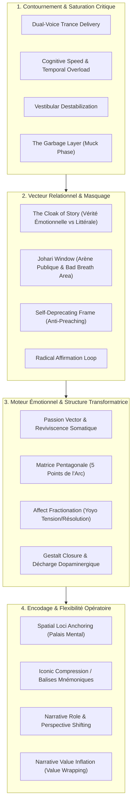

# Hypnotic Storyteller - Transcripts
**Formateur :** Igor Ledochowski | **ID :** `igor-ledochowski-hypnotic-storyteller-transcripts` | **Tranches :** 17

## Synthèse Architecturale du Cours : *Hypnotic Storyteller* (Igor Ledochowski)

---

### 1. Thèse Centrale & Philosophie du Cours

#### A. La Vision Singulière d’Igor Ledochowski vs l'Approche Standard
* **Le Storytelling comme Transe Épiphénoménale et Non-Formelle :** Là où l'hypnose clinique classique impose des rituels explicites (fermeture des yeux, induction par fixation, approfondissement) et où le storytelling d'entreprise se contente d'architectures sémantiques froides (schéma actanciel, storytelling corporate rationnel), Ledochowski pose que **toute narration incarnée est une transe conversationnelle involontaire**.
* **Le Manteau Protecteur (*The Cloak of Story*) contre la « Vérité Nue » :** La philosophie maîtresse postule que le facteur critique et l'amygdale rejettent violemment la leçon frontale, le conseil d'expert ou la morale directe (« la vérité nue se fait lapider au village »). L'approche de Ledochowski consiste à dissocier la vérité émotionnelle profonde des faits littéraux : le récit devient un « manteau » protecteur à la fois pour le système défensif de l'auditeur (qui ne se sent pas jugé ni contraint) et pour le praticien (qui contourne la peur d'exposition excessive).
* **Anti-Perfectionnisme et Vulnérabilité Calibrée (*The Flaw / Anti-Preaching*) :** Contrairement aux modèles d'éloquence héroïque (« héros parfait en plastique »), Ledochowski ancre l'efficacité hypnotique dans la faille délibérée et l'auto-dérision (la posture David Niven). La connexion neuro-affective et l'effondrement des résistances s'obtiennent en s'assignant la place de celui qui commet l'erreur et reçoit la leçon (*butt of the joke*), désamorçant instantanément la réactance psychologique.

#### B. Le Fil Rouge Méthodologique : Le Couplage Neuro-Somatique
Le fil conducteur unifiant l'intégralité du cursus repose sur un principe opératoire invariable :
$$\text{Reviviscence Somatique de l'Orateur (80\% interne)} \longrightarrow \text{Contagion par Neurones Miroirs} \longrightarrow \text{Recherche Transdérivative de l'Auditeur} \longrightarrow \text{Résolution Gestalt Épiphane}$$

1. **Saturer / Épuiser le facteur critique conscient** (par la vélocité cognitive, la rupture vestibulaire, la double voix, ou le flux spontané).
2. **Purger la censure** (traverser la « couche d'immondices » / *muck phase* sans bloquer).
3. **Véhiculer l'isomorphisme affectif sous un habit fictionnel** (*Wearing the Cloak*).
4. **Guider vers une clôture gestalt à fort impact dopaminergique** (*Awareness & Transformation*).

---

### 2. Carte des Concepts & Leviers Émergents



#### Rôles Spécifiques dans l'Écosystème du Praticien :
* **Vecteurs de Dé-fixation Attentionnelle :**
  * `#cognitive_overload`, `#vestibular_pattern_interrupt`, `#chiasme_vocal` : Rupture de l'analyse logique et de la fixation oculaire pour forcer le basculement vers l'imagerie interne.
  * `#taboo_decompression` (*The Garbage Layer*) : Libération de la pression sur-moiïque et de la censure initiale pour accéder à l'inconscient créatif.
* **Interfaces Relationnelles & Éthiques :**
  * `#cloak_of_story` & `#dissociated_disclosure` : Dissimulation protectrice de l'identité factuelle tout en maintenant 100 % de la résonance émotionnelle.
  * `#johari_window_storytelling` & `#social_contract_calibration` : Élargissement calibré de l'intimité relationnelle sans franchir le seuil d'intrusion gênante (*creep factor*).
  * `#self_deprecating_frame` : Élimination de la réactance par l'adoption de la posture du « perdant apprenant » (*anti-preaching*).
* **Moteurs de Changement Subconscient :**
  * `#triade_narrative_primitive` (*Fait + Émotion + Action*) : Brique élémentaire orientée décision motrice et motivation limbique.
  * `#five_finger_narrative_model` : Gabarit universel garantissant qu'une histoire ne s'étiole pas et délivre son plein impact restructurant.
  * `#gestalt_closure` & `#awareness_transformation` : Décharge neurochimique scellant l'intégration de la nouvelle perspective.
* **Système d'Exploitation Mnésique & Opérationnel :**
  * `#spatial_loci_anchoring` & `#iconic_compression` : Décharge complète de la mémoire de travail du praticien (stockage spatial indexé sur des icônes sensorielles) pour libérer l'attention vers la calibration en direct du sujet.
  * `#role_reversibility` & `#perspective_shifting` : Économie de moyens permettant de réutiliser un stock minimal d'histoires en permutant les points de vue pour coller en direct à la carte du monde du client.

---

### 3. Tableau Récapitulatif des Techniques & Démonstrations

| Technique / Exercice | Objectif Opératoire | Déclencheur / Indication | Séquence Résumée |
|---|---|---|---|
| **Double Induction en Chiasme Vocale** (*Dual-Voice Delivery*) | Saturation hémisphérique et contournement immédiat du contrôle analytique. | Début de séminaire / client avec hyper-contrôle intellectuel persistant. | Deux voix synchronisées s'entrecroisent à cadence serrée : une voix nourrit le conscient factuel, l'autre distille des commandes somatiques et des inductions de transe jusqu'à épuisement de la mémoire de travail. |
| **Purge Scatologique & Flux Forcé** (*The Garbage Layer Drill*) | Désinhibition du critique interne et déblocage de la spontanéité narrative brute. | Blocage créatif, peur du jugement, sur-censure (« je ne trouve pas de bonne histoire »). | Raconter à double vitesse sous contrainte de 60 secondes en laissant sortir délibérément les images absurdes, vulgaires ou taboues, jusqu'à épuisement de la couche défensive. |
| **Rupture Vestibulaire Somatique** (*Spinning & Spot Induction*) | Dé-fixation visuelle et effondrement du dialogue interne rigide. | Rigidité posturale, fixation oculaire obsessionnelle sur le problème. | Rotation physique rapide sur soi-même pour désorienter le système vestibulaire, suivie d'un arrêt net : capture immédiate de la première image interne émergeant dans le vide perceptuel. |
| **Revêtement Émotionnel Dissocié** (*Wearing the Cloak of Story*) | Émettre un état interne puissant sans exposer son intimité factuelle ni heurter le sujet. | Révélation d'une leçon sensible ; besoin de transmettre une vérité affective sans intrusion. | Activer intérieurement un souvenir personnel réel (80 % d'attention somatique), puis raconter en surface une fable imaginaire ou métaphorique sans rapport direct (20 % verbal). |
| **Boucle d'Approbation Tonitruante** (*Radical Affirmation Loop*) | Extinction de l'anxiété de performance et calibration de l'auditoire en temps réel. | Trac de l'orateur, déconnexion entre le conteur et la physiologie de son public. | Le public manifeste une joie bruyante à chaque micro-fragment émis ; l'orateur dilate sa vision périphérique et calibre le retour sensoriel du groupe pour installer un accordage vagal ventral. |
| **Recadrage « Who-I-Am »** (*Identity Reframe*) | Transformer une étiquette fonctionnelle terne en ancre de crédibilité et de mission. | Présentation de soi réductrice (« je suis comptable ») bloquant l'autorité bienveillante. | Identifier la fonction brute $\to$ Déterminer l'impact émotionnel et humain ultime $\to$ Raconter l'activité sous l'angle du résultat transformateur (ex: « bâtisseur de carrières rock »). |
| **Matrice Pentagonale de l'Arc** (*Five-Finger Narrative Model*) | Assurer une boucle de transformation fermée évitant l'éparpillement narratif. | Conception d'une métaphore thérapeutique ou d'un récit d'apprentissage complet. | Aligner séquentiellement 5 pivots : 1. Héros $\to$ 2. Passion (désir moteur) $\to$ 3. Antagoniste (friction/impasse) $\to$ 4. Conscience (*Awareness* / rupture de schéma) $\to$ 5. Transformation (résolution somato-cognitive). |
| **Permutation de Rôle & d'Angle** (*Perspective & Role Shifting*) | Générer des prises de conscience multiples à partir d'un unique événement. | Besoin d'adapter une histoire connue à une problématique client radically différente. | Conserver l'événement brut $\to$ Permuter le héros, l'antagoniste et l'observateur neutre (raconter depuis l'autre protagoniste ou un tiers) $\to$ Révéler un apprentissage inverse. |
| **Palais Mental Spatialisé des Histoires** (*Spatial Loci & Iconic Archiving*) | Accès instantané à un répertoire narratif sans solliciter la mémoire de travail en séance. | Gestion de séance en direct sans notes, anxiété de trou de mémoire chez le praticien. | Condenser chaque histoire en une icône sensorielle minimale $\to$ Associer visuellement chaque icône à un repère spatial fixe (pièce ou trajet familier) $\to$ Poser le regard mental sur le lieu pour dérouler le récit instantanément. |
| **Le Cadre d'Auto-Dérision** (*Self-Deprecating / Anti-Preaching Frame*) | Neutraliser la résistance, la jalousie ou le réflexe d'opposition face au conseil. | Auditoire méfiant, profil réactant ou contexte hiérarchique sensible. | Poser l'orateur comme l'ignorant initial ou la victime de sa propre maladresse $\to$ Décrire l'échec personnel $\to$ Transmettre l'illumination reçue par un tiers ou par la situation sans jamais poser d'injonction directe. |

---

## Extractions Détaillées par Tranche (Opératoire & Verbatim)


## --- Tranche 1 / 17 ---

Voici l'extraction opératoire complète et structurée de la tranche 1/17 du séminaire *Hypnotic Storyteller* par Igor Ledochowski et Robin Manuel.

---

### 1. Mécanismes & Principes Actifs

#### A. Compression d'Identité & Véhicule Relationnel par l'Histoire
- **Principe actif :** L'esprit humain traite difficilement l'abstraction pure ou l'accumulation linéaire de données factuelles. Une narration personnelle de 5 minutes compresse des mois ou des années de signaux relationnels en une unité de sens immédiatement assimilable. Elle contourne la résistance logique en projetant l'interlocuteur dans une simulation d'expérience vécue (*experience simulator*).
- **Impact neurologique & inconscient :** Les histoires activent un couplage neuronal (*neural coupling*) où l'auditeur reproduit intérieurement les émotions, les sensations somatiques et la trajectoire du conteur. L'information n'est plus analysée comme une requête extérieure mais vécue comme une donnée intime, ce qui diminue le réflexe de défense critique.
- **Tags :** `#compression_temporelle` `#vecteur_identitaire` `#couplage_neuronal` `#simulation_d_experience`

#### B. La Métaphore du Voile (« The Cloak of Story » / Parabole de la Vérité Nue)
- **Principe actif :** La « Vérité nue » provoque l'agression, le rejet et la réactivité défensive du groupe ou du facteur critique (rejet frontal, pierres, fuite). Enveloppée dans la trame d'une histoire (« The cloak of story » tissé des racines et des fils de rosée de la forêt), elle traverse le village sans être violemment reconnue, tout en étant accueillie comme un vieil ami.
- **Impact neurologique & inconscient :** La vérité / suggestion nue déclenche l'alerte de l'amygdale et le contrôle de l'hémisphère gauche (jugement critique, rejet de conformité). Le format narratif suspend le facteur critique : le cortex préfrontal traite l'histoire comme un jeu fictionnel, permettant au message profond de pénétrer l'inconscient sans opposition.
- **Tags :** `#cloak_of_story` `#bypass_facteur_critique` `#dissimulation_perceptive` `#parabole_isomorphe`

#### C. L'Élémentaire Narratif Primitif : Fait + Émotion + Appel à l'Action
- **Principe actif :** Déconstruction de la narration à sa brique minimale (démontrée par le bébé qui vide son biberon : « all gone »). Toute narration opérationnelle ne nécessite pas la formule « Il était une fois ». Sa structure neuro-fonctionnelle universelle repose sur un triptyque :
  1. *Fait objectif* (constat de réalité brute).
  2. *Charge émotionnelle* (coloration somatique et mimique).
  3. *Appel à l'action / Conséquence implicite* (« agis maintenant, sinon le plan B sera désagréable »).
- **Impact neurologique & inconscient :** Connecte directement le système limbique (motivation, besoin) au néocortex (décision motrice), générant un engagement comportemental immédiat par menace implicite ou promesse de gratification.
- **Tags :** `#triade_narrative_primitive` `#fait_emotion_action` `#structure_minimale` `#action_driver`

#### D. Double Induction en Chiasme Vocale (Dual-Voice Trance Delivery)
- **Principe actif :** Deux praticiens (Igor et Robin) s'entrecroisent à la tribune en délivrant des flux verbaux simultanés ou alternés à cadence serrée, l'un s'adressant aux perceptions conscientes et à l'apprentissage cognitif, l'autre insinuant des commandes hypnotiques douces et somatiques.
- **Impact neurologique & inconscient :** Surcharge cognitive délibérée (*overload* de la mémoire de travail). Le conscient, incapable de synthétiser deux flux linguistiques complexes distincts en même temps, s'épuise et cède le contrôle. L'attention se replie vers l'intérieur (*transderivational search*).
- **Tags :** `#induction_a_deux_voix` `#saturation_hemispherique` `#confusion_programmée` `#chiasme_vocal`

#### E. Régulation des Limites & Fenêtre de Johari Narratif (Public Arena & Self-Disclosure)
- **Principe actif :** L'interaction humaine s'ordonne autour de la frontière entre ce qui est su/ignoré de soi et des autres. Déplacer des éléments vers l'Arène Publique via la narration (*disclosure*) et le retour (*feedback*) élargit la zone de liberté et de synchronisation relationnelle. L'utilisation du faux/du jeu narratif permet d'exprimer des traits réels sans la rigidité du contrat d'engagement formel.
- **Impact neurologique & inconscient :** Réduit la menace perçue d'exposition vulnérable. Jouer avec l'exagération (« lie quite a lot ») désactive l'anxiété de performance sociale tout en véhiculant une vérité structurelle sur l'identité.
- **Tags :** `#fenetre_de_johari` `#arene_publique` `#revelation_protegee` `#jeu_de_fausse_piste`

---

### 2. Protocoles, Techniques & Démonstrations (Étape par Étape)

#### Protocole 1 : Brise-Glace par l'Anecdote Outrancière (« The Outrageous Story Introduction »)
* **Intention / Indication :** Désamorcer l'anxiété sociale dans un groupe, briser l'inhibition de la prise de parole, installer le cadre du jeu narratif et calibrer la flexibilité créative des participants.
* **Mise en place & Pré-framing :**
  1. Affirmer le cadre d'apprentissage adulte : permission absolue d'expérimenter, responsabilité des conséquences.
  2. Interdire formellement les questions d'entretien classiques (« Tu t'appelles comment ? », « Tu fais quoi ? », « Pourquoi es-tu ici ? »).
  3. Prescrire le mensonge, l'absurde ou l'exagération délibérée : le récit doit être structuré autour de l'identité, mais n'a pas à être factuellement vrai.
* **Séquence d'actions pas à pas :**
  - **Étape 1 (Bannissement du protocole social direct) :** Règle stricte : aucune question posée par l'auditeur.
  - **Étape 2 (Projection narrative compacte) :** Chaque sujet aborde un inconnu et lui livre un récit court, décalé ou outrancier qui encapsule métaphoriquement ou humoristiquement :
    * Qui il est (son nom ou son identité symbolique).
    * Ce qu'il fait dans la vie.
    * La raison de sa présence ici.
  - **Étape 3 (Rotation rapide) :** Échange réciproque chronométré en temps très court (7 minutes pour maximiser le nombre de contacts dans la salle).
  - **Étape 4 (Debriefing immédiat) :** Raccordement conceptuel à la Fenêtre de Johari (comment l'Arène Publique s'est ouverte sans lourdeur confessionnelle).
* **Signes de calibration :**
  * Rupture des postures rigides : émergence de rires, détention des épaules, gestes asymétriques spontanés.
  * Abandon de l'hésitation verbale et passage à une prosodie expressive et modulée.
  * Accélération de l'entrée en rapport avec des inconnus sans phase d'échauffement formelle.

---

#### Protocole 2 : Démonstration du Statut & Recadrage par Ping-Pong Burlesque (Démonstration Igor & Robin)
* **Intention / Indication :** Établir la haute autorité tout en démontrant une accessibilité ludique totale ; exemplifier le fait qu'une histoire n'a pas besoin de faits objectifs pour tisser un rapport indestructible.
* **Mise en place & Pré-framing :** Igor prétend vouloir raconter comment Robin l'a rejoint aux Bahamas par charité éducative ; Robin s'empare du cadre pour prétendre qu'Igor pleurait de solitude au téléphone.
* **Séquence d'actions pas à pas :**
  - **Étape 1 (Offre narrative de statut A) :** A pose une histoire le positionnant en bienfaiteur magnanime.
  - **Étape 2 (Interruption & Renversement de statut B) :** B prend le relais, reformule les faits sous un angle satirique inversé (A était dépendant, pathétique ou désespéré).
  - **Étape 3 (Surenchère contextuelle absurde) :** B justifie sa réticence avec des détails microscopiques dérisoires (le chat du voisin, arroser les tomates).
  - **Étape 4 (Intégration méta) :** Les deux formateurs révèlent les réponses aux 3 questions de base (Qui / Quoi / Pourquoi) enchâssées dans la parodie.
* **Signes de calibration :**
  * L'auditoire passe de l'écoute analytique à l'écoute captive (yeux fixés, respiration suspendue, rires synchronisés).
  * L'image de sérieux dogmatique est neutralisée ; le cadre est posé : le contenu importe moins que la relation et l'affect transmis.

---

### 3. Heuristiques, Subtilités & "Sagesse du Praticien"

#### Règles Conditionnelles d'Intervention
- **Si** l'auditeur se raidit ou rationalise face à une vérité directe ou une proposition de changement, **alors** cesse l'explication conceptuelle et enveloppe l'idée dans une parabole ou une métaphore isomorphe (« The Cloak of Story »), **parce que** l'inconscient n'attaque pas ce qu'il ne perçoit pas comme une imposition doctrinale.
- **Si** un client ou un apprenant affirme « Je ne suis pas créatif » ou « Je suis incapable de raconter une histoire », **alors** ne débats pas intellectuellement ; prouve-lui son erreur par ses comportements quotidiens automatiques (discuter entre amis autour d'un verre, rouspéter, s'adresser à un enfant), **parce que** la narration n'est pas un art scénique mais la structure de base du langage humain.
- **Si** tu veux transmettre une consigne ou une information complexe de manière durable, **alors** privilégie un récit de 5 minutes structuré sur l'expérience plutôt que la liste des faits bruts, **parce que** les données isolées s'effacent tandis que la structure narrative compacte s'encode directement dans la mémoire autobiographique.

#### Pièges Classiques & Erreurs Corrigées
- **Le piège du « Livre Ouvert » (Over-disclosure toxique) :** Déballer toute son intimité ou ses états bruts sans filtre relationnel (exemple du policier qui demande les papiers et à qui on raconte son envie de meurtre conjugal). *Règle :* L'adulte responsable choisit le dosage narratif en fonction du contexte et assume les conséquences relationnelles de ce qu'il révèle.
- **Le piège de la Forteresse Privée (Under-disclosure stérile) :** Refuser de partager la moindre facette de son histoire personnelle par souci de protection. *Conséquence :* Personne ne peut se synchroniser avec vous ni vous faire confiance, faute de points d'accroche identitaires.
- **L'illusion du conteur parfait :** Croire qu'une histoire commence obligatoirement par « Il était une fois » ou réclame un talent oratoire spectaculaire. Une exclamation de dépit ou un appel au secours du quotidien est déjà un récit complet.

#### Postulats Fondamentaux d'Igor Ledochowski dans cette Tranche
1. *L'humanité est structurellement narrative :* Tout être humain raconte en permanence des histoires à travers ses choix, ses silences, ses postures et ses émotions.
2. *L'immortalité relationnelle :* Notre empreinte dans le monde équivaut strictement à la longévité et à la résonance des histoires qui seront racontées sur nous après notre départ.
3. *La réalité comme choix de feedback :* Les histoires que nous acceptons d'écouter et de valider à propos de nous-mêmes déterminent entièrement la texture de notre réalité subjective.

---

### 4. Pépites Verbatim & Patterns Linguistiques (MOT À MOT EN V.O.)

#### Pépite 1 : La Réduction Structurelle au Triptyque Primitif
```text
"Think of a child, you know, a baby, drinking milk from a bottle. It empties, and she shakes it and goes, all gone, all gone, and then she burps. Is she satisfied? She may be satisfied. All gone. Or she may be, all gone. She may be angry, frustrated. She may want some more. But that is a story. Wrapped up in there is, it's a fact. It's gone. Wrapped in an emotion. With a call to action. Come on, mum. Come on, dad. Because plan B, you will not like."
```
- **[Analyse du Pattern]** : Déconstruction et recadrage d'équivalence complexe (*Complex Equivalence Reframing*). Igor redéfinit un geste biologique banal de nourrisson comme l'archétype même de la communication narrative. L'utilisation du contraste prosodique sur « all gone » (satisfait vs furieux) ancre l'idée que le sens d'un récit réside dans son sous-texte émotionnel et sa conséquence pragmatique (« plan B » = menace implicite créant le levier motivationnel).

---

#### Pépite 2 : La Parabole Hypnotique du Voile (« The Cloak of Story »)
```text
"And because the way of the world is as it is, some people... Throw stones and chase her from the village. Shouting angry words. How dare you. And afraid of her nakedness. Be this way. And in tears, truth runs from the village. Exhausted, she finds a place to sleep... The forest weaves for her... from the dew-hung gossamer threads that coat its branches, a cloak of story. And the next morning, wearing that cloak, she walks unseen and unnoticed through the village. People do not recognize her. But they all greet her like an old friend."
```
- **[Analyse du Pattern]** : Métaphore isomorphe archétypale avec induction de transe somnambulique enchâssée.
  - La « Vérité nue » personnifie la suggestion directe ou le message thérapeutique frontal qui heurte les défenses du conscient (les pierres du village).
  - La forêt tisse un « manteau de récit » (*cloak of story*) à partir d'éléments ténus et imperceptibles (*gossamer threads*).
  - Présupposition intégrée : enveloppée de narration, la suggestion passe totalement inaperçue du facteur critique (« unseen and unnoticed ») tout en suscitant un accueil enthousiaste et familier (« greet her like an old friend »).

---

#### Pépite 3 : Induction Entrelacée en Double Discours (Igor & Robin Dual Trance)
```text
"You may feel something of importance beginning now and really it doesn't matter how it starts or where it goes or whether you close your eyes straight away because one way or the other your unconscious will start to think about all the stories you've heard in your life and while you prepare now to make the most and really consider of your learning... Just take a moment that you can respond to... To relax... Something to learn from... And to begin to enjoy... Or to take action on... Those feelings."
```
- **[Analyse du Pattern]** : Empilement de truismes et double lien ericksonien (*Double Bind & Pacing/Leading*).
  - « It doesn't matter how it starts or where it goes or whether you close your eyes straight away » : illusion de choix qui présuppose que la transe a déjà commencé.
  - « One way or the other your unconscious will start to think... » : utilisation du split conscient/inconscient avec directive inévitable.
  - Ponctuation ambiguë et collage syntaxique : le glissement fluide entre « consider of your learning », « just take a moment », « to relax », et « begin to enjoy » désactive l'analyse linéaire et provoque une cascade d'approfondissement sans heurt.

---

#### Pépite 4 : Commande Enchâssée d'Attention Somatique Positive
```text
"And everyone has the experience, noticing, the changing, of recalling events in their lives, sensations, and those events, as you begin to attend, have a certain significance, to only good feelings, importance to you. And only those experiences, some sensations are important enough that will assist you now to share with others in making the best and really of your learning today."
```
- **[Analyse du Pattern]** : Saupoudrage (*Sprinkling*) et commande analogique camouflée.
  - Nominalisations universelles (« the changing », « recalling events », « sensations ») forçant une recherche transdérivationnelle interne.
  - Commande enchâssée directe : « as you begin to attend... to only good feelings... that will assist you now ». Le système nerveux de l'auditeur est orienté sélectivement vers des marqueurs somatiques agréables tout en associant cette recherche interne à la réussite de son apprentissage présent.


## --- Tranche 2 / 17 ---

### 1. Mécanismes & Principes Actifs

- **La Fenêtre de Johari appliquée au Storytelling & Vulnérabilité Stratégique**
  *Principe actif :* Le modèle de Johari (Connu/Inconnu de soi vs Connu/Inconnu des autres) est détourné ici comme matrice de sécurité psychologique et de connexion. L'espace public (« Area of Freedom / Choice ») s'élargit par le feedback et la divulgation (*disclosure*). La zone aveugle (« The Flaw / Bad Breath Area ») humanise le conteur : un héros parfait est « en plastique » ; le système nerveux d'un auditeur ne peut pas s'identifier à une perfection invulnérable, car l'empathie nécessite une friction ou un combat partagé. La zone cachée (« The Mask ») protège l'intégrité face à un environnement non sécurisé.
  *Tags :* #johari_window_storytelling #vulnerability_paradox #humanizing_flaw #the_mask #safe_disclosure

- **Le Manteau du Récit (*The Cloak of Story*) & Transposition Métaphorique**
  *Principe actif :* Le mécanisme de dissociation protectrice. En modifiant les marqueurs d'identité de surface (genre, lieu, nom, attribution à un tiers ou personnage fictif), le conteur contourne ses propres défenses de l'ego et sa peur du jugement social (« fear of telling too much »). Cela permet d'extraire et de transmettre la « vérité émotionnelle » (*emotional truth*) sans compromettre la sécurité personnelle. L'inconscient de l'auditeur traite l'isomorphisme émotionnel sans que l'identité consciente du conteur soit exposée.
  *Tags :* #cloak_of_story #emotional_truth_vs_literal_truth #ego_protection #dissociated_disclosure

- **La Projection en Miroir / L'Ombre Révélatrice (Vipassana Epiphany)**
  *Principe actif :* Ce que le sujet rejette violemment chez autrui (« he's an arsehole, arrogant ») est une projection directe de ses propres traits refoulés ou inconscients (l'angle mort de Johari). La prise de conscience (« It's me ») crée un effondrement d'ancre négative et un pont de résonance immédiat. L'histoire sert à normaliser les défauts de l'auditoire en démontrant que l'agacement envers autrui est une boucle d'auto-évaluation fermée.
  *Tags :* #shadow_projection #mirroring_epiphany #blind_spot_collapse #it_is_me_revelation

- **L'Inflation de Valeur par Enchâssement Narratif (*Value Wrapping*)**
  *Principe actif :* Un objet matériel sans valeur intrinsèque (un moulin à vent en plastique, une empreinte de main d'enfant sur papier ou plâtre) acquiert une valeur inestimable lorsqu'il devient l'ancre somatique d'une structure narrative porteuse de sens, d'amour ou de sacrifice. C'est le fondement neurologique du branding (Nike, Coca-Cola) et des ancres hypnotiques : le cortex n'achète pas la matière physique (« fizzy sugary water »), mais l'état émotionnel encodé dans le récit.
  *Tags :* #narrative_value_inflation #somatic_anchoring #meaning_assignment #mythic_branding

- **Le Contrat Social et la Rupture de Calibration de Vulnérabilité**
  *Principe actif :* La vulnérabilité est un levier à haut risque. Si la révélation viole le contrat social du contexte (ex: l'histoire du professeur de biologie urinant au plafond), le système nerveux de l'auditeur se met en retrait et active un réflexe d'évitement (« creep factor »). Si la vulnérabilité brise une attente de froideur avec justesse et pertinence contextuelle, elle produit du charme et un lien instantané.
  *Tags :* #social_contract_calibration #over_disclosure_hazard #creepy_vs_charming #connection_threshold

- **Le Tumbler Moment / L'Engrenage de Résonance Interne**
  *Principe actif :* Phénomène kinesthésique/cognitif où une image ou un mot-clé du récit active un déclic (« gear gear / tumbler ») chez l'auditeur, déclenchant l'ouverture de sa propre banque de souvenirs épisodiques équivalents (isomorphisme spontané). La connexion ne se fait pas sur le contenu factuel du conteur, mais sur l'expérience humaine partagée (perte, doute, joie, enfance).
  *Tags :* #tumbler_moment #transderivational_search #resonance_gear #human_experience_bridge

- **Désinhibition du Critique Interne par l'Absurde et la Vélocité Cognitive**
  *Principe actif :* L'empilement d'exercices d'improvisation à cadence ultra-rapide (applaudissements -> ping-pong de mots aléatoires -> « What do you see? » -> « Magic Box ») sature le canal conscient et court-circuite le censeur verbal. L'esprit conscient n'a pas le temps d'évaluer, de juger ou de chercher la « bonne » réponse, forçant l'accès direct aux processus génératifs inconscients.
  *Tags :* #conscious_overload #internal_censor_bypass #rapid_fire_association #spontaneous_generation

- **Désorientation Vestibulaire & Induction d'État Génératif (The Spin)**
  *Principe actif :* La rotation corporelle sur 360° suivie d'une ouverture des yeux perturbe le système vestibulaire et rompt l'ancrage spatial habituel. Cet état de légère déstabilisation proprioceptive (« mind-body thing ») ouvre une fenêtre de susceptibilité hypnotique où le sujet est immédiatement invité à projeter une hallucination visuelle positive guidée (« describe a place that has never existed »).
  *Tags :* #vestibular_disruption #pattern_interrupt_spin #spatial_destabilization #hallucinatory_projection

---

### 2. Protocoles, Techniques & Démonstrations (Étape par Étape)

#### Protocole 1 : Utilisation Stratégique du Manteau du Récit (*The Cloak of Story*)
* **Intention / Indication :** Dévoiler une vulnérabilité critique, une erreur passée ou une vérité émotionnelle profonde sans risquer le rejet social, la honte ou la perte de statut.
* **Mise en place & Pré-framing :** Cadrer que l'histoire est au service de l'enseignement ou de l'art, et que l'important est la fidélité de l'émotion et non des coordonnées biographiques.
* **Séquence d'actions pas à pas :**
  1. *Identifier l'expérience source* : Sélectionner un événement réel contenant une leçon, une vulnérabilité ou une épiphanie.
  2. *Appliquer le masque de surface* : Modifier systématiquement le genre, le nom, le lieu géographique et la relation (« A friend of mine... », « I once knew a guy who... »).
  3. *Préserver la charge émotionnelle brute* : Raconter l'événement en conservant strictement les réactions viscérales, les dilemmes et la résolution interne d'origine.
  4. *Règle d'or de calibration éthique* : Si l'histoire est présentée comme personnelle (ex: une cicatrice sur la main), elle doit rester factuellement cohérente au fil du temps. Si elle est inventée ou altérée pour l'enseignement, poser un cadre artistique clair pour ne pas trahir le lien de confiance.
* **Signes de calibration :** L'auditeur hoche la tête, s'identifie à la dynamique émotionnelle sans focaliser sur l'identité du protagoniste ; absence de posture défensive chez l'orateur.

---

#### Protocole 2 : L'Interversion des Doigts (Fractionnement de la Résistance au Changement)
* **Intention / Indication :** Normaliser l'inconfort lié à l'apprentissage de nouveaux patterns comportementaux et hypnotiques ; semer la suggestibilité sans résistance.
* **Mise en place & Pré-framing :** « This isn't the first stage in a stage hypnosis show... but if you really want to glue them together... » (Désamorçage humoristique du cadre de manipulation).
* **Séquence d'actions pas à pas :**
  1. Demander au groupe de joindre les mains, doigts croisés de façon spontanée.
  2. Demander de décaler les doigts d'un cran en inversant les pouces.
  3. Faire calibrer la sensation somatique : « Does that feel a little bit weird? It should. »
  4. Délivrer la suggestion d'adaptation : « Si vous le faites plusieurs fois dans la journée, cela devient normal. Attendez-vous donc à ressentir cette étrangeté ces prochains jours, et sachez que vous pouvez toujours revenir à votre position de base. »
* **Signes de calibration :** Rires gênés, micro-tensions dans les mains, validation kinesthésique collective par hochement de tête.

---

#### Protocole 3 : La Boîte Magique & Assignation Spatiale d'Objets Hallucinés
* **Intention / Indication :** Développer l'acceptation sans jugement des projections de l'autre (*Yes, and...*), créer une réalité partagée et ancrer l'utilisation de l'espace symbolique.
* **Mise en place & Pré-framing :** Exercice de déambulation rapide (*mingling*), aucun temps de réflexion autorisé.
* **Séquence d'actions pas à pas :**
  1. *Émission de l'amorce* : Le Praticien A s'approche du Sujet B, mime une boîte entre ses mains et déclare : *« Look, a magic box. »* Il mime le geste d'en extraire un objet invisible et demande : *« What is this? »*
  2. *Validation & Nommage spontané* : Le Sujet B nomme la première chose qui émerge (ex: *« It's a puppy / a book of magic »*).
  3. *Ratification & Pacing* : Le Praticien A ratifie immédiatement sans corriger : *« That's right, it is a puppy / magic book. »*
  4. *Demande de localisation spatiale* : Le Praticien A demande : *« Where does it belong? »*
  5. *Assignation et dépôt physique* : Le Sujet B désigne un point dans la pièce (ex: *« There / On the table »*). Le Praticien A y dépose physiquement l'objet invisible avec congruence somatique.
  6. *Inversion des rôles* : Répéter immédiatement la séquence en inversant A et B.
* **Signes de calibration :** Spontanéité du regard, congruence du poids/taille mimé dans les mains, engagement corporel lors du dépôt spatial.

---

#### Protocole 4 : La Rotation Vestibulaire & Co-Création d'Hallucination Hypnotique
* **Intention / Indication :** Provoquer un état de transe générative légère par rupture proprioceptive et guider une hallucination visuelle externe co-construite.
* **Mise en place & Pré-framing :** Ancrer un point visuel de sécurité sur le mur pour éviter la chute physique. Prévenir : *« It's a mind-body thing. Your unconscious mind and your body are spinning into strange worlds. »*
* **Séquence d'actions pas à pas :**
  1. *Déclencheur kinesthésique* : Le sujet fixe un point, effectue un tour complet sur lui-même (360°), rouvre les yeux.
  2. *Amorce d'élicitation visuelle* : Le coach demande immédiatement : *« What do you see? »* (Présupposition qu'un monde imaginaire est déjà présent).
  3. *Description du paysage imaginaire* : Le sujet verbalise la première image (ex: *« A cornfield stretching out »* / *« A tall mountain with a castle »*).
  4. *Ratification & Co-Hallucination (Singing it with them)* : Le coach ratifie et valide l'existence de l'élément dans le champ perceptif commun : *« Yes, there is that cornfield / Yes, I see it too. »*
  5. *Élargissement de l'attention & Dynamisation narrative* : Le coach relance avec des questions de précision spatiale et temporelle :
     - *« What else happens / What else do you see? »*
     - *« Where are they going? »*
     - *« Who are they signaling to? »*
  6. *Bouclage en feedback humoristique ou dramatique* : Intégrer la projection dans l'interaction présente (ex: *« They were shooting you! - Why, thank you! You saved my life! »*).
* **Signes de calibration :** Pupilles dilatées après la rotation, fixité du regard dans le vide (regard défocalisé typique de la transe visuelle interne projetée à l'extérieur), tonalité de voix ralentie et descriptive.

---

### 3. Heuristiques, Subtilités & "Sagesse du Praticien"

- **Heuristique de Valorisation du Profil Observateur / Écouteur :**
  *Condition :* Si un participant bloque sur un exercice en affirmant *« Je n'ai pas d'histoires, je ne sais rien dire, je préfère écouter »*...
  *Action :* Recadrer instantanément ce blocage comme une histoire parfaite de vulnérabilité et de présence (*« That's actually a very nice story. That honesty... »*).
  *Raison :* Ce que le sujet dévalorise chez lui est précisément ce qui construit le rapport et la sympathie dans le monde réel. Un bon auditeur fait un conteur d'autant plus puissant qu'il capte les signaux des autres.

- **Heuristique de Gestion de la Vérité dans les Récits Personnels :**
  *Condition :* Si vous racontez une histoire ancrée physiquement dans votre biographie (ex: l'origine d'une cicatrice visible sur votre corps)...
  *Action :* Ne changez jamais les faits réels d'une fois à l'autre.
  *Raison :* Si l'auditeur s'investit émotionnellement dans une tragédie qu'il découvre être une pure fabrication biographique, il se sent manipulé et le contrat de confiance inconscient s'effondre définitivement. Si l'histoire est une fiction d'enseignement, utilisez le « Manteau du Récit » en l'attribuant explicitement à un tiers ou à une parabole.

- **Heuristique du "Bad Breath" (Zone Aveugle de Johari) :**
  *Condition :* Si vous voulez créer un charisme magnétique et une forte identification...
  *Action :* N'essayez jamais d'avoir l'air parfait. Révélez vos imperfections et vos travers passés.
  *Raison :* La perfection suscite la méfiance (« plastic heroes »). Les individus s'attachent aux gens non pas malgré leurs défauts, mais *grâce* à leurs défauts rendus conscients.

- **Heuristique de Feedback Dépendent de l'Auditoire :**
  *Condition :* Si une même histoire fonctionne brillamment avec une personne et tombe à plat avec une autre...
  *Action :* Ne jetez pas l'histoire ; calibrez le niveau de synchronisation énergétique et le contrat social de votre interlocuteur. Le storytelling est une boucle cybernétique vivante de feedback, pas un monologue figé.

- **Heuristique d'Échauffement Créatif (Bypass du Censeur) :**
  *Règle :* Toujours faire précéder un travail de narration complexe par des jeux absurdes et ultra-rapides (clapping -> ping-pong de mots -> objets mimés). Le système nerveux doit être placé en mode d'émission spontanée avant de pouvoir structurer des récits hypnotiques profonds.

---

### 4. Pépites Verbatim & Patterns Linguistiques (MOT À MOT EN V.O.)

#### Pépite 1 : La Libération par le Manteau du Récit
> **« Most of the stories that I tell you about myself, using the word I, will be true. Some of the stories I tell you about other people will also be true and about me. It's amazing the freedom that you can get from simply making the story about somebody else, changing the details. Change the gender, change the location, change the name. Suddenly you're free because it's not about you anymore. You've put the cloak of story around yourself and you can talk freely and find the truth. You can convey the emotional truth of the story without compromising your safety. »**

* **[Analyse du Pattern]** :
  - *Distinction paradoxale / Confusion délibérée* : Ledochowski floute la frontière entre vérité autobiographique et fiction (« some stories about other people will be true and about me »). Ce flou libère l'inconscient de l'obligation de conformité factuelle.
  - *Commandes d'émancipation en chaîne* : « Suddenly you're free », « talk freely and find the truth ».
  - *Recadrage sémantique* : Opposition opératoire entre « factual safety » et « emotional truth ». Le manteau métaphorique devient une permission hypnotique de vulnérabilité sans danger d'exposition de l'ego.

---

#### Pépite 2 : L'Épiphanie de l'Ombre et de la Projection
> **« And then it hits me. Doosh! Like that. Sudden revelation. It's me. He's like I am. That's the kind of thing I would do. Just like, you know, yeah, yeah, just do a bit of warm-up stretches. It's me. I'm looking at myself and getting annoyed. I'm looking at myself and thinking, what an a-hole. What an arrogant, stuck-up guy that is. I'm shaking my head, and it's like, great, epiphanies, this is fantastic. »**

* **[Analyse du Pattern]** :
  - *Onomatopée kinesthésique d'impact* (« Doosh! ») : Provoque un ancrage auditif et somatique immédiat, simulant un choc neurologique de prise de conscience.
  - *Pattern d'effondrement d'ancre par auto-dérision* : Répétition rythmée de « It's me », passant du rejet de l'autre à l'intégration de sa propre ombre.
  - *Pacing des mécanismes de défense* : Utilisation délibérée d'un registre de langage brut (« a-hole », « arrogant ») pour créer un rapport sans filtre avec la part d'ombre de l'auditoire.

---

#### Pépite 3 : L'Inflation de Valeur par l'Enchâssement Narratif
> **« Something that has very little material value can be made infinitely precious by the story that you wrap around it. This is what brands like Nike and Coca-Cola do. They do not sell you fizzy sugary water. They sell you a dream. And when you buy their product, you buy into their dream. »**

* **[Analyse du Pattern]** :
  - *Antithèse d'amplification* : Contraste saisissant entre « very little material value » et « infinitely precious ».
  - *Double métaphore de cadrage* : Utilisation du verbe « wrap around », matérialisant le récit comme un écrin physique protecteur et valorisant.
  - *Déréification commerciale* : Réduction d'un produit mastodonte à sa réalité matérielle dérisoire (« fizzy sugary water ») opposée à sa substance hypnotique réelle (« a dream »), installant la présupposition que toute valeur perçue est purement d'origine narrative.

---

#### Pépite 4 : Utilisation et Recadrage de l'Impuissance (Le Paradoxe d'Arthur)
> **« The first thing I want to say is that's actually a very nice story. That honesty, that refreshing honesty, I was trying to get a story but I couldn't quite get one that would say anything. I'd rather listen. Does it not let you understand who Arthur is a bit more? Yeah. [...] Each of you has a particular style, a particular kind of presence that you've developed over the years, and that's who you are. That's great. We want you to keep that. »**

* **[Analyse du Pattern]** :
  - *Utilisation ericksonienne pure* : Prendre le symptôme de résistance/blocage du sujet (« I had no story to tell ») et le requalifier instantanément comme le meilleur récit possible.
  - *Question rhétorique d'accord de masse* (« Does it not let you understand... ? ») : Forcer la validation sociale du groupe envers le sujet vulnérable, désamorçant son anxiété de performance.
  - *Suggestion directe d'acceptation identitaire* : Ancrage de la présence naturelle (« that's who you are... keep that »), créant une sécurité psychologique totale pour tout le groupe.

---

#### Pépite 5 : Ratification et Co-Hallucination Hypnotique Active
> **« What do you see? Oh, I see a cornfield stretching out in front of me. There is that cornfield. What else happens? There's a sun. It's like blood red. It's coming up above the corn. So there's a sun and there's a cornfield. What else do you see? I see crows flying across. And where are they going? They're going to that castle on the hill over there. Wonderful. »**

* **[Analyse du Pattern]** :
  - *Élicitation ouverte au temps présent* (« What do you see? ») : Présuppose que la réalité imaginaire est déjà là, accessible immédiatement.
  - *Pacing & Ratification absolue* (« There is that cornfield », « Yes, I see it too ») : Le formateur ne traite jamais la réponse comme une fiction, mais comme une réalité partagée, consolidant l'état de transe et de co-création.
  - *Empilement de truismes et questions de direction d'attention* : « So there's a sun and there's a cornfield. What else do you see? » -> Valider les acquis sensoriels passés pour relancer l'exploration plus profondément dans le paysage inconscient.


## --- Tranche 3 / 17 ---

Voici l'analyse opératoire intégrale de la tranche 3/17 du cours *Hypnotic Storyteller* d'Igor Ledochowski (avec son co-animateur Robin).

---

### 1. Mécanismes & Principes Actifs

#### 1. Dérèglement Vestibulaire & Rupture Somatique de Fixation
* **Principe actif** : La rotation physique sur soi-même déséquilibre le système vestibulaire et force le regard à perdre ses points d'ancrage visuels habituels (saccades et nystagmus réflexes). Neurologiquement, le sujet ne peut plus maintenir la fixation oculaire ni le dialogue interne analytique qui structurent son modèle rigide de la réalité. Le cerveau, privé de repères stables immédiats, entre dans un état de réceptivité d'urgence où la première image évoquée s'impose comme une réalité perceptuelle vivante.
* **Tags libres émergents** : `#somatosensory_destabilization` `#vestibular_pattern_interrupt` `#de-fixation_oculaire` `#proprioceptive_trance_induction`

#### 2. Dépassement de la Capacité de Traitement Conscient par Épuisement Temporel (Exhaustion & Speed Overload)
* **Principe actif** : Le cerveau conscient (mémoire de travail / cortex préfrontal dorsolatéral) traite environ 4 à 7 éléments simultanément avec un délai de latence pour l'évaluation critique (censure, perfectionnisme, doute). En forçant l'émission d'images ou de récits à double vitesse (« twice as fast »), par fragments minimaux (« one word / three words at a time »), et sous contrainte temporelle stricte (60 secondes), la bande passante consciente sature complètement. L'instance de contrôle abdique par épuisement métabolique et laisse émerger le matériel narratif sous-cortical et inconscient sans filtrage préalable.
* **Tags libres émergents** : `#cognitive_overload` `#prefrontal_exhaustion` `#speed_bypass` `#unconscious_flow_state`

#### 3. La Phase de « Purge Scatologique et Taboue » (The Garbage Layer / Muck Phase)
* **Principe actif** : Avant d'accéder à l'imaginaire symbolique raffiné et thérapeutique, l'inconscient libère en premier lieu les contenus réprimés par la censure sociale : excréments, fluides corporels, agression brute, sexe, mort. Ledochowski identifie ce passage comme une nécessité homéostatique et neurologique similaire à la fonction cathartique des rêves à valence négative. Tenter de forcer un récit « propre » ou « intelligent » dès le départ active la sur-censure ; traverser délibérément cette couche d'immondices défait les verrous d'inhibition.
* **Tags libres émergents** : `#cathartic_garbage_layer` `#taboo_decompression` `#shadow_material_release` `#homeostatic_dream_processing`

#### 4. Le Revêtement Invisible du Récit (Wearing the Cloak of Story / Dual-Channel Entanglement)
* **Principe actif** : Le narrateur active silencieusement en arrière-plan une mémoire émotionnelle réelle issue de son histoire personnelle (canal interne somatique à 80 %), tout en décrivant en surface un monde métaphorique imaginaire totalement sans rapport (canal verbal à 20 %). Les micro-expressions faciales, la prosodie, la respiration et la charge affective de l'événement réel teintent la fable fictive. L'auditeur ne reçoit pas les faits bruts (ce qui évite ses contre-arguments logiques ou ses jugements moraux), mais télécharge par neurones miroirs l'état émotionnel exact via le canal analogique.
* **Tags libres émergents** : `#cloak_of_story` `#analog_emotional_broadcasting` `#state_carrier_wave` `#isomorphic_affect_transfer`

#### 5. Boucle de Résonance et d'Approbation Inconditionnelle (Radical Affirmation Loop)
* **Principe actif** : En demandant à l'auditoire de manifester une joie et une approbation tonitruante (« loud, enthusiastic approval ») à chaque mot émis par l'orateur, le circuit dopaminergique de récompense est saturé, éteignant l'activité de l'amygdale liée à l'anxiété de performance. Le locuteur se synchronise sur les réactions du groupe, dilatant son champ de conscience pour calibrer les micro-réponses de son public (« gaze calibration »), ce qui installe une boucle d'accordage hypnotique bidirectionnelle.
* **Tags libres émergents** : `#social_dopaminergic_priming` `#hyper_rapport_loop` `#audience_calibration_feedback` `#performance_anxiety_extinction`

#### 6. Recadrage Identitaire par le Récit (« Who-I-Am » Identity Framing)
* **Principe actif** : Une description factuelle (« je suis comptable ») enferme l'individu dans une catégorie réductrice dénuée d'énergie. En substituant le cadre de fonction par un cadre téléologique d'impact émotionnel (« tu aides les futures rock stars à préparer leur succès »), le récit restructure instantanément l'identité, les valeurs et la posture corporelle du sujet. Ce recadrage sert de fondation aux histoires de crédibilité et de connexion relationnelle.
* **Tags libres émergents** : `#identity_reframe` `#teleological_repositioning` `#who_i_am_story` `#emotional_spin`

---

### 2. Protocoles, Techniques & Démonstrations (Étape par Étape)

---

#### PROTOCOLE A : "Strange New Worlds" (Déstabilisation Vestibulaire & Voisinage Sensoriel)
* **Intention / Indication** : Court-circuiter l'angoisse de la page blanche, éteindre le contrôle logique et générer un état de transe narrative spontané.
* **Mise en place & Pré-framing** : Cadrage de sécurité physique pour éviter la chute lors de la rotation. Poser le présupposé : *"It's a mind-body thing. Your unconscious mind and your body are spinning into strange worlds."*
* **Séquence d'actions pas à pas** :
  1. **Ancrage Visuel Initial** : Le sujet fixe un point précis sur le mur face à lui.
  2. **Rupture Vestibulaire** : Faire un tour complet sur soi-même (rotation à 360°), réaligner les yeux sur le point fixé.
  3. **Déchargement Sensoriel Immédiat** : Le partenaire (Coach) questionne sans laisser de temps de réflexion : *"What do you see?"*
  4. **Empilement Modalitaire (VAKOG)** : Le coach pose des questions de forage sensoriel strict :
     - *"What else happens / What else do you see?"* (Visuel externe)
     - *"What about the details? Colors, textures, shapes?"*
     - *"What temperature is it? Is there a wind?"* (Kinesthésique externe / Somatosensoriel)
     - *"What can you hear?"* (Auditif)
     - *"What's that like?"* (Évaluation kinesthésique / métaphorique)
  5. **Validation en Écho** : Le coach répète les éléments du sujet en y adhérant immédiatement : *"There is that cornfield... So there's a sun and there's a cornfield."*
  6. **Rupture de Cadre / L'Intrus Aléatoire (The Curveball)** : Le coach injecte brutalement un élément complètement absurde et hors contexte dans le décor du sujet (ex: un char d'assaut menaçant un chiot dans une flaque). Le sujet doit intégrer l'intrus à sa réalité sans contester son existence.
* **Signes de calibration** : Fixité du regard après rotation, dilatation pupillaire, fluidité verbale croissante, arrêt des pauses d'hésitation ("euh..."), respiration qui s'ajuste au rythme des images décrites.

---

#### PROTOCOLE B : "Micro-Gifts & Co-Création" (Le Cadeau Minimal et l'Élagage Narratif)
* **Intention / Indication** : Développer l'écoute fine, maintenir la logique dramatique interne d'un monde et éliminer la surenchère narrative consciente.
* **Mise en place & Pré-framing** : Dissolution des rôles Coach/Imagineer. Tout élément apporté est nommé un « don » (gift). La règle est la miniaturisation maximale du don : apporter le plus petit fait logique possible sans clore la scène.
* **Séquence d'actions pas à pas** :
  1. Le joueur A pose une micro-brique narrative (ex: *"It's an office."*).
  2. Le joueur B valide la brique et ajoute un détail direct (ex: *"Yes, it is an office and I see a secretary sitting by a telephone over there."*).
  3. Le joueur A affine l'action en cours sans précipitation (ex: *"She picks up the phone and she has a very unhappy expression on her face."*).
  4. Réduction progressive de la taille des segments : passage de propositions entières à **trois mots par tour**, puis à **un mot par tour** ("one word at a time") en triade ou groupe de 5.
  5. **Règle du Discard** : Si un participant sent que l'histoire s'égare ou perd sa beauté/pertinence interne, son tour consiste uniquement à prononcer le mot *"Discard"*. La table efface tout et le suivant redémarre une histoire vierge.
     * *Règle critique* : L'impuissance créative n'est pas un motif de discard. Ne jeter l'histoire que si elle déplaît objectivement dans sa direction narrative.
  6. **Accélération Mécanique** : Maintenir exactement le même jeu, mais à double vitesse ("twice as fast").
* **Signes de calibration** : Confort face aux silences minimaux, absence de monologue, synchronisation du tempo respiratoire entre partenaires, abandon du besoin individuel de diriger le dénouement de l'histoire.

---

#### PROTOCOLE C : "The Cloak of Story" (Enchâssement Isomorphe sous Couverture Métaphorique)
* **Intention / Indication** : Rendre une métaphore percutante et magnétiquement engageante sans jamais révéler la vie privée du praticien ni imposer de morale directive.
* **Mise en place & Pré-framing** : Les sujets sont assis en cercle (groupes de 5). Les yeux fermés, induction d'un état de dérive intérieure par la respiration.
* **Séquence d'actions pas à pas** :
  1. **Induction & Récupération d'un Fragment de Réalité** :
     - Fermer les yeux, respiration ventrale profonde, laisser l'esprit dériver.
     - Évocation d'un événement réel : *"Some experience, some feeling, some event, something that's happened to you in the last week or month or year... genuine element from your personal history."*
     - Le sujet stabilise l'empreinte sensorielle et émotionnelle de ce souvenir, puis ouvre les yeux.
  2. **Maintien en Tâche de Fond (Dual-Processing)** : Conserver le souvenir présent à l'esprit, en tâche de fond (background processing), sans jamais en divulguer le contenu factuel.
  3. **Performance Métaphorique Déconnectée** : Se tenir au centre (ou face au groupe) pendant 60 secondes chrono et décrire un monde totalement imaginaire et fictif.
  4. **Canalisation Inconsciente** : L'énergie, le rythme, la gravité ou la joie du souvenir réel viennent infuser le récit fictif sans que l'auditoire ne connaisse la source.
  5. **Écoute Réceptive du Public** : Le groupe écoute en silence authentique et recueilli, sans surjouer l'approbation, en calibrant ce qui transparaît.
* **Signes de calibration** : Prosodie plus lente et ancrée, résonance vocale plus grave ou vibrante, micro-pauses signifiantes, le narrateur cesse de « jouer » et incarne une présence tangible ; l'auditoire manifeste un silence attentif (transe d'absorption).

---

### 3. Heuristiques, Subtilités & "Sagesse du Praticien"

#### Heuristiques Conditionnelles ("Si [X] -> Alors [Y] parce que [Z]")
1. **Si** le sujet commence à réfléchir, à hésiter ou à rationaliser ce qu'il va dire -> **Alors** le faire tourner immédiatement sur lui-même ou lui imposer une limite de 3 mots / double vitesse -> **Parce que** l'intellect conscient ne peut pas maintenir le contrôle analytique face à une contrainte de vélocité somato-temporelle.
2. **Si** le narrateur produit des histoires absurdes, scatologiques, vulgaires ou violentes (urine, chiots écrasés, sang, mort) -> **Alors** le laisser traverser cette phase sans jugement et avec bienveillance -> **Parce qu'**il s'agit de la purge obligatoire des matières refoulées de l'inconscient ("garbage layer") indispensable pour libérer la véritable créativité.
3. **Si** l'auditoire semble décrocher ou perplexe face à une métaphore -> **Alors** ralentir le débit verbal et faire un pas en arrière pour fournir davantage de contexte descriptif sensoriel -> **Parce que** le ralentissement permet de calibrer les micro-réactions du public et d'éviter que l'image ne devienne trop abstraite ou abrupte.
4. **Si** l'on souhaite induire un état de transe narrative fluide chez soi -> **Alors** ne préparer que la toute première phrase d'accroche et laisser l'inconscient générer le reste -> **Parce que** le conscient n'a besoin que de savoir comment amorcer l'action ; anticiper la suite réintroduit la crispation et détruit le flux hypnotique.
5. **Si** l'on donne du feedback à un apprenti conteur -> **Alors** ne mentionner EXCLUSIVEMENT que les détails qui ont provoqué du rire, de l'émotion ou de l'impact -> **Parce que** *"Where attention goes, energy flows"* ; pointer les défauts cristallise les inhibitions scolaires au lieu d'ancrer les compétences opérationnelles inconscientes.

#### Pièges Classiques & Réponses de Ledochowski
* **Le Piège de l'Attachement Narratif** : Vouloir s'accrocher à une intrigue ou la terminer à tout prix quand le temps est écoulé ou que le partenaire change.
  * *Correction* : *"Don't get attached to things... why on earth would you get stuck on something that's already passé? You have an immense capacity for creativity."* Lâcher prise immédiatement prouve à l'inconscient que la ressource créative est inépuisable.
* **Le Piège du Récit Livresque / Littéraire** : Penser qu'une histoire hypnotique doit ressembler à un roman avec des phrases complexes et mémorisées par cœur.
  * *Correction* : Les livres ont fait du tort à l'art oratoire. L'histoire conversationnelle est une improvisation vivante, modulaire et sensorielle, connectée à l'état présent de l'auditoire.
* **Le Piège de la Fausse Transparence** : Croire qu'il faut raconter ses traumatismes ou ses secrets personnels pour transmettre de l'émotion.
  * *Correction* : Porter le « manteau du récit » (*The cloak of story*). L'inconscient transmet 100 % de l'émotion réelle tout en préservant l'intimité derrière le masque d'une fable sur des châteaux, des montagnes ou des chiots.

---

### 4. Pépites Verbatim & Patterns Linguistiques (MOT À MOT EN V.O.)

#### PÉPITE 1 : L'Amorçage Somato-Psychique de Déstabilisation
> *"Find a spot on the wall in front of you, spin round, and look at it again. Makes it easier. Go! I know you're thinking, how could this possibly help? But believe me, it's a mind-body thing. Your unconscious mind and your body are spinning into strange worlds."*

* **[Analyse du Pattern]** :
  * **Lecture de pensée & Préemption d'objection** (*"I know you're thinking, how could this possibly help?"*) : Pacifie la résistance logique du sujet en formulant son propre scepticisme avant lui.
  * **Commande enchâssée et nominalisation** (*"believe me, it's a mind-body thing"*) : Présuppose un lien neurophysiologique indiscutable reliant la proprioception à la psyché.
  * **Présupposition d'action inconsciente** (*"Your unconscious mind and your body are spinning into strange worlds"*) : Utilise le verbe somatique concret de l'exercice (*spinning*) pour induire une transe dissociative où l'inconscient prend le contrôle de l'exploration imaginaire.

---

#### PÉPITE 2 : Le Forçage de Boucle Émergente (Sensory Grounding Loop)
> *"What do you see? Oh, I see a cornfield stretching out in front of me. There is that cornfield. What else happens? There's a sun. It's like blood red. It's coming up above the corn. So there's a sun and there's a cornfield. What else do you see? I see crows flying across. And where are they going? They're going to that castle on the hill over there. Wonderful."*

* **[Analyse du Pattern]** :
  * **Empilement de truismes et Ratification en écho** (*"There is that cornfield... So there's a sun and there's a cornfield"*) : Chaque élément produit par l'inconscient du sujet est ratifié comme un fait objectif indiscutable, verrouillant le rapport hypnotique.
  * **Questions ouvertes d'orientation attentionnelle** (*"What else happens?", "What else do you see?", "Where are they going?"*) : Ne suggère aucun contenu mais oblige le système nerveux du sujet à générer de l'information VAKOG dans la direction temporelle et spatiale induite.

---

#### PÉPITE 3 : L'Induction Fractionnée du Manteau Métaphorique (The Cloak Induction)
> *"And before we take this round, I'd just like you to take a moment, close your eyes, take a nice deep breath in, and breathe out and relax. And allow your mind to drift for a moment. And before you open your eyes, something will occur to you, some experience, some feeling, some event, something that's happened to you in the last week or month or year. It doesn't matter what it is or how long ago it was. It doesn't matter how trivial or profound. Just that some memory, a genuine element from your personal history, arises."*

* **[Analyse du Pattern]** :
  * **Présupposition temporelle enchâssée** (*"before you open your eyes, something will occur to you"*) : Lie le geste physique inévitable de rouvrir les yeux à l'émergence automatique d'un souvenir inconscient.
  * **Double lien permissif / Couverture de toutes les options** (*"It doesn't matter what it is... how long ago it was... how trivial or profound"*) : Neutralise toute censure interne ou quête du « bon » souvenir en autorisant l'insignifiant comme le profond.
  * **Verbe d'émergence passive** (*"arises"*) : Place le conscient en position de simple témoin réceptif face aux productions autonomes de l'inconscient.

---

#### PÉPITE 4 : La Double Négation Confusante pour Verrouiller l'Accès à l'État
> *"So I guess the next question is how do we create that state very easily? That's a very good question. I would ask how do you not create that state? If you don't know how you don't not create it, then that sounds good to me, because if you forget how you didn't, then you can continue to do it, right? Isn't that my line?"*

* **[Analyse du Pattern]** :
  * **Rupture de pattern par inversion socratique** : Face à une question méthodique linéaire (« comment créer l'état ? »), il répond par l'inversion radicale (« comment ne pas le créer ? »).
  * **Boucle de confusion par double négation empilée** (*"how you don't not create it... if you forget how you didn't, then you can continue to do it"*) : Sature instantanément le traitement syntaxique conscient, forçant le système nerveux à accepter la présupposition implicite sous-jacente : l'état d'inspiration créative est l'état par défaut de l'organisme tant qu'on ne l'entrave pas activement.
  * **Banalisation humoristique de sortie** (*"Isn't that my line?"*) : Rupture de transe par le rire pour ancrer la confusion sans laisser le sujet la détricoter.

---

#### PÉPITE 5 : Le Recadrage Identitaire Téléologique (Identity Reframe)
> *"Steve, so what you're telling me is that you help future rock stars prepare for financial success."*

* **[Analyse du Pattern]** :
  * **Structure d'équivalence complexe** : Transforme un comportement perçu comme rébarbatif (*"je suis comptable dans une ville de musiciens"*) en une mission noble, excitante et valorisante (*"préparateur de succès pour futures rock stars"*).
  * **Validation par feed-forward** : Réoriente le focus du sujet de l'aspect technique et ennuyeux (les chiffres, les déclarations fiscales) vers l'identité projective aspirationnelle de ses clients et la fierté de son rôle de mentor discret.


## --- Tranche 4 / 17 ---

Voici l'extraction et la modélisation intégrale de la substance opératoire de cette tranche 4/17.

---

### 1. Mécanismes & Principes Actifs

- **Identification et Résonance Émotionnelle par Reviviscence Somatique**
  - *Principe actif* : Le cerveau ne transmet pas l'émotion par un rapport descriptif intellectuel (*"C'était excitant"*), mais par l'accès direct de l'orateur à son propre état neuro-émotionnel passé. En accédant à la physiologie et au vécu somato-sensoriel du souvenir, l'orateur déclenche chez l'interlocuteur, par contagion via les neurones miroirs, une induction d'état sans effort conscient (*emotional contagion*).
  - *Tags libres* : `#emotional_revivification` `#state_elicitation` `#mirror_resonance` `#experiential_induction`

- **Ancrage Spatial Géométrique et Système de Loci Mnémotechnique (Palais Mental)**
  - *Principe actif* : L'hippocampe et le cortex parahippocampique humain possèdent une architecture dédiée à la mémoire spatiale (cellules de lieu et cellules de grille), bien plus puissante que la mémoire sémantique verbale. En spatialisant les récits sous forme d'icônes visuelles ou sensorielles distinctes greffées sur un trajet familier séquentiel, le praticien décharge sa mémoire de travail et élimine l'anxiété d'oubli, libérant 100 % de sa bande passante cognitive pour la calibration du sujet.
  - *Tags libres* : `#spatial_loci_anchoring` `#memory_palace_offload` `#visuoperceptual_indexing` `#cognitive_bandwidth_freeing`

- **Compression Symbolique et Réduction Iconique (Iconic Anchors)**
  - *Principe actif* : Une métaphore ou une narration volumineuse est compressée sous forme d'une métonymie sensorielle minimale (une silhouette découpée en carton, une pomme croquée, une porte d'entrée, un son). Cette réduction agit comme une balise d'activation neurale instantanée : l'activation du symbole unique entraîne par propagation associative le déballage (*unfolding*) de l'ensemble du réseau narratif et émotionnel.
  - *Tags libres* : `#iconic_compression` `#associative_retrieval` `#symbolic_decompression`

- **Micro-Transe d'Accès Mnésique (Reviviscence Spontanée Calibrable)**
  - *Principe actif* : Dès qu'un sujet parcourt mentalement un espace familier ou recherche un souvenir émotionnel authentique, son attention s'inverse (transe interne / état de recherche transdérivative). Les indices neuro-végétatifs de transe apparaissent immédiatement : regard défocalisé, immobilité posturale, modification du rythme respiratoire, latence de réponse verbale.
  - *Tags libres* : `#transderivational_search_trance` `#sensory_immersion` `#internal_fixation`

- **Matrice Narrative Épurée en 5 Points (Modèle Pentagonal de l'Arc Transformational)**
  - *Principe actif* : L'esprit humain filtre la réalité par des schémas d'attente causale. Une histoire sans résolution (*awareness* et *transformation*) crée une boucle ouverte insatisfaisante ou confuse. Le calibrage strict sur 5 pivots structurels (*Héros*, *Passion*, *Antagoniste*, *Prise de Conscience*, *Transformation*) permet de créer une boucle d'apprentissage fermée qui imprime une résolution psychologique au niveau subconscient.
  - *Tags libres* : `#five_finger_narrative_model` `#cathartic_structural_arc` `#closure_heuristic`

- **Plasticité Herméneutique du Récit & Réaffectation de Rôles (Narrative Role Shifting)**
  - *Principe actif* : Une même structure d'événements bruts peut voir ses fonctions narratives permutées (qui est le héros, qui est l'antagoniste, quelle est la nature de l'obstacle). Cela permet à un hypnotiseur de ne posséder qu'un stock restreint d'histoires (5 à 10) et de moduler instantanément les attributions de rôles pour épouser avec précision la carte du monde et le problème du client en temps réel.
  - *Tags libres* : `#role_reversibility` `#isomorphic_flexibility` `#ericksonian_repurposing`

---

### 2. Protocoles, Techniques & Démonstrations (Étape par Étape)

#### Protocole 1 : L'Installation du Palais Mnésique Narratif (Story Loci Engine)
* **Intention / Indication** : Mémoriser de 5 à 15 métaphores ou histoires hypnotiques de manière indélébile et y accéder instantanément en état de transe conversationnelle sans notes.
* **Mise en place & Pré-framing** : Cadrer comme une exploration naturelle de la familiarité. Réduire l'enjeu intellectuel. Inviter le sujet à fermer les yeux pour couper les interférences visuelles externes.
* **Séquence d'actions pas à pas** :
  1. *Sélection du lieu familier* : Choisir une pièce ultra-familière (chambre, cuisine, salon).
  2. *Inventaire séquentiel ordonné* : Repérer 10 emplacements ou objets physiques fixes dans l'espace en suivant un trajet continu (ex. : frigo $\to$ plan de travail $\to$ évier $\to$ placard...).
  3. *Consolidation de la route (3-4 boucles)* : Parcourir mentalement la séquence 3 à 4 fois de manière identique pour cristalliser le chemin neural.
  4. *Extraction d'icônes narratives* : Pour chaque histoire, isoler un détail physique singulier, un personnage, un objet ou une sensation qui la résume (l'élément métonymique).
  5. *Fixation de découpe mentale (Cardboard Cutout)* : Placer mentalement une silhouette ou image incongrue de cet élément directement collée sur l'emplacement physique du locus (ex. : scène bizarre superposée au tiroir).
  6. *Vérification et chaînage avant/arrière* : Parcourir la pièce mentalement, valider la présence de l'icône, répéter le chemin pour ancrer la chaîne.
* **Signes de calibration** :
  - Regards d'accès visuel en haut à gauche/droite (recherche mnésique interne).
  - Déconnexion de l'environnement immédiat, suspension de la motricité fine.
  - Débit verbal ralenti et descriptif lors du débriefing ("Pamela is in her memory right now").

#### Protocole 2 : L'Alchimie Narrative en 5 Doigts (The 5-Finger Story Arc)
* **Intention / Indication** : Transformer une anecdote banale ou un souvenir brut en une métaphore thérapeutique percutante dotée d'une force transformative.
* **Mise en place & Pré-framing** : Prévenir que les catégories sont des grilles de lecture servant à clarifier la narration, et non des dogmes rigides.
* **Séquence d'actions pas à pas** :
  1. *Élément 1 - Le Pouce : Le Héros / L'Héroïne* : Identifier le centre de gravité avec lequel l'auditeur s'identifie. (Peut être une personne, un animal, un objet, une communauté).
  2. *Élément 2 - L'Index : La Passion* : Localiser l'élément qui touche le cœur du narrateur : quelle est la résonance émotionnelle vitale qui motive le récit ?
  3. *Élément 3 - Le Majeur : L'Antagoniste* : Définir la friction contre laquelle le héros lutte (adversaire humain, intempérie, montagne, peur interne, limitation).
  4. *Élément 4 - L'Annulaire : La Prise de Conscience (Awareness / Epiphany)* : Isoler l'instant précis où la lumière s'allume, l'insight soudain ou le changement de perspective qui rend la solution accessible.
  5. *Élément 5 - L'Auriculaire : La Transformation* : Décrire l'état final résultant de la prise de conscience : comment la situation, l'identité ou le monde a été modifié.
* **Signes de calibration** :
  - *Chez le narrateur* : Fin de l'effet d'essoufflement (*"petering out"*), voix assurée et présence somatique lors de la conclusion.
  - *Chez l'auditeur* : Réaction de soulagement corporel (expiration profonde, relâchement musculaire), indiquant la catharsis et l'intégration de la métaphore.

---

### 3. Heuristiques, Subtilités & "Sagesse du Praticien"

- **Heuristique de l'Accès vs Description** :
  - *Si* le praticien dit au sujet qu'une histoire est excitante/émouvante, *alors* il parle à son néocortex critique et l'effet est nul.
  - *Si* le praticien revit lui-même l'état émotionnel avant d'en énoncer les faits, *alors* le sujet est entraîné dans l'état par résonance autonome.
- **Heuristique du Décrochage Narratif (Petering Out)** :
  - *Si* une histoire retombe à plat sans impact à la fin, *alors* c'est qu'il manque le pivot d'*Awareness* (l'éclair de lucidité) et la *Transformation* consécutive. Réintroduire explicitement ces deux phases crée immédiatement une satisfaction et un ancrage thérapeutique.
- **Heuristique de la Relativité Héroïque** :
  - *Postulat* : Tout individu est le héros de sa propre histoire, y compris l'antagoniste ou le figurant éliminé au premier acte.
  - *Application* : Pour donner une crédibilité hypnotique maximale aux personnages d'une métaphore, donner à l'antagoniste des motivations intrinsèquement cohérentes avec sa propre carte du monde.
- **Heuristique de l'Économie de Répertoire (The Master's Repertoire Rule)** :
  - *Erreur du débutant* : Croire qu'un bon hypnotiseur doit mémoriser des centaines de métaphores différentes.
  - *Correction* : Les maîtres (comme Milton Erickson) possèdent 5 à 10 histoires fondamentales, mais permutent les rôles, les focus d'antagonisme et les prises de conscience selon le problème du sujet en face d'eux.
- **Heuristique d'Adaptation Sensorielle (Calibrage de Werner)** :
  - *Si* un sujet a des difficultés avec la visualisation des lieux/icônes, *alors* basculer immédiatement sur des ancres auditives (sons familiers) ou kinesthésiques/haptiques (textures, sensations d'objets).
- **Heuristique de Dissimulation de l'Intention (The Unspoken Point)** :
  - L'histoire doit avoir une intention interne ferme (*point*), mais le praticien n'a pas besoin de l'expliciter verbalement : laisser l'inconscient du sujet extraire la morale préserve l'amnésie et contourne la résistance analytique.

---

### 4. Pépites Verbatim & Patterns Linguistiques (MOT À MOT EN V.O.)

#### Pépite 1 : Induction d'accès à la reviviscence émotionnelle
> *"And the secret is not to say, well, you know, you've been really excited, you get really excited, and there's a really exciting story for you, which is the way that the conscious mind tells stories, but more to recall being very excited and to sharing the events so that in inviting those people into your brave new world, they get to feel the excitement that you did, to some degree anyways. That makes sense, doesn't it?"*

* **[Analyse du Pattern]** :
  - *Contraste hypnotique conscient/inconscient* : Dévalorisation du processus intellectuel ("the way that the conscious mind tells stories") au profit d'un processus automatique d'évocation ("more to recall being very excited").
  - *Présupposition d'entraînement* : La structure "so that in inviting... they get to feel" présuppose de façon inévitable que l'interlocuteur vivra l'émotion si le narrateur y accède.
  - *Balisage de permission & tag question* : "to some degree anyways. That makes sense, doesn't it?" abaisse la résistance critique par une concession mineure suivie d'une question de liaison imposant un acquiescement subconscient.

---

#### Pépite 2 : Déclenchement de la recherche transdérivative par contagion associative
> *"Have you noticed when someone tells you a story, especially when that's meaningful to them, it makes you think of another story, like, oh, that reminds me of a story. Have you noticed that? Whatever that story is that you've been reminded of, well, it'll just make it easier for you to think of the next one that you'll share when you change partners, right?"*

* **[Analyse du Pattern]** :
  - *Truisme à ratification universelle* : "Have you noticed..." suivi d'une expérience commune crée un "Yes-Set" automatique.
  - *Conditionnel de liaison et commande cachée* : Utilisation du modaliseur "Whatever that story is..." qui contourne le contrôle conscient : peu importe le contenu, l'effet recherché ("make it easier for you to think of the next one") est déjà validé syntaxiquement comme conséquence inéluctable.

---

#### Pépite 3 : Induction de transe par spatialisation et ratification du rythme
> *"And you can take your time to do that, there's no hurry. We'll wait here quite comfortably until you've completed that sequence, found ten locations that look a little different each time, and run through them three or four times. Now I'll know you're ready to continue for the next step because your eyes will open once you've done all that. But there's no hurry for it right now, just enjoy recalling the features of this particular room in this particular way."*

* **[Analyse du Pattern]** :
  - *Ralentissement temporel et confort permissif* : L'expression "there's no hurry... comfortably" induit un ralentissement des ondes cérébrales et un lâcher-prise de la performance.
  - *Lien contingent post-hypnotique (Contingent Suggestion)* : "Now I'll know you're ready... because your eyes will open once you've done all that" lie le signal physiologique externe (ouvrir les yeux) à la réussite complète de la tâche interne inconsciente, rendant impossible l'échec de l'exercice.
  - *Formulation par truisme ericksonien* : "in this particular room in this particular way" préserve l'ambiguïté pour s'adapter à n'importe quelle représentation interne sans la contrarier.

---

#### Pépite 4 : Enchâssement spatial de l'ancre métonymique
> *"And if someone were to take a photograph of it or a cardboard cutout and stick it to that first location, what would that look like? It's an odd image to have in your bedroom, living room, kitchen, whatever, but just consider that. And then move on to the second location, the one that right after, and do the same with your second story... Yep, that's a little odd, but there it is."*

* **[Analyse du Pattern]** :
  - *Distorsion perceptive et utilisation de l'incongruité* : La suggestion d'une découpe en carton ("cardboard cutout") et la qualification d'"odd image" désactivent la recherche de logique critique. L'absurdité visuelle stimule le système réticulé activateur et consolide l'ancrage mnésique.
  - *Ratification d'évidence* : "Yep, that's a little odd, but there it is" court-circuite le doute : le praticien valide que l'image est bizarre, ce qui confirme implicitement qu'elle est déjà bien présente dans l'espace mental du sujet.

---

#### Pépite 5 : Recadrage identitaire de l'antagoniste / henchman
> *"Who said that? Thank you, Pamela. I'll ask you just a little aside. You think about the story of your life. Are you the hero? Like, when you watch a movie, yeah? When you watch a James Bond movie, you know that henchman who gets bumped off in the first act? Yeah. Guess what? He was the hero of his own story too. Nobody thinks about the henchman's family. Everyone is the hero of their own stories."*

* **[Analyse du Pattern]** :
  - *Rupture de cadre et changement de perspective perceptuelle* : Le déplacement soudain du focus d'attention de James Bond vers le sous-fifre anonyme ("henchman") crée une désorientation cognitive immédiate.
  - *Recadrage humaniste profond* : L'évocation inattendue de "the henchman's family" injecte de la complexité émotionnelle là où il n'y avait qu'un cliché binaire, installant le postulat sous-jacent universel ("Everyone is the hero of their own stories") qui permet au praticien de modéliser n'importe quel comportement humain sans jugement moral.


## --- Tranche 5 / 17 ---

### 1. Mécanismes & Principes Actifs

- **Fermeture Gestalt & Libération de Dopamine Cognitive (Awareness & Transformation)**
  - *Principe actif :* Une narration sans prise de conscience (*awareness*) ni résolution transformationnelle (*transformation*) « s’étiole » (*peters out*). Le système nerveux humain recherche la clôture d'une boucle ouverte (effet Zeigarnik). Dès lors que la transformation finale est injectée, le cerveau du sujet synthétise l'apprentissage sous forme de décharge dopaminergique et de satisfaction cognitive, scellant la morale ou le changement d'état sans résistance consciente.
  - *Tags :* `#closure_gestalt` `#awareness_transformation` `#resolution_dopaminergique`

- **Fluidité de Perspective & Perméabilité Identitaire (Perspective Shifting)**
  - *Principe actif :* L'attribution des rôles (héros, antagoniste, allié) n'est pas fixe. Changer le point de vue d'un récit (raconter l'histoire selon Robin vs selon Igor, ou du point de vue du chat) modifie instantanément l'affect, la cible de projection inconsciente et l'heuristique morale induite. Le praticien ne multiplie pas les faits : il altère l'angle perceptif pour déclencher des recadrages multiples à partir d'un événement unique.
  - *Tags :* `#perspective_shifting` `#permeabilite_identitaire` `#re-anchoring_narratif`

- **Neutralisation de la Réactance par Auto-Dérision (Self-Deprecating Frame / Anti-Preaching)**
  - *Principe actif :* Inspiré de David Niven, ce levier consiste à se placer soi-même dans la position du « perdant » (*butt of the joke*, individu qui prend la leçon). Sur le plan neurologique et relationnel, cela désactive l'hyper-réflexivité critique et les défenses de l'ego de l'auditeur. En refusant la posture du donneur de leçon (*anti-preaching*), le sujet s'autorise à absorber la métaphore et à intégrer l'apprentissage par libre identification sans sentiment de soumission hiérarchique.
  - *Tags :* `#self_deprecating_frame` `#anti_preaching` `#bypassing_resistance`

- **Fractionnement Émotionnel Narratif (Affect Fractionation)**
  - *Principe actif :* En faisant circuler l'auditeur à travers les 5 coordonnées (Héros, Passion, Antagoniste, Conscience, Transformation), le conteur fait osciller le sujet entre tension (antagonisme/échec) et relâchement (transformation/triomphe). Ce yoyo émotionnel répété opère un fractionnement hypnotique qui deepened la transe conversationnelle.
  - *Tags :* `#narrative_fractionation` `#somato_emotional_swing`

- **Résonance Sympathique & Congruence Affective (The Passion Vector)**
  - *Principe actif :* La passion n'est pas seulement un paramètre interne au personnage du récit ; c'est l'émotion vivante du praticien au moment où il l'exprime. Les neurones miroirs et le système vagal ventral décodent la micro-physiologie (intonation, rythme cardiaque perçu, larmes, étincelle du regard). Sans charge affective réelle chez le narrateur, l'histoire n'est qu'une coquille technique vide incapable d'induire une transe isomorphique.
  - *Tags :* `#emotional_resonance` `#vagal_engagement` `#passion_vector`

- **Ancrage Spatial Spatialisé & Méthode des Loci (Spatial Story Archiving)**
  - *Principe actif :* L'inconscient spatialise la mémoire. En associant un symbole/icône visuel condensé d'une histoire à un emplacement physique précis dans la pièce ou dans l'environnement imaginaire, le praticien crée des bornes synesthésiques spatiales. L'évocation ultérieure de l'ancre spatiale déclenche immédiatement l'accès involontaire à la mémoire narrative complète (*effortless retrieval*).
  - *Tags :* `#loci_system` `#spatial_anchoring` `#mnemonic_icon`

- **Divulgation de Motivation & Désarmement Paranroïde ("Who I Am" / "Why Am I Here")**
  - *Principe actif :* Dans tout contexte d'influence (vente, thérapie, hypnose), l'inconscient du sujet scanne l'environnement à la recherche de la prédation cachée (*hidden agenda*). Si l'interlocuteur ne comprend pas le motif du praticien, il le présuppose malveillant ou imprévisible. Expliciter son identité humaine (*Who I Am*) puis sa motivation propre (*Why Am I Here* — ex: vouloir gagner de l'argent de façon éthique, vouloir rendre service) normalise la transaction transactionnelle et installe une alliance inconsciente inaltérable.
  - *Tags :* `#why_am_i_here_story` `#who_am_i_story` `#agenda_disclosure` `#rapport_fondamental`

---

### 2. Protocoles, Techniques & Démonstrations (Étape par Étape)

#### Protocole A : Archivage Spatial des Histoires (Mental Story Vault / Loci Method)
* **Intention / Indication :** Fixer un répertoire narratif infini dans l'inconscient du praticien sans recourir à des notes écrites, rendant le rappel instantané en situation de coaching ou de thérapie.
* **Mise en place & Pré-framing :** Debout ou assis, fermer les yeux après avoir partagé des histoires courtes.
* **Séquence d'actions pas à pas :**
  1. *Condensation Symbolique :* Extraire de chaque histoire racontée un « icône » condensé (un objet, une personne, une silhouette, un élément visuel fort).
  2. *Balayage Spatial :* Fermer les yeux et visualiser la pièce physique depuis le point de départ initial (emplacement 1, 2, 3...).
  3. *Incrustation Visuo-Spatiale :* Associer l'icône de l'histoire 1 au premier repère spatial (ex: le coller comme un découpage cartonné ou le faire interagir physiquement avec le meuble/mur).
  4. *Répétition séquentielle :* Passer au repère spatial suivant et y déposer l'icône de la seconde histoire, puis de la troisième.
  5. *Revue Mentale (Looping) :* Revenir au point de départ et scanner la pièce séquentiellement 3 à 4 fois d'affilée en validant l'évocation instantanée : *« Repère 1 -> Icône -> Histoire complète »*.
  6. *Sortie :* Ouvrir les yeux avec la certitude d'accès mnésique.
* **Signes de calibration :** Regard qui s'oriente vers les zones spatiales associées, fluidité sans hésitation lors du rappel, absence de micro-tensions faciales de recherche cognitive.

---

#### Protocole B : Construction de l'Histoire d'Identité & de Connexion ("Who I Am Story")
* **Intention / Indication :** Créer un pont humain indélébile avec un sujet ou une audience, casser l'armure de projection d'autorité et établir un rapport profond.
* **Mise en place & Pré-framing :** Cadrer l'exercice comme une communication de cœur à cœur, sans chercher à briller intellectuellement.
* **Séquence d'actions pas à pas :**
  1. *Élicitation d'un Point d'Ancrage Humain :* Sélectionner un élément réel et intime du quotidien :
     - Soit un micro-moment (ex: observer son enfant qui dort, un moment avec un animal).
     - Soit un macro-événement (ex: la naissance d'un enfant, un cadeau d'enfance offert à ses parents).
     - Soit un investissement affectif (une passion, un hobby, une valeur fondatrice).
  2. *Connexion à l'État Interne :* Accéder à l'émotion originelle dans son propre corps avant de prononcer le premier mot (établir le vecteur de passion).
  3. *Délivrance Brève (Mingling / Direct Delivery) :* Raconter l'anecdote de manière vivante en 1 à 2 minutes sans théoriser la morale.
  4. *Calibration du Pont :* Observer l'adoucissement du regard et la synchronisation respiratoire chez l'interlocuteur.
* **Signes de calibration :** Relâchement de la mâchoire du sujet, soupir inconscient, dilatation pupillaire, ouverture de posture, réciprocité spontanée (l'autre commence immédiatement à partager une vulnérabilité).

---

#### Protocole C : Désarmement de la Méfiance par l'Histoire d'Alignement des Objectifs ("Why Am I Here Story")
* **Intention / Indication :** En négociation, vente, prise en charge thérapeutique ou conférence, quand le sujet manifeste de la suspicion sur vos intentions réelles (*"Quel est son intérêt ?"*).
* **Mise en place & Pré-framing :** Assumer pleinement la réalité de la transaction humaine sans faux altruisme.
* **Séquence d'actions pas à pas :**
  1. *Validation de l'Intérêt Personnel :* Expliciter de façon transparente son propre bénéfice (ex: commission financière, passion d'enseigner, vocation née d'une guérison personnelle).
  2. *Recadrage Gagnant-Gagnant :* Montrer comment cet intérêt personnel est aligné avec le succès absolu du sujet (ex: *"Je veux gagner le maximum d'argent sur ce projet, et la seule manière d'y parvenir est que ce parc commercial soit un triomphe phénoménal pour vous"*).
  3. *Contraste d'Archétypes :* Utiliser si nécessaire une parabole contrastée (ex: les deux policiers, les deux formateurs) pour faire calibrer au sujet la différence entre motivation purement narcissique et motivation alignée au service.
* **Signes de calibration :** Hochement de tête approbateur, baisse des bras croisés, cessation des questions de test de congruence, recentrage sur la collaboration.

---

### 3. Heuristiques, Subtilités & "Sagesse du Praticien"

- **L'Heuristique de Fin de Récit (Narrative Stopping Rule) :**
  * *Règle :* Si l'histoire a produit l'impact émotionnel et le shift requis -> ALORS arrête-toi immédiatement, peu importe qu'il reste des détails ou des ramifications.
  * *Justification :* Ajouter une sous-histoire ou disserter après la transformation détruit l'imprégnation hypnotique. Le minimalisme percutant surpasse l'exhaustivité bavarde.

- **L'Heuristique d'Éricsonienne de la Variation Métaphorique :**
  * *Règle :* Si un même récit de cas clinique est raconté à 10 personnes différentes -> ALORS il DOIT être altéré 10 fois dans ses détails et ses héros.
  * *Justification :* Accuser Erickson d'inventer ses cas parce qu'il variait les faits relève d'une incompréhension totale de l'hypnose. L'art narratif exige d'adapter l'antagoniste, le héros et le pivot de transformation aux isomorphismes psychologiques précis du sujet assis en face.

- **L'Heuristique de Transmission du Feedback (The Loser Strategy) :**
  * *Règle :* Si tu dois délivrer une critique ou un feedback difficile à un sujet résistant -> ALORS raconte une histoire où tu étais TOI-MÊME l'imbécile, le perdant ou celui qui a commis l'erreur.
  * *Justification :* Le sujet intègre la leçon par résonance projective sans jamais activer sa défense d'amour-propre puisqu'il n'est pas directement mis en cause.

- **Le Piège de la Dégénérescence Technique (The Musician's Trap) :**
  * *Erreur :* Se focaliser sur la mécanique (compter les coordonnées, vérifier si le héros est bien placé) au détriment de l'état émotionnel interne.
  * *Correction :* Pratiquer la technique comme on fait des gammes au piano, pour qu'en session live la technique s'efface complètement au profit de la transe et du contact émotionnel direct. *« Focus on the emotional state first because everything else will come after. »*

- **L'Heuristique de Récupération des Histoires Oubliées :**
  * *Règle :* Si le praticien n'arrive plus à se souvenir de ses histoires passées -> ALORS qu'il cesse de chercher dans ses archives conscientes et commence simplement à raconter n'importe quelle histoire vivante avec plaisir.
  * *Justification :* Le cerveau est un système d'état-dépendant. Se placer dans *l'état de conteur* (*storytelling state*) active automatiquement la mémoire épisodique associative de l'hémisphère droit.

---

### 4. Pépites Verbatim & Patterns Linguistiques (MOT À MOT EN V.O.)

#### Pépite 1 : La Stratégie du Perdant Exemplaire (Anti-Preaching Feedback)
> *"Like, if I'm, sometimes, if I want to deliver some feedback to somebody about what they're doing, I will describe a situation and a story, but I'll make sure I'm the loser, or I'm the guy who had to learn the lesson. And because I'm not, because that means I'm not preaching. I'm learning the lesson, and they can choose to learn the lesson or not."*
* **[Analyse du Pattern] :** 
  - **Désactivation de la relation asymétrique d'autorité :** L'auto-qualification en *« loser »* ou *« guy who had to learn the lesson »* dépolarise la dynamique de domination.
  - **Double contrainte permissive (Illusion de choix) :** *« and they can choose to learn the lesson or not »*. En octroyant explicitement le droit de ne pas apprendre, le présupposé sous-jacent (*« il y a une leçon à tirer »*) est avalé sans examen critique par l'inconscient du sujet.

---

#### Pépite 2 : La Définition Isomorphique de l'Histoire Hypnotique
> *"I'd like you to consider though that, you know, if a story is a bunch of facts wrapped up in an emotion. You have to have the emotion that will carry it. The heart-to-heart connection that you make with people when you tell a story depends on you having the heart and having passion."*
* **[Analyse du Pattern] :**
  - **Présupposition d'inclusion :** *« a bunch of facts wrapped up in an emotion »* redéfinit le fait brut comme subordonné au véhicule affectif.
  - **Truisme d'évidence somatique :** L'usage de l'expression *« heart-to-heart connection »* opère une induction synesthésique kinesthésique, forçant l'auditeur à calibrer sa propre zone thoracique.

---

#### Pépite 3 : Réorientation Temporelle et Amnésie Suggestive Utile
> *"Most of those stories that you wrote in the book that you should probably call memories from the forgotten realm, most of those stories will easily come back to you once you start telling different stories without thinking about it, just by enjoying them."*
* **[Analyse du Pattern] :**
  - **Métaphore hypnotique enchâssée :** L'appellation *« memories from the forgotten realm »* crée une dissociation immédiate entre la mémoire consciente inaccessible et l'inconscient fertile.
  - **Lien de cause à effet temporel (Temporal Linkage) :** *« will easily come back to you once you start... without thinking about it »*. L'adverbe *« easily »* pré-conditionne la facilité, tandis que *« without thinking about it »* neutralise le filtrage du facteur critique mental.

---

#### Pépite 4 : La Transe des États Hors-Ligne (Offline Incubation)
> *"And the other side of things, it's probably those offline moments. When you're just daydreaming, as you sleep and dream, important things happen."*
* **[Analyse du Pattern] :**
  - **Pacing & Leading vers l'état thêta/sommeil :** L'empilement graduel *« offline moments... daydreaming... sleep and dream »* désactive le contrôle exécutif frontal.
  - **Suggestion ouverte non-spécifique (Milton Model) :** *« important things happen »*. Le terme vague oblige l'inconscient du sujet à compléter lui-même le blanc avec ses propres processus de réorganisation neuronale et de créativité.

---

#### Pépite 5 : La Dissociation Volontaire du Mental Conscient
> *"And yes, absolutely, the power, the artistry comes when you get that balance of conscious, unconscious, when you let go of having structure. I'd probably go too far the other way. My conscious mind has nothing to do with much of what happens in my life."*
* **[Analyse du Pattern] :**
  - **Rupture de pattern de compétence classique :** Le formateur d'élite affirme que son esprit conscient ne contrôle rien dans sa vie, brisant la croyance commune selon laquelle l'expert est un individu en hyper-contrôle conscient.
  - **Autorisation de régression hypnotique :** Cette confession décharge instantanément l'auditoire de la tension d'avoir à « réussir » consciemment leurs histoires, transférant tout le contrôle exécutif à l'inconscient.

---

#### Pépite 6 : Déclaration d'Intérêt & Ancrage du Cadre Gagnant-Gagnant
> *"If they don't know what you want, if they don't know what your angle is, how can they possibly trust you? Because they can't predict how you'll respond to whatever situations the two of you might get into. Why are you here? What's your motivation?"*
* **[Analyse du Pattern] :**
  - **Double interrogation rhétorique à présupposition négative :** *« how can they possibly trust you? »* installe l'impossibilité neurologique de faire confiance sans clarté des intentions.
  - **Recadrage de la suspicion en prévisibilité :** La confiance n'est pas définie comme de la gentillesse, mais comme la capacité cognitive à prédire les réactions de l'autre (*« predict how you'll respond »*). Cela justifie l'utilité thérapeutique ou commerciale absolue d'exposer son ego de façon saine.


## --- Tranche 6 / 17 ---

Voici l'extraction et la modélisation intégrale de la substance opératoire de cette tranche, structurées selon les règles d'ingénierie demandées.

---

### 1. Mécanismes & Principes Actifs

#### 1. Désamorçage du soupçon d'agenda caché par l'alignement win-win
- **Principe actif :** Le système nerveux d'un interlocuteur (ou sujet/client) maintient une vigilance critique permanente (filtre reptilien/limbique) tant qu'il soupçonne un agenda caché. Dès qu'un individu tente de feindre le désintéressement complet (« je ne veux rien pour moi »), il active le radar anti-manipulation. Reconnaître explicitement sa motivation personnelle légitime (gagner sa vie, toucher une commission, bâtir un projet) neutralise cette alerte cognitive, à condition que le gain personnel ne se fasse pas au détriment de l'autre, mais *conjointement* (« how you can both win »).
- **Tags libres :** `#agenda_transparency #mutual_win_framing #threat_neutralization #congruence_instinctive`

#### 2. La preuve comportementale indirecte (Show, Don't Tell)
- **Principe actif :** L'affirmation verbale directe d'une qualité morale (« Je suis intègre », « Je suis bienveillant ») déclenche instantanément le doute, l'esprit de contradiction ou le rejet d'arrogance (« conceited »). Le cerveau traite l'auto-attribution verbale comme une revendication non étayée. En revanche, raconter une micro-action où l'individu sacrifie un confort, du temps ou un gain immédiat (sauver une abeille sur un escalier, conseiller à un client de ne pas acheter pour protéger son intérêt) oblige l'inconscient de l'auditeur à générer lui-même l'attribut identitaire (« cet homme a du cœur / de l'intégrité »). L'induction de la conclusion par l'auditeur la rend inattaquable.
- **Tags libres :** `#values_in_action #indirect_identity_attribution #covert_integrity #self_generated_conclusion`

#### 3. Spatialisation mnésique kinesthésico-visuelle (Palais de mémoire / Extensions de pièces)
- **Principe actif :** La mémoire de travail sature à 7 ± 2 éléments verbaux. L'encodage spatial (méthode des loci) recrute le cortex pariétal et l'hippocampe, spécialisés dans la navigation environnementale. L'association d'un « icône » narratif qui interagit physiquement avec le meuble ou le point d'ancrage (« touches and alters the shape of the object ») crée une empreinte synesthésique durable, permettant de stocker et rappeler instantanément 10 à 15 récits sans effort de charge mentale.
- **Tags libres :** `#spatial_loci_anchoring #iconic_compression #memory_extension_protocol #hippocampal_retrieval`

#### 4. Homomorphisme métaphorique (Teaching Tales & Isomorphisme implicite/explicite)
- **Principe actif :** L'esprit humain refuse le conseil frontal direct (« Laisse tomber », « Arrête de ressasser ») car il perçoit l'injonction comme une menace pour son autonomie ou son ego. Le conte d'enseignement projette la structure problématique sur des tiers symboliques (deux moines, un ivrogne sous un réverbère, une compositrice prolifique). Le conflit est résolu au niveau métaphorique, forçant l'inconscient à opérer une cartographie croisée (*cross-domain mapping*) : la prise de conscience se fait sans résistance du facteur critique.
- **Tags libres :** `#isomorphic_reframe #implicit_teaching #bypassing_critical_ego #teaching_tales`

#### 5. Résonance empathe par "Mind Reading Stories" (Validation du modèle du monde)
- **Principe actif :** Avant d'amener un sujet à changer d'état ou d'avis, son système nerveux exige d'être « rejoint » (Pacing). L'histoire de type *« lecture de pensée »* (I know what you mean / I know how you feel) reproduit fidèlement la douleur, le dilemme ou l'impasse vécue par le sujet. Ce miroir narratif désarme l'isolement cognitif, établit un rapport de niveau identitaire et crée la permissivité nécessaire pour amorcer le guidage (Leading).
- **Tags libres :** `#mind_reading_story #deep_pacing #worldview_validation #emotional_resonance`

---

### 2. Protocoles, Techniques & Démonstrations (Étape par Étape)

---

#### PROTOCOLE 1 : La narration des "Values in Action" (Preuve d'intégrité incarnée)
* **Intention / Indication :** Établir une autorité morale et une confiance totale auprès d'un client, patient ou groupe sans jamais prononcer un mot d'auto-éloge direct. Dépasser la suspicion d'éthique.
* **Mise en place & Pré-framing :** Cadrer le contexte d'influence (vente, thérapie, éducation). Identifier la préoccupation secrète de l'autre (« Va-t-il abuser de moi / est-il éthique ? »).
* **Séquence d'actions pas à pas :**
  1. *Sélection de l'incident critique :* Choisir un événement passé réel où l'on a choisi d'agir selon ses valeurs alors que la facilité aurait été de s'abstenir (ex. : sauver un petit animal, refuser une commission par honnêteté).
  2. *Détail sensoriel & Humble description :* Raconter l'événement avec des détails concrets, micro-somatiques et anodins (un morceau de carton de céréales, un peu de miel, la langue d'une abeille).
  3. *Absence d'auto-congratulation :* Ne pas expliciter la conclusion morale à la fin de l'histoire. Laisser l'auditeur synthétiser le sens (« He is kind », « He has integrity »).
  4. *Raccrochage contextuel :* Revenir naturellement au contexte présent sans appuyer sur la leçon.
* **Signes de calibration :** Adoucissement du visage, micro-nodding inconscient, disparition des postures défensives chez l'interlocuteur.

---

#### PROTOCOLE 2 : Expansion spatiale du Palais de Mémoire ("The Extension")
* **Intention / Indication :** Stocker de 10 à 20 histoires hypnotiques prêtes à l'emploi dans sa mémoire sans note écrite.
* **Mise en place & Pré-framing :** Fermer les yeux ; choisir une nouvelle pièce familière de son domicile (chambre, cuisine, salon).
* **Séquence d'actions pas à pas :**
  1. *Scouting Tour :* Effectuer un tour visuel rapide de la pièce pour repérer l'agencement sans ordre particulier.
  2. *Établissement du trajet linéaire :* Fixer un cheminement naturel reliant exactement 10 points de repère visuels/kinesthésiques distincts (lit, armoire, tiroir à chaussettes, fenêtre, etc.).
  3. *Attribution d'une icône narrative :* Pour chaque nouvelle histoire racontée ou apprise, extraire une image condensée (ex. : une abeille avec sa langue, deux moines au bord de l'eau).
  4. *Fusion physique :* Projeter mentalement l'icône sur le lieu en faisant en sorte qu'elle touche et altère la forme de l'objet hôte (découpe en carton, surimpression).
  5. *Verrouillage synaptique :* Parcourir le trajet 2 à 3 fois en revue mentale ultra-rapide (un flash visuel par station suffit).
* **Signes de calibration :** Regard immobile sous les paupières, respiration ralentie, temps de réponse quasi-instantané lors de la réactivation du titre de l'histoire.

---

#### PROTOCOLE 3 : L'Histoire de "Mind Reading" (Pacing narratif d'une résistance)
* **Intention / Indication :** Face à une objection, un blocage (« je ne peux pas changer », « c'est trop cher », refus d'un enfant), éviter l'argumentation logique frontale.
* **Mise en place & Pré-framing :** Ne pas chercher une adéquation logique parfaite au départ. Faire confiance à l'association inconsciente de son stock d'histoires.
* **Séquence d'actions pas à pas :**
  1. *Écoute / Identification de l'état :* Calibrer la résistance du sujet (douleur, doute, frustration).
  2. *Sélection intuitive d'une histoire du répertoire :* Parcourir mentalement son palais de mémoire et laisser émerger une histoire sans chercher à la justifier consciemment (« for some reason that one appeals »).
  3. *Formulation du pacing introductif :* Introduire le récit sous l'angle du vécu d'une situation similaire (« I know what you mean / I know how you feel »).
  4. *Déploiement narratif :* Raconter l'histoire en amplifiant les points de contact émotionnels avec le dilemme du sujet.
  5. *Ouverture du reframe :* Laisser la résolution de l'histoire reprogrammer la perspective du sujet.
* **Signes de calibration :** Décharge de tension somatique (soupir, relâchement des trapèzes), sentiment perçu chez le sujet d'être « profondément compris ».

---

### 3. Heuristiques, Subtilités & "Sagesse du Praticien"

#### Règles conditionnelles d'Igor Ledochowski
- **Si** vous essayez de prétendre que vous n'avez aucun intérêt personnel dans une transaction, **alors** vous éveillez la suspicion ; **donc** assumez votre intérêt tout en montrant que la victoire de l'autre est indispensable à la vôtre (*Mutual Win Rule*).
- **Si** vous dites explicitement à quelqu'un quelle valeur morale vous incarnez, **alors** il doute de vous ou vous trouve prétentieux ; **si** vous montrez cette valeur à travers une anecdote comportementale où vous payez un coût d'opportunité, **alors** il adopte cette croyance sur vous comme s'il l'avait découverte lui-même.
- **Si** vous conseillez directement à un client en boucle obsessionnelle de « lâcher prise », **alors** son facteur critique résiste ; **si** vous lui racontez l'histoire des deux moines où l'un porte encore la femme dans sa tête, **alors** il intègre la folie de son propre fardeau sans se sentir agressé.
- **Si** un client cherche sa solution là où c'est confortable plutôt que là où se trouve la cause, **alors** utilisez l'archétype du fou/clown (l'homme cherchant ses clés sous le lampadaire parce qu'il y a plus de lumière).
- **Si** vous ne savez pas quelle histoire exacte correspond à un blocage présent, **alors** scannez rapidement vos icônes intérieures, choisissez la première qui vibre et commencez à la raconter : l'inconscient trouvera les isomorphismes en cours de route.

#### Pièges classiques & Erreurs de débutant
- *L'illusion de la pénurie d'histoires :* Le débutant pense n'avoir rien à raconter. Dès qu'on contraint le cadre à une minute par histoire avec des déclencheurs contextuels, il passe de « je n'ai pas d'histoire » à « laissez-moi finir mon histoire ».
- *Vouloir créer une histoire différente pour chaque usage :* Erreur de sur-ingénierie. Une même histoire (ex. : l'abeille, la compositrice de dance music) peut servir d'accroche identitaire, de recadrage d'effort, de métaphore d'enseignement ou d'outil de lecture de pensée selon l'angle d'attaque choisi.

---

### 4. Pépites Verbatim & Patterns Linguistiques (MOT À MOT EN V.O.)

#### Pépite 1 : Le désamorçage de la méfiance par l'intérêt mutuel transparent
> "If you can demonstrate to people why you're here and how you can both win in the situation, that's a very powerful thing, right?"
- **[Analyse du Pattern]** : Emploi d'un conditionnel d'action concrète (*"If you can demonstrate..."*) suivi d'un truisme psychologique à double gagnant (*"both win"*), scellé par une question d'accroche permissive (*tag question* : *"right?"*) qui force l'assentiment du système critique de l'auditoire.

---

#### Pépite 2 : La démonstration implicite vs l'affirmation arrogante (L'Abeille)
> "Story about the bee. I'm strong and kind and I look after weak, things that are weaker than me. There, there. It's okay. If I tell you that, straight out, you may or may not believe me. You may think I'm a little conceited. Or, you know, you may have a reaction to my, such a blatant statement... But without saying anything, I've just told you that I think it's worth taking the effort to save a little bee. So I'm demonstrating... I'm demonstrating values in action."
- **[Analyse du Pattern]** : Utilisation d'un contraste brutal (*polarité intentionnelle*). Il commence par saturer le filtre critique en verbalisant l'arrogance brute, puis introduit un double lien de permissivité (*"you may or may not believe me"*), avant de désamorcer toute résistance par la narration d'un micro-geste vulnérable et sensoriel. La boucle se referme sur une commande d'induction de statut : faire admettre sans le dire qu'il est quelqu'un de profondément bon.

---

#### Pépite 3 : Le recadrage instantané de l'attachement mental (Les deux moines)
> "And the first monk says, well, I left her behind at the river, but you still seem to be carrying her. So there's a clear sense there in which the metaphor of carrying something physically is also a metaphor for carrying something emotionally or mentally."
- **[Analyse du Pattern]** : Rupture de pattern radicale et punchline de recadrage (*Semantic shift*). Glissement analogique entre le plan somatique spatial (*"carrying physically"*) et le plan psycho-émotionnel (*"carrying emotionally"*). L'effet de choc vient de l'inversion d'accusation : celui qui croyait être le plus pur moralement est révélé comme étant celui qui entretient la fixation obsessionnelle.

---

#### Pépite 4 : La métaphore du fou pour exposer l'aveuglement stratégique
> "And eventually in frustration he turns to his friend and says, George, are you sure you dropped your car keys here? And George says, oh no, I dropped them in a dark alley over there, but there's not enough light there to look."
- **[Analyse du Pattern]** : Utilisation de l'archétype du fou/bouffon pour contourner la résistance à la confrontation. Au lieu d'accuser un sujet de chercher une solution de facilité hors de propos, la blague installe un miroir humoristique. L'incongruité logique (*"not enough light there to look"*) produit une rupture cognitive qui expose la futilité du comportement d'évitement sans activer l'ego défensif.

---

#### Pépite 5 : La réutilisation adaptative des histoires (Mind Reading Framing)
> "All you do is you'll review your little memory route and go, no, that one, for some reason that one appeals. Start telling it. Even if you don't quite know why it fits, just notice what comes out."
- **[Analyse du Pattern]** : Délégation du contrôle à l'inconscient (*Unconscious competence mobilization*). Présupposition que l'attrait instinctif (*"for some reason that one appeals"*) est supérieur à l'analyse analytique. Utilisation de verbes d'attention flottante (*"just notice what comes out"*) pour court-circuiter l'anxiété de performance et libérer la créativité conversationnelle.


## --- Tranche 7 / 17 ---

Voici l'extraction opératoire intégrale de la tranche 7/17 du cours *Hypnotic Storyteller* d'Igor Ledochowski.

---

### 1. Mécanismes & Principes Actifs

#### A. La Transe de Clôture Intégrative (The 7th Story / Seed-Planting Induction)
- **Principe actif :** L'esprit conscient arrive à saturation après une journée d'apprentissage dense. En introduisant une « 7e histoire » qui transcende toutes les autres, l'opérateur contourne le besoin d'analyse logique pour installer une métaphore de digestion inconsciente nocturne. En guidant le sujet vers un archétype universel (le voyage intérieur, la forêt, la clairière, la maison, le conteur archétypal), l'opérateur découple la réception du message du souvenir conscient (*"gift of a seed"*). Les suggestions post-hypnotiques de consolidation du sommeil utilisent le cycle naturel du sommeil paradoxal (REM) comme moteur de réorganisation synaptique des apprentissages de la journée.
- **Tags émergents :** `#septieme_histoire` `#induction_integrative` `#archetype_du_conteur` `#semence_inconsciente` `#amnesie_structuree` `#consolidation_nocturne`

#### B. La Reconstruction Rétrospective de la Mémoire (*Memory as Re-Membering*)
- **Principe actif :** Le souvenir n'est pas un enregistrement vidéo figé dans un disque dur neurologique, mais une synthèse reconstructive active à l'instant *t* (*"re-member it... pulling it together out of constitutional parts"*). L'état neuro-émotionnel présent détermine la structure même du rappel. Dès qu'un sujet transforme un souvenir brut en récit avec une structure narrative (protagoniste, antagoniste, obstacle, dénouement), il altère de manière permanente les associations synaptiques et la valence émotionnelle de l'événement.
- **Tags émergents :** `#reconstruction_mnesique` `#re_membering` `#recadrage_narratif` `#plasticite_du_souvenir`

#### C. Les Deux Polarités Fondamentales du Récit (Doug Lipman Model)
- **Principe actif :** 
  1. *Stories you need to hear* : Récits cathartiques ou intégrateurs que le praticien/conteur raconte pour sa propre régulation psychique. Identifiables somatiquement par une montée émotionnelle involontaire et un ralentissement de l'élocution.
  2. *Stories they need to hear* : Récits guidés par l'étalonnage inconscient du praticien face au groupe ou au client. L'inconscient du praticien perçoit des micro-signaux somatiques chez l'auditoire et adapte l'histoire en temps réel sans intervention de la volonté consciente, déclenchant chez l'auditeur la conviction intime : *"Comment saviez-vous que cette histoire parlait de moi ?"*.
- **Tags émergents :** `#polarites_du_recit` `#histoire_miroir` `#resonance_inconsciente` `#etalonnage_implicite`

#### D. Translation Multisensorielle et Ancrage Spatial (*Cross-Sensory Translation & Spaced Repetition*)
- **Principe actif :** Le cerveau humain possède un système de navigation spatiale hyper-développé pour la survie (hippocampe, cellules de lieu/grille). Associer des récits à des pièces ou lieux physiques (*Memory Palace*) exploite une routine sous-corticale préexistante. Pour pérenniser ces représentations et les transférer de la mémoire à moyen terme vers la mémoire à long terme (LTM), le praticien impose une conversion synesthésique croisée (voir le récit $\leftrightarrow$ verbaliser le récit $\leftrightarrow$ ressentir la kinesthésie) couplée à un protocole de répétition espacée.
- **Tags émergents :** `#palais_de_memoire` `#translation_sensorielle` `#encodage_hippocampique` `#repetition_espacee`

#### E. L'Histoire Enchâssée comme Vecteur de Suspension de Clôture Cognitive (*Open Loop & Frustration Hook*)
- **Principe actif :** Le cerveau cherche compulsivement la résolution des énigmes (effet Zeigarnik). En entamant l'histoire du cadre publicitaire envoyé dans un monastère au son terrifiant et mystérieux, puis en interrompant brutalement le récit au climax du mystère (*"That's funny, that reminds me of something..."*), l'opérateur crée une boucle ouverte puissante. Le cortex préfrontal reste suspendu dans une attente active, maintenant un état de focalisation accrue et rendant le sujet perméable aux suggestions suivantes sans résistance.
- **Tags émergents :** `#boucle_ouverte` `#effet_zeigarnik` `#suspension_narrative` `#rupture_au_climax`

---

### 2. Protocoles, Techniques & Démonstrations (Étape par Étape)

#### Protocole 1 : Rattle-Through Drill (Fluidification et Accès Rapide aux Boucles d'Histoires)
* **Intention / Indication :** Développer l'accès réflexe et non-analytique à son répertoire de métaphores sans s'embourber dans les détails narratifs.
* **Mise en place & Pré-framing :** Former des binômes. Définir une contrainte temporelle stricte et artificielle (1 minute chrono) pour désactiver le filtre critique de l'hémisphère gauche. Pré-cadrer : *"L'autre n'a pas besoin de comprendre ton histoire. Seul toi dois la reconnaître."*
* **Séquence d'actions pas à pas :**
  1. *Étape 1* : Le partenaire A égrène à voix haute ses 10 à 15 histoires sous forme de gros titres / résumés en une phrase (*"J'ai une histoire sur le comptable des rock stars... J'ai une histoire sur la petite abeille... J'ai une histoire sur les moulins à vent..."*). Durée maximale : 60 secondes.
  2. *Étape 2* : Inversion immédiate des rôles. Le partenaire B égrène ses 10 à 15 titres en 60 secondes.
  3. *Étape 3* : Débriefing de calibration axé sur la curiosité et l'activation du désir d'écoute chez l'auditeur.
* **Signes de calibration :** Débit vocal accéléré, absence d'hésitation narrative, sourire ou étincelle de curiosité chez l'auditeur, libération de l'énergie kinesthésique dans la pièce.

---

#### Protocole 2 : L'Induction de la 7e Histoire (Clôture Intégrative et Ensemencement Inconscient)
* **Intention / Indication :** À utiliser en fin de journée de formation ou en fin de séance complexe pour consolider les apprentissages, déposer des suggestions post-hypnotiques et dissocier le souvenir conscient du travail inconscient.
* **Mise en place & Pré-framing :** Les pieds à plat au sol, posture symétrique, yeux fermés.
* **Séquence d'actions pas à pas :**
  1. *Étape 1 : Induction somato-respiratoire basique*  
     Inspiration profonde, focalisation interne, flottaison attentionnelle (*"drift, roll, float"*), autorisation explicite de ne pas penser à toutes les pensées qui émergent.
  2. *Étape 2 : Pontage veille-sommeil (Hypnagogie)*  
     Association de la transe au processus universel et quotidien de l'endormissement du soir (*"the way you fall asleep at night"*).
  3. *Étape 3 : Élévation et vue synoptique (Dissociation spatiale)*  
     Visualisation d'un chemin, allègement corporel, envol au-dessus du paysage (*"wind catches under your wings"*). Observation distanciée des plaines et des collines en contrebas.
  4. *Étape 4 : Focalisation et seuil liminaire*  
     Attraction vers une forêt dense, atterrissage dans une clairière. Franchissement de la frontière physique et symbolique entre le monde extérieur et la forêt (changement d'ambiance somatique : fraîcheur, obscurité, sons plus intimes).
  5. *Étape 5 : Rencontre avec le Conteur Archétypal*  
     Entrée dans une maison accueillante, choix d'une pièce spécifique, présence d'un conteur de grande renommée.
  6. *Étape 6 : Réception sans contenu (Content-Free Transmission)*  
     Le conteur transmet son histoire sous forme de métaphore ou de graine (*"the gift of a seed"*). Silence prolongé de l'opérateur pour laisser le sujet vivre l'expérience symbolique pure.
  7. *Étape 7 : Suggestion d'amnésie post-hypnotique et réveil d'intégration*  
     Séparation de la mémoire consciente et de l'intégration nocturne. Décompte/réveil vers un état de fierté et de repos.
* **Signes de calibration :** Ralentissement respiratoire, relâchement de la mâchoire et des épaules, immobilité tonique du corps (catalepsie naturelle), déglutition spontanée.

---

#### Protocole 3 : Protocole de Consolidation Mnésique Délibérée (Review Schedule)
* **Intention / Indication :** Verrouiller une métaphore, une histoire thérapeutique ou un apprentissage de la mémoire de travail/moyen terme vers la mémoire à long terme permanente.
* **Séquence d'actions pas à pas :**
  1. *Étape 1 (Encodage)* : Traduire le souvenir dans tous les systèmes sensoriels : visualiser la scène $\rightarrow$ la raconter à voix haute $\rightarrow$ ressentir la kinesthésie associée.
  2. *Étape 2 (Vérification éclair - "Mental Check")* : Faire défiler mentalement les points d'ancrage en 5 secondes (*"yep, yep, yep, yep..."*).
  3. *Étape 3 (Détection de friction)* : Si une micro-pause survient sur un élément, s'arrêter et ré-enrichir sensoriellement cet élément précis pendant 10 secondes.
  4. *Étape 4 (Calendrier de rappel espacé)* : Répéter le balayage mental éclair aux intervalles temporels stricts :
     - 10 minutes après l'encodage
     - 1 heure après
     - 24 heures après (le lendemain)
     - 1 semaine après
     - 1 mois après
     - 6 mois après
     - 1 an après (point d'ancrage permanent indestructible).

---

### 3. Heuristiques, Subtilités & "Sagesse du Praticien"

#### Règles Conditionnelles de l'Opérateur
- **Si** le sujet verbalise un souvenir brut sans structure (*"J'ai juste sauté d'une falaise, ce n'est pas une histoire"*),  
  **Alors** ne pas invalider l'expérience, mais lui appliquer un cadrage de transformation (*"I was always afraid of heights until X... and doing this showed me ABC"*). Une expérience devient un récit hypnotique uniquement par le cadre de sens et le décalage perçu.
- **Si** le praticien sent une forte montée émotionnelle personnelle en racontant une histoire,  
  **Alors** reconnaître immédiatement qu'il s'agit d'une histoire qu'il a *besoin d'entendre pour lui-même* ; ralentir ou marquer une pause si nécessaire pour laisser l'intégration opérer.
- **Si** l'auditoire pose la question récurrente : *"Comment saviez-vous que cette histoire était exactement pour moi ?"*,  
  **Alors** ne pas chercher à l'expliquer rationnellement : valider le fait que l'inconscient capte les besoins du public et ajuste le matériel narratif sous le seuil de conscience du praticien.
- **Si** un client ou étudiant a du mal à visualiser une scène abstraite,  
  **Alors** utiliser des ancres spatiales (lieux physiques, pièces, forêts) : la mémoire spatiale est une routine de survie reptilienne et sous-corticale accessible même aux sujets les plus réfractaires.

#### Pièges Classiques & Postulats d'Igor Ledochowski
- **Le piège de la vérité factuelle :** Croire que raconter une histoire consiste à rapporter des faits réels. Ledochowski martèle : *"The act of storytelling is lying."* La valeur thérapeutique d'un récit ne réside pas dans son exactitude historique, mais dans sa morphologie et dans ce qu'on en fait pour orienter le système nerveux vers une issue adaptative.
- **Le rôle de la suggestion indirecte de futur :** Une histoire racontée à soi-même peut créer un pont temporel vers le futur lorsque le sujet est dans une impasse émotionnelle absolue (ex. le deuil d'un parent) : s'accrocher symboliquement au sillage de figures extérieures (*"grab a hold of the back of one of the shirts"*) permet à l'inconscient de traverser les années sans effondrement dépressif.

---

### 4. Pépites Verbatim & Patterns Linguistiques (MOT À MOT EN V.O.)

#### Pépite 1 : La Transition Hypnotique Imperceptible (Sleight of Trance)
> "You'll have been moved by it in other people's experiences, their lives, and it has a lot to do with going inside and just taking the time to really appreciate, you know what comes next, that there are many ways to make yourself feel comfortable now, put your feet together on the floor, and really everyone has the capacity to make yourself comfortable and focus inside."

- **[Analyse du Pattern]** :  
  - *Nominalisations et prédicats internes* : Utilisation de termes flous (*"experiences"*, *"appreciate"*) qui forcent la recherche transdérivationnelle.
  - *Truisme et commande d'accord présupposée* : *"you know what comes next"* crée une attente sans résistance.
  - *Présupposition de compétence universelle avec quantification absolue* : *"really everyone has the capacity to make yourself comfortable and focus inside"* empêche l'esprit critique d'objecter qu'il ne sait pas entrer en transe.
  - *Glissement syntaxique direct* : Passage sans transition d'un commentaire pédagogique sur les mythes à une directive somatique impérative (*"put your feet together on the floor"*), ancrant l'induction dans le présent corporel.

---

#### Pépite 2 : La Dissociation Cognitive et le Truisme d'Endormissement
> "Taking a deep breath in. And allow the mind to just drift, roll, float. You're aware of the room around you, even as your eyes are closed. And there are many thoughts, only you do not need to think them all."

- **[Analyse du Pattern]** :  
  - *Verbes de mouvement passif (Cinématique floue)* : L'empilement *"drift, roll, float"* invite le système vestibulaire et kinesthésique à un relâchement proprioceptif.
  - *Utilisation du paradoxe sensoriel* : *"You're aware of the room around you, even as your eyes are closed"* valide l'état d'éveil conscient tout en approfondissant le retrait sensoriel.
  - *Clivage dissociatif (Splitting)* : *"there are many thoughts, only you do not need to think them all"* sépare le sujet du flux autonome de ses pensées. L'esprit conscient est relevé de son devoir de contrôle.

---

#### Pépite 3 : La Commande Enchâssée de Dissociation Aviaire
> "A path up and up would suggest a direction in which to go. So that you can... take wind, forwards, looking down, surrounded by those, a landscape stretching out, natural scenes, around you, a plant, a rock, wind catches under your wings, an animal, rising higher, and the ease with which you can travel this path, you begin to simply, going deeper and deeper, feel yourself guided."

- **[Analyse du Pattern]** :  
  - *Métaphore implicite et morphing corporel* : Sans jamais dire explicitement "imagine que tu es un oiseau", les prédicats sensoriels (*"wind catches under your wings"*, *"rising higher"*, *"looking down"*) installent une métaphore d'envol qui déclenche une dissociation kinesthésique de légèreté.
  - *Commandes enchâssées (Embedded Commands)* : *"take wind"*, *"rising higher"*, *"going deeper and deeper"*, *"feel yourself guided"*.
  - *Structure en boucle brisée* : Phrases incomplètes et bifurcations lexicales qui saturent la mémoire de travail et induisent la transe par surcharge d'indétermination.

---

#### Pépite 4 : L'Ensemencement de Contenu Pur (Content-Free Seed Suggestion)
> "And whether you hear the story completely. Sense it. Or drift into a dream in which you see it. Or just know. And feel that you're. And experience this. Receiving the gift of a seed. The beginning of something that can continue to grow."

- **[Analyse du Pattern]** :  
  - *Double lien de réceptivité (Double Bind / All-Inclusiveness)* : Couvre tous les canaux de traitement possibles (auditif : *"hear"*, kinesthésique : *"sense / feel"*, visuel : *"drift into a dream in which you see it"*, auditif digital/intuitif : *"just know"*). Quelle que soit la modalité vécue par le sujet, elle valide la transe.
  - *Métaphore générative (Generative Metaphor)* : *"gift of a seed... that can continue to grow"*. Installe une suggestion post-hypnotique à long terme qui contourne tout sabotage conscient car le contenu de la graine n'est pas spécifié, laissant l'inconscient du sujet combler le vide avec la ressource exacte requise.

---

#### Pépite 5 : La Double Présupposition d'Amnésie Temporelle Post-Hypnotique
> "So each morning when you awaken, you won't know how something important did occur. You won't know when you'll realize what that was. But you can, as a person awakened, imagine just how good you'll feel when those eyes finally do open..."

- **[Analyse du Pattern]** :  
  - *Présupposition d'événement par négation de la modalité* : *"you won't know HOW something important did occur"*. Le mot *"how"* présuppose de façon indiscutable que *quelque chose d'important s'est effectivement produit*. L'attention consciente débat du "comment", acceptant implicitement le fait accompli.
  - *Présupposition temporelle* : *"you won't know WHEN you'll realize what that was"*. L'amnésie temporaire est cadrée comme inévitable, et la prise de conscience future est déjà actée (*"when you'll realize"*).
  - *Post-hypnotic Future Pacing* : *"imagine just how good you'll feel when those eyes finally do open"*. Conditionne le retour à l'état de veille à une montée d'affect positif et de satisfaction.

---

#### Pépite 6 : La Création du Climax et la Rupture Immédiate (Cliffhanger Anchor)
> "Literally the moment that first little crack of sunlight strikes the monastery, it just turns off like someone switched off a light switch. The man is exhausted and terrified. He's shaking in his little bed. But eventually, fatigue takes over and he falls asleep. That's funny, that reminds me of something. I thought it would, yeah. We'll get started on the seventh category of story. Actually, what it reminds me of is that feeling of being trapped..."

- **[Analyse du Pattern]** :  
  - *Pic de résonance kinesthésique* : L'histoire monte vers un sommet de tension émotionnelle et de mystère (le son terrifiant qui s'arrête d'un coup avec l'aube).
  - *Rupture de pattern brutale (Pattern Interrupt)* : En pleine identification à la terreur et au soulagement du protagoniste, Ledochowski brise le cadre : *"That's funny, that reminds me of something."*
  - *Empilement de boucles imbriquées (Nested Loop Transition)* : Il saute immédiatement à un autre souvenir apparemment banal et anodin (une histoire de chat dans son jardin). Le cerveau reste bloqué sur le mystère du monastère, générant un état d'hypersuggestibilité et d'écoute captive.


## --- Tranche 8 / 17 ---

Voici l'extraction et la modélisation intégrale de la substance opératoire de la tranche 8/17 du cours *Hypnotic Storyteller* d'Igor Ledochowski.

---

### 1. Mécanismes & Principes Actifs

#### 1. Le Pattern de Boucle Imbriquée (Nested Loops) & Rupture Inachevée
* **Principe actif** : Ouvrir une boucle narrative intense (l'histoire du monastère et du bruit terrifiant), puis au point d'acmé émotionnelle ou de tension, dévier abruptement vers une seconde histoire apparemment triviale (l'histoire du chat diabétique du voisin motard), puis l'interrompre sous prétexte de « revenir au cours » (« *Oh, sorry, Len, this is unfair. We really don't have time for this now...* »).
* **Action sur le système nerveux / cognition** : L'effet Zeigarnik force le cerveau conscient à laisser des processus ouverts en arrière-plan à la recherche de résolution. L'interruption brutale désamorce la résistance critique en simulant la fausse maladresse (« *That was just indulgent of me. Please forgive me.* »). L'esprit conscient accepte l'excuse logique pendant que l'inconscient demeure en état de perméabilité maximale, maintenant l'attention captée et les circuits émotionnels activés.
* **Tags libres** : `#nested_loops` `#effet_zeigarnik` `#interruption_deliberee` `#fausse_maladresse` `#surcharge_attentionnelle`

#### 2. L'Arc Transformationnel Tripartite (Beginning - Middle - End)
* **Principe actif** : La réduction de la narration à trois phases fonctionnelles précises :
  1. *Beginning* : Articulation nette du problème initial et exposition du défaut/limite du protagoniste (*hero's flaw*), créant immédiatement l'empathie et la résonance du sujet.
  2. *Middle* : Démonstration kinesthésique de la lutte (*struggle*), du doute, de l'impasse ou du conflit intérieur.
  3. *End* : Surgissement de l'« éclair de lucidité » (*moment of awareness*) qui permet la bascule identitaire ou comportementale (*transformation*).
* **Action sur le système nerveux / cognition** : La cognition humaine organise le changement sous forme de transition d'état. En faisant vivre la tension (la lutte) sans donner de résolution prématurée, l'auditeur accumule une tension neuromusculaire et émotionnelle qui est déchargée uniquement lors du *moment of awareness*. Ce déclic restructure la carte du monde du sujet par isomorphisme métaphorique.
* **Tags libres** : `#arc_transformationnel_tripartite` `#moment_of_awareness` `#hero_flaw` `#isomorphisme_du_changement` `#resolution_par_insight`

#### 3. L'Auto-Dépréciation Stratégique & Vulnérabilité Calibrée
* **Principe actif** : Le formateur/praticien commence son histoire en se décrivant comme le pire individu imaginable dans le domaine concerné (« *If you take every possible element of uselessness... that pretty much defines me* »).
* **Action sur le système nerveux / cognition** : Détruit le statut de « maître inaccessible » et neutralise les défenses de comparaison sociale de l'auditeur. Si un personnage aussi incapable ou vulnérable a réussi à surmonter ce blocage, l'inconscient du sujet en déduit par présupposition : *« Si lui a pu le faire, alors moi aussi c'est à ma portée »*.
* **Tags libres** : `#vulnerabilite_strategique` `#auto_depreciation_calibree` `#destruction_du_statut` `#induction_d_espoir_inconscient`

#### 4. Le Feedback Bouclé & la Transposition Externe (Validation Involontaire)
* **Principe actif** : Dans l'histoire de transformation personnelle, l'agent du changement n'est pas convaincu par sa propre volonté mais par un retour externe non sollicité (le père d'Igor qui constate le visage des participants ; le co-formateur qui réalise l'impact en écoutant les élèves).
* **Action sur le système nerveux / cognition** : Contourne l'autocritique et le syndrome de l'imposteur. L'inconscient accorde une valeur de preuve supérieure aux données sensorielles perçues par des tiers neutres ou initialement sceptiques plutôt qu'à l'auto-persuasion rationnelle.
* **Tags libres** : `#preuve_externe_involontaire` `#contournement_critique` `#validation_involontaire` `#changement_de_perspective`

---

### 2. Protocoles, Techniques & Démonstrations (Étape par Étape)

#### Protocole : Construction d'une Histoire Transformationnelle (Modèle Tripartite)

* **Intention / Indication** :
  Inspirer une bascule d'attitude, un recadrage de croyance limitante ou installer une nouvelle ressource identitaire chez un sujet sans passer par une confrontation directe ou du conseil explicite.

* **Mise en place & Pré-framing** :
  1. Choisir un individu spécifique ou un contexte d'application précis pour ancrer la narration dans du concret sensoriel (« *The more specific you make it, the easier it is to actually attach content to it* »).
  2. Sélectionner une expérience vécue (personnelle ou observée) contenant une épreuve surmontée.

* **Séquence d'actions pas à pas** :

  * **Étape 1 : Le Début (*The Beginning / The Problem & Flaw*)**
    - Poser le contexte temporel et spatial.
    - Établir la vulnérabilité ou le défaut d'origine du héros (*hero's flaw* / incompétence, peur, attachement à l'ego, croyance réductrice).
    - Présenter clairement le problème de départ sans le dramatiser abstraitement, mais par des faits observables (ex. être tétanisé devant un public d'étudiants en droit, ou vouloir rester caché dans son cabinet par peur du jugement/égrégore des rumeurs).
    - Susciter l'identification et la sympathie de l'auditeur envers le héros.

  * **Étape 2 : Le Milieu (*The Middle / The Struggle & Journey*)**
    - Faire ressentir kinesthésiquement la tension, l'effort ou la stagnation.
    - Multiplier les tentatives infructueuses, les doutes et les contradictions internes (ex. le tiraillement entre le désir bouddhiste de détachement de l'ego et l'obligation d'avoir de l'impact).
    - Maintenir l'enjeu et l'incertitude (*jeopardy*) : la résolution ne doit pas sembler évidente ou mécanique.

  * **Étape 3 : Le Moment de Conscience (*The Moment of Awareness*)**
    - Introduire l'élément déclencheur : une phrase entendue d'un tiers, un reflet inattendu, une observation du public ou un paradoxe dénoué (ex. la remarque du père au restaurant ; la prise de conscience que l'impact d'Igor ne vient pas de son ego mais de sa focalisation totale sur l'apprentissage d'autrui).
    - Mettre en scène l'insight interne : le passage d'une vision restreinte (ex. « monter sur scène = flatter son ego ») à une vision élargie (ex. « partager des idées qui permettent aux gens de transformer leur propre vie »).

  * **Étape 4 : La Transformation & Résolution (*The Transformation & New Behavior*)**
    - Démontrer le changement d'attitude et les nouvelles options disponibles.
    - Clore avec la leçon de responsabilité/autonomie (référence à Ram Dass : « *It's my karma to do this. What you make of it, that's your karma* »).

* **Signes de calibration** :
  * *Au Début* : Posture du sujet qui s'adoucit, micro-nodding, sourires de reconnaissance (identification à la vulnérabilité).
  * *Au Milieu* : Fixité du regard, apnée ou respiration ralentie, tension musculaire faciale (absorption dans le conflit narratif).
  * *À la Fin* : Inspiration profonde, relâchement des épaules, déglutition, regard périphérique ou défocus (traitement interne de l'insight et réorganisation de la carte mentale).

---

### 3. Heuristiques, Subtilités & "Sagesse du Praticien"

* **Règle de l'oralisation immédiate** :
  * *« Si une histoire semble géniale dans ta tête -> alors raconte-la immédiatement à haute voix à quelqu'un, car l'écart entre le dialogue interne et l'impact auditif réel est colossal »*. C'est en la confrontant à la réaction de l'autre que l'inconscient calibre le rythme et repère les temps morts ou les manques.
* **Heuristique de la boucle inachevée délibérée** :
  * *« Si le public attend impatiemment la chute d'une anecdote à suspense -> alors coupe-la net pour introduire le contenu didactique ou une métaphore secondaire »*. L'inconfort de l'incomplétude maintient un niveau de transe active et empêche l'esprit critique de juger le contenu pédagogique.
* **Règle du non-attachement à l'échec narratif** :
  * *« Si une histoire fait un bide complet auprès d'un auditoire -> alors traite cela comme un retour de calibration neutre, ajuste les détails et re-teste-la sur un autre auditeur sans aucune charge émotionnelle »*. Le conteur hypnotique affine son matériau par itération empirique continue.
* **Principe du "Hero's Flaw" vs Fin en Suspense (Anti-climax)** :
  * *« Si l'auditeur reste sur sa faim à la fin d'une histoire (comme dans le cas de Gwyn) -> c'est qu'il manque le moment précis de prise de conscience (*moment of awareness* / réalisation d'un choix) »*. Une fin sans prise de conscience interne n'est qu'un compte-rendu d'événements, pas une histoire transformationnelle.
* **Superposition des modèles (5 Éléments vs 3 Phases)** :
  * *« Si l'on compare le modèle des 5 éléments au modèle en 3 phases -> il ne faut pas chercher une équivalence stricte terme à terme, mais considérer les 3 phases comme la structure temporelle (la ligne du temps) et les 5 éléments comme les ingrédients qui circulent et se déploient à travers cette ligne »*.
* **Éthique de transmission (Le filtre de Ram Dass)** :
  * *« Mon rôle de communicateur/hypnotiseur est de délivrer le message avec le plus haut niveau d'engagement et de présence (H+ / H++) ; ce que le sujet en fait lui appartient entièrement »*. Cela libère le praticien du piège de l'ego et du besoin de contrôle omnipotent.
* **Exigence d'aventure vécue** :
  * *« Pour raconter des histoires extraordinaires, il faut accepter de vivre des choses extraordinaires, prendre des risques réels et se placer délibérément dans des situations d'inconfort où l'univers peut imposer une transformation »*.

---

### 4. Pépites Verbatim & Patterns Linguistiques (MOT À MOT EN V.O.)

#### 1. Verbatim : Induction d'Impuissance Apprise Inversée & Rupture Narrative
> *"The man is exhausted and terrified. He's shaking in his little bed. But eventually, fatigue takes over and he falls asleep. That's funny, that reminds me of something. I thought it would, yeah. We'll get started on the seventh category of story. Actually, what it reminds me of is that feeling of being trapped, you know, trapped in a room. I had that just a couple of weeks ago. Yep."*
* **[Analyse du Pattern]** :
  - **Empilement kinesthésique d'épuisement** (*exhausted, terrified, shaking, fatigue takes over*) créant une résonance somatique de transe profonde.
  - **Rupture de pattern conversationnelle abrupte** (*"That's funny, that reminds me of something"*), brisant la tension dramatique pour faire redescendre le niveau d'alerte conscient.
  - **Pacing & Leading émotionnel** par une transition analogique fluide (*"that feeling of being trapped... trapped in a room"*), rattachant l'angoisse archétypale du moine à un événement personnel anodin récent.

#### 2. Verbatim : Fausse Exonération de Responsabilité & Boucle Ouverte Abandonnée
> *"So I'm starting to feel a bit tense in my own place, you know, about using my back garden. Oh, sorry, Len, this is unfair. We really don't have time for this now, do we? We're supposed to be teaching you some stuff. Sorry, yeah. That was just indulgent of me. Please forgive me. So, you're asking about the seventh category of stories."*
* **[Analyse du Pattern]** :
  - **Suspense tronqué / Boucle ouverte délibérée** : laisse le conflit avec le motard menaçant en suspens dans l'esprit de l'auditoire.
  - **Auto-blâme paradoxal / Faible statut simulé** (*"That was just indulgent of me. Please forgive me"*), qui désarme toute critique et oblige psychologiquement le groupe à pardonner et à accorder une attention renouvelée.
  - **Question suggestive avec présupposition d'accord** (*"We really don't have time for this now, do we?"*), forçant un acquiescement intérieur (*yes-set* tacite) avant de reprendre le fil technique.

#### 3. Verbatim : L'Auto-Dépréciation Ultime comme Ressource d'Identification
> *"If you take every possible element of uselessness as far as public speaking goes and put it in one person, that pretty much defines me. I recall as a junior lawyer I was sent off to the Frankfurt office... He says, you just got to turn up and read. You can see where this is going, right?"*
* **[Analyse du Pattern]** :
  - **Hyperbole réductrice absolue** (*"every possible element of uselessness..."*) qui vide instantanément toute posture d'autorité pour établir un rapport d'égal à égal.
  - **Commande de transe anticipatoire** (*"You can see where this is going, right?"*) : sollicite l'imaginaire du sujet pour qu'il construise lui-même la catastrophe à venir avant même qu'elle ne soit dite, engageant sa propre machinerie mentale de projection.

#### 4. Verbatim : Recadrage Identitaire Débarrassé de l'Ego
> *"Seeing just how focused he was the entire time on your learning, and just how dedicated he keeps his state of H+, H++, when dealing not just one-on-one, but with the whole aspect of the way he runs his training... might have given me a little idea that you could do these things without being too egotistical. But what really transformed it for me actually was listening to you guys and your stories... And I suddenly realized that there was a way that you can affect people really deeply by the message that you share with people."*
* **[Analyse du Pattern]** :
  - **Recadrage de critère (Reframing)** : Dissociation entre *être sur scène / avoir du succès* et *avoir un ego démesuré*. La scène passe de l'étiquette « vanité/égotisme » à celle de « service / canal pour le message ».
  - **Validation indirecte du groupe** (*"listening to you guys and your stories"*), créant une boucle de feedback valorisante pour l'audience présente, qui devient elle-même le déclencheur de la transformation du narrateur.
  - **Nominalisation transformatrice** (*"the message that you share"*) : le focus d'attention glisse de la personne du formateur (menace de l'ego) au contenu porteur de sens (pure fonction de transmission).

#### 5. Verbatim : L'Aphorisme de Décharge Karmique (Clôture Opératoire)
> *"He says, you know what? It's my karma to do this. What you make of it, that's your karma."*
* **[Analyse du Pattern]** :
  - **Double séparation de responsabilité (Double Bind inversé)** : trace une frontière nette et infranchissable entre l'acte d'émettre et l'acte de recevoir.
  - **Suggestion d'autonomie radicale** : retire toute pression de performance ou de sauvetage au praticien, tout en plaçant 100 % de la responsabilité du changement et de l'intégration dans les mains de l'auditeur.


## --- Tranche 9 / 17 ---

Voici l'extraction opératoire intégrale de la tranche 9/17 du cours *Hypnotic Storyteller* d'Igor Ledochowski.

---

### 1. Mécanismes & Principes Actifs

#### A. Le « Through Line » Narratif vs. L'Habillage Sensoriel (Scale Compression / Expansion)
* **Principe actif :** Pour qu'une histoire produise un impact hypnotique, le système nerveux a besoin d'une trajectoire téléologique claire : la colonne vertébrale dramatique ou ligne directrice (*Through Line* / *Narrative Drive*). Réduire une histoire de 5 minutes à 30 secondes (3 phrases : Début, Milieu, Fin) force l'élagage des détails périphériques pour n'extraire que le squelette d'action et d'énergie. 
* Une fois ce squelette consolidé, l'ajout progressif de prédicats sensoriels (VAKOG) ne risque plus de perdre le sujet dans une surcharge cognitive stérile : chaque détail sensoriel vient saturer l'attention et ancrer la transe au service direct de la dynamique sous-jacente.
* **Tags :** `#through_line` `#scale_compression` `#narrative_drive` `#reduction_squelettique` `#saturation_sensorielle_ciblee`

#### B. Les Paliers de Saturation Sensorielle (Graduated VAK Layering)
* **Principe actif :** L'inconscient ne fait pas la différence entre une expérience vivement imaginée et une réalité vécue. En empilant couche par couche les canaux sensoriels :
  1. *Visuel* (formes, contrastes, lumière, micro-expressions) active le cortex visuel et cadre la scène ;
  2. *Auditif* (timbres, rythmes, impacts sonores, onomatopées) stimule la résonance acoustique interne et modifie la fréquence cardiaque ;
  3. *Kinesthésique* (textures tactiles, proprioception, température, viscéral/émotionnel) génère la bio-réaction somatique directe.
* **Tags :** `#graduated_vak_layering` `#amplification_somatique` `#couplage_sensoriel` `#induction_par_saturation`

#### C. Les Commutateurs Synesthésiques (Synesthesia Switches)
* **Principe actif :** Faire glisser de manière fluide et continue l'attention du sujet d'un canal sensoriel à un autre (ex. : du visuel au tactile, puis à l'auditif, puis retour au visuel) court-circuite le traitement critique logique de l'hémisphère gauche. Le cerveau est obligé de créer des ponts trans-modaux rapides. Cette instabilité perceptive guidée induit une surcharge douce du traitement conscient, facilitant une absorption hypnotique immédiate et la réorganisation spontanée des représentations internes.
* **Tags :** `#synesthesia_switches` `#glissement_transmodal` `#decentrage_critique` `#absorption_hypnotique`

#### D. La Flexibilité Paraverbale & Dynamique Prosodique (Voice Modulation / Range Expansion)
* **Principe actif :** La prosodie et le tempo de la voix du conteur agissent comme un métronome psychophysiologique pour le système nerveux autonome de l'auditeur. 
  - Le débit rapide et incisif stimule le système sympathique (mise en alerte, énergie, urgence).
  - Le chuchotement ou le timbre feutré force la focalisation auditive interne (réflexe d'écoute accrue, induction d'intimité, focalisation sélective).
  - Le ton grave et descendant active le système parasympathique et véhicule l'autorité hypnotique.
  En poussant l'exploration vocale jusqu'à l'extrême grotesque (« *taking things to the furthest and strangest extreme* »), le praticien brise ses inhibitions motrices et élargit sa bande passante d'intonations mobilisables inconsciemment.
* **Tags :** `#prosodie_hypnotique` `#entrainement_autonome` `#amplification_vocale` `#calibration_tonale` `#levier_parasympathique`

#### E. L'Enchâssement Isomorphique et la Boucle Interrompue (Nested Loops / Open Loops)
* **Principe actif :** Dans la démonstration du monastère et du chat, l'interruption abrupte d'une histoire à son acmé émotionnel (la terreur inexpliquée à minuit / le face-à-face télépathique avec le chat) crée un effet Zeigarnik aigu. Le cerveau reste suspendu en quête de clôture narrative. Ce suspens maintient un état de transe latente et d'hyper-suggestibilité pendant que le praticien réoriente consciemment le groupe vers des tâches pragmatiques.
* **Tags :** `#open_loop` `#effet_zeigarnik` `#transe_latente` `#rupture_narrative`

---

### 2. Protocoles, Techniques & Démonstrations (Étape par Étape)

---

#### Protocole 1 : Le Foreur de Squelette Narratif (30-Second Scale Down Drill)
* **Intention / Indication :** Quand le praticien « s'embrouille dans ses propres faits », perd l'attention de l'auditoire, noie l'impact émotionnel sous du bavardage ou dispose d'un temps d'intervention extrêmement court (pitch, intervention conversationnelle impromptue).
* **Mise en place & Pré-framing :** Cadrer l'exercice comme une échelle technique (un foreur ou une gamme musicale) et non comme une performance littéraire. Prévenir que l'émotion brute va temporairement s'éroder au profit de la clarté structurelle pure.

**Séquence opératoire pas à pas :**
1. **Étape 1 (Isolement des 3 piliers) :** Réduire l'histoire complète (précédemment racontée en ~5 minutes) à exactement 3 phrases distinctes :
   - *Phrase 1 (Début / Situation & Héros) :* Présentation du contexte, du personnage et de l'enjeu/conflit initial.
   - *Phrase 2 (Milieu / Point de bascule & Action) :* L'épreuve, l'intervention, la découverte ou l'apprentissage central.
   - *Phrase 3 (Fin / Résolution & État transformé) :* L'aboutissement, le résultat tangible et la leçon intégrée.
2. **Étape 2 (Délivrance au chronomètre) :** Raconter l'histoire à son partenaire en 30 secondes maximum, montre en main.
3. **Étape 3 (Boucle de feedback chirurgicale) :** Débriefer pendant 60 secondes avec le partenaire (clarté du message, identification du pivot dramatique).
4. **Étape 4 (Régénération affinée) :** Rejouer immédiatement l'histoire en 30 secondes en intégrant les ajustements du feedback pour polir la trajectoire (*Through Line*).

* **Signes de calibration :** 
  - Absence d'hésitations, de parenthèses ou de digressions (« *he said / she said* » parasites).
  - Élocution fluide, finissant précisément avant ou sur le gong des 30 secondes.
  - Compréhension immédiate par l'auditeur du changement d'état entre la phrase 1 et la phrase 3.

---

#### Protocole 2 : L'Échauffement Psycho-Corporel Pré-Narratif (Kinesthetic Release & Disinhibition)
* **Intention / Indication :** Débloquer la posture rigide du praticien, sortir de l'inhibition intellectuelle, stimuler l'énergie du corps avant d'entamer une séance d'histoires hypnotiques.
* **Mise en place & Pré-framing :** Lever la pièce, repousser les chaises, briser la passivité assis-écouteur. Utiliser l'humour provocateur pour désamorcer la pudeur ou la peur du ridicule.

**Séquence opératoire pas à pas :**
1. **Étape 1 (Libération périphérique) :** Secouer vigoureusement les mains, puis les poignets et les avant-bras.
2. **Étape 2 (Déverrouillage scapulaire) :** Rouler les épaules vers l'arrière et l'avant pour évacuer les tensions du trapèze.
3. **Étape 3 (Déverrouillage pelvien / axial) :** Mobiliser les hanches et onduler la colonne vertébrale pour rendre la posture dynamique et souple.
4. **Étape 4 (Pattern Interrupt verbal d'attribution) :** 
   - *Phase A (Attribution directe) :* Pointer des objets dans l'espace en clamant à haute voix leur véritable nom (« C'est un tapis, c'est une lumière ») le plus vite et fort possible.
   - *Phase B (Déconnexion sémantique radicale) :* Pointer des objets en affirmant instantanément ce qu'ils NE sont PAS (« C'est un homard, c'est une pomme de terre ») sans temps d'arrêt.
5. **Étape 5 (Mime collectif en chaîne / Cambrioleurs de musée) :** Créer une scène imaginaire partagée nécessitant d'interagir avec des contraintes physiques fictives (esquiver des rayons mortels, enjamber des obstacles, se passer des objets invisibles).

* **Signes de calibration :** 
  - Respiration plus ample et audible dans la pièce.
  - Disparition de la rigidité posturale (épaules rentrées, bras croisés).
  - Rires et élévation marquée du tonus vocal global.

---

#### Protocole 3 : L'Empilement Sensoriel Progressif (Graduated VAK Build-Up)
* **Intention / Indication :** Transformer une trame squelettique de 30 secondes en une transe hypnotique immersive vivante de 2 à 3 minutes sans perdre la ligne directrice.
* **Mise en place & Pré-framing :** Conserver la structure narrative en 3 étapes acquise dans le Protocole 1. Prévenir que le contenu ajouté est techniquement du « remplissage » (*fluff*), mais qu'il constitue le carburant d'absorption de l'esprit inconscient.

**Séquence opératoire pas à pas :**
1. **Étape 1 (Amplification Gestuelle pure - 60s) :** Raconter l'histoire en exagérant délibérément tous les gestes physiques (taille des mouvements doublée, projection spatiale forcée).
2. **Étape 2 (Saturation Visuelle - 90s) :** Raconter en insérant des prédicats et détails visuels précis : intensité de la lumière, couleurs, formes, micro-expressions des visages (sourcils qui tombent, mâchoire qui décroche), détails d'environnement.
3. **Étape 3 (Saturation Auditive - 120s) :** Ajouter la bande-son complète de la scène : textures de voix (bavardage, aboiement, murmure), bruits d'impacts (« *flesh striking flesh* »), onomatopées (« *meow* »), sons ambiants.
4. **Étape 4 (Saturation Kinesthésique & Somatique - 150s) :** Incorporer les sensations tactiles (textures, froid/chaud, contact) et les ressentis viscéraux internes (gouttes de sueur, serrement dans la poitrine, frissons dans la colonne).
5. **Étape 5 (Commutateurs Synesthésiques - 180s) :** Naviguer et glisser intentionnellement et sans rupture entre les registres : démarrer sur une image, glisser sur une sensation physique, enchaîner sur un son, puis revenir à un détail visuel.

* **Signes de calibration :** 
  - Dilatation pupillaire chez l'auditeur.
  - Synchronisation de la respiration de l'auditeur sur les moments d'impact sensoriel.
  - Fixité du regard de l'auditeur dirigé vers l'espace virtuel où le conteur projette les objets décrits.

---

### 3. Heuristiques, Subtilités & "Sagesse du Praticien"

#### Règles Conditionnelles (Si [X] -> Alors [Y] parce que [Z])
* **Si** le sujet/l'auditeur ne ressent pas de connexion émotionnelle dans une histoire ultra-courte de 30 secondes, **alors** ne tentez pas de forcer artificiellement des métaphores larmoyantes ; validez le phénomène comme normal et utilisez cette version uniquement pour verrouiller la clarté narrative (*through line*) avant de reconstruire l'émotion par les couches sensorielles, **parce que** condenser compresse la structure logique au détriment de l'immersion sensorielle nécessaire à la réponse affective.
* **Si** vous vous retrouvez à bafouiller, hésiter ou vous noyer dans les détails factuels en racontant une histoire, **alors** coupez court mentalement, revenez à la formulation haïku en trois phrases (Début, Milieu, Fin), **parce que** le cerveau conscient surcharge lorsqu'il cherche à justifier les détails au lieu de servir la trajectoire.
* **Si** vous voulez installer une résonance émotionnelle ou un sentiment d'intimité immédiate, **alors** baissez soudainement le volume de votre voix jusqu'au quasi-chuchotement et ralentissez le débit, **parce que** cela déclenche instinctivement chez le sujet une écoute focalisée (orientation réflexe) et projette une aura de confidence secrète.
* **Si** le groupe ou le sujet s'endort dans une transe trop léthargique ou passive, **alors** brisez immédiatement la configuration physique (faire lever les gens, bouger les chaises, exécuter des mouvements physiques rapides et absurdes), **parce que** l'état hypnotique actif requiert de la plasticité nerveuse et non de l'engourdissement végétatif.

#### Pièges Classiques & Erreurs de Débutant
* **Le piège de la métaphore vide :** Vouloir copier Hemingway (« *Baby shoes, never worn* ») sans maîtriser au préalable l'art chirurgical du sous-texte sensoriel. Résultat : une phrase creuse qui ne produit aucun impact somatique.
* **La surcharge sans colonne vertébrale :** Ajouter du VAKOG (descriptions visuelles, bruits, textures) sur une histoire dont la trajectoire dramatique n'a pas été clarifiée. Le débutant crée de la confusion et de l'ennui décoratif au lieu d'une transe orientée.
* **La séparation artificielle règle / liberté :** Tenter de casser les structures avant de les avoir automatisées. La maîtrise ericksonienne exige d'intégrer d'abord la contrainte mécanique stricte pour ensuite l'oublier dans l'art spontané.
* **L'incongruence vocale :** Raconter une scène à haute tension avec une voix atone et monocorde, ou donner une suggestion de calme intérieur avec un débit haché et aigu. Le canal paraverbal doit précéder et incarner l'état interne suggéré.

#### Postulats d'Igor Ledochowski
* *« Master some rules and then break them. »* : On ne commence pas par faire du Picasso ; l'art hypnotique s'appuie sur une discipline mécanique préalable.
* *« Storytelling is a performance skill, like hypnosis. »* : L'hypnose n'est pas un processus purement abstrait ou cérébral ; c'est un acte incarné engageant la spatialisation, la gestuelle et l'amplitude physique du praticien.
* *« In life, we tell stories that are directly relevant to our immediate ongoing experience. »* : L'inconscient stocke et restitue les histoires par pertinence associative contextuelle ; les exercices de formation créent les rails neuronaux qui s'activeront spontanément le moment venu.

---

### 4. Pépites Verbatim & Patterns Linguistiques (MOT À MOT EN V.O.)

#### Pépite 1 : Le Modèle Haïku / 30-Second Scale Down
> "I think I was a terrible storyteller. That's my kind of pre-frame. I was stealing the extra sentence there. I actually taught a law seminar to German students. It didn't go very well. And I used to listen to my instructors, my teachers, my trainers, tell their stories, love them, and felt totally inadequate that I couldn't actually copy them, do the same thing as them. I went to some training and eventually I taught my very first live seminar to paying public. My father turned up and I said some very nice things about me afterwards. Simple, 30 seconds, maybe an extra sentence or two. When I was younger, I experienced the downside of fame. I struggled to find a way to reach out to more people. Listening to your stories convinced me there was a way that I could do it that would be worth it. It's almost like haiku."

* **[Analyse du Pattern]** :
  - **Auto-dépréciation stratégique & Vulnérabilité calibrée :** L'ouverture (*« I think I was a terrible storyteller »*) désamorce toute résistance ou intimidation chez l'apprenant.
  - **Empilement de nominalisations d'inadéquation :** *« didn't go very well »*, *« felt totally inadequate »*. Cela ancre l'état problème commun à tout débutant.
  - **Contraste binaire et pivot d'action :** Transition nette via un acte pragmatique simple (*« I went to some training »*) suivi de la validation externe d'autorité/affection paternelle (*« My father turned up and said some very nice things »*).
  - **Structure Haïku condensée :** Démonstration en direct d'une boucle complète « Problème identifié -> Défi traversé -> Résolution valorisante » en moins de 5 propositions principales.

---

#### Pépite 2 : La Suggestion d'Émergence Spontanée Post-Transe
> "Don't be surprised if you find yourself remembering stories at the relevant situation. Remember, this is an artificial situation. We're asking you to generate stuff for no reason. And in life, that's not how it works. We tell stories that are directly relevant to our immediate ongoing experience. Don't be surprised if the stories that you've come up with become relevant somewhere along the line."

* **[Analyse du Pattern]** :
  - **Présupposition négative paradoxale (Negative Polarity / Reverse Psychology) :** La formule répétée en boucle *« Don't be surprised if you find yourself... »* ordonne subtilement au système inconscient d'aller précisément récupérer et activer ces histoires dans le futur, tout en prétendant relâcher la pression consciente.
  - **Dissociation conscient/inconscient :** L'esprit conscient se voit concéder que l'exercice actuel est « artificiel », ce qui lève la résistance critique, tandis que l'inconscient reçoit la commande de pertinence automatique (*« become relevant somewhere along the line »*).
  - **Post-hypnotic priming :** Programmation temporelle ouverte qui conditionne l'apprenant à attribuer à la formation ses futures inspirations spontanées dans la vie réelle.

---

#### Pépite 3 : La Transe Narrative du Monastère (Sous-Texte & Climax Émotionnel)
> "Son, the sun is setting. It's time for you to return to your chambers for contemplation and sleep. It is our way in this monastery. And he goes, okay. Gets back to his cell. Tries to get asleep, but he can't. He just can't do it. And sure enough, night just carries on. He forgets. He kind of starts dozing a little bit away and kind of catches himself and dozes away. He needn't have worried because it's exactly one minute past midnight. The craziest sound just reverberates through the entire monastery. It sounds like agony and pain. It sounds like grief and despair. The man is terrorized. The shivers going down his spine. His cold sweat breaks out in him. There are figments of his imagination start to rise and take life of their own. And he's just wondering, what the heck could this thing be? And it reverberates. It feels in his bones. Six hours of this. Eventually, the craziness ends, the first crack of dawn lifts above the mountainside. As soon as it just strikes, the side of the monastery, just silence, complete peace."

* **[Analyse du Pattern]** :
  - **Rythme hypnotique et répétition sédative :** L'usage de propositions courtes et de verbes au présent de narration (*« night just carries on »*, *« starts dozing a little bit away »*) simule le rythme de l'endormissement et entraîne l'esprit dans un état hypnagogique.
  - **Rupture temporelle de précision chirurgicale (Pattern Interrupt) :** La rupture brutale avec *« exactly one minute past midnight »* brise le rythme lent pour injecter un pic d'attention immédiat.
  - **Évocation somatique kinesthésique directe :** *« shivers going down his spine »*, *« cold sweat breaks out »*, *« feels in his bones »*. Ledochowski ne décrit pas une idée de la peur, il décrit des réponses autonomes sympathiques que le système nerveux de l'auditeur reproduit par contagion miroir.
  - **Empilement de métaphores auditives à haute valence :** *« agony and pain »*, *« grief and despair »*, culminant dans une résolution contrastée abrupte (*« silence, complete peace »*), provoquant un relâchement kinesthésique profond chez l'auditeur.

---

#### Pépite 4 : L'Interruption Délibérée et la Rupture d'État
> "Oh God, I'm sorry, I'm... I just lost myself again. I'm being so indulgent. We've got to do some exercises. We've still got some exercises to do. Sorry about that. Absolutely. We need to change the energy, don't we? Change the mood. We do. Yeah, you guys don't want to sit here and listen to us tell stories all day. No. You've got work to do, things to change. We've got a workshop here. You've got to do some work. You've got to get moving, active. What's all this wasted time and things? Get some energy there. What happened? Yay! Nice one, Gabe. Very good. So, I think what we need to do now is everyone stands up and move the chairs to one side..."

* **[Analyse du Pattern]** :
  - **Rupture brutale de boucle ouverte (Open Loop Interruption) :** Alors que l'histoire du chat et de la « connexion télépathique » atteint un moment d'intimité absurde, le formateur feint une faute d'attention (*« I just lost myself again »*). Cette feinte laisse la transe narrative en suspens dans l'inconscient.
  - **Pacing & Leading émotionnel inversé :** Il verbalise la frustration ou la passivité supposée du public (*« you guys don't want to sit here and listen to us tell stories all day »*) pour forcer un acquiescement paradoxal.
  - **Changement d'état somatique immédiat (Kinesthetic State Break) :** Passage instantané de l'état d'absorption contemplative à l'action motrice vive (*« everyone stands up and move the chairs »*), interdisant à l'intellect de rationaliser ou d'analyser l'effet hypnotique qui vient d'avoir lieu.

---

#### Pépite 5 : La Démonstration Vocale Analogue et Multidimensionnelle
> "And you can use, you know, speed to kind of punch energy into the situation and kind of like zip people up. And you can use something else to get some energy into them also. Sometimes it sounds like one of these. And sometimes it's just one of these. And you can draw people in closer. And you can also use... Deep voice. Or... You know, sometimes I've noticed that when you really play around with being completely silly and taking things to the furthest and strangest extreme, then when you kind of rein things back in, it gives you more choices in just how you use your voice."

* **[Analyse du Pattern]** :
  - **Marquage analogique direct (Isomorphisme Voix/Action) :** Le formateur ne décrit pas ce que fait la voix : il l'incarne en temps réel. Le mot *« speed »* et l'expression *« zip people up »* sont délivrés avec un tempo ultra-rapide et percutant.
  - **Décrochage d'intensité & Aspiration hypnotique :** L'introduction de pauses et d'un passage en chuchotement (*« And sometimes it's just one of these. And you can draw people in closer »*) contraint le sujet à se pencher physiquement et psychologiquement vers l'orateur.
  - **Ancrage spatial et postural de l'autorité :** L'usage instantané de la *« Deep voice »* sollicite les harmoniques basses associées à la transe profonde ericksonienne, avant de revenir à un méta-cadrage déculpabilisant sur le jeu et l'exagération grotesque comme outil d'élargissement des choix neurologiques.


## --- Tranche 10 / 17 ---

### 1. Mécanismes & Principes Actifs

- **La Commutation Synesthésique Dynamique (Synesthesia Switches)**
  * *Principe actif* : En faisant glisser l'auditeur d'un système sensoriel à un autre (Visuel $\rightarrow$ Kinesthésique/Tactile $\rightarrow$ Auditif $\rightarrow$ Visuel), le praticien force le cerveau à commuter constamment ses réseaux de décodage sensoriel corticaux. Cette gymnastique désactive l'évaluation critique analytique de l'hémisphère gauche et crée une saturation d'informations internes menant à une immersion hypnotique rapide. Soit la commutation projette le sujet dans un autre segment narratif, soit elle zoome sur une représentation sensorielle hyper-dense de la scène actuelle.
  * *Tags* : #commutation_sensorielle #synesthesia_switches #saturation_representationnelle #glissement_modalites

- **La Régulation de la Pression Acoustique et Vocale (Vocal Elasticity & State Transmission)**
  * *Principe actif* : La voix est un vecteur direct de syntonisation du système nerveux autonome. L'accélération du tempo (« speed to punch energy ») active le système sympathique de l'auditeur (« zip people up »). À l'inverse, l'usage d'une voix descendante, grave ou ralentie (« deep voice », suspension, chuchotement) stimule le système parasympathique et attire physiquement l'auditeur vers le conteur (« draw people in closer »).
  * *Tags* : #elasticite_vocale #tempo_acoustique #ancrage_prosodique #regulation_sympathique_parasympathique

- **L'Extension Identitaire par Débridage Comportemental (Personality Expansion vs Incongruence)**
  * *Principe actif* : Lorsqu'un sujet acquiert de nouveaux canaux d'expression (variations vocales, gestes amples), il éprouve une friction identitaire initiale (« Ce n'est pas moi »). Cette illusion repose sur une confusion entre l'identité profonde et l'empreinte de conditionnement culturel/environnemental. En modélisant la posture de *Storyteller*, le praticien n'adopte pas un masque faux ; il déverrouille des sous-parties comportementales inhibées, augmentant sa flexibilité opérationnelle sans rupture d'intégrité systémique.
  * *Tags* : #recadrage_identitaire #expansion_de_personnalite #flexibilite_comportementale #congruence_narrative

- **La Décharge Sélective des Remplisseurs Verbaux par la Tolérance au Silence (The Power Pause)**
  * *Principe actif* : Les tics linguistiques (« uh », « um », « you know ») sont des signaux somato-verbaux d'insécurité relationnelle émis pour retenir l'attention de l'interlocuteur de peur qu'il ne s'en aille. En coupant net ces vocalisations parasites au profit d'un silence franc tout en maintenant le cadre corporel et le contact visuel, le conteur convertit le silence en tension dramatique hypnotique : l'interlocuteur suspend son attention (« hanging on a thread »).
  * *Tags* : #interruption_de_pattern_verbal #puissance_du_silence #tension_dramatique #calibration_de_fermeture

- **La Rétention Circulaire et Boucles Enchâssées Ouvertes (Nested Loops & Frustration-Curiosity Engine)**
  * *Principe actif* : En ouvrant une première histoire intense, en grimpant jusqu'au pic émotionnel ou d'interrogation, puis en bifurquant brutalement vers un autre récit (« You know what, that reminds me... »), le praticien déclenche un effet Zeigarnik massif. L'inconscient de l'auditeur refuse de laisser une gestalt ouverte ; il reste suspendu à la résolution de l'énigme, neutralisant le facteur critique et ouvrant la suggestibilité au maximum.
  * *Tags* : #boucles_enchassees #effet_zeigarnik #moteur_de_curiosite #suspension_de_gestalt

- **L'Appât Relationnel et la Résistance Simulée (The Reluctant Storyteller Hook)**
  * *Principe actif* : Au lieu d'imposer une histoire, le praticien lance un fragment d'intrigue puis feint de retenir l'information (« Oh, you don't want to hear this »). Ce principe de réactance psychologique inversée pousse immédiatement l'auditeur à exiger l'histoire (« Please, tell us ! »), accordant ainsi au conteur une transe de complaisance et une permission d'influencer absolue.
  * *Tags* : #crochet_de_curiosite #reactance_inversee #conteur_reticent #permission_hypnotique

---

### 2. Protocoles, Techniques & Démonstrations (Étape par Étape)

#### Protocole 1 : Glissement Sensoriel Continu (Synesthesia Switch Drill)
* **Intention / Indication** : Enrichir une histoire, éviter la monotonie narrative, créer une transe d'absorption sensorielle profonde.
* **Mise en place & Pré-framing** : Travailler en binômes (3 minutes par personne). Utiliser une histoire en cours de développement ou une nouvelle histoire.
* **Séquence d'actions pas à pas** :
  1. *Étape 1 (Ancrage visuel)* : Démarrer la narration par une description visuelle pure (formes, couleurs, lumières).
  2. *Étape 2 (Bascule tactile/kinesthésique)* : Sans prévenir, faire glisser la narration vers les sensations physiques, les textures, les températures, la proprioception corporelle.
  3. *Étape 3 (Bascule auditive)* : Transitionner vers les sons ambiants, les timbres de voix, les silences ou bruits de fond.
  4. *Étape 4 (Rebouclage visuel)* : Revenir au système visuel avec un niveau de détail accru ou sauter vers un nouvel angle du décor.
  5. *Étape 5 (Glissement fluide)* : Répéter le cycle en alternant focus interne (zoom sur un objet précis) et focus narratif (déplacement dans la chronologie de l'histoire).
* **Signes de calibration** : Fixité du regard du partenaire, ralentissement du clignement des yeux, respiration qui s'aligne sur les changements de texture sensorielle.

#### Protocole 2 : Éradication des Tics Verbaux par le Silence d'Attente
* **Intention / Indication** : Éliminer les « uh », « um », « you know » qui diluent l'autorité et brisent la transe hypnotique.
* **Mise en place & Pré-framing** : Comprendre que le tic verbal est un son parasite pour dire « ne partez pas, je n'ai pas fini ».
* **Séquence d'actions pas à pas** :
  1. *Étape 1 (Détection du blocage)* : Dès que le mot suivant tarde à venir, interdire tout bruit guttural ou remplisseur.
  2. *Étape 2 (Immobilisation du cadre)* : Conserver le contact visuel ou la posture corporelle d'engagement narratif.
  3. *Étape 3 (Pause nette)* : Marquer un silence complet, détendu et assumé.
  4. *Étape 4 (Reprise narrative directe)* : Reprendre la phrase avec assurance sans s'excuser de la pause, comme si le silence faisait délibérément partie du rythme dramatique.
* **Signes de calibration** : L'interlocuteur se penche en avant, reste suspendu (« hanging on a thread »), aucune rupture d'attention ni signal de décrochage.

#### Protocole 3 : Les Boucles Enchâssées à Découpage Dynamique (Open Loops Switching)
* **Intention / Indication** : Susciter une curiosité irrépressible, contourner l'analyse critique consciente, installer une transe d'amnésie et de réceptivité.
* **Mise en place & Pré-framing** : Exercice en binômes. Chaque participant prépare mentalement 3 histoires distinctes.
* **Séquence d'actions pas à pas** :
  1. *Étape 1 (Lancement Histoire A)* : Débuter la première histoire et faire monter l'intrigue et l'engagement émotionnel.
  2. *Étape 2 (Calibration du pic de curiosité)* : Observer l'interlocuteur jusqu'à ce qu'il montre des signes manifestes d'intérêt et de tension (« Oh really? », yeux écarquillés, corps penché).
  3. *Étape 3 (Rupture et pont associatif)* : À l'instant exact où l'intérêt culmine, interrompre l'histoire A avec une transition apparemment anodine : *« But that reminds me... »* ou *« That's not the most important part, because on another time... »*.
  4. *Étape 4 (Lancement Histoire B)* : Enchaîner immédiatement sur la deuxième histoire. Le sujet tentera d'abord de connecter rationnellement les deux histoires, surchargeant son conscient.
  5. *Étape 5 (Répétition du switch)* : Couper l'histoire B au sommet de la tension pour basculer vers l'histoire C.
* **Signes de calibration** : Micro-confusion chez l'auditeur (« Hello? »), regard qui se dilate, immobilité physique, acceptation passive de la dérive narrative.

---

### 3. Heuristiques, Subtilités & "Sagesse du Praticien"

- **L'Heuristique d'Élagage Relationnel (« Don't cast pearls »)** :
  * *Règle* : Ne jamais raconter d'histoires à des gens qui ne veulent pas en entendre. S'ils ne sont pas prêts, ne pas forcer le contenu : lancer un hameçon de curiosité minimaliste (« Oh, that damn crazy cat... What? Oh, nothing ») et attendre qu'ils demandent explicitement la suite.
- **L'Heuristique du Calibrage et de l'Ajustement Permanent (Ericksonian Tuning)** :
  * *Règle* : Si le sujet se raidit, s'ennuie ou cherche une issue du regard (« patting pockets for a pocket knife ») $\rightarrow$ *ajuster immédiatement le récit*. Raconter la même histoire à 10 personnes différentes doit donner 10 versions différentes adaptées aux micro-réactions du système nerveux de l'auditeur.
- **L'Heuristique du Traitement Réceptif (Eye Contact vs Internal Processing)** :
  * *Règle* : Si l'auditeur brise le contact visuel et regarde dans le vide ou penche la tête $\rightarrow$ *ne pas forcer le regard*. Il est très probablement en accès visuel interne ou kinesthésique pour construire le film intérieur de votre histoire. Garder un contrôle visuel périphérique sans exiger une fixation continue.
- **L'Heuristique de l'Arrosage Sélectif (Attention/Energy Rule)** :
  * *Règle de feedback* : Dans l'apprentissage et les feedbacks, ne relever et ne valoriser que ce qui a fonctionné et a procuré du plaisir. *« Where attention goes, energy flows »* : arroser les plantes que l'on veut voir pousser, ignorer les mauvaises herbes pour ne pas les renforcer.
- **L'Heuristique du Changement d'État par Récit Réflexif (The Erickson Polio Proof)** :
  * *Règle somatique* : Le système nerveux ne fait pas la différence entre un récit intensément vécu et la réalité biologique. (Exemple : l'augmentation du rythme cardiaque de 65 à 79 bpm en racontant une course de natation, ou Milton Erickson réactivant ses circuits moteurs paralysés en se remémorant l'action de grimper aux arbres). Utiliser le récit pour modifier l'état physiologique de l'auditeur ou de soi-même.

---

### 4. Pépites Verbatim & Patterns Linguistiques (MOT À MOT EN V.O.)

#### Pépite 1 : Le Recadrage Identitaire par Inclusion Logique
> « Okay. A really simple question. If you're not yourself when you tell that story, who do you think you are? [...] You're a storyteller, and who is that storyteller? That's me. [...] So you're actually saying you've expanded your flexibility and your choice and you have new ways of... You've got a bigger personality now. »
* **[Analyse du Pattern]** : Recadrage de niveau logique (changement de catégorie identitaire). L'étudiant pose une fausse équivalence (« Si j'adopte de nouveaux comportements, je ne suis pas le vrai moi »). Igor détruit le dilemme par une question socratique en boucle fermée qui force le sujet à admettre que le « conteur » est lui-même. Il requalifie ensuite le sentiment d'incongruence en « flexibilité » et « personnalité élargie » (reframing de taille/capacité), normalisant l'intégration comportementale.

#### Pépite 2 : L'Appât de Curiosité en Rupture d'Accès (The Niven Hook)
> « A, don't tell stories to people who don't want to hear them. And two, oh, that damn crazy cat. What? What? Oh, nothing. Got it. Hook. That's one of the reasons that I like coming up with nice, simple, catchy little titles. Because you can refer to something and then you can just leave it. »
* **[Analyse du Pattern]** : Rupture de pattern et ouverture abrupte de boucle sans délivrance de contenu. L'introduction d'un élément insolite et émotionnel (« that damn crazy cat ») suivie d'un refus immédiat de développer (« Oh, nothing ») crée un vide informationnel insupportable pour l'esprit conscient, générant mécaniquement une transe de curiosité orientée vers le locuteur.

#### Pépite 3 : Le Conteur Réticent et l'Inversion de Demande
> « But I always remember one night one of the storytellers, this guy Juma, who was a witch doctor, did the absolute classic. He went, that reminds me. Oh, no. No, no, you don't want to hear this. Everyone goes, no, but please, tell us, tell us. Yeah, we do. He's like, oh, well, oh, no, you don't want to hear this. You really should tell us. Really? Really? I would really like to hear. Really? Oh. Okay, well, and then he gets up and starts his story. »
* **[Analyse du Pattern]** : Double lien inversé et commande négative comportementale (*Reverse Psychology Framing*). En déclarant de manière répétée « you don't want to hear this », le praticien présuppose que l'histoire possède une valeur ou une charge interdite immense. L'auditoire prend en charge l'obligation de la demande, ce qui le place en état de soumission attentionnelle totale avant même le premier mot du récit.

#### Pépite 4 : La Démonstration du Saut de Boucles Enchâssées (The Nested Loop Transition)
> « The man's lying in bed and he's terrified. He tries to get to sleep. You know what, that reminds me. Because, you know, that day, the cat's meowing outside the door. I'm kind of getting ready and eventually I kind of look out the back door and the cat's gone. »
* **[Analyse du Pattern]** : Rupture de pattern narrative au climax d'une émotion négative intense (terreur, isolement dans le monastère). La conjonction conversationnelle anodine (« You know what, that reminds me ») agit comme une commande de défocalisation abrupte. L'esprit de l'auditeur reste piégé dans l'angoisse non résolue du monastère tout en devant allouer ses ressources conscientes au nouveau tableau domestique (le chat, la soupe au poulet), ce qui produit une dissociation immédiate et une absorption hypnotique profonde.

#### Pépite 5 : La Commande Enchâssée d'Autonomie et d'Attention Positive
> « And only what you enjoyed and liked about what they did. Because we're watering plants, and where attention goes, energy flows, let's only water the plants we actually want to come up. Because otherwise you get choked by weeds, and that's not very useful. »
* **[Analyse du Pattern]** : Métaphore isomorphe agricole adossée à une maxime mnémotechnique (« where attention goes, energy flows »). La phrase structure un double lien comportemental : arroser ce qu'on aime vs être étouffé par les mauvaises herbes. L'injonction directe masquée (« let's only water... ») programme le cadre de feedback du groupe en neutralisant la critique négative déstructurante au profit d'un conditionnement opérant exclusivement positif.


## --- Tranche 11 / 17 ---

### 1. Mécanismes & Principes Actifs

- **L'Effet Zeigarnik et la Quête de Résolution Inconsciente** : Lorsqu'une narration ou une tâche est délibérément interrompue à son pic de tension dramatique, le conscient subit une frustration, tandis que l'inconscient continue d'exécuter un traitement d'arrière-plan en tâche de fond (*background processing*). Le système nerveux refuse la non-clôture cognitive et maintient un état de tension orienté vers la complétion. Cet état d'ouverture permet d'ancrer des suggestions profondes ou de maintenir le sujet en recherche transdérivationnelle prolongée (parfois pendant des mois).  
  *Tags :* #effet_zeigarnik #open_loops #quète_de_résolution #tension_cognitive #inconscient_en_arriere_plan

- **La Surcharge de l'Attention Consciente (Limite $7 \pm 2$) & Amnésie Spontanée** : La mémoire de travail est saturée dès que 3 à 5 trames narratives ouvertes s'empilent sans résolution. Incapable de conserver le fil logique et chronologique, l'esprit conscient « lâche prise » (*blowout* ou capitulation cognitive). Cette saturation produit une amnésie directe des étapes intermédiaires, court-circuitant le facteur critique pour laisser les suggestions post-hypnotiques s'implanter sans interférence analytique.  
  *Tags :* #saturation_attentionnelle #empan_mnesique #depassement_facteur_critique #amnesie_spontanee #court_circuit_analytique

- **Fractionnement Hypnotique Narratif (*Nested Loops Fractionation*)** : Entrer dans une histoire, en ressortir brutalement au moment charnière pour entrer dans une seconde, puis une troisième, reproduit rigoureusement le fractionnement d'Erickson/Vogt. Chaque sortie et rentrée successive approfondit l'état de transe de manière exponentielle, rendant le sujet plus suggestible et dissocié à chaque niveau d'imbrication.  
  *Tags :* #fractionnement_narratif #approfondissement_transe #nested_loops #dissociation_stratifiée

- **Glissement d'Index Référentiel (*Referential Index Shift* : « I » $\to$ « You »)** : Passer imperceptiblement de la première ou troisième personne (« je », « elle », « le pilote ») à la deuxième personne (« vous / tu ») au cœur de l'expérience sensorielle. Le cerveau du sujet cesse d'observer une scène extérieure et commence à mapper somatiquement les instructions directement sur son propre système nerveux (« *you have to jump* », « *you know what it's like when...* »). Cela active les neurones miroirs et déclenche un état de transe kinesthésique d'identification immédiate.  
  *Tags :* #shift_index_referentiel #pronominal_ambiguity #appropriation_somatique #hypnose_conversationnelle

- **Boucle Dure (*Hard Loop*) & Rupture de Continuité Logique** : Transitionner d'une histoire à l'autre sans aucun connecteur discursif ni avertissement verbal. Le conscient tente rétroactivement de raccrocher les détails de la nouvelle histoire au cadre de la précédente jusqu'à ce que l'incohérence provoque un micro-gel cognitif (*freeze*). Ce moment de confusion absolue est la brèche idéale pour insérer une commande ou un recadrage.  
  *Tags :* #hard_loop #rupture_de_pattern #confusion_deliberee #bypassing_critical_factor #sufi_scatter

- **Économie Transactionnelle de l'Attention & Préséance Sociale (Les *Strokes* de Berne)** : Dans une dynamique de groupe, la dominance narrative (statut « alpha ») ne se dispute pas par la force physique mais par le contrôle du flux de récits. Céder un récit ou offrir de l'attention constitue un *stroke* (caresse transactionnelle). Forcer une boucle hypnotique face à quelqu'un en compétition de statut provoque une réactance psychologique ; utiliser l'approche « Columbo » (feinte incompétence) permet d'injecter la métaphore sous le radar de l'ego de l'interlocuteur.  
  *Tags :* #analyse_transactionnelle #strokes #statut_alpha #approche_columbo #controle_du_cadre

---

### 2. Protocoles, Techniques & Démonstrations (Étape par Étape)

#### Protocole 1 : Les Boucles Imbriquées Triples avec Rupture au Pic d'Intérêt (*3-Nested Loops Exercise*)
* **Intention / Indication** : Provoquer une saturation cognitive, contourner le facteur critique, induire une transe d'ouverture et préparer le terrain à une suggestion post-hypnotique ou à une histoire de transformation.
* **Mise en place & Pré-framing** : Se placer en binôme. Expliquer que l'on va raconter 3 histoires issues de son répertoire sans jamais terminer aucune d'entre elles avant la fin de l'exercice.
* **Séquence d'actions pas à pas** :
  1. *Histoire 1* : Commencer à narrer la première histoire. Calibrer l'attention de l'interlocuteur.
  2. *Détection du Pic* : Dès que le sujet montre des signes physiques d'accroche (dilatation pupillaire, « Vraiment ? », mouvement de tête vers l'avant), couper net.
  3. *Transition (Douce ou Dure)* :
     - *Soft Loop* : Utiliser une formule passerelle (*« By the way, that reminds me... »*, *« It's just like when... »*).
     - *Hard Loop* : Démarrer la deuxième histoire directement sans aucune transition verbale, laissant l'autre chercher le lien logique.
  4. *Histoire 2* : Développer la seconde trame jusqu'à atteindre un nouveau pic de curiosité/intérêt.
  5. *Interruption 2* : Couper à nouveau au signal d'intérêt et basculer sur l'Histoire 3.
  6. *Histoire 3 (ou Trame Centrale Transformative)* : Raconter le cœur du message ou la troisième anecdote.
* **Signes de calibration** :
  - *Feu vert pour couper* : Écarquillement des yeux, micro-mouvement d'avancement du buste (*edge of the seat*), suspension du clignement oculaire, son vocal d'intérêt (*« Oh really? »*).
  - *Effet de la boucle* : Regard vide temporaire (*trance stare*), immobilité faciale, micro-confusion (*« Attends, de quoi il parle ? »*).

---

#### Protocole 2 : L'Injection de Suggestions par Shift d'Index Référentiel (*Pronoun Shift Protocol*)
* **Intention / Indication** : Faire adopter une décision, un comportement ou un état interne par le sujet sans qu'il perçoive la consigne comme un ordre direct extérieur.
* **Mise en place & Pré-framing** : Insérer l'intervention dans une narration décrivant une situation à fort enjeu ou une recommandation donnée par une tierce personne crédible.
* **Séquence d'actions pas à pas** :
  1. *Établissement du Cadre à la 3ème ou 1ère Personne* : Narrer une anecdote impliquant un tiers expert ou une situation extrême (ex: *« J'ai une amie, Pamela, une dirigeante exceptionnelle... »* ou *« Nous étions dans cet hélicoptère à Belize... »*).
  2. *Montée en Intensité Expérientielle* : Décrire les détails sensoriels (visuels, auditifs, kinesthésiques) pour saturer l'imaginaire du sujet.
  3. *Bascule Subtile de Pronom (« I/She » $\to$ « YOU »)* :
     - *Exemple Citation* : *« She said to me: YOU have to work with these guys. »* (Intonation et regard redirigés sur l'interlocuteur).
     - *Exemple Expérientiel* : Passer de *« I looked down... »* à *« YOU know what it's like when YOU are standing on that rail, looking down and YOU have to time it... »*.
  4. *Délivrance de la Suggestion Échafaudée* : L'action ou la commande requise est prononcée en visant la physiologie de l'auditeur.
* **Signes de calibration** :
  - Hochement de tête involontaire en accord (*yes set somatique*).
  - Respiration calquée sur l'action racontée (ex: apnée brève au bord du vide).
  - Intégration de la suggestion sans résistance verbale (le sujet s'approprie la pensée comme venant de lui-même).

---

#### Protocole 3 : L'Architecture Complète de Clôture Inversée (*Full Transformational Loop Architecture*)
* **Intention / Indication** : Résolution de blocages, thérapie brève conversationnelle, négociation d'influence, reprogrammation d'une croyance.
* **Mise en place & Pré-framing** : Avoir 3 histoires de contexte et 1 histoire de transformation centrale porteuse de la résolution/solution.
* **Séquence d'actions pas à pas** :
  1. Ouvrir Histoire 1 $\to$ Couper au pic.
  2. Ouvrir Histoire 2 $\to$ Couper au pic.
  3. Ouvrir Histoire 3 $\to$ Couper au pic.
  4. **Histoire Transformative Centrale** : Déployer l'histoire de recadrage avec *Referential Index Shift* (passage au « Vous »). Amener le moment de catharsis, la bascule émotionnelle et le nouvel apprentissage.
  5. *L'Afterglow* : Profiter de l'état de relâchement somatique post-catharsis (lâcher-prise du système nerveux).
  6. **Fermeture en Ordre Inverse** :
     - Finir l'Histoire 3 (résolution rapide).
     - Finir l'Histoire 2 (résolution).
     - Finir l'Histoire 1 (retour à la réalité ordinaire).
* **Signes de calibration** :
  - Soupir de soulagement à la catharsis (*release*).
  - Relâchement du tonus musculaire (épaules qui descendent).
  - Amnésie partielle : le sujet a souvent oublié quelle était l'Histoire 1 ou 2 au moment où on la clôture, preuve de l'amnésie post-hypnotique.

---

### 3. Heuristiques, Subtilités & "Sagesse du Praticien"

- **Règle du Seuil de Tolérance (Éviter l'Infarctus Cognitif / *The Strangle Reaction*)** :
  * *Règle* : Si le sujet passe de la fascination à une tension des épaules, une rigidité corporelle, des mâchoires serrées ou des poings fermés (*fist balling*), vous avez dépassé le seuil de saturation (surdose de boucles ouvertes). Le conscient panique et génère de l'agressivité ou une paralysie réflexe.
  * *Action* : Fermer immédiatement une boucle ou arrêter la surenchère narrative. Dans un contexte social ordinaire, ne jamais dépasser 2 à 3 boucles ouvertes d'affilée. Réserver 5 à 10 boucles aux cadres formels d'hypnose thérapeutique ou de masterclass.

- **Gestion des Interrupteurs / Personnalités « Alpha »** :
  * *Heuristique* : Ne jamais lutter frontalement pour le temps de parole en interrompant l'interrupteur.
  * *Stratégie Columbo (La stratégie Beta)* : Laisser l'alpha faire son marquage de territoire narratif (comme les cerfs en rut ou les chats qui marquent leur espace). Jouer le rôle du candide inoffensif (*« Just one more question... »*), valoriser l'alpha (*stroke* narcissique), puis insérer son histoire sous couvert de faire briller l'alpha (*« C'est exactement comme tu le disais tout à l'heure... »*). Dès que l'attention est captée, l'histoire prend les rênes.

- **Calibration du Timing de Switch : Organique vs Mécanique** :
  * *Erreur classique de débutant* : Chronométrer ses transitions ou planifier mathématiquement : *« Je coupe à 5 minutes et 30 secondes »*.
  * *Heuristique experte* : Laisser l'état émotionnel porter l'histoire. Le moment exact de la bascule est dicté par le signal corporel d'engagement de l'auditeur. Si vous coupez avant l'intérêt, vous provoquez l'indifférence ; si vous coupez trop tard, la tension est retombée.

- **Éthique de la Suggestion en État de Vulnérabilité Ouverte** :
  * Lorsque les boucles sont ouvertes, le cerveau est désarmé et poreux. L'insertion brutale d'une suggestion discordante (ex: vente agressive d'assurance sortie de nulle part) produit un choc neurologique de rejet (*« a jolt / kick in the brain »*). La suggestion centrale doit impérativement être écologiquement alignée avec le thème ou les besoins profonds du sujet.

---

### 4. Pépites Verbatim & Patterns Linguistiques (MOT À MOT EN V.O.)

#### Pépite 1 : La Bascule d'Autorité par Voix Tiers & Pronom Référentiel
> **« She's just so on top of her game and she said to me, you have to work with these guys. So here I am. »**
* **[Analyse du Pattern]** : 
  - *Quote Pattern (Citation enchâssée)* : En citant une tierce personne prestigieuse (« Pamela »), le narrateur ne donne pas un ordre direct, ce qui désactive toute réactance d'ego.
  - *Referential Index Shift (Glissement pronominal)* : Le pronom « you » s'adresse grammaticalement au narrateur dans le récit de Pamela, mais phonétiquement et spatialement, Igor regarde et pointe les recruteurs en face de lui : l'inconscient de l'auditeur reçoit l'ordre direct : *« [VOUS] devez travailler avec ces gars »*.
  - *Présupposition de clôture* : *« So here I am »* présuppose que la décision est déjà validée par le destin.

---

#### Pépite 2 : L'Appel Somatique au Souvenir Kinesthésique
> **« So I'm just about to jump off the cliff and you know what it's like when you're looking down. »**
* **[Analyse du Pattern]** :
  - *Truisme universel présupposé (*Mind Read*) : *« You know what it's like... »* force le système nerveux de l'auditeur à faire une recherche transdérivationnelle instantanée pour retrouver la sensation physique de vertige ou de suspension dans le vide.
  - *Glissement temporel et modal* : Passage de l'action passée du narrateur (*« I'm just about to jump »*) à l'expérience interne immédiate et partagée de l'interlocuteur (*« you're looking down »*). La physiologie du sujet s'aligne immédiatement sur l'adrénaline de la scène.

---

#### Pépite 3 : Les Phrases Charnières de Switch Éthéré (*Soft Transitions*)
> **« By the way, that reminds me, while I'm thinking about it. Oh, it's just like when... And there's another time, and it's a little bit like, or... »**
* **[Analyse du Pattern]** :
  - *Prétérition et faux-fuyant discursif* : L'expression *« By the way »* fait passer ce qui va suivre pour une parenthèse sans importance, endormant la vigilance critique.
  - *Équivalence complexe implicite* : *« It's just like when »* force le cerveau à créer une analogie structurelle entre deux situations qui n'ont potentiellement aucun lien sémantique réel, créant un micro-vide de rationalisation que l'esprit comble en se laissant glisser dans la seconde histoire.

---

#### Pépite 4 : L'Interruption au Sommet de l'Intérêt
> **« When they start going, oh really? And you go, well, that's not the most important part. There's this other one where this happened. »**
* **[Analyse du Pattern]** :
  - *Rupture de pattern avec recadrage de valeur* : Utiliser la phrase *« that's not the most important part »* au moment précis où le sujet croyait atteindre le dénouement invalide brutalement la conclusion attendue. Cela décuple la valeur perçue de l'information suivante tout en maintenant la boucle précédente grande ouverte sous haute tension.


## --- Tranche 12 / 17 ---

### 1. Mécanismes & Principes Actifs

#### 1. L'Effet Beignet (The Donut Technique) & Amnésie Rétrograde Structurelle
- **Principe actif :** Exploitation combinée des lois mnésiques de primauté (*primacy effect*) et de récence (*recency effect*). Le cerveau conscient enregistre et consolide prioritairement le tout début d'une séquence et sa conclusion immédiate. Dans une structure de boucles imbriquées fermées en miroir inverse ($1 \to 2 \to 3 \to \text{Cœur} \to 3 \to 2 \to 1$), la couche externe (Histoire 1) commence en premier et se termine en dernier : l'esprit conscient fusionne le début et la fin de l'Histoire 1 comme formant un récit continu cohérent. Les couches intermédiaires (2 et 3) subissent un phénomène de masquage mnésique, et le cœur central (« la confiture injectée au milieu du beignet ») glisse sous le seuil d'évocation consciente. Le contenu transformationnel ou suggestif central devient amnésique tout en restant pleinement opérationnel au niveau inconscient.
- **Tags libres :** `#donut_technique` `#primacy_recency_amnesia` `#structural_occlusion` `#retrograde_layering`

#### 2. Glissement d'Index Référentiel (Referential Index Shift)
- **Principe actif :** Rupture soudaine de la position de perception grammaticale au climax de l'histoire centrale. Le narrateur passe de la première personne (*« I »*) ou d'un tiers distant (*« he/the man »*) à la deuxième personne (*« you / vous »*). Neurologiquement, l'auditeur passe d'un état de spectateur dissocié (activation des neurones miroirs) à une simulation incarnée à la première personne (association complète). Le cerveau de l'auditeur s'approprie le dénouement émotionnel, le breakthrough ou la ressource : l'histoire cesse d'être celle du conteur pour devenir la physiologie et la réalité interne du sujet.
- **Tags libres :** `#referential_index_shift` `#dissociation_to_association` `#grammatical_anchoring` `#identity_hijack`

#### 3. Chaining d'États & Pont Émotionnel (Emotional Chaining & Transitions)
- **Principe actif :** Les boucles narratives ne servent pas uniquement à livrer des informations, mais à piloter la neurochimie de l'auditeur à travers une série d'états internes chaînés (*chaining anchors*). Pour faire transiter un sujet d'un état de problème (ex: frustration, accablement) à un état ressource (ex: clarté, sécurité), chaque boucle intermédiaire représente une étape transitionnelle. L'opérateur utilise sa propre physiologie et son intensité vocale comme pont émotionnel (*emotional bridge*). Un pattern d'induction de confusion placé immédiatement avant l'état ressource permet de désarmer le facteur critique juste avant le déclenchement de la solution.
- **Tags libres :** `#emotional_chaining` `#state_lead` `#emotional_bridge` `#pre_solution_confusion`

#### 4. Le Véhicule Picaresque & Shaggy Dog Story (Dilatation Narrativo-Somatique)
- **Principe actif :** Dissociation délibérée entre l'intrigue pure (l'axe squelettique A $\to$ B, souvent résumé en une phrase triviale) et les micro-expériences somato-émotionnelles vécues par l'auditeur pendant le trajet. En utilisant une *Shaggy Dog Story* (récit absurde sans réelle conclusion logique ou philosophique) ou une structure de roman picaresque (succession d'épisodes et de péripéties indépendantes), le conteur supprime l'anxiété de performance liée au « sens » ou à la « morale ». Cela libère 100 % de la bande passante cognitive pour calibrer, amplifier la curiosité, injecter du suspense et faire vivre des montagnes russes émotionnelles sans risque de rejet rationnel.
- **Tags libres :** `#picaresque_vehicle` `#shaggy_dog_dilation` `#content_free_trance` `#emotional_rollercoaster`

#### 5. Effet Zeigarnik Illimité & Boucles d'Identité Primordiales
- **Principe actif :** Une boucle narrative ouverte crée une tension cognitive orientée vers la complétion (Effet Zeigarnik). Si la boucle n'est jamais fermée, la recherche de résolution persiste dans l'inconscient sur des mois, des années, voire une vie entière. Ledochowski montre que les croyances limitantes profondes (ex: addiction, autosabotage) sont des histoires inachevées ou des prophéties identitaires forgées dans l'enfance sous forme de récits ou de ritournelles inconscientes qui continuent de tourner en tâche de fond.
- **Tags libres :** `#lifelong_zeigarnik` `#unconscious_narrative_loop` `#identity_scripting`

---

### 2. Protocoles, Techniques & Démonstrations (Étape par Étape)

#### Protocole A : L'Architecture des Boucles Imbriquées avec Récit Central Transformateur (Nested Loops + Core Transformation)

* **Intention / Indication :** Installer une suggestion profonde, résoudre un problème ou ancrer une transformation identitaire tout en contournant l'analyse critique et en créant une amnésie spontanée autour de l'intervention clé.
* **Mise en place & Pré-framing :** Cadrer l'exercice comme une simple série d'histoires divertissantes. Pas d'annonce d'hypnose directe.
* **Séquence d'actions pas à pas :**
  1. **Ouverture de l'Histoire 1 (Couche Externe - Problématique) :** Amorcer une histoire ancrant un état de départ ou le cadre général. Interrompre au point d'accroche maximal.
  2. **Ouverture de l'Histoire 2 (Couche Intermédiaire 1 - Transition) :** Utiliser un pont narratif ou associatif (*« Cela me rappelle... »*). Amener une nouvelle émotion. Interrompre au moment du suspense.
  3. **Ouverture de l'Histoire 3 (Couche Intermédiaire 2 - Préparation) :** Ouvrir une troisième histoire qui intensifie l'engagement ou induit une légère confusion. Interrompre juste avant la résolution.
  4. **Histoire Centrale (Le Cœur Transformateur - Non interrompue) :**
     - Raconter l'histoire de transformation d'un trait, du début à la fin.
     - Au climax émotionnel/insight, opérer le **glissement d'index référentiel** (*« Vous savez ce que c'est quand vous... »*).
     - Atteindre la catharsis, la libération ou la réalisation.
     - Profiter de la rémanence émotionnelle (*afterglow*).
  5. **Fermeture en Ordre Inverse (3 $\to$ 2 $\to$ 1) :**
     - Reconnecter immédiatement à la chute/fin de l'Histoire 3.
     - Enchaîner sur la résolution de l'Histoire 2.
     - Conclure définitivement avec la fermeture de l'Histoire 1.
* **Signes de calibration :** Regard qui se défocalise au moment des interruptions de boucles ; relâchement musculaire facial et soupir lors de la catharsis de l'histoire centrale ; désorientation temporelle légère et hochements de tête automatiques lors de la fermeture 3-2-1 ; incapacité du sujet à se rappeler immédiatement le contenu exact de l'histoire centrale à la fin du processus.

---

#### Protocole B : Dilatation Picaresque d'une "Shaggy Dog Story" (Musculation de la Fascination)

* **Intention / Indication :** Entraîner le praticien à captiver un auditeur, créer de la transe conversationnelle et susciter de la curiosité pure sans dépendre de la valeur logique du récit.
* **Mise en place & Pré-framing :** Choisir une trame d'histoire absurde ou dénuée de sens profond (ex: l'histoire du monastère dont la chute est *« I can't tell you, you're not a monk »*).
* **Séquence d'actions pas à pas :**
  1. **Version Squelettique (1 minute) :**
     - Raconter les faits bruts de A à B sans fioritures (ex: *« Un homme entend un bruit dans un monastère, devient moine pour savoir ce que c'est, ouvre la porte, et on refuse de vous le dire car vous n'êtes pas moine »*).
  2. **Dilatation Picaresque (5 minutes) :**
     - Raconter la même histoire en étirant le trajet entre A et B.
     - Injecter des micro-aventures sensorielles : descriptions vivantes, obstacles secondaires, dialogues intérieurs, rituels absurdes, déguisements chevaleresques.
     - Amplifier les oscillations émotionnelles : alterner terreur, mystère solennel, rire, doute existentiel.
  3. **Rupture Finale (Anticlimax) :**
     - Livrer la conclusion abrupte sans explication logique, laissant le sujet dans un état d'électrochoc cognitif et d'amusement.
* **Signes de calibration :** Pupilles dilatées de l'auditeur, respiration suspendue aux moments de description spatiale (la crypte, les verrous), projection projective spontanée (l'auditeur imagine ses propres monstres ou secrets derrière la porte).

---

### 3. Heuristiques, Subtilités & "Sagesse du Praticien"

- **L'Incongruité Éthique Déclenche le Rejet Somatique :** Si vous tentez de glisser une suggestion directive ou commerciale forcée au creux d'une transe narrative sans alignement écologique, le système nerveux de l'auditeur réagit par un rejet physique violent (la sensation de « coup de pied dans le cerveau » / *jolt in the brain*). L'ouverture de l'esprit ne suspend pas les défenses éthiques fondamentales : le choix doit impérativement rester perçu comme appartenant au sujet.
- **Règle de Transition Émotionnelle :** Si le public ou le sujet est plongé dans le rire et que vous devez aborder une thématique sombre ou thérapeutique, *ne changez pas brutalement de sujet intellectuel*. Vous devez incarner le pont émotionnel vous-même : ralentir votre propre débit, moduler votre voix et vivre la transition somatique en premier (*« It's not always laughter... I remember working with one guy... »*). L'auditeur ne peut suivre qu'un pont physiologique déjà franchi par le conteur.
- **Règle d'Ordre de Fermeture (3-2-1) :** Si vous ouvrez des histoires 1, 2, 3, vous devez rigoureusement les fermer dans l'ordre 3, 2, 1. Fermer dans le désordre détruit la continuité temporelle subjective et force l'esprit analytique à se réveiller pour réorganiser la chronologie.
- **Règle de Durée de l'Effet Zeigarnik :** Ne sous-estimez jamais la persistance d'une boucle ouverte. La durée maximale d'oubli d'une boucle inachevée est virtuellement infinie (*« Life »*). L'inconscient continue de chercher la solution en tâche de fond jusqu'à ce que la porte soit formellement refermée.
- **Finesse de Chaînage Avancé :** Dans une structure à 5 boucles visant un changement d'état (Problème $\to$ Ressource) :
  * Ancrez l'état problème dans la boucle externe (1).
  * Ancrez chaque état intermédiaire menant vers la ressource.
  * Injectez un pattern de confusion juste avant l'état ressource.
  * Réactivez fugitivement l'ancre du problème juste avant de délivrer la solution pour tester l'effondrement d'ancre ou la reconsolidation.

---

### 4. Pépites Verbatim & Patterns Linguistiques (MOT À MOT EN V.O.)

#### Pépite 1 : Le Glissement d'Index Référentiel en Plein Climax
> **« I know when you've been trying really hard to achieve something, and you just get up on top and you just, you look back on your life and you go, this is it. Well, it's like that. I got onto the topmost pillar, there's a little rock that you can stand on. I was looking out and I thought, you know, you've really made it. »**

* **[Analyse du Pattern]** : 
  - **Glissement d'index référentiel fluide (*I* $\to$ *you* $\to$ *I* $\to$ *you*) :** Ledochowski débute par une généralisation truistique (*« when you've been trying... »*) pour créer l'adhésion immédiate de l'auditeur. 
  - **Commande cachée d'intégration :** L'expression *« you look back on your life and you go, this is it »* force le système nerveux de l'interlocuteur à scanner sa propre mémoire autobiographique.
  - **Ré-ancrage associatif :** En terminant par la pensée rapportée *« you've really made it »*, la suggestion de triomphe personnel et d'accomplissement est directement absorbée par l'identité du sujet sans filtre critique.

---

#### Pépite 2 : La Métaphore du Beignet (Donut Technique)
> **« I like to call it the donut technique. Because you have your donut, and it's very boring until you inject the jam right in the middle. No one knows where it is. When you bite in, that's where you'll find it. »**

* **[Analyse du Pattern]** : 
  - **Métaphore Isomorphique Sensorielle :** Le beignet représente la structure visible des histoires périphériques (la pâte neutre), tandis que la confiture représente l'intervention transformative centrale.
  - **Présupposition d'amnésie et de découverte inconsciente :** *« No one knows where it is »* présuppose que l'esprit conscient est incapable de localiser la suggestion dans le flux narratif.
  - **Ancrage kinesthésique d'assimilation :** *« When you bite in, that's where you'll find it »* présuppose l'absorption somatique inévitable de l'enseignement au moment opportun de l'expérience du sujet.

---

#### Pépite 3 : Le Pont Émotionnel Théâtral (Shift de Tonus)
> **« Let's say everyone's sitting here laughing, going, ah, this is so crazy, you're so funny guy, and I'm going, yeah, I'm a funny guy. But, you know, it's not always laughter. I remember working with one guy who had really gone through some difficult times, and now my second story. »**

* **[Analyse du Pattern]** : 
  - **Pacing de l'état présent :** Il valide l'humeur collective (*« yeah, I'm a funny guy »*), créant un accord synchrone.
  - **Rupture par truisme sobre :** L'insertion de *« But, you know, it's not always laughter »* agit comme une commande d'arrêt du registre comique.
  - **Pont associatif vers la gravité :** L'évocation d'un tiers dans la détresse (*« gone through some difficult times »*) modifie instantanément le tonus vagal et la fréquence cardiaque de l'auditoire, ouvrant la porte à l'induction de la deuxième boucle sans rupture brutale du rapport.

---

#### Pépite 4 : La Double Boucle de Clôture Frustrante (The Anticlimax Hook)
> **« Just before midnight strikes, they reach a small wooden door, and it's been reinforced with steel bolts that have been thrown in... With a trembling hand, he pulls out a set of keys, puts them in the lock, and just as the minute ticks past midnight, he opens the door. Do you know what he saw? I'm afraid I can't tell you. I'm not a monk. »**

* **[Analyse du Pattern]** : 
  - **Empilement de sous-modalités visuelles et kinesthésiques sous tension :** *(« reinforced with steel bolts », « trembling hand », « minute ticks past midnight »)*, qui resserre la focalisation attentionnelle en créant une transe de catalepsie d'attente.
  - **Question d'amorce d'effet Zeigarnik maximal :** *« Do you know what he saw? »* force le cerveau à projeter des images internes à haute intensité.
  - **Rupture brutale de pattern & Boucle ouverte permanente :** *« I can't tell you. I'm not a monk »* frustre l'esprit analytique, provoquant une surcharge cognitive instantanée qui laisse l'auditeur sans défense critique face à la transition pédagogique qui suit immédiatement.


## --- Tranche 13 / 17 ---

Voici l’extraction chirurgicale et opératoire de la tranche 13/17 du cours *Hypnotic Storyteller* dispensé par Igor Ledochowski (avec son co-animateur Robin).

---

### 1. Mécanismes & Principes Actifs

#### A. Désactivation de la « tyrannie de la chute » (*Pointless Story & Picaresque Expansion*)
- **Principe actif :** Dans la communication ordinaire, la charge cognitive du conteur est monopolisée par la cohérence logique et la nécessité d'une conclusion satisfaisante (« the point »). En assignant explicitement une histoire sans intérêt final (*shaggy dog story* / anti-climax), l'esprit critique et l'auto-censure du narrateur sont contournés. L’énergie attentionnelle est redirigée à 100 % sur l’incarnation sensorielle, l'amplification émotionnelle et les micro-aventures intermédiaires. 
- Chez l'auditeur, le mécanisme crée une **tension de quête de sens** : le cortex préfrontal tente d'anticiper la résolution, maintenant une focalisation étroite (*trance-like focus*), tandis que la narration empile des incidents sans lien téléologique direct.
- **Tags libres :** `#liberation_de_la_chute` `#picaresque_expansion` `#dissociation_voyage_conclusion` `#suspension_teleologique`

#### B. Ancrage itératif aux pics émotionnels (*Key Phrase / Key Gesture Chaining*)
- **Principe actif :** L'alternance entre *éléments fixes* (geste clé, phrase répétée) et *éléments improvisés* reproduit la structure mnésique des traditions orales (formules homériques). En réinjectant un marqueur somatique ou acoustique identique au sommet de chaque vague émotionnelle (rire, curiosité, surprise), le praticien conditionne un réflexe pavlovien direct.
- Au bout de 3 à 5 répétitions, le déclencheur devient auto-suffisant : l'évocation de la phrase ou du geste déclenche la somatisation de l'état sans nécessiter l'histoire complète. L'effet de cumulation (*momentum*) transforme une anecdote plate en vecteur hypnotique puissant.
- **Tags libres :** `#ancrage_de_sommet` `#refrain_hypnotique` `#formule_homerique` `#momentum_symbolique` `#stabilisateur_de_transe`

#### C. Protocole de conversion conversationnelle (« The 7-Step Influence Formula »)
- **Principe actif :** L'influence invisible exige une perméabilité relationnelle graduelle. Une tentative de reprogrammation directe ou de suggestion abrupte déclenche les défenses critiques (*reactance*). La formule utilise le principe de réciprocité anthropologique (*social trading*) :
  1. *Small talk* superficiel (calibrage et synchronisation de base).
  2. Récit identitaire (*Who Am I story*), qui abaisse le seuil de prédictibilité de l'interlocuteur.
  3. Récit de valeurs (*Value / Why I am here story*), qui crée un cadre moral et pose des limites relationnelles.
  4. Sas de transition (Lecture de pensée / Pré-cadre), qui ouvre la boucle et crée un besoin d'écoute passive.
  5. Récit transformationnel / Métaphore thérapeutique, délivré sans friction défensive.
  6. Synthèse d'essence ou défocalisation immédiate, pour empêcher la sur-analyse rationnelle.
- **Tags libres :** `#influence_formula` `#reciprocite_narrative` `#pre_framing_transition` `#sas_d_influence`

#### D. Induction par récapitulation mnésique sur la Méthode des Lieux (*Loci Trance Induction*)
- **Principe actif :** La réactivation séquentielle des ancrages spatiaux intérieurs (les 10 emplacements de mémoire encodés les jours précédents) force un repli attentionnel interne (*transderivational search*). Le système nerveux, déjà fatigué par la journée, cesse de traiter les stimuli environnementaux externes et bascule en onde thêta/alpha par surcharge douce et orientation vers l'intégration onirique nocturne.
- **Tags libres :** `#loci_trance` `#recouvrement_mnesique` `#reorganisation_nocturne` `#surcharge_spatiale`

---

### 2. Protocoles, Techniques & Démonstrations (Étape par Étape)

#### Protocole 1 : L'amplification picaresque & l'ancrage de pointe (Exercice des 5 minutes)
- **Intention / Indication :** Développer le charisme narratif, allonger l'arc d'attention sans dépendre d'une intrigue logique, et installer un ancrage conversationnel puissant.
- **Mise en place & Pré-framing :** Debout impérativement (pour libérer l'espace gestuel et proxémique). Prendre une histoire sans but / sans conclusion nécessaire (*shaggy dog story*).
- **Séquence pas à pas :**
  * **Étape 1 (Départ spontané) :** Démarrer le récit de base (ex: le trajet, une rencontre anodine).
  * **Étape 2 (Bifurcation picaresque) :** Dès qu'un détail apparaît (un voisin, un chat, un objet), bifurquer immédiatement vers une micro-intrigue incidente ("*Ce qui est amusant avec ce voisin, c'est que...*").
  * **Étape 3 (Calibration du pic émotionnel) :** Observer l'auditeur jusqu'à détecter un micro-sommet d'engagement affectif (rire, tension, curiosité intense).
  * **Étape 4 (Frappe d'ancrage fixe) :** Déposer *exactement* à cet instant une phrase clé (ex: *"It is so"* ou *"I can't tell you, you're not a monk"*) couplée à un geste spatialisé invariant.
  * **Étape 5 (Répétition & Momentum) :** Reprendre le fil, bifurquer à nouveau, et ré-ancrer à chaque nouveau pic (au moins 3 à 5 fois).
- **Signes de calibration :** L'auditeur anticipe la phrase, sourit ou acquiesce dès l'amorce du geste ; dilatation pupillaire ; suspension respiratoire aux bifurcations ; omission totale des indices temporels environnants (*time distortion*).

---

#### Protocole 2 : La Formule d'Influence Conversationnelle en 7 Étapes
- **Intention / Indication :** Passer d'une interaction sociale anodine à l'administration d'une métaphore de changement profond sans résistance.
- **Mise en place & Pré-framing :** Cadrage conversationnel direct en binôme, posture naturelle et détendue.
- **Séquence pas à pas :**
  * **Étape 1 : Social Vibing (1-2 min)**
    * Discuter trivialement (météo, vin, environnement immédiat). Synchronisation verbale et non-verbale.
  * **Étape 2 : Histoire « Qui suis-je ? » (*Who Am I Story*)**
    * Dès qu'une accroche émerge, glisser une anecdote personnelle illustrant sa propre identité. Laisser l'autre répondre par une histoire équivalente.
  * **Étape 3 : Histoire de Valeurs ou de Motivation (*Value / Why Am I Here Story*)**
    * Partager une histoire révélant ses standards éthiques, ses motivations profondes ou ses limites (ce qui donne à l'interlocuteur une capacité de prédiction sécurisante).
  * **Étape 4 : Sas de Transition (Mind-Reading ou Pré-Framing)**
    * *Option A (Mind-Reading) :* *"Je sais que tu ressens probablement X face à Y..."*
    * *Option B (Pre-Frame) :* *"C'est intéressant que tu dises ça, parce qu'il y a plusieurs façons d'aborder ceci..."*
    * Ouvrir une boucle narrative (*open loop*).
  * **Étape 5 : Conte Pédagogique ou Métaphore de Changement (*Teaching Tale / Transformational Story*)**
    * Délivrer l'histoire contenant la structure isomorphe au problème du sujet et la résolution recherchée.
  * **Étape 6 : Clôture stratégique (Synthèse ou Dissimulation)**
    * *Si besoin d'intégration cognitive :* Extraire explicitement le principe en une phrase simple.
    * *Si travail purement inconscient :* Ne pas faire de morale, passer directement à l'étape suivante.
  * **Étape 7 : Défocalisation & Re-Vibing**
    * Revenir immédiatement au bavardage mondain (*social vibing*) ou poser une question sur le sujet pour enfouir la métaphore dans l'amnésie post-hypnotique.
- **Signes de calibration :** Absence de blocage défensif lors du passage à l'étape 5 ; signes végétatifs d'écoute de transe (fixité du regard, baisse du tonus musculaire facial) ; retour fluide et spontané au bavardage à l'étape 7 sans tentative de décodage analytique.

---

### 3. Heuristiques, Subtilités & "Sagesse du Praticien"

- **L'Heuristique d'Interruption et de Permission d'Achat (*Buying Intensity*) :**
  > *Règle :* Si l'interlocuteur interrompt votre histoire pour parler de lui ou dévier : **n'insistez jamais pour la finir**. Laissez la boucle ouverte. Ne reprenez le récit que si l'autre formule explicitement une demande active (*"Attends, mais qu'est-ce qui s'est passé ensuite ?"*). C'est le marqueur absolu que l'intensité d'achat attentionnelle est acquise.
- **Le Danger du Conteur Trop Charismatique :**
  > *Règle :* Quand un praticien commence à maîtriser ces dynamiques, il perd la calibration du feedback social (*missing all the social cues*). Si vous parlez sans vérifier que l'espace relationnel est interactif, vous devenez un performeur de foire et non un hypnotiseur d'influence.
- **Le Principe de Résonance Complexe (*Artistic License vs Over-Planning*) :**
  > *Règle :* Les débutants croient que les maîtres calculent chaque métaphore avec une précision millimétrique. C'est faux : si vous mettez en jeu suffisamment d'éléments symboliques, de digressions et de micro-récits, l'inconscient de l'auditeur construit lui-même les connexions signifiantes. L'auditeur projette sa propre solution dans le tissu narratif complexe.
- **Gestion des Ancrages Spatiaux Croisés :**
  > *Règle :* Ne pas changer de coordonnées spatiales en cours de route. Si un lieu/geste représente un personnage ou une émotion, conservez-le rigoureusement pour ce personnage. Vous pouvez réutiliser ce même ancrage spatial dans une histoire complètement différente ultérieurement pour transférer subconsciemment la charge émotionnelle associée.

---

### 4. Pépites Verbatim & Patterns Linguistiques (MOT À MOT EN V.O.)

#### Pépite 1 : Le Pré-cadre Transitionnel
```text
"It's interesting you should say that. Because, you know, there's several different ways I've found that you can reach kids. And some of them work okay, some of them work really well. For example..."
```
* **[Analyse du Pattern]** : Validation initiale (*pacing*) avec rupture douce vers un cadre d'expertise (*"several different ways I've found"*). Utilisation d'un quantificateur vague (*"some... some..."*) qui induit une présupposition de gradation d'efficacité. L'amorce finale (*"For example..."*) suspend le jugement critique et force l'esprit de l'interlocuteur à ouvrir un récepteur d'écoute pour la métaphore sans résistance frontale.

#### Pépite 2 : La Répétition d'Ancrage de Rupture
```text
"I'm sorry, I can't tell you, because you're not a monk."
```
* **[Analyse du Pattern]** : Règle de privation et double contrainte implicite. La phrase génère une frustration cognitive maximale (*pattern interrupt*) au sommet de la curiosité. Répétée à intervalles réguliers sur le même ton et la même posture, elle ancre l'état de manque de l'auditeur tout en créant une identité exclusive inaccessible, renforçant la valeur du secret final.

#### Pépite 3 : L'Induction Hypnotique Terminale (Co-animation en chevauchement)
```text
"You've been on a long journey. A long journey. And sometimes on that journey it's time to rest. That's right. And there's many ways to do that. That's right. Oh, the penny's dropping. It is. And how quickly it drops into a trance. When those eyes close. We'll discover. That going inside. It is a great way of really recollecting all the experiences you've had."
```
* **[Analyse du Pattern]** :
  - *Truisme et métaphore universelle* : *"You've been on a long journey"*.
  - *Ratification immédiate* : *"That's right"*.
  - *Ambiguïté de transition et nominalisation* : Passage de l'expression idiomatique *"the penny's dropping"* (comprendre) au sens somatique littéral *"drops into a trance"*.
  - *Présupposition temporelle & Cause-Effet enchâssé* : *"When those eyes close... going inside... is a great way of recollecting"*. L'action somatique involontaire est liée directement à la profondeur du travail intérieur.

#### Pépite 4 : Suggestion Post-Hypnotique & Surcharge sur la Méthode des Lieux
```text
"Location one. The last. Location two. Two days. Location three. Simply reviewing in your mind. Location 5. And allowing yourself unconsciously. Location 6. To begin to prepare. Location 7. Because as you sleep and dream. Location 8. This evening. Location 9. And as you prepare. Going around this evening. All the way. You'll notice. So many things. Have occurred inside."
```
* **[Analyse du Pattern]** :
  - *Surcharge attentionnelle par comptage désordonné* : Énumération des emplacements spatiaux internes qui court-circuite l'hémisphère gauche.
  - *Enjambement syntaxique (Split-Voice)* : Entrecoupement des numéros de lieux avec des commandes de traitement inconscient nocturne (*"allowing yourself unconsciously... as you sleep and dream... re-experience them, re-evaluate them"*).
  - *Commande post-hypnotique d'automatisation* : Programmation de l'assimilation des apprentissages pendant le sommeil paradoxal sans intervention volontaire consciente.

#### Pépite 5 : Ensemencement de Transe et d'Attente (*Hooking the Secret*)
```text
"Those secret words, those little code words that people give you, that's right, they're secret. Secret. You'll only find out what they are if you come tomorrow. Yes, if you're late, you might miss the secret. You won't find out. Maybe it was inside that door in the monastery. The secret words. Maybe."
```
* **[Analyse du Pattern]** :
  - *Focalisation sur l'inconnu (Ericksonian Mystery Seed)* : Répétition lancinante du mot *"secret"*, agissant comme un marqueur de valeur absolue.
  - *Boucle imbriquée non résolue (Nested Loop)* : Reconnexion avec la *shaggy dog story* du monastère racontée plus tôt (*"inside that door in the monastery"*), fusionnant l'attente du cours du lendemain avec le mystère irrésolu de l'histoire précédente.


## --- Tranche 14 / 17 ---

### 1. Mécanismes & Principes Actifs

- **La décharge d’énergie amygdalienne par rupture de pattern humoristique**
  *Principe actif* : L'amygdale évalue en continu la nouveauté pour déterminer s'il y a menace (« fight or flight »). Face à une situation inattendue, incongrue ou un retournement soudain (pun, switch directionnel, anticlimax), le système nerveux mobilise une charge d'attention/vigilance. Dès lors que le contexte signale l'absence de danger réel, cette énergie psychologique et somatique mobilisée ne peut pas s'investir dans l'action de survie : elle est immédiatement déchargée et dissipée sous forme de rire ou de relâchement musculaire.
  *Tags* : #decharge_amygdalienne #rupture_de_pattern #mecanisme_du_rire #anticlimax_decharge

- **L'induction par contamination d'état (« Go First »)**
  *Principe actif* : Pour induire un état affectif ou somatique chez l'interlocuteur (amusement, vulnérabilité, transe, gravité), le narrateur doit d'abord y accéder pleinement lui-même dans sa propre neurologie. En s'autorisant à rire ou à ressentir l'émotion de sa propre histoire, les neurones miroirs et le calibrage inconscient du sujet synchronisent son état sur celui du conteur. L'auditeur ne suit pas une consigne intellectuelle, il se fait aspirer par la résonance physiologique directe de l'orateur.
  *Tags* : #go_first #resonance_limbique #autorisation_emotionnelle #contagion_affective

- **Modélisation par DTI (Deep Trance Identification) et immersion intensive**
  *Principe actif* : L'intégration accélérée de compétences complexes (ex. timing comique, présence scénique) s'opère par saturation sensorielle et contournement du filtre critique : immersion en état de transe, suggestions post-hypnotiques d'identification au modèle (ex. comédiens d'élite), observation répétitive sans analyse consciente immédiate, puis phase d'émergence comportementale automatique et d'expérimentation avec feedback environnemental direct.
  *Tags* : #deep_trance_identification #dti #modelisation_inconsciente #reincorporation_ancrage

- **Le modèle à 4 piliers de résonance narrative : Passion, Rapport, Jeopardy, Relevance**
  *Principe actif* : Une histoire ne captive que si elle respecte l'écologie cognitive de l'auditeur.
  1. *Passion* : Le conteur brise sa propre boîte sociale, s'expose (vulnérabilité), ce qui donne au système nerveux de l'autre la permission neuro-affective de ressentir à son tour.
  2. *Rapport* : Ajustement non-verbal inconscient permanent (posture, respiration, proxémie).
  3. *Jeopardy (Enjeu/Péril)* : Déclenchement de la tension attentionnelle par la mise en danger perçue (survie, statut, perte irréversible, compte à rebours).
  4. *Relevance (Pertinence/Isomorphisme)* : Adéquation stricte avec les expériences universelles ou les besoins immédiats de l'interlocuteur.
  *Tags* : #quatre_piliers_recit #passion_rapport_jeopardy_relevance #tension_narrative #isomorphisme

- **Le paysage métaphorique sous-jacent (*Weltanschauung*) et mots-pivots d’activation**
  *Principe actif* : Le conscient formule une plainte ou une description de problème, mais le système inconscient structure toute son expérience à travers une matrice métaphorique fondamentale (ex. *la guerre*, *le voyage*, *le jardin*, *le piège*). Les mots spontanés utilisés par le sujet (« combat », « bataille », « défaite ») ne sont pas de simples figures de style : ce sont les piliers linguistiques de sa réalité neurologique. Utiliser ou faire évoluer le problème depuis l'intérieur de sa métaphore supprime toute friction cognitive.
  *Tags* : #weltanschauung #matrice_metaphorique #mots_d_activation #isomorphisme_inconscient

- **La contournance de la résistance par non-opposition consciente**
  *Principe actif* : Attaquer frontalement la logique consciente d'un sujet (arguments rationnels, débats, déconstruction analytique) arme instantanément ses mécanismes de défense de l'ego et détruit le rapport. Identifier la métaphore inconsciente permet de valider le modèle du monde du sujet (« nous sommes dans le même pays ») pour ensuite réorganiser les ressources internes directement au niveau symbolique, sans alerter le gardien critique.
  *Tags* : #contournement_critique #non_confrontation #pacification_ego #alliance_inconsciente

---

### 2. Protocoles, Techniques & Démonstrations (Étape par Étape)

#### Protocole 1 : Extraction du Paysage Métaphorique Global (Clean-Style Metaphor Elicitation)

* **Intention / Indication** :
  Identifier la métaphore inconsciente centrale qui organise le problème ou la vision du monde d'un client, sans injecter le contenu ni les présuppositions du praticien. Bypasser les récits rationnels et les étiquettes émotionnelles de surface.
* **Mise en place & Pré-framing** :
  Cadrer l'exploration sur l'ensemble de la situation pour forcer une perspective globale (macro) plutôt qu'un détail factuel.
* **Séquence d'actions pas à pas** :
  1. **Énonciation de la question globale épurée** :
     Poser la formule exacte : *« So this whole problem in your life, the reason that's brought you here, what's that like? »* (Prendre la totalité du problème sans demander d'explications ni d'anecdotes).
  2. **Filtrage et calibration de la réponse** :
     - *Cas A (Évacuation émotionnelle / Kinesthésique de surface)* : Le sujet répond par une émotion (« C'est frustrant », « Je me sens dépassé »). Rejeter poliment l'étiquette émotionnelle : *« You're telling me about your feelings. I didn't ask you that. What I asked you is, what's it like? »*
     - *Cas B (Blocage cognitif / Incompréhension analytique)* : Le sujet cherche le contexte intellectuel. Recadrer via une analogie neutre externe : *« There are many ways you can think of something being like... If you were going to give us an analogy, what would it be? What scenario, what scene, what kind of world would best represent what the problem would be like? (Ex: Forrest Gump : Life is like a box of chocolates) »*.
  3. **Capture des prédicats et symboles émergents** :
     Isoler les mots-clés d'activation symbolique (ex: « bataille », « mur », « labyrinthe », « course d'obstacles »).
  4. **Validation de l'écologie métaphorique** :
     Renvoyer la métaphore en miroir pour vérifier l'accès du sujet à son imagerie inconsciente.
* **Signes de calibration** :
  - Ralentissement du débit verbal, regard défocalisé ou orienté vers l'accès visuel interne (trans-dérivation).
  - Bascule d'un discours intellectuel/justificatif vers un langage pictural ou analogique spontané.

---

#### Protocole 2 : Recadrage Isomorphique par Réutilisation de la Métaphore du Client

* **Intention / Indication** :
  Intervenir dans un arrêt du tabac, perte de poids ou blocage identitaire lorsque le sujet exprime un schéma d'échec répété encapsulé dans une métaphore de lutte/guerre.
* **Mise en place & Pré-framing** :
  Rejoindre intégralement la sémantique de combat du client sans jamais lui dire que « lutter ne sert à rien ». Valider sa combativité tout en réorganisant sa stratégie à l'intérieur du champ de bataille.
* **Séquence d'actions pas à pas** :
  1. **Repérage des mots de charge** :
     Détecter le lexique belliqueux : *« combat »*, *« bataille »*, *« défaite »*, *« perte »*.
  2. **Pacification & Validation du Modèle du Monde (Pacing)** :
     Adopter le rôle du stratège allié :
     *« I know, it's been hard for you, hasn't it? And you've probably had all these battles to stop, and yet you haven't given up yet. You still want to win the war, right? »*
  3. **Acceptation de la vulnérabilité tactique** :
     Laisser le client confirmer son épuisement (*« I keep getting defeated... I'm ready to give up »*).
  4. **Pivoter vers la mobilisation des ressources (Leading)** :
     Réorganiser l'intervention sous forme de briefing militaire plutôt que de séance thérapeutique :
     *« Well, you know, I'm really glad you've come here today because this is going to be an opportunity to really rally your forces together, get the supplies you need in place, and set things up so you have a well-coordinated plan of attack. »*
* **Signes de calibration** :
  - Soulagement visible (décompression thoracique) : le sujet se sent enfin compris sans être jugé.
  - Redressement postural : passage d'un état de résignation passive à une posture de mobilisation active.

---

### 3. Heuristiques, Subtilités & "Sagesse du Praticien"

- **Règle d'or de la non-confrontation consciente** :
  *Si* tu contredis ou argumentes logiquement contre le conscient du client (ex. approche rationnelle type Allen Carr mal calibrée),
  *Alors* tu déclenches immédiatement un mécanisme de défense et une rupture de rapport,
  *Parce que* le conscient défend son identité et son statut ; pour aider quelqu'un, rejoins d'abord le pays métaphorique où vit son inconscient.

- **Heuristique de calibration de la métaphore vs émotion** :
  *Si* à la question « What's it like? », le sujet répond par un ressenti somato-émotionnel (« C'est frustrant », « J'ai peur »),
  *Alors* refuse poliment l'émotion comme réponse finale (« Je ne t'ai pas demandé ce que tu ressentais, mais à quoi ressemble la situation ») et relance la recherche analogique,
  *Parce que* l'émotion est un symptôme de surface, tandis que la métaphore/analogie est la structure génératrice profonde de l'expérience.

- **Heuristique de libération du dénouement (L'Anti-Climax narratif)** :
  *Si* tu racontes une histoire dans un but de transe ou de divertissement hypnotique,
  *Alors* libère-toi de la tyrannie de devoir produire une fin spectaculaire ou pleine de sens logique,
  *Parce que* la valeur hypnotique réside dans l'engagement émotionnel tout au long du voyage ; un dénouement volontairement décevant ou absurde (anti-climax) désarçonne le conscient et décharge l'attente en rire ou en rupture de transe.

- **Heuristique de réincorporation scénique (Humour & Ancrages comiques)** :
  *Si* le public réagit par un rire spontané à un geste, un mot ou une caricature involontaire,
  *Alors* note-le immédiatement et réincorpore-le plus tard comme un rappel/ancrage comique,
  *Parce que* l'humour en narration ne se planifie pas abstraitement : il se construit en temps réel sur la résonance et la complicité établie avec l'auditoire.

- **Heuristique de la résonance complexe multi-niveaux** :
  *Si* tu empiles suffisamment de complexité et de boucles narratives riches,
  *Alors* chaque membre de l'auditoire projettera et découvrira sa propre signification profonde,
  *Parce que* l'esprit inconscient comble naturellement les vides sémantiques par ses propres patterns de projection interne.

---

### 4. Pépites Verbatim & Patterns Linguistiques (MOT À MOT EN V.O.)

#### Pépite 1 : Recadrage isomorphique guerrier pour l'arrêt du tabac
> « I know, it's been hard for you, hasn't it? And you've probably had opportunities, you've had all these battles to stop, and yet you haven't given up yet. You still want to win the war, right? [...] Well, you know, I'm really glad you've come here today because this is going to be an opportunity to really rally your forces together, get the supplies you need in place, and set things up so you have a well-coordinated plan of attack. »
- **[Analyse du Pattern]** : 
  *Synchronisation et re-cadrage dans le modèle du monde (Pacing & Leading isomorphique)*. Ledochowski utilise des truismes avec tag questions (*« hasn't it? »*, *« right? »*) pour obtenir des hochements de tête automatiques (yes-set). Il recadre l'historique d'échecs cuisants (*« all these battles »*) en preuve d'une résilience héroïque (*« you haven't given up yet »*). Il enchâsse une présupposition d'action efficace (*« rally your forces »*, *« well-coordinated plan of attack »*) qui préserve l'identité combative du client tout en déplaçant le cadre de la défaite solitaire vers une stratégie organisée.

---

#### Pépite 2 : La question d'extraction symbolique globale (Clean-Language / Metaphor Prompt)
> « So this whole problem in your life, the reason that's brought you here, what's that like? »
- **[Analyse du Pattern]** : 
  *Quantificateur universel et nominalisation globale non-spécifique*. L'expression *« this whole problem »* englobe la totalité du vécu sans fragmenter ni focaliser sur un détail technique. Le syntagme final *« what's that like? »* utilise l'adverbe de comparaison pour forcer le cerveau à quitter le canal purement discursif ou narratif (l'histoire rationnelle) afin d'activer une recherche trans-dérivative vers une analogie, un symbole ou un paysage métaphorique inconscient.

---

#### Pépite 3 : Le recadrage de clarification face à la confusion émotionnelle
> « You're telling me about your feelings. I didn't ask you that. What I asked you is, what's it like? What's what like? What's this whole situation in your life like? The problem situation. [...] If you were going to give us an analogy, what would it be? What scenario, what scene, what kind of world would best represent what the problem would be like. »
- **[Analyse du Pattern]** : 
  *Rupture de pattern conversationnel et recadrage de focalisation*. Le formateur interrompt nettement le réflexe habituel du sujet consistant à verbaliser une plainte kinesthésique interne (*« You're telling me about your feelings. I didn't ask you that »*). Il utilise ensuite des répétitions en boucle courte (*« what's it like? »*) suivies d'une séquence de nominalisations spatiales et visuelles (*« analogy »*, *« scenario »*, *« scene »*, *« what kind of world »*) qui contraignent le traitement cognitif à générer une projection externe et imagée de son écologie interne.

---

#### Pépite 4 : Commande post-hypnotique d'amnésie et de transe impromptue
> « And the second one is something, how does it go? I'll have to go into trance to find out. »
- **[Analyse du Pattern]** : 
  *Auto-suggestion conversationnelle avec présupposition de nécessité*. En posant une question faussement anodine suivie d'une rupture (*« how does it go? »*), il normalise l'entrée en transe comme le seul moyen neurologique d'accéder aux souvenirs profonds (*« I'll have to go into trance to find out »*). L'opérateur modal de nécessité (*« have to »*) modèle instantanément pour le groupe l'utilité pratique, fluide et immédiate de l'état modifié de conscience en contexte conversationnel.


## --- Tranche 15 / 17 ---

### 1. Mécanismes & Principes Actifs

- **Bypass de la Résistance Consciente par la Requête Isomorphique** (#bypass_resistance #pont_inconscient #hemispheric_routing)  
  *Principe actif :* Affronter ou contredire les arguments logiques et rationnels du client (cerveau gauche, narration de surface) déclenche instantanément des mécanismes de défense identitaires et une rupture de rapport. L'esprit inconscient encode l'expérience sous forme de symboles, de gestalt spatiales et somatosensorielles (cerveau droit). En demandant simplement *« What is that like? »*, l'opérateur contourne le filtre critique et force le système nerveux à basculer d'une justification discursive vers le paysage métaphorique natif dans lequel le problème existe réellement.

- **Désaccordage Délibéré & Provocation de Délimitation (« Politeness Needling » / Fausse Métaphore)** (#politeness_needling #provocation_frontiere #negative_definition)  
  *Principe actif :* Lorsqu'un sujet reste coincé dans l'intellectualisation ou un discours littéral, le système nerveux a souvent plus de clarté sur ce qu'il *n'est pas* en train de vivre que sur ce qu'il vit. En proposant intentionnellement une analogie manifestement fausse ou outrancière (ex: le bandit mexicain), le praticien provoque une rupture d'adhésion immédiate (*« Non, pas du tout ! »*). Cette correction force l'inconscient du sujet à contracter sa gestalt interne pour affirmer le symbole exact, faisant émerger le véritable matériau symbolique sans rupture d'alliance relationnelle.

- **Principe d'Immunité Symbolique (« No Fish in Their Dream »)** (#contamination_symbolique #clean_boundaries #projection_pollution)  
  *Principe actif :* En thérapie ou en coaching conversationnel, la sympathie sociale pousse l'opérateur à traduire la métaphore du sujet à travers ses propres références (ex: remplacer la mélasse par la neige). Cela pollue l'écologie interne du client avec des éléments étrangers qui n'ont aucune racine somatique ni dynamique chez lui. Maintenir une stricte propreté linguistique et spatiale préserve la cohérence du champ métaphorique inconscient et permet des résolutions thérapeutiques spontanées.

- **Amorçage Émotionnel et Spatial (« Priming the Symbolic Landscape »)** (#amorçage_associatif #priming_neurologique #ancrage_kinesthésique)  
  *Principe actif :* Activer verbalement un souvenir positif ou une victoire passée préalablement à une tâche créative ou de projection spatiale active l'ensemble du réseau associatif limbique et somatique. Lorsque le sujet bascule ensuite dans un paysage imaginaire (*The Strange New World*), la charge affective, la vivacité sensorielle et l'intensité phénoménologique de ce nouvel espace sont décuplées, créant une plasticité hypnotique propice à l'intégration de ressources.

- **Archétypes Spatiaux et Métaphores de Structure (Lakoff & Johnson appliqué)** (#spatial_cognition #embodied_metaphor #topologie_psychique)  
  *Principe actif :* L'inconscient organise les états problématiques selon une topologie corporelle universelle :
  * *Obstacles / Murs de briques* : Blocage du vecteur avant, surcharge d'effort sans progression axiale.
  * *Bords de falaise / Piédestaux* : Élévation défensive, isolation relationnelle, impossibilité d'avancer sans descente somatique.
  * *Conteneurs / Fosses / Puits* : Restriction tridimensionnelle, perte de vision périphérique, submersion émotionnelle (*« full of sadness »*, *« letting off steam »*).
  Modifier le symbole dans son propre registre spatial débloque l'état neurologique correspondant.

---

### 2. Protocoles, Techniques & Démonstrations (Étape par Étape)

#### Protocole 1 : L'Extraction Symbolique Pure (« What is That Like? »)

* **Intention / Indication :** Déloger le sujet de la description comportementale ou intellectuelle de son problème (insomnie, anxiété, procrastination) pour accéder au substrat métaphorique de l'inconscient.
* **Mise en place & Pré-framing :** Cadrer la question sans obligation de résultat logique. Ne pas chercher à savoir si la situation est réelle ou imaginaire.
* **Séquence d'actions pas à pas :**
  1. *Étape 1 : Présentation du problème.* Laisser le sujet nommer brièvement la situation de surface.
  2. *Étape 2 : Questionnement isomorphique direct.* Poser la question axiale : *« This whole problem or situation that’s brought you here today... what’s that like? »*
  3. *Étape 3 : Filtrage des réponses parasites.* Si le sujet répond par un comportement ou une émotion analytique (*« Je ne ressens pas de frustration, j'essaie d'optimiser »*), accuser réception et recentrer immédiatement : *« Thank you for telling me about your feelings and your behavior. I'm asking you what it's like. »*
  4. *Étape 4 : Capture du symbole.* Accueillir la métaphore émergente (*« An orange being squeezed dry »*, *« Walking in a bubble »*) et la figer sans l'interpréter : *« Okay, thank you, that's enough for now. »*
* **Signes de calibration :** Regard qui se décentre (accès visuel/kinesthésique interne), temps de latence avant la réponse, micro-pauses motrices où le sujet suspend son discours social, relâchement musculaire dès que le symbole exact est prononcé.

---

#### Protocole 2 : L'Aiguillonnage Poli (« Polite Needling » / Fausse Métaphore)

* **Intention / Indication :** À utiliser lorsque le sujet reste bloqué au premier degré, intellectualise ou hésite à formuler une image.
* **Mise en place & Pré-framing :** Adopter une posture de curiosité respectueuse et ingénue, sans condescendance ni sarcasme.
* **Séquence d'actions pas à pas :**
  1. *Étape 1 : Écoute du problème conscient.* Recueillir les prémisses de base.
  2. *Étape 2 : Projection délibérée d'une métaphore outrancièrement fausse.* Proposer une analogie volontairement absurde ou exagérée : *« It sounds a bit like you're a Mexican bandit about to jump into a bar and shoot everyone... Is that what it's like? »*
  3. *Étape 3 : Calibrer le refus.* Observer la réaction de rejet immédiate (*« Non, pas du tout »*).
  4. *Étape 4 : Relance ouverte immédiate.* Enchaîner instantanément : *« So what is it like? Or what's it more like? »*
  5. *Étape 5 (Optionnelle - Rapprochement progressif) :* Si le sujet hésite encore, proposer une seconde fausse métaphore plus proche pour tester la tolérance (*« Like jumping into a shark tank? »*).
  6. *Étape 6 : Concrétisation des sous-composants.* Demander la texture des agents du symbole : *« What are those people like? »* -> *« Like sales people, big mouth, always criticizing. »*
  7. *Étape 7 : Répétition verbatim pour validation.* Renvoyer la formulation exacte du sujet.
* **Signes de calibration :** Haussement de sourcils, rire de surprise, mouvement de recul corporel lors de la fausse proposition, suivi immédiatement d'une focalisation accrue des yeux pour corriger l'opérateur avec le terme exact.

---

#### Protocole 3 : Approfondissement et Expansion Métaphorique (Clean Language Style)

* **Intention / Indication :** Enrichir une métaphore initiale (ex: *« I'm stuck »*, *« In treacle »*) pour en déployer toutes les dimensions spatiales et sensorielles sans injecter de contenu externe.
* **Mise en place & Pré-framing :** Répéter mot pour mot les termes du sujet (verbatim pur) avant de poser la question d'extension.
* **Séquence d'actions pas à pas :**
  1. *Étape 1 : Spécification du descripteur.* *« What kind of [stuck] is that? »*
  2. *Étape 2 : Feedback Verbatim.* Renvoyer la réponse exacte du sujet : *« So it’s kind of like you’re in treacle and you’re stuck... »*
  3. *Étape 3 : Exploration des attributs secondaires.* *« Is there anything else about that [treacle] and that [stuckness]? »*
  4. *Étape 4 : Déploiement spatial et temporel.* *« That sort of stickiness... what is that like? »* -> Découverte des dimensions (*« It goes on forever... like an ocean of treacle »*).
* **Signes de calibration :** Immersion kinesthésique (le sujet bouge ses membres ou change de posture en fonction de la texture évoquée), intonation vocale synchronisée avec la pesanteur du symbole, yeux focalisés dans le vide.

---

#### Protocole 4 : Le Monde Étrange avec Amorçage Ressource (« Strange New World » + Priming)

* **Intention / Indication :** Développer la fluidité métaphorique, l'accès direct aux ressources inconscientes et la narration hypnotique générative.
* **Mise en place & Pré-framing :** Débarrasser l'espace des chaises pour permettre une motricité libre.
* **Séquence d'actions pas à pas :**
  1. *Étape 1 : Discussion ressource ordinaire (Chit-chat).* Discuter pendant 1 à 2 minutes d'un moment de triomphe, de fierté, de joie ou de réussite.
  2. *Étape 2 : Interruption abrupte et transition vestibulaire.* Couper l'échange : *« Great, let me just stop you there a second. Now, spin around! »*
  3. *Étape 3 : Émergence du paysage.* Demander d'ouvrir les yeux sur un monde nouveau : *« See a world, a strange new world you've never seen before, and start describing it. »*
  4. *Étape 4 : Cartographie spatio-temporelle propre.* Explorer le paysage avec des questions géographiques :
     - *« What do you see? Is there anything else there? »*
     - *« Where are you standing? »*
     - *« What’s to your left? What’s to your right? »*
     - *« What’s right in front of you? What’s behind you? »*
     - *« What happens next? »*
* **Signes de calibration :** Amplification de l'expression faciale (sourire, émerveillement, légère désorientation), respiration plus profonde et ample, mouvements spontanés des yeux explorant la pièce comme un décor réel, tonalité émotionnelle directement calquée sur le souvenir pré-activé.

---

### 3. Heuristiques, Subtilités & "Sagesse du Praticien"

- **Règle d'or de la non-confrontation consciente :**  
  *« Never disagree with their conscious mind because all you're going to do is trigger a defense mechanism. »*  
  Si le praticien attaque la rationalité ou le système de croyance conscient du client (ex: vouloir déconstruire logiquement le tabagisme façon Allen Carr sans adhésion inconsciente), le rapport se brise et le client se braque.

- **Heuristique de Détection des Déchets Analytiques (« The Fluff ») :**  
  *Si* le client décrit ses sentiments, ses analyses, ses comportements ou ses plaintes rationnelles (*Left-brain fluff*),  
  *Alors* ne pas s'engager sur ce terrain ; remercier poliment pour l'information et réitérer la question métaphorique : *« Thank you for telling me about your feelings and behavior. What is it like? »*

- **Heuristique d'Arrêt Immédiat sur Validation Symbolique :**  
  *Si* le sujet produit spontanément un symbole ou une métaphore propre (*« An orange squeezed dry »*, *« Walking in a bubble »*),  
  *Alors* **ne pas continuer à creuser ou à aiguillonner**. Valider et arrêter là (*« Okay, thank you, that's enough for now »*). Continuer à aiguillonner un sujet qui a déjà donné son symbole détruit son état et l'éloigne de son expérience interne.

- **Heuristique de l'Absurdité du « Needling » :**  
  *Si* vous devez proposer une fausse métaphore pour débloquer un sujet,  
  *Alors* rendez-la aussi extrême et manifestement fausse que possible.  
  *Pourquoi :* Plus la métaphore est outrancière, moins il y a de risque que l'inconscient du sujet l'adopte par complaisance (éviter de mettre son poisson dans le rêve de l'autre).

- **Heuristique du Décrochage par la Fausse Métaphore :**  
  *Si* vous proposez une fausse métaphore trop plausible (ex: *« shark tank »*) et que le sujet dit mollement *« Yes, perhaps »*,  
  *Alors* rétropédalez immédiatement (*« Or I have a sense it's more like something else »*) pour empêcher le sujet de valider votre projection au lieu de son propre vécu.

- **Piège du Praticien « Sympathique » :**  
  Croire qu'on aide le client en partageant sa propre métaphore similaire (*« Ah oui, pour moi c'est comme marcher dans la neige »*). C'est une pollution majeure : vous venez d'imposer votre cadre symbolique là où le client a besoin de résoudre le sien.

---

### 4. Pépites Verbatim & Patterns Linguistiques (MOT À MOT EN V.O.)

> **« Never disagree with their conscious mind because all you're going to do is trigger a defense mechanism, as you have noticed. And what we're looking for here is to figure out what is the unconscious mind actually attached to? What is the metaphor it's working from? Because in doing so, you bypass the resistance because you go, oh great, now we know what country we're in. »**
* **[Analyse du Pattern]** : Présupposition causale (*« because all you're going to do is... »*) couplée à une métaphore d'orientation géographique (*« what country we're in »*). Ce recadrage redéfinit l'espace thérapeutique : le problème n'est pas une vérité à débattre, mais un territoire souverain dont il faut d'abord apprendre la langue.

---

> **« So this whole problem or situation that’s brought you here today. Whether it’s imaginary or real, we don’t need to know. What’s that like? »**
* **[Analyse du Pattern]** : Truisme et double lien de dissociation par indifférence ontologique (*« Whether it’s imaginary or real, we don’t need to know »*). Cette formulation détruit la nécessité de validation factuelle du conscient, libérant l'inconscient de toute obligation de logique pour produire directement son format natif : la métaphore.

---

> **« Thank you for telling me about your feelings and your behavior. I'm asking you what it's like. »**
* **[Analyse du Pattern]** : Rupture de pattern et tri catégoriel impitoyable sous couvert de politesse sociale (*« Thank you for... »*). Ledochowski sépare chirurgicalement le matériau conscient (émotions/actions) du matériau symbolique profond, refusant d'acheter l'histoire de surface du client.

---

> **« Okay, so what’s that like? So we get the problem coming out, kind of, I don’t know, it sounds a bit like you’re a Mexican bandit about to jump into a bar and shoot everyone, you know? Is that what it’s like? »**
* **[Analyse du Pattern]** : Fausse métaphore outrancière combinée à une feinte d'incompétence (*« I don’t know, it sounds a bit like... »*). Cette exagération délibérée force une négation immédiate du conscient et déclenche la décharge du symbole authentique par effet de contraste.

---

> **« And then, importantly, folks, at this stage, start feeding back exactly what they’re saying, right? So, it’s kind of like you’re in treacle and you’re stuck, and every time you try and move your feet, kind of the treacle is stuck to your feet and it’s hard to lift them up, right? »**
* **[Analyse du Pattern]** : Boucle de rétroaction verbatim hypnotique (*Clean Feedback Loop*). L'utilisation exclusive des mots du client (*treacle*, *stuck*, *feet*) maximise le rapport inconscient, valide le paysage sans distorsion et amplifie la transe par écho kinesthésique.

---

> **« Some people found themselves face to face with a brick wall. This is a common one. Obstacles... And if you think about that, if you’ve got an obstacle right in front of you, then it’s really difficult to move forward in life, isn’t it? You might find that you’re pushing and pushing against things and not making any progress. You might be banging your head against a brick wall. You might not be able to get over it. But maybe you need to explore what’s underneath. Or find a way round it. »**
* **[Analyse du Pattern]** : Empilement de truismes métaphoriques et suggestions spatiales enchâssées. Utilisation d'idiomes physiques (*« banging your head against a brick wall »*) transformés en réalités phénoménologiques, suivis d'ouvertures de choix indirectes par des modalisateurs de possibilité (*« But maybe you need to explore... or find a way round it »*).

---

> **« When you find these key metaphors that people are using about where they are, I’m stuck... And they might not be able to move forward, but perhaps they can take the right path to a solution. When you begin to understand somebody’s symbolic environment in that way, you can begin to co-opt their experience. »**
* **[Analyse du Pattern]** : Commande cachée par présupposition d'orientation (*« take the right path to a solution »*) s'appuyant sur l'ambiguïté spatiale/morale (*« right path »*). L'ancrage de la notion de « co-optation » consacre l'art de résoudre le problème non pas en l'analysant, mais en manipulant les variables géographiques du symbole lui-même.


## --- Tranche 16 / 17 ---

Voici l'analyse opératoire intégrale de la tranche 16/17 du cours *Hypnotic Storyteller* d'Igor Ledochowski.

---

### 1. Mécanismes & Principes Actifs

#### A. Le Co-optage du Paysage Symbolique (*Symbolic Environment Co-optation*)
- **Principe actif :** Le système nerveux humain encode les impasses existentielles, affectives et relationnelles sous forme d'isomorphismes spatiaux et physiques (gravité, récipients, barrières, clair-obscur). Lorsqu'un individu dit « être coincé » (*stuck*), cette abstraction est soutenue par une topographie inconsciente précise (être dans un trou noir, sur un piédestal, au bord d'une falaise, englué dans de la mélasse). 
- Au lieu d'argumenter au niveau du contenu cognitif ou d'imposer une solution extérieure (qui déclenche la résistance critique de l'hémisphère gauche), le praticien cartographie l'environnement symbolique du sujet. En entrant dans son paysage métaphorique, le praticien acquiert un levier direct sur l'inconscient : en modifiant les propriétés physiques du symbole (ex. la pression de vapeur, la sortie de la fosse, la direction du mouvement), la physiologie et la structure de réponse du sujet changent automatiquement, sans friction intellectuelle.
- **Tags libres :** `#symbolic_environment` `#co_optation` `#spatial_isomorphism` `#unconscious_landscape` `#isomorphic_reframe`

#### B. La Structure Archétypale des Conteneurs et des Espaces Bloquants
- **Principe actif :** L'inconscient applique des schémas d'images (*image schemas*) fondamentaux :
  1. *Containers* (le corps ou l'état perçu comme un récipient clos : « plein de tristesse », « relâcher la vapeur », « cocotte-minute »).
  2. *Edges / Pedestals* (positions d'élévation instables : être au bord d'un précipice, sur un piédestal où tout le monde regarde, créant une tétanie motrice par peur de la chute).
  3. *Pits & Depths* (la dépression vécue spatialement comme une fosse ou une cave à flanc de falaise avec le poids de la roche).
- Dès que le conteneur ou la frontière est nommé(e), les contraintes du problème deviennent physiques. Par conséquent, la solution doit respecter la logique physique du symbole tout en introduisant une déviation organique (ex. : on ne sort pas toujours d'un puits en escaladant, on peut *grandir* jusqu'à ce que le puits arrive à la taille des hanches ; la vapeur ne doit pas exploser, elle est injectée dans une turbine pour mouvoir un train).
- **Tags libres :** `#container_schema` `#pedestal_trap` `#pit_of_despair` `#organic_scaling` `#somatic_symbolism`

#### C. L'Identité Métaphorique de Groupe & *Weltanschauung* Tribale
- **Principe actif :** Tout groupe humain constitué (sous-culture, département d'entreprise, tribu d'adolescents, corps de métier comme les juristes ou soignants, communauté ethnoculturelle) partage une matrice symbolique commune qui gouverne l'ensemble de ses comportements, de ses émotions et de ses défenses.
- Si le communicateur tente d'influencer un groupe avec une métaphore dissonante (ex. traiter des employés comme des « rats de laboratoire » via un modèle expérimental/scientifique ou comme des recrues via un modèle militaire), il induit instantanément retrait, rébellion ou tir ami (*friendly fire*). En adoptant ou en modifiant chirurgicalement les termes centraux d'une matrice (ex. passer de « chaîne d'approvisionnement » à « partenaires de livraison », ou de « plan de sauvetage / *bailout* » à « filet de sécurité / *safety net* »), le statut relationnel et la réponse émotionnelle de masse basculent instantanément.
- **Tags libres :** `#weltanschauung` `#tribal_metaphors` `#linguistic_reframing` `#organizational_archetypes` `#semantic_pivots`

#### D. Le Recadrage Métaphorique Isomorphique (*Symbolic Energy Redirection*)
- **Principe actif :** Lorsqu'un sujet présente un blocage énergétique ou une charge affective destructive (ex. la colère qui monte dans une cocotte-minute, la peur de paraître ridicule comme un magicien raté, la terreur de mourir dans une forêt sombre de zombies), l'erreur classique est de vouloir supprimer ou calmer la charge. 
- Le principe actif consiste à **conserver l'énergie brute et le symbole intacts**, mais à modifier l'infrastructure de traitement : la vapeur sous pression qui risquait de faire exploser la pièce devient le combustible d'une locomotive ; la forêt qui crée des zombies devient l'espace nécessaire où des cellules malades (le tabagisme) sont détruites. La résistance s'effondre car le modèle du monde du sujet n'est jamais nié.
- **Tags libres :** `#energy_redirection` `#metaphoric_transmutation` `#utilization_principle` `#symbolic_alchemy`

---

### 2. Protocoles, Techniques & Démonstrations (Étape par Étape)

#### Protocole 1 : Cartographie et Co-optage du Modèle du Monde par Inversion de Rôle (Extraction de la *Weltanschauung*)

* **Intention / Indication :** Découvrir la matrice inconsciente de symboles et de métaphores gouvernant un individu ou un groupe cible (clients, adolescents récalcitrants, collaborateurs en souffrance, belle-famille, patients en douleur chronique) avant de bâtir une histoire d'influence ou une intervention de changement.
* **Mise en place & Pré-framing :** Cadrer l'exercice comme un jeu de rôle immersif où la personne se connecte intuitivement aux projections somatiques et verbales du public ciblé (« canaliser le groupe »).
* **Séquence d'actions pas à pas :**
  1. **Choix du Contexte & Incarnation (Reverse Role) :** Le praticien demande au sujet d'endosser la physiologie et l'identité de la personne ou du groupe qu'il souhaite influencer (ex. : devenir ses propres employés infirmiers, son client sceptique, des ados en rupture).
  2. **Questionnement Somato-Spatial :** Le binôme questionne l'environnement perceptuel immédiat :
     - *« Qu'est-ce que ça fait d'être là ? »*
     - *« À quoi ça ressemble autour de toi ? »*
     - *« Où sont les obstacles ? Où sont les autres ? »*
  3. **Projection Spatiale des Symboles :** Le sujet commence à mapper l'espace : « Il y a un mur ici », « Je suis dans un trou », « Tout arrive de toutes les directions à la fois ».
  4. **Nommage de la Métaphore Maîtresse :** Faire émerger le signifiant clé (ex. : « une cocotte-minute », « un magicien sur scène dont le tour rate », « une forêt de zombies », « une route qu'on a déjà prise cent fois »).
  5. **Découverte du Pivot Symbolique (Reframe Isomorphique) :** Identifier l'angle mort physique du symbole où une mutation fonctionnelle est possible (la vapeur actionne un piston ; les enfants cessent de se battre pour un vieux jouet quand c'est Noël ; la mort concerne uniquement l'addiction).
* **Signes de calibration :**
  - Changement postural et relâchement de la mâchoire lors de l'immersion dans le rôle.
  - Métaphores spontanées dites avec une charge émotionnelle réelle (« c'est une cocotte-minute »).
  - Le moment « *tumbling into place* » : arrêt soudain du discours, regard figé, micro-expression de surprise ou d'illumination (*Aha! moment*) lorsque le pivot symbolique frappe l'inconscient.

---

#### Protocole 2 : L'Intervention par Transmutation Métaphorique en Direct (Démonstration Ledochowski / Arthur)

* **Intention / Indication :** Quand un dirigeant ou praticien est bloqué dans une boucle de rejet ou d'impuissance face à l'affect débordant de ses subordonnés ou de ses clients (ex. « Je ne veux pas qu'ils explosent dans mon bureau »).
* **Mise en place & Pré-framing :** Validation totale de l'expérience sensorielle de l'interlocuteur pour abaisser la garde critique.
* **Séquence d'actions pas à pas :**
  1. **Répétition et Amplification du Matériau Brut :** Valider la réalité de la pression vécue par le groupe :
     - *« It's like a pressure cooker and the pressure just mounts over the course of the day... And unless they need some way of releasing that, it might explode. »*
  2. **Interception de l'Objection Consciente :** Attendre ou provoquer l'objection rationnelle du sujet (« Pas dans mon bureau »).
  3. **Injection du Pivot de Physique Symbolique :** Introduire le fait mécanique irréfutable inhérent au symbole sans forcer de conclusion :
     - *« Well, you do realize... that steam drives steam engines. »*
  4. **Suspension de la boucle (Silence & Calibration) :** Ne rien ajouter. Laisser l'esprit inconscient réorganiser instantanément toute sa chaîne de représentations associées à la pression.
  5. **Ouverture vers le Récit Transformationnel :** Utiliser cette brèche cognitive pour embrayer sur une histoire métaphorique d'intégration (*teaching tale*).
* **Signes de calibration :**
  - Choc perceptuel visible sur le visage (yeux écarquillés, silence stupéfait, hochement de tête involontaire).
  - Déplacement instantané de la position défensive (« empêcher l'explosion ») vers une curiosité générative (« comment canaliser cette vapeur ? »).

---

### 3. Heuristiques, Subtilités & "Sagesse du Praticien"

#### Heuristiques Conditionnelles (Si X -> Alors Y parce que Z)
- **Si** le sujet se décrit comme étant « dans un trou / un puits de désespoir » (*pit of despair*),  
  **Alors** ne lui suggérez pas de grimper ou d'escalader les parois,  
  **Faites-le grandir verticalement** (*grow up and up and up out of it*),  
  **Parce que** l'escalade demande une force motrice et des appuis que l'état dépressif a précisément anéantis, alors que le développement dimensionnel contourne la fatigue somatique.
- **Si** le sujet se trouve sur un piédestal ou au bord d'une falaise (*on an edge / pedestal*) et ne peut plus avancer,  
  **Alors** invitez-le à descendre sur terre tout en conservant la capacité de vision,  
  **Parce que** la peur de la chute bloque toute propulsion en avant ; la sécurité du sol rétablit l'amplitude motrice sans sacrifier l'horizon.
- **Si** vous tentez d'influencer un client ou un groupe en argumentant de manière logique et abstraite,  
  **Alors** attendez-vous à un rejet pur et simple (*« Are you crazy? Are you nuts? »*),  
  **Injectez plutôt** la réorganisation directement au niveau de son métasymbole d'opération,  
  **Parce que** la logique attaque le système de défenses de l'ego, tandis que la cohérence interne d'une métaphore s'impose comme une évidence mécanique à l'inconscient.
- **Si** un groupe de collaborateurs ou de clients résiste massivement à un projet de changement,  
  **Alors** examinez la métaphore inconsciente imposée par la direction (ex. machine, armée, laboratoire),  
  **Pivotez vers** une métaphore de co-création ou de partenariat de cercle (« village », « delivery partners »),  
  **Parce que** les humains refusent d'être les « rats de laboratoire » ou la chair à canon d'une hiérarchie unilatérale (*top-down*).

#### Pièges Classiques & Erreurs de Débutant
1. **L'Imposition Symbolique :** L'erreur majeure du consultant ou thérapeute débutant est de plaquer sa propre métaphore « idéale » sur le sujet, au lieu de récupérer le matériau brut déjà présent dans le discours et la physiologie de son interlocuteur.
2. **Le Déni de la Charge Somatique :** Tenter de rationaliser une émotion forte (la colère, l'angoisse) au lieu de l'accepter comme une énergie physique disponible (la vapeur, la forêt dense).
3. **Le Piège du Consultant-Médecin :** Se positionner en expert unilatéral qui vient ausculter une entreprise malade pour prescrire un remède descendu du ciel, créant immédiatement méfiance, rejet et guerres de tranchées.

#### Postulats Fondamentaux d'Igor Ledochowski
- *« Unconsciously it's happening anyways »* : Que les individus le sachent ou non, ils ne pensent pas en concepts purs mais naviguent dans un décor spatial et symbolique permanent.
- *« Words are not labels, they are architectures »* : Remplacer un mot par un autre (ex. *bailout* par *safety net*) ne modifie pas le dictionnaire, cela redessine entièrement les circuits d'acceptation affective et de validation inconsciente d'un auditoire.
- Le rôle de l'hypnotiseur n'est pas de créer de nouvelles réalités ex nihilo, mais de co-opter l'histoire déjà vécue et d'y introduire l'élément organique qui déverrouille le passage.

---

### 4. Pépites Verbatim & Patterns Linguistiques (V.O.)

#### Pépite 1 : La Transmutation de la Fosse
> "If you're in a pit of despair, quite often that's a good one. People don't climb out of a pit. They grow up and up and up out of it."
- **[Analyse du Pattern]** : **Rupture de contrainte kinesthésique et recadrage de schéma spatial.** L'inconscient associe « fosse » à « escalade épuisante ». Ledochowski brise le réflexe moteur habituel par une répétition rythmée (*up and up and up*) qui active la métaphore de la croissance organique plutôt que celle de l'effort physique. L'effort est désactivé au profit de l'expansion.

---

#### Pépite 2 : La Co-optation et le "Mind-Reading" Symbolique
> "Because once you've found them, you can co-opt them and effectively mind-read a whole part of their life. Do you understand that?"
- **[Analyse du Pattern]** : **Présupposition de compétence et tag question engageant.** Utilisation du verbe fort *co-opt* lié par l'adverbe *effectively* à *mind-read*, présupposant que l'écoute des métaphores équivaut à une lecture de pensée directe de la vie du sujet. Clôture par un verrou hypnotique binaire (*Do you understand that?*) forçant la validation attentionnelle du public.

---

#### Pépite 3 : Le Pivot de Recadrage d'Arthur (Vapeur -> Énergie)
> "It's like a pressure cooker and the pressure just mounts over the course of the day, right? Yeah. And unless they need some way of releasing that, it might explode. Yeah. It's probably a good idea if sometimes they get to let off steam a little. Not in your office. Well, you do realize, and here comes the reframe, you do realize that steam drives steam engines."
- **[Analyse du Pattern]** : **Empilement de truismes (*Pacing*), pré-annonce de recadrage, et rupture d'implication.** Ledochowski commence par faire valider 3 truismes d'affilée (*mounts*, *might explode*, *let off steam*), amenant l'interlocuteur à un oui intérieur complet. Il prévient consciemment (*here comes the reframe*), ce qui crée une boucle d'attente captivante, puis délivre un fait physique indéniable (*steam drives steam engines*). L'association « vapeur = danger » est détruite et remplacée instantanément par « vapeur = moteur d'action ».

---

#### Pépite 4 : La Modification d'Architecture Sémantique (GM Bailout)
> "Instead of talking about a bailout or a handout to help them struggling to get through and so on, he just changed the metaphor. He said, this isn't a bailout. This is a safety net. It's just a safety net. And just by switching those two words around, from bailout to safety net. And we went, 'Oh, that's all right. We can give them a safety net. Yeah, that makes sense.'"
- **[Analyse du Pattern]** : **Négation hypnotique, étiquetage de sécurité et citation mimétique.** Le locuteur récuse le cadre destructeur (*this isn't a bailout*) pour lui substituer un symbole protecteur universellement accepté (*safety net*). La répétition (*It's just a safety net*) avec le modalisateur adoucissant *just* efface la menace d'abus financier. Ledochowski mime ensuite la voix interne du public conquis, créant une commande indirecte d'approbation.

---

#### Pépite 5 : La Transmutation du Tabac et de la Mort Symbolique
> "I found the metaphor of Smoker going into hypnosis like being prodded by the world to go into a dark forest. Right. And this dark forest has the reputation of creating zombies. Right. And my coach was kind enough to point out that zombies are not so good because it's like dying, but sometimes there are parts of you that just need to die, like cancer."
- **[Analyse du Pattern]** : **Recadrage d'utilité radicale et analogie somatique extrême.** La peur morbide de la perte de contrôle (« devenir un zombie / mourir sous hypnose ») est validée puis immédiatement réorientée vers un besoin biologique salvateur : l'élimination des cellules toxiques. En associant la pulsion tabagique à une tumeur qui *doit* mourir, la résistance à l'hypnose se transmute en adhésion totale au processus de survie de l'organisme.


## --- Tranche 17 / 17 ---

Voici l'extraction et la modélisation intégrale de la tranche 17/17 du cours *Hypnotic Storyteller* d'Igor Ledochowski.

---

### 1. Mécanismes & Principes Actifs

#### A. Le Détournement Symbolique (*Symbolic Hijacking / Metaphor Hijacking*)
- **Principe Actif** : Lorsqu'un sujet verbalise une métaphore spontanée pour décrire un blocage (« je suis dans une cocotte-minute », « c'est un champ de bataille », « on a déjà parcouru cette route »), son système nerveux code le problème selon les contraintes physiques et conceptuelles de cette image source. L'inconscient adopte l'isomorphisme de la métaphore comme une vérité fonctionnelle. Au lieu de contredire la métaphore par un recadrage logique direct (ce qui déclencherait une résistance critique), le praticien accepte la structure symbolique exacte du sujet et en altère les propriétés internes, la trajectoire ou le dénouement. 
- En modifiant les règles internes du symbole (ex. transformer la vapeur destructrice d'une cocotte-minute en force motrice d'une locomotive munie d'un régulateur de Watt), la neurologie du sujet réorganise spontanément l'affect et les options comportementales sans passer par le filtre analytique conscient.
- **Tags libres émergents** : `#symbolic_hijacking` `#isomorphisme_inconscient` `#recadrage_structurel_interne` `#metaphore_spontanee` `#reappropriation_sémantique`

#### B. L'Enchâssement Picaresque & La Dissimulation Covert (*Picaresque Side-Loop Transformation*)
- **Principe Actif** : L'esprit conscient surveille en permanence la pertinence du discours du praticien. Si une histoire traite trop évidemment du problème exact de l'interlocuteur (ex. raconter une dispute de couple à quelqu'un qui a des problèmes de couple), le facteur critique s'active et érige des défenses. 
- En utilisant une structure d'aventure picaresque (une quête principale à rebondissements avec de multiples digressions et boucles ouvertes), le praticien insère le recadrage symbolique dans une aventure secondaire en apparence totalement déconnectée du contexte du sujet (ex. un problème de vente pour résoudre un conflit relationnel). Le facteur critique est absorbé par le fil narratif principal (« qu'est-ce qui va se passer dans ce monastère ? »), laissant la résolution symbolique pénétrer directement dans le traitement cognitif de fond (*back of the mind*).
- **Tags libres émergents** : `#picaresque_loop` `#distraction_critique` `#changement_covert` `#boucle_enchassee` `#absorption_narrative`

#### C. L'Appariement Isomorphe Trans-Contextuel (*Cross-Contextual Metaphor Mapping*)
- **Principe Actif** : Les métaphores profondes d'un individu gouvernent ses postulats existentiels inconscients. Ces postulats sont souvent des histoires d'enfance oubliées mais rejouées en boucle dans le présent. En identifiant le pattern sous-jacent (ex. « combat / prédateur / proie » ou « parent adulte vs enfants dans un bac à sable »), le praticien projette la même dynamique relationnelle sur un objet d'expérience totalement tiers (deux rameurs dans un même bateau, des secousses d'un arbre fruitier). L'équivalence relationnelle est absorbée à un niveau abstrait, désamorçant les affects négatifs locaux attachés à la situation d'origine.
- **Tags libres émergents** : `#isomorphisme_transcontextuel` `#postulat_symbolique_inconscient` `#reconfiguration_des_roles` `#script_de_vie`

#### D. L'Induction à Double Voix & Réappropriation Archétypale (*Dual-Voice Trance & Archetypal Anchoring*)
- **Principe Actif** : Vers la fin de la tranche, deux voix hypnotiques alternent ou s'entrelacent (Igor et Robin), produisant une saturation sensorielle douce qui désactive le suivi conscient séquentiel. La transe finale utilise l'ancrage spatial et kinesthésique d'une chaise (« That chair could be any chair... a throne, a rocking chair, a chair in a clearing in a wood »). 
- Le sujet n'est plus un auditeur passif : il est placé dans le rôle de l'Archétype de l'Initié/du Conteur qui attend le visiteur venant chercher guérison ou guidance. La projection temporelle dans le futur (*future pacing*) associe chaque déclencheur du quotidien (prendre l'avion, un café, une réunion de travail) à l'impulsion automatique de transmettre une métaphore curative.
- **Tags libres émergents** : `#double_induction` `#ancrage_spatial_polyvalent` `#activation_archetypale` `#future_pacing_systemique` `#amnesie_structurante`

---

### 2. Protocoles, Techniques & Démonstrations (Étape par Étape)

#### Protocole 1 : Le Détournement de Métaphore Spontanée (*Symbolic Hijack Protocol*)
* **Intention / Indication** : À utiliser lorsqu'un client ou interlocuteur exprime son blocage sous forme de figure de style, d'analogie ou d'expression idiomatique (« je tourne en rond », « c'est un mur », « j'étouffe sous la pression »).
* **Mise en place & Pré-framing** : Cadrer un échange léger (chit-chat de 1 minute). Demander au sujet de partager une difficulté mineure sans chercher à l'analyser psychologiquement.
* **Séquence d'actions pas à pas** :
  1. **Élicitation du Symbole Brut** : Écouter la métaphore ou l'analogie spontanée. Si le sujet reste abstrait, questionner sur l'isomorphisme sensoriel : *« C'est comme quoi ? C'est comme glisser sur une peau de banane ou c'est autre chose ? »*
  2. **Validation & Isolation du Symbole** : Accueillir le symbole sans le juger (*« D'accord, c'est comme une cocotte-minute / secouer pour faire tomber les choses »*).
  3. **Recherche de la Propriété Fonctionnelle Évolutive** : Identifier dans l'objet/le symbole une caractéristique physique, mécanique ou naturelle qui permet une fonction utile ou une issue positive :
     - *Route connue* -> Ce n'est pas le fait de marcher sur la route qui compte, mais jusqu'où on continue pour sortir de la ville.
     - *Pression de vapeur* -> La pression est nécessaire pour faire avancer une locomotive ; le régulateur de Watt permet d'évacuer le surplus au bon rythme.
     - *Secouer l'arbre* -> Les secousses font tomber les fruits mûrs ; on peut alors offrir le fruit plutôt que d'agresser.
  4. **Renvoi du Symbole Recadré (*Feed back the Reframe*)** : Présenter la modification au sujet sous forme de constat naturel, de question ouverte ou d'extension logique de sa propre métaphore.
  5. **Observation de l'Impact Somatique** : Ne pas chercher à argumenter ; calibrer la réorganisation interne immédiate du sujet.
* **Signes de calibration** :
  - Ralentissement du débit verbal ou arrêt soudain du discours argumentatif (état de *freeze* / sidération réflexive).
  - Déglutition, relâchement des traits faciaux, sourire asymétrique ou soupir de soulagement.
  - Verbalisation de bascule cognitive : *« C'est une autre façon de voir les choses »*, *« Vu comme ça, le problème m'appartient »*.

---

#### Protocole 2 : L'Enchâssement Narratif Picaresque (*Picaresque Transformational Storytelling*)
* **Intention / Indication** : Permettre une transformation identitaire ou de croyance chez un sujet méfiant, défensif ou très intellectuel sans qu'il perçoive l'intervention directe.
* **Mise en place & Pré-framing** : Démarrer une conversation normale avec une succession d'histoires divertissantes, sans annoncer d'intention thérapeutique ou de conseil.
* **Séquence d'actions pas à pas** :
  1. **Histoire 1 (Valeur / Rapport)** : Raconter une anecdote personnelle ou humoristique qui établit la connexion et les valeurs partagées.
  2. **Histoire 2 (Lecture de pensée / Fascination)** : Introduire une histoire captivante créant une ouverture d'attention (*open loop*), de type aventure picaresque (ex. la quête dans un monastère, un voyage d'exploration).
  3. **Histoire 3 (Détournement Symbolique Isomorphe au Milieu)** : Insérer une sous-intrigue mettant en scène un personnage tiers confronté au symbole exact du sujet, mais dans un contexte totalement différent :
     - *Exemple* : Pour un conflit relationnel formulé comme « une zone de guerre », introduire l'histoire d'un commercial (Brian) qui traite ses rendez-vous comme un combat de tranchées, jusqu'à ce que son patron lui montre qu'ils sont dans le même bateau et qu'il faut ramer ensemble.
  4. **Transition Immédiate (Rupture & Poursuite)** : Sitôt la résolution symbolique énoncée, ne PAS marquer de pause explicative. Enchaîner immédiatement sur la suite de l'aventure principale (Histoire 2) pour enfouir la suggestion.
  5. **Fermeture des Boucles** : Conclure l'histoire principale de manière satisfaisante et divertissante.
* **Signes de calibration** :
  - Le sujet est absorbé par la trame générale et manifeste de la curiosité pour l'intrigue périphérique.
  - Micro-hochements de tête imperceptibles et respiration synchronisée au moment précis où le recadrage du personnage tiers est prononcé.
  - Absence totale d'argumentation défensive à la fin de l'échange.

---

#### Protocole 3 : L'Exercice du Miroir Positif Universel (*Appreciation Mingling Drill*)
* **Intention / Indication** : Clôturer un groupe, dissoudre l'anxiété de performance, consolider le sentiment de compétence et créer un pont affectif durable dans les équipes/organisations.
* **Mise en place & Pré-framing** : Demander aux participants de circuler debout d'une personne à l'autre sans chaises ni supports, pour des micro-interactions de 1 à 2 minutes.
* **Séquence d'actions pas à pas** :
  1. **Approche & Contact Oculaire** : Se placer face à un partenaire (connu ou non).
  2. **Feed-forward Positif Spécifique** : Énoncer explicitement ce que l'on a apprécié dans le travail ou la présence de l'autre (*« Ce que j'ai aimé quand tu as fait X... »*).
  3. **Amplification par la Similitude / Métaphore** : Ajouter un comparatif imagé valorisant (*« C'est un peu comme si tu étais un ninja du storytelling »*).
  4. **Heuristique de l'Inconnu (*The Positive Pretend*)** : Si le partenaire est un inconnu total de la session, inventer un retour positif basé sur des principes universels d'interaction humaine (puisqu'il n'existe aucune preuve contraire).
  5. **Rotation Continue** : Changer immédiatement de partenaire au signal.
* **Signes de calibration** :
  - Hausse drastique du volume sonore et du dynamisme postural de la pièce.
  - Disparition des postures défensives (bras croisés, regard fuyant).
  - Ancrage d'une identité de groupe cohésive.

---

### 3. Heuristiques, Subtilités & "Sagesse du Praticien"

#### Règles Conditionnelles de Décision (If / Then)
- **SI** le client propose de lui-même une réinterprétation de son symbole (ex. *« les zombies c'est mauvais, mais parfois certaines parties doivent mourir comme un cancer »*), **ALORS** le praticien se tait et valide immédiatement (*« Thank you for doing our job for us »*), **PARCE QUE** toute intervention externe viendrait concurrencer une réorganisation autonome déjà acceptée par la neurologie du sujet.
- **SI** le sujet exprime l'impression de tourner en rond (« on a déjà parcouru cette route mille fois »), **ALORS** ne pas lui proposer une nouvelle route, mais étendre la portée de la route actuelle (*« La question n'est pas d'emprunter la même route, mais jusqu'où tu continues d'avancer pour quitter la ville »*), **PARCE QUE** cela conserve son point de départ sans invalider son expérience passée.
- **SI** la métaphore du client contient de la destruction ou de la surpression (« je veux l'étrangler / secouer l'arbre » ou « la cocotte-minute va exploser »), **ALORS** identifier ce qui est produit par cette action (le fruit qui tombe, la vapeur qui s'accumule) et rediriger la distribution de ce produit (donner le fruit en cadeau, actionner la motrice avec un régulateur), **PARCE QUE** l'énergie mobilisée est réelle et ne doit pas être réprimée, mais canalisée.
- **SI** une transition métaphorique semble trop abrupte (ex. passer d'un champ de bataille à deux personnes ramant dans un bateau), **ALORS** intégrer une métaphore de transition intermédiaire (ex. les marines qui combattent en mer, les chevaux de trait qui tirent les canons ensemble), **PARCE QUE** le lien sémantique graduel réduit la friction du facteur critique.
- **SI** l'auditoire ou le sujet est cognitivement saturé (fin de formation, fatigue après plusieurs jours), **ALORS** basculer sur des métaphores somatiques régressives ou universelles (la chaise confortable, la maison dans la clairière, le conteur archétypal), **PARCE QUE** la transe d'assimilation ne demande aucun effort d'analyse.

#### Pièges Classiques & Erreurs Débutants
- **L'Erreur d'Explication Analytique** : Expliquer au sujet *pourquoi* on lui raconte cette histoire après l'avoir racontée. Cela force le retour du facteur critique et annule l'effet covert de la transformation symbolique.
- **Le Placage de Métaphores Externes Arbitraires** : Inventer de toutes pièces une métaphore qui n'a aucune racine dans le vocabulaire du sujet. Le praticien doit toujours « braquer » (*hijack*) le symbole que le sujet a lui-même fourni.
- **L'Affrontement Frontal du Contenu** : Tenter de convaincre un client rationnel qu'il a tort par des arguments logiques, au lieu de dissoudre le pattern via des articles, des coupures de presse ou des histoires tierces déposées innocemment dans son environnement.

---

### 4. Pépites Verbatim & Patterns Linguistiques (MOT À MOT EN V.O.)

#### Pépite 1 : Le Détournement de la Route Déjà Parcourue
> *"So, you know, people who live in the same place, in the same town, have basically walked every single road at least once. The question is not whether you go down the same road, it's how far you keep going. Right? Because unless you keep going, how will you ever get anywhere else? You'll never leave town. Right. Your choice."*

* **[Analyse du Pattern]** : 
  - **Empilement de truismes (*Pacing*)** : *« people who live in the same place... walked every single road at least once »* établit un accord de départ incontestable.
  - **Redéfinition de critère (*Reframing/Shift of Scope*)** : *« The question is not whether... it's how far you keep going »* déplace le focus de l'ennui de la répétition vers la persévérance exploratoire.
  - **Double lien & Fausse liberté de choix** : *« Because unless you keep going, how will you ever get anywhere else? ... Your choice »* contraint logiquement l'inconscient à continuer d'avancer sous peine de stagnation stérile, tout en restaurant l'illusion du contrôle par le marqueur d'autonomie *« Your choice »*.

---

#### Pépite 2 : La Métaphore du Bateau et de la Collaboration Forcée
> *"See, what you don't realize is, all the people we're sending out to see, all these potential clients, they need what we have. You're both sitting in the same boat, and someone's going to be willing to pick up the oars and row. So it's up to you, you can fight each other, or you can start rowing. What are you going to start doing? Because the thing is, we can't all steer the boat."*

* **[Analyse du Pattern]** :
  - **Présupposition de cécité cognitive** : *« See, what you don't realize is... »* installe une posture d'autorité bienveillante qui implique qu'une révélation évidente va suivre.
  - **Recadrage d'interdépendance (*Same Boat Metaphor*)** : Substitution de l'isomorphisme du « champ de bataille » (où l'autre est un ennemi à abattre) par celui du « bateau » (où la survie et l'avancement dépendent de l'effort coordonné).
  - **Double contrainte élective (*Double Bind*)** : *« you can fight each other, or you can start rowing. What are you going to start doing? »* élimine l'option de l'abandon et présuppose obligatoirement le passage à l'action constructive (*« start doing »*).

---

#### Pépite 3 : La Suggestion Enchâssée de la Transe Profonde et Polyvalente
> *"And there are so many different ways to experience comfort. That chair could be any chair in the world. It could be an armchair. It could be a rocking chair. It could be a throne. It could be something you've sat in many times before. Or it could be a chair you've only sat in once. If you sat in a chair. In a house. In a clearing. In a wood. And waited comfortably. Waiting for somebody to come and visit you."*

* **[Analyse du Pattern]** :
  - **Généralisation et dissociation sensorielle** : *« so many different ways to experience comfort »* ouvre un cadre permissif universel.
  - **Empilement de métaphores spatiales isomorphes** : Passage graduel du concret au mythologique/archétypal (*chair -> armchair -> rocking chair -> throne -> chair in a clearing in a wood*). Le sujet glisse imperceptiblement de sa posture physique dans la salle de séminaire vers un paysage inconscient de conte de fées.
  - **Commande temporelle d'attente réceptive** : *« waited comfortably. Waiting for somebody to come and visit you »* installe une catalepsie douce et une attente passive propice à l'émergence de symboles inconscients.

---

#### Pépite 4 : La Transe à Deux Voix et la Distorsion Temporelle
> *"And whether it's a long story or a short story. You have all the time you need. Whether it's the seed of the story. In the next few moments. Or the completion. To expand time inside. Of something left open. To make it fit. It's a story that's really important. The exact story you're telling. And notice the emotion. Feel how. Your words touch that person, hear the sound of your own voice, change them..."*

* **[Analyse du Pattern]** :
  - **Entrelacement vocal et phrases tronquées (*Split Sentences & Syntactic Overload*)** : Les phrases s'enjambent d'une voix à l'autre (*« To expand time inside. Of something left open »*), brisant la structure syntaxique linéaire et forçant l'esprit conscient à abandonner l'analyse grammaticale.
  - **Distorsion temporelle hypnotique** : *« expand time inside »* induit une dilatation subjective du temps pour permettre l'intégration accélérée des apprentissages.
  - **Commandes kinesthésiques et auditives enchâssées** : *« notice the emotion »*, *« Feel how »*, *« hear the sound of your own voice, change them »* activent simultanément les canaux VAKOG internes et associent la voix du praticien au pouvoir transformateur du sujet.

---

#### Pépite 5 : Le Pont Vers le Futur et l'Ancrage Identitaire Définitif
> *"Who will you meet? In the airport? Who will you tell a story to? In a cafe, how will you know what story needs to be told next? At work, when something occurs. At home, when a person simply has a need to hear a story. You'll know that you have just the story to share now that they need. A lifetime awaits you... And make sure you're the hero in your own story."*

* **[Analyse du Pattern]** :
  - **Pont vers le futur par présuppositions circonstancielles (*Future Pacing*)** : L'utilisation de contextes réels spécifiques (*airport, cafe, work, home*) ancre le nouveau comportement dans des environnements quotidiens inévitables.
  - **Présupposition de compétence inconsciente spontanée** : *« how will you know what story needs to be told next? »* et *« You'll know that you have just the story to share »* présupposent que l'habileté est déjà acquise, disponible et prête à se déclencher sans effort délibéré.
  - **Attribution d'identité archétypale (*Identity Level Reframe*)** : *« make sure you're the hero in your own story »* déplace le travail du niveau des simples techniques narratives vers le niveau de l'identité et de l'agentivité existentielle.
