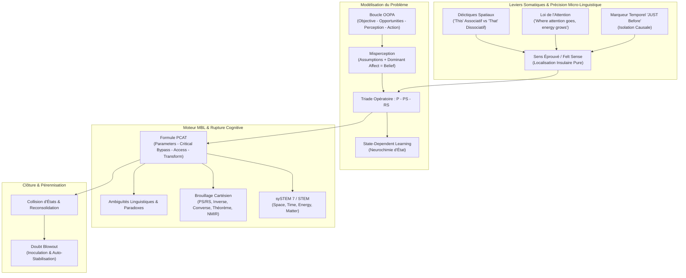

# Practitioner of Mind Bending Language - Transcripts
**Formateur :** Igor Ledochowski | **ID :** `igor-ledochowski-practitioner-of-mind-bending-language-transcripts` | **Tranches :** 67

## Synthèse Architecturale du Cours : Practitioner of Mind Bending Language (Igor Ledochowski)

---

### 1. Thèse Centrale & Philosophie du Cours

#### La Vision Singulière d'Igor Ledochowski vs Approche Standard
Dans la modélisation classique (PNL standard, hypnose ericksonienne orthodoxe ou thérapies cognitivo-comportementales), le problème est traité soit comme un ensemble d'informations narratives et biographiques (contenu), soit comme une chaîne de représentations internes abstraites (VAKOG désincarné) nécessitant de longs rituels d'induction ou des protocoles de recadrage formels.

La posture de Ledochowski prend le contre-pied absolu de cette approche :
1. **Élagage radical du contenu (*Content Stripping*) :** Le contexte narratif, les coupables, les rationalisations et le « pourquoi » sont considérés comme du bruit blanc généré par le néocortex pour justifier une boucle défaillante. Le praticien ne traite aucune histoire ; il n'intervient que sur la structure cybernétique du système.
2. **Le Problème comme Panne de Traitement (*Information-Processing Breakdown*) :** Un problème psychologique n'existe pas en tant qu'entité concrète dans le monde physique. C'est un blocage attentionnel temporaire causé par une distorsion au niveau du filtre perceptuel, elle-même verrouillée par une émotion somatisée.
3. **Le Corps comme Esprit Inconscient Opératoire :** En accord avec le paradigme neurobiologique de Candace Pert, l'inconscient n'est pas un concept métaphorique abstrait : c'est le corps physique et son réseau intéroceptif. Court-circuiter l'intellect ne demande pas une transe les yeux fermés de quarante minutes, mais une simple redirection attentionnelle sur les coordonnées spatiales et kinesthésiques brutes de l'organisme.

#### Le Fil Rouge Méthodologique : L'Équation Cybernétique Universelle
Toutes les interventions du cours, du micro-recadrage conversationnel au *Cartesian Kata*, sont unifiées par une formule sous-jacente stricte :

$$\text{P (Nominalisation)} \xrightarrow{\text{Dissociation}} \text{PS (État Somatique Inconscient)} \xrightarrow{\text{Bypass / Collision}} \text{RS (État Somatique Ressource)} \xrightarrow{\text{Action Réévaluée}}$$

Le praticien isole la sensation causale qui précède immédiatement le comportement limitant (*State-Dependent Processing*), sature la logique séquentielle du facteur critique par des distorsions dimensionnelles/cartésiennes, force l'accès à un état neurochimiquement incompatible, et valide l'effondrement de la boucle en inversant la charge de preuve (*Doubt Blowout*).

---

### 2. Carte des Concepts & Leviers Émergents



#### Liste Structurée des Leviers & Rôles Systémiques

* **Boucle OOPA (*Objective – Opportunities – Perceptions – Action*) :** Modèle diagnostique. Établit que l'impasse ne réside ni dans l'absence d'opportunités objectives ni dans un défaut de volonté, mais dans un verrou perceptuel (*Perception*) qui paralyse la motricité décisionnelle (*Action*).
* **Présomption (*Assumption*) vs Croyance (*Belief*) :** Distinction régie par la *Loi de l'Affect Dominant*. Une présomption cède à la simple information ; une croyance est une présomption cimentée par une charge émotionnelle viscérale nécessitant une intervention somatique.
* **Triade Opératoire $P - PS - RS$ :**
  * **$P$ (Problème) :** L'étiquette conceptuelle ou comportementale (ex: procrastination, doute).
  * **$PS$ (*Problem State*) :** Le substrat neurovégétatif viscéral déclencheur (ex: constriction thoracique, nœud gastrique).
  * **$RS$ (*Resource State*) :** L'état somatique cible neurophysiologiquement incompatible (ex: détente ventrale, clarté).
* **Apprentissage Dépendant de l'État (*State-Dependent Learning & Retrieval*) :** Axiome stipulant qu'une cognition est le sous-produit de l'état neurochimique. Il est biologiquement impossible d'accéder à la solution d'un problème en demeurant dans l'état qui l'a encodé.
* **Loi de l'Attention & Localisation Somatotopique :** Fixer l'attention intéroceptive sur les coordonnées anatomiques d'une sensation active le cortex insulaire et intensifie le signal jusqu'à un seuil critique où le système devient malléable.
* **Micro-Linguistique Déictique (*This* vs *That*) :** Manipulation de la distance psychologique. *« That »* repousse l'état dans l'espace distal/abstrait (dissociation) ; *« This »* impose l'immersion proximale immédiate dans le corps présent (association).
* **Marqueur de Causalité Temporelle (*« JUST Before »*) :** Outil de démarcation rétrograde isolant le déclencheur somatique exact de la chaîne réflexe, éliminant la confusion entre l'état causal et les conséquences émotionnelles du problème.
* **Matrice sySTEM (Space, Time, Energy, Matter) & sySTEM 7 :** Cadre de saturation quadridimensionnelle forçant une revivification phénoménologique immédiate par décharge du bavardage intellectuel.
* **Grille Cartésienne & Opérateurs Modaux :** Brouillage syntaxique articulant l'inversion, la converse, la collision paradoxale et le *Non-Mirror Image Reverse* ($\neg PS \land \neg RS$) pour saturer le facteur critique et effondrer la logique du problème.
* **Doubt Blowout (Clôture Cognitive) :** Inversion délibérée de la charge de preuve en phase finale (*« Es-tu sûr que ce n'est pas temporaire ? »*), contraignant le client à défendre activement sa nouvelle ressource et scellant la reconsolidation mnésique.

---

### 3. Tableau Récapitulatif des Techniques & Démonstrations

| Technique / Exercice | Objectif Opératoire | Déclencheur / Indication | Séquence Résumée |
|---|---|---|---|
| **Instant Mind Bending Language (Kata #1 : Réduction Somato-Kinesthésique)** | Découpler l'étiquette conceptuelle du problème ($P$) de son déclencheur kinesthésique causal ($PS$) et basculer instantanément vers l'état ressource ($RS$). | Sujet enfermé dans la narration, l'intellectualisation ou la plainte circulaire (procrastination, anxiété, doute). | 1. Pré-cadre de décharge de performance.<br/>2. Isoler le $P$ nominalisé.<br/>3. Question somato-causale : *"What's this feeling that this [P] comes from?"*<br/>4. Court-circuit intéroceptif : *"What is your body feeling right now?"*<br/>5. Localisation anatomique précise.<br/>6. Question de bascule logico-somatique (*Flipping Question*).<br/>7. Ancrage verbal déictique (*This*) et expansion. |
| **Isolation Temporelle Rétrograde (*The "JUST Before" Probe*)** | Neutraliser la confusion entre l'effet émotionnel du problème et son amorce kinesthésique réelle en isolant le point de bascule temporel strict. | Client décrivant son comportement limitant comme survenant « de nulle part » ou confondant l'après-coup avec la cause. | 1. Identifier le comportement compulsif/bloqué.<br/>2. Recadrer la chronologie : *"What is happening in your body JUST before you do that?"*<br/>3. Verrouiller la micro-seconde de transition.<br/>4. Extraire la sensation viscérale pure (le felt sense causal).<br/>5. Utiliser cet état racine comme cible d'intervention MBL. |
| **Cartesian Kata Mécanique & Dimensionnel** | Provoquer une rupture du facteur critique par saturation syntaxique et paradoxe logique à l'aide des quatre quadrants cartésiens. | Croyance rigide, rationalisation tenace ou boucle de certitude fermée sur le problème. | 1. Définir clairement $PS$ et $RS$.<br/>2. Quadrant 1 ($PS \land \neg RS$) : Questionner la relation directe.<br/>3. Quadrant 2 ($\neg PS \land RS$) : Inverser les polarités.<br/>4. Quadrant 3 ($PS \land RS$) : Imposer la collision simultanée des deux états.<br/>5. Quadrant 4 ($\neg PS \land \neg RS$) : Déployer le *Non-Mirror Image Reverse* pour créer un vide sémantique.<br/>6. Injecter la ressource dès l'apparition des signes de transe/confusion. |
| **Interrogation Dimensionnelle Pure (sySTEM / sySTEM 7)** | Forcer une revivification somato-sensorielle intégrale sans induction formelle en saturant les coordonnées spatiales, temporelles, matérielles et énergétiques. | Rappel intellectuel sec, souvenir dévitalisé ou besoin de transférer une ressource passée dans le corps présent. | 1. Localiser l'événement ou la ressource.<br/>2. **Space :** Fixer les coordonnées spatiales exactes (où, distance, orientation).<br/>3. **Time :** Fixer le moment précis, la vitesse du temps, la durée.<br/>4. **Matter :** Activer les sous-modalités concrètes (matières, textures, VAKOG).<br/>5. **Energy :** Amplifier la dynamique somatique (température, flux, intensité).<br/>6. Vérifier l'accès neurophysiologique direct. |
| **Moteur PCAT & Collision d'États (MBL Engine)** | Recompiler la structure mnésique en faisant entrer en collision l'état problème activé avec l'état ressource incarné (inhibition réciproque). | Blocage émotionnel stabilisé, phobie simple, anxiété de performance anticipatoire. | 1. **Parameters :** Cartographier $P$ et localiser précisément $PS$ dans le corps.<br/>2. **Critical Factor Bypass :** Question incongruente ou rupture syntaxique MBL.<br/>3. **Access Resource :** Éliciter $RS$ via sySTEM jusqu'à saturation physiologique.<br/>4. **Transform :** Superposer instantanément $RS$ sur la localisation anatomique de $PS$ jusqu'à effondrement kinesthésique.<br/>5. **Test :** Tenter de réactiver $PS$. |
| **Doubt Blowout (Protocole de Clôture & Inoculation)** | Consolider neurologiquement le changement en testant sa stabilité face au scepticisme, forçant le client à argumenter en faveur de sa libération. | Immédiatement après la transformation somatique ou l'effondrement du problème. | 1. Observer le relâchement et la résolution chez le sujet.<br/>2. Adopter une posture sceptique et poser la question inversée : *"Comment sais-tu que ce n'est pas juste passager ?"* ou *"Ne penses-tu pas que le problème va revenir dès demain ?"*<br/>3. Laisser le client chercher et verbaliser les preuves de son nouvel état.<br/>4. Valider l'auto-stabilisation et la fermeture de la boucle. |

---

## Extractions Détaillées par Tranche (Opératoire & Verbatim)


## --- Tranche 1 / 67 ---

Voici l'analyse modélisatrice et opératoire intégrale de la tranche 1/67 du cours *Practitioner of Mind Bending Language* d'Igor Ledochowski.

---

### 1. Mécanismes & Principes Actifs

* **La Boucle OOPA (Objective – Opportunities – Perceptions – Action) et l'Anatomie du Problème**
  * *Principe actif :* Le problème n'est jamais une entité fixe dans le monde réel ; c'est un arrêt du traitement de l'information provoqué par une distorsion cognitive au niveau du filtre perceptuel (*Perceptions*). L'individu poursuit un Objectif (*Objective*), fait face à des Opportunités de l'environnement (*Opportunities*), mais applique une Mauvaise Perception (*Misperception*) structurée par deux verrous : des Présomptions (*Assumptions*) et des Croyances figées (*Beliefs*). Cette distorsion bloque l'Action adaptée. En attaquant linguistiquement les présomptions et croyances qui sous-tendent la perception erronée, l'inconscient est forcé de réévaluer les opportunités réelles et de débloquer l'action motrice.
  * *Tags libres :* #oopa_loop #misperception_collapse #problem_anatomy #unconscious_information_processing

* **Le Syllogisme du Problème (P – PS – RS)**
  * *Principe actif :* Tout problème psychologique repose sur une équation somato-sémantique stricte reliant une étiquette mentale nominalisée (le Problème $P$), un ancrage kinesthésique viscéral d'origine (l'État Problème $PS$), et un pôle téléologique désiré (l'État Ressource $RS$). En isolant la relation causale entre la sensation somatique et la construction mentale, le praticien fragmente la colle émotionnelle qui maintient la gestalt du problème.
  * *Tags libres :* #problem_syllogism #somatic_anchor_isolation #p_ps_rs_triad #neurological_substrate

* **Le sySTEM de Revivification (Space – Time – Energy – Matter)**
  * *Principe actif :* Le cerveau humain code l'expérience subjective dans une matrice quadridimensionnelle d'espace-temps et de matière-énergie. Pour saturer l'hémisphère dominant et forcer une régression/revivification pure (plutôt qu'un simple rappel intellectuel abstrait), le praticien interroge systématiquement l'Espace (*Space* = où), le Temps (*Time* = quand), l'Énergie (*Energy* = dynamique/processus) et la Matière (*Matter* = modalités VAKOG/qui/quoi). Cette saturation des coordonnées réactive les réseaux neuronaux sensoriels exacts de l'expérience, rendant la ressource directement disponible pour la transformation.
  * *Tags libres :* #system_matrix #quadridimensional_revivification #neuro_spatial_coding #sensory_saturation

* **Les 4 Types d'Ambiguïtés Linguistiques (Rupture du Facteur Critique)**
  * *Principe actif :* Le Facteur Critique fonctionne par vérification séquentielle de cohérence logique. L'introduction délibérée d'ambiguïtés force le cerveau à calculer simultanément deux ou plusieurs représentations contradictoires ou imbriquées :
    1. *Ponctuelle (Punctuational) :* Une fin de phrase sert immédiatement de début à la suivante, privant l'écoute de sa ponctuation mentale de clôture.
    2. *Phonologique (Phonological) :* Mots homophones créant une double écoute inconsciente (fondement de la technique *Apply to Self*).
    3. *De Portée (Scope) :* Impossibilité de déterminer à quelle portion de phrase s'applique un modificateur linguistique.
    4. *Syntaxique (Syntactic) :* Structure grammaticale réversible (verbe/nom) suspendant la décision logique.
    Ce traitement parallèle surcharge la mémoire de travail (7 ± 2 items) et produit une ouverture de transe conversationnelle instantanée (*Mind Bend*).
  * *Tags libres :* #critical_factor_overload #ambiguity_engines #syntactic_bifurcation #conversational_trance

* **La Grille PROBAB-ility (Décomposition Dimensionnelle du Conflit)**
  * *Principe actif :* Cartographie exhaustive du système cognitif : Problème ($P$), Ressource ($R$), Objectifs ($O$), Comportements ($B$), Prises de conscience/Sensibilisations ($A$), Croyances ($B$). La résolution se produit en opérant un cisaillement (Spin) entre les prédicats du problème et ceux de la ressource sur les dimensions somatiques, comportementales et attentionnelles.
  * *Tags libres :* #probab_ility_matrix #dimensional_shearing #cognitive_architecture

* **Le Moteur MBL / Formule PCAT (Parameters – Critical Factor Bypass – Access Resource – Transform & Test)**
  * *Principe actif :* L'armature universelle de l'intervention en hypnose conversationnelle :
    1. Extraire les Paramètres de base ($P$, $PS$, $RS$).
    2. Contourner le Facteur Critique (*Critical Factor Bypass*) via une carte MBL (question paradoxale créant un vide sémantique ou un état de confusion).
    3. Accéder à l'état Ressource somatique ou orienter l'attention vers un état neutre/positif.
    4. Fusionner la Ressource et le Problème (*Transform*) pour effondrer le circuit pathologique, puis tester par provocation.
  * *Tags libres :* #pcat_formula #mbl_engine #loop_collapse #hypnotic_recompilation

* **La Fenêtre Cartésienne (Coordonnées Cartésiennes de l'Épistémologie)**
  * *Principe actif :* Application de la logique formelle modale sur la conscience et la connaissance ($A$ = Conscience, $B$ = Savoir) :
    * $A \cdot B$ : Conscience du savoir (Savoir explicite).
    * $A \cdot \sim B$ : Conscience du non-savoir (Ignorance explicite / vide cognitif exploitable).
    * $\sim A \cdot B$ : Inconscience du savoir (Savoir implicite / réservoir de ressources inconscientes).
    * $\sim A \cdot \sim B$ : Inconscience du non-savoir (Angle mort total).
    En forçant le sujet à explorer les zones $\sim A$ et $\sim B$ via le questionnement *sySTEM 7*, le praticien déloge le sujet de sa logique habituelle.
  * *Tags libres :* #cartesian_coordinates #epistemic_window #implicit_knowledge_mining #modal_logic_mbl

---

### 2. Protocoles, Techniques & Démonstrations (Étape par Étape)

#### Protocole 1 : Le Kata 1 d'Échauffement (Warmup Exercise Kata 1)
* **Intention / Indication :** Démonter la nominalisation d'un problème en découvrant son substrat kinesthésique somatique, puis installer un premier pont de bascule vers l'état ressource.
* **Mise en place & Pré-framing :** Cadrage conversationnel direct sans mention d'hypnose. Posture attentive et détendue.
* **Séquence d'actions pas à pas :**
  * *Étape 1 (Isolement du Problème $P$) :* Poser la question directe : *"What’s the problem?"* Valider immédiatement l'accès kinesthésique : *"And you know what it feels like when you’re P?"*
  * *Étape 2 (Extraction de l'État Problème $PS$) :* Forcer la descente somatique : *"What feelings does P come from?"*, *"What do you feel when you have P?"*, *"What is your body feeling when you’re in P?"*, *"Just before you P, what are you/is your body feeling, that causes you to P?"*
  * *Étape 3 (Calibration et Validation de la Résonance) :* *"I get a sense you’re feeling a little of that PS now… or am I misreading the situation? Whereabouts in your body are you feeling PS?"*
  * *Étape 4 (Question de Rupture Logique / MBL Hook) :* *"Could you still be stuck with P, like that, if you felt anything but PS?"*
  * *Étape 5 (Extraction de l'État Ressource $RS$) :* *"What would you need (to feel) so that P/PS had no power over you?"*
  * *Étape 6 (Amorçage Somatique de $RS$) :* *"I have a sense that you’re feeling some RS now? Whereabouts in your body are you feeling RS? Whereabouts in your body would you be feeling RS when P has no power over you?"*
  * *Étape 7 (Transformation & Test par Colapso-Superposition) :* *"As you feel this now, think about P and notice what happens?"*
* **Signes de calibration :** À l'étape 3, micros-tensions posturales, altération respiratoire, regard fixe vers le bas. À l'étape 6-7, relâchement des mâchoires, soupir physiologique, dilatation pupillaire, confusion momentanée suivie d'un sourire ou d'un haussement d'épaules (signe que $P$ a perdu sa structure).

---

#### Protocole 2 : Le Kata 2 de Revivification Élargie (Revivification Kata 2 - RS)
* **Intention / Indication :** Quand le sujet reste piégé dans une narration conceptuelle ou lorsque le simple rappel de ressource est trop tiède pour saturer le système nerveux.
* **Mise en place & Pré-framing :** Exiger un épisode unique et circonstancié dans le passé pour empêcher les généralisations.
* **Séquence d'actions pas à pas :**
  * *Étape 1 :* Identification : *"What do you want to work through today?"* ($P$).
  * *Étape 2 (Capture de l'Événement Singulier - $TP$) :* Demander : *"Can you give me an example of when you have P?"* Si le sujet généralise, recadrer fermement : *"It sounds like this has happened a lot… am I completely wrong? Which time comes to mind? Please pick ONE and tell me about it!"*
  * *Étape 3 (Ancrage Quadridimensionnel sySTEM) :*
    * *Space :* *"Where were you?"*
    * *Time :* *"When was this?"*
    * *Energy/Matter :* *"What do you sense?"*
  * *Étape 4 (Accès $PS$) :* *"How do you feel when you’re in TP? How does your body feel when P/TP/PS?"*
  * *Étape 5 (Vérification du Désir d'Évitement) :* *"Would I be right in thinking you’d rather feel almost any way but like that?"*
  * *Étape 6 (Élicitation Différentielle de $RS$) :* *"How would you like to feel, that’s different? How would you like to feel that’s not PS? When TP, how don’t you feel, that’s better?"*
  * *Étape 7 (Mesure et Densification Somatique) :* *"How do you know when you feel RS? What kind of RS is this RS? How much of this RS are you feeling now?"*
  * *Étape 8 (Effondrement de Structure) :* *"As you think about that/feel this now, think about P and notice what happens?"*
* **Signes de calibration :** Déplacement oculaire net (accès aux souvenirs épisodiques), changement de rythme cardiaque perceptible au pouls carotidien/jugulaire, changement de couleur cutanée lors de la transition de $PS$ à $RS$.

---

#### Protocole 3 : Le Kata 3 sur les Croyances (Beliefs Kata 3)
* **Intention / Indication :** Démanteler une croyance limitante articulée sous la forme "Quand X arrive, je ne peux que réagir par Y".
* **Mise en place & Pré-framing :** Se concentrer sur les moments où l'exception existe déjà dans la neurologie du sujet.
* **Séquence d'actions pas à pas :**
  * *Étape 1 :* *"What’s the problem?"* ($P$).
  * *Étape 2 :* *"When do you have P? When does P come up? Can you give me an example?"* ($TP$).
  * *Étape 3 (Mise en Lumière de la Tautologie / Croyance) :* *"When TP, what makes you think you can only P? What makes you think that when TP you can only P?"*
  * *Étape 4 (Recherche du Contre-Exemple / Espace Ressource $TR$) :* *"Where don’t you P?"*
  * *Étape 5 (Extraction de la Structure de l'Exception) :* *"What do you know about TR that lets you not P?"* ($R$).
  * *Étape 6 (Génération de Rupture & Reconnexion) :* *"As you think about this (R) now, think about P and notice what happens?"*
* **Signes de calibration :** Blocage verbal (le sujet "bugge" à l'étape 3 face à l'absurdité de sa tautologie), recherche interne prolongée (yeux défocalisés), soulagement corporel immédiat à l'étape 4 et 5.

---

#### Protocole 4 : Le Moteur MBL Opératoire en 5 Branches (The MBL Engine)
* **Intention / Indication :** Algorithme de navigation universel face aux réactions du sujet (Réponse Ressource, Réponse Problème, ou Confusion).
* **Séquence d'actions pas à pas :**
  * **Branche I : Paramètres** ($P \to PS \to RS$).
  * **Branche II : Contournement du Facteur Critique** (Poser une question MBL ou lire une carte MBL pour faire disjoncter la logique ordinaire).
  * **Branche III : Évaluation de l'Accès Somatique :** Demander systématiquement : *"How does your body feel now?"*
    * **Scénario A (Le sujet répond positivement / "Good") :**
      * Passer directement à la Transformation : *"As you feel this Good… think about P and notice what happens?"*
      * Tester et Verrouiller : *"Are you sure? What kind of X do you feel? How do you know?"*
    * **Scénario B (Le sujet répond négativement / "Bad" - Boucle d'Échec MBL) :**
      * Ne pas argumenter.
      * Relancer immédiatement une nouvelle question MBL (*Read ANY MBL Card out loud*).
      * Re-tester : *"How does your body feel now?"*
      * Répéter la boucle jusqu'à bascule de l'état somatique vers le neutre ou le positif.
      * Transformer et Tester.
    * **Scénario C (Le sujet répond par la confusion / "Confused") :**
      * Utiliser l'ouverture de transe créée par la confusion pour insérer une revivification pure :
        1. *"How do you want to feel?"* ($RS$).
        2. *"When have you felt RS before?"* (Accès Mémoire).
        3. Dérouler le *sySTEM* : Temps $\to$ Lieu $\to$ Événements $\to$ Sensations.
        4. Re-calibrer : *"How does your body feel now?"*
      * Transformer et Tester.
* **Signes de calibration :** L'état de confusion se repère par l'immobilité motrice complète, l'arrêt des micro-mouvements faciaux, l'absence de clignement des yeux (catalepsie spontanée de transe). C'est le moment d'injecter la revivification sans résistance.

---

### 3. Heuristiques, Subtilités & "Sagesse du Praticien"

* **La Règle d'Or de l'Écoute Active en MBL (The Superpower Lender Rule) :**
  * *Heuristique :* *"Do NOT choose your next question whilst they are talking! Listen, Pause, Ask!"*
  * *Mécanisme :* Si le praticien prépare sa question pendant que le client parle, il réagit à son propre modèle du monde et perd le micro-signal non-verbal où réside la faille de la transe du problème. L'espace de silence (le *Pause*) après la réponse du client désarçonne le modèle prédictif du client et commence déjà à fléchir son esprit (*mind bending*).

* **L'Heuristique de Gradation des Questions d'Énergie (The Energy Axis) :**
  * Pour démonter une stratégie ou explorer un comportement d'excellence, éliminer progressivement les détails pour ne laisser que le moteur du verbe :
    * Faible : *"How do you do X?"* (Laisse le client intellectualiser son contenu).
    * Fort : *"How do you do that?"* (Force l'attention sur l'action globale).
    * Le plus puissant : *"How?"* (Dépouillement total : le système nerveux est forcé de scruter le mécanisme interne brut, sans échappatoire sémantique).

* **L'Heuristique de la Réalité et de la Causalité (The Reality Axis) :**
  * Pour questionner la motivation ou la croyance limitante :
    * Faible : *"Why do you (feel/do) X?"* (Appelle une justification ou une histoire pré-fabriquée).
    * Fort : *"Why that?"* (Isole la cible spécifique).
    * Le plus puissant : *"Why?"* (Porté avec une tonalité interrogative neutre ou curieuse, ce mot unique agit comme un arrêt sur image cognitif).

* **Le Postulat du Visage Heureux ($H+$ / Happy Face) :**
  * *Règle :* Toujours maintenir une physionomie d'acceptation inconditionnelle, de légèreté et de curiosité joyeuse ($H+$).
  * *Mécanisme :* Les neurones miroirs du sujet calibrent constamment la sécurité de l'environnement sur le visage du praticien. Si le praticien prend un air sérieux ou grave face à un problème grave, il ratifie la transe du problème. En projetant un sourire serein et amusé, le praticien disqualifie métaphoriquement la menace du problème.

* **Heuristique de Gestion de la Boucle d'Échec :**
  * *Si* après une question MBL le sujet dit *"Je me sens toujours mal"* ($\text{Bad}$), *alors* ne surtout pas creuser la douleur ni s'excuser ; ré-asséner immédiatement un nouveau pattern ou une nouvelle question MBL. Le problème persiste uniquement parce que le réseau associatif n'a pas encore atteint son point de rupture logique.

* **Piège de Débutant classique :**
  * Poser des questions fermées (auxquelles on peut répondre par Oui ou Non). Dans tous les exercices de modélisation (*Resource Hunter*), les questions fermées sont strictement interdites car elles permettent au mental conscient de conserver le contrôle par une réponse binaire automatique sans fouille transdérivationnelle.

---

### 4. Pépites Verbatim & Patterns Linguistiques (MOT À MOT EN V.O.)

* **Pattern 1 : La Rupture d'Impuissance par Conditionnel Somatique**
  > "Could you still be stuck with P, like that, if you felt anything but PS?"
  * **[Analyse du Pattern]** : Présupposition logique irréfutable enchâssée dans une structure conditionnelle. Le pattern lie la permanence du problème ($P$) exclusivement à la présence de son état kinesthésique habituel ($PS$). Il présuppose que la moindre modification physiologique d'un cran ("anything but PS") anéantit mathématiquement la possibilité d'être "coincé" ("stuck"). L'esprit logique est pris au piège car il ne peut répondre que par la négative, ce qui ouvre la porte au changement immédiat.

* **Pattern 2 : L'Élicitation Différentielle Négative**
  > "Would I be right in thinking you’d rather feel almost any way but like that?"
  * **[Analyse du Pattern]** : Truisme à assentiment forcé combiné à une fausse humilité conversationnelle (*"Would I be right in thinking..."*). Le syntagme *"almost any way but like that"* crée une rupture d'adhérence avec l'état problème : il ne force pas encore le client à savoir ce qu'il veut positivement (ce qui bloque souvent les sujets en dépression), mais ratifie que n'importe quel autre état neurologique dans l'univers est préférable, validant ainsi la transition somatique.

* **Pattern 3 : Le Paradoxe Temporel Négatif**
  > "When TP, how don’t you feel, that’s better?"
  * **[Analyse du Pattern]** : Violation syntaxique délibérée et présupposition de ressource cachée. La question court-circuite la grammaire conventionnelle en demandant de trouver, à l'intérieur même du temps du problème ($TP$), comment le sujet *ne se sent pas*, tout en qualifiant cet état absent de "meilleur" (*"that's better"*). Cela force l'inconscient à faire un balayage transdérivationnel d'états ressources au sein même de la scène traumatique ou problématique.

* **Pattern 4 : L'Ambiguïté Ponctuée par Glissement Sémantique (Punctuational Ambiguity)**
  > "...and you can begin to experience real success is what happens when you start today..."
  * **[Analyse du Pattern]** : Empilement sans couture où le terme nominalisé pivot ("success") agit simultanément comme l'objet direct du premier segment (*"experience real success"*) et comme le sujet grammatical du second segment (*"success is what happens..."*). L'absence de pause bloque la capacité de l'hémisphère gauche à segmenter la phrase, induisant une dérive de l'attention vers un traitement global hypnotique.

* **Pattern 5 : L'Injonction Enchâssée par Renversement Négatif (Embedded Command Blitz)**
  > "You don't have to... RELAX... until your body is ready."
  * **[Analyse du Pattern]** : Commande cachée par emphase tonale sélective et négation permissive. Le Facteur Critique s'accroche à la négation consciente (*"You don't have to"*), tandis que l'inconscient reçoit l'impératif moteur mis en relief par le volume et le changement de tonalité (*"RELAX"*). La clause temporelle subordonnée (*"until..."*) présuppose de façon incontournable que la relaxation va inévitablement se produire.

* **Pattern 6 : L'Effondrement par Superposition d'États (The Transform Pivot)**
  > "As you feel this Good… think about P and notice what happens?"
  * **[Analyse du Pattern]** : Formule classique de liaison temporelle et somatique (*"As you feel [Ressource]... think about [Problème]"*). L'utilisation de la conjonction de simultanéité *"As"* force le système nerveux à maintenir la charge affective positive du néocortex et du système limbique au moment exact où la représentation du problème est rappelée. La commande ouverte finale (*"and notice what happens?"*) présuppose qu'une altération perceptive irréversible est déjà en cours d'exécution.


## --- Tranche 2 / 67 ---

### 1. Mécanismes & Principes Actifs

#### 1. Le Brouillage Cartésien et la Déstabilisation du Cadre Problème
Le système nerveux et la cognition maintiennent un problème actif par une fixation d'équivalence logique rigide : « Quand situation $X$ apparaît $\rightarrow$ je ressens l'état problème $PS$ ». La structure cartésienne (Théorème, Inverse, Réciproque / Converse, Non-Miroir Réciproque) force le cortex préfrontal et les circuits de traitement sémantique à explorer les 4 quadrants de la matrice logique formelle :
- $PS \land \neg RS$ (Inverse)
- $\neg PS \land RS$ (Converse)
- $PS \land RS$ (Théorème / Collision paradoxale)
- $\neg PS \land \neg RS$ (Non-Mirror Image Reverse / Vide sémantique)

En confrontant le cerveau à la possibilité simultanée de l'état problème et de l'état ressource, ou à l'absence simultanée des deux, le traitement analytique linéaire sature. La boucle récurrente du problème se désagrège faute de support syntaxique stable.
- **Terme d'Igor Ledochowski** : *Cartesian Coordinates*, *Cartesian Kata*, *Non-Mirror Image Reverse*.
- **Tags libres** : #brouillage_cartesien #saturation_syntaxique #effondrement_de_cadre #paradoxe_semantique

#### 2. La Collision d'États et Intégration PCAT (MBL Engine)
La formule PCAT (*Parameters, Critical Factor Bypass, Access Resource, Transform*) opère une restructuration neuro-émotionnelle directe. Le levier actif consiste à saturer le facteur critique par des rotations linguistiques (*MBL Spins*) et des questions dimensionnelles (*STEM 7*), de sorte que le système nerveux bascule dans une transe d'apprentissage réceptive. 
Dès que la ressource ($RS$) est pleinement somatisée (vérifiée par calibrage postural/facial), le praticien déclenche la collision : amener la conscience du sujet à contempler la représentation du problème ($P/PS$) *depuis* l'éprouvé somatosensoriel de la ressource. Le système nerveux ne pouvant pas physiologiquement soutenir deux états autonomes orthogonaux en même temps, il recode l'encodage mnésique initial par inhibition réciproque et réconsolidation synaptique.
- **Terme d'Igor Ledochowski** : *PCAT Formula*, *MBL Engine*, *Critical Factor Bypass*, *Transform*.
- **Tags libres** : #collision_detats #inhibition_reciproque #re学会reconsolidation #reconsolidation_mnesique #somatisation_ressource

#### 3. L'Interrogation Dimensionnelle Pure (sySTEM 7 & Spatialisation Neutre)
L'exploration via le protocole *STEM 7* (Espace : *Where*, Temps : *When*, Énergie : *How, Why*, Matière : *What, Who, Which*) extrait le problème de sa charge affective narrative pour l'assigner à des coordonnées spatio-temporelles et sensorielles précises. 
Poser des questions ouvertes non fermées interdit les dérivations binaires (oui/non) et force le sujet à chercher à l'intérieur de sa carte inconsciente. L'absence de projection du praticien combinée à l'attitude faciale et tonale neutre/bienveillante (*Happy Face*, *Pygmalion Effect*) active le réseau par défaut (*Default Mode Network*) du sujet, obligeant l'inconscient à matérialiser de nouvelles structures de sens (comme dans l'exercice *Strange New World* et *Treasure Hunter*).
- **Terme d'Igor Ledochowski** : *sySTEM 7*, *STEM Questions*, *MBL Modifiers*.
- **Tags libres** : #spatialisation_linguistique #system_7 #redirection_attentionnelle #decharge_narrative

#### 4. Le Doubt Blowout (Inoculation et Clôture Cognitive)
Le principe actif du *Doubt Blowout* réside dans le contre-effondrement préventif : inviter explicitement le doute (« Et si cela ne fonctionnait pas quand j'en aurai besoin ? ») pour forcer le client à argumenter lui-même *en faveur* de son changement. En demandant « Pourquoi dis-tu cela ? », le praticien inverse la charge de la preuve : le client doit verbaliser et stabiliser la réalité de sa transformation pour justifier sa certitude.
- **Terme d'Igor Ledochowski** : *Doubt Blowout*, *Test / Justification*.
- **Tags libres** : #doubt_blowout #inversion_charge_preuve #auto_stabilisation #cloture_cognitive

---

### 2. Protocoles, Techniques & Démonstrations (Étape par Étape)

#### Protocole 1 : Le "Cartesian Kata" Mécanique & Dimensionnel (STEM)
* **Intention / Indication** : À utiliser face à une fixation rigide de problème, une phobie, ou une croyance limitante fermée reliant invariablement une situation à un affect négatif.
* **Mise en place & Pré-framing** : Cadrer comme un jeu linguistique rapide pour tester la flexibilité de l'esprit. Clarifier les variables de base par syllogisme :
  1. Paramètre $P$ = Quel est le problème ?
  2. État $PS$ = Comment te sens-tu dans ce problème ?
  3. État $RS$ = Comment veux-tu te sentir à la place ?
* **Séquence d'actions pas à pas** :
  - **Étape 1 - Ancrer le contexte** : Poser le cadre conditionnel : *« When you (P)... »*
  - **Étape 2 - L'Inverse ($PS \land \neg RS$)** :
    - Version mécanique : *« You feel (PS) when you don’t feel (RS), right? »*
    - Version STEM : *« Where you feel (PS)... how don’t you feel (RS)? »*
  - **Étape 3 - La Converse ($ \neg PS \land RS$)** :
    - Version mécanique : *« And, how don’t you feel (PS), when you feel (RS)? »*
    - Version STEM : *« And, how don’t you feel (PS), where you feel (RS)? »*
  - **Étape 4 - Le Théorème ($PS \land RS$)** :
    - Version mécanique : *« And how could you feel any (PS) when you totally feel (RS)? »*
    - Version STEM : *« And when could you feel any (PS) where you totally feel (RS)? »*
  - **Étape 5 - Le Non-Mirror Image Reverse ($\neg PS \land \neg RS$)** :
    - Version mécanique : *« And how could you not feel (PS), when you don’t even feel (RS)? »*
    - Version STEM : *« And why would you not feel any (PS), when you don’t even feel (RS)? »*
  - **Étape 6 - Lissage Social (*Cartesian Kata - Social*)** :
    - Réitérer les 4 quadrants en intégrant des intonations naturelles, conversationnelles et non bizarres (*« make each question sound NORMAL and NOT WEIRD!! »*).
* **Signes de calibration** :
  - Ralentissement du débit de parole, yeux qui montent (défocalisation/transe de recherche interne).
  - Micro-pauses prolongées, soupirs, confusion spontanée (« Attendez... quoi ? »).
  - Rires ou sourires de décharge traduisant la rupture de la logique du problème.

---

#### Protocole 2 : L'Algorithme PCAT - MBL Engine
* **Intention / Indication** : Résolution rapide complète d'un problème émotionnel ou comportemental par saturation linguistique et collision somatique.
* **Mise en place & Pré-framing** : Pré-cadrer le sujet sur une interaction fluide et directe d'exploration sensorielle.
* **Séquence d'actions pas à pas** :
  - **P (Parameters)** :
    - Éliciter $P$ : *« What’s the problem? »*
    - Éliciter $PS$ : *« How do you feel? »*
    - Éliciter $RS$ : *« How do you want to feel? »*
  - **C (Critical Factor Bypass)** :
    - Appliquer des *MBL Spins* et des questions de coordonnées cartésiennes croisant $PS$ et $RS$ jusqu'à ce que le regard du sujet devienne vague et que son esprit conscient décroche.
  - **A (Access Resource & Calibrage Somatique)** :
    - Vérifier l'accès corporel : *« How does your body feel? »*
    - **Aiguillage somatique strict** :
      - Si expression positive `:)` $\rightarrow$ Passer directement à **T (Transform)**.
      - Si expression négative `:(` $\rightarrow$ Recommencer le Spin (*Spin Again*).
      - Si expression confuse/incertaine `:S` $\rightarrow$ Revivifier la ressource (*Revivify*).
  - **T (Transform)** :
    - Déclencher la superposition : *« As you feel RS… think about (P)/(PS) and notice what happens… »*
    - Laisser le silence opérer l'intégration inconsciente.
  - **Test & Doubt Blowout** :
    - Poser les questions de test provocateur : *« How do you feel about it now? »*, *« Really? »*, *« How do you know? »*, *« Why do you say that? »*.
    - **Épreuve du Doubt Blowout** : Simuler l'objection du client : *« What if this doesn’t work when I need it to? »* puis le sommer de justifier sa nouvelle configuration : *« Why do you say that? »*, *« Why do you think that? »*.
* **Signes de calibration** :
  - Changement de tonus musculaire (décontraction des épaules, respiration ventrale profonde lors de l'accès à $RS$).
  - Impossibilité visible de réactiver la tension somatique de $PS$ lors de la phase de transformation $T$.
  - Posture engagée et certitude assertive face aux questions de test.

---

#### Protocole 3 : Exploration Somato-Spatiale ("Strange New World" & "Treasure Hunter")
* **Intention / Indication** : Construire ou amplifier une transe d'apprentissage créative et débloquer des ressources inconscientes sans contenu préconçu.
* **Mise en place & Pré-framing** : Demander au sujet d'imaginer un paysage qu'il n'a jamais vu auparavant. Règle absolue pour le praticien : interdiction des questions fermées (oui/non), obligation de curiosité sincère et de pauses réceptives.
* **Séquence d'actions pas à pas** :
  - **Phase 1 : Strange New World** :
    - Poser successivement des questions issues de *sySTEM 7* (Où, Quand, Comment, Pourquoi, Quoi, Qui, Lequel) complétées par les modificateurs MBL (*Negation*, *Awareness*, *Predicates*).
    - Chaque réponse stabilise et densifie la réalité somato-sensorielle du paysage mental.
  - **Phase 2 : Treasure Hunter Frame** :
    - Cadrer la quête : *« Somewhere in the place, there is a buried treasure meant for you. We don’t know what it is or what it looks like, only that it will give you something powerful that you need. This treasure is yours, so it is intimately connected to you. Find it! »*
    - Poser 7 questions STEM consécutives orientées vers l'action de détection du trésor.
    - Dès qu'un artefact ou symbole émerge, poser des questions STEM sur le pouvoir ou le don qu'il transmet au sujet.
* **Signes de calibration** :
  - Respiration calée sur le rythme de la description spatiale.
  - Mouvements oculaires d'exploration spatiale réelle.
  - Réaction affective spontanée (surprise, illumination faciale) lors de la découverte du « trésor ».

---

### 3. Heuristiques, Subtilités & "Sagesse du Praticien"

#### Règles Conditionnelles de Guidage (Arbres de Décision IF/THEN)
- **Si** le sujet répond par un simple acquiescement ou tente une réponse binaire, **alors** refuser la réponse et reformuler immédiatement une question ouverte pure (*STEM 7*), **parce que** les questions fermées permettent au facteur critique conscient de maintenir son verrouillage logique habituel.
- **Si** au moment de vérifier l'accès à la ressource (*Check Body*), le visage ou le corps du sujet montre un affect négatif `:(` , **alors** ne surtout pas forcer la transformation et relancer un cycle de déstabilisation (*Spin Again*), **parce que** tenter une intégration sur une ressource non stabilisée ancrerait le problème au lieu de le dissoudre.
- **Si** le sujet montre un état dubitatif ou partiel `:S` lors de l'accès à la ressource, **alors** ré-éliciter et intensifier l'état ressource (*Revivify*) avant toute tentative de collision avec le problème.
- **Si** le sujet semble déstabilisé par l'étrangeté syntaxique du *Cartesian Kata*, **alors** adoucir l'armature logique avec un ton conversationnel et social absolument naturel (*« make each question sound NORMAL and NOT WEIRD!! »*), **parce que** la rupture de pattern doit désorienter la structure interne du problème, pas briser le rapport relationnel.
- **Si** le praticien se surprend à préparer sa prochaine question pendant que le sujet s'exprime, **alors** s'arrêter net, écouter jusqu'au dernier mot, marquer une pause franche, réfléchir puis seulement formuler la question, **parce que** l'écoute chirurgicale et le timing du silence sont les vrais vecteurs de l'hypnose conversationnelle.

#### Pièges Classiques & Erreurs de Débutant
1. **L'Urgence de Réparer (*Need to Fix*)** : Le piège mortel en MBL consiste à vouloir résoudre immédiatement le problème. L'heuristique fondamentale d'Igor Ledochowski est d'explorer le problème le plus longtemps possible *sans* le réparer (*« See how long you can explore WITHOUT solving it! How long can you go without accidentally resolving it? »*). C'est la précision de l'exploration qui dissout le problème par effet secondaire.
2. **La Voix Bizarre / Le Ton Hypnotique Artificiel** : Prendre une voix mystique ou théâtrale alerte le facteur critique. Le praticien doit maintenir le *Happy Face*, un regard pétillant de curiosité sincère et une intonation de conversation quotidienne ordinaire.
3. **Le Manque de Test Rigoureux** : Accepter un premier « ça va mieux » sans contester le résultat. Le praticien doit activement challenger le sujet avec insistance (*« Really? How do you know? Why do you say that? »*) pour consolider l'autonomie neurologique du changement.

---

### 4. Pépites Verbatim & Patterns Linguistiques (MOT À MOT EN V.O.)

#### 1. Verbatim : L'Enchaînement du Cartesian Kata (Mécanique)
> "When you (P)… you feel (PS) when you don’t feel (RS), right? And, how don’t you feel (PS), when you feel (RS)? And how could you feel any (PS) when you totally feel (RS)? And how could you not feel (PS), when you don’t even feel (RS)?"

* **[Analyse du Pattern]** : 
  - **Structure logique** : Balayage systématique des 4 pôles cartésiens. 
  - **Effet syntaxique** : La première question verrouille l'évidence consciente (truisme de départ). La deuxième insère une présupposition d'exclusion réciproque via la négation enchâssée (*« how don't you feel »*). La troisième pose une impossibilité cognitive absolue grâce au quantifieur universel et à l'intensifieur (*« how could you feel ANY... when you TOTALLY feel »*). La quatrième crée un vide logique déstabilisateur (*Non-Mirror Image Reverse*), provoquant une suspension immédiate du traitement conscient par surcharge combinatoire de doubles négations (*« not feel... don't even feel »*).

---

#### 2. Verbatim : Le Cartesian Kata Dimensionnel (STEM)
> "When you (P)… where you feel (PS)… how don’t you feel (RS)? And, how don’t you feel (PS), where you feel (RS)? And when could you feel any (PS) where you totally feel (RS)? And why would you not feel any (PS), when you don’t even feel (RS)?"

* **[Analyse du Pattern]** : 
  - **Structure logique** : Substitution des prédicats vagues par des ancrages spatio-temporels purs (*Where, When, How, Why*).
  - **Effet syntaxique** : L'utilisation de *« where »* spatialise l'émotion subjective dans le système nerveux ou le champ perceptif, transformant une généralisation en un conteneur délimité. L'association de *« where you feel (PS) »* avec *« how don't you feel (RS) »* force une scission sensorielle interne. L'esprit est contraint de chercher des coordonnées précises pour deux états contradictoires, ce qui fragmente l'encodage synesthésique du problème.

---

#### 3. Verbatim : L'Induction Métaphorique du Chasseur de Trésor
> "Somewhere in the place, there is a buried treasure meant for you. We don’t know what it is or what it looks like, only that it will give you something powerful that you need. This treasure is yours, so it is intimately connected to you. Find it!"

* **[Analyse du Pattern]** : 
  - **Structure logique** : Double cadrage de dissociation et d'appropriation identitaire.
  - **Effet syntaxique** : L'indéfini spatial (*« Somewhere in the place »*) stimule la recherche inconsciente globale. La négation de contenu informatif (*« We don’t know what it is or what it looks like »*) court-circuite toute résistance ou attente logique de l'hémisphère gauche. La présupposition modale de nécessité bénéfique (*« it will give you something powerful that you need »*) installe une attente de ressource positive (*Pygmalion effect*). L'affirmation identitaire (*« This treasure is yours, so it is intimately connected to you »*) fusionne l'objet externe imaginé avec une ressource du soi profond, conclue par l'impératif direct d'activation motrice et attentionnelle (*« Find it! »*).

---

#### 4. Verbatim : L'Attaque de Transformation et Provocation de Consolidation
> "As you feel RS… think about (P)/(PS) and notice what happens… How do you feel about it now? Really? How do you know? Why do you say that? Why? Really? How do you know…"

* **[Analyse du Pattern]** : 
  - **Structure logique** : Subordonnée temporelle de pontage d'états (*As you...*) suivie d'un empilement d'interrogations de calibration déstabilisatrices.
  - **Effet syntaxique** : La conjonction *« As you feel RS... »* présuppose que l'état ressource est déjà pleinement actif et dominant dans le corps au moment précis où la pensée de $P$ est convoquée. Le prédicat de prise de conscience ouvert *« and notice what happens… »* suspend le jugement critique et oriente l'attention sur les micro-changements phénoménologiques. La salve de relances incisives (*« Really? How do you know? Why? »*) joue le rôle de contre-épreuve : loin de chercher à rassurer, elle contraint le sujet à rationaliser et à défendre la disparition de son propre blocage, scellant la transformation de manière pérenne dans son modèle du monde.


## --- Tranche 3 / 67 ---

Voici l'analyse modélisatrice et opératoire intégrale de la tranche 3/67 du séminaire *Practitioner of Mind Bending Language* d'Igor Ledochowski.

---

### 1. Mécanismes & Principes Actifs

#### 1. La Boucle OOPA (*OOPA Loop*) et la localisation de l'impasse cognitive
* **Principe actif :** Dérivée de la boucle décisionnelle militaire OODA (Observe, Orient, Decide, Act), la boucle OOPA modélise la mécanique de génération et de résolution d'un problème à travers quatre composantes :
  1. **O**bjective (Objectif)
  2. **O**pportunities (Opportunités)
  3. **P**erceptions / Perspectives (Perceptions / Perspectives)
  4. **A**ction (Action)
* **Mécanisme neurologique & cognitif :** 
  * Un problème n'existe jamais en soi dans la réalité matérielle objective : il est le produit d'un dysfonctionnement systématiquement logé au niveau du filtre de la **Perception** (`P`).
  * Dès qu'un **Objectif** est formulé, le Système Réticulaire Activateur (SRA / *Reticular Activating System*) réoriente instantanément les filtres attentionnels pour scanner l'environnement et détecter des **Opportunités**. Si la perception est biaisée ou restreinte, l'objectif sélectionné peut être inadéquat (un faux objectif qui n'est qu'une opportunité dégradée par défaut) ou excessivement bas (plafond de verre de ce qui est jugé « faisable »).
  * Les opportunités existent dans l'environnement indépendamment du sujet ; si la perception est verrouillée, l'opportunité devient invisible.
  * Si l'objectif est clair et les opportunités perçues, mais que l'**Action** est bloquée (procrastination, conflit interne, peur), c'est encore une distorsion perceptive (la perception de l'action ou de ses conséquences émotionnelles) qui inhibe le passage à l'acte.
* **Tags :** `#OOPA_Loop` `#perceptual_distortion` `#reticular_activating_system` `#problem_dissolution_locus` `#action_inhibition`

#### 2. La distinction opératoire : Présomption (*Assumption*) vs Croyance (*Belief*)
* **Principe actif :** 
  * Une **Présomption** (*Assumption*) est une simple erreur ou omission perceptive dénuée de charge affective. Elle cède instantanément dès qu'une information contradictoire ou qu'un point aveugle est verbalisé (« Ah tiens, c'est vrai »). Aucune résistance homéostatique n'est engagée.
  * Une **Croyance** (*Belief*) est une présomption stabilisée et cimentée par l'affect (`Belief = Assumption + Emotion`). En vertu de la *Loi de l'Affect Dominant*, l'émotion verrouille la cognition et empêche la révision logique, poussant le sujet à rationaliser même face à une preuve factuelle irréfutable (syndrome du *« Too good to be true »*).
* **Tags :** `#assumption_vs_belief` `#law_of_dominant_affect` `#emotional_stabilization` `#cognitive_lock`

#### 3. La prophétie auto-réalisatrice via le Biais d'Attente (*Expectation Bias*) et l'Amorçage Somatique
* **Principe actif :** Une croyance émotionnellement investie génère un biais d'attente qui façonne le comportement non-verbal / somatique involontaire du sujet (ex: regard fixe, posture de défi inconsciente). Ce comportement somatique agit comme un stimulus environnemental forçant l'interlocuteur à réagir défensivement ou agressivement. Le sujet traite ensuite cette réaction externe comme la « preuve » objective que sa croyance initiale était exacte, tout en s'excluant causalement de l'interaction (*« Moi je n'ai rien fait »*).
* **Tags :** `#expectation_bias` `#self_fulfilling_prophecy` `#somatic_projection` `#interpersonal_feedback_loop`

---

### 2. Protocoles, Techniques & Démonstrations (Étape par Étape)

#### Cartographie Diagnostique OOPA (Localisation de la Distorsion Perceptive)
* **Intention / Indication :** Déterminer précisément où se situe le verrou perceptif chez le sujet avant d'appliquer une formulation de *Mind Bending Language* pour dissoudre le problème.
* **Mise en place & Pré-framing :** Cadrer la discussion sur le fait qu'un problème n'est jamais un manque réel d'options dans le monde, mais une distorsion dans la boucle perception-action. Écarter l'accusation morale de la victime tout en rétablissant sa souveraineté causale (*« Le sujet a du pouvoir, pas nécessairement la faute »*).
* **Séquence d'actions pas à pas :**
  * **Étape 1 : Élicitation de l'Objectif (`O`)**
    * Vérifier la cible du sujet. S'agit-il d'un véritable objectif ou d'une opportunité par défaut choisie par résignation (effet de survie/pénurie) ?
    * *Test :* Est-ce que le sujet s'interdit un objectif plus élevé par verrouillage perceptif de faisabilité ?
  * **Étape 2 : Évaluation du Scan des Opportunités (`O`)**
    * Vérifier si le sujet perçoit les voies d'accès disponibles.
    * S'il déclare être « coincé » ou dit « il n'y a aucune solution dans ce monde », diagnostiquer une cécité perceptive induite par le Système Réticulaire Activateur.
  * **Étape 3 : Évaluation du Passage à l'Action (`A`)**
    * Si l'objectif est valide et les opportunités visibles mais qu'il y a procrastination ou évitement : isoler la distorsion perceptive qui colore négativement l'action ou génère un conflit d'affects.
  * **Étape 4 : Test de Flexibilité : Présomption ou Croyance ?**
    * Apporter une contradiction ou un angle alternatif neutre :
      * Si le sujet pivote sans résistance $\rightarrow$ C'était une simple *Assumption* (résolue).
      * Si le sujet rationalise, doute émotionnellement ou défend l'impasse $\rightarrow$ Diagnostiquer une *Belief* verrouillée par un affect dominant (nécessite l'intervention MBL).
* **Signes de calibration :**
  * *Présomption :* Haussement d'épaules, regard qui se défocalise brièvement, acceptation verbale décontractée (*« Oh, I never thought of that »*).
  * *Croyance :* Tension corporelle, regard fixe, recherche immédiate d'excuses ou de contre-arguments non rationnels (*« There must be something wrong »*), rigidité du ton de voix.

---

### 3. Heuristiques, Subtilités & "Sagesse du Praticien"

1. **Règle de dissolution vs résolution :**
   * *Heuristique :* Le but du Mind Bending Language n'est pas de « résoudre » un problème (ce qui validerait son existence dans la réalité), mais de le **dissoudre** (*dissolve problems*). Si la perception change, le problème cesse d'exister en tant que structure.
2. **Règle de causalité vs culpabilité :**
   * *Heuristique :* *« The victim has power, which is different from having fault. »* Ne jamais blâmer le sujet pour sa situation, mais toujours calibrer comment ses propres croyances pilotent des micro-comportements inconscients (regard, posture) qui provoquent la réaction de son environnement.
3. **Règle d'apprentissage adulte :**
   * *Heuristique :* L'apprentissage du MBL exige de ne pas trop forcer cognitivement (*« Don’t try too hard »*). La posture optimale est l'enthousiasme ludique (*fun & gusto*). Trop d'effort analytique bloque la spontanéité requise pour le langage hypnotique conversationnel.
4. **Du script au Freestyle :**
   * *Heuristique :* Intégrer d'abord la mécanique de manière linéaire et relativement scriptée pour que le système nerveux intègre les sensations visuelles, auditives et kinesthésiques du pattern, avant de dissoudre progressivement la structure pour aller vers le freestyle complet.

---

### 4. Pépites Verbatim & Patterns Linguistiques (MOT À MOT EN V.O.)

#### 1. Recadrage de la Genèse et de l'Attribution (Pacing & Leading d'autorité)
> **Igor Ledochowski :**  
> *"If you see any genius in what we’re doing here over the next few days, if there’s anything in particular you love that gets you excited about using language, hypnotic language in all kinds of different contexts, than please at least mentally give some kudos to my mentor, John Overdurf, because this would not exist without him or his hard work. The thing that I have managed to finally, after about 20 years of looking at this is, is I’ve figured out how to teach Mind Bending Language in a systematic, organized, simple way that doesn’t require you to speak like you’re on drugs."*

* **[Analyse du Pattern] :**  
  * **Présupposition de compétence future :** En utilisant la structure conditionnelle *"If you see any genius... if there's anything in particular you love that gets you excited"*, Ledochowski présuppose comme acquis que les étudiants vont voir du génie et ressentir de l'enthousiasme.
  * **Rupture de pattern par contraste comique :** L'expression contrastée *"doesn't require you to speak like you’re on drugs"* démonte la croyance limitante selon laquelle le langage hypnotique complexe et l'hypnose conversationnelle avancée doivent sonner de manière bizarre, incohérente ou ésotérique.

---

#### 2. Question d'Élicitation de Biais Perceptif (Mise en évidence du verrou de croyance)
> **Igor Ledochowski :**  
> *"Who here would like to be a billionaire? Post a Y or N. [...] Who set that as a goal, something you’re actively striving towards? [...] What’s going on? You would love to be a billionaire, but none of you have set that as an objective as something you’ll work towards. Why? Because your perspectives are locked. You don’t think it’s feasible. You don’t think you can do it. You don’t think you have it within you to achieve it..."*

* **[Analyse du Pattern] :**  
  * **Création d'une dissonance cognitive immédiate :** Rapprochement brutal entre le désir avoué (*"Yes"*) et le comportement réel (*"No"*). 
  * **Empilement de présuppositions d'impuissance calibrées :** La séquence de phrases courtes en staccato (*"You don't think it's feasible. You don't think you can do it. You don't think you have it within you..."*) verbalise la structure exacte du dialogue interne limitant des participants, forçant le système nerveux à reconnaître que le blocage ne vient pas de l'environnement, mais de la frontière auto-imposée de leur perception.

---

#### 3. Déconstruction de la Croyance par la Question du Même Objet (Test de l'Assumption)
> **Igor Ledochowski :**  
> *"The person who is only assuming that the more expensive thing is the higher quality, will buy from the more expensive vendor until someone challenges the assumption and says, what’s the difference? Same brand of jeans. Same color. What’s the difference? They’ll go huh, you know what you’re right I’m buying the cheaper set. The person who has the belief, on the other hand, can’t emotionally justify the decision. They say I don’t know, something is wrong, something dodgy about it, it must be a knock off copy."*

* **[Analyse du Pattern] :**  
  * **Démonstration par contraste syntaxique :** Ledochowski utilise le questionnement en boucle (*"What’s the difference? Same brand of jeans. Same color. What’s the difference?"*) pour modéliser l'intervention chirurgicale qui fait tomber une *Assumption*.
  * **Modélisation de la rationalisation affective :** En formulant *"something is wrong, something dodgy about it"*, il met en lumière le caractère viscéral et pré-rationnel de la croyance (*Belief*), où l'intellect fabrique des justifications a posteriori pour protéger l'état émotionnel dominant (*Law of Dominant Affect*).


## --- Tranche 4 / 67 ---

### 1. Mécanismes & Principes Actifs

- **La boucle de prophétie autoréalisatrice par projection somato-attentionnelle**  
  Le sujet projette son modèle interne (croyance : *"je suis une victime / on va m'agresser"*) sur le monde extérieur. Cette projection ne reste pas abstraite : elle contraint le corps et l'attention à adopter un comportement non verbal précis (fixer intensément du regard / *staring*). Ce comportement émet un signal de défi qui active l'insécurité des autres acteurs de l'environnement, déclenchant chez eux une riposte agressive. Le sujet boucle alors son schéma cognitif : *"Vous voyez, je n'ai rien fait et on m'attaque"*. L'individu observe littéralement son problème jusqu'à le faire exister dans la réalité tangible.  
  *Tags :* `#boucle_de_retroaction_projective` `#biais_de_confirmation_somatique` `#creation_perceptive_du_reel` `#projection_to_reality`

- **Distinction opératoire : Perception vs Perspective**  
  La *perception* est la réception brute du signal sensoriel (les yeux, les oreilles et la peau captent en permanence les mêmes stimuli physiques). La *perspective* est le filtre cognitif, le cadre de traitement interne composé de présuppositions et de croyances qui oriente, limite ou autorise le signal à atteindre certaines zones du cerveau. Les croyances ne définissent pas notre capacité à percevoir (l'appareil sensoriel reste intact), elles contraignent la perspective, créant une cécité sélective aux opportunités et verrouillant l'éventail des actions motrices possibles.  
  *Tags :* `#filtrage_perceptif` `#perspective_vs_perception` `#contrainte_cognitivo_sensorielle` `#linchpin_perceptuel`

- **L'accès au Sens Éprouvé (Felt Sense / Gendlin) comme commutateur neurologique**  
  S'appuyant sur les travaux d'Eugene Gendlin (*Focusing*), le succès thérapeutique est prédit non par l'orientation de l'intervenant, mais par l'effort actif du sujet à localiser, contacter et verbaliser un ressenti corporel interne flou ou spécifique (*"I have a sense of like I don't know, it's a strange feeling..."*). Réduire une construction linguistique abstraite (un problème mental complexe ou une relation de cause à effet) à une sensation somatique localisée permet de court-circuiter le bavardage analytique du néocortex et d'opérer directement sur l'état physiologique sous-jacent.  
  *Tags :* `#felt_sense` `#ancrage_somatotopique` `#reduction_d_etat` `#marqueur_de_changement`

- **La triade minimale opératoire MBL : Problème (P), État Problème (PS), État Ressource (RS)**  
  Le *Mind Bending Language* ne requiert que trois données critiques pour faire s'effondrer une structure problématique : l'étiquette verbale du problème ($P$), la signature kinesthésique/somatique du problème ($PS$) et la signature kinesthésique/somatique de la ressource ($RS$). La quasi-totalité des blocages humains se structurent sous forme de relation de cause à effet : *"Je ressens X, par conséquent je ne peux pas / je dois faire Y"*. En cassant le lien d'exclusivité entre l'action et le ressenti corporel, la boucle s'effondre.  
  *Tags :* `#triade_informationnelle_mbl` `#cause_effet_collapse` `#deconstruction_somato_semantique`

---

### 2. Protocoles, Techniques & Démonstrations (Étape par Étape)

#### Démonstration : "Instant Mind Bending Language" / Kata #1 (Structure de Réduction Somato-Kinesthésique)

* **Intention / Indication :**  
  À appliquer sur les structures de problèmes construites sur une équivalence complexe ou une cause/effet du type : *"Je ressens [État X], donc je fais/ne fais pas [Comportement Y]"* (ex. : perfectionnisme, procrastination, évitement, anxiété de performance).
* **Mise en place & Pré-framing :**  
  - Choisir un problème d'intensité mineure ou moyenne.  
  - Pré-cadrage de décharge de performance : *"Le problème aura bougé d'ici la fin du processus, mais vous devez accepter qu'il ne disparaisse pas forcément instantanément."* Ce pré-cadrage désactive l'attente anxieuse et l'esprit critique d'analyse.

* **Séquence d'actions pas à pas :**
  1. **Nommage du Problème ($P$) :**  
     Demander au sujet d'identifier le blocage.  
     *(Exemple : perfectionnisme / s'auto-persuader de ne pas agir).*
  2. **Connexion & Extraction de l'Origine Émotionnelle :**  
     Faire basculer de l'étiquette intellectuelle à la charge affective.  
     *Formule :* *"What's this feeling that this [Problem] comes from?"*
  3. **Localisation et Précision Somatique de l'État Problème ($PS$) :**  
     Forcer la description physique et kinesthésique pure, puis calibrer son activation dans l'instant présent.  
     *Question :* *"What is your body feeling when you're doing all of this?"*  
     *Relance :* *"Whereabouts in your body are you feeling it now?"*  
     *(Le sujet rapporte : tension, rigidité, peur dans l'estomac).*
  4. **La Question de Rupture MBL (Clean Mind-Bending Question) :**  
     Poser la question pivot créant une contradiction logique directe entre l'état somatique et le problème :  
     *Formule :* *"Could you still be stuck with [Problem] like that if you felt anything but [Tension / PS] in here?"*  
     *(Rupture de pattern : le cerveau bloque, le sujet sourit sans pouvoir traiter immédiatement l'information néocorticale, puis répond "Non").*
  5. **Élicitation de l'État Ressource ($RS$) :**  
     Détourner le système nerveux vers l'état alternatif obligatoire.  
     *Question :* *"So what would you need to feel so that [Problem] had no power over you?"*  
     *(Le sujet nomme : "Excited / really succeed").*
  6. **Localisation Somatotopique et Amplification du $RS$ :**  
     *Formule :* *"Whereabouts in your body are you feeling that [Resource]?"*  
     *(Le sujet localise : "Dans mon cœur, autour de cette zone").*
  7. **Test de Collision / Écroulement de la Structure :**  
     Maintenir l'attention dans l'ancrage somatique de la ressource tout en réinjectant l'évocation de l'ancien problème.  
     *Formule :* *"As you feel it in your [Location RS] now, go ahead and think about [Problem] and just notice what happens now."*  
     *(Réponse du sujet : "Ça n'a plus d'importance / il n'y a plus de pensées conflictuelles, c'est limpide").*

* **Signes de calibration observés par le praticien :**  
  - À l'étape 3 : Micro-tensions posturales, altération de la voix, regard figé, validation que l'état problème est actif *hic et nunc*.  
  - À l'étape 4 : Le **sourire de surcharge cognitive** (le sujet rit ou sourit bêtement en disant *"I didn't really process it"* : indicateur absolu de transe de rupture/Mind Bend).  
  - À l'étape 6 : Respiration qui descend, posture qui s'ouvre, pointage spontané de la main sur la région du cœur.  
  - À l'étape 7 : Décrochage émotionnel, absence de charge conflictuelle, clarté visuelle et cognitive déclarée.

---

### 3. Heuristiques, Subtilités & "Sagesse du Praticien"

- **Règle d'or de l'alternative de formulation : Ne jamais avancer sur une marche brisée (*Never move on a broken step*)**  
  *Heuristique :* Si une question principale du kata ne produit pas l'accès neurologique requis (le sujet intellectualise, dit *"je ne sais pas"* ou ne trouve pas la sensation), **interdiction stricte** de passer à la question suivante. Si l'étape 2 ou 3 n'est pas solidement ancrée dans le corps, la question de rupture (étape 4) s'effondre dans le vide sans effet de levier. Le praticien utilise immédiatement une variante de reformulation (ex. : basculer de *"What feelings does P come from?"* à *"What is your body feeling when you're in P?"*).
- **Le problème n'existe que par sa perception directe ou symptomatique**  
  *Heuristique :* On n'a pas de problème tant qu'on ne perçoit pas les symptômes ou les effets secondaires du problème (l'exemple de la bavure végétale qui gratte sans qu'on sache ce que c'est, versus la bavure imperceptible). Si le sujet ne perçoit aucune conséquence dysfonctionnelle, le praticien ne doit pas lui imposer une pathologie.
- **Les problèmes de haute qualité (*High Quality Problems*)**  
  *Heuristique :* Lorsque la perspective et la situation d'un sujet progressent, d'anciens problèmes disparaissent pour laisser place à des dilemmes d'un niveau supérieur (ex. : ne plus s'inquiéter de payer son loyer, mais s'inquiéter de l'allocation d'actifs de son surplus financier). Le praticien ne cherche pas l'absence absolue de défis, mais l'élévation qualitative de la nature des défis.
- **Trop de "spin" tue l'accès : Tolérance à la non-compréhension**  
  *Heuristique :* Si une question de Mind Bending a trop de "spin" (trop de distorsion logique pour un client ou un stagiaire) et qu'il bloque intellectuellement sans basculer dans le corps, ne pas chercher à débattre rationnellement ni à sur-expliquer la logique. Changer simplement d'angle linguistique. Le MBL ne s'adresse pas à la logique cartésienne, il utilise la logique pour piéger la logique.

---

### 4. Pépites Verbatim & Patterns Linguistiques (MOT À MOT EN V.O.)

#### La Question de Rupture de Causalité Somatique
> **« Could you still be stuck with perfectionism and that procrastination like that if you felt anything but that tension, rigidity or fear? »**
* **[Analyse du Pattern]** :  
  Présupposition de dépendance exclusive et question négative orientée. La syntaxe force le système nerveux à explorer l'espace logique inverse : elle présuppose que le blocage comportemental (*perfectionism and procrastination*) est physiquement et obligatoirement asservi à une signature somatique précise (*tension, rigidity, fear*). En demandant *"pourriez-vous ENCORE être bloqué si vous ressentiez TOUT AUTRE CHOSE QUE..."*, la phrase rend neurologiquement impossible le maintien du comportement en présence de n'importe quel autre état corporel.

#### La Question Pivot de Ressource Obligatoire
> **« So what would you need to feel so that perfectionism had no power over you? »**
* **[Analyse du Pattern]** :  
  Nominalisation réifiée et dissociation d'influence. Le terme *"perfectionism"* est transformé en une entité externe dotée de *"pouvoir"*, tandis que le verbe modale au conditionnel (*"would you need to feel"*) présuppose qu'il existe d'ores et déjà un état émotionnel spécifique capable d'annihiler ce pouvoir. Le sujet est contraint de générer immédiatement l'état antidote dans son champ kinesthésique.

#### L'Ordre de Collision / Test Post-Hypnotique
> **« As you feel it in your heart now, go ahead and think about perfectionism and just notice what happens now. »**
* **[Analyse du Pattern]** :  
  Liaison temporelle subordonnée (*"As you feel it..."*) servant d'ancrage somatique actif, couplée à une commande enchâssée d'évocation (*"go ahead and think about..."*) et à une suggestion ouverte d'observation sans préjugé (*"just notice what happens now"*). Le système nerveux tente d'activer l'ancien pattern cognitif tout en étant inondé par le signal physique du cœur (excitation/succès), ce qui entraîne l'effondrement immédiat de l'ancienne charge émotionnelle.

#### Recadrage de la Puissance vs la Culpabilité de la Victime
> **« I’m not doing the whole victim blaming thing saying the victim’s at fault, I’m saying the victim has power, which is different from having fault. »**
* **[Analyse du Pattern]** :  
  Distinction de critères par recadrage de sens (Sleight of Mouth : *Redéfinition / Criterion Shift*). Ledochowski sépare chirurgicalement la *faute* (qui immobilise dans la honte et la culpabilité) du *pouvoir* (qui restaure la responsabilité opérationnelle et la capacité d'action causale dans l'environnement).

#### La Loi Perceptive Fondatrice
> **« Perception therefore becomes projection, that’s how we keep rebuilding the same life over and over again, because we are projecting what’s inside of us onto our environment and without realizing it through the constant stream of actions that we take we’re recreating the same conditions that we had before. »**
* **[Analyse du Pattern]** :  
  Équivalence complexe en chaîne causale fermée (*Perception = Projection = Action répétée = Réalité répliquée*). L'utilisation de l'adverbe *"without realizing it"* intègre une présupposition d'action inconsciente automatique, installant chez l'auditeur la prise de conscience que son inertie existentielle n'est pas une fatalité extérieure, mais une boucle motrice et perceptive auto-générée.


## --- Tranche 5 / 67 ---

### 1. Mécanismes & Principes Actifs

- **La Séquence en Marches d'Escalier Indissociables (Linear Dependency Rule)**
  - *Principe actif* : Le Mind Bending Language (MBL) n'est pas une simple collection de questions rhétoriques, mais une architecture cumulative à 7 étapes où chaque question installe une présupposition neurologique indispensable à la suivante. Si une étape échoue (le sujet ne vit pas l'état ou donne une réponse purement intellectuelle), poser la question suivante opère sur une base neurologique vide, rendant l'intervention caduque.
  - *Tags* : #linear_dependency #cumulative_framing #step_completion_heuristic

- **La Distinction Problème vs État-Problème (P vs PS Splitting)**
  - *Principe actif* : Le sujet confond son problème conceptuel/comportemental ($P$, ex: procrastination) avec l'état somatique sous-jacent qui le pilote ($PS$, ex: stress). En séparant linguistiquement l'étiquette comportementale de la charge viscérale, le praticien fragmente la gestalt du blocage et prépare le système à découpler l'action de son déclencheur affectif.
  - *Tags* : #p_vs_ps_distinction #gestalt_fragmentation #affective_decoupling

- **Activation Viscérale et Loi de l'Attention (Law of Attention & Somatic Anchoring)**
  - *Principe actif* : L'énergie psychique et neurologique afflue là où se pose l'attention sélective (*"Where attention goes, energy flows, [and it] grows"*). En demandant de localiser précisément la sensation dans le corps, le praticien force l'activation du cortex insulaire et somatosensoriel. L'état devient présent, tangible et mesurable en temps réel plutôt qu'une abstraction mémorielle.
  - *Tags* : #law_of_attention #somatic_localization #insular_activation #embodiment

- **Contraste d'Intensité et Portée Générative (Generative vs Remedial Shift)**
  - *Principe actif* : Plus l'état-problème est incarné et amplifié au départ (ex: 8-10/10 somatique), plus la rupture et la bascule vers l'état ressource créent un différentiel synaptique dramatique. Ce contraste empêche le sujet de rationaliser la résolution (*"ce n'était pas vraiment un problème"*), validant viscéralement le changement et propageant la résolution par capillarité à d'autres contextes de vie (changement génératif).
  - *Tags* : #contrast_intensity #dramatic_shift #generative_change #remedial_vs_generative

- **Filtrage RAS et Élagage du Contenu (Reticular Activating System Tuning)**
  - *Principe actif* : Face au "flot chaotique d'informations" déversé par un client, le praticien ignore délibérément le contexte narratif, les coupables et les rationalisations pour n'extraire que les signaux d'état (étiquette du problème, ressenti viscéral, localisation corporelle). Comme le RAS qui filtre le bruit ambiant dans une foule pour ne capter que son propre prénom, le praticien isole le signal opératoire pur.
  - *Tags* : #ras_tuning #content_stripping #signal_vs_noise #minimal_moving_parts

- **Déictiques Spatiaux : Dissociation vs Association Subliminale (Deictic Anchoring)**
  - *Principe actif* : L'usage des démonstratifs modifie la distance psychologique et somatique : *"that stress"* repousse l'état à distance spatio-temporelle (dissociation), tandis que *"this stress"* force l'immersion immédiate dans l'ici et maintenant somatique (association).
  - *Tags* : #deictic_anchoring #micro_linguistics #associative_language #dissociative_language

- **La Question de Bascule Logico-Somatique (The Flipping Question / Double Bind)**
  - *Principe actif* : Demander *"Pourrais-tu être coincé avec P si tu ressentais autre chose que PS ?"* confronte le système nerveux à une impossibilité cybernétique. Le cerveau est obligé de reconnaître que le problème n'existe QUE par le carburant de l'état limitant. En validant l'impossibilité, le client accepte implicitement que changer d'état équivaut instantanément à dissoudre le problème.
  - *Tags* : #flipping_question #cybernetic_double_bind #presupposition_of_collapse

---

### 2. Protocoles, Techniques & Démonstrations (Étape par Étape)

#### Protocole : La Manœuvre des 7 Questions MBL (Tranche : Étapes 1 à 5)

* **Intention / Indication** :
  - Déconstruire conversationnellement un problème comportemental ou émotionnel en isolant le ressenti kinesthésique sous-jacent, le connectant au corps, créant une rupture logique, puis réassignant une ressource somatique incarnée.
* **Mise en place & Pré-framing** :
  - Choisir un problème modéré pour l'entraînement.
  - Cadrer l'attention : ne chercher aucune histoire, aucune cause narrative.
  - Principe d'élagage : ramener toute réponse à sa racine affective.

* **Séquence d'actions pas à pas** :

  - **Étape 1 : Extraction du Problème ($P$)**
    - Poser la question directe : *"What’s the problem?"*
    - Isoler le substantif/verbe clé (ex: "procrastination").
    - *Objectif* : Obtenir l'étiquette brute du problème sans laisser le client s'étaler dans l'histoire.
    - *Sécurité / Alternative si échec* : Vérifier la connexion : *"Do you know what it feels like when you're [problem]?"*

  - **Étape 2 : Identification de l'État-Problème affectif ($PS$)**
    - Poser : *"What feelings does [problem] come from?"*
    - *Alternatives équivalentes* :
      - *"What do you feel when you have [problem]?"*
      - *"What is your body feeling when you are in [problem]?"*
      - *"Just before you [problem], what are you, or is your body feeling, that causes you to [problem]?"*
    - *Objectif* : Obtenir une émotion ou sensation pure (ex: "stress", "anxiety").

  - **Étape 3 : Calibration & Incarnation Corporelle (Embodiment)**
    - Poser : *"I get a sense that you're feeling a little bit of this [PS] now, or am I misreading the situation?"*
    - *Focalisation somatique (intensification)* : *"Whereabouts in your body are you feeling this [PS] right now?"*
    - *Micro-ajustement* : Utiliser impérativement le déictique d'association *"this"* plutôt que *"that"*.
    - *Objectif* : Localisation somatique anatomique (ex: "sur mon côté gauche"), rendant le problème vivant et mesurable dans le système nerveux.

  - **Étape 4 : La Question de Bascule (The Flipping Question)**
    - Formuler : *"Could you still be stuck with [P] like that, if you felt anything but [PS]?"*
    - *Règle critique* : Confronter le problème conceptuel ($P$) à l'état somatique ($PS$). Ne jamais demander *"Could you be stuck with PS if you felt anything but PS"*, ce qui serait une tautologie absurde.
    - *Objectif* : Obtenir un "Non" viscéral (rupture de pattern, dissolution logique du problème).

  - **Étape 5 : Élicitation de l'État Ressource ($RS$)**
    - Poser : *"What would you need to feel so that [P] / [PS] has no power over you?"*
    - *Calibration immédiate* : Vérifier si le sujet nomme une ressource déjà émergente dans son corps (ex: "être confortable comme maintenant").
    - *Règle de l'avocat* : Ne jamais passer à l'étape 6 sans avoir calibré que la ressource est déjà présente ou évidente pour le sujet.

* **Signes de calibration** :
  - *Étape 1 & 2* : Micro-expressions congruentes avec l'inconfort, ton de voix qui baisse, regard d'accès kinesthésique interne.
  - *Étape 3* : Mouvements des mains pointant vers une zone corporelle, ralentissement respiratoire, rougeur ou tension visible sur la zone indiquée.
  - *Étape 4* : Arrêt sur image (transfix), clignement des yeux ralenti, sourire de confusion/soulagement (*"Actually I'm feeling almost no stress now"*).
  - *Étape 5* : Relâchement musculaire, soupir végétatif, réalignement postural indiquant l'installation spontanée de la ressource.

---

### 3. Heuristiques, Subtilités & "Sagesse du Praticien"

- **Règle de l'Avocat au Tribunal (The Lawyer's Rule of Questioning)** :
  * *Heuristique* : Ne jamais poser une question dont on ne connaît pas déjà la réponse ou dont on n'est pas certain qu'elle produira l'état requis.
  * *Conséquence* : Avant de lancer l'étape suivante, calibrer la physiologie pour s'assurer que le sujet y est déjà à moitié entré.

- **Ne Jamais Construire sur une Marche Brisée (Never Advance on a Broken Step)** :
  * *Heuristique* : Si le client répond *"Je ne sais pas"* ou intellectualise, s'interdire absolument d'avancer à l'étape suivante. Recadrer, reformuler ou utiliser une question alternative jusqu'à ce que l'objectif fonctionnel de l'étape soit validé.

- **Le Contenu est un Piège (Content Stripping Heuristic)** :
  * *Heuristique* : Si le client commence à expliquer *pourquoi* il procrastine ou *ce qui* cause son stress, l'interrompre/l'ignorer. Le détail narratif est du bruit parasite qui dilue l'intervention. Conserver uniquement l'étiquette du problème et la sensation somatique brute.

- **Intensification Somatique vs SUDs Intellectuel** :
  * *Heuristique* : Ne pas évaluer l'intensité avec des échelles cognitives (SUDs type "sur une échelle de 1 à 10"), car cela réassocie le client au néocortex analytique. Pour mesurer et intensifier, diriger directement l'attention sur la chair : *"Où dans ton corps ressens-tu cela ?"*.

- **Le Double Tranchant de l'Alternative (Efficiency vs Safety)** :
  * *Heuristique* : Poser des questions de vérification de sécurité (ex: *"Sais-tu ce que ça fait quand tu procrastines ?"*) alourdit la structure conversationnelle. En conversationnel fluide, sauter la vérification si la calibration visuelle confirme que le sujet est déjà connecté.

- **Gestion du Déictique (Associative vs Dissociative Anchoring)** :
  * *Si le sujet doit ressentir l'état pour l'incarner* -> Employer *"this"* (ex: *"this stress"*).
  * *Si le sujet doit s'en détacher ou le dépasser* -> Employer *"that"* (ex: *"that problem"*).

---

### 4. Pépites Verbatim & Patterns Linguistiques (MOT À MOT EN V.O.)

#### Verbatim 1 : La Formulation Maîtresse de Rupture Logique (The Flipping Question)
> *"Could you still be stuck with procrastination like that if you felt anything but stress?"*
* **[Analyse du Pattern]** :
  - **Structure syntaxique** : Double lien et présupposition d'exclusivité causale.
  - **Mécanisme** : La question lie rigidement le comportement indésirable (*procrastination*) à l'état émotionnel interne (*stress*). L'adverbe comparatif *"like that"* isole la manifestation actuelle comme transitoire. L'expression restrictive conditionnelle *"if you felt anything but"* force l'esprit inconscient à balayer mentalement toute autre émotion possible (calme, curiosité, assurance), constatant qu'aucune d'entre elles ne permet de maintenir la procrastination. Cela induit une paralysie logique immédiate et l'effondrement de la stratégie d'échec.

---

#### Verbatim 2 : L'Élicitation de Ressource par Négation de Pouvoir
> *"What would you need to feel so that the procrastination and the stress have no power over you?"*
* **[Analyse du Pattern]** :
  - **Structure syntaxique** : Présupposition d'agentivité externe et nominalisation de contrôle.
  - **Mécanisme** : Le syntagme *"have no power over you"* présuppose d'abord que le problème possède actuellement un pouvoir, mais cadre ce pouvoir comme révocable. Le verbe modal d'exigence *"What would you need to feel"* court-circuite le raisonnement cognitif ("que dois-tu faire ?") pour cibler exclusivement un accès kinesthésique d'état. L'inconscient est sommé de rechercher instantanément dans sa mémoire somatique l'antidote affectif qui neutralise l'emprise du symptôme.

---

#### Verbatim 3 : L'Induction d'Intensification par Déictique Proximal
> *"Whereabouts in your body are you feeling this stress right now?"*
* **[Analyse du Pattern]** :
  - **Structure syntaxique** : Commande somatosensorielle à déictiques temporel et spatial proximaux.
  - **Mécanisme** : Le mot composé *"Whereabouts"* présuppose que le stress est déjà spatialement localisé dans le corps (ce n'est pas une idée, c'est un objet physique interne). L'usage intentionnel du démonstratif proximal *"this"* (par contraste avec *"that"*) force le sujet à s'associer dans la sensation immédiate. Le marqueur temporel déictique *"right now"* verrouille l'attention dans l'instant présent, maximisant la charge somatique selon la loi de l'attention.

---

#### Verbatim 4 : Le Feedback de Calibration Permissif (Mind Reading Adouci)
> *"I get a sense you're feeling a little bit of that stress now, or am I misreading the situation?"*
* **[Analyse du Pattern]** :
  - **Structure syntaxique** : Lecture de pensée adoucie par modalisation sensorielle, suivie d'un tag permissif d'échappement.
  - **Mécanisme** : *"I get a sense"* introduit une observation sans imposer d'autorité brute. Le quantificateur minorant *"a little bit of"* réduit la résistance psychologique du sujet en rendant l'état facile à admettre. La clausule de sortie *"or am I misreading the situation?"* désamorce toute réactance psychologique : le sujet n'a plus besoin de lutter contre le praticien et valide spontanément la suggestion d'incarnation.


## --- Tranche 6 / 67 ---

Voici l'analyse opératoire intégrale de la tranche 6/67 du cours *Practitioner of Mind Bending Language* d'Igor Ledochowski.

---

### 1. Mécanismes & Principes Actifs

* **Le Principe de Substitution Inhibiteur / Activateur** :
  * *Mécanisme* : Les blocages comportementaux (tels que la procrastination) ne sont pas des pannes de volonté, mais des réponses motrices court-circuitées par un état somato-émotionnel *inhibiteur* (le stress, l'anxiété, la surcharge cognitive). Pour débloquer l'action, l'esprit n'a pas besoin d'analyse rationnelle, mais d'écraser l'inhibiteur par un état *activateur* somatique (le confort, le soulagement, la sérénité corporelle).
  * *Effet nerveux/cognitif* : Le système nerveux bascule du réflexe d'évitement/sidération (système sympathique de menace) vers un état d'engagement ventral/parasympathique où l'initiation motrice redevient physiologiquement accessible.
  * *Tags* : `#inhibitor_vs_activator` `#state_override` `#somatic_switching` `#action_unfreezing`

* **Induction Spatiale et Linguistique par Déictique (« This » vs « That »)** :
  * *Mécanisme* : Les démonstratifs spatiaux encodent directement la distance psychologique et somatique. L'emploi de « *that* » projette l'expérience dans un espace cognitif distal, abstrait, dissocié ou passé (« cette sensation-là »). L'emploi de « *this* » impose une présence proximale immédiate, somatique et incarnée (« cette sensation-ci, ici et maintenant »).
  * *Effet nerveux/cognitif* : La bascule vers « *this* » efface la dissociation réflexive, force le focus attentionnel sur la proprioception présente et ancre instantanément la ressource dans le corps.
  * *Tags* : `#deictic_anchoring` `#this_vs_that_distance` `#embodied_spatialization` `#subtle_attunement`

* **Dissociation Conscient / Inconscient par la Question Corporelle Somatique** :
  * *Mécanisme* : Interroger l'intellect (« que ressentez-vous face à ce problème ? ») invite à une réponse méta-cognitive, sociale et intellectualisée (« ça craint », « je n'aime pas ça », ou recherche rationnelle d'origines passées). Poser la question « que ressent votre *corps* ? » court-circuite l'appareil analytique et force l'accès direct aux signaux intéroceptifs bruts.
  * *Effet nerveux/cognitif* : Séparation entre le bavardage du cortex préfrontal (commentaires méta) et les sensations viscérales inconscientes (la boucle de rétroaction somatique du problème).
  * *Tags* : `#conscious_unconscious_dissociation` `#somatic_bypassing` `#interoceptive_access` `#meta_commentary_collapse`

* **Prémisse de l'Apprentissage Dépendant de l'État (State Dependent Learning & Processing)** :
  * *Mécanisme* : La cognition humaine ne manipule pas des pensées désincarnées : toute perception, croyance, logique ou comportement est une propriété émergente de l'état somatique sous-jacent (*cause-effect relationship*). En posant la question « de quel sentiment procède le problème ? », on présuppose syntaxiquement que la physiologie/l'affect précède et génère le problème.
  * *Effet nerveux/cognitif* : L'attention du sujet est déroutée de l'histoire du problème (le contenu narratif) pour être focalisée sur la signature physiologique qui le génère.
  * *Tags* : `#state_dependent_learning` `#cause_effect_presupposition` `#affect_first_cognition_second`

* **Effet de Rupture de Schéma / Contraste par Question Mind Bending Incongrue** :
  * *Mécanisme* : Une question formulée de manière syntaxiquement ou sémantiquement inhabituelle (*"What feelings does procrastination come from?"*) crée une micro-confusion ou un arrêt de traitement logique. Si le sujet bloque ou part dans l'intellect, l'enchaînement immédiat sur une question sensorielle simple (*"What do you feel in your body right now?"*) provoque un contraste cognitif massif rendant l'accès à l'expérience somatique limpide et instantané.
  * *Effet nerveux/cognitif* : Surcharge temporaire de la mémoire de travail suivie d'un relâchement hypnotique d'acceptation directe de la question simplifiée.
  * *Tags* : `#cognitive_overload_contrast` `#mind_bending_spin` `#transderivational_stall`

---

### 2. Protocoles, Techniques & Démonstrations (Étape par Étape)

#### Protocole : L'Algorithme des 7 Questions MBL (Phase d'Extraction & d'Écrasement d'État)

* **Intention / Indication** :
  * Extraire un sujet de sa boucle de blocage/procrastination en isolant l'état affectif inhibiteur et en lui superposant un état activateur incarné, sans entrer dans le contenu narratif.
* **Mise en place & Pré-framing** :
  * Exécution purement déclarative et directe (*overt*). On avertit que l'exercice est volontairement structuré comme un « kata » d'entraînement aux réflexes de calibration. Choisir un problème orienté vers l'action bloquée (évitement/inhibition) plutôt qu'un objectif abstraitement positif.

* **Séquence d'actions pas à pas** :

  * **Étape 1 : Cadrage du Territoire du Problème (Question 1)**
    * Poser : *"What's the problem?"*
    * Isoler dans la réponse un mot-clé ou une étiquette courte (ex. : « procrastination », « passer à l'action »). Cela fixe le point focal commun (*« ballpark »*).
    * *Vérification somatique (Check intermédiaire)* : Si le sujet reste intellectuel/dissocié, vérifier l'accès incarné : *"And you know what it feels like when you're [problem label]?"* Attendre le « oui » intériorisé (le sujet doit plonger dans son corps pour valider).

  * **Étape 2 : Extraction du Moteur Affectif / Cause-Effet (Question 2)**
    * Poser la question MBL : *"What feelings does [problem label] come from?"*
    * *Si blocage intellectuel/justification logique* : Recadrer immédiatement vers la sensation corporelle brute : *"What is your body feeling when you're in the problem?"*
    * Noter le label somatique de l'inhibiteur (ex. : « stress », « tension », « lourdeur »).

  * **Étape 3 : Question de Bascule / Flipping Question (Questions 3 & 4)**
    * Pivot vers la polarité opposée ou l'antidote requis (non détaillé dans cet extrait, préparé pour la suite).

  * **Étape 4 : Élicitation de l'État Ressource Activateur (Question 5)**
    * Poser : *"What would you need to feel so that the [problem label] and the [problem feeling] have no power over you?"*
    * Le sujet nomme la ressource et commence à l'expérimenter (ex. : « être confortable », « sérénité »).

  * **Étape 5 : Confirmation de l'Incarnation de la Ressource (Question 6 - Resource State Embodiment)**
    * Vérifier la présence *immédiate* en utilisant le déictique proximal : *"I have a sense that you're feeling some of this comfort now."* (Attention : bannir « *that* », exiger « *this* »).
    * *Règle de l'avocat* : Ne poser cette affirmation/question que si la physiologie du sujet crie déjà qu'il y est.
    * Si la confirmation est totale, sauter les questions de creusement de relance (*follow-up questions*).

  * **Étape 6 : Test et Écrasement / Effondrement d'Ancre (Question 7)**
    * Confronter directement l'ancien problème sous le nouvel état : *"As you feel this now, think about [problem label] and notice what happens."*
    * Observer le démantèlement de la boucle d'inhibition : l'ancien déclencheur ne convoque plus le stress.

* **Signes de calibration observés par le formateur** :
  * Pour valider l'Étape 1 & 2 : Micro-mouvements corporels, soupir, abaissement des épaules, regard qui décroche vers le bas pour vérifier la sensation interne.
  * Pour valider l'Étape 5 & 6 : Apparition d'un sourire spontané, lissage des traits du visage, relâchement musculaire global, changement de tonus vocal devenant calme et posé.

---

### 3. Heuristiques, Subtilités & "Sagesse du Praticien"

* **La Règle de l'Avocat (« The Lawyer's Rule »)** :
  * *Heuristique* : Ne jamais poser une question dont on ne connaît pas déjà la réponse physiologique chez le client.
  * *Application* : Ne pas poser la question 6 (*Resource Embodiment*) si le corps du client n'exprime pas déjà la ressource. Attendre de calibrer les signes physiques d'incarnation avant de verbaliser pour que le client ne puisse que confirmer.

* **La Règle du Déictique Proximal (« This » vs « That »)** :
  * *Heuristique* : *Si* le praticien dit *"that feeling"*, *alors* il repousse le client dans l'abstraction ou le passé. *Si* le praticien dit *"this feeling"*, *alors* il ancre le client dans la kinesthésie présente. En cas d'erreur de formulation, faire un *backtrack* immédiat et corriger la phrase sans hésiter.

* **La Règle du Tri des Réponses Métas vs Réponses Somatiques** :
  * *Heuristique* : *Si* le client répond par un jugement réflexif (*"It sucks"*, *"I don't like it"*, *"It came from my childhood"*), *alors* reconnaître qu'il s'agit d'un commentaire méta maintenant la dissociation du problème. Ne pas travailler avec ce matériel verbal.
  * *Action* : Descendre immédiatement dans le corps en demandant : *"What is your body feeling right now?"*.

* **L'Heuristique du Décalage Temporel dans la Procrastination** :
  * *Heuristique* : *Si* un client dit ressentir du soulagement ou de la légèreté face à sa procrastination, *alors* il ne décrit pas le moteur du problème mais la fin de la séquence (l'évitement temporaire de la tâche pénible).
  * *Action* : Ne pas prendre ce ressenti comme l'état problème. Ramener l'attention en amont : sur l'inhibiteur originel qui a déclenché l'envie de fuir.

* **Heuristique d'Économie des Questions de Suivi (Follow-ups)** :
  * *Heuristique* : *Si* la réponse du client est pleinement incarnée, congruente et somatiquement visible, *alors* éliminer toutes les questions d'approfondissement supplémentaires. Elles deviendraient redondantes et risqueraient de sortir le sujet de sa transe ressource. Ne creuser (*digging*) que si la réponse est faible ou purement intellectuelle (*"Yeah, calmness would be okay"*).

* **Pédagogie et Naturalisation du Langage : Le Kata avant le Freestyle** :
  * Commencer de manière grossière, explicite et rigide (*overt, clumsy, crude*) est un impératif d'apprentissage. On ne peut pas repérer les signaux MBL subtils dans une conversation informelle fluide (*covert*) sans avoir d'abord sur-entraîné son oreille à filtrer ces matières premières comme on entend son propre prénom au milieu du vacarme d'une foule.

---

### 4. Pépites Verbatim & Patterns Linguistiques (MOT À MOT EN V.O.)

#### 1. Question d'extraction de ressource à double négation d'inhibition
> **Aubrie:** « What would you need to feel so that the procrastination and the stress have no power over you? »
* **[Analyse du Pattern]** : Présuppose l'existence certaine d'un état somatique capable de neutraliser le problème. L'expression enchâssée *"have no power over you"* prive sémantiquement le problème et le stress de leur autonomie coercitive, transformant le sujet en entité dominante dès lors qu'il contacte ce ressenti.

#### 2. Recadrage de proximité et clarification de l'état présent
> **Igor:** « Sam, are you saying you don’t want to feel this comfortable or a different kind of comfort? »
* **[Analyse du Pattern]** : Double lien / illusion de choix. Quelle que soit l'option choisie, la notion de confort est validée et adoptée. L'insertion du déictique spatial *"this comfortable"* fige le sujet dans la sensation corporelle agréable qu'il est précisément en train d'expérimenter à la seconde même.

#### 3. Ratification et ancrage proximal par truisme perceptif
> **Aubrie:** « I have a sense that you’re feeling some of this comfort now. »
* **[Analyse du Pattern]** : Truisme et lecture de pensée douce (*mind read softening* via *"I have a sense"*). L'utilisation délibérée du démonstratif *"this comfort"* combiné au marqueur temporel *"now"* agit comme une suggestion post-hypnotique directe de présence corporelle, validée immédiatement par la physiologie du sujet.

#### 4. Instruction de test par effondrement somatique
> **Aubrie:** « As you feel this now, think about procrastination and notice what happens. »
* **[Analyse du Pattern]** : Clause temporelle de liaison (*"As you feel this now..."*) créant une subordination neurologique : le sujet ne peut pas penser au problème sans emporter avec lui l'état de confort présent. L'injonction ouverte *"notice what happens"* présuppose qu'une modification a inévitablement eu lieu, orientant l'attention vers le constat du changement somatique.

#### 5. Question de cause-effet inversant le schéma mental
> **Igor:** « What feelings does procrastination come from? »
* **[Analyse du Pattern]** : Présupposition causale (*cause-effect*). La syntaxe force l'esprit du sujet à admettre que l'action (ou l'inaction) est le sous-produit direct d'une émotion sous-jacente. L'incongruité de la formulation déstabilise le cadre analytique habituel et court-circuite la justification rationnelle pour contraindre à une recherche intéroceptive interne.

#### 6. Rupture de la dissociation intellectuelle par redirection corporelle
> **Igor:** « What is your body feeling when you're in the problem? »
* **[Analyse du Pattern]** : Dissociation conscient/inconscient avec focalisation somato-sensorielle stricte. La question exclut l'ego narratif (*"What do YOU feel?"*) au profit de l'objet viscéral (*"What is YOUR BODY feeling?"*), interdisant toute échappatoire méta-cognitive ou justification intellectuelle et forçant l'accès direct aux marqueurs somatiques réels du problème.


## --- Tranche 7 / 67 ---

Voici l'analyse opératoire intégrale de la tranche 7/67 du cours *Practitioner of Mind Bending Language* d'Igor Ledochowski.

---

### 1. Mécanismes & Principes Actifs

*   **Dissociation Conscient / Inconscient par focalisation somatique**
    *   *Principe actif :* Demander à une personne ce qu'elle « ressent » face à un problème l'amène généralement à verbaliser des justifications intellectuelles, des rationalisations ou des récits biographiques (histoire logique). En substituant la question par *« What is your body feeling? »*, on contourne le filtre analytique du néocortex pour contraindre le système nerveux à un balayage proprioceptif direct. Le corps constituant l'esprit subconscient (en référence aux travaux de Candace Pert sur les neuropeptides), cette question force une association kinesthésique brute et coupe court au bavardage mental.
    *   *Tags :* #dissociation_conscient_inconscient #somatic_felt_sense #court_circuit_intellectuel #candace_pert_body_mind

*   **Démarcation de causalité temporelle stricte (*Borderline Time Conditioning*)**
    *   *Principe actif :* Les sujets confondent couramment l'état émotionnel provoqué par le problème (effet) et l'état émotionnel qui déclenche le comportement compulsif/limitant (cause). L'emphase paroxystique sur le marqueur temporel *« JUST before »* polarise l'attention sur la frontière infinitésimale précédant le basculement. Cela isole le déclencheur kinesthésique causal et détruit l'illusion que le comportement pathologique survient dans le vide.
    *   *Tags :* #marqueur_temporel_just #ordinalite_causale #trigger_kinesique #chaine_retrograde

*   **Apprentissage dépendant de l'état (*State-Dependent Learning & Retrieval*)**
    *   *Principe actif :* La cognition et les comportements sont chimiquement et neurologiquement indexés sur l'état physiologique interne. Un sujet immergé dans un état ressource ou détendu est physiologiquement incapable de générer la même pathologie mentale : l'accès aux réseaux neuronaux du problème est coupé (*« you are in a different room of your mind »*). À l'inverse, tant qu'il baigne dans la neurochimie du problème, il lui est neurologiquement impossible de concevoir un objectif clair (*outcome*).
    *   *Tags :* #state_dependent_learning #incompatibilite_neurochimique #different_room_of_mind

*   **Loi de l'Attention et effondrement d'association (*Law of Attention / Localization Collapse*)**
    *   *Principe actif :* *« Where attention goes, energy flows and that thing grows »*. Demander la localisation spatiale anatomique exacte du problème (*« Whereabouts in your body... »*) oblige le cerveau à cartographier la sensation. Cette tâche d'observation somatique active le signal jusqu'au seuil critique nécessaire pour que le *Mind Bending Language* (MBL) ait une prise tangible à déconstruire (*attraper le problème par les racines*).
    *   *Tags :* #loi_attention #spatialisation_somatique #seuil_critique_activation #deracinement_kinesique

*   **Négation indirecte et extraction cognitive (*Indirect Negation Extraction*)**
    *   *Principe actif :* L'expression *« anything but [problem state] »* agit comme un opérateur logique de négation indirecte. Pour comprendre la phrase, l'esprit du sujet doit obligatoirement évacuer l'état-problème de son espace de travail conscient pour chercher ce qui existe en dehors de celui-ci. Cela produit une rupture immédiate de l'association pathologique tout en préservant le rapport.
    *   *Tags :* #negation_indirecte #anything_but #extraction_dissociative #dissolution_boucle

*   **Prise au piège logique de l'impuissance (*Helplessness Paradox Trap*)**
    *   *Principe actif :* Les sujets revendiquent l'impuissance face à leurs pensées automatiques tout en affirmant parfois qu'ils en sont consciemment responsables. En poussant le sujet dans l'impasse logique (*« Tu as choisi cette pensée ? Alors choisis d'arrêter. Tu ne peux pas ? Donc quelque chose t'en empêche : quel est ce sentiment ? »*), le praticien brise la stratégie de défense intellectuelle et expose la primauté de l'affect sur l'intellect.
    *   *Tags :* #piege_logique_mbl #reduction_a_l_absurde #revelation_affective

---

### 2. Protocoles, Techniques & Démonstrations (Étape par Étape)

#### Protocole : Extraction et Calibrage de la Racine Émotionnelle (Kata 1 - Questions 2, 3, 4)

*   **Intention / Indication :** Isoler le déclencheur viscéral pré-conscient du problème, s'assurer que le sujet est suffisamment connecté à la charge somatique (sans être dans la justification intellectuelle), puis amorcer la dissociation par négation logique.
*   **Mise en place & Pré-framing :** Cadrer l'exploration sur le corps physique. Exclure d'emblée les récits biographiques, explications causales externes ou histoires d'enfance.

*   **Séquence d'actions pas à pas :**
    1.  **Isolation de la sensation causale frontière (Question 2 & variantes) :**
        *   Demander : *« Just before the problem, what is your body feeling that causes you to have the problem? »*
        *   *Note d'exécution :* Insister vocalement sur *« JUST before »* pour contraindre le sujet à la frontière immédiate du basculement.
    2.  **Test d'accroche et absorption kinesthésique (Question 3) :**
        *   Poser la vérification avec clause de sortie anti-polaire : *« I get a sense you’re feeling a little bit of that problem state now, or am I misreading the situation? »*
        *   *Si le sujet valide faiblement :* Passer immédiatement à l'amplification spatiale : *« Whereabouts in your body are you feeling that problem state? »*
        *   *Si le sujet dit non :* Reculer immédiatement à l'étape 1 pour réassocier.
    3.  **Désamorçage logique et amorce de dissociation (Question 4) :**
        *   Poser la question de rupture : *« Could you still be stuck with a problem like that, if you felt anything but [problem state]? »*
        *   Observer la sidération cognitive : le sujet est contraint d'admettre la disparition mécanique du problème dès lors que le carburant affectif est coupé.

*   **Signes de calibration observés par Igor Ledochowski :**
    *   *Intellectualisation / Fuite :* Récits narratifs, explications d'enfance, mouvements oculaires en traitement verbal logique -> *Signal pour durcir la commande somatique.*
    *   *Association somatique valide :* Ralentissement du débit verbal, micro-mouvements de déglutition, regard orienté vers le bas/corps (K), soupirs, modification du tonus musculaire.
    *   *Rupture de pattern réussie :* Rire spontané, confusion soudaine, incapacité physique à retrouver la pensée limitante (*« I can't access it »*), relâchement visible du visage.

---

### 3. Heuristiques, Subtilités & "Sagesse du Praticien"

*   **Règle d'or sur l'intellectualisation :**
    *   *SI* le sujet commence à raconter une histoire biographique (*« ça vient de mes parents quand j'étais petit... »*),
    *   *ALORS* ne jamais chercher à explorer son sentiment face à l'histoire ; couper court et envoyer immédiatement une question purement somatique : *« What is your body feeling when you're in the problem? »*.
    *   *PARCE QUE* l'intellect cherche des justifications logiques pour masquer l'expérience phénoménologique brute.

*   **Heuristique de l'ordinalité temporelle (Erreur de débutant corrigée à Eric) :**
    *   *SI* à la question 4 le sujet répond *« Oui, je pourrais encore avoir le problème même sans ce sentiment »*,
    *   *ALORS* le praticien a calibré le mauvais état : le sujet a décrit le sentiment qui résulte du problème (*effet*), et non le sentiment qui précède le problème (*cause*).
    *   *ACTION :* Reculer immédiatement à la question 2 et poser : *« What feeling came JUST BEFORE the problem? »*.

*   **Gestion des répondants polaires (*Polarity Responders*) :**
    *   *SI* le praticien avance une affirmation de calibration (*« I get a sense you're feeling X »*),
    *   *ALORS* ajouter systématiquement le tag paradoxal d'échappatoire : *« ...or am I misreading the situation? »* / *« ...or am I missing something? »*.
    *   *PARCE QUE* le contradicteur compulsif a besoin de rejeter l'affirmation ; en lui offrant la possibilité de rejeter la seconde partie, il valide mécaniquement la première (*« Non, vous avez raison, c'est exactement ce que je ressens »*).

*   **Postulats fondamentaux d'Igor Ledochowski :**
    *   *Les émotions précèdent les mauvais choix :* L'être humain n'agit pas mal d'abord ; les mauvais choix découlent d'un mauvais état neurophysiologique (*« Bad choices come from bad feelings »*).
    *   *L'émotion est un serviteur hors pair, mais un maître tyrannique :* L'intervention vise à identifier l'instant précis où l'émotion prend le contrôle du sujet (*« At what point are your emotions mastering you? »*).
    *   *Le levier kinesthésique est le point d'impact maximal :* Les pensées et les sentiments sont synchronisés (synesthésies), mais le corps (*felt sense*) est infiniment plus robuste et facile à faire basculer que les constructions conceptuelles.

---

### 4. Pépites Verbatim & Patterns Linguistiques (MOT À MOT EN V.O.)

#### Pépite 1 : La rupture de boucle pensée/sentiment par réduction logique

> "Did you choose that thought? [...] You chose to think that thought? [...] Or did it just happen? Why would you choose to think a thought that you don’t like? Do you often choose thoughts that make you suffer? [...] Well, if you have a choice then great, we know the resolution; stop thinking that. [...] And if you can’t quite stop thinking it, then what are you feeling that prevents you from not thinking that?"

*   **[Analyse du Pattern] :** 
    *   *Séquence de piège socratique et double contrainte :* Ledochowski enferme le sujet dans un dilemme incontournable. Si le sujet prétend avoir le contrôle de sa pensée, la directive logique directe est d'arrêter (*« stop thinking that »*). Face à l'impossibilité pratique d'obtempérer, l'illusion de contrôle conscient s'effondre.
    *   *Double négation encastrée (*Mind Bending*) :* La formulation *« what are you feeling that prevents you from not thinking that? »* force une triple torsion mentale (empêcher / ne pas / penser). L'appareil analytique sature, abandonne le traitement logique et replonge obligatoirement dans l'expérience somatique sous-jacente.

---

#### Pépite 2 : L'ancrage du changement par contraste en état de rupture

> "So, as you’re laughing like this go ahead and think about the problem situation and notice how it’s totally different now."

*   **[Analyse du Pattern] :**
    *   *Présupposition de liaison temporelle (*As... notice*) :* Utilisation de *« as you're laughing like this »* pour lier physiologiquement un état de relâchement (le rire consécutif à la confusion) à l'évocation du stimulus problématique (*collapsus d'ancre naturel*).
    *   *Commande encastrée avec truisme perceptif :* *« notice how it's totally different now »* ne demande pas *si* la situation est différente, mais présuppose comme un fait accompli qu'elle *est* totalement différente, contraignant l'attention à rechercher uniquement les indices de transformation.

---

#### Pépite 3 : La clause de neutralisation des polarités

> "I get a sense you’re feeling a little bit of that problem state now or am I misreading the situation?"

*   **[Analyse du Pattern] :**
    *   *Adoucisseur / Pacing de sensation :* *« I get a sense... »* et *« a little bit of... »* réduisent le seuil de menace psychologique et évitent d'affronter une résistance frontale.
    *   *Bifurcation paradoxale anti-polaire :* L'ajout de *« or am I misreading the situation? »* désamorce le réflexe d'opposition chez les sujets polaires en leur offrant une porte de contestation syntaxique qui les amène paradoxalement à valider l'observation du praticien.

---

#### Pépite 4 : La négation indirecte dissociative (Question 4)

> "Could you still be stuck with problem like that if you felt anything but problem state?"

*   **[Analyse du Pattern] :**
    *   *Marqueur d'impuissance présupposée (*Stuck*) :* L'emploi intentionnel du mot *« stuck »* plutôt que *« have the problem »* résonne avec le sentiment de manque de choix du sujet et bloque les arguties logiques des profils intellectuels.
    *   *Négation indirecte opérationnelle (*Anything but*) :* Syntaxiquement équivalent à *« if you felt NOT [problem] »*, cette tournure détourne le filtre conscient de la négation directe et contraint l'inconscient à sonder tout le spectre des états alternatifs non-problématiques, initiant instantanément l'effondrement du pattern pathologique.


## --- Tranche 8 / 67 ---

### 1. Mécanismes & Principes Actifs

- **La Dissolution de la Causalité Somato-Cognitive (#rupture_causale #dissociation_neurologique)** :
  *Principe actif* : Le sujet croit que le problème existe en dehors de lui comme une réalité objective. En réalité, le problème psychologique ne peut exister dans le système nerveux sans le « carburant » physiologique de son état somatique associé (*problem state / problem feeling*). En forçant l'esprit à envisager la suppression de la sensation causale (« *could you still be stuck if you felt anything but that?* »), le système nerveux est incapable de simuler le problème sans son support physiologique. Cela crée une table rase (*blank slate*) et une dissociation immédiate du piège cognitif.

- **Le Cocktai-Émotionnel et Ingrédients Multiples (#cocktail_affectif #recette_inconsciente)** :
  *Principe actif* : Un problème complexe n'est souvent pas verrouillé par une émotion unique mais par un mélange de sensations (ex: peur + stress). Tant qu'un ingrédient du cocktail reste actif, le sujet perçoit qu'il « pourrait encore être coincé ». Pour effondrer la structure, le praticien doit capturer l'ensemble des affects causaux et les regrouper dans la formule de négation.

- **La Simulation Mentale Inévitable / Trans-Derivational Search (#recherche_transdérivationnelle #mini_transe_test)** :
  *Principe actif* : Pour répondre à la question « *Que devrais-tu ressentir pour que le problème n'ait aucun pouvoir ?* », le cerveau ne peut pas se contenter d'un calcul abstrait. Il est neurologiquement obligé d'accéder aux états ressources candidats et de faire tourner une simulation interne (un galop d'essai ou *test run*). Répondre à la question exige donc d'avoir déjà expérimenté l'état ressource en mini-transe.

- **La Loi de l'Attention et le Carburant de Reconnaissance (#loi_de_l_attention #appreciation_fuel #amplification_somatosensorielle)** :
  *Principe actif* : Tout état sur lequel la conscience porte son attention s'amplifie naturellement. De plus, le fait que le praticien verbalise et valide que le sujet ressent « déjà un peu » de la ressource (*social acknowledgment / mirroring*) déclenche un « *appreciation fuel* » (soulagement d'être vu et compris), ce qui fait grimper instantanément l'intensité de la ressource.

- **L'Évacuation de la Pression par le Conditionnel Hypotétique (#espace_d_irréalité #deconditionnement_sans_effort)** :
  *Principe actif* : Si le sujet bloque ou n'arrive pas à ressentir l'état dans l'immédiat (« *Je ne sais pas* »), le basculement vers le conditionnel (« *Où le ressentirais-tu si tu l'avais ?* ») déplace l'enjeu dans un espace d'irréalité (*unreality place*). En retirant l'obligation de résultat présent, le système nerveux baisse ses défenses et simule spontanément la ressource sans résistance.

- **Le Fractionnement de Ressource (#fractionnement_affectif #dilatation_somatique)** :
  *Principe actif* : Le fractionnement ne s'applique pas uniquement à la transe hypnotique, mais à un état ressource spécifique (ex: curiosité). En posant en boucle des questions de nuance spatiale, quantitative et qualitative (« *Quelle sorte de curiosité ?* », « *Combien en faudrait-il ?* », « *Où se loge-t-elle ?* »), le sujet entre et sort de la ressource, la réactivant à chaque question avec une intensité exponentielle.

- **La Ré-Ingénierie du Point de Contrôle (#point_de_controle_ontologique #densite_emotionnelle_des_pensees)** :
  *Principe actif* : Une pensée sans investissement émotionnel est volatile et inoffensive (ex: une vache avec une mitrailleuse). Ce qui rend une pensée persistante, obsessionnelle, compulsive ou « collante » (*sticky*), c'est l'émotion ou la sensation attachée à la croyance/présupposition sous-jacente. Le recadrage ontologique d'Igor rétablit le sujet comme « l'entité qui commande » en amont de ses pensées et affects, désolidarisant la glu émotionnelle des représentations mentales.

---

### 2. Protocoles, Techniques & Démonstrations (Étape par Étape)

#### Protocole : La Séquence des Questions 4 à 7 (Kata de Mind Bending Language)

* **Intention / Indication** :
  Permettre l'effondrement de la gestalt du problème, l'élicitation d'une ressource autonome et son intégration par simple dialogue logique/hypnotique, sans technique formelle lourde.

* **Mise en place & Pré-framing** :
  Avoir préalablement identifié le problème, la sensation corporelle causale exacte du problème (*problem feeling*), et validé que le problème dépend de cette sensation.

* **Séquence d'actions pas à pas** :

  * **Étape 1 : Question 4 — Rupture causale et création de la table rase**
    - Demander : *« Could you still be stuck with [the problem] if you felt anything but [the problem feeling / cocktail] ? »*
    - *Si le sujet répond "Non" / "I guess not"* : Le problème est neurologiquement suspendu.
    - *Si le sujet hésite ou bloque* : Vérifier s'il reste d'autres émotions dans le cocktail (ex: stress + peur) et reformuler avec la totalité des composantes.

  * **Étape 2 : Question 5 — Invocation de la ressource par simulation mentale**
    - Demander : *« What would you need to feel so that [the problem / problem state] had no power over you? »*
    - Le sujet commence sa recherche interne (*test run*) et propose un ou plusieurs états (ex: curiosité, excitation).
    - *Si le sujet répond « I don't know » (Trop d'options / sidération)* :
      1. Recadrer : *« Think about it. How would you like to feel? That's better. »*
      2. Réduire l'entonnoir d'attention : *« Of all the options, which one would make [handling the problem / making decisions] easier for you now? »*

  * **Étape 3 : Question 6 — Reconnaissance, amplification et ancrage somatique**
    - Formule directe (fort contact) : *« I have a sense that you're feeling some of that [resource state] now. »*
    - Valider l'apparition de la ressource : constater son amplification par la Loi de l'Attention.
    - Localisation somatique (renforcement) : *« Whereabouts in your body are you feeling that [resource state]? »*
    - *Alternative conditionnelle (connexion faible ou doute)* :
      *« Whereabouts in your body would you be feeling [resource state] when the problem has no power over you? »*
      Puis fractionner la ressource pendant plusieurs minutes par des questions de nuances : *« What kind of [resource]...? How much [resource]...? »*

  * **Étape 4 : Question 7 — Intégration et collision par la Loi d'Association**
    - Commander : *« As you feel this now, think about [the problem] and notice what happens. »*
    - Laisser opérer la recombinaison neuro-associative : l'état ressource entre en collision directe avec le déclencheur problématique.

* **Signes de calibration** :
  - Passage d'une posture de tension somatique à un visage plus détendu/surpris.
  - Micro-transe de recherche (yeux défocalisés, pause respiratoire, regard vers le haut ou vers l'intérieur lors du test des sentiments).
  - Réaction somatosensorielle immédiate à la question 6 (hochement de tête, sourire spontané, respiration qui s'amplifie).

---

### 3. Heuristiques, Subtilités & "Sagesse du Praticien"

- **Règle de formulation sur le blocage ("Stuck" vs "Have the problem")** :
  *Si* vous demandez à un sujet cérébral/analytique « *Could you still have the problem?* », *alors* il trouvera toujours un argument logique pour répondre « *Oui, intellectuellement je pourrais encore l'avoir* ».
  *Par conséquent*, utilisez toujours le terme « **STUCK with the problem** », car « stuck » implique obligatoirement une absence de choix et fait capituler la sur-intellectualisation.

- **Règle du feedback "I still feel stuck" (Cocktail incomplet)** :
  *Si* le sujet soutient qu'il serait encore bloqué en l'absence de la sensation identifiée, *alors* ne débattez pas : vous n'avez pas capturé toutes les composantes affectives. Demandez : *« What feeling is keeping you stuck? »* jusqu'à obtenir la recette complète (peur, colère, impuissance, etc.).

- **Règle d'efficacité vs rentabilité somatique (Localisation corporelle)** :
  Demander « *Où dans ton corps ressens-tu cela ?* » n'est pas strictement indispensable si le sujet explose déjà de ressource, mais Igor note : « *You're sacrificing some efficiency for increased effectiveness.* » (On sacrifie un peu de vitesse pour maximiser l'impact et la solidité de l'ancrage).

- **Heuristique du "Would" (Espace d'irréalité)** :
  *Si* un sujet est timide, prudent ou coupé de son corps et qu'il n'ose pas affirmer ressentir la ressource au présent, *alors* insérez le modal conditionnel **WOULD** (*« Where would you feel it...? »*). Cela dissout la peur de se tromper ou la pression de performance.

- **Principe philosophique sur les pensées collantes (*Sticky Thoughts*)** :
  Les pensées n'ont aucun pouvoir propre ; une pensée sans émotion s'évapore instantanément. Le travail du praticien en Mind Bending Language ne consiste pas à combattre les pensées du sujet, mais à modifier l'investissement somatique et affectif qui les rend adhérentes (*sticky*).

---

### 4. Pépites Verbatim & Patterns Linguistiques (MOT À MOT EN V.O.)

#### Pépite 1 : La rupture de causalité par négation de l'affect
> « Could you still be stuck with the problem if you felt anything but the fear and the stress? »
- **[Analyse du Pattern]** : Question rhétorique à double contrainte logique. En utilisant l'adverbe exclusif « *anything but* », elle force l'esprit inconscient à explorer l'intégralité du champ des ressentis possibles sauf le ressenti causal, rendant la réponse affirmative impossible car le blocage cognitif a besoin de son support somatique pour être perçu comme réel.

#### Pépite 2 : La présupposition de libération et activation d'options
> « What would you need to feel so that the problem and problem state had no power over you? »
- **[Analyse du Pattern]** : Présupposition enchâssée par le connecteur « *so that* » : le fait que le problème n'ait plus aucun pouvoir est présupposé comme acquis dès lors que la ressource adéquate est trouvée. L'expression « *had no power over you* » déplace l'autorité du problème vers l'état interne du sujet, forçant une recherche transdérivationnelle orientée solution.

#### Pépite 3 : Réduction d'entonnoir face au "Je ne sais pas"
> « Think about it. How would you like to feel? That’s better. And makes decisions easier for you now. »
- **[Analyse du Pattern]** : Enchaînement de commandes directes et d'approbation anticipée. « *That's better* » valide un micro-changement d'état avant même qu'il soit formulé verbalement. La clause « *And makes decisions easier for you now* » glisse une suggestion post-hypnotique rattachée au temps présent (« *now* »).

#### Pépite 4 : Lecture de pensée et validation amplificatrice
> « I have a sense that you got some of that excitement and curiosity now. »
- **[Analyse du Pattern]** : *Mind reading* adouci par « *I have a sense* » et quantificateur minimal « *some* ». L'usage du quantificateur réduit le seuil critique de validation (il suffit d'un pourcent de sensation pour dire oui). Une fois le « oui » obtenu, l'attention portée sur l'affect déclenche immédiatement son expansion.

#### Pépite 5 : Évacuation de la pression par le conditionnel projectif
> « Whereabouts in your body would you be feeling excitement and curiosity when the problem has no power over you? »
- **[Analyse du Pattern]** : Double présupposition spatiale et temporelle : « *Whereabouts* » présuppose la localisation physique de l'état, tandis que « *when the problem has no power over you* » traite la disparition du problème comme un événement temporel inéluctable (« *when* », et non « *if* »). L'emploi du conditionnel « *would* » ouvre un cadre de jeu hypothétique sans résistance consciente.

#### Pépite 6 : Fractionnement et approfondissement de la ressource
> « What kind of curiosity would you need to have for that problem to be powerless over you? How much curiosity would you need to be enough to make that problem powerless? How much more would you actually want to have so that you know you’ve got this? »
- **[Analyse du Pattern]** : Empilement de questions fractionnantes et nominalisations processuelles. Chaque question exige une évaluation sensorielle plus profonde que la précédente. « *Powerless* » est répété pour affaiblir la structure du problème, tandis que la formule finale « *so that you know you've got this* » ancre la certitude et la maîtrise de soi.

#### Pépite 7 : Collision d'ancrages et association directe
> « As you feel this now think about problem and notice what happens. »
- **[Analyse du Pattern]** : Conjonction temporelle subordonnée « *As you feel this now* » créant un état de liaison inévitable entre la sensation ressource actuelle et l'évocation de l'ancien problème. L'instruction ouverte « *notice what happens* » installe une attente de changement inévitable sans orienter consciemment le résultat, laissant l'inconscient dissoudre l'ancienne réponse conditionnée.


## --- Tranche 9 / 67 ---

### 1. Mécanismes & Principes Actifs

- **La colle émotionnelle des pensées (*Sticky Thoughts*) et la cascade hypothèse-croyance**
  - **Principe actif :** Une pensée brute n'est ni persistante ni intrinsèquement problématique ; ce sont les émotions associées aux hypothèses sous-jacentes qui la rendent « collante » (*sticky*). La boucle s'articule ainsi : une hypothèse non vérifiée (*assumption*) reçoit une charge affective (*feeling/emotion*), ce qui la cristallise instantanément en croyance (*belief*). Cette croyance génère ensuite un flux continu de pensées congruentes. Ces pensées renforcent l'affect, créant un système auto-entretenu insensible à la contradiction logique directe.
  - **Tags :** #sticky_thoughts #emotion_as_glue #assumption_to_belief #cognitive_crystallization #emotional_loop

- **L'affect flottant (*Free-Floating Affect*) et la rationalisation a posteriori (*Backwards Rationalization*)**
  - **Principe actif :** Pour le système nerveux autonome et l'inconscient, l'activation physiologique (*arousal*) est brute, amorphe et dénuée de sens (*"arousal is arousal, it has no meaning"*). Si un sujet expérimente une forte activation somatique (peur, tachycardie, adrénaline) et qu'un stimulus contextuel marquant se présente au même moment (ex. l'expérience du pont suspendu d'Indiana Jones vs le pont de béton avec l'enquêtrice), le néocortex cherche une cause immédiate. Il rationalise à rebours en attribuant l'excitation interne au stimulus présent (*"elle est attirante"*, *"c'est excitant"*).
  - **Tags :** #free_floating_affect #backwards_rationalization #misattribution_of_arousal #law_of_association #stimulus_transmutation

- **La loi des associations et l'emprunt d'état (*State Borrowing*)**
  - **Principe actif :** L'inconscient associe tout stimulus externe prépondérant à l'état physiologique en cours, sans vérifier le lien de causalité réel. Les praticiens ou individus peuvent « emprunter » l'excitation ou l'activation d'un contexte tiers (ex. film d'horreur, tour de moto, match de football) pour convertir une émotion brute en connexion ou en ressource.
  - **Tags :** #law_of_associations #state_borrowing #state_coupling #emotional_catalyst

- **La boucle récursive Problème-Action-Sur-Émotion (*Problem-Action-Affect Cascade*)**
  - **Principe actif :** L'illusion de causalité linéaire fait croire que l'événement extérieur produit l'émotion. En réalité, une émotion initiale désagréable (souvent inconsciente ou diffuse, ex. *out of sorts*) pousse l'individu à exécuter une action de soulagement (ex. manger un gâteau). Cette tentative de régulation génère un problème secondaire assorti d'une charge affective amplifiée (la culpabilité, la honte). L'action curative aggrave l'état de départ en complexifiant la structure du problème.
  - **Tags :** #recursive_affect #problem_action_cascade #secondary_emotion #iatrogenic_coping

- **Inexistence de l'événement externe brut : Perception = Perspective (Filtrage de sens)**
  - **Principe actif :** Aucun événement externe n'existe en tant qu'entité psychologique autonome ; il n'y a que des données sensorielles brutes (*raw sensory data*) traduites à travers un tamis d'hypothèses et de croyances préexistantes. Si le chat du voisin est mourant, la réaction somatique est neutre ou modérée ; si c'est son propre chat, l'appareil affectif bascule. La différence ne réside pas dans le fait physique, mais dans la signification (*meaning*) assignée par les filtres identitaires et cognitifs.
  - **Tags :** #sensory_data_vs_meaning #perceptual_filtering #epistemological_constructivism #internal_frame

- **Délégation et régulation neuro-hormonale par simulation mentale**
  - **Principe actif :** Le cerveau ne fait pas de différence entre une réalité physique et un contexte intensément simulé ou observé (ex. l'observation d'un sport physique booste la testostérone et fait chuter les ventes de sildénafil). L'anticipation, le cadrage et l'attention orientée modulent directement le cocktail endocrinien (testostérone, ocytocine, adrénaline, cortisol).
  - **Tags :** #neuro_hormonal_priming #mental_simulation #endocrine_modulation #vicarious_arousal

- **Étiquetage symbolique arbitraire (*Arbitrary Symbolic Labeling*)**
  - **Principe actif :** Lorsque le sujet est submergé ou incapable de nommer son ressenti avec précision, exiger une description conceptuelle fine bloque l'accès inconscient. Lui attribuer un signifiant arbitraire (un mot-code, une couleur comme « bleu », ou un nom absurde comme « Imelda Grubb ») offre une prise opérationnelle immédiate (*"get a handle on the feeling"*). Cela permet de manipuler et déplacer la charge affective sans heurter les résistances sémantiques.
  - **Tags :** #arbitrary_labeling #symbolic_handle #linguistic_placeholder #affect_containment

- **Le formalisme algébrique MBL : Désensibilisation et grammaire transformationnelle**
  - **Principe actif :** Les structures syntaxiques du *Mind Bending Language* sont codées sous forme de formules algébriques (ex. `P`, `R`, `O`, `B`, `A`). Entraîner le praticien sur la forme pure sans contenu personnel empêche la surcharge cognitive. L'opérateur s'exerce à remplacer les variables par des verbes de direction attentionnelle (`A` = *notice, sense, realize, feel*) et des substantifs de problème (`P`), modifiant les présuppositions spatiales et temporelles du sujet sans buter sur le sens narratif.
  - **Tags :** #mbl_algebra #syntactic_skeleton #content_free_practice #attention_directionalizers

---

### 2. Protocoles, Techniques & Démonstrations (Étape par Étape)

#### Protocole 1 : Le Décrochage Somatique d'un Problème Simple (Exercice Démo Patrick & Muneer)

* **Intention / Indication :** Désamorcer un blocage mineur, une désorganisation, une surcharge ou une procrastination en coupant le lien somatique entre l'étiquette du problème et l'affect qui le maintient en place.
* **Mise en place & Pré-framing :**
  - Inviter le sujet à sélectionner un micro-problème : *"Something small, something that you're okay keeping and also okay letting go."* (Évite la montée de résistances de sécurité).
* **Séquence d'actions pas à pas :**
  1. **Élicitation du Problème :** Demander l'intitulé du problème.
  2. **Connexion Kinesthésique Immédiate :** Valider l'accès au ressenti (*"And you know what it feels like when you are [Problem]?"*).
  3. **Traçage de la Source Affective :** Demander de quelle émotion/sensation ce problème découle (*"And what feelings does [Problem] come from?"*).
  4. **Calibration dans l'Ici et Maintenant :** Observer et vérifier l'activation somatique présente (*"I get a sense that you're feeling a little bit of that [Emotion] now or am I misreading the situation?"*).
  5. **Localisation Spatiale Précise :** Demander où l'émotion réside physiquement dans le corps (*"And whereabouts in your body are you feeling [Emotion]?"*).
  6. **Question de Rupture Logique / MBL Core Question :** Poser le paradoxe d'exclusion mutuelle :
     - *"And could you still be stuck with [Problem] like that if you felt anything but [Emotion] in here [pointage localisation]?"*
     - Attendre le décrochage cognitif et la réponse négative du sujet (*"No"*).
  7. **Élicitation de l'Anti-État (Ressource Kinesthésique) :**
     - *"What would you need to feel so that [Emotion/Problem] had no power over you?"*
  8. **Instanciation de la Ressource dans le Présent :**
     - Présupposer la présence de la ressource : *"I have a sense that you're feeling some [Resource] now."*
     - Localiser l'empreinte corporelle de la ressource : *"Whereabouts in your body are you feeling [Resource]?"*
  9. **Collision d'États (Test & Collapse) :**
     - Pendant que la ressource est active dans le corps : *"And as you feel this now, think about [Problem] and notice what happens."*
  10. **Vérification du Changement :** Calibrer la dégradation ou la dissolution du problème (*"It's not as strong"*, *"I feel like doing it"*).

* **Signes de calibration observés dans l'extrait :**
  - Rires spontanés (*Laughter* chez Patrick lors de la question sur l'annulation du pouvoir du problème).
  - Épigénèse d'états : sensation de vague de lâcher-prise (*"wave of letting go"*).
  - Bascule de la physiologie : redressement de la tête, épaules relâchées.
  - Modification spontanée de la perspective cognitive (*"I think I had an epiphany"*, *"I'm enjoying thinking about what I want to do"*).

---

#### Protocole 2 : L'Étiquetage Arbitraire (Contournement de l'Aphasie Émotionnelle)

* **Intention / Indication :** Lorsque le sujet dit : *"I can't explain how I'm feeling"* ou ne trouve aucun mot pour son état problématique.
* **Mise en place & Pré-framing :** Retirer la pression de performance analytique en décorrélant la sensation somatique de son étiquette linguistique.
* **Séquence d'actions pas à pas :**
  1. **Validation et Recadrage de Clarté :**
     - Dire : *"Oh, it sounds like you're clearly feeling it, you just don't know what to call it, is that right?"* (Attendre le « oui » de soulagement).
  2. **Attribution d'une Poignée Symbolique (Code Word) :**
     - Proposer un signifiant neutre ou décalé : *"Can we just call it 'blue' for the time being so when I say 'blue' in this conversation you know I mean this? Is that okay?"*
  3. **Manutention Opératoire :**
     - Utiliser le code arbitraire pour exécuter le pattern linguistique : *"So as you're feeling [Blue / Imelda Grubb], think about [X] and notice what happens."*

---

#### Protocole 3 : Drill d'Entraînement Algébrique aux Cartes MBL (Formule vers Langage Naturel)

* **Intention / Indication :** Développer l'aisance neurologique du praticien à formuler des questions MBL sans surcharge cognitive.
* **Mise en place & Pré-framing :** Interdire formellement l'utilisation du contenu thérapeutique réel au début. Travailler sur la syntaxe pure.
* **Lexique des Variables :**
  - `P` = *Problem / Problem State*
  - `R` = *Resource / Resource State*
  - `O` = *Outcome*
  - `B` = *Behavior ou Belief*
  - `A` = *Awareness* (Ne pas utiliser le mot figé « aware », mais des verbes directeurs d'attention : *notice, sense, hear, see, realize, think, feel*).
* **Séquence pas à pas :**
  1. Tirer une carte au hasard (ex. *"Who do you become when you A you don't P?"*).
  2. Identifier la variable `A` et sélectionner un verbe sensoriel/attentionnel fluide (*notice, realize, feel*).
  3. Ajuster la grammaire de `P` pour la rendre idiomatique (*"do the problem"*, *"have the problem"*).
  4. Oraliser la phrase complète fluide : *"Who do you become when you realize you don't do the problem?"*
  5. Vérifier que la structure a du sens syntaxique sans paraître artificielle.

---

### 3. Heuristiques, Subtilités & "Sagesse du Praticien"

- **Règles Conditionnelles Pratiques :**
  - *Si le sujet ne parvient pas à nommer son émotion* $\rightarrow$ **Ne pas insister** sur l'introspection verbale ; attribuer immédiatement une étiquette arbitraire ou un mot de code pour manipuler la sensation. Le label importe peu, seule la préhension cognitive du ressenti compte.
  - *Si le sujet se bloque et se ferme complètement (*shut down*) face au problème* $\rightarrow$ **Ne pas utiliser de MBL** à cet instant précis. Ce n'est pas un échec de la technique linguistique, mais une rupture de rapport conversationnel. Repasser en amont sur l'hypnose conversationnelle appliquée pour réchauffer et sécuriser la relation.
  - *Si le sujet commence à rationaliser son comportement par un événement externe (ex. « le chat est malade »)* $\rightarrow$ **Tester la relativité de l'hypothèse** en remplaçant la cible par un tiers (ex. « si c'était le chat du voisin ? »). Cela expose instantanément la construction interne du sens.
  - *Si une pensée refuse de disparaître malgré le travail rationnel* $\rightarrow$ **Chercher l'hypothèse sous-jacente** et l'émotion qui y est agrafée. Une pensée ne persiste que parce qu'elle est cimentée par un affect.

- **Pièges Classiques & Erreurs de Débutant :**
  - *L'illusion du pont de béton (croire que le calme favorise l'attraction ou le changement) :* Les débutants pensent que le sujet doit être totalement détendu. Les états de haute activation émotionnelle (*high arousal*), même inconfortables, sont malléables et convertibles s'ils sont correctement redirigés.
  - *Vouloir appliquer MBL sur le fond avant de maîtriser la forme :* Tenter de résoudre un vrai problème complexe tout en cherchant ses structures linguistiques mène à un bafouillage stérile. Il faut maîtriser la substitution algébrique à blanc (`P`, `R`, `O`, `B`, `A`) avant d'injecter du contenu.
  - *Prendre le mot de la variable au pied de la lettre :* Dire *"What don't you aware about..."* au lieu de fluidifier par *"What don't you notice / sense / feel..."*.

- **Postulats Philosophiques d'Igor Ledochowski :**
  - *Il n'y a pas d'événements extérieurs psychologiques :* Tout n'est que réaction interne, perception et attribution de sens gouvernées par des hypothèses préalables.
  - *L'inconscient est aveugle aux causes :* Pour l'inconscient, une tension est une tension ; il attribue le sens rétroactivement à l'objet le plus saillant dans l'environnement immédiat.
  - *Le pouvoir de l'environnement relationnel :* Avec un praticien en qui il a une confiance totale, le sujet est prêt à traverser des états intérieurs intenses sans fuir.

---

### 4. Pépites Verbatim & Patterns Linguistiques (MOT À MOT EN V.O.)

#### Déconstruction de la Causalité Externe
> *"There’s no such thing as an external event, all there is, is your internal reactions, your perceptions and your reactions which are your preexisting assumptions and preexisting beliefs. If you didn’t care about your cat, which is a belief and assumption you’ve created, would it have upset you?"*
- **[Analyse du Pattern]** : Recadrage épistémologique radical par négation catégorique (*"There's no such thing..."*). Suivi d'une redéfinition réduisant l'événement objectif à des variables purement internes. L'usage de la question conditionnelle contrefactuelle (*"If you didn't care... would it have upset you?"*) force le sujet à reconnaître que son trouble émotionnel dépend exclusivement de son investissement de valeur et non du fait biologique brut.

#### L'Étiquetage Arbitraire d'un Ressenti Ineffable
> *"Oh it sounds like you’re clearly feeling it you just don’t know what to call it is that right? They usually go yes, exactly. Let’s just get a code word. Can we just call it blue for the time being so when I say blue in this conversation you know I mean this? Is that okay? ... So as you’re feeling Imelda, think about this and notice what happens."*
- **[Analyse du Pattern]** : Utilisation d'une fausse lecture de pensée validante (*"you're clearly feeling it..."*) qui scinde la réalité physiologique de l'obligation linguistique. Création d'une ancre conversationnelle arbitraire (*"blue"* / *"Imelda"*). L'absurdité du label décharge l'affect de sa gravité névrotique tout en offrant un levier opérationnel direct pour la commande d'observation (*"notice what happens"*).

#### Le Verrouillage par Exclusion Mutuelle Somatique
> *"And could you still be stuck with disorganized like that if you felt anything but stressed in here?"*
- **[Analyse du Pattern]** : Double lien linguistique sous forme de question négative fermée. La syntaxe lie indissolublement le problème identitaire (*"stuck with disorganized"*) à un affect localisé spatialement (*"in here"*). La formulation *"if you felt anything but..."* oblige neurologiquement le sujet à constater que le problème ne peut subsister si l'état interne mute, détruisant l'autonomie logique du symptôme.

#### L'Élicitation de la Ressource par Annulation de Pouvoir
> *"What would you need to feel so that stress had no power over you?"*
- **[Analyse du Pattern]** : Présupposition opératoire majeure : le stress possède actuellement un pouvoir réversible, et ce pouvoir est dépendant d'un contre-état kinesthésique. La question contourne l'analyse intellectuelle du « pourquoi » et dirige le système nerveux vers la recherche immédiate d'un antidote somatique (*"feel"*), débloquant l'accès instantané aux ressources (*discipline and determination*).

#### L'Installation Présomptive de la Ressource et Rupture de Rétroaction
> *"I have a sense that you’re feeling some discipline and determination now... And as you feel this now, think about disorganized and notice what happens."*
- **[Analyse du Pattern]** : Suggestion indirecte sous couvert d'intuition personnelle (*"I have a sense that..."*), qui évite la résistance tout en installant l'état par résonance immédiate. Enchaînement avec une commande temporelle synchronisée (*"And as you feel this now..."*) couplée à une invite d'association au problème ancien, provoquant une collision d'ancres en temps réel et un collapse de pattern.

#### Drill Syntaxique MBL sans Contenu
> *"Who are you being when you don’t notice you don’t do the problem?"*
- **[Analyse du Pattern]** : Questionnement trans-dérivationnel à double négation imbriquée (*"don't notice you don't do"*). L'empilement syntaxique force l'hémisphère gauche à surchauffer pour analyser la phrase, tandis que l'inconscient est projeté au niveau de l'identité pure (*"Who are you being..."*) dans un espace temporel où le problème est inexistant (*"you don't do the problem"*).


## --- Tranche 10 / 67 ---

### 1. Mécanismes & Principes Actifs

* **La Grammaire de Présupposition Épistémique (Le Verbe d'Accès)** :
  * *Principe actif* : Le choix du prédicat d'accès cognitif détermine la réalité ontologique du problème ou de la ressource dans le système nerveux. Utiliser un verbe de cognition subjective comme *« think »* introduit structurellement le doute et présuppose que le problème est toujours factuellement présent sous la pensée (« tu penses seulement que tu n'as pas le problème »). À l'inverse, utiliser un prédicat de saisie factuelle/perceptive directe comme *« realize »* ou *« notice »* opère une présupposition d'existence objective du changement : pour « réaliser » ou « remarquer » l'absence du problème, il faut neurologiquement que le problème ait déjà cessé d'exister.
  * *Tags émergents* : `#presupposition_epistemique` `#verbe_de_capture_factuelle` `#doute_induit_par_le_penser` `#effondrement_ontologique_du_probleme`

* **L'Asymétrie d'Attribution de la Conscience (Ressource vs Problème)** :
  * *Principe actif* : L'opérateur de conscience (*A / Awareness*) sert de modulateur d'intensité. Lorsqu'il pointe vers une ressource (*R*), il en présuppose l'existence et l'amplifie dans le champ attentionnel. Lorsqu'il est couplé à la négation du problème (*not P*), il force le système nerveux à valider l'absence définitive du blocage avant même de pouvoir répondre à la question identitaire.
  * *Tags émergents* : `#asymetrie_attentionnelle` `#focalisation_sélective` `#saturation_de_ressource` `#extinction_du_signal_parasite`

* **Surcharge Cognitive Délibérée & Transe de Rupture (Le Vide Conscient)** :
  * *Principe actif* : L'empilement de doubles négations, d'opérateurs modaux et de clauses enchâssées (les *Specialty Spins*) sature la mémoire de travail de l'hémisphère dominant. Le mental conscient tente de décoder la phrase, décroche et tombe dans une vacuité subite (*« conscious mind is like in a void »*). Dans cette micro-transe de suspension, le praticien réoriente immédiatement l'attention vers le corps (*« How's your body feel? »*), gelant le problème mental et ancrant un état somatique neutre ou apaisé (*« fine »*).
  * *Tags émergents* : `#transvaluation_somatique` `#surcharge_de_la_memoire_de_travail` `#transe_de_confusion` `#deraillement_analytique`

* **Le Trépied Minimal d'Intégration (Syllogisme de Problème)** :
  * *Principe actif* : Le langage MBL ne peut pas opérer dans le vide d'une plainte abstraite. Il exige impérativement un trépied cybernétique : 
    1. Le Problème cognitif/situationnel (*P*),
    2. L'État interne associé/ressenti somatique du problème (*PS - Problem State*),
    3. L'État ressource désiré/ressenti somatique cible (*RS - Resource State* ou *Outcome State*).
    Ces pôles permettent d'effectuer une « directionalisation » géométrique : relier le point de blocage au point de résolution pour forcer l'intégration au-delà du problème.
  * *Tags émergents* : `#syllogisme_de_probleme` `#directionalisation_vectorielle` `#ancrage_somato_sensoriel` `#triade_cybernetique`

---

### 2. Protocoles, Techniques & Démonstrations (Étape par Étape)

#### Protocole : Construction et Déploiement des Spins MBL (De la Formule Algébrique au Langage Naturel)

* **Intention / Indication** :
  * Bloquer la rumination mentale d'un sujet coincé dans un problème récurrent (ex. : rupture, fixation, procrastination) et basculer instantanément le système hors du cadre du problème sans passer par l'analyse consciente.

* **Mise en place & Pré-framing** :
  * Extraire la structure du problème en 3 variables strictes :
    * Problème (*P*) : ex. *« I can't stop thinking about my ex »*.
    * État Problème / Ressenti (*PS*) : ex. *« Lonely »*.
    * État Ressource / Issue (*R* / *RS*) : ex. *« Calm and joyful »*.
  * Pré-cadrer le praticien : la phrase finale doit faire un sens logique rigoureux en anglais/français parlé, sans sonner bizarre gratuitement.

* **Séquence d'actions pas à pas** :
  1. **Tirage de la structure formelle** : Tirer une carte MBL (ex: *"Who do you become when you A you don't P?"* ou *"What do you A when you don't P?"*).
  2. **Sélection de l'Opérateur de Conscience (A)** :
     * Remplacer la variable *A* prioritairement par un terme neutre d'éveil sensoriel : *notice, be aware of, realize, sense, pay attention to*. Éviter *think* (qui réintroduit le doute).
  3. **Substitution de la Variable Problème (P ou PS)** :
     * Déclinaison 1 : Remplacer *P* par l'action/pensée problématique (ex: *« don't think about your ex »*).
     * Déclinaison 2 : Remplacer *P* par l'état émotionnel associé (*PS*) (ex: *« don't feel lonely »*).
  4. **Ajustement syntaxique & Élagage** :
     * Lisser les connecteurs linguistiques pour que la phrase coule naturellement à l'oreille.
  5. **Délivrance calibrée (Pacing & Leading)** :
     * Ralentir le débit (*« slow is smooth, smooth is fast »*).
     * Poser l'inflexion vocale sur les mots charnières (*now*, *notice*, *beyond*).
  6. **Rupture & Capture Somatique Immédiate** :
     * Dès que la rupture de pattern se produit et que le sujet marque une pause de surcharge/confusion, enchaîner sans laisser le mental repartir : *« How's your body feel? »*.

* **Signes de calibration** :
  * Décrochage oculaire, regard dans le vide ou dilatation pupillaire (signal de la surcharge de la mémoire de travail).
  * Suspension de la respiration ou inspiration bloquée suivie d'un soupir de relâchement.
  * Déconnexion de l'affect douloureux : le visage perd la tension liée au problème, le sujet verbalise qu'il « ne pense plus au problème » et constate que son corps se sent « bien » (*fine*).

---

### 3. Heuristiques, Subtilités & "Sagesse du Praticien"

* **Règle de Sélection des Verbes de Conscience** :
  * *Si* vous avez le choix pour la variable *A* -> *alors* privilégiez par défaut *« notice »*, *« realize »* ou *« be aware of »* plutôt que *« think »*, *parce que* « think » sous-entend que le problème existe toujours en réalité et que l'absence n'est qu'une illusion mentale, tandis que « realize/notice » présuppose que l'absence du problème est un fait objectif préexistant que l'on découvre.

* **Règle de la Logique Interne vs l'Étrangeté Gratuite** :
  * *Si* une combinaison de carte produit une phrase grammaticalement bizarre ou incompréhensible -> *alors* remaniez l'ordre des mots pour lui donner un sens clair et percutant, *parce qu'*un bon praticien doit toujours savoir exactement ce qu'il est en train de suggérer. L'inconscient a besoin d'une logique rigoureuse sous la torsion linguistique ; ne soyez jamais confus juste pour le plaisir de paraître étrange.

* **Règle de Gestion des Cartes Spéciales (*Specialty Spins*)** :
  * *Si* la carte contient des constructions très lourdes (empilement de négations, doubles négations, projections au-delà de la ressource) -> *alors* ne la débitez pas d'un bloc ; fractionnez la livraison par des pauses marquées et une posture hypnotique solennelle, *parce que* l'objectif n'est pas d'obtenir une compréhension intellectuelle mais de vider le conscient pour s'adresser directement aux processus inconscients.

* **Heuristique de Débit (Vitesse d'Exécution)** :
  * *Si* vous trébuchez sur la formulation d'un pattern -> *alors* appliquez l'adage militaire : *« Slow is smooth, smooth is fast »*. Ralentissez délibérément, répétez la phrase deux fois s'il le faut dans votre tête ou à voix basse jusqu'à ce que son vecteur intentionnel soit parfaitement limpide.

* **Postulat Fondamental d'Igor Ledochowski** :
  * *« We are not looking for conscious insight with Mind Bending Language. We're looking for unconscious transformation. »* (On ne cherche pas l'insight conscient en MBL, on cherche la transformation inconsciente. L'effet recherché est un basculement direct de l'état interne et somatique, mesurable dans l'instant).

---

### 4. Pépites Verbatim & Patterns Linguistiques (MOT À MOT EN V.O.)

#### Verbatim 1 : Le Piège de la Présupposition du Doute
> "Who do you become when you think you don't have the problem?" versus "Who do you become when you realize you don't have the problem?" How does that feel different to you?
* **[Analyse du Pattern]** : Démonstration par contraste de l'impact des verbes de modalisation épistémique. *« When you think... »* présuppose que le problème est réel et que la personne se fait des illusions. *« When you realize... »* présuppose un fait accompli : le problème a déjà disparu, la conscience ne fait que rattraper une réalité déjà transformée, forçant une réorganisation de l'identité (*« Who do you become... »*).

#### Verbatim 2 : L'Allègement de la Fixation par le Spin
> "Who do you become when you realize you don't have the problem? You see how that extra work that the spin does on your mind frees you from being too attached to the problem, which gives you a shot at focusing on who you become when the problem is absent."
* **[Analyse du Pattern]** : Question orientée sur l'identité avec double présupposition temporelle et ontologique. La charge cognitive requise pour résoudre la question désengage le sujet de la glue affective du problème et téléporte son système attentionnel sur son identité post-résolution.

#### Verbatim 3 : Le Recadrage Directionnel de la Focalisation
> "Any time you're far from thinking about your ex, how much can you narrow your awareness to just being calm?"
* **[Analyse du Pattern]** : Présupposition temporelle (*« Any time you're far... »* présuppose qu'il existe déjà des moments où la pensée est absente) couplée à une commande de focalisation somatosensorielle étroite (*« how much can you narrow your awareness... »*). L'utilisation de *« how much »* crée un présupposé de degré : la seule question n'est pas de savoir si le sujet peut se calmer, mais à quel point il va le faire.

#### Verbatim 4 : Le Specialty Spin (Surcharge et Projection au-delà de la Ressource)
> "Look, Eric, I want you to really consider this. Anything but not noticing just enough loneliness, won't let you absolutely realize something beyond feeling joy, now."
* **[Analyse du Pattern]** : Surcharge massive par empilement de restrictions et de négations (*« Anything but not noticing »*, *« just enough »*, *« won't let you »*). Ce pattern sidère l'analyse consciente tout en projetant l'inconscient vers un niveau supérieur à l'état désiré (*« something beyond feeling joy »*), verrouillé dans le présent par l'adverbe temporel impératif (*« now »*).

#### Verbatim 5 : La Bascule Somatique Post-Confusion
> "That's okay because we're not talking to your conscious mind at this point. Your conscious mind is like in a void, and then what I'll ask next is 'How's your body feel?' And then you've gone from 'Oh, I feel this anguish' and it's now like 'What's he saying? How does your body feel? It's actually fine.' So you've gone from anguish to fine in literally a single sentence."
* **[Analyse du Pattern]** : Stratégie de rupture de pattern suivie d'une redirection somatique immédiate. L'incompréhension consciente crée un état de réceptivité pure (le *void*). La question somatique directe court-circuite le récit psychologique (*« anguish »*) et synchronise le sujet avec son état physiologique immédiat non perturbé (*« fine »*).


## --- Tranche 11 / 67 ---

### 1. Mécanismes & Principes Actifs

- **Court-circuitage du mental conscient (Conscious Mind Overload & Void)** :
  En empilant des doubles négations, des opérateurs temporels/spatiaux et des prédicats d'attention (*awareness*), la syntaxe sature la mémoire de travail (7 ± 2 éléments). L'intellect conscient est incapable de maintenir la représentation du problème sans perdre le fil logique. Il décroche, créant un état de sidération ou de « vide » (*void*), ce qui ouvre un accès direct aux processus inconscients de réorganisation du sens.
  - `#conscious_overload` `#cognitive_void` `#transderivational_exhaustion`

- **Déplacement somatique instantané (Post-Spin Somatic Interrogation)** :
  Au moment précis où l'intellect conscient est mis en échec et où la boucle mentale du problème est suspendue, le praticien pose immédiatement une question d'ancrage corporel (*« How's your body feel? »*). Le système nerveux ne trouvant plus la charge cognitive de la détresse (*« anguish »*), recalibre sa perception somatique sur l'état présent neutre ou apaisé (*« It's actually fine »*). Le changement d'état se produit en une seule phrase sans aucune rationalisation.
  - `#somatic_reset` `#kinesthetic_check` `#state_shift_anchor`

- **Cohérence logique profonde vs Salade de mots (Deep Meaningful Logic)** :
  Le Mind Bending Language ne consiste pas à produire un non-sens ou un délire verbal aléatoire (*« not sniffing glue and coming up with word salad »*). La structure syntaxique reste rigoureusement vraie et valide au niveau logique formel. Parce qu'elle a un sens mathématiquement ou logiquement exact, l'inconscient continue de la traiter et de la résoudre en arrière-plan, tandis que l'esprit conscient abdique.
  - `#deep_logical_syntax` `#non_arbitrary_structure` `#unconscious_processing`

- **Le levier multiplicateur de la conscience (Awareness Operator as Spin Multiplier)** :
  L'intégration du verbe ou du substantif « *awareness / notice / realize* » dans les formules démultiplie l'effet de rotation mentale (*« makes it more spinny »*). La conscience s'appliquant à elle-même (méta-attention), elle force le système cognitif à s'observer en train de ne pas observer, générant une infinité de combinaisons récursives qui dissolvent la fixation sur le problème.
  - `#awareness_operator` `#recursive_attention` `#meta_observation`

- **Règle du contraste contextuel : Spins simples vs Specialty Spins (Conversational Stealth vs Deep Looping)** :
  Les boucles hautement complexes (*specialty spins*) génèrent de profonds états de transe mais provoquent la rupture conversationnelle si le contexte est informel (*« What the hell are you talking about? »*). À l'inverse, les *spins simples* (ex: négation simple du processus : *« How don't you think about your ex? »*) passent inaperçus sous forme de questions incisives percutantes (*« That's a really good question »*), forçant une réorientation cognitive radicale sans éveiller la résistance critique.
  - `#conversational_stealth` `#incisive_questioning` `#gradient_of_complexity`

---

### 2. Protocoles, Techniques & Démonstrations (Étape par Étape)

#### Protocole 1 : L'Intervention Flash « Spin + Somatic Check »
* **Intention / Indication** : Sortir un sujet d'un état de détresse aiguë, d'obsession ou de rumination mentale (*loop*) en une seule intervention verbale.
* **Mise en place & Pré-framing** : Cadrer l'attention en demandant une focalisation absolue sans chercher à analyser intellectuellement : *"Look, [Nom], I want you to really consider this..."*.
* **Séquence d'actions pas à pas** :
  - **Étape 1 (Formulation du Spin MBL)** : Délivrer une formule MBL dense intégrant la négation du problème, l'attention et l'état désiré (ex: *"Anything but not noticing just enough [Problème], won't let you absolutely realize something beyond feeling [Ressource], now."*).
  - **Étape 2 (Calibration du décrochage)** : Observer l'absence de réponse logique, le regard fixe, le ralentissement respiratoire ou l'aveu de confusion (*"I got kind of lost"*).
  - **Étape 3 (Interrogation somatique immédiate)** : Sans laisser le temps au conscient de reconstituer le problème, demander : *"How's your body feel?"*.
  - **Étape 4 (Validation du nouvel état)** : Accueillir le constat corporel de neutralité ou de bien-être (*"It's actually fine"* / *"Not thinking about the problem anymore"*).
* **Signes de calibration** : Fixation du regard (*trance stare*), sidération, désactivation des micro-tensions faciales associées au problème initial, décalage cognitif immédiat.

---

#### Protocole 2 : Entraînement à la génération matricielle de Spins (Drill de Groupe)
* **Intention / Indication** : Développer la fluidité syntaxique du praticien pour créer des recadrages MBL instantanés sans bloquer sur le contenu.
* **Mise en place & Pré-framing** : Fixer un syllogisme unique de référence pour limiter les variables :
  - Énoncé du problème (P) : *"I can't stop thinking about my ex."*
  - État problème (PS) : *"Feel lonely."*
  - État ressource (RS) : *"Joyful / Calm."*
* **Séquence d'actions pas à pas** :
  - **Étape 1 (Tirage aléatoire)** : Tirer une carte de pattern linguistique (via le générateur en ligne ou le jeu de cartes MBL).
  - **Étape 2 (Extraction & Substitution)** : Insérer les variables (P, PS, RS) dans la formule brute de la carte.
  - **Étape 3 (Adaptation syntaxique)** : Si la structure accroche trop (*clash*), ajuster légèrement les connecteurs (ex: ajouter *"when"*, permuter le comportement P et l'état PS).
  - **Étape 4 (Génération multiple)** : Produire entre 2 et 5 variantes (*spins*) différentes pour la même carte (ou des dizaines si l'opérateur *awareness* est présent).
  - **Étape 5 (Inscription matérielle)** : Écrire impérativement les phrases produites sur papier pour bâtir un répertoire moteur et verbal réutilisable.
  - **Étape 6 (Rotation en binôme/trinôme)** : Tester les phrases sur un partenaire qui pose le problème initial et calibrer son temps de traitement (*processing time*) et son changement d'état.
* **Signes de calibration chez l'auditeur** : Pause réflexive silencieuse (*lag* de réponse), sourire involontaire, sensation de vertige agréable (*loopy and pleasant*), shift affectif instantané vers la ressource.

---

### 3. Heuristiques, Subtilités & "Sagesse du Praticien"

- **Règle de l'Inconscient vs Conscient** :
  *Si le sujet dit : « Je me suis perdu au milieu de la phrase » -> Ne jamais chercher à lui réexpliquer intellectuellement.*
  *Principe* : Le but n'est pas la compréhension consciente (*conscious insight*), mais la transformation inconsciente. La confusion est la preuve exacte que le conscient a lâché prise et que l'inconscient opère.

- **Règle du Pacing (Rythme et Débit)** :
  *Si vous délivrez un pattern MBL complexe -> Ralentissez drastiquement le débit et marquez des micro-pauses.*
  *Principe* : Le système cognitif du sujet a besoin de temps d'encodage (*processing time*) pour suivre la trajectoire syntaxique. Le débit mitraillette sans pacing fait décrocher par rejet au lieu de décrocher par transe.

- **Heuristique d'Ajustement Syntaxique (The "When" Rule)** :
  *Si un pattern de carte semble syntaxiquement boiteux une fois le problème injecté -> Ne forcez pas la formule exacte, ajoutez un connecteur temporel (« when ») ou basculez du comportement à l'état émotionnel associé (PS).*

- **Règle du Contexte : Coaching Formel vs Conversationnel** :
  *Si vous êtes dans une conversation ordinaire ou en négociation -> Bannissez les « Specialty Spins » hyper-complexes et utilisez exclusivement les « Simple Spins » (ex: « How don't you...? »).*
  *Principe* : Un spin simple est perçu comme une fulgurance d'intelligence ou une « excellente question », maintenant le rapport tout en faisant exploser le problème. Un spin lourd fait passer le praticien pour un individu confus ou bizarre.

- **Méthode d'acquisition d'Igor Ledochowski** :
  Pour intégrer le MBL au niveau réflexe : prendre 50 énoncés de problèmes réels, définir le syllogisme de base (Problème / État Problème / État Ressource), et écrire à la main 100 réponses MBL distinctes pour chacun d'eux jusqu'à ce que les patterns deviennent une seconde nature.

---

### 4. Pépites Verbatim & Patterns Linguistiques (MOT À MOT EN V.O.)

#### Pépite 1 : Le Double-Nœud d'Attention vers l'Inévitabilité de la Joie
> **Igor Ledochowski :**
> *"Look, Eric, I want you to really consider this. Anything but not noticing just enough loneliness, won't let you absolutely realize something beyond feeling joy, now."*
>
> * **[Analyse du Pattern]** :
>   - **Pré-cadrage d'attention focalisée** : *"Look, Eric, I want you to really consider this."* (induit une focalisation interne étroite).
>   - **Empilement de doubles négations et d'exclusions** : *"Anything but..."* combiné à *"not noticing"* et *"won't let you"*. Le cerveau conscient s'épuise à calculer les exclusions successives.
>   - **Quantificateur restrictif paradoxal** : *"just enough loneliness"* (présuppose qu'une quantité minimale de solitude est nécessaire et suffisante pour basculer).
>   - **Présupposition de dépassement obligatoire** : *"absolutely realize something beyond feeling joy"* (force la cognition à chercher un état encore plus élevé que la simple joie).
>   - **Commande temporelle directe** : *"now"* placé en fin de boucle pour forcer la bascule somatique dans l'instant présent.

---

#### Pépite 2 : La Négation d'Alternative Exclusive
> **Igor Ledochowski :**
> *"Okay, when you do anything but think about your ex, what do you notice? That's joy!"*
>
> * **[Analyse du Pattern]** :
>   - **Rupture temporelle conditionnelle** : *"when you do anything but..."* isole instantanément le comportement obsessionnel hors du champ des possibles.
>   - **Interrogation ouverte d'attention** : *"what do you notice?"* force le sujet à inspecter son champ perceptif actuel débarrassé du problème.
>   - **Rattachement immédiat de label nominal (Pacing & Leading)** : *"That's joy!"* fournit la réponse avant même que le conscient ne puisse formuler un doute, liant l'absence du problème à l'état ressource.

---

#### Pépite 3 : La Soustraction Perceptive Révélatrice
> **Igor Ledochowski :**
> *"What don't you notice when you feel lonely, that if you did, you'd feel joy?"*
>
> * **[Analyse du Pattern]** :
>   - **Présupposition d'omission** : *"What don't you notice..."* présuppose qu'il y a déjà des éléments positifs présents dans l'expérience que le sujet filtre inconsciemment.
>   - **Conditionnel d'accès à la ressource** : *"...that if you did, you'd feel joy?"* relie causalement la prise de conscience d'un détail ignoré à l'émergence immédiate de la joie, dynamitant l'état de solitude de l'intérieur.

---

#### Pépite 4 : La Négation Pure du Processus (The Ultimate Simple Spin)
> **Manu :**
> *"How don't you think about your ex?"*
>
> * **[Analyse du Pattern]** :
>   - **Présupposition d'action inconsciente existante** : Le problème de base étant *"I can't stop thinking about my ex"*, poser *"How don't you..."* présuppose qu'il existe déjà des moments ou des mécanismes neurologiques par lesquels le sujet ne pense pas à son ex.
>   - **Rupture de pattern cognitive** : La question force la mémoire transdérivationnelle à chercher les exceptions au lieu de justifier le problème.

---

#### Pépite 5 : L'Enchâssement d'Identité et de Temporalité
> **Patrick & Muneer :**
> *"Who aren't you being when you don't notice being calm and joyful when you aren't thinking about your ex?"*
>
> * **[Analyse du Pattern]** :
>   - **Niveau logique d'Identité** : *"Who aren't you being..."* opère directement sur le concept de soi plutôt que sur un simple comportement.
>   - **Triple négation en cascade** : *"aren't you being"* -> *"don't notice"* -> *"aren't thinking"*. Cette structure annule la boucle du problème en créant une faille identitaire qui ne peut être résolue qu'en adoptant la posture ressource (*calm and joyful*).

---

#### Pépite 6 : La Réduction Spatiale de l'Attention
> **Muneer :**
> *"Anytime you're far from problem, how much can you narrow your awareness to just resource?"*
>
> * **[Analyse du Pattern]** :
>   - **Métaphore spatiale implicite** : *"far from problem"* traite le problème comme une localisation physique dont on peut s'éloigner.
>   - **Contrôle du focus attentionnel** : *"how much can you narrow your awareness to just resource"* présuppose la capacité du sujet à restreindre son faisceau attentionnel pour ne laisser entrer que l'état ressource, excluant tout stimulus périphérique lié au problème.


## --- Tranche 12 / 67 ---

Voici l'extraction opératoire intégrale de la tranche 12/67 du cours *Practitioner of Mind Bending Language* d'Igor Ledochowski.

---

### 1. Mécanismes & Principes Actifs

#### 1. La Triade d'Alimentation MBL (Problem – Problem State – Resource State)
* **Principe actif :** Le *Mind Bending Language* (MBL) ne peut pas opérer dans le vide syntaxique ; il a besoin de variables sémantiques précises à croiser et à inverser. La triade fondamentale isole :
  1. Le **Problème** ($P$) : Le narratif, l'événement déclencheur ou l'étiquette cognitive (ex. *« I can't stop thinking about my ex »*, *« I hate spiders »*).
  2. L'**État Problème** ($PS$) : La somatisation kinesthésique directe rattachée au contexte (ex. *« lonely »*, *« terrified »*).
  3. L'**État Ressource** ($RS$) : L'état kinesthésique cible désiré en remplacement (ex. *« calm and joyful »*, *« totally calm »*).
* **Effet neurologique / cognitif :** En réduisant le problème à un état corporel ($PS$) et en définissant l'état attracteur ($RS$), le praticien contourne les rationalisations de l'hémisphère gauche. La boucle de rumination est réduite à un différentiel kinesthésique exploitable par les cartes linguistiques MBL.
* **Tags :** `#triade_mbl #calibration_semantique #reduction_kinesthesique #ancrage_variables`

#### 2. La Récursion Négative et la Surcharge de Traitement (Transderivational Search Overload)
* **Principe actif :** L'accumulation de doubles ou triples négations enchâssées dans des cadres temporels et d'identité (ex. *« Who aren't you being when you don't notice being calm... when you aren't thinking...? »*) force le cerveau à effectuer une recherche transdérivationnelle en boucle fermée.
* **Effet neurologique / cognitif :** Le néocortex ne peut pas traiter simultanément trois négations logiques récursives sans saturer la mémoire de travail (boucle phonologique de Baddeley). Pour donner du sens à la phrase, le système critique « décroche » (état de transe confusionnelle instantanée), laissant l'inconscient accéder directement aux présuppositions de ressources contenues dans la structure.
* **Tags :** `#double_negation_recursive #surcharge_memoire_travail #rupture_critique #transe_confusionnelle`

#### 3. Le Clivage Comportement vs Objectif (Behavior vs Outcome Chunking)
* **Principe actif :** Distinction neurologique et linguistique entre l'action directe sous contrôle volontaire immédiat (*Comportement* / *Behavior* : manger sainement, faire du sport, aller à un entretien) et la résultante globale systémique (*Objectif* / *Outcome* : perdre du poids, trouver un emploi, se faire des amis).
* **Effet neurologique / cognitif :** Poser un objectif comme s'il s'agissait d'une action simple crée une double contrainte d'impuissance (« Je n'arrive pas à perdre du poids »). Déconstruire la plainte selon ce clivage permet de savoir si le MBL doit dissoudre une résistance à l'action motrice ou une représentation rigide du résultat futur.
* **Tags :** `#clivage_comportement_objectif #chunking_neurologique #deconstruction_plainte`

#### 4. La Pression Épique par les Interrogatifs Déictiques (Specialty Spins / Spatial & Temporal Shifts)
* **Principe actif :** L'injection de pronoms interrogatifs ciblés (*Where*, *When*, *How*, *Who*) sur les cartes MBL réoriente la recherche interne vers des sous-modalités spécifiques :
  * *Who* (Identité) : Force une dissociation ou réassociation au niveau du concept de soi.
  * *Where* (Spatial) : Délocalise la kinesthèse du problème dans l'espace mental.
  * *When* (Temporel) : Brise l'illusion de continuité du problème en présupposant des micro-fenêtres d'absence du symptôme.
  * *How* (Énergie / Processus) : Déconstruit la mécanique d'exécution du problème.
* **Tags :** `#interrogatifs_deictiques #specialty_spin #reorientation_attentionnelle #submodalites_spatiotemporelles`

#### 5. Le Verbatim Strict comme Ancrage Phrastique (Verbatim Mirroring)
* **Principe actif :** Refus catégorique des synonymes ou des interprétations du praticien (ex. remplacer *« totally calm »* par *« calm »* ou assumer que le client veut *« feel good »*).
* **Effet neurologique / cognitif :** Le réseau neuronal du client a encodé l'état ressource sous une étiquette lexicale précise (*« totally calm »*). Tout raccourci ou paraphrase brise la résonance somatique et réactive la vigilance consciente du client face à une suggestion étrangère imposée.
* **Tags :** `#fidelite_verbatim #miroir_lexical #resonance_somatique #anti_projection`

---

### 2. Protocoles, Techniques & Démonstrations (Étape par Étape)

#### Protocole 1 : Extraction Clinique de la Triade (The 3-Step State Elicitation)
* **Intention / Indication :** À utiliser systématiquement dès qu'un client arrive avec une plainte narrative, confuse ou intellectualisée, avant de dégainer les cartes ou structures MBL.
* **Mise en place & Pré-framing :** Cadrer l'attention sur le ressenti pur. Ignorer volontairement le contenu scénaristique pour aller chercher la sensation kinesthésique.
* **Séquence d'actions pas à pas :**
  * **Étape 1 : Isoler l'énoncé du problème ($P$)**
    * Prendre la formulation exacte du client (ex. : *« I hate spiders »*, *« I can't stop thinking about my ex »*).
  * **Étape 2 : Extraire l'État Problème ($PS$) par la question kinesthésique directe**
    * Poser une question fermée sur le verbe « sentir/ressentir » : *« How do you feel when [Problem is happening / spiders are around]? »*
    * *Règle :* Rejeter les jugements cognitifs (« Je les déteste ») ou les explications narratives (« Il se passe que... »). Répéter jusqu'à obtenir une émotion/sensation pure (ex. : *« terrified »*, *« lonely »*).
  * **Étape 3 : Extraire l'État Ressource ($RS$) par la question miroir de contraste**
    * Poser la question la plus dépouillée possible : *« How do you want to feel instead? »* ou *« How do you want to feel when [Problem context]? »*
    * Obtenir le syntagme exact du client (ex. : *« totally calm »*).
  * **Étape 4 : Verrouiller et vérifier la formule complète**
    * Faire répéter ou récapituler au mot près :
      * Problème = *X*
      * État Problème = *Y*
      * État Ressource = *Z*
* **Signes de calibration :**
  * Congruence somatique lors de l'énoncé de $PS$ (baisse de tonus, micro-tensions, changement respiratoire).
  * Shift physiologique immédiat lors de l'accès à $RS$ (inspiration plus ample, relâchement des traits du visage).
  * Répétition fluide et sans hésitation de la formule par le client.

---

#### Protocole 2 : Exercice d'Entraînement aux Cartes MBL (Spinning Cards Exercise)
* **Intention / Indication :** Automatiser la gymnastique mentale du praticien pour insérer instantanément $P$, $PS$ et $RS$ dans les matrices syntaxiques MBL sans hésiter.
* **Mise en place :** Travail en binôme. Le Praticien A soumet un énoncé problème récurrent ($P$). Le Praticien B tire une carte de pattern MBL au hasard et y injecte les variables.
* **Séquence d'actions pas à pas :**
  * **Étape 1 : Alimentation de la matrice**
    * Le sujet pose le déclencheur : *« I can't stop thinking about my ex »*.
  * **Étape 2 : Sélection de la carte et application syntaxique**
    * Identifier la catégorie de la carte (ex. : *Identity*, *Energy*, *Awareness*, *Specialty Spin*).
    * Injecter la négation ou la présupposition requise par la formule de la carte :
      * Ex. Carte Identité : *« Who aren't you being when you don't notice feeling calm and joyful when you aren't thinking about your ex? »*
      * Ex. Carte Énergie / Processus : *« How else don't you think about your ex that's calm and joyful? »*
  * **Étape 3 : Modulation prosodique (Embedded Command Delivery)**
    * Isoler la fin de la phrase par une pause et une descente de ton pour marquer l'injonction hypnotique :
      * *« How else don't you think about your ex... [pause] ... That's calm. And joyful. »*
  * **Étape 4 : Calibration de l'effet sur le partenaire**
    * Observer le temps de latence de réponse, le regard vague (recherche interne / transe) et la rupture de l'état problème.

---

### 3. Heuristiques, Subtilités & "Sagesse du Praticien"

#### Règles Opératoires Conditionnelles
1. **Règle du mot « Feel » :**
   * *Si* vous cherchez un état problème ($PS$) et que le sujet répond par une action, un récit ou un jugement (« Je les déteste », « Il m'énerve »),
   * *Alors* refusez la réponse et posez la question contenant littéralement le mot « sentir/ressentir » (*« How do you feel when... »*),
   * *Parce que* seul le mot « feel » force le système nerveux à calibrer une kinesthèse interne plutôt qu'une boucle intellectuelle.
2. **Règle de l'Anti-Complexité Prématurée :**
   * *Si* vous débutez sur l'extraction d'état ou le MBL,
   * *Alors* interdisez-vous les questions détournées ou « intelligentes » (ex. : *« When don't you feel irritated by spiders? »*),
   * *Parce que* la complexité syntaxique doit être réservée à la délivrance du MBL. La phase d'extraction doit être chirurgicale, bête et directe (*« How do you want to feel? »*).
3. **Règle de l'Écoute vs Hypothèse (Anti-Projection) :**
   * *Si* le sujet dit *« I want to feel totally calm »*,
   * *Alors* il est formellement interdit de résumer par *« You want to feel good »* ou *« You want to feel calm »*,
   * *Parce que* « totally » fait partie intégrante du quantum sémantique de la ressource. Supprimer un adverbe affaiblit l'ancrage ; supposer (« feel good ») substitue votre carte du monde à la sienne.
4. **Règle du Présupposé d'Existence (« Else ») :**
   * *Si* vous ajoutez *« else »* dans la formulation (*« How else don't you... »*),
   * *Alors* vous installez la présupposition inattaquable que le sujet applique déjà avec succès l'état ressource d'autres manières, sans même qu'il s'en rende compte.

#### Pièges Classiques & Erreurs de Débutant
* **Confondre l'émotion de surface (jugement) et l'état somatique réel :** Croire que dans *« I hate spiders »*, le problème est la haine. La haine est une réaction cognitive ; l'état somatique sous-jacent est la terreur (*fear/terrified*). Traiter « hate » au lieu de « fear » fait échouer le MBL.
* **Confondre Comportement et Objectif :**
  * Vouloir faire du sport = *Comportement* (action motrice directe).
  * Vouloir perdre du poids = *Objectif* (résultante complexe de multiples comportements).
  * Traiter un objectif comme un comportement génère de la résistance chez le client car l'objectif ne peut pas être « exécuté » immédiatement.

---

### 4. Pépites Verbatim & Patterns Linguistiques (MOT À MOT EN V.O.)

#### Verbatim 1 : L'Empilement de Négations d'Identité
> "Who aren't you being when you don't notice being calm and joyful when you aren't thinking about your ex?"
* **[Analyse du Pattern] :** Triple négation récursive rattachée au niveau logique de l'identité (*Who aren't you being*). La phrase oblige le sujet à concevoir simultanément : 1) ne pas penser à son ex, 2) être calme et joyeux, 3) ne pas remarquer cet état, 4) l'identité négative associée. Le système cognitif sature et bascule dans l'acceptation de la ressource sous-jacente.

---

#### Verbatim 2 : L'Interrogatif Déictique Spatial avec Présupposition de Ressource
> "Where don't you become aware of feeling calm and joyful that's not thinking about your ex?"
* **[Analyse du Pattern] :** Utilisation du spin spatial (*Where*). La syntaxe présuppose que le calme et la joie existent déjà dans des zones spatiales ou contextuelles de la vie du sujet, et lui demande de localiser les endroits où il ne l'a *pas encore* remarqué, tout en liant cela à l'absence de la rumination (*not thinking about your ex*).

---

#### Verbatim 3 : La Bascule Temporelle Récursive avec Présupposition Réalisée
> "How would you feel if you think about feeling joyful and calm and you realize you did not think about your ex?"
* **[Analyse du Pattern] :** Pont temporel hypothétique (*How would you feel if...*) couplé au verbe d'éveil de conscience (*realize*), suivi d'un basculement au passé simple (*did not think*). La phrase installe dans le système nerveux le fait que l'oubli de l'ex est déjà un événement accompli au moment où le calme s'installe.

---

#### Verbatim 4 : La Commande Enchâssée par Rupture Prosodique
> "What are you doing when not thinking about your ex? That's calm. And joyful."
* **[Analyse du Pattern] :** Décrochage syntaxique et prosodique intentionnel. La première partie pose une question ouverte sur l'activité hors symptôme, puis la structure se brise pour délivrer une commande hypnotique directe descendante (*That's calm. And joyful*), agissant comme une suggestion post-hypnotique de marquage analogique.

---

#### Verbatim 5 : L'Extraction Chirurgicale de l'État Réel (Démonstration Igor Ledochowski)
> "How's that going to give you a feeling? How's it going to get a felt sense? What's a problem state? It's a feeling, that's causing a problem. So, ask that question. How do you feel when you're near a spider? Doesn't that make more sense?"
* **[Analyse du Pattern] :** Recadrage d'ingénierie linguistique par questions rhétoriques empilées. Ledochowski force le praticien à abandonner les dérives cognitives pour ancrer l'intervention sur le *felt sense* (le ressenti kinesthésique pur), garantissant que le levier MBL s'appliquera sur la neurophysiologie et non sur l'histoire mentale du sujet.


## --- Tranche 13 / 67 ---

Voici l'extraction et la modélisation intégrale de la tranche 13/67 du cours *Practitioner of Mind Bending Language* d'Igor Ledochowski, structurée selon les exigences d'ingénierie opératoire.

---

### 1. Mécanismes & Principes Actifs

#### 1. Le Trépied Minimaliste de Réduction Opératoire (*Containing the Problem*)
* **Principe actif :** Pour qu'une intervention en Mind Bending Language (MBL) percute la structure cognitive sans saturer la bande passante du praticien ni alimenter le bavardage défensif du sujet, le problème doit être réduit à ses trois variables nues : **Problème factuel/déclaré**, **État-problème somato-émotionnel (*Problem State*)** et **État-ressource cible (*Resource State*)**. Réduire le problème à un mot ou une locution nominale exacte isole le point d'ancrage neurologique sans laisser d'espace aux rationalisations ou aux récits secondaires.
* **Tags émergents :** `#triade_minimale_mbl` `#containment_cognitif` `#reduction_variables` `#ancrage_lexical_pur`

#### 2. L'Apprentissage Dépendant de l'État et la Métaphore du Manoir (*State-Dependent Learning & Memory*)
* **Principe actif :** Les réseaux de mémoire, les représentations internes et les émotions sont neurophysiologiquement compartimentés par l'état interne présent (*State-Dependent Retrieval*). Lorsqu'un sujet est dans la « pièce triste », son cortex n'a accès qu'aux engrammes compatibles avec la tristesse. Lui demander directement « que veux-tu ressentir ? » échoue parce qu'il cherche dans les placards de la pièce active et ne trouve que du négatif (« je ne veux pas ressentir ça »). Pour rendre l'état-ressource accessible, le praticien doit d'abord extraire le sujet de la pièce pour le placer dans le couloir neutre (via une négation/dissociation paradoxale ou un recadrage), d'où il peut contempler les autres pièces (états ressources).
* **Tags émergents :** `#state_dependent_retrieval` `#metaphore_du_manoir` `#extraction_de_piece` `#chambre_mnesique`

#### 3. La Rupture de Niveau Logique : Primaire vs Méta-Émotion (*Primary State vs Meta-State*)
* **Principe actif :** Confondre l'émotion motrice du problème avec la méta-émotion (ce que la personne ressent *à propos* de son problème) sabote l'intervention. L'émotion causale/associée (peur, insécurité, terreur) est le *sine qua non* qui génère le symptôme. La méta-réaction (honte d'avoir peur, culpabilité d'être en colère, sentiment d'impuissance) est une boucle secondaire de feedback cognitif. Interroger le « à propos » (*about*) active le jugement méta, empile une couche de souffrance inutile (« se sentir mal de se sentir mal ») et renforce le cadre du problème au lieu de le dissoudre.
* **Tags émergents :** `#distinction_primaire_meta` `#piege_du_about` `#meta_boucle_parasite` `#sine_qua_non_affectif`

#### 4. L'Équivalence Fonctionnelle par Loi d'Association (*Law of Association*)
* **Principe actif :** En pratique conversationnelle immédiate, déterminer avec une rigueur universitaire si l'état émotionnel est la cause antécédente stricte ou une réaction immédiate simultanée n'a aucune importance clinique. Si l'état somatique et le problème sont couplés au niveau inconscient et neurologique, manipuler linguistiquement l'état suffit à faire effondrer l'édifice du problème.
* **Tags émergents :** `#loi_association` `#equivalence_fonctionnelle` `#couplage_neurologique`

#### 5. L'Habituation Neuronale et l'Addiction aux États Négatifs (*State Addiction & Rehearsal*)
* **Principe actif :** Réactiver, exprimer ou ventiler un affect négatif (comme dans les thérapies par cri primal ou l'expression cathartique brute) ne purge pas le circuit : cela constitue une répétition synaptique active (*neuro-rehearsal*). Le système nerveux se câble préférentiellement pour l'état qu'il répète le plus souvent. Les sujets s'installent confortablement dans leur « canapé de colère » par inertie homéostatique. L'intervention doit défier l'identité temporelle globale plutôt que négocier avec la résistance locale.
* **Tags émergents :** `#neuro_rehearsal` `#addiction_d_etat` `#illusion_cathartique` `#inertie_homeostatique`

---

### 2. Protocoles, Techniques & Démonstrations (Étape par Étape)

#### Protocole : Extraction de la Triade Fondamentale MBL (*The 3-Variable Container*)

* **Intention / Indication :** Phase préparatoire indispensable avant d'appliquer n'importe quel retournement de langage MBL. À utiliser dès que le sujet expose un problème verbeux, diffus ou surchargé de détails narratifs.
* **Mise en place & Pré-framing :** Cadrer l'échange pour refuser les dissertations. Écouter uniquement pour attraper les étiquettes précises de ressenti, sans analyser le narratif.
* **Séquence d'actions pas à pas :**
  1. **Étape 1 : Isoler le Problème Brut (*The Problem*)**
     * Poser : *« What is the problem? »*
     * Réduire à l'énoncé nominal le plus simple (ex. : *« Spiders »*, *« Husband's snoring »*, *« Depression »*).
  2. **Étape 2 : Isoler l'État-Problème Somato-Émotionnel (*The Problem State*)**
     * Poser la question directe d'occurrence immédiate : *« How do you feel when [problem happens]? »* (ATTENTION : Jamais de *« about »*).
     * Exiger le terme émotionnel exact ou le ressenti kinesthésique viscéral brut (ex. : *« terrified »*, *« angry »*, *« sad »*).
     * Couper court si le sujet commence à raconter une histoire ou à qualifier les détails.
  3. **Étape 3 : Isoler l'État-Ressource Cible (*The Resource State*)**
     * Poser : *« How do you want to feel instead? »*
     * Valider l'expression complète employée par le sujet (ex. : *« totally calm »*, pas simplement *« calm »* ; *« happy »*).
     * Refuser les formulations négatives d'évitement (*« I don't want to feel bad »*) en réorientant vers la présence d'un affect positif.
* **Signes de calibration :**
  * Congruence du mot unique : le sujet nomme l'état et s'arrête (pas de logorrhée explicative).
  * Ton et prosodie : bascule visible de la physiologie lorsqu'il prononce l'état-problème (tension/rétraction), puis éclaircissement lorsqu'il trouve l'état-ressource.

---

#### Protocole : Extraction Hors de la « Pièce du Manoir » (Kata #1 Bypass)

* **Intention / Indication :** À déclencher quand le sujet est tellement englué dans son état-problème qu'à la question *« How do you want to feel instead? »*, il répond en boucle négative : *« Je ne veux plus avoir mal / Je veux juste que ça s'arrête »*.
* **Mise en place & Pré-framing :** Interrompre la tentative d'accès direct à la ressource. Utiliser une double négation / condition irréelle pour le projeter dans le « couloir neutre ».
* **Séquence d'actions pas à pas :**
  1. **Étape 1 : Question d'éjection hors de la pièce (*The Negation Wedge*)**
     * Formuler : *« Could you still be stuck in your [problem/negativity] like that if you felt anything but [problem state]? »*
     * Calibrer la pause réflexive et la réponse obligatoire du sujet : *« Well, no. »* (Le sujet est maintenant extrait dans le couloir).
  2. **Étape 2 : Question d'évocation de la ressource libérée (*The Corridor Scan*)**
     * Formuler : *« What would you need to feel so that [problem] had no power over you? »*
     * Laisser émerger le signifiant de ressource direct (ex. : *« Love »*, *« Peace »*).
* **Signes de calibration :**
  * Regard qui décroche de la boucle interne du problème (accès visuel constructif ou défocusing hypnotique).
  * Soulagement respiratoire signalant la sortie de l'état-problème réactif.

---

#### Technique : Le Recadrage Temporel Identitaire (*Future Trajectory Reframe*)

* **Intention / Indication :** Quand un sujet refuse de changer un état limitant sous prétexte « d'honorer son humeur », de complaisance ou d'addiction à la souffrance.
* **Mise en place & Pré-framing :** Ne JAMAIS faire cette intervention au pic de l'état émotionnel aigu (moment inopérant pour la décision à long terme). Attendre une fenêtre de régulation relative.
* **Séquence d'actions pas à pas :**
  1. **Étape 1 : Cadrage de validation temporelle**
     * Demander la durée prévue : *« How long do you want to feel bad for? »* -> Fixer la limite temporelle sans combattre l'inertie.
  2. **Étape 2 : Projection en bout de ligne de vie (*Timeline Extrapolation*)**
     * Poser : *« How do you want to be as an old person? What do you want your dominant feelings to be? »*
     * Opposer le contraste : *« Do you want anger and sadness, or do you want it to be joy and happiness? »*
  3. **Étape 3 : Confrontation à la répétition synaptique actuelle**
     * Dès que le sujet choisit (ex. *« Joy and happiness »*), enchaîner immédiatement : *« Well, how much are you practicing to be like that now? »*
* **Signes de calibration :**
  * Rupture brutale du bénéfice secondaire : silence de sidération, regard fixe, prise de responsabilité instantanée sur l'état cultivé au quotidien.

---

### 3. Heuristiques, Subtilités & "Sagesse du Praticien"

#### Heuristiques Conditionnelles (*Rules of Thumb*)
* **RÈGLE DU « ABOUT » :** Si tu ajoutes le mot *« about »* (*« How do you feel about X? »*), tu sors de l'état primaire causateur pour entrer dans un méta-état de réaction (ex. la honte). Tu passes d'une structure traitable à une boucle infinie de jugement intellectuel.
* **RÈGLE DE L'ASSOCIATION TEMPORELLE DU RESSENTI :** Si tu cherches le levier émotionnel du problème, demande ce qui se passe *pendant* ou *immédiatement avant* le comportement déclencheur (*« How do you feel just before... »* ou *« as you're doing... »*), jamais les retombées émotionnelles postérieures.
* **RÈGLE DU SOUSTRAIRE POUR RÉUSSIR :** Si le client part dans une explication de 30 minutes, tout ce qui dépasse l'énoncé du problème et l'état somatique est du bruit parasite (*« blah blah blah noise »*). Ignore le récit, ré-extrais les deux termes clés.
* **RÈGLE DE LA COMPLETION LEXICALE :** Si le sujet dit *« totally calm »*, l'état ressource est *« totally calm »*, pas *« calm »*. Conserve l'intégralité du syntagme verbal sans rogner les intensificateurs du client.
* **RÈGLE DE L'OCCAM DU PRATICIEN :** Tout ce que tu ajoutes en complexité (contextualisation préalable, sous-modalités, cadrages raffinés) avant de maîtriser le confinement en 3 variables simples est une fuite de ton attention qui fatigue ton esprit et affaiblit l'impact du MBL.

#### Pièges Classiques & Erreurs de Débutant
* **L'hallucination d'empathie (Assumption) :** Assumer ce que le client veut ressentir au lieu de calibrer ses mots (ex. Pavan qui suppose qu'Igor veut *« feel good »* au lieu d'écouter *« totally calm »*).
* **Sur-ingénierie cognitive du praticien :** Mettre son énergie à fabriquer la « question parfaite » au détriment de l'écoute du verbatim exact de retour.
* **Valider la plainte impuissante comme problème :** Prendre *« I don't know what to do about it »* comme étant le problème, alors qu'il ne s'agit que d'un bruit de consternation accompagnant l'état-problème sous-jacent (la dépression / la tristesse).
* **Nourrir la thérapie par la rage / cri primal :** Croire que revivre l'état négatif libère le patient, alors que cela ne fait qu'entraîner neurologiquement le pattern (*rehearsal effect*).

#### Postulats Fondamentaux d'Igor Ledochowski
* *« State is the engine of the problem »* : Un problème ne peut pas survivre en dehors de l'état neurologique spécifique qui le soutient.
* *« Simplicity precedes elegance »* : Si tu ne peux pas résoudre une impasse avec les trois variables nues, complexifier tes patterns linguistiques ne fera qu'accélérer ta perte de contrôle sur la session.
* *« Your present states are rehearsals for your future personality »* : Nous devenons les états émotionnels que nous laissons tourner en tâche de fond dans notre système nerveux.

---

### 4. Pépites Verbatim & Patterns Linguistiques

#### 1. Le Verrouillage Épuré du Trépied Opératoire
> **Igor :** « What's the problem? »  
> **Aubrie :** « Husband's snoring. »  
> **Igor :** « It bothers them. Good. What is the problem state? [...] Ask the question. »  
> **Aubrie :** « How do you feel when your husband is snoring? »  
> **Igor :** « That's it. Angry, frustrated. Like I could murder him. »  
> **Aubrie :** « And so, how do you want to feel instead? »  
> **Igor :** « Well, not that. I want to feel peaceful and calm. Done. Do you see? It's so much simpler. Three simple questions. »
* **[Analyse du Pattern] :** Confinement structurel absolu. La question d'état-problème (*« How do you feel when [stimulus]? »*) utilise une conjonction temporelle d'ancrage direct (*when*) qui force la reviviscence immédiate du pattern kinesthésique sans lui laisser le temps de conceptualiser. L'enchaînement avec la question de contraste direct (*« instead »*) ouvre immédiatement une bifurcation transdérivationnelle vers l'état-ressource.

#### 2. L'Extraction Hors de l'État par Conditionnelle Négative
> **Igor :** « Could you still be stuck in your negativity like that if you felt anything but sad? »  
> **Client :** « Well, no. »  
> **Igor :** « What would you need to feel so that negativity had no power over you? »  
> **Client :** « Love. »  
> **Igor :** « Done, right? »
* **[Analyse du Pattern] :** Rupture de pattern par négation inclusive (*anything but [X]*). La question crée un paradoxe logique qui force le système nerveux à concevoir la possibilité d'un espace en dehors de la « pièce » où il était confiné. Une fois le sujet dé-identifié de l'état de tristesse, la seconde question introduit une présupposition d'impuissance du problème (*« so that negativity had no power over you »*), détruisant l'omnipotence perçue du blocage tout en sollicitant l'ancre de ressource salvatrice.

#### 3. L'Interruption de la Complaisance Dépressive
> **Igor :** « All right, how long do you want to feel bad for? »  
> **Client :** « Well, a couple days. »  
> **Igor :** « Fine, let me know when you're ready to feel good. »
* **[Analyse du Pattern] :** Presupposition de choix temporel délibéré couplée à un double lien implicite. En demandant *« how long »*, Igor présuppose que le mal-être est sous contrôle volontaire et soumis à une durée finie, réfutant d'un coup l'illusion d'une fatalité subie. La conclusion *« let me know when you're ready to feel good »* enchâsse la certitude temporelle inéluctable du retour au bien-être (*when*, et non *if*), renvoyant l'intégralité de la responsabilité psychologique à la décision du sujet.

#### 4. Le Recadrage d'Entraînement Neurologique à Long Terme
> **Igor :** « How do you want to be as an old person? What do you want your dominant feelings to be? Do you want anger and sadness or do you want it to be joy and happiness? »  
> **Client :** « Joy and happiness. »  
> **Igor :** « Well, how much are you practicing to be like that now? Whatever you're doing or whatever states you habitually get into now will dominate you in time. Why? Because you're practicing them. »
* **[Analyse du Pattern] :** Saut de cadre temporel (*Time Frame Shifting*) et redéfinition sémantique (*Redefinition*). L'état passif (« je me sens mal / je subis mon humeur ») est recadré sous le signifiant d'une action délibérée et répétée : *« practicing »* (s'entraîner / répéter). Ce pivot lexical détruit le statut de victime du sujet en requalifiant l'inertie émotionnelle en entraînement inconscient à devenir un vieillard aigri, créant un puissant levier d'évitement kinesthésique à rester dans l'état-problème.


## --- Tranche 14 / 67 ---

### 1. Mécanismes & Principes Actifs

#### 1. Loi d'Association Neurologique (Équivalence Fonctionnelle Causalité / Corrélation)
* **Principe actif :** Pour le système nerveux et les réseaux d'associations inconscients, distinguer si un élément $A$ cause formellement un problème $B$ (lien causal direct) ou s'il y est simplement corrélé/associé de manière simultanée (équivalence complexe) est sans importance au niveau du traitement primaire. Dès lors que deux représentations sensorielles ou cognitives sont co-activées de manière répétée, le cerveau les traite comme une seule et même matrice de réalité. En linguistique du changement, intervenir sur la structure du lien suffit à déstabiliser l'ensemble du réseau neuronal, rendant l'analyse logique ou étiologique superflue.
* **Tags :** `#law_of_association` `#synaptic_coactivation` `#neural_equivalence` `#content_agnosticism`

#### 2. Réductionnisme Opératoire Paramétrique (La Triade Minimaliste : P - PS - RS)
* **Principe actif :** Face à la surcharge cognitive créée par le récit d'un problème (détails narratifs, justifications, circonvolutions contextuelles), le praticien doit filtrer drastiquement les données pour n'en extraire que la syntaxe fondamentale. Un problème n'a besoin que de trois paramètres formels pour être manipulé par le *Mind Bending Language* :
  1. Le Problème nominalisé/verbalisé ($P$) : ce qui coince / le comportement indésirable.
  2. L'État-Problème ($PS$ - *Problem State*) : la sensation somatique ou affective négative associée (ex: apeuré, bloqué, triste).
  3. L'État-Ressource visé ($RS$ - *Resource State*) : l'état somatique ou affectif désiré à la place (ex: calme, motivé, libre).
  Toute variable supplémentaire surcharge la mémoire de travail du praticien et retarde la rupture du pattern.
* **Tags :** `#minimalist_parameters` `#working_memory_economy` `#triade_P_PS_RS` `#syntactic_extraction`

#### 3. Décontextualisation & Condensation Syntaxique
* **Principe actif :** Le sujet s'enferme souvent dans une formulation de surface saturée de sous-clauses (ex: *"Je ne semble pas devenir riche bien que j'aie tout essayé"*). Le mécanisme consiste à identifier le noyau syntaxique négatif réel (*"ne pas devenir riche"*) et à jeter le reste. En éliminant les connecteurs justificatifs (*"bien que j'aie tout essayé"*), le praticien isole le point de blocage strict pour pouvoir y appliquer directement des opérateurs d'inversion ou de négation.
* **Tags :** `#syntactic_condensation` `#core_problem_extraction` `#decontextualization`

#### 4. Rupture Sémantique par Absence de Clôture ("Anti-Climax Trance / Vacuum Spin")
* **Principe actif :** Lorsqu'un sujet formule un paradoxe ou un problème bloquant (ex: *"Il faut que je prenne plus de temps pour créer des produits"*), une réponse ultra-littérale ou tautologique livrée avec aplomb (ex: *"Alors prends plus de temps et crée des produits"*), suivie d'un silence absolu sans relance, prive le cortex frontal de sa boucle de justification habituelle. Le sujet attend la suite de l'argumentation ou l'injonction thérapeutique ; ne recevant rien, son réseau de traitement sémantique s'effondre dans le vide (*"vacuum"*). Cette rupture brutale de pattern plonge instantanément le sujet dans un état de transe stuporeuse (désactivation corticale, absence de dialogue interne pendant plusieurs minutes).
* **Tags :** `#vacuum_spin` `#expectancy_violation` `#semantic_collapse` `#deadpan_delivery` `#anti_climax_trance`

#### 5. Effet de Primauté et de Récence Syntaxique (Positionnement d'Impact de l'Ancre Verbale)
* **Principe actif :** L'ordre des constituants dans une phrase conditionne l'état résiduel dans lequel le système nerveux se stabilise à la fin de l'énoncé. Les termes placés en position finale (récence) laissent une trace somatique et attentionnelle dominante dans la mémoire à court terme.
  - Placer le mot désagréable/négatif à la fin (*"Quand remarquez-vous votre calme... qui n'est pas votre dépression ?"*) force le cerveau à réactiver l'évocation de la dépression en dernier lieu.
  - Fonction opératoire : cette configuration sert de test provocateur (crash-test) pour évaluer la fragilité ou la résistance du problème. Si le sujet parvient à entendre le terme négatif en fin de phrase sans réactiver l'état-problème somatique, le pattern neurologique est neutralisé.
* **Tags :** `#recency_primacy_syntax` `#terminal_anchoring` `#instability_test` `#covert_testing`

#### 6. Acquisition Procédurale Mécanique (L'Isolation de la Compétence Motrice/Linguistique)
* **Principe actif :** La tentative de comprendre intellectuellement la mécanique des opérateurs logiques et des coordonnées cartésiennes pendant l'exécution bloque la fluidité verbale par surcharge cognitive. Le système nerveux doit d'abord automatiser la motricité syntaxique (insérer mécaniquement $P$, $PS$ et $RS$ dans des formules pré-établies à l'aide de cartes/matrices) comme on apprend les tables de multiplication. La compréhension théorique n'intervient qu'une fois le pattern automatisé dans la mémoire procédurale.
* **Tags :** `#procedural_automation` `#cognitive_bypassing` `#mechanical_drills` `#subconscious_fluency`

---

### 2. Protocoles, Techniques & Démonstrations (Étape par Étape)

#### Protocole 1 : Extraction Minimaliste de la Triade (P - PS - RS)
* **Intention / Indication :** À utiliser dès l'ouverture de l'échange ou face à un sujet qui se perd dans des récits interminables, afin de réduire n'importe quel problème à 3 jetons manipulables.
* **Mise en place & Pré-framing :** Cadrer la question de manière purement nominale, sans chercher la cause ni le contexte historique ("Dans quelle situation...").
* **Séquence d'actions pas à pas :**
  1. **Étape 1 (Définir le Problème $P$) :** Demander ou isoler la phrase du problème (ex: *"Les bruits de musique chez le voisin"* ou *"Je ne peux pas m'empêcher de manger de la glace"*).
  2. **Étape 2 (Condenser $P$) :** Si la phrase est longue (ex: *"Je n'arrive pas à devenir riche alors que j'ai tout essayé"*), supprimer le contexte et garder l'énoncé négatif pur : *"Ne pas devenir riche"*.
  3. **Étape 3 (Extraire l'État-Problème $PS$) :** Poser la question directe :
     *"And how do you feel when you [Problem P]?"* / *"When you [Problem P], how are you feeling?"*
     -> Recueillir le mot émotionnel ou kinesthésique brut (ex: *Alone*, *Sad/Lethargic*, *Angry*, *Frustrated*, *Stuck*).
  4. **Étape 4 (Extraire l'État-Ressource $RS$) :** Poser l'inversion désirée :
     *"And how would you like to feel instead?"*
     -> Recueillir l'état cible (ex: *Safe/Happy*, *Joyful/Motivated*, *Blissful*, *Cool, calm and collected*, *Free*).
  5. **Étape 5 (Vérification de validité opératoire) :** Peu importe si le mot n'est pas une émotion formelle (ex: *"stuck"* ou *"free"*), l'expérience subjective du client valide le paramètre : le conserver tel quel.
* **Signes de calibration :**
  - À l'étape 3 : Micro-pauses, intonation descendante, posture d'affaissement somatique signalant l'accès à l'état-problème ($PS$).
  - À l'étape 4 : Regard vers le haut ou désorientation momentanée (*"My mind doesn't... it's providing all kinds of answers"*), suivie d'un changement de respiration ou de tonus musculaire au moment où le sujet formule son $RS$.

#### Protocole 2 : Génération Mécanique de Spins MBL par Injection Paramétrique
* **Intention / Indication :** Générer en temps réel une infinité de questions déstabilisatrices sans avoir à inventer de structure linguistique.
* **Mise en place & Pré-framing :** Choisir une formule sur une carte MBL. Identifier où s'insèrent $P$, $PS$ et $RS$.
* **Séquence d'actions pas à pas :**
  1. Prendre la formule de la carte (contenant des négations, des doubles négations et des opérateurs spatio-temporels).
  2. Remplacer littéralement les balises :
     - Insérer $P$ (ex: *hate spiders*)
     - Insérer $PS$ (ex: *feel terrified*)
     - Insérer $RS$ (ex: *totally calm*)
  3. **Règle de substitution des balises secondaires ($O$ / $B$) :**
     - Si la formule demande un résultat dérivé ($O$ pour *Outcome*) ou un état supérieur ($B$ pour *Better*) et qu'on ne dispose que de la triade $P/PS/RS$ : remplacer simplement $O$ ou $B$ par les concepts génériques *"better"* ou *"good"*, ou réutiliser $RS$.
  4. Formuler la question au sujet avec une voix neutre ou interrogative posée.
  5. Calibrer immédiatement la suspension cognitive chez le sujet.
* **Signes de calibration :**
  - Arrêt du clignement des yeux (regard fixe / *trance stare*).
  - Immobilité motrice soudaine.
  - Le sujet lâche prise verbalement (*"What was that?"*).

#### Protocole 3 : Le "Vacuum Spin" (Rupture par Absence de Suite)
* **Intention / Indication :** Quand le sujet présente une fausse double contrainte ou une boucle logique circulaire bloquante (ex: *"Je dois faire X pour avoir Y, mais je n'ai pas Y pour faire X"*).
* **Mise en place & Pré-framing :** Posture physique extrêmement calme, regard droit, ancrage non verbal total.
* **Séquence d'actions pas à pas :**
  1. Écouter la plainte du sujet.
  2. Renvoyer l'évidence d'action sous forme d'une commande simpliste et directe en utilisant ses propres termes :
     *"So take more time and make products."*
  3. **Maintenir un silence absolu et un contact visuel neutre :** Interdiction stricte d'ajouter la moindre explication, de sourire ou de meubler le vide.
  4. Laisser le sujet attendre la fin de la phrase.
  5. Observer le moment où son cerveau réalise qu'aucune justification ne viendra combler le silence.
* **Signes de calibration :**
  - Absence de réponse verbale pendant plusieurs secondes à plusieurs minutes.
  - Regard absent, pupilles dilatées, transe somnambulique spontanée.
  - Rétablissement tardif avec amnésie ou désorientation (*"That was the most profound thing ever"*).

---

### 3. Heuristiques, Subtilités & "Sagesse du Praticien"

#### Règles Conditionnelles d'Igor Ledochowski
* **Règle de Causalité vs Association :**
  - *SI* le sujet ou le praticien se demande si $A$ cause $B$ ou si $A$ est simplement concomitant à $B$,
  - *ALORS* ignorer totalement la distinction logique,
  - *PARCE QUE* la loi d'association neurologique traite les deux cas avec le même impact plastique sur le système nerveux.
* **Règle de Charge Cognitive du Praticien :**
  - *SI* un praticien débutant cherche à contextualiser le problème (*"Dans quelle situation précise vis-tu cette négativité ?"*),
  - *ALORS* lui interdire de creuser le contexte et le ramener aux 3 paramètres $P - PS - RS$,
  - *PARCE QUE* manipuler le contexte ajoute des variables inutiles à la mémoire de travail et affaiblit l'impact de la structure linguistique pure.
* **Règle de Condensation des Problèmes à Rallonge :**
  - *SI* le sujet énonce un problème complexe avec des causes subordonnées (*"Je n'arrive pas à faire X bien que j'aie essayé Y et Z"*),
  - *ALORS* éliminer toute la seconde partie de la phrase et n'extraire que l'acte négatif pur (*"Ne pas faire X"*),
  - *PARCE QUE* les détails narratifs piègent le praticien dans l'histoire au lieu de le laisser travailler sur la structure.
* **Règle de Résonance Personnelle vs Impact de Spin :**
  - *SI* un spin MBL ne produit pas de transe ou de sidération chez un sujet d'exercice,
  - *ALORS* ne pas forcer le spin ni conclure qu'il est inefficace,
  - *PARCE QUE* plus le problème est réel et enraciné chez l'individu, plus la moindre déviation linguistique infime (même basique) provoque une explosion cognitive (*mind blowing*).
* **Règle du Gaze & Naturel (Peur d'avoir l'air ridicule) :**
  - *SI* le praticien a peur d'avoir l'air idiot en récitant des formules alambiquées,
  - *ALORS* revenir aux spins les plus simples et conversationnels (ex: *"When don't you do the problem?"*),
  - *PARCE QUE* la question structurelle la plus banale suffit à faire disjoncter un problème profondément ancré sans éveiller de résistance sociale.
* **Règle de Test par Effet de Récence :**
  - *SI* l'on veut vérifier secrètement (*covert test*) si le problème du client est réellement déstabilisé ou dissous,
  - *ALORS* placer le mot désignant le problème ou l'état négatif en toute fin d'intervention MBL,
  - *PARCE QUE* si le système nerveux du sujet est capable d'entendre son ancre négative en position de récence sans replonger dans l'état-problème somatique, la structure limitante est rompue.

---

### 4. Pépites Verbatim & Patterns Linguistiques (MOT À MOT EN V.O.)

#### Pépite 1 : La Batterie de Spins autour des Paramètres de la Phobie
> **Igor Ledochowski :**  
> *"What don't you notice when you hate spiders that if you didn’t, you'd be totally calm?"*  
> - **[Analyse du Pattern]** : Présupposition enchâssée et double négation (*"What don't you notice... if you didn't"*). Force l'attention à scanner un angle mort perceptif (*"what don't you notice"*) tout en présupposant que l'absence de ce comportement induit nécessairement le calme absolu.

> **Igor Ledochowski :**  
> *"Where don't you notice your calm? That's not spiders or that's not hating spiders, right?"*  
> - **[Analyse du Pattern]** : Opérateur spatial de négation (*"Where don't you notice"*). Présuppose l'existence préalable du "calme" déjà présent dans le corps/l'environnement, tout en dissociant la perception du calme de l'objet phobique par une exclusion sémantique (*"that's not..."*).

> **Igor Ledochowski :**  
> *"Who are you when you're totally calm, that's not hating spiders or that's not terrified."*  
> - **[Analyse du Pattern]** : Questionnement au niveau de l'identité (*"Who are you"*). Court-circuite la croyance comportementale pour connecter le sujet à une structure de soi dissociée de la peur, imposant un accès immédiat à un état ressource identitaire pur.

> **Igor Ledochowski :**  
> *"What do you notice when you're not terrified? What do you notice when you don't hate spiders?"*  
> - **[Analyse du Pattern]** : Négation simple appliquée aux états négatifs ($PS$ et $P$). En demandant de calibrer ce qui est perçu *en l'absence* de la terreur, le cerveau est contraint de générer une représentation alternative pour répondre, brisant la boucle phobique.

> **Igor Ledochowski :**  
> *"Where don't you need to notice you don't hate spiders in order to feel totally calm?"*  
> - **[Analyse du Pattern]** : Empilement complexe de négations et de contraintes spatiales (*"Where don't you need to notice you don't hate..."*). Provoque une surcharge cognitive immédiate sur la mémoire de travail (traitement de la triple négation), forçant le cerveau à abandonner l'analyse logique pour glisser directement dans l'état final présupposé : *"feel totally calm"*.

#### Pépite 2 : L'Intervention "Vacuum Spin" (Démonstration du Dépouillement Extrême)
> **Igor Ledochowski :**  
> *"So take more time and make products."*  
> - **[Analyse du Pattern]** : Commande directe hyper-littérale dépourvue de toute fioriture linguistique. Annule la polarité dialectique du problème ("je n'ai pas le temps vs je dois produire") en le traitant comme une tautologie sans conflit. L'absence de justification ultérieure crée un vide sémantique absolu qui aspire le mental dans la transe.

#### Pépite 3 : Le Spin Provocateur Spontané
> **Igor Ledochowski :**  
> *"You can't never notice not being powerless without totally becoming aware of being more powerful, or can you? Worth considering."*  
> - **[Analyse du Pattern]** : Quadruple négation entrelacée (*"can't never notice not being powerless without..."*) liée à une suggestion d'empowerment automatique (*"becoming aware of being more powerful"*). Conclut par un tag modal d'inversion (*"or can you?"*) et une directive d'absorption inconsciente (*"Worth considering"*), activant un traitement post-hypnotique en tâche de fond.

#### Pépite 4 : La Gestion des Balises Secondaires ($O$ / $B$)
> **Igor Ledochowski :**  
> *"How could feeling totally calm not prevent you from being better?"*  
> - **[Analyse du Pattern]** : Utilisation d'un verbe d'empêchement couplé à une négation (*"not prevent you"*). La formule présuppose que le calme ($RS$) est déjà actif et interroge la possibilité paradoxale qu'il n'empêche pas l'amélioration ($B$), verrouillant la cognition dans une boucle de rétroaction exclusivement positive.


## --- Tranche 15 / 67 ---

Voici l'analyse opératoire intégrale de la tranche 15/67 du cours *Practitioner of Mind Bending Language* d'Igor Ledochowski.

---

### 1. Mécanismes & Principes Actifs

#### 1. Le Kata MBL & La Surcharge des Boucles Logiques par Négations Multiples
*Principe actif :* L'exercice en binôme (Patrick et Muneer) illustre l'entraînement aux "cartes MBL" (*card system*). Le système nerveux conscient traite l'information de manière séquentielle et booléenne. Lorsqu'une phrase empile des opérateurs spatio-temporels négatifs (*"Where don't you..."*, *"What else don't you do that's not not..."*), l'hémisphère logique subit un dépassement de bande passante (*cognitive overload*). Incapable de calculer la double ou triple négation propositionnelle, l'esprit conscient s'arrête net (état de sidération ou de "transe réflexive" qualifiée de *"trippy"* par les étudiants). Cela force l'inconscient à basculer vers un mode de recherche transdérivationnelle purement spatial, kinesthésique et global.
- Tags : `#kata_mbl` `#surcharge_syntaxique` `#triple_negation` `#rupture_analytique` `#recherche_transderivationnelle`

#### 2. L'Attracteur Sémantique Déterministe : "Stuck" vs "Having a Problem"
*Principe actif :* Igor distingue le choix linguistique qui verrouille la boucle logique. Dire *"having a problem"* laisse subsister une agentivité inconsciente (*"I can choose to have it"*), ce qui autorise l'intellect du sujet à argumenter. À l'inverse, l'utilisation délibérée du terme *"stuck with the problem"* présuppose la privation totale de ressources et de degrés de liberté (*"all options have been removed"*). Ce mot agit comme un piège sémantique : pour répondre à la question MBL, le sujet est contraint d'accepter l'état d'impasse totale, ce qui rend le contrepoids du prédicat négatif (*"anything but..."*) d'autant plus violent pour briser la cohérence du problème.
- Tags : `#stuck_attractor` `#presupposition_dimpasse` `#privation_d_options` `#levier_semantique`

#### 3. L'Expérience Brute de l'Éternel Présent vs La Construction Intellectuelle du Temps
*Principe actif :* Le temps linéaire (passé et futur) est une nominalisation / abstraction de l'intellect conscient (*"Lost in Time"*). Les problèmes psychologiques n'ont de consistance que s'ils sont maintenus dans un cadre temporel continu ("j'ai échoué hier, donc je serai bloqué demain"). L'inconscient et le système nerveux autonome ne fonctionnent qu'au présent somatique strict (*"in the now"*). En court-circuitant le temps par le MBL et en réveillant la sensation corporelle immédiate, le problème doit exister *maintenant* pour exister tout court. S'il est dissous dans le *maintenant*, il cesse d'exister à la racine.
- Tags : `#eternal_now` `#effondrement_temporel` `#desoccultation_du_present` `#transe_du_temps_zero`

#### 4. Le "Voodoo" Narratif / Effet "Wizard of Oz" (L'Hypnose Négative du Client)
*Principe actif :* Le client arrive en séance avec sa propre transe hypnotique négative structurée : un échafaudage de justifications intellectuelles (ex: "ce n'est pas sortir le problème, c'est que je dois laisser un héritage comme mon frère..."). Cet écran de fumée (le "Magicien d'Oz") sert inconsciemment à enrôler le praticien pour valider l'impossibilité du changement. Si le praticien suit le contenu et cherche le "vrai" problème sous-jacent, il est hypnotisé par le client. Le principe actif d'Igor est de refuser catégoriquement le contenu narratif pour s'en tenir aux unités minimales d'entrée : Problème brut / Sensation corporelle actuelle / Ressource désirée.
- Tags : `#negative_hypnosis_collapse` `#voodoo_narratif` `#wizard_of_oz_effect` `#reduction_minimale_du_cadre`

---

### 2. Protocoles, Techniques & Démonstrations (Étape par Étape)

#### Protocole 1 : Extraction & Réduction Minimale (Setup pour Cartes MBL)
* **Intention / Indication :** Réduire tout narratif confus, bavard ou intellectuel à ses 3 variables de base exploitables dans la syntaxe MBL.
* **Mise en place & Pré-framing :** Cadrage strict en 3 questions. Interdiction d'élaborer une histoire.
* **Séquence d'actions pas à pas :**
  1. *Énonciation du Problème :* Demander au sujet de formuler son blocage en une phrase simple (*"X really bothers me and I can't get it to stop"* ou *"I really want to X, but I can't"*).
  2. *Élicitation de l'État Problème (Somatique) :* Demander l'impact kinesthésique immédiat : *"And how does that make you feel?"* Si le sujet donne un concept abstrait, recalibrer vers le corps : *"Where in your body do you feel that?"*
  3. *Élicitation de l'État Ressource :* Fixer la direction opposée : *"And how would you like to feel instead?"* (Noter les réponses, qu'elles soient simples ou doubles, ex: *"confident and determined"*).
* **Signes de calibration :** Le sujet s'arrête d'intellectualiser ; geste spontané de la main sur le corps (ex: Anna-Pia touchant sa poitrine en disant *"heavy"*), modification respiratoire.

#### Protocole 2 : Le Casseur de Cadre MBL ("Anything But")
* **Intention / Indication :** Quand le sujet prétend logiquement que le problème est extérieur à lui et qu'il existerait même s'il se sentait bien.
* **Mise en place & Pré-framing :** Ne jamais poser une question logique directe (qui réveille la défense analytique), mais poser une question saturée de présuppositions MBL (*spin*).
* **Séquence d'actions pas à pas :**
  1. Identifier le Problème ($P$) et l'État Problème ($EP$, ex: anxiété, déprime).
  2. Remplacer *"avoir le problème"* par le verbe de privation : *"be stuck with $P$"*.
  3. Poser la formule pivot avec négation inclusive : *"Could you still be stuck with [Problème] if you felt anything but [État Problème]?"*
  4. Laisser infuser le silence de traitement (*transderivational search*). Le conscient tente de chercher un cas où il serait coincé tout en ressentant "n'importe quoi d'autre que l'état problème", ce qui est kinesthésiquement impossible au présent.
  5. Enchaîner sur la dissociation spatio-temporelle : *"So what's not [État Problème] where you're feeling [Ressource]?"*
* **Signes de calibration :** Regard qui défocalise, bouche entrouverte, hésitation prolongée (*"Um, well... probably"*), signe de bascule dans l'expérience immédiate.

#### Protocole 3 : La Traque Anti-Déviation (Démantèlement du "Wizard of Oz")
* **Intention / Indication :** Quand le sujet commence à théoriser sur la cause profonde (famille, héritage, passé, quête existentielle) pour fuir l'action immédiate.
* **Mise en place & Pré-framing :** Ignorer le contenu métaphorique complexe sans le rejeter frontalement.
* **Séquence d'actions pas à pas :**
  1. Valider poliment sans valider le piège : *"I totally get that but let's get back to the idea of [Problème de base initial]."*
  2. Relier la Ressource désirée directement à l'Action bloquée : *"When you're about to [Action bloquée] and you feel [Ressource déclarée], then [Action] is easy, is that right?"*
  3. Si le sujet objecte (*"Mais je ne ressens pas la ressource !"*), maintenir le cadre du conditionnel immédiat : *"I get that. And when you DO feel like you've [Ressource], is it easy to [Action]?"*
  4. Récolter le premier *"Probably"* ou *"Yeah"*, puis verrouiller par une inversion MBL : *"So what's not [État Problème] where you're feeling [Ressource]?"*
* **Signes de calibration :** Rupture du débit de parole rapide/intellectuel ; ralentissement net du tempo, passage d'un ton justificatif à un ton contemplatif/perplexe.

---

### 3. Heuristiques, Subtilités & "Sagesse du Praticien"

- **Règle du Contenu vs Structure :** *"Si le sujet commence à empiler des explications philosophiques ou biographiques ('legacy', 'brother'), alors coupe court et ramène-le au tout premier fait concret qu'il a énoncé, parce que le cerveau utilise la complexité pour éviter de changer maintenant."*
- **Règle de l'Emboutissage Sémantique :** *"Si tu demandes 'Could you have the problem without the state?', le conscient répond 'oui' car il a de la place logique pour négocier. Si tu demandes 'Could you be STUCK with the problem if you felt ANYTHING BUT the problem state?', le conscient plante et l'inconscient répond 'non'."*
- **Heuristique de l'Incarnation :** *"Si le sujet donne un mot d'état (ex: depressed, stuck), demande immédiatement où cela se situe dans le corps pour vérifier s'il s'agit d'une émotion vécue ou d'une simple étiquette conceptuelle."*
- **Heuristique du Kata vs Flexibilité :** Les structures formelles de cartes (*katas*) fonctionnent avec la majorité des gens la majorité du temps pour apprendre la mécanique, mais elles ne sont pas universelles. Ne pas s'énerver si le sujet "casse le kata" : ajuster le spin linguistique pour contourner son intellect.
- **Postulat Philosophique d'Igor Ledochowski sur le Temps :** Le passé et le futur n'existent pas ; ce sont des artefacts de l'intellect. Un problème résolu *maintenant* est résolu pour toujours, car le temps psychologique se réinitialise à chaque instant présent. Si le problème réapparaît, c'est que le sujet le recrée de novo dans le nouveau moment présent.
- **Postulat sur le Choix :** Les gens ne font de mauvais choix (souffrance, auto-sabotage) que lorsqu'ils sont privés de choix (*stuck*). Dès que la liberté de choix somatique est restaurée, l'écologie interne les pousse naturellement vers le bien-être.

---

### 4. Pépites Verbatim & Patterns Linguistiques (MOT À MOT EN V.O.)

#### Pépite 1 : Le Verrouillage de la Privation d'Options
> **Igor Ledochowski :** *"Could you still be stuck with the problem if you felt anything but the problem state?"*
* **[Analyse du Pattern]** : Présupposition d'impossibilité par négation universelle. L'usage de *"be stuck"* impose l'absence totale d'options, tandis que *"anything but"* force l'esprit à envisager la totalité du champ des états internes possibles à l'exception de l'état limitant. L'esprit ne peut trouver aucun scénario où l'on reste passivement "bloqué" tout en ressentant autre chose, ce qui détruit la soudure problème/état.

#### Pépite 2 : Le Choc Spatio-Temporel d'Inclusion Négative
> **Muneer / Patrick (Pratique des Cartes) :** *"Where you feel free, what do you do that's not not doing your taxes?"*
* **[Analyse du Pattern]** : Double négation intégrée avec ancrage spatial métaphorique (*"Where you feel free"*). L'expression *"not not doing"* force l'appareil logique à annuler la négation pour retrouver l'action affirmative (*doing your taxes*), mais l'enchâssement dans *"what do you do that's not..."* plonge l'interlocuteur dans une boucle de traitement récursif qui suspend le jugement critique.

#### Pépite 3 : Le Piège de la Non-Nécessité
> **Patrick (Pratique des Cartes) :** *"Where don't you need to realize that you don't need to create a meal plan in order to be motivated?"*
* **[Analyse du Pattern]** : Double négation modale de nécessité (*"don't need to realize... don't need to create"*). Présupposition que la motivation est un état autonome déjà accessible, déconnecté de la tâche logistique (le plan de repas). La question disloque la cause à effet arbitraire que le conscient avait construite.

#### Pépite 4 : La Confrontation Réflexive de Non-Être
> **Patrick :** *"Who don't you notice yourself being when you can't lose weight?"*
* **[Analyse du Pattern]** : Violation d'identité par présupposition d'omission. Au lieu de demander "Qui es-tu quand tu n'arrives pas à perdre du poids ?", la question *"Who don't you notice yourself being..."* oriente l'attention vers toutes les identités ressources actuellement occultées par le filtre du problème, générant une prise de conscience brutale de l'amnésie de ses propres capacités.

#### Pépite 5 : L'Effondrement du Doute et Renvoi dans la Ressource
> **Igor Ledochowski :** *"So what's not depressing where you're feeling accomplished?"*
* **[Analyse du Pattern]** : Présupposition spatiale de dissociation et de contraste d'états. *"Where you're feeling accomplished"* installe le sujet à l'intérieur du champ kinesthésique de la ressource. Depuis cet espace, *"what's not depressing"* oblige le sujet à scanner l'environnement et l'expérience en filtrant tout ce qui ne valide pas la dépression, complétant l'effondrement de l'état limitant.


## --- Tranche 16 / 67 ---

Voici l'extraction et la modélisation opératoire intégrale de la tranche 16/67 du cours *Practitioner of Mind Bending Language* d'Igor Ledochowski.

---

### 1. Mécanismes & Principes Actifs

#### A. La Boucle Réaction vs Réponse & Le Verrou Affectif
- **Principe actif :** Dans le fonctionnement mental ordinaire délibéré, une pensée est semée, génère une émotion, qui impulse une action (*« You sow a thought and you’ll reap a feeling... »*). Cependant, lorsqu'une personne manifeste un problème de manière automatique, il ne s'agit pas d'une réponse choisie, mais d'une **réaction préprogrammée**.
- **Mécanisme neurologique et cognitif :** Par répétition et conditionnement social/expérientiel (Loi des Associations), les émotions cessent d'être l'aboutissement pour devenir le **déclencheur et le filtre dominant**. La perspective du sujet se présente sous forme de *Gestalt* (idées, croyances, mémoire culturelle), mais l'émotion en constitue la « poignée » (*handle*) la plus directe. Le système nerveux associe une charge affective pré-packagée à un stimulus. Dès que l'émotion surgit, elle restreint drastiquement le champ attentionnel et impose un cadre de perception rigide (ex. filtre de perte/échec vs filtre de victoire/dopamine). Changer le ressenti corporel/affectif fait basculer instantanément la perspective mentale, car l'inconscient traite toute information à travers le prisme somato-émotionnel.
- **Tags libres :** `#verrou_affectif #boucle_reaction_vs_reponse #filtre_perceptuel_emotionnel #gestalt_emotionnelle #loi_des_associations`

#### B. La Réduction au Présent Zéro (Effondrement de la Transe Temporelle)
- **Principe actif :** Le sujet prisonnier d'un problème complexe souffre d'une transe d'anticipation (*« lost in time »*). Il projette des défaillances futures dans le moment présent, s'engageant prématurément dans la douleur (*« prematurely committed to having problems »*).
- **Mécanisme cognitif :** En ramenant l'investigation à l'instant strict (*« Do you have a problem now? »*), l'illusion de continuité du problème est rompue. Si l'état somato-émotionnel présent ne contient pas la charge du problème à la seconde exacte où l'on pose la question, le problème cesse d'exister neurologiquement à cet instant. En empêchant le sujet d'expérimenter le problème *maintenant*, on empêche sa matérialisation psychique.
- **Tags libres :** `#reduction_au_present_zero #rupture_transe_temporelle #effondrement_anticipation #dissolution_du_probleme_temporel`

#### C. L'Écart Somato-Intellectuel & Le Détournement de la Défense Analytique
- **Principe actif :** Chez les profils très analytiques, l'intellect sert de bouclier défensif (*defense mechanism*). Le sujet tente de rationaliser, d'argumenter ou d'analyser le langage pour en annuler l'impact.
- **Mécanisme neuro-somatique :** L'intellect et le système émotionnel/somatique sont deux systèmes distincts et dissociés. Le MBL n'opère pas au niveau de la dialectique intellectuelle mais vise une altération physiologique. Lorsque l'intellect tourne en boucle ou s'avère confus, le corps peut déjà manifester un relâchement parasympathique profond (chaleur, respiration ralentie, état de transe). En interpellant directement l'état physiologique avant que le mental ne formule sa justification (*« Before you think about it / answer that, how’s your body feeling? »*), le praticien court-circuite le cortex cérébral et ancre le changement au niveau somatique inconscient.
- **Tags libres :** `#ecart_somato_intellectuel #court_circuit_analytique #priorite_somatique #ancrage_parasympathique`

#### D. L'Angle de Déviation Proportionnel (La Règle du Subtil vs Extrême)
- **Principe actif :** Plus une structure de croyance est rigide, plus elle est sensible aux micro-variations.
- **Mécanisme cognitif :** Face à un esprit cartésien ou rigide, un retournement trop violent (cartes de spécialité / spins extrêmes) déclenche un rejet immédiat : l'interlocuteur détecte l'artifice linguistique (*conversation game*), refuse d'entrer dans le cadre et se déconnecte. À l'inverse, une déviation infime (un pivot de 1 degré sur la perspective) oblige le système rigide à se réajuster complètement sans déclencher l'alarme critique. Les formulations simples, directes ou les questions d'absence du problème déstabilisent bien plus profondément les profils logiques qu'un paradoxe alambiqué.
- **Tags libres :** `#angle_de_deviation_proportionnel #micro_pivot_perceptuel #evitement_du_rejet_critique #subtilite_analytique`

#### E. Le Temps de Rendu Cognitif (*Processing Delay*)
- **Principe actif :** Lorsqu'un pattern de MBL touche sa cible, il provoque une désorientation momentanée (regard dans le vide, fixité, sidération légère).
- **Mécanisme neurologique :** C'est l'équivalent cognitif du rendu vidéo (*rendering*). Le cerveau tente de faire correspondre ses filtres habituels avec une structure logique contradictoire ou inédite. Ce délai n'est pas une hésitation : c'est la réorganisation interne des filtres de la réalité. Le praticien doit obligatoirement respecter ce silence et observer les signes physiologiques sans meubler le vide.
- **Tags libres :** `#rendu_cognitif #processing_delay #transe_de_reorganisation #latence_d_integration`

---

### 2. Protocoles, Techniques & Démonstrations (Étape par Étape)

#### Protocole 1 : Le Pivot d'Interception Somatique (*Body Interception Move*)
* **Intention / Indication :** Quand le sujet est bloqué dans une boucle mentale, tente d'analyser la question, intellectualise sa réponse ou utilise son esprit critique pour échapper au recadrage.
* **Mise en place & Pré-framing :** Poser une question de MBL simple ou une question d'exception (ex. absence du problème).
* **Séquence d'actions pas à pas :**
  1. *Lancement du levier :* Poser une question de rupture ou d'exception (*« When you don't have this, what are you? »* ou *« So, when don’t you do the problem? »*).
  2. *Détection du traitement :* Observer le moment exact où le sujet suspend son discours (hésitation, regard fixe, inspiration, soupir).
  3. *Interception verbale :* Dès qu'il commence à verbaliser une tentative de rationalisation (*« Well, it could be... »* / *« I gotta think about that »*), couper doucement l'élan intellectuel :
     > *« Before you answer that / Before you think about it, how’s your body feeling right now? »*
  4. *Validation du shift physiologique :* Le sujet est contraint de rapatrier son attention dans sa proprioception et constate le changement d'état (*« It’s feeling pretty good »* / *« I am feeling better »*).
  5. *Attribution inconsciente du travail :* Lier le bien-être somatique au processus inconscient de résolution :
     > *« Well, in that case, I think there’s some part of you that must already be working out the answer if you’re feeling this good already. »*
  6. *Ratification & Sortie :* Laisser le processus inconscient incuber sans exiger de compte-rendu mental.
* **Signes de calibration :** 
  - Décrochage du regard (*deer in the headlights*).
  - Déglutition, inspiration plus ample, baisse du tonus musculaire au niveau des épaules et du visage.
  - Décalage flagrant entre le discours verbal ("je ne sais pas", "c'est bizarre") et la physiologie apaisée.

---

#### Protocole 2 : L'Induction par Choc d'Attitude (*Attitude Shock Induction*)
* **Intention / Indication :** Sujet résistant, sur-analysant chaque suggestion, négociant avec ses symptômes ou essayant de battre le praticien sur le terrain de la logique pure (ex. sevrage tabagique, procrastination).
* **Mise en place & Pré-framing :** Cesser toute tentative de persuasion ou de sophistication rhétorique.
* **Séquence d'actions pas à pas :**
  1. *Rupture totale de pattern relationnel :* Abandonner la posture du thérapeute exploratoire ou doux.
  2. *Émission d'un ordre franc, direct et sans fard :* Fixer le sujet et délivrer une injonction brute avec une congruence corporelle et vocale absolue (rupture du cadre de complaisance) :
     > *« All right, forget all that, stop smoking. »* / *« Listen, you want this, you have to stop the cigarettes. »*
  3. *Attente du freeze neurologique :* Maintenir le contact sans justifier, sans adoucir.
  4. *Vérification du choc :* La rupture de ton fige instantanément l'intellect critique par effet de sidération (*shock induction*).
* **Signes de calibration :**
  - Sidération oculaire (*deer in the headlight look*).
  - Arrêt net du flux de paroles et des justifications rationnelles.
  - Réaction viscérale ou somatique réflexe (sursaut, décharge émotionnelle, purge somatique dans les cas extrêmes).

---

#### Protocole 3 : L'Épreuve du Présent Zéro (*Now-Lockdown*)
* **Intention / Indication :** Sujet débordé par une arborescence de problèmes futurs, d'hypothèses négatives et d'anticipations anxiogènes (hypnose négative).
* **Mise en place & Pré-framing :** Ramener le cadre à la seule dimension physique immédiate.
* **Séquence d'actions pas à pas :**
  1. *Élagage du contenu :* Ignorer l'histoire, les détails périphériques et les scénarios futurs.
  2. *Ancrage dans la question binaire de l'instant :*
     > *« If all that exists is now, do you have a problem now? »*
  3. *Test de calibration :*
     - S'il se sent déprimé/bloqué à cet instant T -> travailler sur ce ressenti somatique présent unique.
     - S'il anticipe une complication future sans la vivre dans son corps à la seconde présente -> acter qu'il n'y a aucun problème à traiter :
       > *« As long as you never have it now, you’ll never have it. »*
* **Signes de calibration :**
  - Réduction visible de la surcharge cognitive (la respiration se stabilise, fin de l'agitation motrice).

---

### 3. Heuristiques, Subtilités & "Sagesse du Praticien"

#### Règles Conditionnelles d'Igor Ledochowski
- **Si** le sujet est extrêmement logique ou analytique, **alors** utilise des spins minimaux et très subtils (voire une simplicité désarmante) **parce que** s'il perçoit la mécanique du langage, son intellect va ériger un pare-feu défensif (*conversation game*) et se déconnecter.
- **Si** tu souhaites utiliser des "cartes de spécialité" ou des spins paradoxaux extrêmes avec un profil analytique, **alors** obtiens un accord de jeu formel au préalable (*« I’m going to ask you some crazy questions, is that okay? »*) **parce que** le pré-cadrage désactive l'obligation de défense rationnelle.
- **Si** l'intellect du sujet est totalement confus mais que son corps se détend et s'illumine, **alors** ignore ses protestations intellectuelles et fais calibrer son corps **parce que** l'intellect est dissocié de la physiologie et ne réalise pas que la transformation a déjà eu lieu.
- **Si** le sujet verbalise une hésitation ou un silence prolongé après un spin, **alors** ne dis absolument rien et laisse le silence s'installer **parce que** le système nerveux est en train de "rendre la vidéo" (*rendering process*) et de reconfigurer ses filtres perceptuels.
- **Si** le sujet dit qu'il peut ressentir le problème sous une autre forme abstraite (ex: "la honte en général"), **alors** ramène immédiatement la question à la sensation kinesthésique spécifique dans son corps ici et maintenant **parce que** le MBL ne fonctionne que si la cible devient viscéralement personnelle et attachée à une charge émotionnelle réelle.
- **Si** le client s'éparpille dans une multitude d'arborescences de problèmes, **alors** reviens systématiquement au tout premier élément brut énoncé sans chercher à tout résoudre **parce que** s'égarer dans son narratif revient à entrer dans son hypnose négative.

#### Pièges Classiques & Erreurs de Débutant
- **L'illusion du spin sophistiqué :** Croire qu'un praticien avancé doit sortir des formulations linguistiques hyper-complexes face aux intellectuels. L'intervention la plus dévastatrice est souvent un truisme d'une franchise désarmante (*attitude shock*).
- **Courir après l'explication intellectuelle :** Chercher à ce que le sujet comprenne consciemment pourquoi il va mieux. Si le corps va bien, le travail est fait. Laisser l'intellect dans le flou est souvent un garant d'efficacité.
- **Vouloir débattre avec un sujet non investi émotionnellement :** Tenter de faire du MBL sur des idées purement conceptuelles ou philosophiques. L'inconscient s'en moque ; sans attachement émotionnel, il n'y a aucun levier de transformation.

---

### 4. Pépites Verbatim & Patterns Linguistiques (MOT À MOT EN V.O.)

#### Pépite 1 : Le Cadre du Présent Absolu
> « Remember, if all that exists is now then the only question is, do you have a problem now? And if right now he’s feeling depressed than he does. And if right now he’s feeling accomplished, then he doesn’t. It doesn’t matter about any of the other problems he could create, if he hasn’t got them now then he hasn’t got them. As long as he never has them now, he’ll never have them. »
* **[Analyse du Pattern]** : **Réduction temporelle radicale et tautologie hypnotique.** Ledochowski utilise un empilement de présuppositions temporelles axées sur l'adverbe « now » pour effondrer toute projection anxiogène. La structure syntaxique crée une boucle logique fermée (*« if he hasn't got them now then he hasn't got them »*) qui désintègre la validité cognitive des problèmes futurs et libère le client de son anticipation hypnotique négative.

---

#### Pépite 2 : La Dissolution du Cadre Objet / Re-cadrage Alien
> « Now, I could challenge your perception of the chair by telling you, for example, pretend it’s an alien object and try and discover what it’s for. Now because I put you in a different frame of mind, I have dissolved your assumption around the chair and that’s now reignited your creativity, your innovation. »
* **[Analyse du Pattern]** : **Rupture de catégorie et défamiliarisation cognitive.** En injectant le prédicat métaphorique « alien object », il brise la fixation fonctionnelle (*chairness*). La commande enchâssée « pretend it's... and try and discover » force le cerveau à suspendre l'ensemble de ses apprentissages passés, créant instantanément un état d'ouverture et d'exploration latérale.

---

#### Pépite 3 : Le Truisme de Franchise Brutale (Shock Induction)
> « All right forget all that, stop smoking. »
* **[Analyse du Pattern]** : **Rupture brutale de pattern conversationnel et commande directe enchâssée.** Ce n'est pas une simple phrase autoritaire : survenant après un échange où le sujet tente d'analyser et de négocier, cette rupture radicale de politesse conversationnelle court-circuite le facteur critique par effet de sidération sensorielle (*shock induction*), forçant l'esprit conscient à capituler devant une consigne univoque.

---

#### Pépite 4 : L'Interception Somatique d'un Début de Réflexion
> « Before you answer that, how’s your body feeling? »
* **[Analyse du Pattern]** : **Présupposition temporelle d'interruption et redirection d'attention somatique.** La conjonction « before » gèle la formulation intellectuelle en cours et en subordonne l'expression à un contrôle kinesthésique immédiat. Cela contraint la conscience à basculer instantanément de l'hémisphère analytique/verbal vers l'expérience proprioceptive interne.

---

#### Pépite 5 : La Question d'Absence d'Identité au Problème
> « When you don’t have this, what are you? »
* **[Analyse du Pattern]** : **Présupposition d'absence et interrogation au niveau identitaire.** L'utilisation du « when » présuppose avec certitude l'existence d'états où le problème n'existe pas. Le passage syntaxique de « have » (avoir un problème) à « what are you » (niveau ontologique / de l'Être) crée une béance sémantique majeure chez l'interlocuteur, brisant la fusion entre l'identité et le symptôme.

---

#### Pépite 6 : La Ratification Hypnotique de Guérison Inconsciente
> « Well, in that case, I think there’s some part of you that must already be working out the answer if you’re feeling this good already. »
* **[Analyse du Pattern]** : **Cause à effet (Équivalence complexe), dissociation par parties et présupposition temporelle.** La conjonction « if... already » lie rétroactivement le ressenti physique agréable présent à la preuve irréfutable qu'un travail inconscient (« some part of you ») est déjà en train de résoudre le problème à l'insu du conscient.


## --- Tranche 17 / 67 ---

Voici l'analyse modélisatrice intégrale et opératoire de la tranche 17/67 du séminaire *Practitioner of Mind Bending Language* d'Igor Ledochowski.

---

### 1. Mécanismes & Principes Actifs

*   **Le Levier de Résonance Personnelle vs Débat Intellectuel**
    *   **Principe actif :** Le *Mind Bending Language* (MBL) et le travail inconscient échouent dès lors que le sujet traite l'échange comme un jeu intellectuel ou une curiosité abstraite. L'intellect conscient est fluide, plastique et prêt à changer d'avis simplement pour « gagner » ou débattre sans s'engager. L'inconscient, en revanche, n'opère que sur des représentations chargées d'un enjeu personnel et émotionnel réel. Dès que le sujet s'investit affectivement dans l'idée (« *it became a very personal idea* »), l'accroche neurologique se fait et la transformation peut opérer.
    *   **Tags :** `#engagement_inconscient` `#rupture_intellectualisation` `#valeur_personnelle` `#relevance_filter`

*   **La Boucle Perception-Émotion (Le syndrome de la poule et de l'œuf)**
    *   **Principe actif :** Les croyances et les émotions s'engendrent mutuellement selon une boucle récursive. Une croyance pose un cadre perceptif sur le monde (ex: le monde est hostile) qui génère obligatoirement un état somato-émotionnel congruent (peur). Réciproquement, répéter ou répéter mentalement (*rehearse*) une émotion ancre et verrouille la perception correspondante, forçant une croyance à venir s'y greffer pour justifier l'état somatique. L'émotion agit comme un ciment qui fige la perception dans le système nerveux.
    *   **Tags :** `#boucle_croyance_emotion` `#verrouillage_perceptif` `#ancrage_somatique` `#rehearsal_loop`

*   **Les Prédicats STEM (Space, Time, Energy, Matter) comme Coordonnées de Réalité**
    *   **Principe actif :** Pour le système nerveux humain, une expérience ne peut être perçue comme « réelle » et vécue que si elle est codée à travers quatre coordonnées fondamentales :
        1.  **Space (Espace)** : localisation physique précise, géographie du lieu.
        2.  **Time (Temps)** : époque, antériorité (« il y a 20 ans »), saison, heure.
        3.  **Energy (Énergie/Verbe)** : l'action ou le mouvement déployé (courir, étudier, observer).
        4.  **Matter (Matière/Nom)** : les objets tangibles, textures, couleurs, éléments de décor (lit superposé, bureau, murs jaunes).
        Physiquement, l'énergie et la matière sont les deux faces d'un même continuum, tout comme l'espace et le temps. Interroger ces 4 axes force le néocortex à abandonner les abstractions sémantiques pour recruter les aires sensorielles et perceptives, déclenchant une revivification complète de l'état attaché au souvenir.
    *   **Tags :** `#coordonnees_stem` `#ancrage_spatial` `#densification_sensorielle` `#codage_de_realite`

*   **La Loi de l'Attention & La Distraction Sensorielle**
    *   **Principe actif :** « *Where attention goes, energy flows and that thing grows.* » Cependant, ordonner consciemment à un sujet d'être « calme » ou « en paix » mobilise une volonté consciente contre-productive qui bloque l'état. Le praticien utilise le souvenir et les détails STEM comme une diversion consciente : l'esprit conscient s'occupe à reconstituer les détails matériels (couleur des murs, disposition de la table), ce qui permet à l'inconscient d'accéder sans résistance à la physiologie et aux émotions de la ressource.
    *   **Tags :** `#loi_de_lattention` `#distraction_consciente` `#recrutement_inconscient` `#contournement_critique`

*   **Double Pont Associatif : Pont Affectif vs Pont Sensoriel (Palais de la mémoire naturel)**
    *   **Principe actif :** L'activation d'un souvenir via STEM ouvre un portail associatif bidirectionnel :
        - *Affect bridge (Pont affectif)* : la réémergence du sentiment (le calme) réactive en chaîne tous les autres moments de la vie du sujet où ce même sentiment a existé.
        - *Sensory bridge (Pont sensoriel)* : l'activation d'un lieu physique spécifique convoque les espaces contigus (la chambre appelle le couloir, le réfectoire, la cour) en vertu de l'organisation spatiale de la mémoire humaine, héritée de nos mécanismes ancestraux de chasse et de repérage territorial.
    *   **Tags :** `#affect_bridge` `#sensory_bridge` `#loi_d_association` `#memoire_spatiale`

*   **Extraction Somatique du Ressenti vs Piège de l'Abstraction Conceptuelle**
    *   **Principe actif :** Des expressions comme « liberté financière » sont des constructions intellectuelles et des abstractions externes ; elles ne constituent pas des ressources inconscientes directes et sont hautement instables (dépendantes de facteurs extérieurs comme les parents, l'argent disponible, etc.). L'inconscient ne code que des états somatosensoriels purs (« se sentir fort dans le torse et les mains »). Réduire l'abstraction au ressenti kinesthésique interne garantit un locus de contrôle interne et empêche le collapse émotionnel accidentel.
    *   **Tags :** `#somatic_grounding` `#locus_de_controle_interne` `#deconstruction_d_abstraction` `#ressource_inconsciente_pure`

---

### 2. Protocoles, Techniques & Démonstrations (Étape par Étape)

#### Protocole : La Revivification Conversationnelle via les Coordonnées STEM (*Conversational Revivification*)

*   **Intention / Indication :** Installer ou réactiver un état ressource puissant (paix, détermination, force, vitalité) de manière rapide, invisible et purement conversationnelle, sans fermer les yeux ni faire d'induction formelle.
*   **Mise en place & Pré-framing :** Cadrer l'échange sur une recherche de bien-être sans pression.
    - Igor pose la question fondatrice : *"What would you like to feel a bit more often?"* (Cette formulation présuppose que le sujet a déjà ressenti cet état et qu'il est accessible).
*   **Séquence d'actions pas à pas :**
    *   **Étape 1 : Clarification de l'étiquette sémantique vers l'état interne**
        - Le sujet donne un mot (ex: « Peace »).
        - Le praticien affine : *"What kind of peace do you mean?"* -> Obtention d'une nuance spécifique (ex: « A calm resolve »). Si le sujet propose un concept abstrait (ex: « Liberté financière »), basculer immédiatement dans le somatique : *"When you're feeling [concept], how does your body feel? Whereabouts in your body do you feel that?"*
    *   **Étape 2 : Ancrage Temporel (Time)**
        - Interroger la première occurrence mémorable : *"When have you felt like this before?"*
        - Poser l'antériorité pour orienter la ligne temporelle : *"How long ago was that?"* (ex: « 20 years ago »).
    *   **Étape 3 : Spécification Spatiale (Space)**
        - Ramener l'abstraction contextuelle (« quand je suis passé des classes à l'école A ») à une localisation physique exacte : *"Where were you when you noticed that shift? What room? What location?"* -> Cibler la pièce exacte (ex: la chambre du dortoir).
    *   **Étape 4 : Détermination de l'Énergie/Action (Energy)**
        - Identifier le comportement physique en cours au moment du shift intérieur : *"What are you doing in your dorm room as you become aware of this shift?"* -> Action concrète (ex: « J'étudiais à mon bureau »).
    *   **Étape 5 : Densification Matérielle (Matter)**
        - Solliciter les détails visuels et tactiles de l'environnement inanimé : *"What color was the room? Brightly colored or more muted?"*, *"And the desk was...?"*
        - Lier l'objet à la position du corps (ex: sous le lit superposé, bureau en bois, murs jaunes).
    *   **Étape 6 : Synthèse STEM et Déclenchement de la Revivification**
        - Recapsuler les 4 coordonnées dans une seule phrase immersive en boucle fermée : *"So you're under the bunk at your desk [Space + Matter], in a yellow room [Matter], studying [Energy], and suddenly you have the realization... Is that when you were flooded with a calm resolve, a peaceful feeling?"*
    *   **Étape 7 : Ratification et Temps d'Intégration Somatique**
        - Valider la transe : *"I have a sense you're getting some of that now."*
        - Donner la permission d'intégration et couper le besoin de parler : *"Take all the time you need to really enjoy it. No need to pay any attention to me until you're ready to talk a little more."*
*   **Signes de calibration observés :**
    - Modification immédiate du rythme respiratoire (respirations plus amples et profondes).
    - Relâchement musculaire visible (le sujet s'enfonce dans sa chaise).
    - Fixation du regard ou regard défocalisé pendant la recherche des détails spatiaux.
    - Sensations physiques spontanément verbalisées (« shift in my chest », « Jell-O setting »).
    - Réminiscence spontanée d'autres souvenirs connexes (effet de cascade associative).

---

### 3. Heuristiques, Subtilités & "Sagesse du Praticien"

*   **Règle du Forçage Binaire Face à la Dispersion Mentale :**
    *   *Si* le sujet saute d'un souvenir à un autre sans s'ancrer, ou que le souvenir reste flou et flottant,
    *   *Alors* imposez des choix binaires sensoriels fermés sur les coordonnées spatiales ou temporelles (*"Quand tu sors de la maison, tu tournes à gauche ou à droite ?"*, *"C'était plutôt en hiver ou en été ?"*),
    *   *Parce que* le cerveau ne peut pas répondre à un choix sensoriel binaire sans recruter un souvenir précis et spatialisé. Le choix binaire bloque le vagabondage et force le zoom immédiat.

*   **Heuristique de Détection des Fausses Ressources (Locus Externe) :**
    *   *Si* le client nomme une ressource liée à un tiers ou à une condition matérielle extérieure (ex: « Mon père gérait l'argent », « Quand mon ex était là »),
    *   *Alors* attendez-vous à un risque de collapse dépressif si ce tiers a disparu ou si la situation a changé. Recadrez immédiatement vers la sensation corporelle intrinsèque (*"Comment ton corps répondait ?"* -> « Je me sentais fort ») et trouvez un *autre* souvenir où cette force interne s'est manifestée de manière autonome (ex: enseigner sur scène).

*   **Postulat sur la Simplicité Hypnotique : Séparer vs Connecter :**
    *   Dans l'hypnose et le MBL, le praticien ne fait que deux choses : **séparer** (dissocier le problème de l'état problème, briser une vieille équivalence) ou **combiner/connecter** (associer un état ressource aux coordonnées de la réalité présente via les lois d'association).

*   **Règle de Réparation Pédagogique (« Fix It ») :**
    *   *Si* une question réveille une mauvaise émotion ou fait dérailler l'état du client,
    *   *Alors* ne paniquez pas et n'en faites pas un drame thérapeutique. Considérez cela comme un enseignant face à un enfant troublé par une consigne : recommencez simplement le processus de revivification sur une base propre.

*   **Heuristique Somatique Ericksonienne (Modèle de Rééducation) :**
    *   La revivification mentale intense d'états de santé, de vigueur motrice ou de puissance physique altère directement la biochimie du corps (ex: hausse de testostérone chez les supporters observant des sportifs ; rééducation des membres paralysés d'Erickson via le souvenir du jeu d'enfance et du fauteuil à bascule). Plus la revivification est sensoriellement riche, plus l'empreinte physiologique est puissante.

---

### 4. Pépites Verbatim & Patterns Linguistiques (MOT À MOT EN V.O.)

#### 1. Présupposition d'existence et orientation temporelle bienveillante
> **Igor :** "What kind of feeling would you like to feel a bit more often?"

*   **[Analyse du Pattern] :** L'usage du comparatif *"a bit more often"* opère une double présupposition linguistique : il présuppose d'une part que le sujet a *déjà* ressenti cet état dans son passé (rendant le souvenir accessible), et d'autre part qu'il en ressent déjà au moins une infime quantité dans sa vie actuelle. Le syntagme *"a bit"* abaisse le seuil de résistance consciente en demandant un incrément minimal et accessible.

#### 2. Ratification de transe conversationnelle
> **Igor :** "I have a sense that you felt like this before, am I close?"

*   **[Analyse du Pattern] :** Formulation de lecture de pensée adoucie (*mind-reading with a soft tag*). L'ouverture *"I have a sense"* combinée au tag de clôture *"am I close?"* invite à la validation sans imposer d'autorité frontale. Cela pousse l'interlocuteur à une recherche transdérivationnelle interne immédiate pour confirmer l'hypothèse.

#### 3. Réduction au point d'inflexion phénoménologique
> **Igor :** "And where were you when this whole process of joining the Coast Guard gave you that real sense of peace, that quiet calm resolve?"

*   **[Analyse du Pattern] :** Empilement de prédicats et nominalisations ressources (*"real sense of peace"*, *"quiet calm resolve"*). La question spatialise directement le moment abstrait du changement (*"where were you when..."*), liant géographiquement la prise de décision existentielle à une coordonnée spatiale physique.

#### 4. Le piège sensoriel STEM en boucle fermée
> **Igor :** "So you’re under the bunk at your desk in a yellow room. You’re studying and suddenly you have the realization that you just moved on a completely different path. Is that when you were flooded with a calm resolve, a peaceful feeling?"

*   **[Analyse du Pattern] :** Synthèse d'induction en présent de narration condensant les 4 coordonnées STEM : Espace (*under the bunk*), Matière (*at your desk, yellow room*), Énergie (*studying*), Temps/Déclencheur (*suddenly you have the realization*). L'utilisation du verbe kinesthésique d'immersion *"flooded with"* déclenche un déferlement somatique immédiat, validé par la question fermée confirmatoire.

#### 5. Libération de l'obligation de réponse et approfondissement de transe
> **Igor :** "Take all the time you need to really enjoy it. No need to pay any attention to me until you’re ready to talk a little more."

*   **[Analyse du Pattern] :** Double lien ericksonien et suggestion d'absorption interne. *"Take all the time you need"* valide le rythme autonome du sujet tout en présupposant l'obligation de ressentir la jouissance de l'état (*"to really enjoy it"*). La phrase *"No need to pay any attention to me until..."* donne une permission de dissociation consciente : elle interdit formellement l'interruption cognitive prématurée et approfondit la transe en liant la fin du silence au moment où le sujet aura pleinement stabilisé l'état.

#### 6. Rupture de dispersion par choix spatial binaire
> **Igor :** "So you would leave the house, would you turn left or right to go towards the laboratory? Stop right there. Do you see what just happened? It’s not your memory. By making these binary choices I’m forcing you more and more into the memory."

*   **[Analyse du Pattern] :** Question à contrainte binaire directe (*"would you turn left or right?"*). Ce pattern interrompt immédiatement la tendance du sujet à intellectualiser ou à sauter d'un souvenir global à un autre. Le système nerveux est contraint de reconstruire mentalement le perron de la maison et l'orientation motrice du corps, fixant instantanément la géométrie de la mémoire dans les coordonnées STEM.

#### 7. Recadrage d'une abstraction vers son ancrage somatique
> **Igor :** "Financial freedom, that word finance is an abstraction that isn’t an unconscious resource as such. It’s something that comes from the feeling. It’s an idea about the feeling... When you’re being financially free how is your body responding? I feel strong. Strong is a feeling that you can revivify. Financial freedom is a concept."

*   **[Analyse du Pattern] :** Distinction méta-conceptuelle et dé-nominalisation. Ledochowski déconstruit le terme « financial freedom » en le reléguant au statut de sous-produit intellectuel externe (*"an idea about the feeling"*). Il redirige l'attention sur la réalité neurologique primaire : la réponse biologique viscérale (*"how is your body responding?"*). Cela convertit un concept impossible à hypnotiser en une ressource somatique pure et directement activable (*"Strong"*).


## --- Tranche 18 / 67 ---

### 1. Mécanismes & Principes Actifs

#### A. Le Principe de Revivification & Somatisation Inconsciente
* **Principe actif :** L'inconscient traite la réalité principalement sous forme de sensations corporelles pures et non de concepts abstraits. Lorsqu'un sujet formule un objectif sous forme d'étiquette cognitive (ex. « liberté financière »), celle-ci est intellectualisée et peut être externalisée (ex. attendre que quelqu'un d'autre résolve le problème). À l'inverse, ramener le sujet à la sensation brute (*feeling*) via l'ancrage somatique et le VAKOG réactive directement le réseau neurologique de la ressource. Plus le sujet descend dans l'inconscient, plus l'intensité émotionnelle augmente et court-circuite l'inhibition cognitive.
* **Tags émergents :** `#revivification_somatique #embodied_resource #abstraction_vs_sensation #desinhibition_inconsciente`

#### B. La Rigidité Défensive du Persona (« The Mask ») & Le Rétrécissement de Plage Émotionnelle
* **Principe actif :** Le rétrécissement de la plage émotionnelle (*small emotional range*) n'est pas un manque de capacité biologique, mais un mécanisme d'auto-protection. Par peur du jugement, de l'échec ou d'émotions intenses qu'il ne sait pas gérer, le système conscient verrouille la perception via une rigidité intellectuelle (*overthinking* / *persona*). Or, étouffer les émotions pénibles étouffe mathématiquement la capacité à ressentir les émotions ressources. L'inconscient, lui, est capable de générer des états émotionnels massifs instantanément.
* **Tags émergents :** `#persona_rigidity #emotional_range_constriction #safety_shutdown #crack_in_the_mask`

#### C. La Déconstruction des Structures Internes par Confusion Ericksonienne
* **Principe actif :** L'esprit conscient maintient des boucles de contrôle rigides qui bloquent le changement spontané (loi du moindre effort ou effet inverse quand on force). L'utilisation du langage déroutant (*confusional language* / *Mind Bending Language*) surcharge ou désoriente les mécanismes logiques du conscient. Cette désactivation temporaire du filtre analytique produit une brèche (« crack in the shell ») similaire aux effets de rupture d'état, permettant aux associations inconscientes libres d'émerger sans résistance.
* **Tags émergents :** `#pattern_dismantling #ericksonian_confusion #cognitive_overload #perceptual_expansion`

#### D. L'Écologie du Changement : Principe de Nécessité d'un Problème
* **Principe actif :** Une ressource n'a de puissance de recadrage neurologique que si elle s'applique sur un contraste. Si le client ne perçoit aucun problème dans sa situation actuelle, l'inconscient ne mobilise aucune énergie de réorganisation (« There's nothing to fix »). La revivification dans le vide produit une simple rêverie agréable sans effet transformateur. L'accès aux états profonds dépend du niveau de profondeur de l'interaction (*small talk* vs *big talk*) et de la levée des peurs de vulnérabilité.
* **Tags émergents :** `#contrast_principle #big_talk_access #functional_necessity #therapeutic_readiness`

---

### 2. Protocoles, Techniques & Démonstrations (Étape par Étape)

#### Protocole 1 : Revivification & Élicitation d'un État Ressource (Démonstration Muneer / Patrick)
* **Intention / Indication :** Réactiver un état de ressource puissant chez un sujet (ex. *Flow*, *Discipline*), l'ancrer dans le corps et créer une nouvelle prise de conscience opérationnelle.
* **Mise en place & Pré-framing :** Cadrage conversationnel direct. Utiliser l'environnement physique immédiat comme pont spatio-temporel si possible.

##### Séquence d'actions pas à pas :
1. **Élicitation de l'état désiré :**
   - Demander : *"What would you like to feel more often?"*
2. **Recherche de l'événement de référence :**
   - Demander : *"And when have you felt like that, [nom de l'état]?"*
3. **Ancrage spatial et contextuel (Spatial Bridge) :**
   - Synchroniser le contexte d'origine avec l'instant présent : *"Where were you?"*
   - Exploiter les coïncidences spatiales (ex. même bureau, même chaise, même écran) pour superposer l'expérience passée sur le moment présent : *"Right here... sitting where you were sitting... at the same computer desk, same time."*
4. **Descente sensorielle (VAKOG & Action) :**
   - Interroger l'activité et le ressenti d'origine : *"What were you doing at the moment that you felt this...?"* / *"What are you smelling, tasting, seeing, hearing? What's happening in the room around you? Inside your mind, body, heart?"*
5. **Ratification de l'accès à l'état dans le présent :**
   - Vérifier et ratifier la physiologie émergente : *"I have a sense that you are feeling a little bit of that now. Is that right?"*
6. **Localisation somatique et caractérisation sous-modale :**
   - Faire localiser l'émotion dans le corps : *"Where do you feel that in your body?"* / *"Whereabouts in here...?"*
   - Donner un nom émergent ou une métaphore : *"And what do you call that?"*
   - Introduire une modalité visuelle/sensorielle : *"And if that mixed had a color, what color would that be?"*
7. **Extraction de la nouvelle distinction (Mind Bending Question) :**
   - Poser la question de rupture de cadre / d'intégration : *"And what do you know now that you didn't notice before?"*
8. **Chirurgie d'impact & Pont vers le futur (Off-script leverage) :**
   - Demander : *"What difference does this make?"* -> *"And then what happens?"* -> *"And how is this related to [ressource initiale]?"*

##### Signes de calibration :
- Changement de tonus musculaire (ex. rougeurs, joues, épaules).
- Pauses et silences réflexifs (traitement inconscient en cours).
- Ratification verbale spontanée (« Yeah », soupir, sourire).

---

### 3. Heuristiques, Subtilités & "Sagesse du Praticien"

* **Loi du Succès (*Law of Success*) face aux détails flous :**
  - *Heuristique :* Si le client hésite sur un détail, doute ou dit que le souvenir est flou -> **Passer outre immédiatement et focaliser sur un détail dont il se souvient.**
  - *Raison :* Ne jamais s'embourber dans l'échec de remémoration. Construire uniquement sur les micro-succès perceptifs pour maintenir l'élan d'absorption.
* **Gestion du client sur la défensive ou évasif (*"I don't know"* / Debbie Downer) :**
  - *Heuristique :* Si le sujet répond *"I don't know"* ou résiste -> **Diminuer la peur sous-jacente** (peur du jugement, de mal faire, de perdre le contrôle) par le style conversationnel avant de forcer le protocole.
  - *Règle :* Plus la conversation est en mode *Small Talk*, plus la résistance est haute ; plus la conversation s'installe en *Big Talk*, plus l'accès aux ressources est fluide.
* **Absence de problème = Absence d'action :**
  - *Heuristique :* Si le client affirme être pleinement satisfait et ne pas avoir de problème -> **Ne rien essayer de réparer.** Une intervention MBL exige un problème ou un désir d'expansion pour faire levier.
* **Auto-application et gestion de la douleur (Auto-hypnose / MBL pour soi) :**
  - *Heuristique :* Si le praticien échoue à utiliser le MBL sur lui-même (ex. chez le dentiste) -> **Conditionner d'abord le système nerveux avec un tiers.** Vivre l'expérience du succès de manière répétée avec un praticien externe pour que la neurologie apprenne à réagir automatiquement à ce type de questionnements avant de tenter l'auto-application sous stress aigu.
* **Loi de l'effet inverse (*Law of Reverse Effect*) dans l'accès aux états :**
  - *Heuristique :* Plus le sujet s'efforce consciemment de ressentir une émotion, plus il la bloque.
  - *Action :* Autoriser paradoxalement la pensée consciente (*"It's okay to think if you want, that's fine too"*) pour dissoudre la tension de performance et laisser le ressenti émerger.

---

### 4. Pépites Verbatim & Patterns Linguistiques (MOT À MOT EN V.O.)

#### Pépite 1 : La Permission Paradoxale face au Blocage Analytique
> « It’s okay not to think just allow yourself to feel. Well I’m not feeling anything. I’m trying hard not to think. It’s okay to think if you want that’s fine too. »

* **[Analyse du Pattern]** : Utilisation d'une permission paradoxale et d'un recadrage de non-résistance. Lorsque le client bloque en essayant d'obéir à l'injonction de « ne pas penser », valider son activité consciente décharge la pression de performance (Loi de l'Effet Inverse) et neutralise le conflit interne.

---

#### Pépite 2 : Superposition Temporelle et Ancrage Spatial en Boucle
> « Okay. You're sitting where you were sitting. You're sitting there and it was the time when you were doing the symbolic language course. You're sitting at the same computer desk, same time. Okay, great. And so what were you doing at the moment that you felt this in the flow now? »

* **[Analyse du Pattern]** : Empilement de truismes spatiaux et glissement temporel. L'opérateur utilise une répétition hypnotique en présentatif (*« You're sitting where you were sitting... »*) pour fusionner l'ici-maintenant et le souvenir passé, achevé par l'insertion d'une commande temporelle enchâssée liant l'état passé à l'instant présent (*« in the flow now »*).

---

#### Pépite 3 : Ratification Somatique Directe
> « And whereabouts in here is that feeling of discipline, of breaking through, of setting the goal of delivering content 365 days? Standing strong and delivering every single day for 365 days in a row. And feeling this feeling inside of. »

* **[Analyse du Pattern]** : Nominalisation dynamique ré-injectée sous forme kinesthésique avec présupposition de localisation somatique (*« And whereabouts in here... »*). La phrase reste délibérément ouverte à la fin (*« inside of... »*), créant une suspension syntaxique qui force l'inconscient du sujet à combler le vide en se branchant sur sa proprioception.

---

#### Pépite 4 : La Question MBL d'Émergence de Conscience
> « And what do you know now that you didn't notice before? »

* **[Analyse du Pattern]** : Question Mind Bending classique à double présupposition temporelle et cognitive. La structure présuppose incontestablement : 1) que le sujet sait quelque chose maintenant, 2) qu'il y avait un élément présent auparavant qu'il n'avait pas remarqué. Cette question force une réorganisation instantanée des cadres de référence en brisant la cécité attentionnelle passée.

---

#### Pépite 5 : La Métaphore Évolutive de la Carapace et du Masque
> « That let’s new things through and now a new mask emerges, like how a snail or crab will grow a new shell when it’s outgrown an old one. It’s still a mask. It’s still persona, but at least there’s more room to grow into this one. Then at some point they’ll need another growth spurt again. »

* **[Analyse du Pattern]** : Recadrage identitaire par métaphore isomorphique biologique. En normalisant le fait que le changement personnel n'est pas la disparition définitive de tout filtre, mais l'adoption d'une « coquille » plus vaste, l'orateur désamorce la peur de la perte de repères tout en intégrant l'idée de croissance cyclique inévitable.


## --- Tranche 19 / 67 ---

Voici l'analyse modélisatrice intégrale et opératoire de la tranche 19/67 du séminaire *Practitioner of Mind Bending Language* d'Igor Ledochowski.

---

### 1. Mécanismes & Principes Actifs

- **Activation Somatosensorielle Obligatoire (Le Prédicteur de Gendlin)** :
  *Principe actif* : Selon les recherches d'Eugene Gendlin (*Focusing*), la capacité d'un sujet à localiser et verbaliser son *felt sense* (sens corporel global/somatique du problème) est le prédicteur statistique le plus fiable de changement thérapeutique réussi. Si le sujet intellectualise ("vit du cou jusqu'en haut"), le MBL classique perd son point d'ancrage neurologique et le système part en boucle cognitive stérile. La revivification forcée du problème n'a pas pour but de traumatiser, mais de faire émerger l'empreinte somatique (ex: "agitation dans l'abdomen") indispensable pour la neutraliser.
  *Tags* : #felt_sense #somatisation_therapeutique #eugene_gendlin #ancrage_visceral #revivification_du_probleme

- **Spécification Spatio-Temporelle vs Classes d'Événements (Narrowing Down)** :
  *Principe actif* : Le cerveau code les problèmes récurrents sous forme de généralisations ou de catégories ("je me plains tout le temps quand les choses ne sont pas à leur place"). Pour déstabiliser une structure mentale, il est impossible de travailler sur une abstraction. La réduction par l'espace-temps-matière-énergie (STEM) force l'inconscient à télécharger une scène précise unique (mémoire épisodique vs sémantique), réactivant fidèlement la boucle neurochimique associée.
  *Tags* : #reduction_episodique #narrowing_down #stem_revivification #degeneralisation

- **Le Pivot Négatif / Le Nettoyeur de Palais (Palate Cleanser & Inoculation de l'Échec)** :
  *Principe actif* : La question spin *"Would I be right in thinking you’d rather feel almost any way but like that?"* agit comme un séparateur d'état à double détente. 
  1. *L'interpellation métacognitive* (*"Would I be right in thinking..."*) force le sujet à suspendre son état pour évaluer ce que le praticien pense de lui, créant une réquisition cognitive immédiate.
  2. *L'opérateur modal de restriction ("almost")* : Prévient et neutralise la résistance logique/intellectuelle. Sans le *"almost"*, un esprit analytique ou anxieux répondrait : *"Non, car je pourrais me sentir encore pire (ex: mourir, paniquer)"*. Le mot *"almost"* élimine tacitement toutes les options pires, circonscrit le champ des possibles aux états supérieurs, et interdit la réponse d'objection ("Yes, but...").
  *Tags* : #palate_cleanser #spin_negatif #inoculation_objection #almost_operator #reorientation_attentionnelle

- **Superposition État Ressource / Problème (Collision Neuronale / Extinction de Pattern)** :
  *Principe actif* : Le système nerveux autonome ne peut activer simultanément deux états physiologiques antagonistes (le tonus parasympathique de l'acceptation calme et l'activation sympathique de l'agitation ventrale). En amenant le sujet à saturer ses canaux attentionnels sur la ressource ("calme par défaut"), puis en le projetant mentalement dans le stimulus déclencheur (l'absence du tube de Vicks), l'ancienne charge émotionnelle est court-circuitée. La mèche de la bombe étant somatique, sans l'agitation, la compulsion de se plaindre s'éteint.
  *Tags* : #incompatibilite_neurophysiologique #desactivation_de_fuse #ancrage_de_collision #dissolution_d_obstacle

- **Loi de l'Attention (Law of Attention) & Économie d'Intervention** :
  *Principe actif* : Tout ce sur quoi l'attention se focalise croît en intensité neurologique. Si le sujet commence à ressentir la ressource, le praticien ne doit plus jamais toucher au problème ni "spinner" dessus sans nécessité. Le MBL sert exclusivement à pulvériser un obstacle bloquant ; dès que le flux ressource est amorcé, seule la revivification/expansion de la ressource doit être alimentée.
  *Tags* : #loi_de_l_attention #economie_de_moyens #amplification_ressource #non_interference

---

### 2. Protocoles, Techniques & Démonstrations (Étape par Étape)

#### Protocole : Kata 2 - Revivification du Problème & Élicitation de Ressource (8-Step Inquiry Process)

* **Intention / Indication** :
  Utilisé lorsqu'un sujet intellectualise son problème ("neck up"), ne parvient pas à ressentir ce qui se passe dans son corps en évoquant une difficulté, ou reste bloqué dans une boucle de généralisation conceptuelle.
* **Mise en place & Pré-framing** :
  Prendre un problème mineur. Le praticien adopte une posture de curiosité chirurgicale pour faire revivre un événement spécifique sans dramatiser.

* **Séquence d'actions pas à pas** :
  - **Étape 1 : Élicitation de la classe du problème**
    Demander : *"What would you like to work through?"* puis clarifier : *"What do you mean by that?"*
  - **Étape 2 : Réduction à un événement épisodique unique (Narrowing)**
    Demander un exemple : *"Can you give me an example of when you’ve [complained / had this problem]?"*
    Valider la répétition : *"It sounds like this has happened quite a few times, am I close?"*
    Sélectionner l'instant T : *"Which of those times comes to mind right now?"* (Si non sélectionné spontanément : *"Please pick one and tell me about it"*).
  - **Étape 3 : Revivification sensorielle fine (STEM : Espace, Temps, Énergie, Matière)**
    Fixer la ligne temporelle : *"Roughly, how long ago was this?"*
    Localiser l'espace : *"Where are you as you’re looking for this...?"* / *"Which room was that?"*
    Reconstituer la sensory-data (lumière, objets, orientation du regard) : *"Was this daytime or nighttime?"* / *"Did you have some lights on?"* / *"What were you looking at when you realized...?"*
  - **Étape 4 : Élicitation et localisation somatique du problème**
    Identifier la sensation brute : *"How were you feeling when you were in your room looking on the floor where it was supposed to be and it wasn’t there? What was happening for you?"*
    Localiser corporellement : valider l'emplacement précis (ex: *"agitation dans l'abdomen"*).
  - **Étape 5 : Le Pivot MBL (Nettoyage de palais / Spin de libération)**
    Décrocher le sujet du problème : *"And would I be right in thinking that you’d rather feel almost any way but like that?"* (Mettre une emphase vocale sur *"almost"* si le sujet a tendance à trop penser/intellectualiser).
  - **Étape 6 : Élicitation et modélisation de la Ressource**
    Demander la directionnelle : *"And how would you like to feel that’s different?"* (ex: "Accepting, calm").
    Éliciter le critère somatique de contraste : *"And how do you know when you are feeling accepting and calm like this?"* (ex: "Il n'y a plus d'agitation").
    Qualifier la texture interne : *"So what kind of accepting and calm is this calm?"* / *"Whereabouts in your body do you feel that the most?"*
    Établir la baseline : amener le sujet à réaliser que c'est son état par défaut.
  - **Étape 7 : Calibration et amplification de la Ressource**
    Vérifier la présence immédiate : *"All right. Now I get a sense you’re feeling some of that calmness now."*
    Augmenter l'attention : observer les modifications physiologiques (posture, déglutition, respiration).
  - **Étape 8 : Collision Ressource / Problème (Attachement & Test)**
    Lier l'état ressource au trigger initial : *"As you think about how this feels now as you're calm and accepting, think about the [trigger / Vicks] not being where it’s supposed to be and notice what happens now."*
    Vérifier la neutralisation : *"So how is your body reacting?"* (Réponse attendue : sidération du problème, impossibilité d'accéder à l'ancien état, sensation neutre/calme).
  - **Étape 9 : Test de généralisation / Écologie**
    Projeter dans le futur / autres situations : *"So think about some other time as you’re feeling like this and you think it’ll spread into those other times too?"*
    Délimiter le périmètre écologique : définir où le recadrage opère (problèmes mineurs vs véritables urgences fonctionnelles).

* **Signes de calibration observés par le formateur** :
  - *Phase d'agitation* : Tension faciale, micro-mouvements de crispation au niveau du ventre/torse, regard figé sur la scène passée.
  - *Phase ressource* : Relâchement de la mâchoire, épaules qui descendent, ralentissement du débit vocal, expansion de la respiration.
  - *Phase de test* : "Bug" cognitif (*"Yeah. I can’t think now"*), absence de sursaut viscéral lors de la mention du déclencheur.

---

### 3. Heuristiques, Subtilités & "Sagesse du Praticien"

- **L'Inflexibilité Pédagogique du Kata** :
  *Règle* : Un kata est rigide pour créer des rails d'apprentissage sécurisants. Cette rigidité réduit le taux de réussite universel (elle ne s'adapte pas à tous les profils), mais elle garantit la montée en compétence du praticien en isolant les variables.
- **Règle de l'Obstacle vs Fluidité (Quand utiliser le MBL)** :
  *SI* le sujet accède à une ressource (même minimale), *ALORS* interdiction d'utiliser le Mind Bending Language sur le négatif. Appliquez immédiatement la Loi de l'Attention (Revivification / Amplification).
  *SI ET SEULEMENT SI* un blocage ou un conflit interne empêche l'accès à la ressource, *ALORS* sortez le MBL pour désintégrer la structure du blocage.
- **Le Conflit Écologique / Intention Positive (Le Cas Aubrie)** :
  *SI* la question de pivot (*"Would I be right in thinking..."*) échoue ou produit une tension (comme Aubrie avec la voiture), *ALORS* cela signale un conflit de parties ou une intention positive protectrice (ex: la colère servait à marquer que le comportement de l'autre conducteur était intolérable/dangereux).
  *Règle* : Ne forcez pas la bascule vers le positif quand le sujet refuse d'abandonner son émotion. Trouvez l'état ressource intermédiaire où la lucidité d'adulte et la fermeté sont préservées sans le déraillement émotionnel infantile.
- **Gestion du "Presque" (*Almost*) selon le profil cognitif** :
  *SI* le client est purement kinesthésique ou peu anxieux, *ALORS* le mot *"almost"* est facultatif (*"you'd rather feel any way but like that"* suffit).
  *SI* le client est hyper-intellectuel, pessimiste ou très anxieux, *ALORS* l'emphase sur *"almost"* est indispensable pour verrouiller les dérives du type *"Oui mais je pourrais me sentir encore plus mal"*.
- **Directionnalité de l'Auto-Hypnose** :
  *Règle pour le travail sur soi (douleur/stress)* : Ne directionalisez jamais votre langage interne vers l'absence du négatif (*"Je ne vais pas mourir"* active le concept de mort), mais vers l'issue biologique positive (*"Bien sûr que tu vas vivre"*). Le système nerveux ne traite pas la négation sans d'abord activer la représentation interdite.
- **Seuil de Suffisance Émotionnelle** :
  *Règle* : Il ne faut jamais réactiver le problème plus que nécessaire. La revivification s'arrête dès que le sujet peut désigner l'endroit physique de la sensation. L'objectif est uniquement d'avoir un étalonnage comparatif clair pour que le sujet valide ensuite lui-même que le changement a eu lieu.

---

### 4. Pépites Verbatim & Patterns Linguistiques (MOT À MOT EN V.O.)

* **Le Nettoyeur de Palais (Palate Cleanser Spin) :**
  > "And would I be right in thinking that you’d rather feel almost any way but like that?"
  - **[Analyse du Pattern]** : 
    - Question fermée d'accord implicite (*"Would I be right in thinking..."*) qui crée une focalisation sur la validation sociale/relationnelle.
    - Présupposition absolue de rejet de l'état présent.
    - L'adverbe *"almost"* agit comme un filtre restrictif inconscient éliminant les pires alternatives sans les verbaliser, rendant logiquement irréfutable le besoin d'aller vers un état supérieur.

* **La Métacognition Interpellative :**
  > "Notice where your mind has just gone. As soon as I said, 'oh, you’re a…?', you’re thinking about me. You’re paying attention a little more closely so a bit more of your real estate is there because you know I’m expecting an evaluation of some kind from you."
  - **[Analyse du Pattern]** : 
    - Commande directe de prise de conscience (*"Notice where your mind has just gone"*).
    - Capture et monopolisation de la mémoire de travail ("real estate" attentionnel) par rupture de phrase intentionnelle, forçant le client à mobiliser l'intégralité de ses ressources conscientes pour combler le vide sémantique.

* **La Collision Neuro-Sémantique (Attachement Ressource/Problème) :**
  > "As you think about how this feels now as you’re calm and accepting, think about the Vicks not being where it’s supposed to be and notice what happens now."
  - **[Analyse du Pattern]** : 
    - Conjonction temporelle d'équivalence (*"As you think about... as you're calm..."*) liant la présence actuelle de la ressource au traitement cognitif de l'ancien trigger.
    - Présupposition de changement automatique et inévitable induite par la formule d'observation ouverte (*"and notice what happens now"*), qui oriente l'esprit non pas vers la réaction habituelle mais vers la découverte d'une nouvelle réponse neurophysiologique.

* **La Rupture Temporelle d'Utilité (Bifurcation Contextuelle) :**
  > "Is that still happening? [...] So what makes you think you need to keep carrying that around?"
  - **[Analyse du Pattern]** : 
    - Question de réalité factuelle immédiate qui force une rupture d'état brutale : l'événement appartient au passé révolu.
    - Réification métaphorique de l'émotion (*"carrying that around"*), transformant un processus interactif complexe (la colère au volant) en un fardeau physique absurde à transporter dans le présent, présupposant l'inutilité de conserver ce poids.

* **Le Recadrage Identitaire Provocateur :**
  > "So how would you need to feel so that you could deal with this situation more as an adult than like a child with a tantrum?"
  - **[Analyse du Pattern]** : 
    - Présupposition de double identité en contraste (Adulte vs Enfant qui fait un caprice).
    - Effet de levier sur l'estime de soi : l'accès à l'état émotionnel antérieur est disqualifié comme puéril (*"tantrum"*), forçant l'inconscient du sujet à chercher immédiatement un état de contrôle exécutif digne de son identité d'adulte.

* **L'Élicitation de Ressource par Déplacement de Rôle / Contextuel :**
  > "Out of curiosity, what do you do if one of your kids flipped you off in class? [...] For whom?"
  - **[Analyse du Pattern]** : 
    - Dérivation latérale sous couvert d'innocuité (*"Out of curiosity"* réduit le facteur critique).
    - Transposition instantanée du même déclencheur sensoriel (le doigt d'honneur) dans un contexte professionnel de statut élevé (l'enseignante face à un élève), extrayant immédiatement une ressource naturelle de calme froid, de fermeté et d'autorité (*"quiet and really serious"*), totalement inaccessible dans le cadre de la conductrice offensée.


## --- Tranche 20 / 67 ---

Voici l'analyse modélisée et opératoire de la tranche 20/67 du séminaire *Practitioner of Mind Bending Language* d'Igor Ledochowski.

---

### 1. Mécanismes & Principes Actifs

#### A. La nature neurologique du Label Organique (The Handle on the Pot)
- **Principe actif :** Nommer une ressource n'est pas un acte intellectuel ou sémantique abstrait ; c'est une activation neuro-somatique ciblée. Le mot organique issu de l'histoire du sujet fonctionne comme une « poignée fixée sur la casserole » (*putting a handle on the pot*). Sans étiquette linguistique explicite, l'état interne est diffus, glissant et impossible à manipuler intentionnellement. Dès que le sujet attribue son propre signifiant au ressenti, l'étiquette réactive l'ensemble du réseau synaptique associé à ses apprentissages de vie. Igor démontre que changer ne serait-ce qu'une seule lettre ou un phonème dans un mot altère instantanément la réponse globale du système nerveux.
- **Tags libres :** #label_organique #handle_on_the_pot #ancrage_linguistique #activation_synaptique_precise #signifiant_neurologique

#### B. L'écroulement d'ancres purement linguistique (Linguistic Collapsed Anchor)
- **Principe actif :** En Mind Bending Language (MBL), le « spin » (la question de bascule) applique le principe de l'écroulement d'ancre sans recourir à un contact kinesthésique externe. Il s'agit d'activer simultanément dans la mémoire de travail et dans le champ perceptif :
  1. L'état problème (ou l'impasse/l'émotion limitante),
  2. L'état ressource (le ressenti alternatif ou régulateur).
  En forçant le système nerveux à traiter simultanément ces deux réseaux incompatibles, le réseau ressource neutralise ou recontextualise le réseau problème (« les deux s'affrontent comme dans un saloon »). Si la ressource est suffisamment dense, le problème s'évapore ; si elle est insuffisante, elle en réduit l'intensité, indiquant qu'il faut superposer des ressources additionnelles.
- **Tags libres :** #collapsed_anchor_linguistique #collision_detats #saloon_brawl_metaphor #saturation_simultanee #extinction_de_pattern

#### C. La distinction fondamentale : Dilemme / Conséquence vs Problème Actionnable
- **Principe actif :** Un sujet arrive souvent en thérapie ou en coaching en formulant un fait objectif incontournable ou la cascade de conséquences d'une situation (ex: « Je suis en retard, donc les patients attendent »). C'est un *dilemme* ou un *constat*, pas un problème thérapeutique. Tant qu'il n'y a pas d'objectif clair (un état désiré ou une modalité d'action interne), le système perceptif tourne en boucle fermée sans levier d'action. Le problème réel réside exclusivement dans la façon dont la personne *ressent* la situation ou *se présente intérieurement* (*how he shows up*) face aux faits qu'elle ne peut pas modifier magiquement.
- **Tags libres :** #dilemme_vs_probleme #recadrage_d_actionnabilite #minimisation_d_impact #clarification_d_objectif #how_you_show_up

#### D. La fonction régulatrice de la Revivification somatique
- **Principe actif :** « Aider le sujet à perdre la tête pour revenir à ses sens » (*lose your mind to come to your senses*). Lorsqu'un sujet répond « Je ne sais pas » sur son ressenti, il est intellectualisé ou dissocié. La revivification sensorielle force le cortex préfrontal à céder la place aux traces somato-sensorielles et viscérales. Elle sert à la fois de test d'intensité du problème et de chargeur de batterie pour la ressource avant le spin.
- **Tags libres :** #revivification_somatique #decrochage_intellectuel #chargement_d_etat #polarite_tete_corps

---

### 2. Protocoles, Techniques & Démonstrations (Étape par Étape)

---

#### Protocole 1 : Le Recadrage de Conflit & Neutralisation Express (Démonstration Aubrie)

* **Intention / Indication :** Quand le sujet a « un pied dedans, un pied dehors » d'un conflit récent (rancœur, rage au volant, humiliation, offense), qu'il intellectualise mais transporte encore la charge émotionnelle résiduelle.
* **Mise en place & Pré-framing :** Cadrer que l'événement passé est terminé et valider temporairement la réaction initiale pour désarmer l'auto-jugement.
* **Séquence d'actions pas à pas :**
  1. **Test de temporalité objective :** Demander si l'événement se produit *encore maintenant* (« *Is that still happening?* »).
  2. **Interrogation du fardeau :** Questionner la nécessité de continuer à porter cet événement (« *So what makes you think you need to keep carrying that around?* »).
  3. **Clarification de l'anti-objectif :** Identifier ce que le sujet tente d'éviter de ressentir (« *What are you trying not to do?* » -> « *Not feel so angry* »).
  4. **Polarisation Adulte vs Enfant :** Définir l'état requis pour agir avec maturité plutôt qu'en réaction pulsionnelle (« *How would you need to feel so that you could deal with this situation more as an adult than like a child with a tantrum?* »).
  5. **Pont analogique de contexte (Extraction de ressource naturelle) :** Poser une question sur un autre contexte où la même offense survient mais où le sujet a l'autorité/la maîtrise (ex: que fait l'institutrice si un enfant fait le même geste en classe ?).
  6. **Nommage et calibration de la ressource :** Faire émerger le mot exact (« *serious* / *quiet* ») et valider ses effets dissolvants (« *problems start to dissolve around you* »).
  7. **Vérification de l'accès actuel :** Calibrer l'intensité somatique de la ressource dans le moment présent (« *How much of that seriousness are you feeling now?* »).
  8. **Spin / Test de collision (Collapsed Anchor) :** Demander au sujet de penser à l'agresseur *tout en maintenant* la ressource active (« *Strong enough to think about the driver flipping you off and notice what happens?* »).
  9. **Calibration finale & Test :** Observer le retour du sourire, la détente faciale et valider l'effondrement de la charge (« *Sounds like that driver has no power over you anymore* »).
* **Signes de calibration :**
  - Changement de la voix (plus calme, posée).
  - Détente musculaire du visage et retour spontané du sourire.
  - Décentrage cognitif spontané : l'attitude de l'autre redevient le problème de l'autre (« *It's his problem, not mine* »).

---

#### Protocole 2 : Clarification d'un Dilemme Flou ou Concrètement Bloqué (Cas Arthur / Sanal)

* **Intention / Indication :** Quand le sujet présente une boucle de conséquences matérielles insurmontables (« Je suis en retard tous les jours, les patients attendent ») et bloque sur « Je ne sais pas ce que je ressens ».
* **Mise en place & Pré-framing :** Déconstruire l'illusion que le praticien va changer les lois de la physique ou éliminer magiquement les faits concrets.
* **Séquence d'actions pas à pas :**
  1. **Tester la revivification :** Si le client dit « Je ne sais pas », intensifier la revivification du moment critique pour forcer l'état somatique à émerger.
  2. **Désosser le dilemme :** Faire la séparation stricte entre les faits logiques extérieurs et la réaction interne (« *What's Arthur's real problem, the time or how he feels about it?* »).
  3. **Recadrer par l'absurde (L'interrupteur magique) :** Demander au sujet s'il attend un miracle technologique ou temporel (« *Are you asking me to give you a Harry Potter time turner?* »).
  4. **Poser la question d'objectif opératoire :** Demander explicitement ce que le sujet veut retirer de l'exercice (« *What are you hoping to get out of this session?* », « *How do you need to feel so you can do your work properly?* »).
  5. **Définir l'état ressource d'attitude minimale :** Trouver comment limiter l'impact négatif lorsque la fatalité frappe (« *How he shows up when he's late so that it has the smallest impact as possible* » -> focalisé, calme).
  6. **Amplifier la ressource naissante :** Si la ressource est faible (« a little bit »), relancer une revivification d'un moment où cet état a été vécu à 100% avant d'enclencher le spin MBL.
* **Signes de calibration :**
  - Réduction de l'agitation intellectuelle.
  - Reconnaissance explicite que l'état interne (panique, culpabilité) aggravait le retard au lieu de le résoudre.

---

#### Protocole 3 : La Mini-Kata d'Entraînement MBL (Construction du Syllogisme & Cartes)

* **Intention / Indication :** Entraînement solo ou en binôme pour muscler la génération spontanée de patterns de Mind Bending Language.
* **Mise en place & Pré-framing :** Poser les paramètres en trois questions fondamentales sans se laisser noyer dans l'histoire.
* **Séquence d'actions pas à pas :**
  1. **Extraire les 3 paramètres du syllogisme :**
     - *Quel est le problème ?* (ex: « *I really ought to do my habits but I can't...* »)
     - *Que ressens-tu dans le problème ?* (ex: « *Dreadful, avoiding.* »)
     - *Comment veux-tu te sentir ?* (ex: « *Enjoyment, looking forward to it, driven.* »)
  2. **Formuler le pivot de base :** Lier les pôles opposés dans une question déstabilisante :
     - *Formule :* « Comment peux-tu [Ressource] [Non-Problème] ? » (« *How can you enjoy not avoiding your habits?* »).
  3. **Générer des variations de challenges (Volume MBL) :** Utiliser les cartes de langage pour écrire jusqu'à 100 variations de questions défiant la logique du problème sur cette base.
* **Signes de calibration :**
  - « Brain is spinning » chez le sujet / le partenaire (temps de pause, regard fixe, désorientation logique).

---

### 3. Heuristiques, Subtilités & "Sagesse du Praticien"

- **Règle du « I don't know » sur le ressenti :**
  * *Si* le sujet répond « I don't know » quand on lui demande ce qu'il ressent dans le problème, *alors* la revivification a été trop superficielle. Il faut interrompre l'interrogatoire, régresser d'un pas et intensifier la revivification sensorielle du contexte difficile jusqu'à ce que la sensation corporelle émerge.
- **Règle du dilemme sans objectif :**
  * *Si* le sujet apporte une situation insoluble (ex: conséquences logiques inévitables), *alors* arrêtez le protocole et demandez : « *What are you hoping to get out of this session?* ». Sans objectif, il n'y a pas d'opportunité d'action, et la perception du client reste figée et impossible à recadrer.
- **Règle d'ajustement contextuel de la ressource :**
  * On ne cherche pas une béatitude niaise (*lighthearted*). Si quelqu'un vous braque une arme sur la tempe, la bonne ressource n'est pas la joie ou l'envie de faire une sieste, mais le sérieux froid (*get serious*). Adaptez la ressource à l'écologie de la réalité du sujet.
- **Règle de l'amplification avant le spin :**
  * *Si* lors de l'évaluation de la ressource le sujet dit « J'en ressens un tout petit peu » (*a little bit*), *alors* ne lancez jamais le spin immédiatement. Utilisez immédiatement une revivification de mémoire ressource (« Quand as-tu déjà ressenti cela ? Raconte-moi ») pour gorger le système nerveux avant de confronter la ressource au problème.
- **Règle de paternité du vocabulaire (Ownership) :**
  * Le mot désignant la ressource **doit impérativement être celui du client**. Si le praticien suggère le mot, le client comprend intellectuellement le concept, mais le saut neurologique est affaibli car le système synaptique n'est pas nativement raccordé à ce signifiant.
- **Règle de sortie du mental (Revivification vs Spin) :**
  * La revivification somatique et le spin MBL ont la même finalité : court-circuiter l'analyse cognitive pour reconnecter aux sens. Si le sujet bloque la revivification en analysant, appliquez un spin pour briser la boucle mentale ; dès qu'il ressent l'expérience, il est de facto sorti de son mental.

---

### 4. Pépites Verbatim & Patterns Linguistiques (MOT À MOT EN V.O.)

#### Pépite 1 : Le test d'actualité temporelle
> **Igor :** « Is that still happening? »  
> **Aubrie :** « No. »  
> **Igor :** « So what makes you think you need to keep carrying that around? »

* **[Analyse du Pattern]** : Présupposition temporelle d'achèvement immédiat couplée à une métaphore spatiale de fardeau (« carrying that around »). Le premier truisme force le cerveau à acter que l'événement physique appartient au passé révolu. La seconde question présuppose que continuer à ressentir l'émotion est un choix actif, absurde et énergivore maintenu par le sujet lui-même.

---

#### Pépite 2 : La polarisation identitaire (Adulte vs Enfant)
> **Igor :** « Okay. So how would you need to feel so that you could deal with this situation more as an adult than like a child with a tantrum? »

* **[Analyse du Pattern]** : Double contrainte identitaire avec présupposition de maturité. En qualifiant implicitement la réaction de colère de caprice infantile (« child with a tantrum »), Igor induit une rupture de pattern immédiate : le sujet refuse l'identité d'enfant capricieux et est contraint d'adopter la posture de l'adulte ressource, forçant la recherche d'un état émotionnel alternatif.

---

#### Pépite 3 : La métaphore dissolvante de la ressource
> **Igor :** « So when you get serious like that it sounds like problems start to dissolve around you. Is that close to accurate? »

* **[Analyse du Pattern]** : Suggestion métaphorique de réorganisation de la réalité enveloppée dans une vérification d'accord adoucie (« sounds like... Is that close to accurate? »). Igor prend un trait de caractère habituel (« serious ») et lui greffe un pouvoir quasi-hypnotique de dissolution des problèmes extérieurs, transformant une attitude en levier d'action universel.

---

#### Pépite 4 : L'amorce de collision d'états (The Spin Trigger)
> **Igor :** « Strong enough to think about the driver flipping you off and notice what happens? »

* **[Analyse du Pattern]** : Commande cachée d'écroulement d'ancre linguistique. La formulation lie inséparablement la force de la ressource présente à l'évocation du déclencheur négatif passé, tout en orientant l'attention sur l'observation passive de la transformation automatique (« notice what happens »), présupposant que quelque chose va obligatoirement changer.

---

#### Pépite 5 : La réfutation de la pensée magique (Harry Potter Frame)
> **Igor :** « Are you asking me to give you a Harry Potter time turner so you can turn time back again and be in two places at once? »

* **[Analyse du Pattern]** : Réduction à l'absurde (Reductio ad absurdum). Ce pattern brise violemment la plainte stérile du sujet en confrontant sa demande implicite à une impossibilité féerique. Cela force le client à abandonner le dilemme externe pour recentrer son objectif sur ce qu'il peut contrôler : sa propre réponse interne.

---

#### Pépite 6 : La synthèse syllogistique paradoxale (Manu / Igor)
> **Manu / Igor :** « How can you enjoy not avoiding your habits? »

* **[Analyse du Pattern]** : Court-circuit logique par fusion des polarités (MBL Spin pur). La question enchâsse l'état désiré (« enjoy ») directement sur la négation de la stratégie d'évitement (« not avoiding your habits »). La structure crée une boucle paradoxale que le mental conscient ne peut résoudre sans reconfigurer instantanément sa relation à l'action.


## --- Tranche 21 / 67 ---

Voici l'extraction opératoire complète de la tranche 21/67 du cours *Practitioner of Mind Bending Language* d'Igor Ledochowski.

---

### 1. Mécanismes & Principes Actifs

* **Déconstruction syllogistique tripartite (Mini-Katas)** :
  * *Principe actif* : Réduction de toute la complexité narrative d'un problème humain en trois variables neurologiques pures : 1) Le problème brut (contexte/action), 2) L'état/ressenti problème (charge somatique négative), 3) L'état ressource désiré (direction neuro-somatique alternative). En éliminant l'histoire et les rationalisations du cortex préfrontal, le système nerveux est confronté à une équation mathématique simple que le langage va pouvoir faire disjoncter.
  * *Tags* : `#syllogism_breakdown` `#mini_katas` `#neuro_somatic_equation`

* **Superposition et collision d'états (State Collapse / Resource Overlay)** :
  * *Principe actif* : Solliciter l'évocation sensorielle complète de l'état ressource (RS), vérifier son intensité corporelle dans le présent ("How much are you feeling now?"), puis amener immédiatement le sujet à regarder l'ancien problème ("Think about late night eating crap and notice what happens"). Deux états neurophysiologiques incompatibles sont activés en simultané, provoquant un effondrement de l'ancien pattern ou l'émergence spontanée d'alternatives écologiques ("healthier alternatives are naturally happening").
  * *Tags* : `#state_collision` `#resource_overlay` `#spontaneous_reframing`

* **Le test de stress prosodique (Stress Test & Subtext Modulation)** :
  * *Principe actif* : L'accent tonique (l'emphase acoustique) placé sur un mot modifie instantanément le champ de présupposition de toute la phrase sans en altérer la syntaxe de surface. L'inconscient ne traite pas les mots de façon linéaire isolée ; il décode en priorité le *sous-texte* prosodique (qui signale l'intention, le doute, la polarité, le cadre temporel ou spatial). Le sous-texte court-circuite le conscient et impose un cadre d'interprétation rétroactif immédiat.
  * *Tags* : `#stress_test` `#prosodic_subtext` `#implicit_context` `#tonal_presupposition`

* **Entraînement par surcharge combinatorial (The 100-Challenge Drill)** :
  * *Principe actif* : Générer jusqu'à 100 variations de motifs linguistiques (MBL spins) sur un même syllogisme. Cette surcharge brise la dépendance à l'inspiration spontanée ou au contenu du client pour installer une flexibilité syntaxique réflexe dans les ganglions de la base (automatisation motrice du langage).
  * *Tags* : `#combinatorial_drilling` `#syntactic_overdrive` `#fluency_automation`

---

### 2. Protocoles, Techniques & Démonstrations (Étape par Étape)

#### Protocole 1 : Le Mini-Kata MBL (Élicitation, Collapsus & Spins de Cartes)
* **Intention / Indication** : Traiter une boucle de comportement compulsif, un blocage d'inertie ou une surcharge émotionnelle (ex. : grignotage nocturne, sentiment d'écrasement/overwhelm, spirale descendante).
* **Mise en place & Pré-framing** : Cadrage minimaliste direct. Obtenir un exemple spécifique récent au lieu d'une généralisation abstraite.

* **Séquence d'actions pas à pas** :
  1. **Élicitation de l'épisode concret** :
     - Demander un événement spécifique ("Give me an example of when...").
     - Réactiver les repères sensoriels contextuels (lieu, heure, objets présents, écran, posture).
  2. **Extraction de l'état problème (PS)** :
     - Demander ce que le corps ressent à ce moment précis ("What are you sensing in this moment?", "What do you feel in your body?").
     - Obtenir les étiquettes somatiques pures (ex. : "overly full", "almost sick", "gluttonous", "pressure", "torn").
  3. **Bascule vers l'état ressource (RS)** :
     - Utiliser la question de dégagement contrastif : *"Would I be right in thinking you'd rather feel almost any way but like that?"*
     - Éliciter la polarité désirée : *"How would you like to feel that's different?"* (ex. : "fresh, healthy, satisfied", "enjoy the process").
  4. **Ancrage somatosensoriel de la ressource** :
     - Demander les critères de preuve : *"How do you know when you feel [RS] like this?"*
     - Préciser la sous-modalité/qualité : *"What kind of [RS] is this [RS]?"*
     - Calibrer le pourcentage présent : *"How much of this [RS] are you feeling now?"*
  5. **Collision neuro-sémantique (The Test)** :
     - *"And as you think about feeling this now... think about [Problem] and notice what happens."*
     - Marquer une pause totale ("Take all the time you need").
  6. **Attaque par MBL Spins (Cartes linguistiques)** :
     - Insérer les variables (Problème / PS / RS) dans les cartes de motifs (Temps, Espace, Identité, Conscience, Double négation).

* **Signes de calibration** :
  - Ralentissement du rythme respiratoire, soupirs de libération somatique ("Huh... (Sigh)... interesting").
  - Mouvements d'accès oculaire vers le haut/vide (recherche transdérivationnelle).
  - Réorganisation cognitive spontanée verbalisée ("It's changing... trying to find healthier alternatives").

---

#### Protocole 2 : Le Jeu "Find The Question" (Entraînement au Stress Test)
* **Intention / Indication** : Développer chez le praticien la conscience aiguë du sous-texte prosodique et la maîtrise des emphases vocales pour communiquer directement avec l'inconscient.
* **Mise en place & Pré-framing** : Travailler en triades (Émetteur, Récepteur, Observateur). Utiliser une phrase neutre de 5 à 6 mots (ex. : *"Mary had a little lamb"* ou *"John is driving to Vegas today"*).

* **Séquence d'actions pas à pas** :
  1. **Sélection de la cible** : L'émetteur choisit mentalement une question implicite et identifie le mot-clé de la réponse.
  2. **Délivrance sous emphase** : L'émetteur prononce la phrase en sur-accentuant exclusivement ce mot (volume, ton, longueur d'onde, arrêt micro-prosodique).
  3. **Rétro-ingénierie par l'interlocuteur** : Le partenaire doit formuler à haute voix la question exacte à laquelle cette réponse précise correspond :
     - **JOHN** is driving to Vegas today -> *Qui conduit à Vegas aujourd'hui ?*
     - John **IS** driving to Vegas today -> *Résolution d'un doute : Est-ce qu'il y va vraiment ? N'avait-il pas annulé ?*
     - John is **DRIVING** to Vegas today -> *Comment y va-t-il ? (Prend-il l'avion ou la voiture ?)*
     - John is driving **TO** Vegas today -> *Y va-t-il ou en revient-il ?*
     - John is driving to **VEGAS** today -> *Quelle est sa destination ?*
     - John is driving to Vegas **TODAY** -> *Quand part-il exactement ?*
  4. **Aléatoire** : Interdiction de suivre l'ordre linéaire des mots de la phrase ; sauter d'un mot à l'autre pour forcer l'écoute en temps réel.

* **Signes de calibration** :
  - Réponse instantanée sans calcul intellectuel quand l'emphase est nette.
  - Hésitation ou désaccord du partenaire si le ton était mou ou ambigu (signal pour le praticien de calibrer et corriger son intonation).

---

### 3. Heuristiques, Subtilités & "Sagesse du Praticien"

* **Règles conditionnelles du praticien** :
  * *Si* le sujet intellectualise ou donne une description abstraite ("alternating between breakthrough and getting stuck"), *alors* exiger immédiatement un ancrage spatio-temporel spécifique ("Can you give me an example of when...?").
  * *Si* la première question d'accès à la ressource ne crée pas une connexion neurologique suffisante, *alors* descendre la chaîne de précision : *"What kind of [X] is that [X]?"* puis *"How much of this are you feeling now?"* avant d'engager le test.
  * *Si* le sujet apporte les mots bruts d'un client ("downward spiral" vs "hard time"), *alors* toujours privilégier les termes verbatim du client : ce sont ses ancrages neurologiques vivants, les paraphrases du praticien diluent l'effet de levier.
  * *Si* une emphase provoque un malentendu ou un désaccord de sens, *alors* ne pas s'y enliser : constater, ajuster la prosodie ou changer d'axe ("If there's a misunderstanding, we do something else. We go down another track. The key is to notice it and correct on the way").

* **Pièges classiques & Corrections** :
  * *L'oubli de la connexion corporelle à la ressource* : Patrick tente d'envoyer le sujet confronter son problème avant même d'avoir solidifié le ressenti ressource. Muneer le stoppe en calibrant son propre disconnect ("I don't know that I was truly connected"). Le praticien ne doit JAMAIS tester le problème si la ressource n'est pas installée somatiquement.
  * *Le piège de la literalité linguistique* : Croire que le sens réside dans le dictionnaire des mots. Ledochowski rappelle que le sens réel perçu par le système nerveux réside dans le *sous-texte*, car c'est le sous-texte qui s'adresse à l'inconscient ("Mind Bending Language is always a subtext, always. Because subtext is what talks to the unconscious").

---

### 4. Pépites Verbatim & Patterns Linguistiques (MOT À MOT EN V.O.)

#### Pépite 1 : La question de rupture et de contraste d'état
> Patrick: "And what would you like to have happen instead? Would I be right in thinking you’d rather feel almost any way but like that?"
* **[Analyse du Pattern]** : Truisme polarisant à double détente. La première question oriente vers l'objectif, tandis que la seconde pose un accord d'évidence ("almost any way but like that") qui force le sujet à se désidentifier instantanément de son état présent tout en validant l'absurdité de rester dans cet inconfort.

---

#### Pépite 2 : L'instruction de superposition d'états
> Patrick: "And as you think about that fresh feeling, this fresh feeling now, think about late night and eating crap and notice what happens. Take all the time you need. Really get to know what it’s like now that lean and energetic, freshness and healthy satisfy all of that."
* **[Analyse du Pattern]** : Présupposition temporelle et fusion d'états. L'utilisation du lien de subordination temporel "as you think... now" ancre le sujet dans la présence somatique de la ressource, tandis que l'adverbe "now that" présuppose comme un fait accompli que la fraîcheur et la vitalité ont déjà saturé et remplacé le pattern compulsif.

---

#### Pépite 3 : Le pattern d'identité sur la négation du problème
> Patrick: "Who do you realize yourself being when you don’t have late nights and eating crap?"
* **[Analyse du Pattern]** : Commande de saut de niveau logique (Comportement -> Identité). L'enchâssement du verbe de prise de conscience ("realize yourself being") combiné à la négation du problème ("when you don't...") force l'inconscient à modéliser un "Moi" sans le symptôme, générant instantanément une structure d'identité stable ("Disciplined").

---

#### Pépite 4 : La torsion spatio-temporelle MBL (Time & Space Spin)
> Patrick: "When you’re feeling stability, security and contentment, where aren’t you that’s not going down a downward spiral?"
* **[Analyse du Pattern]** : Rupture de pattern par double négation spatiale et dissociation contextuelle. La syntaxe inhabituelle ("where aren't you that's not...") bloque le traitement linéaire conscient et contraint le système cognitif à chercher un espace géographique/mental où le problème est obligatoirement absent.

---

#### Pépite 5 : La double négation avec modalité d'impossibilité
> Muneer: "Never notice not feeling depressed without totally realizing more contentment."
* **[Analyse du Pattern]** : Double lien linguistique par empilement de négations ("Never notice not... without totally realizing..."). Ce pattern surcharge le cortex préfrontal : pour vérifier la négation de ne pas ressentir la dépression, l'esprit est contraint de matérialiser en arrière-plan la réalisation pleine du contentement ("more contentment").

---

#### Pépite 6 : Démonstration du sous-texte de levée de doute
> Igor: "Actually, John IS driving to Vegas today."
* **[Analyse du Pattern]** : Emphase tonique modale. Le stress appuyé sur l'auxiliaire "IS" modifie le champ présuppositionnel : il signale une réfutation catégorique d'un doute ou d'une annulation antérieure. L'inconscient entend en sous-texte : *"Contrairement à l'incertitude ou aux rumeurs d'annulation, l'action est irrévocablement confirmée"*.


## --- Tranche 22 / 67 ---

### 1. Mécanismes & Principes Actifs

- **Modification sémantique par marquage prosodique (*Stress / Tonal Shift*)** :  
  L'accentuation tonale, l'intensité ou la micro-pause entourant un mot précis altère rétroactivement la sémantique de l'énoncé et la sous-question implicite que l'interlocuteur déduit. Accentuer le verbe d'état (« John *IS* driving ») ne transmet pas simplement une information factuelle : cela résout une incertitude latente ou réfute un doute implicite (« Est-il vraiment en train de partir ? »).  
  *Tags :* #tonal_marking #stress_shift #prosodie_semantique #subcontext_induction

- **Contournement du piège de la tentative volontaire (*The Failure-Frustration Bind*)** :  
  Lorsqu'un sujet souffre d'un blocage (« Je n'arrive pas à me détendre ») et que le praticien injecte une suggestion directe (« Détends-toi »), la **Loi de l'Attention** (*where attention goes, energy flows*) s'applique de façon perverse. L'attention du sujet ne se focalise pas sur l'état cible (la relaxation), mais sur son incapacité immédiate à y accéder. Cette prise de conscience de l'échec génère de la tension et de la frustration, renforçant le problème initial.  
  *Tags :* #loi_de_l_attention #echec_volontaire #double_lien_conscient #frustration_loop

- **Décharge du Facteur Critique par ratification de l'impuissance (*Validation Pacing*)** :  
  En déclarant explicitement au sujet qu'il n'a *absolument pas besoin* de réussir, qu'il ne *peut probablement pas* le faire et qu'il lutte en vain, le praticien neutralise le facteur critique conscient. Le conscient valide l'énoncé (« C'est exactement ce que je vis, il me comprend »), abandonne l'effort volontaire et supprime tout enjeu d'échec.  
  *Tags :* #pacing_du_facteur_critique #defusion_de_l_effort #permissivite_paradoxale

- **Marquage analogique et amorçage associatif inconscient (*Unconscious Priming & Analog Marking*)** :  
  Pendant que la structure de surface rassure et démobilise le conscient par des négations et des constats d'impossibilité, un mot-clé ressource (*relax*, *courageous*) est systématiquement surligné par le ton, le rythme, le regard ou le geste. L'inconscient, machine à détecter les régularités (*pattern recognizer*), isole ces marqueurs récurrents et déclenche la **Loi des Associations** (*Law of Associations*) : il convoque les représentations internes et les états somatiques associés à ce mot pour lui donner sens, générant une transe ou une réponse corporelle involontaire.  
  *Tags :* #analog_marking #unconscious_priming #loi_des_associations #embedded_commands

- **Effet de primauté et de récence dans la syntaxe hypnotique (*Primacy & Recency Sandwiching*)** :  
  La mémoire humaine encode et retient préférentiellement les éléments situés au tout début et à la toute fin d'un segment linguistique. Placer le problème au centre d'une phrase tout en démarrant ou terminant sur la ressource permet d'ancrer l'état désiré en mémoire vive. À un niveau plus avancé, terminer délibérément sur le problème sert de crash-test neuro-cognitif : si le sujet maintient l'état ressource malgré la mention finale du problème, la structure limitante a perdu son emprise.  
  *Tags :* #primacy_recency_effect #sandwiching #stabilisation_de_ressource #stress_testing

- **Synergie Rupture MBL + Commande Enchâssée (*Mind Bending Overload & Implant*)** :  
  Les torsions linguistiques du *Mind Bending Language* (négations complexes, inversions de prémisses) saturent et mettent le conscient hors-circuit (*mind blanked / wondering state*). Privé de ses défenses et désorienté, le système cognitif devient hyper-réceptif. C'est précisément à cet instant que le marquage analogique des termes positifs (*put yourself out there*, *courageous*) pénètre directement le système nerveux sans filtrage critique (*« Ka-pow »*), provoquant une activation physiologique immédiate (énergie somatique).  
  *Tags :* #mind_bending_synergy #surcharge_cognitive #receptivite_post_rupture #ancrage_somatique

---

### 2. Protocoles, Techniques & Démonstrations (Étape par Étape)

#### Protocole 1 : Désamorçage de Résistance par Permissivité Paradoxale & Marquage Analogique (Exercice « I Can't Relax »)

* **Intention / Indication** :  
  Sujet bloqué dans une boucle d'auto-contrainte (« Je n'arrive pas à me détendre / changer / lâcher prise »), réagissant par de l'agacement ou une crispation accrue aux suggestions directes.
* **Mise en place & Pré-framing** :  
  Cadrer la séquence comme un jeu d'exploration indirecte où le sujet n'a aucun effort à fournir et aucune performance à accomplir.
* **Séquence d'actions pas à pas** :
  1. **Ratification de l'incapacité & Pacing du problème** : Valider verbalement la difficulté et l'effort stérile du sujet.  
     *(Ex: « Je sais que tu n'arrives pas à te détendre et que plus tu essaies, moins c'est facile. »)*
  2. **Délivrance de permission d'échec (Enlever la pression)** : Affirmer catégoriquement qu'il n'y a aucune obligation d'atteindre l'état.  
     *(Ex: « Tu n'as vraiment aucun besoin de te détendre. »)*
  3. **Introduction de l'hypothèse aléatoire / dissociation temporelle** : Poser la possibilité d'un événement accidentel et spontané sans engagement temporel immédiat.  
     *(Ex: « Si jamais tu te surprenais à simplement te détendre, ce serait bien... mais je ne dis pas que ça va commencer maintenant ou plus tard. »)*
  4. **Marquage analogique multi-canal des occurrences ressources** :  
     - À chaque prononciation du mot-cible (*relax*), modifier la voix : la rendre douce, traînante, posée comme « une promenade au parc ».
     - Verrouiller le contact visuel direct et pointer le doigt vers le sujet au moment exact du mot-clé.
     - Employer des formulations négatives inversées (*« not easy to relax »*) pour accumuler les concepts d'aisance et de calme sans générer de réactance.
  5. **Bouclage permissif** : Réitérer que dans l'immédiat, l'impossibilité de se détendre totalement reste la norme acceptée.
* **Signes de calibration** :  
  - Ralentissement du rythme respiratoire, affaissement des épaules, micro-transe spontanée (*« I was almost going into small trance »*).
  - Validation verbale de la prédominance sonore du mot ressource sur le reste du discours (*« I was hearing the relax more »*).

---

#### Protocole 2 : L'Injection de Ressources Surlignées dans une Tournure MBL (Mind Bending Fusion)

* **Intention / Indication** :  
  Faire basculer un blocage identitaire/émotionnel (ex: peur d'aller de l'avant) vers un état ressource actif (courage, curiosité) en court-circuitant le mental.
* **Mise en place & Pré-framing** :  
  Isoler trois descripteurs bruts : le Problème (*Put myself out there*), l'État Limitant (*Scared*), l'État Ressource (*Courageous*).
* **Séquence d'actions pas à pas** :
  1. **Établissement de la Ligne de Base (Spin MBL à plat)** :  
     Délivrer une question MBL construite sur les négations croisées sans emphase particulière.  
     *(Ex: « How else don't you not put yourself out there that's courageous? »)*  
     *Calibration attendue :* Sidération mentale, vide mental (*mind blanked*), confusion réflexive (*wondering state*).
  2. **Application du Marquage Positif Sélectif** :  
     Répéter la question MBL en surlignant vocalement et énergétiquement **uniquement** les fragments positifs / ressources (*PUT YOURSELF OUT THERE*, *COURAGEOUS*).
  3. **Aplatissement Nonchalant des Négatifs** :  
     Délivrer les segments négatifs ou les verbes de blocage avec une intonation neutre, banale, descendante, presque désinvolte (*« not get scared »* = aucun enjeu).
  4. **Test d'impact somatique** :  
     Interrompre l'analyse mentale et calibrer la réponse corporelle involontaire du sujet.
* **Signes de calibration** :  
  - Sursaut ou expansion posturale (*« Ka-pow »*).
  - Sensation somatique directe d'activation (ex: afflux d'énergie corporelle, sensation d'être revigoré sans analyse préalable).

---

### 3. Heuristiques, Subtilités & "Sagesse du Praticien"

- **Heuristique de Réaction Immédiate en Cas d'Incompréhension** :  
  *SI* une intonation ou une phrase MBL crée un malentendu chez le sujet, *ALORS* ne jamais s'obstiner ni tenter de réparer intellectuellement ; changer immédiatement de trajectoire (*« If there's a misunderstanding, we do something else. We go down another track »*).
- **Heuristique de la Gestion de l'Effort Volontaire** :  
  *SI* un sujet tente activement de se détendre ou de résoudre son problème et n'y parvient pas, *ALORS* lui interdire de chercher le résultat ou valider son impossibilité temporaire, *PARCE QUE* l'attention dirigée vers la tentative infructueuse amplifie le sentiment d'échec et bloque la réponse inconsciente.
- **Heuristique de Sélection Lexicale en Priming Conversationnel** :  
  *SI* l'on veut intégrer des suggestions enchâssées sans éveiller le moindre soupçon en contexte conversationnel ordinaire, *ALORS* substituer les mots négatifs par des négations de concepts positifs (*remplacer « struggling / difficult » par « not easy / not effortless »*), *PARCE QUE* le système cognitif amorce inconsciemment les termes *easy* et *effortless* même placés derrière une négation.
- **Heuristique de Sandwiching Stratégique (Ressource vs Problème)** :  
  - En phase d'ouverture : placer systématiquement le problème au milieu et terminer la formulation par le terme ressource pour exploiter l'effet de récence.
  - En phase de consolidation (Stress-test) : placer délibérément le problème en fin de formulation. *SI* le sujet maintient l'état ressource malgré cette position finale, *ALORS* l'emprise du problème est brisée.
- **Heuristique de Traitement des Éléments Négatifs Enchâssés** :  
  *SI* la syntaxe d'une question MBL vous force à prononcer l'état négatif en clôture (*« not get scared »*), *ALORS* adopter une prosodie totalement nonchalante et neutre, *PARCE QUE* décharger le mot de toute intensité émotionnelle empêche l'inconscient de le coder comme une commande active.
- **Règle Pédagogique d'Exagération Initiale** :  
  À l'entraînement, il faut sur-jouer (*ham it up*) l'emphase et le geste de pointage jusqu'à l'extrême grotesque pour fixer la mémoire motrice et l'intention avant d'adoucir le geste en situation réelle.

---

### 4. Pépites Verbatim & Patterns Linguistiques (MOT À MOT EN V.O.)

#### Pépite 1 : La Désactivation de la Lutte Intérieure (Permissivité Paradoxale)
> **Igor Ledochowski :**  
> « Osahon, I know that you can't relax and I know you want to relax and the more you try to relax the less easily you'll relax. Now I want you to know that you really don't need to relax. Though it would be nice if you could relax comfortably, there's really no need for you to try to relax in any way at all. Now, if you should find yourself randomly just relaxing, that's okay. And I'm not saying that you're going to spontaneously begin to relax now or even later. All I'm saying is if you should find that you are relaxing, then it's okay. Let yourself relax like that. In the meantime, I know that you can't truly relax completely. »

* **[Analyse du Pattern]** :  
  Empilement de truismes et pacing parfait de la lutte (« *I know you want to relax and the more you try...* »). Utilisation d'une boucle de rétroaction négative explicite pour décourager l'effort conscient, suivie immédiatement d'une décharge totale de responsabilité (« *you really don't need to relax* »). Utilisation d'une suggestion conditionnelle permissive couplée à un déni temporel (« *I'm not saying that you're going to spontaneously begin to relax now or even later* ») : cette négation neutralise le facteur critique tout en introduisant subtilement la commande temporelle « *spontaneously begin to relax now* ». Le mot-clé « *relax* » est martelé à travers des contextes de surface opposés, créant un amorçage inconscient (*priming*) massif.

---

#### Pépite 2 : L'Amorçage Conversationnel par Négations Adoucies
> **Igor Ledochowski :**  
> « Look guys, I know it's not easy to relax, and you want to have a kind of effortless learning here. And the secret to learning things effortlessly is honestly just to take it easy. And I know it's not always easy to take it easy. That's why you take it. Easy, I mean. »

* **[Analyse du Pattern]** :  
  Transformation d'un cadre de contrainte en amorçage positif pur. Le praticien élimine les mots toxiques (« dur », « lutte ») pour les remplacer par des négations d'états désirables (« *not easy* »). Utilisation d'un jeu de polysémie et de glissement syntaxique sur l'expression « *take it easy* » : coupure intentionnelle de la phrase par une pause pour créer une commande directe isolée (« *That's why you take it... [pause] Easy, I mean* »). L'inconscient reçoit l'injonction directe « prends-le » suivie du qualificatif « facile/détendu », contournant toute réactance.

---

#### Pépite 3 : La Surcharge MBL avec Implantation Ressource Directe
> **Igor Ledochowski :**  
> « Eric, how else don't you not put yourself out there that's courageous? »

* **[Analyse du Pattern]** :  
  Double négation croisée imbriquée (*« how else don't you not... »*) générant une rupture instantanée des schémas logiques conscients (*brain freeze / wondering state*). Au moment précis où la cognition bugge sur le décodage de la double négation, le praticien projette une emphase prosodique et dynamique sur « *PUT YOURSELF OUT THERE* » et « *COURAGEOUS* ». La question vide la mémoire de travail ; l'emphase injecte la ressource directement dans la physiologie du sujet, produisant une sensation viscérale immédiate d'activation (*« Ka-pow »*).

---

#### Pépite 4 : La Désensibilisation Nonchalante du Terme Négatif
> **Igor Ledochowski :**  
> « Where you get courageous, how don't you not get scared? »

* **[Analyse du Pattern]** :  
  Structure de cadrage spatio-temporel (*« Where you get courageous »*) sur laquelle repose toute l'énergie et l'intonation haute de la phrase (ancrage de la ressource en position d'amorce). La seconde partie de la phrase (*« how don't you not get scared? »*), bien que se terminant par le mot du problème (*scared*), est délivrée avec une prosodie descendante, ultra-rapide et totalement plate/désinvolte. Cette rupture de contraste tonal prive le terme négatif de toute charge émotionnelle, reléguant la peur au rang de détail insignifiant tandis que le système nerveux ne retient que la vibration d'affirmation du courage.


## --- Tranche 23 / 67 ---

Voici l'analyse opératoire intégrale de la tranche 23/67 du séminaire *Practitioner of Mind Bending Language* d'Igor Ledochowski.

---

### 1. Mécanismes & Principes Actifs

- **Dual-Layer Communication (Communication à Double Niveau)**
  *Principe actif :* L'intervention scinde le traitement de l'information en deux canaux simultanés. Le premier niveau (la sémantique de surface, les phrases à négations multiples et logique alambiquée) sature et court-circuite l'esprit critique/conscient en le forçant à résoudre un puzzle logique (*"kick the conscious mind offline"*). Le second niveau (les suggestions enchâssées, marquées par la prosodie et le relief gestuel) atteint directement l'inconscient en lui fournissant l'état ressource à ressentir somatiquement, sans interférence réflexive.
  *Tags :* #dual_layer_communication #conscious_overload #bypassing_critical_faculty #embedded_direction

- **Prosodic Highlighting & Casual De-emphasis (Marquage Analogique du Positif / Apatisation du Négatif)**
  *Principe actif :* La neuro-sémantique ne réagit pas uniquement au contenu lexical, mais à l'investissement énergétique de la voix. En appliquant une tonalité nonchalante, fluide et dédramatisante (*"no big deal"*, *"casualization"*) sur le problème ou la négation, le système nerveux minimise la menace perçue. Inversement, l'accentuation tonale et énergétique sur la ressource (courage, énergie, présence) agit comme une commande neuro-affective prioritaire.
  *Tags :* #analog_marking #prosodic_stress #casualization #problem_minimization #resource_amplification

- **Preservation of Experiential Semantic Units (Non-Troncation des Concepts)**
  *Principe actif :* Le système nerveux encode les représentations internes sous forme de blocs conceptuels spécifiques. Tronquer l'expression du sujet (ex: réduire *"put yourself out there"* à *"put yourself"*) brise l'ancrage neural et allume des réseaux synaptiques différents, vidant la question de sa résonance transformationnelle. Renvoyer le mot-à-mot exact active instantanément la gestalt interne du client.
  *Tags :* #clean_language #semantic_integrity #experiential_chunks #verbatim_mirroring

- **Double Negative Loop & Semantic Wonkiness (Inversion Agrammaticale et Surchauffe Logique)**
  *Principe actif :* Une question formulée avec des doubles ou triples négations (ex: *"how don't you not get scared"*) est logiquement recevable pour l'inconscient (qui cherche une absence de peur dans d'autres contextes), mais crée une rupture de calcul chez l'hémisphère dominant. Cette surchauffe provoque un état de réceptivité somatique immédiat où l'esprit n'a plus le temps de fabriquer ses défenses ou justifications habituelles.
  *Tags :* #double_negation #wonky_language #computational_exhaustion #transderivational_search

- **Spatial & Somatic Anchoring by Pointing (Projection Gestuelle Directive)**
  *Principe actif :* Pointer l'index vers le sujet pile au moment de prononcer le mot ressource force l'attention focale et lie le stimulus proprioceptif/visuel à l'intégration de la commande. Cela transforme une simple question réflexive en impulsion somatique directe.
  *Tags :* #somatic_anchoring #analog_marking #directional_pointing #state_induction

- **Serendipitous Agrammatism (L'Atout Mind Bending de la Langue Non-Maternelle)**
  *Principe actif :* Dans un état d'esprit ludique (*fun*), les maladresses de syntaxe ou torsions linguistiques produites par un praticien non-anglophone génèrent involontairement des ruptures de patterns encore plus profondes, car le cerveau de l'interlocuteur ne dispose d'aucun schéma préconçu pour classer une phrase agrammaticale chargée de conviction.
  *Tags :* #productive_agrammatism #pattern_interrupt #playful_trance #non_native_advantage

---

### 2. Protocoles, Techniques & Démonstrations (Étape par Étape)

#### Protocole : Calibration et Enchâssement Prosodique sur Spins de Mind Bending
* **Intention / Indication :** Débloquer un sujet pris dans une boucle de problème (peur, lutte, constriction, blocage) en délivrant une question de MBL sans que le conscient ne résiste ou intellectualise.
* **Mise en place & Pré-framing :**
  - Utiliser une question pré-rédigée (ou issue des cartes de MBL) pour décharger la mémoire de travail du praticien. Le praticien ne cherche pas *quoi* dire, uniquement *comment* le moduler.
  - Cadrer l'état interne : aborder le processus comme un jeu (*"spirit of fun"*), sans tension de performance.
* **Séquence d'actions pas à pas :**
  1. *Cartographie binaire de la phrase :*
     - Isoler les segments négatifs / liés au problème (ex: *not get scared*, *struggle*, *constriction*).
     - Isoler les segments positifs / ressources (ex: *energized*, *courageous*, *put yourself out there*, *open*).
  2. *Délivrance fluide et désinvolte du problème :*
     - Traverser les mots du problème à un rythme fluide, sans coupure, d'un ton plat et nonchalant (*"of course you don't"* / *"no big deal"*). Éventuellement accompagner d'un léger balancement négatif de la tête.
  3. *Micro-pause stratégique :*
     - Marquer une micro-respiration/suspension juste avant le mot ressource pour créer une attente attentionnelle.
  4. *Projection et accentuation de la ressource :*
     - Accentuer le ton, hausser l'énergie vocale et pointer physiquement l'index vers le sujet en prononçant la commande/ressource.
  5. *Test et calibration immédiate :*
     - Observer l'absence de délai réflexif et les micro-réponses involontaires (sourire spontané, détente faciale, soupir, sursaut somatique).
* **Signes de calibration observés par le formateur :**
  - Le coin des lèvres qui remonte (*"little tip up in the corner of the lips"* / *"little smile"*).
  - Réponse somatique instantanée sans délai de réflexion (*"pretty instant"*, *"no conscious mediation"*).
  - Sensation d'énergie physique rapportée par le sujet (*"energized"*, impact corporel ressenti).

---

### 3. Heuristiques, Subtilités & "Sagesse du Praticien"

- **Règle d'or prosodique :**
  *SI* un segment de phrase évoque le problème ou contient des négations encombrantes,  
  *ALORS* prononce-le de manière plate, rapide, fluide et décontractée (ton de l'évidence : *"bien sûr que non"*),  
  *PARCE QUE* marquer une négation ou un problème focalise la neuro-chimie du sujet sur l'état limitant.

- **Règle d'or de la pause :**
  *SI* tu approches du terme ressource,  
  *ALORS* insère une micro-pause juste avant et accentue le volume/l'énergie,  
  *PARCE QUE* le silence isole le mot et empêche la dilution du message subliminal dans le reste de la phrase.

- **Règle de l'intégrité linguistique (Verbatim Client) :**
  *SI* le client utilise une locution idiomatique ou une unité conceptuelle (ex: *"put yourself out there"*),  
  *ALORS* interdiction absolue de la tronquer (ex: dire *"put yourself"*),  
  *PARCE QUE* les deux expressions n'allument pas les mêmes circuits neurologiques chez le sujet.

- **Gestion de l'impasse sur une carte/phrase complexe :**
  *SI* une phrase contient trop de négations superposées (ex: *"When don't you notice you don't feel lonely?"*) et que tu ne sais pas où mettre l'emphase,  
  *ALORS* applique la règle : *"If in doubt, leave it out"*. Laisse tomber la phrase, ou accentue simplement le verbe d'observation/présence (*"notice"* / *"being"*).

- **Gestion du bug logique chez le praticien :**
  *SI* la syntaxe t'embrouille consciemment (*"the logic's sticking in"*),  
  *ALORS* raccroche-toi à une phrase déjà écrite sur papier et ne cherche pas à improviser sur-le-champ. Concentre 100 % de ta bande passante sur la voix et le regard.

- **Postulat philosophique de Ledochowski sur la sagesse :**
  L'effet "oracle" du Mind Bending Language ne vient pas d'un savoir supérieur injecté par le praticien ; les questions agissent comme des miroirs de distorsion qui forcent l'inconscient du sujet à puiser dans sa propre sagesse latente.

---

### 4. Pépites Verbatim & Patterns Linguistiques (MOT À MOT EN V.O.)

* **Extrait 1 :**
  > « The spins are to get the conscious mind offline so that it doesn't know how to resist anymore. And then the embedded suggestion has a chance to tell the unconscious mind how to feel. »
  * **[Analyse du Pattern]** : Définition pure du double lien opératoire du MBL : saturation d'évitement conscient + suggestion de direction affective inconsciente.

* **Extrait 2 :**
  > « Where you get courageous, how don't you not get scared? »
  * **[Analyse du Pattern]** : Présupposition d'existence de l'état ressource (*"Where you get courageous"*) suivie d'une double négation désinvolte (*"how don't you not get scared?"*) qui dévalue le problème au rang d'anomalie mineure et force une recherche transdérivationnelle sur les zones d'absence de peur.

* **Extrait 3 :**
  > « Where else might you put yourself out there that's not getting scared? »
  * **[Analyse du Pattern]** : Ambiguïté syntaxique et double message simultané. La locution *"that's not getting scared"* fonctionne à la fois comme la description de l'action de s'exposer (*"c'est ça, ne pas avoir peur"*) et comme une condition circonstancielle restrictive. Le système auditif reçoit deux instructions thérapeutiques sous un seul énoncé.

* **Extrait 4 :**
  > « Where don't you get scared when you don't put yourself out there? »
  * **[Analyse du Pattern]** : Questionnement logique paradoxal contraignant. Oblige l'inconscient à cartographier les territoires de sécurité hors exposition, dissolvant l'équivalence complexe entre vulnérabilité et terreur.

* **Extrait 5 :**
  > « When don't you notice the struggle when you are energized? »
  * **[Analyse du Pattern]** : Commande enchâssée appuyée par le pointage gestuel. L'attention est dirigée sur le moment temporel où le problème s'évanouit (*"When don't you notice the struggle"*) en liant directement cette disparition à l'état somatique présent (*"when you are energized"*).

* **Extrait 6 :**
  > « Lindy, who are you being when you don't notice you don't struggle? »
  * **[Analyse du Pattern]** : Shift au niveau identitaire (*"Who are you being"*). L'accentuation conjointe de l'identité d'être (*"being"*) et de la prise de conscience (*"notice"*) court-circuite la double négation (*"don't notice you don't struggle"*), forçant l'installation d'une identité où l'absence de lutte est un truisme naturel.

* **Extrait 7 :**
  > « When you don't notice construction, where are you? That's open! »
  * **[Analyse du Pattern]** : Rupture de pattern avec exclamation affirmative terminale (*"That's open!"*). La question spatiale suspend le cadre du problème, et la terminaison assertive projette instantanément le sujet dans l'état de kinesthésie ouverte.


## --- Tranche 24 / 67 ---

Voici l'analyse opératoire de la tranche 24/67 du cours *Practitioner of Mind Bending Language* d'Igor Ledochowski.

---

### 1. Mécanismes & Principes Actifs

- **Le Pivot Pont (Punctuational Ambiguity / Run-On Sentence)**  
  *Principe actif :* En fusionnant la fin d'une proposition avec le début de la suivante sans répéter le mot charnière ni marquer de pause grammaticale, le système de traitement syntaxique de l'hémisphère gauche est pris en défaut. L'esprit conscient cherche la frontière de la phrase, constate qu'un élément manque logiquement alors que rien n'a été omis acoustiquement, ce qui produit un micro-court-circuit analytique (transderivational search) et ouvre une fenêtre d'acceptation directe pour la suggestion enchâssée.  
  *Tags :* `#punctuational_ambiguity #run_on_sentence #pivot_word #transderivational_search #syntactic_overload`

- **Le Marquage Analogique Différentiel (Emphasize vs Dismiss)**  
  *Principe actif :* L'inconscient traite prioritairement les contrastes acoustiques (intensité, volume, micro-pause préparatoire, changement de tonus vocal). En marquant d'une micro-pause le contenu positif (ressource, état désiré), le praticien crée une saillance attentionnelle forte. À l'inverse, traverser le matériel négatif (le problème, le blocage) d'un flux continu, rapide, monocorde et descendant (*dismiss*) désamorce l'importance neurologique du symptôme et le relègue au statut de bruit de fond insignifiant.  
  *Tags :* `#analog_marking #contrast_acoustique #dismissal_pacing #salience_attentionnelle #micro_pause`

- **Le Déplacement du Focus par l'Accentuation Tonique (Stress Testing)**  
  *Principe actif :* Dans une même structure propositionnelle, la modulation de l'accent tonique sur un seul mot modifie radicalement la présupposition sous-jacente et la question implicite à laquelle le cerveau est contraint de répondre. Chaque variation force l'interlocuteur à modifier son cadre de référence spatial, temporel, actantiel ou causal sans qu'aucun argument logique ne soit formulé.  
  *Tags :* `#tonal_emphasis #presuppositional_shift #direction_attentionnelle #law_of_attention`

- **La Surcharge de Traitement par Double Sens (Phonological & Syntactic Ambiguities)**  
  *Principe actif :* Les calembours, homophonies et ambiguïtés syntaxiques activent simultanément deux réseaux sémantiques distincts dans le cortex (ex: *heavy problem / lighten up* traitant à la fois le poids physique et la gravité psychologique). L'inconscient, réceptif au jeu et à l'humour, traite les deux significations en parallèle, ce qui neutralise la rigidité du cadre du problème.  
  *Tags :* `#phonological_ambiguity #double_entendre #syntactic_ambiguity #scope_ambiguity #humor_bypass`

---

### 2. Protocoles, Techniques & Démonstrations (Étape par Étape)

#### A. Protocole d'Accentuation Réfractive en MBL (Emphasize & Dismiss)
* **Intention / Indication :** Poser une question de Mind Bending Language comportant à la fois le problème du sujet et la ressource/alternative, en éliminant le risque de re-traumatiser ou de renforcer le problème.
* **Mise en place & Pré-framing :** Avoir formulé ou identifié sur fiche une question MBL à double polarité (ex: négation du problème + émergence de la ressource).
* **Séquence d'actions pas à pas :**
  1. *Segment Négatif (Dismissal) :* Énoncer les termes du problème d'une voix neutre, fluide, légèrement accélérée, sans rupture de ton ni accentuation (ex: *"When you don't notice feeling depressed..."*).
  2. *Micro-Rupture :* Insérer un micro-silence (pause) juste avant le segment ressource.
  3. *Segment Positif (Emphasis) :* Poser l'accentuation tonique, abaisser ou marquer la voix sur le mot ressource ou l'action libératrice (ex: *"... where are you that's **contentment** and **stability**?"*).
  4. *Calibration du rebond :* Observer la réaction du sujet (soupir, fixation oculaire, micro-confusion).
* **Signes de calibration :** Le sujet ne réagit pas affectivement aux mots du problème ; au moment du mot ressource accentué, un temps d'arrêt cognitif (*lag*) ou un acquiescement somatique involontaire apparaît.

#### B. Exercice d'Entraînement : Le Drill d'Accentuation Monosyllabique / Multidirectionnelle
* **Intention / Indication :** Entraîner la flexibilité du praticien à déplacer l'attention du sujet sur commande en faisant varier les présuppositions d'une phrase neutre.
* **Mise en place & Pré-framing :** Choisir une phrase déclarative simple de 5 à 7 mots (ex: *"John is driving to Vegas today"* ou *"Mary had a little lamb"*).
* **Séquence d'actions pas à pas :**
  1. Énoncer la phrase en accentuant exclusivement le sujet (*agent*). L'interlocuteur identifie la question induite (*"Who is...?"*).
  2. Répéter en accentuant le verbe d'action (*procédé/modalité*). L'interlocuteur identifie la question (*"How is...?"*).
  3. Répéter en accentuant la destination (*espace*). L'interlocuteur identifie (*"Where is...?"*).
  4. Répéter en accentuant le marqueur temporel (*temps*). L'interlocuteur identifie (*"When is...?"*).
  5. Répéter en accentuant les déterminants ou adjectifs (*quantité, état*).
* **Signes de calibration :** Précision immédiate du partenaire qui décode la question présupposée sans hésitation.

#### C. Mise en Place de l'Ambiguïté Ponctuationnelle (Run-On Sentence)
* **Intention / Indication :** Lier une instruction conversationnelle ordinaire à une transe ou un recadrage profond sans laisser à l'esprit conscient le temps d'ériger une barrière critique.
* **Mise en place & Pré-framing :** Sélectionner un mot charnière capable de servir à la fois de terminaison pour la phrase A et d'amorce pour la phrase B.
* **Séquence d'actions pas à pas :**
  1. Déterminer la catégorie du mot pivot :
     - *Marqueurs temporels :* *now, today, later, before*.
     - *Nominalisations :* *relaxation, stability, peace*.
     - *Gérondifs / Verbes d'action :* *going, feeling, learning*.
  2. Construire la proposition A finissant par le mot pivot (ex: *"Go ahead"*).
  3. Enchaîner directement avec la proposition B commençant par le même mot sans le répéter (ex: *"Head right into trance"* -> *"Go ahead right into trance"*).
  4. Débiter la phrase avec une intonation continue, sans baisse de ton de fin de phrase au milieu.
* **Signes de calibration :** Fixité du regard, clignement ralenti, désorientation passagère confirmant le bug d'analyse grammaticale.

---

### 3. Heuristiques, Subtilités & "Sagesse du Praticien"

- **Règle de l'Incertitude d'Accentuation :**
  > *« If in doubt, leave it out. »*  
  Si le praticien ne sait pas quel mot accentuer dans une carte ou une structure complexe, il ne doit rien forcer : soit il dit la phrase de manière totalement neutre, soit il verbalise directement sa neutralité (*"I don't know what to emphasize with this one"*). La congruence prime sur la technique forcée.

- **Règle de l'Intensité Relative (Positif vs Négatif) :**
  *Si* la phrase contient une charge négative (le symptôme du client), *alors* traversez-la d'une traite sans aucune saccade vocale ; *si* elle contient une ressource, marquez impérativement une pause juste avant pour créer un appel d'air attentionnel.

- **Heuristique de Progression Opératoire :**
  1. Écrire les patterns au préalable (60 à 200 fois) pour câbler la syntaxe dans la mémoire procédurale motrice.
  2. Pratiquer ensuite avec cartes de façon semi-spontanée.
  3. Lâcher complètement les supports : l'état terminal d'excellence consiste à poser spontanément la question qui émerge dans l'instant sans savoir consciemment quel patron précis est activé.

- **Piège de l'Intellectualisation (Le piège de Patrick) :**
  Vouloir sur-analyser les structures en catégories métaphysiques rigides (ex: classer immédiatement en *Space, Time, Energy, Matter*) encombre la calibration. La règle est de rester au niveau phénoménologique simple : *« Quelle question cette accentuation force-t-elle le cerveau à se poser ? »*.

---

### 4. Pépites Verbatim & Patterns Linguistiques (MOT À MOT EN V.O.)

#### A. Marquage Analogique & Traitement du Négatif
> « When you're doing these suggestions, pause before the positive, that emphasizes that. When it comes to the negative, make sure you just run right through it smoothly so that it doesn't get broken up, it doesn't get marked out as being more important. »
- **[Analyse du Pattern]** : Prescription directe d'une heuristique prosodique. L'effet syntaxique repose sur le contraste de débit : accélération/lissage sur le matériel pathologique pour interdire l'accroche cognitive, précédé d'une rupture rythmique (micro-pause) avant le noyau de ressource pour maximiser l'empreinte somatique.

#### B. Démonstration de l'Ambiguïté Ponctuationnelle (Run-On)
> « Go ahead, right into trance. »
- **[Analyse du Pattern]** : Ambiguïté ponctuationnelle pure exploitant le pivot phonétique et sémantique *« head »*. La phrase A est *« Go ahead »* (permission conversationnelle), la phrase B est *« Head right into trance »* (commande d'action directe). En éliminant la frontière syntaxique, l'inconscient glisse de la simple acceptation polie à l'induction formelle sans rupture perceptible.

#### C. L'Ambiguïté Phonologique par Calembour Réfractif
> « Oh, that's a really heavy problem. Maybe you should lighten up. »
- **[Analyse du Pattern]** : Double lien sémantique et ambiguïté phonologique/idiomatique. *« Heavy »* et *« lighten up »* créent un isomorphisme entre le poids pondéral (problème littéral du client) et la gravité émotionnelle (attitude psychologique). La suggestion opère simultanément sur la physiologie et sur le détachement affectif.

#### D. Surcharge par Négation Enchâssée et Paradoxe d'Effort
> « You don't need to relax. And, I know you can relax. And, it doesn't even matter if you can relax or not because your unconscious mind is learning about relaxation. And the more you try to stop yourself from relaxing, the more your conscious mind is learning something important about relaxation. »
- **[Analyse du Pattern]** : Empilement de truismes, négations paradoxales et double lien éricksonien (*bind*). L'injonction initiale supprime la résistance en autorisant à ne pas se détendre (*pacing*). L'utilisation de la conjonction *« the more... the more »* lie l'effort conscient de blocage à l'approfondissement inévitable de l'apprentissage inconscient. Le mot *« relax / relaxation »* est saturé sous forme de commande répétée.

#### E. MBL de Désidentification et Décentrement
> « Who don't you realize yourself being when you can't lose weight? »
- **[Analyse du Pattern]** : Question Mind Bending combinant présupposition d'identité et négation de la prise de conscience (*« Who don't you realize yourself being... »*). Cette formulation force le sujet à chercher une identité dormante ou occultée (*being*) qui existe déjà en dehors du problème, fracturant la fusion entre l'identité du sujet et le comportement limitant.

#### F. Questionnement MBL avec Clé Secrète Enchâssée
> « What don't you realize when feeling depressed that if you did you'd be feeling contentment and security? »
- **[Analyse du Pattern]** : Structure de présupposition contrefactuelle (*« that if you did »*). La phrase postule formellement qu'il existe un élément actuellement hors du champ de conscience du sujet qui, dès qu'il sera perçu, déclenchera mécaniquement et automatiquement le passage de la dépression à la sécurité intérieure. L'accentuation sur *« did »* verrouille l'inévitabilité de la bascule.


## --- Tranche 25 / 67 ---

### 1. Mécanismes & Principes Actifs

- **La Rupture de Parsing Syntaxique (Syntax & Parsing Interruption) :**
  Lorsqu'une phrase est énoncée, l'hémisphère gauche et les modules de traitement linguistique du cerveau (aires de Broca et Wernicke) s'attendent à une structure grammaticale standard (Sujet-Verbe-Complément) et à une clausule terminale. Dans le *Mind Bending Language* (MBL), l'utilisation d'une pause stratégique suivie d'un pivot grammatical oblige le système nerveux à interrompre son traitement habituel de dérivation du sens (*parsing*). Le mot charnière, d'abord interprété comme la conclusion d'un premier segment de pensée, est rétroactivement reclassé comme le point d'ancrage d'une nouvelle proposition. Ce réajustement cognitif forcé crée une micro-transe de surcharge : le conscient décroche temporairement pour résoudre l'ambiguïté, ouvrant une fenêtre réceptive directe pour l'inconscient.
  *Tags :* #rupture_de_parsing #ambiguite_syntaxique #surcharge_cognitive #micro_transe

- **Le Pivot Sémantique par Charnière Phonétique et Catégorielle (Semantic Pivot & Ambiguity) :**
  Le mécanisme repose sur l'utilisation de classes de mots à flexibilité syntaxique maximale à la fin d'une proposition :
  1. *Les Nominalisations* (ex: "happiness", "success", "relaxation") : transforment un processus continu en un objet abstrait manipulable.
  2. *Les Gérondifs* (forme en `-ing`, ex: "growing", "breathing") : flottent entre l'action en cours et le nom.
  3. *Les Infinitifs* (ex: "to discover", "to learn") : permettent un raccordement direct vers une commande ou une expansion d'action.
  4. *Les Mots Temporels* (ex: "now", "today", "later") : ancrent l'expérience dans un basculement temporel immédiat.
  5. *L'Ambiguïté Phonologique* (ex: "yourself" $\rightarrow$ "your self" ; "sea" $\rightarrow$ "see") : exploite l'identité sonore pour détourner la trajectoire sémantique initiale.
  *Tags :* #pivot_semantique #charniere_phonetique #nominalisation_operative #gerondif_flottant #ambiguite_phonologique

- **L'Effet « Chute de Blague » et Effondrement du Cadre du Problème (Punchline Dynamic) :**
  Le sujet traite la première partie de la phrase dans le cadre d'un problème donné. La suite immédiate après la pause introduit une direction orthogonale ou contradictoire avec la logique du problème, créant le même choc neurologique qu'une chute d'histoire drôle (*punchline*). Ce basculement empêche le système nerveux d'accéder au schéma neurologique habituel de la frustration ou du blocage, le déstabilise et réoriente le focus vers un espace de ressources.
  *Tags :* #effet_punchline #rupture_de_cadre #choc_neurologique #bifurcation_attentionnelle

- **Le Bio-Guidage Émotionnel en État de Confusion : Le Rôle Clé de H+ (Hope / Happiness Plus) :**
  Lorsque le cerveau subit une rupture de pattern ou une surcharge cognitive (équivalente à l'irruption soudaine d'un inconnu dans l'espace public), il se met en retrait d'évaluation réflexe et cherche activement des signaux extérieurs pour déterminer la nature de l'événement (*menace* vs *opportunité sécurisée*). La source de la confusion (le praticien) devient alors l'unique repère de calibration. Si le praticien affiche une expression de joie/confiance (*H+* / *Happy face*), le système nerveux du sujet interprète la désorientation non pas comme un danger, mais comme une découverte agréable et ludique, dissolvant automatiquement les mécanismes de défense associés au problème.
  *Tags :* #H_plus #bio_guidage #social_referencing #recadrage_affectif #securite_inconsciente

- **La Trinité Opératoire du Mind Bending Language :**
  Pour expulser définitivement le sujet hors de son problème sans confrontation directe, le praticien combine simultanément 3 leviers complémentaires :
  1. *Le Stress Vocal / Emphase tonale* : marquage analogique pour implanter des suggestions enchâssées.
  2. *Le Rythme & Les Pauses Décalées* : maintien d'une succession de virages cognitifs inattendus (*spins* successifs).
  3. *L'Atmosphère Vibe H+* : champ relationnel de confiance et de légèreté forçant l'effondrement du pattern problématique.
  *Tags :* #trinite_mbl #marquage_analogique #rythme_decalé #champ_vibe_H_plus

---

### 2. Protocoles, Techniques & Démonstrations (Étape par Étape)

#### Protocole 1 : Le Foret de Fluence en Run-On Sentences (Entraînement en Groupe)
* **Intention / Indication :** Entraîner le praticien à penser en flux continu de bifurcations linguistiques, briser la rigidité syntaxique, et installer l'automatisme de connecter la fin d'une proposition au début d'une autre sans utiliser de conjonctions.
* **Mise en place & Pré-framing :** Former un cercle de praticiens. Établir une liste préalable de 10 à 15 mots pivots (mots temporels, nominalisations, gérondifs, infinitifs). Règle stricte : la personne B ne doit pas répéter le dernier mot de la personne A, mais débuter sa propre phrase avec ce mot précis en changeant son rôle sémantique ou grammatical.
* **Séquence d'actions pas à pas :**
  1. *Émission de la phrase souche (Personne A)* : Énoncer une proposition claire se terminant impérativement par un mot pivot (ex: un gérondif comme "growing").
  2. *Pause de transition* : Laisser flotter une fraction de seconde pour marquer la ponctuation mentale.
  3. *Rebond par changement de sens (Personne B)* : Reprendre le mot pivot comme premier mot de sa proposition sans le répéter vocalement, en altérant immédiatement son contexte sémantique (ex: de l'accroissement personnel à "Growing up is something...").
  4. *Transmission du relais (Personne C)* : Enchaîner sur le dernier mot de la Personne B selon le même principe.
  5. *Interdiction des conjonctions* : Bannir formellement les "and", "because", "that" qui ne font que prolonger la phrase au lieu de forcer une nouvelle structure.
* **Signes de calibration :** 
  - Regard qui décroche, micro-hésitation (*processing pause*).
  - Rires ou sourires indiquant l'effort de flexibilisation cognitive (*bent my brain*).
  - Fluidification progressive du tempo sans perte de cohérence locale.

---

#### Protocole 2 : Questionnement MBL avec Pauses Déstabilisatrices (Application Thérapeutique)
* **Intention / Indication :** Désactiver une boucle de frustration ou d'impuissance ("I get frustrated by idiot drivers", "I feel powerless") en quelques secondes, sans analyser le contenu du problème.
* **Mise en place & Pré-framing :** Cadrer une formulation ultra-rapide du problème. Le praticien active immédiatement son attitude interne **H+** (visage détendu, sourire bienveillant, présence chaleureuse).
* **Séquence d'actions pas à pas :**
  1. *Collecte éclair du problème* : Poser la question directe : *"What's the problem?"* Laisser le sujet nommer le blocage en une phrase, sans ouvrir de digression.
  2. *Sélection d'une question de Mind Bending* : Choisir une structure d'interrogation inversant les présuppositions ou pointant vers l'absence du problème (ex: *"Where don't you notice you are calm?"*).
  3. *Application de la segmentation par pause* : Découper la question en deux ou trois blocs distincts séparés par des silences calibrés :
     - Bloc 1 (Appât / Amorce) : *"Where are you..."*
     - *Pause stratégique* : Laisser le sujet orienter son esprit vers une réponse géographique ou contextuelle.
     - Bloc 2 (Bifurcation / Pivot) : *"...that's not frustrating."*
  4. *Calibration du décrochage cognitif* : Observer l'effet de rupture (le sujet est dérouté, cherche du sens, marque un arrêt).
  5. *Empilement des virages (Spins)* : Si le sujet commence à rationaliser, injecter immédiatement une seconde question MBL scindée par une pause encore plus prononcée :
     - *"When you are calm..."* [Pause longue] *"...what don't you do..."* [Pause] *"...that's not noticing idiot drivers?"*
  6. *Verrouillage par H+* : Soutenir le regard avec un sourire ouvert. Le sujet absorbe la confusion dans un cadre perçu comme profondément positif et rit ou sourit, actant la dissolution du problème.
* **Signes de calibration :**
  - Dilatation pupillaire ou yeux fixes (signe de transe légère).
  - Sourire involontaire ou rire soudain (effondrement de l'état problème).
  - Déglutition ou soupir de relâchement.
  - Incapacité à réaccéder instantanément à la colère ou à l'impuissance initiale.

---

### 3. Heuristiques, Subtilités & "Sagesse du Praticien"

- **L'Heuristique du "Stranger at the Station" (Référencement Social en Transe) :**
  *Si* le sujet est plongé dans une confusion cognitive inattendue, *alors* son système nerveux se retourne vers l'interlocuteur pour évaluer le sens émotionnel de l'interaction. *Par conséquent*, le praticien ne doit JAMAIS afficher un visage neutre, interrogateur ou tendu (qui induirait un sentiment de menace ou de malaise "creepy"), mais doit rayonner un **H+ inconditionnel** (sourire, bienveillance, légèreté) pour que le sujet valide que la confusion débouche sur du bien-être.

- **La Règle d'Exclusion des Conjonctions :**
  *Si* le praticien ajoute une conjonction ("and", "that", "because", "as") pour rattacher deux segments, *alors* il construit une phrase complexe ordinaire et détruit l'effet de saut de contexte (*run-on*). *Action requise :* Traiter chaque fin de segment comme une ponctuation pleine (point d'arrêt mental) et faire démarrer le segment suivant directement par le mot pivot.

- **L'Heuristique du Timing des Virages Linguistiques (*Turning a Corner*) :**
  *Ne pas* déverser la phrase d'un bloc. Énoncer le segment 1 $\rightarrow$ attendre que le sujet s'engage activement dans l'interprétation de ce segment (*parsing ongoing*) $\rightarrow$ délivrer le segment 2 qui force le virage $\rightarrow$ calibrer le saut d'attention $\rightarrow$ délivrer le segment 3. Le Mind Bending n'est pas un débit de parole rapide, mais une danse de pauses millimétrées.

- **La Gestion des Noms Simples (Simple Nouns Workaround) :**
  *Si* une phrase se termine par un substantif concret ou fermé (ex: "lungs"), *alors* le praticien doit l'utiliser comme un capteur d'attention (*attention-getter*) en en faisant le sujet d'une vérité générale ou d'une évidence truiste (ex: *"Lungs... are an important part of the body"*), afin de relancer immédiatement la chaîne vers un mot plus malléable.

- **Le Principe du Détournement Métaphorique (Manu's Insight) :**
  *Si* le mot pivot semble bloquer la progression littérale, *alors* basculer instantanément dans un registre métaphorique ou poétique (ex: terminer sur "naturally" $\rightarrow$ pivoter sur *"Naturally flows a river down to the sea"* $\rightarrow$ exploiter l'homophone *"Sea/See all the opportunities..."*).

---

### 4. Pépites Verbatim & Patterns Linguistiques (MOT À MOT EN V.O.)

> **Igor Ledochowski :**  
> *"All you need to discover about life is a beautiful thing, once you really get down to it is important that you learn to navigate in ways that are particularly happy."*
* **[Analyse du Pattern]** :  
  *Run-on sentence multiniveau avec empilement de clausules enchâssées.* La proposition *"is a beautiful thing"* sert simultanément de prédicat à *"All you need to discover about life"* et de sujet d'amorce à *"once you really get down to it"*. La formule *"to it is important"* crée une collision syntaxique forçant l'esprit conscient à abandonner l'analyse logique pour ne retenir que la commande indirecte finale : intégrer une navigation de vie heureuse.

---

> **Igor Ledochowski :**  
> *"Lungs are an important part of the body."*  
> *(en réponse à : "As you breathe into your lungs...")*
* **[Analyse du Pattern]** :  
  *Pivot par truïsme d'attention.* Le terme "lungs", qui fermait la phrase précédente en complément de lieu, devient instantanément le point de départ d'une proposition descriptive évidente. Cela suspend l'induction somatique en cours pour ancrer l'attention sur une réalité corporelle indiscutable, réinitialisant la réceptivité pour la commande suivante.

---

> **Igor Ledochowski :**  
> *"Where are you? [Pause] That's not frustrating."*
* **[Analyse du Pattern]** :  
  *Rupture de parsing avec présupposition spatiale de ressource.* La première séquence *"Where are you?"* oriente le sujet vers une recherche de localisation spatiale ou d'état interne. La suite *"That's not frustrating"* rétro-définit la question : l'inconscient est forcé d'indexer un lieu/état où la frustration est totalement absente, fracturant l'association névrotique "conduite = frustration".

---

> **Igor Ledochowski :**  
> *"Where don't you notice your calm? [Pause] That's idiot drivers, or that's not idiot drivers."*
* **[Analyse du Pattern]** :  
  *Double négation et double lien linguistique.* L'expression *"Where don't you notice your calm?"* présuppose de façon irréfutable que le calme est déjà présent partout et qu'il s'agit simplement d'un oubli attentionnel. La clause d'ambiguïté posée après la pause (*"That's idiot drivers, or that's not idiot drivers"*) neutralise l'impact des conducteurs extérieurs : qu'ils soient idiots ou non, la présence sous-jacente du calme reste le postulat central inévitable.

---

> **Sanal & Igor Ledochowski :**  
> *"When you are calm... [Pause] what don't you do... [Pause] that's not noticing idiot drivers?"*
* **[Analyse du Pattern]** :  
  *Séquençage par pauses déstabilisatrices et empilement de distorsions négatives.* 
  1. *"When you are calm..."* : Présupposition temporelle directe installant l'état de calme comme une réalité acquise.
  2. *"...what don't you do..."* : Rupture de pattern engageant une recherche transdérivationnelle sur les comportements d'inaction.
  3. *"...that's not noticing idiot drivers?"* : Inversion logique complète (ne pas remarquer) qui sature l'hémisphère gauche. Pour comprendre la phrase, le sujet est contraint d'expérimenter intérieurement l'indifférence totale vis-à-vis des conducteurs.

---

> **Igor Ledochowski :**  
> *"So who will you be when you're living your dream now?"*
* **[Analyse du Pattern]** :  
  *Question identitaire avec distorsion temporelle immédiate.* La question contourne le problème ("powerless") pour s'adresser au niveau logique de l'Identité (*"who will you be"*). L'adjonction abrupte du mot temporel *"now"* à la fin d'une projection future (*"when you're living..."*) télescope l'état désiré futur dans l'instant présent, forçant une actualisation somatique immédiate de l'état ressource.

---

> **Igor Ledochowski :**  
> *"Who are you... [Pause] when feeling great? [Pause] That's beyond all problems."*
* **[Analyse du Pattern]** :  
  *Pivot identitaire en trois virages (Three-Spin Identity Shift).* 
  - Segment 1 (*"Who are you..."*) : Ouvre une boucle réflexive existentielle.
  - Segment 2 (*"...when feeling great?"*) : Répond partiellement en colorant l'identité d'un affect hautement positif.
  - Segment 3 (*"...That's beyond all problems."*) : Opère un saut de niveau logique. La proposition finale qualifie l'identité comme étant par nature supérieure et externe à l'existence même des problèmes, provoquant le rire de libération et la désactivation de l'espace pathologique.


## --- Tranche 26 / 67 ---

### 1. Mécanismes & Principes Actifs

- **Contagion Émotionnelle et Résonance Somatique (Le principe du "Happy Face" / H+)** :
  L'état interne du praticien sert de modélisation vivante (*role modeling*) et d'attracteur neurologique pour le client. Le système nerveux humain s'harmonise naturellement avec l'état dominant de l'interlocuteur. En incarnant un état détendu, joyeux et enthousiaste (*going first*), le praticien crée un contexte relationnel qui court-circuite la complaisance dans la boucle du problème. Le problème devient incapable de survivre dans un champ relationnel saturé de légèreté et d'amusement.
  * *Tags libres :* `#happy_face` `#H_plus` `#going_first` `#contagion_emotionnelle` `#attracteur_affectif` `#contexte_ressource`

- **Surcharge Séquentielle et Réorientation Cognitive par la Phrase Continue (*Run-on Sentence & Pauses*)** :
  Le cerveau conscient traite l'information de manière linéaire et recherche immédiatement une clôture de sens. Lorsqu'une amorce de question logique est posée (*"Where are you..."*), l'esprit commence à chercher une réponse. La pause permet à cette première recherche de s'enclencher. Mais immédiatement après, l'adjonction d'un fragment inattendu (*"...that's not procrastinating..."*) déraille le processus de recherche initial, créant une rupture de pattern cognitive (*spin*). L'accumulation de ces segments successifs reliés par des micro-pauses empêche l'esprit critique de figer une signification stable et force l'émergence d'opportunités perceptuelles nouvelles (*new meaning = new opportunities*).
  * *Tags libres :* `#run_on_sentence` `#micro_pauses` `#deraillement_cognitif` `#spin_incrementiel` `#saturation_analytique` `#emergence_de_sens`

- **Marquage Analogique et Commandes Enchâssées (*Embedded Suggestions via Stress Tones*)** :
  En modifiant l'intonation, l'intensité ou le volume sonore sur des mots-clés de ressource ou de transformation au sein d'une phrase par ailleurs complexe, le praticien scinde le message : l'esprit conscient s'épuise à décoder la syntaxe globale, tandis que l'inconscient isole et extrait la commande phonétiquement marquée.
  * *Tags libres :* `#stress_tones` `#marquage_analogique` `#embedded_suggestion` `#dissociation_conscient_inconscient`

- **Désamorçage par la Complicité Inconsciente (*The Inside Joke Frame*)** :
  Face à une tentative consciente de maintenir un problème ou une émotion lourde, le praticien adopte l'attitude de quelqu'un qui connaît à l'avance la "chute" d'une excellente plaisanterie (la métaphore des cadeaux de Noël factices cachant le cadeau extraordinaire). L'inconscient du sujet perçoit immédiatement la supercherie du problème et se met à rire ou à sourire, créant un conflit direct avec le mental conscient qui s'accrochait au sérieux du blocage.
  * *Tags libres :* `#inside_joke` `#metaphore_cadeaux_noel` `#desamorcage_dramatique` `#collusion_inconsciente`

- **Basculement Somatique de l'Intuition vs Paralysie de l'Intellect (*Gut Knowing*)** :
  L'apprentissage de structures rigides (formules, cartes) n'a pour but que de saturer l'intellect jusqu'à ce que le praticien bascule dans une modalité somatique viscérale (*gut instinct*). La compétence réelle en Mind Bending Language n'est pas cognitive mais inconsciente : une étincelle dans l'œil (*gleam in the eye*), une sensation ventrale d'excitation qui sait d'avance où le levier linguistique va frapper.
  * *Tags libres :* `#gut_instinct` `#competence_inconsciente` `#lacher_prise_intellectuel` `#flow_linguistique`

---

### 2. Protocoles, Techniques & Démonstrations (Étape par Étape)

#### Protocole 1 : Les 3 Éléments de Performance du MBL (Triade d'Amplification)
* **Intention / Indication** : Amplifier drastiquement l'effet d'une question ou d'une formule MBL déjà construite, en transformant un pattern purement verbal en une expérience vécue transformatrice.
* **Mise en place & Pré-framing** : Prendre la formule de base déjà construite (ex: Problème vs Ressource / État présent vs État désiré) sans chercher à modifier le contenu textuel. Cadrer l'exercice sous l'angle du jeu et du plaisir d'expérimenter.
* **Séquence d'actions pas à pas** :
  1. *Élément 1 - L'accentuation (Emphasis / Stress Tones)* : Identifier les mots ressources au sein de la phrase et appliquer une emphase tonale spécifique (intonation descendante, volume légèrement haussé ou timbre plus chaleureux) pour les projeter comme des suggestions directes à l'inconscient.
  2. *Élément 2 - Le rythme et les pauses (Rhythm / Pauses)* : Découper la phrase continue en segments distincts. Marquer une suspension nette (pause) après chaque fragment (ex: amorce logique -> pause -> inversion ou négation -> pause -> ressource). Laisser l'esprit du sujet s'engager dans le fragment avant de le dévier avec le suivant.
  3. *Élément 3 - Le visage réjoui / H+ (Happy Face)* : "Going first" : arborer un sourire authentique, une attitude rayonnante et détendue, comme quelqu'un qui s'apprête à partager une excellente surprise.
* **Signes de calibration** :
  - Sourire réflexe ou rire spontané du sujet avant même la fin de la phrase.
  - Regard qui se fige ou défocalisation (transe momentanée / traitement interne actif).
  - Incapacité physique ou cognitive à maintenir la posture corporelle de l'état problème.

---

#### Protocole 2 : Désamorçage Immédiat d'un État Négatif Aigu (Pattern Interrupt via MBL & Happy Face)
* **Intention / Indication** : Interrompre un état d'abattement intense, une rumination ou une surcharge émotionnelle bloquante chez le client.
* **Mise en place & Pré-framing** : Valider brièvement la présence de l'état sans s'y complaire : *"Think of something that really upsets you... And it is a little upsetting, right?"*
* **Séquence d'actions pas à pas** :
  1. *Calibration de départ* : S'assurer que le sujet a bien accédé à l'état désagréable (micro-tensions du visage, baisse de tonus, regard vers le bas).
  2. *Délivrance de la boucle paradoxale en Happy Face* : En conservant une posture absolument détendue et un demi-sourire amusé, délivrer une question MBL à double contrainte temporelle/somatique :
     > *"All right then. So anything less than really feeling good, isn't totally leaving this behind, is it?"*
  3. *Interruption de la saisie consciente* : Observer le conflit entre la tentative du conscient de garder le problème et l'inconscient qui capte l'absurdité du piège.
  4. *Calibration & Test* : Demander immédiatement : *"What happened?"* pour forcer le sujet à verbaliser la désactivation du problème.
* **Signes de calibration** :
  - Hésitation verbale, bégaiement ou souffle court (*"It's really hard to stay at..."*).
  - Sensation rapportée par le sujet que son inconscient a compris une blague à laquelle son conscient n'a pas encore accès.
  - Détente musculaire faciale involontaire.

---

#### Protocole 3 : Pré-cadrage des Questions Inhabituelles (Dustin Frame)
* **Intention / Indication** : Éviter une rupture de rapport lors de l'utilisation du *Happy Face* et des questions MBL avec un client fortement inhibé, introverti ou en souffrance au premier contact.
* **Mise en place & Pré-framing** : Poser explicitement le cadre de la curiosité et de l'expérimentation avant d'injecter l'intensité émotionnelle.
* **Séquence d'actions pas à pas** :
  1. *Reconnaissance implicite de l'impasse* : Noter que les approches conventionnelles n'ont pas fonctionné.
  2. *Demande de permission décalée* :
     > *"Look, I want to ask you some unusual questions. Is it okay? Because they're a little bit weird, but you've tried everything else, so what have you got to lose?"*
  3. *Attente de l'assentiment franc* : Calibrer le "Oui".
  4. *Lancement sous cadre d'amusement partagé* :
     > *"All right. Here's crazy question number one..."*
  5. *Application de la question MBL* avec un niveau de *Happy Face* calibré à la réceptivité du sujet.
* **Signes de calibration** :
  - Relâchement des épaules chez le sujet (baisse de la garde défensive).
  - Autorisation tacite accordée au praticien d'être surprenant et directif.

---

### 3. Heuristiques, Subtilités & "Sagesse du Praticien"

- **Règles Conditionnelles (Si X -> Alors Y parce que Z)** :
  * *Si* vous placez une négation (*not / don't*) juste avant un mot de **ressource positive**, *alors* marquez une **pause plus longue** après la négation (*ex: "that's not... procrastinating" ou "you can't... relax"*), *parce que* la pause isole le mot ressource et pousse l'esprit inconscient à le traiter comme une suggestion affirmative.
  * *Si* la négation précède un terme d'état négatif ou de problème, *alors* **ne marquez pas de pause**, *parce que* marquer une pause accentuerait l'empreinte neurale de l'état indésirable.
  * *Si* le sujet est extrêmement inhibé, parle tout bas et n'a jamais travaillé avec vous, *alors* **calibrez votre niveau de H+ à la baisse** (ne montez pas au maximum d'emblée), *parce que* lui imposer un enthousiasme démesuré sans transition serait vécu comme une agression sensorielle violente (*"forcing an acid trip on them"*).
  * *Si* le sujet débute et se perd dans la structure des cartes ou des formules, *alors* conseillez-lui d'ignorer la rigueur technique pour se concentrer uniquement sur **le fait d'avoir du plaisir (*having fun*)**, *parce que* la recherche de performance active l'hémisphère analytique, tandis que l'amusement débloque la créativité de l'inconscient.
  * *Si* vous hésitez sur la vitesse d'élocution, *alors* **ralentissez et étirez vos pauses**, *parce que* sans pauses, la phrase MBL n'est qu'une surcharge d'informations sans effet qui glisse sur le client sans amorcer de réorganisation de sens.

- **Pièges Classiques & Erreurs de Débutant** :
  * *Débiter le pattern d'une seule traite* : L'erreur numéro un est de réciter la formule MBL rapidement par peur du silence. Résultat : le client intellectualise la phrase ou la rejette purement et simplement (*"it bounces off you"*).
  * *Tenter de faire des jeux de mots (*puns*) au sein d'une structure trop rigide* : Vouloir insérer des calembours ou des ambiguïtés alors qu'on maîtrise à peine les cartes bloque la fluidité. La liberté verbale s'acquiert après l'automatisation des structures de base.
  * *Rester collé à ses notes lors de l'interaction* : Les notes servent à s'entraîner en amont ; en direct avec le client, la lecture rigide détruit le rapport somatique et l'état H+.
  * *Croire que l'intellect conscient dirige l'intervention* : L'intellect conscient est trop lent pour calculer les combinaisons de MBL en temps réel. Le praticien doit faire confiance à son signal viscéral (*gut instinct*).

- **Postulats Fondamentaux d'Igor Ledochowski** :
  * *Le Contexte prévaut sur le Contenu* : L'atmosphère, le non-verbal et la vibration émotionnelle du praticien font 90% du travail ; la syntaxe linguistique n'est que le vecteur d'amplification.
  * *L'Inconscient possède une longueur d'avance sur les patterns* : L'inconscient du client comprend le recadrage bien avant que son conscient ne puisse le formuler ; de même, l'inconscient du praticien sait quelle question poser avant que l'intellect n'en trouve la logique.
  * *Le plaisir débloque l'innovation cognitive* : L'apprentissage et la guérison sont des processus d'innovation neuronale (*new meaning = new opportunities*). Or, l'inconscient n'innove que lorsqu'il y a du jeu et de la détente.

---

### 4. Pépites Verbatim & Patterns Linguistiques (MOT À MOT EN V.O.)

* **Pattern d'Amorce Paradoxale & Réorientation Émotionnelle** :
  > "So anything less than really feeling good, isn't totally leaving this behind, is it?"
  * **[Analyse du Pattern]** : Présupposition binaire et double négation contraignante. La structure établit que toute condition inférieure à un "vrai bien-être" équivaut à ne pas s'être débarrassé du problème, ce qui force l'esprit du sujet, par simple désir d'en finir avec le problème, à devoir expérimenter immédiatement un état de bien-être réel. Le tag question final (*"is it?"*) verrouille l'assentiment inconscient.

* **Pattern d'Invisibilisation du Problème et Transcendance** :
  > "So, how can you not notice just enough of that problem to absolutely notice something way beyond feeling good?"
  * **[Analyse du Pattern]** : Question présuppositionnelle ouverte intégrant une négation paradoxale (*"how can you not notice..."*), une quantification restrictive minimisante (*"just enough of that problem"*), un marqueur de bascule de focalisation (*"to absolutely notice"*) et un ancrage spatial de transcendance de l'état désiré (*"way beyond feeling good"*). Le pattern oblige le système nerveux à réduire la taille perceptive du problème au strict minimum nécessaire pour propulser l'attention dans un espace supérieur au simple soulagement.

* **Pattern de Découpage Temporel & Spacial avec Micro-Pauses** :
  > "Where are you… that's not procrastinating… when you realize… you're getting things done?"
  * **[Analyse du Pattern]** : Phrase continue fragmentée (*run-on sentence*). La première fraction (*"Where are you..."*) oriente la recherche vers une localisation interne/spatiale. La pause permet au sujet de s'y engager. Le deuxième fragment insère une négation suivie de la nominalisation du problème (*"...that's not procrastinating..."*), ce qui évoque le concept d'action sans nommer directement le piège. La troisième partie (*"...when you realize..."*) présuppose temporellement une prise de conscience inévitable. La dernière fraction installe la ressource au présent continu (*"...you're getting things done"*).

* **Pattern de Pré-cadrage de Rupture d'Attentes (Crazy Questions)** :
  > "Look, I want to ask you some unusual questions. Is it okay? Because they're a little bit weird, but you've tried everything else, so what have you got to lose?"
  * **[Analyse du Pattern]** : Recadrage de contraste et double lien d'impuissance préalable. En qualifiant d'avance les questions d'"inhabituelles" et "bizarres", le praticien désarme le jugement critique et la recherche de logique chez le client. L'argument *"you've tried everything else, so what have you got to lose?"* ancre l'échec des méthodes conventionnelles et crée une obligation logique d'accepter l'absurde comme seule voie de sortie viable.

* **Pattern de Déstabilisation Progressive par Écrasement Linéaire** :
  > "Where are you? That’s not the problem. When you’re great. Aren’t you?"
  * **[Analyse du Pattern]** : Succession de micro-affirmations et questions désynchronisées agissant comme une rupture de pattern en cascade. L'esprit cherche la réponse à la première question, est immédiatement percuté par une négation catégorique de l'état problématique, puis relancé dans un état de ressource optimal (*"When you're great"*), avant d'être sommé de valider l'expérience par un tag final (*"Aren't you?"*). L'absence de transition logique formelle oblige l'inconscient à faire un saut quantique de sens.


## --- Tranche 27 / 67 ---

### 1. Mécanismes & Principes Actifs

- **La Rupture de la Fixation Logique par Ambigüité Polyphonique et Ponctuelle**
  - **Principe actif :** L'inconscient et le conscient traitent le langage de façon asymétrique. Le conscient exige une linéarité grammaticale et une cohérence sémantique univoque. Lorsqu'un mot charnière possède une double appartenance grammaticale (ponctuation/run-on) ou une équivalence phonétique (homophonie/pun), l'hémisphère dominant tente d'assigner une case logique unique. La charnière linguistique rattache simultanément la fin d'une proposition à l'amorce de la suivante (ex: *« ...realize you can receive and how you are being received can you begin to discover all the ways that you can breathe. In and out... »*). Cette surcharge sature l'analyse consciente (*transderivational search*), forçant une brèche attentionnelle où les suggestions de détente, de bascule et d'accès aux ressources s'impriment directement dans le système nerveux sans filtrage critique.
  - **Tags :** #ambiguite_ponctuelle #ambiguite_phonologique #run_on_sentence #surcharge_cognitive #transderivational_search #effondrement_syntaxique

- **La Double Négation Inversée et l'Évitement de l'Impasse (Double Negation Loop)**
  - **Principe actif :** Le cerveau humain a une difficulté neuro-computationnelle majeure à cartographier des négations enchâssées (ex: *« Where aren't you that's not going in a downward spiral? »* ou *« What don't you realize you will realize that will totally help... »*). Pour comprendre ce que signifie « ne pas être là où l'on n'est pas dans une spirale descendante », le système nerveux est obligé de représenter la négation, puis d'annuler cette négation, ce qui court-circuite la boucle fermée du problème (*problem frame*). L'esprit est propulsé hors de son cadre de référence habituel et forcé de chercher l'espace résiduel où la ressource (sécurité, stabilité, détermination) existe déjà.
  - **Tags :** #double_negation #inversion_spatiale #rupture_boucle_probleme #saturation_analytique #recadrage_neuro_linguistique

- **La Synchronisation État-Transmetteur (State Contagion & H+)**
  - **Principe actif :** Les neurones miroirs et le système nerveux autonome du sujet s'alignent automatiquement sur la physiologie et l'état interne de l'opérateur (*« whatever state I'm in is where they end »*). Si le praticien formule des patterns de Mind Bending Language (MBL) dans une tension intellectuelle, un doute ou une posture de défi, la structure grammaticale est perçue par le sujet comme une agression ou un harcèlement logique (*badgering*), provoquant un réflexe de défense amygdalien (*« Do your clients ever hit you when you talk to them like this? »*). À l'inverse, l'adjonction de l'*Hypnotic Plus* (H+ : bienveillance inconditionnelle) combinée au « *Happy Face* » signale au système nerveux du sujet une sécurité relationnelle totale, transformant une torsion logique déstabilisante en une ouverture hypnotique ludique et réceptive.
  - **Tags :** #state_contagion #hypnotic_plus #happy_face #securite_neuroception #rapport_ericksonien #desarmement_defensif

- **L'Intégration Rétroactive de l'Erreur (Utilization / Spinning the Miss)**
  - **Principe actif :** En hypnose conversationnelle, une hésitation verbale, un faux pas syntaxique ou une phrase imparfaite ne constituent pas une rupture mais un stimulus brut utilisable (*Ericksonian utilization*). Dès lors que le praticien reste ancré dans la structure sous-jacente sans paniquer, il absorbe l'imperfection pour la réinjecter immédiatement dans un nouveau « spin » plus percutant. L'inconscient du sujet perçoit cette fluidité comme une maîtrise absolue, ce qui approfondit la boucle de transe.
  - **Tags :** #utilization #improvisation_cadree #spinning_errors #agilite_conversationnelle #feedforward

---

### 2. Protocoles, Techniques & Démonstrations (Étape par Étape)

#### Protocole 1 : Construction et Enchaînement de Phrases Continues (Run-on Ambiguity Chain)
* **Intention / Indication :** Provoquer une induction hypnotique conversationnelle rapide, saturer l'esprit analytique, fluidifier les transitions entre l'état de veille et l'état de transe par chevauchement linguistique.
* **Mise en place & Pré-framing :**
  - Sélectionner une liste de mots-pivots :
    * *Mots à terminaison en -ING / Participes / Nominalisations :* relaxing, learning, noticing, breathing, communication, experience, change.
    * *Homophonies phonétiques (puns) :* here/hear, right/write, sea/see, no/know, in trance/entrance, depress/deep rest.
    * *Mots charnières directionnels ou anatomiques :* hand, watch, bank, down, key, to go, to do.
* **Séquence d'actions pas à pas :**
  - **Étape 1 (Amorce d'une proposition A) :** Démarrer une phrase ordinaire captant l'attention ou décrivant un truisme sensoriel.
  - **Étape 2 (Arrimage sur le mot-pivot) :** Conclure la proposition A par un mot charnière sans abaisser la voix (tonalité suspendue).
  - **Étape 3 (Bascule immédiate vers la proposition B) :** Utiliser immédiatement le mot charnière comme sujet, verbe ou complément de la proposition suivante, en exploitant un sens différent ou un saut grammatical sans marquer de pause de ponctuation classique.
  - **Étape 4 (Enchâssement suggestif) :** Injecter une commande de transe ou d'apprentissage inconscient à l'intérieur de la seconde proposition.
  - **Étape 5 (Itération en cercle ou en relais) :** Répéter le processus d'un locuteur à l'autre (ou en boucle continue) pour tisser une toile verbale ininterrompue.
* **Signes de calibration :**
  - Fixité du regard du sujet, dilatation pupillaire.
  - Aplatissement des traits du visage (*smoothing of facial muscles*).
  - Décalage temporel dans le clignement d'yeux ou ralentissement du rythme respiratoire.

---

#### Protocole 2 : Le Spin MBL par Négation Croisée & Localisation Spatiale
* **Intention / Indication :** Briser un schéma de rumination ou de problème bloqué (ex: incapacité à perdre du poids, spirale dépressive, stress persistant) en forçant l'esprit à cartographier l'espace où le problème est absent.
* **Mise en place & Pré-framing :**
  - Cadrer l'exercice comme un simple jeu d'architecture verbale pour désamorcer l'enjeu : *« We're just practicing sentence structure, I'm not trying to solve anything here »*.
  - Établir l'état H+ avec un sourire chaleureux (*Happy Face*).
* **Séquence d'actions pas à pas :**
  - **Étape 1 (Isolation des nominatifs clés) :** Identifier le problème formulé ($X$ = stress, dépression, spirale descendante) et la ressource désirée ($Y$ = sécurité, stabilité, détermination, joie).
  - **Étape 2 (Formulation de la question de torsion spatiale/temporelle) :** Formuler une interrogation croisant les deux pôles à l'aide d'inversions ou de négations enchâssées :
    * *Formule spatiale :* « When you feel [Ressource Y]... where aren't you that's not [Problème X] ? »
    * *Formule d'entrave impossible :* « How could feeling [Ressource Y] not prevent you from feeling [Ressource Z] ? »
    * *Formule d'évacuation négative :* « What don't you feel [Problème X] about... that's [Ressource Y] ? »
  - **Étape 3 (Marquage analogique et pauses) :** Marquer un micro-silence (*gap*) juste avant la négation ou la commande ressource pour que l'inconscient reçoive l'injonction directe.
  - **Étape 4 (Livraison avec Happy Face) :** Maintenir un regard détendu, curieux et bienveillant pendant que le sujet « mouline » (*processing*).
* **Signes de calibration :**
  - Micro-blocage cognitif (le sujet émet un « *Hmm...* », fige son regard ou secoue légèrement la tête).
  - Incapacité temporaire à répondre verbalement de manière logique.
  - Détente musculaire soudaine (soupir, relâchement des épaules), indiquant que la boucle rigide du problème a lâché.

---

### 3. Heuristiques, Subtilités & "Sagesse du Praticien"

- **L'Heuristique de Transmission d'État (State Primacy) :**
  * *Règle :* *« Whatever state I'm in is where they end »*.
  * *Application :* Si l'opérateur est préoccupé, hésitant ou tendu, le sujet interprète les structures MBL comme un piège rhétorique ou une tentative d'écrasement intellectuel. Le praticien doit incarner l'état cible (curiosité, joie, certitude calme) avant d'émettre la moindre syllabe.

- **La Règle d'Or de l'Exécution Triadique (Tonalité, Pause, Visage) :**
  * *Règle :* L'impact d'une question MBL repose sur trois piliers : l'emphase vocale (*stress/embedded commands*), le silence suspendu (*pausing*) et l'expression faciale (*happy face*).
  * *Subtilité d'Igor :* De ces trois leviers, le **Happy Face** est le plus critique. C'est lui qui transforme une confusion déstabilisante en une expérience de jeu et de libération.

- **Le Rôle du Feedback en Phase d'Entraînement :**
  * *Règle :* En apprentissage, calibrer en demandant : *« How did that land? »* (Comment cela a-t-il atterri chez toi ? Qu'as-tu entendu/vécu ?).
  * *Avertissement clinique :* Cette question d'auto-évaluation réflexive ne doit **jamais** être posée à un vrai client en séance thérapeutique. En contexte réel, on observe exclusivement la réponse somatique et inconsciente involontaire du client.

- **L'Heuristique de Peinture par Numéros vers le Freestyle :**
  * *Postulat d'Igor :* Les formules et cartes MBL sont comparables à de la « peinture par numéros » (*painting by numbers*). L'opérateur doit d'abord maîtriser mécaniquement l'application stricte des règles pour ne pas dépasser des contours. Une fois les patterns automatisés au niveau neuro-moteur, les numéros sont retirés pour laisser place à la flexibilité pure (*freestyle*), centrée sur le cœur (*heart-centered*).

- **La Gestion de la Négation Ambigüe :**
  * *Piège classique :* Placer la négation sans pause crée une phrase incompréhensible qui agace le sujet au lieu de créer une transe.
  * *Correction :* Ménager un espace (*gap*) juste avant la particule négative (*« not »*) pour découper distinctement la commande cachée positive.

---

### 4. Pépites Verbatim & Patterns Linguistiques (MOT À MOT EN V.O.)

> **Igor Ledochowski :**  
> *"Easy? At the risk of introducing a pun, ease’nt it? All right, guys. I think I have stretched your brains enough for today."*  
> * **[Analyse du Pattern]** :  
>   - **Ambiguïté phonétique & Calembour hypnotique :** Jeu sonore entre *"ease’nt it"* et *"isn't it"*, créant une suspension transdérivationnelle instantanée.
>   - **Présupposition d'état :** Le mot *"easy"* répété en chaîne présuppose la facilité croissante tout en insérant la suggestion que la difficulté précédente s'est dissoute dans l'aisance.
>   - **Métaphore somato-cognitive :** *"Stretched your brains"* valide l'effort d'apprentissage et prépare la réorganisation neurologique nocturne.

---

> **Muneer & Patrick (Run-on Ambiguity) :**  
> *"As you listen to the sound of my voice today and wonder what you can hear ... All the sounds in the room around you are guiding you into a deeper state of trance ..."*  
> * **[Analyse du Pattern]** :  
>   - **Ambiguïté de ponctuation (Run-on Link) :** La fin de la phrase de Muneer (*"...what you can hear"*) est immédiatement convertie phonétiquement et syntaxiquement en l'accroche de la suivante (*"hear" / "All the sounds"*).
>   - **Empilement de truismes sensoriels :** L'écoute de la voix et des bruits ambiants est directement reliée par équivalence complexe à l'approfondissement de la transe (*"guiding you into a deeper state"*).

---

> **Cyrus & Muneer (Double Entendre & Ambiguity) :**  
> *"...because... sometimes... it's all right to let an old thing... break. Your old, limiting beliefs... and step in... to a new world... where you feel empowered from the bottom of your feet... to the top of your mind."*  
> * **[Analyse du Pattern]** :  
>   - **Rupture syntaxique & Ré-étiquetage :** Utilisation du verbe *"break"* en fin de proposition (pouvant évoquer une pause ou une cassure), immédiatement enchaîné comme verbe transitif s'appliquant à *"Your old, limiting beliefs"*.
>   - **Pacing & Leading somatique :** Balayage proprioceptif de bas en haut (*"from the bottom of your feet... to the top of your mind"*), intégrant somatiquement le sentiment de puissance et de sécurité.

---

> **Richard (Homophone Pivot) :**  
> *"I want you to notice your hand me a glass."*  
> * **[Analyse du Pattern]** :  
>   - **Ambiguïté syntaxique pure (Part of Speech Ambiguity) :** Le mot *"hand"* passe instantanément de la catégorie de nom commun désignant une partie du corps (*"your hand"*) à celle de verbe d'action à l'impératif enchâssé (*"hand me a glass"*).
>   - **Effet neurologique :** Court-circuit immédiat de l'aire de Broca qui tente de réassigner le rôle grammatical du mot, créant un espace de sidération favorable à l'insertion d'une suggestion.

---

> **Patrick & Muneer (Double Negation MBL Spin) :**  
> *"When you are feeling security and stability... where aren't you... that's not going in a downward spiral?"*  
> * **[Analyse du Pattern]** :  
>   - **Double négation spatiale :** L'esprit est forcé de chercher simultanément un lieu où il n'est pas (*"where aren't you"*) et une trajectoire qui n'est pas négative (*"that's not going in a downward spiral"*), tout en étant ancré dans la *"security and stability"*.
>   - **Effondrement du modèle du monde :** La représentation spatiale habituelle du problème (« être dans une spirale infernale ») est disloquée par l'impossibilité de localiser l'absence de l'état négatif.

---

> **Patrick (Interrogation d'Incompatibilité Négative) :**  
> *"How could... feeling confident... not prevent you... from feeling determined?"*  
> * **[Analyse du Pattern]** :  
>   - **Présupposition de liaison inévitable :** La syntaxe tordue oblige l'esprit à relier organiquement la confiance à la détermination, en rendant absurde ou cognitivement impossible l'idée que l'une puisse empêcher l'autre.
>   - **Commande cachée par marquage analogique :** En plaçant une micro-pause avant *"not"*, l'esprit entend successivement *"feeling confident"* et *"feeling determined"*, les fusionnant au niveau subconscient.

---

> **Patrick (Embedded Positive via Negation Dismissal) :**  
> *"When you don't feel... stressed... what... do you notice? That's security."*  
> * **[Analyse du Pattern]** :  
>   - **Négation d'évacuation :** En posant *"When you don't feel stressed"*, l'attention consciente est invitée à effacer le stress.
>   - **Commande enchâssée d'étiquetage :** L'affirmation finale (*"That's security"*) s'attache directement à la vacuité créée par la question, imposant la « sécurité » comme seule réalité perceptive disponible.

---

> **Igor Ledochowski (Postulat Cadre & Relation) :**  
> *"Because like anything else if you just become badgering with this it'll be counterproductive, right? The care that you show, the H+, the happy face, it's very important."*  
> * **[Analyse du Pattern]** :  
>   - **Recadrage relationnel fondamental :** Avertissement direct contre l'utilisation du Mind Bending Language comme un simple outil de domination ou de manipulation intellectuelle.
>   - **Présupposition d'efficacité bienveillante :** Le succès du pattern linguistique ne dépend pas de sa complexité grammaticale brute mais de la chaleur du canal affectif (H+) dans lequel il est délivré.


## --- Tranche 28 / 67 ---

### 1. Mécanismes & Principes Actifs

- **Contournement de la charge émotionnelle par la structure de croyance**  
  Lorsqu'un sujet intellectualise, se dissocie ou éprouve des difficultés à contacter ses affects directs, chercher à forcer l'accès kinesthésique génère de la résistance. Le levier actif consiste à intervenir directement sur l'armature cognitive (la croyance) plutôt que sur l'émotion. Une croyance est une règle de filtrage pré-attentionnelle qui pilote la production d'affects : en modifiant la prémisse cognitive ("qu'est-ce qui me fait croire que..."), la réponse neuro-émotionnelle (peur, accablement, évitement) s'effondre sans qu'il soit nécessaire d'en faire l'analyse introspective.  
  *Tags :* #croyance_generatrice_daffect #contournement_affectif #filtrage_cognitif #extraction_de_premisses

- **Ensemencement de doute par double interrogation simultanée (*Simultaneous Questioning*)**  
  Poser une question qui contient deux vecteurs d'interrogation superposés sature l'attention consciente du sujet. Le cortex préfrontal ne peut traiter simultanément la recherche de la prémisse logique et la défense de la validité de l'énoncé. En demandant *"What makes you think you can only [procrastinate]...?"*, le mot *"think"* présuppose la faillibilité de la perception (opposé au fait réel), tandis que l'adverbe restrictif *"only"* attaque directement l'universalité de la contrainte.  
  *Tags :* #saturation_attentionnelle #double_vecteur_linguistique #presupposition_de_faillibilite #distinction_penser_vs_savoir

- **Réouverture de la boucle OOPA (Options Opening)**  
  Dans l'état de problème, le sujet perçoit l'espace des solutions comme fermé (choix binaire ou absence totale de choix). Dès lors que le sujet commence à envisager qu'il pourrait appliquer son comportement problème dans un autre contexte (même si cette perspective semble ironique ou négative), l'état de fixation déterministe est rompu. Le problème n'agit plus comme une contrainte passive subie ("le problème me possède") mais redevient une décision contextuelle ("je choisis où et quand je l'active"). L'agentivité est restaurée.  
  *Tags :* #restauration_dagence #boucle_oopa #reouverture_doptions #rupture_du_determinisme_perceptuel

- **Isomorphisme structural par collision sémantique / Jeu de mots accidentel (*Semantic Mapping Across*)**  
  L'inconscient traite les métaphores et les ambiguïtés spatiales ou kinesthésiques de manière littérale. Quand le sujet extrait la règle motrice d'un contexte ressource (ex: conduire une voiture = *"moving forward and staying focused"*), ces descripteurs physiques objectifs fonctionnent comme une métaphore isomorphique parfaite pour résoudre un problème conceptuel (la procrastination au bureau). La projection de la règle pragmatique A sur le domaine B force une réorganisation instantanée du cadre perceptuel sans résistance logique.  
  *Tags :* #isomorphisme_moteur #collision_semantique #mapping_across #poesie_magnetique_inconsciente #ambiguite_actionnelle

- **Consolidation mnémonique et incubation nocturne (*Sleep-Enhanced Integration*)**  
  La pratique délibérée et informelle (jouer mentalement avec les cartes linguistiques, explorer les contrastes problème/ressource sans enjeu de performance) juste avant le sommeil active les réseaux neuronaux d'apprentissage implicite durant les phases de sommeil paradoxal. Le matériel linguistique abstrait se recombine avec les structures intuitives, rendant l'exécution spontanée et naturelle le lendemain sans surcharge d'effort conscient.  
  *Tags :* #incubation_hypnagogique #consolidation_mnemonique #integration_implicite #pratique_decontractee

---

### 2. Protocoles, Techniques & Démonstrations (Étape par Étape)

#### Kata 3 : *Spinning Questions* (Contournement de Croyance & Isomorphisme)

* **Intention / Indication :**  
  À déclencher face à un blocage comportemental ou cognitif (procrastination, doute, inhibition, surcharge) lorsque le sujet intellectualise, a du mal à nommer ou ressentir ses émotions, ou reste figé dans une certitude statique sur son incapacité à agir. Utilisable également comme "opening gambit" rapide pour restaurer le mouvement mental.

* **Mise en place & Pré-framing :**  
  - Posture du praticien : Attitude H+ (bienveillance, visage détendu, empathie radicale, curiosité joueuse).  
  - Cadrage : Traiter l'exercice non comme une technique rigide mais comme un *kata* d'apprentissage. Choisir un problème mineur à moyen (éviter au départ les états purement somatiques/physiologiques comme la fatigue brute sans composante de croyance claire).

* **Séquence d'actions pas à pas :**

  * **Étape 1 : Paramétrage du Problème (*Parameters*)**  
    Identifier le comportement ou le nœud problématique de départ.  
    *Action :* Poser une question fermée/précise pour définir le label du problème (ex: procrastiner).

  * **Étape 2 : Ancrage dans un Épisode Spécifique (*Proximity / Time of Problem - TP*)**  
    Localiser un événement passé précis pour faire passer le sujet de la théorie abstraite à une expérience neurologique concrète.  
    *Action :* Demander quand cela s'est produit la dernière fois (récence temporelle) et où cela s'est passé (contexte spatial : "dans ton bureau, celui d'un autre ?").

  * **Étape 3 : Question de Torsion / Déstabilisation de la Croyance Problème (*The Spin*)**  
    Attaquer l'évidence de la restriction contextuelle par double implication.  
    *Action :* Demander : *"When you're in your office procrastinating like this, what makes you think you can only procrastinate when you're like this?"*  
    *Objectif bifurqué :*  
    - Soit extraire la croyance limitante explicite sous-jacente ("parce que c'est trop lourd / je ne sais pas faire").  
    - Soit forcer le sujet à briser son hypothèse en réalisant que la contrainte n'est pas absolue (réouverture d'espace).

  * **Étape 4 : Recherche du Contexte Ressource Épuré (*Resource Context*)**  
    Identifier une situation où le comportement problème est totalement absent.  
    *Action :* Demander : *"So where don't you procrastinate?"*  
    *Note d'orientation :* Le contexte peut être une activité ordinaire ne demandant pas de lutte émotionnelle (ex: conduire une voiture).

  * **Étape 5 : Extraction de la Croyance / Règle Ressource (*Resource Belief Extraction*)**  
    Extraire la certitude interne qui régit le succès dans ce contexte ressource. Attention au calibrage du verbe d'ancrage (utiliser *know*, jamais *think*).  
    *Action :* Demander : *"And what do you know about [conduire], that lets you not procrastinate?"*  
    *Résultat attendu :* Une règle motrice ou attentionnelle directe (ex: *"I'm moving forward and I need to focus"*).

  * **Étape 6 : Collision et Projection Isomorphique (*Cross-Mapping & Testing*)**  
    Transférer la structure cognitive de l'étape 5 dans le contexte spatiotemporel verrouillé à l'étape 2.  
    *Action :* Ordonner : *"So as you think about [moving forward and need to focus], think about being in your office especially last week, and notice what happens."*  
    Observer la réorganisation interne et valider le basculement kinesthésique.

* **Signes de calibration observés par le formateur :**  
  - *À l'Étape 3 :* Micro-pauses, regard qui dévie (transderivation search), hésitation ou rupture de cadre (le sujet esquisse un sourire ou réalise l'absurdité du piège).  
  - *À l'Étape 5 :* Changement de tonus vocal, certitude affirmative sans hésitation lexicale ("I'm moving forward").  
  - *À l'Étape 6 :* Transe de réorganisation (long silence de traitement interne), relâchement musculaire, puis verbalisation d'une sensation de traction positive (ex: *"there might be a pull towards the work"*).

---

### 3. Heuristiques, Subtilités & "Sagesse du Praticien"

- **L'alternative conditionnelle de la Question 3 (Croyance vs Assomption) :**  
  *Règle :* Si le sujet répond à la question *"What makes you think you can only...?"* par une justification logique, alors tu as extrait la croyance problème racine à pivoter. Si le sujet répond en contestant la prémisse (rupture de cadre, ex: "en fait je pourrais procrastiner ailleurs"), alors c'était une simple assomption inconsciente qui vient d'éclater : accueille la réponse immédiatement, car l'emprise du problème est déjà désamorcée.

- **Le basculement lexical stratégique : *Think* vs *Know* :**  
  *Règle :* Utilise le mot *"think"* pour la facette problème afin d'y injecter implicitement le doute, l'illusion et la relativité de l'erreur perceptive (*"what makes you think..."*). Utilise impérativement le mot *"know"* pour le versant ressource afin de postuler la certitude neurologique factuelle et indéniable (*"what do you know about [X] that lets you..."*).

- **L'indifférence à l'égard de la rupture de cadre par le sujet :**  
  *Règle :* Si le client dévie de la structure théorique de ta question, ne le corrige pas. La seule mesure de succès d'un pattern de Mind Bending Language est : l'espace d'options s'est-il élargi ? Si le sujet reprend le contrôle ou génère du jeu dans le système, le pattern a fonctionné même si la réponse ne correspond pas au script.

- **L'Heuristique de la "Poésie sur Aimants de Frigo" (*Fridge Magnet Poetry*) :**  
  *Règle :* Ne cherche pas à analyser au préalable si la règle issue du contexte ressource a un rapport logique avec le problème. L'inconscient opère par association brute d'éléments disparates. Pose la règle ressource sur la situation problème sans chercher à l'expliquer rationnellement : la juxtaposition arbitraire de deux matrices de sens génère d'elle-même un recadrage opératoire.

- **Choix du contexte ressource : Espace immaculé vs Problème surmonté :**  
  *Règle :* Face à la question *"Où ne vis-tu pas ce problème ?"*, tu peux tout aussi bien utiliser une zone où le problème n'a jamais existé (ressource pure, accès sans conflit affectif préalable) qu'une zone où le problème a été activement surmonté (ressource de dépassement). Les deux fonctionnent car ce qui est transféré n'est pas le comportement moteur, mais la lentille interprétative (la croyance).

- **Posture face aux erreurs du praticien :**  
  *Règle :* Le meilleur cadre d'apprentissage est de se sentir suffisamment en sécurité dans la structure pour "échouer de la meilleure façon possible" (*screw up in the best way*). Toute imperfection verbale peut être réintégrée immédiatement dans le spin conversationnel si le praticien maintient une attitude centrée sur le cœur (*heart-centered*) et l'H+.

---

### 4. Pépites Verbatim & Patterns Linguistiques (MOT À MOT EN V.O.)

#### Déstabilisation par saturation de doute contextuel
> **Igor :** "So when you're in your office procrastinating like this, what makes you think you can only procrastinate when you're like this?"
- **[Analyse du Pattern]** : Utilisation d'un empilement de présuppositions déstabilisatrices. Le verbe *"think"* rétrograde le problème d'une réalité factuelle à une simple opinion cognitive potentiellement erronée. L'adverbe restrictif *"only"* introduit un faux dilemme temporel/spatial qui contraint l'inconscient à chercher les contre-exemples où la règle universelle échoue, forçant une rupture instantanée du cadre de limitation.

#### Extraction de certitude ressource par verbe factuel
> **Igor :** "And what do you know, about driving in the car, that lets you not procrastinate?"
- **[Analyse du Pattern]** : Changement délibéré de modalité épistémique. Le passage au verbe *"know"* présuppose une vérité objective et accessible. La proposition causale enchâssée (*"that lets you not procrastinate"*) présuppose déjà que le sujet possède la compétence active d'inhibition du comportement indésirable, installant la non-procrastination comme un fait acquis et opérationnel.

#### Collision spatio-temporelle et pont de ressources
> **Igor :** "So as you think about moving forward and need to focus, think about being in your office especially last week, and notice what happens."
- **[Analyse du Pattern]** : Double lien temporel et juxtaposition d'états. La conjonction de subordination *"as you think about [Ressource]..."* crée une liaison synchrone automatique avec la seconde partie de l'instruction (*"think about being in your office..."*). L'injonction finale d'attention neutre (*"and notice what happens"*) est une commande hypnotique ouverte qui présuppose qu'une modification a obligatoirement lieu, tout en laissant l'inconscient libre de déterminer la forme phénoménologique du changement.

#### Formulation directe de débusquage de croyance limitante
> **Igor :** "What do you need to believe so you get stuck procrastinating when you're in your office like this?"
- **[Analyse du Pattern]** : Assignation de responsabilité causale inversée. La question présuppose que le blocage n'est pas un événement subi, mais une production active qui exige l'adhésion préalable à une croyance spécifique (*"What do you need to believe..."*). L'adverbe *"so"* cadre la croyance comme l'outil nécessaire ayant pour finalité intentionnelle d'être coincé, rendant l'architecture de la limitation absurde et intenable pour l'esprit logique.


## --- Tranche 29 / 67 ---

### 1. Mécanismes & Principes Actifs

- **La Dé-généralisation / Forçage Spécifique Spatio-Temporel (Revivification Anchoring)** :
  * *Principe actif* : Lorsqu'un sujet présente un problème (ou une ressource), il s'exprime quasi systématiquement sous forme d'une classe d'exemples (« ça m'arrive tout le temps », « c'est quand je suis dans ma tête »). Cette nominalisation floue crée un « nuage d'inconnu » (*cloud of unknowing*) qui empêche le système nerveux d'accéder à la physiologie réelle et aux traces mnésiques sensorielles (VAKOG). Forcer le sujet à isoler un jour précis et un lieu physique active le mécanisme de revivification : l'abstraction se dissout pour laisser place à une expérience incarnée concrète sur laquelle les outils linguistiques peuvent enfin faire levier.
  * *Tags libres émergents* : `#de_generalisation` `#revivification_spatiale` `#dissolution_du_nuage` `#ancrage_spatio_temporel` `#concrete_experience`

- **La « Roman Therapy » (Thérapie Romaine : Diviser pour Régner)** :
  * *Principe actif* : Analogie directe avec la conquête romaine : impossible d'attaquer toutes les tribus gauloises de front, mais prenable une par une avec une concentration maximale de ressources. Face à une gestalt pathologique globale ou un réseau de croyances entremêlées, le praticien fragmente le bloc en isolant un seul incident critique. En déconstruisant la structure sur un exemple concret unique, l'ensemble de la macro-structure de la croyance s'effondre par effet domino.
  * *Tags libres émergents* : `#roman_therapy` `#divide_and_conquer` `#effondrement_de_structure` `#isolation_d_incident`

- **Le Katas comme Simulateurs de Vol (Dépendance Décroissante à l'Affect)** :
  * *Principe actif* : Les katas (structures fixes de questions) ne sont pas des techniques d'intervention rigides mais des « roulettes d'apprentissage » (*training wheels*) ou des simulateurs de vol. La progression pédagogique du Mind Bending Language désensibilise progressivement le praticien de son besoin exclusif d'émotion brute :
    1. *Kata 1* : Travail sur l'affect pur.
    2. *Kata 2* : Revivification pour amplifier l'accès émotionnel si celui-ci est faible.
    3. *Kata 3* : Travail de croyance contre croyance sans affect manifeste requis.
    Le système nerveux du sujet réorganise sa réalité sémantique même en l'absence de charge émotionnelle spectaculaire, bien que l'émotion reste le vecteur d'impact le plus rapide.
  * *Tags libres émergents* : `#katas_simulateurs` `#progression_affective` `#deconditionnement_du_praticien` `#restructuration_semantique_pure`

- **La Réorientation du Locus de Contrôle & L'Écosystème Relationnel (No-Argument Physics)** :
  * *Principe actif* : Tout problème formulé avec un locus de contrôle externe (« le gouvernement », « mon conjoint m'énerve », « les gens devraient changer ») place le sujet en impuissance acquise (*learned helplessness*) car il attend la mutation de l'univers. Sur le plan relationnel systémique, une dispute exige impérativement deux résonateurs : si une personne refuse de mordre à l'hameçon (*doesn't bite*), l'interaction conflictuelle s'annule immédiatement. Ramener le client comme variable motrice unique restaure son agentivité neuronale.
  * *Tags libres émergents* : `#locus_de_controle_interne` `#physique_relationnelle` `#desactivation_de_boucle` `#restauration_d_agentivite`

- **L'OOPA Loop et le Shift de Perspective vs Réalité Extérieure** :
  * *Principe actif* : Dans la boucle OOPA (*Observe-Orient-Predict-Act*), le blocage ne réside jamais dans l'absence d'opportunités physiques objectives (la nature en fournit en continu), mais dans un filtre perceptuel devenu borgne (effet tunnel, dépression, sentiment d'impuissance). Transformer l'état interne vers un « état d'innovation » (*innovation state of mind*) ou un état de puissance déverrouille l'orientation cognitive : les montagnes redeviennent des collines et le sujet perçoit instantanément les options d'action qu'il inhibait lui-même.
  * *Tags libres émergents* : `#oopa_loop` `#filtre_perceptuel` `#etat_d_innovation` `#levee_d_inhibition_motrice`

---

### 2. Protocoles, Techniques & Démonstrations (Étape par Étape)

#### Protocole 1 : Le Foret Temporel & Spatial (Perçage du Nuage d'Abstraction)
* **Intention / Indication** : À utiliser impérativement dès que le sujet répond avec une classe d'événements, une généralisation (« tout le temps », « souvent ») ou une localisation interne abstraite (« quand je suis dans ma tête »).
* **Mise en place & Pré-framing** : Accepter la validité perçue du problème (« Parfait, si cela arrive tout le temps, tu devrais pouvoir en choisir un sans difficulté »), puis engager l'entonnoir.
* **Séquence d'actions pas à pas** :
  1. *Étape 1 - Calibrage de la fréquence récente* : « Combien de fois est-ce arrivé ce mois-ci ? Au moins cinq fois ? »
  2. *Étape 2 - L'Entonnoir temporel par élimination binaire* :
     - « Est-ce que c'était hier ? » -> Non.
     - « La semaine dernière ? » -> Non.
     - « La semaine d'avant ? » -> Oui, par là.
     - « Est-ce que c'était avant mardi ? » -> Non.
     - « Avant mercredi ? » -> Non.
     - « Jeudi ou vendredi ? » -> Oui, l'un des deux.
  3. *Étape 3 - Verrouillage temporel acceptable* : Accepter l'approximation resserrée (« D'accord, jeudi ou vendredi, c'est suffisant car on commence à cerner le moment précis »).
  4. *Étape 4 - Conversion Spatiale Immédiate (Du Temps au Lieu)* :
     - « Où te trouvais-tu physiquement ? » (À la maison, au bureau, devant le bureau, etc.).
  5. *Étape 5 - Détection de la Croyance/Structure* : Dès que la scène est ré-expérimentée au présent, isoler la pensée ou la croyance motrice sous-jacente.
* **Signes de calibration** : Passage d'un regard vague/désorienté (recherche dans l'abstrait) à une focalisation oculaire stable, accès visuel/kinesthésique franc, micro-tensions musculaires contextuelles associées à la situation réelle d'origine.

---

#### Protocole 2 : Le Recadrage des Paramètres de Base (3 Questions Fondatrices)
* **Intention / Indication** : Diagnostic express et préparation du matériel avant intervention Mind Bending Language sur un problème soluble à petite échelle.
* **Mise en place & Pré-framing** : Exclure tout problème purement logistique (« ma voiture est en panne ») ou métaphysique (« le soleil est trop chaud ») qui ne relève pas de la consultation de coaching/hypnose.
* **Séquence d'actions pas à pas** :
  1. *Question 1* : « Quel est le problème ? » (*What's the problem?*)
  2. *Question 2* : « Comment te sens-tu ? » (*How do you feel?*)
  3. *Question 3* : « Comment veux-tu te sentir à la place ? » (*How do you want to feel instead?*)
* **Signes de calibration** : Vérifier que le sujet passe de la description narrative factuelle à l'accès d'un état kinesthésique présent (Question 2), puis commence à projeter un changement d'état physiologique (Question 3).

---

#### Protocole 3 : Internalisation d'un Problème à Locus Externe / Logistique
* **Intention / Indication** : Quand le sujet accuse autrui (conjoint, patron, gouvernement) ou se prétend bloqué par un fait matériel (véhicule indisponible).
* **Mise en place & Pré-framing** : Poser la règle du jeu : le praticien ne fait pas de magie et n'agit pas sur les absents ni sur les objets physiques.
* **Séquence d'actions pas à pas** :
  1. *Poser l'impossibilité de changer l'extérieur* : Constater que la personne absente ou le garage n'est pas dans la pièce.
  2. *Isoler la boucle relationnelle ou l'illusion d'impasse* : « Si l'autre refuse de se disputer, que devient la dispute ? »
  3. *Projeter l'immutabilité du monde* : « Supposons qu'ils ne changent jamais et que tout reste identique : comment préfères-tu te sentir ou être, et pourquoi ? »
  4. *Accéder à l'état ressource d'innovation via le contraste mnésique* :
     - Évoquer un souvenir d'état d'impuissance/déprime (« As-tu déjà eu l'impression que la vie craignait et que tu étais coincé ? »).
     - Évoquer immédiatement un état d'invincibilité (« As-tu déjà été dans un état où tu te sentais inarrêtable ? Le bon baiser, le job de tes rêves, un gâteau parfait ? »).
     - Calibrer la bascule physiologique.
  5. *Fusionner la perspective* : « Dans cet état inarrêtable, que deviennent les montagnes de problèmes ? » -> Le sujet répond : « Elles disparaissent. »
  6. *Recadrer la mission* : Passer du problème logistique (« trouver un moyen de transport ») au problème neurologique (« entrer dans l'état d'innovation pour voir les 10 options invisibles »).
* **Signes de calibration** : Relâchement de la posture de victime, respiration plus profonde, rire ou sourire de rupture, regard qui s'illumine indiquant la perception immédiate d'options.

---

### 3. Heuristiques, Subtilités & "Sagesse du Praticien"

- **Heuristique du "Nuage Perlé" (The Seed and the Pearl)** :
  * *Règle* : Si le sujet ne parvient pas à nommer un seul exemple concret d'un problème qu'il prétend avoir « tout le temps », **c'est précisément cela son problème**. Ne cherchez pas d'autre pathologie : son blocage EST son incapacité à percer le nuage d'abstraction.

- **Heuristique de Rupture de Cadre (Broken Frame)** :
  * *Règle* : Si le sujet brise votre cadre pendant un échange Mind Bending Language, ce n'est jamais une erreur : c'est la confirmation que vous posez des cadres mesurables. *Action* : Ne luttez pas, posez simplement une autre question pour réinstaller un nouveau cadre.

- **Heuristique de Réponse au Kata (Croyance vs Doute)** :
  * *Règle* : À la Question 3 d'un kata, si le sujet donne soit la croyance explicite, soit un signe manifeste de doute, le kata a réussi : continuez. Si le sujet donne une réponse tierce qui intensifie la confusion sans révéler la structure de la croyance ni créer de doute, la question a échoué : sortez du kata.

- **Heuristique de la "Dispute Impossible" (No Single-Handed Argument)** :
  * *Règle* : « On ne peut pas se disputer avec quelqu'un qui refuse de se disputer. » Tout conflit conjugal ou relationnel repose sur la complicité du jeu. Changer la réponse du client brise automatiquement l'équation globale du système.

- **Heuristique Logistique vs Perception** :
  * *Règle* : « Je ne sais pas comment aller au travail parce que ma voiture est cassée » n'est pas un problème de transport ; c'est un diagnostic d'aveuglement perceptuel (« J'avais une seule option, on me l'a retirée, je me sens impuissant »). L'intervention ne porte jamais sur la voiture, mais sur l'accès à un état d'innovation qui rétablit la perception des opportunités.

---

### 4. Pépites Verbatim & Patterns Linguistiques (MOT À MOT EN V.O.)

#### Verbatim 1 : L'entonnoir de forage temporel (Breaking Generalization)
> « So perhaps all the time what's the last couple of times it's happened to you? Well, this month... how many times has it happened this month, or at least five times? Oh, great. So was it yesterday? No. Was last week? No. Was it a week before that? Yeah, kind of around there somewhere. So what day? I almost sure. Was it before Tuesday? No. Was it before Wednesday? No. Was it Thursday or Friday? Yeah, one of those two. Okay, so it's roughly Thursday or Friday, and I'll take roughly now because we're really honing on something, right? »
* **[Analyse du Pattern]** : Présupposition d'existence et réduction binaire successive. Igor utilise un empilement de questions fermées à choix restreint (*forced choice questions*) qui forcent la cognition du sujet à scanner sa mémoire autobiographique séquentielle plutôt que ses constructions sémantiques abstraites, désactivant ainsi le mécanisme d'évitement intellectuel.

---

#### Verbatim 2 : Induction instantanée de l'abstraction au présent concret
> « Do you enjoy being happy? Right, so you've had happiness before, right? So when have you actually been happy?
> [Michael: Right now.]
> Right now? Perfect, so timeout. What happened inside your mind? When I asked you about happiness in general and then I asked you a specific example of when you're happy, what happens inside of you? That was different. »
* **[Analyse du Pattern]** : Transition immédiate d'une nominalisation universelle (« happiness ») à un ancrage spatial et temporel strict (« Right now »). L'utilisation du « timeout » agit comme une rupture de pattern conversationnelle pour amener le sujet en méta-position, le forçant à calibrer lui-même la différence neurophysiologique entre abstraction diffuse et présence kinesthésique incarnée.

---

#### Verbatim 3 : Le recadrage du Locus de Contrôle par l'irréversibilité de l'extérieur
> « Let's say they can't change and everything stays the same, how would you prefer to feel, or be I would add, and why? What difference would that make, right? »
* **[Analyse du Pattern]** : Double lien libérateur et présupposition d'autonomie. En posant comme postulat immuable que l'environnement extérieur ne changera jamais (« everything stays the same »), le pattern court-circuite toute échappatoire victimale et contraint le système nerveux du sujet à localiser l'intégralité de ses ressources et de son identité (« prefer to feel, or be ») à l'intérieur de sa propre sphère d'action.

---

#### Verbatim 4 : L'accès à l'état d'invincibilité par contraste émotionnel
> « Have you ever been in a kind of in the mood where you're unstoppable? Maybe the right girl kissed you, maybe you've got the job of your dreams, maybe I don’t know, you baked the perfect cake, who knows, right? But you now feel unstoppable and you're ready to take on all challenges. Have you ever been like that? When you are like that, right, and face the problems you are facing with depression, what happens to those problems?
> [Nigel: Disappear.]
> They disappear, the mountains become molehills and you just step right over them, right? The difference is, you. »
* **[Analyse du Pattern]** : Enchaînement de truismes et d'exemples d'expériences culminantes aux granularités variées (du baiser au gâteau parfait), déclenchant une recherche transdérivationnelle instantanée d'un état d'expansion kinesthésique. La métaphore spatiale de l'écrasement de relief (« mountains become molehills and you just step right over them ») suivie de la désignation ontologique pure (« The difference is, you ») installe un ancrage d'agentivité totale réduisant à néant la taille perçue du problème.


## --- Tranche 30 / 67 ---

### 1. Mécanismes & Principes Actifs

- **L'Internalisation de l'Agentivité (Locus of Control Shift)**  
  *Principe actif :* Face à une contrainte externe insurmontable ou non modifiable directement (le système, une institution, un ex-conjoint toxique), le système nerveux s'épuise en boucle fermée dans une sidération d'impuissance acquise. En réorientant la question non pas sur l'obstacle externe mais sur l'état interne requis (*« Who do you need to become / How do you need to be? »*), l'attention bascule de la réaction passive à l'auto-définition active. Le stimulus extérieur cesse d'être la cause directrice pour redevenir un simple contexte opérationnel.  
  *Tags :* `#locus_of_control #internalisation_de_l_agentivite #desactivation_impuissance_acquise`

- **Dissolution Dimensionnelle par Changement d'Échelle Cognitive (Perspective Scale Shift)**  
  *Principe actif :* L'état de ressource massif (ex. l'état « unstoppable ») modifie les filtres perceptuels thalamiques et corticaux. Ce qui était encodé comme un « mur » ou une « montagne » (focalisation en tunnel, perception d'insurmontabilité) est réévalué sous un angle méta : les montagnes deviennent des taupinières (*« mountains become molehills »*). Ce n'est pas le fait brut qui rétrécit, mais la représentation neurologique de la taille relative de l'obstacle par rapport aux capacités du soi.  
  *Tags :* `#recadrage_d_echelle #perspective_shift #unstoppable_state`

- **La Métaphore de la Rupture d'Obstination Perceptive (Stepping Back from the Tree)**  
  *Principe actif :* Le sujet hyper-focalisé sur l'agression tente de « traverser l'arbre » par la force ou de « fixer l'arbre » (*staring the tree down*). La confrontation directe épuise les ressources cognitives. L'intervention force un recul spatialisé (*« take a step back »*) pour rompre la sidération focale, élargir le champ visuel/attentionnel et faire émerger la vision périphérique du reste de la forêt (les voies de contournement alternatives).  
  *Tags :* `#defocalisation_spatiale #rupture_d_obstination #meta_position`

- **Le Syllogisme de Recouvrement Temporel/Spatial (Cross-Mapping & Superposition)**  
  *Principe actif :* En faisant évoquer simultanément la ressource somatique/comportementale et l'évocation du problème (*« As you think about this [Resource] now, think about [Problem] and notice what happens »*), le praticien force une superposition de deux réseaux neuronaux antagonistes. Le système nerveux ne pouvant maintenir deux états physiologiques mutuellement exclusifs (ex. inhibition/culpabilité vs certitude/discipline/excitation), l'état le plus riche et le plus ancré dans le présent contamine et recode la trace mnésique du problème.  
  *Tags :* `#superposition_d_etats #cross_mapping_somatique #effondrement_d_ancres_linguistique`

- **L'Acronyme Fonctionnel PROBAB-ility Formula**  
  *Principe actif :* Cartographie systématique permettant de désosser la structure cognitive rigide du problème et d'en extraire du matériel opératoire. Décomposer l'expérience en composantes discrètes multiplie les points de pivot pour le *Mind Bending Language* :  
  - **P** : Problem (Le Problème global)  
  - **R** : Resource (La Ressource globale)  
  - **O** : Outcomes (Résultats attendus : Problem Outcome vs Resource Outcome)  
  - **B** : Beliefs (Croyances limitantes vs Croyances ressources)  
  - **A** : Awarenesses / States (Prises de conscience, focalisations et états internes)  
  - **B** : Behaviors (Comportements automatiques du problème vs Comportements ressources)  
  *Tags :* `#formule_probab #demantelement_de_structure #variables_d_intervention`

- **L'Inversion Négative Koanique (Mind Bending Language Identity Twist)**  
  *Principe actif :* L'usage de tournures à double négation ou d'auto-réflexivité paradoxale (*« Where don't you not go to bed early? »*, *« Who aren't you aware of yourself being when... »*) surcharge et court-circuite temporairement l'hémisphère gauche analytique. Incapable de résoudre la syntaxe par la logique séquentielle, l'esprit conscient lâche prise, créant une fenêtre de transe instantanée (*transderivational search*) où l'inconscient accède à une identité non-duale ou à une perspective oubliée.  
  *Tags :* `#court_circuit_syntaxique #zen_koan_linguistique #recherche_transdérivationnelle #twist_identitaire`

---

### 2. Protocoles, Techniques & Démonstrations (Étape par Étape)

#### Protocole 1 : Recadrage d'Identité face aux Circonstances Extérieures Incontrôlables
* **Intention / Indication :** Quand le client amène un problème externe complexe (ex: litige juridique, tiers toxique, crise administrative) où il se focalise en boucle sur le comportement de l'autre sans pouvoir agir dessus directement.
* **Mise en place & Pré-framing :** Cadrer la situation : « L'obstacle externe est un fait neutre (l'arbre). Tenter de le traverser à coup de tête ne fait que te blesser. La seule variable ajustable et souveraine, c'est ton identité face à cet environnement. »
* **Séquence d'actions pas à pas :**
  1. *Constater la fixité externe :* Valider que l'élément extérieur ne changera pas par simple volonté magique (*« That tree is not going anywhere »*).
  2. *Ordonner le recul méta-spatial :* Inviter à faire un pas en arrière perceptuel pour cesser de fixer l'obstacle et balayer le reste de la forêt.
  3. *Interroger l'état d'efficacité requis :* Demander : *« How would you need to feel to totally nail all these situations? »*
  4. *Élever au niveau de l'identité :* Poser la question de transformation identitaire :  
     *« What needs to happen inside for you to be the you that you need to be? »*  
     *« Who do you need to become so that this situation has no power over you? »*
  5. *Calibrer le basculement :* Observer la cessation du discours victimaire et le retour du tonus musculaire axé sur la décision personnelle.
* **Signes de calibration :** Relâchement de la mâchoire, expiration longue, regard qui se décroche du point fixe de rumination pour s'ouvrir vers le haut ou la périphérie, voix qui gagne en ancrage et fermeté.

---

#### Protocole 2 : Le Modèle Opératoire PCAT / PROBAB-ility en MBL
* **Intention / Indication :** Extraire les variables du discours labyrinthique d'un client et produire une reconfiguration immédiate en confrontant la ressource et le problème.
* **Mise en place & Pré-framing :** Utiliser les cartes ou le questionnement direct pour isoler la polarité Problème vs Ressource.
* **Séquence d'actions pas à pas :**
  1. *Élicitation du Problème (P) :*  
     - Identifier le comportement/problème récurrent (*« What's the problem? »*).  
     - Préciser le contexte temporel/situationnel (*« When do you have the problem? »*).  
     - Éliciter l'état/sentiment associé (*Problem State : « How does that make you feel? »*).  
  2. *Recherche de l'Exception / Contre-Exemple (Resource Awareness/Behavior) :*  
     - Poser la négation spatiale/temporelle : *« Where / When don't you have this problem? »*  
     - Éliciter la stratégie sous-jacente du moment ressource : *« What do you know about [Context of exception] that lets you not [have the problem]? »*
  3. *Élicitation de la Ressource (R) :*  
     - Demander l'état désiré (*Resource State : « How do you want to feel? »*).  
     - Condenser en un mot-clé fort (ex: *Discipline, Excitement, Grateful*).
  4. *Superposition & Choc des Réseaux Cognitifs (The MBL Collision) :*  
     - Formule verbale de fusion :  
       *« And as you think about this [Resource State / Knowledge] now, think about [Problem] and notice what happens. »*
  5. *Intégration Identitaire & Test :*  
     - Verrouiller par une question de niveau logique supérieur :  
       *« Who are you when you are [Resource State] that's not [Problem Context]? »*  
     - Silence total du praticien pendant la négociation interne du client.
* **Signes de calibration :** Silence transdérivationnel prolongé, micro-mouvements oculaires rapides (dialogue/recalcul interne), soupir de soulagement, sourire spontané marquant la décharge cognitive (*« I can feel my mind kind of negotiating »*).

---

### 3. Heuristiques, Subtilités & "Sagesse du Praticien"

- **Règle du Contenu Informel / Contexte Social :**  
  *Si* le client n'est pas dans un cadre formel de consultation rémunérée (ex: amie, contexte social imprévu),  
  *Alors* interdiction d'appliquer des protocoles rigides ou formels ; il faut recourir à du *Mind Bending Language* conversationnel et furtif (*covert*).

- **Règle de l'Emphase Vocale sur le Présupposé (The Tone Marking Trap) :**  
  *Si* le praticien accentue le prédicat limitant (ex: *« What makes you think you can ONLY EAT CRAP? »*),  
  *Alors* le cerveau du client interprète cela comme une commande hypnotique enchâssée (*embedded command*) validant le problème.  
  *Correction :* Accentuer impérativement l'opérateur de doute (*« What makes you THINK you can only... »* ou *« What makes you think you ONLY... »*) afin de dynamiter la certitude de la croyance sans suggérer le comportement néfaste.

- **Règle de Gestion des Réponses au Challenge de Croyance :**  
  Face à la question *« What makes you think you can only [Problem]? »*, le client réagira selon deux voies :  
  1. *Soit il expose la croyance sous-jacente :* Il donne une justification (*« Parce que je n'ai pas d'autre option »*) -> Cela fournit la nouvelle variable à faire tourner (*spin*).  
  2. *Soit la croyance se brise immédiatement :* Il réalise l'absurdité du postulat (*« Ben au fond, rien... je suppose que je peux »*) -> Le travail de défocalisation est déjà accompli.

- **Règle du Confinement du Problème (*Corralling the Problem*) :**  
  Un client réel ne donne jamais une équation pure. Il raconte son histoire de vie pendant 30 minutes. Le rôle du praticien n'est pas d'écouter passivement l'histoire, mais de filtrer et canaliser (*corral*) l'information pour extraire uniquement les variables opératoires du système PROBAB (États, Croyances, Comportements).

- **Règle de Simplicité Lexicale (The Purity Rule) :**  
  Plus l'état ressource est formulé sous la forme d'un mot pur et simple (ex: « Grateful »), plus l'ancrage identitaire est puissant et exempt de parasites émotionnels secondaires.

---

### 4. Pépites Verbatim & Patterns Linguistiques (MOT À MOT EN V.O.)

#### Pépite 1 : La bascule de perspective sur l'insurmontable
> « When you are like that, right, and face the problems you are facing with depression, what happens to those problems? [...] They disappear, the mountains become molehills and you just step right over them, right? The difference is, you. Because your perspective changed, you started seeing opportunities abounding that you were literally blind to beforehand, right? »

* **[Analyse du Pattern]** :  
  - *Association somatique directe :* Réactivation d'un état d'invincibilité antérieur via des ancres universelles (*unstoppable*).  
  - *Métaphore spatiale kinesthésique :* Transformation de l'obstacle (*mountains become molehills*) couplée à une commande motrice implicite (*step right over them*).  
  - *Pointeur d'attribution causale :* Focalisation exclusive sur le sujet (*« The difference is, you »*) pour réinstaller l'autonomie et détruire la dépendance aux événements extérieurs.

---

#### Pépite 2 : La métaphore de rupture d'obstination
> « Take a step back because that tree is not going anywhere you can't stare the tree down, right? So take a step back and have a look at all the other options you have as to how to navigate this forest, right? Because let's face it, you tried walking through a tree long enough, right, how's it feel, it hurts? Of course it does, it's a tree. Right? »

* **[Analyse du Pattern]** :  
  - *Truisme indiscutable :* Utilisation d'une évidence physique brute pour invalider la stratégie actuelle du client sans confrontation agressive.  
  - *Recadrage d'incongruence :* Assimiler la rumination obsessionnelle au fait de foncer physiquement dans un tronc d'arbre. L'inconfort n'est plus un échec personnel, mais la conséquence mécanique d'une action aberrante.  
  - *Présupposition de navigation :* L'emploi du verbe *navigate this forest* présuppose l'existence de multiples chemins libres dès que le recul spatial est acté.

---

#### Pépite 3 : Le recadrage identitaire souverain
> « What needs to happen inside for you to be the you that you need to be, right? Nails it, right? Or another way of putting this, who do you need to become so that this situation has no power over you? »

* **[Analyse du Pattern]** :  
  - *Nominalisation récursive et boucle identitaire :* *« the you that you need to be »* oblige l'inconscient à créer une représentation idéale de soi adaptée au défi.  
  - *Présupposition de subordination de l'environnement :* La formule *« so that this situation has no power over you »* retire tout pouvoir causal aux circonstances pour le transférer intégralement au niveau neurologique de l'Identité.

---

#### Pépite 4 : La collision neurologique Ressource/Problème
> « And as you think about this excitement and not wanting to wait now, think about not going to bed early and notice what happens. »

* **[Analyse du Pattern]** :  
  - *Conjonction de coordination temporelle (« And as... now ») :* Lie temporellement l'évocation vivace de l'état ressource (excitation) à la confrontation mentale avec la situation problème.  
  - *Commande ouverte d'observation (« notice what happens ») :* Présuppose inévitablement qu'une modification neurologique est déjà en train de se produire, forçant le client à chercher activement la résolution intérieure.

---

#### Pépite 5 : Le twist d'identité paradoxal (Zen Koan MBL)
> « Who are you that feels energetic when you're not going to bed late, not going to bed early? Who are you that feels energetic when not going to bed early? »

* **[Analyse du Pattern]** :  
  - *Double négation et confusion syntaxique :* La formulation paradoxale désamorce la logique binaire du problème (se coucher tôt vs se coucher tard).  
  - *Question transdérivationnelle sur l'Identité :* L'esprit conscient décroche face au paradoxe linguistique, obligeant le sujet à contacter directement la composante énergétique pure du soi (*« Nothing more than totally energized »*).

---

#### Pépite 6 : La déstabilisation de la perception du problème
> « Where are you that's not overwhelmed, when you realize you are grateful? Where are you that's not interested in too many things, when you realize gratitude now. »

* **[Analyse du Pattern]** :  
  - *Spatialisation méta (« Where are you... ») :* Sort la cognition du cadre narratif pour obliger le client à localiser somatiquement et spatialement un état de conscience préservé de l'overwhelm.  
  - *Empilement de présuppositions temporelles (« when you realize... now ») :* Verrouille l'accès immédiat à la gratitude tout en définissant l'agitation mentale précédente comme caduque.


## --- Tranche 31 / 67 ---

Voici l'analyse opératoire intégrale de la tranche 31/67 du cours *Practitioner of Mind Bending Language* d'Igor Ledochowski.

---

### 1. Mécanismes & Principes Actifs

#### La distinction Réaction vs Réponse (Mécanisme de l'OOPA-Loop & Agentivité)
* **Principe actif :** Une *réaction* est un automatisme sous-cortical/inconscient contraint à une classe hyper-restreinte d'actions prédéterminées par une perception rétrécie de la menace (absence de choix perçu, boucle réflexe fermée). Une *réponse* émerge dès lors que le cadre perceptif s'élargit, permettant à la conscience de sélectionner délibérément une action parmi un éventail vaste de possibilités inconscientes.
* **Effet neuro-cognitif :** Le comportement problème auto-entretient ou intensifie le stimulus d'origine (ex. le regard fixe de l'enfant qui invite l'agression des intimidateurs). En réinjectant du choix sémantique (« How do you want to respond? »), le système nerveux commute du mode réflexe défensif (amygdale / fuite-combat) au mode exécutif (cortex préfrontal / délibération).
* **Tags :** `#reaction_vs_response` `#oopa_loop` `#perceptual_narrowing` `#agency_induction` `#self_fulfilling_prophecy_disruption`

#### La focalisation attentionnelle : Hyper-conscience de soi vs Ouverture à l'autre
* **Principe actif :** Tout problème psychologique possède une structure attentionnelle spécifique. Dans les états d'inhibition sociale ou de blocage (ex. timidité), l'attention s'effondre en boucle récursive fermée sur le soi somatique et cognitif (*hyper-awareness on self* : sensations internes, tension, vide mental, pression artérielle), rendant le sujet aveugle aux données environnementales externes (*non-awarenesses*). 
* **Effet neuro-cognitif :** La résolution ou la compétence relationnelle s'opère par un basculement du focus attentionnel vers l'extérieur (*hyper-awareness on other* : lecture des micro-signaux d'autrui, calibration). Le problème ne se « combat » pas : il s'évapore lorsque la bande passante attentionnelle est réallouée à des indices externes incompatibles avec la rumination interne.
* **Tags :** `#attentional_structure_of_problems` `#hyper_awareness_on_self` `#exteroception_shift` `#perceptual_field_dilation`

#### La Matrice de Probabilité P.R.O.B.A.B. (Expansion du Syllogisme de Base)
* **Principe actif :** Le modèle de base du MBL reposait sur le syllogisme binaire : État Problème ($P$) vs État Ressource ($R$). La matrice P.R.O.B.A.B. démultiplie les points de pivot linguistiques en décomposant l'expérience humaine en 5 variables symétriques :
  1. **P**roblem / **O**utcome (Résultat problème vs Objectif ressource désiré)
  2. **S**tate (État émotionnel/physiologique problème vs ressource)
  3. **B**ehavior (Réaction problème vs Réponse ressource)
  4. **B**elief (Croyance limitante/justification vs Prise de conscience / *Realization*)
  5. **A**wareness (Ce qui est remarqué sous stress vs ce qui est perçu sous ressource)
* **Effet neuro-cognitif :** Permet d'insérer n'importe lequel de ces 5 composants dans les cartes et formules linguistiques de Mind Bending Language (au lieu de permuter uniquement les états émotionnels), créant un maillage d'incongruité cognitive et d'amorce hypnotique bien plus percutant.
* **Tags :** `#probab_matrix` `#expanded_syllogism` `#multi_variable_leverage` `#mbl_spin_variables`

#### La présupposition de découverte via le verbe « Realize »
* **Principe actif :** Le verbe *« realize »* présuppose factuellement l'existence d'une vérité objective déjà présente dans l'environnement, mais qui avait échappé au sujet en raison de son champ de vision restreint. Contrairement à *« know »* ou *« think »*, *« realize »* déclenche une recherche transdérivationnelle orientée vers une illumination imminente.
* **Effet neuro-cognitif :** Création immédiate d'une attente d'insight inconscient ; le sujet cherche activement ce qui lui manquait sans remettre en cause la véracité de la ressource.
* **Tags :** `#factivity_presupposition` `#transderivational_search` `#linguistic_insight_trigger`

---

### 2. Protocoles, Techniques & Démonstrations (Étape par Étape)

#### Protocole d'Élicitation P.R.O.B.A.B. (Cartographie Pré-MBL)
* **Intention / Indication :** À utiliser avant de lancer un essorage MBL (*MBL spins*) ou d'utiliser les cartes de langage pour extraire le matériel verbal brut du sujet sur les deux versants (Problème vs Ressource).
* **Mise en place & Pré-framing :** Cadrer comme une exploration comparative rapide de deux réalités vécues. Éviter d'insister pour avoir une case « parfaite » si le matériel est déjà suffisant.

##### Séquence d'actions pas à pas :

**Versant 1 : Élicitation de l'Espace Problème**
1. **État Problème (Problem State) :**
   * *Question :* `« How do you feel (when you have this problem)? »`
2. **Réaction Comportementale (Problem Behavior) :**
   * *Question :* `« When you have this problem, how do you react? »` (Ne pas demander « what do you do » pour éviter les stratégies de compensation, ni « respond »).
3. **Croyance Justificative (Problem Belief) :**
   * *Question :* `« What do you think/know about yourself that allows this to continue? »` (Utiliser *think* pour introduire le doute implicite).
4. **Attention / Conscience Restreinte (Problem Awareness) :**
   * *Question :* `« What do you notice / what are you aware of as this happens? »`
5. **Résultat Négatif (Problem Outcome) :**
   * *Question :* `« What's the problem? »` / `« What happens as a result? »`

**Versant 2 : Élicitation de l'Espace Ressource**
1. **État Ressource (Resource State) :**
   * *Question :* `« How do you want to feel? »` (ou calibrer les moments d'absence du problème : `« When you don't have this, how do you feel? »`).
2. **Réponse Comportementale (Resource Behavior) :**
   * *Question :* `« How do you want to respond? »`
3. **Prise de Conscience / Croyance Ressource (Resource Belief / Insight) :**
   * *Question :* `« What will you realize (when this is no longer a problem)? »`
4. **Attention Élargie (Resource Awareness) :**
   * *Question :* `« What kinds of things do you notice when you are [Resource State]? What do you notice that's different? »`
5. **Résultat Positif Désiré (Resource Outcome) :**
   * *Question :* `« What do you want to have happen? / How do you want things to be? »`

* **Signes de calibration observés par le formateur :**
  - Côté problème : Blanchiment/rougeur (blushing), respiration haute ou bloquée, regard perdu vers l'intérieur (accès somatosensoriels récursifs), micro-mouvements de retrait, débit saccadé.
  - Côté ressource : Détente faciale, yeux qui s'illuminent (*light up*), sourire réflexe, voix qui descend dans les graves, accès visuels externes élargis.

---

### 3. Heuristiques, Subtilités & "Sagesse du Praticien"

#### Règles conditionnelles ("Si... Alors...")
- **Si** le sujet répond à *"What do you do?"* en donnant ses stratégies d'adaptation ou de compensation conscientes (ex: *"Je respire 10 fois pour me calmer"*), **alors** bifurquer immédiatement vers : *"How do you react to the problem? When you're [État], how do you react?"* **parce que** vous devez faire émerger le comportement dysfonctionnel qui maintient la boucle, non la tentative d'auto-apaisement.
- **Si** vous voulez tester la robustesse d'un état ressource évoqué par le sujet (ex. « Je me sens calme »), **alors** comparez-le à un état où le problème n'existe absolument pas (ex. *"How is that calm different to the calm when you have mild [Problem]?"* -> fait émerger le « Completely Zen ») **parce que** le client se contente souvent d'un état ressource bâtard qui tolère encore le problème résiduel.
- **Si** le sujet n'offre pas spontanément de croyance claire lors de l'interview, **alors** ne forcez pas le recueil et poursuivez avec les états, comportements et focalisations déjà obtenus **parce que** le système est redondant : on n'a pas besoin de remplir 100% des cases de la matrice pour induire un basculement MBL efficace.
- **Si** vous posez une question sur les croyances du problème, **alors** préférez *"What do you think?"* à *"What do you know?"* **parce que** le mot *think* sème insidieusement le doute sur la validité de sa certitude limitante, tandis que *know* validerait la prémisse du problème comme un fait avéré.

#### Pièges classiques & Corrections
- **Le piège de la fusion des catégories :** Ne pas s'inquiéter si un élément somatique (ex: *blushing*, rythme cardiaque) est à la fois classé dans « Awareness » et « Behavior ». Ces frontières sont poreuses : ce qui compte est de fournir du levier sémantique à l'inversion MBL.
- **Le piège de la culpabilisation du client :** En pointant les *problem behaviors* (ex. le regard fixe de l'enfant qui attire les brutes), le praticien doit explicitement dédouaner le sujet : il s'agit d'une réaction réflexe hors conscience, non d'une faute volontaire.

---

### 4. Pépites Verbatim & Patterns Linguistiques (MOT À MOT EN V.O.)

#### Distinction sémantique : Réaction vs Réponse
> **Igor Ledochowski :** « Problem behaviors are reactions. Resource behaviors are responses. What is the difference that those terms imply? It's choice. I mean, a reaction, you have no choice. In a response, you do. And that goes right back to our OOPA-loop. »
* **[Analyse du Pattern]** : Recadrage définitionnel strict créant une antithèse binaire (`reaction` vs `response`). Injection instantanée d'un présupposé d'agentivité (`choice`) qui disqualifie le comportement problème comme une absence d'options plutôt qu'une tare identitaire.

#### Levier de doute épistémique : "Think" vs "Know"
> **Igor Ledochowski :** « In beliefs, we have, "What do you know?" Or sometimes, "What do you think?" I prefer "What do you think?" over "What do you know?" most often, because it implies that they could be wrong. So for example, if I challenge and say, "Look, what do you think is the real reason X, Y, Z happened?" The implication is a little bit like, "You're probably wrong." »
* **[Analyse du Pattern]** : Présupposition linguistique de faillibilité épistémique. L'usage du verbe d'opinion modale (*think*) couplé à un ton interrogatif neutre ou dubitatif fissure le statut de certitude objective conféré par le verbe de connaissance factuelle (*know*).

#### Présupposition d'inévitabilité par "Realize"
> **Igor Ledochowski :** « For beliefs is, "What will you realize?" Or, "What will you know?" What's the difference between asking, "What will you realize?" and "What will you know?" [...] It implies that you're missing something right now that is going to be very obvious to you soon. So they’ll actually starts searching for it. »
* **[Analyse du Pattern]** : Présupposition factive temporelle projetée dans le futur (`will realize`). La structure force l'esprit du sujet à accepter qu'une vérité salvatrice existe déjà dans le réel et que son accès n'est qu'une question de temps, orientant l'inconscient vers une recherche transdérivationnelle orientée solution.

#### Confrontation d'impossibilité logique (Double-lien MBL)
> **Igor Ledochowski :** « So obviously, when you are completely Zen, this can't be a problem for you. Did I hear that right? »
* **[Analyse du Pattern]** : Verrouillage logique par présupposition d'incompatibilité mutuelle (`when you are X, this CANNOT be a problem`). L'adverbe d'évidence `obviously` pré-cadre l'adhésion du sujet, rendant tout retour au problème structurellement impossible tant que l'état d'évocation ressource est maintenu.

#### Induction de tri et élicitation de l'auto-régulation
> **Igor Ledochowski :** « And what will you realize when this is no longer a problem for you, and you're completely Zen? »
* **[Analyse du Pattern]** : Subordonnée temporelle enchâssée (`when this is no longer a problem`) traitant la disparition définitive du trouble non comme une éventualité conditionnelle (`if`), mais comme un fait accompli incontestable dans la chronologie future du sujet, liée analogiquement à l'état ancre `completely Zen`.


## --- Tranche 32 / 67 ---

### 1. Mécanismes & Principes Actifs

- **Activation du Réseau Neuronal Propre (*Personal Neural Network Lighting*)**  
  Le cerveau encode chaque expérience subjective à travers des réseaux synaptiques précis reliés à des signaux somatosensoriels, linguistiques et émotionnels spécifiques. Remplacer un mot du sujet par une paraphrase ou une reformulation clinique (ex: dire *"ça vous dérange"* au lieu de *"c'est lourd"*) désactive l'accès au nœud neuronal du problème. Pour qu'une intervention linguistique produise un choc neurologique ou une réorganisation interne, elle doit frapper l'exacte étiquette verbale qui déclenche la charge somatique.  
  *#activation_neuronale_ciblee #verbatim_somatic_anchor #absence_de_deperdition_synaptique*

- **La Dynamique Opératoire du Jeu de Mots Inconscient (*The Unconscious Pun Mechanism*)**  
  Le jeu de mots (*pun*) n'opère pas comme une simple figure humoristique consciente, mais comme un mécanisme de collision inconsciente. En conservant le signifiant (le mot ou la métaphore exacte du client, ex: *"running away"*) et en lui appliquant une polarité ou une translation sémantique inattendue (*"stay wherever you are"*), le praticien court-circuite l'échafaudage logique conscient. L'inconscient traite simultanément les deux sens opposés, ce qui dissout l'impasse cognitive par résonance directe.  
  *#choc_du_calembour_inconscient #semantic_collision #resolution_paradoxale*

- **Condensation Verbale en Poignées Opératoires (*Power Nuggets & Handle Principle*)**  
  L'esprit conscient tente d'expliquer le problème par de longues narrations et des rationalisations biographiques qui diluent la tension. L'inconscient, en revanche, condense les blocages en unités signifiantes compactes (1 à 3 mots maximum). Réduire l'expérience à une "poignée" (*handle*) courte permet au praticien de manipuler, déplacer et croiser les paramètres dans les formules de *Mind Bending Language* (MBL) sans surcharger la mémoire de travail de part et d'autre.  
  *#power_nuggets #verbal_handle #compression_semantique #reduction_de_charge_cognitive*

- **Dé-théâtralisation de la Croyance-Problème (*Belief as Emotionalized Assumption*)**  
  Une croyance n'est rien d'autre qu'une simple supposition (*assumption*) investie d'une charge affective ou énergétique (*investment*). Elle n'a nul besoin d'être d'ordre identitaire, existentielle ou profonde. Les micro-justifications de surface (ex: *"Exercise is too much effort"*) ont exactement le même statut neuro-computationnel et suffisent à bloquer une action. Traiter la croyance comme une simple hypothèse surchargée désamorce l'escalade dramatique du client.  
  *#supposition_affective #demystification_de_croyance #decrochage_de_charge*

---

### 2. Protocoles, Techniques & Démonstrations (Étape par Étape)

#### Démonstration MBL Aléatoire sur Matrice de Paramètres (Sujet : Aubrie)

* **Intention / Indication** :  
  Défocaliser et désintégrer un problème de stress cognitif (pensées embrouillées, perte des facultés) en croisant de façon aléatoire les paramètres du problème (P) et les paramètres de ressources (R) via des cartes de MBL.

* **Mise en place & Pré-framing** :  
  1. Le praticien ne cherche pas à obtenir une matrice exhaustive ou parfaite. Dès que suffisamment de matière brute émerge (état, comportement/sensations, début de ressource), il stoppe l'élucidation.  
  2. Sélection des cartes de patterns MBL tirées au hasard sans chercher de combinaison logique consciente.

* **Séquence d'actions pas à pas** :  
  * **Étape 1 : Cartographie flash des paramètres**  
    - Paramètres Problème (P) : État = *stress* ; Comportement / Prise de conscience = *jumbled thoughts*, *can't think clearly*, *shutdown mode*, rougissement, souffle court.  
    - Paramètres Ressource (R) : État = *completely Zen*, *calm* ; Comportement / Prise de conscience = *re-centering*, *fewer mistakes*, *can think*, *can process*, *totally okay with it*.  
  * **Étape 2 : Projection au-delà du seuil de ressource**  
    - Le formateur applique le pattern :  
      `How can you not [A1] just enough [P] to absolutely [A2] something beyond [R]?`  
      Formulation injectée : *"How can you not notice just enough jumbling of thoughts to absolutely notice something that's beyond complete Zen?"*  
    - Calibration immédiate : Rupture d'état chez le sujet (*"That took me out into another universe"*).  
  * **Étape 3 : Verrouillage et recadrage d'identité**  
    - Application du pattern identitaire :  
      `Who are you being when you don't [A], but you [P]?`  
      Formulation injectée : *"So who are you being when you don't notice, but you can't think clearly?"*  
    - Réponse intégrative du sujet : *"I'm just being the best of me."*  
  * **Étape 4 : Focalisation et rétrécissement attentionnel**  
    - Pattern d'orientation temporelle/spatiale : *"Any time you're far from shutdown mode, how much can you narrow your attention to just being totally okay with it?"*  
    - Le sujet connecte un état d'absorption interne (focalisation en tunnel où le bruit externe disparaît).  
  * **Étape 5 : Croisement multi-ressources et liaison phonétique/sémantique**  
    - Pattern d'inhibition négative : *"When don't you jumble your thoughts, that's totally centered in yourself?"*  
    - Suivi d'un pivot à double ressource : *"When you are totally centered in yourself, how don't you stress, that's processing."*  
    - Renforcement par pun conversationnel : *"I can't stress enough how helpful that'll be for you."*  
  * **Étape 6 : Test et Pont vers le Futur (*Future Pace / Reality Check*)**  
    - Réactivation directe du déclencheur initial : *"So as you feel good like this, go ahead and think about Friday, sitting here with the words tumbling, and notice what happens now."*  
    - Le sujet vérifie la transformation : le stimulus ne déclenche plus la confusion, la vision mentale est claire.

* **Signes de calibration observés** :  
  - Suspension du dialogue interne (silences réflexifs, regard défocalisé : *"That took me out into another universe"*).  
  - Réorganisation spontanée de la physiologie (accès direct à des souvenirs de transe d'absorption).  
  - Clarté mentale immédiate lors de l'évocation de la scène anxiogène future.

---

### 3. Heuristiques, Subtilités & "Sagesse du Praticien"

- **L'Heuristique de Clôture d'Élucidation (*Stop-Asking Rule*)** :  
  *Dès que tu as assez de matière pour commencer à faire tourner une formule, arrête immédiatement d'interroger le problème.*  
  *Justification* : Poser trop de questions surcharge la mémoire de travail et ré-enferme le sujet dans l'histoire de son problème. Si tu tombes à court de matière en cours de route, tu peux toujours ré-interroger plus tard sous couvert de conversation naturelle.

- **Le Calibrage par la Longueur de Chaîne (*The 1-to-3 Word Rule*)** :  
  *Si l'élément de problème ou de ressource rapporté par le client dépasse 3 mots (ou une courte proposition), refuse de l'injecter tel quel dans une carte MBL.*  
  *Raison* : Une phrase de cinq lignes surcharge la syntaxe, détruit le rythme hypnotique et empêche la collision inconsciente propre au jeu de mots. Condense toujours en un noyau compact (*power nugget*).

- **La Règle de l'Écho Inflexible vs L'Écoute Active Classique** :  
  *Si le sujet dit "mon problème est lourd", interdiction de reformuler par "vous êtes accablé" ou "ça vous pèse".*  
  *Règle* : Ne fais jamais d'écoute active interprétative. Ne modifie JAMAIS le vocabulaire du sujet, sauf si tu effectues délibérément un contre-calembour (*opposite pun*) ancré dans sa propre métaphore (ex: de *"running away"* à *"stay where you are"*). Toute autre substitution crée une scission dans son paysage interne et provoque le rejet inconscient de l'intervention.

- **La Règle d'Extraction de Croyance Dé-dramatisée** :  
  *Si le sujet a du mal à nommer sa croyance limitante sur un comportement incohérent (ex: manque de discipline, procrastination sportive) :*  
  Ne cherche pas un traumatisme d'identité ("qui suis-je ?"). Demande simplement : *"Le jour précis où tu as décidé de ne pas le faire, que te disais-tu à propos de cette activité au moment de rester assis ?"* La phrase de justification brute (ex: *"C'est trop d'efforts"*, *"Ce n'est pas drôle"*) EST la croyance motrice.

---

### 4. Pépites Verbatim & Patterns Linguistiques (MOT À MOT EN V.O.)

* **Igor Ledochowski :**  
  > *"So, how can you not notice just enough jumbling of thoughts to absolutely notice something that's beyond complete Zen?"*  
  * **[Analyse du Pattern]** :  
    Utilisation d'une négation paradoxale combinée à une quantification restrictive (*"how can you not notice just enough..."*), suivie d'un basculement absolu vers un état trans-ressource (*"beyond complete Zen"*). La structure force l'esprit du sujet à admettre une micro-dose du problème pour le catapulter immédiatement dans un espace qui dépasse sa propre définition de la solution idéale (Nirvana/Zen), créant une rupture d'état instantanée.

* **Igor Ledochowski :**  
  > *"It is. But only now and Zen."*  
  * **[Analyse du Pattern]** :  
    Ambiguïté phonétique bilingue/homophonique (*"now and then"* transformé en *"now and Zen"*). Ce calembour conversationnel agit comme un recadrage temporel instantané : il déplace le "Zen" d'un état statique idéalisé et inaccessible à une occurrence transitoire, fluide et immédiate ("ici et maintenant").

* **Igor Ledochowski :**  
  > *"So who are you being when you don't notice, but you can't think clearly?"*  
  * **[Analyse du Pattern]** :  
    Interrogation au niveau logique de l'identité (*"who are you being"*) greffée sur une négation de l'attention couplée à un prédicat de confusion (*"don't notice, but you can't think clearly"*). La syntaxe force le système à dissocier l'Identité profonde ("le meilleur de moi-même") des fluctuations temporaires de la pensée discursive.

* **Igor Ledochowski :**  
  > *"All right. So, any time you're far from shutdown mode, how much can you narrow your attention to just being totally okay with it?"*  
  * **[Analyse du Pattern]** :  
    Présupposition spatio-temporelle d'éloignement du problème (*"far from shutdown mode"*), articulée avec une présupposition d'intensité quantitative (*"how much can you narrow..."*). Le choix du verbe kinesthésique/visuel "narrow" guide directement le système nerveux vers un état de transe d'absorption sélective.

* **Igor Ledochowski :**  
  > *"When you are totally centered in yourself, how don't you stress, that's processing."*  
  * **[Analyse du Pattern]** :  
    Liaison causale déroutante associant une ressource d'ancrage somatique (*"totally centered in yourself"*), une négation d'état problème (*"how don't you stress"*) et une redéfinition nominale immédiate de l'action en cours (*"that's processing"*). La phrase oblige le cerveau à redéfinir la fin du stress comme le signe actif que le traitement cognitif fonctionne.

* **Igor Ledochowski :**  
  > *"I can't stress enough how helpful that'll be for you."*  
  * **[Analyse du Pattern]** :  
    Double sens idiomatique / Calembour hypnotique sur le mot *"stress"* (insister / subir du stress). En déclarant *"I can't stress enough"*, le praticien utilise l'expression courante tout en délivrant une suggestion implicite : il est impossible de stresser face à un processus aussi bénéfique.

* **L'équipier de Dustin (rapporté verbatim par Dustin) :**  
  > *"You're doing great, Dustin. Just stay wherever you are."*  
  * **[Analyse du Pattern]** :  
    Inversion métaphorique pure calquée sur le matériel exact du client. Face au problème défini par Dustin comme *"running away from myself"*, la suggestion apparemment banale *"stay wherever you are"* agit comme un contre-calembour hypnotique complet : elle stoppe la fuite motrice interne en autorisant l'immobilité psychologique sans forcer une étiquette extérieure artificielle.


## --- Tranche 33 / 67 ---

### 1. Mécanismes & Principes Actifs

#### Filtrage Réducteur & Extraction du Point d'Origine Somatique
Le client arrive fréquemment avec une « brume cognitive » (*haze*), empilant une cascade d'effets secondaires et de rationalisations (sur-réflexion $\to$ submersion $\to$ perte de priorités $\to$ procrastination $\to$ évitement). Si le praticien suit le contenu, il s'enlise dans le narratif. Le principe actif consiste à ignorer l'avalanche de symptômes pour isoler deux éléments minimaux :
1. L'étiquette mère (*clean label* / classe).
2. Le déclencheur somatique primaire situé immédiatement en amont de la réaction (*« just before you're overwhelmed, what happens? »*).
En captant la sensation physique brute (*tension*), le praticien neutralise la complexité mentale et ancre le problème dans une réalité sensorielle traitable.
*Tags libres :* #filtrage_reductionniste #clean_label #point_d_origine_somatique #decouplage_contenu_structure

#### Contrat de Définition & Investissement Psychologique
Lorsque le sujet valide formellement une étiquette minimale pour son problème (*« So if you weren't feeling overwhelmed, would this problem occur? »* $\to$ *« There wouldn't be a problem »*), un basculement d'engagement psychologique se produit. Le sujet cesse de défendre les ramifications de son symptôme : il investit la totalité de sa charge émotionnelle et cognitive dans une équation binaire simple : Problème = *Overwhelm*, Solution = *Not Overwhelm*. Le problème est dès lors « encagé » (*caged*).
*Tags libres :* #encagement_semantique #caging_process #investissement_binaire #cloture_definitionnelle

#### La Formule PCAT via la Matrice MBL
Le protocole PCAT (*Parameters, Critical factor bypass, Access resource, Transform/test*) est articulé avec la boucle OOPA (*Observe, Orient, Predict, Act*) :
- **P (Parameters) :** Extraction des coordonnées du problème (état problématique, croyance limitante, comportement réflexe) et de l'état ressource souhaité.
- **C (Critical Factor Bypass) :** Dérivation ou contournement de la faculté critique (comparée à un « videur » ou *bouncer* qui rejette les suggestions contraires aux croyances préexistantes). Le Mind Bending Language (questions de retournement / *spin*) crée une rupture logique qui désactive temporairement le filtre analytique sans effort de confrontation directe (*contourner la muraille au lieu de la défoncer*).
- **A (Access Resource) :** Activation d'un état interne ou d'un changement de perspective.
- **T (Transform & Test) :** Réorganisation de l'expérience et vérification de la nouvelle réponse comportementale.
*Tags libres :* #formule_pcat #critical_factor_bypass #contournement_critique #neutralisation_du_bouncer

#### Apprentissage et Perception Dépendants de l'État (*State Dependent Perception*)
Extension du concept d'apprentissage dépendant de l'état : l'accès aux options perceptuelles et comportementales est strictement contraint par l'état neurophysiologique courant. Changer l'état émotionnel (*state/mood*) reconfigure instantanément l'angle de vue (*perspective*), ce qui débloque mécaniquement le répertoire de comportements disponibles au sein de la boucle cognitive.
*Tags libres :* #state_dependent_perception #state_dependent_learning #boucle_oopa #changement_de_perspective

#### Loi d'Attention et Neutralité de Délivrance en MBL
Le simple fait de nommer un prédicat d'attention (*notice*, *realize*, *feel*) force le système nerveux à allouer ses ressources computationnelles vers cette zone sensorielle (*Law of Attention*). Dans le maniement des cartes linguistiques MBL :
- Une intonation surjouée ou une tentative prématurée de forcer des commandes enchâssées surcharge la cognition du sujet ou suscite de la méfiance.
- Une délivrance neutre, douce et fluide permet à la question paradoxale de glisser sous le radar conscient, laissant l'inconscient faire le travail d'association libre et d'équilibrage somatique.
*Tags libres :* #loi_d_attention #law_of_attention #delivrance_neutre #tonalite_non_intrusive #processing_inconscient

---

### 2. Protocoles, Techniques & Démonstrations (Étape par Étape)

#### Protocole d'Élicitation des Paramètres MBL (Grille Problème / Ressource)

* **Intention / Indication :** Extraire les variables structurelles nécessaires pour alimenter les cartes linguistiques MBL sans se laisser polluer par le narratif du sujet.
* **Mise en place & Pré-framing :** Cadrer l'échange pour obtenir des réponses courtes, directes et sensorielles (réduire les phrases à des mots-clés ou essences).
* **Séquence d'actions pas à pas :**
  1. *Élicitation de l'État Problème (P) :*
     - Demander le problème contextuel : *« What is the problem? »*
     - Demander l'émotion / l'état interne associé : *« How do you feel when [problem] is happening? »*
  2. *Élicitation de la Réaction Comportementale Limitante (B) :*
     - Isoler la réaction automatique : *« And during the times when that is happening, how do you react? »*
  3. *Élicitation de la Croyance Limitante (Belief / Thought) :*
     - Faire verbaliser le dialogue interne : *« What is going on inside your head? What do you think? »*
     - Réduire la rationalisation à son noyau : *« What is the essence of that idea, of that belief? Is there a way to shorten it down to make it smaller? »*
  4. *Élicitation de la Conscience Somatique du Problème (Awareness - A) :*
     - Pointer la prise de conscience immédiate : *« In that moment, what do you notice? »*
  5. *Élicitation de l'État Ressource Désiré (R) :*
     - Demander l'état interne substitutif : *« When you're not doing that, how do you want to feel instead? »*
  6. *Élicitation du Comportement / Réponse Ressource (Outcome / Behavior - O/B) :*
     - Définir l'action ou l'attitude observable : *« How do you want to respond instead? »* puis *« When someone else observes you doing that, what will they see you doing? »*
  7. *Élicitation de la Croyance / Certitude Ressource (New Belief / Identity) :*
     - Ancrer la prise de conscience identitaire : *« And what will you know/realize when you are [resource state]? »*
  8. *Élicitation de la Conscience Ressource (Resource Awareness) :*
     - Fixer le ressenti ou le signal somatique : *« And what do you notice as you are being [resource state]? »*

* **Signes de calibration :**
  - Validation par hochement de tête et soulagement postural quand le label exact est trouvé.
  - Ralentissement du débit verbal, regard fixe ou flou traduisant l'accès transitoire (*trance indicator*).
  - Réduction de la verbosité : le sujet passe d'une explication narrative complexe à des réponses d'un mot (*« Scarcity »*, *« Overfull »*, *« Content »*).

---

#### Protocole de Traitement par Cartes Linguistiques MBL (*Language Cards Spin*)

* **Intention / Indication :** Court-circuiter le facteur critique (*Critical Factor Bypass*) et forcer une réorganisation cognitive immédiate une fois les paramètres élicités.
* **Mise en place & Pré-framing :** Avertir le sujet que les questions peuvent paraître inhabituelles ou contre-intuitives. Le praticien adopte une voix calme, neutre et pose des pauses nettes.
* **Séquence d'actions pas à pas :**
  1. Sélectionner un patron de question MBL (intégrant négations croisées, opérateurs spatiaux ou inclusions paradoxales).
  2. Insérer les variables exactes fournies par le client (État Ressource, Comportement, Croyance, Conscience).
  3. Délivrer la phrase sur un ton neutre, sans accentuer artificiellement les mots.
  4. Observer la pause post-énoncé : laisser le sujet mouliner en silence (*processing delay*).
  5. Calibrer la réaction :
     - *Si confusion stérile / surcharge intellectuelle :* Simplifier les termes (utiliser un seul mot au lieu d'une proposition entière) ou changer de carte.
     - *Si bascule / shift corporel (sourire, silence prolongé, soupir) :* Laisser intégrer, ne pas surenchérir verbalement.

* **Signes de calibration :**
  - Silence cognitif (*freeze* mental).
  - Réaction involontaire : le sujet sourit sans pouvoir verbaliser (*« It's beyond words. All I can do is just smile right now »*).
  - Déclaration d'amnésie sélective immédiate (*« I don't have conscious memory of the first part of the statement... but yeah, it feels good »*).

---

### 3. Heuristiques, Subtilités & "Sagesse du Praticien"

#### Règles Conditionnelles Opératoires
- **Si** le client noie le problème sous une cascade de conséquences (ex: *overthinking $\to$ overwhelm $\to$ loss of priorities $\to$ procrastination*), **alors** remonter directement au déclencheur somatique précédant la chaîne (*« Just before X happens, what happens? »*) **parce que** c'est à la frontière de contact somatique que le pattern s'active, non dans les rationalisations secondaires.
- **Si** le client mentionne une objection ou un mot-clé récurrent avec un *« Yeah, but... »*, **alors** ne pas insister immédiatement mais compter les occurrences ; s'il le répète une troisième fois, l'intégrer impérativement comme paramètre central **parce que** l'inconscient signale une valeur ou un obstacle non négociable.
- **Si** une formulation MBL complexe génère une boucle analytique (*« it creates a feedback / it's wordy »*), **alors** réduire la variable insérée à un mot unique et universel (ex: garder *« realize »* ou *« not feel stuck »* au lieu de propositions longues) **parce que** la mémoire de travail sature trop vite si la matière linguistique injectée est trop lourde.
- **Si** le praticien hésite sur la tonalité à adopter lors d'une lecture de carte MBL, **alors** privilégier une neutralité absolue et une élocution douce **parce qu'**une emphase mal placée guide artificiellement la conscience et brise l'effet hypnotique de la structure syntaxique.
- **Si** le sujet valide l'étiquette par une formule d'évidence (*« There wouldn't be a problem »*), **alors** verrouiller immédiatement le label et cesser de creuser **parce que** l'investissement du sujet est maximal à cet instant précis.

#### Pièges Classiques & Corrections
- *Piège :* Vouloir insuffler son propre vocabulaire ou ses réinterprétations psychologiques (*instilling our words*).
  *Correction Ledochowski :* « Cherry-picking » strict. Utiliser uniquement les mots prononcés par le sujet, élaguer tout le reste.
- *Piège :* Vouloir insérer des commandes cachées ou une prosodie hypnotique marquée dès la première lecture d'une carte MBL.
  *Correction de Patrick :* Lire d'abord la question de manière neutre pour s'assurer que le cerveau du client absorbe la structure avant d'y mettre la moindre emphase.
- *Piège :* Confondre une assomption (*assumption*) et une croyance (*belief*).
  *Distinction Ledochowski :* Aucune différence fonctionnelle sur le plan opérationnel ; la seule divergence réside dans le niveau d'investissement affectif/cognitif, rendant la croyance plus tenace à ébranler.

---

### 4. Pépites Verbatim & Patterns Linguistiques (MOT À MOT EN V.O.)

#### Verbatim 1 : L'Élagage Somatique & Verrouillage d'Investissement
> **Igor :** « And just before you're overwhelmed, what happens? »
> **Thorn :** « I feel a tension. »
> **Igor :** « You feel a tension. Perfect. Now, we've got all our things. Problem is overwhelm, problem state is tension. [...] So if you weren't feeling overwhelmed... then would this problem occur? »
> **Thorn :** « There wouldn't be a problem. »
> **Igor :** « Exactly. So that just tells me we now have a label there. You've agreed to it, especially the way you just said it, "There wouldn't be a problem." You're now invested in the problem being overwhelm and the solution being not overwhelm. »

* **[Analyse du Pattern]** : Question de régression temporelle immédiate (*« just before... »*) qui extrait le prédicat somatique pur (*tension*). Enchaînement sur une question contrefactuelle négative (*« So if you weren't feeling overwhelmed... would this problem occur? »*) qui force le sujet à présupposer que l'absence de l'état émotionnel supprime l'existence même du problème. Verrouillage de l'engagement cognitif par ratification immédiate de la réponse du sujet.

---

#### Verbatim 2 : Double Négation Spatiale & Exclusion de la Peur
> **Muneer :** « Where are you that's not fearing missing out? When you feel good about being mindful. »

* **[Analyse du Pattern]** : Question spatiale paradoxale combinée à une double négation enchâssée (*« Where are you that's not fearing... »*). Cette formulation désoriente la focalisation habituelle sur la peur (FOMO) en forçant la recherche transdérivationnelle d'une localisation interne où l'absence de peur coexiste avec l'état ressource (*feeling good about being mindful*). L'effet produit chez le sujet est une amnésie consciente immédiate de la première partie de la phrase couplée à un état de bien-être somatique.

---

#### Verbatim 3 : Présupposition Négative Restrictive
> **Muneer :** « Anything less than grateful isn't totally being more productive in fewer areas. »

* **[Analyse du Pattern]** : Utilisation d'un quantificateur restrictif négatif (*« Anything less than... isn't totally... »*). Ce pattern établit une équivalence complexe et un lien de nécessité absolue entre l'état émotionnel ressource (*grateful*) et le résultat comportemental visé (*productive in fewer areas*). La structure syntaxique rend logiquement impossible le maintien d'un niveau d'ingratitude sans saboter la productivité, forçant l'esprit à adopter l'état ressource pour préserver l'objectif.

---

#### Verbatim 4 : Inversion Causale Négative
> **Muneer :** « How could feeling balanced not prevent you from long-term success? »

* **[Analyse du Pattern]** : Question rhétorique à double inversion négative (*« How could [Resource] NOT PREVENT you from [Outcome]? »*). Le verbe « prevent » couplé à la négation « not » oblige le facteur critique à exécuter une triple acrobatie logique : pour comprendre la question, le cerveau doit envisager que l'équilibre puisse empêcher le succès, constater l'impossibilité de cette hypothèse, et conclure automatiquement et inconsciemment que l'équilibre garantit nécessairement le succès à long terme.

---

#### Verbatim 5 : Négation Temporelle & Dissolution de Blocage
> **Muneer :** « Now, when you respond intentionally. How don't you feel stuck? »

* **[Analyse du Pattern]** : Présupposition temporelle (*« Now, when you respond... »*) qui installe comme un fait acquis la nouvelle réponse intentionnelle. Elle est suivie immédiatement d'une interrogation négative paradoxale (*« How don't you feel stuck? »*). Au lieu de chercher comment se débarrasser du blocage, le système nerveux est forcé de chercher comment il est en train de *ne pas* le ressentir, ce qui active instantanément la physiologie du déblocage.

---

#### Verbatim 6 : Redirection Spatiale vers la Croyance Ressource
> **Patrick :** « Where else don't you experience scarcity? That's I'm healthy. »

* **[Analyse du Pattern]** : Spatialisation d'une non-expérience (*« Where else don't you experience scarcity? »*). Le mot *scarcity* (le noyau de la croyance limitante) est neutralisé en demandant où d'autre dans l'expérience du sujet cette rareté est *absente*, puis raccordement immédiat à la nouvelle affirmation identitaire ressource (*« That's I'm healthy »*). Cela opère une généralisation de l'état de santé à d'autres contextes de vie.


## --- Tranche 34 / 67 ---

### 1. Mécanismes & Principes Actifs

- **La boucle OOPA et l'apprentissage dépendant de l'état étendu à la perception (#oopa_loop #state_dependent_perception #signal_to_noise_ratio)** :
  L'accès aux ressources dans le cadre de la formule PCAT (*Parameters, Critical factor bypass, Access resource, Transformation*) ne consiste pas seulement à induire un état agréable, mais à modifier directement le cadre perceptif du sujet. En vertu de la perception dépendante de l'état (*state-dependent perception*), changer l'état interne (émotions, humeur, physiologie) modifie instantanément les filtres perceptifs. Ces filtres déterminent le ratio signal/bruit (*signal-to-noise ratio*), c'est-à-dire les signaux que le cerveau extrait du flux brut d'informations sensorielles. Lorsque le filtre change, de nouvelles options comportementales et cognitives émergent naturellement sans forcer de solution analytique.

- **Le Facteur Critique comme système de triage d'urgence (#critical_factor #information_triage #confirmation_bias)** :
  Le facteur critique n'est pas une simple barrière abstraite, mais un mécanisme de survie neurologique fonctionnant comme un centre de triage d'urgences médicales. Face au déluge d'informations sensorielles, le cerveau applique des règles heuristiques (acquises par conditionnement social, pairs, médias) pour filtrer et économiser l'énergie neuronale. Ce filtre opère via le biais de confirmation (ou loi de l'effet antérieur) : toute information cohérente avec les représentations préexistantes est assimilée sans friction ; toute idée menaçant le modèle en place déclenche rejet, cécité cognitive ou irritation défensive.

- **Les trois mécanismes de contournement du Facteur Critique (#critical_factor_bypass #jam_interrupt #overload_widening)** :
  Pour désarmer ce filtre biologique, trois voies opératoires existent :
  1. *L'enrayement (Jamming)* : introduire un élément paradoxal ou choquant qui bloque instantanément le fonctionnement de la machine cognitive.
  2. *L'extinction temporaire (Turning it off)* : endormir ou calmer le facteur critique (accordage, relaxation profonde).
  3. *L'élargissement progressif (Peg-in-the-hole widening)* : injecter des prémisses acceptables et faire dériver graduellement le cadre pour élargir la capacité d'assimilation sans déclencher de rejet.
  Le *Mind Bending Language* (MBL) utilise principalement la première méthode : la rupture / surprise (le choc de l'amygdale).

- **La réactance de persuasion et la boucle fermée du problème (#persuasion_reactance #stuck_pattern #happy_face_shield)** :
  Un problème persistant est une configuration d'attention fermée sur elle-même : l'esprit conscient tente de résoudre le blocage en utilisant les cadres et catégories qui ont précisément engendré le problème. Lorsqu'un praticien tente de briser ce cadre de manière directe ou abrupte, le sujet perçoit inconsciemment une agression ou une imposition de contrôle, ce qui déclenche la réactance de persuasion (*persuasion reactance* : colère, agacement, sentiment d'être dirigé). Le rempart neurologique indispensable est le maintien absolu du *Happy Face* combiné à un rapport solide, afin que la tentative du sujet de comprendre la question dissolve la fixation sans générer d'affrontement relationnel.

- **L'incapacité de l'inconscient à faire semblant (#unconscious_reality #felt_sense_anchoring #somatosensory_proof)** :
  L'inconscient traite toute évocation ou simulation comme une expérience vécue sur le plan neuro-végétatif (*« the unconscious mind doesn't pretend »*). Même dans un jeu de rôle pur et vide de contenu, nommer et focaliser l'attention sur un état ressource modifie la signature somatique. Le test par le *felt sense* (sens corporel global) oblige le système nerveux à valider kinesthésiquement le changement via ses propres stratégies de réalité.

---

### 2. Protocoles, Techniques & Démonstrations (Étape par Étape)

#### Protocole : « The MBL Engine » (Moteur MBL minimaliste / Structure pure sans contenu)

* **Intention / Indication** :
  Conditionner chez le praticien la maîtrise musculaire et réflexe des 4 phases de la formule PCAT couplée au MBL, sans interférence du narratif ou du contenu émotionnel du sujet. Démonstration de la pureté structurelle du changement.
* **Mise en place & Pré-framing** :
  Expliquer au sujet qu'il s'agit d'un jeu de rôle mécanique rapide (2 à 3 minutes). Il ne doit employer que des termes génériques structurels (*« problem »*, *« resource »*, *« problem state »*, *« resource state »*) et se connecter à sa réponse corporelle sans chercher à inventer d'histoire.
* **Séquence d'actions pas à pas** :
  1. **P – Paramètres (Élicitation de l'état problème)** :
     - Demander le problème : *« What's the problem? »* -> Le sujet répond : *« Problem. »*
     - Éliciter l'état associé : *« How do you feel in problem? »* -> Le sujet répond : *« Problem state. »*
     - Définir l'état ressource désiré : *« How do you want to feel that's different? »* -> Le sujet répond : *« Resource state. »*
  2. **C / A – Contournement & Accès Ressource (Mind Bending Question)** :
     - Poser une question paradoxale / MBL de négation ou de délimitation : *« So, what don't you have a problem about? That's the resource. »*
     - Éliciter le shift kinesthésique : *« How are you feeling now? »* -> Le sujet valide le basculement (*« Good / Resource state »*).
  3. **T – Transformation (Collision & Association des états)** :
     - Ancrer le ressenti ressource et forcer la superposition sur l'ancien déclencheur : *« How do you feel this good? Think about the problem and notice what happens. »*
     - Rapatrier immédiatement l'attention dans la physiologie : *« And how does your body feel now? »* -> Le sujet constate l'amélioration (*« Better / Much more calm »*).
  4. **Boucle de Test & Conditionnement (Reality Strategy)** :
     - Consolider et défier le nouvel état par rétroaction somatosensorielle continue :
       - Défi : *« Are you sure? »*
       - Précision du *felt sense* : *« What kind of better is this better that you feel? »*
       - Élicitation de la stratégie de réalité : *« How do you know? »* -> Le sujet verrouille : *« Because I feel it comfortably in my body. »*
* **Signes de calibration** :
  - Ralentissement du rythme respiratoire et relâchement musculaire dès l'accès ressource.
  - Hésitation ou silence réflexif (*processing gap*) au moment de la question MBL.
  - Incongruence levée lors de la phase de transformation : impossibilité d'accéder à la physiologie du problème lorsque le corps est interrogé directement.

---

### 3. Heuristiques, Subtilités & "Sagesse du Praticien"

- **L'heuristique du retour obligatoire au corps avant la transformation** :
  *Si* le sujet vient de traverser la question MBL et semble perdu ou en état de confusion (*« This is... what? »*), *alors* demandez-lui immédiatement comment son corps se sent (*« How does your body feel now? »*). *Raison* : le sujet ne réalise souvent pas consciemment qu'il est déjà entré dans l'état ressource ; l'amener à calibrer son propre corps rend la ressource indiscutable avant de la superposer au problème.
- **Gestion de l'irritation et de l'intensité émotionnelle** :
  *Si* le problème est hautement émotionnel, intense ou que le sujet commence à s'agacer de la syntaxe MBL (*« You just piss me off »*), *alors* ne persistez pas avec un MBL agressif/direct (*« in-your-face »*). Adoptez un sourire chaleureux (*Happy Face*), renforcez le rapport et basculez vers une approche conversationnelle indirecte et progressive.
- **Règle de non-ingérence et position d'ignorance délibérée** :
  *Si* le sujet perçoit l'intervention comme une tentative de prise de pouvoir (*« Tu me dis quoi penser/faire »*), *alors* désamorcez la réactance en explicitant votre ignorance du contenu : vous ne savez pas ce dont il a besoin, votre seule fonction est de retirer le filtre conscient qui tourne en boucle afin que sa propre sagesse inconsciente émerge.
- **Heuristique de conditionnement par la perception répétée** :
  *Si* vous souhaitez ancrer définitivement un nouveau filtre perceptif, *alors* faites répéter la vérification perceptive via des questions de validation en chaîne (*« Are you sure? »*, *« What kind of... »*, *« How do you know? »*). On conditionne la perception comme un muscle : en forçant l'esprit à vérifier activement son ressenti.

---

### 4. Pépites Verbatim & Patterns Linguistiques (MOT À MOT EN V.O.)

#### Pépite 1 : La question MBL de frontière négative (Access Resource)
> **« So, what don't you have a problem about? »**
* **[Analyse du Pattern]** : Violation de cadre par négation présuppositionnelle. Alors que l'attention du sujet est hypnotiquement rivée sur la configuration « ce qui pose problème », cette question force un déplacement instantané de la focale vers l'espace indéfini et illimité de ce qui fonctionne. Cela crée un vide de traitement (*processing arrest*) qui fait s'effondrer la frontière isolant le problème du reste des ressources.

---

#### Pépite 2 : La superposition d'états et le test somatique (Transformation)
> **« How do you feel this good? Think about the problem and notice what happens. And how does your body feel now? »**
* **[Analyse du Pattern]** : Commande séquentielle d'écrasement kinesthésique (*state collision*). Le syntagme lie la validation de l'état actuel (*« this good »*) à une évocation du déclencheur négatif (*« Think about the problem »*), suivie immédiatement d'une commande d'observation passive (*« notice what happens »*) qui présuppose qu'un changement a déjà eu lieu. L'orientation finale vers le corps (*« And how does your body feel now? »*) empêche la réactivation de la boucle intellectuelle et verrouille la réponse somatique apaisée.

---

#### Pépite 3 : Le verrouillage du « Felt Sense » et de la stratégie de réalité (Testing / Conditioning)
> **« Are you sure? What kind of better is this better that you feel? How do you know? »**
* **[Analyse du Pattern]** : Enchaînement de questions à double contrainte et nominalisation inversée. 
  1. *« Are you sure? »* agit comme un pseudo-défi qui oblige le sujet à scanner son expérience interne pour confirmer le changement.
  2. *« What kind of better is this better that you feel? »* force une exploration granulaire (qualitative et somatosensorielle) de la sensation, transformant une simple idée en une expérience corporelle éprouvée (*felt sense* de Gendlin).
  3. *« How do you know? »* extrait et fige la stratégie de réalité du sujet, le forçant à admettre devant lui-même que la preuve corporelle est irréfutable.


## --- Tranche 35 / 67 ---

Voici l'analyse d'ingénierie opératoire de la tranche 35/67 du cours *Practitioner of Mind Bending Language* d'Igor Ledochowski.

---

### 1. Mécanismes & Principes Actifs

- **Isolation de la syntaxe mécanique par vidage de contenu (Content-Free Syntax Drilling)**  
  *Principe actif :* En éliminant tout contenu sémantique réel et en le remplaçant par des balises génériques abstraites (*"problem"*, *"problem state"*, *"resource state"*), le système cognitif du praticien court-circuite le piège de l'histoire, de l'empathie analytique ou du diagnostic psychologique. Le praticien s'entraîne à manipuler l'infrastructure logique et relationnelle pure du langage. Pour le sujet, cela empêche les associations traumatiques de surface d'interférer avec la réorganisation neurologique.  
  *Tags :* `#content_free_drilling` `#syntaxe_pure` `#decouplage_semantique` `#infrastructure_neurologique`

- **Syllogisme de substitution graduelle (Micro-Content Slot Injection)**  
  *Principe actif :* Une fois la motricité linguistique acquise à vide, le formateur réinjecte une variable de contenu minimaliste et universelle (*"I hate spiders / terrified / totally calm"*). Le passage à un contenu réel s'effectue sans altérer le tempo ni la topologie syntaxique. La charge affective réelle est immédiatement canalisée dans la matrice d'effondrement logique déjà amorcée.  
  *Tags :* `#injection_de_slots` `#syllogisme_d_amorcage` `#transition_forme_contenu`

- **Principe de l'Effort Neurologique Cumulatif (The Neurological Pushup Metaphor)**  
  *Principe actif :* Un spin de Mind Bending Language n'est pas conçu comme un tour de magie binaire (succès/échec immédiat), mais comme un travail de torsion synaptique imposé au système nerveux. Si le premier spin ne produit pas le basculement complet, il déstabilise néanmoins la rigidité du réseau neural soutenant le problème (*"turning over the soil"*). La répétition de spins différents crée une fatigue de la fixation cognitive et force l'inconscient à chercher une résolution dans une voie latérale.  
  *Tags :* `#effort_neurologique` `#labour_synaptique` `#destabilisation_cumulative` `#non_echec`

- **Bascule de calibration somatique comme discriminant de transe (Somatic Feedback Interrogation)**  
  *Principe actif :* La question standardisée *"How does your body feel now?"* force l'attention du sujet à quitter les boucles de rationalisation corticales pour sonder les marqueurs somatiques sous-corticaux (proprioception, tonus musculaire, rythme respiratoire). C'est le corps qui valide la bascule d'état et non la narration intellectuelle.  
  *Tags :* `#somatic_feedback` `#ancrage_proprioceptif` `#court_circuit_cortical`

- **Verrouillage et intensification de l'état ressource (Challenge & Deepening Loop)**  
  *Principe actif :* L'application immédiate de questions de provocation douce (*"Are you sure?"*, *"What kind of good is this good?"*, *"How do you know?"*) empêche le sujet de minimiser son nouvel état. Cette contestation calibrée oblige l'inconscient à défendre et donc à consolider l'état ressource, le transformant d'une sensation volatile en une certitude incarnée stable.  
  *Tags :* `#epreuve_de_realite` `#amplification_par_defi` `#consolidation_somatique`

---

### 2. Protocoles, Techniques & Démonstrations (Étape par Étape)

#### Protocole : MBL Engine — Cycle d'Itération en Boucle (Wash, Rinse, Repeat Engine)

* **Intention / Indication :**  
  Dissoudre une fixation cognitive, une phobie ou un blocage émotionnel rigide lorsque les premières formulations linguistiques ne déclenchent pas immédiatement un basculement d'état complet.
* **Mise en place & Pré-framing :**  
  *Cadrage explicite d'étrangeté bienveillante :* Prévenir le sujet que des questions inhabituelles ou déroutantes vont lui être posées pour stimuler son système nerveux, éliminant ainsi toute attente de performance logique.
* **Séquence d'actions pas à pas :**
  1. **Élicitation des Paramètres :**
     - Demander le problème : *"What's the problem?"* (ou identifier la balise problème).
     - Extraire l'état problème somatisé : *"How do you feel when you're around [Problem]?"*
     - Extraire l'état ressource désiré : *"And how do you want to feel that's different?"*
  2. **Délivrance du Spin MBL (Tirage / Carte) :**
     - Poser une question de torsion syntaxique croisant les paramètres (ex. négations enchâssées, inversions de repères temporels ou identitaires).
  3. **Vérification Somatique Immédiate :**
     - *"How does your body feel now?"*
  4. **Embranchement Décisionnel (Gestion du Résultat) :**
     - **Cas A : Le sujet répond "Pas de changement" / "Pareil" (Échec apparent) :**
       - Valider avec neutralité absolue : *"Great. All right. Interesting."*
       - Enchaîner immédiatement sans justification avec un autre spin MBL : *"Wash, rinse, repeat"* (piocher une autre carte/question de torsion).
       - Répéter jusqu'à observer la sidération non verbale ou la rupture de pattern.
     - **Cas B : Le sujet signale une amélioration partielle :**
       - Prendre le reliquat émotionnel restant et exécuter un spin direct sur cette nuance.
     - **Cas C : Le sujet bascule dans l'état ressource :**
       - Passer immédiatement à la consolidation et au test croisé (Étape 5).
  5. **Test de Collision Synaptique (Integration / Cross-Wiring) :**
     - Lier l'état ressource présent à la représentation du problème : *"As you feel [Resource State], think about [Problem] and notice what happens."*
  6. **Amplification & Scellage (Lock-in) :**
     - Demander : *"Are you sure?"*
     - Qualifier la texture de l'expérience : *"What kind of [Resource] is this [Resource]?"*
     - Éliciter la preuve kinesthésique interne : *"And how do you know?"*
* **Signes de calibration :**  
  - Rupture du dialogue interne : regard fixe, pupilles dilatées, micro-apnée ou relâchement subit des trapèzes/mâchoire.
  - Hésitation verbale (*"blank mind"*, *"What?"*, sidération cognitive).
  - Incapacité physique à retrouver l'affect négatif lors de la réévocation du stimulus phobique (*"even if I'm thinking of spiders, I'm not getting the eeks feeling"*).

---

### 3. Heuristiques, Subtilités & "Sagesse du Praticien"

- **Règle de l'indifférence à l'échec perçu :**  
  *Si* le sujet dit *"No different"* ou *"Crap"* après un spin,  
  *Alors* ne jamais s'excuser, ne jamais hésiter et ne poser aucun cadre réparateur. Répondre simplement par un accusé de réception neutre (*"Great"*, *"Interesting"*) et enchaîner directement sur le spin suivant.  
  *Pourquoi :* Tout signe de doute chez le praticien valide la solidité du problème dans l'esprit du sujet.

- **Règle de l'absence de réponse consciente :**  
  *Si* l'esprit conscient du sujet devient totalement blanc (*"mind goes completely blank"*) ou s'il est incapable de répondre logiquement à la question absurde posée,  
  *Alors* ne pas chercher à reformuler pour l'aider à comprendre intellectuellement. Demander immédiatement l'impact somatique : *"How does your body feel now?"*  
  *Pourquoi :* La rupture de pattern a déjà eu lieu au niveau neurologique ; exiger une réponse rationnelle réactiverait le cortex et le cadre du problème.

- **Métaphore des pompes neurologiques (*The Pushup Heuristic*) :**  
  Ne jamais juger l'efficacité de la méthode sur un seul spin. Aucun athlète ne devient fort avec une seule pompe ; chaque question MBL assouplit et laboure le terrain (*"turning over the soil"*). L'art consiste à accumuler les torsions jusqu'à ce que la rigidité synaptique cède.

- **Piège du débutant : Chercher la carte "parfaite" :**  
  Vouloir choisir stratégiquement la question MBL exacte dès le départ est une surcharge cognitive inutile. À ce niveau d'apprentissage, le caractère semi-aléatoire des questions fonctionne car n'importe quelle distorsion syntaxique bien délivrée suffit à briser le cadre logique du sujet.

- **Postulat philosophique d'Igor Ledochowski :**  
  *"A fail is not really a fail. A fail is just basically keep going."*  
  Le rôle du praticien n'est pas d'avoir raison du premier coup, mais d'être persistant jusqu'à ce que la porte neurologique s'ouvre.

---

### 4. Pépites Verbatim & Patterns Linguistiques (MOT À MOT EN V.O.)

#### Pépite 1 : Séquence d'Induction et de Re-Spin sur Contenu Réel
```text
Igor: What don't you notice yourself being when you're around spiders? So how does your body feel now?
Pavan: I feel more calmer.
Igor: More calmer. Come on. You assured me you're going to be beating Manu on this one. So, how does your body feel now? Totally calm.
Pavan: Literally, for sure, because I really got into the spider thing. It was really-
Igor: All right. In that case, we’ll give it another spin. Okay. Where are you totally calm, that's not terrified? That's it. How's your body feeling now?
Pavan: Fantastic. For sure.
Igor: Excellent. As you feel fantastic like this, think about the spiders and notice what happens. And how's your body feeling now?
Pavan: Relaxed.
```
* **[Analyse du Pattern]** :  
  - *"What don't you notice yourself being when you're around spiders?"* : Double négation syntaxique projetée sur l'identité/état d'être, saturant l'hémisphère logique qui tente de calculer ce qui échappe à la perception consciente.  
  - *"Where are you totally calm, that's not terrified?"* : Présupposition spatiale dissociative qui extrait l'état de calme du contexte habituel tout en forçant l'exclusion mutuelle de la terreur.  
  - *"As you feel fantastic like this, think about the spiders and notice what happens"* : Connecteur temporel d'inévitabilité (*"As..."*) subordonnant l'évocation de l'ancien stimulus traumatique à la présence dominante et physiologique de l'état ressource.

---

#### Pépite 2 : Interrogation et Verrouillage par Défi Socratique
```text
Igor: Are you sure?
Pavan: Yes.
Igor: What kind of relaxed is this relaxed?
Pavan: A very controlled and a balanced relaxed feeling.
Igor: Nice, and how do you know?
Pavan: That's because, even if I'm thinking of the spiders, I'm not getting the eeks feeling, for sure.
```
* **[Analyse du Pattern]** :  
  - *"Are you sure?"* : Défi direct créant une rupture de certitude apparente, forçant le sujet à vérifier activement et à valider à nouveau son état interne.  
  - *"What kind of relaxed is this relaxed?"* : Question de spécification transdérivationnelle qui oblige le sujet à cartographier les sous-modalités et nuances proprioceptives fines de sa relaxation.  
  - *"And how do you know?"* : Question métacognitive orientée critères qui pousse le système nerveux à tester spontanément le stimulus négatif pour vérifier l'absence de l'ancienne réaction somatique phobique (*"the eeks feeling"*).

---

#### Pépite 3 : La Séquence "Wash, Rinse, Repeat" avec Échecs Calibrés
```text
Igor: Now, where do you feel the resource that's not the problem? How does your body feel now?
Eric: No different.
Igor: Right? Exactly. So, how aren't you feeling problem state when you're feeling resource? How are you doing now?
Eric: Same. No different.
Igor: All right. Let's get out the big guns. What don't you notice that's not the problem? How's your body feeling now?
Eric: Resource state.
```
* **[Analyse du Pattern]** :  
  - *"Right? Exactly."* : Recadrage d'approbation totale face à la non-réponse du sujet. Valide le feedback sans valider l'échec, éliminant la tension sociale ou la résistance.  
  - *"How aren't you feeling problem state when you're feeling resource?"* : Négation inversée forçant l'esprit à chercher activement les moments d'absence de l'état problème pendant l'expérience de la ressource.  
  - *"What don't you notice that's not the problem?"* : Empilement de négations et de suppressions sélectives (*"don't notice"* + *"not the problem"*), surchargeant le cortex d'Eric jusqu'à faire basculer le système dans le registre ressource.

---

#### Pépite 4 : Le Cadrage Préventif d'Étrangeté Conversationnelle
```text
Igor: Look, I'm going to ask you a bunch of strange questions. Is that okay with you?
John: Yeah.
Igor: Right. As soon as they say yes, then go, "Okay. Here's strange question number one." And they'll go ... And then go, "How's your body feel?" "The same." "Great." So, then here comes strange question number two. So, there's really no failure. They're just asking a bunch of strange questions.
```
* **[Analyse du Pattern]** :  
  - *"I'm going to ask you a bunch of strange questions. Is that okay with you?"* : Pré-cadrage de consentement délibéré (*pre-framing*). En qualifiant d'avance les questions de *"strange"*, le praticien neutralise par anticipation toute réaction de rejet intellectuel ou d'incompréhension logique chez le client. L'échec logique devient la norme convenue du jeu conversationnel.

---

#### Pépite 5 : Variante d'Élision Identitaire (Démonstration Patrick / Muneer)
```text
Patrick: Who are you when you don't notice you don't problem? And how does your body feel now?
Muneer: Yeah, good.
Patrick: And as you're feeling this good, think about that problem and notice what happens.
Muneer: Yeah. Yeah, it feels awesome.
Patrick: Are you sure?
Muneer: Yeah. Yeah. Yeah.
Patrick: What kind of awesome do you feel?
Muneer: Like awesome-awesome.
Patrick: Yeah. And how do you know?
Muneer: Because I feel it.
```
* **[Analyse du Pattern]** :  
  - *"Who are you when you don't notice you don't problem?"* : Déplacement d'un niveau logique de capacité vers l'identité pure (*"Who are you..."*) couplé à une double négation enchâssée (*"don't notice you don't..."*). Cela déracine instantanément l'identification du sujet à son problème sans lui offrir de prise conceptuelle rigide pour argumenter.


## --- Tranche 36 / 67 ---

Voici l'extraction exhaustive, structurée et strictement opératoire de la **tranche 36/67** du cours *Practitioner of Mind Bending Language* d'Igor Ledochowski.

---

### 1. Mécanismes & Principes Actifs

#### 1. Le Tripartition Réactionnelle du Système Nerveux (The Three-State Feedback Loop)
- **Principe actif** : Après avoir appliqué un retournement linguistique (*spin / MBL card*), le système nerveux du sujet ne peut se trouver que dans trois états exclusifs :
  1. **Positif (*Good*)** : Le cadre du problème s'est effondré, la ressource a émergé. Le système est prêt pour le re-câblage immédiat.
  2. **Négatif (*Bad / Unresolved*)** : La boucle neurologique du problème conserve de la charge ou résiste. Le recadrage n'a pas encore atteint la masse critique de confusion requise.
  3. **Neutre / Confus (*Confused / Blank Slate*)** : Le problème a perdu sa prise tonique et affective (*"loosened entirely, it has no power over them"*), mais le système n'a pas encore dirigé son attention sur une ressource. C'est un état de vacuité réceptive (*nowhere land*).
- **Tags** : `#tripartition_reactionnelle` `#blank_slate` `#rupture_tonique_du_probleme` `#feedback_loop`

#### 2. La Revivification par sySTEM comme Pont Neurologique (Revivification / Law of Attention)
- **Principe actif** : En état neutre/confus, le cerveau n'active plus les neuro-associations du problème. Selon la loi de l'attention, orienter l'esprit vers les coordonnées spatio-temporelles et sensorielles précises d'un souvenir ressource force le système limbique et somatique à ré-émettre la biochimie de cette ressource (*sySTEM : Space/Place, Time, Events, Matter/Senses*). Une fois la physiologie basculée dans le positif, le test d'écrasement sur l'ancien problème peut avoir lieu.
- **Tags** : `#revivification_sySTEM` `#loi_attention` `#reancrage_somatique` `#chargement_sensoriel`

#### 3. Rupture de Relation vs Effet Linguistique (Disengaging vs MBL Processing)
- **Principe actif** : Si un profil analytique ou intellectuel décroche (*"I don't know / disengaging"*), il ne s'agit pas d'un état de confusion hypnotique, mais d'une rupture de synchronisation/rapport (*"error in the relationship"*). Le sujet s'est retiré de l'expérience intérieure pour observer ou rationaliser. Le MBL ne peut agir que si le sujet internalise et process pleinement la question sémantique.
- **Tags** : `#desengagement_analytique` `#rupture_de_rapport` `#internalisation_obligatoire`

#### 4. La Fenêtre Neurochimique de 90 Secondes (The 90-Second State Window)
- **Principe actif** : La signature hormonale et neurochimique d'un état émotionnel dans le corps a une demi-vie biologique d'environ 90 secondes. Si l'accès aux pensées déclenchantes est interrompu par une torsion sémantique (MBL), la biochimie du problème s'éteint naturellement en moins de deux minutes, permettant une bascule instantanée vers un nouvel état stable.
- **Tags** : `#signature_neurochimique_90s` `#cinetique_du_changement` `#effondrement_hormonal`

#### 5. Amplification du Contraste Thérapeutique (Problem Wallowing / Kata 2 Pre-Framing)
- **Principe actif** : Laisser le sujet ressentir brièvement et intensément l'absurdité ou la douleur de son problème avant de le briser n'est pas une complaisance : cela ancre la validité de l'intervention. Un changement trop instantané est rejeté par l'esprit conscient par manque de crédibilité cognitive (*"too quick to be true"*). Plus la tension subjective est perceptible, plus le relâchement somatique et la réorganisation sont vécus comme profonds et incontestables.
- **Tags** : `#amplification_de_contraste` `#credibilite_cognitive` `#seuil_de_dramatisation`

---

### 2. Protocoles, Techniques & Démonstrations (Étape par Étape)

---

#### PROTOCOLE A : L'ENGIN MBL COMPLET — GESTION DE L'ÉTAT CONFUS / NEUTRE (The MBL Engine: Neutral/Confused State)

* **Intention / Indication** :
  À utiliser lorsque après une ou plusieurs questions MBL, à la calibration *"How does your body feel now?"*, le sujet répond : *"Je ne sais pas"*, *"C'est neutre"*, *"Je suis confus"*, *"Rien de spécial"*.
* **Mise en place & Pré-framing** :
  Le sujet est hors du problème mais n'a pas encore accédé à la ressource. Le praticien ne ré-insiste pas sur le problème : il s'appuie sur la vacuité pour injecter directement la ressource par revivification *sySTEM*.

* **Séquence d'actions pas à pas** :

  1. **Élicitation du Problème & de l'État Présent** :
     - Praticien : *"What's the problem?"*
     - Sujet : Nomme le problème [X].
     - Praticien : *"And how do you feel when you [X]?"*
     - Sujet : Nomme l'état limitant [État Problème].

  2. **Élicitation de l'État Désiré** :
     - Praticien : *"How would you like to feel that's different?"*
     - Sujet : Nomme l'état ressource [État Ressource].

  3. **Application du Spin MBL** :
     - Le praticien applique une formulation paradoxale ou de négation croisée (ex: *"Where don't you notice your resource, that's not the problem?"*).

  4. **Calibration Somatique Immédiate** :
     - Praticien : *"How does your body feel now?"*
     - Sujet : *"I don't know / I'm confused / Nothing special."*

  5. **Bifurcation : Protocole sySTEM de Revivification** :
     - **Rappel de l'état ressource** : *"So how do you want to feel?"* -> [État Ressource].
     - **Accès Mémoire (*Memory*)** : *"When have you felt [Resource] like this before?"*
     - **Ancrage Temporel (*Time*)** : *"When was this?"*
     - **Ancrage Spatial (*Place*)** : *"Where were you?"*
     - **Déroulement Factuel (*Events*)** : *"What happened?"*
     - **Réactivation Sensorielle (*Senses*)** : *"What do you notice? (What did you see/hear/feel around you?)"*

  6. **Re-calibration Somatique** :
     - Praticien : *"And how does your body feel now?"*
     - Validation attendue du sujet : *"Good / It feels good."*

  7. **Test d'Écrasement / Effondrement d'Ancre (Transform / Interference Test)** :
     - Praticien : *"And as you feel this good, think about [the problem] and notice what happens."*
     - Sujet : *"I feel great / It's not a problem anymore."*

  8. **Vérification, Ratification & Amplification** :
     - Praticien : *"Are you sure?"*
     - Sujet : *"Yes."*
     - Praticien : *"What kind of [great/amazing] do you feel?"*
     - Sujet : Précise la sous-modalité/métaphore (ex: *"Smooth sailing / Golden / Expanding"*).
     - Praticien : *"And how do you know?"*
     - Sujet : Localise somatiquement (ex: *"I can feel it in my bones / in my soul / in my body"*).

* **Signes de calibration** :
  - Étape 4 : Regard fixe, absence d'expression faciale figée dans la douleur, immobilité posturale, voix monocorde (*"I don't know"*).
  - Étape 5-6 : Respiration qui s'amplifie, déglutition, micromouvements oculaires d'accès aux souvenirs, relâchement des trapèzes, sourire naissant.
  - Étape 7 : Hésitation, sourire spontané, tentative infructueuse de retrouver le ressenti du problème.

---

### 3. Heuristiques, Subtilités & "Sagesse du Praticien"

#### 1. L'Arbre de Décision Décisif de l'Engin MBL
- **SI** la réponse somatique est **Positive (*Good / Great*)** -> **ALORS** enchaîner immédiatement sur le test de transformation (*"As you feel this good, think about problem..."*).
- **SI** la réponse somatique est **Négative (*Bad / Not so good / Still terrified*)** -> **ALORS** continuer à faire tourner les cartes MBL (*Spin again*). Ne jamais forcer une ressource sur un état encore crispé.
- **SI** la réponse somatique est **Neutre / Confuse (*I don't know / Confused / Neutral*)** -> **ALORS** basculer sans délai sur la revivification sensorielle via le modèle **sySTEM** (*Memory, Time, Place, Events, Senses*), puis tester une fois le corps repassé en état positif.

#### 2. Gestion de l'Intellectualisation et du Décrochage (*Disengaging*)
- **Règle** : Si le client dit *"I don't know"* sur un ton détaché ou cynique en se croisant les bras, il ne s'agit pas de transe/confusion, mais de décrochage relationnel.
- **Correction** : Ne pas relancer une carte MBL dans le vide. Rétablir la conversation et le rapport : *"Reel him back in by conversation"*. S'assurer qu'il internalise et traite la question au lieu de la juger d'un point de vue abstrait.

#### 3. Gestion de la Barrière Résiduelle (Cas d'Aubrie)
- **Erreur classique** : Tenter d'imposer un bon souvenir alors que la phobie/problème reste vive (*"I can have a feel good memory here, but there's a barrier between that and spiders"*).
- **Heuristique** : Dès qu'il y a un blocage ou un "Hmm", c'est une réaction de type 2 (*Bad feeling*). La seule issue opératoire est : **SPIN** (continuer à poser des questions de Mind Bending jusqu'à ce que la rigidité saute).

#### 4. Le Pré-cadrage par la Dramatisation Temporaire
- **Sagesse de praticien (Igor & Greg)** : Faire sortir un client d'un problème trop vite (en 5 secondes) peut générer du scepticisme conscient (*"C'est allé trop vite pour être vrai"*). Utiliser le Kata n°2 pour laisser le sujet contacter la structure du problème afin que la libération consécutive soit perçue comme un soulagement massif et mesurable.

---

### 4. Pépites Verbatim & Patterns Linguistiques (MOT À MOT EN V.O.)

#### Pépite 1 : La Négation Temporelle Inversée
> **Patrick** : *"Where don't you notice your resource, that's not the problem. How do you feel now? How does your body feel now?"*
- **[Analyse du Pattern]** : Présupposition spatio-négative complexe. En demandant où la ressource *n'est pas remarquée* tout en la qualifiant d'état qui *n'est pas le problème*, la syntaxe sature l'hémisphère gauche. Le cerveau est obligé de chercher la ressource pour identifier l'endroit où elle est absente, dissolvant la fixation sur le problème.

#### Pépite 2 : La Double Négation Absolue avec Boucle de Sortie (*Double Negative Bind*)
> **Muneer** : *"You can't never realize not problem without totally noticing more resource, or can you?"*
- **[Analyse du Pattern]** : Empilement de négations (*"can't"*, *"never"*, *"not problem"*) couplé à un connecteur de causalité forcée (*"without totally noticing more resource"*), verrouillé par un tag question paradoxal (*"or can you?"*). Ce pattern désintègre toute tentative de résistance logique et oblige le système inconscient à accéder à la ressource pour tenter de résoudre la phrase.

#### Pépite 3 : Le Cadrage d'Identité Paradoxale
> **Muneer** : *"Who are you being that you don't realize when you don't problem?"*
- **[Analyse du Pattern]** : Questionnement au niveau logique de l'Identité (Bateson/Dilts). La formulation présuppose que le sujet est *déjà* quelqu'un d'autre lorsqu'il ne fait pas le problème, et que cet état existe en dehors de sa conscience ordinaire (*"that you don't realize"*), forçant un saut ontologique immédiat.

#### Pépite 4 : L'Interrogation Négative Récursive
> **Muneer** : *"Who aren't you being when you don't realize resource, when you don't problem?"*
- **[Analyse du Pattern]** : Inversion identitaire par soustraction. Oblige l'esprit à cartographier une absence dans une négation. Face à l'impossibilité de représenter visuellement ou logiquement "qui on n'est pas quand on ne réalise pas qu'on n'a pas le problème", le dialogue interne capitule et libère le ressenti somatique.

#### Pépite 5 : La Transe-Formation par Ancrage Écrasant
> **Muneer / Patrick** : *"And as you feel this good, think about problem and notice what happens."*
- **[Analyse du Pattern]** : Subordonnée temporelle de simultanéité (*"And as you feel..."*) liant physiologiquement le nouvel état somatique à la représentation interne du problème. La commande finale ouverte (*"and notice what happens"*) oriente l'attention vers la déstructuration spontanée de l'ancien symptôme sans imposer d'attente dirigiste.

#### Pépite 6 : L'Amplification Phénoménologique de la Ressource
> **Patrick** : *"What kind of great do you feel?"*  
> **Muneer** : *"Super great."*  
> **Patrick** : *"And how do you know?"*
- **[Analyse du Pattern]** : Questionnement sur la structure subjective de la réalité (Modélisation Symbolique / Clean Language). Plutôt que de valider passivement le résultat, la question *"What kind of..."* oblige le sujet à attribuer des qualités sensorielles ou métaphoriques à la ressource, tandis que *"How do you know?"* force le système nerveux à trouver les preuves intéroceptives (sensation corporelle, vision, os, âme), solidifiant le changement de façon définitive.


## --- Tranche 37 / 67 ---

### 1. Mécanismes & Principes Actifs

- **La Signature Neurochimique des 90 Secondes (*The 90-Second Neurochemical Window*)**
  - **Principe actif :** Tout état émotionnel, boucle somatique ou réponse hormonale induite par une représentation interne possède une durée de vie biologique d'environ 90 secondes dans le sang et le système nerveux, à moins d'être réactivé par une boucle de rumination cognitive. En provoquant un *Mind Bending Language* (MBL) spin ou une rupture de pattern, on court-circuite le ravitaillement cognitif de la boucle ; le système nerveux purge l'état résiduel en 90 secondes chrono.
  - **Tags :** #signature_neurochimique_90s #purge_hormonale #reset_cognitif #biologie_du_changement_rapide

- **L'Amplification par le Fond du Problème (*Kata Number Two / Wallowing*)**
  - **Principe actif :** Si un client est libéré d'un symptôme trop rapidement sans avoir ressenti la gravité du problème au préalable, le facteur critique rejette le résultat (*« It can't be that quick »*) et sabote le travail en réinstaurant l'ancien pattern pour rétablir une cohérence cognitive (loi de l'effort investi). En faisant « mariner » délibérément le sujet dans son problème (*wallowing*), on crée un contraste neuro-émotionnel maximal. Plus la charge initiale est dramatique, plus la libération neurochimique ressentie lors de la résolution sera explosive et indiscutable pour l'esprit conscient.
  - **Tags :** #contraste_dramatique #wallowing_technique #validation_du_facteur_critique #polarite_probleme_solution

- **L'Algorithme Fermé des 3 Réactions du Sujet (*The Three-Response Engine*)**
  - **Principe actif :** Lorsqu'une formulation MBL percute la structure de croyance du client, le système cognitif n'a que 3 voies de sortie fonctionnelles (tant que le rapport est maintenu) :
    1. *Réaction négative (Failure/Bad spin)* : Le problème persiste ou empire somatiquement. Réponse du praticien : relancer une nouvelle question MBL (re-spin).
    2. *État neutre/confusion (Overload/Blank)* : Effondrement de la carte du monde, surcharge de traitement. Réponse du praticien : déclencher immédiatement la revivification d'une ressource.
    3. *État ressource spontané (Enlightenment/Shift)* : Illumination, rire, détente somatique. Réponse du praticien : attacher immédiatement la ressource au problème d'origine pour écraser la trace synaptique (collapsus d'ancres).
    *(La 4e réaction étant la rupture d'engagement / sortie du cadre : "I'm not playing", nécessitant de réparer le rapport).*
  - **Tags :** #moteur_mbl_3_reponses #cartographie_cybernétique #reponse_determinee #boucle_de_retroaction

- **L'Intégration Somatique par le Corps (*Body Checking Hook*)**
  - **Principe actif :** L'esprit conscient rationalise et ment facilement ; le système neuro-végétatif ne ment jamais. En demandant systématiquement : *"How does your body feel now?"*, le praticien force l'attention du sujet à descendre de l'étage verbal/analytique vers le monitoring proprioceptif et viscéral. C'est ce retour somatique réel qui indique au praticien la branche exacte de l'arbre décisionnel à emprunter.
  - **Tags :** #calibration_somatique #biofeedback_interne #bypass_du_mental #ancrage_proprioceptif

- **L'Inoculation par le Sur-Testage Écologique (*Stress-Testing / Breaking the Context*)**
  - **Principe actif :** Une ressource activée dans le sanctuaire sécurisé du cabinet d'hypnose risque de s'effondrer au premier choc du monde réel si elle n'a pas été stress-testée. En envoyant le sujet éprouver sa nouvelle ressource dans des projections futures hostiles (*« How will you feel tomorrow? »*) et dans des souvenirs passés douloureux (*« Think about past events where this really screwed you over »*), on transforme un soulagement temporaire en une restructuration mnésique généralisée et étanche aux interférences extérieures.
  - **Tags :** #stress_test_ecologique #retrocession_mnesique #generalisation_temporelle #blindage_de_changement

- **La Micro-Prosodie et Délivrance Pharmacologique du Verbe (*Magic Pill Delivery*)**
  - **Principe actif :** Dans une phrase MBL, la structure grammaticale crée la rupture logique, mais le timing phonologique en assure la pénétration subconsciente. Marquer une micro-pause juste avant un syntagme clé ou abaisser l'inflexion vocale transforme une question anodine en commande enchâssée (*capsule linguistique / magic pill*). Ce décalage d'un mot modifie le rythme respiratoire et force le cerveau à traiter le mot isolé comme une vérité présupposée pendant l'état de confusion transitoire.
  - **Tags :** #micro_prosodie #pauses_syntactiques #commandes_enpassees #capsule_linguistique

---

### 2. Protocoles, Techniques & Démonstrations (Étape par Étape)

#### Protocole 1 : Le Moteur MBL Intégral en Freestyle (*The Full MBL Engine Roleplay / Real Problem*)

* **Intention / Indication :** Résolution conversationnelle rapide de tout problème émotionnel, pensée obsessive (ex: "I can't stop thinking about my ex"), phobie ou blocage sans avoir recours à une transe formelle rituelle.
* **Mise en place & Pré-framing :**
  - Cadrer l'interaction dans le jeu ou l'exploration légère (*Happy Face / H+*).
  - Établir le syllogisme de base en 3 questions directes :
    1. *« What's the problem? »* (Le Problème cognitif / l'histoire)
    2. *« And how do you feel when you do that? »* (L'État Problème somatique)
    3. *« And how do you want to feel instead? »* (L'État Ressource désiré)

* **Séquence d'actions pas à pas :**
  - **Étape 1 : Le Spin MBL initial**
    - Lancer une question de distorsion MBL qui croise l'état problème, la négation et l'état ressource (ex: *"How do you feel when you don't notice you're not lonely?"* ou *"How can you not notice just enough loneliness to absolutely notice something beyond joy?"*).
  - **Étape 2 : Le Test Somatique Immédiat**
    - Demander immédiatement : *"How does your body feel now?"* / *"How are you doing now?"*.
  - **Étape 3 : L'Aiguillage selon les 3 Réactions :**
    - **Branche A : Réponse Négative (*Bad/Same*)**
      - Ne pas argumenter. Conserver une attitude chaleureuse (*Happy Face*).
      - Relancer un nouveau spin MBL avec un autre angle (ex: spatial, temporel, identitaire : *"Who don't you notice yourself being when you're not lonely?"*).
      - Re-tester le corps. Répéter jusqu'à ce que la rigidité cède.
    - **Branche B : Réponse Neutre ou Confusion (*Confused/Blank*)**
      - Dès que le sujet dit *"I'm just confused / I'm not sure what you mean"* ou fige son regard :
      - Rappeler la ressource : *"So how do you want to feel?"* -> Réponse du sujet : *"Joyous."*
      - Déclencher la **Revivification Sensorielle (Uptime Memory)** :
        - *« And when's a time that you felt [resource] like this? »*
        - *« And whereabouts were you? »*
        - *« What happened? »*
        - *« And what kind of [plants/scenery/details] did you notice as you were [action]? »*
      - Vérifier l'accès somatique plein : *"How does your body feel now?"* -> Le sujet valide : *"Really, really happy. Really joyous, connected."*
      - Faire le **Collapsus Neuro-Sémantique** :
        - *« As you feel [happy and joyous] like this, think about [the problem] and notice what happens. »*
    - **Branche C : Réponse Ressource Spontanée (*Shift/Buddha*)**
      - Le sujet s'illumine directement après un spin.
      - Passer immédiatement à l'instruction de collapsus : *« As you feel that, think about [problem] and notice what happens. »*
  - **Étape 4 : Le Verrouillage & Défi Écologique (*Clean Out & Lock*)**
    - Valider le shift : *"Are you sure?"*
    - Approfondir la définition linguistique de l'état résolu : *"What kind of fine is this?"*
    - Vérifier la certitude somatique : *"How do you know?"*
    - Quand le sujet confirme que la pensée ne produit plus aucune perturbation (*"It's not causing an issue"*), déclarer : *"Then we're done."*

* **Signes de calibration :**
  - *Échec/Spin négatif* : Tensions musculaires inchangées, débit de parole normal, regard orienté vers l'interlocuteur ou dans le dialogue interne habituel.
  - *Confusion/Shift* : Pupilles qui se dilatent, immobilité corporelle, clignement d'yeux ralenti ou sourcils froncés avec regard "dans le vide" (absence de référence interne accessible), voix qui ralentit ou hésite.
  - *Ressource installée* : Rougeur de la peau, relâchement des mâchoires et des épaules, micro-sourire involontaire, respiration abdominale profonde.

---

#### Protocole 2 : Le Protocole de Consolidation & Test Agressif (*Post-Session Stress-Testing*)

* **Intention / Indication :** Empêcher le retour du problème hors séance en soumettant la nouvelle ressource à un banc d'essai extrême avant de laisser partir le client.
* **Mise en place & Pré-framing :** Ne jamais se contenter d'un simple *"Je me sens bien"* obtenu dans la sécurité du cabinet. Adopter le postulat : *« Testez-les plus durement dans votre bureau que la vie ne pourra jamais le faire. »*
* **Séquence d'actions pas à pas :**
  - **Étape 1 : Vérification au présent**
    - Question : *"How are you feeling?"* -> Client : *"Great."*
    - Question de validation : *"How do you know?"* (Répéter la boucle 2 à 3 fois pour ancrer le constat proprioceptif).
  - **Étape 2 : Projection future agressive (*Future-Pacing sous contrainte*)**
    - Alors que le sujet est radieux, lui envoyer une attaque directe de réalité :
    - *« How are you going to feel tomorrow when [situation déclenchante habituelle] happens? »*
    - Le client répond : *« I'm going to feel great. »*
    - Contre-attaque : *« How do you know? »* (Force le cerveau à synthétiser des preuves internes d'efficacité future).
  - **Étape 3 : Nettoyage rétroactif de la ligne du temps (*Past Memory Clearing*)**
    - Réactiver les pires archives du traumatisme ou du problème :
    - *« All right, think about some past events where this really screwed you over... and what happens now? »*
    - Attendre la réponse somatique du client : *« I feel great. »*
    - Consolidation finale : *« How do you know? »*
* **Signes de calibration :**
  - Le sujet tente d'accéder au souvenir traumatique ou au futur anxiogène, mais un sourire involontaire ou une absence d'affect négatif apparaît. Incapacité neuro-musculaire à recréer l'ancienne tension viscérale.

---

#### Protocole 3 : Les 4 Clés d'Exécution Vocale du Praticien MBL (*The 4 Performance Elements*)

* **Intention / Indication :** Entraînement délibéré solo pour transformer des questions MBL purement intellectuelles en inducteurs de transe hypnotique et de restructuration instantanée.
* **Mise en place & Pré-framing :** Travailler à voix haute à partir de scripts rédigés de questions MBL.
* **Séquence d'actions pas à pas :**
  - **Pilier 1 : L'Emphase (*Emphasis / Embedded Commands*)**
    - Identifier dans la question la commande d'action subconsciente (ex: *notice*, *feel joy*, *leave things outside*).
    - Accentuer le volume ou modifier l'inflexion tonale exactement sur ces mots cibles.
  - **Pilier 2 : Le Tonal Matching (*Tone Copying*)**
    - Calibrer le ton émotionnel du client pour créer un rapport somatosensoriel immédiat avant de le guider vers l'état ressource.
  - **Pilier 3 : La Césure et les Pauses (*Parsing & Pausing / Rhythm*)**
    - Briser le rythme grammatical standard de la phrase.
    - Insérer un silence de suspension juste avant la "pilule magique" (le mot de bascule sémantique). La pause crée une faim d'information neurologique qui force l'esprit subconscient à absorber le mot suivant avec une intensité décuplée.
  - **Pilier 4 : Le Visage Radieux (*Happy Face / H+*)**
    - Maintenir un affect facial et postural d'enthousiasme, de curiosité chaleureuse et de sécurité absolue (*Happy Clown*, interdiction formelle du *Sad Clown* compatissant qui validerait la tragédie du problème).

---

### 3. Heuristiques, Subtilités & "Sagesse du Praticien"

- **L'Heuristique du "Quand tu as gagné, tu as gagné" (*Let Yourself Win*) :**
  - *Règle :* Si le client règle son problème dès le premier pattern sans passer par la boucle complète ou sans revivre l'état négatif, **ARRÊTER IMMÉDIATEMENT**.
  - *Erreur classique :* Le syndrome du praticien qui veut "rentabiliser son protocole" ou réciter tout son script et qui replonge le sujet dans son problème (*« Non, attends, on n'a pas fini, refais-toi du mal pour qu'on le fasse proprement »*). Retraumatisation inutile.

- **L'Heuristique de l'Origine Non-Éprouvée de la Ressource :**
  - *Règle :* Si le client affirme n'avoir jamais éprouvé la ressource demandée (ex: l'amour de soi, la confiance totale) : *"Tell them to go find something else"*.
  - *Raisonnement :* Ne pas briser la mécanique d'apprentissage avec des abstractions philosophiques. Remplacer la ressource par un état somatique trivial déjà expérimenté (calme, curiosité, joie simple en promenade).

- **L'Heuristique de la Dérive Émotionnelle sur le Souvenir d'Ancrage :**
  - *Règle :* Si, lors de la revivification d'une ressource (ex: la montagne), le sujet commence à associer le lieu au problème (ex: *"C'est là où j'allais avec mon ex"*), **ne pas s'arrêter : continuer à faire tourner la roue MBL (*keep spinning*)**.
  - *Raisonnement :* La contamination de la ressource par le problème est simplement une opportunité supplémentaire de pulvériser le lien logique par un nouveau spin MBL.

- **L'Heuristique de la Validation Écologique Interne :**
  - *Règle :* Ne jamais valider soi-même la guérison du client. Toujours poser la question de méta-cognition : *"How do you know?"*.
  - *Raisonnement :* Forcer le sujet à formuler le critère interne d'absence de problème l'oblige à construire et valider neurologiquement sa propre guérison.

- **L'Heuristique du Volume d'Écriture (*The Muscle-Memory Quota*) :**
  - *Postulat d'Igor :* Pour acquérir la spontanéité conversationnelle "invisible", le passage par l'écriture mécanique dense est incontournable. Décomposer au minimum 10 à 50 problèmes en syllogismes bruts (*Problem, Problem State, Resource State*) et rédiger de 25 à 100 variations de patterns MBL par syllogisme avant de prétendre faire du freestyle.

---

### 4. Pépites Verbatim & Patterns Linguistiques (MOT À MOT EN V.O.)

#### Démonstration MBL avec Greg (Igor Ledochowski)

> "All right. So how do you feel when you don't notice you're not lonely? What's happening? How does your body feel now?"
* **[Analyse du Pattern]** : Double négation hypnotique enchâssée (*"don't notice you're not..."*) créant une surcharge cognitive immédiate sur la catégorie "lonely", combinée à une dérivation proprioceptive instantanée (*"How does your body feel now?"*).

> "How can you not notice just enough loneliness to absolutely notice something beyond joy? How are you doing now?"
* **[Analyse du Pattern]** : Violation de quantification et présupposition d'existence. L'expression *"just enough loneliness"* quantifie l'impossible à mesurer, tandis que *"beyond joy"* présuppose l'existence obligatoire d'un état supérieur à la joie, forçant l'esprit à dépasser l'état problème pour tenter de résoudre l'équation sémantique.

> "Who don't you notice yourself being when you're not lonely? How's your body feeling now?"
* **[Analyse du Pattern]** : Spin d'identité négative. Déplace le problème de l'état émotionnel vers la structure du Soi (*"Who don't you notice yourself being..."*). L'esprit conscient décroche face à l'inversion d'identité, ce qui déclenche la rupture de pattern recherchée : *"I'm just confused"*.

> "And what kind of plants and scenery did you notice as you're admiring all that?"
* **[Analyse du Pattern]** : Question d'élicitation sensorielle Uptime avec présupposition d'action continue (*"as you're admiring all that"*). Force l'évocation de détails visuels et kinesthésiques externes, coupant court à toute analyse interne (Down-time).

> "As you feel happy and joyous like this, think about your ex and notice what happens."
* **[Analyse du Pattern]** : Collapsus d'ancres temporel et spatial. Lien de subordination temporelle (*"As you feel..."*) qui lie structurellement l'état ressource somatique validé à la représentation interne du problème (*"think about your ex"*), rendant impossible la réactivation de l'ancien état de manque.

> "What kind of fine is this? [...] How do you know?"
* **[Analyse du Pattern]** : Questionnement méta-qualitatif épuré. Refus du vague, obligeant le sujet à calibrer et à s'approprier somatiquement la nouvelle réalité de son état libéré.

---

#### Induction d'Intégration de Fin de Session (Igor Ledochowski)

> "You know how to find yourself going inside, leaving anything else outside. And when you leave things outside, that don't belong on the inside, the inside can grow calm and still."
* **[Analyse du Pattern]** : Isomorphisme spatial Dedans/Dehors couplé à un truisme logique. Utilisation d'un double lien naturel et d'une suggestion de calme somatique direct (*"grow calm and still"*).

> "And when you instill the right sense of calmness, a tremendous amount of learning can occur. I don't know exactly what learnings have been the most meaningful for you."
* **[Analyse du Pattern]** : Équivalence complexe reliant le calme à l'apprentissage subconscient, suivie d'une prétention d'ignorance (*"I don't know..."*) qui bypass le facteur critique tout en présupposant formellement que des apprentissages hautement signifiants (*"most meaningful"*) ont déjà eu lieu.

> "And with that client, you can challenge your own voice to become expressive enough, to find meaning is generated by the way that you speak, as much as what you are saying to people, and transform them for the rest of their lives."
* **[Analyse du Pattern]** : Commande cachée et présupposition d'impact à long terme (*"transform them for the rest of their lives"*). Déplacement du focus du praticien sur l'instrument vocal, validant indirectement le pouvoir de transformation de ses interventions.

> "And you can develop, and in a guiding sense, that lets you intuitively speak mind bending truths from a place that lies beyond thoughts, and deep inside you."
* **[Analyse du Pattern]** : Nominalisation spatiale mystique (*"a place that lies beyond thoughts, and deep inside you"*) qui ancre la compétence MBL dans l'inconscient plutôt que dans l'effort intellectuel conscient.

> "Whatever you think you've learned, just wait till you see that you know so much more than you realized."
* **[Analyse du Pattern]** : Post-suggestion de validation rétroactive basée sur un paradoxe de niveau logique (la division ericksonienne classique Conscient / Inconscient : ce que tu crois savoir vs ce que tu sais sans le savoir), verrouillant la confiance de l'apprenant dans ses capacités d'intégration futures.


## --- Tranche 38 / 67 ---

Voici l’analyse structurelle, technique et linguistique de la tranche 38/67 du cours *Practitioner of Mind Bending Language* (Igor Ledochowski).

---

### 1. Mécanismes & Principes Actifs

- **Démantèlement de contenu par abstraction syntaxique pure (Content-Free Structural Drilling)**  
  *Principe actif :* En remplaçant les contenus émotionnels par les étiquettes méta (`Problem`, `Problem state`, `Resource state`, `Memory`, `Time`, `Place`, `Events`, `Senses`), le système nerveux du praticien isole la grammaire pure du changement sans être distrait par l'histoire du sujet. Ce forage kinesthésique et auditif ancre l'algorithme sous forme d'automatismes procéduraux réflexes.  
  *Tags :* #content_free_drilling #procedural_automation #grammar_of_change

- **Surchauffe cognitive par négations multiples et boucles spatio-temporelles (Mind Bending Overload & Pattern Interrupt)**  
  *Principe actif :* L'usage de questions combinant des négations emboîtées et des inversions de prédicats (ex. : *"Where don't you realize feeling joyful when you don't notice that you don't feel lonely?"*) surcharge la mémoire de travail (boucle phonologique). L'esprit conscient décroche et le modèle rigide du problème s'effondre, créant une fenêtre d'amorce hypnotique immédiate (transe de confusion).  
  *Tags :* #mbl_questions #syntactic_overload #confusion_trance #pattern_interrupt

- **Élicitation et révivification somatosensorielle (Somatic Revivification Chain)**  
  *Principe actif :* L'extraction méthodique de l'ancrage spatial (*Where were you*), temporel (*When was this*), narratif (*What happened*) et sensoriel (*What did you notice*) force le cortex sensorimoteur à réactiver les engrammes neuronaux de l'état ressource. L'état n'est pas remémoré de façon intellectuelle : il est ré-éprouvé dans la physiologie actuelle (*"How does your body feel now?"*).  
  *Tags :* #somatosensory_revivification #neuro_engram_reactivation #full_vark_absorption

- **Collision neuro-sémantique / Rupture de réponse conditionnée (Resource-Problem Collision)**  
  *Principe actif :* En ordonnant au sujet de penser au problème *pendant* que son corps baigne dans la neurochimie de l'état ressource (*"As you feel this [good/energized], think about [problem] and notice what happens"*), le praticien force une extinction ou une reconfiguration de l'ancrage phobique/problématique. Deux états physiologiquement incompatibles entrent en collision ; le stimulus négatif est neutralisé ou recadré somatiquement.  
  *Tags :* #neurological_collision #reciprocal_inhibition #state_collapse #anchor_extinction

- **Verrouillage par auto-validation épistémique (Epistemic Self-Validation & Reality Testing)**  
  *Principe actif :* La séquence finale de ratification (*"Are you sure?"* -> *"What kind of [state] do you feel?"* -> *"How do you know?"*) force le système critique à chercher ses propres preuves internes plutôt que d'attendre la validation du thérapeute. Le changement bascule d'une suggestion externe à une certitude proprioceptive indubitable (*"I just know"*, *"I feel it in my bones"*).  
  *Tags :* #reality_testing #epistemic_locking #somatic_certainty #ratification

---

### 2. Protocoles, Techniques & Démonstrations (Étape par Étape)

#### Protocole : La Boucle MBL / Effondrement d'Ancre par Révivification de Ressource (MBL Structural Cycle)

* **Intention / Indication :**  
  À utiliser pour désactiver une phobie, une pensée obsessive, une anxiété de performance ou une croyance limitante en brisant le pattern linguistique du problème et en réinstallant une physiologie de ressource dominante.

* **Mise en place & Pré-framing :**  
  - S'assurer que le sujet exprime des réactions authentiques et non un jeu de rôle intellectuel (*"Go with whatever comes to mind"*).  
  - Réduire l'énoncé du problème à son essence minimaliste pour éviter la dispersion dans le narratif.

* **Séquence d'actions pas à pas :**

  1. **Identification du Problème :**  
     Demander : *"What is the problem?"*  
     Obtenir l'étiquette brute (ex. : *"I hate spiders"*, *"I can't stop thinking about my ex"*).
  2. **Extraction du Problem State :**  
     Demander : *"How do you feel when [problem]?"*  
     Obtenir l'état émotionnel associé (ex. : *"Terrified"*, *"Lonely"*).
  3. **Identification du Resource State visé :**  
     Demander : *"How would you like to feel that's different?"*  
     Obtenir l'état désiré (ex. : *"Calm"*, *"Joyful"*).
  4. **Attaque MBL (Mind Bending Question / Déstabilisation de la Structure) :**  
     Poser une question paradoxale/surchargée reliant le non-problème et la ressource (ex. : *"Where don't you realize feeling joyful when you don't notice that you don't feel lonely?"*).  
     Suivre immédiatement par le recalibrage somatique : *"How does your body feel now?"*  
     - *Si le sujet est confus ou neutre :* Enchaîner sur l'étape 5.  
     - *Si le sujet reste bloqué dans le "bad" :* Reformuler une variation MBL ou relancer : *"How would you like to feel?"*
  5. **Déclenchement du souvenir ressource :**  
     Demander : *"When have you felt [resource state] before?"*
  6. **Révivification sensorielle complète (VARK + Espace/Temps) :**  
     - Temps : *"When was this?"*  
     - Espace/Lieu : *"Where were you (specifically)?"*  
     - Action/Événement : *"What happened?"* / *"What was happening?"*  
     - Modalités sensorielles : *"What did you notice / sense?"*  
     - Écho & Pacing : Le praticien répète les prédicats du sujet en boucle d'amplification.
  7. **Vérification somatique de la charge ressource :**  
     Demander : *"How does your body feel now?"*  
     Attendre une réponse d'alignement physique clair (*"Good"*, *"Relaxed"*, *"Energized"*).
  8. **Collision / Test de l'ancien stimulus :**  
     Ordonner : *"As you feel this [good/great/energized], think about [problem] and notice what happens."*
  9. **Verrouillage & Ratification (Lock-in Protocol) :**  
     - Test de certitude : *"Are you sure?"*  
     - Spécification qualitative : *"What kind of [state/change] do you feel?"*  
     - Validation interne du savoir : *"How do you know?"*  
     - Clôture : *"That's right."*

* **Signes de calibration :**  
  - **Lors de la question MBL :** Regard qui décroche (accès visuel/kinesthésique flou), micro-apnée, immobilité faciale, hésitation (*"Confused"*, *"Neutral"*).  
  - **Lors de la révivification :** Respiration qui s'amplifie, détente des trapèzes, réchauffement cutané, intonation qui change, accès visuels vers le passé remémoré.  
  - **Lors de la collision :** Rire spontané, haussement d'épaules, perplexité, sourire de soulagement (*"Doesn't bother me as much"*, *"I laugh"*).

---

### 3. Heuristiques, Subtilités & "Sagesse du Praticien"

- **Règle de l'authenticité viscérale vs Rôle joué :**  
  *Si* le sujet donne des réponses théoriques ou devance l'exercice en "faisant semblant d'être confus" ou en jouant le bon sujet,  
  *Alors* interrompre immédiatement et recadrer : *"Don't role play the wrong role, bad, confused. Go with whatever comes to mind."* On ne traite que la physiologie réelle présente dans l'instant.

- **Règle de traitement des états résiduels négatifs ("Bad" / "Stuck") :**  
  *Si* après une question de MBL le sujet répond *"Bad"* ou *"Stuck"*,  
  *Alors* ne jamais paniquer ni forcer la ressource : valider la réponse par un truisme d'acceptation (*"Interesting"*, *"Hmm"*), puis relancer une question MBL avec un angle différent (décalage temporel, négation alternative, recentrage identitaire) jusqu'à obtenir la confusion ou la neutralité (*"neutral lines"*).

- **Règle de réduction sémantique (The Essence Filter) :**  
  *Si* le sujet expose un problème verbeux et complexe (ex. : *"Sometimes I care too much what people think, it gets to me"*),  
  *Alors* forcer la compression syntaxique : *"Is there another way of saying the same thing only using fewer words?"* Le Mind Bending Language n'opère efficacement que sur des labels concis et chirurgicaux.

- **Règle de la ressource active (Kinesthetic Metaphor Extraction) :**  
  *Si* le sujet propose une ressource passive ou intellectuelle,  
  *Alors* poser une question de métaphore somatique : *"When you experience this [resource], that's a bit like what?"* (ex. : *"Like throw it off the shoulder"* -> *"unstoppable, made of steel"*). Une ressource kinesthésique concrète s'avère infiniment plus puissante pour l'effondrement d'ancre.

- **Erreur de débutant relevée :**  
  Se précipiter vers le test sans avoir vérifié que le corps est *actuellement* dans la ressource. Toujours intercaler *"How does your body feel now?"* avant d'ordonner *"Think about problem"*.

---

### 4. Pépites Verbatim & Patterns Linguistiques (MOT À MOT EN V.O.)

* **Patrick :**  
  > *"As you feel this good, think about problem and notice what happens."*  
  * **[Analyse du Pattern]** : Présupposition de continuité somatique (*"As you feel this good"*) qui maintient l'état ressource actif, couplée à une commande de collision (*"think about problem"*) et une instruction ouverte d'observation (*"notice what happens"*), présupposant qu'un changement spontané est déjà en cours dans le système nerveux.

---

* **Muneer :**  
  > *"Where don't you realize feeling joyful when you don't notice that you don't feel lonely? And how does your body feel now?"*  
  * **[Analyse du Pattern]** : Empilement de triples négations enchâssées (*"don't realize"*, *"don't notice"*, *"don't feel lonely"*) associées à un présupposé spatial (*"Where"*). Cela détruit le cadre de référence du problème ("lonely") par saturation cognitive, avant de rediriger l'attention sur la proprioception brute (*"how does your body feel now"*).

---

* **Patrick :**  
  > *"And only notice, not thinking about your ex enough, so that you totally notice feeling joyful now."*  
  * **[Analyse du Pattern]** : Double lien linguistique liant une réduction de focus négatif (*"not thinking... enough"*) à une obligation de bascule positive (*"so that you totally notice feeling joyful now"*). Utilisation du marqueur temporel déictique *"now"* pour ancrer la joie dans l'immédiateté corporelle.

---

* **Patrick :**  
  > *"And every time you notice less than some of thinking about your ex, you're only free to realize enough joyfulness to feel joyful."*  
  * **[Analyse du Pattern]** : Suggestion contingente / quantification floue (*"less than some"*, *"enough joyfulness"*). Ce cadrage utilise une structure restrictive apparente (*"you're only free to..."*) qui constitue en réalité une commande d'autorisation permissive et inévitable orientée vers la ressource.

---

* **Patrick :**  
  > *"And as you are throwing it off your shoulder, then what happens?"*  
  * **[Analyse du Pattern]** : Pacing d'une métaphore corporelle spontanée générée par le client (*"throwing it off your shoulder"*), transformée en cause à effet temporelle vers la libération grâce à la conjonction de transition séquentielle (*"then what happens"*).

---

* **Patrick :**  
  > *"And apart from caring what others think, what don't you realize that will totally help you feel more cool?"*  
  * **[Analyse du Pattern]** : Postulat de dissociation/séparation (*"apart from..."*) qui met le problème hors-cadre, suivi d'une présupposition d'existence et de négation (*"what don't you realize that will totally help..."*). La structure présuppose qu'il existe déjà une ressource inconsciente active non encore conscientisée.

---

* **Muneer :**  
  > *"Who do you realize your self being when you don't feel terrified? How does your body feel?"*  
  * **[Analyse du Pattern]** : Shift de niveau logique de l'état émotionnel vers l'identité profonde (*"Who do you realize your self being"*), combiné à une présupposition d'absence du problème (*"when you don't feel terrified"*), immédiatement ancrée dans l'expérience somatique (*"How does your body feel?"*).

---

* **Patrick :**  
  > *"And who and when and where and in control and unstoppable, and you decide. What did you notice this time?"*  
  * **[Analyse du Pattern]** : Boucle de récapitulation poly-syndétique ("and... and... and...") empilant les prédicats spatiaux, temporels et identitaires du sujet pour saturer son champ d'attention et verrouiller la transe de revivification avant de questionner le canal sensoriel.

---

* **Muneer :**  
  > *"And what kind of laugh is a laugh like this?"*  
  * **[Analyse du Pattern]** : Question de clean language / modélisation symbolique récursive appliquée à une réponse somatique spontanée. En qualifiant le rire (*"what kind of laugh..."*), le praticien transforme un réflexe physiologique en une ressource identitaire explicite (*"a laugh of celebration"*).


## --- Tranche 39 / 67 ---

### 1. Mécanismes & Principes Actifs

*   **Le Moteur MBL comme Équipe de Dégagement d'Obstacles (The Work Crew Metaphor)**
    *   *Principe actif :* Le Mind Bending Language (MBL) n'est pas un système conversationnel autonome ou une finalité en soi (contrairement à une induction directe type *"Dors"*). Il opère comme un vecteur d'interruption et de déblayage : lorsqu'un individu chemine du point A au point B et qu'une fixation cognitive (croyance limitante, blocage émotionnel, boucle névrotique) barre la route, le MBL intervient comme une équipe de voirie (*work crew*). Son rôle strict n'est pas de porter le sujet jusqu'à destination, mais de désintégrer l'obstacle pour que le flux naturel de progression se rétablisse.
    *   *Tags :* `#work_crew_metaphor #mbl_functional_role #obstacle_clearance #teleological_flow`

*   **Approche Rituelle/Formelle vs Approche Conversationnelle/Informelle (Training Wheels Dynamic)**
    *   *Principe actif :* L'approche formelle (cartes de spin, moteurs stricts, double négation rigide) stabilise le praticien et sature les canaux conscients par surcharge syntaxique et logique (rôle de stabilisateurs de vélo). Elle produit un choc stupéfiant rapide, mais devient rigide et bizarre en contexte social ordinaire. La transition vers l'informel intègre la structure paradoxale du MBL dans une syntaxe fluide et socialement invisible, élargissant le champ d'intervention sans déclencher de réactions de rejet ou d'incompréhension.
    *   *Tags :* `#formal_vs_informal_mbl #training_wheels_stabilizer #conversational_integration #contextual_flexibility`

*   **Boucle de Calibration Somatique Itérative (Somatosensory Reality Check)**
    *   *Principe actif :* Le langage ne transforme pas un état tant que le système nerveux végétatif ne valide pas le changement. Chaque rotation linguistique (spin) est immédiatement ancrée par une question de vérification somatique (*"How does your body feel now?"*). Le retour kinesthésique (ex. sensation d'allègement vs tension dans le ventre) sert d'arbitre cybernétique exclusif : si le signal corporel reste négatif ou mitigé, le spin n'a pas réorganisé la structure neurologique du problème, imposant une nouvelle itération.
    *   *Tags :* `#somatosensory_feedback #body_calibration #loop_iteration #kinesics_validation`

*   **Collapsus d'Ancrage Linguistico-Sémantique & Surcharge d'Énergie Ressource**
    *   *Principe actif :* Pour qu'un test de bascule fonctionne, l'état ressource doit avoir une intensité neuro-affective supérieure à la charge pathologique du problème. Si le praticien teste le problème (*"think about the problem and notice what happens"*) alors que la ressource n'a pas atteint un seuil de saturation suffisant, un tiraillement ou une résurgence du symptôme se produit (tension abdominale résiduelle). La répétition des spins (empilement de paradoxes) surcharge la ressource jusqu'à ce que la simple évocation du problème déclenche spontanément le rire ou le calme.
    *   *Tags :* `#anchor_collapse #resource_saturation #charge_differential #test_blowout`

*   **Court-Circuit Logique par Négations Multiples et Distorsions Paramétriques (STEM Cards)**
    *   *Principe actif :* L'usage de formules paradoxales croisant les coordonnées STEM (Espace, Temps, Énergie/Matière) avec des doubles ou triples négations (*"What's not, not using your calendar about where you're disciplined?"*) crée une panne de traitement dans l'hémisphère gauche. Le cerveau conscient abdique sa tentative de calcul logique linéaire, ce qui force l'inconscient à faire un saut transdérivationnel pour accéder directement à la structure profonde de la ressource.
    *   *Tags :* `#transderivational_exhaustion #stem_parameters #double_negative_jam #computational_collapse`

---

### 2. Protocoles, Techniques & Démonstrations (Étape par Étape)

#### Protocole 1 : La Boucle Itérative MBL Engine & Test Somatique (Démonstration Patrick / Muneer)

*   **Intention / Indication :** Résoudre un blocage fonctionnel ou comportemental (ex. procrastination, non-utilisation d'agenda, sentiment d'impuissance) lorsque les interventions directes se heurtent à une résistance ou à un ancrage insuffisant.
*   **Mise en place & Pré-framing :**
    *   Définir le problème en une phrase simple.
    *   Nommer le ressenti corporel/émotionnel négatif associé (Problem State - PS).
    *   Éliciter l'état désiré contrasté (Resource State - RS).
*   **Séquence d'actions pas à pas :**
    1.  *Élicitation du PS et du RS :*
        *   Demander : *"What's the problem?"*
        *   Demander : *"When you [problem], how does this make you feel?"*
        *   Demander : *"How would you like to feel instead / that's different?"*
    2.  *Lancement d'un Spin MBL (via cartes ou paramètres spatio-temporels) :*
        *   Poser une question paradoxale combinant la ressource et la négation du problème (ex. Espace/Temps : *"When you're disciplined, where aren't you that's not using your calendar?"*).
    3.  *Vérification somatique immédiate (Somatosensory Check) :*
        *   Demander systématiquement : *"How does your body feel now?"*
        *   Évaluer la réponse : **Bon (Good)**, **Neutre (Neutral)** ou **Mauvais (Bad)**.
    4.  *Gestion de l'état résiduel :*
        *   Si le ressenti corporel est négatif ou neutre (ex. tension dans le ventre) : **Relancer un nouveau spin sans analyser ni débattre**.
        *   Varier les paramètres (Cartes Espace, Temps, Matière, Spéciales).
    5.  *Le Test de Bascule (Provocation du problème) :*
        *   Dès que le corps rapporte un état résolument positif (*"Feels good"*, *"Lighter"*), envoyer le test de confrontation :
        *   *"And as you feel [good/energized], think about [the problem / feeling powerless] and notice what happens."*
    6.  *Évaluation du Test :*
        *   *Scénario A (Échec partiel du test) :* La tension réapparaît (*"tightness in the gut coming back"*). Heuristique : L'ancrage ressource manquait de saturation. **Action :** Réinjecter immédiatement une série de spins additionnels.
        *   *Scénario B (Succès du test) :* Le sujet rit spontanément ou exprime une certitude calme (*"I laugh"*, *"Feels good, I just know"*).
    7.  *Verrouillage de la Certitude (Certainty Lock) :*
        *   Demander : *"Are you sure?"*
        *   Demander : *"What kind of [good/laugh] is that?"*
        *   Demander : *"How do you know?"*
        *   Clôturer sur un truisme d'accordage : *"That's right. You do know, don't you?"*
*   **Signes de calibration :**
    *   *Signes de traitement/transe MBL :* Silences prolongés, regard fixe, mouvements d'hésitation verbale (*"Oh, I don't think so..."*, *"It's just trying to work it out"*).
    *   *Signes de libération somatique :* Décompression abdominale, sourire réflexe, redressement postural, rire incongru de célébration.

---

### 3. Heuristiques, Subtilités & "Sagesse du Praticien"

*   **Règle du Test Somatique Binaire :**
    *   *Si* après un spin le sujet intellectualise sa réponse, *alors* ignorer le contenu mental et demander immédiatement : *"And how does your body feel now?"*. La calibration ne repose jamais sur les déclarations conceptuelles de l'intellect, mais sur la sensation viscérale.
*   **Règle de l'Échec de Bascule (Collapsing Anchors Deficit) :**
    *   *Si* lors du test (*"think about the problem and notice what happens"*) le symptôme ou la tension viscérale réapparaît, *alors* ne pas forcer le test et ne pas tenter de convaincre le sujet cognitivement : relancer immédiatement la machine à spins (*"just go back to doing more spins"*). L'état ressource n'était tout simplement pas assez dense pour collapser l'empreinte problématique.
*   **Règle du Nombre de Spins :**
    *   Ne jamais présumer du nombre d'itérations nécessaires. Si un seul spin suffit à provoquer le basculement et le rire, s'arrêter là (*"If one spin's enough, just go with one spin"*). Si le système résiste, empiler les angles d'attaque jusqu'à rupture.
*   **Règle du Verrouillage par Doute Inversé :**
    *   *Si* le sujet affirme qu'il va bien ou qu'il rit, *alors* tester la solidité de l'état en demandant : *"Are you sure?"*. Si la certitude est réelle, le système nerveux valide et renforce la congruence de la nouvelle réalité au lieu de vaciller.
*   **Piège du débutant corrigé par Igor :**
    *   *Erreur :* Parler de MBL comme d'un outil d'exhibition ou utiliser la structure ultra-rigide des cartes en public au point de passer pour quelqu'un sous l'emprise de stupéfiants (*"people don't think that you've just taken a ton of drugs"*).
    *   *Correction :* Considérer la syntaxe des cartes comme des roulettes d'apprentissage (*training wheels*). En pratique réelle, le MBL doit être injecté de façon invisible au sein d'une conversation normale.

---

### 4. Pépites Verbatim & Patterns Linguistiques (MOT À MOT EN V.O.)

*   **Citation 1 :**
    > *"So it's about a year ago, you are in your office. You're working with a client, you're feeling exhilarated, you trust your unconscious. And as you trust your unconscious and get out the way, all this, how does your body feel now?"*
    *   **[Analyse du Pattern] :** Empilement de truismes et récapitulation en feedforward pour saturer l'état ressource, suivi d'une conjonction temporelle/causale liant l'abdication de l'ego conscient (*"get out the way"*) à une redirection kinesthésique directe (*"how does your body feel now?"*).

*   **Citation 2 :**
    > *"And as you feel totally energized, think about doubting yourself and notice what happens."*
    *   **[Analyse du Pattern] :** Collapsus d'ancrage sous double contrainte conversationnelle (*"as you feel X, think about Y"*). La structure grammaticale subordonne l'accès au doute à la présence préalable de l'état hautement énergisé, rendant la physiologie du doute structurellement incompatible avec le signal en cours.

*   **Citation 3 :**
    > *"Are you sure you laugh? [...] And what kind of laugh is a laugh like this? [...] And how do you know it's a laugh of celebration?"*
    *   **[Analyse du Pattern] :** Séquence de questions à présupposition de qualification et d'approfondissement (Fractionnement sémantique). Le mot *"laugh"* est réinjecté trois fois sous forme de nominalisation et d'action, forçant l'esprit conscient à justifier et classifier un phénomène involontaire, ce qui l'ancre définitivement dans la réalité neurologique.

*   **Citation 4 :**
    > *"When you're disciplined, where aren't you that's not using your calendar?"*
    *   **[Analyse du Pattern] :** Spin spatial MBL avec double négation croisée. L'esprit est sommé de localiser un non-lieu (*"where aren't you"*) qui exclut une négation comportementale (*"that's not using your calendar"*), court-circuitant la logique linéaire spatiale pour associer la discipline à une présence incontournable.

*   **Citation 5 :**
    > *"Anything but not noticing. Just enough not using your calendar. Won't let you absolutely realize something beyond discipline now. And how's your body feeling now?"*
    *   **[Analyse du Pattern] :** Surcharge syntaxique pure (Carte MBL Specialty Spin). Empilement de négations dissociées (*"anything but not"*, *"won't let you absolutely realize something beyond"*), produisant une transe d'amnésie/confusion immédiate qui force le sujet à chercher refuge dans sa physiologie brute.

*   **Citation 6 :**
    > *"What do you realize when you don't not use your calendar?"*
    *   **[Analyse du Pattern] :** Double négation directe (*"don't not use"*) formant une injonction cachée présupposant l'utilisation effective du calendrier, tout en dirigeant l'attention vers une prise de conscience transcendante (*"What do you realize..."*), provoquant l'interruption de schéma matérialisée par le *"Oh"* du sujet.

*   **Citation 7 :**
    > *"How do you know? [...] That's right. You do know, don't you?"*
    *   **[Analyse du Pattern] :** Tag question de ratification hypnotique (*"don't you?"*) greffée sur un truisme d'autorisation (*"That's right"*), venant sceller l'intuition corporelle comme une certitude axiomatique incontestable.


## --- Tranche 40 / 67 ---

### 1. Mécanismes & Principes Actifs

#### Métaphore Opératoire du « Work Crew » (L'Équipe de Déblaiement)
- **Principe actif :** Le *Mind Bending Language* (MBL) n'est pas un système autosuffisant de transe formelle (contrairement à une induction instantanée de foire ou de spectacle). Son unique fonction cybernétique est de dissoudre les blocages cognitifs (*obstacles*) qui interrompent la trajectoire naturelle du sujet entre son état actuel (Ville A) et son résultat désiré (Ville B). Une fois l'obstacle levé, le système nerveux du sujet reprend spontanément sa locomotion vers son objectif sans assistance supplémentaire.
- **Tags libres émergents :** `#work_crew_analogy #obstacle_clearance #non_autonomous_mbl #pathway_restoration`

#### Écologie Relationnelle : Métaphore du Milieu Océan vs Puddle
- **Principe actif :** L'efficacité d'un pattern linguistique d'effondrement logique dépend entièrement du milieu relationnel (*medium*) dans lequel il est immergé. Lancer une formule de MBL dans une interaction conflictuelle, superficielle ou défensive revient à nager la brasse dans une flaque de boue : le mouvement technique est correct, mais l'absence de profondeur et de portée rend l'acte ridicule et déclenche le rejet conscient (*« that's just stupid »*). À l'inverse, l'établissement d'une relation empathique, bienveillante et profonde (*H+ / Caring Attention*) crée une profondeur océanique où l'intervention MBL provoque une déstabilisation transformatrice (*mind bend*).
- **Tags libres émergents :** `#ocean_vs_puddle #relational_medium #contextual_depth #h_plus_condition`

#### La Matrice Coordonnée de Réalité (Espace-Temps-Matière-Énergie)
- **Principe actif :** La cognition humaine structure obligatoirement toute expérience subjective selon quatre coordonnées fondamentales issues de la physique phénoménologique :
  1. **Espace (*Where* / Où) :** Localisation spatiale dans la cartographie mentale.
  2. **Temps (*When* / Quand) :** Ancrage temporel dans la ligne du temps subjective.
  3. **Matière (*What* / Quoi) :** Identification de l'entité, de l'objet ou de la substance stable.
  4. **Énergie (*How* / Comment) :** Dynamique, vitesse, intensité, transition de phase et qualité du mouvement d'un état de matière à un autre.
  - Interroger l'une de ces quatre coordonnées oblige l'interlocuteur à spécifier ou élargir sa représentation interne du problème.
- **Tags libres émergents :** `#reality_coordinates #space_time_matter_energy #stem_questions #ontological_anchors`

#### Économie Cognitive et Dé-restriction Inconsciente (The Short Question Rule)
- **Principe actif :** Plus une question est syntaxiquement longue et alourdie de commentaires ou de reformulations, plus elle restreint le champ de recherche de l'interlocuteur et inhibe la production de matériel inconscient frais (*inhibiting unconscious content*). À l'inverse, une question ultra-courte, dépouillée, initiée strictement par un mot interrogatif (grammaire d'un enfant de 5 ans), crée un vide sémantique maximal que le système inconscient s'empresse de combler par une décharge de matière riche et signifiante.
- **Tags libres émergents :** `#short_question_law #unconscious_decompression #five_year_old_grammar #anti_inhibition`

---

### 2. Protocoles, Techniques & Démonstrations (Étape par Étape)

#### Protocole : Jeu d'Acquisition d'un Super-Pouvoir (*Acquire a Superpower Game*)

* **Intention / Indication :** Entraîner le praticien à poser des questions d'élucidation pures, courtes et dénuées de présuppositions limitantes, tout en développant une curiosité authentique (enfantine) et une écoute active sans formulation mentale anticipée.
* **Mise en place & Pré-framing :**
  - Deux participants (l'Interviewer et le Sujet/Client) + un Superviseur/Coach.
  - Le sujet choisit mentalement 3 super-pouvoirs (ex. télépathie, invisibilité, manipulation du temps) et un objet médiateur arbitraire pour le transfert.
  - L'interviewer sélectionne le pouvoir qui l'intrigue le plus. Sa mission est d'en comprendre si intimement les rouages qu'il peut l'acquérir.

* **Séquence d'actions pas à pas :**
  1. **Règle 1 — Interdiction absolue des questions fermées (Yes/No) :**
     - Démarrer impérativement chaque question par l'un des 4 marqueurs fondamentaux : *Where* (Où), *When* (Quand), *How* (Comment), *What* (Quoi).
     - Si une question fermée échappe au praticien, le sujet refuse explicitement d'y répondre.
  2. **Règle 2 — Test de Curiosité Émotionnelle Pure :**
     - Poser la question avec la naïveté et l'avidité exploratoire d'un enfant de 5 ans face au monde.
     - Si l'intonation est mécanique, intellectualisée ou sert de remplissage verbal (*filling space*), le sujet (ou le superviseur) bloque l'interaction.
  3. **Règle 3 — Écoute Intégrale & Pause Calibrée :**
     - Interdiction stricte de concevoir la question suivante pendant que le sujet parle.
     - Dès que le sujet s'arrête de parler : marquer un temps d'arrêt silencieux (*pause*), traiter cognitivement l'information reçue, puis formuler une question concise.
  4. **Règle 4 — Forme Monosyllabique / Minimaliste :**
     - Poser *une seule question à la fois*. Éliminer les reformulations préalables, les justifications et les empilements de questions.

* **Signes de calibration :**
  - **Engagement / Ton émotionnel (*Emotional Tone*) :** Distinguer la question « meuble-trou » (ton plat, intellectuel) de la question portée par un intérêt viscéral (résonance somatique, présence vocale immédiate).
  - **Volume de réponse du sujet :** Si la question est courte, le sujet fournit des descriptions sensorielles riches, s'arrête pour chercher à l'intérieur (accès visuels/kinesthésiques), et entre dans un état de transe légère d'absorption. Si la question est longue, la réponse se contracte et devient défensive ou binaire.

---

### 3. Heuristiques, Subtilités & "Sagesse du Praticien"

- **Heuristique de simplicité opérationnelle :**
  > *Si tu peux obtenir le même résultat ou effondrement cognitif avec une question simple plutôt qu'avec un pattern linguistique alambiqué, choisis systématiquement la question la plus simple : elle est plus discrète, plus conversationnelle et socialement responsable.*
- **Règle du Milieu Contextuel :**
  > *Si ton interlocuteur réagit à un pattern MBL en disant « C'est ridicule / c'est débile » et s'en va, le problème ne vient JAMAIS de ta syntaxe MBL : il vient du fait que le milieu relationnel était une flaque d'eau (manque de H+, rapport absent, climat conflictuel).*
- **Heuristique de Conception des Questions :**
  > *Si tu veux interdire les questions fermées (Yes/No) de façon infaillible, force le début de chaque phrase par un mot interrogatif racine (When, Where, How, What). Il est syntaxiquement presque impossible de produire une question binaire à partir de ces racines.*
- **Heuristique de Calibrage de Longueur :**
  > *Plus ta question est longue, plus la réponse de l'autre est étriquée. Plus ta question est courte, plus la réponse de l'inconscient est vaste.*
- **Règle de Traitement de l'Information (Anti-Processing prématuré) :**
  > *Tant que le client parle, ton esprit doit être vide de questions futures. L'écoute se fait à 100 %. La formulation de la question ne commence qu'APRES l'arrêt complet de l'émission verbale du client, pendant le silence de latence.*
- **Dérivation Ontologique des Bonus Questions :**
  - *Who* (Qui) n'est pas une catégorie autonome : c'est un *What* appliqué à un être humain (*What person*).
  - *Which* (Lequel) n'est pas une catégorie autonome : c'est une sélection binaire ou multiple entre des *What* préexistants.

---

### 4. Pépites Verbatim & Patterns Linguistiques (MOT À MOT EN V.O.)

#### Définition Fonctionnelle du MBL
> « Mind Bending Language does not have that same kind of stand-alone capacity because its purpose is to fix problems. [...] As soon as there’s an obstacles you need a work crew to come out and remove the obstacle so you can go back to what you’re originally doing which is, walking down the road. [...] Mind Bending Language is that work crew. »
* **[Analyse du Pattern]** : Recadrage métaphorique structurel (*Framing by Analogy*). Le formateur déplace la représentation du MBL d'une « technique hypnotique autonome » à un « outil d'ingénierie de maintenance cybernétique ». La présupposition enchâssée est que le sujet possède déjà sa propre trajectoire saine, le praticien n'étant qu'un catalyseur ponctuel d'élimination de friction.

---

#### Le Diagnostic du Rejet de MBL
> « Has anyone here tried using Mind Bending Language with someone and they just looked at you and said that’s just stupid and then walked off? [...] The reason that happened is because you’re trying to swim in a little puddle left by the rain and as soon as that happens people will go like that’s so stupid, I’m out of here. You have the conditions wrong. »
* **[Analyse du Pattern]** : Rupture de pattern diagnostique et dé-culpabilisation technique. Il dissocie l'outil (la nage/le MBL) de l'environnement (la flaque). L'effet syntaxique normalise l'échec passé des étudiants tout en pointant impitoyablement le défaut d'acuité sensorielle relationnelle (*Rapport failure*).

---

#### Interception Directe du Remplissage Verbal (Coaching In Situ)
> « Anna-Pia, ask one question. You made three different comments there. How do you slow down, it was moving so fast, how did you slow it down? [...] The key to a good question is it has to be short, simple and starts with an interrogative. Any other question is trying to confine the person’s answer and it means you’re inhibiting unconscious content. »
* **[Analyse du Pattern]** : Commande prescriptive directe doublée d'une causalité explicite (*Cause-Effect Linkage*). En pointant l'empilement de trois assertions chez l'interviewer, Ledochowski met en lumière le mécanisme de fuite anxieuse où le praticien « meuble » par peur du silence. L'analyse démontre que l'excès de mots n'aide pas le sujet : il circonscrit et stérilise la créativité inconsciente.

---

#### L'Impératif de la Grammaire Enfantine
> « Ask the question that a five year old would ask, including the five year old grammar, what’s that? Why do you do that? How do you do that? When do you do that? Where do you do that? What do you do? What is it? What’s going to give you the power? The shorter the question is the bigger, more space the unconscious has to respond back to you. »
* **[Analyse du Pattern]** : Régression syntaxique opératoire (*Age-Regressed Linguistic Constraint*). L'analogie avec l'enfant de 5 ans opère une suggestion post-hypnotique pour dépouiller le praticien de son intellectualisme d'adulte. L'empilement rapide de questions interrogatives monosyllabiques crée une boucle d'amorce conversationnelle (*conversational pacing*) démontrant la pureté du questionnement d'accès direct au modèle du monde.


## --- Tranche 41 / 67 ---

### 1. Mécanismes & Principes Actifs

- **La Loi d'Inhibition par Confinement Cognitif (Question Longue vs Question Courte)**  
  Plus une question formulée par le praticien est longue, complexe ou truffée de préambules, plus elle impose un cadre rigide (« *trying to define him* ») qui contraint la réponse du sujet à l'intérieur de la logique consciente de l'interrogateur. À l'inverse, une question ultra-courte, dépouillée de tout contenu étranger et débutant par un pronom interrogatif pur, laisse un vide sémantique béant. Ce vide oblige le système nerveux du sujet à plonger dans ses propres représentations internes pour générer du sens, levant ainsi l'inhibition des contenus inconscients et de la créativité.  
  *Tags :* `#inhibition_inconsciente` `#confinement_cognitif` `#effet_de_vide_semantique` `#epuration_syntaxique`

- **Déclenchement Forcé de la Recherche Transdérivationnelle (TDS - Transderivational Search)**  
  Une question minimale (de type « enfant de 5 ans » : *Pourquoi ?*, *Comment ?*, *Où ?*) ne fournit aucun indice direct que l'esprit conscient pourrait exploiter pour simuler ou intellectualiser une réponse toute faite (« *the longer the question, the more you can fake the answer* »). Face à l'absence de balises conscientes, le cerveau active automatiquement une TDS : une réorientation interne immédiate de l'attention (repérable par la déviation oculaire, l'immobilité physique ou le ralentissement respiratoire), cherchant dans la mémoire kinesthésique, sensorielle ou symbolique l'empreinte de l'expérience réelle.  
  *Tags :* `#TDS` `#transderivational_search` `#mini_transe_interne` `#anti_falsification_consciente`

- **L'Axiome de Personnalisation Symbolique Universelle**  
  *« L'inconscient prend tout personnellement et tout est métaphore. »* Même lorsqu'un exercice semble purement ludique, abstrait ou fictionnel (par exemple, choisir un « super-pouvoir » de bande dessinée : invisibilité, invulnérabilité, ralentissement du temps, contrôle mental), le choix n'est jamais aléatoire pour le système inconscient. La résonance affective avec un symbole trahit un attachement sous-jacent, un besoin homéostatique non comblé ou un mandat psychique d'actualisation. Questionner la métaphore sans insérer de contenu extérieur la transforme spontanément en matériau thérapeutique direct.  
  *Tags :* `#personnalisation_inconsciente` `#projection_metaphorique` `#resonance_symbolique` `#transmutation_therapeutique`

- **Élimination de la Pollution de Contenu de l'Hypnotiseur**  
  Dans le Mind Bending Language (MBL), la structure doit accomplir le travail lourd (*heavy lifting*) sans que le praticien ne contamine la trame avec ses propres opinions, conseils, hésitations ou reformulations interprétatives. L'hypnose conversationnelle classique tolère le remplissage (« *oohs* », « *ahs* », reformulations miroirs), mais le MBL exige d'isoler la pure mécanique interrogative. Si le praticien s'efface en tant que source de contenu, la conversation passe du niveau superficiel d'une simple « flaque d'eau » (*puddle*) à l'immensité générative d'un « lac » inconscient.  
  *Tags :* `#zero_pollution_de_contenu` `#clean_questioning` `#posture_du_vide` `#evocation_pure`

---

### 2. Protocoles, Techniques & Démonstrations (Étape par Étape)

#### Protocole : L'Interrogatoire Minimaliste MBL (The 4-Core Question Drill)

* **Intention / Indication :**  
  À utiliser pour briser la rumination intellectuelle, induire une transe somnambulique/réflexive conversationnelle sans induction formelle, ou déballer la charge affective cachée derrière une idée, un objectif ou un symbole abstrait (ex. : choix d'un super-pouvoir).

* **Mise en place & Pré-framing :**  
  - Cadrer l'exercice sous le principe du **K.I.S.S.** (*Keep It Short and Simple*).  
  - Interdiction absolue d'introduire des opinions personnelles, des phrases de remplissage (« *I think that...* ») ou des questions fermées (oui/non).  
  - Posture d'enquêteur avec une véritable curiosité naïve (grammaire d'un enfant de 5 ans).

* **Séquence d'actions pas à pas :**  
  1. **Sélection du Symbole / Matériau de Départ :**  
     Le sujet nomme une compétence imaginaire, un objectif ou une réponse identitaire (ex. : *« Je choisis le contrôle mental »* ou *« Je deviens l'homme que j'ai choisi d'être »*).  
  2. **Cycle des 4 Questions Fondamentales :**  
     Le praticien alterne exclusivement entre les quatre interrogatifs cardinaux en formulant des phrases de moins de cinq mots :  
     - **Quoi ?** (*What is it? / What's that?*) $\rightarrow$ Définit le contour phénoménologique brut.  
     - **Comment ?** (*How do you do that? / How come?*) $\rightarrow$ Force la modélisation de la stratégie inconsciente ou la causalité.  
     - **Où ?** (*Where do you do that? / Where is that?*) $\rightarrow$ Ancre l'expérience spatialement ou somatiquement dans le corps.  
     - **Quand ?** (*When do you do that? / When is it?*) $\rightarrow$ Situe l'expérience dans la temporalité ou l'immédiateté présente.  
  3. **Option du Défi Avancé (Les 7 Questions) :**  
     Si le praticien est à l'aise, intégrer :  
     - **Pourquoi ? / Comment ça se fait ?** (*Why? / How come?*) $\rightarrow$ Déclenche la quête de sens téléologique et de valeur.  
     - **Qui ?** (*Who are you when...? / Who is that?*) $\rightarrow$ Bascule l'exploration sur le niveau identitaire logique.  
     - **Lequel ?** (*Which?*) $\rightarrow$ Raffine la discrimination symbolique.  
  4. **Poursuite en Profondeur :**  
     Dès que le sujet donne une réponse, le praticien rebondit sur le dernier mot signifiant à l'aide d'une nouvelle question courte (ex. : *« Je me sens béni »* $\rightarrow$ *« Où dans ton corps ? »* $\rightarrow$ *« Dans ma respiration »* $\rightarrow$ *« Que ressent le ralentissement ? »*).  
  5. **Bascule Thérapeutique Inévitable :**  
     Laisser le sujet réaliser spontanément le pont métaphorique entre le symbole exploré et ses besoins de vie réels.

* **Signes de calibration :**  
  - **Rupture du débit verbal :** Pauses prolongées, hésitations, expressions du type *« I don't know »* (signe immédiat d'accès à la TDS).  
  - **Mouvements oculaires réflexes :** Regards fixes ou défocalisés, mouvements saccadés (recherche d'accès visuel/kinesthésique interne).  
  - **Modifications physiologiques :** Ralentissement de la fréquence respiratoire, affaissement du tonus musculaire (transe spontanée), sourire involontaire de révélation (*« Made a self-discovery »*).

---

### 3. Heuristiques, Subtilités & "Sagesse du Praticien"

- **Règle de Concision Syntaxique :**  
  *« Si tu veux que le sujet vive une expérience hypnotique réelle, réduis la question à sa plus simple expression ; si tu veux qu'il intellectualise ou qu'il mente inconsciemment, allonge ta question. »* La question courte force le recours à l'expérience brute vécue (*action experience*).
- **Gestion du Piège Journalistique :**  
  Les questions longues ne servent qu'à flatter l'ego du questionneur voulant prouver son intelligence ou piéger l'autre (*« Journalists asking traps, not questions »*). En MBL, la question intelligente est dépouillée à l'extrême, semblable à celle d'un enfant de 5 ans.
- **Substitution Structurale de "Why" :**  
  Si le mot direct *« Why? »* déclenche une défense rationnelle ou un blocage trop abrupt, commuter immédiatement sur *« How come? »* (morphologiquement un *how*, fonctionnellement un *why*) pour obtenir la motivation profonde sans la rigidité du jugement.
- **Gestion des Échappatoires Oui/Non :**  
  Bannir absolument les questions fermées amenant un oui/non direct. Si le praticien glisse un *« Is that right? »*, il interrompt la TDS et réveille le censeur analytique.
- **Principe de l'Émergence Métaphorique :**  
  Si le sujet déclare : *« Ce super-pouvoir n'a rien à voir avec moi, c'est juste un jeu »*, le praticien sait que c'est faux par définition : le simple fait d'avoir sélectionné ou résonné avec ce choix prouve une projection inconsciente active.
- **Heuristique d'Intuition Somatique du Praticien :**  
  Pour maximiser l'impact de l'échange, l'hypnotiseur doit sortir de son calcul intellectuel et poser la question que son intuition ou ses tripes lui dictent (*« If your gut says, I want to ask this and you ask it »*). L'exploration bénéficie alors autant au praticien qu'au sujet.

---

### 4. Pépites Verbatim & Patterns Linguistiques (MOT À MOT EN V.O.)

#### Définition de la Question d'Enfant (Igor Ledochowski)
> « Ask the question that a five year old would ask, including the five year old grammar, what's that? Why do you do that? How do you do that? When do you do that? Where do you do that? What do you do? What is it? What's going to give you the power? »
* **[Analyse du Pattern]** : Série d'interrogations pures monosyllabiques créant une saturation par le vide. L'absence de contenu suggestif supprime toute possibilité de résistance chez le sujet, forçant le cortex à céder la place aux associations primaires de l'inconscient.

#### La Loi Métaphorique de l'Inconscient (Igor Ledochowski)
> « That's getting more into symbolic language because here's the thing, everything is a metaphor and the unconscious takes everything personal. That means any experience you have can be turned to something of value to you, any experience. It's just the presumptions behind it that matter. »
* **[Analyse du Pattern]** : Présupposition universelle de pertinence (*« everything is a metaphor »* + *« unconscious takes everything personal »*). En couplant ces deux postulats à un quantificateur universel (*« any experience »* répété deux fois), Ledochowski recadre toute interaction ou symbole imaginaire en opportunité de transformation thérapeutique automatique.

#### L'Enchaînement Ascendant de Niveaux Logiques (Patrick & Muneer - Demo)
> Patrick: « Where in your body are you going in now? »  
> Muneer: « Well, breath awareness. I'm aware of my breathing becoming more gentle. »  
> Patrick: « What feelings does that give you? In what feelings does slowing down give you? »  
> Muneer: « I'm feeling the experience of time slowing down. »  
> Patrick: « Who do you become when time slows down? »
* **[Analyse du Pattern]** : Enchaînement chirurgical spatial $\rightarrow$ somatique $\rightarrow$ kinesthésique $\rightarrow$ temporel $\rightarrow$ identitaire. La transition brutale par *« Who do you become when... »* applique un prédicat MBL projetant le sujet de la simple sensation physique d'apaisement vers une dissolution transcendantale de l'identité habituelle (*« There's something beyond words »*).

#### Le Bouclage Temporel Présupposé (Patrick & Muneer - Demo)
> Patrick: « So what do you know now that you didn't know before? »  
> Muneer: « Um, I don't know if I know anything now that I didn't know before. »  
> Patrick: « That you already knew before now. »
* **[Analyse du Pattern]** : Double contrainte temporelle et suggestion d'apprentissage implicite. Même lorsque le sujet nie consciemment avoir appris du nouveau, la reformulation instantanée (*« That you already knew before now »*) présuppose que la sagesse ou l'apprentissage était déjà encodé dans l'inconscient, validant la découverte sans débat possible.


## --- Tranche 42 / 67 ---

### 1. Mécanismes & Principes Actifs

- **Le Doute comme Nouvelle Unité Thérapeutique (Fractale Problème/Ressource)**
  *Principe actif :* Lorsqu’un changement semble intégré et que le sujet verbalise une appréhension résiduelle (« Est-ce que ça va tenir ? »), l'erreur courante est de vouloir rassurer ou convaincre intellectuellement. Ledochowski démontre que le doute n'est pas un échec de la technique précédente, mais l'émergence d'une **anxiété intrapersonnelle** (le sujet doute de sa propre capacité à maintenir l'état). Le doute est alors traité comme un problème à part entière : il possède sa propre somatisation (« unsure », constriction, tension), nécessitant de réappliquer la boucle complète (identifier l'état-problème somatique -> accéder à l'état-ressource -> intégration).
  *Tags :* #unite_de_travail #anxiete_intrapersonnelle #fractale_therapeutique #test_de_certitude

- **La Rupture de Trajectoire Cognitive Forcée (Forced Creative Trance)**
  *Principe actif :* L'insertion soudaine d'un modificateur MBL (négation, prédicat paradoxal, clause d'éviction) au sein d'une question en apparence ordinaire fait dérailler le rail associatif de l'hémisphère dominant. Le cerveau gauche ne trouvant pas de réponse préprogrammée ou automatique, l'activité consciente se fige (arrêt de la recherche linéaire). Cette suspension crée un micro-moment d'inconscience (rupture de pattern) où le sujet est contraint d'activer son système créatif inconscient pour reconstruire du sens.
  *Tags :* #rupture_de_trajectoire #pattern_interrupt_conversationnel #moment_inconscient #creativite_forcee

- **Conversion Syntaxique : Interrogation vs Cadrage d'Attente (Framing Statement)**
  *Principe actif :* En permutant l'ordre verbe-sujet d'une question ouverte pour la transformer en subordonnée temporelle ou spatiale (*« When are you... »* -> *« When you are... »*), le praticien cesse de demander une information pour **présupposer** et **installer** l'état ou le contexte dans le système nerveux. En insérant une pause marquée avant la question d'attention réelle (*« When you're having a good time with your family [PAUSE] what do you notice happens in your body? »*), l'esprit du sujet plonge d'abord pleinement dans la reviviscence kinesthésique du cadre avant de devoir traiter la question d'observation.
  *Tags :* #conversion_syntaxique #framing_statement #ancrage_temporel_spatial #suspension_synaptique

- **L'Injection d'Opérateurs MBL (The 3 Mind Bending Modifiers)**
  *Principe actif :*
  1. *Négation (#negation_inversive) :* Force le système nerveux à rechercher ce qui n'a pas eu lieu, désactivant la boucle d'encodage du problème ou de la limitation.
  2. *Attention / Prise de conscience (#awareness_hook) :* Déplace le foyer attentionnel de l'histoire mentale vers les données sensorielles ou somatiques brutes (*notice*, *sense*, *aware*), créant une dissociation d'avec le contenu au profit du méta-niveau.
  3. *Prédicats de distorsion / Restricteurs (#mind_bending_predicates) :* Des termes comme *only*, *beyond*, *aside from* agissent comme des filtres restrictifs ou expansifs qui forcent l'esprit à réindexer ses classes logiques et ses frontières catégorielles.
  *Tags :* #system_plus_modifiers #predicats_de_distorsion #reindexation_categorielle

---

### 2. Protocoles, Techniques & Démonstrations (Étape par Étape)

#### Protocole A : Traitement du Doute Post-Intervention (« The Next Piece of Work »)
* **Intention / Indication :** Quand le sujet exprime de l'hésitation, de l'anxiété sur l'avenir (« Est-ce que ça va durer ? Que se passera-t-il demain ? ») après une transe ou un recadrage réussi.
* **Mise en place & Pré-framing :** Ne jamais rassurer ou argumenter. Cadrer le doute comme un signal que l'intervention est aux deux tiers et qu'un nouveau cycle de travail commence.
* **Séquence d'actions pas à pas :**
  1. *Intercepter la justification intellectuelle :* Si le sujet pose une question sur la pérennité (« Comment savoir si ça marche ? »), lui demander d'expliciter le mobile profond (*« Why are you asking? »*).
  2. *Exposer le doute sous-jacent :* Rejeter la simple curiosité intellectuelle et nommer directement le doute émotionnel (*« Do I sense a little bit of doubt in you...? »*).
  3. *Ancrer somatiquement l'état de doute :* Déplacer immédiatement l'attention du sujet sur son ressenti physique (*« As that doubt comes up, how do you feel? »*).
  4. *Nommer l'état-problème 2 :* L'incertitude/le doute corporel devient le nouvel *état-problème* à transformer via le même protocole (recherche de ressource, spin, intégration).
  5. *Test de calibration ultime :* Interroger le sujet sur sa certitude. La fin réelle du travail survient quand le sujet répond qu'il « sait simplement » sans avoir besoin de justification analytique (calibration de certitude organique).
* **Signes de calibration :** Absence de tension, disparition du besoin de poser des questions logiques, réponse spontanée de type « I just know » avec respiration basse et corps détendu.

---

#### Protocole B : Jeu « Acquire A Superpower » avec Modificateurs sySTEM+
* **Intention / Indication :** Entraîner le praticien à fluidifier la transe conversationnelle par l'interrogation MBL sans surcharge cognitive, et provoquer des micro-transes chez le sujet.
* **Mise en place & Pré-framing :** Partir d'une question simple et claire (modèle sySTEM). Choisir **un seul** modificateur à la fois (Négation, Conscience/Attention, ou Prédicat de distorsion). Alterner questions normales et questions à spin (normal -> spin -> normal -> spin, spin).
* **Séquence d'actions pas à pas :**
  1. *Étape 1 : Formuler la question racine (Simple Question).*
     - Formuler intérieurement une question basique (ex. : *« What difference does this make? »* ou *« How did you learn this? »*).
  2. *Étape 2 : Choisir l'opérateur de distorsion.*
     - **Option Négation :** Inverser l'interrogation (*« When is the last time you didn't use it? »* ou *« What does it not do? »*).
     - **Option Attention (Awareness Hook) :** Poser une subordonnée de cadrage affirmative, marquer une pause, puis interroger la perception sensorielle (*« When [X occurs]... [PAUSE]... what do you notice / sense happens? »*).
     - **Option Prédicat MBL (Only, Beyond, Aside from) :** Placer le mot pour contraindre ou déborder le cadre logique (*« What difference does this make, aside from this one? »* ou *« What's beyond how you learned this? »*).
  3. *Étape 3 : Délivrer avec prosodie (Rythme et Pause).*
     - Énoncer le cadre, marquer une seconde de silence pour obliger le sujet à intérioriser l'expérience, poser la question d'observation, puis se taire.
  4. *Étape 4 : Gestion du blocage (Retrait stratégique).*
     - Si le sujet bloque totalement (*« I don't know »* prolongé), retirer momentanément la distorsion pour poser la question simple équivalente, puis réintroduire le spin une fois la réponse amorcée.
* **Signes de calibration :** Regard qui défocalise ou monte en accès visuel interne, ralentissement respiratoire, petit rire nerveux ou sourire d'incongruité cognitive, hésitation verbale suivie d'un état d'absorption interne (*« It forces creativity »*).

---

### 3. Heuristiques, Subtilités & "Sagesse du Praticien"

- **Règle de Conviction (Critère d'arrêt de séance) :**
  *« You're done when he's convinced, not when you have to convince him. »*
  Si le praticien doit argumenter ou expliquer pourquoi le changement a eu lieu, la séance n'est pas finie. Si le sujet rationalise ou cherche des garanties futures, c'est l'indice formel qu'il reste un bloc d'environ un tiers du travail thérapeutique à accomplir sur l'anxiété du futur.

- **Heuristique de Simplicité MBL :**
  Plus la question racine est longue et complexe, plus l'ajout d'un opérateur MBL devient lourd, confus et inefficace. Plus la question de départ est courte et élémentaire, plus l'effet d'élévation et de rupture de pattern du modificateur MBL est percutant.

- **Règle du Retrait Stratégique (Pacing the Overload) :**
  *Si* le sujet est complètement figé et incapable de traiter une question MBL (saturation cognitive totale / bug du système conscient), *alors* rétrograder immédiatement vers une question factuelle basique (*« What does it do for you? »*), recueillir le matériau verbal, *puis* relancer le spin sous forme de négation ou de restriction (*« What does it not do? »*).

- **Règle du Cadrage Grammatical des Subordonnées :**
  - Si la clause commence par un marqueur temporel (*When*) ou spatial (*Where*), elle se place au tout début comme affirmation de contexte : *« When you [action]... [PAUSE]... [Question]? »*
  - Si la question implique un processus modal (*How*), le prédicat MBL se place en tête et la modalité bascule en objet subordonné : *« What is beyond... how you learned this? »*

- **Règle du Pacing Conversationnel :**
  Ne jamais tenter de faire du MBL sur 100 % des phrases. Le MBL efficace s'insère de manière homéopathique dans une conversation fluide : alterner 1 question normale, 1 question à spin, 2 normales, 1 spin. Sinon, le sujet perçoit l'exercice comme artificiel, ce qui détruit le rapport et induit une résistance analytique.

---

### 4. Pépites Verbatim & Patterns Linguistiques (MOT À MOT EN V.O.)

* **Extrait 1 : Interception du doute et extraction de l'état somatique**
  > « I don't think so I think you're more than just curious aren't you? If you're genuinely just curious then we'll find out, but I think there's a little bit more behind that. What's that? [...] Do I sense a little bit of doubt in you, like maybe possibly this won't hold? Is that what's going on? Talk to me. Work with me here. [...] As that doubt comes up how do you feel? »
  * **[Analyse du Pattern]** : Démantèlement de l'alibi intellectuel du sujet par *mind-reading* direct et tag question (*« aren't you? »*). Ledochowski force l'aveu du doute en adoucissant la confrontation par des modalisateurs épistémiques (*« maybe possibly »*) combinés à un ordre direct d'alliance (*« Talk to me. Work with me here »*). Sitôt l'aveu obtenu, bascule instantanée de la théorie vers le corps via une commande de conscience temporelle liée (*« As that doubt comes up how do you feel? »*).

* **Extrait 2 : Recadrage paradoxal par exclusion de catégorie**
  > « So Eric, what difference does this super power make, aside from this one? »
  * **[Analyse du Pattern]** : Rupture de pattern par court-circuit logique (*paradoxical categorization*). Le prédicat restrictif *« aside from this one »* force l'esprit du sujet à écarter l'objet même sur lequel il était en train de construire son évaluation, provoquant un vide sémantique immédiat et une transe de recherche inconsciente.

* **Extrait 3 : Induction par scission d'affirmation et focalisation somatique**
  > « When you're having a good time with your family, what do you notice happens in your body? »
  * **[Analyse du Pattern]** : Présupposition d'état par transformation d'interrogation en cadrage temporel affirmatif (*« When you're having... »*). Suspension temporelle par virgule vocale (pause), suivie d'une commande d'attention enchâssée orientée sur la kinesthésie somatique (*« what do you notice happens in your body? »*).

* **Extrait 4 : Déplacement de frontière sur prédicat d'apprentissage**
  > « What's beyond how you learned this super power? »
  * **[Analyse du Pattern]** : Expansion transdérivative par prédicat spatial abstrait (*beyond*). La question présuppose que l'apprentissage a eu lieu, nominalise le processus (*how you learned this*) et oblige le système cognitif à franchir la limite conceptuelle de ses propres mécanismes d'acquisition.

* **Extrait 5 : Double contrainte temporelle et négation rétroactive**
  > « When you were eight, what did you not realize about this super power that you know now? »
  * **[Analyse du Pattern]** : Pont temporel complexe couplant régression en âge (*« When you were eight »*), négation cognitive (*« what did you not realize »*) et contraste avec l'état présent de ressource (*« that you know now »*). Ce pattern contraint l'inconscient à comparer deux niveaux d'évolution identitaire tout en focalisant sur l'angle mort de l'époque, déstabilisant les croyances limitantes originelles.


## --- Tranche 43 / 67 ---

### 1. Mécanismes & Principes Actifs

- **La Dé-nominalisation Radicale (Récupération de l'Énergie Verbale)** :
  Les concepts abstraits ou les nominalisations (« possibilities », « relationship », « love ») sont des processus statiques créés par le néocortex qui figent le mouvement psychique. En ramenant systématiquement le substantif à sa dynamique motrice (« *How do you relate?* », « *You do love* »), le praticien force le système nerveux à réaccéder à l'expérience sensorielle sous-jacente et aux micro-décisions comportementales.
  *Tags :* `#denominalisation` `#energy_question` `#reconversion_de_processus` `#verbe_d_action`

- **Le Gradient d'Ambiguïté Évolutif (Gradation Faible → Fort → Ultime)** :
  La structure de questionnement par « How » obéit à un continuum d'ouverture cognitive :
  1. *Faible (Weak)* : `How do you [verbe/contenu] ?` (maintient un ancrage conscient, sécurise le cadre initial).
  2. *Fort (Strong)* : `How do you do that ?` (décroche le contenu, focalise sur la méta-stratégie, force le pont inconscient).
  3. *Ultime (Strongest)* : `How ?` (ambiguïté maximale, charge cognitive réduite à zéro mot superflu, déclenche une rupture de pattern et une boucle de recherche transdérivationnelle instantanée).
  *Tags :* `#gradient_ambiguite` `#gradient_how` `#charge_cognitive_minimale` `#recherche_transderivationnelle`

- **L'Élagage Lexical & Régression au Vocabulaire Enfantin (Child-Like Vocabulary)** :
  L'utilisation de vocabulaire abstrait ou adulte (ex. : « *determine truth* ») active les circuits de rationalisation logique et les filtres de la conscience critique. Substituer ce lexique par des termes primaires et enfantins (ex. : « *know what's true* ») court-circuite l'intellect analytique et fait émerger directement le ressenti somatique (*felt sense*) et les constructions implicites de l'inconscient.
  *Tags :* `#child_like_vocabulary` `#elagage_lexical` `#court_circuit_analytique` `#felt_sense`

- **L'Alternance Rythmique Tension / Relâchement (Mind Bending Sandwich)** :
  Pour éviter la saturation défensive ou l'épuisement du sujet (et du praticien), la boucle opératoire alterne des questions « normales » d'exploration systémique (How, What, Where, When) qui établissent le flux conversationnel (*social flow*), suivies de l'insertion brutale d'un élément MBL (*spin*, prédicat MBL, négation ou simple « How »), puis d'une pause d'intégration.
  *Tags :* `#mind_bending_sandwich` `#rythme_tension_resolution` `#social_grease` `#twist_and_flow`

- **La Rupture par le Silence MBL (Mind Bending Silence)** :
  Lorsqu'une répétition tautologique ou une reformulation épurée est suivie d'un arrêt vocal net et total du praticien, l'absence de données entrantes surcharge le système de complétion automatique du cerveau. Face au vide perceptif, le sujet « spinne » (confusion), décroche du conscient et entre en transe profonde par auto-recherche interne.
  *Tags :* `#mind_bending_silence` `#surcharge_par_le_vide` `#rupteur_de_pattern_temporel`

- **Le Cadre Interrogatif Fractionné (Framing & Tail Spin)** :
  La découpe d'une question en blocs syntaxiques distincts séparés par des micro-pauses (ex. : « *How do you know... what's important... to you ?* ») oriente et focalise l'attention étape par étape. L'ajout d'une particule finale intime (« *to you* ») après suspension projette directement la conscience vers le territoire somatique et expérientiel.
  *Tags :* `#fractionnement_syntaxique` `#tail_spin` `#directionalizing_attention`

---

### 2. Protocoles, Techniques & Démonstrations (Étape par Étape)

#### Protocole : La Matrice d'Énergie (The Energy Matrix) / Extraction de la Compétence Inconsciente

* **Intention / Indication** :
  À utiliser pour amplifier un état ressource, modéliser une compétence inconsciente d'un sujet sans problème apparent, ou provoquer une transe somatique profonde par simple déconstruction de la structure d'une action fluide.

* **Mise en place & Pré-framing** :
  - Poser la question d'amorce axée sur la facilité naturelle plutôt que sur l'effort : « *What are you good at?* » ou, si blocage, « *What do you find really easy to do?* » / « *What do you enjoy doing?* ».
  - Adopter une posture de curiosité authentique (tonalité vivante, engagement expressif non monotone).

* **Séquence d'actions pas à pas** :

  * **Étape 1 : Calibrer le verbe d'entrée (Niveau Faible - Weak)**
    - Le sujet nomme une activité (ex. : « Introspection », « Reading »).
    - Lancer une première question contenant du contenu pour valider l'entrée en matière :
      * *« How do you do that? »* ou *« How do you [verbe]? »*
      * *Ne pas lancer un simple "How?" dès la première réplique* (rupture prématurée qui créerait une gêne sociale).

  * **Étape 2 : Réduction de la syntaxe et élagage lexical (Niveau Intermédiaire - Strong)**
    - Dès que le sujet commence à décrire sa stratégie interne (actions mentales, zooms, tris), supprimer les mots savants de vos relances.
    - Remplacer les nominalisations par des verbes d'action concrets (« *relate* », « *contrast* »).
    - Utiliser : *« How do you do that? »*
    - Si le sujet formule plusieurs actions simultanées : directionaliser en isolant l'élément d'intérêt, ou le laisser glisser vers sa dernière action mentionnée.

  * **Étape 3 : L'impact minimaliste (Niveau Ultime - Strongest)**
    - Au pic de fluidité du sujet, dès qu'il verbalise un verbe moteur au présent immédiat (« *I compare the two* »), couper court à tout ajout de contenu :
    - Décocher uniquement : *« How? »* (avec une prosodie de curiosité pure).
    - Laisser un silence total le temps que la boucle interne se résolve.

  * **Étape 4 : Le Pivot d'Origine / Orientation vers le Soi (Tail Spin)**
    - Lorsque le sujet aborde des critères abstraits (« *what's important* ») :
    - Segmenter la question :
      * *« How do you know... [Pause] what's important... [Pause] to you? »*
    - Observer le basculement d'un mode analytique/visuel vers un accès kinesthésique/transpersonnel.

  * **Étape 5 : Gestion des Impasses (« I don't know »)**
    - Si le sujet bloque ou déclare « I don't know » :
    - Ne jamais forcer le point d'arrêt.
    - Ignorer le blocage, « backtracker » (revenir en arrière d'un cran) et reposer la question sur une action ou un élément verbalisé juste avant.

* **Signes de calibration** :
  - **Accès transdérivationnel** : Regards qui dérivent, yeux qui se fixent dans le vide ou se ferment spontanément.
  - **Modifications physiologiques** : Ralentissement du débit verbal, respiration abdominale profonde, déglutition, micromouvements d'absorption.
  - **Verbalisation de confusion productive** : « *Hmm... That's interesting. This is very mind bending* », sentiment d'ouverture spatiale (« *wide instead of deep* », « *infinite potential* »).

---

### 3. Heuristiques, Subtilités & "Sagesse du Praticien"

- **Heuristique de Choix du Degré d'Ambiguïté :**
  * *Règle :* Au début de l'échange, la spécificité consciente est requise pour démarrer la locomotive ; au fur et à mesure que la transe s'installe, l'ambiguïté prend le relais.
  * *Formule :* « Plus le sujet est inconscient, plus on élargit l'ambiguïté (How seul). Plus il est conscient ou bloqué, plus on réinjecte une cible précise (*directionalize*) ».

- **Heuristique du Timing Vocal pour le "How" Unique :**
  * *Condition :* Le « *How?* » isolé ne fonctionne QUE s'il est posé sur la fraction de seconde où le verbe résonne encore dans la mémoire de travail du sujet. Si une seconde de trop s'écoule, le contexte s'évapore et le sujet décroche socialement (« De quoi tu parles ? »).

- **Heuristique d'Évitement des Questions Fermées :**
  * *Règle :* Bannir les questions fermées (Yes/No). Les questions ouvertes basées sur le système (How, What, When, Where) sont les seuls portails opérationnels pour déployer le Mind Bending Language. Les questions en Oui/Non ne sont que du « lubrifiant social » sans portée hypnotique.

- **Heuristique du Vocabulaire (Adulte vs Enfant) :**
  * *Si* vous vous surprenez à formuler un verbe intellectuel (ex. : *determine, analyze, evaluate*), *alors* rétrogradez immédiatement vers un verbe accessible à un enfant de 10 ans (ex. : *know, feel, see, do*), car l'inconscient opère au niveau primaire et sensoriel.

- **Heuristique des Actions Multiples :**
  * *Si* le sujet liste 3 actions en une phrase, *alors* ne dites pas « *How do you do that?* » sauf si vous acceptez qu'il réponde arbitrairement sur la dernière. Si vous ciblez une action précise, nommez-la spécifiquement : « *How do you do [action X]?* ».

- **Pièges Classiques & Erreurs de Débutant :**
  - *La cadence interrogatoire de flic :* Débiter les « How? How? How? » sur un ton monocorde et sec. Cela détruit le rapport et induit du stress défensif. La tonalité doit varier organiquement en fonction de la découverte (*aliveness*).
  - *La préméditation des questions :* Réfléchir à la prochaine question dans sa tête au lieu d'écouter les verbes du sujet. La véritable écoute MBL consiste à prélever le matériau brut dans la dernière phrase du sujet.
  - *L'ajout de contenu inutile :* Dire « *How do you enjoy reading?* » au lieu de « *How do you enjoy that?* » ou « *How do you read?* ». L'accumulation d'éléments dans la question surcharge l'esprit du praticien et distrait le sujet.

- **Postulats Philosophiques d'Igor Ledochowski :**
  - Tout état statique ou nominalisation dissimule une chaîne d'actions dynamiques : *il y a toujours un verbe caché*.
  - En pratique clinique réelle, il n'y a pas de dogme : « *Sometimes the most mind bending thing is to shut up.* »

---

### 4. Pépites Verbatim & Patterns Linguistiques (MOT À MOT EN V.O.)

* **Cadrage sur l'économie syntaxique et le spin :**
  > « That’s why I take a pause, reflect, it’s okay to ask a few normal questions and then drop in the mind bending one, just one element, just one unit. »
  * [Analyse du Pattern] : Prescription méta-procédurale d'alternance rythmique. Prône l'économie d'intervention (« *just one unit* ») pour empêcher la surcharge consciente du praticien et focaliser l'effet de levier.

* **Rupture par prédicat de restriction :**
  > « How can this be only given to others? How can this be only… given to others? »
  * [Analyse du Pattern] : Insertion du prédicat de restriction exclusive (*only*) couplé à une suspension vocale (pause). Cette rupture crée une contrainte logique paradoxale forçant l'esprit à réévaluer les frontières d'attribution d'une compétence.

* **Recadrage par négation implicite spontanée :**
  > « Where it scares some how does it not scare others? »
  * [Analyse du Pattern] : Exploitation d'un présupposé par inversion négative. Le praticien rebondit sur le verbe « scare » en posant une question qui présuppose automatiquement l'existence du phénomène inverse (*not scare others*), élargissant instantanément la carte du monde du sujet.

* **Reconduction de transe et de pattern spatial :**
  > « Where would you like to feel this good? Everywhere. Think of each of all those places and tell me about each one only that which is important. »
  * [Analyse du Pattern] : Empilement de quantificateurs universels (*everywhere*, *each of all*), suivi d'un rétrécissement restrictif (*only that which is important*). Ce va-et-vient spatial dilate puis condense brutalement l'attention interne.

* **Le Silence Éloquent / Induction par Sidération :**
  > « One of the trainers was saying, I need to take time to make product so the other trainer turned to him and said, so, take time and make products. Pause… and the other guy is waiting, waiting, waiting, suddenly he realized that nothing more is coming, at which point he’s overloaded by the set of confusion, spins out, closes his eyes, he’s in a trance for 10 minutes... That was mind bending silence. »
  * [Analyse du Pattern] : Truisme tautologique en miroir suivi d'une rupture complète d'attente conversationnelle (absence de suite). La boucle d'attente sociale non satisfaite génère une surcharge par le vide entraînant une confusion hypnotique immédiate.

* **La Séquence de Déconstruction Somatique de Dustin :**
  > « How do you do that? »
  > « How do you think deeply? »
  > « How? »
  > « How do you know what to think when you think deeply? »
  > « How do you know? »
  > « How? »
  * [Analyse du Pattern] : Décroissance syntaxique progressive. On passe de questions structurées orientées processus à un marteau-piqueur minimaliste monosyllabique (« *How?* ») qui pulvérise les constructions narratives pour forcer l'accès à la matrice de fonctionnement pur.

* **Élagage de l'adulte vers le langage enfant :**
  > « How do you know what’s true? »
  * [Analyse du Pattern] : Remplacement délibéré du prédicat formel « determine » par le verbe primaire « know ». Court-circuitage de la rationalisation intellectuelle au profit d'un étalonnage kinesthésique intuitif.

* **Fractionnement et Fin en Cloche (Tail Spin) :**
  > « How do you know (pause) what’s important (pause) to you? »
  * [Analyse du Pattern] : Triple cadrage interrogatif fractionné par des silences millimétrés. Le syntagme final « *to you* » agit comme une commande de retournement autoréférentielle projetant instantanément le sujet dans son ressenti viscéral profond.


## --- Tranche 44 / 67 ---

### 1. Mécanismes & Principes Actifs

- **La Déconstruction Opératoire par la Question "How" (Le Forçage Transdérivationnel du Verbe) :**
  - *Principe actif :* Lorsqu'un individu s'exprime, il utilise des nominalisations ou des verbes d'action banalisés qui masquent les processus neurologiques sous-jacents. Poser une question axée exclusivement sur le « *How* » (*Comment*) force le cerveau à quitter le niveau du contenu sémantique (*what/why*) pour modéliser le micro-processus kinesthésique, visuel ou computationnel.
  - *Effet neurologique :* Le cortex frontal ne dispose généralement pas d'une réponse pré-programmée pour expliciter un micro-comportement implicite (ex: « *How do you feel peaceful?* »). Ce manque crée un vide d'accès logique immédiat, provoquant une surcharge de recherche transdérivationnelle, une suspension de l'esprit critique et une bascule directe vers des représentations inconscientes profondes.
  - *Tags :* `#transderivational_search` `#process_vs_content` `#verb_unpacking` `#how_funnel` `#cognitive_overload`

- **Le Cadrage comme Filtre Perceptuel Électif (*Perceptual Filtering Frame*) :**
  - *Principe actif :* Le cerveau fonctionne en traitant les informations par contraste et comparaison différentielle. En insérant un cadre restrictif avant une interrogation (ex: « *Quand tu es heureux...* » versus « *Quand tu es triste...* »), le praticien impose un tamis perceptuel. Le système nerveux inhibe temporairement l'accès à toutes les mémoires hors cadre et restreint le champ attentionnel au seul ensemble d'expériences désigné.
  - *Effet cognitif :* Réduction drastique de la bande passante consciente, focalisation tunnel et contrainte contextuelle qui pré-conditionne la valence de la réponse du sujet avant même qu'il ne formule une idée.
  - *Tags :* `#perceptual_framing` `#selective_filtering` `#contrast_mechanic` `#contextual_constraint`

- **L'Élagage Linguistique vers l'Ambiguïté Épure (*Minimal Linguistic Anchor*) :**
  - *Principe actif :* Plus une question comporte de mots précis, plus elle offre de points d'appui au mental conscient pour intellectualiser, rationaliser et maintenir ses boucles de contrôle. Réduire la question à sa plus simple expression — jusqu'au monosyllabe nu (« *How?* ») ou à un pronom flou (« *How do you do that?* ») — supprime tout contenu de référence.
  - *Effet somato-psychique :* Le sujet vit un décrochage brutal (ressenti verbalisé comme : « *being pushed off into a pit* »). L'absence de points d'accroche verbaux précipite le sujet dans un « *unconscious spin* » (rotation interne / transe hypnotique instantanée).
  - *Tags :* `#linguistic_pruning` `#unconscious_spin` `#pit_drop_effect` `#minimalist_syntax` `#ambiguity_induction`

- **La Tonalité Émotionnelle d'Urgence Naïve (*Childlike Urgency Tonality*) :**
  - *Principe actif :* Une question plate ou purement intellectuelle est traitée par le néocortex comme un exercice logique. À l'inverse, charger le mot « *How?* » d'une intonation d'émerveillement enfantin, de curiosité viscérale ou de quête vitale (l'archétype du pèlerin demandant le secret au sage sur la montagne) active les neurones miroirs et les réseaux sous-corticaux de recherche (*SEEKING system* de Panksepp).
  - *Effet relationnel :* L'inconscient du sujet capte la demande non verbale d'authenticité et court-circuite les façades sociales adultes.
  - *Tags :* `#tonality_carrier` `#seeking_circuit_activation` `#childlike_curiosity` `#affective_command`

---

### 2. Protocoles, Techniques & Démonstrations (Étape par Étape)

#### Protocole 1 : L'Ascenseur Récursif du "How" (*The How-Spiral Drill*)
* **Intention / Indication :** Déconstruire un état ou une compétence subjective (ressource, motivation, calme) pour en extraire le micro-moteur inconscient, ou pour plonger un sujet hyper-mentaliseur en transe profonde sans induction formelle.
* **Mise en place & Pré-framing :** Cadrer l'exploration sur une capacité naturelle, un plaisir ou une facilité : *« What do you enjoy doing? »* ou préférentiellement *« What are you good at / what's easiest or most natural for you? »* (pour extraire des dynamiques d'action plutôt que des contemplations statiques).
* **Séquence d'actions pas à pas :**
  1. **Capture de la réponse initiale :** Laisser le sujet énoncer son activité (ex: *« I enjoy driving »*).
  2. **Injection du premier levier de processus :** Renvoyer la question avec un décalage vers le processus : *« How do you enjoy that? »*
  3. **Repérage du verbe d'action ou verbe caché :** Ignorer le décorum narratif et isoler le verbe porteur de mouvement (ex: *control, travel, make, think*).
  4. **Verrouillage du cadre conscient (si nécessaire) :** Si le sujet intellectualise, fixer temporairement son conscient : *« So when you [Action X], how do you enjoy that? »*
  5. **Élagage progressif :** Raccourcir systématiquement les questions suivantes :
     - *« How are you in control? »*
     - *« How do you do that? »*
     - *« How? »* (avec pause marquée et tonalité de curiosité suspendue).
  6. **Gestion des nominalisations d'état (ex: *peaceful*) :** Si le sujet atterrit sur un état statique, marquer un silence, regarder avec intensité, puis délivrer l'impact monosyllabique : *« ... How? »*.
* **Signes de calibration :**
  - Regard qui décroche vers l'inaccessible (rupture de fixation visuelle).
  - Suspensions verbales, bégaiements, expressions de perte d'orientation (*« It's like you pushed me off into a pit »*, *« I lost the original question »*).
  - Déplacement spontané de la dynamique externe vers l'intériorité somatique.
  - Ralentissement respiratoire et bascule en état non-verbal.

---

#### Protocole 2 : L'Exploration par Cartes MBL (Prédicats Spatiaux & Négations d'Attention)
* **Intention / Indication :** Élargir le champ des possibles, débloquer un potentiel ou saturer les filtres cognitifs en utilisant la combinatoire des prédicats de conscience et de spatialité.
* **Mise en place & Pré-framing :** Tirer une série de cartes combinant : *Predicates of Awareness* (sensing, realizing, noticing), *Spatial Predicates* (above, beyond, where), et *Negation* (not, haven't).
* **Séquence d'actions pas à pas :**
  1. **Focalisation initiale :** Questionner la localisation sensorielle restreinte : *« Where are you only sensing this [power/resource]? »*
  2. **Négation d'attention :** Forcer l'exploration de l'angle mort perceptif : *« What are you not realizing? »* ou *« What have you not sensed about [X]? »*
  3. **Élévation spatiale / Métaphorique :** Utiliser des prédicats de dépassement : *« Where could you use [X] that are beyond what you have done? »* ou *« Above using [X], what don't you realize you can use it for? »*
  4. **Bouclage temporel et causal :** Interroger la séquence non-consciente : *« Which comes first? »* -> *« And what happens after...? »* -> *« And what haven't you realized about that relationship? »*
* **Signes de calibration :**
  - Sensations d'expansion ou de vide (*« It's sending me into the unknown »*).
  - Rires nerveux d'étonnement, fascination spontanée face à des solutions inédites.
  - Bascule dans un traitement symbolique direct (métaphores spontanées d'éclairs, de recharges, de clés).

---

### 3. Heuristiques, Subtilités & "Sagesse du Praticien"

- **Règle de Sélection du Verbe ("Find the Juice") :**
  - *Si* le sujet produit une phrase avec plusieurs éléments (ex: *« I look at the words but then I really think about it »*),
  - *Alors* ne posez pas votre question sur la composante mécanique passive (*« How do you look at the words? »*),
  - *Mais* posez-la sur la zone de charge énergétique et d'activité interne (*« How do you think about it? »*),
  - *Parce que* c'est là que réside la force motrice (*juice*) et la complexité neurologique inconsciente.

- **Règle du Lasso Conscient (*Corralling the Conscious Mind*) :**
  - *Si* l'esprit conscient s'agite, intellectualise ou s'échappe dans des « pourquoi »,
  - *Alors* utilisez une question plus longue qui reprend exactement ses mots pour lier son conscient dans un cadre temporel précis (*« When you travel around town... »*),
  - *Puis* terminez immédiatement par la brèche inconsciente minimale (*« ... how do you enjoy that? »*).

- **L'Équation Longueur / Profondeur :**
  - *Question longue* = Entretien de l'activité du cortex conscient -> Risque de blocage et de *« I don't know »* rationnels stériles.
  - *Question courte / monosyllabique* (*« How? »*) = Accès direct à l'atmosphère inconsciente où opèrent les réorganisations.

- **Gestion de l'Impasse Circulaire (*Spin vs. Spiral*) :**
  - Une question *How* mal calibrée, sans timing ni emphase, fait tourner le sujet en rond sur son contenu logique (*spinning in a circle*).
  - Une question *How* synchronisée avec le débit, déposée après une pause et portée par une intonation interrogative pure, transforme le cercle en spirale descendante vers la transe (*spiral going deeper*).

- **La Déontologie de l'Entraînement :**
  - Ne cherchez pas d'application thérapeutique prématurée tant que le geste technique n'est pas devenu un réflexe neuro-linguistique pur. L'intégration de la compétence exige d'isoler l'outil du contexte de soin avant de l'y réintroduire.

---

### 4. Pépites Verbatim & Patterns Linguistiques (MOT À MOT EN V.O.)

* **Citation 1 :**
  > « The question needs to be timed right on the moment when he says something, otherwise you lose momentum for it. »
  - **[Analyse du Pattern] :** Principe de synchronisation kinésique et phonatoire. L'interruption de schéma ou la redirection par questionnement doit frapper à la milliseconde précise où le sujet ouvre sa fenêtre d'accès transdérivationnel (la fin de son énoncé), avant que son conscient ne verrouille sa défense.

* **Citation 2 :**
  > « In the context of Mind Bending Language think of a frame as a way of filtering someone’s perceptions. If I say to you, what do you enjoy doing? That’s an open question right? If I say instead, when you are happy what do you enjoy doing? I have contained the question under the frame of happiness. »
  - **[Analyse du Pattern] :** Présupposition de cadre restrictif (*Subordinate Clause of Time*). L'inclusion de « *when you are happy* » n'interroge pas la validité du bonheur : elle la présuppose comme un fait acquis et force le sujet à n'extraire que les index référentiels compatibles avec cet affect.

* **Citation 3 :**
  > « How do you enjoy driving? That’s a bigger question and probably a good one to start with, but how do you enjoy that might be a slightly more unconscious question, because there’s less content for her to think about. How do you do that would be another way of doing that, it gets a little more ambiguous. »
  - **[Analyse du Pattern] :** Substitution pronominale dissociative. Remplacer un verbe précis et un complément nominal (*driving*) par des déictiques vagues (*that*, *do that*) retire les représentations conscientes d'objet et oblige le système nerveux à chercher le référent dans sa pure structure kinesthésique interne.

* **Citation 4 :**
  > « Tell me you feel peaceful.
  > — I feel peaceful.
  > — How? »
  - **[Analyse du Pattern] :** Rupture de pattern par compression extrême (*Single-Word Transderivational Ambush*). Le monosyllabe « *How?* » injecté sur une nominalisation d'état (*peaceful*) crée une discordance logique (on ne « fait » pas la paix, on la ressent). L'impossibilité de répondre par une mécanique consciente immédiate jette littéralement le sujet dans le vide interne (*pit drop*).

* **Citation 5 :**
  > « Imagine you’ve spent the last seven days climbing Mt. Kilimanjaro. Up there is the wise guru who has the answer to life’s questions for you, you’ve been searching for this for seven years and you’ve just strained yourself and then you ask him, what do I need to do in life? And he says, just live. And you’re going to say, how? That’s the intent you’re putting into your question. »
  - **[Analyse du Pattern] :** Métaphore d'ancrage somatique de l'intention vocale. Igor utilise un récit archétypal pour installer chez le praticien la posture émotionnelle exacte : une avidité d'apprendre dénuée de tout cynisme analytique, transmettant au sujet une injonction implicite à chercher au-delà de ses rationalisations.

* **Citation 6 :**
  > « Above using the keys or special purposes, what don’t you realize you can use these keys for? »
  - **[Analyse du Pattern] :** Combinaison de prédicat spatial transcendant (*Above*) et de postulat négatif d'omission (*what don’t you realize*). Présuppose de façon irréfutable qu'il existe déjà des fonctions méconnues, plaçant la conscience au-dessus du cadre opérationnel connu pour activer un élargissement de potentiel.

* **Citation 7 :**
  > « And when you direct this attention what do you not realize that makes you great? »
  - **[Analyse du Pattern] :** Double lien présuppositionnel et renforcement identitaire enchâssé. L'esprit conscient est invité à chercher ce qu'il ignore (*what do you not realize*), validant sans le moindre débat possible le postulat sous-jacent : « *you are great* » et « *directing your attention makes you great* ».


## --- Tranche 45 / 67 ---

### 1. Mécanismes & Principes Actifs

- **La Matrice de Réalité (*The Reality Matrix*) vs La Matrice d'Énergie (*The Energy Matrix*)**
  *Principe actif* : Alors que la question *« How »* explore l'énergie, les processus kinesthésiques et les dynamiques internes (l'architecture du comment), la question *« Why »* attaque directement les relations de cause à effet et les critères de validité qui rendent un problème « réel » dans la psyché. L'esprit humain structure sa réalité sous forme d'échafaudages logiques (Cause $\rightarrow$ Effet). En forçant le sujet à justifier chaque maillon causal, on remonte la chaîne jusqu'au postulat premier.
  *Tags libres émergents* : `#the_reality_matrix #cause_effect_unraveling #causation_chain #justification_collapse`

- **Le Forage Causal et la Désintégration au Point Zéro (*Causation Drilling to the Void*)**
  *Principe actif* : Un problème névrotique ou une croyance limitante repose sur des couches superposées de rationalisations enfantines ou inconscientes. Si le praticien s'engage à forer sans relâche via des *« Why »* successifs, le sujet traverse la couche négative (« shadow run ») pour atteindre la racine. À la racine ultime de toute construction névrotique, il n'y a rien (« *a puff of smoke* »). Lorsque l'adulte présent constate cette absence totale de fondement matériel ou logique, la structure s'effondre d'elle-même.
  *Tags libres émergents* : `#causal_drilling #root_cause_dissolution #puff_of_smoke #ontological_void #litany_against_fear`

- **La Reconstruction Épistémique Post-Effondrement (*Reality Strategy Rebuilding*)**
  *Principe actif* : Une fois la structure limitante tombée et l'émergence spontanée d'un recadrage positif ou d'une perspective ressource constatée, l'utilisation du *« Why »* s'inverse immédiatement. Au lieu de dissoudre, il vient solidifier et ancrer le nouvel état en forçant l'esprit à bâtir des liens de causalité vertueux (« *rebuild yourself from the ground up* »).
  *Tags libres émergents* : `#epistemic_rebuilding #positive_causation_lock #ground_up_reinforcement #structural_solidification`

- **La Référence Somatique face au Blanc Mental (*Somatic Anchoring on Mind-Blank*)**
  *Principe actif* : Quand une question de Mind Bending produit une rupture de pattern (*pattern interrupt*), le mental conscient gèle et s'arrête net (*goes completely blank*). Pour éviter que le sujet ne bascule dans la frustration stérile de la recherche cognitive, le praticien redirige instantanément l'attention sur la physiologie (*« How does your body feel? »*). Le corps court-circuite le bavardage conscient et donne un accès direct à la réponse inconsciente en train d'émerger.
  *Tags libres émergents* : `#somatic_pivot #mind_blank_harnessing #pattern_interrupt_redirection #proprioceptive_grounding`

- **Les Trois Paliers de Précision du « Why » (*The 3 Levels of Why Specificity*)**
  *Principe actif* : Le niveau d'ambiguïté linguistique régit la charge transdérivationnelle imposée au cerveau :
  1. *Niveau Faible / Précis* (*« Why do you feel X? »*) : Fournit une cible cognitive spécifique quand le sujet est bloqué ou désorienté.
  2. *Niveau Intermédiaire* (*« Why this? / Why that? »*) : Délimite un pointeur déictique sans surcharger de contenu.
  3. *Niveau Ultime / Ambiguïté Pure* (*« Why? »* seul) : Déclenche l'ouverture maximale du champ transdérivationnel ; le système inconscient est contraint de fournir lui-même le contenu et d'épuiser ses propres justifications.
  *Tags libres émergents* : `#levels_of_why #ambiguity_gradient #transderivational_pressure #deictic_pointing`

---

### 2. Protocoles, Techniques & Démonstrations (Étape par Étape)

#### Protocole 1 : Le Forage par la Matrice de Réalité (*The Reality Matrix Protocol*)
*Démonstration Igor Ledochowski avec Jeff (Thème : Syndrome de l'imposteur / Peur du jugement).*

* **Intention / Indication** :
  À utiliser face à une croyance limitante tenace, un pattern d'auto-sabotage ou une construction névrotique articulée sur une logique apparente de cause à effet.
* **Mise en place & Pré-framing** :
  - Cadrer l'exercice comme une exploration de principe sur un problème de taille petite à moyenne.
  - Décharger la pression de résultat : *"one that you're not going to be too upset if you don't resolve in the session... hence you got to be okay that if it doesn't resolve, you'll live"*.
  - Engagement absolu du praticien : interdiction d'abandonner en cours de route dans la zone négative.

* **Séquence d'actions pas à pas** :
  1. **Élicitation du problème brut** : Obtenir l'étiquette ou la manifestation de départ (*« Imposter syndrome »* $\rightarrow$ *« I freeze up »*).
  2. **Descente causale implacable (Descente dans l'ombre / *Shadow Run*)** :
     - Poser *« Why? »* sur la manifestation.
     - Suivre les justifications régressives : de l'action à l'émotion (*Looking foolish* $\rightarrow$ *Not good enough* $\rightarrow$ *Fear* $\rightarrow$ *Shame* $\rightarrow$ *Pain*).
     - Alterner entre le *« Why? »* minimaliste pur et le *« Why [X]? »* ciblé si le sujet décroche ou bloque.
  3. **Point d'inflexion / Rupture de cohérence** :
     - Continuer jusqu'à ce que la rationalité logique du sujet se heurte à un paradoxe évident (*« Why is there pain in a put down? »* $\rightarrow$ *« Well, it shouldn't »*).
     - Dès que le sujet amorce une prise de recul spontanée (*« It's kind of getting me to look into a different perspective »*), marquer le pas avec des *« Why? »* neutres pour soutenir l'auto-découverte.
  4. **Montée de la perspective ressource & Apprentissage** :
     - Le sujet génère de nouveaux postulats (*« The only way to learn something is to make mistakes »*).
     - Appliquer le *« Why? »* sur la ressource pour creuser et empiler les valeurs motrices (*Why learn?* $\rightarrow$ *Survive/Grow* $\rightarrow$ *Be present*).
  5. **Vérification somatique & Test écologique** :
     - Vérifier l'impact physiologique : *« As you know this... what happens now? »*.
     - Tester la solidité en tentant de réactiver le symptôme (*Challenge / Provocation*) : *« Try and get the imposter syndrome back. Try and get the shame back. Do your best. »*.
  6. **Re-forage des résidus** :
     - Si un doute émerge (*« There is still some lingering doubt »*), réattaquer immédiatement au *« Why? »* jusqu'à dissoudre la peur de lâcher prise (*fear of letting it go*).
  7. **Solidification finale (Verrouillage par la Matrice de Réalité)** :
     - Lorsque le sujet intègre l'intention positive (*« I'm kind of embracing the fear now »*), poser des *« Why? »* pour solidifier l'alignement (*« Why is that? »* $\rightarrow$ *« Because I'd rather embrace every part of me »*).
  8. **Test ultime d'impossibilité** :
     - *« Try and get the imposter syndrome back now. And really try. »* $\rightarrow$ Validation par l'incapacité cognitive et somatique à réactiver le problème (*« I don't want to get it back. I don't know what just happened »*).

* **Signes de calibration** :
  - *Phase de descente* : Tensions corporelles, ralentissement du débit verbal, regards fixes vers le bas, sensations de serrement somatique rapportées spontanément (*« It's really hit here right now I can feel it »*).
  - *Phase d'inflexion* : Changement de posture, respiration libérée, sourire réflexe, vocalisation de recadrage spontané.
  - *Phase de verrouillage* : Détente musculaire globale, sentiment d'étrangeté hypnotique (*« that was really weird »*), impossibilité physique et mentale d'invoquer l'ancien pattern.

---

#### Protocole 2 : Gestion de l'Interruption de Pattern et du Blanc Mental (*The Mind-Blank Pivot Protocol*)
*Enseignement Igor Ledochowski en réponse à Eric.*

* **Intention / Indication** :
  Lorsque le sujet subit un blanc mental total (*brain grinds to a stop / can't think*) suite à une question de Mind Bending.
* **Mise en place & Pré-framing** :
  - Considérer le blanc mental non comme un échec, mais comme une rupture de pattern réussie ouvrant une fenêtre vers l'inconscient.
* **Séquence d'actions pas à pas** :
  1. **Calibration de l'arrêt cognitif** : Observer l'absence de réponse, le regard absent ou la sidération consciente.
  2. **Intervention somatique immédiate** :
     - Poser la question de bascule : *« How does your body feel now? »* ou *« What's happening now? How does your body feel? »*.
  3. **Aiguillage selon la réponse proprioceptive** :
     - *Si le ressenti est bon (Good)* : C'est une réponse inconsciente pure (l'esprit conscient s'est effacé au profit d'un état ressource). Exploiter directement cette sensation pour construire la transformation.
     - *Si le ressenti est mauvais / frustré (Bad)* : C'est une frustration inconsciente ou une boucle de blocage. Faire tourner le pattern (*« spin on it »*) ou creuser la dynamique.
     - *Si le ressenti est neutre (Neutral)* : Demander : *« How do you feel different? »* pour calibrer l'écart par rapport à l'état problème initial.

---

### 3. Heuristiques, Subtilités & "Sagesse du Praticien"

- **L'Engagement Inconditionnel avec le « Why »** :
  *Règle* : Si vous posez la question *« Why? »* sur un problème, vous **devez** être engagé à forer jusqu'au bout.
  *Raison* : Poser un ou deux *« Why? »* isolés sur un problème et s'arrêter là ne fait qu'ancrer et enraciner le problème (*« Why you messed up? » $\rightarrow$ « Because I'm an idiot »*). Vous laissez le sujet coincé dans sa propre justification négative.
- **Le Paradoxe de Dune (La Litanie contre la Peur)** :
  *Règle* : Face à la charge négative d'un problème (peur, honte, douleur), forcez le passage au travers en demandant *« Why? »*.
  *Raison* : La peur et les croyances névrotiques ne tiennent que par l'évitement. Lorsqu'on les force à traverser la conscience d'adulte jusqu'à leur racine, on découvre qu'il n'y a rien d'autre qu'une coquille vide (*« a puff of smoke »*).
- **Le Calibrage de la Tonalité (L'Anti-Jugement)** :
  *Règle* : La question *« Why? »* doit être prononcée avec une curiosité neutre, pure et bienveillante, JAMAIS avec une intonation accusatrice, descendante ou sceptique.
  *Raison* : Un *« Why? »* teinté de jugement induit immédiatement une posture défensive chez le sujet, détruisant l'alliance hypnotique et solidifiant la résistance.
- **La Gestion du Blanc Mental : Attente vs Relance** :
  *Règle* : Si le sujet cherche activement en interne dans son inconscient, laissez-le mariner dans le silence. En revanche, dès que vous calibrez qu'il commence à « patiner dans le vide » (*spinning their wheels*), interrompez la friction mentale par la question somatique corporelle.
- **Le Rôle des Cartes de Langage (*Mind Bending Language Cards*)** :
  *Règle* : Utiliser les cartes de langage comme des roulettes de vélo d'entraînement (*training wheels*).
  *Piège* : Appliquer les formules rituelles de manière brute et mécanique dans une conversation informelle rend l'interaction bizarre et socialement inacceptable (*« like walking up to an old lady at the bus stop... she'll call the police straight away »*). Le praticien doit obligatoirement pré-recadrer (*« Let me ask you some strange questions »*) ou basculer vers l'élégance conversationnelle naturelle.

---

### 4. Pépites Verbatim & Patterns Linguistiques (MOT À MOT EN V.O.)

#### Séquence 1 : Forage par le "Why" et Déconstruction de la Cause
> **Igor :** *"Why?"*
> **Jeff :** *"Because it makes me feel like I'm not good enough. Like I'm not worthy."*
> **Igor :** *"Why?"*
> **Jeff :** *"I don't know. It's really hit here right now I can feel it."*
> **Igor :** *"Yeah. Why?"*
> **Jeff :** *"I don't know. There's a lot of fear."*
> **Igor :** *"Why fear?"*
> **Jeff :** *"The fear was kind of going back to, it's a fear of looking foolish."*
> **Igor :** *"And why fear that?"*
> **Jeff :** *"I guess it was kind of coming up as shame, in a way. It's making me fear of shame, I guess you can say."*
> **Igor :** *"Why do you fear that? Why shame?"*
> **Jeff :** *"Because it hurts."*
> **Igor :** *"Why?"*
> **Jeff :** *"I don't know. It hurts. It's almost like in my mind, it's like I don't want to go back there, is what's coming up right now."*
> **Igor :** *"Why not? Seriously, why not?"*

* **[Analyse du Pattern]** :
  Répétition obstinée du monosyllabe dénué de tout contenu sémantique (*« Why? »*). Ce pattern constitue une pression transdérivationnelle maximale : il refuse d'entériner le contenu de surface offert par le sujet et le force à régresser d'un niveau d'abstraction à chaque réplique (Valeur d'indignité $\rightarrow$ Peur $\rightarrow$ Honte $\rightarrow$ Douleur somatique). L'ajout de l'intensificateur de sincérité (*« Seriously, why not? »*) bloque la rationalisation intellectuelle d'évitement et force la confrontation directe avec la vacuité de la prémisse.

---

#### Séquence 2 : Rupture du Lien Causal et Renversement Perspective
> **Igor :** *"And why is there pain in a put down?"*
> **Jeff :** *"A judgment."*
> **Igor :** *"Why judge?"*
> **Jeff :** *"I feel judgment from others."*
> **Igor :** *"Why does that cause pain?"*
> **Jeff :** *"I really don't know."*
> **Igor :** *"Why does that cause pain?"*
> **Jeff :** *"Well, it shouldn't."*
> **Igor :** *"Why not?"*
> **Jeff :** *"Well, I don't know. I guess if others judge me, that's not really a judgment upon myself. It's a judgment from them, which creates a judgment upon myself."*
> **Igor :** *"Why?"*
> **Jeff :** *"I don't know."*
> **Igor :** *"Why do you say that?"*
> **Jeff :** *"Because it's kind of getting me to look into a different perspective."*

* **[Analyse du Pattern]** :
  Attaque chirurgicale sur l'équivalence complexe implicite (Jugement d'autrui = Douleur personnelle). La répétition exacte de la question fermée sur la cause (*« Why does that cause pain? »*) face au premier *« I don't know »* accule le système critique du sujet. Ce dernier formule alors l'effondrement logique : *« Well, it shouldn't »*. La question *« Why do you say that? »* opère une dissociation méta : elle extrait le sujet de l'état réactif pour le placer en observateur de sa propre réorganisation cognitive.

---

#### Séquence 3 : Ancrage de la Ressource et Défi Provocateur (Double-Bind de Contrôle)
> **Igor :** *"As you know this, think about all the times you've had imposter syndrome. And what happens now?"*
> **Jeff :** *"I don't know. My body feels pretty good right now."*
> [...]
> **Igor :** *"So then as you keep this perspective, try and get the imposter syndrome back. Try and get the shame back. As you keep this perspective, do your best."*
> [...]
> **Igor :** *"So, try and get the imposter syndrome back now. And really try."*
> **Jeff :** *"I don't want to get it back. I want this to stay with me. I don't know what just happened and that's really weird."*

* **[Analyse du Pattern]** :
  1. *Présupposition d'intégration temporelle* : *« As you know this... »* installe le nouvel apprentissage comme un fait déjà acquis avant même de demander la réévaluation du passé.
  2. *Double lien d'épreuve (Double-bind testing)* : La structure ordonne au sujet d'essayer de réactiver le symptôme (*« try and get the imposter syndrome back »*) tout en maintenant obligatoirement la nouvelle perspective en place (*« as you keep this perspective »*). C'est une injonction contradictoire pour le problème : le cerveau ne peut pas maintenir simultanément la perspective ressource adulte et l'affect névrotique infantile. L'incapacité à récupérer le problème valide la libération.

---

#### Séquence 4 : La Métaphore Opératoire de Dune et la Clôture Ontologique
> **Igor :** *"Because what why does is, it follows a chain of causation. Why does that happen? Why does that happen? Why does that happen? Why does that happen? And at the root of it all, there's nothing. Dune's out right now. So, you know the listening of fear? I must not fear. Fear is a mind killer. Fear is a little death that brings total obliteration. I must face my fear. I must allow it to pass over me and through me. And where it has gone, I should turn the inner eye to see. And there will be nothing. Only I will remain. Does that describe your journey?"*
> **Jeff :** *"Yes. Yes."*

* **[Analyse du Pattern]** :
  Utilisation d'un isomorphisme narratif puissant et culturellement disponible (la litanie contre la peur de *Dune*) pour donner un cadre d'intégration épique et structurant à l'expérience de désintégration que le sujet vient de vivre. L'enchaînement rythmique hypnotique prépare l'esprit à accepter la disparition ontologique du symptôme (*« And there will be nothing. Only I will remain »*), scellée par la question de congruence immédiate : *« Does that describe your journey? »*.


## --- Tranche 46 / 67 ---

### 1. Mécanismes & Principes Actifs

- **La Tonalité de Candeur Enfantine vs Jugement Projectif**
  *Principe actif* : La question causale brute (« Pourquoi ? ») est perçue par le système nerveux comme une mise en accusation lorsqu'elle porte une inflection descendante ou critique (#judgment_tone), déclenchant immédiatement des boucles de justification intellectuelle ou de repli défensif. En adoptant une physiologie de surprise innocente (sourcils levés, yeux écarquillés, intonation montante de pure curiosité enfantine de 6-7 ans), le praticien court-circuite la résistance de l'égo (#innocent_wonder #subconscious_curiosity). Cette sous-communication implique l'incrédulité bienveillante : « Comment un être aussi formidable que toi pourrait-il entretenir une telle limitation ? »
  *Tags* : #tonality_intent #innocence_frame #micro_expression_override #wonder_state

- **Navigation Ambiguïté vs Précision Directionnelle (L'Éventail du "Why")**
  *Principe actif* : Un « Pourquoi ? » totalement ouvert et ambigu (#open_ended_why) force le système cognitif à chercher dans un espace sémantique infini, provoquant une surcharge et souvent un blocage (« Je ne sais pas »). À l'inverse, pointer la question sur un élément précis (« Pourquoi ressentir X ? », « Pourquoi penser que cela signifie Y ? ») balise la recherche inconsciente. La maîtrise réside dans la bascule dynamique : ouvrir pour saturer et dissoudre la logique rationnelle, puis restreindre pour forer directement vers la croyance racine (#pointing_the_why).
  *Tags* : #ambiguity_calibration #directional_questioning #cognitive_overload

- **Descente dans le "Shadow Realm" vs Rejet Prématuré de la Solution (Intellectuel vs Inconscient)**
  *Principe actif* : Lorsqu'un sujet affirme verbalement une vérité constructive (« Ce n'est pas vrai », « Tout le monde ne me juge pas »), mais que subsiste une hésitation somatique ou affective (« Et s'il y a humiliation publique ? »), il y a scission entre le savoir cognitif et la réalité affective (#knowing_vs_owning). Toute tentative prématurée de basculer vers la ressource positive (« Hail Mary ») est alors rejetée par le système nerveux. Le praticien doit obligatoirement replonger dans l'ombre (#shadow_realm) pour épuiser la racine limitante jusqu'au noyau affectif réel avant de remonter.
  *Tags* : #shadow_realm #intellectual_vs_visceral #false_resolution_check

- **L'Épuisement Épistémique & La Tautologie Inconsciente ("It Just Does")**
  *Principe actif* : En forant répétitivement la chaîne causale interne du sujet, on finit par heurter la frontière du système symbolique. Lorsque le sujet s'arrête, sourit/s'illumine (#beaming_state) et déclare : « Je ne sais pas l'expliquer, c'est juste comme ça » (*It just does*), le réseau de justification rationnelle s'est effondré. On a atteint une vérité viscérale brute, un truisme inconscient non négociable (#unconscious_resource_core) qui peut désormais servir de levier de réorganisation de toute la structure identitaire.
  *Tags* : #belief_system_exhaustion #tautological_anchor #resource_crystallization #it_just_does

- **L'Effet Pyrogène d'Intégration Somatique (#Body_Flash)**
  *Principe actif* : Le travail de *Mind Bending Language* opère un démantèlement instantané des prémisses logiques. Lorsque l'assomption centrale s'évapore, la charge neurovégétative bloquée dans le schéma conflictuel est libérée, se manifestant somatiquement par une vague de chaleur intense ou un afflux d'énergie corporelle (*hot body flash / rush*).
  *Tags* : #somatic_integration #neurological_heat_flash #autonomic_discharge

- **Locus Interne vs Externe (Dépassement du Piège des Ragots)**
  *Principe actif* : Interroger les motifs du monde extérieur (« Pourquoi les autres agissent-ils ainsi ? ») enferme le sujet dans le bavardage non thérapeutique (#gossip_trap) et des boucles intellectuelles sans issue car le savoir sur autrui est limité. Ramener impérativement le focus sur la relation interne du sujet avec l'événement (« Pourquoi choisis-tu de réagir ainsi ? », « Pourquoi est-ce la seule chose que tu possèdes ? ») active la maïeutique socratique/dialectique (#dialectic_method) où le sujet est le seul et ultime expert de son univers interne.
  *Tags* : #internal_locus_redirection #gossip_trap #socratic_dialectic

---

### 2. Protocoles, Techniques & Démonstrations (Étape par Étape)

#### Protocole : The "Why" Game (Forage Dialectique MBL)

* **Intention / Indication** :
  Démanteler les croyances limitantes, faire s'effondrer les constructions névrotiques et extraire une ressource inconsciente irréductible via une suite continue de questions causales candides.
* **Mise en place & Pré-framing** :
  - Calibrer un problème d'intensité faible à moyenne (le processus descendant dans le négatif avant de remonter, éviter un traumatisme majeur sans temps suffisant).
  - Installer le postulat interne du praticien : visualiser le client comme un être exceptionnel (#super_wonder_woman_frame), rendant toute limitation incompréhensible.
  - Adopter la posture et la physionomie de l'innocence enfantine (sourcils relevés, yeux ouverts, voix curieuse, absence totale de jugement).

* **Séquence d'actions pas à pas** :
  1. **Élicitation du problème** : Demander un problème simple à moyen acceptable à explorer sans obligation de résolution complète immédiate.
  2. **Interrogation Causale Radicale (Phase Descendante / "Shadow Realm")** :
     - Poser un « Pourquoi ? » (*Why?*) ou « Pourquoi penses-tu cela ? » (*Why would you think that?*).
     - Face aux premières rationalisations (« Parce que je me sens nul », « Parce qu'on me juge »), répéter le « Pourquoi ? » avec la tonalité de pure surprise.
  3. **Calibration de l'Impasse ou de la Faillite Logique** :
     - Si le sujet dit « Ce n'est pas vrai » mais conserve une retenue/peur somatique, refuser la fausse sortie positive : reposer la question sur la retenue (« Pourquoi garder cette hésitation ? » / *Why have that?*).
     - Répéter la question avec insistance si le sujet tente de s'échapper par de la rhétorique intellectuelle, jusqu'au constat d'inutilité (« Ce n'est pas utile pour moi »).
  4. **Confrontation des Dilemmes Opposés & Forage des Valeurs** :
     - Si deux polarités émergent (ex: la douleur de l'erreur vs la nécessité de grandir), fusionner la question causale sur la valeur dominante : « Pourquoi grandir de cette façon ? » (*Why grow like this?*).
  5. **Atteinte du Socle Inconscient (*Core Resource*)** :
     - Pousser le « Pourquoi ? » jusqu'à ce que le sujet s'illumine, sourie largement (*beaming*) et capitule intellectuellement : « Ça aide à grandir, ça me rend plus fort, je ne sais pas pourquoi, c'est juste comme ça ! » (*It just does*).
  6. **Collision de Réalité (*Belief Cutter Naturel*)** :
     - Valider et ancrer la ressource : « En réalisant cela, repense au fait de faire des erreurs... Que se passe-t-il maintenant, vu à travers ces nouveaux yeux ? ».
  7. **Spins de Spécialité & Re-liaison Identitaire** :
     - Réencadrer sous forme d'équivalence complexe radicale : « Dans la mesure où tu embrasses totalement l'échec, c'est cela le véritable succès. Est-ce bien cela ? Tout ce qui est inférieur à échouer complètement ne saurait réussir. »

* **Signes de calibration** :
  - *Phase de blocage / résistance* : Débit verbal rapide, explications intellectuelles, recherche du regard d'approbation.
  - *Phase de transe / rupture* : Pauses réflexives prolongées, regard vague (recherche inconsciente), « Je ne sais pas », expression de confusion.
  - *Phase de bascule (Ressource)* : Visage qui s'illumine (*beaming*), détente musculaire faciale, rire ou sourire spontané, voix plus assurée et posée, sensation d'évidence corporelle (chaleur somatique).

---

### 3. Heuristiques, Subtilités & "Sagesse du Praticien"

- **Règles Conditionnelles d'Intervention :**
  - **SI** le client donne une réponse intellectuelle positive (« Mais je sais que ce n'est pas vrai ») mais exprime immédiatement une hésitation somatique ou conditionnelle (« Mais j'ai peur que... »), **ALORS** interdiction d'enchaîner sur le positif ; plonger immédiatement dans l'hésitation (*Why have that hesitancy?*) car la racine inconsciente n'a pas lâché.
  - **SI** le client s'égare dans l'analyse des tiers (« Pourquoi font-ils cela ? Pourquoi sont-ils irrespectueux ? »), **ALORS** couper net cette dérive de « ragot » non thérapeutique et réorienter la question sur le modèle interne du monde du client (*Why is time the only asset you have?*).
  - **SI** la question ouverte « Pourquoi ? » produit une sidération stérile (« Je ne sais pas » sans processus de recherche actif), **ALORS** calibrer et pointer spécifiquement la question sur le comportement ou l'émotion (*Why do you think that is?* / *Why feel like this?*).
  - **SI** le client présente deux motivations conflictuelles (la peur de la douleur vs le désir de croître), **ALORS** fusionner la question causale pour forcer le système nerveux à résoudre le dilemme (*Why grow like this?*).
  - **SI** le client atteint l'évidence viscérale où le sens critique cède (*It just does / Je ne sais pas pourquoi, c'est juste comme ça*), **ALORS** arrêter instantanément le forage destructeur et commuter immédiatement en mode construction de réalité (*Now that's the reality we're building*).

- **Pièges & Erreurs Classiques :**
  - **Le piège du "Poisson dans son Rêve" (Projection du Praticien)** : Bloquer son questionnement parce qu'on partage personnellement la névrose ou l'assomption du client (ex: Jeff hésite à questionner la frustration sur la route car lui-même trouve normal d'être enragé au volant). *Conséquence* : Le praticien valide la prison du client au lieu de dissoudre les assomptions.
  - **Le piège du ton inquisiteur** : Poser le « Pourquoi ? » avec une inflexion basse ou autoritaire, ce qui fait vivre la séance comme un débat logique agressif plutôt que comme une exploration hypnotique.
  - **Vouloir "conduire le bus" soi-même** : Chercher où amener le client au lieu de simplement dissoudre ses croyances et faire confiance à sa propre sagesse inconsciente pour réorganiser sa conduite de vie.

- **Postulats Philosophiques de Ledochowski :**
  - *« "Why" is the domain of beliefs. "How" is the domain of action. »* : Questionner le « pourquoi » dissout ou érige des croyances et des valeurs ; questionner le « comment » organise les opérations comportementales.
  - *« Gossip has never been therapeutic. »* : Parler d'autrui et des circonstances externes disperse la transe ; seul le questionnement de la réaction interne produit la transmutation.
  - L'humain n'est jamais coincé par les événements, mais par l'obligation qu'il s'impose de réagir d'une manière prédéfinie face à ce qu'il ne contrôle pas.

---

### 4. Pépites Verbatim & Patterns Linguistiques (MOT À MOT EN V.O.)

#### Extrait 1 : Le calibrage de la tonalité de candeur
> **Igor** : *"Tell me about a problem that you don't have. Pretend you have a problem that you really don't have, so I can do this a little bit more ethically. Right? Go ahead, Jeff."*  
> **Jeff** : *"I want to quit smoking."*  
> **Igor** : *"Why can't you quit? Did you hear the tone? That's judgment, right? Tell me again."*  
> **Jeff** : *"I want to quit smoking."*  
> **Igor** : *"Why can't you? See that open and surprise. This will help immensely if you do the following, raise your eyebrows, open your eyes wide and go... With the innocence of a child. Why?"*
- **[Analyse du Pattern]** :  
  Démonstration contrastée d'intonation. Dans la première itération, la courbe intonative descendante présuppose une défaillance ou une faute du sujet (*accusation pattern*). Dans la seconde, l'élévation des sourcils couplée à une intonation montante et ouverte installe une rupture de cadre immédiate : le praticien présuppose que l'échec est une anomalie surprenante, invitant l'inconscient à remettre en cause la fatalité du problème sans défense défensive de l'égo.

---

#### Extrait 2 : Recadrage de la retenue dans le "Shadow Realm"
> **Igor** : *"So that means we need to do more of the shadow realm, we need to go down the tree route a bit deeper. And it kind of makes sense because you know, we went for a Hail Mary on that one, but it didn't pan out. So then, ask her about that hesitancy."*  
> **Jeff** : *"Well, why have that?"*  
> **Aubrie** : *"I don't know."*  
> **Igor** : *"Perfect. She's on a path to an unconscious moment. Repeat that same question, with more emphasis."*  
> **Jeff** : *"Well, why have that?"*  
> **Aubrie** : *"Logically it doesn't make sense to have that, because most people are not that way."*  
> **Jeff** : *"So why have that?"*
- **[Analyse du Pattern]** :  
  L'expression syntaxique elliptique et chirurgicale *"Why have that?"* dépersonnalise le symptôme (l'hésitation n'est plus "toi", mais un objet externe "that" que le sujet choisit de posséder). En réitérant la même question mot à mot face aux échappatoires rationnelles, le praticien crée une saturation cognitive qui empêche l'intellect de dériver, forçant le traitement inconscient direct.

---

#### Extrait 3 : La collision ressource/problème (Le Belief Cutter naturaliste)
> **Igor** : *"So Aubrie, as you realize this, think about making mistakes, and what happens now? Seen through these eyes."*  
> **Aubrie** : *"Mm-hmm! That is the way, in order to succeed!"*  
> **Igor** : *"Now ask why. Now that's the reality we're building."*  
> **Jeff** : *"Why?"*  
> **Aubrie** : *"Because it's what you have to go through in order to have the success. You can't experience success without knowing what doesn't work, unless you've fallen flat."*
- **[Analyse du Pattern]** :  
  Présupposition temporelle et spatiale liée à un changement d'ancrage perceptuel (*"as you realize this [...] Seen through these eyes"*). L'état ressource est activé somatiquement puis immédiatement collisionné avec le stimulus originellement problématique (*"making mistakes"*). Dès que le sens s'inverse, l'application du "Why" n'a plus pour but de dissoudre, mais d'ériger et de cimenter la nouvelle croyance organique par auto-justification du sujet.

---

#### Extrait 4 : Le Specialty Spin paradoxal
> **Igor** : *"So Aubrie, it sounds like you're saying that, to the extent that you totally embrace failure, that's true success. Did they hear that right?"*  
> **Aubrie** : *"Yes."*  
> **Igor** : *"So anything less than not failing completely, won't be able to succeed. Is that right?"*  
> **Aubrie** : *"Yeah... That's honestly enough!"*
- **[Analyse du Pattern]** :  
  Utilisation d'une équivalence complexe paradoxale couplée à une double contrainte (*double bind*) et une double négation enchâssée (*"anything less than not failing completely, won't be able to succeed"*). La structure grammaticale crée un court-circuit logique instantané dans l'hémisphère gauche. Pour comprendre la phrase, le système nerveux est forcé de fusionner conceptuellement l'échec total et le succès, détruisant définitivement la polarité de peur liée à l'erreur.

---

#### Extrait 5 : Dissolution de la projection du praticien ("Le poisson dans son rêve")
> **Igor** : *"Can you imagine anyone, who is a good driver, not being frustrated by bad drivers?"*  
> **Jeff** : *"It's hard to imagine that, for me."*  
> **Igor** : *"Right! That's exactly why you're stuck in your problem. You put your fish in his dream. [...] Like your driving... How does your frustration improve his driving?"*  
> **Jeff** : *"Well, I can't."*  
> **Igor** : *"Right? [...] So why have it?"*
- **[Analyse du Pattern]** :  
  Rupture de cadre pragmatique. Igor utilise une métaphore conceptuelle abrupte (*"You put your fish in his dream"*), puis enchaîne sur une question de cause à effet axée sur la validité empirique (*"How does your frustration improve his driving?"*). L'absence de lien causal réel étant admise par le sujet, le *"So why have it?"* final frappe l'utilité même du comportement, créant un *mind-bend* instantané chez le praticien en formation lui-même.


## --- Tranche 47 / 67 ---

Voici l'analyse opératoire intégrale de la tranche 47/67 de la formation *Practitioner of Mind Bending Language* d'Igor Ledochowski.

---

### 1. Mécanismes & Principes Actifs

- **Épuisement Récursif et Dissolution Interne (*Personalizing to Dissolve*)**
  *Principe actif :* Interroger les croyances sur le monde extérieur force le système cognitif à créer des boucles de rationalisation infinies, car le monde externe fournit une quantité inépuisable de variables justificatives. En ramenant systématiquement le questionnement au plan intrapersonnel (« Qu'est-ce que cela dit de *toi* ? Pourquoi réagis-tu ainsi ? »), le système nerveux se heurte à ses propres limites de modélisation. Dès que le sujet ne peut plus dériver vers l'extérieur, la structure justificative s'effondre d'elle-même (effet de saturation/dissolution).
  *Tags libres :* #epuisement_de_croyance #dissolution_personnelle #internalisation_radicale #saturation_justificative

- **Sédimentation Somato-Croyancielle (*Locking Resources via Justification*)**
  *Principe actif :* Lorsqu'un micro-changement physiologique ou émotionnel positif apparaît (sourire, relâchement musculaire), il demeure éphémère si le sujet n'y attache pas de cadre de sens. En appliquant la question *"Why?"* non plus au problème mais à la ressource somatique naissante (*"Why are you smiling?", "Why does it feel good?"*), on force le cerveau à construire des prémisses logiques soutenant cet état. La boucle de rétroaction descendante (cortex préfrontal vers système limbique) cimente l'état émotionnel par auto-justification.
  *Tags libres :* #ancrage_par_justification #cimentation_de_ressource #biofeedback_semantique #renforcement_retroactif

- **Seuil de Rupture Grammaticale : « Should » vs « Is »**
  *Principe actif :* Le marqueur modal *"Should"* (devoir/souhait) signale un processus intellectuel conscient de *wishful thinking* qui coexiste avec la croyance limitante sous-jacente sans la détruire. L'utilisation du verbe d'état présent *"Is"* (ex: *"That is silly"*) indique une reconfiguration neurologique réelle : le cadre de référence précédent a perdu sa validité ontologique et le sujet perçoit l'absurdité de son ancienne prémisse comme un fait sensoriel direct.
  *Tags libres :* #calibrage_modal #rupture_ontologique #indicateur_de_bascule #should_vs_is

- **Déconstruction d'Angle Mort par Coordonnées Cartésiennes (*Cartesian Mind Expanding*)**
  *Principe actif :* Issu des travaux logiques de Descartes et modélisé en hypnose conversationnelle (notamment par John Overdurf dans *Beyond Words*), ce cadre brise les chambres d'écho et les biais de confirmation du praticien et du sujet. Lorsqu'un praticien partage le problème ou la compétence d'un sujet, il s'enferme dans un point aveugle d'accord mutuel ($A \cdot B$). En explorant systématiquement les 4 quadrants ($A \land B$, $A \land \neg B$, $\neg A \land B$, $\neg A \land \neg B$), le système nerveux est contraint de générer des perspectives divergentes, créant un élargissement cognitif immédiat (*mind blowing*) qui sert de matrice aux questions de Mind Bending Language.
  *Tags libres :* #coordonnees_cartesiennes #matrice_d_overdurf #destruction_d_angle_mort #recadrage_combinatoire

---

### 2. Protocoles, Techniques & Démonstrations (Étape par Étape)

#### Protocole A : La Boucle en 3 Étapes du MBL (Drilling Down & Scaling Up)

* **Intention / Indication :** Déstabiliser une croyance limitante à la racine d'un problème de taille petite à moyenne, puis solidifier une nouvelle perspective ressource.
* **Mise en place & Pré-framing :** Cadrer le problème sur une intensité modérée. Ne pas attaquer un problème hyper-complexe d'emblée dans ce format.
* **Séquence d'actions pas à pas :**
  1. *Étape 1 (Isoler la croyance) :* Écouter attentivement la description du problème et extraire la croyance limitante ou la règle implicite qui soutient la difficulté.
  2. *Étape 2 (Interrogation récursive jusqu'au flip) :*
     - Poser des questions de déstabilisation (ex: *"Why do you think that? Why react that way?"*) en ramenant la cause à la réaction personnelle du sujet.
     - Répéter le questionnement jusqu'à épuisement complet des excuses et rationalisations.
     - *Point de bascule (The Flip) :* Attendre que le sujet déclare spontanément l'absurdité de sa position (ex: *"That's silly"*).
  3. *Étape 3 (Cimenter la nouvelle croyance) :*
     - Ne pas laisser la bascule en suspens : faire justifier activement la nouvelle perspective.
     - Poser : *"Why is it silly? Why do you realize this now? Why think that way instead?"*
     - Obtenir une cascade de justifications positives qui consolident la nouvelle réalité.
* **Signes de calibration :**
  - *Fausse bascule :* Phrases conditionnelles de surface (*"I know I shouldn't feel that way"*), tension corporelle résiduelle.
  - *Vraie bascule :* Bascule tonale, soupir, rire/sourire spontané, passage lexical direct au verbe d'état (*"That is silly"*).

---

#### Protocole B : Consolidation et Extension de Ressource Somatique

* **Intention / Indication :** Dès qu'un micro-signal non-verbal positif apparaît durant le questionnement (détente, sourire, changement respiratoire) sans verbalisation positive explicite.
* **Mise en place & Pré-framing :** Interrompre l'orientation problème pour amener la focalisation sur l'ici et maintenant somatique.
* **Séquence d'actions pas à pas :**
  1. *Interpellation somatique directe :*
     - *"You're smiling. Why?"* ou *"How is your body feeling right now?"*
  2. *Nomination de la sensation :*
     - Le sujet prend conscience de l'état : *"I didn't realize, it's feeling good."*
  3. *Empilement de justifications de l'état ressource :*
     - Demander : *"Why does it feel really good?"*
     - Rebondir sur les prises de conscience : *"Why are you realizing this? Why are these thoughts coming to you now?"*
  4. *Test de solidité :*
     - Observer l'amplification physique de l'état avant de rediriger l'attention vers l'ancien problème pour vérifier si ce dernier tient encore.
* **Signes de calibration :** Expansion posturale, visage détendu, respiration abdominale profonde, expression de surprise agréable devant son propre état de bien-être.

---

#### Protocole C : Matrice Cartésienne de Posture d'Entretien (Overdurf/Ledochowski)

* **Intention / Indication :** Trouver des questions déstabilisantes ou modélisantes lorsque le praticien est bloqué, en accord excessif avec le sujet, ou face à une impasse d'apprentissage.
* **Mise en place & Pré-framing :** Définir variable $A$ (Praticien) et variable $B$ (Sujet) par rapport à une compétence, un problème ou une ressource.
* **Séquence d'actions pas à pas :**
  1. **Quadrant $\neg A \land B$ (Sujet compétent, Praticien non-compétent) :**
     - *Posture interne :* Curiosité pure.
     - *Question directrice :* *"Comment fais-tu ce que je ne sais pas faire ?"*
  2. **Quadrant $A \land B$ (Les deux sont compétents / Les deux partagent l'avis) :**
     - *Posture interne :* Fascination de la divergence dans le succès.
     - *Question directrice :* *"Comment fais-tu différemment de moi tout en réussissant ? Qu'est-ce qui fonctionne chez toi qui ne devrait pas marcher selon mes critères ?"*
  3. **Quadrant $A \land \neg B$ (Praticien compétent, Sujet en échec) :**
     - *Posture interne :* Découverte des présupposés invisibles.
     - *Question directrice :* *"Comment réussis-tu à échouer à quelque chose qui me paraît si naturel ? Que dois-tu faire ou penser pour rendre cette tâche impossible ?"* (Révèle les angles morts que le praticien tenait pour acquis).
  4. **Quadrant $\neg A \land \neg B$ (Les deux sont incompétents / bloqués) :**
     - *Posture interne :* Complémentarité des échecs.
     - *Question directrice :* *"Comment échoues-tu de façon totalement différente de moi ? Quelle étape réussis-tu que j'échoue, et quelle étape échoues-tu que je réussis ?"* (Assemblage d'un système complet via les différences).
* **Signes de calibration :** Rupture de transe d'enfermement chez le praticien, disparition des biais d'évidence, émergence d'angles de questionnement atypiques qui surprennent le sujet.

---

### 3. Heuristiques, Subtilités & "Sagesse du Praticien"

- **Règle de l'Internalisation de la Cible :**
  *Si* le sujet justifie son problème par des événements ou des personnes externes, *alors* ne jamais interroger les faits externes ; recadrer immédiatement sur sa réaction interne (*"Why do you think that's how you should react?"*), *parce que* les constructions externes sont infinies alors que les boucles internes finissent obligatoirement par saturer et dissoudre la croyance.

- **Règle de Calibrage de Profondeur (« La longueur de la ficelle ») :**
  *Si* le praticien se demande si le creusement de la croyance est suffisant pour opérer la bascule, *alors* il doit mesurer la force de l'état présent contre celle de l'état initial (*"Is a piece of string long enough? I measure it... against what?"*). La bascule est mûre uniquement lorsque la nouvelle perspective apparaît structurellement plus solide et immédiate que l'ancien cadre.

- **Règle du Piège du Soulagement Prématuré :**
  *Si* le sujet montre un début de soulagement ou de sourire, *alors* ne pas le renvoyer prématurément vers le problème d'origine sans avoir d'abord fait justifier la ressource naissante, *parce que* la ressource non consolidée est fragile et risque de se faire réabsorber par la gravité de l'ancien problème.

- **Règle du Dimensionnement des Problèmes d'Entraînement :**
  *Si* un débutant s'enlise dans une complexité ingérable lors de l'application du MBL, *alors* abandonner le sujet en cours et exiger un problème « petit à moyen », *parce que* les gros problèmes contiennent une quantité de détails parasites (foin) qui noient la perception avant que celle-ci n'ait acquis l'agilité d'un aimant à présuppositions.

- **Philosophie de l'Erreur chez Ledochowski :**
  *"There is no dead ends."* Le praticien n'est pas infaillible et peut empirer temporairement l'état du sujet en posant une question maladroite. Cependant, en hypnose conversationnelle, il n'y a pas d'impasse définitive : chaque réponse du sujet fournit la matière première pour la question suivante.

- **Postulat sur Valeurs vs Croyances :**
  Une valeur n'est rien d'autre qu'une croyance spécifique à laquelle on attribue une importance majeure (*"A value is a belief that something is valuable"*). Elle obéit donc aux mêmes lois de déstabilisation et de Mind Bending Language que toute autre construction linguistique.

---

### 4. Pépites Verbatim & Patterns Linguistiques (MOT À MOT EN V.O.)

#### Pépite 1 : La redirection de la cause vers la réaction du sujet
> **"You don't want to ask about other people, you want to ask how they react to other people. It's, 'Why would they react like that to other people?' Right? 'Why do you think that? Why do you think that that's how you should react?' Those are the things you're implying."**
* **[Analyse du Pattern]** : Présupposition d'agence interne et rupture de projection. La question n'accorde aucune validité ontologique au comportement de l'autre (« other people ») ; elle présuppose que la souffrance découle exclusivement d'une obligation arbitraire auto-générée (« *that's how you should react* »), forçant le sujet à justifier son propre conditionnement et le menant à l'impasse.

#### Pépite 2 : La fixation de l'état somatique dans l'immédiateté
> **"'What's your body feeling right now?' Right now is the key bit, like you are like 'How's your body feeling right now?' 'Woo! I didn't realize, it's feeling good.' Some people are literally feeling awesome and have no idea it's happening. Cause... they're too used to feeling bad that when they feel good, they don't even notice it."**
* **[Analyse du Pattern]** : Ancrage spatial/temporel par le marqueur déictique « *right now* » combiné à une commande d'orientation d'attention kinesthésique. Cela crée une rupture de pattern avec la rumination cognitive habituelle et oblige le système réticulé à calibrer les micro-signaux de bien-être somatique ignorés par habitude névrotique.

#### Pépite 3 : La sédimentation par質問 récursive de la ressource
> **"If they say 'It feels really good', just ask them why. 'Why does it feel really good?' 'Cause I'm thinking this and I'm realizing that and I'm that.' 'So why are you realizing this? Why are you thinking that? How... Why are these thoughts coming to you?' They'll say something else, and that cements it in a bit more and then you go in more."**
* **[Analyse du Pattern]** : Utilisation inversée de la régression causale (« reverse causation stacking »). Habituellement, le mot « Why » renforce le problème ; ici, le « Why » est appliqué à la ressource. Cela force l'inconscient à produire des preuves de validité de l'état ressource, créant un empilement de truismes positifs auto-validés.

#### Pépite 4 : La distinction critique de bascule ontologique
> **"And then when she said not, 'that should be silly,' but 'that is silly.' Big difference between 'should' and 'is.' That's when we knew we could now start scaling up and justifying the new ideas, new concepts, that changed the whole perspective on it all."**
* **[Analyse du Pattern]** : Pivot modal et présupposition d'équivalence complexe. Le passage de l'opérateur modal de nécessité/jugement (« should ») au verbe ontologique d'existence au présent (« is ») signale le point précis où la croyance s'est dissoute : l'illusion n'est plus analysée, elle est perçue directement comme non-sens.

#### Pépite 5 : Le recadrage cartésien de la compétence partagée ($A \land B$)
> **"So how do you do it differently to me and still make it work? Because I know my way works. That's why I do it. So what on earth are you doing that's different, that still works for you? How do you do that? That's crazy! Because obviously my way is best, but your way still seems to work for you. So, I want to know more. I'm fascinated."**
* **[Analyse du Pattern]** : Pseudo-arrogance feinte et paradoxe de curiosité (« playful paradox »). En feignant que sa propre méthode est nécessairement la meilleure (« *obviously my way is best* »), le praticien crée un double lien conversationnel qui magnifie la compétence de l'autre tout en brisant le piège de la complaisance (« echo chamber »).

#### Pépite 6 : Le recadrage cartésien de l'incompétence de l'autre ($A \land \neg B$)
> **"How on earth do you fail to do something that seems so natural to me? How can you not do it?... What do you have to do to be incapable of doing something that is just so damned easy? And then I'll see, oh, I'm taking this for granted, and this for granted... And you taught me that."**
* **[Analyse du Pattern]** : Présupposition de structure dans l'échec (« failure as an achievement »). Traiter l'incapacité non comme un déficit passif mais comme une performance active qui demande un travail spécifique (« *What do you have to do to be incapable...* ») décompose le symptôme en micro-stratégies opérationnelles et révèle les présuppositions inconscientes du facilitateur.


## --- Tranche 48 / 67 ---

### 1. Mécanismes & Principes Actifs

- **Contournement du piège syntaxique par l'attitude sous-jacente**
  Le langage hypnotique et les *Mind Bending Questions* ne sont pas des formules lexicales mécaniques mais l'émanation directe d'une posture mentale (*mindset/attitude*). Appliquer des structures linguistiques sans incarner le concept revient à un comportement de pure reproduction motrice aveugle ("*like a monkey pushing on buttons*"). Lorsque l'état interne de curiosité radicale et d'ouverture conceptuelle est stabilisé, la syntaxe émerge organiquement et produit une expansion cognitive chez l'interlocuteur.
  *Tags :* #attitude_first #mindset_over_syntax #mechanistic_trap #organic_linguistics

- **Déconstruction cartésienne de l'apprentissage implicite (Modélisation par le contraste et l'échec)**
  Dans la grille cartésienne des compétences appliquées à l'interaction (Sujet A vs Sujet B / Réussite vs Échec) :
  1. *A réussit / B réussit* : Permet d'isoler la variance d'implémentation ("Comment le fais-tu différemment ?").
  2. *A échoue / B réussit* : Modélisation d'acquisition directe ("Comment fais-tu pour que j'apprenne ?").
  3. *A échoue / B échoue* : Détection de limitations mutuelles divergentes révélant des options invisibles.
  4. *A réussit / B échoue* : Révélation du savoir implicite. Lorsque l'expert observe précisément la manière singulière dont l'autre échoue, les présupposés invisibles et les micro-opérations inconscientes de son propre succès émergent à la conscience. L'échec d'autrui sert de miroir de contraste pour formaliser l'expertise tacite.
  *Tags :* #cartesian_learning_quadrants #contrast_modeling #implicit_knowledge_extraction #failure_as_diagnostic_mirror

- **Court-circuit du Système Secondaire vers le Système Primaire (Mécanisme du Koan Zen)**
  Le langage constitue un système représentationnel secondaire (une approximation symbolique tardive). L'expérience phénoménologique brute (somatique, sensorielle, perceptuelle) constitue le système primaire. Une question *Mind Bending* fonctionne comme un koan zen : elle introduit un paradoxe ou une saturation logique dans le système secondaire qui le gèle temporairement. Cette sidération de l'appareil narratif/analytique force le système nerveux à régresser vers l'expérience primaire directe, déclenchant l'état d'expansion de conscience et l'illumination (*insight*).
  *Tags :* #zen_koan_mechanism #primary_vs_secondary_system #representational_freeze #direct_experience_induction

- **Curiosité radicale vs Jugement déguisé (Genuineness / "Giving a shit")**
  L'impact neurologique d'une question dépend de la valence relationnelle perçue par le sujet. Une interrogation sur un problème menée depuis une posture neutre ou jugeante ("Pourquoi as-tu ce problème ?") réactive la menace, active les défenses de l'ego et induit un retrait traumatique. À l'inverse, une curiosité sincère et émerveillée ("*Why on earth do you have this problem?*") valide l'existence du sujet, neutralise la honte et transforme le symptôme redouté en objet de fascination partagée.
  *Tags :* #radical_curiosity #anti_judgmental_inquiry #somatic_safety #therapeutic_alliance

- **Ascension téléologique par la chaîne des "Pourquoi" (Hyper-Chunking récursif)**
  La réitération ciblée et dépouillée du marqueur interrogatif *"Why?"* force la cognition à abandonner les contenus de surface (tâches matérielles, logistique, contraintes horaires) pour remonter la hiérarchie des critères jusqu'aux valeurs terminales (l'efficacité -> le temps -> la vie -> la joie -> l'amour). Arrivée au critère terminal (l'Amour/la Vie), la structure du problème initial s'effondre d'elle-même car elle ne peut soutenir la comparaison avec l'intensité du méta-état atteint.
  *Tags :* #recursive_why_chain #hyper_chunking #values_elevation #nominalization_collapse

---

### 2. Protocoles, Techniques & Démonstrations (Étape par Étape)

#### Protocole 1 : Chasseur de Ressources Cartésien (*Cartesian Resource Hunter*)
* **Intention / Indication** : Cartographier, extraire et transférer les stratégies d'excellence d'un sujet tout en évitant les projections et angles morts de l'opérateur.
* **Mise en place & Pré-framing** :
  - Rôle A : Praticien / Hypnotiseur.
  - Rôle B : Client / Sujet.
  - Rôle C : Coach observateur (garde-fou contre l'over-thinking et garant de la brièveté syntaxique).
  - Définir l'attitude : neutraliser toute focalisation sur le problème ; orienter l'esprit à 100 % sur l'exploration de la ressource.
* **Séquence d'actions pas à pas** :
  1. *Élicitation des ressources* : Demander à B de nommer 3 compétences ou activités dans lesquelles il excelle, qu'il apprécie et qui lui sont parfaitement naturelles.
  2. *Positionnement dans le quadrant* : A choisit la ressource qui résonne le plus avec lui et adopte l'une des deux postures d'apprentissage :
     - *Cas B peut / A ne peut pas* : Posture d'apprentissage pur ("Comment t'y prends-tu pour faire ce que j'échoue à faire ?").
     - *Cas B peut / A peut aussi* : Posture de contraste ("Comment procèdes-tu de façon différente de la mienne, et que puis-je en extraire ?").
  3. *Interrogation par le système des 7 questions fondamentales* : Explorer la mécanique de la ressource en utilisant exclusivement les 7 questions épurées : *When, Where, How, Why, What, Which, Who*.
  4. *Régulation par le Coach (Rôle C)* : Dès que le praticien commence à formuler une question longue, alambiquée ou chargée de présuppositions, le coach interrompt : pause immédiate, et consigne d'élaguer jusqu'à obtenir la forme la plus minimaliste possible.
* **Signes de calibration** :
  - Brièveté de la question posée par A.
  - Temps de latence avant réponse chez B (preuve de traitement inconscient).
  - Détente somatique, accès aux mémoires kinesthésiques chez B lorsqu'il décrit la ressource.

---

#### Protocole 2 : Dissolution par Hyper-Chunking Téléologique et Réintégration Somatique (Démonstrations Étudiants Muneer / Patrick)
* **Intention / Indication** : Dissoudre un micro-problème ou une friction du quotidien (manque de temps, frustration somatique/allergie) en faisant s'effondrer la structure logique du blocage par ascension vers les valeurs cardinales.
* **Mise en place & Pré-framing** :
  - Demander un "petit problème" (*small problem*).
  - Adopter une attitude de curiosité clinique, sans dramatisation.
* **Séquence d'actions pas à pas** :
  1. *Élicitation du problème de départ* : Identifier le cadre limitant de départ (ex. : manque de temps / démangeaison allergique).
  2. *Ascension par questions récursives minimales* : Poser des questions de clarification ultra-courtes basées sur *"Why?"*, *"Why is that a problem?"*, *"Why do you do that?"*, *"When you don't, why don't you?"*.
  3. *Forçage du point de bascule logique* : Pousser jusqu'à ce que le sujet atteigne une tautologie ou une valeur terminale qui rend le problème absurde ou insignifiant (ex. : *"Time is life"* ou *"The joy is bigger -> Love"*).
  4. *Interrogation en miroir paradoxal* : Retourner la valeur terminale sous forme de question ouverte ("*Why not love?*").
  5. *Test et Réintégration Somatique (Ending Prompt)* : 
     - Lier la réalisation terminale au déclencheur initial : *"As you realize this / As you think about this, think about [déclencheur du problème] and notice what happens."*
     - Calibrer l'état somatique : *"How are you feeling in your body right now?"*
* **Signes de calibration** :
  - Ralentissement du débit verbal du sujet.
  - Blocage de la réponse logique avec des phrases de rupture : *"Interesting..."*, *"Now all I can think of is why not?"*.
  - Soupirs, relâchement musculaire spontané, sourires.
  - Vérification somatique positive (*"Really good"*).

---

### 3. Heuristiques, Subtilités & "Sagesse du Praticien"

- **Heuristique de l'Incarnation Conceptuelle vs Mimétisme Mécanique :**
  *Si* tu tentes d'apprendre le Mind Bending Language par des scripts ou des formules syntaxiques toutes faites, *alors* tu agiras comme un opérateur mécanique incapable de s'adapter dès que le contexte varie ; *parce que* la fluidité linguistique n'est que la conséquence secondaire d'une attitude interne de flexibilité perspective.

- **Heuristique de la Modélisation par l'Échec d'Autrui :**
  *Si* une personne échoue là où tu excelles, *ne conclus jamais* que tu n'as rien à apprendre d'elle ; *au contraire*, observe méticuleusement la manière exacte dont elle échoue, *parce que* ses omissions révèlent les composantes implicites et invisibles de ton propre savoir-faire, te permettant de passer de la compétence inconsciente à la maîtrise transmissible.

- **Heuristique du Décalage Expérience Primaire / Système Linguistique :**
  *Si* un sujet (ou un praticien en formation) dit ressentir quelque chose de majeur mais qu'il est incapable de le verbaliser ou de l'expliquer, *alors* félicite-le et ne force pas la conceptualisation immédiate ; *parce que* l'expérience directe (système primaire) précède toujours le langage (système secondaire). Vouloir verbaliser trop tôt fait régresser la transe ou l'expansion de conscience dans les limites du cadre antérieur.

- **Heuristique du Dépouillement Interrogatif :**
  *Si* tu ressens le besoin de formuler une question longue, contextualisée ou explicative, *arrête-toi net* et réduis-la à son squelette élémentaire (ex. : *"Why?"*, *"Why that?"*) ; *parce que* toute fioriture verbale injecte tes propres présuppositions dans le modèle du monde du client et détourne son système nerveux de la recherche autonome.

- **Heuristique de Séparation Pédagogique (Ressource d'abord, Problème ensuite) :**
  *Si* des étudiants ou des praticiens veulent immédiatement tester le modèle cartésien sur des problèmes, *bloque l'accès* et contrains-les à travailler exclusivement sur des ressources ; *parce que* traquer une ressource installe une posture d'exploration générative, tandis que plonger prématurément dans un problème réactive les biais de jugement, d'analyse et de sauvetage.

- **Heuristique du "Ending Prompt" Somatique :**
  *Si* une boucle de questionnement Mind Bending s'achève sur une prise de conscience ou un rire, *ne clos jamais l'échange* sans ordonner la confrontation au stimulus originel couplée à un scan corporel (*"Notice what happens... How are you feeling in your body right now?"*) ; *parce que* le changement n'est validé que s'il est ancré neurologiquement au niveau somatique face au déclencheur réel.

---

### 4. Pépites Verbatim & Patterns Linguistiques (MOT À MOT EN V.O.)

#### Pépite 1 : La priorité absolue de l'attitude sur la mécanique verbale
> « Because once you get the concept, once you get the attitude, the language is easy. If you don't get the concept or the attitude, the language is just a mystery. You just do it mechanically like a monkey pushing on buttons. You don't know why it's working, it's just working. So you hope to God that it doesn't stop working. »
* **[Analyse du Pattern]** : Utilisation d'un contraste binaire tranchant (*attitude/concept* vs *mystère/mécanique*) renforcé par une métaphore péjorative à fort impact visuel (*"like a monkey pushing on buttons"*). L'argumentation emploie une structure d'évidence par cause à effet (*"once you get X, Y is easy"*) pour désamorcer l'obsession technique de l'élève et contraindre son système attentionnel à se focaliser sur l'état d'esprit interne.

---

#### Pépite 2 : La normalisation de l'aphasie post-Mind Bending (Primaire vs Secondaire)
> « That's okay. That's why it's mind bending... Your mind is expanded to the point where you're not quite sure how to describe it yet. You know it, but you don't know how to put language on it yet. Right? This is the first level of knowing. Language is only a secondary level of knowing, right? The first is direct experience. So you're experiencing, right now, your mind expanding. »
* **[Analyse du Pattern]** : Recadrage immédiat de la confusion/perte de mots du sujet en marqueur irréfutable de succès cognitif. Utilisation d'une ratification temporelle continue (*"not quite sure how to describe it yet"*, *"yet"* présupposant que l'intégration viendra plus tard). Empilement de truismes épistémologiques (*"first level = experience"*, *"secondary level = language"*) pour valider l'état de transe et insérer la suggestion implicite d'une expansion mentale en cours d'exécution active dans le présent (*"right now"*).

---

#### Pépite 3 : Le mécanisme du Koan Zen appliqué au Mind Bending Language
> « Because remember, it's based on Zen Koans in part. Zen Koans are designed, are secondary sySTEM representations, which are linguistic, creating a paradox to freeze that secondary sySTEM representational sySTEM so you're freed from it long enough to go back to a primary experience. That is a moment of enlightenment. »
* **[Analyse du Pattern]** : Définition purement opératoire de la neuro-linguistique du recadrage. La formulation démonte la fonction du paradoxe linguistique : saturer et figer (*freeze*) la boucle de traitement symbolique (système secondaire) afin de libérer l'accès à la perception pure (système primaire). La nominalisation *"moment of enlightenment"* est redéfinie non pas comme un phénomène mystique, mais comme un retour mécanique à la réalité somatique brute débarrassée des filtres narratifs.

---

#### Pépite 4 : La neutralisation du jugement par l'engagement affectif sincère
> « And that's going to create more trauma, right? Someone has a problem, you go, "Oh, thank goodness. Why? Why do you have this problem?" Right? That's a totally different place to come from. People feel appreciated as opposed to dismissed. Suddenly, the thing that they're dreading most becomes the thing that they crave the most... Alexa has no soul. Alexa can't, to be blunt, Alexa can't give a shit. The shit giving is important. »
* **[Analyse du Pattern]** : Rupture de pattern radicale par inversion d'affect face au symptôme : remplacer la gravité ou l'analyse froide par une célébration paradoxale (*"Oh, thank goodness. Why?"*). L'emploi d'un langage cru et direct (*"Alexa can't give a shit. The shit giving is important"*) casse le cadre académique pour ancrer l'impératif éthique et relationnel du praticien : sans engagement relationnel authentique, la technique devient une coquille vide inopérante.

---

#### Pépite 5 : La boucle de réintégration somatique (Test & Wrap-up)
> « When, why not love like this? Think about itchy eyes, allergies, and notice what's happening? Why not love? »
* **[Analyse du Pattern]** : Concaténation hypnotique en boucle serrée reliant la ressource terminale (*"love"*) au déclencheur kinesthésique aversif (*"itchy eyes, allergies"*). La commande enchâssée *"notice what's happening"* oriente l'attention vers la modification somatique interne sans dicter le résultat. La répétition conclusive sous forme d'interrogation ouverte (*"Why not love?"*) installe la nouvelle ressource comme cadre dominant indéboulonnable, dissolvant la pertinence même de la réaction allergique initiale.


## --- Tranche 49 / 67 ---

Voici l'analyse d'ingénierie opératoire de la tranche 49/67 du cours *Practitioner of Mind Bending Language* d'Igor Ledochowski.

---

### 1. Mécanismes & Principes Actifs

- **La Déconstruction Cartésienne de la Réalité (#coordonnees_cartesiennes #filtre_perceptuel #neutralisation_des_projections)**  
  L'utilisation des quadrants cartésiens appliquée aux compétences ($A \land B$, $A \land \neg B$, $\neg A \land B$, $\neg A \land \neg B$) sert d'instrument neurologique pour court-circuiter le réflexe spontané de projection du praticien. Quand le sujet et le praticien partagent une ressource ou une absence de ressource, le cerveau du praticien tend automatiquement à superposer sa propre cartographie mentale (« son histoire »). L'enquête cartésienne force le système cognitif à chercher l'écart spécifique : *comment l'autre fait-il différemment de moi ?*

- **L'Inhibition Radicalement Minimaliste (#questions_minimalistes #momentum_preservation #surcharge_transrationnelle)**  
  Réduire une question au format le plus compact possible (idéalement un seul mot : *Why?*, *Where?*, *When?*) maximise l'impact de choc cognitif (*Mind Bending*). Une formulation longue et alambiquée offre de la matière verbale au néocortex du sujet pour intellectualiser et rationaliser. Une question ultra-courte agit comme un pointeur laser qui force l'inconscient à plonger instantanément dans la phénoménologie de son expérience interne sans écran discursif.

- **Le Principe de Non-Interférence Écologique : "Putting your fish in their dream" (#non_interventionnisme #dissociation_ressource_probleme #respect_du_mandat)**  
  Toute tentative d'interpréter une « absence de ressource » (non-ressource) comme une déficience ou un problème à réparer est une pollution hallucinatoire du praticien (« *putting your fish in their dream* »). Ne pas savoir réparer un moteur ou ne pas lire une notice n'est un problème *que* si l'individu génère une friction entre un désir d'agir seul et cette incapacité. Confondre une simple absence avec une pathologie pousse le praticien à réparer des fonctionnements parfaitement stables et écologiques.

- **L'Effet Transe par Approfondissement Phénoménologique (#spacing_out #absorption_attentionnelle #recherche_transderivationnelle)**  
  Poser des questions sySTEM minimalistes et successives sur un processus sensoriel agréable ou neutre entraîne mécaniquement une surcharge des index de référence et un « espacement » (*spacing out*). L'attention du sujet se replie vers l'intérieur pour reconstruire les critères stables de sa réalité (ex: l'immutabilité du ciel nocturne), induisant une transe hypnotique naturelle sans induction formelle.

- **L'Émergence du Talent Caché au sein de la Non-Ressource (#ressource_fantome #talent_compensatoire #recadrage_structurel)**  
  Toute incompétence apparente dans un domaine s'appuie sur une compétence opérationnelle supérieure dans un registre complémentaire (ex: ne pas savoir bricoler exige une capacité sociale de délégation, de sélection d'experts et d'orchestration de réseau). L'enquête sans intention thérapeutique amène le sujet à conscientiser cette mécanique adaptative inconsciente.

---

### 2. Protocoles, Techniques & Démonstrations (Étape par Étape)

#### Protocole 1 : Démonstration de l'Enquête Phénoménologique Minimaliste (sySTEM) sur Ressource
*Démonstration avec Arel sur la musique.*

* **Intention / Indication** :  
  Éliciter la structure fine d'une ressource naturelle pour induire l'absorption, révéler les critères inconscients du sujet et modéliser l'expérience sans projeter ses propres critères.
* **Mise en place & Pré-framing** :  
  Demander 3 activités que le sujet maîtrise naturellement ou apprécie profondément. Choisir celle qui intrigue le praticien, avec l'attitude mentale : *« Il le fait certainement d'une façon différente de moi, je veux découvrir comment »*.
* **Séquence d'actions pas à pas** :  
  1. *Élicitation de surface* :  
     « *How do you enjoy listening to music?* »  
     $\rightarrow$ Le sujet décrit son comportement global (marcher, oublier les gens, le rythme).
  2. *Focalisation spatiale minimaliste* :  
     « *Where do you hike?* »  
     $\rightarrow$ Le sujet affine l'environnement (vers la plage, puis dans les quartiers avec moins de monde).
  3. *Interrogation causale / intentionnelle directe* :  
     « *Why less people?* »  
     $\rightarrow$ Le sujet révèle le critère d'absence de distraction et d'intimité.
  4. *Focalisation temporelle minimaliste* :  
     « *And when would you do this?* » $\rightarrow$ « *Why the evening?* »  
     $\rightarrow$ Révélation de critères environnementaux (obscurité, fraîcheur).
  5. *Pointage sur un micro-détail phénoménologique* :  
     « *What about the sky?* » $\rightarrow$ « *Why is that?* »  
     $\rightarrow$ Le sujet bascule dans un niveau métaphorique/ontologique profond (stabilité, constance du ciel nocturne, sentiment d'intimité).
  6. *Bouclage systémique / Rupture* :  
     « *How does that help with music?* »  
     $\rightarrow$ Arrêt net (Time out) au moment où le sujet part en transe (*spacing out*).
* **Signes de calibration** :  
  Ralentissement du débit verbal, regard fixe/défocalisé (*spacing out*), hésitations réflexives (« *I didn't think about that before* »), respiration plus lente, accès aux structures de croyances fondamentales.

---

#### Protocole 2 : Exercice d'Exploration des Quadrants Cartésiens sur Non-Ressource ($\neg A \land B$ ou $\neg A \land \neg B$)

* **Intention / Indication** :  
  Entraîner le praticien à enquêter sur une incompétence ou absence de ressource sans jamais glisser vers le piège de la résolution de problème (*fixing*).
* **Mise en place & Pré-framing** :  
  Attribuer les rôles en triade (Hypnotiseur, Sujet, Coach).  
  *Option 1 ($\neg A \land B$)* : Le praticien propose 3 choses faciles pour lui ; le client identifie celle qu'il ne sait pas faire.  
  *Option 2 ($\neg A \land \neg B$)* : Trouver une compétence qu'aucun des deux ne possède (souhaitée mais absente).  
  *Règle d'or* : Interdiction stricte de résumer les propos du sujet.
* **Séquence d'actions pas à pas** :  
  1. **Calibration de l'absence** : Vérifier que le sujet n'a pas la ressource.
  2. **Questionnement sySTEM ultra-court** : Utiliser exclusivement les 7 questions (*When, where, how, why, what, which, who*), idéalement réduites à 1 à 3 mots.
  3. **Intervention du Coach** : Si le praticien formule une question de plusieurs lignes ou tente un résumé de confort, le coach arrête immédiatement l'échange et exige une reformulation en une fraction de phrase.
  4. **Investigation phénoménologique pure** : Découvrir *comment* le sujet fonctionne en l'absence de cette ressource (mécanismes de contournement, sensations associées, écologie de l'absence).
  5. **Clôture** : Constater l'absence de souffrance intrinsèque et débusquer le « talent caché » qui compense l'absence.

---

### 3. Heuristiques, Subtilités & "Sagesse du Praticien"

- **L'Heuristique de Longueur de Question (#concision_radicale)** :  
  *Règle* : Plus la question est courte, plus son impact de déstabilisation cognitive (*Mind Bending*) est élevé. Plus la question est longue, plus l'impact se dilue.  
  *Condition* : Si une question prend plusieurs lignes à être formulée à l'écrit $\rightarrow$ l'interrompre et la réduire à son pronom interrogatif essentiel (*Who? Where? When? Why?*).

- **La Règle d'Interdiction Formelle des Résumés (#no_summaries #momentum_killer)** :  
  *Règle* : Ne jamais reformuler ni résumer ce que le sujet vient de dire.  
  *Pourquoi* : Le résumé tue le momentum dynamique de la pensée inconsciente. Le Mind Bending Language exige d'attraper l'élan de la phrase du sujet au vol pour le propulser immédiatement au centre de sa structure mentale.

- **La Distinction Ontologique : Non-Ressource vs Problème vs Objectif (#taxonomie_clinique)** :  
  *Si* le sujet constate qu'il est incapable de faire X (ex: réparer un objet),  
  *Alors* ce n'est qu'une **Non-Ressource** (absence de compétence).  
  *Si* le sujet dit « je veux le faire moi-même, mais je n'y arrive pas »,  
  *Alors* cela devient un **Problème** (désir contrarié créant une tension).  
  *Si* le sujet définit un état futur désiré sans blocage, c'est un **Objectif**.  
  *Heuristique absolue* : Ne jamais traiter une non-ressource comme un problème, ni mélanger leurs statuts (« *ne confondez pas le nom de vos quatre enfants* »).

- **L'Heuristique de l'Interruption du Sujet Bavard (#gestion_du_cadre)** :  
  *Règle* :  
  - Dans un exercice court (7 min) : Interrompre rapidement pour maximiser le temps de pratique des questions percutantes.  
  - Dans une séance d'une heure : Laisser courir les 10 premières minutes pour distinguer si le sujet effectue une vidange émotionnelle nécessaire (*venting*) ou s'il s'agit d'un verbiage distractif compulsif (*distracted talker*). Dès que le bavardage dévie de l'axe, couper court et recentrer.

- **Le Postulat Fondamental de l'Attitude vs Compétence (#posture_interieure)** :  
  « *L'attitude est tout.* » Un praticien doté d'une grande maîtrise technique mais d'une mauvaise attitude (arrogance, présomption, besoin de réparer) est comme le meilleur nageur du monde coincé dans une flaque d'eau. Un praticien avec des compétences moyennes mais habité d'une curiosité pure nage dans un océan infini de possibilités.

- **Le Piège du Sauveur / Réparateur (#the_fixing_trap)** :  
  Le piège numéro un du débutant est de chercher immédiatement la solution ou le pont de ressources vers le problème. L'investigation pure suffit à dissoudre les blocages et à amplifier les ressources :  
  *« Bad things tend to dissolve under investigation, and good things tend to intensify. »*

---

### 4. Pépites Verbatim & Patterns Linguistiques (MOT À MOT EN V.O.)

#### Verbatim 1 : L'attitude d'ignorance humble et de modélisation
> **Igor** : « *If I don't know how to run, then my attitude is how do you do it? How do you run in a way that I fail to run because I don't run? You get the idea?* »

* **[Analyse du Pattern]** :  
  Double boucle réflexive et présupposition d'apprentissage. Igor utilise une torsion logique (« *run in a way that I fail to run because I don't run* ») qui redéfinit l'incompétence non pas comme un vide passif, mais comme une action active de « réussir à échouer ». Cela force le système cognitif à chercher la structure opérationnelle plutôt que le jugement de valeur.

---

#### Verbatim 2 : Élicitation épurée et enchaînement phénoménologique
> **Igor** : « *Where do you hike?* »  
> **Arel** : « *I go from my house towards the beach, but actually I prefer hiking around the neighborhoods. So there are less people there so I have more privacy.* »  
> **Igor** : « *Why less people?* »  
> **Arel** : « *Because I have more privacy walking. I don't have distractions...* »  
> **Igor** : « *And when would you do this?* »  
> **Arel** : « *At the evening usually...* »  
> **Igor** : « *Why the evening?* »

* **[Analyse du Pattern]** :  
  Pattern de dépouillement syntaxique absolu (ellipses grammaticales). Igor supprime tout verbe introducteur ou formulation de politesse conversationnelle. L'interrogation directe (« *Why less people?* », « *Why the evening?* ») fonctionne comme une rupture d'inhibition : elle force le sujet à descendre directement d'un niveau logique à chaque question, passant de la géographie spatiale à la temporalité, puis aux motivations profondes sans pouvoir préparer de défense discursive.

---

#### Verbatim 3 : L'accès aux critères fondamentaux et la transe spontanée
> **Igor** : « *What about the sky?* »  
> **Arel** : « *It's dark so it feels more intimate. It feels like I'm walking and it's just me and the sky. Even though there's like millions of people around, I don't care.* »  
> **Igor** : « *Why is that?* »  
> **Arel** : « *It feels better. Why? I guess because the skies are very quiet. They don't change much so they might be clouds and stuff but the sky they're very consistent. You can rely on the sky to look pretty much the same way as they do every day.* »  
> **Igor** : « *How does that help with music?* »

* **[Analyse du Pattern]** :  
  Dérivation transdérivationnelle et pont trans-contextuel. La question « *What about the sky?* » isole un prédicat visuel spontané pour obliger l'inconscient à attribuer une valeur existentielle (« *intimate* », « *consistent* », « *rely* »). Dès que cette ressource métaphysique est stabilisée, Igor projette un pont de sens direct par une question d'interconnexion impossible pour le mental conscient : « *How does that help with music?* ». Cette collision sémantique force une recherche interne immédiate qui produit la transe (*spacing out*).

---

#### Verbatim 4 : Métaphore d'avertissement contre l'interventionnisme abusif
> **Igor** : « *And I thought, "Hey, this is very limiting for his life. Let me help her figure out how to fix things on her own and discover the wonderful beauty and joy of fixing things." Guess what I'm doing, putting my fish in your dream once again...* »

* **[Analyse du Pattern]** :  
  Métaphore projective récursive (« *putting my fish in your dream* ») combinée à un pseudo-dialogue interne satirique. Igor théâtralisera la posture condescendante du « thérapeute sauveur » pour créer un ancrage d'aversion chez ses étudiants : projeter ses propres désirs d'accomplissement sur le paysage onirique/mental du client constitue une intrusion toxique et une hallucination de praticien.

---

#### Verbatim 5 : Recadrage chirurgical de la pathologisation
> **Aubrie** : « *Well, in my case, I'm terrible at fixing things, I'll call the expert.* »  
> **Igor** : « *Great. Do you have a problem with that?* »  
> **Aubrie** : « *No. I know my limitation.* »  
> **Igor** : « *How’s that?* »  
> **Aubrie** : « *Well, in the sense that sometimes if I can't call an expert, then I have do it myself and that's like, okay.* »  
> **Igor** : « *Now you have a problem.* »  
> **Aubrie** : « *Now I have a problem because that's when my...* »  
> **Igor** : « *And now we fix the problem. A non-resource is not the same thing as having a problem. When you can always call someone, you have a non-resource, but that's not a problem. So don't fix problems people don't have.* »

* **[Analyse du Pattern]** :  
  Recadrage de frontière catégorielle stricte et calibration du seuil de friction. Igor pose une question de vérification directe (« *Do you have a problem with that?* ») qui coupe net la fausse demande d'aide. Il n'acte l'existence du problème qu'au moment précis où la condition de dépendance échoue (« *sometimes if I can't call an expert...* »). La formule percutante finale (« *Don't fix problems people don't have* ») opère comme un commandement hypnotique d'inhibition chez le praticien.


## --- Tranche 50 / 67 ---

Voici l’analyse structurelle et opératoire de la tranche 50/67 du cours *Practitioner of Mind Bending Language* d’Igor Ledochowski.

---

### 1. Mécanismes & Principes Actifs

- **Dissociation Catégorielle Trinaire : Non-Ressource vs Problème vs Objectif**
  - *Principe actif :* Le système cognitif d'un sujet (et souvent du praticien novice) tend à amalgamer l'absence d'une compétence ou d'un état avec une anomalie pathologique nécessitant réparation. Une absence de ressource n'est qu'un constat descriptif neutre ; elle ne devient un « problème » neurologique/affectif que si et seulement si le sujet y greffe une intention contrariée (« je veux cela et je crois ne pas pouvoir l'obtenir »). L'objectif, quant à lui, est une cible téléologique distincte qui ne présuppose aucunement un blocage. En maintenant ces trois espaces cognitifs strictement séparés, le praticien évite d'induire artificiellement une tension ou de valider une construction névrotique imaginaire chez le client.
  - *Tags :* #dissociation_categorielle #ontologie_non_ressource #mandat_therapeutique #triade_ressource_probleme_objectif

- **La boucle récursive de métaproblème (Le problème avec le problème)**
  - *Principe actif :* L'écrasante majorité des plaintes n'est pas le problème original, mais le résultat des tentatives dysfonctionnelles du client pour résoudre un défi initial. Tenter de résoudre le problème présenté revient à réorganiser les chaises sur le pont du Titanic : cela valide le cadre cognitif défectueux. Interroger la relation que le sujet entretient avec le problème (« avoir un problème avec le fait d'avoir un problème ») désamorce la couche réactive secondaire et ramène le système nerveux à son état d'ingénierie adaptative spontanée.
  - *Tags :* #probleme_de_deuxieme_ordre #metaprobleme #chairs_on_the_titanic #desactivation_reactivite

- **Drive Dopaminergique Naturel du Résolveur de Problèmes (Homo Problem-Solver)**
  - *Principe actif :* Le cerveau humain n'est pas programmé pour l'homéostasie passive mais pour la résolution de puzzles, source majeure de gratification neurobiologique (décharge dopaminergique). La détresse (« dépression », impuissance) ne provient pas de l'existence des problèmes, mais de l'atrophie temporaire du jeu cognitif face au défi. En recadrant le problème en « puzzle fascinant » et en adoptant une curiosité radicale, le praticien réactive la circuiterie striatale de récompense et d'exploration, court-circuitant le circuit de la menace (amygdale).
  - *Tags :* #dopamine_puzzle_drive #reactivation_ludique #exploration_vs_reparation #de-pathologisation

- **Dissolution Émergente par Pure Exploration (Le Paradoxe Thérapeutique)**
  - *Principe actif :* Lorsque le praticien s'efforce de « réparer », il injecte un effort conscient qui force le sujet à défendre son cadre de référence pour maintenir la cohérence de son identité actuelle. Dès lors que le praticien explore naïvement et sans agenda les sous-modalités, les localisations corporelles et les articulations logiques (les matrices *Why* et *How*), le sujet est obligé d'expliciter sa structure interne. Ce processus d'auto-observation réflexive révèle les incohérences ou permet au système inconscient d'auto-corriger la boucle vicieuse sans résistance (« *they will almost fix themselves by accident* »).
  - *Tags :* #dissolution_spontanee #curiosite_radicale #non_agenda #auto_correction_inconsciente

- **L'Attitude du lingering effect & Croyance Radicale en la Compétence du Sujet**
  - *Principe actif :* L'état interne non verbal du praticien (tonalité, micro-expressions, posture faciale) communique directement à l'inconscient du sujet. Si le thérapeute agit pour se rassurer lui-même (« prouver sa compétence »), il charge l'interaction d'anxiété de performance. À l'inverse, l'attitude de « l'éléphant attaché à une ficelle » postule une puissance créatrice immense bloquée par une illusion dérisoire. Cette dissonance bienveillante redonne au client un espoir opératoire (« je peux réellement accomplir cela »), restaurant l'autonomie (locus de contrôle interne).
  - *Tags :* #lingering_effect #elephant_string_analogy #locus_de_controle #validation_interne

- **Puissance mnésique et persuasive de la répétition rythmique et de la rime**
  - *Principe actif :* L'inconscient encode préférentiellement les structures poétiques, les rimes et les mètres rythmiques (« *if the glove don't fit, you must acquit* », « *where attention goes, energy flows and that thing grows* »). La rime diminue la friction cognitive (effet d'aisance de traitement cognitif / *processing fluency*) : l'esprit confond facilité de mémorisation et vérité empirique du contenu.
  - *Tags :* #processing_fluency #hypnotic_rhyme #memorabilite_inconsciente #cadence_persuasive

---

### 2. Protocoles, Techniques & Démonstrations (Étape par Étape)

#### Protocole A : Exploration de l'Architecture d'une Compétence/Ressource (Démonstration Patrick / Muneer)

* **Intention / Indication :** Déployer et mapper une ressource interne spontanée, élucider ses sous-modalités kinesthésiques/spatiales et ancrer l'identité de compétence du sujet.
* **Mise en place & Pré-framing :** Cadrage direct et ouvert sans induction formelle. Demander trois choses que le sujet réalise avec excellence ou facilité.
* **Séquence d'actions pas à pas :**
  1. *Élicitation de l'échantillon :* « *What are three examples of things that you do well?* »
  2. *Sélection et amorce de curiosité :* Isoler un item singulier. Poser une question de matrice de réalité (*Why*) : « *Why are you good at [X]?* »
  3. *Traçage Kinesthésique et Somatique :*
     - Éliciter le critère d'évaluation interne : « *How do you know when you get it right?* »
     - Sonder la localisation physique du signal : « *Where is that located inside your body?* » (Calibrer le geste de désignation sur le torse/poitrine).
     - Vérifier la valeur/critère attaché : « *What is important about that?* »
  4. *Régression vers la Genèse de la Stratégie :* « *Do you know how you do this?* » -> « *Really consider where this ability comes from.* »
  5. *Généralisation et Extension Spatiale :* « *Where else does your unconscious mind like [cette ressource] ?* »
  6. *Saut Logique Identitaire :* Passer du comportement à l'identité : « *What kind of person are you being when [doing X]?* »
* **Signes de calibration :**
  - Posture qui s'ouvre, buste redressé, sourire spontané, respiration ralentie et amplifiée.
  - Micro-pointages de la main vers le centre du corps (ancrage somatique spatialisé).
  - Réponse transitoire d'accès oculaire vers le haut/intérieur (recherche de représentations visuelles/auditives internes).

#### Protocole B : Cartographie Procédurale & Intégration Identitaire (Démonstration Muneer / Patrick)

* **Intention / Indication :** Cartographier la chaîne séquentielle reliant une action manuelle/technique à des sentiments d'utilité et de liberté, puis intégrer cette boucle dans le présent.
* **Mise en place & Pré-framing :** Choisir une action concrète (« *building things at home* »).
* **Séquence d'actions pas à pas :**
  1. *Élicitation du sentiment d'accomplissement :* « *How does that make you feel?* » -> Découverte du prédicat-pivot : *accomplished pride*.
  2. *Transposition Temporelle Immédiate au Présent :* « *Where do you feel accomplished pride NOW?* » (Forcer l'incarnation somatique immédiate ici et maintenant).
  3. *Élicitation de la Procédure / Algorithme Opératoire :* « *How are you going about [doing X]?* » (Détailler les étapes : préparation, sous-couche, finition).
  4. *Dérivation du Gain Secondaire Identitaire :* « *Who are you being when you are [useful]?* » -> Élicitation des valeurs profondes (autonomie, indépendance, choix).
  5. *Pont Contextuel (Cross-context mapping) :* « *Where else do you fix or build things that's useful?* » (Transfert du domaine matériel vers le domaine intellectuel/études).
  6. *Hiérarchisation Séquentielle des États :* Questionner la chaîne causale entre inspiration, motivation, action et accomplissement : « *Which do you feel first or most?* »
  7. *Intégration et Clôture Somatique :* « *How does it feel having all of this now?* »
* **Signes de calibration :**
  - Validation verbale de transe (« *That's really expanding my attention* »).
  - Ralentissement du débit de parole, recherche introspective profonde (« *Let me find words to describe it* »).
  - Émergence spontanée de métaphores d'ordre logique (« *Cause and effect or a complex equivalent* »).

---

### 3. Heuristiques, Subtilités & "Sagesse du Praticien"

#### Règles Conditionnelles de l'Extrait :
* **SI** le client mentionne une absence de compétence ou d'état interne sans souffrance explicite, **ALORS** traite-le comme une simple *non-ressource* descriptive et non comme un problème.
* **SI** le client exprime une frustration face à un manque, **ALORS** le problème n'est PAS l'absence de ressource, mais sa croyance limitante qu'il est incapable de l'acquérir ou son refus de la situation présente.
* **SI** tu ressens le besoin pressant de résoudre, d'impressionner le client ou de prouver ta légitimité de praticien, **ALORS** arrête immédiatement toute tentative d'intervention : tu es tombé dans le piège de la validation personnelle (syndrome du médecin prescripteur d'opiacés par impuissance).
* **SI** tu veux résoudre un problème rapidement et durablement, **ALORS** cesse de vouloir le réparer ; contente-toi de l'explorer avec une curiosité enfantine, car le problème s'évapore dès que sa structure est examinée.
* **SI** une question avec négation/spin syntaxique plonge le sujet dans une surcharge cognitive excessive ou une confusion non productive, **ALORS** reviens aux questions souches (*seven stem questions*) les plus simples et courtes possibles.

#### Pièges Classiques & Erreurs de Débutant Relevées :
* **La Réparation Prématurée (*Premature Problem Solving*) :** Vouloir offrir la solution technique (le « poisson ») plutôt que de laisser le sujet habiter l'espace du problème jusqu'à ce que ses ressources créatives émergent d'elles-mêmes.
* **L'amalgame linguistique entre Objectif et Problème :** Présupposer qu'avoir un but implique nécessairement la présence d'un obstacle bloquant.
* **Le Piège du Sauveur Médical :** Stephen et Igor soulignent comment les praticiens formés à « avoir la réponse » se sentent mal à l'aise face au vide ou à la souffrance d'autrui, prescrivant des solutions superficielles (comme des analgésiques) pour calmer leur propre inconfort plutôt que celui du client.
* **L'alambic linguistique artificiel :** Construire des phrases complexes et contournées (gobbledygook) sans ancrage dans l'exploration réelle, ce qui aboutit à de la confusion stérile au lieu d'un véritable *mind bending*.

#### Postulats d'Igor Ledochowski :
* *« The problem with problems is they're never really the problem. It's the problem they've created trying to solve a different problem usually. »*
* L'être humain est une machine biologique conçue pour aimer résoudre des énigmes ; la détresse n'est que l'oubli temporaire de cet appétit ludique.
* *« Everything you don't say counts more than what you do. »* L'état interne du praticien, sa conviction inébranlable que le client est un « monstre créatif » (*creative problem solving mega monster*), prime sur la virtuosité syntaxique.

---

### 4. Pépites Verbatim & Patterns Linguistiques (MOT À MOT EN V.O.)

* **Croyance en la compétence & Recadrage par Dissonance Énorme/Dérisoire :**
  > « *How can someone as awesome as you be stuck in a problem as piddling as this, I don't get it. Help me understand.* »
  - **[Analyse du Pattern]** : Utilisation d'un contraste d'échelle extrême (*awesome* vs *piddling*) combiné à une fausse naïveté (« *help me understand* »). La présupposition implicite inviolable est la grandeur et la compétence totale du sujet ; le problème est rétrogradé au rang d'anomalie mineure et ridicule, forçant l'esprit critique du sujet à s'aligner sur la prémisse de sa propre puissance.

* **La métaphore du Titanic et des chaises de bal :**
  > « *If only I can get the right arrangement under this chair, this damn ship will stop sinking. No it won't. Because the problem is not in the ballroom. You're going to arrange those chairs all you want is not going to fix damn thing. The problem is downstairs. You only get there by exploring the ship, not by standing where all the panicking passengers are going like do something.* »
  - **[Analyse du Pattern]** : Métaphore de rupture dissociative. Elle crée un isomorphisme saisissant entre l'agitation névrotique consciente (réarranger les meubles / chercher une solution rapide dans la pièce où l'on panique) et le lieu causal réel inconscient (*downstairs* / sous la ligne de flottaison). Ce pattern brise la compulsion d'action superficielle pour imposer la nécessité de l'exploration en profondeur.

* **Définition de l'Espoir Opératoire vs Pensée Magique :**
  > « *When the person starts believing it again, they have genuine hope, not hope in the sense of wishful thinking. I hope that's going to happen. But hope in the sense of like, I think I can actually do this. That's very different kettle of fish.* »
  - **[Analyse du Pattern]** : Distinction sémantique par redéfinition (*criteria splitting*). Ledochowski scinde le prédicat nominalisé « hope » en deux vecteurs opposés : le vœu pieux passif (attente externe) versus l'agentivité active interne (« *I can actually do this* »). Cela reprogramme la posture attendue du client en restaurant son auto-efficacité motrice.

* **Transposition Somatique Immédiate dans l'Ici et Maintenant :**
  > « *Where do you feel accomplished pride now?* »
  - **[Analyse du Pattern]** : Commande conversationnelle temporelle et kinesthésique directe. L'adjonction de l'adverbe temporel « *now* » force le système nerveux à interrompre le souvenir cognitif abstrait pour synthétiser immédiatement les neuro-marqueurs de la fierté dans la physiologie présente, transformant un souvenir historique en état de transe actif.

* **Présupposition d'Élégance Rhétorique Inconsciente (Pattern de Rhyme & Cadence) :**
  > « *Where attention goes, energy flows and that thing grows.* »
  - **[Analyse du Pattern]** : Trithéisme phonétique et rime interne (*goes / flows / grows*). La cadence ternaire couplée à la rime induit une acceptation automatique par le néocortex, le rythme agissant comme une transe auditive qui contourne la résistance logique et grave l'aphorisme dans la mémoire procédurale.

* **Spin Linguistique par Négation et Inversion Temporelle :**
  > « *How do you do it? And how don't you do it is a little bit more spin through. What do you notice when you don't do it like that? Wow. There's another spin. And what's anything else you haven't noticed yet, that's not this...* »
  - **[Analyse du Pattern]** : Empilement de présuppositions d'inattention et de négation active. « *What do you notice when you don't...* » force l'attention consciente dans l'espace vide non-exploré de la non-action. « *Haven't noticed yet* » présuppose temporellement et inévitablement qu'il existe du matériel inconscient latent qui va émerger à la conscience dans les instants suivants.


## --- Tranche 51 / 67 ---

### 1. Mécanismes & Principes Actifs

- **L'Effet Pygmalion Hypnotique (Attente Fondatrice & Prophétie Réalisatrice)**
  *Principe actif :* Le système nerveux et les comportements verbaux/non verbaux d'un praticien trahissent inévitablement ses attentes inconscientes envers le sujet. Lorsqu'un praticien pose le postulat absolu que le sujet possède déjà les ressources inconscientes et résoudra inéluctablement son problème, ses micro-signaux (tonalité, tempo, posture, insistance permissive) créent un cadrage d'infaillibilité. Le sujet ajuste alors inconsciemment son niveau de performance, son exploration interne et sa plasticité cognitive pour s'aligner sur le standard de compétence projeté sur lui.
  *Tags libres :* #effet_pygmalion_hypnotique #hypnotic_intent #prophétie_réalisatrice_inconsciente #champ_d_attente_opérant

- **L'Intention Hypnotique Interne (Le « H+ Principle » ou Vrai Happy Face)**
  *Principe actif :* Contrairement à un simple masque facial optimiste de surface (« happy face » superficiel), le principe H+ est une conviction neuro-viscérale inébranlable : « L'inconscient du sujet est prodigieusement intelligent et triomphera de l'obstacle ». Si le praticien doute de sa propre efficacité ou des capacités du sujet, son intention hypnotique est paralysée (« crippled »), ce qui instille le doute dans la boucle de feedback relationnelle. La certitude du praticien stabilise l'environnement cognitif du client pendant que ses repères conscients sont déstabilisés par le Mind Bending Language.
  *Tags libres :* #principe_H_plus #hypnotic_intent #certitude_neuroviscérale #ancrage_de_réussite

- **L'Espoir Agissant vs Vœu Pieux (Hopium Dealer / Espoir Océanique)**
  *Principe actif :* Distinction neurologique et sémantique fondamentale entre :
  1. Le vœu passif (*wishful thinking*) : « J'espère que mes circonstances extérieures vont changer » (maintient le sujet dans l'impuissance acquise et la flaque cognitive).
  2. L'espoir agentique (*hopeful agency*) : « Je sais que j'ai en moi la capacité de surmonter cela » (active les circuits d'auto-efficacité, de recherche dopaminergique et de résolution).
  Le MBL et les techniques de langage ne sont que les « compétences de nage » ; elles sont inutiles si le sujet est confiné dans une « flaque » (croyance d'impuissance). L'espoir agentique élargit le cadre à la dimension d'un « océan », rendant les outils techniques fonctionnels.
  *Tags libres :* #hopium_dealing #auto_efficacité_radicale #espoir_océanique_vs_flaque #moteur_agentique

- **Réparation du Segment de Perception dans la Boucle OOPA**
  *Principe actif :* Dans la boucle OOPA (*Objectives, Opportunities, Perception, Actions*), le blocage névrotique ou comportemental réside quasi exclusivement dans le filtre de **Perception**. Lorsque le Mind Bending Language ou les coordonnées cartésiennes fracturent la distorsion perceptive du sujet, les sous-systèmes de détection d'opportunités, de définition d'objectifs et de déclenchement d'actions se réalignent organiquement sans forçage volontaire.
  *Tags libres :* #boucle_OOPA #réparation_perceptive #recalibrage_cybernetique #flux_d_action

- **La Fenêtre Cartésienne Épistémique (Quadrants de Connaissance & d'Ignorance)**
  *Principe actif :* Application des quatre opérateurs cartésiens (Théorème, Inverse, Converse, Non-Miroir Réciproque) à l'intersection entre Conscience ($A$) et Savoir ($B$) :
  - **$AB$ (Théorème) :** Conscience de ce qu'on sait $\rightarrow$ *Connaissance Explicite*.
  - **$A \sim B$ (Inverse) :** Conscience de ce qu'on ignore $\rightarrow$ *Ignorance Explicite* (espace de curiosité et d'apprentissage conscient).
  - **$\sim A B$ (Converse) :** Non-conscience de ce qu'on sait $\rightarrow$ *Connaissance Implicite* (réservoir des apprentissages inconscients, compétences automatisées, ressources dormantes). C'est le terrain de jeu majeur de l'hypnose conversationnelle.
  - **$\sim A \sim B$ (Non-Miroir Réciproque) :** Non-conscience de ce qu'on ignore $\rightarrow$ *Ignorance Implicite* (angles morts totaux, points aveugles rigides).
  *Tags libres :* #fenêtre_cartésienne #cartesian_window #connaissance_implicite #ignorance_explicite #cartographie_épistémique

---

### 2. Protocoles, Techniques & Démonstrations (Étape par Étape)

#### Protocole 1 : Enquête Conversationnelle & Pénétration par Modificateurs de Transe (Flow Démo Muneer / Patrick)
* **Intention / Indication :** Passer d'un sujet anodin ou d'un désintérêt déclaré (ex: « Je ne fais pas de vidéos », « Je ne fais pas de randonnée ») à l'émergence d'une identité, de valeurs fondamentales (maîtrise, liberté, efficience) et d'un état de transe générative.
* **Mise en place & Pré-framing :** Cadrer un échange de conversation normale où le questionneur s'appuie sur des questions « Stem » (troncs interrogatifs neutres : *What, Why, How, Who, Where*) pour forcer le sujet à sonder son organisation interne.
* **Séquence d'actions pas à pas :**
  - **Étape 1 : Cartographie de l'inaction / de la non-expérience :**
    Demander ce qui motive l'absence de l'action ciblée (*« Why would you say you haven't had the opportunity to...? »*).
  - **Étape 2 : Élicitation de la projection / du fantasme latent :**
    Ouvrir le cadre conditionnel hypothétique (*« What videos would you make if you made a video? »*).
  - **Étape 3 : Extraction du blocage sous-jacent :**
    Demander directement le frein interne (*« And what stops you? »*). Le sujet révèle son manque de structure (*« scattered »*).
  - **Étape 4 : Pénétration vers les critères et valeurs supérieures :**
    Interroger la raison d'être des solutions envisagées (*« Why is efficiency so important to you? »* $\rightarrow$ *« What more would you like to accomplish? »*).
  - **Étape 5 : Ascension au niveau identitaire (Question « Who ») :**
    Poser la question de bascule ontologique : *« Who would you be if you did [action]? »*. Le sujet s'auto-redéfinit (*« An authority »*).
  - **Étape 6 : Concrétisation somatique et chaînage vers la vision de vie :**
    Relancer en boucle courte (*« Why would you do that? »*, *« And how would being efficient serve you? »*, *« And what would you do with that free time? »*) jusqu'à ce que le sujet s'ancre dans un ressenti spatial et environnemental immédiat (ex: regarder sa bibliothèque, visualiser son jardin futur, ressentir le gain de temps et d'énergie).
* **Signes de calibration :**
  - Ralentissement du débit de parole.
  - Décrochage du regard vers le haut/dans le vide (accès visuel constructif et états de flashs internes : *« Lots of flashes of ideas are here »*).
  - Respiration plus ample, soupirs de libération ou d'évidence.
  - Émergence spontanée de gratitude à la sortie de séquence (*« That was amazing »*).

---

#### Protocole 2 : Cartographie Cartésienne de l'Autoréflexion du Praticien (The Cartesian Window)
* **Intention / Indication :** Déjouer les blocages, le syndrome de l'imposteur ou les angles morts du praticien en explorant son rapport à son propre savoir et à ses compétences inconscientes.
* **Mise en place & Pré-framing :** Prendre la variable $A$ = Conscience (*Awareness*) et la variable $B$ = Savoir/Connaissance (*Level of knowledge*). Tracer mentalement ou sur papier les 4 quadrants.
* **Séquence d'actions pas à pas :**
  - **Étape 1 : Théorème ($AB$ - Connaissance Explicite) :**
    Faire verbaliser ce que le praticien sait qu'il sait (*« You are aware of what you know »*). Valider les bases conscientes testées et maîtrisées.
  - **Étape 2 : Inverse ($A \sim B$ - Ignorance Explicite) :**
    Faire reconnaître ce que le praticien sait qu'il ignore (*« Aware of what you don't know »*). Normaliser le fait que plus l'expertise ($AB$) grandit, plus l'horizon de l'ignorance explicite s'élargit, ce qui décomplexe l'apprentissage.
  - **Étape 3 : Converse ($\sim A B$ - Connaissance Implicite / L'Or Inconscient) :**
    Orienter l'attention vers ce que le sujet fait sans savoir comment il le fait (*« Not aware of what you know »*). Faire remarquer les compétences automatisées (parler sa langue, conduire, naviguer socialement). C'est le point d'appui du travail hypnotique : réveiller et transférer ce savoir implicite.
  - **Étape 4 : Non-Miroir Réciproque ($\sim A \sim B$ - Ignorance Implicite) :**
    Identifier l'existence d'inconnues totales (*« Not aware of what you don’t know »*). Ouvrir l'esprit à la curiosité pure et à la suspension du jugement.
* **Signes de calibration :**
  - Déclic cognitif ("Oh, gotcha").
  - Diminution de l'anxiété de performance chez le praticien.
  - Disponibilité accrue à faire confiance aux ressources inconscientes du client et à son propre inconscient.

---

### 3. Heuristiques, Subtilités & "Sagesse du Praticien"

- **L'Heuristique du Pendule Conversationnel (Le Flow Standard) :**
  *Règle :* `Conversation Ordinaire -> Question d'Enquête Déstabilisante (Stem Question) -> Mind Bending Language (Frappe MBL) -> Retour à la Conversation`.
  *Subtilité :* On ne reste pas indéfiniment dans le Mind Bending Language. L'art de l'hypnose conversationnelle consiste à plonger brièvement sous l'eau (altération de conscience), planter la suggestion/secousse, puis ramener la surface de la conversation à la normale pour laisser l'inconscient intégrer sans alarmer le conscient.

- **Heuristique de la Flaque et de l'Océan (L'inutilité de la technique sans croyance en la ressource) :**
  *Règle :* *« Si le client doute de son potentiel fondamental d'évolution, alors aucun pattern linguistique ne produira de résultat durable, parce qu'on ne peut pas apprendre à nager dans une flaque d'eau. »*
  *Subtilité :* Avant de bombarder un client de recadrages linguistiques sophistiqués, le praticien doit d'abord saturer l'espace relationnel d'attentes de succès (Principe H+ / Pygmalion). L'outil technique ne prend son sens que si l'espace mental du sujet est dilaté.

- **Heuristique de la Double Polarité du Savoir :**
  *Règle :* *« Développer ce que l'on sait ($AB$) augmente mathématiquement la conscience de ce que l'on ne sait pas ($A \sim B$). »*
  *Sagesse d'Igor :* Chez les musiciens ou praticiens d'élite, la reconnaissance de leur ignorance n'est pas un signe d'incompétence, mais le signe direct de leur niveau d'expertise. Le débutant croit tout savoir ; l'expert sait tout ce qu'il lui reste à explorer.

- **Le Piège du Rôle "Négatif" dans les Exercices :**
  *Erreur observée (Patrick explorant le "Non-Hiking" de Muneer) :* Tenter de poser des questions MBL avec des doubles négations sur une absence d'expérience (*« And which time is not taken out when hiking? »*, *« How else is enjoying nature not hiking? »*) crée une confusion intellectuelle stérile au lieu d'une transe générative.
  *Correction d'Igor / Évolution du pattern :* Il faut réorienter immédiatement vers le désir sous-jacent, l'alternative positive ou le niveau logique supérieur (ce que Muneer a réussi avec brio sur le thème des vidéos : passer de « je n'en fais pas » à « qui serais-tu si tu en faisais ? »).

---

### 4. Pépites Verbatim & Patterns Linguistiques (MOT À MOT EN V.O.)

#### Pépite 1 : Le Saut Ontologique d'Identité
> **Muneer :** « Who would you be if you did make videos? »  
> **Patrick :** « I guess I would be an authority. »

* **[Analyse du Pattern]** : Question "Stem" pure au niveau le plus élevé de la pyramide neurologique (l'Identité). L'emploi de l'interrogatif *Who* combiné au conditionnel contrefactuel (*if you did make*) force le cerveau du sujet à contourner l'inventaire de ses compétences actuelles pour générer instantanément une identité future projetée (*« an authority »*). Cette seule question transmute une simple tâche technique en réévaluation de soi.

---

#### Pépite 2 : La Règle d'Or de l'Intention Hypnotique
> **Igor :** « We know you can go to trance. We know you have an unconscious mind. We know it's smart as hell. And we know you will solve this problem. And our conviction carries across to the other. If you do not have that conviction, how enough are they going to generate it on their own? »

* **[Analyse du Pattern]** : Anaphore en cadence hypnotique (*We know... We know... We know... And we know...*). Utilisation du « Nous » inclusif d'autorité pour saturer le champ de certitude. Les propositions sont structurées en truismes empilés menant à une présupposition d'issue inévitable (*« you will solve this problem »*). La conclusion par une question rhétorique inversée verrouille logiquement l'obligation morale du praticien à incarner la certitude.

---

#### Pépite 3 : La Distinction des Deux Espoirs
> **Igor :** « We are hopium dealers. We ignite the hope factory in our clients. And once they have hope, and I make a distinction between there's two kinds of hope. When we say the word hope in the English language, we mean one of two things. Either wishful thinking, "I hope that'll happen." Right? Or, a deep-seated belief in our abilities to overcome things. [...] It's not, "I wish this my circumstances change," rather I'm hopeful means that, "I know I can do this. I have it in me to do this." »

* **[Analyse du Pattern]** : Métaphore de choc (*hopium dealers*, *hope factory*) créant un choc attentionnel immédiat, suivie d'une scission sémantique rigoureuse (redéfinition de distinction). En opposant le dialogue interne passif (*« I wish... »*) au dialogue interne agentique incarné (*« I know I can do this. I have it in me... »*), Igor opère un recadrage de critère : l'espoir n'est plus une faiblesse naïve, mais le carburant somatique indispensable au changement.

---

#### Pépite 4 : L'Explication du Savoir Implicite par Truisme
> **Igor :** « If you don't know what you do know, that's implicit knowledge. Those are really the bulk of all our learnings are implicit. Right? How did you learn what this means? You don't know. You just know. »  
> **Daniel :** « I just know. »  
> **Igor :** « That is a very trivial example of what implicit knowledge is. And a lot of things you do are implicit like that, from driving, to navigating your day to day, to getting dressed, et cetera. You know you know them, but you don't know how you know them... »

* **[Analyse du Pattern]** : Rupture de pattern suivie d'une boucle autoréférentielle (*« You don't know. You just know »*). Igor installe un fractionnement entre le savoir conscient et le savoir inconscient en utilisant une truisme somatique (conduire, s'habiller). En faisant répéter au sujet le truisme (*« I just know »*), il ancre la ratification directe dans son système nerveux : l'inconscient détient une masse immense de compétences opérationnelles inaccessibles à l'analyse verbale immédiate.


## --- Tranche 52 / 67 ---

### 1. Mécanismes & Principes Actifs

- **Exploitation du Quadrant Cartésien de la Connaissance Implicite (Converse Quadrant)**
  - *Principe actif* : Dans la fenêtre cartésienne appliquée à l'apprentissage (Théorème : *A B* / conscient de ce qu'on sait ; Inverse : *A Not B* / conscient de ce qu'on ignore ; Réciproque ou Converse : *Not A B* / non-conscient de ce qu'on sait ; Négation réciproque : *Not A Not B* / ignorance implicite), le quadrant de la connaissance implicite (*Not A B*) correspond au réservoir inconscient des apprentissages automatisés, des ressources oubliées et des compétences latentes. En dirigeant le faisceau de l'attention consciente sur ce quadrant sans exiger une analyse intellectuelle immédiate, le praticien force le système nerveux à puiser dans ses structures profondes d'encodage.
  - *Tags* : `#cartesian_window` `#implicit_knowledge` `#converse_quadrant` `#unconscious_learnings`

- **Présupposition de Préexistence d'un Paysage Métaphorique (Pre-existing Landscape Induction)**
  - *Principe actif* : Poser dès le départ que le paysage imaginaire existe déjà de façon autonome au niveau inconscient transforme l'exercice cognitif d'une « invention artificielle/effort conscient » en un pur « acte de découverte et de reconnaissance ». Cela court-circuite le censeur critique, l'inhibition créative et la pression de performance (« je ne sais pas quoi inventer »), car le sujet explore un territoire déjà encodé neurologiquement.
  - *Tags* : `#presupposition_of_existence` `#discovery_frame` `#bypassing_critical_factor`

- **Sondage Isomorphique par Questions sySTEMs Minimalistes (Ultra-Short sySTEMs Probe)**
  - *Principe actif* : L'utilisation de questions d'investigation ultra-courtes (Who, What, Where, When, Why, How, Which / Space, Time, Energy, Matter) sans réinjection de contenu analytique ni reformulation parasitaire maintient le focus attentionnel du sujet à 100 % dans son expérience interne. Une question courte crée un vide syntaxique que le système nerveux du sujet comble instantanément avec des données sensorielles et affectives inconscientes, favorisant une transe de traitement profond.
  - *Tags* : `#systems_questions` `#clean_probing` `#minimalist_syntax` `#trance_deepening`

- **Catalyse Affective comme Biofeedback d'Investissement Inconscient (Affective Investment Marker)**
  - *Principe actif* : L'émergence spontanée d'affects (joie, curiosité, émerveillement, paix) au sein du paysage imaginaire signale que le réseau neuronal limbique est engagé. L'émotion confirme que le matériel symbolique n'est pas un artefact intellectuel superficiel mais une projection isomorphique vivante de la psyché du sujet.
  - *Tags* : `#affective_marker` `#limbic_resonance` `#symbolic_investment`

- **Élicitation du « Trésor Caché » & Intégration Identitaire (Symbolic Resource Retrieval & Self-Mirroring)**
  - *Principe actif* : Présupposer qu'un trésor vital existe dans le monde symbolique et que l'inconscient sait exactement où il se trouve active le système d'orientation attentionnelle (formation réticulée). Lorsque le symbole découvert (la roche noire translucide) devient un miroir renvoyant une image de soi capable, autonome et sereine, il y a réencodage direct du concept de soi (*Self-Concept*), suivi d'un ancrage somatique et visuel autonome réutilisable dans le quotidien.
  - *Tags* : `#treasure_hunt_frame` `#self_concept_recode` `#symbolic_transmutation` `#resource_retrieval`

---

### 2. Protocoles, Techniques & Démonstrations (Étape par Étape)

#### Protocole 1 : *Strange New World* (Exploration du Quadrant Converse)
* **Intention / Indication** : Activer les ressources inconscientes latentes (*implicit knowledge*), induire une transe somato-sensorielle profonde de manière ludique, contourner l'intellectualisation et installer une communication fluide avec le traitement symbolique inconscient.
* **Mise en place & Pré-framing** :
  - Autoriser le sujet à choisir les yeux ouverts ou fermés selon son confort.
  - Poser la consigne : imaginer un lieu jamais visité physiquement (totalement étranger, extraterrestre ou dérivé de fictions/souvenirs remodelés, mais pas un souvenir autobiographique réel).
  - Installer le pré-cadre fondamental : *Le paysage est déjà entièrement construit par l'inconscient ; le sujet en est l'expert et va simplement le découvrir au fur et à mesure des questions.*
* **Séquence d'actions pas à pas** :
  - **Étape 1 : Localisation et Décor initial (Espace & Matière)**
    - Poser une question sySTEM ultra-courte : *"Where is this place?"*, puis *"What kind of planet/place is this?"*.
  - **Étape 2 : Spécification Sensorielle (VAKOG)**
    - Extraire les détails visuels et texturés : couleurs vives, néons, géographie (*rolling hills*), faune ou éléments marquants (*unicorns*).
  - **Étape 3 : Zoom Microscopique Inattendu**
    - Interroger sur un sous-détail non évident pour forcer l'inconscient à générer du contenu spontané : *"What do their eyes look like?"*, *"What do you notice about their hoofs?"*.
  - **Étape 4 : Calibration de l'Affect**
    - Vérifier l'implication émotionnelle : *"When you look at X, how do you feel?"*.
  - **Étape 5 : Dynamique & Relations Spatiales**
    - Observer le mouvement et les interactions : *"What are they doing?"*, *"What happens as they graze?"*, *"Where are you in relation to this?"*.
  - **Étape 6 : Confort & Immersion Kinesthésique/Auditive**
    - Questionner la sensation d'ambiance et la signification somatique : *"Why is it peaceful?"* jusqu'à atteindre un état de calme profond et d'émerveillement.
* **Signes de calibration** :
  - Réponses instantanées sans hésitation intellectuelle (l'image s'impose d'elle-même).
  - Respiration ralentie, traits du visage détendus, micro-sourires (signes de transe somatique).
  - Précision inattendue des descriptions sensorielles (matières, reflets, sons subtils du vent dans l'herbe).

---

#### Protocole 2 : *Strange New World – The Treasure Hunt* (Récupération de Ressources & Transformation Identitaire)
* **Intention / Indication** : Transformer le paysage exploratoire en vecteur de résolution, d'auto-actualisation ou de déblocage identitaire (récupérer des compétences ou une confiance inconsciente réprimée/ignorée).
* **Mise en place & Pré-framing** :
  - Réactiver le paysage en ratifiant les ancres sensorielles identifiées lors de la phase 1 (ex: *Rainbow Land*, les licornes, les sabots fauves, le calme).
  - Poser la suggestion majeure à double lien d'ignorance consciente / savoir inconscient :
    * Le praticien ignore ce qu'est le trésor et où il est.
    * Le conscient du sujet ignore où il est.
    * L'inconscient du sujet sait exactement où il se trouve et ce trésor a une importance capitale et transformatrice pour sa vie.
* **Séquence d'actions pas à pas** :
  - **Étape 1 : Ré-induction et Vérification des Évolutions Spontanées**
    - *"What else have you discovered since we last spoke?"*.
    - Observer l'extension autonome du décor (ex: le chemin de terre confortable qui se poursuit à l'infini).
  - **Étape 2 : Orientation Attentionnelle Inconsciente**
    - *"As you survey [landscape], which direction is your attention drawn towards?"*.
    - Laisser le sujet nommer la direction (ex: vers la droite, vers les collines).
  - **Étape 3 : Progression vers l'Inattendu**
    - Conduire le sujet vers cet endroit : *"What happens when you go to those hills?"* -> Apparition d'un lac cristallin et profond.
  - **Étape 4 : Utilisation du Modificateur de Négation Temporelle**
    - Pointer vers ce qui est latent : *"What have you not yet noticed about the lake/object?"*.
  - **Étape 5 : Découverte et Spécification de l'Objet/Ressource**
    - Découvrir l'objet au fond de l'eau (la roche noire, brillante, translucide).
    - Identifier le phénomène miroir : *"I can see my reflection in the rock"*.
  - **Étape 6 : Élicitation de l'Identité Transformée**
    - Faire expliciter ce qui est perçu dans le reflet : *"What does it look like?"* -> Une version de soi confiante, sûre, indifférente aux jugements d'autrui, pleine de valeur.
  - **Étape 7 : Franchissement de l'Obstacle & Récupération Physique Symbolique**
    - Demander l'intention : *"What would you like to do?"*.
    - Demander le *"How?"* pour laisser l'inconscient dissoudre les lois physiques (nager à des centaines de mètres de profondeur sans bouteilles d'oxygène).
  - **Étape 8 : Ancrage Futur et Clôture Intégrative**
    - Interroger sur l'usage de la ressource : *"What do you want to do with the rock now?"*.
    - Formuler une question à présupposition de réalisation future : *"What will you realize that you can't quite understand yet?"*.
* **Signes de calibration** :
  - Changement postural visible (redressement, respiration thoracique ample).
  - Ton de voix affermi, teinté d'excitation et de certitude calme (*"I know who I am. I have a lot to offer"*).
  - Association immédiate entre le symbole (la roche) et des applications concrètes dans le monde réel (prise de rôle de leadership, travail avec des clients).

---

### 3. Heuristiques, Subtilités & "Sagesse du Praticien"

- **L'Heuristique du Rasoir Syntaxique (Minimalist Question Rule)** :
  - *Règle* : Si le praticien reformule, re-contextualise ou commente ce que le sujet vient de dire avant de poser sa question, *alors* il sort le sujet de son immersion interne et sabote la fluidité conversationnelle du Mind Bending Language.
  - *Action* : Réduire la question au squelette grammatical le plus strict possible (*"How?"*, *"What happens?"*, *"What do you notice now?"*). Moins le praticien en dit, plus l'inconscient du sujet travaille.

- **L'Heuristique de l'Écoute Absolue (No-Thinking While Listening)** :
  - *Règle* : Si le praticien prépare sa prochaine question pendant que le sujet parle, *alors* il perd le calibrage fin et la curiosité authentique.
  - *Action* : Écouter intensément, marquer une pause réflexive après la fin de la phrase du sujet, puis délivrer une question sySTEM courte dictée par la curiosité pure.

- **L'Heuristique de l'Autonomie de Création (Presumption of Unconscious Authorship)** :
  - *Règle* : Si le sujet semble hésiter sur ce qui se passe ou dit *"I don't know"*, *alors* ne jamais lui fournir de suggestions de contenu.
  - *Principe* : Le sujet est l'unique expert de son monde. Présupposer simplement que son inconscient gère l'environnement et relancer par un modificateur de conscience ou de négation (*"What have you not noticed yet?"*).

- **L'Heuristique du Décalage Temporel (Delayed Unconscious Filling)** :
  - *Observation* : Quand un sujet rapporte peu de matière pendant le protocole direct mais que le monde se remplit massivement dès la fin de l'exercice (cas de S-I et ses bœufs/bisons), c'est le marqueur absolu que l'inconscient a pris le relais en tâche de fond. Le praticien doit célébrer ce phénomène et l'utiliser comme tremplin pour l'étape suivante.

- **Distinction Efficacité vs Efficience (Effectiveness vs Efficiency)** :
  - Les techniques mécaniques et verbeuses fonctionnent (efficacité), mais la maîtrise de l'hypnose conversationnelle exige d'obtenir un impact maximal avec le geste linguistique minimal (efficience).

---

### 4. Pépites Verbatim & Patterns Linguistiques (MOT À MOT EN V.O.)

#### 1. Le Double Lien de l'Ignorance Délibérée & Direction Intuitive
> "So, I want you to know that somewhere in this rainbow land, there is a hidden treasure. This treasure is designed just for you. I don't know what it looks like. I don't know what shape it is, what objects it's made of. All I know is that whatever is in this treasure has something of importance for you; something you need, something you will cherish, something that will in some way improve your life significantly. Not just mildly, but significantly. Does that make sense to you? Now, I don't know where it is, and I know that you don't know where that is yet. But I do know that your unconscious knows where it is, because it's already somewhere in rainbow land. Because this treasure is intrinsically linked to you, it's yours, you're going to have intuitions about it. So as you survey rainbow land, which direction is your attention drawn towards?"
- **[Analyse du Pattern]** :
  - *Triple dissociation d'omniscience* : Le praticien s'exonère de savoir (*"I don't know..."*), dégage le conscient du sujet de l'obligation de savoir (*"you don't know where that is yet"* avec la présupposition temporelle cruciale *"yet"*), et confère l'entière autorité et guidance à l'inconscient (*"your unconscious knows where it is"*).
  - *Amplification d'impact* : Recadrage de contraste d'intensité (*"Not just mildly, but significantly"*).
  - *Pontage spatial inconscient* : L'expression *"which direction is your attention drawn towards"* utilise une voix passive effaçant l'effort conscient pour déclencher une impulsion somatosensorielle involontaire (orientation du regard / du corps vers la droite).

---

#### 2. La Négation Temporelle Révélatrice (Not Yet Noticed Modifier)
> "And what have you not yet noticed about the lake?"
- **[Analyse du Pattern]** :
  - *Présupposition de présence latente* : L'adverbe *"not yet"* couplé au verbe d'attention *"noticed"* présuppose de façon irréfutable qu'il y a déjà des éléments cruciaux présents dans le lac qui attendent d'être perçus. Le système visuel interne est forcé de scanner plus profondément pour résoudre le paradoxe linguistique, faisant émerger la transparence et la profondeur abyssale.

---

#### 3. L'Amorce Récursive de Non-Conscience Antérieure
> "What else is there about the rock that you had not noticed before?"
- **[Analyse du Pattern]** :
  - *Rupture de complétion perceptive* : En demandant ce qui était ignoré *auparavant*, le praticien détruit la certitude du sujet d'avoir déjà fait le tour de l'objet. Cela déclenche instantanément la découverte de la propriété réflexive (le miroir dans la roche translucide) qui porte la charge identitaire de la ressource.

---

#### 4. La Question d'Intégration Paradoxale Future (Mind Bending Wrap-up)
> "What will you realize that you can't quite understand yet?"
- **[Analyse du Pattern]** :
  - *Double contrainte temporelle et cognitive* : L'alliance d'un futur certain (*"What will you realize"*) et d'une incapacité cognitive présente transitoire (*"that you can't quite understand yet"*) court-circuite le besoin de compréhension analytique immédiate. Cette formulation installe une boucle ouverte (Open Loop) puissante qui continue d'opérer et d'intégrer le changement neurologique bien après la clôture de la séance.


## --- Tranche 53 / 67 ---

Voici l'analyse opératoire intégrale de la tranche 53/67 du cours *Practitioner of Mind Bending Language*.

---

### 1. Mécanismes & Principes Actifs

#### A. Le Trésor Intérieur & La Boîte Mystère (Buried Treasure Protocol)
* **Nom formateur :** *Buried Treasure / Mystery Box Framing / Mind Bending DMI*
* **Tags :** `#presupposition_teleologique #boite_mystere #projection_ressource #ancrage_symbolique #symbolic_recovery`
* **Principe actif :**
  L'intervention greffe une architecture de présuppositions fortes sur un paysage métaphorique émergent (*Strange New World / Dynamic Mental Imagery*). En cadrant à l'avance qu'un « trésor » existe, qu'il est spécifiquement destiné au sujet, intime et doté d'un pouvoir d'aide nécessaire, le cerveau bascule immédiatement en recherche transdérivative orientée vers une ressource (*goal-directed unconscious search*).
  Le maintien du contenu sous la forme d'une « boîte mystère » empêche le néocortex d'anticiper ou d'intellectualiser la réponse : le conscient ne sait pas ce qu'il cherche, ce qui force l'inconscient à faire émerger un symbole brut (un rocher sous l'eau, une boîte noire, un talisman d'alliage or/argent). Dès que le sujet interagit physiquement avec le symbole (nager sans bouteille, tenir le rocher, toucher le talisman), la barrière de l'impossibilité subjective s'effondre : la physiologie de capacité (*« I can do things I didn't think I could do »*) s'intègre avant même que la rationalisation n'intervienne.

#### B. La Décontamination Symbolique : L'Interdiction d'Interprétation
* **Nom formateur :** *Do not push your fish in their dreams / Exploration Frame*
* **Tags :** `#non_contamination_symbolique #clean_posture #espace_epistemique #autonomie_inconsciente`
* **Principe actif :**
  Dès que le praticien assigne une signification intellectuelle ou culturelle au symbole du client (« ceci représente ton père » ou « le chemin veut dire la sécurité »), il contamine le système nerveux du sujet avec sa propre carte cognitive (*projection parasite*). Le symbole inconscient fonctionne comme un commutateur synaptique condensé propre à l'expérience vécue du sujet. Forcer le sens bloque le traitement somatosensoriel inconscient. Poser des questions ouvertes d'exploration (*Clean/Stem questions*) permet au réseau de sens du sujet de s'auto-organiser sans friction épistémique.

#### C. L'Épuisement de la Posture « Réparateur » par Récursion Épistémique (Le Drill « Why? »)
* **Nom formateur :** *Fix-it Mindset vs. Exploration Frame*
* **Tags :** `#deconstruction_compulsive #meta_interrogation #caducite_du_sauveur #curiosite_injonctive #collapse_reparateur`
* **Principe actif :**
  Quand un praticien adopte le réflexe de vouloir « régler le problème » (*fix-it frame*), il tente de prédire la trajectoire du client et projette ses propres représentations pour forcer un résultat. Dans l'échange avec Thorn, Igor utilise une série implacable de questions monosyllabiques (*« Why? »*, *« How? »*) qui agissent comme un foret ontologique.
  Cette boucle récursive dépouille successivement les rationalisations superficielles du sujet jusqu'à isoler la compulsion fondamentale : l'identité du « dépanneur » (*repair man*). Une fois cette identité mise à nu et confrontée à l'inutilité de son outil dans un espace d'observation pure (*« There is no need »*), Igor convertit cette compulsion en une nouvelle contrainte écologique : l'obligation névrotique de réparer est recadrée en pulsion irrépressible d'être curieux (*« compelled to be curious »*). Le levier compulsif est recyclé pour servir l'exploration.

#### D. La Directionnalisation des Questions Souches (Stem Questions + Mind Bending Modifiers)
* **Nom formateur :** *Stem Questions plus Direction*
* **Tags :** `#stem_questions #directionnalite_hypnotique #predicats_de_conscience #negation_orientee #shifts_perspectifs`
* **Principe actif :**
  Une question souche (*Stem Question*) seule est neutre. L'effet de courbure linguistique (*Mind Bending*) s'active lorsqu'on lui adjoint :
  1. Une direction téléologique (vers la ressource ou l'auto-réalisation).
  2. Des modificateurs de conscience (*« becoming aware »*, *« realize »*).
  3. Des modificateurs temporels et d'exclusivité (*« only »*, *« immediately after »*, *« begin to »*).
  4. Des changements de perspective spatiale (*« from above »*) ou identitaire (*« who are you becoming »*).
  Ces modificateurs forcent le cerveau à créer instantanément une nouvelle configuration de sens pour pouvoir traiter la syntaxe de la question.

---

### 2. Protocoles, Techniques & Démonstrations (Étape par Étape)

#### Protocole 1 : Le Trésor Caché en Paysage Mental (Mind Bending DMI / Buried Treasure)

* **Intention / Indication :**
  Accéder à des ressources profondes insoupçonnées, briser une croyance limitante sur sa propre capacité ou identité, intégrer un sentiment d'auto-efficacité durable sans analyse conceptuelle.
* **Mise en place & Pré-framing :**
  S'appuie sur un paysage imaginaire déjà installé (*Strange New World*).
  Le praticien pose trois présuppositions non négociables sous forme de cadre d'amorçage :
  1. *Présupposition d'existence :* Quelque part dans ce paysage, il y a un trésor enfoui conçu exclusivement pour le sujet.
  2. *Présupposition de mystère et d'impact :* Ni le praticien ni le sujet ne savent ce que c'est ni à quoi il ressemble ; la seule certitude est qu'il apportera quelque chose de puissant, d'essentiel et de précieux.
  3. *Présupposition de connexion intime :* Ce trésor appartient déjà au sujet ; l'attraction est mutuelle et naturelle, le retrouver se fera spontanément.

* **Séquence d'actions pas à pas :**
  * **Étape 1 : Réimmersion et Déclenchement de la Recherche**
    Renvoyer le sujet dans le paysage avec l'instruction directionnelle de trouver ce qui est là pour lui.
    *Verbatim d'amorce :* « As you find yourself back in that scene, tell me where you are. »
  * **Étape 2 : Exploration Minimaliste par Questions Souches (Stem Questions)**
    Accompagner la progression sans ajouter aucun élément narratif. Poser des questions ultracourtes :
    * « What happens? »
    * « How? »
    * « How does that feel? »
    * « What do you do with [l'objet]? »
  * **Étape 3 : Récupération et Interaction avec le Symbole**
    Laisser le sujet accomplir l'acte symbolique impossible ou inattendu (ex: nager à des centaines de mètres de profondeur sans scaphandre). Valider la sensorialité et le ressenti corporel immédiat.
  * **Étape 4 : Extraction du Recadrage Identitaire Spontané**
    Faire constater la modification de perception que procure la possession du symbole :
    * « What do you notice now? »
    * « What do you want to do with [l'objet] now? »
  * **Étape 5 : Verrouillage Temporel & Futurisation du Savoir Inconscient**
    Propulser la conscience dans un futur où ce qui est encore flou sera devenu une compétence intégrée :
    * « What will you realize that you can't quite understand yet? »
    * « Take all the time you need to really let that sink in... What's it like to realize you have capabilities that you have yet to discover? »
  * **Étape 6 : Pause d'Intégration et Sortie**
    Demander : « This a good place for us to pause? » Laisser le silence et l'émotion s'installer.

* **Signes de calibration :**
  - Dilatation pupillaire, regard non focalisé lors de la découverte de l'objet.
  - Soupir spontané ou changement de tonus postural (épaules qui s'affaissent, respiration ventrale profonde).
  - Émergence spontanée de phrases d'auto-compétence formulées au présent (*« I can do things I didn't think I could do »*).

---

#### Protocole 2 : Désactivation de la Posture « Réparateur » (The Repair-Man Collapse Drill)

* **Intention / Indication :**
  À utiliser lorsqu'un praticien (ou un client) s'enferme dans le besoin anxieux de forcer une solution, d'anticiper le problème ou de « réparer » l'autre au détriment de l'écoute pure.
* **Mise en place & Pré-framing :**
  Isoler l'aveu de précipitation ou d'assignation de sens non autorisée. Poser le contraste : *Fix-it Mindset* (lutte, fatigue, échec) vs *Exploration Frame* (fluidité, vitesse, impact).
* **Séquence d'actions pas à pas :**
  * **Étape 1 : Le Forage Récursif Vertical**
    À chaque justification apportée par le praticien sur pourquoi il a voulu diriger/devancer, répliquer froidement par :
    * « Why? » / « How come? »
  * **Étape 2 : L'Épuisement des Justifications**
    Maintenir la question « Why? » jusqu'à ce que le sujet atteigne la racine identitaire du mécanisme (l'ego du réparateur : « I felt I needed to fix it », « Because then I don't allow them to do the work »).
  * **Étape 3 : Révélation de l'Absurdité et Collapse**
    * Praticien : « What are you realizing now? » -> Sujet : « That I need to take myself out of the equation. »
    * Praticien : « Why? » -> Sujet : « It's not my equation. »
    * Praticien : « So why is the repair man? » -> Sujet : « There is no need. »
  * **Étape 4 : Dérivation Compulsive vers la Curiosité**
    Interroger l'état résiduel. Dès que le sujet mentionne un début d'ouverture (« Curious »), intensifier et tester la solidité de l'état :
    * « You sure? Really? Why? »
    * Valider l'impulsion motrice sous-jacente (« it's a compulsion at this point »).
  * **Étape 5 : Liaison Injonctive de Succès (Double Lien Écologique)**
    * « So to the extent you're compelled to be curious, you'll really succeed at this, does that sound about right? »
    * « I guess you'll succeed then. »

---

### 3. Heuristiques, Subtilités & "Sagesse du Praticien"

* **Règle de Brièveté Opératoire :**
  * *Heuristique :* Plus la question du praticien est courte, plus le système nerveux du sujet travaille.
  * *Règle sous-jacente :* Une question verbeuse force le client à mobiliser son cortex auditif pour décoder la grammaire du praticien. Une question d'un ou deux mots (*« How? »*, *« What happens? »*, *« Why? »*) oblige le client à combler le vide par son propre matériel inconscient.

* **La Règle de Non-Projection (« Do not push your fish in their dreams ») :**
  * *Si* le sujet amène un symbole déroutant ou inhabituel (ex: une boîte noire, un volcan qui fume, un rocher sous-marin),
  * *Alors* s'interdire rigoureusement d'en deviner ou d'en proposer la signification,
  * *Parce que* prétendre savoir ce que le symbole signifie vole la résolution au sujet et rompt la transe d'auto-organisation. Pour connaître le sens, poser exclusivement : *« What does this mean to you? »* ou maintenir le mystère via l'attitude d'émerveillement (*« I wonder what it means »*).

* **Cadre de Réparation vs Cadre d'Exploration :**
  * *Si* le praticien ressent de la tension, l'impression de manquer de temps ou l'envie de « pousser » le sujet dans une direction,
  * *Alors* stopper immédiatement toute projection et rétrograder vers la curiosité pure,
  * *Parce que* le *Fix-it mindset* est un piège où le praticien veut prouver sa valeur en trouvant la solution à la place du client. Le Mind Bending Language ne fonctionne de manière fluide et ultra-rapide que sous l'*Exploration frame*.

* **La Gestion du Temps et de l'Inachèvement :**
  * *Si* le sujet est coupé par le temps en plein milieu d'une exploration symbolique puissante (ex: S-I trouvant le talisman avant d'en explorer tous les pouvoirs),
  * *Alors* valider l'expérience comme une preuve de capacité et suggérer qu'il pourra y retourner en auto-hypnose,
  * *Parce que* laisser une boucle ouverte positive (*Zeigarnik effect*) maintient l'inconscient en travail actif pendant le repos ou les rêves nocturnes.

---

### 4. Pépites Verbatim & Patterns Linguistiques (MOT À MOT EN V.O.)

#### Pépite 1 : La Double Présupposition d'Émergence et de Clôture Temporelle
> **Igor :** « What will you realize that you can't quite understand yet? »
* **[Analyse du Pattern]** : 
  - **Présupposition temporelle et cognitive** (*« will realize »*) : Il est tenu pour acquis et inévitable que la compréhension aura lieu dans le futur.
  - **Pression de conscience restrictive** (*« can't quite understand yet »*) : L'adverbe *« yet »* (pas encore) valide l'inconfort ou le flou actuel tout en fixant une limite stricte à cette ignorance. L'utilisation conjointe de *« realize »* et *« understand »* crée une scission hypnotique entre l'intellect conscient (qui ne pige pas) et la saisie inconsciente (qui est en train de se faire).

---

#### Pépite 2 : La Ratification en Transe Récursive et l'Enchaînement de Ressources
> **Igor :** « Take all the time you need to really let that sink in, and enjoy the rock and the mirror, and the lake that's so clear, and the capabilities that you've yet to realize that are there, but you don't know are there yet. What's it like to realize you have capabilities that you have yet to discover? »
* **[Analyse du Pattern]** :
  - **Pseudo-permission / Truisme ericksonien** (*« Take all the time you need »*) : Accorde un contrôle illusoire tout en ralentissant le rythme physiologique pour approfondir l'état.
  - **Empilement polysensoriel par coordination continue** (*« and... and... and... »*) : Enchaîne les éléments du paysage (*rock, mirror, lake*) pour saturer l'attention et les lier organiquement aux « capacités ».
  - **Paradoxe de conscience en boucle fermée** (*« capabilities that you've yet to realize that are there, but you don't know are there yet »*) : Crée une boucle récursive dans la mémoire de travail qui désamorce le doute critique par saturation logique, débouchant sur la question transformative : *« What's it like to realize... »*.

---

#### Pépite 3 : Le Cadrage Initial de la Boîte Mystère (Buried Treasure Framing)
> **Igor :** « Somewhere in this landscape, there's a buried treasure meant for you. [...] It's a mystery box. We don't know what it is or what it looks like, only that it will give you something powerful that you need, that you'll really cherish. [...] This treasure is yours, so it's intimately connected to you. »
* **[Analyse du Pattern]** :
  - **Présupposition spatiale d'existence** (*« Somewhere in this landscape, there's... »*) : L'existence du trésor n'est pas mise en doute, seul son emplacement géographique reste à déterminer.
  - **Intentionnalité personnalisée** (*« meant for you »* / *« intimately connected to you »*) : Établit un lien téléologique et affectif profond, garantissant que l'inconscient du sujet coopérera sans résistance.
  - **Cadrage de mystère et d'inconnaissance partagée** (*« We don't know what it is... only that it will give you... »*) : Soulage le client de l'obligation de trouver une réponse rationnelle, tout en posant la suggestion post-hypnotique qu'il recevra exactement ce dont il a besoin.

---

#### Pépite 4 : La Conversion Compulsive (The Compulsion Bind)
> **Igor :** « So to the extent, you're compelled to be curious, you'll really succeed at this, does that sound about right? [...] I guess you'll succeed then. »
* **[Analyse du Pattern]** :
  - **Liaison d'équivalence complexe contingente** (*« to the extent [X], [Y] »*) : Relie directement la force de la compulsion (reconnue comme irrépressible par Thorn) au taux de réussite dans la pratique.
  - **Question de confirmation conversationnelle** (*« does that sound about right? »*) : Force l'adhésion consciente du sujet sur la prémisse logique.
  - **Conclusion causale décontractée** (*« I guess you'll succeed then »*) : Enchâsse la certitude du succès sous une apparence de nonchalance conversationnelle, évitant tout réflexe de défense ou d'esprit de contradiction.

---

#### Pépite 5 : L'Élévation de Perspective Spatiale et Temporelle (Démonstration Muneer)
> **Muneer :** « And what would the trees look like from above? [...] And aside from what you have described, what have you not spoken about yet? [...] And when did you begin to only work hard to get there? »
* **[Analyse du Pattern]** :
  - **Saut perceptuel dissociatif** (*« look like from above »*) : Force le sujet à basculer instantanément d'une vision associée (dans le corps) à une méta-perspective aérienne, modifiant le champ émotionnel du paysage.
  - **Négation spatiale exploratoire** (*« what have you not spoken about yet »*) : Pousse l'attention du sujet hors du cadre de ce qu'il a déjà conceptualisé, forçant l'émergence d'informations inconscientes non encore verbalisées.
  - **Focalisation exclusive et presupposition temporelle** (*« when did you begin to only work hard »*) : Présuppose que l'effort difficile a eu un début précis et isole ce comportement pour l'interroger à la racine.

---

#### Pépite 6 : La Projection d'Identité Évolutive (Identity Shift Question)
> **Muneer :** « Who are you becoming after you tap into more of that strength? »
* **[Analyse du Pattern]** :
  - **Nominalisation d'action continue** (*« becoming »*) : Ne demande pas un état statique (*« who are you? »*), mais un processus de transformation identitaire en cours.
  - **Présupposition de ressource cumulative** (*« tap into more of that strength »*) : Présuppose qu'une partie de la force est déjà accessible et qu'une quantité plus grande est immédiatement disponible.
  - **Déplacement temporel post-ressource** (*« after you tap into... »*) : Ancre la réalité du contact avec la force comme un fait accompli pour orienter la conscience vers les conséquences identitaires qui en découlent.


## --- Tranche 54 / 67 ---

Voici l'extraction intégrale et opératoire de la tranche 54/67 du cours *Practitioner of Mind Bending Language* d'Igor Ledochowski.

---

### 1. Mécanismes & Principes Actifs

- **Exploration de l'espace du Converse (Converse Quadrant Activation)**
  * **Principe actif :** Dans les coordonnées cartésiennes appliquées à la cognition, l'état problème repose sur une équation rigide où le sujet croit savoir ce qui est possible ou impossible. Le « Converse » représente le quadrant du *« savoir non-conscientisé »* ou des *« ressources dormantes incarnées »* : ce que le sujet sait ou possède déjà organiquement, mais dont il n'a pas encore conscience intellectuelle ou d'accès délibéré. Travailler dans ce quadrant court-circuite le besoin de « réparer » (*fixing mindset*) ou d'insérer des suggestions extérieures artificielles, car l'intervention force le système nerveux à révéler et stabiliser un potentiel préexistant.
  * **Tags :** `#converse_quadrant` `#dormant_resources` `#embodied_knowledge` `#anti_fixing_mindset`

- **Effet Pygmalion comme Conditionnement Opérant Inconscient**
  * **Principe actif :** L'attitude et l'attente implicite du praticien créent un cadre de probabilités. Lorsque le praticien s'abstient d'une volonté consciente directive rigide tout en maintenant une intention inébranlable que le sujet possède la solution, ses micro-réponses inconscientes (prosodie, hochements, micro-validations, direction des questions) renforcent sélectivement chez le sujet les émergences de ressources. La calibration du cadre doit trouver le *« sweet spot »* : ni trop étroit (ce qui génère de la réactance et du conflit), ni trop lâche (ce qui disperse la conversation sans transformation).
  * **Tags :** `#pygmalion_operant` `#unconscious_shaping` `#sweet_spot_framing` `#probability_stacking`

- **Empilement Cartésien Progressif (Probabilistic Reality Bending)**
  * **Principe actif :** La déstabilisation de la logique du problème s'opère par paliers logiques successifs (Kata Cartésien). Commencer par un truisme indiscutable (l'Inverse : problème présent, ressource absente) synchronise le système nerveux avec le modèle du monde du client sans déclencher de résistance critique. Une fois le rapport logique établi, la bascule vers le Converse amorce l'accès à la ressource. Le système étant engagé dans la dynamique de recherche interne, l'introduction du Théorème puis du Non-Mirror Image Reverse provoque une rupture de pattern logique majeure (*Mind Bending Moment*), forçant la réorganisation cognitive instantanée.
  * **Tags :** `#cartesian_kata` `#pacing_to_bending` `#truism_anchoring` `#cognitive_overload`

- **Exploration Métaphorique & Modélisation Symbolique Émergente (Exercice Muneer/Michael)**
  * **Principe actif :** Faire naviguer le sujet dans un paysage métaphorique spatialisé (chemin préhistorique, clairière, totem, boîte, clé à boutons de couleurs, île au trésor, animal messager) externalise la structure interne du problème et des ressources. L'interaction physique avec les symboles (actionner un levier, ouvrir une boîte, ranger une clé dans la « réserve de l'inconscient », dialoguer avec une entité multiforme) reprogramme les équivalences complexes et les capacités d'action sans passer par le filtre intellectualisant.
  * **Tags :** `#clean_metaphor_navigation` `#symbolic_resource_storage` `#somato_spatial_encoding`

---

### 2. Protocoles, Techniques & Démonstrations (Étape par Étape)

#### Protocole 1 : Le Kata Cartésien Mécanique (Générateur Infini de Mind Bending Language)
* **Intention / Indication :** Déconstruire la rigidité d'une phobie, d'une fixation anxieuse ou d'une limitation cognitive perçue comme absolue. À utiliser pour faire imploser la logique fermée d'un état problème sans argumentation frontale.
* **Mise en place & Pré-framing :**
  1. Choisir ou calibrer deux variables antagonistes : l'État Problème (PS = *Problem State*, ex: Panique) et l'État Ressource (RS = *Resource State*, ex: Calme).
  2. Établir le contexte d'apparition spécifique (ex: « Quand tu vois une licorne / un canard »).
* **Séquence d'actions pas à pas :**
  1. **Étape 1 : L'Inverse (Pacing & Truisme absolu)**
     - Énoncer la réalité du problème pour créer l'accord neurologique immédiat :
       *Formule :* `[Contexte] -> [PS] présent + [non-RS] absent.`
       *Exemple :* *« Quand vous voyez une licorne, vous ressentez de la panique et vous ne vous sentez pas calme, n'est-ce pas ? »*
  2. **Étape 2 : Le Converse (Transition logique d'évocation de ressource)**
     - Inverser les polarités sous forme interrogative raisonnable :
       *Formule :* `Et comment [non-PS] n'avez-vous pas de panique quand [RS] vous ressentez du calme ?`
  3. **Étape 3 : Le Théorème (Mind Bending Moment)**
     - Confronter la simultanéité paradoxale des deux états :
       *Formule :* `Et comment pourriez-vous ressentir la moindre [PS: panique] quand vous ressentez [Spin: totalement] du [RS: calme] ?`
  4. **Étape 4 : Le Non-Mirror Image Reverse (Bending Maximal)**
     - Annihiler les deux référentiels en négation simultanée :
       *Formule :* `Et comment pourriez-vous ne pas ressentir de [non-PS: panique] quand vous ne ressentez [Spin: même] pas de [non-RS: calme] ?`
  5. **Étape 5 : Amplificateurs syntaxiques (*Spins*)**
     - Injecter des modificateurs de portée cognitive : *« totally »*, *« even »*, *« only »* pour forcer le système nerveux à chercher au-delà des cadres habituels.
* **Signes de calibration :**
  - Étape 1 : Hochement de tête franc, détente musculaire (validation du truisme).
  - Étape 2 : Regard qui monte ou se fige, micro-pause de traitement interne.
  - Étapes 3 et 4 : Dilatation pupillaire, arrêt respiratoire momentané, regard dans le vide (transe d'incompatibilité logique / *mind bend*), rire spontané ou confusion ouverte.

---

#### Protocole 2 : Navigation Symbolique Émergente & Stockage Inconscient (Démonstration Michael & Muneer)
* **Intention / Indication :** Découverte, actualisation et intégration neurologique permanente d'une ressource ou d'une identité dormante.
* **Mise en place & Pré-framing :**
  - Poser un cadre exploratoire métaphorique sans injecter de contenu imposé : *« Imagine que tu es sur une île... il y a un trésor qui t'est destiné, intimement connecté à toi, on ne sait pas ce que c'est... Allons le trouver. »*
* **Séquence d'actions pas à pas :**
  1. **Pacing de l'environnement sensoriel :** Interroger sur la progression sans diriger (*« Qu'est-ce que tu remarques ? »*, *« Où es-tu maintenant ? »*).
  2. **Localisation spatiale de l'objet ressource :** Guider vers le point focal (*« Dans quelle direction sens-tu que se trouve ce trésor ? »*).
  3. **Découverte et manipulation active :** Amener le sujet à interagir physiquement avec le contenant/symbole (*« Qu'est-ce que tu fais ensuite ? »*, tirer un levier, ouvrir la boîte, inspecter l'objet).
  4. **Élicitation de l'Équivalence Complexe du Symbole :** Relier la structure physique de l'objet à la vie réelle (*« Quel genre de sensation / sens as-tu à propos de cette clé avec des boutons ? »* -> Déblocage de potentiels / de ressources).
  5. **Question de Changement d'Identité :**
     - Poser la question de transformation ontologique : *« En regardant cette clé, qui es-tu en train d'être là ? »* (*« Who are you being there? »* -> Réponse : *« Quelqu'un dont le monde s'ouvre »*).
  6. **Stockage Inconscient et Automatisme :**
     - Demander l'action somato-symbolique : *« Que dois-tu faire ensuite dans ton cœur ? »* -> Rangement dans la réserve de l'esprit inconscient pour utilisation automatique et permanente.
  7. **Consolidation Identitaire Transcendantale :**
     - *« Et en faisant cela, qui deviens-tu qui dépasse tous les endroits où tu as été ? »* (*« Unstoppable »*).
  8. **Sortie & Intégration Écologique :**
     - Pause d'intégration somatique : *« Prends un moment... laisse cela s'intégrer encore plus... »*.
* **Signes de calibration :**
  - Changement de tonus postural, accélération ou ralentissement du débit vocal au contact de l'objet, bascule d'une posture descriptive à un état incarné lors de la déclaration d'identité (*« Unstoppable »*), relâchement respiratoire profond à l'intégration.

---

### 3. Heuristiques, Subtilités & "Sagesse du Praticien"

- **L'Heuristique du Blackjack (Probability Stacking) :**
  * *Règle :* Ne force jamais le résultat d'une transformation comme un prestidigitateur forcerait une carte. Agis comme un joueur de blackjack qui compte les cartes : chaque question ouverte, chaque truisme, chaque bascule cartésienne empile les probabilités en faveur d'un basculement cognitif spontané.
- **La Règle du Démarrage par l'Inverse (Pacing Rule) :**
  * *Si* tu commences directement par le Théorème paradoxal (*« Comment peux-tu paniquer quand tu es calme ? »*), *alors* le sujet répondra par un « Non » défensif et se bloquera.
  * *Parce que* le système nerveux a besoin d'entendre que sa réalité actuelle (le problème) est reconnue et validée (truisme) avant d'accepter une déstabilisation logique.
- **L'Ajustement de Tonalité sur le Converse (The Tonality Trap) :**
  * *Si* la question du Converse (*« Comment ne ressens-tu pas de panique quand tu ressens du calme ? »*) est posée avec une voix accusatrice ou descendante, *alors* le sujet croira qu'on remet en doute sa ressource ou qu'on sous-entend qu'il a encore plus de problème.
  * *Alors que* si elle est posée avec une intonation de curiosité authentique et neutre, elle force le cerveau à cartographier l'absence du problème en présence de la ressource.
- **Le Piège des Questions Fermées (Yes/No Question Reflex) :**
  * *Correction d'Igor :* Remplacer systématiquement les amorces réflexes fermées (*« Do you get a sense of...? »*) par des amorces ouvertes directes (*« What kind of sense do you get...? »*). La question fermée invite le mental critique à un jugement binaire ; la question ouverte contraint à l'exploration phénoménologique.
- **Postulat Fondamental d'Igor Ledochowski sur le Changement :**
  * *« Si les gens savent ce qu'ils savent et en ont conscience, ils résolvent leur problème seuls. »* Le praticien n'a aucune utilité sur le terrain de la conscience explicite. Toute la valeur transformationnelle réside dans la zone où le sujet ignore ce qu'il sait déjà (*unconscious resources*).

---

### 4. Pépites Verbatim & Patterns Linguistiques (MOT À MOT EN V.O.)

* **Pacing d'Identité Métaphorique vers l'Expansion Ontologique :**
  > **Michael:** *"As you look at that key, at those buttons, who are you being there?"*  
  > **Muneer:** *"Someone whose world is just about to open up."*  
  > **Michael:** *"Tell me in what way is your world about to open up?"*  
  > [...]  
  > **Michael:** *"And what do you need to do next in your heart?"*  
  > [...]  
  > **Michael:** *"And as you do that, who are you becoming that's beyond all the places you've been?"*  
  > **Muneer:** *"Unstoppable."*  
  > **Michael:** *"Unstoppable. And as you realize you are unstoppable, is this a good place to stop?"*
  * **[Analyse du Pattern]** : Enchaînement de questions d'identité de niveau supérieur (*« who are you being »* puis *« who are you becoming that's beyond... »*). Utilisation d'un pont somato-émotionnel (*« in your heart »*) pour court-circuiter l'intellect. Clôture par une rupture de pattern sur calembour phonétique / ambiguïté polysémique (*« unstoppable »* / *« good place to stop »*) qui ancre l'état tout en marquant la complétion de la transe.

---

* **Pré-framing d'Induction Métaphorique Émergente :**
  > **Muneer:** *"And somewhere in the place, in this place, in this island, there is a buried treasure and it doesn't have to be buried, but there's a treasure that is meant for you. We don't know what it is or what it looks like, only that it gives you something powerful that you need. This treasure is yours, so it's intimately connected to you. Let's go on a journey to find it."*
  * **[Analyse du Pattern]** : Suggestion à contenu vide (*Clean Framing*) et présupposition d'utilité absolue. L'utilisation du flou artistique ericksonien (*« we don't know what it is... only that it gives you something powerful »*) désactive la résistance critique et contraint l'inconscient à projeter lui-même le signifiant manquant tout en posant la présupposition inébranlable d'appartenance (*« This treasure is yours »*).

---

* **Étape 1 du Kata : L'Inverse (Pacing / Truisme) :**
  > **Igor:** *"When you see a unicorn, you feel panic and you don't feel calm. Is that right? That's a truism. That is a literal description of a unicorn phobia. Is it not?"*
  * **[Analyse du Pattern]** : Truisme linguistique absolu couplé à une question de validation fermée (*« Is that right? »*, *« Is it not? »*). La syntaxe colle trait pour trait à la structure du symptôme pour verrouiller le rapport et aligner le cadre logique avant toute déstabilisation.

---

* **Étape 2 du Kata : Le Converse (Évocation de Ressource) :**
  > **Igor:** *"And how don't you feel panic when you feel calm?"*
  * **[Analyse du Pattern]** : Présupposition enchâssée d'existence de la ressource. La question ne demande pas si le sujet peut être calme, elle présuppose que le calme est accessible et interroge le mécanisme interne par lequel la panique disparaît automatiquement en sa présence.

---

* **Étape 3 du Kata : Le Théorème avec Spin Linguistique :**
  > **Igor:** *"And how could you feel any panic when you totally feel calm?"*
  * **[Analyse du Pattern]** : Question rhétorique à rupture logique (*Mind Bending Question*). L'injection du quantificateur d'amplification (*« totally »*) et de la modalité de possibilité (*« how could you »*) crée une dissonance cognitive insurmontable pour le problème : l'impossibilité neurologique d'éprouver l'état problème face à la saturation de la ressource.

---

* **Étape 4 du Kata : Le Non-Mirror Image Reverse (Overload & Reset) :**
  > **Igor:** *"And how could you not feel panic when you don't even feel calm?"*
  * **[Analyse du Pattern]** : Double négation avec particule restrictive intensificatrice (*« don't even »*). Ce pattern désintègre l'équivalence problème/ressource en supprimant simultanément les deux repères identifiés, forçant l'esprit conscient à une suspension complète du jugement (*transderivational search*) pour donner accès au saut évolutif.


## --- Tranche 55 / 67 ---

### 1. Mécanismes & Principes Actifs

*   **Le Moteur Cartésien comme Matrice de Déstabilisation Sémantique** :
    *   *Principe actif* : La cognition humaine organise les problèmes sous forme de polarités rigides (Problème vs Ressource, Peur vs Calme). En projetant le problème à travers les 4 quadrants logiques cartésiens (Théorème, Inverse, Converse, Non-Mirror Image Reverse), le praticien force le système nerveux à visiter des configurations relationnelles impossibles dans le cadre de référence habituel (ex: *Problème sans Ressource*, *Non-Problème avec Ressource*, *Problème avec Ressource*, *Non-Problème sans Ressource*). Cela brise la gestalt du problème et sature le traitement logique de l'hémisphère gauche.
    *   *Tags* : #coordonnees_cartesiennes #matrice_logique #saturation_hemispherique #reorganisation_semantique

*   **L'Algorithme Combinatoire MBL (Stems + Coordinates + Modifiers)** :
    *   *Principe actif* : La structure MBL avancée repose sur l'assemblage de 3 briques :
        1. *Questions Racines (sySTEMs)* : *When, Where, How, What, Why* (orientent la recherche transdérivationnelle vers le temps, l'espace, le processus ou la substance).
        2. *Coordonnées Cartésiennes* : définissent la polarité logique ($P$, $\neg P$, $RS$, $\neg RS$).
        3. *Modificateurs de Distorsion (Mind Bending Modifiers)* : prédicats de conscience (*notice, realize*), spatialisation/transcendance (*beyond, above, inside, aside from*) et négations contextuelles.
        L'injection d'un prédicat de prise de conscience (*awareness modifier*) déplace le sujet d'un état d'immersion dans le problème à une position méta-cognitive involontaire.
    *   *Tags* : #algebre_linguistique #stems_questions #mind_bending_modifiers #meta_conscience_forcee

*   **Le "De-weirdification" / Normalisation Conversationnelle** :
    *   *Principe actif* : Dans les phases d'entraînement initiales, le langage formel MBL sonne artificiel ou désorientant ("word salad"). La normalisation conversationnelle consiste à masquer la rigidité mathématique de la formule sous une syntaxe fluide, socialement acceptable et intellectuellement intrigante ("thought-provoking"). Le cerveau critique du sujet ne déclenche aucune résistance puisqu'il traite la question comme une interrogation philosophique ou rationnelle profonde, alors que la structure sous-jacente opère une reprogrammation subconsciente.
    *   *Tags* : #normalisation_conversationnelle #furtivite_syntaxique #contournement_facteur_critique #façade_rationnelle

*   **La Micro-Délivrance Émotionnelle Préalable (Lancing the Emotion)** :
    *   *Principe actif* : Le système limbique saturé d'affect empêche toute réévaluation cognitive. Permettre au sujet de "ventiler" (vider le trop-plein émotionnel) réduit la charge amygdalienne. Une fois l'abcès émotionnel percé, une seule question MBL ciblée produit un basculement instantané car le système n'a plus l'énergie défensive pour maintenir le verrouillage de la boucle de problème.
    *   *Tags* : #lancing_the_emotions #purge_limbique #fenetre_de_receptivite #changement_minimaliste

*   **Le Rythme de Ponctuation et Pauses d'Intégration Somatique** :
    *   *Principe actif* : Chaque composant logique d'un spin MBL doit être isolé par une micro-pause vocale. La pause suspend le traitement auditif et contraint l'inconscient à exécuter la recherche interne du segment avant de recevoir le segment suivant. Sans ces pauses, la phrase devient un bruit inintelligible ; avec les pauses, elle agit comme une série de commandes neurologiques séquentielles.
    *   *Tags* : #ponctuation_prosodique #pauses_d_integration #segmentation_neurologique #ancrage_tonal

---

### 2. Protocoles, Techniques & Démonstrations (Étape par Étape)

#### Protocole 1 : Le Kata Cartésien Combinatoire (Cartesian Kata + Stems + Modifiers)

*   **Intention / Indication** :
    Entraînement délibéré à la génération fluide et instantanée de questions de rupture de pattern autour de n'importe quel couple État Problème / État Ressource.
*   **Mise en place & Pré-framing** :
    *   Choisir un problème abstrait ou inoffensif (ex: *Phobie des licornes*) pour neutraliser le réflexe de "vouloir réparer" (*fixing mindset*) et préserver la pure curiosité exploratoire.
    *   Définir en moins de 60 secondes :
        *   **PS (Problem State)** = ex: Panique / Peur.
        *   **RS (Resource State)** = ex: Calme / Sérénité.
*   **Séquence d'actions pas à pas** :
    1.  **Cadrage contextuel (Set the Context)** :
        *   Établir le déclencheur : *"When you see [Trigger/Unicorn]..."*
    2.  **Sélection d'un Stem (Question Racine)** :
        *   Choisir un opérateur : *Where, How, When, What, Why*.
    3.  **Application du Quadrant Cartésien** :
        *   *Quadrant 1 (Théorème / Base)* : $PS \rightarrow \neg RS$ (Présence du problème, absence de ressource).
        *   *Quadrant 2 (Converse)* : $\neg PS \rightarrow RS$ (Absence du problème, présence de ressource).
        *   *Quadrant 3 (Inverse)* : $PS \rightarrow RS$ (Présence simultanée du problème et de la ressource).
        *   *Quadrant 4 (Non-Mirror Image Reverse)* : $\neg PS \rightarrow \neg RS$ (Absence du problème ET absence de la ressource).
    4.  **Injection des Modificateurs (Mind Bending Modifiers)** :
        *   Insérer un modificateur de conscience (*notice, realize, aware*) ou un prédicat de spatialité (*beyond, inside, above*).
    5.  **Livraison Prosodique** :
        *   Poser la question en insérant une pause nette après chaque bloc conceptuel pour forcer l'assimilation.
*   **Signes de calibration** :
    *   Regard qui se fige / désactivation oculaire (accès transdérivationnel).
    *   Ralentissement ou arrêt de la respiration.
    *   Sourire involontaire ou rire réflexe (décharge de la confusion).
    *   Silence prolongé indiquant que le modèle du monde est en train de se réindexer.

---

#### Protocole 2 : De-weirdification & Intégration Sociale (Social MBL)

*   **Intention / Indication** :
    Faire atterrir les spins logiques les plus radicaux (notamment le *Non-Mirror Image Reverse* et l'*Inverse*) sous une forme conversationnelle perçue comme perspicace, philosophique et rationnelle, en contexte social ou clinique réel.
*   **Mise en place & Pré-framing** :
    *   Prendre la construction brute la plus "bizarre" issue de la matrice cartésienne.
    *   Se donner pour contrainte de formuler une question qui sonne sensée ("rational statement"), exempte de jargon technique ou d'incongruité apparente.
*   **Séquence d'actions pas à pas** :
    1.  **Traduire la négation formelle en prise de conscience naturelle** :
        *   Au lieu de la formule brute : *"Where not problem, how not resource?"*,
        *   Employer des verbes d'évaluation cognitive : *"How could you realize you don't feel [Problem] when you notice that you are not even totally [Resource]?"*
    2.  **Appliquer la structure d'exploration ouverte (Format Question)** :
        *   Stabiliser l'interrogation autour de *"What are you feeling/noticing..."*
    3.  **Découpage rythmé par pauses obligatoires** :
        *   Énoncer le premier ancrage + **PAUSE**.
        *   Énoncer la première négation/processus + **PAUSE**.
        *   Énoncer la bascule de liaison (*"that lets you know..."*) + **PAUSE**.
        *   Clore sur la seconde négation/alternative.
*   **Signes de calibration** :
    *   Le sujet hoche la tête lentement en disant : *"Oh wow, that really makes me think..."*
    *   Absence totale de réaction de rejet social ou d'impression de manipulation linguistique.
    *   Entrée spontanée en transe légère de réflexion introspective.

---

### 3. Heuristiques, Subtilités & "Sagesse du Praticien"

*   **Règle de l'Ordre dans le Kata vs Liberté dans la Nature** :
    *   *Dans le Kata d'entraînement* : Respecter la progression : Base ($PS / \neg RS$) $\rightarrow$ Converse ($\neg PS / RS$) $\rightarrow$ Inverse ($PS / RS$) $\rightarrow$ Non-Mirror Image Reverse ($\neg PS / \neg RS$). Cette séquence suit le gradient de plausibilité psychologique du sujet (du plus familier au plus paradoxal).
    *   *En situation réelle ("In the wild")* : Aucun ordre fixe. La seule règle est la **congruence contextuelle** : poser la question dont le spin logique se branche directement sur ce que le sujet vient d'énoncer.
*   **Heuristique de la Tonale et de la Pause** :
    *   Si le praticien débite la phrase d'un bloc sans pauses rythmées, le sujet entend un galimatias incompréhensible ("amateur level").
    *   Si le praticien pose des micro-pauses délibérées entre chaque segment abstrait, la phrase atterrit avec l'impact d'une révélation logique incontestable.
*   **Gestion des Réponses Négatives aux Objectifs** :
    *   Si on demande à un client *"How do you want to feel?"*, il répondra presque systématiquement par une négation : *"I don't want to feel afraid."*
    *   *Heuristique* : Ne pas bloquer sur l'absence de formulation positive. Traiter ces réponses comme de simples paramètres bruts à condenser et à réinjecter directement dans les quadrants cartésiens.
*   **L'Anti-Fixing Mindset (Posture d'Exploration Pure)** :
    *   Vouloir "réparer" ou "guérir" le client contracte l'esprit du praticien et le prive de sa souplesse linguistique. Adopter la pure curiosité du chercheur de ressources : explorer le problème avec la structure MBL augmente mathématiquement les probabilités de résolution sans jamais forcer le résultat.
*   **La Métaphore du Kata et du Combat de Rue** :
    *   *"You don't bring a kata to a street fight, you trust your instincts honed by the katas."* On pratique les katas de manière rigide et mécanique pour câbler la structure dans le système nerveux, afin qu'en conversation réelle, les questions MBL jaillissent spontanément et inconsciemment sans effort conscient.

---

### 4. Pépites Verbatim & Patterns Linguistiques (MOT À MOT EN V.O.)

#### Pépite 1 : La Clarté Tonale du Converse
> **Igor Ledochowski :** « How don't you feel panic when you feel calm? »
*   **[Analyse du Pattern]** : 
    *   *Structure logique* : Converse ($\neg PS$ sous condition de $RS$).
    *   *Effet syntaxique* : Présuppose l'incompatibilité mutuelle entre l'état problème (panique) et l'état ressource (calme). L'inflexion tonale sur *"don't"* force le système nerveux à rechercher l'absence active du symptôme dès lors que la ressource est évoquée.

---

#### Pépite 2 : Dérivation Inverse par le Biais des Stems
> **Igor Ledochowski :** « Where you feel panic, how don't you feel calm? »
*   **[Analyse du Pattern]** :
    *   *Structure logique* : Inverse spatialisé et modal ($Where \rightarrow How$).
    *   *Effet syntaxique* : Ancre spatialement la panique (*"Where you feel panic"*) tout en interrogeant le processus modal d'exclusion du calme (*"how don't you feel calm?"*). L'esprit est forcé de chercher simultanément l'emplacement somatique du problème et le mécanisme d'inhibition de la ressource.

---

#### Pépite 3 : Le Grand Spin de Conscience (Awareness Injection)
> **Igor Ledochowski :** « What kind of panic do you feel, when you don't notice you feel calm? »
*   **[Analyse du Pattern]** :
    *   *Structure logique* : Injection d'un modificateur de méta-conscience (*notice*) sur un fond d'Inverse.
    *   *Effet syntaxique* : Présuppose que le calme est *déjà présent en arrière-plan*, mais que le sujet a simplement omis de le remarquer (*"when you don't notice you feel calm"*). La panique est reléguée au rang de simple sous-catégorie d'attention sélective (*"What kind of panic..."*), dissolvant son caractère absolu.

---

#### Pépite 4 : La Normalisation Sociale du Non-Mirror Image Reverse
> **Igor Ledochowski :** « How could you realize you don't feel panic when you notice that you are not even totally calm? »
*   **[Analyse du Pattern]** :
    *   *Structure logique* : Non-Mirror Image Reverse socialisé ($\neg PS \land \neg RS$).
    *   *Effet syntaxique* : Dissocie l'arrêt du problème de l'obligation d'atteindre un état de ressource parfait. En validant le fait de ne pas être *"totalement calme"*, la phrase offre une porte de sortie neurologique immédiate : le sujet peut cesser de paniquer sans avoir à performer un calme absolu. Double commande de conscience enchâssée (*"realize"*, *"notice"*).

---

#### Pépite 5 : La Ponctuation Rythmique Fractionnée
> **Igor Ledochowski :** « What are you noticing? [Pause] Where you don't panic. [Pause] That lets you know. [Pause] You don't need to feel calm. »
*   **[Analyse du Pattern]** :
    *   *Structure logique* : Découpage séquentiel d'un recadrage paradoxal.
    *   *Effet syntaxique* : Chaque pause crée une boucle transdérivationnelle ouverte. *"That lets you know"* agit comme une conjonction causale implicite reliant l'absence de panique à la permission de ne pas être calme. Cela court-circuite la tyrannie du "devoir aller bien" et libère instantanément la tension interne.

---

#### Pépite 6 : L'Inverse Fusionnel (Paradoxe de Concurrence)
> **Igor Ledochowski :** « How could you panic enough to feel calm? »
*   **[Analyse du Pattern]** :
    *   *Structure logique* : Redéfinition causale directe / Reframe d'équivalence complexe ($PS \Rightarrow RS$).
    *   *Effet syntaxique* : Lie la quantité ou l'intensité du problème au déclenchement de la ressource. Ce paradoxe logique stupéfie le dialogue interne critique : le symptôme lui-même devient le moteur et le seuil de bascule vers l'état désiré.


## --- Tranche 56 / 67 ---

### 1. Mécanismes & Principes Actifs

- **La Courtoisie Conversationnelle comme Vecteur d'Induction (Socially Acceptable Framing)**  
  *Principe actif :* Le Mind Bending Language (MBL) risque d'activer les défenses critiques de l'interlocuteur ou de créer une rupture relationnelle s'il est perçu comme une agression logique ou une bizarrerie rhétorique (« sounding like a social outcast »). En enrobant la question d'un pré-cadrage de soutien (*Framing Statement + Support Framing Statement*) et d'une curiosité authentique sans jugement, le praticien abaisse le facteur critique. Le sujet accepte la question sans friction sociale apparente, tandis que la structure syntaxique sous-jacente opère sa rupture de pattern au niveau inconscient.  
  *Tags émergents :* `#socially_acceptable_framing` `#abaissement_facteur_critique` `#curiosite_authentique` `#rapport_comme_lubrifiant_cognitif`

- **Surcharge Combinatoire par Modificateurs et Prosodie Émergente (Micro-prosodic Shifts & Modifiers)**  
  *Principe actif :* L'application de micro-variations sur un jeu restreint de propositions (issues des coordonnées cartésiennes) démultiplie exponentiellement la bande passante cognitive. Modifier uniquement l'accentuation tonique d'un mot (*stress on word*), déplacer une pause silencieuse (*tactical pause*), ou injecter un modificateur spatial/temporel/identitaire transforme la géométrie de la phrase. Cela force le système nerveux à réassigner instantanément les prédicats neurologiques (visuels, auditifs, kinesthésiques, spatiaux), saturant la mémoire de travail et ouvrant une transe de réorganisation.  
  *Tags émergents :* `#micro_prosodic_shifts` `#stress_emphasis` `#pause_tactique` `#surcharge_combinatoire` `#modificateurs_spatiaux_identitaires`

- **Déstabilisation Cartésienne à Double Négation (The 4-Quadrant Logic Flip)**  
  *Principe actif :* En projetant le problème et la ressource à travers les quatre quadrants de la logique modale/cartésienne :
  1. *A et non-B* (Problème existant sans ressource)
  2. *Non-A avec B* (Disparition du problème en présence de la ressource)
  3. *A impossible avec B* (Incompatibilité neurologique du problème et de la ressource)
  4. *Non-A sans B* (Disparition du problème en l'absence même de la ressource)  
  Le quatrième quadrant (*« How could you not feel [Problem] when you don't even feel [Resource]? »*) produit une déconnexion synaptique radicale : il brise l'équation binaire limitante du client qui postule que l'absence de ressource équivaut obligatoirement à la présence du problème. En réalisant qu'il peut ne pas souffrir sans pour autant avoir encore sa ressource, le sujet ouvre une infinité d'alternatives (« There are other ways »).  
  *Tags émergents :* `#coordonnees_cartesiennes_mbl` `#double_negation` `#quadrant_non_a_sans_b` `#rupture_equivalence_complexe` `#transe_des_possibles`

- **Rupture par Extraction Spatiale et Prédicats Émergents (Spatial/Somatic Anchoring Bypass)**  
  *Principe actif :* Quand une question de MBL intègre un prédicat spatial (*« Where don't you feel... »*), elle force le sujet à localiser somatiquement son symptôme (ex. « dans la poitrine à gauche descendant aux côtes ») pour ensuite cartographier le « vide » de ce symptôme. La représentation mentale du problème cesse d'être une généralisation abstraite et devient une entité spatiale finie que la ressource vient saturer ou expulser (« There is no room for it » / « The calm just crowds everything out »).  
  *Tags émergents :* `#localisation_somatique` `#spatialisation_du_probleme` `#saturation_d_espace_interne` `#crowding_out_effect`

---

### 2. Protocoles, Techniques & Démonstrations (Étape par Étape)

#### Protocole 1 : L'Élicitation Éclair & la Boucle Cartésienne MBL (Lightning Rounds)
* **Intention / Indication :** Déstabiliser rapidement un blocage, une habitude compulsive ou une réaction émotionnelle limitante (peur, procrastination, auto-flagellation) en moins de 2 minutes par itération.
* **Mise en place & Pré-framing :** Cadrer l'exercice comme un jeu rapide (« lightning rounds »). Sélectionner un problème mineur mais réel. Ne pas perdre de temps dans l'histoire narrée : extraire uniquement les états purs.

* **Séquence d'actions pas à pas :**
  1. **Extraction de l'État Problème (Problem State - PS) :**  
     Demander : « Quel est le problème ? » puis « Quand tu penses à ça, comment te sens-tu ? » (ex. *Terror, Overwhelmed, Lethargic, Beating myself up*).
  2. **Extraction de l'État Ressource (Resource State - RS) :**  
     Demander : « Comment voudrais-tu te sentir à la place ? » (ex. *Calm/Peaceful, In flow, Motivated, Disciplined*).
  3. **Vérification de la Prémisse (Cadrage miroir A sans B) :**  
     Affirmer : « Donc tu ressens [PS] quand tu ne ressens pas [RS], c'est bien ça ? »
  4. **Quadrant 1 (Inversion douce : Non-PS avec RS) :**  
     Demander : « Comment ne ressens-tu pas [PS] quand tu ressens [RS] ? » (ou : « Où ne ressens-tu pas [PS] quand tu ressens [RS] ? »).
  5. **Quadrant 2 (Confrontation d'incompatibilité absolue : PS impossible avec RS) :**  
     Demander : « Comment pourrais-tu ressentir le moindre [PS] quand tu es totalement immergé dans [RS] ? »
  6. **Quadrant 3 / Inversion Radicale (Double négation : Non-PS sans RS) :**  
     Marquer une pause nette, puis demander : « Comment pourrais-tu **ne pas** ressentir [PS] quand tu ne ressens **même pas** [RS] ? »
  7. **Silence et Calibrage :**  
     Suspendre toute parole. Laisser le sujet traiter le paradoxe jusqu'au signal de réorganisation cognitive.

* **Signes de calibration :**
  - Ralentissement du débit verbal, soupir ou hésitation marquée (*« Hmm... », « That's weird », « What was that? »*).
  - Décrochage attentionnel / regard flou (*« My mind kind of drifted », « My mind went somewhere »*).
  - Sourire d'amusement ou de confusion (*« That smile tells me something interesting is happening »*).
  - Découverte spontanée d'alternatives tierces hors du cadre initial (*« There are other ways »*, *« Peace came to mind... I don't need to be in flow to not feel overwhelm »*).

---

#### Protocole 2 : L'Intervention MBL Naturelle / Sociale (The Piano Player Move)
* **Intention / Indication :** Provoquer un état de transe et de connexion profonde dans un contexte social informel (dîner, bar, échange professionnel), sans jargon ni posture de thérapeute.
* **Mise en place & Pré-framing :** Capter le moment présent. Poser une observation sensorielle exacte sur une expérience d'absorption vécue par l'autre personne.

* **Séquence d'actions pas à pas :**
  1. **Énoncé de cadrage (Framing Statement) :**  
     Déclarer une curiosité neutre et bienveillante : *« You know, I'm kind of curious... »*
  2. **Énoncé de cadrage de soutien (Support Framing Statement) :**  
     Valider et amplifier l'expérience de transe naturelle ou d'immersion du sujet : *« When you're like totally immersed in that experience and you're just playing the piano and you're so present in the moment... »*
  3. **Question de conscience à rupture (Short Stem Awareness Question) :**  
     Projeter une question courte focalisée sur le processus interne : *« ...what are you thinking about? »*
  4. **Ouverture de l'Espace :**  
     Se taire. L'incongruité entre un état de flow complet (où la pensée verbale est absente) et l'injonction de trouver « à quoi on pense » projette instantanément le sujet dans le vide mental et la transe d'infinies possibilités.

* **Signes de calibration :**
  - Arrêt net du comportement moteur (sidération amicale).
  - Exclamation d'impact cognitif (*« That's the best question I ever heard »*).
  - Silence prolongé, yeux fixés dans le vide.

---

### 3. Heuristiques, Subtilités & "Sagesse du Praticien"

- **Règle de l'Alimentation Émotionnelle (The Fuel Rule) :**  
  *« Si la curiosité n'est pas authentique et bienveillante, le MBL devient une agression rhétorique (un zinger). »*  
  Le praticien ne formule jamais une question MBL pour coincer, humilier ou briller intellectuellement. Le moteur doit être un désir sincère de connexion, ce qui confère au sujet la liberté psychologique de glisser sans risque dans la transe.
- **Heuristique de Dérive Attentionnelle (The Mind Drift Heuristic) :**  
  *« Si l'esprit du sujet décroche ou s'évade pendant les dernières questions complexes -> c'est un excellent signe de transe, ne pas tenter de le ramener à la logique. »*  
  Comme le remarque Muneer (*« My mind kind of drifted, I wasn't even... »*), le décrochage signifie que l'hémisphère gauche a abdiqué face aux doubles négations et que l'inconscient opère en tâche de fond.
- **Règle du Contenu Approprié vs Formule Mathématique :**  
  *« Si une formule cartésienne sonne rigide ou "non-miroir", insérer un modificateur de posture amicale. »*  
  Pour éviter l'effet robotique, introduire des préfaces : *« Think about this... »*, *« Beyond that... »*, *« Who would you be being when... »*. Le sujet doit avoir l'impression qu'un ami très proche lui pose une question sérieuse et profonde.
- **Gestion du Temps d'Élicitation (Anti-Wasting Rule) :**  
  *« Si un sujet ne peut pas extraire son état problème et son état ressource en 30 secondes -> changer immédiatement de problème. »*  
  Ne pas s'enliser dans la description de l'histoire (le contenu). Le MBL travaille sur la structure des états, pas sur l'anecdote.
- **Heuristique du "Crowding Out" (Saturation Somato-Cognitive) :**  
  *« Si le sujet affirme "Il n'y a plus de place pour le problème", le changement de structure est acté. »*  
  Lorsque la ressource est amplifiée au point d'exclure physiquement la sensation du problème (*« The calm just crowds everything out »*), la bascule neurologique est verrouillée.

---

### 4. Pépites Verbatim & Patterns Linguistiques (MOT À MOT EN V.O.)

#### 1. L'Induction Sociale Spontanée (Jeff's Piano Question)
> *"You know, I'm kind of curious. When you're like totally immersed in that experience and you're just playing the piano and you're so present in the moment, what are you thinking about?"*  
- **[Analyse du Pattern]** : Enchaînement d'un adoucisseur permissif (*« I'm kind of curious »*), d'un empilement de truismes d'absorption somatique et temporelle (*« totally immersed »*, *« just playing »*, *« so present in the moment »*) créant une ratification de transe, suivi d'une rupture logique (*« what are you thinking about? »*). La question présuppose qu'il y a une pensée verbale dans un état de flow pur ; l'impossibilité de répondre par la logique habituelle court-circuite le conscient et plonge le sujet dans le silence intérieur.

---

#### 2. La Quadrature Cartésienne Complète (Overwhelm vs Flow)
> *"So you feel overwhelmed when you don't feel in flow and clicking, right? How don't you feel overwhelmed when you feel in flow, clicking? How could you feel any overwhelm when you totally feel in flow? How could you not feel overwhelmed when you don't even feel in flow, clicking?"*  
- **[Analyse du Pattern]** :  
  - Phrase 1 : Cristallisation de l'équivalence limitante du sujet via tag question (*« ..., right? »*).  
  - Phrase 2 : Inversion modale directe forçant la recherche d'exceptions somatiques.  
  - Phrase 3 : Présupposition d'exclusion mutuelle absolue par injection d'un quantificateur universel (*« any overwhelm »*) face à un état intensifié (*« totally feel in flow »*).  
  - Phrase 4 : Rupture par double négation (*« not feel overwhelmed »* / *« don't even feel in flow »*). Cette dernière brise le lien de dépendance causale et force le système à générer des états neutres ou alternatifs (comme la paix).

---

#### 3. L'Introduction du Modificateur Identitaire (Who Would You Be Being?)
> *"When you feel lethargic, what don't you feel that's motivated? Beyond that, how don't you feel lethargic when you do feel motivated? In what way could you feel any lethargy where you totally feel motivated? Who would you be being when you don't feel any lethargy in a way that you don't even feel motivated?"*  
- **[Analyse du Pattern]** : Progression ascendante de la structure logique. Le praticien démarre au niveau des capacités et des états émotionnels (*« how don't you feel... »*), utilise un marqueur de transition spatio-conceptuel (*« Beyond that... »*), puis propulse soudainement la question au niveau de l'identité pure (*« Who would you be being when... »*). L'association inhabituelle du participe présent dédoublé (*« be being »*) crée un flou grammatical qui désarme le filtre rationnel et oblige l'inconscient à sonder une nouvelle matrice identitaire.

---

#### 4. La Substitution Spatiale Somatique (Chest vs Flow)
> *"Where do you feel overwhelm, when you don't realize any feeling of in flow? ... What is not feeling overwhelm when you feel total in flow? ... How could you feel overwhelm where there is total in flow?"*  
- **[Analyse du Pattern]** : Remplacement délibéré du prédicat modal « comment » par le prédicat spatial « où » (*« Where do you feel... »*). Cela force l'extériorisation du symptôme dans une géographie corporelle spécifique (poitrine gauche / côtes). Dès lors que le symptôme occupe un volume spatial délimité, la suggestion d'incompatibilité spatiale (*« where there is total in flow »*) génère l'impossibilité physique de cohabitation des deux états, validée par la réponse kinesthésique du sujet : *« There is no room for it »*.

---

#### 5. La Rupture par Focalisation Paradoxale (Habit Progress vs Starting Over)
> *"How could you not feel starting over, the bad starting over, when you don't even feel being on track and making progress?"*  
- **[Analyse du Pattern]** : Utilisation du recadrage de critère et de la double négation. Le praticien réutilise le sous-label émotionnel injecté par le sujet (*« the bad starting over »*) pour lui demander comment il est possible de ne pas le vivre, même sans être sur la bonne voie. Cette dislocation syntaxique oblige le sujet à réévaluer la signification profonde du terme « recommencer » (*« starting »*) et à le dissocier de la charge négative d'échec (*« because I could focus on the starting part... which starting is good »*).


## --- Tranche 57 / 67 ---

### 1. Mécanismes & Principes Actifs

- **La matrice relationnelle cartésienne comme filtre perceptuel du praticien**
  - *Principe actif :* L'application des quatre quadrants cartésiens (Théorème, Réciproque/Converse, Inverse, Contraposée/Non-Mirror Image Reverse) à la relation Praticien/Client ($A = \text{Le praticien a le problème}$, $B = \text{Le client a le problème}$) modifie radicalement le positionnement cognitif de l'opérateur. Plutôt que de subir des biais d'identification (sur-empathie ou complaisance face aux objections partagées) ou un réflexe de supériorité réparatrice ("fix-it syndrome"), la matrice cartésienne installe un filtre de curiosité structurelle. Le praticien ne cherche plus à "réparer" le symptôme, mais à modéliser la micro-stratégie différentielle d'encodage du problème.
  - *Tags :* `#matrice_cartesienne_relationnelle` `#desactivation_du_syndrome_reparateur` `#micro_strategie_differentielle`

- **Le paradoxe du "Problem Hunter" (Résolution accidentelle)**
  - *Principe actif :* Un problème psychologique ne se maintient que grâce à un ensemble d'angles morts cognitifs, de nominalisations floues et de présuppositions implicites non vérifiées. En traquant la structure du problème sans jamais orienter l'attention vers un état ressource, une solution ou un objectif, le praticien force l'interlocuteur à expliciter la mécanique interne de sa construction limitante. Dès que l'échafaudage logique inconscient est exposé à la lumière de l'attention consciente, l'incohérence éclate (le "mind bend" se produit spontanément), provoquant l'effondrement involontaire du problème sans intervention corrective directe.
  - *Tags :* `#problem_hunter` `#effondrement_par_surexposition` `#resolution_accidentelle` `#depouillement_de_l_angle_mort`

- **L'effet Pygmalion inversé comme vecteur de sécurité neuro-affective**
  - *Principe actif :* Poser le présupposé selon lequel le sujet est brillant, compétent et admirable neutralise instantanément les circuits de défense amygdaliens (honte, justification, rigidité de façade). En abordant le problème sous l'angle : *"Comment une personne aussi formidable que toi parvient-elle à accomplir un problème aussi étrange ?"*, le praticien découple l'identité de la personne de son comportement symptomatique. Le sujet ne se sent ni jugé ni infantilisé ; il entre dans un état de transe conversationnelle collaborative et d'auto-observation amusée.
  - *Tags :* `#effet_pygmalion_hypnotique` `#decouplage_identite_symptome` `#securite_neuro_affective`

- **L'épuisement de la chaîne de croyances par saturation du "Pourquoi"**
  - *Principe actif :* Un "Pourquoi" isolé renforce une croyance, car il force le système cognitif à fabriquer une justification causale rétroactive qui consolide la nominalisation. En revanche, l'utilisation répétée, systématique et implacable du "Pourquoi" dans un cadre d'exploration bienveillante étire la chaîne causale jusqu'à son point de rupture logique : le sujet atteint la racine tautologique ou arbitraire de sa prémisse ("Poor umption" / présomption infondée), déclenchant une rupture de pattern immédiate.
  - *Tags :* `#saturation_causale` `#effondrement_de_croyance` `#rupture_de_premisse`

---

### 2. Protocoles, Techniques & Démonstrations (Étape par Étape)

#### Protocole 1 : La Grille Cartésienne d'Élucidation du Problème
* **Intention / Indication :** À utiliser dès l'ouverture d'une interaction (thérapie, coaching, vente) pour calibrer sa propre posture intérieure et neutraliser le réflexe réflexe d'accord tacite avec les objections du client.
* **Mise en place & Pré-framing :** Cartographier intérieurement la situation selon les 4 quadrants :
  1. *Théorème ($A \land B$) :* J'ai le problème ET le client a le problème.
  2. *Inverse ($A \land \neg B$) :* J'ai le problème ET le client ne l'a pas.
  3. *Converse ($ \neg A \land B$) :* Je n'ai pas le problème ET le client a le problème (scénario classique).
  4. *Non-Mirror Reverse ($ \neg A \land \neg B$) :* Ni moi ni le client n'avons le problème.
* **Séquence d'actions pas à pas :**
  - **Quadrant Théorème ($A \land B$) :**
    - *Danger :* Valider l'impasse ou l'objection du client en se disant *"C'est normal, moi aussi je réagis pareil"*.
    - *Action mentale :* Poser la question interne : *"Bien que nous partagions ce problème en surface, comment font-ils pour le construire différemment de moi ?"*
  - **Quadrant Inverse ($A \land \neg B$) :**
    - *Contexte :* Rencontre informelle, vente ou modélisation.
    - *Action mentale :* Activer la curiosité de modélisation : *"Comment fais-tu pour ne pas avoir ce problème ? Quelle est ta stratégie d'évitement efficace ?"*
  - **Quadrant Converse ($\neg A \land B$) :**
    - *Danger :* Tomber dans l'obsession de réparer immédiatement ("Fix-it mindset").
    - *Action mentale :* Poser la question différentielle : *"Que faisons-nous différemment l'un de l'autre, à l'issue de quoi toi tu as le problème et moi je ne l'ai pas ?"*
  - **Quadrant Non-Mirror Reverse ($\neg A \land \neg B$) :**
    - *Contexte :* Recherche de ressources et enrichissement de la banque d'outils du praticien.
    - *Action mentale :* Modéliser les stratégies implicites de tiers : *"Quelles stratégies possèdent-ils pour ne pas rencontrer ce problème, que je ne connais pas encore ?"*
* **Signes de calibration :** Dissolution immédiate de l'envie d'intervenir ou de conseiller ; montée d'une curiosité détendue ; neutralisation de la complaisance face aux objections (notamment en vente).

---

#### Protocole 2 : L'Exercice du "Problem Hunter" (Défi de la Non-Résolution)
* **Intention / Indication :** Faire imploser la structure cognitive d'un problème sans jamais injecter de ressource, de recadrage direct ou d'objectif de changement.
* **Mise en place & Pré-framing :** 
  - Définir le cadre temporel (ex: 7 minutes).
  - Règle stricte : Interdiction formelle de demander ce que le client veut, quelle est la ressource désirée ou comment il aimerait que ce soit réglé.
  - Mission explicite : *"Essayer par tous les moyens d'explorer le problème sans le résoudre accidentellement."*
* **Séquence d'actions pas à pas :**
  - **Étape 1 : Cadre relationnel Pygmalion**
    - Adopter une posture corporelle ouverte, ton chaleureux ("happy face"), admiration sincère. Présupposer : *"Tu es quelqu'un de génial, comment fais-tu pour générer un problème pareil ?"*
  - **Étape 2 : Extraction du déclencheur et de la règle interne**
    - Poser une question de clarification directe sur le critère ou la règle causale (Questions du modèle sySTEMs ou questions de contraste).
  - **Étape 3 : Traque de l'exception (Négation opératoire)**
    - Demander systématiquement le contexte d'absence du problème pour faire émerger la différence structurelle : *"Quand est-ce que ce problème ne se produit pas ?"*
  - **Étape 4 : Mise en lumière de la distinction opératoire**
    - Demander : *"Qu'est-ce qui est différent dans ce cas-là ?"* pour isoler le critère d'évaluation inconscient.
  - **Étape 5 : Mise au jour de la présomption inconsciente ("Mind Bending Twist")**
    - Poser la question de vérification épistémique : *"Comment sais-tu que [critère inconscient] ?"*
  - **Étape 6 : Suspension et constat**
    - Laisser le blanc/silence pendant que le sujet réalise l'incohérence de son postulat. Ne pas enchaîner, ne pas célébrer la victoire, laisser le système nerveux réorganiser l'information.
* **Signes de calibration :** 
  - Regard fixe dans le vide (processing interne/transe instantanée).
  - Rire soudain ou sourire gêné face à l'absurdité du raisonnement révélé.
  - Verbalisation directe d'un effondrement : *"En fait, je n'en sais rien", "C'est ridicule quand tu le formules comme ça"*.

---

### 3. Heuristiques, Subtilités & "Sagesse du Praticien"

- **Gestion des feedbacks émotionnels (Heuristique de la colère) :**
  - *Règle :* Si le client réagit par de la colère face à un spin MBL :
    - *Condition A :* Si la colère est dirigée contre le praticien $\rightarrow$ Le spin a été mal orienté (trop agressif, manque de rapport ou cadrage maladroit perçu comme une attaque personnelle).
    - *Condition B :* Si la colère est dirigée vers la situation ou de manière diffuse $\rightarrow$ Le spin a touché l'épicentre du problème réel sous-jacent (déverrouillage de la charge émotionnelle refoulée).

- **La séparation stricte Réflexion / Action ("Think then Act") :**
  - Ne jamais essayer de formuler un spin MBL tout en parlant. 
  - La séquence d'apprentissage et de pratique doit être séquentielle : écouter $\rightarrow$ faire une pause intérieure $\rightarrow$ concevoir mentalement ou noter le pattern $\rightarrow$ exécuter le pattern avec fluidité et ton chaleureux.

- **Le piège de la fixation hâtive ("Fix-it Trap") :**
  - *Axiome :* Moins on essaie de résoudre un problème, plus vite il se dissout. Chercher à injecter prématurément un état ressource valide implicitement que le problème existe en tant qu'entité solide à combattre, ce qui le fige.
  - *Heuristique :* Si vous ressentez l'urgence d'aider ou de donner une solution, retenez-vous et posez une question supplémentaire sur la mécanique du problème.

- **Le double tranchant du "Pourquoi" :**
  - Demander "Pourquoi ?" une seule fois cimente une croyance (force la fabrication de rationalisations).
  - Demander "Pourquoi ?" de manière récurrente et ciblée dans une trame d'exploration dissout la croyance en atteignant les limites logiques de la structure ("belief chain breakdown").

---

### 4. Pépites Verbatim & Patterns Linguistiques (MOT À MOT EN V.O.)

#### Démonstration : Traque du Problème sur l'Irritation du Retard (Igor & Sam)

> **Sam :** "Yeah. The one I've been using, when I get irritated, when people waste time."  
> **Igor :** "You get irritated when people waste your time?"  
> **Sam :** "Mm-hmm (affirmative)."  
> **Igor :** "Why?"  
> **Sam :** "I think people should be on time. They should be."  
> **Igor :** "Why?"  
> **Sam :** "Because it's a sign of respect. Yeah?"  
> **Igor :** "All right. And when don't you get irritated when someone is late?"  
> **Sam :** "Oh, okay. When there's a good reason, you know traffic- emergency. Yeah."  
> **Igor :** "What's different about that?"  
> **Sam :** "They didn't mean to be late. Something happened."  
> **Igor :** "Mm. And why is that better?"  
> **Sam :** "It means they didn't do it intentionally."  
> **Igor :** "Right. How do you know if someone else is doing it intentionally?"  
> **Sam :** "Yeah. I don't actually, that just occurred to me."  
> **Igor :** "Okay, time out. We just hit a Bible. I didn't try and fix anything, right?"  
> **Sam :** "Seems kind of silly when you asked the question. It seems silly to be, I was assuming that they were late intentionally-"  
> **Igor :** "That's it? And poor umption gets bit again."

* **[Analyse du Pattern] :**
  - *Étape 1 (Backtrack + Question causale) :* *"You get irritated when people waste your time? [...] Why?"* $\rightarrow$ Répétition à l'identique pour valider l'écoute, suivie de l'extraction de l'obligation morale implicite (*"should"*).
  - *Étape 2 (Pression sur la justification) :* *"Why?"* $\rightarrow$ Extraction de l'équivalence complexe sous-jacente : Être à l'heure = Marque de respect.
  - *Étape 3 (Négation et recherche de contraste) :* *"And when don't you get irritated when someone is late?"* $\rightarrow$ Rupture de la généralisation universelle. Oblige le cerveau du sujet à aller chercher la bibliothèque d'exceptions positives.
  - *Étape 4 (Isolation du critère de distinction) :* *"What's different about that? [...] And why is that better?"* $\rightarrow$ Dévoilement du critère discriminant : l'intentionnalité perçue (*"intentionally"*).
  - *Étape 5 (Question de challenge épistémique / Déstabilisation MBL) :* *"How do you know if someone else is doing it intentionally?"* $\rightarrow$ Attaque directe de la lecture de pensée (*mind-reading*). Le sujet se heurte à l'impossibilité sensorielle de prouver l'intention d'autrui, entraînant l'effondrement immédiat de l'émotion d'irritation qui reposait entièrement sur cette présomption imaginaire.

---

#### Récit pédagogique : Le piège de la résolution prématurée en intake

> **Igor :** "I want you to see how far, how long, you can go exploring the problem without accidentally solving it. I want you to try your hardest to not resolve the problem. [...] When I had my hypnotherapy practice in London, I went through a year or so where I tried to solve everything with Mind Bending Language. And I made a couple of interesting mistakes. One was, I would start doing Mind Bending Language on the phone when doing a consultation, to intake someone. So I had a lady on the phone, she was getting married and she always cried at weddings, she didn't want to cry at her own wedding and become some bridezilla with running makeup and all the rest of it. So the session only took 10 minutes, the whole consultation. I just wanted to find out a little bit about the problem, and I couldn't help, but I just explored the problem in mind bending ways, shall we say. Within 10 minutes, her problem had resolved, and I never got paid. I've got a lovely, thank you note, but I never got paid. So play that game, guys. See how long you can ask questions about the problems with genuine interest, everything you've been doing up to this point, with absolutely no intention to resolve it."

* **[Analyse du Pattern] :**
  - *Prescription paradoxale de la tâche :* En demandant aux étudiants de *"s'efforcer de ne pas résoudre le problème"*, Igor utilise une injonction paradoxale qui inverse la pression de performance. 
  - *Recadrage métaphorique par l'anecdote financière :* L'histoire de la cliente non facturée installe une présupposition d'extrême efficacité du MBL : le risque n'est pas d'échouer, mais de réussir trop vite par simple exploration.
  - *Défocalisation de l'objectif :* L'instruction de ne jamais mentionner la ressource ou l'état désiré force l'hypnotiseur à s'enraciner dans l'instant présent et dans la pure structure linguistique du sujet.


## --- Tranche 58 / 67 ---

### 1. Mécanismes & Principes Actifs

- **La Règle d'Or de l'Exploration Pure (Anti-Fixer Reflex / Detachment Mechanism)**
  *Principe actif :* Lorsque le praticien s'efforce de résoudre un problème, il projette une intention prescriptive qui active instantanément les défenses psychologiques du sujet (réactance, justification du problème, fermeture cognitive). En interdisant formellement de chercher la ressource, l'état désiré ou la solution, la pression sociale et relationnelle disparaît. Le sujet baisse la garde de son identité protectrice. En explorant la mécanique interne du problème avec curiosité pure, le praticien force l'inconscient du sujet à inspecter la structure de sa limitation sans avoir à la défendre. Privé de son rôle antagoniste ("moi contre le thérapeute qui veut me changer"), le problème s'effondre sous le poids de sa propre incohérence logique.
  *Tags :* #anti_fixer_reflex #detachment_mechanism #pressure_relief #curiosity_dissolution

- **La Dissolution Spontanée par Déconstruction Épistémique (Epistemic Deconstruction)**
  *Principe actif :* Poser des questions de déconstruction sur le problème ("Comment sais-tu cela ?", "D'où tires-tu cette conclusion ?") oblige le système cognitif à remonter à la source de la croyance limitante. Le problème n'est pas une entité matérielle, mais un ensemble de critères et de présuppositions inconscientes maintenues par omission. En focalisant l'attention sur les critères invisibles qui soutiennent la boucle du problème, l'esprit conscient réalise soudain le vide sur lequel repose la difficulté, provoquant un desserrement immédiat (*loosening*) voire la disparition du symptôme.
  *Tags :* #epistemic_deconstruction #unconscious_criteria_awareness #problem_loosening

- **L'Obstacle Perceptuel dans la Boucle OOPA (Perception-First Resolution)**
  *Principe actif :* Dans la boucle OOPA (*Observe-Orient-Predict-Act* / *Observation-Orientation-Perception-Action*), le composant bloqué est la Perception (**P**). Tant que la perception est rétrécie par le problème, toute tentative de fournir des options ou des conseils échoue systématiquement : le cerveau les perçoit comme irréalistes ou menaçants ("J'y ai déjà pensé, ça ne marchera pas"). Résoudre d'abord la distorsion perceptuelle par le Mind Bending Language restaure l'accès au cortex associatif ; une fois la perception libérée, le sujet peut intégrer de nouvelles options sans résistance.
  *Tags :* #oopa_loop_repair #perception_component #perceptual_narrowing

- **Le Principe du Vendeur Pressant (The Pushy Salesperson Dynamics)**
  *Principe actif :* L'intrusion du praticien qui veut aider prématurément crée la même sensation de violation territoriale et psychologique qu'un vendeur insistant dans un magasin. Le sujet ressent une contrainte externe d'achat/changement et se retire du processus décisionnel en fuyant ou en résistant. L'absence d'agenda d'aide rétablit l'agentivité et l'autonomie souveraine du sujet.
  *Tags :* #pushy_salesperson_syndrome #autonomy_preservation #reactance_neutralization

- **L'Inversion Cartésienne et la Collision de Quadrants (Cartesian Coordinate Splitting)**
  *Principe actif :* Manipuler simultanément ou consécutivement les quatre coordonnées de la logique (Ce qui arrive / Ce qui n'arrive pas / Si tu as X / Si tu n'as pas X) surcharge le traitement logique conscient de l'hémisphère gauche. En croisant les prédicats ("Pourquoi ne ressentirais-tu aucun de ces états malsains tout en ne ressentant aucune fraîcheur ?"), le cerveau subit un court-circuit d'évaluation sémantique, laissant l'inconscient libre de réorganiser l'expérience somatique hors de la polarité binaire habituelle (malbouffe vs santé).
  *Tags :* #cartesian_splitting #semantic_shortcircuit #cognitive_overload

- **L'Extraction d'Archétype Identitaire Émergent (Identity Resource Elicitation)**
  *Principe actif :* Interroger le niveau logique de l'identité ("Qui serais-tu quand tu es bon là-dedans ?") permet d'extraire une métaphore incarnée (ex: "Rocky"). En reconnectant le sujet à une référence temporelle où cet archétype a déjà fonctionné pendant des décennies (la course en forêt depuis 37 ans), la gestalt de la ressource s'active au niveau somatique et émotionnel ("C'est la vie même"). Le problème initial (les "assiettes qui tournent") s'annihile par simple changement d'échelle de conscience : la question des habitudes n'existe plus dans l'état Rocky.
  *Tags :* #identity_archetype #somatic_gestalt_activation #level_of_identity #rocky_state

---

### 2. Protocoles, Techniques & Démonstrations (Étape par Étape)

#### Protocole 1 : Le Défi des 7 Minutes d'Exploration Pure (The 7-Minute Non-Resolution Drill)
* **Intention / Indication :** Désamorcer le réflexe de "sauveur" chez le praticien, éliminer la pression de résultat, détendre le champ relationnel et dissoudre le problème par simple curiosité clinique ciblée.
* **Mise en place & Pré-framing :** 
  - Définir le cadre de jeu : *"Le but est de poser des questions pénétrantes sur le problème pendant 7 minutes d'affilée sans JAMAIS le résoudre."*
  - Poser l'interdiction stricte : aucune mention de ressource, aucun objectif futur, aucune recherche d'état désiré ou d'issue positive.
  - Fixer la règle de victoire : *"Si vous résolvez le problème, vous perdez (booby prize). Si le problème persiste après 7 minutes d'exploration attentive et curieuse, vous avez gagné."*
* **Séquence d'actions pas à pas :**
  1. *Étape 1 : Demande de problème mineur.* Le sujet expose une limitation ou habitude indésirable.
  2. *Étape 2 : Entrée en curiosité authentique.* Poser des questions ouvertes d'exploration épistémique :
     - *"Comment sais-tu cela ?"*
     - *"Qu'est-ce qui te fait penser ça ?"*
     - *"D'où te vient cette conclusion ?"*
     - *"Quand exactement cela se produit-il ?"*
  3. *Étape 3 : Traçage des critères inconscients.* Si le sujet mentionne un support (ex: une liste, une tentative d'organisation), explorer la faille sans donner d'issue : *"Qu'est-ce qui manque sur cette liste ?"*, *"Qu'est-ce qui cloche avec cette liste ?"* (et non pas *"Peux-tu ajouter X ?"*).
  4. *Étape 4 : Gestion de l'inspiration émergente.* Si une question libératrice émerge à l'esprit du praticien :
     - Vérifier son détachement : *"Suis-je totalement neutre si la réponse est l'opposé de ce que j'imagine ?"*
     - Si oui -> poser la question.
     - Si le praticien s'accroche à ce que la question "répare" le sujet -> s'abstenir et revenir à l'exploration descriptive.
  5. *Étape 5 : Clôture du temps imparti.* Observer si la structure du problème a tenu ou s'est dissoute d'elle-même.
* **Signes de calibration :** 
  - Regard défocalisé du sujet (*trance gaze*).
  - Ralentissement du débit verbal et pauses réflexives prolongées.
  - Soupirs, relâchement musculaire des épaules (signe que le problème "devient plus lâche" / *feels looser*).
  - Rires spontanés ou confusion amusée constatant l'absurdité du blocage.

---

#### Protocole 2 : Pontage d'Identité par Dérivation Archétypale (Identity Transposition Protocol)
*(Démontré lors de l'échange Muneer / Michael)*
* **Intention / Indication :** Débloquer un problème de dispersion / mauvaise gestion des priorités (ex: "jongler avec trop d'assiettes") en sautant directement du niveau comportemental au niveau de l'identité.
* **Mise en place & Pré-framing :** Cadrer sur une difficulté récurrente de discipline ou d'efficacité.
* **Séquence d'actions pas à pas :**
  1. *Étape 1 : Cartographie de la métaphore limitante.* Le sujet exprime son problème via une analogie motrice (*"Juggling plates"*).
  2. *Étape 2 : Question de bascule identitaire.* Demander : *"And who would you be when you are good at [ce comportement]?"*
  3. *Étape 3 : Ancrage de la figure de référence.* Le sujet nomme un symbole fort (ex: *"I'd be Rocky"*).
  4. *Étape 4 : Recherche du précédent historique (Evidence Base).* Demander : *"When have you been [cette figure] in the past?"* -> Le sujet retrouve une pratique longue et stable (ex: courir en forêt depuis 37 ans).
  5. *Étape 5 : Amplification somatique de l'état ressource.* Demander : *"How does that feel?"* -> Calibration d'un état d'expansion (*"Awesome, like life itself"*).
  6. *Étape 6 : Collision de la métaphore initiale avec la ressource.* Demander : *"And during feeling life itself and feeling awesome, what happens to juggling plates?"* -> Constat de néantisation : *"It doesn't exist."*
  7. *Étape 7 : Pont vers le futur (Future Pacing pragmatique).* Demander : *"What can you do to bring [cette figure] to your everyday life now?"* -> Planification concrète et intégration dans l'agenda.
* **Signes de calibration :**
  - Changement postural immédiat (redressement du buste, voix plus posée et grave lors de l'évocation de "Rocky").
  - Disparition de la mimique d'effort associée aux "assiettes".
  - Utilisation spontanée d'expressions d'intégration financière/stratégique (*"Compound interest"*).

---

### 3. Heuristiques, Subtilités & "Sagesse du Praticien"

- **L'Heuristique du Conseil Post-Résolution :**
  *Condition :* *Si* le sujet est encore sous l'emprise du problème, *alors* ne donner absolument aucun conseil ou suggestion de comportement, *parce que* son cadre perceptuel filtre tout apport extérieur comme condescendant ou infaisable ("Le problème n'est pas le problème, c'est la façon dont il s'est limité"). 
  *Règle inverse :* *Si* et seulement si la perception a basculé et que le problème a perdu son emprise, *alors* donner tous les conseils voulus : le sujet a désormais le choix libre d'adopter ou de rejeter ces options.

- **Le Test de l'Attachement Intérieur (Praticien Calibration Check) :**
  *Condition :* Si tu as une question sur le bout de la langue mais que tu crains qu'elle "résolve le problème", pose-toi cette question interne : *"Suis-je attaché à ce qu'il réponde d'une manière précise pour le guérir ?"*
  - Si tu es ouvert à n'importe quelle réponse, même inattendue : **Pose la question immédiatement.**
  - Si tu as besoin qu'il réponde dans un sens déterminé : **Tais-toi**, car ton intention projective va générer une pression relationnelle indésirable.

- **L'Heuristique de la Question Déguisée (Conseil Dissimulé vs Question d'Exploration) :**
  - *Erreur classique :* Poser une question fermée orientée vers une action ("Pourrais-tu mettre le sport en priorité sur ta liste ?"). C'est une injonction déguisée en question.
  - *Correction MBL :* Rester dans la structure du problème présent. Si le sujet dit "J'ai une liste mais ça ne va pas", demander : *"Qu'est-ce qui manque sur cette liste ?"* ou *"Qu'est-ce qui ne va pas avec cette liste ?"*. Laisser le sujet nommer ses propres lacunes.

- **L'Heuristique de l'Inspiration Spontanée :**
  *Règle :* Ne force jamais l'orientation vers la solution dès le départ. Explore le problème avec curiosité pure jusqu'à ce qu'un déclic intuitif survienne : *"Oh, je sais exactement quoi faire maintenant"*. L'inspiration émerge spontanément de la mise à nu de la structure du problème.

---

### 4. Pépites Verbatim & Patterns Linguistiques (MOT À MOT EN V.O.)

#### Pattern 1 : Le Framing Paradoxal d'Interdiction de Guérison
> "See how long you can ask questions about the problems with genuine interest, everything you've been doing up to this point, with absolutely no intention to resolve it. And I'm going to give you a little hint, that'll help with this. Do not ask about the resource, do not ask about the outcome, do not ask about the goal. Only ask about their problem, and you're not trying to resolve it for as long as humanly possible."
- **[Analyse du Pattern]** : Injonction paradoxale de prescription du symptôme imposée au praticien. En interdisant l'orientation vers la ressource ou le but (*"Do not ask about the resource, do not ask about the outcome"*), le formateur court-circuite la pression de performance du praticien et neutralise la polarité de résistance du sujet. L'exploration devient un jeu d'endurance cognitive, libérant l'espace relationnel de tout enjeu.

#### Pattern 2 : La Pression Télépathique du Vendeur
> "Have you ever walked into a clothing store or a shop of some kind, you just casually browse and stuff, and then you have a salesperson latch onto you and say, 'Hey, can I help you with anything? What are you looking for?'... And that's how a client feels when you feel the need to fix them. And that's the bit we're trying to remove from the equation."
- **[Analyse du Pattern]** : Métaphore isomorphe d'ancrage expérientiel. Ledochowski utilise une situation de la vie quotidienne immédiatement accessible au système somatique du praticien (le malaise causé par un vendeur oppressant) pour créer une aversion viscérale envers le "réflexe d'aide". Cela recadre le désir d'aider non pas comme un acte bienveillant, mais comme une intrusion commerciale indésirable.

#### Pattern 3 : La Distinction Subtile entre Conseil et Exploration
> "So what thing we're trying to avoid is advice giving, right? Covert advice giving, 'Could you do this? Does that sound interesting?' Right? Giving advice is fine, but only after you fix the problem... whilst the problem has power with them, almost no advice will get through, because the problem isn't the problem, it's how they have limited themselves that is the problem. Get it?"
- **[Analyse du Pattern]** : Recadrage épistémologique et distinction de niveaux logiques. La formule *"The problem isn't the problem, it's how they have limited themselves that is the problem"* sépare le contenu de l'expérience de la structure de l'attention. L'interdiction du conseil prématuré repose sur la présupposition que le conseil valide implicitement l'incapacité actuelle du sujet, renforçant ainsi le cadre limitant au lieu de le faire exploser.

#### Pattern 4 : Double Négation et Brouillage Cartésien
> "And tell me, why would you not feel any of that unhealthy and still not even feel any freshness or energetic feeling?"
- **[Analyse du Pattern]** : Opérateur modal d'impossibilité croisé avec une double négation cartésienne (*"not feel any of that unhealthy AND still not even feel any freshness"*). Cette structure syntaxique détruit la binarité habituelle du client (santé vs malbouffe). Elle force le cerveau à chercher un état neutre hors du cadre habituel du problème, créant un arrêt temporaire du traitement logique conscient (*transderivational search*).

#### Pattern 5 : Présupposition Temporelle avec Évacuation Spatiale
> "So, when you're through with that snacking, how much more freshness will you have now? And how will that freshness make you even more energetic? And tell me how that energy, or just consider, will help you to snack even less. And when that snacking is completely gone, can there be times when it's okay to not have that freshness or energy?"
- **[Analyse du Pattern]** : Empilement de présuppositions temporelles irréversibles (*"when you're through"*, *"when that snacking is completely gone"*). Le problème est relégué au passé comme une certitude acquise. L'utilisation du comparatif intensif (*"how much more freshness"*, *"even more energetic"*) lie automatiquement la libération du comportement à un gain énergétique. La question finale introduit un recadrage d'acceptation permissif qui normalise les baisses d'énergie, empêchant la rechute par perfectionnisme.

#### Pattern 6 : Évacuation Somatique du Problème par Transposition Identitaire
> "And during feeling life itself and feeling awesome, what happens to juggling plates?"
- **[Analyse du Pattern]** : Collision d'ancrages et superposition d'états somatiques. La conjonction *"And during [feeling X]"* force l'esprit du sujet à habiter pleinement l'état physiologique ressource ("life itself", "awesome") avant de réintroduire la représentation mentale du problème ("juggling plates"). Le contraste de charge émotionnelle provoque la dissolution instantanée de la métaphore de stress, validée par la réponse réflexe du sujet : *"It doesn't exist"*.


## --- Tranche 59 / 67 ---

### 1. Mécanismes & Principes Actifs

- **La Dé-nomination du Problème par Questionnement en Négation Inverse (Reverse Negative Questioning)**
  - *Principe actif :* Lorsqu'un client déclare un problème comportemental ou un manque (« je n'accorde pas assez d'attention », « je ne monitore pas mes objectifs »), le praticien ne l'interroge pas sur le problème directement, mais sur les contextes où l'absence de l'action opère : *« When don’t you monitor goals? »*, *« How aren’t you paying attention to not monitoring goals? »*. Cette double négation syntaxique sature l'hémisphère gauche et désamorce la structure de certitude logique. Pour répondre, le système cognitif doit d'abord construire la représentation de l'acte positif (« monitorer »), puis tenter d'y appliquer un opérateur de négation contextuelle, ce qui induit une boucle transdérivationnelle et révèle que le comportement n'est pas une entité solide mais une omission diffuse sans processus actif.
  - *Tags libres :* #reverse_negation #syntax_overload #desubstantiation_du_probleme #saturation_heurisitique

- **L'Inversion de l'Attente Thérapeutique (« Stop Fixing / The Fixing Paradox »)**
  - *Principe actif :* Le besoin compulsionnel du praticien d'aider ou de réparer (*fixing*) réactive l'effet de réactance psychologique chez le sujet et confirme la réalité pathologique du cadre du problème. En forçant l'esprit à demeurer uniquement dans l'exploration curieuse de la structure du problème sans chercher d'issue (*problem exploration without fixing*), la tension dialectique s'effondre. Le sujet n'étant plus sous la pression d'une attente de performance de guérison, ses propres ressources auto-organisatrices émergent spontanément pour combler le vide logique créé.
  - *Tags libres :* #fixing_paradox #reactance_collapse #presence_non_intentionnelle #auto_organisation_inconsciente

- **Recadrage d'Utilisation de l'Alliance Égocentrique (Ego-Desire Utilization Frame)**
  - *Principe actif :* Igor met au jour le mobile inconscient derrière le besoin compulsif d'aider : le besoin narcissique d'approbation et de valorisation (« I like being appreciated »). Plutôt que de le moraliser, il lie directement l'obtention de cette gratification à l'abandon du comportement sauveur : si intervenir empêche le client de résoudre son problème, le client évitera le thérapeute (zéro appréciation). La seule façon neurologiquement viable d'obtenir cette dose de valorisation est de s'effacer totalement pour laisser le client réussir par lui-même.
  - *Tags libres :* #ego_utilization #levier_narcissique_sublimé #double_contrainte_d_approbation

- **Défamiliarisation Somato-Kinesthésique et Amplification Proprioceptive (Somatic Shift Tracking)**
  - *Principe actif :* Dès qu'un conflit cognitif émerge (« J'ai peur de retomber dans mes travers »), une somatisation se manifeste (plexus solaire, gorge, ventre). Au lieu de traiter le concept de la peur, le praticien dévie l'attention consciente directement sur la texture, la température et le mouvement de la sensation (*« It feels like tension in my belly... a hot rush... »*). En demandant comment cela bouge et combien de temps le sujet souhaite attendre pour que la bascule s'achève (*« Let it complete the shift »*), le praticien traite la kinesthésie comme un processus dynamique plutôt qu'un état figé, ce qui entraîne une conversion physiologique spontanée de la tension en excitation/joie.
  - *Tags libres :* #somatic_tracking #kinesic_unfreezing #conversion_somato_affective #transmutation_energetique

- **Spatialisation Métaphorique Émergente (The Sanctuary / Observation Frame)**
  - *Principe actif :* Lorsque la conversion kinesthésique atteint un pic (joie dans les joues, clarté mentale), le praticien questionne la signification de cet état pour la tâche originelle. L'inconscient génère spontanément un paysage symbolique dissocié : une maison de rêve avec une immense baie vitrée donnant sur la nature. Cette métaphore isole spatialement le sujet : les problèmes ne sont plus à l'intérieur de lui sous forme de fardeaux à réparer, mais dehors, observés à travers une vitre (« seeing the problems in the wild »), installant une posture d'observateur serein et intouchable.
  - *Tags libres :* #spatial_dissociation #landscape_metaphor #problems_in_the_wild #sanctuaire_perceptuel

---

### 2. Protocoles, Techniques & Démonstrations (Étape par Étape)

#### Protocole 1 : Exploration Pure du Problème par MBL Sans Réparation (Problem Exploration Drill)
*Démontré par Michael & Muneer (Exercices en binôme).*

* **Intention / Indication :**
  Désamorcer la structure d'un comportement d'évitement ou de culpabilité (ex: « ne pas donner assez d'attention », « ne pas surveiller ses objectifs », « ne pas partager ses émotions ») sans injecter de solution ni induire artificiellement de ressources.
* **Mise en place & Pré-framing :**
  Consigne stricte donnée au praticien : explorer avec pure curiosité, s'interdire toute tentative de « guérir » ou de guider vers une ressource.
* **Séquence d'actions pas à pas :**
  1. *Nommer le cadre négatif :* Demander au sujet ce qu'il ressent lorsqu'il est en train de vivre son manquement (*« When you're not giving as much attention... how do you feel? »*).
  2. *Éliciter la kinesthésie interne :* Si le sujet intellectualise, ramener au corps (*« How do you feel inside? »*, *« Where do you notice that in your body? »*).
  3. *Interroger l'identité sous-jacente au problème :* Questionner la posture d'être (*« Who are you being when you're not...? »*).
  4. *Explorer l'inverse paradoxal :* Poser des questions formulées en négations ouvertes pour sonder les exceptions ou les fonctions secondaires (*« Where don’t you feel safe when you are not sharing? »*, *« What don't you see when you don't pay attention to the target? »*).
  5. *Changement de niveau logique (Meta-perspective) :* Demander ce qui transcende toutes ces couches contradictoires (*« And above all the selfishness, the protected, the freedom, what is there? »*).
* **Signes de calibration :**
  - Pauses prolongées et silences du sujet (*« That was a good question »*, *« Give me a second »*).
  - Découverte spontanée de structures profondes (ex: « target », « peace », « ocean ») par le sujet sans suggestion préalable.
  - Bascule autonome vers la résolution sans que le praticien n'ait fourni de conseil.

---

#### Protocole 2 : Désamorçage de la Compulsion de Réparation & Doubt Blowout Somatique
*Démontré par Igor Ledochowski sur Manu.*

* **Intention / Indication :**
  À utiliser lorsqu'un apprenti ou un client est paralysé par la peur d'échouer, la peur de régresser (« rechuter dans un vieux pattern ») ou par le besoin compulsif de contrôler et « réparer » les problèmes des autres.
* **Mise en place & Pré-framing :**
  Intercepter immédiatement la plainte de blocage. Cadrer la régression non comme un échec, mais comme une divergence d'attention normale.
* **Séquence d'actions pas à pas :**
  1. *Recadrage Absurde / Validation Paradoxale :* Valider la peur comme une excellente protection vitale (*« That's a great thing to be afraid of... Do you want to stick your head in a lion's mouth? »*).
  2. *Exposition du Mécanisme de Prophétie Autoréalisatrice :* Demander au sujet de modéliser comment il fabrique sa propre peur mentalement (*« How would you create a self-fulfilling prophecy? »*).
  3. *Déstabilisation des Certitudes (Doubt the Doubt) :* Pointer que le sujet applique sa certitude aux mauvais objets et doute de ce qu'il veut vraiment (*« I doubt the wrong things »*).
  4. *Rupture Sémantique Directe :* Imposer une présupposition d'émancipation sous forme d'affirmation péremptoire (*« Habits no longer have power over you »*), puis forcer l'inconscient à trier (*« Which old habits no longer have power over you? »*).
  5. *Traque et Libération Somatosensorielle :*
     - Localiser la sensation de l'habitude (*« How does this one feel? »* -> tension au ventre, bouffée de chaleur).
     - Ratifiez le mouvement émergent sans intervenir (*« It's weird »*).
     - Donner l'autorisation temporelle au processus de s'accomplir de lui-même (*« How long would you like to wait? Let it complete the shift »*).
  6. *Nomination du Recadrage Émotionnel :* Valider la métamorphose de l'énergie somatique (*« So changing a habit feels like joy. Is that what you're saying? »*).
  7. *Pont vers le Futur et Ancrage Spatial :*
     - Tester le pattern modifié en demandant de repenser au déclencheur initial (*« Think about not fixing the problem and notice what happens »*).
     - Laisser le sujet décrire son installation dans un nouveau sanctuaire symbolique (ex: baie vitrée observant les problèmes sauvages).
* **Signes de calibration :**
  - Relâchement musculaire au niveau du visage, rires/sourires involontaires (« joy in my cheeks »).
  - Changement de tonus postural (passage de la tension du plexus solaire à une respiration ample et claire).
  - Confusion transitoire suivie d'une réorientation du regard vers l'extérieur (dissociation spatiale pérenne).

---

### 3. Heuristiques, Subtilités & "Sagesse du Praticien"

- **La Règle de l'Inhibition de Sauvetage :**
  * *Règle :* Si tu ressens l'impulsion viscérale d'aider, de conseiller ou de réparer le problème d'un client -> *retire-toi immédiatement*, car plus tu veux réparer consciemment, moins le client dispose de l'espace neurologique pour mobiliser ses propres ressources.
  * *Mécanisme :* L'interventionnisme direct agit comme un vendeur trop pressant (*pushy salesperson*) : il génère de la méfiance et dépossède le sujet de sa souveraineté de guérison.

- **Heuristique de la Négation Opératoire (Language Reversal) :**
  * *Règle :* Si le client dit « Je suis incapable de faire X », ne demande pas « Pourquoi ? » ni « Comment pourrais-tu faire X ? ». Demande : *« Comment fais-tu pour ne pas faire X de manière si consistante ? »* ou *« Quand est-ce que tu ne fais pas attention à ne pas faire X ? »*.
  * *Mécanisme :* Cette formulation force le sujet à traiter son « incapacité » non plus comme une fatalité passive subie, mais comme un ensemble d'actions actives coordonnées inconsciemment, ouvrant la porte à son démontage.

- **Gestion des Régressions en Formation (« The Next Day Trap ») :**
  * *Piège classique :* L'étudiant qui réussit un exercice brillant le soir et se réveille le lendemain bloqué et tendu.
  * *Correction d'Igor :* Ne pas dramatiser. Quand l'exercice n'avait pas d'enjeu (« pas de problème réel »), le mental était détendu. Dès qu'un problème réel réapparaît, l'ancien circuit de contrôle (« vouloir réparer ») tente de reprendre les rênes. La peur de rechuter est juste une peur saine mal orientée.

- **Règle Somatique d'Achèvement (The Kinesic Unwinding Rule) :**
  * *Règle :* Dès qu'un sujet signale qu'une sensation corporelle « commence à bouger » ou « se transforme », *ne pose aucune question d'analyse intellectuelle*. Pose une question de temps et de permission : *« How long would you like to wait to let it complete the shift? »*.
  * *Mécanisme :* Le système nerveux autonome a besoin de temps d'intégration sans perturbation cognitive pour réaligner sa charge proprioceptive.

---

### 4. Pépites Verbatim & Patterns Linguistiques (MOT À MOT EN V.O.)

* **Citation 1 :**
  > **Michael :** *"So, what is not giving as much attention to your family as you like that is presence for you and planning already?"*
  * **[Analyse du Pattern] :** **Paradoxe syntaxique et recadrage par présupposition d'inclusion.** Michael force l'esprit de Muneer à connecter deux contraires absolus : l'état de négligence perçue (« not giving attention ») et l'état désiré (« presence and planning »). Le cerveau est forcé de chercher ce qui, dans le problème lui-même, constitue déjà la solution, faisant jaillir le concept de « quality time ».

* **Citation 2 :**
  > **Michael :** *"So, when aren't you paying attention to not monitoring goals?"*
  * **[Analyse du Pattern] :** **Double négation hypnotique et rupture de pattern logique.** L'empilement d'inversions (« when aren't you... to not monitoring... ») crée une surcharge transdérivationnelle instantanée. Le sujet est incapable de maintenir sa structure habituelle de plainte et entre dans un état de confusion réceptive.

* **Citation 3 :**
  > **Muneer :** *"And above all the selfishness, the protected, the freedom, what is there?"*
  * **[Analyse du Pattern] :** **Présupposition spatiale de transcendance (Spatial Meta-Level Shift).** L'opérateur spatial « above all » force le sujet à s'extraire de l'analyse horizontale des attributs (égoïsme, protection, liberté) pour adopter une vue satellite d'ordre logique supérieur. Cela déclenche instantanément l'émergence d'une kinesthésie pure de paix (« a calm, peaceful ocean »).

* **Citation 4 :**
  > **Igor :** *"How much are you helping someone when you're preventing them from solving their own problem?"*
  * **[Analyse du Pattern] :** **Question à présupposition de culpabilité inversée (Sleight of Mouth - Redéfinition).** Igor détruit l'équation de surface « Vouloir réparer = Aider » en y substituant « Vouloir réparer = Empêcher l'autre de grandir ». La formulation rhétorique enferme l'interlocuteur dans l'évidence de sa propre nuisance involontaire.

* **Citation 5 :**
  > **Igor :** *"Habits no longer have power over you."*
  > **Manu :** *"Which habits?"*
  > **Igor :** *"Yes. Which old habits no longer have power over you?"*
  * **[Analyse du Pattern] :** **Suggestion post-hypnotique directe déguisée en truisme, suivie d'un recadrage conversationnel par présupposition de choix.** Igor lance d'abord une commande directe d'émancipation. Quand Manu réagit par le doute analytique (« Quelles habitudes ? »), Igor utilise la question comme une confirmation en ratifiant l'accord (« Yes ») et en transformant la question en un présupposé : il est déjà acquis que de vieilles habitudes ont perdu leur pouvoir ; la seule tâche restante pour l'inconscient est de dresser la liste de celles qui sont tombées.

* **Citation 6 :**
  > **Igor :** *"So how long would you like to wait? Let it complete the shift."*
  * **[Analyse du Pattern] :** **Double lien temporel et suggestion permissive indirecte.** La question ne porte pas sur *le fait* que le changement se produise ou non (présupposition absolue du changement), mais uniquement sur la durée que le sujet s'accorde pour le savourer. La seconde phrase agit comme une injonction métaphorique d'effacement du contrôle conscient au profit du processus physiologique en cours.


## --- Tranche 60 / 67 ---

### 1. Mécanismes & Principes Actifs

- **Découplage Somatique du Sens (Somatic Meaning Uncoupling)** :
  *Principe actif* : Le système nerveux associe souvent une sensation viscérale brute (ex. tension au plexus solaire) à une signification sémantique catégorique (« j'ai ce problème »). En amenant le sujet à observer cette sensation depuis un nouvel état de référence spacieux (la « dream home » / la fenêtre ouverte), la charge proprioceptive est désactivée. Le ressenti physique n'est plus l'ancre ou le signal d'alarme du problème, mais un simple mouvement d'énergie physiologique neutre.
  *Tags* : #somatic_uncoupling #interoceptive_reframing #deconnexion_sens_sensation #defusion_somatique

- **La Métastructure d'Exploration vs Fixation (« Exploring vs Fix-It »)** :
  *Principe actif* : Dès que le système cognitif cherche activement à « réparer » (*fix*), il présuppose et renforce la validité ontologique du problème (créant une boucle de prophétie autoréalisatrice et de lutte interne). En basculant la posture en pure curiosité phénoménologique (« observer les problèmes dans la nature depuis la fenêtre »), l'urgence limbique disparaît. La structure du problème s'effondre d'elle-même par absence d'alimentation attentionnelle.
  *Tags* : #exploring_vs_fixing #non_action_paradoxale #dissolution_prophetie_autorealisatrice #posture_meta

- **Démantèlement de la Prophétie Autoréalisatrice et du Doute Secondaire (Doubt Blowout)** :
  *Principe actif* : Le problème de premier niveau (le comportement ou la réaction initiale) cède souvent très vite (en 10 minutes). Le véritable verrouillage réside dans le métaproblème : le doute que le changement soit réel, solide et durable (« et si je rechutais ? »). Ce doute secondaire sabote le changement après la séance si le praticien ne vient pas le traquer, l'exposer et le défier délibérément avant de relâcher le sujet.
  *Tags* : #doubt_blowout #meta_probleme #auto_sabotage_preventif #epreuve_du_changement

- **Consolidation par Justification Forcée (Adversarial Testing / Challenge Structurant)** :
  *Principe actif* : En adoptant une posture faussement sceptique ou accusatrice (*« Obviously your way's wrong »*, *« Are you sure? »*, *« Really? »*), le praticien force le système nerveux du sujet à générer ses propres arguments de stabilité, de cohérence et de preuve interne. Au lieu de rassurer le sujet (ce qui le maintient passif ou dépendant), le praticien le pousse à défendre son autonomie et sa nouvelle physiologie, ce qui scelle la réorganisation synaptique.
  *Tags* : #adversarial_testing #ratification_par_opposition #consolidation_par_justification #effet_avocat_du_diable

- **Dissociation Nominale : Nom du Problème vs État Problématique (P vs PS)** :
  *Principe actif* : Le nom du problème (P, ex. « les licornes » ou « les étoiles filantes ») est le déclencheur contextuel externe, tandis que l'état problématique (PS, ex. « la peur » ou « la colère ») est une qualification temporaire de l'expérience interne. Lors de l'effondrement ou du test, tester l'état ressource directement contre le déclencheur contextuel (*« How do you feel about unicorns? »*) plutôt que contre l'émotion (*« How do you feel about fearing unicorns? »*) présuppose linguistiquement que l'émotion négative s'est déjà complètement évaporée.
  *Tags* : #dissociation_P_PS #presupposition_d_effacement #ancrage_contextuel_neutre #syntaxe_de_test

---

### 2. Protocoles, Techniques & Démonstrations (Étape par Étape)

#### Protocole A : La Consolidation du Changement & Traitement du Doute Métacognitif (Démonstration Manu)

* **Intention / Indication** :
  À utiliser dès qu'une transformation initiale s'est produite mais qu'un pattern sous-jacent de doute, d'anticipation négative ou d'anxiété de performance (« est-ce que ça va durer ? ») risque de réactiver la boucle du problème.
* **Mise en place & Pré-framing** :
  Ne pas terminer la séance dès le premier soulagement. Considérer que lorsque le problème initial semble résolu, le travail est seulement à mi-chemin. Cadrer l'espace en métaphore de curiosité et d'exploration neutre.
* **Séquence d'actions pas à pas** :
  1. *Expansion temporelle de la ressource* : Demander pendant combien de temps le sujet peut apprécier cette transformation (*« How long can you need to enjoy changing this habit for? »*).
  2. *Injonction paradoxale de non-résolution* : Inviter le sujet à conserver la ressource tout en abandonnant activement toute tentative de « réparer » le problème (*« Think about not fixing the problem and notice what happens »*).
  3. *Spatialisation / Métaphorisation spontanée* : Laisser émerger la structure spatiale de sécurité/ressource (la maison idéale, la baie vitrée ouvrant sur la nature).
  4. *Observation des problèmes « à l'état sauvage »* : Amener le sujet à regarder les anciens problèmes depuis cet espace, sans urgence d'action (*« Seeing problems in the wild »*).
  5. *Attaque délibérée et déstabilisation (Challenge)* : Contredire frontalement le succès du sujet (*« You just fix this problem wrong... your way is wrong »*).
  6. *Pression interrogative de calibration (Testing)* : Exiger les preuves sensorielles internes (*« How do you know? »*, *« Really? »*, *« Why? »*).
  7. *Généralisation identitaire et professionnelle* : Transférer l'apprentissage sur l'identité globale et la pratique relationnelle (*« What if your clients felt like this? »*, *« Who do you prefer? The person you just become or the one you were 20 minutes ago? »*).
  8. *Recadrage métaphorique ultime* : Redéfinir le problème comme un simple emballage cadeau que l'on déballe avec curiosité (*« When their problems are just the wrappers »*).
* **Signes de calibration** :
  - Ralentissement du débit verbal, silences réflexifs profonds.
  - Détente musculaire faciale, passage d'un sourire forcé à une joie tranquille (joues qui s'animent).
  - Respiration ventrale stable même lors de la mention du plexus solaire.
  - Résistance ferme et calme aux provocations du praticien (*« For me it works »* sans agressivité).

---

#### Protocole B : Fast PCAT Formula + MBL Engine (Démonstration Guy)

* **Intention / Indication** :
  Séquence ultrarapide pour poser les paramètres, contourner le facteur critique, accéder à la ressource, transformer l'expérience et tester la solidité de l'intervention.
* **Mise en place & Pré-framing** :
  Sélectionner un problème (réel ou fantaisiste pour l'exercice). Cadrer une exécution synthétique en quelques phrases pour intégrer la macro-structure avant de la déployer de manière fluide en conversation.
* **Séquence d'actions pas à pas** :
  1. **P - Parameters (Paramètres)** :
     - Isoler le Nom du Problème ($P$) : le contexte ou déclencheur (ex. *« shooting stars »*).
     - Isoler l'État Problématique ($PS$) : l'émotion ou la réaction limitante (ex. *« angry »*).
     - Isoler l'État Ressource ($RS$) : l'état désiré (ex. *« Zen »*).
     - Dépasser le $RS$ vers un état transcendant : *« What's more than Zen? »* -> *« Not needing to feel Zen / Peaceful »*.
  2. **C - Critical Factor Bypass (Contournement du Facteur Critique)** :
     - Formuler une question cartésienne / systémique intégrant les opposés :
       *« Do you need Zen when you're peaceful like this? »* / *« You peaceful enough to think about shooting stars and notice what happens »*.
  3. **A - Access Resource (Accès à la Ressource)** :
     - Vérifier la physiologie et l'accès somatique immédiat à l'état ressource (*« How does your body feel right now? »* -> validation : *« Peaceful »*).
  4. **T - Transform (Transformation)** :
     - Confronter simultanément le déclencheur ($P$) et la physiologie ressource :
       *« As you are feeling this... think about the problem, notice what happens »*.
  5. **T - Test (Épreuve de Solidité)** :
     - *Méthode 1 (Justification)* : Pilonner le sujet de questions de doute (*« Are you sure? »*, *« Really? »*, *« How do you know? »*, *« Why? »*).
     - *Méthode 2 (Scénarios multiples)* : Faire défiler mentalement 3 à 5 contextes ou souvenirs déclencheurs différents pour vérifier l'invariance de la nouvelle réponse.
* **Signes de calibration** :
  - Incapacité cognitive à retrouver l'émotion limitante initiale.
  - Déclarations d'accès automatique inconscient (*« My body knows better than I do »*).
  - Étonnement ou sourire amusé face au stimulus auparavant problématique.

---

### 3. Heuristiques, Subtilités & "Sagesse du Praticien"

- **La Règle des 10 Minutes Supplémentaires** :
  *Règle* : *« When you think you're done, you've only just got started. That's the halfway point. »*
  *Raisonnement* : Dès que le client sourit et affirme que le problème a disparu, le praticien débutant veut s'arrêter pour conforter son ego. Le maître prolonge délibérément l'interaction de 10 à 20 minutes pour aller débusquer les doutes cachés, tester la résistance au stress et vérifier la tenue du changement dans le temps.

- **Le Postulat du Briseur de Travail (« Come on, please break »)** :
  *Règle* : Si une intervention doit casser, il faut impérativement qu'elle casse **dans le bureau du praticien**, jamais chez le client une fois rentré chez lui.
  *Raisonnement* : Voir un client échouer au test n'est pas un échec, c'est l'opportunité de faire sauter le métaproblème sous-jacent (le doute, l'identité de malade, la peur de guérir). Pousser le test jusqu'au point de rupture potentiel.

- **Heuristique d'Évitement du Piège de l'Ego** :
  *Piège* : Raccompagner le client vers la sortie en retenant son souffle de peur que le travail ne s'effondre.
  *Correction* : Si le praticien a peur de poser la question de vérification, c'est qu'il privilégie son propre confort narcissique au détriment de l'écologie du client. Le test agressif est le plus grand acte de bienveillance thérapeutique.

- **Gestion du Temps et Émergence de Nouveaux Problèmes** :
  *Condition* : Si un problème secondaire massif émerge durant le cycle de test et que la séance touche à sa fin temporelle :
  *Action* : Ne pas paniquer ni bâcler. Recadrer et reporter à la séance suivante : *« C'est une excellente matière pour la semaine prochaine. Vis tes expériences pendant sept jours, que ça marche ou non, observe ce qui se passe et nous traiterons précisément ce point au prochain rendez-vous. »*

- **Test Linguistique Propre : Nom du Problème ($P$) vs État Problématique ($PS$)** :
  *Règle* : Lors du test final, présenter uniquement le nom contextuel du stimulus ($P$) et JAMAIS l'étiquette émotionnelle négative ($PS$).
  *Raisonnement* : Si le problème était « peur des licornes », ne jamais demander : *« Que penses-tu de ta peur des licornes ? »* (ce qui réactive l'état d'angoisse par présupposition linguistique). Demander : *« En ressentant ce calme, pense aux licornes et remarque ce qui se passe. »* Le mot licorne redevient un stimulus neutre.

- **Le Bon Moment pour Donner des Conseils** :
  *Règle* : Ne jamais donner de conseil tant que le client est identifié à son problème (il le rejettera ou le trouvera impraticable).
  *Raisonnement* : Dès lors que le problème s'est effondré et que le client a changé d'état de conscience, un conseil ou une métaphore directive (ex. « considérer les problèmes comme des emballages cadeaux ») est instantanément absorbé et validé par le système.

---

### 4. Pépites Verbatim & Patterns Linguistiques (MOT À MOT EN V.O.)

#### Pépite 1 : Expansion Temporelle et Neutralisation de l'Urgence de Réparation
> **Igor** : *"So changing a habit feels like joy. Is that what you're saying?"*
> **Manu** : *"Yes, it does. And..."*
> **Igor** : *"Can you enjoy that?"*
> **Manu** : *"Yes. Yeah."*
> **Igor** : *"So how long can you need to enjoy changing this habit for?"*
> **Manu** : *"Wow. I think I can enjoy it my whole lifetime."*
> **Igor** : *"Great. So as you're enjoying it now, think about not fixing the problem and notice what happens."*
- **[Analyse du Pattern]** :
  - *« changing a habit feels like joy »* : Équivalence complexe liant la rupture d'habitude (souvent perçue comme un effort douloureux) à une décharge d'endorphines / joie.
  - *« how long can you need to enjoy... for? »* : Présupposition d'inévitabilité temporelle via un quantificateur flou (*how long*) couplé à une distorsion modale (*need to enjoy* transformant le besoin en plaisir).
  - *« as you're enjoying it now, think about not fixing the problem and notice what happens »* : Double liaison temporelle (*as...*) liant la jouissance immédiate à une suggestion paradoxale de non-action (*not fixing*). La commande finale d'attention ouverte (*notice what happens*) induit une transe de traitement inconscient.

---

#### Pépite 2 : Dissociation Phénoménologique et Métaphore Émergente
> **Igor** : *"And what does this mean for exploring problems?"*
> [...]
> **Igor** : *"Seeing the problems in the wild."*
> **Manu** : *"Yes. And just basically watching out of the window and being like, and not being faced by anything or not being rushed to do anything or something like that. It's just being there and curious and content sitting there."*
> **Igor** : *"And when exploring a problem feels like this, what happens to fix it?"*
> **Manu** : *"It feels not relevant."*
> **Igor** : *"Fix it is not relevant. What happens to self-fulfilling prophecy?"*
- **[Analyse du Pattern]** :
  - *« what does this mean for... »* : Question d'évaluation métacognitive forçant la translation du symbole (la fenêtre) vers le domaine cible (l'attitude face aux problèmes).
  - *« Seeing the problems in the wild »* : Recadrage métaphorique réduisant le problème à un animal sauvage observable à distance sécurisée, supprimant toute menace pour l'ego.
  - *« when exploring a problem feels like this, what happens to fix it? »* : Subordonnée temporelle conditionnelle (*when...*) qui installe la posture d'exploration comme vérité d'arrière-plan, rendant la notion de « réparation » obsolète et absurde.
  - *« What happens to self-fulfilling prophecy? »* : Utilisation directe du jargon / de l'angoisse passée du sujet pour constater son倌**[Analyse du Pattern] (suite)** : évaporation immédiate, confrontant l'ancienne boucle anxieuse à la nouvelle réalité phénoménologique.

---

#### Pépite 3 : Attaque Sceptique et Provocation Structurante (Adversarial Testing)
> **Igor** : *"Of course you realize you just fix this problem wrong. I would have come at it totally differently. You did it my way."*
> **Manu** : *"How are you doing it?"*
> **Igor** : *"I would fix it completely differently. Obviously your way's wrong."*
> **Manu** : *"For me it works. So as long as it works. But I'll still be curious."*
> **Igor** : *"Are you sure?"*
> **Manu** : *"Yes. But I'll still be curious how you would do it."*
> **Igor** : *"But before we get to that, how do you know this is the right way for you?"*
> **Manu** : *"Because it works."*
> **Igor** : *"How do you know?"*
- **[Analyse du Pattern]** :
  - *« you just fix this problem wrong... Obviously your way's wrong »* : Rupture de pattern radicale de la posture d'aide conventionnelle. Violation délibérée du rapport de complaisance afin de provoquer un réflexe d'auto-affirmation chez le sujet.
  - *« Are you sure? / How do you know? »* : Pilonnage de questions de défi épistémique. Ce questionnement force l'interlocuteur à trouver des critères de validation internes (*« For me it works »*) plutôt que de chercher l'approbation extérieure de l'hypnotiseur.

---

#### Pépite 4 : Bascule Identitaire Temporelle et Dissolution Ontologique
> **Igor** : *"Who do you prefer? The person you just become or the one you were 20 minutes ago?"*
> **Manu** : *"The person I just become."*
> **Igor** : *"Why?"*
> [...]
> **Igor** : *"Let me ask you something. Did you ever really have a problem or did you just think you had one?"*
> **Manu** : *"I definitely thought."*
> **Igor** : *"You definitely thought it."*
> [...]
> **Igor** : *"What if all problems were like this."*
> **Manu** : *"Then it would be like a kid on Christmas Eve, having a bunch of Christmas gifts in front of you and you like, oh, which one will I open this time?"*
> **Igor** : *"What if you talked to your client like this? When their problems are just the wrappers."*
- **[Analyse du Pattern]** :
  - *« Who do you prefer? The person you just become or the one you were 20 minutes ago? »* : Présupposition de bifurcation identitaire irréversible scindant le temps en deux états distincts (avant/après), ancrant l'évolution au niveau de l'identité plutôt qu'au niveau des simples compétences.
  - *« Did you ever really have a problem or did you just think you had one? »* : Question en illusion de choix / double lien épistémique qui détruit la réalité matérielle du problème pour la reléguer au rang de pure illusion cognitive passée.
  - *« What if all problems were like this »* : Saut quantique de généralisation (*what if all...*), appliquant la résolution locale à l'ensemble des défis futurs de la vie du sujet.
  - *« When their problems are just the wrappers »* : Métaphore d'assimilation greffée sur l'analogie spontanée de l'enfant à Noël ; l'obstacle est recadré en simple emballage jetable dont la valeur réside dans la découverte du cadeau caché.

---

#### Pépite 5 : Dépassement Cartésien et Dérivation Somatique Inconsciente
> **Guy** : *"I want to feel Zen."*
> **Igor** : *"Zen. All right. So aside from anger, what's more than Zen?"*
> **Guy** : *"Not needing to feel Zen."*
> **Igor** : *"That's right. And how does your body feel right now?"*
> **Guy** : *"Peaceful."*
> **Igor** : *"Do you need Zen when you're peaceful like this?"*
> **Guy** : *"No, I don't."*
> **Igor** : *"You peaceful enough to think about shooting stars and notice what happens."*
> **Guy** : *"Yeah. Seeing shooting stars would be fun."*
- **[Analyse du Pattern]** :
  - *« what's more than Zen? »* : Dépassement métacognitif du critère de départ. Empêche le sujet de s'enfermer dans un objectif rigide de contrôle émotionnel en propulsant l'esprit vers un méta-état d'acceptation totale (*not needing to feel Zen*).
  - *« how does your body feel right now? »* : Réorientation immédiate vers la boucle somatosensorielle présente, contournant l'intellectualisation.
  - *« Do you need Zen when you're peaceful like this? »* : Effondrement de l'état ressource théorique au profit de l'état somatique réel vécu à l'instant T.
  - *« You peaceful enough to think about shooting stars and notice what happens »* : Suggestion conversationnelle directe liant l'état de paix corporelle à la réévocation du stimulus déclencheur sans rupture d'homéostasie, scellée par une invitation ouverte d'observation (*notice what happens*).


## --- Tranche 61 / 67 ---

### 1. Mécanismes & Principes Actifs

- **La dissolution par délocalisation du problème dans l'objet (#problem_as_object_quality #ontological_dissolution)** :
  Lorsque le problème est traité non pas comme une identité ou une vérité interne absolue, mais comme une simple « qualité » transitoire attribuée à un objet ou à un déclencheur extérieur (ex. « la peur est une qualité de la licorne »), la structure cognitive rigide s'effondre. Dès lors qu'une qualité est isolée, elle devient modifiable, manipulable ou supprimable, ce qui dissout instantanément l'état-problème neurologique sans effort de lutte.

- **Le paradoxe d'investigation granulaire / Déconstruction ontologique (#ontological_reductionism #infinite_regress #existential_void)** :
  Fondé sur le paradoxe du tas de blé ou le bateau de Thésée. Dès que la cognition tente de spécifier à l'extrême une certitude ou un problème (comme dans le Métamodèle ou les questions de spécification MBL), la solidité perçue de la réalité s'évapore en strates de plus en plus indéterminées (molécules $\rightarrow$ atomes $\rightarrow$ nuages $\rightarrow$ vide). L'esprit conscient ne pouvant soutenir la régression infinie sans certitude de base, la structure de la croyance s'effondre, plongeant le sujet dans une transe de confusion ou un « *existential open loop* ».

- **La double mécanique fondamentale : Croyance vs Doute (#belief_builds_doubt_dissolves #reality_engineering)** :
  La structure de toute réalité subjective repose sur deux forces motrices : la *croyance* (qui agrège, stabilise et construit les modèles du monde) et le *doute* (qui dépolarise, délie et dissout les modèles existants). Le Mind Bending Language injecte du doute chirurgical dans les structures rigides limitantes pour créer un vide cognitif (*state of wonder / existential crisis*). Ce vide libère un espace de choix où le sujet peut réagréger une réalité plus utile (*utilitarian reality*).

- **La vitesse critique du spin mental (#processing_tempo #spin_pacing #cognitive_overload_calibration)** :
  Pour produire un basculement (*mind bend*), la syntaxe paradoxale doit saturer l'hémisphère logique juste assez pour déclencher le décrochage (« faire tourner » / *spin*), mais avec un débit suffisamment articulé et rythmé pour que le sujet s'engage activement dans la recherche interne. Si le débit est trop rapide, le sujet abandonne l'écoute (*dropout* cognitif) ; s'il est trop lent, il intellectualise et bloque la transe.

- **Le test provocateur comme consolidateur de transe (#provocative_testing #doubt_inoculation #reality_testing)** :
  Tester à plusieurs reprises et de manière sceptique (« *Really?* », « *Are you sure?* », « *How do you know?* ») ne fragilise pas le changement si l'état désiré est installé ; au contraire, forcer le sujet à défendre et expliciter son nouvel état de calme face au doute oblige son système nerveux à fouiller son corps pour y trouver des preuves somatiques réelles, convertissant une suggestion passagère en conviction incarnée inébranlable.

---

### 2. Protocoles, Techniques & Démonstrations (Étape par Étape)

#### Protocole A : Conversational PCAT avec Résolution de la Peur du Futur / Doute de Durabilité
*Démontré dans les exercices de binôme entre Michael et Muneer sur des phobies arbitraires (« Unicorns » & « Shooting stars »).*

* **Intention / Indication** :
  À utiliser lorsqu'un sujet présente une réaction phobique, un dégoût ou une anxiété déclenchée par un stimulus précis, tout en conservant une méfiance réflexe quant à la durabilité du changement (« Je me sens bien maintenant, mais comment savoir si ça va durer ? »).

* **Mise en place & Pré-framing** :
  Le praticien accueille le problème sans le valider comme une fatalité biologique, isole le ressenti viscéral immédiat et demande l'état opposé/désiré sans s'attarder sur le contenu narratif du problème.

* **Séquence d'actions pas à pas** :
  1. **Extraction de l'état-problème somatique (P)** :
     - Demander : *« How does that make you feel? »* puis clarifier la localisation sensorielle (*« Where in your body? »*).
  2. **Contraste & Élicitation de l'état ressource désiré (C)** :
     - Demander : *« Instead of [problème / sensation icky], how do you want to feel instead? »* (ex. *Confident, in control, safe, peaceful*).
  3. **Question paradoxale de négation / Dé-fixation spatio-identitaire (A)** :
     - Poser une question de négation imbriquée pour contourner l'analyse : *« Who are you not being that is already [ressource] and where are you not being that [ressource] so that you're already in control? »*
     - *Si le sujet décroche (confusion)* : Recadrer immédiatement la confusion comme un signe physique que le changement s'opère (*« Confusion is a sign of change »*).
  4. **Accès et ancrage d'une ressource analogue réelle (A)** :
     - Faire basculer le sujet vers un souvenir spécifique d'intensité réelle où la ressource était vécue (*« Tell me about a time you felt like that... »*).
     - Calibrer et saturer les sous-modalités sensorielles (Lieu, heure, public, son de sa propre voix, flux somatique intérieur).
  5. **Croisement / Reconnexion au déclencheur du problème (T - Test 1)** :
     - Lier l'état ressource pleinement activé au problème d'origine par présupposition : *« And as you feel this [ressource], think about [stimulus phobique] and notice what happens. »*
  6. **Traitement de l'objection temporelle (« Est-ce que ça va durer ce soir / demain ? »)** :
     - *Étape 6a - Re-cadrage par induction d'analogie de constance* : Demander quelle situation passée pensée à l'avance a généré exactement le même état une fois vécue (*« What have you thought of in the past that made you feel one way, and when you saw it, made you feel the same way? »*).
     - *Étape 6b - Question de distorsion temporelle directe* : *« As you think about that problem going just like that, how much time would you like it to take before you felt totally calm and peaceful? »* $\rightarrow$ Le sujet répond : *« I wouldn't like it to take time. »*
     - *Étape 6c - Verrouillage dans l'instant présent* : *« So are you saying you would be happy to be calm and peaceful right now? [...] You are now, aren't you? »*
  7. **Cycle de Tests Provocateurs Répétés (T - Tests 2, 3, 4...)** :
     - Défier le résultat ouvertement : *« Really? »*, *« How do you know? »*, *« Why do you say that? »*, *« No doubt? »*.
     - Verrouiller la réponse somatique : *« Where in your body do you feel that certainty? »*.

* **Signes de calibration** :
  - Ralentissement du clignement des yeux et regard fixe/défocalisé lors du traitement des questions négatives.
  - Changement visible de la posture respiratoire (respiration haute/bloquée $\rightarrow$ respiration abdominale ample).
  - Évocation spontanée d'arguments rationnels de sécurité par le sujet lui-même (ex. « Je prends juste les mêmes précautions qu'avec un cheval, je ne me mets pas devant »).

---

### 3. Heuristiques, Subtilités & "Sagesse du Praticien"

- **L'Heuristique du Rythme du "Spin" Mental** :
  *Règle* : Le praticien doit parler assez vite et enchaîner pour empêcher l'analyse consciente logique, mais ralentir la diction et ménager des micro-pauses articulatoires pour laisser l'inconscient du sujet entendre, absorber et traiter la syntaxe paradoxale.
  *Formule opérationnelle de Michael/Muneer* : *"Keep it fast enough to make it spin, but slow enough to let them pace and understand the question."*

- **L'Heuristique de la Confusion comme Indicateur de Rupture** :
  *Si* le sujet dit *"You already lost me"* ou exprime un blocage mental face à une question tordue,
  *Alors* ne jamais reformuler logiquement ni s'excuser. Re-calibrer sur le corps (*« How does your body feel? »*) et recadrer immédiatement l'état cognitif : *« Confusion is a sign of change »*. Enchaîner directement sur l'extraction d'une ressource.

- **L'Heuristique de l'Extraction de Ressources Réelles en Contexte de Simulation** :
  Même dans un exercice de jeu de rôle portant sur des thèmes absurdes ou inventés (ex. licornes, étoiles filantes), le système nerveux mobilise des réseaux mnésiques, émotionnels et somatiques 100% authentiques. Ne jamais négliger la puissance de transformation d'un exercice sous prétexte que le problème prétexte est fictif.

- **L'Heuristique du Choix Utilitariste Post-Déconstruction** :
  *Principe philosophique d'Igor Ledochowski* : La réalité consensuelle est une hallucination utile. Dès que le Mind Bending ou le Métamodèle détruit une croyance, le sujet atterrit dans un vide ontologique. Le praticien ne doit pas laisser le sujet flotter dans l'angoisse nihiliste, mais le pousser vers la question utilitariste : *« Utile par rapport à quoi ? »* (au service de ta santé, de tes proches, de ton expansion). Le but du MBL n'est pas de prouver que rien n'est vrai, mais de libérer le choix d'adopter des croyances écologiques.

- **L'Heuristique du Test Exhaustif** :
  Tester une seule fois est une erreur de débutant. Le praticien a l'impression inconfortable d'en faire trop en demandant *« Really? Are you sure? How do you know? »*, mais pour le sujet, ce contre-interrogatoire bienveillant l'oblige à consolider son expérience kinesthésique interne et à s'approprier son nouvel état.

---

### 4. Pépites Verbatim & Patterns Linguistiques (MOT À MOT EN V.O.)

#### Dé-fixation identitaire et spatiale par négation croisée
> **Michael** : *"So as you think about that icky feeling, who are you not being that is already confident and in control? And where are you not being that confident so that you're already in control of that icky feeling."*
* **[Analyse du Pattern]** : Double négation paradoxale combinée à une présupposition identitaire. En demandant « qui n'es-tu pas en train d'être qui est DÉJÀ confiant », le pattern force le système cognitif à chercher l'identité ressource comme une réalité déjà existante en arrière-plan, tout en dissociant le sujet de son problème spatial immédiat.

#### Recadrage conversationnel instantané du décrochage cognitif
> **Michael** : *"And did you know that confusion is a sign of change? Yeah. And so as you feel that confusion, what are you not feeling that is more confident?"*
* **[Analyse du Pattern]** : Question rhétorique avec présupposition d'évidence (*« did you know that... »*) qui transforme un état d'échec d'attention (la confusion) en biomarqueur somatique de transformation neurologique. Enchaînement immédiat sur un connecteur temporel (*« And so as you feel... »*) reliant cette confusion à l'émergence de la confiance via une négation d'accès (*« what are you not feeling that is more confident »*).

#### Verrouillage de la transe ressource par immersion sensorielle
> **Michael** : *"And as you're flowing like that, can you hear the sound as yes or no? What does your own voice sound like as it flows out of you?"*
* **[Analyse du Pattern]** : Rupture de pattern syntaxique (*« can you hear the sound as yes or no? »*) qui court-circuite la grammaire standard, immédiatement suivie d'une commande d'écoute interne focalisée sur le feedback auditif interne de l'état de flux (*flow*), matérialisant somatiquement l'état de confiance.

#### Collapse temporel et neutralisation du problème par pont d'analogie
> **Muneer** : *"What happens when you think of a relaxing scene? [...] And what would happen if you went to a relaxing scene? [...] And how could this experience be anything but that?"*
* **[Analyse du Pattern]** : Empilement de truismes et d'évidences phénoménologiques menant à une question à double lien négatif / question rhétorique fermée (*« And how could this experience be anything but that? »*). La syntaxe force l'inconscient à mapper l'équivalence stricte entre l'anticipation d'une scène et son vécu concret, éliminant l'angoisse anticipatoire liée à la temporalité future.

#### Déstabilisation de l'objection de durée par questionnement temporel paradoxal
> **Michael** : *"So as you think about that problem going just like that, how much time would you like it to take before you felt totally calm and peaceful?"*
* **[Analyse du Pattern]** : Recadrage de tempo par distorsion temporelle. Alors que le sujet se plaint que la guérison est « trop rapide pour durer », le praticien présuppose d'abord que le problème disparaît effectivement en un instant (*« going just like that »*), puis confronte le sujet à l'absurdité de vouloir souffrir plus longtemps en lui demandant de quantifier le délai désiré. Le sujet est acculé à admettre qu'il veut aller bien immédiatement.

#### Présupposition d'état présent face au doute
> **Michael** : *"So are you saying that you would be happy to be calm and peaceful when you think about shooting stars? [...] You are now, aren't you?"*
* **[Analyse du Pattern]** : Clôture par tag-question d'accordage (*« aren't you? »*) qui ramène instantanément une projection future hypothétique dans l'expérience corporelle du moment présent (*now*), obligeant le sujet à valider l'absence actuelle du symptôme.

#### Métaphore ontologique de déconstruction (Bateau de Thésée & Nuages de Molécules)
> **Igor** : *"What happens when you investigate a molecule? What do you see underneath it? You see atoms, right? [...] First, you look at, say, it's a proton, neutron and electrons. And those things look like cloud. What's that thing made of? [...] And another cloud, and another cloud, and another cloud. So this is how, I think, knowledge works, as well. Things look solid. The chair you're sitting on looks solid. [...] Like the ship of Theseus, is this still my chair? [...] Then if this is still my chair, then what the hell was the chair I was sitting on, before I scratched this one?"*
* **[Analyse du Pattern]** : Analogie de régression infinie utilisée comme inducteur de transe amnésique/ontologique. En guidant l'attention de l'évidence sensorielle (la chaise solide) vers le vide quantique sous-jacent (les nuages d'électrons), Igor prouve par l'absurde que la réalité perçue n'est qu'une convention arbitraire. Cette déstabilisation cognitive rend les problèmes psychologiques infiniment malléables, puisqu'eux-mêmes ne possèdent aucune substance physique solide.


## --- Tranche 62 / 67 ---

### 1. Mécanismes & Principes Actifs

- **La Rupture de Pattern par Désignation Anomalique (Effet Disrupt-Then-Reframe / Disruptive Naming) :**
  - *Principe actif :* L'esprit critique maintient des défenses automatisées sous forme de catégorisations préétablies (ex. « Je ne mange pas de gâteaux/cupcakes »). En utilisant un label inattendu et ambigu qui ne rentre pas dans la taxonomie habituelle (« half cake »), le système nerveux subit un micro-court-circuit cognitif (désynchronisation du traitement lexical et conceptuel). Pendant cette brève fenêtre de stupéfaction et de désorientation où le cadre de référence est suspendu, l'esprit bascule en expérience primaire (perceptive/sensorielle directe) et devient hypersuggestible. Le recadrage immédiat (« only a hundred cents ») s'engouffre dans cette brèche sans rencontrer de résistance critique.
  - *Tags libres :* #disrupt_then_reframe #rupture_lexicale #desynchronisation_cognitive #suspension_du_filtre_critique #experience_primaire

- **L'Approche Columbo / La Simplification Forcée Déstabilisatrice :**
  - *Principe actif :* La complexité verbale d'un sujet ou d'un dirigeant masque souvent de l'insécurité cognitive et une pile d'hypothèses implicites non vérifiées. En adoptant une posture feinte de naïveté (« Pouvez-vous me résumer cela en une ou deux phrases ? »), le praticien force l'interlocuteur à effondrer sa structure de surface complexe vers sa structure profonde. Ce travail de compression interne oblige le système nerveux du sujet à réévaluer ses propres fondations logiques, dissolvant spontanément les incohérences sans confrontation directe.
  - *Tags libres :* #columbo_approach #compression_semantique #effondrement_de_structure #posture_basse_strategique

- **L'Hypothèse Sous-Jacente derrière la Requête (« Candy vs. Dinner ») :**
  - *Principe actif :* Les questions posées par un client (ex. « Quel est votre protocole ? ») ne sont presque jamais des demandes d'information factuelle, mais des stratégies inconscientes indirectes pour valider un besoin de sécurité sous-jacent (ex. « Allez-vous échouer comme les autres ? »). Répondre littéralement à la structure de surface (« dinner ») enferme le praticien dans le piège mental du client. Identifier et s'adresser directement à l'intention profonde (« candy ») neutralise l'anxiété et permet le recadrage d'autorité.
  - *Tags libres :* #meta_intention #decodage_de_surface #candy_vs_dinner #neutralisation_de_lanxiete

- **La Matrice Cartésienne comme Échafaudage vers le Freestyle Émergent :**
  - *Principe actif :* L'apprentissage moteur et linguistique passe par trois stades : les représentations externes concrètes (cartes physiques), la manipulation mentale d'une grille interne formelle (coordonnées cartésiennes), puis l'oubli complet de la règle pour libérer le traitement inconscient parallèle (« pure curiosity & instincts »). L'expertise MBL survient quand le praticien abandonne la combinatoire analytique pour surfer sur la résonance intuitive du langage.
  - *Tags libres :* #stades_d_apprentissage #matrice_cartesienne #freestyle_mbl #intuition_inconsciente

- **Les Trances Somatiques Profondes et Régressives (Décharges Neuro-Végétatives) :**
  - *Principe actif :* Contrairement aux transes conversationnelles légères axées sur le recadrage de croyances, les transes somatiques profondes mobilisent le système nerveux autonome. Lors du recadrage onirique direct dans un état crépusculaire (comme un réveil nocturne après un cauchemar), le basculement vers une issue ressource libère les tensions traumatiques emmagasinées, se traduisant somatiquement par des tremblements ou secousses involontaires (décharge neuro-végétative de type mesmérique ou régulation somatique).
  - *Tags libres :* #transe_somatique_profonde #decharge_neurovegetative #mesmerisme #recadrage_onirique #autoregulation_somatique

- **La Métaphysique MBL des Dimensions de l'Expérience (Physique Hypnotique Métaphorique) :**
  - *Principe actif :* L'expérience humaine du problème est segmentée selon quatre axes cosmologiques fondamentaux : Temps (*When* = mesure du changement), Espace (*Where* = arène du temps), Énergie/Changement (*How* = qualité externe du changement / *Why* = composante interne de croyance), et Matière (*What* = support substantiel, avec les variantes *Who* pour les personnes et *Which* pour la sélection). Modifier délibérément l'axe interrogé déplace instantanément le point focal de la conscience du sujet d'un domaine figé (matière/temps) vers un domaine plastique (action/énergie).
  - *Tags libres :* #dimensions_de_l_experience #physique_hypnotique #axes_cosmologiques #sySTEM_domains

---

### 2. Protocoles, Techniques & Démonstrations (Étape par Étape)

#### A. Protocole Flash MBL : Disrupt & Reframe (« Half-Cake Formula »)
* **Intention / Indication :** En conversation informelle, en négociation, vente ou coaching d'affaires, lorsqu'on fait face à une objection réflexe, un préjugé figé ou une habitude inconsciente verrouillée, sans avoir le temps ni le cadre pour une séance formelle.
* **Mise en place & Pré-framing :** Poser d'abord des questions exploratoires ordinaires pour calibrer le contexte et repérer l'objection/automatisme en place.
* **Séquence d'actions pas à pas :**
  1. *Étape 1 (Observation / Écoute) :* Détecter la catégorie de défense automatique du sujet (ex. refus catégorique fondé sur une étiquette).
  2. *Étape 2 (Le Spin / Rupture d'étiquetage) :* Nommer l'objet ou la situation par un terme qui défie la catégorisation standard (« half cake » au lieu de « cupcake »), créant une rupture cognitive et une absence momentanée de repères conceptuels.
  3. *Étape 3 (Le Recadrage Immédiat) :* Dans la seconde où le sujet est déstabilisé (« spin out »), délivrer la suggestion ou le recadrage formulé sous un angle unitaire plus accessible ou avantageux (« only a hundred cents » au lieu de « one dollar »).
  4. *Étape 4 (Retour à l'expérience primaire) :* Laisser le désir ou le comportement primaire émerger, débarrassé de son filtre défensif.
* **Signes de calibration :** Regard qui se fige, micro-silence d'incompréhension (« pause cognitive »), absence de réaction de défense habituelle, acquiescement instantané à la nouvelle perspective.

#### B. Protocole de Dissolution et Remplacement de Routine Métier (Side-by-Side Coaching)
* **Intention / Indication :** Coaching opérationnel en entreprise lorsqu'un collaborateur est bloqué dans des procédures obsolètes ou inefficaces et résiste aux conseils directs.
* **Mise en place & Pré-framing :** Position d'observation silencieuse (« side-by-side ») pendant la première phase, sans intervenir ni juger.
* **Séquence d'actions pas à pas :**
  1. *Étape 1 (Observation passive) :* Observer le collaborateur travailler pendant un bloc de temps donné sans émettre la moindre critique. Identifier les points de rupture et les automatismes dysfonctionnels.
  2. *Étape 2 (Interrogation MBL de déstabilisation) :* Ne pas donner la solution (« Voici ce qu'il faut faire »). Poser des questions directes sur la chaîne opératoire pour forcer la prise de conscience des postulats : *« What do you do there? How do you do this? Why do you do it like that? What happens there? »*
  3. *Étape 3 (Attente du « Manu Moment ») :* Pousser le questionnement jusqu'à ce que la routine inconsciente se dissolve et que le sujet se retrouve dans le vide opératoire : confusion, regard dans le vide, posture d'impuissance créative (*« What? I'm not quite sure what to do anymore »*).
  4. *Étape 4 (Ensemencement de la nouvelle routine) :* Profiter de l'absence de compétition neurologique dans l'inconscient pour proposer la nouvelle alternative : *« Well, what if you try this? Try it out. »*
* **Signes de calibration :** Le collaborateur hésite, bégaie sur son explication, marque une rupture physique de mouvement, puis adopte immédiatement le nouveau geste suggéré sans débattre.

#### C. Protocole de Traitement du Cauchemar Nocturne en Transe Somatique (« Night Wonder »)
* **Intention / Indication :** Réveil brutal d'un proche ou d'un sujet en plein cauchemar, profitant de la transe hypnopompique naturelle à 3h du matin.
* **Mise en place & Pré-framing :** Utiliser l'hypo-vigilance nocturne déjà présente (état de transe spontané). Ton doux, posé, rassurant.
* **Séquence d'actions pas à pas :**
  1. *Étape 1 (Calibration & Accueil) :* Constater l'état de terreur nocturne et accueillir le récit sans dramatiser.
  2. *Étape 2 (Question de Ré-écriture Émancipatrice) :* Poser immédiatement : *« What would you like to have happen to recreate the story, and end it in a way that would be empowering? »*
  3. *Étape 3 (Amplification par les questions Why & How) :* Enchaîner les questions de modalité d'action (*How*) et de levier de sens (*Why*) avec une tonalité hypnotique pour épaissir la nouvelle réalité ressource.
  4. *Étape 4 (Ancrage Somatique Continu) :* Réorienter constamment le focus sur les sensations physiques : *« How does your body feel? »*
  5. *Étape 5 (Accompagnement de la décharge physique) :* Laisser les tremblements somatiques, secousses ou relâchements musculaires s'opérer sans interrompre, jusqu'à la stabilisation complète du système nerveux.
* **Signes de calibration :** Tremblements corporels complets (décharge autonome), respiration qui s'approfondit, disparition de la crispation faciale, endormissement ou soulagement profond immédiat.

---

### 3. Heuristiques, Subtilités & "Sagesse du Praticien"

- **La Règle du Piège de l'Explication face aux Clients Rationnels/Juridiques :**
  - *Conditionnel :* Si un client analytique (avocat, ingénieur) demande « Quel est votre protocole / Comment travaillez-vous ? » -> **ne jamais répondre par la théorie technique** (ex. « J'utilise le Mind Bending Language pour reprogrammer le paysage inconscient »), car cela alimente son intellect sans apaiser son anxiété.
  - *Action :* Retourner la question pour explorer le doute sous-jacent : *« Qu'est-ce qui vous intéresse précisément ? Qu'avez-vous déjà testé ? »* ou poser un cadre d'engagement radical : *« Je ne facture pas mon temps, je facture votre changement »* (principe du *No win, no fee*).
  - *Raison :* Ce client cherche uniquement à savoir si vous êtes compétent et en quoi votre démarche diffère des méthodes avec lesquelles il a déjà échoué.

- **L'Heuristique des Cadres Supérieurs vs. Enfants de 5 ans :**
  - *Conditionnel :* Si vous devez coacher ou pratiquer le MBL sur des hauts dirigeants (executives) -> **adoptez la simplicité d'un enfant de 5 ans plutôt que d'essayer d'égaler leur jargon**.
  - *Raison :* Plus une personne est intelligente, plus son système cognitif repose sur un réseau complexe d'hypothèses abstraites. Une question d'une simplicité désarmante qui attaque directement une prémisse de base provoquera un choc cognitif (*mind bend*) bien plus puissant chez un esprit brillant que chez une personne simple d'esprit qui ne voit pas les ramifications de la faille.

- **La Règle de Dosage du Spin en Milieu Professionnel :**
  - *Règle :* Toujours commencer par des spins très légers (*mild spins* : simple négation, question d'attention, cadrage d'utilité).
  - *Heuristique d'erreur :* Si l'on dépasse la mesure et que l'interlocuteur vous regarde bizarrement -> dédramatiser instantanément par le rire (*laugh it off*) et revenir immédiatement à une conversation conventionnelle. La calibration de la limite ne s'acquiert que par de légers dépassements contrôlés.

- **Le Principe Utilitariste du Choix Conscient :**
  - *Règle :* L'utilité est une notion purement relative. Dès qu'un sujet réalise qu'il a le choix et cherche « une façon plus utile de penser », le praticien doit toujours verrouiller : *« Utile par rapport à quoi ? Au service de quelle fin ? (Santé, prospérité, famille ?) »*. Sans téléologie précise, la restructuration cognitive reste stérile.

- **Le Postulat Fondamental de l'Enlisement du Praticien :**
  - *Postulat d'Igor :* *« If ever you're stuck, it's because you're assuming something. »* (Si vous êtes bloqué avec un client, c'est toujours parce que vous prenez une de vos propres suppositions pour une réalité).

---

### 4. Pépites Verbatim & Patterns Linguistiques (MOT À MOT EN V.O.)

* **L'Explosion de la Prémisse par Questionnement d'Utilité Téléologique :**
  > « And it's always useful in comparison to what? Useful, it's actually, a relative term. Useful in the service of what? Useful in the service of your family, in the service of your wealth, health. What useful towards what end? Right? »
  * **[Analyse du Pattern] :** Empilement de questions de précision relativistes attaquant la nominalisation « useful ». En fragmentant le prédicat par une cascade d'alternatives concrètes (*family, wealth, health*), le praticien empêche l'esprit du sujet de se satisfaire d'une abstraction vide et le contraint à aligner son critère cognitif sur un but incarné.

* **Le Recadrage de la Demande d'Explication Technique (Columbo Approach) :**
  > « Getting a complex idea and presenting it simply, that's a mark of intelligence. Taking a simple idea and presenting it in complicated ways is a sign of insecurity. »
  * **[Analyse du Pattern] :** Double lien antithétique et recadrage de critère. En reliant l'acte de simplification à l'intelligence et la complication à l'insécurité, le praticien valorise la posture basse de l'intervenant tout en désarmant la posture intellectuelle défensive de l'interlocuteur.

* **La Formule Disrupt-Then-Reframe (« Half-Cake Formula ») :**
  > « Half cakes for sale, only a hundred cents. »
  * **[Analyse du Pattern] :** Rupture de pattern conceptuelle suivie d'un recadrage d'échelle de valeur. *« Half cakes »* crée une anomalie lexicale qui désynchronise le schéma automatique d'évaluation d'un cupcake ; la proposition consécutive *« only a hundred cents »* substitue l'unité numérique brute (cents) à l'unité de compte standard (dollar), contournant la friction du prix par distorsion perceptive immédiate.

* **La Dissolution Préalable avant Injection de Suggestion :**
  > « You do half an hour of conversational hypnosis to fix the problem or bring it right to the verge of fixing it. And then you spend 20 minutes doing a traditional induction, full of normal suggestions. But by then, you know you're done and all the suggestions will be accepted because all the obstacles have been removed. »
  * **[Analyse du Pattern] :** Cadrage stratégique séquentiel. La première phase en hypnose conversationnelle / MBL sert d'opération de déminage cognitif (dissolution des croyances limitantes et des résistances critiques) ; l'induction formelle finale n'agit pas comme un outil de changement, mais comme un simple rituel de scellement et de validation somatique pour satisfaire l'attente consciente du sujet.

* **Le Recadrage d'Échange de Valeur pour Profil Sceptique / Juridique :**
  > « Listen, the first thing you should know is, I'm not sure what you need to know about my methods. I'm happy to discuss, in more detail, if you want. But you should know that I'm not charging you for my time. I'm going to charge you for your change. That means if you don't change, then you don't pay. »
  * **[Analyse du Pattern] :** Déclaration de non-savoir délibérée (*« I'm not sure what you need to know... »*) réduisant la réactance psychologique, suivie d'une rupture radicale de cadre commercial : inversion de la métrique transactionnelle (*temps passé* -> *changement effectif*). Cela pulvérise la méfiance de l'analyste en calquant son propre paradigme juridique (*no win, no fee*) et en déplaçant la preuve de compétence sur le résultat pur.

* **La Métaphore Pédagogique de Démasquage d'Intention (« Candy vs. Dinner ») :**
  > « Do they really care when dinner is? No. What they care about is, "Is it safe to ask for candy?" So remember that. Most of the time, when people ask you a question, they're asking for candy but you think they're asking for dinner. So don't get stuck on the assumptions. Check on what they really need so you can really satisfy their true question not the question they're hoping will get them the answer, indirectly, for what they really want. »
  * **[Analyse du Pattern] :** Analogie isomorphique percutante. La métaphore sépare la question de surface (le marqueur temporel « dinner », purement instrumental) de la demande cachée (l'accès au plaisir/sécurité « candy »). L'injonction syntaxique finale en contraste direct (*« true question »* vs. *« question they're hoping will get them the answer »*) reprogramme le réflexe d'écoute du praticien vers l'intention latente.

* **L'Intervention Somatique Hypnopompique sur Cauchemar :**
  > « Well, what would you like to have happen to recreate the story, and end it in a way that would be empowering? »
  * **[Analyse du Pattern] :** Présupposition de contrôle créatif total enchâssée au cœur d'une formulation permissive (*« What would you like to have happen... »*). Le verbe *« recreate »* présuppose que le cauchemar n'est qu'un narratif modifiable à volonté, tandis que le syntagme *« in a way that would be empowering »* oriente obligatoirement l'inconscient vers une résolution somatique et psychologique souveraine.

* **La Taxonomie Métaphorique des Dimensions de la Réalité :**
  > « When is about time, where is about space, how is about energy, and what is about matter. Now, energy has a variance, so it's how, and the other one is why. How is the external component of action, if you will. And why is the internal component. Then what has two variants, which is who and which. Who, is what apply to people. And which, is what apply to a selection. »
  * **[Analyse du Pattern] :** Cartographie catégorielle universelle des opérateurs interrogatifs sySTEM. Chaque pronom est recadré non comme un mot fonctionnel, mais comme un sélecteur dimensionnel ciblant une composante physique/phénoménologique précise de l'expérience du sujet (*Temps, Espace, Énergie, Matière*).


## --- Tranche 63 / 67 ---

### 1. Mécanismes & Principes Actifs

- **Matrice Énergétique et Spatio-Temporelle des Questions Souches (Stem Questions)**
  * **Principe actif :** La cognition humaine structure son modèle du monde à travers quatre coordonnées fondamentales : le temps (*When*), l'espace (*Where*), l'énergie/action (*How* et *Why*) et la matière (*What*, divisé en *Who* pour les personnes et *Which* pour la sélection). Le temps mesure le changement ; l'énergie en est la qualité dynamique. L'énergie opère dans la matière, le temps opère dans l'espace. En modifiant la racine interrogative, le praticien force le système nerveux à changer instantanément de cadre perceptuel, le délogeant du piège de la fixation sémantique du problème.
  * **Tags :** `#hypnotic_physics_metaphor #stem_questions_ontology #spatiotemporal_anchoring #energy_matter_cognition`

- **Formule Tripartite du MBL (Question Souche + Modificateur + Direction)**
  * **Principe actif :**
    1. *Question Souche (Stem)* : Ouvre une dimension d'exploration (ex: *How*).
    2. *Modificateur MBL* : Casse la syntaxe linéaire via trois opérateurs neurologiques majeurs :
       - **Négation (*Negation*)** : Force le cerveau à conceptualiser l'absence ou la non-action (*"How don't you..."*), créant un court-circuit cognitif car le système nerveux doit d'abord se représenter la chose pour ensuite l'annuler.
       - **Prise de conscience (*Awareness*)** : Déplace le focus de l'exécution automatique vers le méta-niveau perceptif sensoriel (*"How do you notice yourself..."*), scindant l'ego observant de l'expérience vécue.
       - **Prédicat spatial/temporel (*Predicate*)** : Insère une frontière conceptuelle (*only, beyond, above, before, after*), forçant une projection trans-contextuelle hors du cadre habituel (*"How can you go beyond..."*).
    3. *Directionalité (Direction)* : Oriente l'attention vers un pôle attracteur attractif/ressource. Selon le biais de récence (*recency effect*), l'esprit inconscient compute prioritairement le dernier stimulus présenté.
  * **Tags :** `#mbl_formula #tripartite_syntax #negation_circuit_break #awareness_split #predicate_expansion #directional_spin`

- **Hypnose Toxique vs Hypnose Constructive (Directionalité Attentionnelle)**
  * **Principe actif :** L'esprit humain ne peut pas ne pas traiter la direction dans laquelle son attention est poussée. Pointer l'attention vers l'absence de ressource ou l'amplification du symptôme (*"How don't you have the resource when you're full of the problem?"*) constitue une hypnose régressive ou toxique (*evil hypnosis*), car elle sature les réseaux neuronaux associés au problème. À l'inverse, structurer la syntaxe pour finir sur le pôle ressource (*"What's less than the problem that's only the resource?"*) contraint l'appareil cognitif à converger vers une issue adaptative.
  * **Tags :** `#evil_hypnosis_reversal #attentional_vector #primacy_recency_bias #resource_spin`

- **Cartésianisme Linguistique & Extraction du Savoir Implicite (Implicit Knowledge)**
  * **Principe actif :** L'être humain possède une vaste architecture de connaissances implicites (somatiques, proprioceptives, expérientielles) non accessibles au conscient tant qu'aucune sonde attentionnelle n'y est posée. L'application des quatre coordonnées cartésiennes ($A \text{ et } B$, non-$A \text{ et } B$, $A \text{ et non-}B$, non-$A \text{ et non-}B$) autour du binôme Problème/Ressource désorganise les certitudes conscientes et force l'inconscient à faire remonter ce matériel implicite pour combler les vides logiques.
  * **Tags :** `#implicit_knowledge_mining #cartesian_coordinates #unconscious_competence #semantic_destabilization`

- **Postulat du Supercalculateur Défaillant (The Problem-Solving Machine)**
  * **Principe actif :** L'esprit humain est phylogénétiquement la machine de résolution de problèmes la plus évoluée du vivant. L'état de « blocage » n'est jamais un manque de capacité de traitement intrinsèque, mais une erreur de cadrage : le système est détourné (*hijacked*) et tente de résoudre le *mauvais problème* sur la base de postulats erronés. Briser les présuppositions restaure instantanément la trajectoire créative naturelle d'auto-résolution.
  * **Tags :** `#problem_solving_machine #hijacked_cognition #assumption_shattering #teleological_restoration`

- **L'Identité comme Croyance & Intégration des Opposés Neurologiques**
  * **Principe actif :** L'identité n'est pas une structure fixe, mais la forme la plus cristallisée des croyances (*"who you believe you are"*). Lorsque deux pôles identitaires entrent en conflit (ex: identité limitante vs identité ressource/aspirationnelle), le sujet est scindé. La mise en tension par le MBL de ces deux représentations effondre l'exclusivité binaire et réintègre les parties au sein d'un continuum d'actions et de choix plus vaste.
  * **Tags :** `#identity_as_belief #neurological_opposites_integration #parts_collapse #identity_recode`

- **Séparation Clinique : Symptôme Primaire vs Boucle Métacognitive de Doute**
  * **Principe actif :** Le doute quant à la pérennité d'un changement (*"Will this last?"*) n'est pas le problème initial (ex: insomnie, douleur), mais un *second problème métacognitif*. Tenter de garantir l'avenir active une boucle anxieuse insoluble (tentative d'omniscience). Le praticien doit ramener la projection future à sa réalité somatique et émotionnelle immédiate dans le présent (*"Right now, I am experiencing doubt"*).
  * **Tags :** `#meta_problem_separation #doubt_as_second_order_belief #temporal_corral #present_moment_affect`

- **Synchronisation du Rythme Neuro-Émotionnel (Pacing the Rate of Change)**
  * **Principe actif :** L'efficacité d'un outil de choc comme le MBL comporte un écueil iatrogène : submerger le système nerveux du sujet par une cadence de rupture trop agressive (*shell shock* cognitif). Le traitement doit s'ajuster à la vitesse d'assimilation et à la tolérance sensorielle du patient, en respectant les cycles de rémission et de rechutes temporaires nécessaires à l'homéostasie somatique.
  * **Tags :** `#neural_pacing #titration_of_shock #tempo_matching #somatic_homeostasis`

---

### 2. Protocoles, Techniques & Démonstrations (Étape par Étape)

#### Protocole 1 : La Formule Opératoire Tripartite MBL (Construction d'une Question de Rupture)
* **Intention / Indication :** Déloger un sujet d'un état de blocage sémantique, d'une fixation sur un symptôme ou d'une boucle mentale fermée.
* **Mise en place & Pré-framing :** Cadrer l'attention sur l'expérience en cours sans valider le contenu logique du narratif du problème.
* **Séquence d'actions pas à pas :**
  1. *Sélectionner une Question Souche (Stem Question)* selon la dimension ciblée :
     - Action/Énergie externe : *How*
     - Motivation/Énergie interne : *Why*
     - Déroulement/Temps : *When*
     - Contexte/Espace : *Where*
     - Objet/Sujet/Sélection : *What / Who / Which*
  2. *Injecter un Modificateur MBL (Modifier)* pour rompre l'évidence :
     - *Négation* : introduire *not / don't*.
     - *Conscience* : introduire un verbe sensoriel d'attention (*notice, see, hear, sense, feel*).
     - *Prédicat de frontière* : introduire un opérateur de restriction ou de dépassement (*only, beyond, above, before, after*).
  3. *Appliquer le Vecteur de Directionalité Positive (Direction)* :
     - Conclure impérativement la question par le pôle ressource ou un élément intrinsèquement désirable pour exploiter le biais de récence attentionnel.
  4. *Marquage Prosodique (Tonality & Pausing)* :
     - Déposer la question avec une intonation descendante ou neutre, puis marquer un silence absolu pour laisser opérer la transe de recherche transdérivationnelle.
* **Signes de calibration :** Regard qui défocalise, micro-blocage respiratoire, silence prolongé, ralentissement psychomoteur, soupir d'intégration.

---

#### Protocole 2 : Le Modèle PCAT Appliqué au MBL
* **Intention / Indication :** Conduire une séance de transformation complète, depuis l'exposition du problème jusqu'à la consolidation neurologique.
* **Mise en place & Pré-framing :** Contrat de séance déstabilisant mais sécurisant : prévenir que les questions paraîtront étranges, solliciter l'accord pour s'engager à y répondre coûte que coûte.
* **Séquence d'actions pas à pas :**
  1. **P - Parameters (Problème & Objectif)** :
     - Identifier le problème actuel et le paramètre désiré (*"What they'd rather have instead"*).
  2. **C - Critical Factor Bypass (Contournement du Facteur Critique)** :
     - Tirer parti des questions souches modifiées et des spins MBL pour court-circuiter l'analyse rationnelle et sortir le sujet de son *suck state*.
  3. **A - Access Resource (Activation de la Ressource)** :
     - Souvent déclenché simultanément aux phases P et C. Vérifier immédiatement l'état somato-émotionnel émergent par calibration directe : *"What just happened? How does your body feel?"*.
  4. **T - Transformation (Collapsus d'Ancres & Réassociation)** :
     - Activer la loi de l'association neurologique : inviter le sujet à maintenir la sensation somatique de la ressource tout en repensant à l'ancien déclencheur du problème.
     - Effondrer l'ancienne réaction automatique au profit du nouveau câblage (*"collapsing the problem with the resource"*).
  5. **T - Testing (Test de Réalité & Défi Socratique)** :
     - Mettre le sujet au défi pour solidifier la nouvelle architecture de croyance : pousser le sujet à justifier pourquoi il va mieux (*"Are you sure, really? How do you know? Why do you say that?"*). Empiler les questions pour forcer la verbalisation active de la guérison.
* **Signes de calibration :** Incapacité manifeste à reconnecter la physiologie du problème, expansion corporelle, rire spontané, réorientation posturale immédiate.

---

#### Protocole 3 : Traitement du Métacognitif « Doute de Durabilité » (The "Will This Last?" Protocol)
* **Intention / Indication :** Quand le sujet exprime la crainte qu'un changement bénéfique récent (somatique, comportemental, insomnie, etc.) ne disparaisse.
* **Mise en place & Pré-framing :** Refuser catégoriquement la posture d'omniscience prédictive (impossibilité de lire le futur). Déconnecter le doute du symptôme primaire.
* **Séquence d'actions pas à pas :**
  1. *Recadrer l'illusion temporelle* : Signaler l'absurdité de vouloir contrôler ou prédire l'avenir (*"Can you get in the same river twice?"*).
  2. *Corraler le problème dans le présent* : Poser la question de rabattement somatique immédiat : *"When you think about that, how does it make you feel right now?"*.
  3. *Isoler la cible d'intervention* : Identifier l'affect réel actuel (*insecurity, fear, doubt*).
  4. *Traiter le doute comme une croyance indépendante* :
     - Traiter l'insécurité actuelle par le MBL afin d'empêcher cette « infection mentale et émotionnelle » de croître et de recréer le symptôme.
  5. *Recadrer les rechutes physiologiques* : Normaliser le processus de guérison en ondes oscillatoires (rémissions, légères rechutes dégressives, réajustements).
* **Signes de calibration :** Apaisement du tonus musculaire thoracique, abandon de la tension faciale liée au contrôle futur, acceptation pragmatique du temps présent.

---

### 3. Heuristiques, Subtilités & "Sagesse du Praticien"

- **Heuristique de la Flèche Attentionnelle :**
  * *Règle :* *SI* tu structures une phrase MBL, *ALORS* place toujours le terme ressource / bénéfique à la toute fin de l'énoncé, *PARCE QUE* le biais de récence focalise prioritairement le traitement cognitif inconscient sur la dernière information reçue.

- **Heuristique du Doute Secondaire :**
  * *Règle :* *SI* le patient dit : *"Est-ce que ça va durer ?"*, *ALORS* ne tente jamais de le rassurer sur l'avenir, traite immédiatement son anxiété présente comme un problème entièrement séparé du premier, *PARCE QUE* le doute est une croyance autonome (*"I can't keep this change"*) qui sabote le résultat si elle n'est pas neutralisée en tant que telle.

- **Heuristique du "Mauvais Problème" :**
  * *Règle :* *SI* un sujet est profondément bloqué, *ALORS* assume qu'il possède toute l'intelligence requise mais qu'il résout le mauvais problème en s'appuyant sur des présuppositions erronées, *PARCE QUE* l'humain est une machine optimale de résolution de problèmes dont le mécanisme créatif a été détourné (*hijacked*).

- **Heuristique de Cadence et de Rythme (L'anti "Shell-Shock") :**
  * *Règle :* *SI* un client est lent, timide ou inhibé sur le plan sensoriel, *ALORS* réduis drastiquement le débit de tes questions MBL et laisse plusieurs minutes d'espace d'intégration, *PARCE QUE* bombarder un sujet lent à la vitesse de ta propre virtuosité produit un choc traumatique (*shell shock*) et une rupture de rapport thérapeutique.

- **Heuristique du Défi de Test (Reverse Provocation) :**
  * *Règle :* *SI* la ressource est installée et réassociée au contexte, *ALORS* attaque la nouvelle position avec scepticisme feint (*"Are you sure? Really? How do you know?"*), *PARCE QUE* forcer le sujet à argumenter contre le doute solidifie l'architecture neurologique de la conviction dans la réalité.

- **Heuristique de l'Humble Délimitation Thérapeutique :**
  * *Règle :* Le Mind Bending Language excelle sur les croyances et les états émotionnels limitants ; il n'est pas une panacée médicale. L'espoir favorise la cicatrisation et la rémission biologique, mais il ne remplace ni les antibiotiques ni la médecine clinique.

---

### 4. Pépites Verbatim & Patterns Linguistiques (MOT À MOT EN V.O.)

#### Pépite 1 : La Métaphore des Ondes Énergétiques et de l'Espace-Temps
> **Igor :** *"How is about change when energy is about the quality of things, and that means there's change involved. But time is about time. It's also a component of change. Time is the rate of change across... I guess time is the measurement of change, if you will. So how, is the quality of change. And time is the measurement of change. Then space and matter, are the fields in which time and energy operates. So time operates in space. So when space changes, you have time. And how operates in... Energy operates in matter. So when matter changes, you have energy."*
* **[Analyse du Pattern]** : Utilisation d'un empilement de définitions récursives et d'isomorphismes conceptuels. La structure syntaxique croise deux axes cartésiens (Temps/Espace et Énergie/Matière) pour saturer l'hémisphère analytique du sujet via un pseudo-cadre mathématique qui désactive la logique linéaire au profit d'une perception holistique du changement.

---

#### Pépite 2 : Les Modificateurs de Rupture Syntaxique
> **Igor :** *"How do you only do that? Only is a predicate. Can you go beyond that? How can you go beyond the problem? That's again, another predicate. Negation, how don't you do that? So how do you do that, is a simple stem question. How don't you do that, is a stem question plus the negation."*
* **[Analyse du Pattern]** : Démonstration de ruptures d'algorithmes mentaux. Le passage d'une interrogation descriptive factuelle (*"How do you do that?"*) à une interrogation négative (*"How don't you do that?"*) ou restrictive/spatiale (*"only"*, *"beyond"*) impose un double lien cognitif forçant l'esprit à chercher le contre-exemple ou le méta-espace hors de l'enclos sémantique du symptôme.

---

#### Pépite 3 : La Focalisation de Conscience (Meta-Split)
> **Igor :** *"And then let's go with awareness. How do you notice doing that? Or, how do you notice yourself doing that? Now, we're focusing on the noticing component rather than the action component."*
* **[Analyse du Pattern]** : Commande de dissociation méta-perceptive enchâssée. En commutant le verbe d'action vers le verbe perceptuel (*"notice yourself"*), la phrase scinde l'identité du sujet : il y a l'agent qui subit le comportement automatique, et l'observateur conscient qui le regarde agir, neutralisant instantanément la transe d'identification au problème.

---

#### Pépite 4 : L'Inversion Directionnelle Constructive
> **Igor :** *"What's not the resource that's more of a problem? Because, where are you pointing the attention towards? [...] How don't you have the resource when you're full of the problem? That is essentially, evil hypnosis, putting more attention on the problem and making the problem escalate. But when you reverse that and go, 'What's less than the problem that's only the resource?' Now, the attention fits more towards resource than towards problem."*
* **[Analyse du Pattern]** : Manœuvre de rotation vectorielle de l'attention (*attentional spin*). L'association du comparatif régressif appliqué au symptôme (*"less than the problem"*) couplé au prédicat restrictif appliqué à la solution (*"only the resource"*) crée un effet d'entonnoir cognitif : le problème s'atrophie syntaxiquement pendant que la ressource sature le focus terminal.

---

#### Pépite 5 : La Démonstration Somatique Immédiate du Savoir Implicite
> **Igor :** *"For example, right now, you weren't paying attention to the sensation in your left foot, but now you are. That sensation didn't just suddenly appear, it was always there. It's just, you weren't aware of it. So that's an example of implicit knowledge."*
* **[Analyse du Pattern]** : Utilisation d'un truisme somatique direct à calibration immédiate (pattern ericksonien d'utilisation proprioceptive). L'induction déplace le focus attentionnel sur une coordonnée corporelle précise (*left foot*), prouvant irréfutablement au système nerveux l'existence d'informations préconscientes actives non reconnues par l'intellect conscient.

---

#### Pépite 6 : Le Pré-cadrage Sécurisant du Protocole des Cartes
> **Igor :** *"Look, I'm going to ask you some questions that are going to sound, quite honestly, a little bit bizarre. Just do your best to answer them. Some you'll be able to answer, some you won't. Regardless, if you do your best to answer them, then I promise you, you'll end up in a better place, as a result. Is that a deal we can make?"*
* **[Analyse du Pattern]** : Pré-cadrage paradoxal protecteur (*inoculation framing*). L'avertissement que les questions seront bizarres désamorce le réflexe de défense analytique. L'injonction paradoxale permissive (*"Some you'll be able to answer, some you won't"*) élimine la pression de performance, tandis que le double lien final sous forme d'engagement réciproque (*"Is that a deal we can make?"*) scelle l'obéissance inconsciente et présuppose un aboutissement bénéfique inévitable (*"you'll end up in a better place"*).


## --- Tranche 64 / 67 ---

### 1. Mécanismes & Principes Actifs

- **L'Effet Pygmalion Comportemental & Neurones Miroirs (#effet_pygmalion #neurones_miroirs #conditionnement_operant)**  
  L'effet Pygmalion n'est pas un concept métaphysique ésotérique : c'est un mécanisme comportemental direct de conditionnement opérant relayé par le système des neurones miroirs. Lorsque le praticien maintient une certitude absolue quant aux capacités de ressources du client, ses micro-signaux non verbaux (posture, ton, regard) modifient dynamiquement l'état interne de ce dernier. Si le praticien s'inquiète, doute ou sur-analyse pour « réparer », ses micro-tensions ferment le client. À l'inverse, l'attitude interne de holding space et d'expectative positive (« *You're literally observing them into a better place* ») libère l'inconscient du sujet en le sécurisant.

- **Le Contraste Simultané comme Moteur de Collapsus (#contrast_engine #collapsing_anchors #loi_d_association)**  
  Au lieu de traiter le problème et la ressource comme deux blocs séquentiels isolés, le Mind Bending Language (MBL) les confronte simultanément dans le même champ d'attention conscient. En demandant au sujet d'observer comment la ressource s'applique au problème, ou en pointant les contextes où le problème est absent, le système nerveux est forcé de superposer deux représentations incompatibles. La loi d'association neurologique relie alors l'ancien déclencheur problématique à la nouvelle réponse de ressource, entraînant l'effondrement (*collapse*) de la structure du problème.

- **Désactivation du Facteur Critique par Saturation / Rupture de Pattern (#mind_bending_spin #critical_factor_bypass)**  
  Le problème persiste parce que l'esprit conscient du client l'enferme dans une boucle perceptuelle rigide. En posant des questions de structure pure combinant des questions ouvertes (sySTEM questions) et des modificateurs linguistiques (négation, conscience, prédicats), le cadre logique habituel vacille. Cet état d'hésitation ou de confusion temporaire (*spin*) suspend le facteur critique. Durant cette fenêtre d'ouverture où le sujet « tourne à vide », l'inconscient devient malléable et prêt à accepter l'alternative (l'objectif / outcome).

- **La Boucle OOPA et le Filtre Perceptuel (#oopa_loop #perception_filter #soundtrack_metaphor)**  
  Dans le modèle OOPA (*Outcome, Opportunities, Perspectives, Action*), le point de blocage se situe toujours au niveau de la **Perspective** (la perception). La perception agit exactement comme la bande-son d'un film d'horreur : l'événement factuel reste inchangé, mais la musique (l'état émotionnel, la croyance, l'identité) détermine le sens et la réponse somatique (peur vs rire avec une bande-son comique). En MBL conversationnel, la ressource n'est plus cantonnée au simple état kinesthésique : elle intègre les croyances, les idées et les identités pour modifier instantanément le filtre perceptuel.

- **Attitude d'Exploration vs Réflexe de Réparation (#exploring_vs_fixing #curiosite_radicale)**  
  Vouloir « réparer » active chez le praticien un état de recherche interne frénétique (« que dire ensuite ? ») qui détruit le calibrage et rompt le rapport inconscient. L'exploration est son opposé neurologique : le praticien renonce au contrôle du contenu, pose une question de curiosité sincère et observe l'émergence des failles logiques du client. Cela déclenche le « lapsus freudien thérapeutique » (*therapeutic Freudian slip*), où le noyau du problème se dévoile et s'effondre en une seule question.

---

### 2. Protocoles, Techniques & Démonstrations (Étape par Étape)

#### Protocole 1 : Le PCAT Conversationnel (Mind Bending Language)
* **Intention / Indication** : Résolution conversationnelle d'un problème bloqué sans sortir le matériel rituel (cartes MBL), applicable en contexte informel ou clinique fluide.
* **Mise en place & Pré-framing** :
  1. Installer l'effet placebo via l'attente et le contrat de coopération : prévenir avec le sourire que des questions inhabituelles vont arriver.
  2. Activer l'attitude Pygmalion : congruence totale, visage détendu (*happy face*), conviction que le sujet possède déjà la solution.

* **Séquence d'actions pas à pas** :
  - **Phase P (Parameters) : Exploration dissociée en 4 temps**
    * *Étape 1 (Problème via sySTEM questions)* : Explorer la structure du problème avec des questions simples (*Where, When, How, Why, What*). Aucune intention de réparer, pure cartographie.
    * *Étape 2 (Problème via modificateurs MBL)* : Ré-interroger le problème en ajoutant des modificateurs de négation, de conscience ou de prédicats. Cela tord le problème et assouplit l'adhérence cognitive du sujet.
    * *Étape 3 (Outcome via sySTEM questions)* : Le problème ayant été déstabilisé, pivoter vers l'état désiré à l'aide de questions ouvertes factuelles (*« Que veux-tu ressentir/vivre à la place ? »*).
    * *Étape 4 (Outcome via modificateurs MBL)* : Amplifier et préciser l'outcome en réinjectant des questions de distorsion mentale.
  - **Phase C (Contrast / Bypassing the Critical Factor)** :
    * Mettre en tension simultanée le problème et la ressource/outcome : *« Quand est-ce que tu ne fais PAS le problème ? »*, *« Qui ne remarques-tu pas être quand tu es dans le problème ? »*.
    * Maintenir la question jusqu'à provoquer le *spin* (état d'arrêt sur image / confusion / recherche inconsciente).
    * Pendant que le sujet est en rupture de pattern (*spinning*), introduire la direction vers l'outcome.
  - **Phase A (Activate Resource) & T (Test / Reality Check)** :
    * Calibrer les signaux somatiques (rire, décharge nerveuse, soupir, changement de posture).
    * Utiliser le shift perceptuel (pensée, croyance ou état kinesthésique) comme nouvelle lentille : *« En pensant à cela ainsi, repense à l'ancien problème et remarque ce qui se passe »*.
    * Tester en poussant au doute pour forcer la consolidation : *« Es-tu sûr ? Comment le sais-tu ? Pourquoi dis-tu ça ? »*.

* **Signes de calibration** :
  - Ralentissement du débit verbal, regard fixe (accès transique / *spin*).
  - Rires spontanés ou sourires de décharge cognitive.
  - Réponses de surprise (*« Wow, ça fait tellement bizarre / tellement de bien »*).
  - Défaillance à retrouver l'émotion bloquée de l'ancien problème lors du test.

---

### 3. Heuristiques, Subtilités & "Sagesse du Praticien"

- **Règle du "Warmer / Colder" (Chaud / Froid)** :  
  *Si le sujet ne pivote pas sur une question MBL -> alors ne force pas et ne panique pas ; considère cela comme un jeu de « tu chauffes / tu refroidis » et enchaîne avec le spin suivant jusqu'à trouver le point de bascule.*
- **Heuristique de l'Exploration vs Réparation** :  
  *Si tu te surprends à chercher frénétiquement ta prochaine question pendant que le client parle -> stoppe immédiatement ; écoute, marque un silence, respire et pose une question issue d'une curiosité réelle basée sur les Coordonnées Cartésiennes.*
- **Règle de l'Inconfort du Praticien** :  
  *Si tu ressens le besoin compulsif de sortir le client de son inconfort -> demande-toi : « De quoi chez lui ne suis-je pas conscient, qui me fait croire qu'il ne peut pas changer ? » Focalise-toi sur la partie de lui qui sait déjà comment changer.*
- **Hiérarchie des Modificateurs MBL** :  
  Les trois leviers linguistiques les plus simples et opératoires en conversation sont, dans l'ordre d'efficacité :  
  1. **Négation** (*Negation*)  
  2. **Conscience** (*Awareness*)  
  3. **Prédicats** (*Predicates*)
- **Subtilité du Rituel vs Conversation** :  
  Plus l'approche est formalisée/rituelle (ex: cartes physiques), plus le rituel compense les maladresses de calibration du praticien. Plus l'approche devient conversationnelle, plus la maîtrise des micro-signaux sociaux (ton, pauses, visage, intention) doit être irréprochable sous peine d'agacer le sujet (*anti-placebo*).
- **Postulat Médical du Succès** :  
  Ne cherche pas un taux de réussite de 100 % (illusion irréaliste). Si une intervention réussit nettement plus souvent qu'elle n'échoue, c'est déjà un standard d'excellence clinique.

---

### 4. Pépites Verbatim & Patterns Linguistiques (MOT À MOT EN V.O.)

#### 1. Le Pré-cadrage du Placebo et Contrat d'Alliance
> *"Look, I'm going to ask you some questions that are going to sound, quite honestly, a little bit bizarre. Just do your best to answer them. Some you'll be able to answer, some you won't. Regardless, if you do your best to answer them, then I promise you, you'll end up in a better place, as a result. Is that a deal we can make?"*

* **[Analyse du Pattern]** :  
  - *Désarmement préventif du jugement critique* : qualifier soi-même les questions de « bizarres » retire au client le pouvoir d'utiliser l'étrangeté comme résistance.
  - *Double lien permissif* : « certaines questions trouveront réponse, d'autres non » déculpabilise l'échec cognitif et prépare la confusion mentale.
  - *Conditionnel à résultat garanti (présupposition)* : « si vous faites de votre mieux... je vous promets que vous vous retrouverez dans un état bien meilleur ».
  - *Engagement / Clôture conversationnelle* : validation explicite (« Is that a deal we can make? ») créant un pacte psychologique coopératif (déclencheur placebo).

---

#### 2. La Contestation de la Croyance Limitante par l'Attitude Pygmalion
> *"What? Really? You, you're down on yourself, with all the awesomeness you have?"*

* **[Analyse du Pattern]** :  
  - *Rupture de pattern par incongruence d'attitude* : au lieu d'accompagner la plainte du sujet avec une compassion molle, le praticien exprime une surprise sincère.
  - *Présupposition d'identité positive* : inclusion implicite du fait indiscutable que le sujet possède « all the awesomeness you have », traitant le découragement actuel comme une anomalie risible.

---

#### 3. Le Moteur de Contraste (Phase C - Spin)
> *"Who don't you notice yourself being, when in a problem?"*

* **[Analyse du Pattern]** :  
  - *Double négation et empilement de modificateurs* : combine le pronom d'identité (*Who*), la négation (*don't*) et le modificateur de conscience (*notice yourself being*).
  - *Effet neurologique* : force le cerveau à scanner toutes les identités ressources actives en dehors du problème et à prendre conscience de ce qui était jusque-là exclu du champ attentionnel conscient, créant une surcharge immédiate du facteur critique.

---

#### 4. Le Re-cadrage de la Perspective comme Ressource Cognitive
> *"As you are seeing it through that perspective, think about the problem and notice what happens when you look at it like this."*

* **[Analyse du Pattern]** :  
  - *Subordonnée temporelle de liaison (Linking clause)* : « As you are seeing it through that perspective... » présuppose que le nouveau filtre perceptuel est déjà actif.
  - *Commande d'action mentale enchâssée* : « think about the problem ».
  - *Suggestion ouverte de transformation somatique/cognitive* : « notice what happens when you look at it like this » focalise l'attention sur la différence sensorielle émergente sans dicter le résultat, verrouillant l'effondrement de l'ancien état au profit du nouveau.


## --- Tranche 65 / 67 ---

Voici l'extraction et l'analyse modélisatrice complète de la tranche 65/67 du cours *Practitioner of Mind Bending Language* d'Igor Ledochowski.

---

### 1. Mécanismes & Principes Actifs

- **Le Filtre Perceptif Musical (Analogie de la bande-son) :**
  L'événement objectif externe demeure strictement inchangé, mais l'expérience vécue et la réaction neuro-émotionnelle sont entièrement gouvernées par le cadre interprétatif projeté dessus. De même qu'une scène terrifiante devient ridicule si on lui applique une musique de comédie, une situation problématique perd instantanément sa charge traumatique ou bloquante dès qu'un filtre différent (émotion, idée, croyance, curiosité) est superposé. L'émotion ou l'état interne est le filtre le plus direct, le plus observable et le plus fiable pour modifier la gestalt perceptive d'un individu.
  *Tags :* #perceptual_filter #soundtrack_metaphor #state_as_filter #neuro_affective_framing

- **Verrouillage par Boucle de Répétition Justifiée (*Mental Rehearsal Cycle / Locking-In*) :**
  Pour ancrer durablement une nouvelle perspective sur un problème, le praticien n'utilise pas une suggestion directive mais force le sujet à *justifier* sa nouvelle prise de conscience (« Vraiment ? Comment tu sais ça ? Pourquoi ? »). Cette demande de justification oblige le système nerveux à rejouer mentalement l'association (*Law of Association*) entre le nouvel angle et le vieux problème. Chaque « Pourquoi ? » ou « Vraiment ? » constitue une répétition neurologique déguisée de la nouvelle connexion, reconfigurant de l'intérieur la boucle OOPA (*Observe-Orient-Predict-Act*).
  *Tags :* #testing_cycle #mental_rehearsal #oopa_loop_correction #law_of_association #conversational_ratification

- **Posture d'Exploration vs Vouloir Réparer (*Exploration Mindset vs Fixing*) :**
  Vouloir « régler » un problème génère de la résistance cognitive, rétrécit le champ attentionnel et active les défenses de l'interlocuteur. À l'inverse, l'attitude de pure curiosité phénoménologique (« expanding awareness ») dilate la conscience sans menacer le système. Lorsque le praticien explore la structure sans intention de corriger, le problème devient malléable et élastique, entraînant très fréquemment sa résolution spontanée « par accident ».
  *Tags :* #exploration_mindset #clean_intent #elasticity_of_problem #accidental_resolution #awareness_expansion

- **Inhibition Cognitive par Questions Ultra-Courtes (*One-Word Cognitive Interruption*) :**
  Les questions longues contiennent les présuppositions, le stress et les projections analytiques du praticien, surchargeant la mémoire de travail et maintenant le sujet dans son intellectualisation. Les questions ultra-courtes (un mot-souche ou deux mots max) court-circuitent le bavardage mental, forcent une recherche transdérivationnelle immédiate et plongent le sujet dans une transe conversationnelle profonde (*conversational trance*).
  *Tags :* #minimalist_syntax #one_word_stem #transderivational_plunge #conversational_trance #cognitive_overload_reduction

- **Distinction Conséquence Externe vs Problème Interne (*Office of Control & Locus of Evaluation*) :**
  Une plainte factuelle sur le monde extérieur (« Je ne fais pas de ventes ») n'est jamais un problème psychologique ou hypnotique ; c'est uniquement la conséquence ou le symptôme externe. Le véritable problème réside exclusivement dans la structure de la réaction subjective interne (les filtres, les croyances, l'état affectif et ce qui empêche d'agir). Travailler directement sur la conséquence externe valide l'illusion d'impuissance du client.
  *Tags :* #office_of_control #symptom_vs_problem #internal_reaction_locus #limitation_presupposition

---

### 2. Protocoles, Techniques & Démonstrations (Étape par Étape)

#### Protocole d'Assouplissement et de Résolution Progressive (Progression en 4 Étapes MBL)

* **Intention / Indication :** Démanteler un problème conversationnellement sans résistance, en étirant d'abord la rigidité du problème, puis en activant la réorganisation interne des ressources.
* **Mise en place & Pré-framing :** Choisir un problème de faible amplitude (« small problem ») pour servir de stabilisateur d'apprentissage. Interdiction formelle au praticien de chercher à résoudre ou réparer quoi que ce soit. Adopter une curiosité naïve et détendue.

##### Séquence d'actions pas à pas :

1. **Étape 1 : Exploration Brute du Problème (STEM 7 Purs)**
   - Explorer exclusivement la situation problématique à l'aide des 7 questions-souches (*What, When, How, Where, Why, Who, Which*).
   - *Consigne :* Questions les plus courtes possibles (idéalement 1 à 2 mots). Aucun modificateur, aucun spin, aucune intention thérapeutique.
   - *Durée :* 5 minutes.

2. **Étape 2 : Injection de Spin sur le Problème (STEM 7 + Modificateur Unique)**
   - Continuer d'explorer le même problème, mais en ajoutant un modificateur linguistique unique (*not, only, beyond, all, notice, see*) à la question souche.
   - *Exemples syntaxiques :* « Qu'est-ce qui ne se produit pas ? », « Où est-ce que cela arrive seulement ? », « Quand vas-tu au-delà ? ».
   - *Effet :* Le problème devient « élastique », ses frontières logiques éclatent.

3. **Étape 3 : Exploration Pure de l'Objectif / Ressource (STEM 7 Purs sur l'Outcome)**
   - Basculer l'attention vers ce que le sujet veut à la place, son état désiré ou ses ressources.
   - Utiliser uniquement des questions STEM courtes (1 à 2 mots) focalisées sur la ressource : « Quoi ? », « Comment ? », « Où ? ».
   - *Effet :* Activation neurologique de l'état ressource sans intellectualisation.

4. **Étape 4 : Injection de Spin sur la Ressource (STEM 7 + Modificateur sur l'Outcome)**
   - Poser une question souche minimale sur l'objectif/ressource couplée à un modificateur (négation, prédicat de perception, modificateur d'espace/temps).
   - Déclencher l'éruption de nouvelles perspectives et observer la réorganisation spontanée de l'expérience.

5. **Étape 5 : Boucle de Verrouillage Cognitive (Locking-In / Test)**
   - Dès que le sujet exprime un changement de perception ou un soulagement, le challenger avec scepticisme : « Vraiment ? », « Comment tu sais ça ? », « Pourquoi tu dis ça ? ».
   - Le forcer à justifier et ré-argumenter sa nouvelle perspective pour saturer l'association neuro-sémantique.

* **Signes de calibration :**
  - Pauses prolongées, regard fixe dans le vide (*deep into thought* = transe conversationnelle).
  - Basculements somatiques spontanés : sourires, rires soudains, relâchement musculaire des épaules, modifications respiratoires, changements de posture.
  - Incapacité verbale temporaire de répondre tout en présentant un apaisement physique net.
  - Recadrage spontané des significations (ex. : « Ce qui était une corvée distrayante devient un cadeau que je me fais »).

---

### 3. Heuristiques, Subtilités & "Sagesse du Praticien"

- **L'Heuristique du "Répétez mentalement" déguisé :**
  *Règle :* Ne demande jamais à un client de « répéter pour bien ancrer ». Demande-lui : *« Vraiment ? Tu es sûr ? Comment tu sais ça ? »*.
  *Pourquoi :* Chaque demande de justification oblige le cerveau du sujet à repasser à travers l'association neuronale nouvellement créée, répétant la nouvelle boucle OOPA de manière totalement invisible et naturelle.

- **L'Heuristique du Décrochage Attentionnel :**
  *Règle :* Si tu surprends ton esprit à dériver ou à anticiper la question suivante :
  - *Si le client ne l'a pas remarqué :* Recentre-toi silencieusement dans l'instant et écoute immédiatement. Ne crée pas de rupture inutile.
  - *Si une rupture relationnelle s'est produite :* Nomme-le proprement : *« Excuse-moi, je me suis perdu dans mes pensées un instant. Peux-tu me répéter ce que tu viens de dire ? »* et rétablis une attention totale.

- **L'Heuristique de l'Urgence à Rallonger les Questions :**
  *Règle :* Dès que tu ressens l'envie irrépressible de formuler une phrase longue ou alambiquée parce que tu ne sais pas quoi dire, force-toi à poser une question d'UN SEUL MOT : *« Comment ? »* ou *« Pourquoi ? »*. Si la grammaire l'exige impérativement, rajoute le strict minimum (*« Comment ça ? »*, *« C'est-à-dire ? »*).

- **L'Heuristique de l'Événement Externe (*Office of Control*) :**
  *Règle :* Si le client formule son problème sous forme de circonstance externe (ex: « Je ne fais pas de ventes »), ne le traite JAMAIS comme un problème.
  *Pourquoi :* C'est une conséquence. Le problème est toujours : *« Qu'est-ce qui t'en empêche ? »* ou *« En quoi est-ce un problème pour toi ? »*. Le problème n'est jamais la situation, mais la réaction interne du sujet face à la situation.

- **L'Heuristique du Scepticisme envers le Changement Instantané :**
  *Règle :* Si quelqu'un pense que le changement ne peut pas se produire en un instant, ne perds pas de temps à travailler d'abord sur cette croyance.
  *Pourquoi :* Fais-lui vivre le changement instantané en premier. Dès qu'il l'a vécu, soit la croyance s'évapore d'elle-même (rien à régler), soit il conserve un doute intellectuel mais possède désormais une victoire concrète sur laquelle s'appuyer.

- **Le Paradoxe de la Réussite Masquée en Échec :**
  *Règle :* Quand un apprenti praticien se plaint : *« Mon partenaire ne me répond plus, il reste assis à réfléchir dans le vide »*, il ne fait pas face à un blocage, mais au succès absolu : le sujet est entré en transe conversationnelle d'évaluation interne.

---

### 4. Pépites Verbatim & Patterns Linguistiques (MOT À MOT EN V.O.)

* **Citation Verbatim :**
  > « Really? Are you sure? How do you know? Why do you say that? Why that? How does that work? »
  * **[Analyse du Pattern]** : *Empilement interrogatif de ratification sceptique déguisée.* Sous une apparence de doute ou de remise en question (« Really? »), cette séquence force le sujet à mobiliser ses propres arguments pour défendre et consolider sa nouvelle réalité interne, transformant une simple idée en une certitude neurologique réitérée.

* **Citation Verbatim :**
  > « As you take this perspective to this event, what happens? »
  * **[Analyse du Pattern]** : *Présupposition temporelle et conjonction d'intégration spatio-temporelle (« As... »).* Le fait de superposer la nouvelle perspective à l'ancien événement est présupposé comme étant déjà en train de se produire ; l'attention consciente est entièrement détournée vers l'observation des effets secondaires (« what happens? »), contournant toute résistance critique.

* **Citation Verbatim :**
  > « So, just relax as much into it as you can. But importantly, do not relax into it any more than you can. That is forbidden. »
  * **[Analyse du Pattern]** : *Double lien paradoxal et suggestion par interdiction d'injonction inverse.* En posant une limite stricte et autoritaire (« That is forbidden ») sur le fait de se détendre *plus qu'on ne le peut*, Ledochowski libère le sujet de la pression de devoir réussir à se relaxer, tout en autorisant et stimulant paradoxalement le maximum de relaxation immédiatement accessible.

* **Citation Verbatim :**
  > « How is that a problem? What prevents you from making more sales? What makes you think this is a problem? »
  * **[Analyse du Pattern]** : *Déconstruction du cadre nominalisé et recadrage vers la structure interne.* En demandant « How is that a problem? », le praticien refuse le cadre du client et force la conversion d'un prétendu fait objectif externe en un processus interne arbitraire. L'utilisation du verbe d'action (« What prevents you... ») extrait le blocage subjectif et détruit l'illusion d'une fatalité extérieure.

* **Citation Verbatim :**
  > « What's beyond the problem? (...) Who are you beyond this? »
  * **[Analyse du Pattern]** : *Transgression de cadre spatial et saut de niveau logique (Identité).* L'adverbe « beyond » force la cognition à projeter la conscience au-delà de la frontière du problème. Passer de « What » à « Who are you » élève instantanément la question au niveau de l'identité, présupposant que l'individu existe indépendamment et au-delà de la limitation actuelle.


## --- Tranche 66 / 67 ---

Voici l'analyse opératoire intégrale de la tranche 66/67 de la transcription du cours *Practitioner of Mind Bending Language* d'Igor Ledochowski.

---

### 1. Mécanismes & Principes Actifs

- **La Dé-problématisation par Désactivation de l'Intention de Réparation (Effortless Problem Solving)**
  - *Principe actif* : Dès que le praticien abandonne l'objectif conscient de « réparer » (*fix*), il cesse d'alimenter la boucle cybernétique de rétroaction qui maintient le problème. L'investigation pure, guidée par une curiosité neutre, force le système nerveux du sujet à examiner l'architecture de ses représentations sans déclencher ses défenses habituelles. La solution émerge comme un sous-produit accidentel de l'exploration cognitive.
  - *Tags libres* : `#effortless_resolution` `#curiosity_loop` `#non_fixing_stance` `#accidental_solution`

- **La Frontière Écologique : Événement Factuel vs Réactivité Perceptive**
  - *Principe actif* : Un fait extérieur (baisse des ventes, calendrier vide, problème organisationnel) n'est jamais un problème hypnotique ou psychologique en soi. Le problème opératoire réside exclusivement dans la méta-réponse du sujet : comment il *se sent* face au problème, comment il *se sent* face à ses tentatives de le résoudre, et les croyances/limitations perceptives associées. Le praticien n'est ni consultant en gestion ni stratège technique ; il intervient uniquement là où le sujet bloque son propre flux d'action par sa perception.
  - *Tags libres* : `#meta_problem` `#perception_vs_fact` `#ecological_boundary` `#cognitive_block`

- **L'Exploration de l'Interstice Symbolique (The Space Between)**
  - *Principe actif* : En forçant l'attention du sujet non pas isolément sur le problème ou sur la ressource, mais sur la relation et *l'espace situé entre les deux*, le Mind Bending Language (MBL) oblige le cerveau à créer une superposition cognitive. Cela court-circuite le cadre d'exclusion mutuelle (« soit le problème, soit la ressource ») et amorce une intégration sémantique et somatique spontanée.
  - *Tags libres* : `#interstitial_space` `#problem_resource_contrast` `#semantic_superposition` `#symbolic_landscape`

- **L'Inaccessibilité Cognitive du Problème comme Marqueur de Résolution Somatique**
  - *Principe actif* : Lorsqu'une question MBL désoriente le sujet au point qu'il « perd prise » sur la formulation de son problème (*can't hold onto anything*), le praticien ne doit pas insister sur le plan verbal (« re-spin »). L'amnésie ou la confusion verbale indique souvent que la structure neurologique du problème a lâché. Le praticien bascule immédiatement sur la calibration corporelle : le corps enregistre et intègre la réorganisation avant que l'intellect ne puisse l'étiqueter.
  - *Tags libres* : `#loss_of_grip` `#somatic_lead` `#trance_evaporation` `#unconscious_integration`

---

### 2. Protocoles, Techniques & Démonstrations (Étape par Étape)

#### Protocole : La Comparaison/Contraste MBL (Étape Paramètres & Connexion PCAT)

* **Intention / Indication** :
  - Phase intermédiaire du modèle PCAT (après avoir exploré isolément le problème et la ressource).
  - À utiliser pour fissurer la frontière rigide séparant l'état problème de l'état ressource et préparer la phase de transformation (*T*).
* **Mise en place & Pré-framing** :
  - Pré-requis : Les paramètres du problème (émotions, croyances, comportements limitants) et de la ressource (états ressources, exceptions, désirs) ont été explorés.
  - Consigne au sujet / praticien : Utiliser une question souche (*STEM question* : Où, Quand, Comment, Quoi, Qui) combinée à un modificateur MBL (négation, prédicat de conscience, quantificateur absolu/relatif) pour relier les deux pôles.
* **Séquence d'actions pas à pas** :
  - **Étape 1 : Formulation de la question de contraste bi-polaire**
    - Structure syntaxique : `[Question Souche 1 + Modificateur MBL + Pôle Problème]` + `[Connecteur]` + `[Question Souche 2 + Pôle Ressource]`.
    - Formule minimale : Comparer directement ce qui se passe quand le problème est absent/modifié vis-à-vis de la ressource (ex. : *"When you don't do the problem, what do you notice about the resource?"*).
  - **Étape 2 : Exploration de l'espace intermédiaire**
    - Interroger la transition ou l'exclusion : *"What's between the problem and the resource?"* ou *"Aside from the problem, what's the resource?"*.
  - **Étape 3 : Calibration & Maintien de l'état positif**
    - Si une réponse corporelle ou émotionnelle positive surgit (*"I feel great"*), interrompre le questionnement analytique.
    - Laisser le sujet s'installer et saturer cet état somatique (*"Let them just sit in that great feeling for a while"*).
  - **Étape 4 : Bascule vers la Transformation (Test d'intégration PCAT)**
    - Relier l'état somatique ressource à la situation problème originale :
      * *"As you're feeling like this, think about the problem. Notice what happens."*
      * *"As you've got this perspective, consider the problem, and notice what happens."*
  - **Étape 5 : Boucle de décision (Conditionnelle)**
    - *Si le sujet retombe dans un état négatif* -> Repartir en cycle de rotation/spin MBL sur les points de friction.
    - *Si le sujet reste dans un état positif / neutre / transformé* -> Exécuter les questions de test et de validation de réalité (*"How do you know this?", "How come?"*).
* **Signes de calibration** :
  - Perte de focus oculaire, regard dans le vague, sourires spontanés déconnectés du récit.
  - Incapacité verbale à retrouver les données du problème (*"I have no idea how to answer that"*).
  - Ralentissement du débit vocal et passage spontané à des métaphores expansives (espace, pot d'or, nature, univers).

---

### 3. Heuristiques, Subtilités & "Sagesse du Praticien"

- **Règle du non-consulting** :
  - *Heuristique* : Ne jamais tenter de résoudre le problème logistique ou business que le client apporte (ex. manque de ventes, calendrier mal géré). Traiter exclusivement son rapport interne à ce problème (ses affects, ses croyances sur ses échecs, son auto-jugement).
  - *Justification* : Le client bloque ses compétences fonctionnelles à cause d'une distorsion perceptive. En nettoyant la distorsion, il retrouve sa propre capacité d'action.

- **Règle de saturation / Perte de prise cognitive** :
  - *Heuristique* : *Si le sujet n'arrive plus à répondre à une question MBL ou ne sait plus quoi dire* -> *Ne pas enchaîner une nouvelle question de spin intellectuel ; demander immédiatement ce qui se passe dans son corps.*
  - *Justification* : Si le sujet ne peut plus tenir le problème en mémoire de travail, le spin mental est inutile. La transformation a basculé au niveau neuro-somatique ; l'amener au corps permet d'ancrer le changement sans réactiver la boucle mentale du problème.

- **Économie de langage et minimalisme opératoire** :
  - *Heuristique* : Moins le praticien en dit, plus l'effet MBL est dévastateur. Utiliser une question souche simple (*STEM* de 1 à 2 mots) couplée à un seul modificateur (négation, conscience, prédicat).
  - *Piège de débutant (vu dans la démo Patrick/Muneer)* : Vouloir empiler des questions complexes, mélanger prématurément le problème et la ressource sans cadre clair, ou intellectualiser la formulation de la négation (*"And how are you absolutely planning..."*).

- **L'effet d'expansion métaphorique spontanée** :
  - *Heuristique* : Lorsque les négations MBL touchent juste (ex. *"What is beyond overthinking?"*), le sujet quitte spontanément le champ du problème pour entrer dans une imagerie archétypale ou expansive (*"A pot of gold"*, *"the forest in British Columbia"*, *"the universe connected"*). Ne pas interpréter le symbole : laisser le sujet explorer sa propre géographie symbolique.

---

### 4. Pépites Verbatim & Patterns Linguistiques (MOT À MOT EN V.O.)

* **Lien de Transformation Ressource-Problème (Injonction de superposition)** :
  > "As you're feeling like this, think about the problem. Notice what happens. As you're thinking these ways, think about the problem situation. Notice what happens. As you've got this perspective, consider the problem, and notice what happens."
  - **[Analyse du Pattern]** : Présupposition temporelle continue (*"As you're feeling like this"*) agissant comme un ancrage en temps réel de l'état ressource somatique, couplée à une commande enchâssée d'évocation (*"think about the problem"*) et une induction d'observation neutre (*"Notice what happens"*). La structure neutralise la charge négative du problème en forçant le système nerveux à le traiter à travers le filtre neurophysiologique de la ressource.

* **La Négation Délimitante (Contraste MBL pur)** :
  > "When you don't do the problem, what do you notice?"
  - **[Analyse du Pattern]** : Utilisation d'une négation directe appliquée à l'ensemble du problème comme comportement (*"don't do the problem"*), forçant l'esprit à chercher le contre-exemple dans l'expérience passée ou présente, immédiatement suivie d'un prédicat de prise de conscience (*"what do you notice?"*) qui oriente l'attention vers les résidus de ressources spontanées.

* **La Question d'Espace Intermédiaire (Mind Bending Spatial)** :
  > "Aside from the problem, what's the resource? Totally having the resource isn't having the problem, is it?"
  - **[Analyse du Pattern]** : Rupture de cadre par dissociation spatiale (*"Aside from..."*), suivie d'un modificateur absolu (*"Totally having..."*) et d'un tag question négatif inversé (*"isn't having the problem, is it?"*). Cette formulation crée un double lien logique : posséder pleinement la ressource exclut l'existence même de la structure du problème.

* **Déconstruction de Contrainte par la Négation Soustractive (Extrait Démo Étudiant)** :
  > "What are all the steps that you are not taking?"
  - **[Analyse du Pattern]** : Question souche (*What*) combinée au quantificateur universel (*all*) et inversée par une négation (*not taking*). Elle brise la focalisation tunnel du sujet sur son sentiment d'impuissance en forçant son inconscient à cartographier instantanément l'infini des options comportementales non explorées (provoquant une réponse d'expansion et de relaxation immédiate chez le sujet).

* **Dépassement du Processus Mental Limitant (Transcendance par le Prédicat Spatial)** :
  > "And what is beyond overthinking?"
  - **[Analyse du Pattern]** : Utilisation d'un prédicat spatialisant d'extériorité (*"beyond"*) appliqué à une nominalisation de processus interne (*"overthinking"*). Cela oblige le sujet à sortir du cadre de sa propre boucle mentale et à envisager un état transcendant où le processus n'a plus lieu d'être, déclenchant le rire et l'apparition de symboles positifs (*"pot of gold"*).

* **Questionnement Négatif Déstabilisant (Rupture Syntaxique)** :
  > "When only not making that problem like this, where aren't you thinking?"
  - **[Analyse du Pattern]** : Empilement saturant d'opérateurs restrictifs et négatifs (*"only not making"*, *"like this"*, *"where aren't you thinking"*). La surcharge syntaxique court-circuite la grammaire de surface de l'hémisphère gauche, rendant l'analyse logique impossible (*"I have no idea how to answer that"*) et précipitant le sujet dans une transe d'évacuation du problème.


## --- Tranche 67 / 67 ---

Voici l'analyse opératoire intégrale de la tranche 67/67 du cours *Practitioner of Mind Bending Language* d'Igor Ledochowski.

---

### 1. Mécanismes & Principes Actifs

#### 1. L'élucidation ascendante de la ressource (Bottom-Up Value/Identity Chunking)
- **Principe actif :** En partant d'un intérêt ou d'une activité concrète (la science, l'Ayurveda, une orchidée qui pousse), le praticien pose des questions orientées vers le haut de l'échelle logique (*"What is important about that?"*, *"Who are you being when...?"*). Cela force le cortex à délaisser les détails anecdotiques pour activer les réseaux neuronaux associés aux valeurs fondamentales, à l'identité et aux états transcendants (ici : *connecté*, *libre*, *servir le bien commun*).
- **Tags libres émergents :** `#chunking_ascendant #extraction_de_ressource #activation_identitaire #transcendance_somatique`

#### 2. La double négation saturante (Cognitive Overload via Negation Parsing)
- **Principe actif :** Le cerveau traite difficilement les négations multiples, surtout lorsqu'elles sont intriquées temporellement ou spatialement (*"Where don't you realize that you don't have [X] when [Y]?"*). Pour donner du sens à la phrase, la mémoire de travail (boucle phonologique) est instantanément saturée. Le contrôle conscient décroche (*looping / spinning*), forçant l'inconscient à faire un saut transdérivationnel pour résoudre l'équation en accédant directement à l'état ressource.
- **Tags libres émergents :** `#double_negation #surchauffe_analytique #rupture_de_traitement #derive_transderivationnelle`

#### 3. L'amplification récursive de la ressource par le MBL (Resource Priming via Loop-Questions)
- **Principe actif :** Utiliser les cartes MBL non pas d'emblée sur le problème, mais uniquement sur la ressource pure (*"What is more than free after you enjoy the process of learning?"*). Cela dilate l'état ressource au-delà de ses frontières habituelles (effet d'expansion et de ralentissement somatique ressenti par le sujet) avant toute confrontation avec le matériel problématique.
- **Tags libres émergents :** `#amplification_de_ressource #dilatation_somatique #mbl_recursif #stabilisation_neurologique`

#### 4. Le pont contrasté et l'effondrement sémantique (Compare & Contrast Collapse)
- **Principe actif :** Une fois la ressource expansivement ancrée, les questions croisent simultanément les opérateurs du problème et ceux de la ressource (*"And how could you feel any frustration when totally feeling organized?"* ou *"Where don't you have irrational fear that's totally free?"*). Neurologiquement, l'activation simultanée de deux réseaux jusqu'alors compartimentés (peur/frustration vs présence/liberté) produit un effondrement d'ancres spontané : la ressource, plus vaste, écrase le problème, qui est alors recodé comme "absurde" ou "bête" (*silliness*).
- **Tags libres émergents :** `#effondrement_d_ancre_semantique #croisement_contrastif #ecrasement_de_pattern #recalibrage_cognitif`

#### 5. Le challenge socratique de stabilisation (Doubt Induction for Structural Testing)
- **Principe actif :** Dès que le sujet exprime la dissolution du problème (*"It seems pretty silly"* / *"It's not an issue"*), le praticien feint le scepticisme (*"Really?"*, *"Are you sure?"*, *"How do you know?"*). Loin d'annuler le changement, ce doute oblige le sujet à défendre activement sa nouvelle réalité interne, ancrant le nouvel état au niveau des critères de vérité et scellant l'intervention contre les rechutes.
- **Tags libres émergents :** `#test_de_solidite #challenge_socratique #verrouillage_du_changement #ratification_post_changement`

---

### 2. Protocoles, Techniques & Démonstrations (Étape par Étape)

#### Protocole d'Intégration MBL en 4 Phases : Extraction, Expansion, Contrast & Test

* **Intention / Indication :** Désamorcer une boucle de blocage (peur irrationnelle, frustration, désorganisation) en utilisant le jeu de cartes MBL pour cartographier la ressource, l'expanser, saturer le problème et valider le changement.
* **Mise en place & Pré-framing :** Cadrer l'exercice comme une suite séquentielle d'explorations linguistiques où l'on s'autorise à laisser l'esprit conscient s'embrouiller.

```
+-----------------------------------------------------------------------------------+
|               SÉQUENCE OPÉRATOIRE D'INTÉGRATION MBL EN 4 PHASES                   |
+-----------------------------------------------------------------------------------+
|                                                                                   |
|  [PHASE 1] Élicitation Pure de la Ressource                                      |
|            -> Eliciter l'expérience sensorielle/somatique de base.                |
|            -> Monter sur l'échelle logique (Focus -> Intérêt -> Identité).        |
|            -> Identifier le mot-clé ressource ultime (ex: "Free", "Disciplined"). |
|                                                                                   |
|  [PHASE 2] Expansion de la Ressource via MBL Unilatéral                           |
|            -> Appliquer les cartes MBL UNIQUEMENT sur la ressource.               |
|            -> Utiliser des questions d'expansion spatiale, temporelle et logique. |
|            -> Calibrer le ralentissement psychomoteur et la transe non verbale.   |
|                                                                                   |
|  [PHASE 3] Croisement Contrasté & Effondrement Sémantique                         |
|            -> Relier la ressource expansée au déclencheur du problème.            |
|            -> Poser des questions paradoxales/doubles négations croisées.         |
|            -> Déclencher l'effondrement : amener le sujet à constater             |
|               l'impossibilité de coexistence du problème et de la ressource.      |
|                                                                                   |
|  [PHASE 4] Provocation du Test & Verrouillage (Testing the Shift)                 |
|            -> Demander de penser au problème d'origine tout en tenant la ressource|
|            -> Défier le résultat avec scepticisme feint ("Are you sure?", "Why?") |
|            -> Amener le sujet à argumenter lui-même son propre état de libération.|
|                                                                                   |
+-----------------------------------------------------------------------------------+
```

##### Signes de calibration observés dans l'extrait :
- **Perte du langage verbal :** Le sujet s'arrête, bégaie ou exprime son impuissance sémantique (*"I don't know what to say though"*, *"Words are failing"*, *"Expansive and non-verbal"*).
- **Ralentissement temporel et physique :** Le sujet mentionne explicitement le freinage de son activité mentale (*"It's just slowing down"*, *"That slowed things down even more"*).
- **Rupture par l'humour / Dissolution :** Apparition d'un sourire, d'un éclat de rire ou d'un recadrage de futilité (*"There's a strange kind of silliness about the whole irrational fear thing"*).
- **Incapacité somatique à réactiver la charge :** Le sujet tente de révoquer le problème mais ne trouve plus de prise (*"I'm thinking about the problem, and it just doesn't want to have a hold on me"*).

---

### 3. Heuristiques, Subtilités & "Sagesse du Praticien"

#### Règles Conditionnelles :
- **Si le sujet reste dans un traitement analytique de surface -> alors utiliser une double négation sur la perception spatiale ou temporelle :**
  * *Règle :* *"Where don't you realize that you don't have [X] when [Y]?"* court-circuite la tentative de rationalisation et plonge immédiatement le système en transe (*"that's a deepener"*).
- **Si une formulation syntaxique bloque le sujet au lieu d'ouvrir -> alors changer immédiatement de structure de carte :**
  * *Erreur calibrée dans l'extrait :* Patrick répète trois fois de suite la même structure grammaticale (*"Who/Where/How else aren't you being when frustrated that's disciplined?"*). Muneer décroche car le mot "frustrated" agit comme une ré-induction du problème.
  * *Correction :* Ne jamais bombarder la même syntaxe de carte avec un seul mot variable ; varier radicalement la forme pour éviter la saturation aversive.
- **Si le sujet sourit ou montre des signes évidents d'effondrement (*beaming*) -> alors cesser immédiatement de poser des questions de creusement et passer directement au test :**
  * *Règle :* Ne pas surenchaîner les patterns MBL quand le changement a déjà eu lieu sous peine de déstabiliser l'intégration.
- **Si le sujet déclare que le problème a disparu -> alors défier la solidité du changement avec un scepticisme stratégique :**
  * *Règle :* Répondre *"Really?"* ou *"Are you sure?"* pour contraindre le sujet à valider somatiquement et neurologiquement son nouvel ancrage.

#### Postulats philosophiques et structurels :
- **La compatibilité biologique du MBL :** Comme le formule Patrick à la fin (*"The process is compatible with the way my brain works. The two work together and I feel better"*), le langage MBL ne force pas une pensée magique : il s'aligne sur la mécanique autorégulatrice du système nerveux pour dissoudre les conflits logiques.
- **Les limitations formelles libèrent le processus :** Avoir des contraintes rigides (cartes MBL, étapes strictes) évite au praticien de s'égarer dans l'histoire ou l'analyse narrative du client.

---

### 4. Pépites Verbatim & Patterns Linguistiques (MOT À MOT EN V.O.)

#### Pépite 1 : Expansion récursive et présupposition d'état transcendant
> **Muneer :** *"So who are you being when you are more than enjoying the process of learning?"*
* **[Analyse du Pattern]** : Présupposition d'un état supérieur (*"more than enjoying"*) greffée directement sur la question identitaire (*"who are you being"*). Le cerveau ne peut pas répondre sans présupposer qu'il est déjà en train de dépasser l'expérience initiale de plaisir.

---

#### Pépite 2 : Double négation de conscience et enchâssement spatial
> **Muneer :** *"How don't you realize being above curiosity when totally connected?"*
* **[Analyse du Pattern]** : Présupposition de méconnaissance (*"How don't you realize"*) combinée à une métaphore spatiale verticale (*"above curiosity"*) et un ancrage temporel absolu (*"when totally connected"*). Cela oblige l'inconscient à valider qu'il est déjà au-dessus de la curiosité et totalement connecté sans s'en être encore aperçu.

---

#### Pépite 3 : Saturation transdérivationnelle par négation temporelle et ignorance
> **Patrick :** *"Sometimes it takes time to realize what you don't yet already know. What don't you realize about living on purpose and being organized?"*
* **[Analyse du Pattern]** : Empilement de truismes hypnotiques (*"takes time to realize"*) suivi d'une distorsion temporelle paradoxale (*"what you don't yet already know"*). La phrase suivante installe une recherche transdérivationnelle infinie en orientant l'attention sur ce que le conscient ignore encore de ses propres capacités de vivre sa mission.

---

#### Pépite 4 : Double négation croisée Problème/Ressource
> **Muneer :** *"Where don't you realize that you don't have irrational fear when there is total curiosity?"*
* **[Analyse du Pattern]** : Double négation intriquée (*"don't realize that you don't have"*) qui efface l'existence de la peur irrationnelle au moment même où la curiosité totale est posée comme contexte spatial et temporel actif.

---

#### Pépite 5 : Questionnement paradoxal d'impossibilité logique
> **Patrick :** *"And how could you feel any frustration when totally feeling organized?"*
* **[Analyse du Pattern]** : Question rhétorique à présupposition d'exclusivité mutuelle. La formulation oblige le sujet à tenter de combiner simultanément deux états incompatibles, constatant dans son expérience directe l'impossibilité de maintenir la frustration en présence de l'organisation totale.

---

#### Pépite 6 : Défi socratique et consolidation de l'effondrement
> **Muneer :** *"And as you think about that, exciting and so much potential, think about irrational fear and notice what happens."*  
> **Patrick :** *"Interesting. [...] There's a strange kind of silliness about the whole irrational fear thing."*  
> **Muneer :** *"So silliness. Interesting about the irrational fear. Are you sure?"*  
> **Patrick :** *"Yeah. I mean, it seems pretty silly."*  
> **Muneer :** *"Really?"*  
> **Patrick :** *"Interesting. How do you know that it's silly? [...] Because when I think about it, I laugh. I smile. I feel good."*
* **[Analyse du Pattern]** : Effondrement d'ancre direct suivi d'une ratification par le doute feint (*"Are you sure?"*, *"Really?"*). Cette feinte oblige le sujet à tester somatiquement son état (le rire, le sourire, le bien-être physique) et à verbaliser sa propre preuve de libération, scellant définitivement le recodage neurologique du problème.
