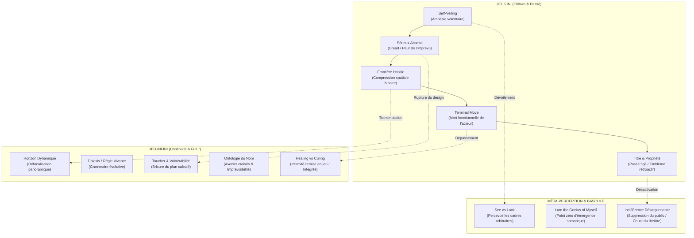

# Finite and Infinite Games
**Formateur :** James Carse | **ID :** `james-carse-finite-and-infinite-games` | **Tranches :** 8

## Synthèse Architecturale du Cours : *Finite and Infinite Games* (James Carse)

---

### 1. Thèse Centrale & Philosophie du Cours

#### Vision spécifique de James Carse & Rupture de posture
L’approche standard de la stratégie, du développement personnel et de la psychologie cognitive traite l’existence comme un ensemble d'arènes d'optimisation : résoudre des problèmes, surmonter des résistances, remporter des victoires sociales ou professionnelles, et consolider des statuts stables (titres, compétences, certitudes identitaires).

James Carse renverse radicalement cette téléologie : **il n'existe pas d'arène imposée par la réalité, seulement des jeux arbitraires acceptés par auto-tromperie sélective.**

La thèse fondamentale de Carse s'articule autour d'un pivot ontologique :
1. **Le Jeu Fini se joue dans des limites, en vue d'une fin (la victoire/la clôture)**. Il repose sur le triomphe du passé sur le futur, requiert l'invisibilisation du perdant (*terminal move*), exige l'exhibition d'un titre statique et n'opère que si le joueur s'ampute de sa propre conscience de jouer (*self-veiling*).
2. **Le Jeu Infini se joue avec les limites, en vue de la continuation même du jeu**. Il repose sur le triomphe du futur sur le passé (la surprise féconde), intègre la finitude et la mort corporelle comme des variables internes du jeu partagé, dissout les rôles théâtraux au profit de l'interaction de personnes concrètes (*Noms* vs *Titres*), et transforme les frontières en horizons.

Carse ne se pose pas en maître enseignant des tactiques d'efficacité ; il se pose en **déconstructeur de scénographies métaphysiques et sociales**. Sa posture rétablit l'agentivité radicale de l'individu comme point zéro d'émergence (*poietes* / génie somatique).

#### Fil rouge méthodologique
Le fil conducteur unifiant toutes les dimensions du cours est **la rétrocession de la nécessité vers la liberté consentie** :
$$\text{Contrainte ressentie} \xrightarrow{\text{Dévoilement}} \text{Scénographie théâtrale} \xrightarrow{\text{Méta-perception (See vs Look)}} \text{Ouverture à l'Horizon (Jeu Infini)}$$

Toute souffrance, rigidité dogmatique, aliénation institutionnelle ou blocage stratégique est modélisée par Carse comme une chute dans le « sérieux » : l'illusion d'une obligation extérieure créée par l'oubli volontaire de son propre choix d'entrer en jeu. Le protocole méthodologique sous-jacent consiste invariablement à identifier le script théâtral, retirer la validation du public, convertir la frontière conflictuelle en horizon sans borne, et remettre la contrainte ou l'infirmité en jeu.

---

### 2. Carte des Concepts & Leviers Émergents

#### Écosystème des mécanismes clés

1. **L'Autolimitation Volontaire Voilée (*Self-Veiling*) & L'Oubli de l'Oubli :**
   * *Rôle :* Verrou neuro-cognitif indispensable à l'expérience du jeu fini. Le sujet suspend la conscience de sa liberté originelle pour ressentir la contrainte et le stress de l'enjeu.
2. **Sérieux (*Seriousness*) vs Jouabilité (*Playfulness*) :**
   * *Rôle :* Le sérieux est la peur de l'imprévu liée à un rôle rigide ; la jouabilité est la tolérance du système nerveux à la surprise et à la vulnérabilité créatrice.
3. **Mouvement Terminal (*Terminal Move*) & Mort Fonctionnelle :**
   * *Rôle :* Opération de gel irréversible où le perdant est privé de statut d'acteur (*incapable of further play*). Extinction de l'agentivité sociale.
4. **Dialectique « Mort dans la Vie » vs « Vie dans la Mort » :**
   * *Rôle :* Démantèlement de l'illusion d'immortalité symbolique. L'immortalité finie (*life in death*) n'est que la sanctuarisation muséale d'un titre, tandis que le détachement de la compétition (*death in life*) libère l'action vivante.
5. **Ontologie du Nom vs Titre :**
   * *Rôle :* Le Titre est une étiquette rétrospective figeant un résultat passé ; le Nom est un appel prospectif et concret qui ouvre l'interpénétration libre des avenirs.
6. **Propriété Émblématique & Consensus de Force :**
   * *Rôle :* La propriété matérielle est un ancrage compensatoire d'une victoire passée pour figer l'espace d'autrui ; la force ne contraint que par l'auto-soumission consentie à son signal.
7. **Frontière (*Boundary*) vs Horizon (*Horizon*) :**
   * *Rôle :* Levier spatial et attentionnel majeur. La frontière comprime la perception en mode sympathique (lutte/fuite contre un ennemi) ; l'horizon déclenche une vision périphérique sans fin ni résistance.
8. **Scission *Poiema* vs *Poiesis* :**
   * *Rôle :* Pathologie de réification où l'œuvre ou l'idée créée (*poiema*) est détachée de l'acte vivant du créateur (*poiesis*), devenant dogme ou idéologie aliénante.
9. **Le Génie Somatique (*I am the Genius of Myself*) :**
   * *Rôle :* Réattribution radicale du centre de décision au sujet incarné, court-circuitant les déresponsabilisations mécanistes (« c'est mon cerveau/mon angoisse »).
10. **Perception du Cadre (*See*) vs Scan Interne (*Look*) :**
    * *Rôle :* Passage de la focalisation hypnotique sur les objets à la prise de conscience des frontières appliquées par l'observateur.
11. **Le Toucher (*Touching*) & Brisure de Conception (*Shattered Design*) :**
    * *Rôle :* Interruption somatique instantanée de tout calcul stratégique unilatéral. Obligation de répondre depuis son centre dans une réciprocité sans armure.
12. **Guérir Intègre (*Healing*) vs Rétablir (*Curing*) :**
    * *Rôle :* *Curing* répare une fonction pour renvoyer le rouage dans l'arène compétitive ; *Healing* réintègre l'infirmité et la vulnérabilité comme variables créatives du jeu lui-même.
13. **Sexualité Finie (Prédation/Propriété) vs Infinie (Poiesis Corporelle) :**
    * *Rôle :* La sexualité finie vise la capture du vaincu consentant dans un cadre théâtral d'organes découpés ; la sexualité infinie est une co-improvisation de personnes entières sans script terminal.

---

### 3. Tableau Récapitulatif des Techniques & Démonstrations

| Technique / Exercice | Objectif Opératoire | Déclencheur / Indication | Séquence Résumée |
|---|---|---|---|
| **Dévoilement de la Scénographie (*Self-Veiling Unmasking*)** | Restaurer l'agentivité en révélant que la contrainte perçue est une règle de jeu acceptée par amnésie volontaire. | Sentiment d'impasse (« je n'ai pas le choix », « je dois »), obsession d'un triomphe ou d'une revanche stérile. | 1. Cartographier l'arène (règles implicites, rôle endossé, enjeu). 2. Identifier le public fantasmé dont le regard valide l'enjeu. 3. Poser la question de récursion : *« Quand as-tu décidé d'oublier que tu as accepté de jouer à ceci ? »* 4. Suspendre le rôle théâtral et observer l'effondrement immédiat de la nécessité. |
| **Transmutation Frontière $\rightarrow$ Horizon (*Boundary-to-Horizon Shift*)** | Désactiver le tunnel attentionnel combatif/défensif et ouvrir un champ d'exploration sans opposition binaire. | Fixation conflictuelle, territorialité névrotique, sentiment d'être bloqué contre un mur ou un ennemi extérieur. | 1. Localiser somatiquement la frontière (compression, point de friction). 2. Passer de *Look at* (scruter l'obstacle) à *See* (percevoir la limite comme une ligne mentale projetée). 3. Ouvrir le champ visuel en vision panoramique périphérique vers l'horizon. 4. Constater que l'horizon recule à mesure qu'on avance : disparition de l'obstacle sans combat. |
| **Désactivation par Privation d'Audience (*Audience Deprivation*)** | Neutraliser l'escalade conflictuelle ou la domination d'un joueur fini sans entrer en guerre avec lui. | Agression institutionnelle, provocation hiérarchique, confrontation avec un interlocuteur en posture de combat rigide. | 1. Ne pas opposer de résistance sérieuse (qui validerait le terrain du jeu fini). 2. Refuser d'occuper la place du perdant ou du spectateur admiratif/effrayé. 3. Répondre par une indifférence désarçonnante ou un non-sérieux bienveillant. 4. Laisser l'appareil de pouvoir s'effondrer par absence de public pour valider son titre. |
| **Substitution Titre $\rightarrow$ Nom (*Title-to-Name Reconnection*)** | Briser l'asymétrie hiérarchique ou l'isolement identitaire en rétablissant une interaction d'avenir ouvert. | Fixation narcissique sur un statut, paralysie face à une autorité intimidante, dépersonnalisation relationnelle. | 1. Mettre à nu le titre (étiquette d'actes passés réifiée en objet intemporel). 2. Dépouiller les deux protagonistes de leurs masques et fonctions institutionnelles. 3. Réinteragir exclusivement par les Noms propres concrets. 4. Laisser l'incertitude de l'autre contaminer son propre futur sans script pré-écrit. |
| **Réintégration de l'Infirmité (*Healing into Play*)** | Sortir de l'obsession de réparation fonctionnelle normative pour recouvrer l'intégrité somatique globale. | Dévalorisation corporelle, fixation névrotique sur un symptôme/faiblesse perçu comme exclusion de la compétition. | 1. Cesser le *curing* (la tentative d'éradiquer la faille pour revenir dans l'arène). 2. Découvrir quelle arène bornée rend cette faiblesse invalidante. 3. Recontextualiser l'infirmité comme une règle modifiée du jeu infini. 4. Jouer *avec* la limite somatique plutôt que *contre* elle, restaurant l'état de complétude (*hale*). |
| **L'Interruption par le Toucher Somatique (*Shattering the Design*)** | Casser la dissociation stratégique et l'anticipation calculée pour forcer une présence incarnée vulnérable. | Tendance à hyper-mentaliser, manipuler les interactions, rigidité corporelle et émotionnelle défensive. | 1. Interrompre net l'échange verbal ou la trame stratégique en cours. 2. Établir un contact somatique ou perceptif direct d'un « centre » à un autre. 3. Observer la brisure du plan (*shattered design*) et le vide de script. 4. Autoriser la réponse à émerger du corps vulnérable, sans armure ni objectif de gain. |

---

## Extractions Détaillées par Tranche (Opératoire & Verbatim)

## --- Tranche 1 / 8 ---

### 1. Mécanismes & Principes Actifs

- **L'Autolimitation Volontaire Voilée (Self-Veiling)**
  - **Principe actif :** Pour s'engager pleinement dans un jeu fini (compétition, identité sociale, rôle professionnel), le système nerveux et la cognition opèrent une amnésie sélective consentie : le joueur oublie volontairement qu'il joue librement. Si la conscience de la liberté absolue demeurait active au premier plan, l'effort compétitif, l'intensité de la lutte et la charge émotionnelle s'effondreraient instantanément. L'illusion de la contrainte (« je dois le faire », « je n'ai pas le choix ») est une construction interne indispensable pour ressentir la pression du jeu.
  - **Tags émergents :** `#self_veiling` `#amnesie_volontaire_structurelle` `#illusion_de_necessite` `#suspension_de_liberte`

- **Sérieux Abstrait vs Jouabilité Concrète (Seriousness vs Playfulness)**
  - **Principe actif :** Le « sérieux » est la réponse neurologique et affective à l'abstraction : il découle de la prise d'un rôle pré-écrit (une partie du tout substituée au tout) où l'issue est déjà verrouillée et où l'imprévisible est perçu comme une menace existentielle. La « jouabilité » (playfulness) n'est pas de la frivolité, mais un état d'ouverture totale où le système nerveux tolère et recherche la surprise ; elle traite la personne comme un sujet concret libre plutôt que comme l'exécution d'un script rigide.
  - **Tags émergents :** `#seriousness_as_dread` `#abstraction_role` `#playfulness_as_vulnerability` `#relation_concrete`

- **Règles Fixes vs Règles Vivantes (Grammaire Évolutive)**
  - **Principe actif :** Les jeux finis imposent des règles statiques antérieures au jeu pour garantir qu'un gagnant puisse émerger sans contestation (modèle du débat rhétorique). Les jeux infinis modifient leurs propres règles en cours de route dès qu'un résultat fini menace de clore l'interaction (modèle de la grammaire d'une langue vivante). Neurologiquement, cela fait basculer le sujet d'un état d'exécution algorithmique rigide vers une méta-plasticité où les contraintes extérieures (épuisement, perte matérielle, mort) sont intégrées comme nouvelles variables du jeu.
  - **Tags émergents :** `#regles_contractuelles` `#grammaire_vivante` `#meta_plasticite_des_limites` `#inclusion_des_contraintes`

- **Jouer Dans les Limites vs Jouer Avec les Limites (Boundary Transformation)**
  - **Principe actif :** Le joueur fini est contenu à l'intérieur de frontières spatiales, temporelles et numériques définies de l'extérieur. Le joueur infini internalise les limites : toute frontière imposée (y compris la finitude biologique) devient un matériau jouable. Cela neutralise l'impuissance acquise face aux contraintes environnementales.
  - **Tags émergents :** `#play_within_vs_play_with` `#internalisation_des_bornes` `#dissolution_de_l_impuissance`

- **Entraînement vs Éducation face à la Surprise (Temporalité Rétroactive vs Prospective)**
  - **Principe actif :** L'entraînement (*training*) vise à faire triompher le passé sur le futur en éliminant la surprise par la répétition mécanique et le contrôle, figeant une auto-définition terminale. L'éducation (*education*) invite la surprise pour faire triompher le futur sur le passé : chaque événement imprévu réorganise rétroactivement le sens du passé et maintient l'auto-découverte ouverte.
  - **Tags émergents :** `#training_vs_education` `#triomphe_du_futur` `#reorganisation_retroactive_du_passe` `#vulnerabilite_transformatrice`

- **Mort Fonctionnelle vs Titularité Intemporelle (Terminal Move)**
  - **Principe actif :** Dans un cadre fini, perdre n'est pas mourir physiquement, mais subir un « coup terminal » qui élimine la qualité de joueur : le vaincu devient invisible, privé de titre. Le titre est une validation sociale publique, un marqueur symbolique intemporel qui survit au jeu pour figer la hiérarchie.
  - **Tags émergents :** `#terminal_move` `#mort_du_joueur` `#titularite_symbolique` `#validation_spectatoriale`

---

### 2. Protocoles, Techniques & Démonstrations (Étape par Étape)

#### Protocole 1 : Le Dévoilement de la Contrainte (Désamorçage de l'Illusion de Nécessité)
* **Intention / Indication :** Quand un sujet exprime un enfermement dans un rôle (« Je suis obligé de faire ça », « Je n'ai pas le choix », burn-out de posture, sur-identification à un statut ou métier).
* **Mise en place & Pré-framing :** Recadrer l'illusion de contrainte non pas comme une soumission imposée de force par l'extérieur, mais comme une décision librement prise d'entrer sur le terrain avec un masque, puis d'avoir volontairement voilé ce choix.
* **Séquence d'actions pas à pas :**
  1. *Cartographie du Terrain Fini :* Faire nommer au sujet les frontières de son jeu : espace, temps, règles implicites, et surtout le « titre » qu'il essaie de remporter ou de conserver.
  2. *Isolement du Rôle :* Séparer la personne du masque (ex: « Toi en tant qu'être concret » vs « L'avocat / La mère / Le dirigeant »).
  3. *Mise en lumière du Voile (Self-Veiling) :* Poser la question directe du prix : « Quel est le coût payé si tu refuses de jouer ce rôle dès maintenant ? ». Amener le constat que payer un prix pour refuser prouve que l'oppresseur ou le jeu lui-même exige son accord.
  4. *Restauration du Choix Fondateur :* Reconnecter au postulat : *« Whoever plays, plays freely. Whoever must play, cannot play. »* Amener le sujet à dire : « J'ai librement choisi d'entrer sur ce terrain, et j'ai choisi d'oublier que j'avais choisi pour pouvoir jouer avec sérieux. »
  5. *Option de Déplacement :* Soit enlever le masque (quitter le terrain), soit le remettre mais en passant du mode *sérieux* (théâtral) au mode *joueur* (dramatique / conscient du masque).
* **Signes de calibration :** Relâchement du tonus postural (épaules, mâchoire), rire de défusion ou soupir de décompression cognitive, passage d'un discours en mode impersonnel/passif (« Il faut ») à une prise de responsabilité assumée (« Je choisis de continuer pour l'instant »).

---

#### Protocole 2 : Transmutation de Limite en Règle Vivante (L'Opérateur Infini)
* **Intention / Indication :** Face à un échec, une perte de ressources, un diagnostic ou une crise extérieure perçue comme un « coup terminal » qui clôture la partie.
* **Mise en place & Pré-framing :** Établir que la finitude d'un jeu ne vient pas de la force du choc extérieur, mais de l'accord des joueurs sur le fait que la partie est terminée. Si le sujet refuse de déclarer la fin, le jeu change simplement de forme.
* **Séquence d'actions pas à pas :**
  1. *Identification de la Limite Imposée :* Circonscrire précisément la frontière extérieure qui presse (épuisement physique, rupture, perte financière, obstacle systémique).
  2. *Suspension du Titre / Résultat :* Abandonner explicitement l'objectif de « gagner » le round précédent ou de valider le titre en jeu.
  3. *Réécriture de la Règle (Grammaire Vivante) :* Poser la question : « Comment intégrons-nous cette limite précise directement DANS le jeu pour que le mouvement continue ? » (Exemple : si l'épuisement est la limite, la nouvelle règle devient : le jeu intègre le repos comme phase du jeu, et non comme sortie de jeu).
  4. *Réouverture de l'Horizon Temporel :* Transformer l'attente d'une conclusion en attente de la prochaine surprise.
* **Signes de calibration :** Disparition de la sidération (« freeze »), conversion de la panique en curiosité pragmatique, regard qui se défocalise de l'impact passé pour scanner les options immédiates.

---

### 3. Heuristiques, Subtilités & "Sagesse du Praticien"

- **Heuristique de Liberté Primordiale :**
  - *Si* le sujet affirme être forcé d'agir par une autorité ou une obligation absolue,
  - *Alors* recadre immédiatement en montrant que l'obligation requiert son adhésion active : la preuve en est qu'il y a un prix à payer en cas de refus. S'il était un automate, aucune menace ne serait nécessaire.

- **Heuristique du Masque et de l'Acteur :**
  - *Si* le sujet est submergé par les émotions de son statut (ex: culpabilité parentale, anxiété de performance professionnelle),
  - *Alors* traite ces émotions non comme les siennes, mais comme le texte requis par le rôle : « Les émotions que tu ressens appartiennent au personnage d'Ophélie dans ce script, pas à la personne qui joue Ophélie. »

- **Heuristique de la Défaite Fictive :**
  - *Si* un sujet se sent détruit par un échec,
  - *Alors* fais-lui calibrer que seul un jeu fini s'est arrêté (un titre n'a pas été obtenu) ; la défaite n'est qu'un moment au sein d'une participation infinie continue.

- **Heuristique Face à la Surprise :**
  - *Si* le sujet réagit à l'imprévu par la rigidité et la défensive (mode *training*),
  - *Alors* interromps le contrôle et réoriente l'attention : la surprise ne menace pas son identité, elle est la condition de métamorphose du soi (mode *education*).

- **Erreurs de débutant corrigées par Carse :**
  - *Croire que le jeu infini exclut le jeu fini :* Faux. On peut jouer à des jeux finis à l'intérieur d'un jeu infini, à condition de ne jamais perdre de vue qu'il s'agit d'un jeu et de ne pas s'y enfermer avec un sérieux mortifère.
  - *Confondre la jouabilité (playfulness) avec la légèreté stérile :* Être joueur dans un jeu infini n'est pas être irresponsable (« playing at ») ; c'est s'engager avec une vulnérabilité absolue face à des conséquences bien réelles mais non prédéterminées.

---

### 4. Pépites Verbatim & Patterns Linguistiques (MOT À MOT EN V.O.)

#### Pépite 1 : La Définition Fondatrice & Axiome du Choix
> « There are at least two kinds of games. One could be called finite, the other infinite.
> A finite game is played for the purpose of winning, an infinite game for the purpose of continuing the play. »
* **[Analyse du Pattern]** : Présupposition binaire polarisante créant d'emblée une distinction de catégorie radicale. L'utilisation du passif modal adouci (*« One could be called »*) induit une acceptation non défensive avant de poser une antithèse téléologique pure (*winning* vs *continuing the play*) qui redéfinit toute l'action humaine en deux dynamiques motivationnelles.

---

#### Pépite 2 : Le Paradoxe de la Contrainte Impossibilité
> « It is an invariable principle of all play, finite and infinite, that whoever plays, plays freely. Whoever must play, cannot play. »
* **[Analyse du Pattern]** : Truisme universel formulé en double proposition réflexive avec inversion sémantique (*plays freely* / *must play -> cannot play*). Ce pattern opère une rupture brutale sur toute justification victimaire : il installe un double lien logique où l'obligation annule ontologiquement l'acte de jouer.

---

#### Pépite 3 : Le Statut Conventionnel des Règles
> « The agreement of the players to the applicable rules constitutes the ultimate validation of those rules. Rules are not valid because the Senate passed them, or because heroes once played by them, or because God pronounced them through Moses or Muhammad. They are valid only if and when players freely play by them. »
* **[Analyse du Pattern]** : Élimination en cascade des autorités externes (politique, héroïque, théologique) par désacralisation systématique. Recadrage de la validité de toute règle externe en une pure validation consensuelle interne et immédiate.

---

#### Pépite 4 : La Métaphore Structurelle des Règles et du Langage
> « If the rules of a finite game are the contractual terms by which the players can agree who has won, the rules of an infinite game are the contractual terms by which the players agree to continue playing. For this reason the rules of an infinite game have a different status from those of a finite game. They are like the grammar of a living language, where those of a finite game are like the rules of debate. »
* **[Analyse du Pattern]** : Isomorphisme métaphorique puissant (grammaire vivante vs règles de débat). Présupposition implicite que le jeu fini cherche l'extinction de la parole d'autrui (*« bringing the speech of another person to an end »*), tandis que le jeu infini génère la perpétuation générative du sens.

---

#### Pépite 5 : La Formule Maîtresse des Frontières
> « Finite players play within boundaries; infinite players play with boundaries. »
* **[Analyse du Pattern]** : Paronomase et bascule de préposition monosyllabique (*within* -> *with*). Ce micro-pattern linguistique compacte une transformation spatiale et identitaire monumentale : l'objet de contention (la frontière) passe du statut de contenant limitant à celui d'outil manipulable et ludique.

---

#### Pépite 6 : L'Auto-Voilement et le Paradoxe de Croyance
> « What makes this an issue is not the morality of masking ourselves. It is rather that self-veiling is a contradictory act—a free suspension of our freedom. I cannot forget that I have forgotten. I may have used the veil so successfully that I have made my performance believable to myself. I may have convinced myself I am Ophelia. But credibility will never suffice to undo the contradictoriness of self-veiling. “To believe is to know you believe, and to know you believe is not to believe” (Sartre). »
* **[Analyse du Pattern]** : Déconstruction récursive de la transe d'identification. L'inclusion du paradoxe sartrien agit comme un désamorceur de transe : en amenant à la conscience la boucle méta (*« to know you believe »*), l'illusion d'adhésion totale au rôle se fissure, empêchant la fusion identitaire de redevenir opaque.

---

#### Pépite 7 : Entraînement vs Éducation face au Temps
> « To be prepared against surprise is to be trained. To be prepared for surprise is to be educated.
> Education discovers an increasing richness in the past, because it sees what is unfinished there. Training regards the past as finished and the future as to be finished. Education leads toward a continuing self-discovery; training leads toward a final self-definition.
> Training repeats a completed past in the future. Education continues an unfinished past into the future. »
* **[Analyse du Pattern]** : Structure symétrique en chiasmes et parallélismes répétitifs (*against surprise* vs *for surprise*, *training* vs *education*). Utilisation des aspects temporels achevé/inachevé (*finished / unfinished*) pour créer une suggestion implicite de fermeture rigide (training/mort symbolique) opposée à une transe générative d'évolution perpétuelle (education/découverte de soi continue).

## --- Tranche 2 / 8 ---

### 1. Mécanismes & Principes Actifs

#### 1. Le Mouvement Terminal et la Mort Fonctionnelle du Joueur
* **Principe actif :** Dans un jeu fini, la finitude exige un *terminal move* qui fige irréversiblement l'état du système. Le perdant ne subit pas une mort corporelle mais une abolition de son statut d'acteur : il devient incapable de tout jeu ultérieur (*incapable of further play*). Neurologiquement et cognitivement, cela correspond à l'extinction complète de l'agentivité dans un domaine : le sujet n'a plus de choix d'action ni d'espace d'actualisation de soi ; il est frappé d'invisibilité relationnelle (*a person to whom no attention whatsoever need be given*). La mort finie consacre le triomphe absolu du passé (ce qui est déjà joué) sur le futur (l'inattendu, la surprise).
* **Tags émergents :** `#terminal_move` `#mort_fonctionnelle` `#extinction_agentivite` `#triomphe_du_passe` `#titre_vs_mort`

#### 2. La Polarité « Mort dans la Vie » vs « Vie dans la Mort »
* **Principe actif :** Carse découple la mort biologique de l'inscription relationnelle/theâtrale du sujet :
  - *Death in life* : Abandon de la compétition et du désir de validation/titres. Soit par résignation passive (statut de perdant figé), soit par discipline spirituelle/détachement mystique (*Die before ye die* des soufis) qui éteint la tension égologique liée au besoin d'être couronné.
  - *Life in death* : Survie artificielle du titre dans la mémoire collective. Le sujet corporel périt, mais son étiquette abstraite est pérennisée (Pharaons, martyrs, soldats inconnus). L'immortalité finie n'est pas une continuation de l'expérience vécue, mais la sanctuarisation théâtrale d'un rôle figé dans un *afterworld* (monde de reconnaissance posthume).
* **Tags émergents :** `#death_in_life` `#life_in_death` `#afterworld_vs_afterlife` `#titre_intemporel` `#sanctification_theatrale`

#### 3. L'Auto-Contradiction du Jeu Fini pour la Vie (*Playing to Live vs Living to Play*)
* **Principe actif :** Lorsque la vie elle-même devient l'enjeu (*the stakes*) d'une lutte (esclavage, acharnement thérapeutique, régimes obsessionnels anti-âge), le joueur aliène sa vie présente afin de tenter de la racheter plus tard. Le jeu fini se joue pour s'achever (*played to end itself*). Transformer la vie en récompense la dégrade au rang de simple moyen (*Life itself appears only as a means to life* - Marx). Le joueur s'ampute de la spontanéité vivante pour protéger une abstraction de lui-même.
* **Tags émergents :** `#contradiction_du_jeu_fini` `#vie_comme_moyen` `#theatralite_du_soi_voile` `#alienation_de_l_agentivite`

#### 4. La Mortalité Dramatique du Joueur Infini et la Vulnérabilité Radicale
* **Principe actif :** Le joueur infini ne joue pas *contre* la mort corporelle, il joue *comme mortel* (*plays as a mortal*). La mort ne met pas fin au jeu ; elle s'intègre comme un événement interne à la continuité du jeu partagé avec les autres. Là où le joueur fini érige des frontières imperméables pour se prémunir contre la contingence et l'inconnu, le joueur infini s'expose délibérément à la surprise et à l'horizon (*toward the open*). La vulnérabilité est le prérequis neurologique et cognitif permettant d'absorber l'inattendu sans rupture de boucle d'apprentissage.
* **Tags émergents :** `#mortalite_choisie` `#vulnerabilite_radicale` `#jeu_vers_l_horizon` `#mort_interne_au_jeu` `#rire_de_reouverture`

#### 5. L'Ontologie du Nom (Concret/Futur Ouvert) vs Titre (Abstrait/Passé Figé)
* **Principe actif :** 
  - Le *Titre* est accordé à la fin d'une séquence pour ce qui a été achevé. Il fige l'individu dans un script prévisible, soustrait la relation à l'incertitude et impose une déférence asymétrique ritualisée. Il regarde en arrière.
  - Le *Nom* est donné à la naissance, avant tout acte. Il désigne un être concret sans script déterminé. Dès que deux individus interagissent par leurs noms propres dénués de titres, ils annulent les rôles codifiés et ouvrent un champ d'interpénétration de leurs avenirs (*Our futures enter into each other*). L'incertitude de l'autre devient le moteur de l'imprévisibilité de son propre futur.
* **Tags émergents :** `#nom_vs_titre` `#reciprocite_radicale` `#desinhibition_du_script` `#imprevisibilite_croisee`

#### 6. Pouvoir (*Power*) vs Puissance d'Être / Force (*Strength*)
* **Principe actif :**
  - *Power* : Propriété exclusive des jeux finis. Mesure comparative de la résistance déplacée dans un espace-temps clos. Le pouvoir n'est jamais intrinsèque : il découle de la soumission volontaire d'une audience de « perdants » qui cèdent devant un titre. Le pouvoir requiert la fin du jeu pour être mesuré ; il est théâtral et regarde le passé clos.
  - *Strength* : Propre au jeu infini. Ne s'exerce pas en forçant l'autre mais en lui offrant l'espace d'initier ses propres mouvements (*allowing them to do what they wish*). La force maintient le champ ouvert ; elle transforme les contraintes et limites en règles de jeu malléables (*freedom with limits*). Elle est infinie, non quantifiable et accessible à quiconque refuse de s'enfermer dans un rôle.
* **Tags émergents :** `#power_theatral` `#strength_paradoxale` `#resistance_et_cloture` `#liberte_avec_les_limites` `#autorisation_d_action`

#### 7. Le Mal comme Extinction du Jeu Infini (*Unheard Silence*)
* **Principe actif :** Le Mal (*Evil*) selon Carse n'est pas la compétition brutale ni l'issue tragique d'un jeu fini consenti. Le Mal est la tentative d'annihiler la capacité même de jouer infiniment, en imposant de force la reconnaissance d'un titre hors compétition et en étouffant la voix de l'autre dans un silence sans écho (*unheard silence*). Le Mal prend racine dans l'obsession moralisatrice d'achever l'histoire, d'éradiquer l'ambiguïté et d'imposer un dénouement prévisible (utopies closes, génocides, élimination des déviances).
* **Tags émergents :** `#le_mal_comme_cloture` `#silence_inaudible` `#fermeture_historique` `#reconnaissance_forcee`

#### 8. La Fluidité Essentielle de l'Identité et le Paradoxe Relationnel
* **Principe actif :** « Personne ne peut jouer seul. » L'identité n'est pas une entité monolithique préexistante qui entre ensuite en contact avec autrui ; le soi émerge en temps réel de la mise en relation dynamique (*we are who we are in relating to others*). En s'appuyant sur l'image zen du ruisseau, Carse pose que la continuité de la personne repose sur sa capacité perpétuelle de métamorphose (*Only that which can change can continue*).
* **Tags émergents :** `#fluidite_ontologique` `#continuité_par_le_changement` `#co_emergence_du_soi` `#ruisseau_zen`

---

### 2. Protocoles, Techniques & Démonstrations (Étape par Étape)

#### Protocole 1 : Déconstruction de Titre & Rétablissement de la Réciprocité du Nom
* **Intention / Indication :** Quand un sujet est paralysé par une figure d'autorité (médecin, patron, parent, juge) ou par un titre interne introjecté ("l'expert", "le nul", "le malade incurable") qui lui impose un script théâtral rigide et un sentiment d'impuissance.
* **Mise en place & Pré-framing :** Cadrer que le titre est une étiquette qui regarde le passé et exige une audience complice, tandis que le nom est une invitation concrète à un avenir sans partition écrite.
* **Séquence d'actions pas à pas :**
  1. *Étape 1 - Identification du script théâtral lié au titre :* Identifier le titre en jeu et la posture corporelle/linguistique de déférence associée (baisse du regard, inhibition motrice, ton soumis).
  2. *Étape 2 - Révélation de la complicité volontaire :* Mettre en évidence que le pouvoir de ce titre dépend de son propre consentement à jouer le rôle du « perdant » ou du « vassal » dans ce cadre fini (*Who must play, cannot play*).
  3. *Étape 3 - Évocation du Nom Concret :* Inviter le sujet à ôter l'étiquette et à nommer la personne (ou lui-même) par son simple prénom/nom de naissance, en se connectant à l'espace avant toute action réalisée (*at a time when a person cannot yet have done anything*).
  4. *Étape 4 - Bascule dans la Surprise et l'Avenir Croisé :* Ouvrir la question : *"Si aucun de vous deux ne récite le texte convenu, quelle surprise imprévisible devient possible dans l'instant ?"*
  5. *Étape 5 - Ancrage de la Réciprocité :* Valider l'état d'ouverture somatique où l'issue n'est plus verrouillée.
* **Signes de calibration :** Relâchement des tensions faciales de révérence ou de défense, respiration plus ample, désamorçage de l'anticipation anxieuse du "prochain coup", regard qui passe de l'hyperfocalisation craintive à un champ visuel défocalisé et curieux.

#### Protocole 2 : Recadrage de la Limite Subie en Règle du Jeu Consentie (*Freedom With Limits*)
* **Intention / Indication :** Quand le sujet se vit comme victime broyée par la réalité (maladie chronique, crise macroéconomique, météo, contraintes légales strictes) et lutte stérilement *contre* la réalité au lieu d'agir.
* **Mise en place & Pré-framing :** Établir la distinction entre « jouer contre la réalité » (combat perdu d'avance qui transforme la contrainte en jugement de défaite) et « jouer selon la réalité » (utiliser les faits comme les bornes spatiales et temporelles du terrain de jeu).
* **Séquence d'actions pas à pas :**
  1. *Étape 1 - Élicitation de la lutte contre la limite :* Faire verbaliser la contrainte vécue comme une force d'écrasement (ex: "Je me bats contre cette maladie / cette dette").
  2. *Étape 2 - Déplacement de l'opposition vers le contexte :* Recadrer la contrainte brute en contexte de jeu : *"Ce n'est pas un adversaire qui veut te vaincre, c'est le terrain sur lequel la partie commence."*
  3. *Étape 3 - Instauration de la posture mortelle/flexible :* Appliquer le saut philosophique : *"On ne lutte pas contre la mortalité ; on joue en tant que mortel."* Quelles sont les règles du jeu imposées par ce terrain aujourd'hui ?
  4. *Étape 4 - Activation de la Force Paradoxale (*Strength*) :* Demander au sujet : *"Quelle action nouvelle peux-tu initier sur ce terrain qui permette au jeu de continuer avec ton entourage, sans chercher à 'gagner' ou à conclure l'histoire immédiatement ?"*
  5. *Étape 5 - Test d'ouverture :* Vérifier si la limite est devenue un support d'exploration créative au lieu d'un mur terminal.
* **Signes de calibration :** Disparition de la contraction d'impuissance (épaules rentrées, mâchoire serrée), passage d'une plainte victimale à une posture corporelle stable et alerte, apparition d'un sourire ou d'un soulagement teinté de légèreté ironique (*joyful laughter*).

---

### 3. Heuristiques, Subtilités & "Sagesse du Praticien"

* **Heuristique de la Victoire comme Clôture :** Si un patient cherche à tout prix à "gagner définitivement" sur une émotion, un symptôme ou un tiers $\rightarrow$ *Intervenir sur le modèle du jeu fini*. Lui montrer que vouloir gagner, c'est vouloir tuer le jeu et s'interdire toute surprise future. La quête de victoire absolue est un désir inconscient d'immobilité et de mort symbolique.
* **Heuristique du Pouvoir Délégué :** Si un sujet se plaint qu'un tiers détient un pouvoir absolu sur lui $\rightarrow$ *Chercher immédiatement où réside la coopération cachée du sujet*. Le pouvoir n'existe que par la déférence de l'audience. Pour qu'il y ait un vainqueur, il faut que le sujet ait signé tacitement pour jouer le rôle du vaincu.
* **Heuristique de la Détection du Mal :** Si un individu ou un groupe affirme agir pour « éradiquer définitivement le mal », « clore l'histoire » ou « nettoyer le tableau » $\rightarrow$ *Identifier le déclenchement du Mal au sens de Carse*. Toute tentative de forcer la fin de l'histoire et de supprimer l'expression imprévisible d'un joueur produit une clôture destructrice.
* **Heuristique de la Force Paradoxale :** Si le praticien se surprend à vouloir forcer le sujet à changer ou à adopter un comportement précis $\rightarrow$ *Recalibrer immédiatement de Power vers Strength*. Le praticien puissant force une issue et met fin au jeu ; le praticien fort maintient le jeu ouvert et permet au sujet d'initier ses propres solutions (*allow them to do what they wish*).
* **Piège classique du débutant :** Croire que le jeu infini consiste à "jouer dans" les règles d'un jeu fini (prendre des vacances, s'amuser au travail, "décompresser"). Carse avertit que ces détentes sont immédiatement réquisitionnées par le jeu fini pour recharger le compétiteur en vue de la lutte suivante. L'enjeu n'est pas d'aménager du jeu dans le fini, mais d'englober tous les jeux finis dans une conscience infinie.

---

### 4. Pépites Verbatim & Patterns Linguistiques (MOT À MOT EN V.O.)

#### Pépite 1 : La redéfinition de la mort finie
> « Death, in finite play, is the triumph of the past over the future, a condition in which no surprise is possible. »

* **[Analyse du Pattern] :** **Recadrage ontologique et nominalisation temporelle.** Carse redéfinit la mort non pas comme un phénomène biologique, mais comme une relation asymétrique entre deux lignes de temps : l'anéantissement de la contingence future par la cristallisation définitive du passé. L'emploi de la formule absolue *"no surprise is possible"* installe une présupposition d'enfermement cognitif total.

---

#### Pépite 2 : La double distinction existentielle
> « There are two ways in which death is commonly associated with the fate of the body: One can be dead in life, or one can be alive in death. »

* **[Analyse du Pattern] :** **Chiasme hypnotique et induction de dissociation.** La structure croisée (*dead in life / alive in death*) brise la binarité habituelle vie/mort. Elle force le système cognitif à créer deux nouveaux espaces sémantiques distincts du corps biologique, préparant l'inconscient à dissocier le fonctionnement organique de l'adhésion aux rôles sociaux.

---

#### Pépite 3 : Le paradoxe de l'esclavage et de la vie comme récompense
> « A slave can have life only by giving it away. [...] Finite players play to live; they do not live their playing. »

* **[Analyse du Pattern] :** **Distorsion paradoxale et inversion prédicative (*Antimétabole*).** En opposant *"play to live"* et *"live their playing"*, Carse utilise une inversion syntaxique qui expose instantanément la contradiction interne du sujet : lorsqu'une activité devient le moyen d'un résultat externe, l'expérience vécue de l'activité est vidée de sa substance.

---

#### Pépite 4 : La mortalité vécue et le rire infini
> « Where the finite player plays for immortality, the infinite player plays as a mortal. [...] The joyfulness of infinite play, its laughter, lies in learning to start something we cannot finish. »

* **[Analyse du Pattern] :** **Rupture de pattern téléologique et recadrage de complétion.** La pensée occidentale associe la valeur à l'achèvement (finir ce qu'on a commencé). Carse opère une rupture radicale en plaçant la joie et le rire dans le fait d'initier un processus impossible à clore (*start something we cannot finish*). Ce pattern dissout l'anxiété de performance et d'accomplissement égologique.

---

#### Pépite 5 : L'interpénétration relationnelle par le Nom
> « That I cannot now predict your future is exactly what makes mine unpredictable. Our futures enter into each other. What is your future, and mine, becomes ours. We prepare each other for surprise. »

* **[Analyse du Pattern] :** **Boucle de rétroaction hypnotique et fusion spatio-temporelle.** Carse relie l'impossibilité de prédiction d'autrui à sa propre liberté temporelle par une causalité directe (*"is exactly what makes..."*). Il enchaîne par une progression pronominale ascendante : *your / mine $\rightarrow$ into each other $\rightarrow$ ours*, créant une transe conversationnelle d'indivisibilité relationnelle où la surprise remplace le contrôle.

---

#### Pépite 6 : Le recadrage de la limite comme contexte consenti
> « We are not defeated by floods or genetic disease or the rate of inflation. It is true that these are real, but we do not play against reality; we play according to reality. [...] If I accept death as inevitable, I do not struggle against mortality. I struggle as a mortal. All the limitations of finite play are self-limitations. »

* **[Analyse du Pattern] :** **Empilement de truismes (*Pacing and Leading*) et changement de préposition pivot.** L'auteur valide les contraintes incontestables de l'environnement (inondation, génétique, inflation) pour ensuite substituer la préposition d'opposition (*against*) par la préposition d'alignement contextuel (*according to* / *as a*). La conclusion est une commande intégrative universelle : toute limite perçue est en réalité une auto-limitation librement assumée.

---

#### Pépite 7 : La définition paradoxale de la force
> « I am not strong because I can force others to do what I wish as a result of my play with them, but because I can allow them to do what they wish in the course of my play with them. »

* **[Analyse du Pattern] :** **Négation contrastive et redéfinition du locus de contrôle.** La phrase déconstruit l'illusion commune de la force coercitive (*force others to do what I wish*) pour redéfinir la force authentique comme une permission et un élargissement de l'agentivité d'autrui (*allow them to do what they wish*). C'est le pattern fondamental de l'hypnose permissive et de l'espace transitionnel.

---

#### Pépite 8 : La métaphore ontologique du ruisseau
> « We do not relate to others as the persons we are; we are who we are in relating to others. [...] We are not the stones over which the stream of the world flows; we are the stream itself. [...] Only that which can change can continue. »

* **[Analyse du Pattern] :** **Shift de métonymie et isomorphisme fluide.** Carse inverse le statut de l'observateur face au temps : le sujet cesse d'être un objet statique et rigide subi par le flux externe (la pierre) pour s'identifier au flux lui-même (le ruisseau). La structure conclut sur un aphorisme présuppositionnel fort : la rigidité mène à la finitude, seule la plasticité adaptative garantit la perpétuation de l'être.

## --- Tranche 3 / 8 ---

### 1. Mécanismes & Principes Actifs

#### L’Oubli de l’Oubli et le Voile de Nécessité (Auto-tromperie structurante)
* **Principe actif :** Pour qu'un système de règles arbitraires (un jeu fini ou une structure sociale) opère avec une force contraignante absolue sur la cognition, le sujet doit dissimuler à sa propre conscience son choix initial d'y entrer. La convention sociale s'auto-valide en s'érigeant non comme un accord contingent, mais comme une nécessité ontologique ou naturelle ("ce qu'on *doit* faire"). Neurologiquement et psychologiquement, cela court-circuite le sentiment d'agentivité : l'individu s'interdit d'accéder au méta-niveau où il reconnaîtrait que la règle n'existe que par son consentement continu.
* **Tags :** `#oubli_recursif` `#voile_de_necessite` `#illusion_de_contrainte` `#amnesie_volontaire` `#naturalisation_du_cadre`

#### La Propriété comme Emblème Rétrospectif et Théâtralité Compensatoire
* **Principe actif :** La possession matérielle n'a pas de valeur fonctionnelle intrinsèque dans le jeu social ; elle fonctionne comme un ancrage spatial et symbolique permanent d'un titre conquis dans le passé. Elle résout une tension cognitive : la compétition finie a consommé du temps et de l'énergie (perte irréversible) ; la propriété expose publiquement une équivalence visible ("compensation") qui prouve la clôture du combat. Pour figer le regard d'autrui (le public), elle *doit* encombrer l'espace physique, entraver le mouvement des autres et s'exposer par l'inactivité ostentatoire (le loisir/consommation comme preuve d'une victoire passée).
* **Tags :** `#propriete_emblematique` `#ancrage_de_titre` `#theatralite_compensatoire` `#consommation_ostentatoire` `#occupation_spatiale_inhibante`

#### Le Consensus comme Fondement Exclusif de la Force
* **Principe actif :** La force physique directe (police, contrainte brute) est impuissante à générer l'obéissance ou le respect du titre ; elle ne fait que créer un affrontement entre deux compétiteurs finis. La contrainte ne devient effective que lorsque le sujet consent librement à considérer la règle comme une limite inviolable ("nous n'avançons pas *parce que* le feu change, mais *quand* le feu change"). La loi tire sa puissance opératoire de la soumission volontaire préalable, masquée sous les traits de l'impuissance.
* **Tags :** `#consensus_constitutif_de_force` `#inversion_de_causalite_legale` `#auto_soumission_consentie` `#mecanique_du_signal`

#### Frontière Hostile (Société) vs Horizon Dynamique (Culture)
* **Principe actif :** Une frontière (jeu fini) est un point de friction binaire né de la rencontre de deux forces opposées ; elle exige la création active d'un ennemi pour justifier l'existence et la sécurisation du groupe (patriotisme belliqueux). À l'inverse, l'horizon (jeu infini) n'est jamais un obstacle physique : à mesure qu'on avance vers lui, il recule et ouvre de nouvelles possibilités sans résistance. Le passage d'une structure fermée à une structure ouverte repose sur la transmutation cognitive d'une *frontière* (qui résiste et exige la guerre) en un *horizon* (qui invite au mouvement sans clôture).
* **Tags :** `#frontiere_vs_horizon` `#projection_d_antagonisme` `#recadrage_spatial_d_ouverture` `#continuation_non_conclusive`

#### L'Indifférence Désarçonnante (La Dissolution du Cadre par le Jeu)
* **Principe actif :** Un système rigide (guerre, dogme, hiérarchie) sait assimiler, combattre ou punir l'opposition frontale (la rébellion sérieuse confirme le terrain du jeu fini). En revanche, il est structurellement désarmé face à l'absence totale de sérieux : exposer la dramaturgie du pouvoir comme une simple scénographie théâtrale prive les soldats et les gagnants de leur auditoire. Sans public pour valider le titre, le gain devient nul et l'appareil de compétition s'effondre de l'intérieur par inanité.
* **Tags :** `#rupture_par_non_serieux` `#deprivation_d_audience` `#desactivation_theatrale` `#dissolution_de_l_enjeu`

---

### 2. Protocoles, Techniques & Démonstrations (Étape par Étape)

#### Protocole 1 : Le Dévoilement de la Scénographie (Transmutation d'une Impasse Finie en Continuité Dramatique)
* **Intention / Indication :** À utiliser lorsqu'un sujet est bloqué dans un conflit relationnel, professionnel ou politique stérile, obsédé par une "scène finale" fantasmée (revanche, triomphe héroïque, reconnaissance absolue) dont l'absence le plonge dans l'amertume ou la paralysie.
* **Mise en place & Pré-framing :** Cadrer la situation non comme une vérité existentielle, mais comme une pièce de théâtre dont les acteurs jouent un texte pré-écrit devant une audience invisible. Poser : *"Nous n'allons pas chercher qui a tort ou raison, mais quelle scène finale ton personnage s'épuise à vouloir jouer."*
* **Séquence d'actions pas à pas :**
  1. *Identification du script et de la scène finale :* Demander au sujet de décrire la conclusion exacte qu'il attendait (la parade du retour, la capitulation de l'autre, l'hommage posthume).
  2. *Élicitation de l'Auditoire fantôme :* Identifier devant qui cette scène devait être jouée (*"À quel regard cette victoire était-elle destinée ?"*). Constater la disparition ou l'indifférence de cet auditoire.
  3. *Shift de focus (du Quoi au Pourquoi) :* Déplacer immédiatement l'attention du comportement compulsif vers la structure du choix : *"Ne regarde pas ce que tu te sens obligé de faire, mais demande-toi : pourquoi t'es-tu convaincu que tu devais absolument le faire ?"*
  4. *Réinjection de la contingence :* Faire émerger le moment précis où le sujet a librement accepté les règles de ce jeu particulier, puis restaurer l'amnésie de ce choix : *"À quel moment as-tu oublié que tu avais toi-même enfilé ce costume ?"*
  5. *Ouverture vers l'Horizon (Jeu Infini) :* Remplacer la "scène finale" par une règle de continuité : proposer un geste ou une communication qui n'attend aucune conclusion, mais invite l'autre à poursuivre l'interaction sous un jour imprévu.
* **Signes de calibration :** Relâchement des épaules et expiration profonde (perte de la tension de combat) ; sourire ou rire réflexe (désamorçage du "sérieux") ; désintérêt soudain pour le fait de "gagner" la dispute au profit de la curiosité.

---

#### Protocole 2 : Désactivation de l'Encastrement Matériel (Révélation de l'Emblème de Compensation)
* **Intention / Indication :** Face à un client submergé par le burn-out, l'accumulation compulsive d'objets statutaires, ou l'épuisement à maintenir un train de vie ou une position hiérarchique lourde.
* **Mise en place & Pré-framing :** *"Ce que tu accumules ou protèges n'est pas un besoin, c'est une pièce à conviction. Regardons quel procès passé tu tentes de justifier."*
* **Séquence d'actions pas à pas :**
  1. *Cartographie spatiale de la charge :* Faire identifier l'objet, le statut ou la propriété qui encombre l'espace mental/physique du client.
  2. *Extraction de la Dette Temporelle :* Calculer le temps irréversiblement perdu pour remporter ce titre (*"Combien d'années de ta vie as-tu sacrifiées pour obtenir le droit de posséder cela ?"*).
  3. *Mise à nu de l'inaction ostentatoire :* Mettre en évidence comment le client utilise cette position pour s'interdire d'agir ou pour s'immobiliser (*"De quelle action ce titre te dispense-t-il aujourd'hui ?"*).
  4. *Test de l'Artful Dodger (Déconnexion de l'évidence) :* Confronter le client au fait que son entourage ne respecte son titre que s'il y consent : faire parler une partie tierce qui ignore complètement les règles de son jeu.
  5. *Reconversion de l'Objet en Poiesis :* Transformer l'objet/titre statique en un support d'action ouverte : au lieu de le préserver pour prouver le passé, l'utiliser immédiatement pour surprendre le présent ou l'abandonner s'il entrave la fluidité de mouvement.
* **Signes de calibration :** Passage d'un regard focalisé/tendu (fixation sur l'avoir) à un regard périphérique défocalisé ; modification posturale (abandon de la rigidité "statutaire").

---

### 3. Heuristiques, Subtilités & "Sagesse du Praticien"

#### Règles Conditionnelles d'Intervention
* **Si** le sujet s'épuise à combattre une règle, une loi ou une obligation extérieure avec une rage impuissante,  
  **Alors** ne renforcez pas son combat et ne validez pas sa plainte contre "l'autorité",  
  **Parce que** combattre une contrainte confirme qu'on la tient pour puissante ; ramenez-le au truisme : *"Cette règle n'a de prise sur toi que tant que tu choisis de rester sur ce terrain de jeu précis. Quand as-tu décidé d'y entrer ?"*
* **Si** un système ou une partie interne cherche à censurer ou éliminer une impulsion créative/déviante (la traitant d'anormale ou de dangereuse),  
  **Alors** ne cherchez pas à "calmer" la rébellion,  
  **Parce que** la déviance est l'essence même de la vitalité (la culture) ; recadrez la déviance non comme une rupture du passé, mais comme la continuation imprévue de ce qui est resté inachevé.
* **Si** un individu est terrifié par la perte d'un statut, d'un trophée ou d'une validation passée,  
  **Alors** déplacez le cadre temporel de l'évaluation : passez de la *répétabilité* (jeu fini : devoir prouver à nouveau sa valeur) à *l'irrépétibilité poétique* (jeu infini : ce moment était unique et ouvre une réponse originale, pas une copie).

#### Pièges Classiques & Erreurs à Éviter
* **L'erreur de l'Artiste Engagé (Contre-propagande) :** Utiliser l'art ou la métaphore pour attaquer directement un dogme. En visant une fin (la destruction de l'adversaire), l'intervention redevient un jeu fini et une propagande rivale. L'art thérapeutique véritable ne combat pas l'illusion : il rend l'affrontement comique, caduc ou désuet en révélant sa machinerie scénique.
* **La confusion entre "Libre choix" et "Instinct naturel" :** Ne jamais laisser le sujet naturaliser ses limitations sociales (ex: "C'est dans ma nature d'être compétitif", "C'est la loi de la jungle"). La société n'est pas un déterminisme biologique, c'est une construction théâtrale consentie.
* **Le piège de la Réparation Matérielle (L'illusion de la pièce d'argent) :** Croire qu'en donnant au client l'objet de son manque extérieur (plus d'argent, plus de compliments, plus de repos forcé), on étanchera sa soif. Tout comme donner une pièce au pickpocket ne le dissuade pas de convoiter le titre, combler le symptôme ne dissout jamais le besoin d'un jeu compétitif s'il n'y a pas eu renoncement au statut.

---

### 4. Pépites Verbatim & Patterns Linguistiques (MOT À MOT EN V.O.)

#### Pattern 1 : Le Recadrage de la Défaite par l'Auditoire
> *"The United States did not, for example, lose its war in Southeast Asia so much as lose its audience for a war. No doubt much of the disillusion and bitterness of its warriors comes from the missing final scene-the hero's homecoming to parades or ceremonial burial-an anticipated scene that carries many into battle."*

* **[Analyse du Pattern] :** 
  * **Structure syntaxique :** Recadrage de distinction via le pattern *"Not X so much as Y"* qui déplace brutalement le focus d'un fait physique objectif (perdre militairement sur le terrain) vers une métaphore phénoménologique théâtrale (perdre ses spectateurs).
  * **Présupposition temporelle & téléologique :** La cause de la souffrance présente n'est pas logée dans l'événement passé, mais dans la rupture d'une hallucination future (*"anticipated scene"*). L'intervention linguistique désolidarise le trauma de sa charge factuelle pour le recadrer en deuil d'une fiction dramatique inachevée.

---

#### Pattern 2 : L'Illusion Circulaire de la Nécessité Instituée
> *"Rather society is a species of culture that persists in contradicting itself, a freely organized attempt to conceal the freedom of the organizers and the organized, an attempt to forget that we have willfully forgotten our decision to enter this or that contest and to continue in it."*

* **[Analyse du Pattern] :**
  * **Structure syntaxique :** Empilement réflexif et boucle récursive de métaniveaux (*"freely organized attempt to conceal the freedom"*, *"forget that we have willfully forgotten"*).
  * **Impact hypnotique :** L'usage de l'oxymore dynamique (*"freely... conceal freedom"*) et du double niveau d'amnésie (*"forget that we have forgotten"*) crée une surcharge cognitive majeure. Ce pattern force l'inconscient du sujet à remonter à la source de l'accord initial, rendant impossible le maintien de l'illusion de victimisation ou de contrainte externe.

---

#### Pattern 3 : L'Inversion Causalité/Pouvoir de la Règle
> *"Only by free self-concealment can persons believe they obey the law because the law is powerful; in fact, the law is powerful for persons only because they obey it. We do not proceed through a traffic intersection because the signal changes, but when the signal changes."*

* **[Analyse du Pattern] :**
  * **Structure syntaxique :** Inversion chiasmique de la causalité (*"obey because powerful"* vs *"powerful because obey"*), suivie immédiatement d'une analogie concrète d'une précision chirurgicale modifiant une conjonction (*"not because... but when"*).
  * **Levier linguistique :** Rupture de la subordination passive. Remplacer *"because"* (causalité contraignante imposée par l'objet extérieur) par *"when"* (synchronisation temporelle choisie par l'agent moteur) restitue instantanément l'intégralité de la souveraineté décisionnelle au sujet, sans nécessiter de détruire le feu tricolore.

---

#### Pattern 4 : La Dissolution Ontologique de l'Art comme Possession
> *"Artists do not create objects, but create by way of objects. Art is not art, therefore, except as it leads to an engendering creativity in its beholders. Whoever takes possession of the objects of art has not taken possession of the art. Since art is never possession, and always possibility, nothing possessed can have the status of art."*

* **[Analyse du Pattern] :**
  * **Structure syntaxique :** Redéfinition par négation catégorielle exclusive (*"not create objects, but... by way of"*, *"never possession, and always possibility"*).
  * **Mécanisme cognitif :** Dissociation hypnotique radicale entre le support matériel (l'objet figé, le trophée, le passé) et le flux relationnel (la possibilité, le futur ouvert). Cela pulvérise la tentative de l'ego de capitaliser sur des acquis : la valeur est déplacée de l'artefact stockable vers le processus de génération chez l'observateur.

---

#### Pattern 5 : La Dépolarisation Identitaire par l'Horizon
> *"For this reason it can be said that where a society is defined by its boundaries, a culture is defined by its horizon. A boundary is a phenomenon of opposition. It is the meeting place of hostile forces. Where nothing opposes there can be no boundary."*

* **[Analyse du Pattern] :**
  * **Structure syntaxique :** Antithèse spatiale et ontologique pure (*"boundaries"* opposé à *"horizon"*), couplée à une désimbrication de la fausse neutralité d'une limite (*"phenomenon of opposition"*, *"meeting place of hostile forces"*).
  * **Effet de recadrage spatial :** En PNL spatiale, poser qu'une frontière *nécessite* un ennemi pour exister démasque immédiatement toute posture défensive ou "patriotique" comme un générateur compulsif de conflit. Cela force le système nerveux à envisager la transcendance des limites non par l'assaut, mais par l'expansion sans objet vers l'horizon.

## --- Tranche 4 / 8 ---

### 1. Mécanismes & Principes Actifs

#### 1. L'Horizon vs la Frontière (Défocalisation Spatiale & Démantèlement de l'Opposition)
*   **Principe actif :** Une *frontière* (*boundary*) est un point de compression neurologique et perceptif né de la friction entre deux forces antagonistes. Elle déclenche un biais de territorialité, un tunnel attentionnel sympathique (lutte/fuite) et fige la carte cognitive dans un espace clos. L'*horizon* (*horizon*), en revanche, opère une défocalisation panoramique instantanée (vision périphérique) : il n'a aucune coordonnée physique, se déplace avec le regard et ne contient rien qui limite. Neurologiquement, viser l'horizon désactive le pattern de fixation défensive en substituant le principe d'opposition par le principe de passage et d'incomplétude féconde.
*   **Tags libres :** `#horizon_vs_boundary` `#defocalisation_panoramique` `#vision_vs_opposition` `#champ_sans_cloture` `#expansion_attentionnelle`

#### 2. L'Absolutisation Topo-Temporelle comme Anesthésie de la Mobilité
*   **Principe actif :** Pour « être quelque part » de façon fixe (créer un dogme, une certitude névrotique, une terre sacrée), le système cognitif doit obligatoirement interrompre le flux sensoriel, tourner le dos à l'horizon et rigidifier le temps, l'espace et le nombre (*« absolutize time, space, and number »*). Cela équivaut en PNL à figer un nominalisme ou un critère absolu pour fabriquer artificiellement une identité immuable protégée de la surprise.
*   **Tags libres :** `#absolutisation_topotemporelle` `#gel_nominal` `#cristallisation_dogmatique` `#cloture_identitaire`

#### 3. Récursivité Temporelle Rétroactive de la Culture
*   **Principe actif :** Contrairement à la structure causale linéaire (le passé détermine le présent), l'entrée dans un champ de jeu infini fonctionne par boucle rétroactive synchrone : adopter une tradition modifie instantanément la nature de cette tradition (*« Each new adoption of a tradition makes it a new tradition »*). En modélisation symbolique, le sens et la structure de l'empreinte passée sont recodés dès lors que le sujet s'approprie le système aujourd'hui. L'histoire n'est plus un stock de contraintes, mais un matériau vivant reconfiguré rétroactivement.
*   **Tags libres :** `#reciprocite_retroactive` `#retroaction_temporelle` `#reencodage_anamnestique` `#plasticite_traditionnelle`

#### 4. La Scission Poiema / Poiesis (Matérialisation de l'Idéologie)
*   **Principe actif :** La rupture pathologique ou sociétale majeure réside dans l'extraction du produit créé (*poiema*) hors du flux du créateur vivant (*poietes*). Dès qu'une idée est dissociée de son penseur, elle s'hypostasie en « métaphysique » ou en « idéologie ». Sur le plan de la cognition, cela correspond à une réification : le sujet prend la carte (l'objet fini, la pensée abstraite sans corps) pour le territoire et se soumet à une autorité spectrale extérieure, perdant l'accès au geste génératif (*poiesis*).
*   **Tags libres :** `#scission_poiema_poiesis` `#reification_ideologique` `#alienation_abstraite` `#nominalisation_mortifere`

#### 5. L'Origine Somatique du Sujet : *I am the Genius of Myself*
*   **Principe actif :** Réassignation radicale de l'instance directrice (le *self* transcendantal ou le centre organisateur inconscient). Carse démantèle la causalité mécaniste : ce n'est ni « le cerveau » qui pense, ni « la volonté » qui agit, ni « le système nerveux » qui ressent. L'identité opératoire est le *Génie* (*poietes*), point zéro d'émergence non causé. Ce recadrage supprime l'illusion de dissociation passive où le sujet dit : « c'est mon cerveau/mon anxiété qui fait ça ».
*   **Tags libres :** `#genius_of_myself` `#poietes_identitaire` `#reappropriation_agentique` `#point_zero_d_emergence`

#### 6. Look vs See (Perception du Contenu vs Méta-Perception du Cadre)
*   **Principe actif :** 
    - *Look at* (Regarder vers) : Opération de scan focalisé à l'intérieur d'un cadre prédéfini (*« to look is to look for »*). Le regard projette des frontières préexistantes issues de l'apprentissage territorial.
    - *See* (Voir) : Bascule méta-perceptive qui cesse de scruter les objets pour percevoir les limites elles-mêmes que l'imagination applique sur le réel (*« to see is to see the limitations themselves »*). C'est le basculement exact de la transe ordinaire (absorbée dans le contenu) à la prise de conscience de la structure même de la gestalt.
*   **Tags libres :** `#look_vs_see` `#meta_perception_du_cadre` `#observation_des_limites` `#projection_territoriale`

#### 7. Le Paradoxe Tragique du Gagnant Fini (L'Anti-Titre et l'Oblivion Sélective)
*   **Principe actif :** Le joueur fini sérieux est mû par une honte refoulée ou une invisibilité primaire (*l'anti-titre*). Pour avoir l'énergie de rivaliser, il doit d'abord croire inconsciemment au jugement négatif du public (*« unless we believe we actually are the losers the audience sees us to be, we will not have the necessary desire to win »*). Chaque victoire visible renforce paradoxalement la blessure invisible : le triomphe n'efface jamais l'anti-titre, il encre le besoin compulsif de rejouer le scénario d'expiation.
*   **Tags libres :** `#anti_titre_invisibilite` `#paradoxe_du_gagnant` `#compulsion_scenaristique` `#amnesie_du_jeu`

#### 8. Toucher vs Mouvoir (*Touching vs Moving*)
*   **Principe actif :** 
    - *Moving* (Mouvoir) : Action unilatérale, théâtrale et instrumentale. L'agent manipule l'autre depuis une trajectoire fermée et prévisible, tout en restant somatiquement impassible et protégé derrière un masque.
    - *Touching* (Toucher) : Contact bidirectionnel synchrone de centre à centre. Il brise instantanément toute préméditation ou contrôle défensif, déclenchant l'effet de surprise et la vulnérabilité mutuelle. Dans le rapport hypnotique ou relationnel, « toucher » démantèle les voiles défensifs en activant une présence globale (*whole/hale/healthy*).
*   **Tags libres :** `#touching_vs_moving` `#rupture_unilaterale` `#presence_centre_a_centre` `#guerison_integrale`

---

### 2. Protocoles, Techniques & Démonstrations (Étape par Étape)

#### Protocole 1 : Le Recodage de la Causalité Naissance/Histoire (De la Répétition Théâtrale à l'Émergence Dramatique)

*   **Intention / Indication :** Quand un sujet se sent enfermé dans un scénario familial ou transgénérationnel (« je suis le fils aîné », « je dois réparer les échecs de mon père », « je suis prédestiné par mes traumatismes/ma génétique ») et vit son existence comme une reproduction contrainte.
*   **Mise en place & Pré-framing :** Cadrer la distinction formelle entre une *reproduction causale continue* (la machinerie biologique/sociale) et une *naissance* (un événement de pure discontinuité, une rupture d'émergence non causée).
*   **Séquence d'actions pas à pas :**
    *   *Étape 1 : Cartographie du Scénario Répétitif (Theatrical Role)*
        Identifier le rôle imposé par le système d'origine : « Quel personnage précis as-tu été mandaté de jouer dans le théâtre familial (le sauveur, l'héritier, le rival, le réparateur invisible) ? Quel est le script mot à mot ? »
    *   *Étape 2 : Dissociation de la Causalité Mécanique*
        Déconnecter la filiation physique de l'identité opératoire : « Tes géniteurs pouvaient vouloir un enfant au sens génétique, mais ils ne pouvaient en aucun cas concevoir *toi*. » Vérifier somatiquement la chute du fardeau d'appartenance programmée.
    *   *Étape 3 : Installation de l'Instant de Rupture (The Dramatic Birth)*
        Guider le sujet vers l'instant de son apparition comme point d'inflexion non causé : « Si tu n'es pas une répétition, mais une rupture absolue... comment le passé familial entier change-t-il de sens par le simple fait que tu existes en tant que génie de toi-même ? »
    *   *Étape 4 : Redéfinition du Passé par la Présence*
        Inverser la flèche du temps : inviter le sujet à observer son arbre généalogique depuis son centre créatif. Ce n'est plus la tradition qui définit qui il est, c'est son identité actuelle qui redéfinit rétroactivement ce que cette tradition tentait de formuler.
*   **Signes de calibration :** Relâchement des tensions posturales liées à l'obligation transgénérationnelle (redressement du buste, déglutition, soupir profond), sortie du discours victimaire ou fataliste, réappropriation du champ verbal à la première personne (« Je décide », « Je commence »).

---

#### Protocole 2 : Désactivation de la Compulsion de Compétition par Oblivion de l'Anti-Titre

*   **Intention / Indication :** Pour le sujet hyper-performant, perfectionniste ou obsédé par la validation, qui enchaîne les victoires extérieures tout en se sentant intérieurement vide, imposteur, ou habité par une rage de vaincre compulsive (« Je dois leur prouver qu'ils ont tort »).
*   **Mise en place & Pré-framing :** Exposer le paradoxe de Carse : courir après une médaille prouve au système nerveux que l'on croit viscéralement être le déchet que le public percevait.
*   **Séquence d'actions pas à pas :**
    *   *Étape 1 : Exhumation de l'Humiliation Fondatrice (L'Anti-Titre)*
        Retrouver la trace mnésique archaïque de l'oubli ou du rejet : « Quelle est cette scène où tu as cru que tu étais invisible, vaincu ou rejeté par l'auditoire (l'équivalent de ton *Remember the Alamo*) ? Quel anti-titre as-tu secrètement accepté ce jour-là ? »
    *   *Étape 2 : Révélation du Contrat Pervers avec le Public*
        Mettre à nu la dynamique : « Remarque comment, pour trouver l'énergie féroce de gagner ce jeu, tu as dû accepter comme une vérité absolue le regard humiliant de ce public. En voulant leur prouver qu'ils avaient tort, tu as passé ta vie à ancrer en toi qu'ils avaient raison. »
    *   *Étape 3 : Activation de la Faculté d'Oblivion (Nietzsche / Carse)*
        Induire une amnésie hypnotique ciblée non pas sur les faits, mais sur la servitude au regard de l'auditoire : « Permets au passé d'être enfin pleinement passé. Oublie que tu as été oublié par ce public. »
    *   *Étape 4 : Restauration de l'Amnésie Volontaire du Jeu*
        Réveiller la mémoire du jeu originel : « Rappelle-toi maintenant ce que tu avais oublié : *quiconque DOIT jouer ne joue plus*. Quand la contrainte tombe, quel jeu choisis-tu de continuer simplement pour le plaisir infini de jouer ? »
*   **Signes de calibration :** Micro-choc émotionnel suivi d'un rire de désillusion (reconnaissance de l'absurdité du pattern), baisse drastique de la vigilance agonistique (baisse du tonus sympathique), décoloration de l'image de l'auditoire critique (flou, perte de brillance, recul spatial).

---

#### Protocole 3 : L'Intervention par le « Toucher » Thérapeutique (Centre à Centre)

*   **Intention / Indication :** Face à un client retranché derrière une forteresse intellectuelle, un discours hypnotique pré-mâché, des rationalisations cliniques ou un jeu transactionnel fermé.
*   **Mise en place & Pré-framing :** Cesser toute tentative de « convaincre », d'influencer unilatéralement ou d'appliquer une technique mécanique (« mouvoir »). S'établir dans une réceptivité brute.
*   **Séquence d'actions pas à pas :**
    *   *Étape 1 : Abandon du Design Stratégique par le Praticien*
        Le praticien renonce délibérément à son propre plan de séance, à ses protocoles préformatés et à son statut d'expert impassible.
    *   *Étape 2 : Alignement sur le Centre Propre*
        Contacter son propre foyer somatique d'imprévisibilité et d'authenticité radicale (se connecter à sa propre vulnérabilité et présence non théâtralisée).
    *   *Étape 3 : L'Adresse de Centre à Centre (Le Geste Imprévu)*
        Adresser au client une parole, une question ou une observation dénuée de tout artifice rhétorique, pointant directement ce qui se passe *derrière le masque* (ex: nommer la vérité somatique de l'instant avec une totale franchise désarmée).
    *   *Étape 4 : Accueil de la Surprise Mutuelle*
        Demeurer immobile dans l'espace créé. Refuser d'amortir le choc par une explication : laisser la surprise briser les voiles de part et d'autre.
*   **Signes de calibration :** Rupture instantanée du débit verbal habituel du sujet, désarmement oculaire (pupilles qui dilatent, regard qui cesse de scruter pour « voir »), tremblement neuro-végétatif léger, synchronisation respiratoire spontanée et profonde.

---

### 3. Heuristiques, Subtilités & "Sagesse du Praticien"

*   **Règle de l'Incomplétude de la Vision :**
    *Si* le client se plaint que ses objectifs se dérobent à mesure qu'il avance (frustration de ne jamais « arriver »), *alors* recadre immédiatement sa quête en passant de la métaphore de la frontière à celle de l'horizon. *Parce que* l'horizon n'est pas une ligne physique qu'on atteint, mais l'ouverture même qui se redéfinit à chaque pas. Vouloir toucher l'horizon est une erreur de catégorie finite.
*   **Règle de Traitement de la Résistance (La Menace Étatique vs la Culture) :**
    *Si* une partie du client (ou un système d'habitudes) tente de censurer ou supprimer une pulsion créative ou un comportement nouveau, *alors* ne confronte jamais cette censure directement de front. *Parce que* toute opposition crée et solidifie une frontière (`Where nothing opposes there can be no boundary`). Réponds par le rire, la surprise et la prolifération poétique (*poiesis*), qui dissolvent le besoin d'ennemi du système défensif.
*   **Règle de la Distinction Guérison vs Réparation Fonctionnelle (*Healing vs Curing*) :**
    *Si* un sujet demande à être « réparé » pour reprendre le travail, être productif ou re-performer dans une relation toxique, *alors* traite cette demande comme un symptôme du jeu fini (`curing = restore to competition`). *Oriente* le travail vers le rétablissement de la totalité somatique (`healing = restore to play`) sans asservir la séance à une exigence de pure fonctionnalité utilitaire.
*   **Piège classique du Praticien-Acteur (*Theatrically Inept*) :**
    Chercher à « émouvoir » le client par des techniques oratoires dramatiques sans être soi-même engagé somatiquement dans l'interaction. Carse avertit : si tu n'es pas transformé par la séance en même temps que le client, tu es un manipulateur théâtral qui ne fait que « mouvoir » sans jamais « toucher ».
*   **Postulat Fondamental de Carse :**
    *« Whoever must play cannot play. »* Dès lors qu'une injonction morale, un impératif de survie identitaire ou une compulsion dicte l'action, le jeu cesse d'être un jeu pour devenir une pathologie du sérieux. La liberté est la condition sine qua non de toute transformation authentique.

---

### 4. Pépites Verbatim & Patterns Linguistiques (MOT À MOT EN V.O.)

#### Verbatim 1
> « One cannot look at the horizon; it is simply the point beyond which we cannot see. There is nothing in the horizon itself, however, that limits vision, for the horizon opens onto all that lies beyond itself. What limits vision is rather the incompleteness of that vision. One never reaches a horizon. It is not a line; it has no place; it encloses no field; its location is always relative to the view. »

*   **[Analyse du Pattern] :** Série de négations inductives et de déconstructions spatiales (*« cannot look at »*, *« nothing in the horizon itself »*, *« never reaches »*, *« not a line »*, *« has no place »*). Cette accumulation de violations de sélection désinstalle le cadre de référence visuel habituel et induit un état de transe par désorientation spatiale, ouvrant la conscience à un méta-espace non-localisé (*« opens onto all that lies beyond itself »*).

---

#### Verbatim 2
> « Infinite players do not rise to meet arms with arms; instead, they make use of laughter, vision, and surprise to engage the state and put its boundaries back into play. What will undo any boundary is the awareness that it is our vision, and not what we are viewing, that is limited. »

*   **[Analyse du Pattern] :** Rupture de pattern agonistique suivie d'un recadrage de cause à effet. Carse désamorce l'injonction réflexe de combat en introduisant un triptyque incongru (*laughter, vision, surprise*). La phrase finale opère un déplacement d'attribution neurologique critique : basculer de l'objet observé (*« what we are viewing »*) à l'instrument d'observation (*« our vision »*), ce qui dissout la solidité perçue du problème pour la ramener à une limitation d'encodage perceptif.

---

#### Verbatim 3
> « I AM THE GENIUS of myself, the poietes who composes the sentences I speak and the actions I take. It is I, not the mind, that thinks. It is I, not the will, that acts. It is I, not the nervous system, that feels. »

*   **[Analyse du Pattern] :** Incantation assertive en anaphore structurelle trine (*« It is I, not the... »*). Rupture radicale d'identification métonymique. Par ce pattern de négation exclusive, Carse disloque l'identification matérialiste ou cognitive courante (l'esprit, la volonté, la biologie) pour réinstaller de force le Sujet souverain comme source première d'émanation phénoménologique.

---

#### Verbatim 4
> « The discovery that you are the unrepeatable center of your own vision is simultaneous with the discovery that I am the center of my own. »

*   **[Analyse du Pattern] :** Équivalence complexe par liaison temporelle simultanée (*« is simultaneous with »*). La reconnaissance de la singularité absolue de l'Autre est syntaxiquement verrouillée à la reconnaissance de son propre centre. Ce pattern court-circuite le narcissisme solipsiste tout en interdisant la fusion fusionnelle : il pose deux centres d'infinité irréductibles et co-présents.

---

#### Verbatim 5
> « Nature has no outline. Imagination has. »

*   **[Analyse du Pattern] :** Tranchant aphoristique fondé sur une juxtaposition asymétrique ultra-courte (citation de Blake). Rupture de la projection projective : l'illusion que le monde extérieur possède des frontières intrinsèques est balayée en six mots. La frontière est immédiatement réattribuée à sa source neurologique : l'activité imaginative du sujet.

---

#### Verbatim 6
> « As finite players we will not enter the game with sufficient desire to win unless we are ourselves convinced by the very audience we intend to convince. That is, unless we believe we actually are the losers the audience sees us to be, we will not have the necessary desire to win. The more negatively we assess ourselves, the more we strive to reverse the negative judgment of others. The outcome brings the contradiction to perfection: by proving to the audience they were wrong, we prove to ourselves the audience was right. »

*   **[Analyse du Pattern] :** Double lien paradoxal et boucle d'auto-asservissement récursive (*« by proving to the audience they were wrong, we prove to ourselves the audience was right »*). Carse dévoile la structure cybernétique perverse de la motivation névrotique : l'énergie de compétition se nourrit obligatoirement de l'auto-dévalorisation, de sorte que toute victoire confirme somatiquement la réalité de la déchéance initiale qu'on cherchait à masquer.

---

#### Verbatim 7
> « You move me by pressing me from without toward a place you have already foreseen and perhaps prepared. It is a staged action that succeeds only if in moving me you remain unmoved yourself... When I am touched, I am touched only as the person I am behind all the theatrical masks, but at the same time I am changed from within-and whoever touches me is touched as well. »

*   **[Analyse du Pattern] :** Contraste phénoménologique par polarisation spatio-relationnelle (*from without vs from within*, *unmoved vs touched as well*). Présupposition d'interdépendance transformative : la véritable transformation est définie syntaxiquement comme une contamination réciproque obligatoire. Le praticien ne peut rester spectateur neutre s'il veut déclencher une métamorphose profonde.

## --- Tranche 5 / 8 ---

Voici l’extraction et la modélisation intégrale de la substance opératoire de cette tranche 5/8 (*Finite and Infinite Games*, James Carse, chapitres 56 à 70).

---

### 1. Mécanismes & Principes Actifs

#### 1. Le Toucher vs Le Projet Intentionnel : Brisure de Conception
* **Principe actif** : L'acte de toucher (*touching*) opère une rupture radicale du cadre stratégique. Alors que le jeu fini s'appuie sur un plan (*design*) calculé pour anticiper et contrôler l'issue, le toucher détruit instantanément toute planification. Sur le plan neurologique et somatique, être touché requiert d'abandonner l'armure théâtrale (les masques) pour répondre depuis son « centre » (*center*). Il y a effondrement de la séparation sujet/objet : celui qui touche est simultanément touché et transformé de l'intérieur.
* **Tags émergents** : `#toucher_ontologique` `#shattered_design` `#effondrement_du_cadre_strategique` `#reciprocite_somatique` `#reponse_du_centre`

#### 2. Guérir vs Rétablir : La Récupération de l'Intégrité vs La Réparation Fonctionnelle
* **Principe actif** : La maladie n'existe jamais dans l'absolu ; elle n'est vécue comme pathologie que par rapport à une arène de compétition bornée (*bounded activity*). Le modèle curatif (*curing*) objective l'individu en un ensemble de fonctions techniques pour le renvoyer dans l'arène compétitive. Le modèle régénérateur (*healing* / faire entier / *hale*) ne cherche pas à éradiquer le symptôme ou le déficit avant de restaurer l'être : il réintègre l'infirmité ou la limite directement dans le jeu (*put infirmities into play*). Être guéri, c'est redevenir entier avec son symptôme, et non pas débarrassé de lui pour redevenir un outil de production ou de compétition.
* **Tags émergents** : `#curing_vs_healing` `#reification_fonctionnelle` `#symptome_mis_en_jeu` `#totalite_organismique` `#refus_de_l_abstraction_medicale`

#### 3. Sexualité Finie : Appropriation de l'Adversaire et Double Jeu du Ressentiment
* **Principe actif** : La sexualité bornée (*finite sexuality*) convertit le mystère de l'origine en compétition scénarisée où la récompense suprême est la possession du vaincu consentant (*the winner's prize is the defeated opponent*). Le désir s'y nourrit du dégoût, du rejet ou de l'indifférence de l'autre : le joueur expert transmute le refus d'entrer dans le jeu en un coup interne au jeu (séduction par prédation). Les corps deviennent des masques et des propriétés publiques (titres et emblèmes).
* **Tags émergents** : `#sexualite_de_possession` `#transmutation_du_refus` `#erotisation_du_ressentiment` `#theatre_des_zones_secretes` `#capture_de_l_adversaire`

#### 4. Sexualité Infinie : Poiesis des Personnes Libres et Éradication des « Parties Privées »
* **Principe actif** : La sexualité infinie n'est pas confinée aux organes reproducteurs ou aux zones érogènes découpées par le tabou moral ; elle engage la personne entière à travers le corps (*in your body*, et non *as a body*). N'ayant ni objectif d'orgasme obligatoire, ni impératif reproductif, ni norme de réussite ou d'échec, elle transforme l'acte en exploration poétique partagée (*poiesis*). Les limites physiques ou psychologiques ne sont plus des frontières de blocage mais des horizons de rencontre.
* **Tags émergents** : `#poiesis_corporelle` `#sexualite_horizontale` `#dissolution_des_zones_privees` `#incarnation_ouverte` `#relation_dans_le_corps`

#### 5. La Famille Théâtralisée : Dévoilement des Rôles Parentaux
* **Principe actif** : Réfutation de la famille comme contrainte biologique naturelle. Dans le jeu infini, la structure familiale est reconnue comme un pur artifice conventionnel librement choisi. Les figures parentales (père, mère) dévoilent continuellement à l'enfant la nature théâtrale de leur statut, désamorçant ainsi l'héritage transgénérationnel du ressentiment et la soumission névrotique à un « public parental » fantasmé.
* **Tags émergents** : `#devoilement_theatral_du_role` `#parentalite_non_necessaire` `#desamorcage_du_public_interne` `#choix_relationnel_pur`

#### 6. Le Monde comme Public : L'Origine Absolue de la Signification Finie
* **Principe actif** : Une partie finie ne tire pas sa signification de ses règles internes, mais du monde extérieur qui lui sert de repère absolu et de témoin (*audience*). Le public valide les titres et immortalise les vainqueurs. Sans public (réel ou intériorisé), la victoire est nulle et non avenue. Le public n'est pas passif : il délègue aux joueurs sa propre soif de vengeance ou de triomphe, devenant un corps collectif unifié par sa division interne.
* **Tags émergents** : `#monde_comme_temoin` `#validation_par_l_audience` `#titre_intemporel` `#clivage_du_spectateur`

#### 7. Le Clivage du Joueur : Le Spectateur Intériorisé
* **Principe actif** : Pour jouer sérieusement un jeu fini, le joueur doit obligatoirement s'auto-diviser (*divided against myself*). Il installe en lui-même un observateur critique impitoyable (le regard des parents morts ou absents, le tribunal social) devant lequel il doit constamment prouver qu'il n'est pas le perdant qu'on l'accuse d'être.
* **Tags émergents** : `#auto_scission` `#spectateur_hostile_interne` `#lutte_contre_l_assignation` `#moteur_du_ressentiment`

#### 8. La Temporalité Finie : Chasse au Passé Figé (*Prized Past*)
* **Principe actif** : Dans le jeu fini, le temps est une ressource qui s'épuise (*diminishing quantity*). La liberté est asservie au temps (*freedom is a function of time*). La stratégie vise une fin prématurée victorieuse pour figer un « passé glorieux » inaltérable : le titre acquis devient immortel, soustrayant le gagnant au flux du vieillissement.
* **Tags émergents** : `#temps_theatral` `#entropie_temporelle` `#course_vers_la_cloture` `#quete_du_passe_fige`

#### 9. La Temporalité Infinie : La Génération du Temps et la Naissance Éternelle
* **Principe actif** : Le joueur infini n'opère pas dans le temps du monde ; il génère son propre temps (*generates time*). Le temps devient une variable de la liberté (*time is a function of freedom*). Au lieu de remplir le temps de travail, il remplit son travail de temps. Chaque instant est un commencement perpétuel orienté vers un futur qui ouvre un autre futur (*eternal birth* d'Eckhart), rendant tout diagnostic d'achèvement caduc.
* **Tags émergents** : `#generation_de_temps` `#commencement_perpetuel` `#eternal_birth` `#ouverture_horizontale_du_futur`

---

### 2. Protocoles, Techniques & Démonstrations (Étape par Étape)

#### Protocole A : La Transmutation Thérapeutique « Curing vers Healing » (Mettre la Limite en Jeu)
* **Intention / Indication** : Sujet bloqué dans une boucle d'impuissance, d'anxiété de performance ou d'abattement face à un symptôme, un handicap, un vieillissement ou une perte de fonction perçus comme « disqualifiants » vis-à-vis d'une arène sociale ou professionnelle.
* **Mise en place & Pré-framing** : Cadrer que la souffrance ne vient pas de la condition biologique ou psychologique elle-même, mais de l'impossibilité de rivaliser dans un jeu fini particulier. Établir une présence d'égal à égal, sans statut d'expert médical distant.
* **Séquence d'actions pas à pas** :
  1. *Élicitation de l'arène finie* : Identifier précisément le jeu borné dont le sujet se sent exclu (« Dans quelle compétition exacte cette condition t'empêche-t-elle de gagner ou de performer ? »).
  2. *Désaccouplement Identité / Fonction* : Séparer la valeur de la personne de son rendement mécanique (« Le médecin traite la fonction endommagée ; moi je te rencontre derrière toute fonction »).
  3. *Recherche du Centre Organismique* : Guider l'attention du sujet vers son centre somatique, là où l'expérience n'a besoin d'aucun titre ni d'aucune validation d'un tiers.
  4. *Mise en jeu de l'infirmité* : Inviter le sujet à intégrer la limite physique, somatique ou psychique non pas comme un obstacle à éliminer, mais comme une nouvelle règle créative dans son jeu relationnel (« Comment joues-tu maintenant, non pas malgré cette limite, mais *avec* elle ? »).
  5. *Vérification de la réciprocité* : Le praticien s'inclut dans la vulnérabilité du champ : il n'administre pas un remède, il entre en contact depuis son propre centre.
* **Signes de calibration** :
  * Relâchement visible de la tension musculaire périphérique (épaules, mâchoire).
  * Disparition du discours de revendication (« Il faut que je redevienne comme avant ») au profit d'une curiosité exploratoire somatique.
  * Respiration abdominale profonde indiquant le retour au « centre » (*hale / whole*).

#### Protocole B : Désactivation du Public Interne (Levée de l'Auto-Scission)
* **Intention / Indication** : Perfectionnisme paralysant, syndrome de l'imposteur, compulsion d'accomplissement motivée par la peur de l'humiliation ou le ressentiment envers des figures d'autorité (parents réels ou intériorisés).
* **Mise en place & Pré-framing** : Poser que le juge intérieur le plus sévère n'est pas le regard réel des autres, mais une projection théâtralisée que le sujet a installée pour maintenir son statut de joueur en lutte.
* **Séquence d'actions pas à pas** :
  1. *Localisation spatiale du spectateur hostile* : Faire spatialiser le public interne (« Où se tient le regard critique qui observe ta vie ? À quelle distance ? Quelle est sa hauteur ? »).
  2. *Élicitation de l'illusion de lecture de pensée* : Révéler que ce public ne repose pas sur ce que les figures ont réellement pensé, mais sur « ce que le sujet a pensé qu'ils pensaient » (*what you thought they thought*).
  3. *Dévoilement du statut théâtral* : Mettre en évidence que maintenir ce public en vie sert uniquement à justifier une posture perpétuelle de revanche ou de ressentiment.
  4. *Décrochage du statut de spectateur* : Guider le sujet pour qu'il s'avance vers ce public, non pas pour l'affronter, mais pour lui retirer son ticket d'entrée (« Le spectacle est terminé, les rideaux sont tombés »).
  5. *Réunification du Soi* : Fusionner l'observateur et l'acteur dans une expérience unifiée sans témoin tiers.
* **Signes de calibration** :
  * Rupture du regard figé en transe d'auto-évaluation (défocalisation vers le champ visuel périphérique).
  * Rire spontané de désillusionnement (« C'est absurde, ils sont morts/partis depuis 20 ans et je joue encore pour eux »).
  * Posture corporelle qui cesse d'être théâtralisée ou raidie pour redevenir fluide.

#### Protocole C : Bascule Temporelle de l'Épuisement à la Création (« Putting Time into Play »)
* **Intention / Indication** : Urgence temporelle toxique, sentiment que « le temps file », angoisse du vieillissement, précipitation stratégique conduisant à des erreurs d'analyse.
* **Mise en place & Pré-framing** : Différencier le temps métrique mesuré par l'arbitre extérieur (temps théâtral) du temps phénoménologique généré par l'acte créatif.
* **Séquence d'actions pas à pas** :
  1. *Calibration de la contrainte temporelle* : Repérer la sous-modalité temporelle associée à l'urgence (ex: un sablier qui se vide, une horloge qui tourne trop vite, un tunnel qui rétrécit).
  2. *Recadrage de la liberté* : Remplacer « J'ai besoin de temps pour être libre » par « Je suis libre de générer du temps ».
  3. *Requalification de l'événement* : Substituer à la durée quantitative (« J'ai une heure pour finir ») une qualité événementielle pure (« C'est une heure d'exploration », « C'est un moment de découverte »).
  4. *Ouverture du futur inachevé* : Faire pivoter l'attention du sujet de l'objectif terminal figé vers le potentiel de continuation (« Ce que tu fais en ce moment ne vise pas à clore une tâche, mais à féconder ce qui va suivre »).
* **Signes de calibration** :
  * Ralentissement immédiat du débit verbal.
  * Disparition des micro-mouvements d'agitation motrice (tapotements de doigts, balancements).
  * Expansion de la conscience spatiale et temporelle ressentie dans le ton de la voix.

---

### 3. Heuristiques, Subtilités & "Sagesse du Praticien"

#### Règles Conditionnelles d'Intervention
* **Si** le patient exige la disparition absolue de son symptôme avant d'envisager de vivre ou d'agir, **alors** requalifier immédiatement la demande : il ne cherche pas à guérir (*healing*), il cherche à redevenir fonctionnel pour une compétition spécifique (*curing*). Interroger le jeu fini sous-jacent.
* **Si** un partenaire utilise l'indifférence, le dégoût ou la résistance comme stratégie d'évitement dans une relation intime, **alors** observer comment l'autre partenaire s'en empare pour nourrir sa flamme prédatrice ; la résistance fait partie intégrante du scénario de séduction finie.
* **Si** un sujet ressent une panique disproportionnée face au temps qui passe, **alors** chercher le titre intemporel qu'il s'est promis d'obtenir avant une date butoir arbitraire (ex: être marié à 30 ans, millionnaire à 40 ans).
* **Si** une personne se sent en échec permanent dans sa vie sociale, **alors** présupposer qu'elle utilise la société comme un théâtre pour rejouer l'approbation impossible de ses parents fantasmés.
* **Si** l'on tente de toucher quelqu'un selon un plan délibéré et stratégique (*by design*), **alors** le contact sera ressenti comme une manipulation ou une agression ; le véritable toucher exige l'ouverture à sa propre surprise et à sa propre vulnérabilité.

#### Pièges Classiques & Erreurs de Débutant
* **Confondre l'absence de pathologie avec la santé** : L'erreur du praticien débutant est de vouloir « réparer » la fonction défaillante pour que le client redevienne un travailleur ou un partenaire performant. La santé véritable selon Carse consiste à rendre la personne libre de jouer, y compris avec son infirmité.
* **Vouloir éliminer le public sans dissoudre l'auto-scission** : Retirer le client d'un environnement toxique ne sert à rien s'il emporte avec lui son propre juge intérieur ; le clivage doit être résolu de l'intérieur.
* **Vouloir gagner la partie contre la nature** : Traiter la maladie, le corps ou la nature comme un adversaire à soumettre par la force technique enferme le sujet dans un jeu de guerre d'usure qu'il est ontologiquement garanti de perdre.
* **Croire que la rébellion sexuelle détruit le dogme** : Enfreindre les tabous sexuels ne fait que confirmer les règles du jeu fini ; cela nourrit l'érotisation de l'interdit sans jamais accéder à la véritable liberté érotique du jeu infini.

---

### 4. Pépites Verbatim & Patterns Linguistiques (MOT À MOT EN V.O.)

#### Pépite 1 : Le Paradoxe du Masque et du Toucher
> *"When I am touched, I am touched only as the person I am behind all the theatrical masks, but at the same time I am changed from within-and whoever touches me is touched as well. We do not touch by design. Indeed, all designs are shattered by touching. Whoever touches and whoever is touched cannot but be surprised."*
* **[Analyse du Pattern]** :
  * **Rupture de pattern par double réflexivité** : L'usage symétrique du passif et de l'actif (« whoever touches me is touched as well ») détruit la polarité sujet/objet.
  * **Présupposition de vulnérabilité obligatoire** : « All designs are shattered » pose comme truisme incontournable l'échec de toute stratégie cognitive préconçue dès que le contact réel s'établit.
  * **Double lien positif** : Impossible d'échapper à la surprise (« cannot but be surprised »), ce qui installe une ouverture de transe où le contrôle conscient est court-circuité.

#### Pépite 2 : L'Illusion de la Maladie Bounded
> *"One is never ill in general. One is always ill with relation to some bounded activity. It is not cancer that makes me ill. It is because I cannot work, or run, or swallow that I am ill with cancer. The loss of function, the obstruction of an activity, cannot in itself destroy my health."*
* **[Analyse du Pattern]** :
  * **Recadrage de contexte chirurgical** : Déplacement de l'entité pathologique nominalisée (« cancer ») vers des verbes d'action spécifiques (« work, run, swallow »).
  * **Distinction Scope / Category** : Séparation tranchante entre la « perte de fonction » (catégorie mécanique, locale) et la « santé » (scope global de l'être).
  * **Rupture de causalité linéaire** : « It is not cancer that makes me ill » heurte violemment la croyance culturelle partagée pour forcer le système cognitif à chercher une définition opératoire de la maladie.

#### Pépite 3 : La Transmutation Thérapeutique Ultime
> *"I am not free to the degree that I can overcome my infirmities, but only to the degree that I can put my infirmities into play. I am cured of my illness; I am healed with my illness."*
* **[Analyse du Pattern]** :
  * **Chiasme et contraste de prépositions** : La bascule syntaxique radicale entre « cured OF » (extirpation, dissociation) et « healed WITH » (intégration somatique, association holistique).
  * **Redéfinition du critère de liberté** : Substitution d'un cadre héroïque épuisant (« overcome ») par un cadre ludique inclusif (« put into play »). L'obstacle devient la matière première du jeu.

#### Pépite 4 : La Captation du Vaincu dans la Sexualité Finie
> *"What one wants in the sexual contest is not just to have defeated the other, but to have the defeated other. Sexuality is the only finite game in which the winner's prize is the defeated opponent."*
* **[Analyse du Pattern]** :
  * **Glissement sémantique par paronomase / répétition modifiée** : Passage de « to have defeated » (action accomplie, verbe) à « have the defeated » (possession d'objet, substantif).
  * **Mise en lumière de l'intention cachée** : Démasque la structure de prédation sous le vernis du jeu amoureux conventionnel.

#### Pépite 5 : La Présence Corporelle Déliée
> *"The triumph of finite sexuality is to be liberated from play into the body. The essence of infinite sexuality is to be liberated into play with the body. In finite sexuality I expect to relate to you as a body; in infinite sexuality I expect to relate to you in your body."*
* **[Analyse du Pattern]** :
  * **Inversion symétrique et manipulation de prépositions** : Permutation de « into the body » vers « with the body », puis de « as a body » (réification de l'autre comme chair) vers « in your body » (reconnaissance du sujet incarné).
  * **Commande enchâssée d'incarnation** : Ce pattern force le système nerveux de l'auditeur à passer d'une vision scopique extérieure (troisième personne, dissociation) à une conscience proprioceptive intérieure (première personne habitant le corps).

#### Pépite 6 : La Prophétie du Passé Désiré
> *"The outcome of a finite game is the past waiting to happen. Whoever plays toward a certain outcome desires a particular past. By competing for a future prize, finite players compete for a prized past."*
* **[Analyse du Pattern]** :
  * **Paradoxe temporel et distorsion cognitive** : « The past waiting to happen » compresse la flèche du temps. Le futur n'est pas un espace d'émergence, mais un passé en attente de solidification.
  * **Polyptote / Jeu de mots syntaxique** : Bascule de « future prize » à « prized past », révélant la pathologie du joueur fini qui sacrifie le présent pour figer un statut mémoriel inattaquable.

#### Pépite 7 : L'Inversion Souveraine du Temps et de la Liberté
> *"For the finite player in us freedom is a function of time. We must have time to be free. For the infinite player in us time is a function of freedom. We are free to have time. A finite player puts play into time. An infinite player puts time into play."*
* **[Analyse du Pattern]** :
  * **Double chiasme syntaxique parfait** : 
    1. « freedom is a function of time » $\leftrightarrow$ « time is a function of freedom ».
    2. « puts play into time » $\leftrightarrow$ « puts time into play ».
  * **Suggestion hypnotique de dé-pression** : L'énoncé libère instantanément le système nerveux de la sensation de pénurie temporelle en réinstallant la conscience comme source génératrice du temps plutôt que comme récipient passif de sa fuite.

## --- Tranche 6 / 8 ---

Voici l'analyse modélisatrice et opératoire de la tranche 6/8 de *Finite and Infinite Games* de James Carse.

---

### 1. Mécanismes & Principes Actifs

#### 1. Le Silence Radical de la Nature comme Matrice de la Métaphore
* **Principe Actif :** Le monde brut (la nature, le réel somatosensoriel) est fondamentalement indicible (*unspeakable*) et indifférent à la culture humaine. Lorsque le système cognitif cesse de projeter un ordre explicatif fermé et reconnaît l'irréductible non-ressemblance (*radical unlikeness*) entre le réel et le mot, il libère la fonction métaphorique. Une métaphore ne fonctionne que par l'écart infranchissable entre deux termes disjoints. Tenter de posséder le réel (par exemple tuer le cerf pour figer son imprévisibilité) détruit la métaphore (« le cerf ») pour imposer une masse inerte prévisible. Sur le plan neurologique et symbolique, maintenir la non-identité entre la carte et le territoire préserve l'inventivité générative et empêche la réification rigide de la réalité.
* **Tags :** #nature_unspeakable #radical_unlikeness #metaphor_engine #de-reification #carte_vs_territoire #killing_the_metaphor

#### 2. L'Explication Antagoniste vs La Narration Horizontale
* **Principe Actif :** 
  * *L'Explication (#explanatory_discourse) :* Mode fini et combatif qui opère en regardant rétrospectivement depuis la fin d'une séquence pour imposer une chaîne de causalités nécessaires (« pourquoi les choses doivent être ainsi »). Pour faire accepter une explication, le sujet doit d'abord instiller chez l'interlocuteur le soupçon de son ignorance ou de son erreur, imposant in fine le silence de l'obéissance. L'explication réduit le possible au nécessaire.
  * *La Narration (#narrative_discourse) :* Mode infini qui replace toute nécessité apparente dans le champ du possible. L'histoire n'explique rien, elle ne résout rien ; elle réinjecte le libre arbitre et montre que les événements n'arrivent pas parce qu'ils le « devaient », mais simplement tels qu'ils surviennent. Elle transforme l'auditeur passif en participant actif et rouvre ce qui semblait scellé.
* **Tags :** #explanation_vs_narrative #necessity_into_possibility #retroactive_determinism #epistemic_combat #liberation_narrative

#### 3. La Parole Magistrale vs La Parole Infinie (L'Adresse Fondée sur l'Écoute)
* **Principe Actif :** 
  * *La Parole Magistrale (#magisterial_speech) :* Prérogative du vainqueur dans un jeu fini qui parle *pour* les vaincus et exige un silence de mort/soumission.
  * *La Parole Infinie (#infinite_speech) :* Ne cherche aucune adhésion à une vérité préétablie ; elle n'est pas un discours *sur* quelque chose, mais une *adresse à quelqu'un*. Elle procède de l'écoute pure (*attentive silence*). Dans ce mode, le locuteur ne sait pas ce qu'il a dit tant que l'interlocuteur n'a pas répondu. Le sens émerge de ce que l'énonciation produit et de la capacité partagée à « savoir comment continuer ensemble ».
* **Tags :** #magisterial_speech #silence_of_obedience #infinite_address #listening_as_creation #emergent_dialogue #knowing_how_to_go_on

#### 4. Le Destin comme Conséquence de la Liberté (Dynamique Œdipienne)
* **Principe Actif :** La structure narrative (l'intrigue ou ce que l'on nomme « destin ») n'est pas une négation de la liberté, mais sa matérialisation irréversible. L'exercice de la liberté d'un individu ne détruit pas la liberté de l'autre, mais définit le contexte et l'enjeu au sein duquel l'autre devra obligatoirement choisir. L'illusion du joueur fini (ex. Œdipe) consiste à croire qu'un acte peut être terminal (fermer l'histoire). L'acte d'Œdipe se crevant les yeux, pensé comme clôture, devient dévoilement de son aveuglement cognitif antérieur et origine d'une vision supérieure.
* **Tags :** #fate_as_freedom_consequence #terminal_move_illusion #self_unveiling #oedipal_reframe #origins_vs_closures

#### 5. Machine vs Jardin : Source Énergétique Interne vs Force Externe
* **Principe Actif :**
  * *La Machine (#the_machine) :* Conçue par une rationalité mécanique de cause à effet pour exercer un contrôle prédictif et social sur autrui ; elle requiert une force motrice extérieure et impose une clôture stérile.
  * *Le Jardin (#the_garden) :* Système vivant cultivé pour maximiser la spontanéité naturelle et intégrer la surprise. Il est propulsé par une énergie émanant de son propre intérieur. Jardiner consiste à aligner la structure culturelle ou psychologique sur des patterns profonds tout en sachant que l'horizon dépasse infiniment notre champ de vision.
* **Tags :** #machine_vs_garden #endogenous_energy #exogenous_force #maximized_spontaneity #societal_control_mask

---

### 2. Protocoles, Techniques & Démonstrations (Étape par Étape)

#### Protocole 1 : Désamorçage de l'Explication Fermée par Conversion Narrative (Du Nécessaire au Possible)

* **Intention / Indication :** Quand le sujet est figé dans une causalité toxique (« Je suis anxieux parce que mon enfance / mes gènes / mon patron me contraignent »), ce qui correspond à une explication fermée où le passé justifie la nécessité du symptôme.
* **Mise en place & Pré-framing :** Cadrer l'explication non comme une vérité immuable, mais comme une tentative de « joueur fini » d'éliminer la surprise et d'échapper à la liberté. Rappeler subtilement que « tout ce qui a commencé dans la liberté ne peut se clore dans la nécessité ».
* **Séquence d'actions pas à pas :**
  1. **Élicitation du Script Explicatif :** Demander au sujet la loi déterministe qu'il applique à son problème (« Quelle règle fait qu'il *doit* en être ainsi ? »).
  2. **Mise en Évidence de la Clôture Arbitraire :** Mettre en évidence que cette explication regarde rétrospectivement depuis une fin présumée pour éliminer l'inconnu.
  3. **Rupture de Causalité par l'Écoute du Silence :** Suspendre le besoin de savoir « pourquoi ». Créer un blanc attentionnel en ramenant l'attention sur l'ici et maintenant de la relation.
  4. **Transmutation en Récit Ouvert (Poiesis) :** Recadrer chaque contrainte non comme une cause passive, mais comme le contexte créé par les choix passés (les siens ou ceux d'autrui) à l'intérieur duquel il doit *maintenant* exercer un nouveau choix.
  5. **Question Horizontale Générative :** « Sachant que la scène finale n'est ni écrite ni exigée par aucune loi naturelle, comment choisis-tu de continuer l'histoire ? »
* **Signes de calibration :** Relâchement du ton professoral ou résigné (passage de la voix magistrale à une voix exploratoire), micro-pauses réflexives montrant l'accès à un vide créatif, réapparition de l'orientation vers le futur plutôt que justification continue du passé.

#### Protocole 2 : L'Intervention par « Jardinage » Psychique (Subordination de la Machine à la Spontanéité)

* **Intention / Indication :** Quand un sujet a mis en place des systèmes de contrôle hyper-rationnels, rigides ou obsessionnels (protocoles millimétrés, contrôle émotionnel forcé) qui étouffent sa vitalité.
* **Mise en place & Pré-framing :** Pré-cadrer la technique en distinguant l'outil mécanique (qui est neutre et externe) du milieu vivant qu'il prétend servir. La machine doit servir le jardin, et non le jardin servir la machine.
* **Séquence d'actions pas à pas :**
  1. **Identification de la Machine :** Faire décrire au sujet le dispositif de contrôle (« Quelle machinerie prédictive as-tu construite pour éviter d'être surpris par ton état ou par autrui ? »).
  2. **Localisation de la Source d'Énergie :** Calibrer si l'énergie vient de l'extérieur (devoir, peur du regard social, règles importées = force externe) ou de l'intérieur (désir organique d'expansion = énergie endogène).
  3. **Démantèlement de l'Obsession Prédictive :** Faire verbaliser au sujet le coût de la prédiction : « Qu'as-tu dû anesthésier ou tuer dans ta propre spontanéité pour t'assurer que rien ne t'échappe ? »
  4. **Repositionnement Écologique :** Conserver la structure mécanique uniquement comme tuteur ou outil au service du biotope interne, sans lui laisser la direction du jeu.
  5. **Test de Tolérance à la Surprise :** Inviter le sujet à entrer dans un espace flou ou imprévisible de son expérience sans calcul préalable, en calibrant sa capacité à absorber l'émergence.
* **Signes de calibration :** Décrispation somatique (ouverture thoracique, respiration diaphragmatique spontanée), diminution du débit verbal sur-analytique, accueil direct des sensations brutes sans étiquetage immédiat.

---

### 3. Heuristiques, Subtilités & "Sagesse du Praticien"

* **Règle de l'Écoute Générative :**
  * *Si* le praticien s'aperçoit qu'il cherche à prouver la justesse de son modèle d'intervention ou à convaincre le client d'une vérité psychologique, *alors* il doit stopper net son argumentation, *parce que* l'explication est une conquête agressive qui impose un silence de défaite ; le changement profond ne naît que lorsque le praticien devient l'audience attentive d'un monde en train de se former.
* **Règle du Dévoilement de la Croyance (Piège d'Augustin) :**
  * *Si* le sujet vit une « prise de conscience » spectaculaire ou une conversion brutale de croyance (ex: passer du dénigrement de soi à une affirmation péremptoire), *alors* ne pas valider cela comme une libération finale, *parce qu'il* a simplement changé d'explication dogmatique sans passer de l'explication au récit ouvert ; il a substitué une certitude à une autre.
* **Règle du Terminus Illusoire :**
  * *Si* le sujet annonce qu'une situation est « terminée », « bloquée à jamais » ou qu'il a touché le fond sans retour possible, *alors* traiter ce geste terminal comme une cécité volontaire (comme celle d'Œdipe), *parce que* toute tentative de clore artificiellement une tranche de vie n'est qu'un acte théâtral qui réouvre immédiatement un nouveau champ de jeu dont il est le créateur inconscient.
* **Heuristique de la Métaphore Vivante :**
  * Ne jamais confondre l'étiquette verbale du problème avec le processus sous-jacent. Dire au sujet « Vous avez une dépression » tue la métaphore et fige la vitalité ; dire « Vous expérimentez ce que l'on nomme conventionnellement "dépression" » réintroduit le vide entre le mot et le réel indicible.

---

### 4. Pépites Verbatim & Patterns Linguistiques (MOT À MOT EN V.O.)

#### Pépite 1 : La Poiesis du Regard et la Récupération du Génie
> *"If, however, the observers see the poiesis in the work they cease at once being observers. They find themselves in its time, aware that it remains unfinished, aware that their reading of the poetry is itself poetry. Infected then by the genius of the artist they recover their own genius, becoming beginners with nothing but possibility ahead of them."*
* **[Analyse du Pattern]** : Présupposition d'effondrement de la dissociation observateur/acteur par induction de transverbation temporelle (*find themselves in its time*). Utilisation d'une boucle autoréférentielle réflexive (*their reading of the poetry is itself poetry*) créant une rupture de cadre immédiate. L'association métaphorique sensorielle (*infected by the genius*) installe un recadrage identitaire radical vers l'état d'ouverture pure (*beginners with nothing but possibility ahead*).

#### Pépite 2 : La Nature Invisible de la Métaphore et l'Irréductibilité
> *"Metaphor is the joining of like to unlike such that one can never become the other. Metaphor requires an irreducibility, an imperturbable indifference of its terms for one another. The falcon can be the 'kingdom of daylight's dauphin' only if the daylight could have no dauphin, could indeed have nothing to do with dauphins. At its root all language has the character of metaphor, because no matter what it intends to be about it remains language, and remains absolutely unlike whatever it is about."*
* **[Analyse du Pattern]** : Définition par double négation et rupture d'équivalence complexe (*one can never become the other*). Utilisation d'un exemple poétique extrême pour créer une dissonance cognitive salvatrice : forcer le système nerveux à maintenir en suspension deux représentations sans pouvoir les fusionner dans une case mentale connue. Présupposition ontologique universelle (*at its root all language has the character of metaphor*) qui désillusionne d'un coup toute prétention à la vérité littérale.

#### Pépite 3 : Le Meurtre de la Métaphore
> *"What the hunter kills is not the deer, but the metaphor of the deer—the 'deer.' Killing the deer is not an act against nature; it is an act against language. To kill is to impose a silence that remains a silence. It is the reduction of an unpredictable vitality to a predictable mass, the transformation of the remote into the familiar."*
* **[Analyse du Pattern]** : Renversement de cadre par paradoxe provocateur (distinction entre le cerf réel et le « cerf » sémantique). Structure antithétique parallèle (*unpredictable vitality* vs *predictable mass* ; *remote* vs *familiar*). Ce pattern fonctionne comme un choc hypnotique qui expose la pulsion morbide de contrôle cognitif : réifier ce qui bouge pour éliminer la menace de l'inconnu.

#### Pépite 4 : La Causalité Impossible du Récit
> *"Explanations place all apparent possibilities into the context of the necessary; stories set all necessities into the context of the possible. Explanation can tolerate a degree of chance, but it cannot comprehend freedom at all. We explain nothing when we say that persons do whatever they do because they choose to do it. On the other hand, causation cannot find a place in narrative."*
* **[Analyse du Pattern]** : Chiasme structural parfait (*possibilities into necessary* vs *necessities into possible*). Ce balancement syntaxique produit une saturation logique qui contourne l'analyse consciente. La distinction abrupte entre chance et liberté détruit l'illusion scientifique ordinaire appliquée au comportement humain, libérant un espace thérapeutique où la causalité linéaire s'effondre au profit du libre jeu.

#### Pépite 5 : L'Écoute Créatrice et le Silence des Dieux
> *"Finite speech informs another about the world—for the sake of being heard. Infinite speech forms a world about the other—for the sake of listening. [...] A god can create a world only by listening. Were the gods to address us it would not be to bring us to silence through their speech, but to bring us to speech through their silence."*
* **[Analyse du Pattern]** : Paronomase et jeu de bascule phonétique/sémantique (*informs about the world* vs *forms a world about*). Double lien inversé de haut niveau : la divinité et la puissance suprême sont associées non pas au commandement sonore, mais à l'espace réceptif. La clause conditionnelle finale (*bring us to speech through their silence*) est une commande hypnotique indirecte conférant à l'interlocuteur toute son agentivité et sa voix propre.

#### Pépite 6 : La Métaphore Spatiale de l'Horizon dans la Vision
> *"Metaphor does not point at something there. [...] It is not the role of metaphor to draw our sight to what is there, but to draw our vision toward what is not there and, indeed, cannot be anywhere. Metaphor is horizonal, reminding us that it is one's vision that is limited, and not what one is viewing."*
* **[Analyse du Pattern]** : Déplacement de la focalisation visuelle externe (fovéale, étroite, statique) vers une vision périphérique et ouverte (*horizonal vision*). Présupposition spatiale libératrice : ce n'est pas le territoire qui est étriqué ou manquant, c'est l'appareil perceptif qui s'était restreint. Cette formulation déplace instantanément la responsabilité de la contrainte du dehors vers le dedans.

## --- Tranche 7 / 8 ---

### 1. Mécanismes & Principes Actifs

- **La Dialectique Machine vs Jardin (Source Exogène vs Émergence Endogène)**
  - *Principe actif* : La machine tire son énergie d'un apport extérieur (*force from without*) et fonctionne par séquences rigides de cause à effet. Le jardin, à l'inverse, tire sa vitalité de son propre déploiement interne (*energy from within*). Sur le plan neurologique et cognitif, traiter un comportement ou un symptôme comme une machine pousse le praticien ou le sujet à vouloir y appliquer une force contraignante exogène (volonté brute, répression, contrôle). Traiter le psychisme comme un jardin implique de nourrir les conditions d'émergence sans chercher à forcer la croissance, car la vitalité ne se commande pas de l'extérieur, elle s'actualise par ses propres lois d'autorégulation homéostatique.
  - *Tags* : #source_exogene_vs_endogene #vitalite_emergente #auto_organisation #machine_vs_garden

- **L'Indifférence Radicale de la Nature (Défusion des Attentes Culturelles)**
  - *Principe actif* : La nature ne possède ni intérieur ni extérieur, n'est divisée contre rien et n'est ni ordonnée ni chaotique en soi. L'ordre et le chaos ne sont que la mesure dans laquelle la réalité valide ou invalide les attentes prédictives de l'ego/de la culture. Réaliser cette indifférence fondamentale brise la projection névrotique qui attribue des intentions hostiles ou bienveillantes aux événements extérieurs. La liberté ne consiste pas à dominer l'environnement, mais à répondre à sa spontanéité indifférente par notre propre spontanéité créative.
  - *Tags* : #indifference_ontologique #defusion_predictive #liberte_de_reponse #effondrement_du_controle

- **Le Piège de l'Isomorphisme Instrumental (Opérer comme la machine pour l'opérer)**
  - *Principe actif* : Pour contrôler un outil mécanique, l'organisme vivant doit contraindre sa motricité, son attention et son expressivité aux paramètres géométriques stricts de l'outil (*"to operate a machine one must operate like a machine"*). Le système nerveux sacrifie sa plasticité, son style et sa variabilité pour entrer dans l'algorithme rigide de l'appareil. L'instrument conçu pour augmenter la liberté réduit en réalité le répertoire comportemental de son utilisateur.
  - *Tags* : #isomorphisme_instrumental #perte_de_plasticite #alienation_operatoire #standardisation_motrice

- **La Théâtralité Téléologique et l'Abolition du Voyage (Déplacement sans Transition)**
  - *Principe actif* : La technologie cherche à s'effacer pour livrer le résultat sans que l'on vive le processus. En transportant l'individu d'un salon calfeutré à un habitacle capitonné puis à un terminal identique, la machine neutralise l'espace et le temps (*"left home without leaving home"*). Sur le plan somatique et perceptif, l'amputation de la transition empêche la transformation interne. Le voyage mécanique n'est qu'un changement de décor (*theatricality*) qui laisse le voyageur intact, insensible et inchangé.
  - *Tags* : #neutralisation_spatiale #amputation_transitionnelle #theatralite_mecanique #stagnation_du_sujet

- **L'Hostilité Intrinsèque de la Médiation Technique & L'Annihilation de l'Autre**
  - *Principe actif* : Quand la relation humaine passe entièrement par l'intermédiaire de la machine, autrui n'existe que s'il est traduisible en données compatibles avec l'appareil. Dès lors, l'arme de destruction moderne constitue l'apogée de ce système : frapper un ennemi invisible au radar pour éliminer le jeu plutôt que pour jouer. Tuer ce qui n'est pas vu, car l'altérité brute dérange l'illusion de toute-puissance.
  - *Tags* : #reduction_numerique #meurtre_technologique #suppression_de_l_autre #rejet_de_l_alterite

- **Le Déchet comme Dévoilement (Antiproperty et Refoulement)**
  - *Principe actif* : Le déchet (*waste*) n'est pas un sous-produit accidentel, c'est le produit direct et inévitable du modèle d'exploitation mécanique. Le déchet est éminemment révélateur (*unveiling*) : il met sous nos yeux le coût réel de notre désir de contrôle arbitraire. Dès lors, le système doit refouler le déchet hors du champ perceptif (dans des décharges ou chez les populations marginalisées). Appliqué aux humains, le système mécanique déclare "déchets" (*waste persons*, *superfluous persons*) ceux qui refusent d'être de simples ressources fonctionnelles.
  - *Tags* : #dechet_devoilant #refoulement_systemique #antiproperty #personnes_dechets

- **La Poïèse Horticole & L'Attention Horizontale aux Différences**
  - *Principe actif* : Le jardinier cultive la réceptivité pure aux micro-différences (qualité de la terre, faune microscopique, rythme singulier de chaque pousse). Contrairement au paradigme extractif qui transforme la *source* en *ressource*, le jardinier célèbre la source. Le voyage véritable consiste non pas à voir du nouveau avec les mêmes filtres, mais à démultiplier les perspectives intérieures (*"see the same land through a hundred different pairs of eyes"*).
  - *Tags* : #poiesis_horticole #calibration_micro_variations #source_vs_ressource #multiplication_perceptive

- **Le Mythe comme Berceau de l'Ordre (L'Océan Silencieux sous les Continents d'Explication)**
  - *Principe actif* : L'explication découpe la réalité en unités rassurantes, quantifiables et prévisibles. Cependant, chaque système explicatif n'est qu'un îlot de certitudes flottant sur un océan mythique originel. Le mythe n'est pas une fausse croyance à réfuter : il réintroduit le silence et l'inconnaissable nécessaires pour que de nouvelles paroles et de nouvelles explorations redeviennent possibles.
  - *Tags* : #mythe_vs_explication #ocean_du_silence #matrice_generative #rupture_epistemologique

---

### 2. Protocoles, Techniques & Démonstrations (Étape par Étape)

#### Protocole : La Transmutation du Contrôle Mécanique en Posture de Jardinier (Démantèlement de l'Obsession Téléologique)

* **Intention / Indication** :
  À utiliser lorsqu'un sujet est épuisé par un perfectionnisme rigide, s'acharne à « forcer » un changement psychologique ou relationnel comme on actionnerait un levier, accumule de la frustration face à l'imprévisibilité de son entourage ou de son propre système somatique, et traite son corps ou son esprit comme une machine défaillante à réparer.

* **Mise en place & Pré-framing** :
  Installer le sujet confortablement. Poser le cadre sémantique de Carse : *"Il y a deux manières de se rapporter à ce qui résiste en soi : exiger de fonctionner comme un moteur dont on règle l'allumage par la force, ou observer la terre d'un jardin dont on apprend les cycles pour permettre à la vie de s'y déployer d'elle-même."*

* **Séquence d'actions pas à pas** :
  * **Étape 1 : Cartographie de l'Effort Mécanique (Mise au jour de l'Isomorphisme)**
    - Demander au sujet d'identifier précisément où et comment il tente d'exercer un contrôle instrumental direct sur son problème.
    - *Question de calibrage* : « De quelle manière t'es-tu forcé à devenir rigide, mécanique et sans style propre pour tenter de maîtriser cette situation ? »
    - Amener le sujet à constater que plus il appuie sur la commande, plus il devient lui-même prisonnier de l'appareil de contrôle.
  * **Étape 2 : L'Exposition au Déchet (Le Dévoilement / Unveiling)**
    - Guider l'attention du sujet sur les conséquences indésirables, les tensions refoulées, la fatigue ou la détresse accumulée : le « déchet » de sa stratégie de contrôle.
    - Interdire l'évitement ou le jugement moral. Faire contempler ce déchet pour ce qu'il est : le produit direct de la tentative d'imposer un résultat prédéterminé à une écologie vivante.
    - *Énoncé* : « Ce déchet n'est pas une anomalie venue d'ailleurs ; c'est le résultat exact de la machinerie mise en place. Regarde-le en face sans chercher à le balayer sous le tapis. »
  * **Étape 3 : L'Acceptation de l'Indifférence Fondamentale**
    - Conduire une défusion cognitive majeure : la réalité, le temps biologique ou la psyché inconsciente n'ont aucune hostilité personnelle envers le sujet. Ils manifestent simplement une autonomie radicale.
    - Rompre le fantasme de la toute-puissance exogène : *"You cannot force organic growth from without."*
  * **Étape 4 : Bascule en Posture Horticole (Attention Horizontale)**
    - Réorienter l'attention sensorielle du sujet des fins vers les conditions d'émergence : au lieu de cibler la « récolte » (l'objectif rigide), orienter la focalisation sur la texture du sol (somatisation actuelle, micro-mouvements, respirations, micro-variations d'humeur).
    - *Instruction* : « Deviens attentif aux plus infimes variations d'état. Qu'est-ce qui commence à bourgeonner dès lors que tu cesses de forcer la tige à grandir ? »
  * **Étape 5 : Intégration du Voyage Intérieur sans Destination Fixe**
    - Ancrer l'état dans lequel le changement n'est pas un lieu où l'on arrive en évitant les secousses de la route, mais une transformation continue du regard du voyageur.
    - Faire résonner le postulat proustien : voir la situation présente non pas avec un regard obstiné qui cherche son but, mais avec une multitude de perspectives neuves et réceptives.

* **Signes de calibration** :
  * Étape 1 : Tensions oculaires et maxillaires, débit de voix saccadé (respiration haute caractéristique du mode opératoire mécanique).
  * Étape 2 : Soupir franc de découragement ou d'aveu, relâchement des épaules lorsque le déchet est enfin reconnu et cessé d'être dénié.
  * Étape 3 : Décélération du tempo vocal, micro-pauses réflexives (effondrement de la dramatisation égocentrique).
  * Étape 4 & 5 : Défocalisation du regard, respiration ventrale profonde, posture corporelle assouplie et ouverte, émergence spontanée de métaphores végétales ou spatiales non scriptées.

---

### 3. Heuristiques, Subtilités & "Sagesse du Praticien"

- **Règles Conditionnelles Pratiques :**
  - *Si* le sujet exige une technique rapide, clé en main, pour « éliminer » ou « écraser » un symptôme sans vouloir changer son mode de vie ou son écologie, *alors* refuser d'agir comme un opérateur de machine et refadrer immédiatement vers la métaphore du jardin ; *parce que* l'outil qui supprime le symptôme sans transformer le sujet crée invariablement un déchet toxique reporté ailleurs dans le système psychique ou relationnel.
  - *Si* le sujet se sent submergé par le « chaos » des événements extérieurs ou émotionnels, *alors* lui faire remarquer que ce chaos n'est que le décalage entre ses attentes rigides et la spontanéité indifférente du monde ; *parce que* la nature n'est ni ordonnée ni chaotique, elle se meut à partir d'elle-même sans tenir compte des scripts culturels.
  - *Si* un client ou un apprenant cherche à imiter servilement le « style » d'un formateur ou d'un outil thérapeutique, *alors* briser le mimétisme et exiger l'expression de son génie propre ; *parce que* l'adhésion standardisée à un protocole supprime l'originalité du praticien et le réduit à n'être qu'un appendice de la technique (*"we make ourselves into machinery in order to operate them"*).
  - *Si* une intervention semble « marcher » à la perfection mais laisse le sujet totalement impassible et non impliqué dans sa propre continuité vitale, *alors* considérer l'intervention comme nulle ou suspecte ; *parce qu'*une machinerie qui fonctionne sans laisser d'empreinte dans la vitalité du sujet ne produit aucun véritable apprentissage transformateur (*"when it is most effective, machinery will have no effect at all"*).

- **Pièges Classiques & Erreurs Corrigées :**
  - *Le piège de la culture maraîchère industrielle (l'agriculture marchande appliquée à la thérapie)* : Croire que « nourrir » le sujet (en conseils, suggestions directes ou techniques forcées) fait le travail à sa place. C'est l'organisme du sujet qui convertit les nutriments par sa propre vitalité. Ne jamais confondre l'apport extérieur avec l'auto-génération intérieure.
  - *L'illusion de la possession du changement (Poiema vs Poiesis)* : Penser que l'on « possède » ou que l'on « fabrique » un résultat thérapeutique stable (poiema). Le changement vivant est une création continue et instable (poiesis) qui exige de s'adapter continuellement à l'imprévisibilité et à la saisonnalité du système.
  - *La diabolisation simpliste de la technique* : Carse rappelle que la machine a sa place dans le jardin, tout comme un jeu fini peut se déployer au sein d'un jeu infini. L'erreur consiste à mettre le jardin au service de la machine au lieu d'asservir la machine à la vitalité florissante du jardin.

---

### 4. Pépites Verbatim & Patterns Linguistiques (MOT À MOT EN V.O.)

#### Pépite 1 : La Nature Intérieure de la Vitalité
> "The most elemental difference between the machine and the garden is that one is driven by a force which must be introduced from without, the other grown by an energy which originates from within itself. [...] Vitality cannot be given, only found."

* **[Analyse du Pattern]** :
  - *Structure antithétique et dissociation spatiale nette* : Contraste saisissant entre l'adverbe directif « from without » et la locution réflexive « from within itself ».
  - *Présupposition ontologique irréversible* : Le verbe passif modal « cannot be given » associé à la conjonction exclusive « only found » court-circuite toute attente d'assistance passive chez l'auditeur. Cela induit une transe de recherche active : si la vitalité ne peut pas m'être injectée, le seul lieu logique d'investigation est la redécouverte de mes propres dynamiques internes déjà présentes.

#### Pépite 2 : La Contradiction de l'Assujettissement Instrumental
> "All machines, and especially very complicated machines, require operators to place themselves in a provided location and to perform functions mechanically adapted to the functions of the machine. To use the machine for control is to be controlled by the machine. To operate a machine one must operate like a machine. Using a machine to do what we cannot do, we find we must do what the machine does."

* **[Analyse du Pattern]** :
  - *Forme chiasmatique et boucle récursive de rétroaction* : Inversion en miroir (« use the machine for control / be controlled by the machine » ; « operate a machine / operate like a machine »).
  - *Effet hypnotique de recadrage d'inversion* : L'illusion primaire de la toute-puissance de l'opérateur est pulvérisée par la mise en lumière de son asservissement postural. La cadence syntaxique répétitive et le jeu sur le modal « must » installent une prise de conscience implacable : l'agent actif devient le sujet passif de son propre outil.

#### Pépite 3 : La Neutralisation du Voyage et l'Illusion de Mobilité
> "Radios and films allow us to be where we are not and not be where we are. [...] We do not move from our point of departure, but with our point of departure. To be moved from our living room by an automobile whose upholstered seats differ scarcely at all from those in our living rooms, to an airport waiting room and then to the airplane where we are provided the same sort of furniture, is to have taken our origin with us; it is to have left home without leaving home. To be at home everywhere is to neutralize space."

* **[Analyse du Pattern]** :
  - *Double paradoxe spatial et dissociation hypnotique* : « be where we are not and not be where we are ». C'est la structure même de la transe négative induite par les médias et la technologie.
  - *Empilement d'évidences sensorielles (truismes)* : La description concrète de la texture et du mobilier (« upholstered seats », « waiting room », « airplane furniture ») crée une boucle d'acceptation (yes-set perceptif) qui ancre solidement la métaphore de la sédentarité déguisée en voyage. La conclusion lapidaire « left home without leaving home » produit une rupture de pattern sur la définition habituelle du déplacement.

#### Pépite 4 : La Cécité de la Violence Technologique
> "Indeed, so empty of drama is the modern machinery of slaughter that it is intended to assault enemies only while they are still unseen. This reaches an extreme form in the belief that our enemies are not unseen because they are enemies, but are enemies because they are unseen. [...] We are the unseeing killing the unseen."

* **[Analyse du Pattern]** :
  - *Inversion causale hypnotique* : Déconstruction radicale de la justification logique du conflit (« not unseen because they are enemies, but enemies because they are unseen »).
  - *Poliptote et assonances incantatoires* : « unseeing killing the unseen ». Le balancement phonétique et conceptuel enferme les protagonistes dans une hallucination négative partagée : la technologie n'est pas neutre, elle institue l'effacement de l'autre comme condition préalable de sa propre opération.

#### Pépite 5 : La Reconnexion au Génie et le Silence Originel
> "We understand nature as source when we understand ourselves as source. We abandon all attempts at an explanation of nature when we see that we cannot be explained, when our own self-origination cannot be stated as fact. We behold the irreducible otherness of nature when we behold ourselves as its other. [...] We stand before genius in silence. We cannot speak it, we can only speak as it."

* **[Analyse du Pattern]** :
  - *Parallélisme isomorphique rigoureux* : Formule conditionnelle synchronisée (« when we understand... when we understand », « when we behold... when we behold »), unissant la perception du macrocosme naturel à la perception du microcosme identitaire.
  - *Commande d'inhibition des défenses critiques* : L'affirmation que notre propre origine ne peut être formulée comme un fait objectif stoppe net l'intellectualisation analytique du néocortex.
  - *Shift prépositionnel décisif* : Le passage de « speak it » (discours sur l'objet, réification) à « speak as it » (incarnation de la source, posture de canal expressif) opère une bascule identitaire complète vers la transe générative.

## --- Tranche 8 / 8 ---

### 1. Mécanismes & Principes Actifs

- **Matrice Mythe vs Explication (Régénération de l'Ouvert vs Clôture Entropique)**
  - *Principe actif :* L'explication (*explanation*) cherche à réduire l'indicible au dicible, construisant des îlots délimités de certitudes et de prévisibilité. Ce faisant, elle fige l'expérience subjective dans une structure fermée (un *poiema* fini). Le mythe (*myth*), à l'inverse, réintroduit l'indicible, le silence et l'inconnu matriciel qui rendent possible tout discours neuf. Sur le système cognitif, l'explication crée une clôture sémantique (extinction de la recherche de patterns), tandis que le mythe maintient un état de transe générative et d'orientation prospective sans issue pré-déterminée.
  - *Terme Carse :* *Myth provokes explanation but accepts none of it*
  - *Tags libres :* #transcendance_epistemique #matrice_generative #anti_cloture_semantique #reduction_vs_ouverture

- **Inhabitation Dimensionnelle du Récit (Transmutation Subsomatique de l'Expérience)**
  - *Principe actif :* Le sujet n'analyse pas le mythe à travers le prisme de son expérience passée ; c'est son expérience présente et future qui s'organise et prend forme géométrique à travers les coordonnées spatiales et temporelles du mythe. En PNL / modélisation symbolique, le récit archétypal agit comme un méta-cadre organisateur de bas niveau : l'expérience sensorielle brute n'existe pour le système nerveux que si elle est encodée sous forme de récit narratif. Sans récit, aucun événement interne n'est neurologiquement stabilisé.
  - *Terme Carse :* *I inhabit its space at its time / Experience in terms of the story*
  - *Tags libres :* #inhabitation_dimensionnelle #meta_cadre_organisateur #encodage_narratif_primaire

- **Résonance vs Amplification (Acoustique Inconsciente vs Saturation Monologique)**
  - *Principe actif :* L'amplification (*loudspeaker / cannon*) s'appuie sur la force brute pour imposer un signal unique, saturant les canaux perceptifs de l'interlocuteur jusqu'à éteindre sa capacité de réponse (inhibition de l'agentivité, commande d'obéissance, fermeture de l'interaction). La résonance (*bell / choir*), quant à elle, s'appuie sur le principe physique de vibration sympathique : la voix de l'un fait vibrer une fréquence native, singulière et inédite chez l'autre sans jamais la dicter. Elle effondre la frontière sujet/objet et transforme la relation en espace dramatique ouvert.
  - *Terme Carse :* *Resonance vs Amplification / A bell resonates, a cannon amplifies*
  - *Tags libres :* #vibration_sympathique #anti_saturation_hypnotique #ecoute_chorale #effondrement_sujet_objet

- **L'Écoute Incarnée comme Silence Fécondant (Kénose Linguistique)**
  - *Principe actif :* La posture de transformation ultime consiste pour l'intervenant à se délester de toute autorité magistrale (*emptied of divinity / gave up all privilege of commanding speech*). En hypnose conversationnelle, offrir un silence habité (*the silence of wonder*) crée un vide gravitationnel qui force l'inconscient du sujet à projeter sa propre voix d'origine (*original voice / genius*). L'intervention n'est plus une prescription de contenu, mais l'offre d'un réceptacle où l'autre est invité à devenir la source de sa propre formulation.
  - *Terme Carse :* *An infinite listener / Giving them their own voice through the silence of wonder*
  - *Tags libres :* #kenose_linguistique #vide_gravitationnel #silence_generatif #posture_horizontale

- **Désidentification Ironique et Non-Sérieux Opératoire (Le Jeu Délié des Masques)**
  - *Principe actif :* Prendre un rôle, un symptôme, un diagnostic ou une appartenance identitaire au « sérieux » (*seriously*) fige le joueur dans un scénario théâtral rigide dont l'issue est déjà écrite (scénario victimaire, rôle d'opposant, certitude idéologique). L'acteur infini adopte les étiquettes et les narrations comme de pures abstractions ludiques et performatives (*mere performances for the sake of laughter*). Cette défusion cognitive radicale libère instantanément l'énergie psychique piégée dans la défense de l'ego.
  - *Terme Carse :* *Playful abstractions / Joyful poets of a story that continues to originate*
  - *Tags libres :* #defusion_identitaire #ironie_operatoire #fluidite_des_roles #joueur_infini

---

### 2. Protocoles, Techniques & Démonstrations (Étape par Étape)

#### Protocole 1 : Désamorçage Idéologique par Restauration de la Résonance Mythique

* **Intention / Indication :** Quand un sujet est enfermé dans une certitude rigide, une « explication » dogmatique de son problème (« Je suis ainsi parce que mon trauma d'enfance X détermine Y »), ou qu'il utilise une théorie psychologique comme une forteresse défensive (amplification/canon).
* **Mise en place & Pré-framing :** Cadrer l'explication du sujet non pas comme fausse, mais comme une simple « carte cartographiée par d'anciens explorateurs » qui flotte sur un océan mythique inexploré.
* **Séquence d'actions pas à pas :**
  1. *Étape 1 : Cartographie de l'Explication Fanie.* Faire verbaliser au sujet son explication causale complète (« Pourquoi as-tu ce problème ? »). Valider l'ordre et la prévisibilité que cette explication lui a apportés (l'île de certitude).
  2. *Étape 2 : Détection de l'Oubli Oublié.* Demander : *« Quelle est l'histoire originelle, le voyage risqué dans l'inconnu, qui a rendu cette explication nécessaire au tout début ? »* Amener le sujet au point zéro où le récit n'était pas encore figé en vérité scientifique ou en fatalité.
  3. *Étape 3 : Rupture de l'Amplification par le Silence Écoutant.* Cesser toute tentative de réfutation intellectuelle (ne pas utiliser de canon contre son canon). Adopter une écoute réceptive intégrale (*the silence of wonder*), créant un contraste saisissant avec son monologue interne.
  4. *Étape 4 : Restitution sous Forme de Résonance.* Raconter non pas une analyse du sujet, mais une métaphore isomorphe minimale (structure ouverte, sans morale fermée) qui contient un horizon infini (ex: l'image du ciel étoilé sans frontière, le voyage du pèlerin solitaire).
  5. *Étape 5 : Test de l'Ouverture Dramatique.* Vérifier que le sujet ne récite plus son explication apprise, mais commence à improviser à haute voix des distinctions qu'il n'avait jamais formulées auparavant.
* **Signes de calibration :** Ralentissement du débit verbal ; déglutition ; pupilles qui se dilatent face à un blanc mental non menaçant ; abandon de la posture posturale défensive (épaules qui descendent) ; passage d'un ton monocorde/affirmatoire (haut-parleur) à un ton musical, hésitant et curieux (cloche).

---

#### Protocole 2 : Recadrage Horizontique de la Relation Thérapeutique/Accompagnement

* **Intention / Indication :** Pour éviter le piège où le praticien projette sa propre grille de lecture (analytique, PNL, systémique) sur le sujet, réduisant la séance à la confirmation d'une théorie préconçue.
* **Mise en place & Pré-framing :** Poser l'espace d'interaction comme un jeu infini où ni l'intervenant ni le client ne connaissent la fin de l'histoire.
* **Séquence d'actions pas à pas :**
  1. *Étape 1 : Suspension du Scénario Pré-écrit.* Renoncer explicitement à faire entrer le sujet dans une catégorie pathologique ou comportementale fermée (*No one and nothing belong in my script*).
  2. *Étape 2 : Écoute de l'Harmonique (« New York dans la voix »).* Ne pas écouter uniquement le contenu sémantique des mots, mais calibrer la signature originale (*genius*) qui traverse sa voix : son rythme, sa tonalité corporelle, ce qui n'est pas encore domesticable dans son discours.
  3. *Étape 3 : Écho Résonant sans Appropriation.* Renvoyer au sujet ses propres métaphores sans les interpréter ni les traduire dans le jargon de la méthode (*I cannot speak for genius, I can only speak as genius*).
  4. *Étape 4 : Ouverture vers l'Inachevé.* Conclure chaque boucle d'intervention par une invitation à la suite imprévisible : *« Et tandis que cette histoire continue de s'écrire d'elle-même, que commence-t-il à se faire entendre maintenant ? »*
* **Signes de calibration :** Disparition du regard scrutateur chez le sujet (qui cherchait l'approbation du praticien) ; synchronisation respiratoire non forcée ; émergence spontanée de métaphores natives chez le sujet ; sensation partagée d'espace et d'absence d'urgence temporelle.

---

### 3. Heuristiques, Subtilités & "Sagesse du Praticien"

- **Heuristique de la Résonance Vocale :**
  * *Si* le sujet récite une vérité ou une doctrine sur lui-même avec une voix péremptoire et uniforme -> *alors* identifier qu'il est en mode « haut-parleur » (amplification idéologique visant à clore le débat interne) -> *action :* ne jamais argumenter sur le contenu, mais introduire une question qui demande une perception sensorielle brute immédiate pour réveiller le « pèlerin solitaire » en lui.
- **Heuristique du Statut Narratif :**
  * *Si* une expérience douloureuse passée ne parvient pas à se dissoudre malgré les recadrages -> *alors* postuler que cette expérience n'a pas encore trouvé le mythe ou l'histoire métaphorique capable de lui donner un sens intégrable (*if we cannot tell a story about what happened to us, nothing has happened to us*).
- **Heuristique de Clôture vs Horizon :**
  * *Si* une métaphore proposée en séance apporte un soulagement temporaire mais induit une conclusion définitive (un point final statique) -> *alors* elle relève du jeu fini -> *action :* réinjecter immédiatement une clause d'inachèvement (*a future that always has a future*) pour que le changement reste évolutif.
- **Erreurs classiques de l'accompagnant :**
  * *Vouloir parler POUR l'inconscient de l'autre :* Imposer ses propres clés d'interprétation des symboles au lieu de laisser le sujet habiter sa propre résonance.
  * *Confondre la règle du jeu avec la réalité :* Prendre au sérieux les étiquettes psychiatriques, caractérielles ou identitaires (« Je suis TDAH », « Je suis anxieux ») au lieu de les manipuler comme des masques de théâtre provisoires destinés au jeu social.
  * *Tenter d'éliminer le paradoxe :* Croire qu'une bonne séance résout toutes les contradictions, alors que la vitalité psychique émerge du maintien joyeux de la tension paradoxale.

---

### 4. Pépites Verbatim & Patterns Linguistiques (MOT À MOT EN V.O.)

#### Pépite 1 : La non-appropriation de la voix d'autrui
> "We stand before genius in silence. We cannot speak it, we can only speak as it. Yet, though I speak as genius, I cannot speak for genius. I cannot give nature a voice in my script. I can not give others a voice in my script-without denying their own source, their originality. To do so is to cease responding to the other, to cease being responsible. No one and nothing belong in my script."

* **[Analyse du Pattern]** : Utilisation d'un quadruple balancement modal et d'une distinction prépositionnelle critique (*speak it* vs *speak as it* vs *speak for genius*). Carse opère une dissociation hypnotique entre l'autorité égocentrée du narrateur et la manifestation de la source (*genius*). La négation catégorique répétitive (*I cannot... I cannot... No one and nothing...*) induit une kénose cognitive chez le praticien, désamorçant l'illusion de contrôle omnipotent pour réinstaller la responsabilité relationnelle dans une pure réceptivité.

---

#### Pépite 2 : La provocation du mythe et l'océan de silence
> "MYTH PROVOKES explanation but accepts none of it. Where explanation absorbs the unspeakable into the speakable, myth reintroduces the silence that makes original discourse possible. Explanations establish islands, even continents, of order and predictability. But these regions were first charted by adventurers whose lives are narratives of exploration and risk. They found them only by mythic journeys into the wayless open."

* **[Analyse du Pattern]** : Structure de recadrage spatial et métaphorique puissant (les « îles d'explication » flottant sur « l'ouvert sans chemin »). Le pattern repose sur un contraste conceptuel tranché entre le dicible (*speakable*) et l'indicible (*unspeakable*). La présupposition temporelle et généalogique (*were first charted by adventurers*) subordonne hiérarchiquement la certitude intellectuelle au courage poétique de l'inconnu, incitant l'auditeur à quitter le confort des explications pour réinvestir l'état de transe exploratoire.

---

#### Pépite 3 : L'inhabitation dimensionnelle du récit
> "Great stories cannot be observed, any more than an infinite game can have an audience. Once I hear the story I enter into its own dimensionality. I inhabit its space at its time. I do not therefore understand the story in terms of my experience, but my experience in terms of the story. Stories that have the enduring strength of myths reach through experience to touch the genius in each of us. But experience is the result of this generative touch, not its cause."

* **[Analyse du Pattern]** : Rupture de pattern phénoménologique via une inversion causale magistrale (*chiasme hypnotique* : « comprendre l'histoire à travers l'expérience » versus « l'expérience à travers l'histoire »). L'utilisation de l'ancrage spatial et temporel direct (*I inhabit its space at its time*) abolit la distance d'observation critique (l'attitude de spectateur). La formule *generative touch* agit comme une suggestion somatosensorielle profonde, réorganisant le rapport entre perception vécue et structure narrative.

---

#### Pépite 4 : La distinction acoustique entre Résonance et Amplification
> "The opposite of resonance is amplification. A choir is the unified expression of voices resonating with each other; a loudspeaker is the amplification of a single voice, excluding all others. A bell resonates, a cannon amplifies. We listen to the bell, we are silenced by the cannon. When a single voice is sufficiently amplified, it becomes a speaking that makes it impossible for any other voices to be heard."

* **[Analyse du Pattern]** : Isomorphisme sensoriel auditif pur et empilement d'antithèses frappantes (*choir* vs *loudspeaker*, *bell* vs *cannon*). Le verbe passif *we are silenced by the cannon* encode la violence neurologique de l'injonction autoritaire face à la participation volontaire induite par la cloche (*we listen to the bell*). Cette analogie fonctionne comme un ancre acoustique conversationnelle permettant au clinicien ou à l'hypnotiseur de calibrer instantanément si son verbe contraint (canon) ou s'il fait vibrer la structure interne du sujet (cloche).

---

#### Pépite 5 : L'écoute infinie et la kénose divine
> "They did not expect an infinite listener who joyously took their unlikeness on himself, giving them their own voice through the silence of wonder, a healing and holy metaphor that leaves everything still to be said."

* **[Analyse du Pattern]** : Juxtaposition d'adjectifs à fort potentiel évocateur et nominalisation poétique (*the silence of wonder*). L'oxymore fonctionnel qui associe l'écoute infinie à l'octroi d'une voix propre (*giving them their own voice through the silence*) constitue une commande enchâssée d'auto-actualisation. La clause finale ouverte (*that leaves everything still to be said*) pose une boucle d'amnésie/induction générative, interdisant toute clôture dogmatique et maintenant le sujet dans un état d'apprentissage permanent.

---

#### Pépite 6 : La libération du non-sérieux des masques
> "It is not necessary for infinite players to be Christians; indeed it is not possible for them to be Christians-seriously. Neither is it possible for them to be Buddhists, or Muslims, or atheists, or New Yorkers-seriously. All such titles can only be playful abstractions, mere performances for the sake of laughter. Infinite players are not serious actors in any story, but the joyful poets of a story that continues to originate what they cannot finish."

* **[Analyse du Pattern]** : Rupture de pattern abrupte par l'adverbe détaché *-seriously*, répété comme un levier de défusion cognitive. Carse met sur le même plan ontologique les grandes religions millénaires et l'étiquette géographique profane (*New Yorkers*), créant un effondrement d'ancres identitaires. La recatégorisation en *playful abstractions* et *performances for the sake of laughter* dissout le tragique de l'ego. La phrase de clôture utilise un double prédicat poétique (*joyful poets / continues to originate what they cannot finish*) qui ancre définitivement l'identité du sujet dans le devenir perpétuel et la créativité inépuisable du jeu infini.
