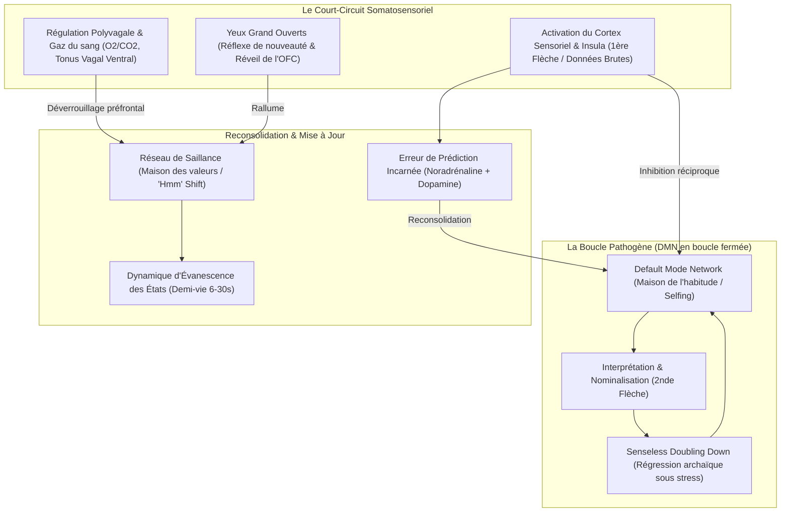

# 12 Daze 2024 - Sensational Hypnosis - Transcripts
**Formateur :** John Overdurf | **ID :** `john-overdurf-12-daze-2024-sensational-hypnosis-transcripts` | **Tranches :** 24

# Synthèse Architecturale du Cours : Sensational Hypnosis (12 Daze 2024 — John Overdurf)

---

## 1. Thèse Centrale & Philosophie du Cours

### Vision spécifique & Rupture avec l’approche standard
Dans *Sensational Hypnosis*, John Overdurf opère une bascule paradigmatique majeure par rapport à la PNL classique (années 80–90) et à l'hypnose ericksonienne orthodoxe :

1. **La fin du mythe du « Nettoyage » (*Anti-Clearing Myth*) & du « Saboteur Interne » :**  
   Overdurf rejette l'illusion neurobiologique consistant à vouloir « éliminer », « nettoyer » ou « réparer » un circuit neuronal défaillant. Il dé-réifie les concepts de « saboteur interne » ou de « parties conflictuelles » : le cerveau est une machine prédictive agnostique dont le *Default Mode Network* (DMN) sélectionne mécaniquement l'habitude la plus disponible pour assurer la survie, et non pour maximiser le bonheur.
2. **De la restructuration cognitive descendante (*Top-Down*) à la bascule somatosensorielle (*Bottom-Up*) :**  
   Tant que la physiologie neurovégétative (système polyvagal, gaz du sang $O_2/CO_2$, tonus musculaire) est en bascule sympathique ou dorsale, le cortex préfrontal et l'OFC (*Orbital Prefrontal Cortex*) sont déconnectés. Prétendre « recadrer » par le langage pur un sujet en état de figement ou de fuite revient à *« laisser un lombric prendre des décisions de vie »*. L'intervention doit impérativement s'amorcer **sous la nuque** (*from the neck down*).
3. **Le découplage Sensation vs Interprétation (1ère flèche vs 2nde flèche) :**  
   La souffrance n'est jamais le stimulus brut, mais la couche sémantique plaquée par le DMN (nominalisations : « angoisse », « douleur », « traumatisme »). En forçant l'attention sur les sous-modalités physiques pures (pression, température, texture, mouvement), on neutralise l'accès aux réseaux affectifs aversifs.

### Fil rouge méthodologique
Le vecteur directeur reliant toutes les interventions du cours est le suivant :
> **Moduler et court-circuiter les boucles prédictives du DMN en saturant massivement le cortex sensoriel et l'insula par des kinesthésiques présentes, afin de générer une « Erreur de Prédiction Incarnée » (*Embodied Prediction Error*) et forcer la reconsolidation mnésique immédiate.**

Puisque le système kinesthésique somatique direct est structurellement incapable de voyager dans le temps (*kinesthetics are always in now*), ramener l'attention dans la micro-sensation dissout le « complexe temporel ericksonien » (souvenir de la douleur passée + anticipation anxieuse de la douleur future).

---

## 2. Carte des Concepts & Leviers Émergents

### Inventaire structuré des leviers :

*   **Le DMN Agnostique & « Maison de l'Habitude » :** Générateur automatique de prédictions. Il ne cherche ni la vérité ni le bien-être, mais l'économie d'énergie métabolique et la survie.
*   **Le Redoublement Stupide (*DMN Senseless Doubling Down*) :** Face à un échec adaptatif sous stress, le DMN ne s'ouvre pas à la nouveauté par raisonnement ; il régresse vers l'automatisme immédiatement antérieur dans l'historique de vie, devenant de plus en plus archaïque et binaire.
*   **La Désidentification Spontanée (*Blue-Collar De-identification*) :** L'observation métacognitive incarnée obtenue sans effort conceptuel : observer la micro-sensation physique crée mécaniquement la scission sujet/objet (je ressens cela, donc je ne *suis* pas cela).
*   **Dissociation Intensité vs Caractère Désagréable (*Unpleasantness Split*) :** Séparation neurologique du codage d'amplitude du signal et de sa valence aversive, permettant une habituation neuronale accélérée.
*   **L'Erreur de Prédiction Incarnée (*Embodied Prediction Error*) :** Signal de rupture entre l'attente aversive abstraite et la réalité sensorielle directe, libérant un cocktail neurochimique (noradrénaline, dopamine, acétylcholine) obligatoire pour la reconsolidation de mémoire.
*   **Bascule de Saillance par la Curiosité (*The 'Hmm' Shift*) :** Utilisation de l'exploration sensorielle et de l'attitude curieuse (intrinsèquement gratifiante pour le cerveau) pour réallouer les ressources attentionnelles loin de la compulsion ou de la menace.
*   **La Tristesse Creuse (*Hollow Sadness*) :** Anesthésie protectrice du DMN qui nominalise la douleur pour éviter l'inondation affective, figeant le sujet dans un engourdissement (*numbness*) sans issue sensorielle.
*   **L'Impermanence Somatique (Fenêtre de 6 à 30 secondes) :** Durée de vie neurobiologique naturelle d'un état non alimenté cognitivement. Si l'attention demeure sur la sensation pure sans métaphore, *« it can't not change »*.
*   **Réflexe de Nouveauté (« *Eyes Wide Open* ») :** Écarquiller volontairement le regard face au figement pour réengager immédiatement l'OFC par voie réflexe ascendante.
*   **Affamement du DMN par les Gaz du Sang :** Altération contrôlée de la balance $O_2/CO_2$ (respiration holotropique / hyperventilation modulée) induisant une vasoconstriction cérébrale qui suspend temporairement le DMN au profit d'ondes gamma, à condition d'avoir établi un socle de sécurité somatique préalable.

---

## 3. Tableau Récapitulatif des Techniques & Démonstrations

| Technique / Exercice | Objectif Opératoire | Déclencheur / Indication | Séquence Résumée |
|---|---|---|---|
| **Dénominalisation Somatique (Sensory Uncoupling)** | Réduire une étiquette émotionnelle ou douloureuse à un flux physique brut non menaçant. | Verbalisation de nominalisations figées (*« angoisse »*, *« panique »*, *« douleur intolérable »*). | 1. Interrompre le narratif. 2. Demander la localisation anatomique exacte. 3. Calibrer les sous-modalités physiques pures : température, densité, texture, direction du mouvement. 4. Interdire toute métaphore cognitive et maintenir l'attention jusqu'à mutation de la sensation. |
| **Bascule de Saillance par le « *Hmm* » (Brewer Curiosité Shift)** | Neutraliser une compulsion, addiction (*urge*) ou pulsion d'évitement sans recours à la volonté. | Pulsion de grignotage, envie de fumer, compulsion comportementale, craving. | 1. Observer la montée de la pulsion sans la freiner. 2. Adopter une posture vocale et corporelle de curiosité candide (« *Hmm... qu'est-ce que c'est que ça exactement ?* »). 3. Cartographier sensoriellement l'envie millimètre par millimètre. 4. Laisser la gratification dopaminergique de la curiosité supplanter la valeur de récompense de l'addiction. |
| **Fractionnement Sensoriel d'Interruption (Sensory-Mental Fractionation)** | Briser le *Senseless Doubling Down* du DMN et forcer une erreur de prédiction. | Sujet en boucle de rumination fermée, sur-intellectualisation, résistance cognitive. | 1. Amener le sujet au bord du pattern anxieux. 2. Coupure abrupte par injection d'un input kinesthésique ou extéroceptif intense et inattendu (pression proprioceptive, focalisation visuelle périphérique, toucher direct). 3. Fractionner entre retour bref à la pensée et immersion sensorielle immédiate jusqu'à effondrement de la prédiction du DMN. |
| **Réveil de l'OFC par les Yeux Grand Ouverts (*Eyes Wide Open*)** | Rallumer le cortex orbitofrontal et briser la pensée binaire / figement dorsal. | Regard vitreux, sidération, pensée en « tout ou rien », blocage d'inhibition défensive. | 1. Repérer la bascule en vision tubulaire ou regard fixe. 2. Guider une ouverture maximale, soudaine et soutenue des yeux. 3. Associer une inspiration ventrale profonde et une exploration panoramique de l'environnement. 4. Vérifier la reprise de nuances et de flexibilité cognitive dès le réengagement de l'OFC. |
| **Surcharge Sensorielle Somatotopique (Type Havening / Auto-Berceau)** | Réguler l'axe vagal par le toucher externe et dissiper la tristesse creuse ou le trauma. | Détresse affective aiguë, état de choc, tristesse enkystée, hyperactivité sympathique. | 1. Engager un toucher lent et rythmique bilatéral (bras, visage, paumes) ou un bercement postural. 2. Surcharger le cortex sensoriel somatotopique pour monopoliser la bande passante du DMN. 3. Laisser l'émotion brute émerger et traverser sa demi-vie naturelle (6–30s) dans un contenant somatique sécure. |
| **Suspension du DMN par Régulation des Gaz du Sang (Breathwork Hypoxique Contrôlé)** | Affamer métaboliquement le DMN pour accéder à des états de transe profonde ou transpersonnelle (Gamma). | Résistance intellectuelle massive, besoin d'expérience unitive ou de réinitialisation neurochimique profonde. | 1. Établir une ancre de sécurité somatique sommitale (corps entièrement détendu, tonus vagal ventral). 2. Entraîner une hyperventilation contrôlée pour saturer l'$O_2$ et chuter le $CO_2$ (vasoconstriction corticale ciblée). 3. Observer la dé-potentialisation du DMN et l'émergence de bouffées d'ondes gamma. 4. Ré-ancrage progressif dans les kinesthésies présentes. |

---

---

## 0. Sommaire Sémantique & Index des Lignes

- **Tranche 1 [Lignes 120-224]** : A : Conversational Sensory Expansion & Now-State Induction — *Protocole :* A : Conversational Sensory Expansion & Now-State Induction | *Mécanisme :* Le Découplage Sensation vs Interprétation (Dénominalisation Somatique) | *Verbatim :* La Double Contrainte d'Autonomie et Saupoudrage Inconscient
- **Tranche 2 [Lignes 226-321]** : Fractionnement Sensoriel d'Interruption de Schéma (Sensory-Mental Fractionation) — *Protocole :* Fractionnement Sensoriel d'Interruption de Schéma (Sensory-Mental Fractionation) | *Mécanisme :* Modulation Sensorielle du Default Mode Network (DMN) vs Éradication de l'Ego | *Verbatim :* La question maîtresse de réveil somatique
- **Tranche 3 [Lignes 323-463]** : Sensation Transformation - Phase 1 : La Dé-centration Somatique Directe — *Protocole :* Sensation Transformation - Phase 1 : La Dé-centration Somatique Directe | *Mécanisme :* Le Redoublement Stupide du Réseau du Mode par Défaut (DMN Senseless Doubling Down) | *Verbatim :* Le Doublement Récursif Stupide du DMN
- **Tranche 4 [Lignes 465-553]** : Sensation Transformation Processing (STP) – Phase d'investigation de l'Urge (Brewer / Overdurf) — *Protocole :* Sensation Transformation Processing (STP) – Phase d'investigation de l'Urge (Brewer / Overdurf)
- **Tranche 5 [Lignes 555-687]** : The Sensorimotor Reset & Content-Free Access Alignment (Processus STP / Précurseur) — *Protocole :* The Sensorimotor Reset & Content-Free Access Alignment (Processus STP / Précurseur) | *Mécanisme :* Down-régulation du Default Mode Network (DMN) & Dé-routement Sensoriel | *Verbatim :* La Présupposition de Changement Inévitable
- **Tranche 6 [Lignes 689-827]** : Access Alignment avec Ancrage Oculaire & Respiration (Variante Distancielle / Zoom) — *Protocole :* Access Alignment avec Ancrage Oculaire & Respiration (Variante Distancielle / Zoom)
- **Tranche 7 [Lignes 829-942]** : Consolidation par Élicitation Répétée de l'Erreur de Prédiction (Prediction Error Testing Loop) — *Protocole :* Consolidation par Élicitation Répétée de l'Erreur de Prédiction (Prediction Error Testing Loop) | *Mécanisme :* Le Test comme Consolidation Neurobiologique (Positive Prediction Error Consolidation) | *Verbatim :* La suggestion d'enjambement amnésique et de bascule de satisfaction
- **Tranche 8 [Lignes 944-1044]** : d'Actualisation par Désenchantement et Erreur de Prédiction Corporelle (Modèle Brewer / Over... — *Protocole :* d'Actualisation par Désenchantement et Erreur de Prédiction Corporelle (Modèle Brewer / Overdurf) | *Verbatim :* La Bascule Figure / Fond et l'Éveil Sensoriel
- **Tranche 9 [Lignes 1046-1183]** : A : Recalibrage de la Valeur de Récompense par la Sensation Résiduelle (Step 3 Loop & Somati... — *Protocole :* A : Recalibrage de la Valeur de Récompense par la Sensation Résiduelle (Step 3 Loop & Somatic Reframe) | *Mécanisme :* La Valeur de Récompense de l'Action Mentale (Reward Value of "Doing Something") | *Verbatim :* La question de rupture viscérale (Simultaneous Incongruity Prompt)
- **Tranche 10 [Lignes 1185-1321]** : L'Empilement Hypnotique Multistrate "I Don't Know... But I Do Know" — *Protocole :* L'Empilement Hypnotique Multistrate "I Don't Know... But I Do Know" | *Mécanisme :* Le Biais de Linéarité Syntaxique vs la Cognition Rhizomatique | *Verbatim :* La Négation Protectrice & Pacing de Résistance (Joe Barber Style)
- **Tranche 11 [Lignes 1323-1475]** : Le "Barn Burner" (Post-Hypnotic Trance Sandwich & Intégration ESE) — *Protocole :* Le "Barn Burner" (Post-Hypnotic Trance Sandwich & Intégration ESE) | *Mécanisme :* Le Sandwich de Transe & Fractionnement Temporel Inversé | *Verbatim :* La Présupposition d'Apprentissage Implicite Hors Conscience
- **Tranche 12 [Lignes 1477-1610]** : A : L'Échelle Temporelle Linguistique (Temporal Preposition Ladder) — *Protocole :* A : L'Échelle Temporelle Linguistique (Temporal Preposition Ladder) | *Verbatim :* Pattern 1 : L'Attracteur Directionnel et la Dissociation Temporelle
- **Tranche 13 [Lignes 1612-1769]** : Le Réarmement Oculaire Préfrontal (Eyes Wide Open) — *Protocole :* Le Réarmement Oculaire Préfrontal (Eyes Wide Open) | *Mécanisme :* Rallumage du Cortex Préfrontal Orbitofrontal (OFC) & Rétro-ingénierie Neuro-Somatique | *Verbatim :* La Manœuvre d'Attention Divisée Somatique (Eyes Wide Open)
- **Tranche 14 [Lignes 1771-1872]** : Sensation Transformation Processing (STP) – Macro-Structure Modulaire — *Protocole :* Sensation Transformation Processing (STP) – Macro-Structure Modulaire | *Verbatim :* La Prescription Paradoxale par Rupture Réductrice
- **Tranche 15 [Lignes 1874-2027]** : Le Déblocage Vagal ATM « 5-5-5 » (Overdurf Vagal Downshift) — *Protocole :* Le Déblocage Vagal ATM « 5-5-5 » (Overdurf Vagal Downshift) | *Verbatim :* Le Double Lien Évolutif de Catalepsie et Descente Involontaire
- **Tranche 16 [Lignes 2029-2181]** : Test de Référence Profonde pour les Accès Oculaires (Calibration) — *Protocole :* Test de Référence Profonde pour les Accès Oculaires (Calibration) | *Mécanisme :* Le « Construct Bypass » & L'Accès Oculaire Automatisé | *Verbatim :* Le Défi de Congruence Inconditionnelle
- **Tranche 17 [Lignes 2183-2287]** : A : La Bascule Somatique & Réinitialisation Vago-Linguale — *Protocole :* A : La Bascule Somatique & Réinitialisation Vago-Linguale
- **Tranche 18 [Lignes 2289-2519]** : L'Induction d'Expansion Sensorielle & Inversion Figure/Fond (Foreground/Background Attention... — *Protocole :* L'Induction d'Expansion Sensorielle & Inversion Figure/Fond (Foreground/Background Attention-Shifting) | *Mécanisme :* Décalage Attentionnel Figure/Fond par Présuppositions de Conscience | *Verbatim :* La Bascule Figure/Fond et l'Ancrage Coulissant
- **Tranche 19 [Lignes 2521-2664]** : « The Trance Sandwich » (Post-Hypnotic Integration & Amnesia Loop) — *Protocole :* « The Trance Sandwich » (Post-Hypnotic Integration & Amnesia Loop) | *Verbatim :* Pattern 1 : Ancrage de la Transe sur la Valeur Liberté
- **Tranche 20 [Lignes 2666-2799]** : Démonstration : Recalibrage de Direction Pré-STP (Désenchevêtrement Mère/Fils - Larissa) — *Protocole :* Démonstration : Recalibrage de Direction Pré-STP (Désenchevêtrement Mère/Fils - Larissa) | *Verbatim :* Pattern 1 : L'Amorce Rhizomatique & Amnésie Enchâssée
- **Tranche 21 [Lignes 2801-2925]** : d'Inoculation et Réorganisation de Contagion Vagal (Démonstration avec Larissa) — *Protocole :* d'Inoculation et Réorganisation de Contagion Vagal (Démonstration avec Larissa) | *Mécanisme :* Bascule Neurovégétative Dorsale vs Ventrale | *Verbatim :* Découplage de la Contagion Émotionnelle
- **Tranche 22 [Lignes 2927-3123]** : Le Découplage Identitaire par la Gratitude et l'Ignorance Féconde (Fin de démonstration STP) — *Protocole :* Le Découplage Identitaire par la Gratitude et l'Ignorance Féconde (Fin de démonstration STP) | *Mécanisme :* Le Swish Pattern comme Moteur Dopaminergique et Directionnel | *Verbatim :* Sortie de transe par l'autorité souveraine et la présence
- **Tranche 23 [Lignes 3125-3253]** : A : Swish a Lifetime (Le Swish d'une vie entière) — *Protocole :* A : Swish a Lifetime (Le Swish d'une vie entière)
- **Tranche 24 [Lignes 3255-3416]** : Le Double Swish Identitaire avec Réinitialisation Rétroactive du DMN — *Protocole :* Le Double Swish Identitaire avec Réinitialisation Rétroactive du DMN | *Verbatim :* La Double Identité Émergente

---

## Extractions Détaillées par Tranche (Opératoire & Verbatim)

## Tranche 1 / 24 : A : Conversational Sensory Expansion & Now-State Induction

### 1. Mécanismes & Principes Actifs

#### 1. Le Découplage Sensation vs Interprétation (Dénominalisation Somatique)
*   **Principe actif :** La souffrance psychologique ou l'angoisse physique ne provient pas du stimulus sensoriel brut (la première flèche), mais de la couche cognitive plaquée dessus (la seconde flèche : étiquettes, nominalisations comme « douleur », « angoisse », « panique »). En forçant l'attention à descendre exclusivement au niveau des sous-modalités physiques pures (température, texture, pression, mouvement), on neutralise l'accès aux réseaux sémantiques et affectifs associés.
*   **Mécanisme neuro-cognitif :** Désactivation du réseau du mode par défaut (DMN) et bascule vers le réseau de saillance / cortex insulaire. Le système cesse de fabriquer des abstractions figées et traite de la donnée brute non menaçante.
*   **Tags :** `#decoupling_sensation_interpretation` `#sensory_vs_nominalization` `#sensation_transformation_processing` `#first_arrow_second_arrow`

#### 2. La Désidentification Spontanée (« Blue-Collar De-identification »)
*   **Principe actif :** Plutôt que d'enseigner des méditations complexes ou des concepts abstraits d'observation de soi (« vous n'êtes pas vos pensées »), orienter l'attention d'un sujet sur les micro-sensations physiques crée mécaniquement et sans effort une scission observateur/observé. En observant la sensation, le sujet cesse immédiatement d'être la sensation.
*   **Mécanisme :** Déplacement de la position perceptive depuis l'état fusionné (associé au problème) vers une méta-position somatique incarnée (« grounded awareness »).
*   **Tags :** `#blue_collar_deidentification` `#effortless_metacognition` `#mechanic_disidentification`

#### 3. La Dissociation Intensité vs Caractère Désagréable (*Unpleasantness*)
*   **Principe actif :** Basé sur les recherches en neurosciences (Antoine Lutz, Richard Davidson, 2012), le cerveau code séparément l'intensité sensorielle objective (*pain intensity*) et l'évaluation affective aversive (*unpleasantness*). Chez le non-entraîné, ces deux signaux fusionnent en un bloc traumatique ou anxieux continu. Les états d'ouverture sensorielle permettent de ressentir l'intensité brute sans déclencher la boucle de rejet ou d'angoisse, aboutissant à une habituation neuronale accélérée (*faster neural habituation*).
*   **Tags :** `#intensity_vs_unpleasantness_split` `#neural_habituation` `#affective_uncoupling` `#distress_tolerance`

#### 4. L'Éradication du Complexe Temporel Éricksonien (Mémoire & Imagination)
*   **Principe actif :** Milton Erickson définissait la souffrance comme un complexe triadique : sensation actuelle + douleur mémorisée + douleur anticipée. L'immense majorité de la détresse humaine réside dans le détournement de l'imagination (projection future anxiogène) et de la mémoire (rumination passée). Le système kinesthésique et somatique, lui, n'existe que dans le présent (« *our kinesthetics are always in now* »). Ancrer le système nerveux dans le sensoriel présent assèche instantanément les carburants du complexe temporel.
*   **Tags :** `#ericksonian_pain_complex` `#temporal_misuse` `#kinesthetics_in_now` `#eradicating_anticipation`

#### 5. Tolérance à la Détresse & Non-Attachement Relationnel
*   **Principe actif :** L'approche s'éloigne du dogme classique de la PNL des années 80-90 qui prétendait « éliminer » ou « nettoyer » (*clear/eliminate*) un circuit neurologique — ce qui est un leurre biologique. Le levier thérapeutique consiste à modifier la relation qu'entretient le sujet avec sa sensation interne. En développant la tolérance à la détresse, la sensation n'est plus un signal d'alarme exigeant une réaction défensive ou une fuite ; elle devient une information neutre qui s'auto-transforme naturellement dès qu'elle n'est plus figée par des étiquettes.
*   **Tags :** `#changing_the_relationship` `#distress_tolerance` `#anti_clearing_myth` `#rhizomatic_adaptation`

---

### 2. Protocoles, Techniques & Démonstrations (Étape par Étape)

#### Protocole A : *Conversational Sensory Expansion & Now-State Induction*

*   **Intention / Indication :** 
    Induire un état de présence ressource instantané (« *Now is one of the best resource states* »), couper net la rumination mentale ou l'anticipation anxieuse, préparer le système nerveux à un recadrage ou à un travail transformationnel somatique.
*   **Mise en place & Pré-framing :**
    Yeux ouverts (sans obligation de champ périphérique formel), sujet assis dans son environnement actuel, focalisation initiale externe/interne sans pression de performance.
*   **Séquence d'actions pas à pas :**
    1.  **Désactivation vagale / motrice faciale :**
        Inviter le sujet à regarder droit devant lui les yeux ouverts et à *relâcher l'arrière de la langue* (« *relax the back of your tongue* »).
    2.  **Enchaînement de relâchement automatique :**
        Lier le relâchement de la langue à celui de la mâchoire, puis au ralentissement réflexe du cycle respiratoire.
    3.  **Focalisation kinesthésique brute :**
        Porter l'attention sur l'air entrant par les narines, le passage de l'air dans la trachée et les poumons, ou le contact de l'air ambiant sur la surface de la peau.
    4.  **Bascule sensorielle par questionnement négatif (V) :**
        Demander : *« Alors que vous remarquez ces sensations, que ne voyiez-vous pas consciemment que vous pouvez voir maintenant ? »*
    5.  **Expansion visuelle récursive (V2) :**
        Demander : *« Et alors que vous voyez ce que vous voyez, quoi d'autre ne voyiez-vous pas que vous pouvez être en train de voir maintenant ? »*
    6.  **Expansion auditive par soustraction (A) :**
        Demander : *« Et alors que vous voyez cela, que n'étiez-vous pas en train d'entendre que vous pouvez entendre maintenant ? »*
    7.  **Bouclage somatosensoriel intéroceptif (K) :**
        Demander : *« Et alors que vous voyez ce que vous voyez, que vous entendez ce que vous entendez, que n'étiez-vous pas en train de ressentir, soit sur votre peau, soit à l'intérieur, que vous pouvez ressentir maintenant ? »*
    8.  **Stabilisation différentielle :**
        Demander : *« Et en quoi cela est-il différent de la façon dont vous expérimentiez la sensation auparavant ? »*
*   **Signes de calibration :**
    *   Affaissement visible de la mandibule inférieure (relâchement mâchoire/langue).
    *   Allongement et approfondissement spontané du rythme respiratoire diaphragmatique.
    *   Dilatation pupillaire et défocalisation légère du regard (passage en traitement attentionnel distribué).
    *   Pause cognitive / latence verbale accrue avant de répondre.

---

### 3. Heuristiques, Subtilités & "Sagesse du Praticien"

#### Heuristiques Opératoires (« Si X -> Alors Y parce que Z »)
*   **Si** un sujet arrive avec un mot d'ordre d'élimination (« Je veux supprimer cette angoisse/douleur »), **alors** ne validez jamais l'éradication du circuit ; recadrez immédiatement l'objectif sur un changement de *relation* avec la sensation. **Parce que** le système nerveux ne supprime pas de connexions synaptiques sur commande, et vouloir éliminer un ressenti déclenche une lutte de second niveau (*second arrow*) qui amplifie l'état indésirable.
*   **Si** le sujet nomme une émotion ou un état abstrait (« J'ai mal », « Je suis stressé »), **alors** descendez sous le niveau du langage jusqu'à la pure sensation somatique (pression, température, mouvement, surface). **Parce que** les nominalisations déclenchent des cascades associatives apprises, tandis que les micro-sensations non étiquetées sont plastiques et changent d'elles-mêmes dès qu'on cesse de les figer.
*   **Si** un client est pris de panique anticipatoire face à un événement à venir (ou une procédure médicale), **alors** ramenez-le impérativement à des sensations physiques actuelles et à la détection de ce qui n'était pas encore perçu. **Parce que** la détresse ne réside jamais dans l'instant présent (« *Now* »), mais dans le détournement de l'imagination et de la mémoire.
*   **Si** vous travaillez avec des supports audios ou une séance guidée, **alors** donnez l'illusion du choix conscient tout en liant l'apprentissage à l'inconscient (« *I don't know what you'll decide... learning I leave up to your unconscious* »). **Parce que** cela désamorce toute réactance psychologique face à la directivité.

#### Pièges & Erreurs Classiques
*   **Le piège du « Clearing » (Mythe de la PNL classique) :** Croire et faire croire qu'on va « effacer » une trace ou un déclencheur définitivement. La réalité clinique et neuroscientifique montre que l'exposition et la tolérance à la détresse transforment la réaction sans nécessiter l'impossible destruction du réseau de base.
*   **La confusion Douleur / Souffrance (Intensité vs Aversion) :** L'erreur du praticien débutant est de croire qu'il faut réduire l'intensité ressentie à zéro. L'objectif opératoire réel est d'annihiler le caractère désagréable (*unpleasantness*), permettant à l'intensité de monter brièvement puis de s'éteindre naturellement par habituation neuronale.
*   **Vouloir forcer le changement :** Essayer d'agir directement sur les schémas mentaux. Overdurf insiste : ce sont les sens qui provoquent le changement, la pensée ne fait que le stabiliser et le cristalliser.

#### Postulats Fondamentaux de John Overdurf
*   *« Change comes from our senses, our thoughts stabilize and crystallize change. »*
*   *« Our nervous system, particularly our kinesthetics, are always in now. »*
*   *« Suffering does not happen in now. It happens in memory and imagination. »*
*   *« All sensations change when they're not frozen by our labels and associations. »*

---

### 4. Pépites Verbatim & Patterns Linguistiques (MOT À MOT EN V.O.)

#### Pépite 1 : La Double Contrainte d'Autonomie et Saupoudrage Inconscient
> *"From my past experience, I know many of you may want to dive right into the videos and obviously I can't stop you if you feel that urge. All I'll say is this, only to hypnotherapists, so this is only a suggestion... I don't know what you'll actually decide to maximize your personal learning. I only know that I gave you some suggestions, and learning I leave up to your unconscious, perhaps conscious minds."*
*   **[Analyse du Pattern]** : Utilisation magistrale de la psychologie inversée et du faux choix. En affirmant *« obviously I can't stop you »*, Overdurf désamorce la résistance. Le syntagme *« only to hypnotherapists, so this is only a suggestion »* constitue une induction par défi identitaire (flatterie de caste). La formule finale scinde le conscient et l'inconscient, présupposant que l'apprentissage se fera de toute façon (*« maximize your personal learning »*), tout en confiant la tâche critique à l'inconscient.

---

#### Pépite 2 : Rupture Temporelle et Expansion Négative (Séquence *« What were you not seeing... »*)
> *"As you're seeing this, what were you not seeing that you can now? And as you're seeing this, what were you not hearing? What else were you not hearing in the music? So you're relaxing on the surface of your body... Just notice that as you're relaxing the back of it, it hasn't already just allowed your relaxing the back of it to begin to slow successive breath into a slightly longer, easier, slower, and spurred self-rest."*
*   **[Analyse du Pattern]** : Utilisation de questions présupposant une omission inconsciente antérieure (*« what were you not seeing that you can now »*). Ce pattern force le cortex à fouiller le champ sensoriel présent, interrompant instantanément le dialogue interne. L'enchaînement syntaxique utilise un enchevêtrement trans-dérivationnel (*« it hasn't already just allowed your relaxing the back of it to begin to slow... »*) où les négations et répétitions créent une surcharge cognitive douce propice à la catalepsie mentale et au relâchement somatique.

---

#### Pépite 3 : La Métaphore Rhizomatique & Libération des Étiquettes
> *"Gifts don't have to be forced, clear, they just need to be consciously, mindfully, sensitized. Long enough for you to discover they will change. As all sensations do when they're not frozen by our instructions. I don't know how they'll change in a way that you want or perhaps in a way that you don't expect... Just as the rhizome has no clear beginning nor end, this journey through these audios and videos can create connections you haven't yet imagined and leave trails that continue to evolve."*
*   **[Analyse du Pattern]** : Présupposition universelle de changement somatique (*« As all sensations do when they're not frozen by our instructions »*) qui recadre la sensation pathologique non comme une entité fixe, mais comme un flux temporairement bloqué par le langage. L'utilisation de l'adjonction deleuzienne du *rhizome* agit comme une commande métaphorique post-hypnotique : elle autorise l'intégration non-linéaire des apprentissages hors de tout contrôle conscient.

---

#### Pépite 4 : Le Recadrage par le Démenti / Non-Garantie (*The Anti-Suggestion*)
> *"Here's the disclaimer. There is no guarantee in obvious beneficial ways that you will feel different, confident in your skills and in yourself... just as there are absolutely no guarantees in this life. So all therapeutic change occurs despite the fact there is no guarantee, just as every successful change you've made in your life occurred despite there being no guarantee that it will happen. You know, so given how things can be sometimes, I have no idea whether you'll even notice you've changed. It might be after viewing a segment, or maybe even during it..."*
*   **[Analyse du Pattern]** : Clause de non-responsabilité paradoxale employée comme puissant véhicule de suggestion indirecte. En affirmant qu'il n'y a « aucune garantie », Overdurf contourne tout le facteur critique du sujet. Puis, par empilement d'évidences (*« every successful change you've made... occurred despite there being no guarantee »*), il lie la notion d'absence de garantie à la survenue inévitable du changement réussi. Enfin, la présupposition temporelle finale (*« whether you'll even notice you've changed... after... or during it »*) ne remet plus en doute le changement lui-même, mais seulement le moment de sa prise de conscience.

## Tranche 2 / 24 : Fractionnement Sensoriel d'Interruption de Schéma (Sensory-Mental Fractionation)

Voici l'analyse opératoire intégrale de la tranche 2/24 de la transcription du cours *12 Daze 2024 - Sensational Hypnosis* de John Overdurf.

---

### 1. Mécanismes & Principes Actifs

#### 1. Modulation Sensorielle du Default Mode Network (DMN) vs Éradication de l'Ego
* **Principe actif :** Contrairement au mythe répandu (dans la méditation classique ou l'hypnose traditionnelle) selon lequel l'objectif thérapeutique ultime consisterait à éteindre le *Default Mode Network* (réseau du mode par défaut, responsable du vagabondage mental, de la narration interne et de l'auto-référence / *selfing*), les neurosciences récentes (Farb, Zindel Segal) démontrent que l'effet thérapeutique stabilisateur provient de **l'activation du cortex sensoriel**. Lorsque le système sensoriel (externe et intéroceptif/proprioceptif) est intensivement stimulé dans le présent, le DMN est naturellement modulé et enrichi de données fraîches au lieu d'opérer en boucle fermée. Le DMN cesse de tourner à vide en narration douloureuse et réintègre le soi dans un champ expérientiel élargi.
* **Tags libres émergents :** `#DMN_modulation_vs_downregulation` `#sensory_cortex_recruitment` `#house_of_habit` `#house_of_values` `#unconscious_updating`

#### 2. L'Erreur de Prédiction Incarnée (Embodied Prediction Error & Reconsolidation)
* **Principe actif :** Le cerveau est une machine prédictive bayésienne. Face à un stimulus anxiogène, addictif ou douloureux, le système anticipe le résultat sur la base des apprentissages passés. Si l'individu « décroche » mentalement (par distraction pure, évitement cognitif ou transe de panique), aucune mise à jour n'a lieu : le cerveau valide sa prédiction initiale (*« j'ai eu mal / j'ai fumé, la prédiction est conforme »*). Pour forcer la **reconsolidation de mémoire** et l'extinction du schéma, le sujet doit vivre une *expérience consciente incarnée* au moment précis du stimulus. C'est le décalage sensoriel entre l'attente abstraite et la sensation brute réelle qui libère le cocktail neurochimique (noradrénaline, acétylcholine, dopamine) déclenchant le signal d'erreur de prédiction (*« en fait, ça a un goût infect »*, ou *« la sensation corporelle réelle n'est pas la terreur anticipée »*).
* **Tags libres émergents :** `#embodied_prediction_error` `#reconsolidation_trigger` `#neurochemical_surprise_cocktail` `#sensory_reality_check`

#### 3. L'Ancrage Non-Temporel du Système Kinesthésique (Anti-Time-Traveling)
* **Principe actif :** Les canaux visuel et auditif permettent la projection temporelle (voyage mental dans les souvenirs passés ou anticipations anxieuses futures). Le système kinesthésique somatique direct, en revanche, ne peut éprouver que ce qui se produit **ici et maintenant**. Même si une personne s'angoisse pour un événement futur, la sensation de serrement ou de chaleur n'existe qu'au présent. Réduire l'expérience à une sensation tactile/proprioceptive pure élimine instantanément l'échafaudage imaginaire de la douleur ou du trauma, réduisant le signal à un stimulus brut dénué de son narratif dramatique.
* **Tags libres émergents :** `#kinesthetic_non_time_traveling` `#sensation_vs_narrative` `#first_dart_second_dart`

#### 4. Recalibration de la Valeur de Récompense par le Salience Network (Réseau de Saillance)
* **Principe actif :** Le réseau de saillance (la *« maison des valeurs »*), voisin direct du DMN (*« maison de l'habitude »*), alloue dynamiquement les ressources attentionnelles et dicte ce qui est prioritaire pour la survie et le bien-être. Quand une personne est pleinement immergée dans une interaction ou une tâche sensorielle réelle, le réseau de saillance réévalue la menace : en constatant l'absence de mort imminente et la richesse des données contextuelles, il coupe les flux d'attention dédiés à la boucle de douleur/rumination, activant le tonus vagal apaisant.
* **Tags libres émergents :** `#salience_network_reallocation` `#reward_value_shift` `#values_hierarchy_neurology`

#### 5. La Régression en Cascade du DMN (Senseless Doubling Down)
* **Principe actif :** Lorsqu'une habitude ou un automatisme cognitif récent échoue sous stress, le DMN ne s'arrête pas par raisonnement logique. Il a pour mandat d'automatiser et de simplifier. Privé de nouvel input sensoriel, le système « s'entête bêtement » (*senselessly doubles down*) en régressant vers le programme immédiatement antérieur disponible dans l'historique de l'individu, même s'il est obsolète ou inadapté (puis vers un programme encore plus archaïque si l'échec persiste). Seule l'injection de données sensorielles brutes stoppe cette cascade régressive.
* **Tags libres émergents :** `#DMN_senseless_doubling_down` `#regressive_habit_cascade` `#sensory_circuit_breaker`

---

### 2. Protocoles, Techniques & Démonstrations (Étape par Étape)

#### Protocole : Fractionnement Sensoriel d'Interruption de Schéma (Sensory-Mental Fractionation)

* **Intention / Indication :** Désamorçage immédiat des douleurs chroniques, des envies compulsives/addictions (nourriture, tabac, alcool), de l'anxiété anticipatoire ou des relaps dépressifs.
* **Mise en place & Pré-framing :** Recadrer l'objectif non pas comme une suppression de la pensée ou un combat de volonté (qui échoue dès l'épuisement du cortex préfrontal orbital), mais comme une curiosité sensorielle directe. Expliquer que l'on va simplement « glisser sur les tendances naturelles du système nerveux ».

* **Séquence d'actions pas à pas :**
  1. **Élicitation du signal d'alerte / craving :** Amener le sujet au seuil du déclencheur ou observer le moment où la compulsion / l'inconfort démarre.
  2. **Interrogation du corps au présent :** Poser immédiatement la question focale : *« What are you noticing that’s happening with your body right now? »*
  3. **Filtrage Kinesthésique Sensoriel vs Métaphore :**
     * Si le sujet répond par une métaphore ou un narratif (*« J'ai l'impression d'étouffer sous une chape »*), calibrer l'activité du DMN et ramener chirurgicalement au sensoriel brut (*« Où exactement ? Quelle température ? Quelle pression ? »*).
  4. **Fractionnement Alterné (Sensoriel / Narratif) :**
     * Fixer l'attention sur les sensations brutes (respiration, appuis corporels, contact cutané).
     * Laisser le mental conscient s'engager brièvement sur une tâche contextuelle ou observer la pensée.
     * Rebasculer délibérément sur une expérience sensorielle externe ou intéroceptive accrue.
  5. **Création de l'Erreur de Prédiction Incarnée :** Pendant la confrontation directe avec le stimulus (ex. tirer une bouffée de cigarette, avaler une bouchée, ressentir la piqûre), forcer le sujet à garder l'attention sensorielle totale sur le goût, la texture ou la pression exacte sans décrochage mental.
  6. **Constat du Décalage :** Laisser le système nerveux enregistrer l'absence de concordance entre la promesse mentale et la sensation biologique (*« En réalité, c'est désagréable / c'est juste un pincement d'une seconde »*).

* **Signes de calibration :**
  * Décélération du rythme respiratoire, soupir de soulagement autonome (engagement vagal).
  * Perte de fixation oculaire de transe négative / dé-focalisation du regard interne.
  * Ralentissement de la cadence verbale ; passage spontané de descriptions dramatiques à des constats factuels de sensation corporelle neutre.

---

### 3. Heuristiques, Subtilités & "Sagesse du Praticien"

* **Heuristique de la Flèche de Bouddha (First Dart vs Second Dart) :**
  * *Règle :* La première flèche est le stimulus sensoriel brut (la douleur ou l'événement) ; la seconde flèche est la réaction cognitive/narrative projetée par le sujet dessus.
  * *Application :* Ne tentez pas d'éliminer la première flèche par anesthésie cognitive. Réduisez tout à la première flèche (sensation pure) pour dissoudre automatiquement la seconde flèche (la souffrance psychologique).

* **Heuristique du Pile d'Assiettes de Bandler (Reconsolidation & Prédiction) :**
  * *Règle :* Le cerveau ne fouille pas dans les assiettes enfouies sous la pile ; il traite uniquement l'assiette du dessus.
  * *Application :* Vous n'avez pas besoin de « creuser » l'historique complet d'un traumatisme. Il suffit de placer une nouvelle expérience sensorielle incarnée par-dessus (re-cadrer la taille du cadre ou intégrer l'après-coup du soulagement) pour que le cerveau adopte cette nouvelle prédiction dominante.

* **Heuristique de la Conscience Micro-Contextuelle vs Macro-Méditation (J. Brewer) :**
  * *Règle :* 45 minutes de méditation isolée sur un coussin ne protègent pas contre un craving dans la vie réelle si la personne décroche lors du déclencheur.
  * *Application :* Entraînez le client à des micro-doses de présence sensorielle incarnée (quelques secondes) *au moment exact où le stimulus se présente*. C'est l'incarnation contextuelle au « moment de vérité » qui modifie le câblage synaptique, non la pratique en chambre étanche.

* **Heuristique du Choix Distraction vs Présence Incarnée :**
  * *Si* la situation est temporaire, non modifiable, et que le sujet a besoin de passer un cap aigu -> *Alors* la distraction ou l'engagement dans une tâche cognitive/sociale intense est utile (elle réalloue la saillance et éteint la douleur perçue).
  * *Si* l'objectif est d'éliminer définitivement un schéma, une phobie ou une addiction -> *Alors* interdiction d'utiliser la distraction pure ; le sujet doit demeurer en expérience sensorielle consciente incarnée pour forcer la reconsolidation.

* **Piège classique du Praticien :**
  * Confondre « calme mental » et mise à jour neuronale. Un client qui utilise l'évitement mental (*checking out*) pour ne pas ressentir semble calme, mais son cerveau se prépare à doubler la mise au prochain déclencheur car aucune mise à jour n'a eu lieu.

---

### 4. Pépites Verbatim & Patterns Linguistiques (MOT À MOT EN V.O.)

#### Pépite 1 : La question maîtresse de réveil somatique
> **"What are you noticing that’s happening with your body right now?"**
* **[Analyse du Pattern]** : Présupposition existentielle temporelle stricte (*"right now"*), combinée au prédicat kinesthésique d'attention passive/ouverte (*"noticing"* vs *"thinking"*). Le pattern coupe court à tout voyage temporel mental (*no time-traveling*) en forçant les circuits de traitement à interroger l'intéroception somatique immédiate. La syntaxe présuppose qu'il se passe déjà quelque chose et place le sujet en position d'observateur désidentifié de son propre corps.

#### Pépite 2 : Métaphore de la pile d'assiettes de Bandler (Reconsolidation bayésienne)
> **"Look, you ever been to one of those cafeterias where they have like the plates that go down into that little well there and each one pops up, you know, when you're ready to take your plate? He goes, those are like memories. So you don't even worry about any of the plates underneath. It's whatever is the plate that's on top is the thing that the brain cares about. So what he's saying is if you could put a new plate on top, that's the one that the brain pays attention to."**
* **[Analyse du Pattern]** : Analogie isomorphique à haute accessibilité visuelle et kinesthésique (distinction de surface). Utilisation d'un cadre de référence quotidien pour désamorcer la croyance limitante selon laquelle le changement nécessite une spéléologie douloureuse de tous les souvenirs du passé. La métaphore installe la présupposition qu'une seule couche expérientielle nouvelle suffit à reconditionner l'accès de l'inconscient.

#### Pépite 3 : Le recadrage de l'autonomie du DMN et du système nerveux
> **"What we used to say about hypnotic coaching, it's gliding on the natural tendencies of the nervous system. We're not doing anything that's alien to the nervous system. All we're doing is giving a chance to do more of it."**
* **[Analyse du Pattern]** : Métaphore kinesthésique de glisse fluide (*"gliding on natural tendencies"*), réduisant toute résistance ou anxiété de performance chez le praticien et le sujet. Recadrage de dépathologisation : l'intervention n'est pas une intrusion ou un forçage (*"nothing that's alien"*), mais une simple facilitation permissive d'auto-organisation biologique déjà présente.

#### Pépite 4 : Commande de réveil et de dissociation de l'ego
> **"Lose your mind to come to your senses."**
* **[Analyse du Pattern]** : Antithèse paradoxale et jeu de mots idiomatique (Perls réutilisé par Overdurf). Le pattern utilise une ambiguïté sémantique entre *"lose your mind"* (perdre la raison / lâcher la tyrannie du bavardage mental) et *"come to your senses"* (reprendre ses esprits / habiter ses canaux sensoriels bruts VAKOG). Ce double lien linguistique force l'effondrement de la narration du DMN au profit immédiat du cortex sensoriel.

## Tranche 3 / 24 : Sensation Transformation - Phase 1 : La Dé-centration Somatique Directe

Voici l'analyse opératoire intégrale de la tranche 3/24 du cours *Sensational Hypnosis (12 Daze 2024 / TCU Integration Lab)* de John Overdurf.

---

### 1. Mécanismes & Principes Actifs

#### A. Le Redoublement Stupide du Réseau du Mode par Défaut (*DMN Senseless Doubling Down*)
- **Principe actif :** Lorsque le Réseau du Mode par Défaut (DMN - *Default Mode Network*) fait face à un échec d'adaptation (une habitude ou un pattern récent ne résout pas le problème actuel), au lieu de s'ouvrir aux données de l'environnement, il régresse automatiquement vers un programme antérieur, pourtant devenu inadapté. Si cet échelon échoue à son tour, il régresse récursivement vers une boucle encore plus ancienne, plus rigide et plus primitive. 
- **Interruption du cycle :** Le DMN ne peut pas sortir de ce mécanisme par une introspection cognitive (qui le renforce). La seule clé de rupture consiste à forcer une saturation ou une redirection de l'attention vers des données sensorielles brutes et présentes (*sensory data*). L'afflux d'informations proprioceptives et extéroceptives court-circuite la boucle fermée de prédiction.
- **Tags libres :** `#dmn_doubling_down #regression_automatique #boucle_predictive #saturation_sensorielle #rupture_habituelle`

#### B. La Dé-centration Somatique vs la Dé-potentialisation Directe du DMN
- **Principe actif :** Pour l'individu moyen sous stress, suspendre volontairement le DMN (par des patterns hypnotiques avancés comme le *Knot Pattern* ou le *Backing into Nothingness*) est quasi impossible en situation réelle. En revanche, activer consciemment les kinesthésiques externes et internes (*sensory cortex*) force une inhibition réciproque : plus le cortex sensoriel et l'insula traitent du signal brut, moins le DMN dispose de bande passante cognitive pour fabriquer des jugements.
- **Conséquence clinique :** On ne cherche pas à « rétrécir » ou éteindre le soi (*shrink the self*), mais à l'élargir (*expand the self*) en réinjectant du flux perceptif là où il n'y avait que des concepts figés.
- **Tags libres :** `#decentration_somatique #sensory_cortex_activation #inhibition_reciproque #elargissement_du_soi #neuro_ergonomie`

#### C. La Dynamique Temporelle de l'Évanescence des États (*State Flux Dynamics*)
- **Principe actif :** Un état neurobiologique pur a une demi-vie naturelle comprise entre 6 et 30 secondes. Si une sensation émotionnelle indésirable semble persister ou se cristalliser, c'est uniquement parce que le sujet a quitté la sensation corporelle directe pour réactiver le traitement mental (nominalisations, jugements, métaphores cognitives).
- **Conséquence opératoire :** Focaliser l'attention du sujet sur la pure sensation somatique sans autoriser de métaphorisation cognitive empêche le recyclage de l'état. La sensation est biologiquement obligée de muter : *« If you pay attention to sensation, it can't not change »*.
- **Tags libres :** `#duree_de_vie_etat #fenetre_6_30_secondes #instabilite_sensorielle #impermanence_somatique`

#### D. La Dépression Conceptuelle et la Tristesse Creuse (*Hollow Sadness*)
- **Principe actif (Farb & Siegel) :** La personne chroniquement déprimée ne ressent pas une tristesse permanente ; elle est piégée dans une nominalisation protectrice générée par le DMN. Pour éviter d'être submergé par des affects douloureux, le système nerveux opère une anesthésie sensorielle (engourdissement / *numbness*). L'état se transforme en une « tristesse creuse » purement conceptuelle, qui bloque simultanément les affects positifs et toute information sensorielle régulatrice.
- **Tags libres :** `#tristesse_creuse #hollow_sadness #numbness_conceptuelle #blindage_cognitif #anesthesie_protectrice`

#### E. Régulation Polyvagale, Vision Binaire et Décision d'Oligochète
- **Principe actif :** Lorsque la branche ventrale du nerf vague (connectant cœur, larynx, muscles maxillofaciaux et cortex préfrontal) se désactive au profit du système sympathique (lutte/fuite) ou de la branche vagale dorsale (figement, sidération, dissociation primitive partagée avec les invertébrés), le cortex préfrontal s'éteint. Le système limbique impose alors une pensée rigide en « tout ou rien » (*all-or-none thinking*), binaire et sans nuance.
- **Piège du praticien :** Chercher à résoudre un problème psychologique ou philosophique alors que le sujet est en état dorsal ou limbique revient à « laisser un lombric prendre des décisions de vie ». L'intervention doit impérativement s'amorcer sous la nuque (*from the neck down*) par la régulation vagale (respiration, tonus postural, orientation sensorielle) avant toute restructuration cognitive.
- **Tags libres :** `#vague_ventral_vs_dorsal #all_or_none_thinking #cerveau_de_ver_de_terre #regulation_sous_la_nuque #changement_de_substrat_biologique`

#### F. L'Attachement par Répulsion et l'Énergie de Liaison (*Aka Binding*)
- **Principe actif :** Selon la sagesse Huna (*aka*) et les constats de Ram Dass, la résistance active, l'évitement, le refus ou la haine créent une intensité de fixation neuronale rigoureusement équivalente à l'attachement addictif ou amoureux. Vouloir bannir ou éliminer un problème réactive la boucle du DMN et renforce l'asservissement à ce problème.
- **Conséquence clinique :** Le perfectionnisme est une manifestation classique de ce biais limbique (99/100 = échec total ; 2e place = défaite totale). La non-dualité opératoire exige de modifier la relation à la sensation plutôt que d'entrer en guerre contre elle.
- **Tags libres :** `#attachement_par_repulsion #aka_intensity #piege_du_perfectionnisme #changement_de_relation`

---

### 2. Protocoles, Techniques & Démonstrations (Étape par Étape)

#### Protocole 1 : Sensation Transformation - Phase 1 : La Dé-centration Somatique Directe
*Démontré par Larissa sur Mary.*

* **Intention / Indication :** Interrompre instantanément une escalade limbique, un état émotionnel indésirable aigu ou une réactivité anxieuse/panique, en cabinet ou à distance.
* **Mise en place & Pré-framing :** Cadrer le travail non pas sur la recherche de la cause ou du sens, mais sur une curiosité sensorielle brute immédiate. Empêcher toute amorce de narration.
* **Séquence d'actions pas à pas :**
  1. **Localisation somatique brute :** Dès l'apparition de l'état indésirable, couper la narration et poser la question : *« Où est la sensation physique dans ton corps en ce moment précis ? »*
  2. **Verrouillage sur le signal :** Dès que le sujet pointe une zone (*« C'est juste ici »*), donner la consigne de maintenir l'attention nue sur ce point précis.
  3. **Interdiction de métaphorisation :** Si le sujet commence à conceptualiser ou imager la sensation (*« C'est comme une vague géante dans l'océan... »*), le stopper immédiatement : *« Ne va pas là-bas, reste uniquement avec la sensation physique brute. »*
  4. **Attente du basculement autonome (6 à 30 secondes) :** Maintenir le focus somatique sans rien tenter de modifier.
  5. **Calibration du shift vagal :** Observer la libération involontaire du système nerveux autonome (généralement une inspiration spontanée ample suivie d'un soupir d'expiration complet).
* **Signes de calibration :** 
  - Relâchement des traits maxillofaciaux.
  - Inspiration/expiration profonde et spontanée (marqueur de réactivation du vague ventral).
  - Sortie immédiate de la charge émotionnelle subjective sans intervention analytique.

---

#### Protocole 2 : Access Alignment & Chaînage Oculaire Somatosensoriel (Version Distancielle / Téléphonique)
*Format adapté pour coaching à l'aveugle (téléphone ou audio sans caméra).*

* **Intention / Indication :** Recâbler les accès oculaires, reprogrammer un état ressource cible et libérer le dialogue interne sans dépendre du canal visuel de l'opérateur.
* **Mise en place & Pré-framing :** Avertir le sujet qu'il va suivre une séquence d'instructions physiques très précises associant posture, mouvement des yeux et respiration.
* **Séquence d'actions pas à pas :**
  1. **Ancrage postural et visuel construit (VC) :** 
     - Directive verbale : *« Tiens-toi bien droit(e), redresse-toi (Upright), inspire profondément et regarde en haut à droite (Constructed Visual). »*
     - *(Jeu d'ambiguïté phonétique opéré par le praticien : transformation subliminale de "uptight" [tendu] en "upright" [redressé]).*
  2. **Transition vers l'axe médian (Auditif) :**
     - Directive verbale : *« Garde cette posture, déplace ton regard au milieu à droite. »*
  3. **Descente vers le Kinesthésique Ressource (K) :**
     - Directive verbale : *« Et maintenant regarde en bas à droite... et expire complètement... »*
     - Évocation de l'état cible : *« ... en te sentant totalement [État Ressource / ex: Easeful, Paisible]. »*
  4. **Reset cognitif / Rupture d'état :**
     - Directive verbale : *« Vide ton esprit. »*
  5. **Répétition cinétique :** Répéter le circuit `Haut-Droite -> Milieu -> Bas-Droite + Expiration` plusieurs fois à un rythme fluide jusqu'à fluidification totale du schéma oculaire et somatique.
* **Signes de calibration (audibles ou décrits) :**
  - Modification du débit vocal et de la résonance du larynx (relâchement laryngé lié au vague ventral).
  - Respiration synchronisée avec l'axe de descente du regard.
  - Surprise cognitive du client face à l'évaporation de la charge mentale sans qu'il ait eu à « comprendre ».

---

### 3. Heuristiques, Subtilités & "Sagesse du Praticien"

#### Règles Conditionnelles d'Intervention
* **SI** le sujet utilise une analogie poétique, symbolique ou visuelle pour décrire son ressenti physique (*« C'est comme une vague géante », « C'est un bloc de ciment »*), **ALORS** couper court immédiatement et le ramener aux micro-sensations brutes (température, pression, mouvement), **PARCE QUE** l'analogie est une tentative de récupération par le DMN pour recréer un réseau associatif figé et empêcher la sensation de se transformer.
* **SI** le client est submergé par une émotion vive ou une crise limbique, **ALORS** interdire formellement le questionnement sémantique (*« Qu'est-ce que cela signifie pour toi ? »*), **PARCE QUE** le cortex préfrontal est hors ligne et que toute réponse ne sera qu'une rationalisation limbique d'oligochète.
* **SI** le client commence à développer une dépendance aux séances ou aux techniques complexes du praticien, **ALORS** lui prescrire un entraînement de pistage sensoriel autonome (*sensory foraging*) dans son quotidien (faire les courses, regarder par la fenêtre), **PARCE QUE** la neuroplasticité réelle exige une contextualisation écologique autonome entre les séances.
* **SI** un sujet se présente comme totalement anesthésié émotionnellement (*numb*, 0/10 sur l'échelle), **ALORS** le traiter comme une dépression conceptuelle figée par le DMN, **PARCE QUE** l'absence de ressenti est une nominalisation défensive qui coupe l'afflux d'informations vitales de l'insula.

#### Pièges Classiques & Erreurs de Débutant
1. **L'idéologie de la méditation austère :** Croire qu'il faut un coussin de méditation, des bougies, un état de transcendance ou « aucun problème / aucune pensée » pour réguler son système nerveux. La régulation sensorielle fonctionne n'importe où, y compris dans l'allée d'un supermarché.
2. **La fouille des poubelles mémorielles (*Dumpster Diving*) :** Se perdre dans l'analyse de vieux souvenirs ou de pensées toxiques passées. Ce sont de simples résidus mnésiques non filtrés. S'y attarder sans intention délibérée, c'est « faire les poubelles inconsciemment ».
3. **La confusion entre la pathologie et l'organe :** S'identifier à sa production cognitive. De même qu'on ne dit pas *« Je suis la diarrhée »* sous prétexte qu'on a un dérèglement intestinal temporaire, on ne doit pas s'identifier à des pensées dysfonctionnelles émises par un cerveau sous stress biochimique.

---

### 4. Pépites Verbatim & Patterns Linguistiques (MOT À MOT EN V.O.)

#### Pépite 1 : Le Doublement Récursif Stupide du DMN
> "If a recent program or habit is not working in the default mode network, it senselessly doubles down. It senselessly doubles down to a previous habit, which was no longer adaptive. It just picks the next one in line triggered by the context. And guess what? If that doesn't work, it senselessly doubles down again to an earlier program, which was no longer adaptive. It picks the next one in line. And if that doesn't work, it senselessly doubles down again to an even earlier program."

* **[Analyse du Pattern] :**
  - **Isomorphisme structural & Répétition hypnotique :** L'usage répété de la formule *« senselessly doubles down »* crée un pattern rythmique qui frappe l'esprit critique.
  - **Démystification cognitive :** En qualifiant le mécanisme de *« senseless »* (dépourvu de sens), Overdurf désamorce l'illusion que les symptômes ou les blocages du client cachent une intention inconsciente sacralisée intouchable. Il recadre le symptôme comme un simple bug mécanique d'une machine prédictive en panne d'inspiration.

---

#### Pépite 2 : L'Inévitabilité Somatique de la Mutation
> "If you pay attention to sensation, it can't not change."

* **[Analyse du Pattern] :**
  - **Double négation opératoire (*can't not change*) :** Syntaxe typiquement éricksonienne qui neutralise la résistance consciente. Dire *« cela va changer »* invite le doute du client (*« et si cela ne changeait pas ? »*). Poser l'impossibilité de la non-mutation impose comme présupposition incontournable la cinétique et l'impermanence de la sensation.

---

#### Pépite 3 : L'Ambiguïté Phonétique de l'Alignement Postural (Upright / Uptight)
> "So the first thing is upright, upright, take a breath, upright, take a breath... And then I say, okay, look off to the middle and down right. And then you say whatever their end state is. So be upright in the middle, down right, easeful. Clear your mind. Let's do it again... It's a play between upright and uptight. You know, you're not uptight, you're upright. You're upright."

* **[Analyse du Pattern] :**
  - **Ambiguïté phonétique et cinétique :** Exploitation de la proximité phonique entre *« uptight »* (tendu, coincé) et *« upright »* (droit, redressé). Le formateur transmute la tension somatique en redressement structurel de la colonne.
  - **Jeu de mots spatial multidirectionnel (*Down right / Downright*) :** Utilisation simultanée de la direction spatiale oculaire (*down right* = bas à droite / accès kinesthésique) et de l'adverbe d'intensité (*downright* = carrément, absolument). La commande enchâssée délivre l'instruction : *« Soyez carrément détendu / Regardez en bas à droite dans la détente »*.

---

#### Pépite 4 : La Dés-identification Radicale de la Production Cognitive
> "Recognizing, as you guys have heard me say a million times before, our brain is an organ. It's like, you know, if you've got an intestinal thing going on, you know, and you have diarrhea, you don't say I am diarrhea, okay? You might say I have it. We might have shitty thoughts, but you're not shitty thoughts. So that's the key piece."

* **[Analyse du Pattern] :**
  - **Rupture de pattern par métaphore viscérale crue :** L'utilisation délibérée d'une métaphore scatologique désarçonne le conformisme intellectuel du client ou des stagiaires.
  - **Dé-nominalisation de l'identité :** Recadrage logique brutal séparant l'Être (*identité*) de la Sécrétion de l'organe (*état transitoire*). Le cerveau est réduit à un organe sécréteur de pensées, déchargeant le sujet de toute culpabilité ou identification à ses ruminations.

---

#### Pépite 5 : L'Enquête Socratique Minimaliste (Le Mantra Dé-centreur)
> "Is this thought helpful? Is this thought helpful? And a lot of times what you'll discover is if you go, this thought isn't helpful, it can start to change the train of thoughts. It might not make it go completely away. But see, you're starting, it is a very subtle separation because it's like, is this thought helpful? It's not like, I am this thought and am I helping myself or not? It's like, no, there's something else that's generating this."

* **[Analyse du Pattern] :**
  - **Scission de l'agentivité :** La question *« Is this thought helpful? »* introduit subrepticement un fossé perceptif entre l'observateur conscient et la pensée observée.
  - **Élimination du jugement moral :** La question n'évalue pas si la pensée est « vraie », « fausse », « morale » ou « traumatique », mais uniquement son utilité opératoire immédiate, court-circuitant ainsi l'escalade du second dard (*the second dart*) causée par le jugement réflexif du DMN.

## Tranche 4 / 24 : Sensation Transformation Processing (STP) – Phase d'investigation de l'Urge (Brewer / Overdurf)

### 1. Mécanismes & Principes Actifs

- **Dé-réification du réseau du mode par défaut (DMN) & Désactivation du mythe du « Saboteur Interne »** :
  - *Principe actif* : Le cerveau est une machine prédictive et un générateur automatique d'images/pensées (fonctionnant comme un projecteur continu, même au repos, comme l'attestent les IRMf). Le *Default Mode Network* (DMN) sélectionne mécaniquement l'habitude neuronale encodée la plus proche face à une situation donnée. Il s'agit d'un programme adaptatif et agnostique quant au bien-être de l'individu (théorie de Norm Farb) : son but évolutif est la survie et la reproduction, non le bonheur. Traiter une rumination ou une compulsion comme un « saboteur interne » ou un « démon intérieur » personnalise et réifie un algorithme biologique neutre, ce qui déclenche un jugement de second niveau et une hyper-réactivité neurovégétative. La requalification en *simple habitude automatique d'un cerveau sain* stoppe la spirale culpabilisante.
  - *Tags* : `#DMN_agnostique #desidentification_cognitive #demystification_du_saboteur #cerveau_predictif #habitude_automatique`

- **Erreur de prédiction incarnée (Embodied Prediction Error) & Libération de Noradrénaline** :
  - *Principe actif* : Pour que le DMN actualise ses modèles du monde et permette la reconsolidation mnésique, une simple prise de conscience intellectuelle ne suffit pas. Le système nerveux doit vivre une *expérience sensorielle incarnée (in vivo ou somatique)* qui crée un désaccord direct (*mismatch*) avec la prédiction du DMN. Ce « raté » perceptif déclenche la sécrétion ciblée de norépinéphrine (noradrénaline cérébrale), molécule indispensable (aux côtés de l'acétylcholine et de la dopamine) pour forcer le cerveau à modifier l'encodage et mémoriser l'actualisation.
  - *Tags* : `#prediction_error #norepinephrine_update #reconsolidation_somatique #mismatch_chimique`

- **Décalage de la saillance par la curiosité intrinsèque (*The "Hmm" Shift*)** :
  - *Principe actif* : Dérivé des travaux de Judson Brewer (Buddhisme, psychiatrie des addictions, Yale), l'état de curiosité (ancré phonétiquement et somatiquement par l'onomatopée universelle « *Hmm* ») est mesuré comme étant *intrinsèquement gratifiant* pour le cerveau. En injectant de la curiosité sensorielle sur une pulsion (*urge*), le réseau de saillance (*Salience Network*) réévalue sa hiérarchie de valeurs : explorer la sensation devient plus gratifiant au niveau dopaminergique que de céder machinalement à l'envie (ex. fumer ou grignoter).
  - *Tags* : `#curiosity_reward #hmm_trance #salience_hierarchy_reorder #brewer_urge_surfing #sensory_investigation`

- **Régulation des gaz du sang par le nerf vague & Prise d'otage du réseau de saillance** :
  - *Principe actif* : Avant même qu'une menace n'atteigne la conscience corticale, le nerf vague régule le ratio oxygène/dioxyde de carbone ($O_2 / CO_2$) distribué aux organes et au cerveau. Si une menace est anticipée, le flux sanguin/glucose/oxygène vers les zones corticales supérieures (cortex préfrontal) s'effondre. Le réseau de saillance est alors détourné (« *hijacked* ») par l'état neuro-chimique et se met à trier la réalité exclusivement en mode détection de menaces / hypervigilance. Vouloir « recadrer » par le langage (PNL classique) une personne dont les gaz du sang et le système vagal sont en bascule sympathique ou dorsale (effondrement / *shutdown*) est physiologiquement voué à l'échec (« *reframe that doesn't work* ») : le cortex préfrontal n'a plus les ressources pour intégrer une nouvelle syntaxe.
  - *Tags* : `#vagal_blood_gases #salience_network_hijack #echec_recadrage_linguistique #downregulation_corticale #polyvagal_threat_sort`

- **Surcharge du cortex sensoriel (Activation kinesthésique externe / Havening / Berceau)** :
  - *Principe actif* : Basé sur les recherches de Farb et Siegel, le retour aux kinesthésies externes (toucher facial, balayages tactiles du Havening, bercement rythmique) active massivement le cortex sensoriel somatotopique. Cette irruption sensorielle court-circuite les boucles de rumination du DMN. Les sujets dont le cortex sensoriel s'allume vigoureusement face à la détresse émotionnelle ressentent la tristesse avec intensité mais l'habituent infiniment plus vite, évitant la rechute dépressive ou la pérennisation de la douleur.
  - *Tags* : `#cortex_sensoriel_vs_DMN #external_kinesthetics #havening_sensory_reset #habituation_rapide #auto_apaisement_somatique`

- **Hypoxie contrôlée & Down-régulation brutale du DMN (Respiration Holotropique)** :
  - *Principe actif* : L'hyperventilation forcée (Groff) modifie la saturation sanguine en $CO_2$, provoquant une vasoconstriction cérébrale qui affame littéralement le DMN en oxygène. Privé de carburant, le réseau du moi s'effondre, ouvrant la voie à des états altérés profonds et des ondes gamma. L'issue (extase unitive vs *bad trip / freak out*) dépend exclusivement de la sécurité somatique préalable : si le corps est relâché avant l'hypoxie, les bouffées gamma se déploient harmonieusement ; si le corps est sous tension, l'alarme vagale déclenche la panique.
  - *Tags* : `#blood_gas_alteration #holotropic_starvation #downregulating_DMN #gamma_bursts #securite_somatique_prealable`

---

### 2. Protocoles, Techniques & Démonstrations (Étape par Étape)

#### Protocole 1 : Sensation Transformation Processing (STP) – Phase d'investigation de l'Urge (Brewer / Overdurf)
* **Intention / Indication** : Tout comportement impulsif, compulsif ou habituel non désiré (fringales, tabac, anxiété, boucle de rumination mentale).
* **Mise en place & Pré-framing** :
  - Cadrer le problème non comme une tare identitaire (« vous êtes addict / vous vous sabotez »), mais comme une simple **habitude d'un cerveau sain** qui applique un automatisme prédictif obsolète.
  - Indiquer que l'on ne va pas chercher à chasser la pensée, mais à changer de relation avec elle en basculant dans la sensation pure.
* **Séquence d'actions pas à pas** :
  - **Étape 1 : Interruption de l'identification cognitive**
    - Poser la question réflexive : *« Is this thought helpful? »* (Mantra de Gary Weber) pour scinder le sujet de son flux de pensée.
  - **Étape 2 : Focalisation somatosensorielle stricte**
    - Inviter le sujet à descendre directement sous le niveau du narratif mental : localiser la sensation physique brute de l'envie ou du blocage dans le corps.
  - **Étape 3 : Injection de curiosité vocale et somatique (« The *Hmm* Move »)**
    - Le praticien modélise et fait vocaliser le soupir interrogatif : *« Hmm… »*.
    - Faire répéter et explorer le son et la sensation interne associée à ce « *Hmm* ».
  - **Étape 4 : Déclenchement de l'erreur de prédiction incarnée**
    - Amener le sujet en contact avec la sensation tout en posant la question discriminante : *« Is this the experience you want to be having? »*
    - Attendre le constat somatique négatif spontané (« Non, en fait, je ne veux pas de ça »).
  - **Étape 5 : Réorganisation de la saillance & Libération**
    - La curiosité prend le pas sur l'automatisme. Le DMN enregistre la non-pertinence du comportement.
* **Signes de calibration** :
  - Relâchement du diaphragme : inspiration profonde suivie d'une expiration audible et spontanée en moins de 10 secondes.
  - Déverrouillage des muscles maxillofaciaux (branche ventrale du nerf vague réactivée).
  - Micro-sourire spontané, lissage des traits du front, regard qui défocalise en transe légère (*« hmm trance »*).

---

### 3. Heuristiques, Subtilités & "Sagesse du Praticien"

- **Heuristique de Primauté Physiologique** :
  - *Règle* : Si le sujet est en état de menace, d'activation sympathique ou d'effondrement dorsal (yeux fuyants, posture recroquevillée, visage inexpressif « *resting bitch face* », voix serrée au larynx), **ne tentez aucun recadrage linguistique**. Le sang et l'oxygène n'irriguent plus le cortex préfrontal.
  - *Action* : Travaillez d'abord sur des leviers automatiques sous-corticaux : respiration (gaz du sang), kinesthésies externes (mouvements faciaux, Havening, balancements rythmiques) ou focalisation sensorielle pure.
- **Règle du Jugement Superposé (Meta-Problem)** :
  - *Constat* : La plupart des clients souffrent d'un problème à deux étages : le comportement automatique initial (Niveau 1) + le jugement moral ou l'auto-flagellation d'avoir failli à une règle de développement personnel (Niveau 2).
  - *Action* : Normaliser l'automatisme en disant : *« It’s just stinking thinking, man. It’s just a habit. »* Faire tomber le niveau 2 enlève les « crocs » (*takes the teeth out*) du problème avant même l'intervention.
- **L'Innocence Amoral du Cerveau** :
  - Postulat Overdurf : Le DMN « s'en fout royalement » (*doesn't give a fuck*) de votre épanouissement personnel. Il ne cherche ni à vous détruire, ni à vous aider ; il applique le raccourci historique le plus rapide pour assurer la survie. Dès qu'on comprend cela, on cesse de se prendre au sérieux, ce qui désamorce l'alarme vagale.
- **Le Danger des États d'Hyperventilation / Travail Respiratoire Intense** :
  - *Si* le corps du sujet est tendu avant d'engager une altération des gaz sanguins (hyperventilation, breathwork) $\rightarrow$ *Alors* la suppression d'oxygène et la montée en ondes gamma provoqueront une panique majeure (*freak out*).
  - *Si* le corps a été minutieusement relâché et sécurisé en amont $\rightarrow$ *Alors* la chute du DMN génère des états d'extase et de visions unifiantes (*bliss*).

---

### 4. Pépites Verbatim & Patterns Linguistiques (MOT À MOT EN V.O.)

> "Is this thought helpful? Is this thought helpful? And a lot of times what you'll discover is if you go, this thought isn't helpful, it can start to change the train of thoughts. It might not make it go completely away. But see, you're starting, it is a very subtle separation because it's like, is this thought helpful? It's not like, I am this thought and am I helping myself or not? It's like, no, there's something else that's generating this."
- **[Analyse du Pattern]** : Dé-réification par scission linguistique. La formulation déplace l'attention du sujet depuis l'équivalence complexe implicite (« Je pense ceci, donc cela me définit ») vers une relation d'utilité instrumentale externe (« Cette pensée m'est-elle utile ? »). La répétition rythmique agit comme un pattern interruptif sur le dialogue interne tout en présupposant l'existence d'une conscience observatrice distincte de la production mentale.

> "The default mode network's mental routines evolved to help us survive long enough to reproduce, but they are agnostic when it comes to our individual well-being. The DMN doesn't care. The DMN doesn't care if its model makes us happy. It's not us. It's just a network in the organ that we call our brain."
- **[Analyse du Pattern]** : Recadrage ontologique et défusion dépersonnalisante. Utilisation du truisme évolutionniste pour dissoudre toute intentionnalité malveillante de l'inconscient. L'emploi de la répétition anaphorique (*« The DMN doesn't care... »*) couplé à la négation catégorique (*« It's not us »*) réassigne le symptôme au statut d'artefact biologique d'un simple « organe », rendant absurde toute lutte identitaire contre le symptôme.

> "As soon as you realize that you're not everything you think you are, in fact, you're always more than that, right? You've heard that somewhere, that, you know, then the bottom line is that we stopped taking ourselves so seriously. And that just starts to loosen the grip."
- **[Analyse du Pattern]** : Paradoxe ericksonien et suggestion d'effondrement d'ego. Enchaînement d'une clause permissive de non-définition (« vous n'êtes pas tout ce que vous pensez être ») immédiatement complétée par une présupposition d'expansion (« vous êtes toujours plus que cela »). Le marqueur d'assentiment (« right? ») et le rappel implicite de ressources antérieures (« You've heard that somewhere ») induisent un relâchement somatique spontané (*« loosen the grip »*), métaphore kinesthésique convertie en directive physiologique inconsciente.

> "Well, you have a habit, so your brain learned to do this thing. The good news about that is you have a healthy brain because it knows how to do things. It's learned how to do what it's supposed to do, and encoded information and made an automatic program really fast."
- **[Analyse du Pattern]** : Recadrage de validité fonctionnelle (Validation de compétence inconsciente). Transformation radicale du diagnostic pathologique en preuve de haute efficacité neurobiologique : la présence même du symptôme démontre que le cerveau fonctionne parfaitement et avec rapidité. Ce pattern élimine le conflit interne et crée une alliance immédiate avec l'inconscient du sujet.

> "So I'll always do the hmm, hmm, you know, kind of with the person. And then what's really fun, because after a while, you'll start to notice if it's really taking, because they'll start going hmm. And then you have this really nice hmm trance that starts to go on..."
- **[Analyse du Pattern]** : Pacing vocal et conduite vers une transe onomatopéique (*« Hmm Trance »*). L'utilisation d'une vocalisation minimale et non verbale contourne les défenses sémantiques de l'hémisphère gauche. En synchronisant le ton sur une tonalité de curiosité naïve, Overdurf installe une boucle de biofeedback où l'imitation inconsciente du client valide l'entrée dans un état d'ouverture et d'exploration sensorielle sans contenu narratif.

## Tranche 5 / 24 : The Sensorimotor Reset & Content-Free Access Alignment (Processus STP / Précurseur)

Voici l'analyse opératoire intégrale de la tranche 5/24 de la formation de John Overdurf, selon les standards d'ingénierie et de modélisation demandés.

---

### 1. Mécanismes & Principes Actifs

#### A. Down-régulation du Default Mode Network (DMN) & Dé-routement Sensoriel
* **Principe actif :** Le réseau du mode par défaut (*Default Mode Network* / DMN) agit comme une gare centrale cognitive (*"Grand Central Station"*) qui filtre, conceptualise et charge sémantiquement les inputs sensoriels avant qu'ils n'atteignent la conscience. Deux approches permettent de court-circuiter ce filtre :
  1. *L'approche cataclysmique (Holotropic Breathwork / Psychédéliques) :* L'hyperventilation/over-breathing altère les gaz sanguins en provoquant une hypocapnie/alcalose respiratoire et une privation relative d'oxygène cérébral (*"starving your brain of oxygen"*). Cela effondre brutalement l'activité du DMN, libérant un traitement brut non filtré (synesthésies pures, visions, flashs d'ondes Gamma). Le risque réside dans l'état corporel initial : si le corps est tendu, la montée en Gamma produit un *freak-out* (panique) ; si le corps est relâché, elle génère un état d'extase (*bliss*).
  2. *L'approche somatosensorielle élégante (Overdurf) :* Plutôt que de forcer l'extinction du DMN, le praticien utilise des respirations à expiration prolongée (*Ha breathing*, ratio expire > inspire) pour abaisser les ondes cérébrales vers l'Alpha (la "passerelle"). De là, il sature l'attention sur les sensations brutes. Cette injection massive d'informations sensorielles directes perturbe (*disrupts*) les boucles de pensées du DMN sans nécessiter de crise physiologique.
* **Tags :** `#down_regulation_DMN #sensory_rerouting #blood_gases #alpha_bridge #gamma_bursts #synesthesies_pures`

#### B. Réactivation de l'Orbital Prefrontal Cortex (OFC) par les "Yeux Grand Ouverts"
* **Principe actif :** Lors d'un déclenchement de menace ou d'état ressource dégradé (activation vagale dorsale / figement / tunnel de survie), le cortex orbitofrontal (OFC) — responsable de la pensée nuancée, de l'évaluation contextuelle et de la flexibilité cognitive — passe hors ligne (*offline*). L'ouverture intentionnelle et maximale des yeux (*"eyes wide open"*) active un réflexe mammifère ancestral déclenché par la nouveauté (*novel stimuli*), la surprise ou l'émerveillement (*awe*). Ce stimulus somatique ascendant force l'OFC à se rallumer (*re-engage*), restaurant la capacité du système nerveux à absorber de nouvelles informations et brisant le traitement binaire ("tout ou rien").
* **Tags :** `#orbital_prefrontal_cortex #eyes_wide_open #novelty_reflex #anti_all_or_none #bottom_up_neurology`

#### C. Ré-régulation Vago-Pharyngée (Dorsal -> Ventral) via l'Abaissement de la Mâchoire et Relâchement de la Langue
* **Principe actif :** Le nerf vague innerve directement la musculature du pharynx, du larynx et interagit avec le nerf hypoglosse contrôlant la langue. En état de stress ou de figement dorsal, la langue se rigidifie et s'agite en spasmes de survie (*"boa constrictor"*), et la mâchoire se verrouille (hypertonie temporo-mandibulaire). Ouvrir grand la mâchoire (jusqu'à une légère tension) tout en s'assurant que la langue repose complètement relâchée au plancher buccal déclenche des ajustements autonomes (souvent ponctués par un bâillement, régulateur d'oxygène et de tonus vagal). Cela fait basculer le système nerveux autonome d'un état dorsal/sympathique vers l'engagement social/ventral.
* **Tags :** `#vagus_nerve_reregulation #jaw_drop #relaxed_tongue #yawn_reflex #ventral_vagal_switch`

#### D. Alignement d'Accès Sans Contenu (*Content-Free Access Alignment*)
* **Principe actif :** Le problème psychologique se maintient par une synesthésie fixe liant une image/pensée à une sensation kinesthésique négative ($V \rightarrow K^-$). Une fois le système somatosensoriel désensibilisé et ré-équilibré (via l'OFC et le nerf vague), le praticien installe mécaniquement un nouveau macro-chemin neurologique sans aucun contenu narratif. En guidant le regard séquentiellement vers le Visuel Construit ($V_c$), l'Auditif Tonal Construit ($A_c$), puis le Kinesthésique ($K$), il crée un enchaînement réflexe (*chaining*) qui réquisitionne les systèmes sensoriels sous-utilisés. Lorsque le stimulus déclencheur réapparaît, l'impulsion neuronale est automatiquement détournée vers cette nouvelle chaîne fonctionnelle avant même que le $K^-$ puisse s'activer.
* **Tags :** `#access_alignment #content_free_chaining #eye_accessing_cues #neurological_rerouting #strategy_scramble`

---

### 2. Protocoles, Techniques & Démonstrations (Étape par Étape)

#### Protocole : The Sensorimotor Reset & Content-Free Access Alignment (Processus STP / Précurseur)

##### Intention / Indication :
Réinitialiser un déclencheur automatique indésirable (phobie légère, anxiété de performance, intimidation sportive, réactivité interpersonnelle) en reprogrammant la réponse neuro-sensorielle au stimulus sans analyser le narratif du problème.

##### Mise en place & Pré-framing :
- **Pré-cadrage de la non-compréhension :** Prévenir le sujet que l'intervention sera étrange, purement mécanique, et que le conscient ne comprendra pas pourquoi le ressenti a disparu (*"It's going to be strange... conscious mind's like: what just happened?"*).
- **Rapport somatique :** Le praticien exécute lui-même les mouvements physiologiques (yeux grands ouverts, mâchoire détendue) pour engager les neurones miroirs du sujet.

##### Séquence d'actions pas à pas :

* **Phase 1 : Fixation et Dé-identification Kinesthésique**
  1. Faire évoquer brièvement le déclencheur pour faire émerger la simple sensation corporelle (sans développer l'histoire).
  2. Demander au sujet de porter une attention purement *mindful* à la localisation et à la texture de cette sensation.
  3. Utiliser un ancrage tonal glissant descendant (*sliding auditory tonal anchor*) pour induire un état de transe légère focalisée.

* **Phase 2 : Réactivation de l'OFC (Yeux Grands Ouverts)**
  1. Demander au sujet d'ouvrir les yeux au maximum (*eyes wide open*), en adoptant soi-même cette posture.
  2. Maintenir cette ouverture tout en continuant à observer la sensation.
  3. *Effet recherché :* Réactivation du cortex orbitofrontal, rupture de pattern et assimilation de la nouveauté.

* **Phase 3 : Ré-régulation Vagale (Ouverture de la Mâchoire & Relâchement de la Langue)**
  1. Demander d'ouvrir la bouche aussi largement que possible, presque jusqu'à l'inconfort.
  2. *Calibration critique :* Vérifier impérativement que la langue est complètement posée et molle, sans frémissement.
  3. Maintenir la posture jusqu'à l'apparition éventuelle d'un bâillement ou d'un soupir spontané (signal de bascule vagale ventrale).

* **Phase 4 : Conditionnement de la Chaîne d'Accès Oculaire ($V_c \rightarrow A_c \rightarrow K$)**
  1. Positionner son doigt devant le sujet et lui donner la consigne : *"Follow my finger and clear your mind"*.
  2. Déplacer le doigt vers le haut et la droite du sujet ($V_c$), puis horizontalement à sa droite ($A_c$), puis vers le bas ($K$).
  3. Répéter le balayage 2 à 3 fois en augmentant progressivement la vitesse, jusqu'à ce que les yeux du sujet anticipent le mouvement du doigt.
  4. Associer un ancrage auditif dynamique (ex: un son *"Whoosh"* ou claquement de doigts) au passage final vers $K$.

* **Phase 5 : Test de l'Enchaînement & Déclenchement Automatique**
  1. Réaliser une micro-amorce : lever brusquement le doigt vers $V_c$ et s'arrêter pour calibrer si le regard parcourt spontanément le reste de la chaîne ($A_c \rightarrow K$).
  2. Si la chaîne bloque (ex: s'arrête à $A_c$), réitérer le guidage complet avec l'ancrage auditif pour solidifier la transition vers $K$.

* **Phase 6 : Connexion au Contexte & Recontextualisation de l'Incongruence**
  1. Ré-injecter le déclencheur contextuel originel : *"You see [Trigger] react..."*.
  2. Observer la désynchronisation : le sujet amorce l'ancien pattern, l'accès oculaire conditionné s'exécute, le $K^-$ avorte instantanément.
  3. Calibrer le rire ou la confusion (*"It doesn't make sense"*).
  4. Recadrer immédiatement cette confusion : l'incompréhension ne porte plus sur l'agression du stimulus externe, mais sur le fait qu'il est impossible de retrouver l'ancien état kinesthésique limitant.

* **Phase 7 : Fading (Estompage) des Stimuli Externes**
  1. Répéter l'évocation du contexte en retirant le guidage digital (utiliser uniquement l'ancre auditive *"Whoosh"*).
  2. Répéter en retirant l'ancre auditive (le stimulus contextuel déclenche à lui seul la nouvelle chaîne interne).
  3. Verrouiller par suggestion post-hypnotique d'autonomie du processus.

##### Signes de calibration :
- **Langue :** Immobilité absolue au fond de la cavité buccale (absence de crispation ou de rétraction).
- **Mouvements oculaires :** Fluidité saccadique où les yeux devancent le geste du praticien (*"his eyes beat me going to the next step"*).
- **Rupture somatique :** Micro-sursaut suivi d'un relâchement des épaules, d'un clignement des yeux hébété et d'un rire spontané d'incrédulité.
- **Verbalisation du sujet :** Formulations du type *"It started and then it's gone"* ou *"It doesn't make sense that I don't feel it"*.

---

### 3. Heuristiques, Subtilités & "Sagesse du Praticien"

#### Règles Conditionnelles ("Si X -> Alors Y parce que Z")
* **Si** le sujet a la langue agitée ou crispée lors de l'ouverture de la bouche, **alors** interrompre et faire relâcher la langue avant de poursuivre, **parce que** l'hypertonie linguale maintient l'innervation de stress du tronc cérébral et neutralise la réinitialisation vagale.
* **Si** lors du test d'amorce rapide le regard du sujet bloque à mi-parcours (ex: s'arrête à l'auditif sans descendre au kinesthésique), **alors** introduire immédiatement un stimulus auditif/kinesthésique supplémentaire (un *"Whoosh"* synchrone) et réitérer la chaîne, **parce que** l'intensité du lien synaptique n'était pas suffisante pour vaincre l'inertie du pattern.
* **Si** l'on pratique l'Alignement d'Accès sans les phases préalables de réinitialisation corporelle (mâchoire/yeux), **alors** il est impératif d'élucider précisément la stratégie d'un état ressource spécifique au lieu d'utiliser un $VAK$ construit générique, **parce que** le système nerveux n'étant pas biologiquement désarmé, une chaîne brute risque d'entrer en collision avec la stratégie du problème.
* **Si** le sujet est un sportif de haut niveau (tennis, golf) en perte de performance, **alors** cibler prioritairement les micro-contractions corporelles induites par l'évaluation de menace, **parce que** dans les sports de haute précision, une contraction parasite d'un demi-centimètre détruit la trajectoire technique.

#### Pièges Classiques & Erreurs de Débutant
* **Vouloir donner du sens trop tôt :** Tenter de faire analyser au sujet *pourquoi* il ne ressent plus le problème. Overdurf insiste : laisser le conscient dans son incompréhension (*"It doesn't make sense"*). La confusion cognitive protège l'installation neurologique subconsciente.
* **Négliger la posture du praticien :** Demander au sujet d'écarquiller les yeux sans le faire soi-même. Le système d'engagement social repose sur la résonance somatique directe et le mimétisme.
* **Confondre l'origine de l'anxiété :** Croire que toute anxiété est une construction visuelle ($V_c$) active. Sur la durée, l'anxiété devient une boucle de mémoire réactivée ($V_r$) couplée à un ressenti somatosensoriel. Neutraliser le kinesthésique en amont rend caduque toute la dynamique anxiogène.

#### Postulats Fondamentaux de John Overdurf
* **"The body's state dictates the cognitive ceiling" :** La physiologie (gaz sanguins, tonus vagal, contractions parasites) détermine la limite supérieure de la performance et de la lucidité mentale. À haut niveau, la technique est égale ; seule la gestion d'état somatique fait la différence.
* **"Content is a distraction" :** Moins l'intervention utilise de contenu sémantique, plus elle est rapide, élégante et stable. Agir directement sur l'architecture neuro-sensorielle (*"neck on down"*) libère l'inconscient.
* **"L'expérience précède la carte" :** Citer Timothy Leary à propos des ouvertures d'états : un état modifié intense (respiration holotropique, transes majeures) montre le sommet de la montagne, mais c'est l'intégration somatique au quotidien (*"doing the work in everyday life"*) qui installe la transformation durable.

---

### 4. Pépites Verbatim & Patterns Linguistiques (MOT À MOT EN V.O.)

#### Pépite 1 : La Présupposition de Changement Inévitable
> **Verbatim :**
> *"And I want you to notice, I don't know what you're going to notice about how it changes, but that it will change. It may not change to a feeling that's exactly the way you want to be feeling... because it may not actually create the feeling that you really want to be having, okay?"*
* **[Analyse du Pattern]** : 
  - **Double contrainte et faux dilemme permissif :** Overdurf feint la restriction (*"it may not change to exactly the way you want"*) pour faire passer en contrebande la présupposition inébranlable que la sensation *va obligatoirement se modifier* (*"that it will change"*).
  - **Effacement de l'enjeu (Pacing & Leading) :** En concédant que le résultat immédiat ne sera peut-être pas parfait, il désamorce toute résistance critique du conscient, tout en installant l'attente active de la moindre altération somatosensorielle.

#### Pépite 2 : L'Évocation de l'Émerveillement pour l'OFC
> **Verbatim :**
> *"Have you ever seen a sunrise? Or if you know something about them, when you know they would have been in awe or surprised or like, 'oh my God, that's really great'... What do people do? Their eyes get wide open and their jaws loosened."*
* **[Analyse du Pattern]** :
  - **Modélisation somatosensorielle inverse :** Plutôt que de donner une consigne biomécanique stérile, Overdurf convoque un archétype universel d'état d'émerveillement (*Awe*). 
  - **Présupposition physiologique :** Il lie organiquement l'état affectif expansif à la réponse neuro-végétative ciblée (yeux grands ouverts, mâchoire relâchée), facilitant une réorganisation ascendante (*bottom-up*) immédiate.

#### Pépite 3 : Le Pré-cadrage de l'Incongruence et de l'Étrangeté
> **Verbatim :**
> *"The thing that you want to tell the person is, it's going to be kind of an interesting experience. Because see, all of this has happened completely unconsciously. It's just strange. It's very positive, but it's kind of weird because, well, you'll see."*
* **[Analyse du Pattern]** :
  - **Suggestion pour le "non-savoir" (*Suggestion for not knowing*) :** Prépare le conscient à capituler face à l'incompréhension. En qualifiant l'expérience par avance de *"strange"* et *"weird"*, toute absence de logique cartésienne chez le client est immédiatement validée et interprétée comme la preuve irréfutable que le processus fonctionne au niveau inconscient.

#### Pépite 4 : Le Recadrage du "Ça n'a pas de sens"
> **Verbatim :**
> *"So, how the thought of it doesn't make sense, the thought itself got recontextualized from not just it didn't make sense what she was doing. Now, it doesn't make sense that he doesn't have the feeling and he's laughing about it... In fact, well, the 'it' is you, my friend, the 'it' is you."*
* **[Analyse du Pattern]** :
  - **Détournement sémantique (*Semantic Sleight*) :** Le client utilisait la phrase *"it doesn't make sense"* pour décrire le comportement déstabilisant de son déclencheur externe (Vanessa). Overdurf retourne la structure linguistique contre le problème lui-même : l'incompréhension est réassignée au fait que la réaction émotionnelle négative est désormais totalement absente.
  - **Ré-identification identitaire :** La clôture (*"the 'it' is you"*) ramène l'agentivité de la structure abstraite vers l'incarnation somatique du sujet, scellant la souveraineté de son système nerveux.

## Tranche 6 / 24 : Access Alignment avec Ancrage Oculaire & Respiration (Variante Distancielle / Zoom)

### 1. Mécanismes & Principes Actifs

* **Alignement d'Accès Oculaire en Chaîne Conditionnée (*Chained Eye Access Alignment*)**
  * *Principe actif :* En PNL classique, les mouvements oculaires accèdent passivement à des modalités sensorielles (visuel, auditif, kinesthésique). John Overdurf inverse le processus en utilisant les mouvements oculaires comme des déclencheurs moteurs actifs pour reconfigurer la chaîne biochimique et cognitive. En guidant le regard depuis une position haute (visuel construit/remémoré - *Upright*), passant par le plan horizontal intermédiaire (auditif/moyen), pour plonger en bas à droite (kinesthésique/émotionnel - *Downright*), puis en superposant immédiatement l'état ressource (*Outcome/Peaceful*), on force le système nerveux à recâbler l'accès kinesthésique directement sur l'état désiré au lieu de l'ancienne boucle somatique problématique.
  * *Tags :* #eye_access_alignment #chained_anchoring_oculaire #recablage_sensoriel #bottom_up_neurology

* **Surcharge et Réinterprétation du Réseau du Mode par Défaut (*Default Mode Network - DMN Quenching*)**
  * *Principe actif :* Le DMN est le siège des ruminations autobiographiques, du dialogue interne négatif et de la projection anxieuse (mémoire et imagination). Lorsque le praticien sature le système nerveux de données sensorielles brutes externes (Alpha Sequence : voir ce qu'on ne voyait pas, entendre ce qu'on n'entendait pas, ressentir le contact physique) couplées aux mouvements oculaires internes, le DMN est désactivé ou contraint de se réaligner sur un traitement d'information objective. Ne trouvant plus le carburant narratif habituel, le DMN « réinterprète » l'expérience de manière apaisée (*happy self-talk*).
  * *Tags :* #DMN_interruption #sensory_flooding #desactivation_rumination #presence_objective

* **Leviers Physiologiques et Régulation Vagale (*Vagus Nerve Reset*)**
  * *Principe actif :* L'état du corps dicte le traitement sémantique de l'expérience par le cerveau. Une ouverture maximale de la mâchoire avec relâchement complet de la langue stimule directement le nerf vague (système parasympathique ventral), faisant chuter le tonus sympathique (anxiété, haut-le-cœur, panique somatique). Une expérience de vide mental sans relaxation corporelle est vécue comme un trauma (« je me sens vide / gelé »), alors qu'avec une activation vagale, la même absence de contenu est perçue comme un état océanique ou d'apaisement absolu (« nothingness »).
  * *Tags :* #vagus_nerve_activation #jaw_tongue_release #bottom_up_regulation #oceanic_state_vs_freeze

* **Double Entente Sémantique et Ambiguïté Phonétique Directive (*Downright Semantic Shift*)**
  * *Principe actif :* Exploitation de la polysémie de l'expression anglaise « down right » : à la fois repère spatial oculaire précis (*regarder en bas à droite*) et adverbe intensificateur d'état dans le langage vernaculaire (*carrément / totalement*, ex: *downright peaceful*, *downright relaxed*). Le cerveau conscient traite la commande motrice oculaire pendant que l'inconscient absorbe la suggestion directe d'état sans barrière critique, produisant un état de semi-confusion qui court-circuite toute résistance.
  * *Tags :* #phonetic_ambiguity #double_entente #semiconfusion_pattern #embedded_command

* **Ensemble Nul Linguistique (*Null Set Pattern*)**
  * *Principe actif :* Séquence linguistique de négation croisée qui demande au sujet d'identifier ce qu'il n'est *pas* en train de penser ou de dire. Cette formulation paradoxale crée une vacuité cognitive instantanée (*content-free freeze*) : le néocortex cherche une référence interne introuvable, provoquant un arrêt immédiat du dialogue interne du DMN et ouvrant une fenêtre de plasticité idéale pour implanter une commande oculaire ou hypnotique.
  * *Tags :* #null_set #rupture_dialogue_interne #content_free_induction #interruption_de_pattern

* **Erreur de Prédiction et Consolidation de l'Habitude (*Prediction Error Reinforcement*)**
  * *Principe actif :* Basé sur les neurosciences de l'apprentissage (notamment les travaux de Judson Brewer). Le cerveau est une machine prédictive. Face au déclencheur du problème (ex: ascenseur, contexte traumatique), le cerveau s'attend à éprouver la détresse somatique habituelle. Lorsque le sujet constate l'absence de la sensation négative ou la présence d'une sensation neutre/agréable, il se produit une « erreur de prédiction positive » (mismatch). En poussant le sujet à essayer activement de retrouver l'ancien problème (« essaie de le ramener »), le praticien force le cerveau à vérifier l'absence du pattern. Au bout de 10 à 15 erreurs de prédiction confirmées, l'ancien schéma s'éteint et le nouvel état s'installe définitivement dans « la maison de l'habitude » (*house of habit*).
  * *Tags :* #prediction_error #neuroplasticite #extinction_de_pattern #house_of_habit #testing_renforcant

---

### 2. Protocoles, Techniques & Démonstrations (Étape par Étape)

#### Protocole : Access Alignment avec Ancrage Oculaire & Respiration (Variante Distancielle / Zoom)

* **Intention / Indication :**
  * Éliminer les résidus de traitement mental (images, ruminations) après que la sensation kinesthésique brute a été décalée ou atténuée.
  * Utilisable en présentiel ou en visio sans repères visuels directs.
* **Mise en place & Pré-framing :**
  * Calibrer la caméra Zoom : s'assurer du mode miroir ou vérifier la droite/gauche (ex: logo sur t-shirt, faire lever la main droite).
  * **Règle absolue :** Demander au client de désactiver l'affichage de sa propre vignette (*Hide Self-View*) pour éviter la focalisation narcissique / auto-analytique qui parasite la transe.
  * Préciser au client de viser les positions oculaires *au-delà de l'écran d'ordinateur* pour garantir un accès oculaire franc et non un simple balayage de la dalle vidéo.
* **Séquence d'actions pas à pas :**
  1. *Fixation et centrage neutre :* Demander au client de fixer droit devant lui, tête et nuque parfaitement détendues et immobiles. Attendre son accord verbal ou postural.
  2. *Conditionnement oculo-respiratoire (Haut-Droit) :*
     * Adopter la voix hypnotique.
     * « Garde la tête immobile, déplace tes yeux en haut à droite (*Upright*). Prends une inspiration ample. »
  3. *Transition horizontale et descente (Bas-Droit) :*
     * « Amène les yeux au milieu, sur le plan horizontal, puis descends tout en bas à droite (*Downright*) et expire complètement. »
  4. *Répétition & Accélération de la chaîne motrice :*
     * Répéter la boucle pour installer le réflexe : *Upright -> Middle -> Downright*. Moduler la voix : ton ascendant/clair sur *Upright*, ton descendant/ancré sur *Downright*.
  5. *Fusion avec l'État Ressource (L'embrayage linguistique) :*
     * Éliminer le palier médian pour fluidifier le mouvement.
     * Prononcer d'une seule traite, en liant phonétiquement l'action et l'état : *« Upright, Downright Peaceful »* (ou *Relaxed*, *Confident*).
     * Répéter en accélérant la cadence : *Upright, Downright Peaceful*.
  6. *Pont vers le Futur / Test en Contexte :*
     * Projeter mentalement le sujet dans la situation déclenchante tout en délivrant la commande : *« Upright, Downright Peaceful »*.
* **Signes de calibration :**
  * Respiration qui s'approfondit et se synchronise sur l'expiration basse.
  * Lâcher-prise musculaire facial lors du passage en bas à droite.
  * Réaction de surprise ou d'incongruité cognitive du sujet quand il tente de reconnecter le problème et constate que le corps reste calme.

---

#### Protocole : Boucle d'Intégration Sensorielle Alpha (Alpha Sequence Loop) & Fractionnement

* **Intention / Indication :**
  * Surcharger le DMN, sortir le sujet de la mémoire/imagination pour le réancrer dans le traitement sensoriel objectif, ou débloquer un ancrage oculaire qui ne prend pas.
* **Mise en place & Pré-framing :**
  * Le sujet garde les yeux ouverts, présent dans la pièce.
* **Séquence d'actions pas à pas :**
  1. *Balayage Externe Visuel :*
     * « Que vois-tu en ce moment ? »
     * « Que ne voyais-tu pas tout à l'heure que tu peux voir maintenant ? »
  2. *Balayage Externe Auditif :*
     * « Qu'entends-tu en ce moment ? »
     * « Que n'entendais-tu pas que tu peux entendre maintenant ? »
  3. *Balayage Externe Kinesthésique (Surface de la peau) :*
     * « Que ressens-tu maintenant à la surface de ta peau ? »
     * « Que ne remarquais-tu pas à la surface de ta peau que tu remarques maintenant ? »
  4. *Insertion optionnelle du Null Set (Coupure DMN) :*
     * « Et pendant que tu remarques cela, qu'est-ce que tu n'as pas dit que tu n'es pas en train de penser en ce moment ? »
  5. *Fractionnement et Retour au Contexte :*
     * Enchaîner directement sur l'*Access Alignment* (*Upright, Downright Peaceful*).
     * Renvoyer le sujet dans le contexte du problème.
     * Constater l'incapacité à reconstruire l'ancienne charge émotionnelle. Répéter la boucle si nécessaire.
* **Signes de calibration :**
  * Élargissement du champ périphérique (vision défocalisée / transe yeux ouverts).
  * Tonus musculaire apaisé.
  * Absence de micro-mouvements d'agitation associés au dialogue interne.

---

### 3. Heuristiques, Subtilités & "Sagesse du Praticien"

* **Règles Conditionnelles :**
  * **Si** le sujet rapporte une nausée soudaine, une angoisse viscérale ou un malaise abdominal -> **Alors** basculer immédiatement sur la libération du nerf vague (faire ouvrir la bouche en grand, relâcher complètement la mâchoire et la langue, ou massages spécifiques) -> **Parce que** la nausée est le signal somatique d'un dérèglement vagal qui bloque tout apprentissage tant que le système digestif est en alerte sympathique.
  * **Si** la sensation kinesthésique problématique a disparu mais que le sujet dit : *« J'ai l'impression que c'est encore là, mais je ne le ressens plus »* ou *« Je vois encore l'image »* -> **Alors** appliquer l'Access Alignment ou le Null Set -> **Parce qu'**il reste une constellation de traitement mental résiduel (mémoire/imagination) que le DMN tente de maintenir sans carburant somatique.
  * **Si** le sujet ne bascule pas dans l'accès visuel en haut à droite lors de la première phase de l'ancrage en chaîne -> **Alors** intercaler la séquence sensorielle externe (Alpha Sequence) -> **Parce que** réveiller le traitement sensoriel objectif externe déverrouille les canaux d'accès sensoriels internes.
  * **Si** le sujet rapporte un soulagement ou une absence inhabituelle du symptôme (*« C'est bizarre, je ne ressens plus rien »*) -> **Alors** pousser activement à la vérification : *« Vraiment ? Essaie de le ramener, essaie de retrouver la sensation »* -> **Parce que** l'effort infructueux pour retrouver le problème génère une erreur de prédiction positive qui consolide neurologiquement le changement.
  * **Si** le sujet atteint un état de vide mental (*emptiness / nothingness*) -> **Alors** s'assurer que le corps est profondément détendu avant de le laisser s'y installer -> **Parce que** le vide avec tension corporelle active le souvenir d'un trauma (état de sidération / dissociation douloureuse), tandis que le vide avec détente vagale induit une transe transpersonnelle apaisante.

* **Pièges Classiques & Corrections :**
  * *L'erreur du miroir sur Zoom :* Guider un accès oculaire à droite sans avoir vérifié les réglages vidéo du logiciel conduit à ancrer le mouvement inverse chez le sujet, générant de la confusion ou un accès kinesthésique au lieu du visuel.
  * *L'auto-observation (Self-View) :* Laisser le client voir son propre retour caméra maintient une boucle réflexive du DMN. Il est anti-naturel de converser avec quelqu'un tout en s'observant parler.
  * *Vouloir éliminer toute trace de sensation :* Il n'est pas nécessaire de traquer le moindre micro-ressenti avant de passer à l'alignement oculaire. Dès que la charge vive a basculé, les étapes linguistiques et oculaires achèvent le nettoyage.
  * *Complexifier l'intervention :* Éviter les protocoles lourds (comme le visual squash ou des régressions complexes) en situation aiguë. Utiliser les leviers physiologiques directs (mâchoire, regard, respiration) qui agissent en quelques secondes « dans le feu de l'action ».

* **Postulats de John Overdurf :**
  * *Modularité intégrale :* Les techniques ne sont pas des rituels figés mais des blocs modulaires interchangeables. On peut greffer un accès oculaire à une séquence sensorielle externe ou à un travail du nerf vague.
  * *Le contenu est secondaire, la physiologie mène la danse :* En altérant la biochimie et l'orientation sensorielle du corps, le sens de l'expérience se transforme spontanément sans qu'il soit besoin de débattre avec les croyances du client.
  * *Le changement durable est une habitude :* Tout travail de changement consiste à amener le système nerveux à répéter l'erreur de prédiction jusqu'à ce que la nouvelle réponse soit intégrée de manière inconsciente dans la « maison de l'habitude ».

---

### 4. Pépites Verbatim & Patterns Linguistiques (MOT À MOT EN V.O.)

* **Le conditionnement spatial oculo-respiratoire :**
  > « Now, as you keep your head still, like your face is facing forward, go ahead and move your eyes up to the right. So upright. And as you move your eyes up to the right, take a nice breath. Now what I'm going to want you to do now is move your eyes to the middle, kind of horizontal, and then all the way down right and exhale. »
  * **[Analyse du Pattern]** : Couplage moteur et respiratoire. L'inspiration est liée à l'élévation oculaire (mobilisation d'énergie, accès visuel), tandis que l'expiration complète est associée à la descente kinesthésique (*down right*), provoquant une décharge parasympathique immédiate qui prépare le terrain somatique pour l'état ressource.

* **La fusion par ambiguïté phonétique (*The Downright Pattern*) :**
  > « Upright, downright, peaceful. Upright, downright, peaceful. »
  * **[Analyse du Pattern]** : Ambiguïté phonétique et grammaticale majeure. *« Downright »* passe de l'instruction spatiale motrice (« regarde en bas à droite ») au modificateur adverbial d'intensité (« carrément / totalement paisible »). La vitesse d'exécution supprime le palier médian et fusionne la commande motrice et l'état suggestif direct, empêchant l'analyse consciente.

* **L'indifférence au bouclage mental :**
  > « And no longer now, you don't have to say clear your mind, because who gives a shit if they loop it back up to the top? I don't care. Man, that would be awful if they loop the end state back up to the top again, you know, so who cares, right? »
  * **[Analyse du Pattern]** : Renversement de présupposition par ironie et recadrage d'utilisation. Contrairement à la PNL classique où l'on impose un « break state » strict entre chaque passage, Overdurf utilise la tendance naturelle du cerveau à boucler pour faire remonter l'état de paix (*end state*) dans le visuel haut-droit, transformant une prétendue erreur de procédure en une contamination ressource automatique.

* **La boucle de présence sensorielle externe (Alpha Sequence) :**
  > « What are you seeing? What weren't you seeing that you can see now? What are you hearing? What were you not hearing that you can hear now? What were you feeling that you weren't feeling that you can now on the surface of your skin? »
  * **[Analyse du Pattern]** : Présupposition temporelle d'expansion de conscience et empilement de truismes sensoriels. Les tournures négatives passées (« What weren't you seeing... ») opposées au présent (« ...that you can see now ») forcent le système nerveux à comparer un état restreint passé avec une ouverture sensorielle actuelle, saturant le canal de traitement immédiat au détriment des représentations internes du problème.

* **Le Null Set pour rupture du DMN :**
  > « And as you're seeing what you're seeing, what were you not hearing? And by the way, what is it that you've not said that you're not thinking right now? Upright? Down. »
  * **[Analyse du Pattern]** : Double négation et ensemble vide (*Null Set*). La question *« What is it that you've not said that you're not thinking right now? »* confronte le cortex à une absence de référence logique. L'impossibilité de répondre par une représentation concrète gèle instantanément le dialogue interne, créant une suspension cognitive exploitée immédiatement par l'amorce du mouvement oculaire (*Upright? Down*).

* **La provocation d'erreur de prédiction positive :**
  > « And then you can still say, hmm, how's this working for you? Exactly. Then they have to check it again. And then nail it in there. »
  * **[Analyse du Pattern]** : Question ouverte d'évaluation à orientation positive avec pause calibrée (*« hmm »*). En obligeant le sujet à réévaluer activement son état alors qu'il s'attendait à souffrir, le praticien l'amène à verbaliser son propre soulagement, verrouillant (*nail it in there*) l'erreur de prédiction comme nouvelle réalité neurologique.

## Tranche 7 / 24 : Consolidation par Élicitation Répétée de l'Erreur de Prédiction (Prediction Error Testing Loop)

Voici l'analyse opératoire intégrale de la tranche 7/24 du cours *12 Daze 2024 - Sensational Hypnosis* de John Overdurf.

---

### 1. Mécanismes & Principes Actifs

#### A. Le Test comme Consolidation Neurobiologique (Positive Prediction Error Consolidation)
*   **Principe actif :** En PNL et hypnose classique, le « test » consiste à vérifier la disparition du symptôme. En neurosciences cognitives (notamment selon les modèles de Judson Brewer), tester est en réalité un acte d'apprentissage prédictif direct. Le cerveau est une machine bayésienne à prédire. Le problème (phobie, angoisse, craving) repose sur une prédiction rigide : *« Si je rentre dans un ascenseur, je vais paniquer »*. Lorsque le client teste et tente activement de reproduire le symptôme (« *try to get it back* ») et constate le vide ou le calme, le système nerveux enregistre une **erreur de prédiction positive** (*positive prediction error*). Chaque tentative infructueuse de faire réapparaître le problème est une mise à jour synaptique qui affaiblit l'ancien modèle prédictif et rend le nouvel état résilient.
*   **Tags émergents :** `#positive_prediction_error` `#reconsolidation_memoire` `#testing_as_learning` `#rupture_bayesienne` `#resilience_synaptique`

#### B. La Transition vers « La Maison de l'Habitude » (House of Habit) et le Piège de l'Attachement
*   **Principe actif :** L'intensité de la surprise (l'effet *« Wow, ça ne me fait plus rien ! »*) s'estompe naturellement après 10 à 15 erreurs de prédiction (phénomène identifié chez les fumeurs par J. Brewer). Lorsque l'erreur de prédiction disparaît, cela signifie simplement que le nouvel état a basculé du mode d'apprentissage actif vers le réseau par défaut (DMN), c'est-à-dire dans la « maison de l'habitude » (*House of Habit* de Farb & Siegel). Le risque critique identifié par Overdurf est **l'attachement à l'erreur de prédiction** : le sujet s'habitue au soulagement euphorique et interprète l'absence de soulagement spectaculaire comme un échec du travail (*« Je ne ressens plus rien d'extraordinaire, donc le problème revient »*).
*   **Tags émergents :** `#house_of_habit` `#normalisation_somatique` `#extinction_du_craving` `#piege_attachement_au_changement` `#amnesie_spontanee`

#### C. L'Erreur et l'Inattendu comme Seule Voie d'Apprentissage (Prediction Errors as Creativity Gate)
*   **Principe actif :** Le cerveau n'apprend rien et ne se recâble jamais lorsque ses prédictions se réalisent (ce qui correspond au ronronnement automatisé du *Default Mode Network*). Seule la non-confirmation d'une attente force les synapses à s'adapter et libère le potentiel créatif. En hypnose ericksonienne, cela correspond exactement à l'état d'« agréable surprise » (*pleasantly surprised*). Transposer le travail thérapeutique d'une simple « réparation corrective » (*remedial change*) à l'amorçage d'actes créatifs (*creative acts*) repose sur l'exploitation des ruptures et calamités apparentes comme leviers de plasticité.
*   **Tags émergents :** `#pleasantly_surprised` `#ericksonian_prediction_error` `#creative_acts_vs_remedial` `#rupture_DMN`

#### D. Bascule Avant-Plan / Arrière-Plan (Foreground-Background Attention Shift)
*   **Principe actif :** La conscience et l'inconscient sont redéfinis opérationnellement comme des relations d'avant-plan et d'arrière-plan attentionnel. Le client s'enlise parce que sa boucle cognitive consciente (sur-analyse, règles rigides, « je dois m'en débarrasser ») occupe l'avant-plan et entretient le problème (principe de Watzlawick : *la solution tentée est le problème*). En déplaçant l'attention vers la sensation corporelle brute (*Sensation Transformation Processing / mindfulness*), la rumination cognitive bascule à l'arrière-plan. Ce relâchement du contrôle conscient permet au DMN de s'auto-actualiser, tout comme le phénomène du « mot sur le bout de la langue » se résout uniquement lorsqu'on dirige son attention ailleurs.
*   **Tags émergents :** `#foreground_background_shift` `#DMN_updating` `#solution_is_problem` `#tip_of_the_tongue_mechanism` `#mindfulness_somatique`

#### E. Recadrage Fractal de la Relation (Pacing & Leading Métacognitif)
*   **Principe actif :** L'hypnose opère comme une structure relationnelle fractale : relation praticien-client, relation conscient-inconscient, et relation entre les différentes sous-parties du sujet. Le niveau de souffrance est maintenu par un méta-cadre d'attachement rigide : *« Je dois éradiquer ce symptôme »*. L'intervention ne cherche pas à détruire la réponse, mais à modifier la **relation** que le sujet entretient avec la sensation ou l'habitude, déverrouillant ainsi l'expérience incarnée (*embodied experience*) dans l'instant présent.
*   **Tags émergents :** `#fractal_relationship` `#meta_attachment` `#changing_relationship_to_symptom` `#embodied_present_moment`

---

### 2. Protocoles, Techniques & Démonstrations (Étape par Étape)

#### Protocole 1 : Consolidation par Élicitation Répétée de l'Erreur de Prédiction (Prediction Error Testing Loop)
*   **Intention / Indication :** Immédiatement après une transformation ou une bascule d'état (ex: fin d'un processus STP ou désensibilisation phobique), pour vacciner le résultat contre la rechute.
*   **Mise en place & Pré-framing :** Cadrer l'exercice non comme une vérification passive, mais comme un défi de reproduction volontaire du problème.
*   **Séquence d'actions pas à pas :**
    1.  *Instruction de défi intentionnel :* Demander au sujet de faire tout son possible pour retrouver la sensation désagréable ou la phobie dans le contexte déclencheur (*« Try to get it back, really try to return to it »*).
    2.  *Constat du décalage (Prediction Error) :* Calibrer la rupture : le sujet s'attendait à bloquer/paniquer, mais le système ne répond pas (*« I do not feel it anymore »*).
    3.  *Répétition de la boucle (10 à 15 fois) :* Répéter les variations de test mental ou in vivo pour cumuler les erreurs de prédiction jusqu'à ce que la réaction devienne banale et neutre.
    4.  *Future Pace d'Amnésie et de Normalisation :* Pré-suggérer que la nouveauté de ce bien-être va s'estomper pour devenir une habitude automatique (comparable à lacer ses chaussures).
*   **Signes de calibration :** Regard surpris, haussement d'épaules, soupir de soulagement, puis passage progressif d'une euphorie (*« Wow »*) à une neutralité corporelle détendue (*« C'est juste normal »*).

---

#### Protocole 2 : Pont vers le Futur avec Enjambement Temporel (Over-Prediction Pacing)
*   **Intention / Indication :** Prévenir le piège où le client défait son travail lorsque l'excitation de la guérison disparaît ou lorsqu'une rechute ponctuelle survient.
*   **Mise en place & Pré-framing :** Utiliser la technique de « prendre un cran d'avance » (*taking them past the prediction error*).
*   **Séquence d'actions pas à pas :**
    1.  *Suggestion d'amnésie temporelle indéfinie :* Projeter le sujet au-delà du moment où il oubliera qu'il a eu le problème et où il oubliera même qu'il se sent bien.
    2.  *Autorisation de jouissance transitoire :* Lui suggérer de savourer le soulagement actuel aussi longtemps qu'il dure.
    3.  *Enchaînement vers l'inattendu :* Lier la disparition de ce bien-être conscient à l'émergence d'une nouvelle agréable surprise (*« being pleasantly surprised »*).
    4.  *Verrouillage sur l'expérience vérifiable actuelle :* Raccrocher le sujet au présent sensoriel irréfutable pour ancrer la plasticité : *« Vous ne vous attendiez pas à ce que cela change maintenant, et pourtant cela a changé »*.
*   **Signes de calibration :** Décentrage oculaire (recherche interne), hochement de tête d'acceptation inconsciente, déglutition, détente posturale profonde.

---

#### Protocole 3 : Préparation Somatosensorielle STP (Sensation Transformation Processing - Phase 4 Setup)
*   **Intention / Indication :** Débrayer le mental discursif/analytique et engager le nerf vague avant le traitement approfondi de la sensation.
*   **Mise en place & Pré-framing :** Rappeler que l'effort conscient est contre-productif (métaphore du mot sur le bout de la langue).
*   **Séquence d'actions pas à pas :**
    1.  *Mindfulness somatique :* Fixer l'attention pure sur la sensation corporelle sans étiquette narrative ni jugement.
    2.  *Eyes Wide Open :* Maintenir les yeux grands ouverts en vision périphérique pour calmer l'hyper-focalisation interne.
    3.  *Stimulation vagale directe :* Relâchement simultané de la mâchoire et de la langue (déconnexion de la sous-vocalisation et activation du système parasympathique).
    4.  *Access Alignment :* Alignement postural et spatial pour stabiliser le réseau somatosensoriel.
*   **Signes de calibration :** Ouverture du champ visuel (regard défocalisé), décollement de la langue du palais, micro-chute de la mandibule, respiration diaphragmatique spontanée.

---

### 3. Heuristiques, Subtilités & "Sagesse du Praticien"

#### Règles Conditionnelles & Arbres de Décision
*   **Si** le client rapporte : *« Je ne ressens plus la peur »*, **alors** ne valide pas passivement : pousse-le immédiatement à faire l'effort actif de retrouver le problème (*« Really try to return to it »*), **parce que** l'effort infructueux maximise l'erreur de prédiction positive qui réécrit le modèle neural.
*   **Si** le client s'attache à la disparition spectaculaire du symptôme et commence à douter dès que la sensation d'euphorie retombe, **alors** recadre immédiatement en utilisant la métaphore des gestes quotidiens (ex: lacer ses chaussures) et suggère l'amnésie, **parce que** l'absence de relief émotionnel signifie que le comportement est enfin intégré dans le réseau par défaut (*House of Habit*).
*   **Si** le praticien se retrouve bloqué ou incertain sur la prochaine direction de travail en session, **alors** stopper l'interventionnisme mental, poser une intention claire et s'engager temporairement dans une tâche tierce ou un pas de côté, **parce que** forcer la machine cognitive active la friction du DMN, alors que la diversion attentionnelle permet l'émergence inconsciente de la solution (effet *tip of the tongue*).
*   **Si** un client rechute après plusieurs années (ex: reprendre une cigarette après 7 ans), **alors** ne jamais accepter son cadre *« Ça n'a pas marché »*, **parce que** ce cadre est une erreur de prédiction négative sur la thérapie ; isole plutôt la réussite passée (*« Donc vous n'avez pas fumé pendant 7 ans »*) et recycle les inductions passées par *pacing* direct.

#### Pièges Classiques & Corrections
*   **Le piège de la promesse absolue d'éradication :** Promettre au client qu'un problème ne réapparaîtra jamais dans aucune circonstance de vie future est une illusion thérapeutique qui fabrique d'avance une rechute traumatique (erreur de prédiction négative violente).
*   **L'erreur du « Remedial Only » :** Traiter l'hypnose uniquement comme un outil pour « réparer ce qui est cassé » fige le client dans son identité de patient. Le praticien doit se voir comme un amorceur d'« actes créatifs » (*creative acts*).
*   **La rigidité des règles mentales vs l'expérience incarnée :** Laisser le client remplacer un symptôme par des règles mentales austères (ex: régimes stricts, routines rigides) entretient la névrose d'attachement. La vraie résilience est l'expérience incarnée présente couplée au non-attachement.

---

### 4. Pépites Verbatim & Patterns Linguistiques (MOT À MOT EN V.O.)

#### Pépite 1 : La suggestion d'enjambement amnésique et de bascule de satisfaction
> **« It's going to be the other piece that you can throw in and you can say, you know, I don't know when you're going to notice that you've actually forgotten all about the fact that you had this problem or that you've even forgotten about how good it feels now. So you can just enjoy how good you feel right, really taking the good right now and enjoy that as long as it lasts, knowing that as soon as that goes away, there's another thing that you can look forward to being pleasantly surprised about, just like you were this time. »**

*   **[Analyse du Pattern] :**
    *   *Présupposition temporelle et double amnésie enchâssée :* La formule *« I don't know when you're going to notice that you've actually forgotten... »* ne met pas en doute le fait d'oublier, mais uniquement le moment où le sujet le remarquera. Overdurf empile deux niveaux d'amnésie : oublier le problème passé ET oublier le soulagement présent, ce qui normalise l'état futur dans la « maison de l'habitude ».
    *   *Double lien et anticipation positive :* En disant *« knowing that as soon as that goes away, there's another thing... »*, il transforme la disparition inévitable de l'euphorie (qui provoquerait d'ordinaire de l'anxiété de rechute) en un déclencheur automatique d'une nouvelle surprise agréable (*pleasantly surprised*).

---

#### Pépite 2 : Le décrochage épistémique et le retour à l'expérience vérifiable
> **« And when you feel good, what else is that going to lead to? I don't know. I have no idea what it's going to lead to. What other positive kinds of emotions? How could I know? I'm not going to be with you. You know, I only know that this happened to you right now. See, then you go back to verifiable. I only know you had this experience right now and you did, didn't you?
The person goes, yeah.
And you weren't expecting it, were you?
No, you weren't.
That's right. You weren't expecting it. Isn't it interesting that you can change even when you're not expecting that you will, in fact, change? »**

*   **[Analyse du Pattern] :**
    *   *Feinte ignorance / Décrochage omniscient :* L'emploi répété de *« I don't know. I have no idea... How could I know? »* retire toute pression de conformité au sujet et détruit la posture du thérapeute-gourou, rendant le futur complètement ouvert et imprévisible (amorçage génératif).
    *   *Tag questions et ancrage sensoriel vérifiable :* Rebascule abrupte sur le présent sensoriel avec des *tag questions* coercitives (*« ...didn't you? »*, *« ...were you? »*).
    *   *Recadrage de la croyance sur le changement :* La suggestion finale formulée en question négative enchâssée (*« Isn't it interesting that you can change even when you're not expecting that you will, in fact, change? »*) découple totalement la réussite thérapeutique des attentes ou du scepticisme conscient du client : le changement devient un fait biologique indépendant de la croyance.

---

#### Pépite 3 : La boucle de réactivation d'induction par pacing pur (Le pattern de la fenêtre)
> **« And she goes, well, the thing that he did was he said, he told me to just look out the window. And I said, oh, so he just told you to look out the window. And she goes, yeah, this is a true story. And I was just getting started in hypnosis. And I go, oh, so he just told you to look out the window. And do you remember what he said next and she said, yeah, he said to just keep looking out the window and that I don't really have to listen to anything that he's saying. So you're looking out the window and you really don't have to listen to anything that's being said. »**

*   **[Analyse du Pattern] :**
    *   *Glissement pronominal et temporel (Quotes Pattern / Transe conversationnelle) :* Overdurf fait raconter au sujet une séance vieille de 7 ans, puis répète mot à mot les paroles de l'ancien thérapeute.
    *   *Bascule du passé au présent :* Il passe de la citation rapportée au passé (*« he said to just keep looking... »*) à une commande directe au présent (*« So you're looking out the window and you really don't have to listen to anything that's being said »*). En utilisant la voix passive et la seconde personne, il ré-induit la transe exacte de la cliente sans avoir l'air d'hypnotiser, exploitant la réactivation de l'apprentissage d'origine.

## Tranche 8 / 24 : d'Actualisation par Désenchantement et Erreur de Prédiction Corporelle (Modèle Brewer / Over...

### 1. Mécanismes & Principes Actifs

- **Le Réseau du Mode par Défaut (DMN) comme « House of Habit » vs Cortèges Sensoriels** :  
  Le DMN (Default Mode Network) fonctionne comme une mémoire centrale des automatismes passés. En vie quotidienne, il tente en permanence de faire matcher la situation présente avec une habitude préexistante via des processus de modélisation universels (omission, distorsion, généralisation). Il recycle les impressions passées sans intégrer de données fraîches.  
  *Principe actif* : La seule chose qui perturbe et régule à la baisse le DMN, c'est l'irruption de données sensorielles brutes et inédites (*new and different*). Les cortex sensoriels (visuel occipital, auditif temporal, proprioceptif et somatosensoriel) doivent transmettre l'information brute vers l'avant du cerveau sans qu'elle soit filtrée ou déformée par le hub central du DMN.  
  *Tags* : `#DMN_house_of_habit` `#sensory_disruption` `#universal_modeling_processes` `#foreground_background_processing`

- **L'Insula comme Passerelle Intéroceptive et Fleuve de Conscience** :  
  L'insula traite l'ensemble des signaux intéroceptifs, proprioceptifs et kinesthésiques. Chez le sujet piégé dans ses automatismes (anxiété, dépression, compulsion), le canal reliant l'arrière sensoriel à l'avant exécutif est entravé.  
  *Principe actif* : L'attention portée aux sensations corporelles et au souffle ouvre physiologiquement cette voie neuronale (visible sous IRMf). Si l'attention sensorielle est maintenue, la voie reste dégagée (le « fleuve » coule), permettant une mise à jour (*updating*) prédictive continue du cerveau sans repli automatique sur le DMN.  
  *Tags* : `#insula_interoception` `#back_to_front_stream` `#continuous_updating` `#sensory_clearing`

- **Hypnose, Psychédéliques et Synesthésie : Court-circuitage du Hub Central** :  
  Les psychédéliques et l'hypnose profonde partagent un mécanisme neurofonctionnel commun : la désactivation temporaire de la dominance du DMN.  
  *Principe actif* : En court-circuitant le DMN, les cortex sensoriels communiquent directement entre eux sans passer par la censure catégorielle (ex. le cortex auditif dialogue directement avec le cortex visuel, produisant une synesthésie où l'on voit le son). Toutefois, cet état « arme le percuteur » (*cocks the gun*), mais ne « tire pas le coup » (*doesn't fire the shot*) : sans réintégration consciente et incarnée dans la vie ordinaire, le système redémarre sur ses anciens circuits par défaut.  
  *Tags* : `#cross_modal_rewiring` `#synesthesia_bypass` `#cocking_the_gun_vs_firing` `#entropic_rerouting`

- **Apprentissage Basé sur la Récompense (Reward-Based Learning) & Désenchantement Corporel** :  
  Tenter de modifier un comportement par la volonté, l'inhibition ou des règles mentales rigides (ex. régimes) échoue car le cerveau n'obéit pas aux règles abstraites mais à la hiérarchie des valeurs de récompense logée dans le cortex orbitofrontal (OFC) et relayée par le réseau de saillance (*salience network*).  
  *Principe actif* : Le comportement ne s'éteint que si la *valeur subjective de récompense* s'effondre. Selon le principe bouddhiste repris par Judson Brewer, la libération exige le passage de l'« enchantement » au « désenchantement ». Pour cela, le sujet doit vivre une expérience incarnée où il ressent la récompense réelle du comportement (ex. le goût répugnant de la fumée, la lourdeur gastrique). Le système nerveux enregistre alors que la récompense n'est plus au rendez-vous.  
  *Tags* : `#reward_based_learning` `#orbitofrontal_cortex_OFC` `#salience_network` `#enchantment_to_disenchantment` `#embodied_reward_updating`

- **Formulation Bayésienne du Changement : L'Erreur de Prédiction Incarnée (Prediction Error)** :  
  La mise à jour de la mémoire et des habitudes suit une loi mathématique :  
  $$\text{Valeur Prédictive Actuelle} = \text{Valeur Antérieure} + \text{Signal d'Apprentissage (Erreur de Prédiction)}$$  
  *Principe actif* : Le changement synaptique requiert une erreur de prédiction somatique :  
  - *Erreur de prédiction négative* : « C'est décevant / ça craint » (*this sucks*). Le sujet constate viscéralement que le résultat sensoriel est inférieur à l'attente du DMN.  
  - *Erreur de prédiction positive* : « C'était tellement plus facile / kiffant que prévu » (*pleasantly surprised* / *oh wow*). Le sujet vit sensoriellement un soulagement ou une joie inattendue.  
  Sans cocktail neurochimique précis (Acétylcholine pour le focus, Noradrénaline pour l'alerte/l'erreur, Dopamine pour la validation du shift), la consolidation mémorielle n'a pas lieu.  
  *Tags* : `#bayesian_updating` `#prediction_error` `#positive_vs_negative_prediction_error` `#ACh_NE_DA_cocktail`

---

### 2. Protocoles, Techniques & Démonstrations (Étape par Étape)

#### Protocole d'Actualisation par Désenchantement et Erreur de Prédiction Corporelle (Modèle Brewer / Overdurf)

* **Intention / Indication** :  
  Désamorcer une habitude compulsive, une addiction (nourriture, cigarette, écrans, alcool) ou une boucle comportementale résistante à la rationalisation et à la volonté.
* **Mise en place & Pré-framing** :  
  Recadrer le problème : il est inutile d'essayer de casser l'habitude ou de supprimer l'émotion (ce qui renforce l'attachement et l'évitement). Le travail consiste à « changer sa relation au déclencheur » en observant sans filtre la récompense réelle reçue au moment où le comportement s'exécute.
* **Séquence d'actions pas à pas** :  
  1. *Activation du déclencheur et observation intéroceptive* : Inviter le sujet dans le contexte habituel de la pulsion, tout en dirigeant son attention via l'insula sur les sensations viscérales réelles (interrompre le dialogue interne du DMN).  
  2. *Exposition sensorielle brute* : Faire exécuter ou imaginer sensoriellement le comportement au ralenti extrême (odeur, goût, contraction musculaire, texture). Forcer la confrontation directe des cortex sensoriels avec la réalité présente.  
  3. *Calibrage de l'Erreur de Prédiction Négative* : Focaliser le sujet sur l'arrière-goût, la sensation d'écœurement, l'absence de réelle satisfaction : « Qu'est-ce que ton corps reçoit *vraiment* là, maintenant ? » Provoquer le shift somatique : *« This tastes like shit / this sucks »*.  
  4. *Dévaluation au niveau du Réseau de Saillance* : Laisser le cortex orbitofrontal réorganiser sa hiérarchie de valeurs : constater que le comportement est descendu de plusieurs crans en importance.  
  5. *Ouverture d'une Erreur de Prédiction Positive sur l'Alternative* : Guider le sujet vers une réponse alternative reliée à une valeur supérieure (ex. présence, liberté) et calibrer la surprise plaisante immédiate dans le système nerveux : *« Wow, c'est tellement plus léger »*.  
  6. *Pont vers le futur à double niveau (Conscient / Inconscient)* : Vérifier l'écologie consciemment, puis induire une transe légère pour installer la suggestion post-hypnotique d'orientation spontanée vers la nouvelle sensation.
* **Signes de calibration** :  
  - Micro-expressions de dégoût ou de déception viscérale (relâchement des épaules, expiration descendante, tête qui recule légèrement).  
  - Rupture du tonus musculaire compulsif.  
  - Silence réflexif spontané (le DMN est dérouté, le sujet ne rationalise plus : il ressent).

---

### 3. Heuristiques, Subtilités & "Sagesse du Praticien"

- **Règle du Double Check (L'heuristique Richard Kluft)** :  
  *« Si tu négocies un changement ou un engagement avec un sujet -> vérifie d'abord au niveau conscient, puis vérifie sous hypnose avec la partie inconsciente responsable de l'exécution. »*  
  Overdurf s'appuie sur la pratique de Richard Kluft (spécialiste du trouble dissociatif de l'identité) qui négociait le paiement avec la personnalité vigile, puis entrait en transe pour vérifier l'accord avec la personnalité gérant les finances. Ne jamais se contenter d'un « oui » cognitif.
- **Règle de l'Interdiction de l'Élimination (Le piège du régime mental)** :  
  *« Si le client cherche à "éliminer", "stopper" ou "détruire" une émotion ou un comportement -> recadre immédiatement vers "cultiver une nouvelle relation avec le déclencheur". »*  
  Vouloir éliminer maintient la focalisation du DMN et fige la valeur de récompense par simple évitement. La nourriture est l'exemple ultime : on ne peut pas arrêter de manger ; il faut contextualiser les décisions en temps réel plutôt que suivre un jeu de règles rigides.
- **Heuristique de la Conscience Post-Transe (Firing the shot)** :  
  *« L'hypnose et les psychédéliques arment l'arme, mais c'est l'expérience incarnée et consciente dans le quotidien qui presse la détente. »*  
  Une expérience mystique ou une transe amnésique profonde ne consolide aucun apprentissage si le sujet n'a pas conscience de l'erreur de prédiction au moment où il réintègre le monde sensoriel.
- **Trouver la Muse dans le Quotidien (The Muse in the Mundane)** :  
  98 % de la vie est constituée des intervalles ordinaires (*the in-betweens*). Les grands shifts ne se stabilisent pas lors des événements exceptionnels, mais dans la capacité du système nerveux à détecter ce qui est nouveau et différent (*new and different*) au cœur de la routine quotidienne.
- **Règle du Vagus et de la Pensée** :  
  Si le nerf vague n'est pas dans un état physiologique de sécurité (tonus vagal ventral déficient), toute tentative d'utiliser la réflexion ou la logique cognitive pour sortir d'une boucle mentale est vouée à l'échec. L'intervention doit obligatoirement passer par une expérience somatique incarnée.

---

### 4. Pépites Verbatim & Patterns Linguistiques (MOT À MOT EN V.O.)

#### Pépite 1 : La Bascule Figure / Fond et l'Éveil Sensoriel
> « So what's happening was all the mental processing now is going in, you know, basically that's in the background now. And just think of conscious and unconscious as foreground background. Same idea. That that's going to be in the background temporarily. And finally, what we're going to do is we're going to bring something to the foreground that they have not been paying attention to, and that's the attention shift. And then what we're going to do is bring basically unconscious processing into conscious awareness. How are we going to do that? Via their senses, or in this case, by mindfulness and de-identifying. »
* **[Analyse du Pattern]** :  
  - *Recadrage spatial et perceptif* : Débarrasse la notion d'inconscient de ses connotations mystiques en la réduisant à un rapport Figure/Fond (*Foreground/Background*).  
  - *Présupposition temporelle et atténuation* : L'utilisation de *"temporarily"* déjoue la résistance du mental en lui signifiant que la mise en veilleuse de ses ruminations n'est pas définitive.  
  - *Nominalisation opérationnelle* : Définit l'inconscient non comme une entité mais comme un processus (*unconscious processing*) rendu disponible par le simple glissement d'attention sensorielle (*attention shift*) et la dés-identification (*de-identifying*).

#### Pépite 2 : Armer le Pistolet vs Presser la Détente
> « The change is only going to happen when they have the prediction there and they have to be conscious for that. So it happens after the event. The hypnosis and everything cocks the gun. It doesn't fire the shot though. And the psychedelics also. [...] Because see, it's only when the brain can open up new possibilities, but they don't become consolidated learning until the person has an embodied experience of it. »
* **[Analyse du Pattern]** :  
  - *Métaphore de rupture (Gun Metaphor)* : Détruit l'illusion de la « pilule magique » ou de la transe passive. L'état modifié de conscience n'est que la préparation mécanique (*cocks the gun*), l'action transformatrice exige la rencontre consciente avec le réel (*embodied experience*).  
  - *Double contrainte temporelle* : *"only when... until..."* lie la neuroplasticité à une condition somatosensorielle stricte, interdisant le refuge dans la simple intellectualisation du problème.

#### Pépite 3 : Le Désenchantement Corporel Face à la Compulsion
> « Only when a person has an embodied experience of the actual reward that has been happening and it no longer fits. That's when the brain goes, oh, and literally it's the salience network that does this. [...] It's not so much thinking to get out of a loop. You have to have an embodied experience. [...] So the person has to develop a new relationship to the trigger rather than just eliminating whatever the state is... »
* **[Analyse du Pattern]** :  
  - *Onomatopée et marquage analogique* : L'expression *"oh"* marque la rupture de pattern dans le réseau de saillance, mimant l'état d'eurêka négatif du système nerveux.  
  - *Recadrage relationnel vs éliminatoire* : Opposition structurante entre *"eliminating"* (stratégie d'évitement contrôlante qui renforce la fixation) et *"developing a new relationship"* (ouverture d'un cadre contextuel adaptatif).

#### Pépite 4 : La Formule Émotionnelle de l'Erreur de Prédiction
> « So a negative prediction error, if you dumb it down, is: 'this sucks.' And a positive prediction error is: 'oh, wow.' Either one of those will get consolidated or reconsolidated and create a change... So, that's a negative prediction error. A positive prediction error is: 'wow, this was so much easier than I ever thought it was. Why was I avoiding doing this new thing? Or this was so much more fulfilling. Why did I avoid doing it? Because it's so awesome. I'd want to keep doing more of it.' »
* **[Analyse du Pattern]** :  
  - *Vulgarisation viscérale et ancrage affectif* : Traduction immédiate de concepts computationnels complexes (modélisation bayésienne) en verbatims primaires du système limbique (*"this sucks"* vs *"oh, wow"*).  
  - *Questions d'auto-implication rétroactive* : *"Why was I avoiding doing this new thing?"* présuppose que le nouveau comportement est désormais évident, agréable et supérieur, rendant l'ancienne résistance absurde et obsolète aux yeux de la cognition du sujet.

## Tranche 9 / 24 : A : Recalibrage de la Valeur de Récompense par la Sensation Résiduelle (Step 3 Loop & Somati...

### 1. Mécanismes & Principes Actifs

* **La Valeur de Récompense de l'Action Mentale (Reward Value of "Doing Something")**
  * *Principe actif* : Le cerveau ne fait pas la distinction entre un acte physique externe et un processus cognitif interne (ruminations, inquiétude, projection négative). Face à une sensation désagréable, déclencher une boucle de rumination procure un pic immédiat de dopamine : le système nerveux perçoit qu'il *« fait quelque chose »* pour résoudre le problème. Ce mécanisme opère par **renforcement négatif** (soulagement temporaire par évitement ou tentative illusoire de contrôle).
  * *Tags* : `#reward_value` `#house_of_habit` `#negative_reinforcement` `#dopamine_pursuit` `#secondary_gain`

* **Erreur de Prédiction Incarnée vs Intellectuelle (Embodied Prediction Error)**
  * *Principe actif* : Une prise de conscience purement cognitive (« ce n'est pas bon pour moi ») n'altère pas les automatismes sous-corticaux de la *House of Habit*. Pour éteindre un encodage comportemental ou émotionnel, le système nerveux a besoin d'une **erreur de prédiction négative incarnée** (*« this sucks »* somatique) : ressentir viscéralement que le schéma n'apporte plus le soulagement ou le plaisir escompté. À l'inverse, l'**erreur de prédiction positive** (*« oh wow »*) valide l'intégration somatosensorielle d'une nouveauté.
  * *Tags* : `#embodied_prediction_error` `#positive_prediction_error` `#negative_prediction_error` `#visceral_update`

* **Transformation de l'Incongruence Séquentielle en Incongruence Simultanée**
  * *Principe actif* : Les blocages les plus tenaces reposent sur une incongruence séquentielle (le sujet veut changer à l'instant T, puis retombe dans son automatisme à T+1). En forçant le sujet à ressentir la sensation résiduelle indésirable tout en verbalisant son rejet viscéral au même instant (*« Hell no! »*), le praticien superpose l'intention de changement et le pattern somatique. Cela court-circuite la dissociation temporelle et crée une bascule de type mini-intégration de parties.
  * *Tags* : `#sequential_incongruity` `#simultaneous_incongruity` `#mini_parts_integration` `#hitting_bottom_no`

* **Désactivation du Réseau du Mode par Défaut par Saturation Sensorielle (DMN Sensory Modulation)**
  * *Principe actif* : Les boucles de pensée récurrentes, les projections anxieuses (*negative future pacing*) et les récits identitaires sont soutenus par le Réseau du Mode par Défaut (DMN). En réorientant massivement l'attention sur des distinctions sensorielles directes (VAK externe et somatosensoriel), le cortex orbito-frontal et les réseaux d'attention sensorielle prennent le relais, effondrant la charge cognitive et le bavardage interne du DMN.
  * *Tags* : `#DMN_modulation` `#sensory_takeover` `#habit_interruption` `#orbital_prefrontal_activation`

* **Simultanéité Esprit-Corps vs Illusion de Causalité Linéaire (Langer/Barrett Hypothesis)**
  * *Principe actif* : La syntaxe du langage impose une structure causale séquentielle (A cause B). En réalité, les états physiologiques et les processus cognitifs sont strictement intriqués et quasi simultanés. Les interventions hypnotiques et PNL ne « causent » pas un changement par chaîne logique, mais agissent comme des **points de levier / pivots (*linchpins*)** au sein d'un réseau dynamique unifié.
  * *Tags* : `#simultaneity_vs_causality` `#linchpin_leverage` `#mind_body_unity` `#syntax_distortion`

---

### 2. Protocoles, Techniques & Démonstrations (Étape par Étape)

#### Protocole A : Recalibrage de la Valeur de Récompense par la Sensation Résiduelle (Step 3 Loop & Somatic Reframe)

* **Intention / Indication** :
  * Utilisé lorsque le sujet a travaillé sur une problématique mais signale qu'une sensation désagréable persiste ou s'est modifiée tout en restant inconfortable.
* **Mise en place & Pré-framing** :
  * Sortir le sujet du récit mental de son problème pour le verrouiller dans la sensation somatique brute.
* **Séquence d'actions pas à pas** :
  1. **Élicitation de l'état somatique actuel** : Demander au sujet ce qui se passe dans son corps après l'intervention somatosensorielle initiale.
  2. **Vérification de l'intention viscérale (Le Choc d'Incongruence Simultanée)** :
     * Poser la question directe : *« En ressentant cela, est-ce l'expérience que tu veux vivre en ce moment ? Est-ce que cela te donne ce que tu veux ? »*
  3. **Calibration du refus viscéral** :
     * Attendre et calibrer un rejet catégorique, somatique, non intellectuel (*« Hell no! »* / « Absolument pas »).
  4. **Autorisation conditionnelle optionnelle (*Apposition of Opposites*)** :
     * Poser : *« Serait-il acceptable pour toi d'expérimenter [état cible désiré] dans la mesure où cette sensation se transforme ? »*
  5. **Réitération du Step 3 (Présence sensorielle & modulation vagale)** :
     * Maintenir la mâchoire relâchée, langue détendue, yeux ouverts / regard périphérique.
     * Laisser la sensation « s'adoucir et se diffuser » (*softening and spreading*).
  6. **Test de l'erreur de prédiction** :
     * Valider la bascule somatosensorielle (passage à l'erreur de prédiction positive : *« Oh, c'est parti / ça ne fait plus mal »*).
* **Signes de calibration** :
  * Posture corporelle qui s'ancre lors du *« Hell no »* (inflexion de voix plus ferme, engagement viscéral).
  * Signes parasympathiques lors de la boucle sensorielle : déglutition, soupir involontaire, relâchement des masséters, yeux qui défocalisent.

---

#### Protocole B : Auto-Questionnement Non-Duel sur le Bavardage Mental (*Self-Inquiry Protocol* / Ribhu Gita)

* **Intention / Indication** :
  * Pensées intrusives récurrentes, insomnie avec cogitation nocturne, ou persistance d'une activité mentale après élimination de la composante kinesthésique.
* **Mise en place & Pré-framing** :
  * Cadrer que l'on ne cherche pas à détruire ou chasser la pensée, mais simplement à l'interroger avec neutralité.
* **Séquence d'actions pas à pas** :
  1. **Question d'interruption n°1** : À l'apparition de la pensée récurrente, formuler intérieurement :
     * *« Cette pensée est-elle utile / aidante ? »* (*Is this thought helpful / useful?*).
     * *Observation* : La pensée tend à disparaître instantanément, laissant un espace de vide.
  2. **Question d'investigation n°2 (Si le pattern réapparaît sous la même forme)** :
     * Poser : *« Comment cette pensée se comporte-t-elle ? »* (*How is this thought behaving?*).
  3. **Émergence de l'empreinte d'origine** :
     * Observer la réponse métaphorique ou l'âge régressif spontané (ex: un enfant de 4 ans qui résiste au coucher pour affirmer son autonomie).
  4. **Réassignation / Ré-empreinte (*Re-imprint*)** :
     * Reconnaître la valeur de récompense archaïque stockée dans la *House of Habit* et la mettre à jour au présent.
* **Signes de calibration** :
  * Pause cognitive immédiate (apnée brève, regard fixe).
  * Flash mnésique soudain ou sourire d'auto-reconnaissance du pattern infantile.

---

#### Protocole C : Saturation Sensorielle Rétrograde anti-DMN (*Sensory Overdrive De-looping*)

* **Intention / Indication** :
  * Le sujet déclare : *« La sensation est partie, mais je pense encore aux mêmes trucs »* ou anticipe négativement son départ du cabinet.
* **Mise en place & Pré-framing** :
  * Intervention conversationnelle rapide en VAK externe pour déloger la cognition du DMN.
* **Séquence d'actions pas à pas** :
  1. **Extension Visuelle Rétrograde** :
     * *« En voyant ce que tu vois dans la pièce, que ne voyais-tu pas tout à l'heure que tu peux voir maintenant ? »*
  2. **Entrelacement Auditif Rétrograde** :
     * *« Et pendant que tu vois cela, qu'est-ce que tu n'entendais pas que tu peux entendre maintenant ? »*
  3. **Entrelacement Kinesthésique Cutané** :
     * *« Et en entendant cela, que remarques-tu à la surface de ta peau que tu ne remarquais pas auparavant ? »*
  4. **Expansion Somatosensorielle** :
     * *« Quelles autres sensations dont tu n'avais pas conscience deviennent perceptibles maintenant ? »*
  5. **Verrouillage Linguistique Paradoxal** :
     * *« Que n'étais-tu pas en train de dire que tu n'es pas en train de penser en ce moment même ? »*
  6. **Vérification du pattern** :
     * *« Maintenant... où est passée cette pensée ? »*
* **Signes de calibration** :
  * Écarquillement pupillaire, micro-confusion, réorientation rapide de la tête/regard vers l'environnement externe, arrêt net du dialogue interne.

---

### 3. Heuristiques, Subtilités & "Sagesse du Praticien"

* **La Règle de l'Incongruence du Mismatch** :
  * *Heuristique* : Si vous demandez au sujet : *« Est-ce l'expérience que tu veux avoir ? »* et qu'un profil mismatchant répond *« Oui »*, répliquez sans détour : *« Pourquoi diable es-tu assis ici alors ? »*. Le sujet est venu pour cesser de souffrir ; s'il dit oui, c'est soit une tentative de contrôle intellectuel, soit qu'il a déjà recadré la sensation de façon positive sans s'en rendre compte.
* **Le Piège du Renforcement Négatif (Le Leurre de l'Inquiétude)** :
  * *Heuristique* : Ne cherchez pas à raisonner une personne anxieuse en lui démontrant que s'inquiéter ne sert à rien. Le système nerveux perçoit l'inquiétude comme une récompense dopaminergique (*« Je cherche une solution, donc je protège ce que j'aime »*). Pour casser ce cycle, ramenez-la immédiatement à la sensation physique sous-jacente afin que le corps réalise : *« C'est désagréable et inutile »* (mise à jour de la valeur de récompense).
* **Le Biais de Recréation du Problème en Fin de Séance** :
  * *Heuristique* : Si le sujet dit : *« Je me sens très bien maintenant, mais que va-t-il se passer quand je vais partir ? »*, ne traitez pas cela comme une rechute émotionnelle. C'est simplement une projection imaginaire négative (*negative future pacing*) issue de la *House of Habit* du DMN. Ne touchez plus à la sensation : appliquez une stratégie de récupération (Swish, saturation sensorielle externe ou auto-questionnement).
* **L'Amorçage du Quotidien (*Priming Everyday Facts into Good Facts*)** :
  * *Heuristique* : Le travail hypnotique ne consiste pas seulement à retirer un symptôme, mais à reprogrammer le DMN pour qu'il surpondère les micro-expériences sensorielles positives du quotidien (odeurs agréables, détails visuels). Cela augmente la sensibilité aux stimuli constructifs et génère des erreurs de prédiction positives en continu.
* **L'Illusion de la Causalité Linguistique** :
  * *Heuristique* : Gardez en tête que le corps et l'esprit fonctionnent en synesthésie simultanée. Lorsque vous appliquez un protocole, vous ne « déclenchez » pas une cause : vous trouvez simplement le point d'appui (*linchpin*) le plus commode dans un système intriqué pour faire pivoter la globalité de l'état.

---

### 4. Pépites Verbatim & Patterns Linguistiques (MOT À MOT EN V.O.)

#### Pépite 1 : La question de rupture viscérale (Simultaneous Incongruity Prompt)
> *"Well, you're feeling this, is this the experience that you want to be having right now? Is this giving you what you want?"*
* **[Analyse du Pattern]** : Double question fermée à fort impact kinesthésique. L'utilisation du déictique temporel présent (*« right now »*) force la superposition immédiate du ressenti corporel désagréable et du jugement conscient. Cela brise la dissociation protectrice et contraint le système nerveux à acter un « non » somatique franc (*negative prediction error*).

#### Pépite 2 : L'Apposition d'Opposés avec Présupposition Proportionnelle
> *"Would it be okay for you to experience [end state] to the extent that that sensation transforms?"*
> *(Variante : "Would you be willing to let go of the fear to the extent that you're feeling safe?")*
* **[Analyse du Pattern]** : Formulation de permission (*« Would it be okay... »*) couplée à un lien d'équivalence proportionnelle (*« to the extent that... »*). Ce pattern linguistique lie mécaniquement la réduction de l'état limitant à l'émergence de l'état ressource, tout en nominalisant la transformation comme un processus continu et inévitable sans imposer de saut brutal.

#### Pépite 3 : Les Questions d'Auto-Investigation Non-Duelle (*Self-Inquiry*)
> *"Is this thought helpful?"*
> [...]
> *"How is this thought behaving?"*
* **[Analyse du Pattern]** : Rupture de pattern par questionnement pragmatique direct. La première question détache l'ego de la validité de la pensée pour n'en mesurer que l'utilité contextuelle, provoquant un arrêt immédiat de la boucle interne. La seconde question personnifie la pensée (*« behaving »*), induisant une dissociation bienveillante qui fait remonter à la conscience l'origine développementale archaïque du comportement mental.

#### Pépite 4 : La Séquence de Saturation Sensorielle Rétrograde
> *"As you're seeing what you're seeing in the room, what were you not seeing that you can see now? And as you're seeing what you're seeing, what were you not hearing but you can hear now? And as you're hearing this, what are you noticing on the surface of your skin that you weren't noticing before? And as you're noticing these sensations on the surface of your skin, what other sensations were you not aware of that you can be now? [...] What were you not saying that you're not thinking right now? Now, where's that thought now?"*
* **[Analyse du Pattern]** : Empilement de liaisons temporelles en chaîne (*« As you're [V], what were you not [V] that you can [V] now »*) opérant par négation rétrograde. Ce pattern force l'attention à rechercher activement des données sensorielles auparavant ignorées, saturant les canaux V-A-K externes. La phrase finale applique une double négation sur le dialogue interne (*« not saying that you're not thinking »*), créant une rupture syntaxique complète qui effondre la pensée résiduelle.

#### Pépite 5 : La Clôture Hypnotique sur les Rêves Multiples (Ericksonian Dream Suggestion)
> *"We don't need to make any suggestions about what kind of dreams you're going to have tonight, right? What kind of productive dreams you're going to be having, right? I don't know if you're going to have wild dreams. You may have boring dreams. You may have technicolor dreams, you may have black and white dreams, you may have dreams with a cast of thousands, or perhaps just a few of you may think you've had no dreams at all. In any event, let that be a sign that the learnings are occurring at the deepest unconscious level."*
* **[Analyse du Pattern]** : Pseudo-déni initial / paralipse (*« We don't need to make any suggestions... »*) immédiatement suivi de commandes enchâssées (*« productive dreams you're going to be having »*). Utilisation d'un filet de truismes exhaustif couvrant toutes les possibilités alternatives (*wild, boring, technicolor, black and white, cast of thousands, no dreams at all*), débouchant sur une refonte englobante (*« In any event, let that be a sign that... »*) qui lie inconditionnellement n'importe quelle expérience nocturne à l'intégration inconsciente profonde des apprentissages.

## Tranche 10 / 24 : L'Empilement Hypnotique Multistrate "I Don't Know... But I Do Know"

Voici l'extraction et la modélisation intégrale de la substance opératoire de cette tranche, structurées selon les principes stricts d'ingénierie et d'ontologie émergente.

---

### 1. Mécanismes & Principes Actifs

#### A. Le Biais de Linéarité Syntaxique vs la Cognition Rhizomatique
* **Principe actif :** Le cerveau humain opère de manière massively parallel, non-linéaire et simultanée (rhizomatique). Cependant, le langage naturel impose une syntaxe séquentielle (Sujet $\rightarrow$ Verbe $\rightarrow$ Complément / Cause $\rightarrow$ Effet). Cette contrainte linguistique force le sujet à inventer des liens de cause à effet erronés pour rationaliser des événements corporels ou contextuels simultanés (comme l'illustre Lisa Feldman Barrett : confondre les prodromes fébriles d'une grippe avec le coup de foudre amoureux lors d'un rendez-vous).
* **Conséquence opératoire pour l'élucidation de stratégies :** La notation classique de la PNL (ex. $V^r \rightarrow A^d \rightarrow K$) n'est pas la réalité neurologique séquentielle du sujet, mais une simple réduction linéaire. L'expérience originelle contient simultanément toutes les composantes sensorielles. Le réseau de saillance (*salience network*) fait franchir le « seuil de conscience » (*threshold of awareness*) à une seule modalité et supprime le reste de l'attention consciente. Les étapes d'une stratégie ne sont pas le territoire, mais des « poignées » (*handles*) artificielles permettant au praticien d'évoquer ou d'interrompre l'état global.
* **Tags :** `#syntax_causality_bias` `#rhizomatic_cognition` `#threshold_of_awareness` `#salience_network_filtering` `#handles_not_territory`

#### B. La Négation Préemptive et l'Absorption du « Non » (*Taking the Not Away*)
* **Principe actif :** Face à un sujet orienté « recherche de différences » (*mismatch / sort for difference*) ou manifestant une résistance consciente, formuler une suggestion directe (« Vous allez changer ») déclenche une négation réflexe (« Non »). En plaçant délibérément la négation dans la bouche du praticien via une clause d'ignorance ou de doute (*« I don't know »*, *« I'm not saying »*), le praticien s'approprie le « Non ». Le système inconscient ou la partie polarisée du sujet, pour affirmer sa différence, est contrainte de s'opposer à l'impossibilité suggérée et d'adopter le changement (*« Mais si, je vais le faire ! »*).
* **Tags :** `#taking_the_not_away` `#polarity_hijack` `#preemptive_negation` `#mismatch_utilization`

#### C. L'Écartement du Référent Conscient par Déplacement Adverbial
* **Principe actif :** Lorsqu'on suggère un changement brut, l'esprit conscient évalue la validité de la proposition : *« Est-ce que je vais changer ? Oui ou non ? »*. En insérant un adverbe de modalité ou de degré (*how easily*, *how much*, *how fast*), l'enjeu conscient glisse de l'existence du changement vers la qualité de son avènement (*« Est-ce que ce sera facile ou pas ? »*). Le fait même de changer est relégué en arrière-plan sous forme de présupposition indiscutée.
* **Tags :** `#referent_displacement` `#adverbial_presupposition` `#conscious_focus_shift`

#### D. La Dérive Temporelle Rétrospective (*Past-Pacing Change*)
* **Principe actif :** Situer linguistiquement le changement au passé composé ou dans une clause temporelle relative (*« you've changed »*, *« having made the change »*) force le système nerveux à construire la représentation cognitive du changement comme un fait déjà accompli pour pouvoir traiter la phrase grammaticale. Le sujet n'anticipe plus un effort à produire, il cherche des indices de confirmation dans son présent de ce qui a déjà muté.
* **Tags :** `#past_pacing` `#grammatical_fait_accompli` `#retrospective_search_trance`

#### E. L'Asignifying Rupture et la Conscience de Variabilité des Symptômes
* **Principe actif (Langer / Deleuze) :** Un symptôme (douleur, anxiété, procrastination) est perçu par le client comme statique et continu uniquement parce qu'il « fige » son cadre interne. En orientant l'attention sur la variabilité temporelle et sensorielle du problème (mesure de fluctuations cardiaques, micro-intervalles sans douleur), on brise l'illusion de continuité. Le simple fait d'observer consciemment la nouveauté et la différence (*new and different*) à partir de l'instant présent sans chercher la cause historique restaure l'autorégulation biologique et la neuroplasticité.
* **Tags :** `#asignifying_rupture` `#symptom_variability` `#unfreezing_internal_state` `#pulse_rate_feedback_effect`

---

### 2. Protocoles, Techniques & Démonstrations (Étape par Étape)

#### Protocole 1 : L'Empilement Hypnotique Multistrate "I Don't Know... But I Do Know"

* **Intention / Indication :** Déjouer les résistances conscientes, les polarités de rejet (*mismatchers*), l'anxiété de performance et introduire des présuppositions massives de transformation sans confrontation.
* **Mise en place & Pré-framing :** Se caler rigoureusement sur le modèle du monde conscient du client (ses doutes, sa chronicité, ses échecs passés) avec une physiologie neutre ou d'apparence résignée (ex: Joe Barber).

* **Séquence d'actions pas à pas :**
  * **Étape 1 : Clause d'incompétence / Pacing du doute (Prendre le « Non »)**
    Déclarer son ignorance avec un interrogatif (*when, how, where*) portant sur le résultat :
    *« I don’t know when you’ll change... »*
  * **Étape 2 : Déplacement du référent par un adverbe / adjectif**
    Éloigner l'esprit critique d'un cran supplémentaire en portant le doute sur la manière ou la facilité :
    *« I don’t know how easily you’ll begin to experience this... »*
  * **Étape 3 : Projection de perception et Verrouillage temporel au passé**
    Introduire un verbe de prise de conscience (*notice, realize*) et formuler le changement comme déjà réalisé :
    *« I don’t know when you’ll notice how much you've changed... »*
  * **Étape 4 : Dissociation par attribution externe (Quotes)**
    Attribuer la validation du changement à l'environnement ou à des tiers :
    *« Maybe you won’t even notice, but someone else will say: "You’ve changed"... »*
  * **Étape 5 : Le Pivot du Truisme Irréfutable (*"But what I do know is..."*)**
    Enchaîner avec un principe universel systémique, écologique ou biologique :
    *« But what I do know is that when you alter one element of a system, simultaneous shifts happen everywhere else... »*
  * **Étape 6 : Clôture par double lien d'ignorance et présupposition d'imminence**
    Valider que le sujet ne sait pas non plus, puis poser le verrou temporel :
    *« And you don’t know either what those will be... just yet. »*

* **Signes de calibration observés par le formateur :**
  - Hochements de tête involontaires d'acquiescement sur le truisme.
  - Décalage de réponse (temps de latence cognitif / traitement en transe).
  - Micro-sourires retardés de 3 à 5 secondes (preuve de traitement inconscient profond, relevé chez les élèves dans l'extrait).
  - Détonification musculaire et relâchement du regard.

---

#### Protocole 2 : Utilisation de la Métaphore Systémique du Mobile Suspendu

* **Intention / Indication :** Quand le sujet est submergé par l'ampleur perçue de son problème ou croit qu'il doit résoudre chaque élément un par un.
* **Mise en place :** Caler le concept de système sur un objet physique familier pour contourner l'analyse conceptuelle.
* **Séquence d'actions pas à pas :**
  * **Étape 1 : Évocation sensorielle d'un truisme visuel**
    *« You know what a mobile is, right? Hanging from the ceiling with all those parts... »*
  * **Étape 2 : Questionnement sur la dynamique d'action minimale**
    *« Did you ever realize what happens if you just pull on one single piece? »*
  * **Étape 3 : Déduction logique inévitable par le sujet**
    L'interlocuteur constate que tout bouge sans effort isolé sur chaque pièce.
  * **Étape 4 : Isomorphisme identitaire**
    *« You only need to pull on one part... and a mobile is a system, and so are you. »*
* **Signes de calibration :** Regard qui s'oriente vers le haut (accès visuel remémorant le mobile), suivi d'un soupir ou d'une décompression somatique signifiant la fin du besoin de surcontrôle.

---

### 3. Heuristiques, Subtilités & "Sagesse du Praticien"

#### Règles Conditionnelles :
* **RÈGLE DU MISMATCH :** *Si* le client a tendance à contredire systématiquement ou cherche les exceptions $\rightarrow$ *Alors* utilise des formulations négatives ou des aveux de doute répétés (*« I doubt you can resolve this this week »*) $\rightarrow$ *Parce que* son système nerveux s'opposera à ton doute pour prouver sa capacité de guérison.
* **RÈGLE DU MODÈLE DU MONDE :** *Si* le client a une longue histoire de douleur ou d'échec $\rightarrow$ *Alors* ne dis jamais que ce sera rapide ou facile $\rightarrow$ *Parce que* cela invaliderait son vécu conscient ; valide la lourdeur du passé tout en suggérant l'impossibilité de prévoir quand la bascule survient.
* **RÈGLE DU « JUST YET » :** *Si* le client dit qu'il ne sait pas ou que rien ne se passe $\rightarrow$ *Alors* reformule en ajoutant immédiatement *« not just yet »* $\rightarrow$ *Parce que* « pas encore » présuppose avec une certitude absolue que l'événement va se produire dans un futur proche.
* **RÈGLE DE DÉCISION (Ellen Langer) :** *Si* un client procrastine sous prétexte de chercher la « bonne décision » $\rightarrow$ *Alors* recadre immédiatement : *« Ne cherche pas à prendre la bonne décision, prends une décision et rends-la bonne »* $\rightarrow$ *Parce que* l'action génère du feedback environnemental immédiat qui dégèle la boucle interne de rumination stérile.

#### Pièges et Erreurs Classiques :
* **Le piège de la réification des stratégies :** Croire que les séquences PNL ($V \rightarrow A \rightarrow K$) sont la réalité biologique de l'expérience du sujet. Ce ne sont que des artéfacts pratiques pour intervenir.
* **L'optimisme prématuré :** Vouloir rassurer le client trop vite avec des suggestions positives directes, ce qui braque son esprit conscient et provoque un rejet du rapport hypnotique.
* **L'absence de stock d'évidences (*House of Habit*) :** L'incapacité d'improviser en séance provient du manque de travail préparatoire. Le praticien doit posséder un journal de truismes universels (sur le langage corporel, les systèmes, l'apprentissage implicite) pour les dérouler de manière fluide sans hésiter.

---

### 4. Pépites Verbatim & Patterns Linguistiques (MOT À MOT EN V.O.)

#### Pépite 1 : La Négation Protectrice & Pacing de Résistance (Joe Barber Style)
> "I’m not saying that you’re going to be able to get rid of this pain in the next day or two. That would probably be way too much to ask right now. But I do know that you’re here for a reason. And the fact that you’re here is some indication that something can change. But I don’t really expect that it’s going to change in the next week. I mean, some people can make a change within a day or two. But with the history you have, I wouldn’t expect you to expect that you could have this happen far sooner than you’re expecting."

* **[Analyse du Pattern] :**
  - *Pacing massif et dévaluation de l'attente consciente :* L'expression *« way too much to ask »* retire toute pression de performance au client.
  - *Truisme d'implication :* *« The fact that you’re here is some indication that something can change »* transforme la présence physique dans la pièce en preuve d'ouverture au changement.
  - *Double lien et boucle temporelle réflexive :* *« I wouldn’t expect you to expect that you could have this happen far sooner than you’re expecting »* surcharge l'esprit conscient par récursion sur le verbe « expect », tout en inoculant l'idée d'une résolution ultra-rapide (*« far sooner »*).

---

#### Pépite 2 : Déplacement Adverbial & Autorisation par l'Échec Passé
> "I don't know how easily you’ll change... I only know that you have changed in the past. And it’s your unconscious mind, or a deeper aspect of you, that understands how to make changes. Because you would have had to make a change to have created the problem that you have. And you did that without your knowledge, did you not?"

* **[Analyse du Pattern] :**
  - *Adverbe focalisateur :* *« how easily »* fait porter l'incertitude sur la facilité et non sur l'existence de la transformation.
  - *Truisme de recadrage d'incompétence en compétence :* Déclarer que créer un problème exige une capacité d'apprentissage inconsciente (*« you would have had to make a change to create the problem »*) re-qualifie le symptôme comme une preuve tangible de plasticité mentale.
  - *Tag question de clôture :* *« did you not? »* impose un consentement logique contraignant.

---

#### Pépite 3 : Empilement de Niveaux, Commande Enchâssée et Citations Externes
> "I don't know when you’ll notice how much... you’ve changed. Maybe it’ll be something that you see that reminds you... you’ve changed. Maybe it’ll be you’re interacting with somebody and you won’t even notice that you’ve changed, but somebody else will say: 'You’ve changed'."

* **[Analyse du Pattern] :**
  - *Présupposition d'attention :* *« when you’ll notice »* présuppose que le fait existe déjà, la seule variable étant la prise de conscience.
  - *Commande enchâssée au passé :* *« you've changed »* répété avec des micro-pauses syntaxiques pour marquer l'injonction directe à l'inconscient.
  - *Technique des quotes / Attribution testimoniale :* Faire prononcer la phrase par un tiers imaginaire (*« somebody else will say: 'You've changed' »*) supprime la résistance liée à l'autorité du praticien : le sujet anticipe une scène sociale future de validation externe.

---

#### Pépite 4 : Suggestion de Processus Implicite via l'Apprentissage Invisible
> "There's lots of times that you don't realize that you know what you know until after you say it... Because every single word that you use or read and understand, you learned in vocabulary class in school, didn't you? Every single word. Or was something else happening? Were you actually learning what words meant outside of your awareness to the extent that the largest part of your vocabulary is from words that you’ve learned and you don’t even know how you’ve learned them... but you did?"

* **[Analyse du Pattern] :**
  - *Présupposition de compétence inconsciente latente :* Utilisation de l'accès lexical quotidien comme preuve absolue que l'inconscient traite et intègre des structures complexes hors du contrôle volontaire.
  - *Rupture par fausse alternative (Bifurcation) :* L'ironie *« you learned in vocabulary class... did you not? »* force le conscient à admettre l'évidence de son ignorance sur ses propres mécanismes d'assimilation.
  - *Finition en truisme d'ancrage somatique :* *« but you did? »* installe une validation terminale indiscutable sur la capacité innée d'apprentissage sans effort.

## Tranche 11 / 24 : Le "Barn Burner" (Post-Hypnotic Trance Sandwich & Intégration ESE)

Voici l'analyse modélisatrice et opératoire intégrale de la tranche 11/24 du cours de John Overdurf (*12 Daze 2024 - Sensational Hypnosis*).

---

### 1. Mécanismes & Principes Actifs

#### A. Le Sandwich de Transe & Fractionnement Temporel Inversé
- **Principe actif** : Enfermement de suggestions post-hypnotiques complexes à l'intérieur d'une boucle d'induction répétée (Séquence Alpha) encadrée par une phase d'amnésie suggérée ou structurelle.
- **Fonctionnement neurologique & cognitif** : 
  1. *Effet d'Ebbinghaus / Primauté et Récence* : En créant une construction parallèle où le matériel critique (les suggestions post-hypnotiques directes ou indirectes) est placé au cœur du protocole et encadré par des phases d'induction et de ratification, l'esprit conscient retient le début et la fin, mais laisse le centre "s'effondrer" hors de la mémoire de travail active.
  2. *Saturation et amnésie de structure* : Lorsque le praticien inverse l'ordre des sous-modalités ou des consignes somatiques au retour (revivification à rebours), la charge cognitive dépasse la capacité du buffer conscient (boucle phonologique / calepin visuo-spatial), forçant le conscient à lâcher prise et l'inconscient à traiter les suggestions comme des prémisses acquises.
- **Tags libres** : `#trance_sandwich` `#ebbinghaus_parallel_construction` `#structural_amnesia` `#alpha_sequence_sandwich`

#### B. Rapprochement Incrémental & Seuil Neurochimique d'Abandon (Modèle Moran Cerf & Chad Wright)
- **Principe actif** : La décision d'abandonner ou de procrastiner est prise par le système nerveux central et sous-cortical jusqu'à 7 secondes avant qu'elle ne devienne une pensée consciente.
- **Fonctionnement neurologique & cognitif** :
  1. La rupture de l'impasse motivationnelle ne s'opère pas par une décision macroscopique, mais par une réduction chirurgicale du cadre temporel à l'unité minimale d'action physique (*"Can you just go 10 more seconds?", "Can I take one more step?"*).
  2. L'action physique minimale génère un retour sensoriel immédiat de l'environnement, empêchant la boucle fermée de rumination interne (*Default Mode Network*). Ce micro-mouvement réamorce la motricité, ce qui modifie la signature biochimique (dopamine/endorphines/adrénaline). Dès que la biochimie bascule, le schéma de pensée d'abandon s'éteint faute de substrat physiologique.
- **Tags libres** : `#7_second_preconscious_decision` `#micro_step_action` `#biochemical_shift_via_movement` `#action_feedback_loop`

#### C. Cartographie Temporelle Arbitraire & Élargissement d'Évaluation (Modèle Ellen Langer)
- **Principe actif** : Toute évaluation humaine négative (*"je ne suis pas prêt"*, *"je ne sais pas faire"*) présuppose un cadre temporel arbitraire et inconsciemment restreint.
- **Fonctionnement cognitif** :
  1. L'inconscient stocke des apprentissages implicites massifs en dehors de la conscience vigile (à l'instar du vocabulaire appris sans cours formel de lexique).
  2. En reformulant le cadre temporel de l'expérience du sujet (ex: intégrer 7 années de pratique globale comme préparation à une tâche présente), le praticien brise le cadre d'incompétence et active la mémoire procédurale diffuse.
- **Tags libres** : `#arbitrary_time_frame` `#unconscious_implicit_learning` `#cartography_relative_to_time` `#langer_evaluation_frame`

#### D. Invocation d'Énergie d'État Final (End-State Energy - ESE) & Ancrage Écologique Contextuel
- **Principe actif** : Déploiement de questions d'orientation attentionnelle projetant une qualité identitaire/émotionnelle désirée directement dans l'environnement physique quotidien, sans exiger l'induction préalable d'une transe formelle ou d'un état interne intense.
- **Fonctionnement somatique & attentionnel** :
  1. *Filtre d'activation réticulaire (RAS)* : L'association d'un état (ex: "La Paix", "Libre") à un signal sensoriel neutre (une couleur, un lieu, une tâche banale comme faire les courses) programme le système attentionnel à réévaluer les stimuli sous l'angle de cet état.
  2. *Désactivation du Default Mode Network (DMN)* : Après un état ressource ou une expérience de rupture, le DMN réinstalle les ornières habituelles. Poser des questions à la troisième personne (*"Que dirait la Paix en ce moment ?"*, *"Comment la Paix bougerait-elle ?"*) désamorce l'ego narratif et réactive le schéma corporel et proprioceptif associé.
- **Tags libres** : `#end_state_energy_invocation` `#contextual_sensory_anchoring` `#third_person_state_projection` `#post_trance_integration`

---

### 2. Protocoles, Techniques & Démonstrations (Étape par Étape)

#### Protocole : Le "Barn Burner" (Post-Hypnotic Trance Sandwich & Intégration ESE)

* **Intention / Indication** :
  * Intégration durable d'un changement entre deux séances.
  * Neutralisation de l'interférence analytique consciente (clients hyper-intellectuels qui décortiquent et défont le travail thérapeutique).
  * Pontage entre une prise de conscience / expérience de pointe (ex: transe profonde, expérience psychédélique) et le comportement contextuel dans la vie réelle.
* **Mise en place & Pré-framing** :
  1. Identifier l'**End-State Energy (ESE)** : une qualité d'être ou un état cible (ex: Paix, Liberté, Clarté).
  2. Associer cet état à un prédicat visuel direct (ex: une couleur spécifique, ex: "Bleu ciel").
  3. Pré-cadrage conscient décontracté : énoncer d'abord les questions clés de l'ESE sous forme d'instructions ordinaires à pratiquer au quotidien.

* **Séquence d'actions pas à pas** :

  * **Étape 1 : Induction d'Entrée (Séquence Alpha - Somatique Directe)**
    * Fermer les yeux.
    * Relâcher spécifiquement l'arrière de la langue (*relax the back of the tongue*).
    * Desserrer la mâchoire (*loosen the jaw*).
    * Allonger l'expiration par rapport à l'inspiration (*exhales longer than inhales*).
    * Maintenir 1 à 2 minutes jusqu'à ralentissement neuro-végétatif.

  * **Étape 2 : Enchâssement des Suggestions Indirectes ("I Don't Know" & Injonctions ESE)**
    * Déverser les patterns d'ambiguïté de non-savoir (*"I don't know when...", "I don't know how..."*).
    * Lier l'amorce de non-savoir aux questions de l'End-State Energy :
      * *"Que dirait [l'État] à propos de ce qui se passe maintenant ?"*
      * *"Comment [l'État] bougerait-il en ce moment ?"*
      * *"À quoi [l'État] porterait-il attention en traversant [contexte X] ?"*
    * Donner l'instruction de recherche sensorielle : repérer la couleur assignée dans l'environnement quotidien.

  * **Étape 3 : Induction d'Amnésie Structurée & Écologique**
    * Normaliser et suggérer l'oubli : métaphore de l'asphalte frais d'une autoroute qu'on laisse sécher avant d'y faire rouler les camions.
    * Exemples de truismes d'oubli quotidien (oublier un prénom lors d'un networking, perdre le fil d'une phrase).
    * Double lien permissif : *"Tu peux te souvenir de tout pour l'utiliser, ou oublier ce qui n'est pas important. Dans les deux cas, c'est mieux."*

  * **Étape 4 : Deuxième Tranche de Transe (Revivification / Boucle Parallèle)**
    * Réactivation de la Séquence Alpha (fermer les yeux, relâcher la langue, mâchoire, souffle).
    * *Variante avancée d'Antoine/John* : Inverser les étapes somatiques (ex: partir du souffle allongé, puis mâchoire, puis langue) tout en réémettant les suggestions d'issue pour créer une surcharge mnésique maximale.
    * Suggestion de liberté absolue : ancrer que le sujet peut entrer dans cet état quand il le souhaite pour se ressourcer.

  * **Étape 5 : Phase de Sortie & Auto-Appréciation (Transition Vocale)**
    * Modification de la tonalité : passer de la voix de transe (lente, basse, rythmée) à une voix conversationnelle chaleureuse.
    * Orienter l'attention vers l'appréciation des accomplissements passés et des processus inconscients autonomes (respiration, rythme cardiaque) qui libèrent le conscient pour *"sentir le parfum des roses"*.
    * Ratifier les changements déjà amorcés lors des séances antérieures.

* **Signes de calibration observés par le formateur** :
  * Relâchement de la musculature péri-buccale et chute du menton (libération de la mâchoire et de la racine de la langue).
  * Asymétrie respiratoire marquée : allongement spontané de la phase expiratoire.
  * Micro-fixations du regard sous les paupières (REM ou focalisation interne).
  * Regard vague / confusion transitoire lors du débriefing immédiat (preuve de l'amnésie de travail et de l'interruption du DMN).

---

### 3. Heuristiques, Subtilités & "Sagesse du Praticien"

#### Règles Opératoires Conditionnelles
- **Si** le sujet a une tendance prononcée à la sur-intellectualisation et au démontage analytique de ses séances, **alors** installer obligatoirement une amnésie (directe ou structurelle par construction parallèle), **parce que** le travail hypnotique a besoin de temps pour "prendre" et polymériser sans interférence consciente (métaphore de l'autoroute fraîchement goudronnée).
- **Si** le sujet bloque ou procrastine sur "la bonne décision à prendre", **alors** détruire l'illusion de la macro-décision et le ramener au pas d'action physique immédiatement suivant, **parce que** le système nerveux ne s'oriente que par le feedback de son action motrice dans l'environnement.
- **Si** le sujet prétend se souvenir de l'intégralité du contenu de la transe (*"I remembered everything"*), **alors** ratifier immédiatement avec enthousiasme (*"That is perfect, because if you remember everything you'll be able to use it"*), **parce que** toute réponse du sujet doit être validée comme la manifestation exacte de l'objectif thérapeutique (utilisation ericksonienne pure).
- **Si** l'on veut saturer la mémoire de travail sans forcer de suggestion directe d'amnésie, **alors** inverser l'ordre des éléments de l'induction au moment de la sortie (induction A -> B -> C ; sortie C -> B -> A), **parce que** la réversion de la structure parallèle fait chuter instantanément le contenu central hors de la conscience.

#### Pièges Classiques & Erreurs de Débutant
- **Croire que le client doit revivre l'état ressource intensément (peaking) pour que l'intégration fonctionne** : L'accès à l'état n'est pas nécessaire pour que les questions d'ancrage ESE opèrent ; seule l'orientation de l'attention et le portage de la question comptent.
- **Tenter d'obtenir une décision globale et définitive en séance** : C'est une illusion cognitive. Les décisions sont une cascade de micro-choix subconscients. Vouloir "faire le bon choix" fige le système ; faire un geste minuscule et "rendre la décision juste" par rétroaction débloque l'inconscient.
- **Expliquer abstraitement les tâches inter-séances** : Donner une consigne purement au conscient en fin de séance est inefficace. Les consignes d'exercices inter-séances doivent être énoncées *d'abord* consciemment, puis *réinjectées* sous forme de suggestions indirectes au cœur d'un sandwich de transe.

#### Postulats Fondamentaux de John Overdurf
- *Toute évaluation dépend d'un cadre temporel* : Modifier l'échelle de temps inconsciemment choisie par le client dissout instantanément le problème d'identité ou de compétence.
- *L'inconscient prend en charge la machinerie lourde pour que le conscient savoure la vie* : L'autonomie somatique et les apprentissages implicites existent pour libérer la bande passante vigile.
- *L'amnésie est une mesure d'écologie systémique* : Elle protège le nouveau chemin neuronal le temps que sa myélinisation et son ancrage biochimique deviennent invulnérables aux doutes conscients.

---

### 4. Pépites Verbatim & Patterns Linguistiques (MOT À MOT EN V.O.)

#### Pépite 1 : La Présupposition d'Apprentissage Implicite Hors Conscience
> "Because every single word that you use or read and understand, you learned in vocabulary class in school, didn't you? Every single word. Or was something else happening? Was something else happening? Were you actually learning what words meant outside of your awareness to the extent that the largest part of your vocabulary is from words that you've learned and you don't even know how you've learned them, but you did?"

* **[Analyse du Pattern]** : 
  * Utilisation d'une fausse prémisse évidente assortie d'un tag-question ironique (*"didn't you?"*) pour provoquer un désaccord interne immédiat.
  * Rupture de pattern par double questionnement ouvert identique (*"Was something else happening?"*).
  * Empilement de truismes incontestables sur l'apprentissage implicite du langage, dérivant vers une présupposition majeure : l'inconscient acquiert des compétences complexes de façon autonome et invisible (*"outside of your awareness"* / *"you don't even know how you've learned them, but you did"*).

#### Pépite 2 : L'Élargissement Temporel Rétroactif (Langer Re-framing)
> "You didn't think about it at the time, but you've been training to work with this client for seven years before you knew you had this client. A lot of people are not including other parts of their experience when they're saying, 'Oh, I can't do X.' Well, what are all the other things that could be leading up to that, that if you access those things would make a really big difference?"

* **[Analyse du Pattern]** :
  * Recadrage de cartographie temporelle : redéfinition arbitraire et puissante de la durée de préparation.
  * Présupposition temporelle rétroactive : requalifie l'ensemble des sept années passées en un entraînement téléologique orienté vers le client actuel.
  * Question orientée vers les ressources (*"what are all the other things..."*) qui force l'esprit à fouiller dans sa mémoire épisodique pour y trouver des validations d'efficacité.

#### Pépite 3 : La Cascade de Non-Savoir à Ambiguïté Ponctuante
> "Now, I don't know what you're learning right now that can be significant that will let you know that you've changed when this session is done. How could I? You're going to be out there. I'm not going to be following you around... But I do know that many of the things that you've learned how to do, you don't even know how you did them, but you have, and you do, and you will. How will this play out with the change that you're wanting to make here? I have no idea. I don't know when you're going to realize that the change has already begun. You know, it might be you just take a breath one day and it feels differently than the other breaths that you had taken before that. It could be that a thought comes through your mind and you go, 'Oh, my God, I've not thought of that before.' And it can make all the difference. I have no idea when something like that's going to happen for you, where you realize that you're further into this change than what you had ever thought was possible for you to make changes in the way that you have."

* **[Analyse du Pattern]** :
  * *Punctuational Ambiguity* (ambiguïté de ponctuation) et liaison continue de propositions qui saturent l'analyse syntaxique.
  * Posture d'humilité stratégique (*"I don't know", "How could I?", "I have no idea"*) qui désamorce toute résistance réactante tout en distillant des suggestions directes sous forme d'adverbes et de temps verbaux (*"you have, and you do, and you will"*).
  * Ancrage de la prise de conscience du changement dans des marqueurs somatiques ou cognitifs inévitables et triviaux (*"take a breath"*, *"a thought comes through your mind"*).
  * Présupposition temporelle irréversible : *"the change has already begun"*, couplée à une commande de dépassement de soi : *"you're further into this change than what you had ever thought was possible"*.

#### Pépite 4 : La Métaphore Écologique de l'Amnésie (L'Autoroute)
> "When a new highway, perhaps even a freeway is developed and once it's paved, you need to let it set. And in order to let it set, it might take a few days, but once you let it set, it can then be able to withstand traffic for years upon years upon years."

* **[Analyse du Pattern]** :
  * Métaphore isomorphique de consolidation neuronale.
  * Le béton frais représente les nouveaux circuits créés pendant la transe ; le trafic représente les pensées critiques conscientes et les sollicitations environnementales.
  * Normalisation du temps de latence nécessaire sans intervention vigile (*"let it set"*), éliminant l'anxiété de performance post-session chez le client.

#### Pépite 5 : Enchâssement Conversationnel de l'Auto-Appréciation Somatique
> "And while you're in this state right now, I'd like you to just take a few moments to appreciate the changes and the accomplishments that you have made in your life. Because sometimes consciously you're not always sure about things, but your unconscious mind is sure about a lot of things. Like it knows how to control your breathing, knows how to regulate your heart rate, all kinds of things that you don't have to know about. You know why? That's so that consciously you can smell the roses. And isn't it wonderful to take a time to appreciate that there's a deeper part of you that's taking care of business behind the scenes so that you can enjoy all the marvels that life has to offer you."

* **[Analyse du Pattern]** :
  * Dissociation fonctionnelle nette entre conscient (hésitant, limité) et inconscient (compétent, régulateur biologique fiable).
  * Établissement d'une chaîne d'équivalence : si l'inconscient gère le cœur et le souffle sans erreur, il gère également les changements comportementaux avec la même maîtrise.
  * Formulation en question négative enchâssée (*"isn't it wonderful to take a time to appreciate..."*) présupposant l'émerveillement et induisant un état d'ouverture et de gratitude physiologique profonde.

## Tranche 12 / 24 : A : L'Échelle Temporelle Linguistique (Temporal Preposition Ladder)

### 1. Mécanismes & Principes Actifs

- **L'Attracteur Chaotique et la Dérivation de l'État Final** :
  - *Principe actif* : Dans les dynamiques non-linéaires du système nerveux, lorsque le *Default Mode Network* (DMN) est réinitialisé ou placé en « ensemble nul » (*null set*) par la confusion ou des patterns de langage non-linéaires, le cerveau cherche immédiatement à réduire l'entropie en convergeant vers un attracteur de certitude. L'état final n'a pas besoin d'être pleinement ressenti au préalable par le sujet : le simple fait de le *nommer* ou de poser une étiquette linguistique crée une borne directionnelle inconsciente (*roadside sign*). Lorsque l'interférence cognitive s'effondre, le système s'auto-organise spontanément vers cet attracteur ou vers un état émergent supérieur non anticipé par le conscient (principe de John Grinder).
  - *Tags* : `#attracteur_non_lineaire` `#direction_vs_acces` `#null_set` `#auto_organisation_inconsciente` `#bornage_teleologique`

- **Dé-identification par Bascule Sensorielle vs Réseau du Mode par Défaut (DMN)** :
  - *Principe actif* : L'activation soutenue du cortex somatosensoriel, proprioceptif et vestibulaire inhibe mécaniquement le DMN (siège du bavardage interne, de l'auto-référence « Je/Moi », de la rumination autobiographique et de l'abstraction conceptuelle). En dirigeant l'attention purement sur la sensation brute, le sujet passe sans effort discursif de l'identité (« Je suis anxieux ») à la phénoménologie observée (« Il y a une sensation qui bouge »). La dé-identification s'opère par présupposition neurologique sans nécessiter de recadrage philosophique.
  - *Tags* : `#inhibition_DMN` `#activation_somatosensorielle` `#de_identification_presupposee` `#rupture_auto_reference`

- **Démantèlement de l'Abstraction par Réduction à la Sensation Brute (*Chunking Down*)** :
  - *Principe actif* : La souffrance psychologique et les boucles de maintien de problème s'alimentent de métacognitions et d'abstractions de haut niveau (*chunking up* : complexes historiques, interprétations, étiquettes diagnostiques). En forçant le système nerveux à descendre au niveau le plus granulaire (la sensation somatique pure), on prive le problème de son carburant conceptuel. La fixation de l'attention sur la sensation instancie immédiatement l'un des critères classiques d'induction de la transe (fixation attentionnelle univoque).
  - *Tags* : `#chunking_down_somatique` `#depouillement_conceptuel` `#fixation_monoideique` `#neutralisation_metacognitive`

- **Délitement de l'Illusion de Permanence & Installation de Croyance par Expérience Référente** :
  - *Principe actif* : Le système limbique traite le problème comme un état solide, figé et permanent. En guidant l'attention sur la sensation et en prédisant hypnotiquement qu'elle va muter (qu'elle s'étende, se condense ou s'adoucisse), le sujet génère en temps réel une expérience somatique de transition. Cette observation directe agit comme une expérience de référence irréfutable (*reference experience*), installant la croyance viscérale que l'état n'est pas structurel mais un flux instable et transitoire.
  - *Tags* : `#impermanence_somatique` `#experience_referente` `#reprogrammation_croyance_viscerale` `#pace_and_lead_somatosensoriel`

- **Recadrage Universel en « Simple Habitude » & Réactivation du Cortex Orbito-Frontal (OFC)** :
  - *Principe actif* : Qualifier une panique, une compulsion, un trauma ou une douleur de « simple habitude » (*just a habit*) neutralise la charge identitaire et la menace pathologique. Neurobiologiquement (d'après les travaux de Judson Brewer), le stress limbique court-circuite le cortex orbito-frontal (OFC) au profit de réactions binaires en tout-ou-rien. La bascule attentionnelle vers l'observation de la sensation réduit l'inondation limbique et rétablit l'irrigation et le fonctionnement de l'OFC, restaurant la capacité de régulation et de discrimination fine.
  - *Tags* : `#recadrage_en_habitude` `#reactivation_OFC` `#desactivation_limbique` `#depathologisation`

- **Résonance Inter-Systémique du Rapport & Co-Transe Thérapeutique** :
  - *Principe actif* : L'hypnose n'est pas une simple transmission technique unilatérale mais un couplage neuro-affectif profond (« l'hypnose est une relation, tout sauf occasionnelle », réf. George Estabrooks). L'état neurophysiologique interne du praticien sert de modèle régulateur pour l'inconscient du sujet. La cohérence du champ relationnel (rapport) affecte même les observateurs tiers par contagion et syntonie affective.
  - *Tags* : `#co_transe` `#couplage_neurophysiologique` `#hypnose_relationnelle` `#contagion_limbique` `#modele_de_relation`

---

### 2. Protocoles, Techniques & Démonstrations (Étape par Étape)

#### Protocole A : L'Échelle Temporelle Linguistique (*Temporal Preposition Ladder*)
* **Intention / Indication** : À utiliser lorsque le client est complètement bloqué, présente un verrouillage cognitif, ou est incapable d'accéder sensoriellement à son état ressource/état final (*no end-state access*).
* **Mise en place & Pré-framing** : Ralentir drastiquement le débit de parole. Ne pas exiger du sujet qu'il ressente l'état maintenant. Poser la séquence comme une exploration de curiosité cognitive.
* **Séquence d'actions pas à pas** :
  1. *Échelon 1 (Lointain)* : Interroger le système sur l'éventualité future :  
     *« How would you know eventually you're going to be in [End-State] energy? »*  
     -> Marquer un silence, attendre la réponse et calibrer les micros-réponses somatiques.
  2. *Échelon 2 (Rapprochement temporel)* : Réduire la distance temporelle :  
     *« How would you know you're soon going to be experiencing [End-State] energy? »*  
     -> Calibrer la montée de l'activation somatique ou émotionnelle.
  3. *Échelon 3 (Seuil critique)* : Amener le sujet au point de bascule :  
     *« How would you know when you're almost there? »*
  4. *Échelon 4 (Actualisation)* : Valider l'entrée pleine et entière dans l'état :  
     *« And how would you know when you are? »*
  5. *Intégration métacognitive & empilement* : Laisser émerger le méta-état (ex: sourire de surprise face à la réussite du processus) et le valider pour empiler cette ressource par-dessus l'état cible.
* **Signes de calibration** :
  - Apparition de micro-mouvements faciaux ou relâchement des traits.
  - Sourire spontané de surprise (*« something is happening here »*).
  - Modification du tonus postural (montée progressive de la physiologie ressource, respiration qui descend).

---

#### Protocole B : Sensation Transformation Processing (STP) – Passe 1 : Pleine Conscience Somatosensorielle Pure
* **Intention / Indication** : Tout problème émotionnel, anxiété, compulsion, fringale, urge ou pattern récurrent que le sujet sur-conceptualise et tente vainement de contrôler par la pensée.
* **Mise en place & Pré-framing** : Éduquer le client : son cerveau est un organe, le problème est une simple habitude. Expliquer que la souffrance vient du passage dans le traitement mental (*mental processing*) et de la tentative de supprimer la sensation. Pré-cadrer impérativement que la sensation *va changer*, mais pas obligatoirement de la manière espérée à l'instant même.
* **Séquence d'actions pas à pas** :
  1. *Localisation somatique brute* :  
     Demander au sujet où se loge physiquement la sensation dans le corps.
  2. *Interdiction formelle de la transmodalité visuelle/mentale* :  
     Si le sujet commence à donner une forme, une couleur ou une histoire (« Ça ressemble à une boule rouge... »), couper immédiatement :  
     *« No, that's mental processing. I don't want the shape, I don't want the color. Let's just go and stay with the sensation. »*
  3. *Maintien de la fixation attentionnelle* :  
     Demander au client de rester focalisé sur la sensation brute suffisamment longtemps pour observer sa dynamique propre.
  4. *Semis de suggestion d'impermanence* :  
     Délivrer sur un ton hypnotique l'injonction que la sensation ne peut pas rester identique car aucune sensation physique n'est permanente.
  5. *Pacing & Leading sur la mutation somatique* :  
     - Si la sensation s'étend (*spreading*) ou se densifie (*solid*) et que le sujet s'en alarme : valider le mouvement sans juger (*« OK, so that's cool, you're just noticing that it's spreading... »*).
     - Dès que le sujet rapporte un assouplissement (*softening*) ou une dissipation, s'appuyer dessus pour ratifier la transformation (*« So as it spreads out, it's kind of spreading out and dispersing... »*).
* **Signes de calibration** :
  - Fixation du regard (transe par fixation d'attention somatique).
  - Déglutition, micro-soupirs ou relâchement musculaire.
  - Perte de l'affect panique au moment où la verbalisation passe de l'étiquette (« J'ai peur ») à la mécanique (« Ça s'adoucit », « Ça s'étale »).

---

### 3. Heuristiques, Subtilités & "Sagesse du Praticien"

#### Règles Conditionnelles Opératoires
- **Si** le sujet a un accès direct, fluide et robuste à l'état ressource / état final, **alors** déclencher immédiatement un ancrage ou un écrasement d'ancre (*collapse anchor*). Inutile de complexifier.
- **Si** le sujet intellectualise, a un passif important en PNL/développement personnel et bloque sur l'accès au ressenti, **alors** ne pas insister sur l'accès kinesthésique ; se contenter de faire nommer l'état final comme simple attracteur/direction, puis effacer le contenu via la confusion ou le travail somatique.
- **Si** le sujet tente de décrire la forme géométrique ou la couleur de sa sensation interne, **alors** stopper net l'analogie visuelle (sauf protocole délibéré d'anesthésie/splitter) car cela bascule le sujet dans le cortex visuel et le traitement mental abstrait au lieu de maintenir l'inhibition du DMN par la sensation pure.
- **Si** la sensation change d'une manière que le client qualifie négativement (ex: « Ça s'étend ! » ou « Ça durcit ! »), **alors** recadrer immédiatement le phénomène comme une preuve de mobilité et d'impermanence : maintenir l'attention neutre jusqu'à l'inévitable phase d'adoucissement (*softening*).
- **Si** le client trouve le protocole difficile ou déroutant parce qu'on l'empêche de penser son problème, **alors** calibrer cela comme le signe absolu que la thérapie fonctionne : le système nerveux sort de son sillon habituel pour exécuter un calcul neuronal inédit.

#### Pièges Classiques & Corrections
- *Le piège de la solution conçue par l'esprit conscient* : Suivant le postulat de John Grinder, toute ressource choisie et fabriquée exclusivement par l'esprit conscient est limitée par le cadre même qui a généré le problème. Le praticien pose une direction, mais laisse l'inconscient trouver la configuration exacte de l'état.
- *L'illusion de la séance magique unique (« One-and-Done »)* : Traiter un problème en une seule session superficielle revient à poser une rustine sur un pneu. L'hypnose génère une modification structurelle parce qu'elle modélise une relation sécurisante et intègre pour l'inconscient du sujet.
- *L'absence d'éthique relationnelle* : L'état d'ouverture en transe place le praticien dans un rôle de modèle intime pour l'esprit inconscient du client. Les praticiens doivent avoir nettoyé leurs propres dynamiques inconscientes pour ne pas polluer l'espace thérapeutique.

---

### 4. Pépites Verbatim & Patterns Linguistiques (MOT À MOT EN V.O.)

#### Pattern 1 : L'Attracteur Directionnel et la Dissociation Temporelle
> "I don't know when you're going to notice how much you've changed. I only know that it's pretty easy to remember. What would Peace have to say about this right now? And I don't know at what point you're going to be asking yourself that question, or maybe instead you'll just be remembering, what would Peace be paying attention to right now? And I don't know what shifts you might notice as a result of this or any other changes that you're making, but how easy would it be to see that color that you've named..."

* **[Analyse du Pattern]** :
  - *Truismes négatifs empilés* (*« I don't know when... »*, *« I don't know at what point... »*, *« I don't know what shifts... »*) qui contournent la résistance critique en feignant l'ignorance.
  - *Présupposition temporelle d'inévitabilité* (*« notice how much you've changed »*, *« you're going to be asking yourself »*) qui valide que le changement a déjà eu lieu et sera remarqué.
  - *Personnification symbolique / Nominalisation active* (*« What would Peace have to say... »*, *« What would Peace be paying attention to... »*) transformant un état abstrait en entité perceptive autonome et ressource.
  - *Double lien de choix illusoire* : se poser la question ou se rappeler à quoi prêter attention.
  - *Glissement transmodal fluide* vers l'ancrage visuel inconscient (*« how easy would it be to see that color... »*).

---

#### Pattern 2 : La Rétro-Conversion Thérapeutique de la Confusion en Compétence
> "So I don't know when you're going to notice sometimes that you'll be doing something that you thought you didn't know. Well, you might even be thinking that you're confused and you probably won't remember the fact that sometimes you're confused before you do something. And when you just do it, you not only do it, but you do it well and you even add your touch. Now, I'm not sure when that's going to happen and with what client or maybe even whether it would be happening with some other situation has nothing to do with what we're talking about right now. Good. But could be more of a significant growth experience for you than even what you've already had. That's right. All the way down, Larissa. That's good."

* **[Analyse du Pattern]** :
  - *Recadrage d'état par pont temporel* : la confusion n'est plus un échec mais le précurseur temporel habituel et obligatoire de la compétence inconsciente (*« you're confused before you do something »*).
  - *Amnésie suggérée* (*« you probably won't remember the fact that sometimes you're confused »*) pour dissoudre l'ancrage négatif de l'insécurité.
  - *Généralisation contextuelle en cascade* (*« with what client or maybe even whether it would be happening with some other situation »*) transférant l'apprentissage dans tous les domaines de vie.
  - *Fractionnement conversationnel avec commande directe enchâssée* en clôture de pattern (*« That's right. All the way down... »*) dérivant la ratification de l'exercice en approfondissement immédiat de la transe somatique.

---

#### Pattern 3 : L'Injonction d'Impermanence & Pacing du Réel
> "Look, the thing that you haven't had an experience yet of is that this sensation will change. It will absolutely change. Now, I can't say that it's going to change exactly the way you want it to be. I can't say that, okay? Because it might not change in exactly the way you want it to be, but it will change in some way. So the idea here is that you have to stay paying attention to the sensation long enough so that you will have an actual experience like, oh my God, it does change."

* **[Analyse du Pattern]** :
  - *Adverbe temporel présuppositionnel* (*« you haven't had an experience YET of... »*) qui implique que l'expérience est inévitable et imminente.
  - *Anticipation et désarmement de la résistance par concession* (*« I can't say that it's going to change exactly the way you want it to be »*) : en éliminant l'attente irréaliste d'un soulagement magique instantané, le praticien empêche le client de déclarer un échec si la sensation devient temporairement plus intense ou différente.
  - *Commande directe d'observation soutenue* conditionnant l'apparition du shift neurophysiologique (*« stay paying attention... long enough so that you will have an actual experience »*).

---

#### Pattern 4 : L'Échelle des Prépositions Temporelles (Séquence d'Émergence)
> "How would you know eventually you're going to be in state energy? How would you know you're soon going to be experiencing end-state energy? How would you know when you're almost there? And how would you know when you are?"

* **[Analyse du Pattern]** :
  - *Rétrécissement métrique du gradient temporel* (*Eventually -> Soon -> Almost there -> When you are*) forçant le système nerveux à simuler cognitivement puis kinesthésiquement le rapprochement spatial et temporel de l'état.
  - *Présupposition de l'inévitabilité de l'accès* : la question ne porte pas sur la *possibilité* d'accéder à l'énergie, mais sur les *indices sensoriels* de son arrivée (*« How would you know... »*), ce qui oblige l'inconscient à instancier les critères internes de l'état pour pouvoir répondre.

## Tranche 13 / 24 : Le Réarmement Oculaire Préfrontal (Eyes Wide Open)

Voici l'analyse modélisatrice et opératoire intégrale de la tranche 13/24 de la formation de John Overdurf.

---

### 1. Mécanismes & Principes Actifs

#### A. Rallumage du Cortex Préfrontal Orbitofrontal (OFC) & Rétro-ingénierie Neuro-Somatique
* **Principe Actif** : Basé sur les travaux de neurobiologie de Judson Brewer (*Unwinding Anxiety*). Lorsqu'un individu est piégé dans une boucle d'habitude compulsive (fumer, manger) ou émotionnelle (peur, anxiété), le système limbique sur-activé draine le débit sanguin. Le cortex préfrontal orbitofrontal (OFC) — responsable de la discrimination fine, des nuances et de l'évaluation contextuelle — est alors mis « hors-ligne » (*offline*). Cela précipite la cognition dans une pensée rigide binaire en tout-ou-rien (*all-or-none thinking*). En activant délibérément des réponses physiologiques réflexes propres à l'exploration ou à l'émerveillement (yeux écarquillés, curiosité vocalisée « *hmm* »), on effectue une **rétro-ingénierie neurologique** : on force le système autonome et vasculaire à ré-irriguer l'OFC, réactivant instantanément la capacité à nuancer et à désamorcer l'affect binaire.
* **Tags émergents** : `#bringing_OFC_online` `#all_or_none_thinking` `#reverse_engineering_neurology` `#curiosity_switch` `#habit_reframe`

#### B. La Dé-pathologisation par le Cadre Universel de l'Habitude
* **Principe Actif** : Remplacer toute étiquette nosologique, identitaire ou psychiatrique (« maladie mentale », « phobie », « traumatisme ») par la définition opératoire d'une habitude : un programme automatique autonome. Psychologiquement et physiologiquement, une habitude n'est ni figée ni structurellement défaillante ; elle se déconditionne par modification de boucle de rétroaction. Cela supprime immédiatement le fardeau de culpabilité et prépare le système nerveux à une simple reprogrammation de pattern.
* **Tags émergents** : `#habit_framing` `#depathologization` `#automatic_program`

#### C. L'Aiguillage des Ressources par le Réseau de Saillance (*Salience Network Switching*)
* **Principe Actif** : Le Réseau de Saillance (*Salience Network*, SN) agit comme une tour de contrôle ou un aiguilleur dynamique du cerveau entre le réseau du mode par défaut (*Default Mode Network*, DMN) et les fonctions exécutives. Sa fonction est de déterminer « ce qui compte maintenant » (*what's important*). Dès que le système nerveux autonome déclenche une alarme sympathique ou dorsale (via le nerf vague), le SN est détourné : il redéfinit immédiatement la survie comme unique priorité saillante. Il alloue l'énergie et la vascularisation vers les zones de détection de menaces, forçant l'individu à scanner obsessivement son environnement pour trouver des périls, fermant ainsi l'accès à la Théorie de l'Esprit (*Theory of Mind*) et aux valeurs existentielles élevées (amour, accomplissement).
* **Tags émergents** : `#salience_network_hijack` `#resource_rerouting` `#threat_sorting_loop` `#theory_of_mind_shutdown`

#### D. Isomorphisme Vagal-Somatique & Cartographie Ascendante (Centres Somatiques / Chakras)
* **Principe Actif** : Le trajet anatomique du nerf vague innerve viscères, organes digestifs et cœur. Overdurf établit une correspondance rigoureuse et opératoire entre les paliers viscéraux de la théorie polyvagale et la grille symbolique/somatique :
  - **Zone 1 (Bassin / Base)** : Survie, sécurité, appartenance au groupe (racine de la honte archaïque).
  - **Zone 2 & 3 (Plexus solaire / Ventre)** : Auto-efficacité, pouvoir personnel, croyance en soi. La contraction sympathique ou dorsale bloque ici l'énergie sous forme de soumission/complaisance (*fawning* / *people pleaser*).
  - **Zone 4 & 5 (Cœur / Gorge)** : Affect relationnel, alignement des valeurs (cœur) et auto-expression / affirmation vocale (gorge).
  Tant que le nerf vague maintient un verrou de contraction viscérale en bas (sympathique/dorsal), les ressources cognitives et affectives d'ordre supérieur (expression, relation) sont mécaniquement inaccessibles.
* **Tags émergents** : `#vagal_somatic_isomorphism` `#ascending_energy_block` `#fawning_collapse` `#visceral_neuroception`

#### E. Bio-chimie Sanguine, Hypoxie et Dérive Cognitive
* **Principe Actif** : Le nerf vague régule directement le ratio des gaz sanguins ($O_2 / CO_2$). Lors d'un emballement défensif, la modification du patron respiratoire entraîne une baisse d'oxygénation cérébrale efficace. Cette modification biochimique prive le cortex préfrontal de ses conditions optimales de fonctionnement, forçant le cerveau à générer des scénarios dramatiques et catastrophistes. Intervenir au niveau somato-respiratoire constitue un « pied dans la porte » (*foot in the door*) qui brise la cascade biochimique avant toute intervention cognitive.
* **Tags émergents** : `#blood_gas_ratio` `#biochemical_hijack` `#foot_in_the_door_physiology`

---

### 2. Protocoles, Techniques & Démonstrations (Étape par Étape)

#### Protocole 1 : Le Réarmement Oculaire Préfrontal (*Eyes Wide Open*)
* **Intention / Indication** : Sujet bloqué dans un traitement de sensation contractive (peur, compulsion, anxiété, boucle obsessionnelle), incapable de nuancer son état interne (pensée binaire).
* **Mise en place & Pré-framing** : Cadrer l'exercice comme une simple expérience de любопытство/réflexe mammifère. Expliquer que tout mammifère face à une nouveauté ouvre grand les yeux pour traiter l'information, ce qui reconnecte biologiquement la zone avant du cerveau.
* **Séquence d'actions pas à pas** :
  1. **Modélisation en miroir synchrone** : Le praticien écarquille lui-même très largement les yeux en regardant le sujet (notamment sur Zoom face caméra) et adopte une mimique faciale d'ouverture/émerveillement.
  2. **Induction du Pattern Interrupt & Sourire réflexe** : Attendre que le sujet imite la posture oculaire, ce qui génère une rupture de pattern spontanée et un demi-sourire/rire de déstabilisation.
  3. **Double Tâche Somato-Attentionnelle** : Tout en maintenant les yeux grand ouverts, ordonner l'attention sur la sensation problématique :
     * *« Now pay attention to the sensation there in your chest as your eyes are wide open, like wide... wide open. »*
  4. **Empilement de suggestions en sous-main** : Profiter que l'attention consciente est saturée par le maintien de la posture oculaire pour délivrer des suggestions permissives de relâchement et de réévaluation.
  5. **Vérification du shift** : Calibrer le relâchement de la contraction.
* **Signes de calibration** :
  - Décrochage du regard figé, rupture de la fixité anxieuse.
  - Ébauche de rire ou demi-sourire (détente vagale ventrale).
  - Décélération du rythme respiratoire et décontraction de la mâchoire.

---

#### Protocole 2 : L'Installation de Croyance par Expérience de Référence Émergente
* **Intention / Indication** : Remplacer une croyance limitante ou installer une nouvelle relation pérenne avec un symptôme.
* **Mise en place & Pré-framing** : Ne jamais chercher à convaincre au niveau conceptuel ou abstrait.
* **Séquence d'actions pas à pas** :
  1. Faire vivre une expérience somato-physiologique directe et indéniable (ex: rupture de la sensation par les yeux écarquillés ou le changement respiratoire).
  2. Susciter le constat spontané du sujet : *« See, that's how it happens »* (constat d'évidence).
  3. Formuler l'étiquette verbale de la nouvelle croyance au moment exact où le sujet éprouve la modification kinesthésique dans son corps.
  4. Utiliser la sensation somatique modifiée comme simple « véhicule » (*the tortilla vehicle*) pour ancrer la croyance.
* **Signes de calibration** : Validation non-verbale d'évidence (hochement de tête spontané, soupir de soulagement, micro-mouvements d'approbation involontaires).

---

#### Protocole 3 : L'Intervention Somato-Vagale & Chunk-Up Métacognitif
* **Intention / Indication** : Le sujet rapporte qu'après une première intervention, « la sensation est encore là ».
* **Séquence d'actions pas à pas** :
  1. **Calibration de la nature de la sensation résiduelle** : Vérifier si la sensation est en mode *contraction* (sympathique/dorsal : combat, fuite, figement) ou en mode neutre/expansion.
  2. **Chunk-Up Métacognitif immédiat** : Si la sensation persiste, switcher du niveau kinesthésique pur au niveau méta-émotionnel :
     * *« Okay, and how do you feel about the sensation? »*
  3. **Diagnostic d'aiguillage** :
     - Si la réponse révèle un jugement ou une anxiété secondaire (« Ça m'énerve », « J'ai peur qu'elle reste ») -> traiter la cognition/croyance méta.
     - Si la réponse révèle une persistance de contraction brute dans le corps (plexus, ventre) -> engager un travail direct de régulation du nerf vague (respiration, décompression diaphragmatique).
* **Signes de calibration** : Passage d'un ton contracté/défensif à un ton curieux et observateur.

---

#### Protocole 4 : L'Emprunt Archétypal d'Immunité ("Agnes Mode" / Ego-State Borrowing)
* **Intention / Indication** : Sujet empathique, hypersensible, hyper-vigilant ou enclin au comportement de complaisance (*fawning* / *people pleasing*), devant affronter une situation d'agression sociale, d'interrogatoire hostile ou de confrontation (ex: procès, négociation dure).
* **Mise en place & Pré-framing** : Utiliser une histoire métaphorique sur un modèle absolu d'imperméabilité à la culpabilité (le profil « c'est toujours la faute des autres / je ne m'excuse jamais »).
* **Séquence d'actions pas à pas** :
  1. **Induction d'un état de transe légère (STP - Somatic Trance Processing)**.
  2. **Narration isomorphe** : Raconter l'histoire d'une figure imperméable aux accusations (l'archétype « Agnes » / la belle-mère qui ne doute jamais d'elle-même).
  3. **Élicitation & Calibration de l'état ressource** : Observer la résonance chez le sujet (*« This is helping so much »*).
  4. **Ancrage kinesthésique/spatial de l'état** : Stabiliser le basculement d'identité sous forme d'un switch postural et cognitif (activation de l'imperméabilité défensive).
  5. **Pont vers le futur / Répétition mentale sous pression** : Faire simuler au sujet l'affrontement de l'agresseur ou de l'avocat en maintenant cet ancrage.
  6. **Résultat fonctionnel** : La neutralisation de la peur restaure l'accès au cortex supérieur ; le sujet manipule le cadre de l'interlocuteur avec calme et répartie tranchante.
* **Signes de calibration** :
  - Disparition de la posture d'affaissement ou d'effroi (redressement de la colonne, regard direct).
  - Voix posée, ferme, débit ralenti, disparition de la réactivité émotionnelle aux provocations verbales.

---

### 3. Heuristiques, Subtilités & "Sagesse du Praticien"

#### Heuristiques Conditionnelles ("Si X -> Alors Y parce que Z")
* **Règle de non-éradication de la sensation** :
  * *Si* la sensation ne disparaît pas complètement après la manœuvre, *alors* ne t'en inquiète absolument pas et ne force pas sa disparition, *parce que* le but n'est pas d'éteindre le ressenti, mais de changer la relation neurologique à ce ressenti (désamorcer la contraction d'alarme).
* **Règle de persistance de la contraction** :
  * *Si* le sujet dit qu'il y a encore une sensation ET que tu calibres une contraction somatique (3F : Fight, Flight, Freeze), *alors* active une régulation vagale somato-respiratoire, *parce que* l'axe physiologique pilote la neuroception de menace et empêche tout travail cognitif stable.
* **Règle de localisation somatique de l'impuissance** :
  * *Si* le sujet formule un manque de confiance en soi, de pouvoir personnel ou d'auto-efficacité, *alors* va vérifier immédiatement la zone du plexus solaire / diaphragme (3e centre), *parce que* c'est le siège neuro-viscéral de la réponse de soumission (*fawning*) où le nerf vague bloque l'ascension de l'énergie vers le cœur et la gorge.
* **Règle du blocage de l'expression** :
  * *Si* la contraction est verrouillée dans le plexus solaire, *alors* ne demande pas directement au sujet d'exprimer ses besoins (gorge) ou ses valeurs (cœur), *parce que* le système nerveux ne peut pas soutenir une auto-affirmation haute tant que la survie basale n'est pas sécurisée physiologiquement.

#### Pièges Classiques & Corrections
* **Le piège du débat conceptuel face à la respiration** :
  * *Erreur du débutant* : Expliquer théoriquement au sujet sceptique pourquoi il doit respirer, ce qui l'enferme dans son filtre conceptuel (« C'est du grand n'importe quoi woo-woo »).
  * *Correction Overdurf* : Utiliser la provocation somatique directe : *« Hold your breath and tell me how's it working for you. »* Briser l'arrogance conceptuelle par la réalité biologique immédiate.
* **Le piège de la fixation de l'attention** :
  * La technique somatique simple (ex: écarquiller les yeux) sert de couverture hypnotique. Pendant que l'attention consciente du sujet est fixée sur la tâche physique inhabituelle, le praticien insère toutes les suggestions de changement sans résistance consciente (*hypnotic overload*).

#### Postulats Fondamentaux de John Overdurf
1. **La métaphore de la Tortilla** : La sensation corporelle est simplement la tortilla (le support neutre) ; tout ce qu'on met dedans (significations, croyances, peurs, réactivité) constitue la garniture. Le travail hypnotique consiste à modifier la garniture sans diaboliser le véhicule.
2. **La primauté du corps sur l'esprit** : *"When we get into sympathetic or dorsal activation, we are not in our right mind. We are taking a ride on the biochemistry."* On ne négocie pas avec une biochimie affolée ; on modifie le levier physiologique en premier pour rouvrir le cortex.
3. **La métaphore de la mouche (Salience & DMN)** : Pour neutraliser un pattern automatique, il faut comprendre sa trajectoire biologique : de même qu'une mouche recule toujours d'une fraction de seconde avant de s'envoler, un schéma nerveux défensif opère toujours une micro-rétraction avant d'activer sa stratégie par défaut.

---

### 4. Pépites Verbatim & Patterns Linguistiques (MOT À MOT EN V.O.)

#### Pépite 1 : La Manœuvre d'Attention Divisée Somatique (*Eyes Wide Open*)
> « Now pay attention to the sensation there in your chest as your eyes are wide open, like wide... wide open. »
* **[Analyse du Pattern]** : 
  - **Liaison temporelle paradoxale (*As*)** : Relie une focalisation intéroceptive (la sensation interne anxiogène) à une consigne extéroceptive inhabituelle (garder les yeux écarquillés), empêchant le verrouillage du circuit habituel de la peur.
  - **Répétition avec amplification prosodique (*wide... wide open*)** : Ralentissement et ancrage vocal induisant une surcharge sensorielle et un état de transe par fixation attentionnelle.

---

#### Pépite 2 : Le Recadrage Universel de l'Habitude
> « What's a habit? It's an automatic program. See, so what doesn't fit there? What problems don't fit in that category? That's what's so awesome about it. It's like you can frame everything as a habit. And when you do with most clients, they go, 'Oh, it's just a habit.' Right. It's just a habit. It might be a hard one to break, but it's a habit. »
* **[Analyse du Pattern]** :
  - **Redéfinition nominale descendante (*Chunking Down*)** : Dé-nominalise le terme lourd de « problème/pathologie » pour le ramener à « programme automatique » puis à « habitude ».
  - **Présupposition de banalisation via le quantificateur restrictif (*Just a habit*)** : Répété quatre fois de suite. L'effet de truisme détruit l'illusion d'une fatalité identitaire et présuppose implicitement la réversibilité du comportement.

---

#### Pépite 3 : La Curiosité comme Commutateur Neuro-Cognitif
> « So I want you to just pay attention to that sensation and just like hmm, what's going on with this? What's really going on with this? How's it going to change? »
* **[Analyse du Pattern]** :
  - **Modélisation d'état par marqueur vocal (*hmm*)** : Utilisation d'un son paralinguistique qui active universellement l'attitude d'investigation neutre ou amusée, incompatible neurobiologiquement avec l'effroi.
  - **Présupposition de changement obligatoire (*How's it going to change?*)** : La question ne porte pas sur la *possibilité* du changement (si ça va changer), mais sur sa *modalité* temporelle et qualitative (*comment*), installant le changement comme une certitude inévitable.

---

#### Pépite 4 : Le Chunk-Up Métacognitif sur Sensation Résiduelle
> « Okay, and how do you feel about the sensation? »
* **[Analyse du Pattern]** :
  - **Changement de niveau logique (Sensation -> Méta-état)** : En demandant ce que le sujet ressent *à propos* de la sensation, Overdurf extrait instantanément l'observateur de la fusion somatique. Il crée une dissociation propre entre la sensation viscérale brute et l'évaluation mentale de la sensation, exposant le conflit secondaire ou neutralisant la réaction d'alarme.

---

#### Pépite 5 : La Provocation de Réalité Somatique face au Déni Conceptuel
> « Oh, yeah, you're just going to tell me to just breathe. Well, fuck you, you know? [...] Hold your breath and tell me how's it working for you. Come on, hold your breath. No, you can't take a breath yet. Keep holding it. »
* **[Analyse du Pattern]** :
  - **Rupture de pattern brutale / Provocation ericksonienne** : Utilisation délibérée d'une crudité verbale pour désarçonner la posture de supériorité intellectuelle du client.
  - **Mise à l'épreuve par double lien somatique direct** : Démontre instantanément la tyrannie de la physiologie sur les concepts abstraits en forçant le sujet à constater que sans oxygène, aucune intellectualisation ne tient debout. Installation brutale d'une expérience de référence irréfutable.

## Tranche 14 / 24 : Sensation Transformation Processing (STP) – Macro-Structure Modulaire

### 1. Mécanismes & Principes Actifs

- **Découplage Émotion-Sensation / Construction Émotionnelle** :
  *Principe actif* : Selon les neurosciences contemporaines (Lisa Feldman Barrett, Stanley Schachter), les sensations physiques brutes n'ont aucune signification psychologique intrinsèque objective. Une « émotion » est une construction cognitive : le cerveau perçoit une activation physiologique (arousal sympathique : tachycardie, sudation, vasoconstriction), puis y plaque une étiquette sémantique en fonction du contexte environnemental et de la mémoire autobiographique. Si l'on isole la sensation somatosensorielle pure hors de son échafaudage narratif, l'affect phobique ou anxieux se désagrège.
  *Tags* : #construction_emotionnelle #decouplage_somato_semantique #epinephrine_context_tagging #sensation_pure

- **Le « Selfing » et la Route Lente Amygdalienne (Modèle de LeDoux & Phelps)** :
  *Principe actif* : L'activation d'alerte issue de l'amygdale peut emprunter deux voies. La voie rapide (sous-corticale : tronc cérébral, cervelet) active directement les mécanismes réflexes de survie (sudation, rythme cardiaque). La voie lente passe par le noyau central de l'amygdale et projette vers le réseau du mode par défaut (DMN) et la mémoire à long terme : c'est là que le sujet « fabrique du soi » (*selfing*) avec la formule cognitive implicite : « *C'est un danger pour MOI* ». Dès lors qu'un stimulus est présenté trop vite pour être consciemment autobiographié, ou dès lors que le sujet s'engage dans une action motrice via les noyaux basaux, le *selfing* est court-circuité : l'arousal physiologique est présent, mais l'expérience subjective de panique/peur est inexistante (« *No self, no problem* »).
  *Tags* : #selfing_interruption #ledoux_slow_pathway #dmn_amygdala_loop #basal_rerouting #no_self_no_problem

- **Menace de Sens (*Meaning Threats*) et Apprentissage Implicite (Krull & Hein)** :
  *Principe actif* : L'introduction d'un élément incongru, absurde ou sans suite logique (*non sequitur*) dans un flux cognitif structuré brise la ligne de raisonnement de l'hémisphère gauche. Cette « menace sur le sens » déclenche une réaction d'orientation et de confusion productive (*the halfway house of transformation*). Sur le plan évolutif, la rupture de prédiction (*negative prediction error*) force le système nerveux à désactiver les constructions conceptuelles rigides et à se réancrer d'urgence dans les systèmes sensoriels externes pour détecter de nouveaux motifs (*pattern detection*).
  *Tags* : #meaning_threats #negative_prediction_error #confusion_halfway_house #implicit_learning_boost #sensory_reorientation

- **Interruption Somatique par le Mouvement** :
  *Principe actif* : L'immobilité physique amplifie le bouclage du DMN sur les souvenirs menaçants (rumination/figement). Le passage immédiat par le mouvement physique redirige les influx vers les noyaux basaux et le cervelet, empêchant l'installation de la boucle réflexive de la peur. L'action motrice empêche la cristallisation somatosensorielle du trauma.
  *Tags* : #somatic_rerouting #motor_basal_override #anti_freeze_protocol

- **Compression Mécanique Musculo-Vagale (Zone ATM / Temporal / Sternocléidomastoïdien)** :
  *Principe actif* : Le nerf vague émerge de la base crânienne et descend le long du cou à proximité immédiate de l'articulation temporo-mandibulaire (ATM), des muscles ptérygoïdiens, masséters et de la région mastoïdienne. Une contracture chronique de la mâchoire ou une posture céphalique projetée comprime/irrite mécaniquement le nerf vague, ce qui déclenche artificiellement une alerte neurovégétative (tonus sympathique ou dorsal) sans aucun déclencheur psychologique réel. Relâcher la langue et décrocher la mâchoire lève immédiatement la strangulation mécanique du vague.
  *Tags* : #compression_atm_vague #liberation_mastoide #somatic_cycle_reset #boucle_posturo_vagale

---

### 2. Protocoles, Techniques & Démonstrations (Étape par Étape)

#### Protocole 1 : Sensation Transformation Processing (STP) – Macro-Structure Modulaire
* **Intention / Indication** : Sortir le client des boucles d'anxiété conceptuelle, de phobie, de panique ou de rumination mentale en traitant le problème au niveau sous-jacent de la sensation brute.
* **Mise en place & Pré-framing** : Cadrer le problème non pas comme un événement narratif ou conceptuel, mais comme une construction neuro-sensorielle. Expliquer que la peur subjective n'est qu'une étiquette collée sur de l'énergie/activation physique.
* **Séquence d'actions pas à pas** :
  - **Passe 1 : Pleine Conscience Somatique (Mindfulness de base)** :
    * Inviter le sujet à dénominaliser le problème et à localiser précisément la sensation brute dans le corps, sans chercher à la modifier.
  - **Passe 2 : Mindfulness avec Yeux Grands Ouverts (*Eyes Wide Open*)** :
    * Faire fixer et ouvrir grand les yeux tout en restant focalisé sur la sensation.
    * *Fonction* : L'ouverture oculaire mime la réponse d'orientation vis-à-vis d'un stimulus nouveau, active l'amygdale pour capter de nouvelles données et réengage le traitement visuel externe.
  - **Passe 3 : Réinitialisation Vago-Somatique (Mâchoire & Langue)** :
    * Faire ouvrir grand la bouche, mâchoire complètement décrochée (*jaw wide open*).
    * Relâcher spécifiquement la base et l'arrière de la langue (*relax the back of your tongue*).
    * *Fonction* : Décompression immédiate des branches du nerf vague au niveau de l'ATM.
  - **Passes Optionnelles / Modules Avancés (Intégration d'outils)** :
    * *Alignement d'accès & Découplage oculaire* : Mouvements des yeux d'un côté à l'autre en position allongée pour relâcher les tensions axiales et de la mâchoire.
    * *Recherche inconsciente / Lévitation de bras* : « Ce bras monte à mesure que ton inconscient trouve toutes les autres sensations/ressources absentes pendant le problème ».
    * *Recadrage Rhizomatique conversationnel* : Enchaînement des principes du rhizome (le changement est inévitable, tout est interconnecté).
* **Signes de calibration** :
  - Déglutition spontanée et déverrouillage de la mâchoire.
  - Diminution des micro-spasmes linguaux (visibles quand la bouche est ouverte).
  - Respiration qui descend des clavicules vers l'abdomen.
  - Présence de « bugs », regards flous ou micro-absences traduisant le décrochage du DMN (*the gap*).

#### Protocole 2 : Désamorçage Myofascial du Nerf Vague (Intervention Somatique ATM/Mastoïde)
* **Intention / Indication** : Cas d'anxiété résiduelle « sans raison psychologique », sensation de nœud à la gorge/épaule, ou impossibilité d'ouvrir complètement la mâchoire lors de la Passe 3 de STP.
* **Mise en place & Pré-framing** : Demander la permission explicite de toucher (« *Is it okay if I touch you?* »). Normaliser le fait que la tension est mécanique et posturale, non émotionnelle.
* **Séquence d'actions pas à pas** :
  - Étape 1 : Palper la zone de l'ATM, juste en avant de l'oreille, jusqu'à la pointe de la mâchoire et en arrière vers le processus mastoïde.
  - Étape 2 : Si la mâchoire est trop douloureuse pour s'ouvrir complètement : faire allonger le sujet, tête stabilisée.
  - Étape 3 : Demander au sujet de balayer les yeux d'un extrême à l'autre (gauche/droite) de façon continue tout en maintenant une posture corporelle spécifique.
  - Étape 4 : Calibrer le relâchement réflexe myotatique des muscles temporaux et masséters induit par les saccades oculaires.
* **Signes de calibration** :
  - Douleur à la palpation qui s'estompe rapidement.
  - Amplitude d'ouverture buccale augmentée sans clic ni résistance.
  - Bâillement ou soupir marquant le passage en tonus vagal ventral.

---

### 3. Heuristiques, Subtilités & "Sagesse du Praticien"

- **Règles conditionnelles directes** :
  * *Si le sujet intellectualise ou conceptualise son anxiété (« C'est parce que mon collègue m'a écrit ça... »)* -> **Alors** couper court à l'histoire narrative et le ramener instantanément à la composante sensorielle somatique pure (*down to sensation*), car le cortex orbitofrontal est hors-ligne et fonctionne en « tout ou rien » (binaire).
  * *Si le sujet se fige (*freeze*) et commence à ruminer (« Pourquoi moi ? »)* -> **Alors** le faire bouger physiquement immédiatement. Le mouvement physique reroute l'influx amygdalien vers les noyaux basaux et empêche le signal d'atteindre le DMN.
  * *Si le sujet n'arrive pas à ouvrir la mâchoire ou souffre de tensions myofasciales intenses* -> **Alors** ne pas forcer l'exercice d'ouverture de la mâchoire ; passer par le protocole de découplage oculaire allongé (yeux de gauche à droite) pour relâcher réflexologiquement les zones ATM/mastoïde.
  * *Si le sujet s'oppose aux suggestions respiratoires (« Respirez, calmez-vous »)* -> **Alors** utiliser la contrainte paradoxale par le truisme physiologique : « Retiens ta respiration et dis-moi si ça marche pour toi. Continue de la bloquer ».

- **Pièges classiques & Corrections** :
  * *L'erreur de l'interprétation psychologique d'un état somatique* : Croire que toute anxiété a une origine émotionnelle ou inconsciente profonde. Parfois, c'est purement une mauvaise posture de la tête qui coince mécaniquement le nerf vague contre les muscles du cou. Toujours vérifier la mécanique ATM/cou avant de chercher un conflit psychodynamique.
  * *Le piège de la métaphore négative* : Éviter d'utiliser des exemples terrifiants (agressions, prédateurs) pour expliquer le réflexe d'ouverture des yeux avec les clients anxieux, car leur amygdale prendrait l'exemple au premier degré. Utiliser des exemples neutres ou positifs de nouveauté/curiosité.

- **Postulats philosophiques d'Overdurf** :
  * *« Confusion is the halfway house of transformation »* : La confusion n'est pas un blocage, c'est l'instant précis où le cerveau détruit son modèle prédictif erroné et commence à scanner l'environnement pour apprendre.
  * *« No self, no problem »* : La souffrance nécessite un « moi » autobiographique narratif. Sans l'opération de *selfing* par le DMN, il ne reste qu'un signal biologique neutre.
  * *Principe Rhizomatique #1* : Tout est en perpétuel changement. Pour maintenir un problème inchangé, le sujet doit paradoxalement faire des micro-ajustements constants pour simuler la fixité.

---

### 4. Pépites Verbatim & Patterns Linguistiques (MOT À MOT EN V.O.)

#### Pépite 1 : La Prescription Paradoxale par Rupture Réductrice
> "Hold your breath and tell me how's it working for you. Come on, hold your breath. No, you can't take a breath yet. Keep holding it."
* **[Analyse du Pattern]** : Défi somatique paradoxal et truisme physiologique irréfutable. Overdurf casse la posture réactive (« *cop an attitude* ») du client réfractaire aux techniques respiratoires en lui imposant l'extrême inverse jusqu'à ce que le besoin biologique vital de respirer s'impose de lui-même, détruisant la résistance conceptuelle par le réel somatique.

#### Pépite 2 : La Présupposition d'Évolution Permanente (Rhizome #1)
> "And I don't know how you're going to know you've changed. How could I? I won't be there. And I don't know when you're going to realize that you've been changing. But I do realize, this is called Rhizome Principle number one, that everything is changing, including you. And in fact, for you to have thought the problem was the same, given everything else has been changing around you, you've had to make small adjustments to make it seem like the problem's been the same. Because all you are is changing."
* **[Analyse du Pattern]** : Double négation d'omniscience (« *I don't know how/when... How could I?* ») qui désarme l'esprit critique, couplée à une présupposition temporelle continue (« *you've been changing* »). S'ensuit un recadrage sémantique magistral : la stabilité du problème est redéfinie non pas comme une rigidité passive, mais comme une activité dynamique d'ajustement permanent, ce qui prouve implicitement que le sujet possède déjà la flexibilité requise pour changer.

#### Pépite 3 : Le Postulat Systémique Global (Rhizome #2)
> "And I don't know when you're going to realize that you're having a tremendous shift. I don't know who you're going to be around or when it's going to happen. But I do know that everything is interconnected and that if you make one change in one part of a system, the rest of the system is going to be affected. And since everything is interconnected, I have no idea what other areas of your life will improve as a result of the change that you're about to make."
* **[Analyse du Pattern]** : Empilement de présuppositions d'amplitude (« *tremendous shift* », « *improve* ») dissimulées sous une ignorance délibérée du praticien (« *I don't know who/when/what other areas...* »). L'axiome de causalité circulaire systémique légitime la suggestion indirecte : une infime modification somatique locale (mâchoire/langue) entraîne inévitablement des répercussions bénéfiques globales et incontrôlables dans la vie du client.

#### Pépite 4 : L'Induction Amnésique par Boucle Spatio-Temporelle (« The Gap »)
> "And there's a gap, isn't there? Isn't there, Brendan? There's a gap. And there's that gap. And when you have the gap, and you go, you're just paying attention to, there's a gap. It's like, oh my God, I don't remember any of this. That's right. What did I say four sentences ago? That's right. That's because you've forgotten. You've forgotten. It happens, right? You've forgotten. But you'll always remember how easy it is to just go ahead and relax the back of your tongue and loosen your jaw and slow down your breathing."
* **[Analyse du Pattern]** : Utilisation d'une analogie universelle de transe quotidienne (conduite sur autoroute) reliée à une boucle de répétition du mot « *gap* » agissant comme une rupture de pattern. Overdurf interroge directement la mémoire immédiate (« *What did I say four sentences ago?* »), provoquant une défaillance d'accès conscient, immédiatement ratifiée par une suggestion post-hypnotique directe (« *That's because you've forgotten* »). Il enchaîne aussitôt sur un double lien amnésie/souvenir : oublier le contenu mental conscient garantit de se souvenir automatiquement des leviers somatiques de régulation vagale (*relax tongue / loosen jaw*).

## Tranche 15 / 24 : Le Déblocage Vagal ATM « 5-5-5 » (Overdurf Vagal Downshift)

### 1. Mécanismes & Principes Actifs

- **Déclenchement Vagal Somatosensoriel (Faux-Positif Psychologique) :**
  - **Principe Actif :** La tension chronique au niveau de la mâchoire (articulation temporo-mandibulaire / ATM, muscles masséters, zone mastoïde, muscles scalènes et trapèzes due aux postures d'écran ou au reflux gastrique raccourcissant l'œsophage) comprime mécaniquement le nerf vague qui chemine le long de ces structures maxillo-faciales. Cette impingement périphérique déclenche le système d'alarme orthosympathique sans aucun stresseur environnemental ou cognitif réel. 
  - **Effet Neurologique & Cognitif :** Le système nerveux génère une agitation somatique (état d'alerte/anxiété). Le cortex cérébral cherche immédiatement à donner un sens à cette excitation viscérale en inventant ou en sélectionnant des justifications psychologiques (« je suis stressé », « j'ai un problème émotionnel »). Relâcher mécaniquement la zone déconnecte la réponse combat/fuite/sidération (*fight, flight, freeze*), transformant la sensation brute en chaleur ou neutralité, et dissolvant instantanément l'attribution de sens anxieuse.
  - **Tags :** `#somatopsychic_false_alarm` `#vagus_nerve_impingement` `#tmj_vagal_circuit` `#physiological_pattern_interrupt`

- **Désengagement Lingual & Rupture de la Boucle de Parole Interne :**
  - **Principe Actif :** La langue est un organe musculo-tendineux profond directement relié au plancher buccal, à l'os hyoïde, au pharynx et à l'œsophage, innervé par les nerfs crâniens (dont l'hypoglosse et des connexions vagales). Le maintien d'un tonus musculaire dans la base de la langue entretient la sous-vocalisation motrice (le dialogue interne compulsif, le *chatter* mental, la posture de défense verbale « je dois réagir/parler »).
  - **Effet Neurologique & Cognitif :** Forcer le relâchement conscient de la base de la langue (*relax the back of the tongue*) combiné à l'ouverture maximale de la mâchoire coupe la rétroaction motrice du dialogue interne. Le flux de pensées s'interrompt spontanément, réduisant l'activité de l'axe de stress et déclenchant une transition rapide vers les ondes alpha et une régulation vagale parasympathique (marquée physiologiquement par le bâillement ou le soupir).
  - **Tags :** `#subvocal_chatter_disruption` `#tongue_alpha_sequence` `#parasympathetic_yawn_downregulation`

- **Cartographie Homunculaire de l'Oreille & Stimulation Réflexe du Vague :**
  - **Principe Actif :** Le pavillon auriculaire constitue une projection homonculaire intégrale du système nerveux (branche auriculaire du nerf vague ou nerf d'Arnold se terminant dans la conque et les dépressions cartilagineuses).
  - **Effet Neuromusculaire :** Contrairement aux manipulations de l'ATM où l'on pénètre en profondeur dans le tissu musculaire, la stimulation vagale auriculaire et sous-occipitale nécessite une traction superficielle cutanée (*sliding the skin* sans compression dure). Ce glissement fascial active les mécanorécepteurs à adaptation lente reliés au tronc cérébral.
  - **Tags :** `#auricular_vagal_node` `#homunculus_skin_slide` `#fascial_vagal_reset`

- **Catalepsie Spontanée par Point d'Équilibre Gravitaire & Transition de Volition :**
  - **Principe Actif :** En décubitus dorsal, les mains croisées derrière la nuque créent un angle mécanique où le maintien des avant-bras ou des bras repose sur un axe d'alignement articulaire neutre (zéro effort musculaire apparent). 
  - **Effet Hypnotique :** En suggérant que les bras trouvent ce « point d'équilibre parfait », le praticien installe une catalepsie physique sans induction formelle directive ni contact physique. L'opérateur utilise ensuite un glissement linguistique phonétique et conceptuel (*pace and lead*) faisant passer le mouvement de volontaire (*voluntarily*) à involontaire (*involuntarily*), occupant la focalisation consciente sur le contrôle du ralentissement moteur jusqu'à ce que le contrôle volontaire se dissolve.
  - **Tags :** `#postural_catalepsy` `#voluntary_involuntary_glide` `#somatic_fractionation`

- **Dé-nominalisation Temporelle & Figeage Rétrospectif de la Sensation :**
  - **Principe Actif :** Le client arrive avec une nominalisation statique et présente (« j'ai de l'anxiété », « cette tension »). Le praticien rétrograde grammaticalement le temps verbal de manière progressive pour éloigner neurologiquement la sensation du moment présent sans déclencher de résistance : *have been having* -> *were having* -> *had* -> *had had*.
  - **Effet Cognitif :** Le système de traitement perceptif range la sensation dans la mémoire des événements révolus (*static past*), libérant la mémoire de travail présente pour étendre le cortex sensoriel à d'autres entrées externes ou internes non affectées.
  - **Tags :** `#temporal_ratcheting` `#grammatical_pacing_leading` `#denominalization_to_past`

- **Expansion Rhizomatique du Cortex Sensoriel :**
  - **Principe Actif :** Lorsqu'une personne ressent une détresse, son champ attentionnel subit un rétrécissement tubulaire sur le signal intéroceptif anxiogène. En ouvrant délibérément les canaux sous-utilisés (kinesthésique externe, visuel périphérique, autres zones corporelles neutres), le praticien dilue l'amplitude du signal au sein d'une matrice sensorielle globale (*rhizome approach*).
  - **Tags :** `#sensory_cortex_expansion` `#rhizomatic_inclusion`

---

### 2. Protocoles, Techniques & Démonstrations (Étape par Étape)

#### Protocole 1 : Le Déblocage Vagal ATM « 5-5-5 » (Overdurf Vagal Downshift)

* **Intention / Indication :** Agitation somatique inexpliquée, anxiété corporelle sans cause cognitive, bruxisme, projection de tensions dans les épaules/mâchoire, dialogue interne incontrôlable en séance ou à domicile (prescrit comme *homework*).
* **Mise en place & Pré-framing :** Cadrer la sensation comme mécanique et non psychologique. « Ce n'est pas vous, c'est un muscle qui pince un fil d'alarme ».
* **Séquence d'actions pas à pas :**
  1. **Repérage tactile :** Localiser la zone sous l'angle de la mâchoire, en remontant le long du masséter devant l'oreille et en arrière vers la région mastoïde. Identifier la sensibilité/douleur.
  2. **Massages rotatifs profonds :** Effectuer 5 cercles lents avec les doigts en appuyant fermement dans les tissus musculaires (*really dig in*).
  3. **Ouverture maximale & Relâchement de la langue :** Ouvrir la mâchoire le plus largement possible (jusqu'à une légère tension/inconfort). Simultanément, détendre complètement la base et l'arrière de la langue (*relax the back of the tongue* au fond de la bouche, sans qu'elle ne remonte ni ne s'agite). Maintenir l'ouverture pendant 5 secondes (ou jusqu'à 10 secondes si nécessaire).
  4. **Cycle & Répétition d'un set :** Répéter l'alternance (5 cercles de pression + 5 secondes mâchoire ouverte langue détendue) pour un total de 5 fois consécutives. Cela constitue 1 set.
  5. **Posologie :** Effectuer 1 set complet, 5 fois par jour (ou maintenir l'ouverture jusqu'au déclenchement spontané du signal parasympathique).
* **Signes de calibration :** 
  - Déclenchement d'un bâillement profond (*the yawn*), d'un soupir spontané ou d'une déglutition.
  - Baisse immédiate du tonus facial et décoloration/changement de température cutanée.
  - La langue cesse de bouger (*wagging*) et reste inerte dans le bas de la bouche.

---

#### Protocole 2 : L'Exercice de Base de Rosenberg Adapté (Reset Nuque & Regards Obliques)

* **Intention / Indication :** Sujets incapables de relâcher directement la mâchoire (trop de spasticité), restriction de la mobilité cervicale, suractivation vagale dorsale ou orthosympathique.
* **Mise en place & Pré-framing :** Établir une ligne de base (*baseline*) de rotation avant de commencer pour mesurer l'amplitude du changement.
* **Séquence d'actions pas à pas :**
  1. **Mesure de baseline :** Le sujet assis tourne lentement la tête à gauche, puis à droite. Observer et calibrer la limite d'amplitude et la fluidité.
  2. **Positionnement :** Le sujet s'allonge sur le dos (au sol). Doigts entrelacés derrière la tête, soutenant l'occiput. Tête parfaitement droite, alignée avec le tronc.
  3. **Fixation oculaire oblique :** En maintenant le visage orienté vers le plafond sans tourner la tête, orienter uniquement les deux yeux en haut et à gauche (zone visuel remémoré / accès habituel chez la plupart des sujets).
  4. **Attente du shift autonome :** Maintenir le regard fixe pendant 30 à 60 secondes sans bouger les globes oculaires.
  5. **Repositionnement & Alternance :** Ramener lentement les yeux au centre. Répéter l'opération en envoyant les yeux en haut et à droite pendant 30 à 60 secondes.
  6. **Re-test :** Se redresser, effectuer à nouveau les rotations cervicales droite/gauche pour constater l'amplitude débloquée.
* **Signes de calibration :** Bâillement spontané réflexe, déglutition involontaire, respiration abdominale spontanément ralentie, asymétrie de relâchement (souvent un côté réagit instantanément, l'autre demande plus de temps).

---

#### Protocole 3 : Induction de Catalepsie sans Contact Post-Exercice Vagal

* **Intention / Indication :** Enchaîner une régulation physiologique sur une induction hypnotique sans rupture de cadre, particulièrement efficace à distance (Zoom) où le toucher est exclu.
* **Mise en place & Pré-framing :** Le sujet est allongé au sol, les bras encore levés/positionnés après l'exercice occipital.
* **Séquence d'actions pas à pas :**
  1. **Suggestion de point d'équilibre :** Guider l'attention sur l'absence totale de tension musculaire requise pour maintenir les bras suspendus au-dessus de la poitrine (*finding the balance point*).
  2. **Ratification de la catalepsie :** Valider que les bras restent en suspension par eux-mêmes sans effort conscient.
  3. **Double lien de descente ralentie :** Donner la commande que le bras commence à descendre volontairement, mais uniquement à la vitesse exacte où l'inconscient approfondit la détente et où la base de la langue se relâche.
  4. **Glissement phonétique d'agentivité :** Guider la transition de mouvements « volontaires » (*voluntarily*) vers des micromouvements « involontaires » (*involuntary movements*), jusqu'à suggérer une descente si lente qu'elle devient imperceptible au conscient.
* **Signes de calibration :** Microsaccades musculaires dans les doigts, ralentissement visible de la course du bras, immobilité tonique (catalepsie souple), respiration diaphragmatique synchronisée avec la descente.

---

#### Protocole 4 : Dé-nominalisation Temporelle & Expansion Sensorielle (Ratchet & Rhizome)

* **Intention / Indication :** Sujet coincé dans une sensation kynesthésique localisée inconfortable ou une nominalisation de symptôme (« mon angoisse », « ma douleur »).
* **Mise en place & Pré-framing :** Vérifier l'état somatique après intervention physiologique.
* **Séquence d'actions pas à pas :**
  1. **Rétrogradation temporelle graduelle (Pacing & Leading linguistique) :**
     - Phase 1 : Tester avec le passé composé / imparfait d'habitude : *« As you check in on that sensation you’ve been having… »*
     - Phase 2 : Rétrograder à l'imparfait révolu : *« …or that you were having… what’s happening now? »*
     - Phase 3 : Figer au passé défini/plus-que-parfait : *« Pay attention to that area where you had that sensation… had that sensation. »*
  2. **Désignation géographique neutre :** Une fois que le sujet valide que la sensation a disparu ou s'est allégée, désigner uniquement la localisation anatomique neutre (*« as you pay attention to your belly / chest / neck »*).
  3. **Expansion Rhizomatique :** Demander au sujet de porter son attention vers l'extérieur (balayer des yeux la pièce, écouter les bruits ambiants, sentir le contact des pieds au sol) ou d'élargir l'intéroception à l'ensemble du reste du corps pour saturer le cortex sensoriel et dépolariser le focus.
* **Signes de calibration :** Perte de la focalisation oculaire interne, le sujet qualifie la zone de « tiède » (*warmth*) ou de « vide/neutre », posture corporelle qui s'ouvre, fin du micro-tremblement émotionnel.

---

### 3. Heuristiques, Subtilités & "Sagesse du Praticien"

- **Heuristique d'Origine Somatique vs Psychologique :**
  * *Si* un client rapporte une anxiété ou une agitation sans élément déclencheur contextuel clair -> *Alors* tester immédiatement les points gâchettes de l'ATM, la posture d'écran et la tension des trapèzes/cou *parce que* l'impingement mécanique du nerf vague envoie un faux signal d'alarme viscéral que le mental tente d'habiller avec des récits psychologiques fallacieux.
- **Heuristique d'Asymétrie de Tension Émotionnelle :**
  * *Si* le sujet est trop bloqué/crispé pour exécuter l'exercice de l'ATM (bouche serrée, douleur excessive) -> *Alors* reculer d'un pas et commencer par l'étirement latéral passif du cou avec regard opposé ou l'exercice de base couché *parce que* déverrouiller les trapèzes et les sous-occipitaux libère secondairement l'insertion mandibulaire.
- **Heuristique du Raccourci d'Alignement Visuel (VC-AC-K) :**
  * *Si* le praticien n'a pas le temps ou si le sujet ne présente pas de pattern d'accès oculaire net -> *Alors* utiliser par défaut la séquence construite : Visuel Construit (VC) -> Auditif Construit (AC) -> Kinesthésique (K) *parce que* l'état de ressource désiré est par définition un état qui n'a pas encore existé dans sa forme actuelle et se configure neurologiquement dans les circuits de construction.
- **Heuristique du Calibrage des Clés d'Accès Oculaire :**
  * *Si* un sujet regarde droit devant lui sans bouger les yeux face à une question d'accès sensoriel -> *Alors* ne pas conclure qu'il n'accède pas ; calibrer s'il est en « visuel défocalisé » (état de transe hypnotique naturelle où les fichiers sont déjà ouverts en mémoire de travail sans recherche active).
  * *Si* l'on veut forcer un mouvement oculaire net chez un sujet trop rapide -> *Alors* poser une question de comparaison complexe nécessitant un étalonnage différentiel (ex: *« Quelle différence de froid entre un seau d'eau avec 2 glaçons et un seau avec 50 glaçons ? »*) au lieu d'une simple remémoration binaire.
- **Piège du Praticien en Thérapie Verbale :** Le praticien de PNL/hypnose a tendance, par déformation professionnelle, à tout intellectualiser et à chercher des conflits inconscients ou des traumatismes passés là où il ne s'agit bien souvent que d'une mauvaise posture devant un ordinateur et d'une langue contractée.
- **Postulat Philosophique d'Overdurf (L'Éveil Inéluctable) :** La dé-nominalisation absolue n'appartient qu'aux mystiques libérés. Les êtres humains dé-nominalisent un problème pour le re-nominaliser dans une étiquette plus fonctionnelle. Inutile de stresser sur l'atteinte d'un état parfait : *« On finira tous par y arriver, certains en hurlant et en se débattant, d'autres calmement, mais ça prendra du temps, alors autant ne pas se prendre la tête »*.

---

### 4. Pépites Verbatim & Patterns Linguistiques (MOT À MOT EN V.O.)

#### Pépite 1 : Le Double Lien Évolutif de Catalepsie et Descente Involontaire

> « And I want that arm to go down voluntarily, voluntarily, let that arm go down only as quickly as you can begin to relax even further as you relax the back of your tongue and loosen your jaw and slow down your breathing... As you relax the back of your tongue and loosen your jaw, letting that arm go down, involuntary movements, making the transition. So it's voluntarily, involuntary movements, involuntarily... »

* **[Analyse du Pattern] :**
  * **Double lien temporel ericksonien :** *« only as quickly as you can begin to relax even further »* lie la vitesse d'un processus moteur physique (la descente du bras) à la profondeur d'un état interne involontaire (la relaxation).
  * **Empilement de truismes physiologiques :** La suggestion intègre simultanément le relâchement de la base de la langue, le desserrement de la mâchoire et le ralentissement du souffle, saturant les canaux somatiques pour contraindre le système nerveux à la baisse de tonus.
  * **Glissement d'ambiguïté phonétique et sémantique (*Pacing & Leading*) :** Répétition rythmée de *« voluntarily »*, transition vers *« involuntary movements »*, puis bascule sur l'adverbe *« involuntarily »*. L'esprit conscient cède le contrôle moteur à la boucle parasympathique sans rupture brutale d'agentivité.

---

#### Pépite 2 : La Suggestion de Dissolution Perceptive de l'Action Motrice

> « So I want you to have your arm go down voluntarily and to do it as slowly as possible. So it's just like the breathing with the alpha sequence, as slowly as possible. Maybe even, so you can even take it this far, maybe even so slowly that you can't even notice that your hand is going down. »

* **[Analyse du Pattern] :**
  * **Défocalisation / Paradoxe sensoriel :** Commander une action volontaire tout en posant la suggestion permissive de la rendre imperceptible (*« so slowly that you can't even notice »*).
  * **Rupture de feedback sensoriel :** En exigeant une vitesse inférieure au seuil de détection kinesthésique conscient, l'esprit conscient est incapable d'exercer sa surveillance critique, induisant une dissociation immédiate entre la volonté et le schéma corporel.

---

#### Pépite 3 : Le Cliquet Linguistique Temporel (Temporal Ratcheting & Figeage)

> « So as you check in on that sensation that you've been having, or that you were having, what's happening now? ... Okay, so just go ahead and pay attention to that area where you had that sensation, had that sensation. »

* **[Analyse du Pattern] :**
  * **Transition grammaticale régressive (Pacing to Leading) :** Démarrage sur le présent parfait progressif lié au présent (*« you’ve been having »*), bascule immédiate sur l'imparfait révolu (*« you were having »*), ouverture au feedback neutre (*« what’s happening now? »*), puis verrouillage définitif au prétérit révolu répété en boucle d'ancrage verbal (*« where you had that sensation, had that sensation »*).
  * **Désactivation du présent :** Le pattern retire syntaxiquement la sensation de l'espace spatio-temporel actuel du sujet, convertissant une expérience dynamique continue en un événement mémoriel archivé et clos.

---

#### Pépite 4 : La Présupposition d'Évolution vers le Construit (Hypnotic Coaching 101)

> « That's the way you've been. How do you want to be different? Because, see, different is always going to be Construct, because they don't want to be the same, you know. »

* **[Analyse du Pattern] :**
  * **Relégation temporelle du problème :** *« That's the way you've been »* (présent parfait) fige l'identité ou le comportement problématique dans une phase désormais expirée.
  * **Présupposition linguistique de différence :** La question *« How do you want to be different? »* ne demande pas s'il est possible de changer, mais présuppose que le changement est la seule option logique.
  * **Direction neurologique vers le Visuel/Auditif Construit (VC/AC) :** Le terme *« different »* force l'accès cognitif dans les quadrants de construction mentale de l'inconscient, empêchant le sujet de boucler dans les souvenirs régressifs (*Remembered*).

## Tranche 16 / 24 : Test de Référence Profonde pour les Accès Oculaires (Calibration)

Voici l'extraction exhaustive, structurée et strictement opératoire de la tranche 16/24 du séminaire *Sensational Hypnosis 2024* de John Overdurf.

---

### 1. Mécanismes & Principes Actifs

#### A. Le « Construct Bypass » & L'Accès Oculaire Automatisé
- **Principe actif :** En séance de changement (Hypnotic Coaching), l'état désiré ou la direction souhaitée par le client implique par définition une rupture avec l'état présent (« être différent »). Neurologiquement, l'inconnu et la différence recrutent quasi-systématiquement les circuits de la **construction** (visuelle/auditive/kinesthésique construite) plutôt que de la mémoire/rappel. 
- **Règle d'organisation neurologique :** Moins d'un tiers des personnes gauchères ont un câblage oculaire inversé (*reverse-wired*). Chez la quasi-totalité des sujets sains, l'organisation oculaire suit le schéma standard. Calibrer sans cesse les mouvements oculaires chez un sujet normal est une perte de temps : l'opérateur présume l'organisation standard (*normally organized*) et s'appuie sur le *Construct* comme raccourci direct.
- **Tags libres :** `#construct_shortcut` `#eye_accessing_cues` `#neurological_hardwiring` `#spatial_access_alignment`

#### B. La Dé-contamination Émotionnelle de la Stratégie Neurologique
- **Principe actif :** Dans les blocages cognitifs (ex. dyslexie, troubles d'apprentissage perçus), l'incapacité opérationnelle provient rarement d'un déficit fonctionnel primaire, mais d'une **réponse kinesthésique traumatique ou d'embarras** qui s'est greffée en premier maillon de la chaîne de traitement (K⁻ déclenché immédiatement dès la consigne de lecture/orthographe). L'effondrement ou le nettoyage de cette charge affective initiale réactive spontanément l'accès aux stratégies neurologiques naturelles.
- **Biais de dominance hémisphérique :** Dans les cas de confusion cognitive sévère (ex. ambidextrie/latéralité floue sans dominance claire pour le langage), l'inconscient peut être sollicité via signaux idéomoteurs (Oui/Non) pour assigner formellement un hémisphère directeur, éliminant la compétition inter-hémisphérique.
- **Tags libres :** `#affective_strategy_contamination` `#kinesthetic_override` `#mixed_brain_dominance` `#unconscious_hemispheric_arbitration`

#### C. L'Épreuve de Vérité par le "Full Body Yes" (Congruence Absolue)
- **Principe actif :** Pour sceller un travail de percée (*breakthrough*), l'opérateur teste l'absence de conflit de parties en exigeant un engagement non équivoque. Toute réponse hésitante (« I think so », hochement partiel, micro-asymétries) trahit une non-congruence somatique, signalant la présence active d'une partie dissociée protectrice qui sabote le résultat.
- **Tags libres :** `#full_body_yes` `#absolute_experience_test` `#parts_conflict_detection` `#congruence_calibration`

#### D. L'Apposition des Opposés à Double Contrainte Écologique
- **Principe actif :** Quand un résidu kinesthésique (ex. peur, anxiété résiduelle) persiste après le protocole de traitement des sensations (STP), l'opérateur crée une friction cognitive/neurologique par **mise en évidence d'un conflit de prédiction**. Il demande si la structure responsable réalise que son action sabote l'intention positive. Puis, il impose un double lien conditionnel : abandonner la sensation toxique *uniquement dans la mesure où* elle est remplacée par l'énergie de l'état final (*End State Energy*). Le système nerveux ne peut refuser un échange où il gagne une ressource supérieure alignée avec son but.
- **Tags libres :** `#apposition_of_opposites` `#prediction_error_friction` `#end_state_energy_exchange` `#no_fail_double_bind`

#### E. Re-génération Rhizomatique & Effet Ondulatoire Post-Hypnotique
- **Principe actif :** La phase de généralisation (« Barn Burner ») déstructure la causalité linéaire rigide. En couplant l'amnésie/déréférencement (« *I don't know when/how...* ») à des vérités systémiques ou rhizomatiques (« *What I do know is changing any part shifts the whole web* »), l'inconscient transfère le changement localisé dans un réseau étendu, métaphorisé par des ondes concentriques (*ripple effect* qui va au bout et revient au centre).
- **Tags libres :** `#rhizomatic_generalization` `#barn_burner` `#ripple_effect_installation` `#systemic_post_hypnotic_seeding`

#### F. Somatisation Dorsale-Vagale & Clivage Réactionnel
- **Principe actif :** La sensation d'effondrement le long de la ligne médiane (*midline collapse*) accompagnée d'une honte toxique (« hate myself ») et d'un besoin de crier/s'isoler traduit une bascule brutale vers la branche vagale dorsale (hypo-arousal/sidération/effondrement) suivie d'une surcompensation sympathique explosive. Le travail corporel de l'opérateur consiste à sortir le client de cette boucle en étayant immédiatement un rôle identitaire corporel stable : le « Conteneur » (*The Container*).
- **Tags libres :** `#dorsal_vagal_midline_collapse` `#identity_anchor_container` `#sympathetic_backlash` `#somatic_hot_words`

---

### 2. Protocoles, Techniques & Démonstrations (Étape par Étape)

#### Protocole 1 : Test de Référence Profonde pour les Accès Oculaires (Calibration)
* **Intention / Indication :** En formation ou lors d'un doute clinique, pour forcer un sujet trop rapide à ralentir et révéler sans ambiguïté ses micro-mouvements oculaires d'accès.
* **Mise en place :** Ne pas poser de questions dont la réponse est déjà pré-traitée ou mémorisée en surface (ex: « De quelle couleur est ta voiture ? » -> accès instantané).
* **Séquence pas à pas :**
  1. Poser une question comparative ou dimensionnelle complexe inédite (ex: *« Comment se sentirait un seau d'eau glacée contenant 50 glaçons comparé à s'il n'en avait que deux ? »* ou *« Compare la nuance de couleur exacte entre ta première et ta deuxième voiture »*).
  2. Calibrer la micro-pause (« Hmm, let me check »). Le cerveau doit reconstituer la scène et chercher un référentiel profond.
  3. Noter la trajectoire des yeux vers le quadrant correspondant (haut/bas, gauche/droite).
* **Signes de calibration :** Blocage respiratoire transitoire, regard qui dévie et se fige brièvement dans une position spécifique d'accès, déconnexion temporaire du canal relationnel externe.

---

#### Protocole 2 : Le Test de Congruence Absolue (« Absolute Experience Check »)
* **Intention / Indication :** Validation préalable avant une intervention de percée (*breakthrough* en une seule session) pour débusquer les conflits de parties.
* **Mise en place :** Posture imposante, ancrage kinesthésique auditif/spatial (frapper le poing sur le bras du fauteuil).
* **Séquence pas à pas :**
  1. Faire formuler explicitement l'objectif/résultat souhaité par le sujet.
  2. Fixer le sujet droit dans les yeux avec une intensité hypnotique et demander :  
     *« Es-tu prêt à vivre une expérience absolue qui te permettra de savoir avec certitude que tu as changé ? »*
  3. Frapper fermement le bras de la chaise au mot « absolue » pour marquer l'impact somatique.
  4. Évaluer la réponse :
     - Si la réponse est autre chose qu'un « OUI » corporellement total et immédiat (ex: « Je pense que oui », micro-recul, hésitation vocale) : **C'est un NON.**
     - Diagnostiquer un conflit de parties et basculer sur un alignement des parties (*Alignment Therapy*) avant d'aller plus loin.
* **Signes de calibration :** Absence de clignement d'hésitation, ton de voix plein et affirmé, posture inclinée vers l'avant, congruence somatique globale.

---

#### Protocole 3 : Traitement des Sensations (STP) - Sortie de Résidu via « Apposition des Opposés »
* **Intention / Indication :** Quand les trois premières étapes du traitement somatique (mindfulness, regard panoramique ouvert, mâchoire relâchée) sont exécutées, mais que le sujet rapporte : « Il reste encore un résidu de sensation ».
* **Mise en place :** État d'attention focalisée, ton de voix bas et interrogatif.
* **Séquence pas à pas :**
  1. Guider une brève *alpha sequence* (relaxation de la langue, mâchoire détendue, respiration ralentie).
  2. Mettre en évidence le conflit de prédiction :  
     *« Est-ce que cette sensation est ce que tu veux ressentir là maintenant ? »* -> Réponse attendue : *« Non. »*
  3. Poser la question de confrontation à l'inconscient :  
     *« Est-ce que ton cerveau, ou cette partie, réalise que ce qu'elle fait est en conflit direct avec le sentiment ou l'intention que tu veux vivre (l'End State) ? »* -> Validation du sujet.
  4. Déployer l'apposition des opposés conditionnelle (Double Lien) :  
     *« Serait-il prêt à lâcher cette sensation DANS LA MESURE OÙ tu peux continuer à ressentir l'énergie de l'état final (End State Energy) ? »*
  5. Ré-associer instantanément le sujet à l'End State Energy. La sensation résiduelle s'effondre par éviction neurologique directe.
* **Signes de calibration :** Soupir de relâchement somatique, chute des épaules, modification du tonus musculaire du visage, disparition du tonus d'agrippement.

---

#### Protocole 4 : Le « Barn Burner » (Généralisation Rhizomatique Post-Hypnotique)
* **Intention / Indication :** En clôture d'intervention (phase « Reintegrate and Generalize »), pour empêcher le retour au cadre du problème et disséminer le changement à l'ensemble du système nerveux.
* **Mise en place :** Rythme hypnotique descendant, utilisation d'intonations modulées (Overdurfian tempo).
* **Séquence pas à pas :**
  1. **Phase de dé-référencement / Amnésie (« I don't know ») :** Empiler les ignorances sur les détails conscients du résultat.  
     *(« I don't know how, I don't know when, I don't know where you'll be when you realize you've changed... »)*
  2. **Phase de bascule universelle (« But what I do know ») :** Lier à une vérité systémique/rhizomatique irréfutable.  
     *(« But what I do know, and it's a fact, is that if you change any aspect of a system, there will be simultaneous changes throughout the rest of the entire system. »)*
  3. **Phase de projection métaphorique (L'onde aquatique) :**  
     Injecter la métaphore de la pierre jetée dans une eau calme : les ondulations s'éloignent jusqu'aux berges les plus reculées, puis reviennent au centre.
  4. **Phase d'amnésie fractionnée :**  
     Interroger le sujet sur ce qui a été dit quelques secondes plus tôt (*« Qu'est-ce que je viens de dire il y a quatre phrases ? C'est ça... tu l'as oublié parce que ce n'est pas important. »*).
  5. **Ré-ancrage somatique de base (Alpha Sequence) :**  
     Ramener à la physiologie présente : relâcher l'arrière de la langue, desserrer la mâchoire, ralentir la respiration.
* **Signes de calibration :** Hétéro-catalepsie légère, regard flou/déconnecté, ralentissement automatique du rythme cardiaque et respiratoire, latence allongée de traitement verbal.

---

### 3. Heuristiques, Subtilités & "Sagesse du Praticien"

1. **Règle du "Construct" par défaut :**
   - *Heuristique :* Si un client est incapable ou refuse de vous donner un accès visuel/mémoriel clair, orientez immédiatement vers le Visuel Construit (VC). 
   - *Raison :* Tout état désiré est structurellement une « construction » neurologique. Ne perdez pas de temps à chercher d'où vient le problème.

2. **Règle de l'émotion première dans les troubles cognitifs :**
   - *Heuristique :* Face à un trouble de l'apprentissage (dyslexie, blocage scolaire, etc.), nettoyez TOUJOURS la composante kinesthésique (honte, humiliation passée, contraction) avant d'évaluer le système neurologique.
   - *Raison :* Neuf fois sur dix, ce que le système médical qualifie d'anomalie neurologique n'est qu'une stratégie d'évitement kinesthésique d'urgence (*K⁻-first strategy*) déclenchée par une blessure d'humiliation passée.

3. **Heuristique de calibration de la transe versus l'histoire :**
   - *Heuristique :* « Trainers' Training vs. Real Life » : En formation académique, on vous apprend à décortiquer tout le narratif. En pratique avancée, ignorez le contenu (« 17 past lives », détails de la dispute) et calibrez uniquement la physiologie, le déclencheur sensoriel précis (V/A) et la réponse somatique (K).

4. **Capture immédiate des gestes et mots de haute charge (Hot Words) :**
   - *Heuristique :* Si le client accède spontanément à la physiologie et au geste de sa ressource (ex. mains ouvertes de Jason, posture ancrée), l'opérateur valide immédiatement les marqueurs somatiques et les « mots chauds » (*Solid, Grounded, Container*). 
   - *Raison :* L'identité « The Container » agit comme un attracteur de transe puissant que l'inconscient va exploiter pour absorber les déclencheurs relationnels sans rupture interne.

5. **L'axiome d'Overdurf sur le trouble :**
   - *Heuristique :* « *Confusion precedes growth.* » (La confusion précède la croissance). Quand les participants ou le client manifestent un état de surcharge (*overwhelm*) ou de confusion, l'opérateur ne ralentit pas pour réexpliquer intellectuellement : il célèbre cet état comme l'indice direct que les cartes cognitives rigides sont en train de fondre.

---

### 4. Pépites Verbatim & Patterns Linguistiques (MOT À MOT EN V.O.)

#### Pépite 1 : Le Défi de Congruence Inconditionnelle
> **« Are you willing to have an absolute experience that will let you know that you've changed? »**
* **[Analyse du Pattern]** : Présupposition existentielle (« *an absolute experience* ») couplée à un marqueur de temporalité complétée (« *that you've changed* », changement posé comme déjà acquis). Le mot « absolute » agit comme un filtre binaire qui pulvérise les postures d'analyse intellectuelle molle (« I think so »). L'ancrage spatial et auditif (coup de poing sur le fauteuil) force le système nerveux à répondre par l'ensemble de sa physiologie (*full body response*).

---

#### Pépite 2 : La Double Contrainte de Libération Somatique (Apposition des Opposés)
> **« Does your brain, or does this part, realize that what it's doing is in direct conflict with the positive intent or the end state that you want? Would it be willing to let go of the sensation to the extent that you can continue feeling end state energy? »**
* **[Analyse du Pattern]** : 
  1. *Scission d'identité / Extériorisation :* « *Does your brain, or does this part...* » déculpabilise le client en séparant son identité consciente de la mécanique inconsciente autonome.
  2. *Création de friction neurologique :* Soulignement de la contradiction interne (« *in direct conflict* »).
  3. *Double lien conditionnel (« To the extent that... ») :* Le lâcher-prise de la mauvaise sensation n'est pas demandé dans le vide, il est conditionné et borné par l'absorption d'une ressource supérieure (« *continue feeling end state energy* »). Le système nerveux ne peut refuser sans saboter sa propre logique.

---

#### Pépite 3 : Le Grand Déréférencement Rhizomatique (Barn Burner)
> **« I don't know when you'll realize you've changed. But what I do know is if you change any aspect of a system, there will be simultaneous changes in the rest of the system. Just like if you drop a pebble in the middle of a very calm, serene body of water... it will begin to create ripple effects throughout the body of water. And I don't know how far out those ripple effects will go... all the way out... and in a very calm, serene body of water, if you've ever observed this, they'll actually ripple back to the center. »**
* **[Analyse du Pattern]** :
  1. *Truisme négatif & Présupposition temporelle :* « *I don't know when you'll realize you've changed* » affirme de manière déguisée que la prise de conscience du changement va obligatoirement arriver ; seule l'heure reste en suspens.
  2. *Contraste d'autorité hypnotique :* L'enchaînement « *I don't know [détails conscients]... But what I do know [loi systémique universelle]* » désamorce l'esprit critique et injecte un principe rhizomatique indiscutable.
  3. *Métaphore isomorphique en boucle fermée :* L'onde qui s'éloigne vers l'inconnu (« *all the way out* ») puis retourne au centre installe une rétroaction biologique d'auto-renforcement et de centrage somatique.

---

#### Pépite 4 : L'Induction Amnésique Fractionnée et Réduction Somatique
> **« So I don't know where you're going to be when you realize you've changed. How could I? I won't be there. But I do know, oh my God, do I know for sure. It's so easy to forget things you don't know and don't even realize that you don't know. You can remember that. What did I just say four sentences ago? That's right. You forgot because it's not important. But what is important is that you could relax the back of your tongue and you could loosen your jaw and you could slow down your breathing. »**
* **[Analyse du Pattern]** :
  1. *Rupture logique & Boucle de confusion :* « *forget things you don't know and don't even realize that you don't know* » sature instantanément l'hémisphère gauche.
  2. *Test direct d'amnésie par ratification :* « *What did I just say four sentences ago? That's right. You forgot...* » utilise le trou de mémoire provoqué par la confusion pour ratifier l'amnésie comme une réussite naturelle.
  3. *Recadrage d'inutilité :* « *...because it's not important* » autorise le cerveau conscient à démissionner.
  4. *Enchaînement de truismes somatiques (Alpha Sequence) :* Réorientation immédiate vers trois commandes corporelles autonomes impossibles à rater (« *relax the back of your tongue* », « *loosen your jaw* », « *slow down your breathing* ») provoquant l'inhibition du système nerveux sympathique.

## Tranche 17 / 24 : A : La Bascule Somatique & Réinitialisation Vago-Linguale

### 1. Mécanismes & Principes Actifs

- **Découplage Somato-Cognitif par Traçage Pur de la Sensation (#somatic_tracking #content_free_interruption) :**
  *Principe actif :* En forçant l'attention du sujet sur la pure kinesthésie viscérale (« *it's just a sensation* ») sans lui permettre d'accéder au narratif mental (« *all the other mental stuff* »), le système nerveux cesse d'alimenter la boucle de rétroaction cortex-amygdale. La boucle rétroactive se brise, ce qui provoque une migration spontanée de la sensation (ex. du plexus/estomac vers le dos), prouvant neuro-physiologiquement au sujet que l'état n'est pas statique mais transitoire.

- **Désensibilisation et Reroutage Neurologique VAK (#access_alignment #constructed_vak_reroute) :**
  *Principe actif :* L'activation rapide et mécanique des mouvements oculaires vers le côté construit (Visuel Construit / Auditif Construit) couple la physiologie à un traitement neurologique projectif/créatif, tout en vidant la charge kinesthésique négative. Lorsqu'on réintroduit le stimulus phobogène/conflictuel immédiatement après ce balayage, le cerveau tente d'exécuter son ancienne stratégie kinesthésique automatique, rencontre un circuit déjà engagé sur un autre mode de traitement, ce qui produit un blanc cognitif (« *conscious mind is like: what?* ») et l'extinction du pattern automatique.

- **Levée du Tonus Dorsal Vagal par Réflexe Oro-Pharyngé (#pharyngeal_vagal_reset #jaw_tongue_release) :**
  *Principe actif :* L'effondrement viscéral sous stress aigu relève de la branche vagale dorsale (hypo-arousal, haut-le-cœur, sidération). L'ouverture maximale de la mâchoire couplée au relâchement complet de la racine de la langue et au déclenchement d'un bâillement stimule les branches afférentes des nerfs crâniens (trijumeau V, glossopharyngien IX, vague X). Cela désactive le frein dorsal et bascule instantanément le système nerveux autonome en sécurité ventro-vagale (« *groundedness* »).

- **Dilatation Attentionnelle par Contraste Figure/Fond & Présuppositions de Conscience (#conversational_sensory_expansion #not_pattern_induction) :**
  *Principe actif :* L'utilisation alternée de ce qui est présent et de la négation perceptive (« *what were you not seeing that you can now?* ») force le cortex pariétal et le système attentionnel réticulé à passer d'une focalisation étroite (tunnel de menace) à une attention panoramique diffuse. Comme le système nerveux ne peut pas maintenir une réponse de panique/stress en vision périphérique et attention ouverte, la transe d'apaisement s'installe d'elle-même.

- **Consolidation Post-Hypnotique Systémique & Métaphore Isomorphique (#systemic_reframing #post_hypnotic_integration) :**
  *Principe actif :* La métaphore de la porte de cuisine franchie spontanément et l'analogie de la panne de batterie en voiture réorganisent la perception de l'incident en « *learning* » plutôt qu'en « faute identitaire ». L'ancrage de la nouvelle physiologie (« *being the container* ») au sein du système familial active un principe de résonance systémique : modifier un seul élément réorganise tout le champ relationnel.

---

### 2. Protocoles, Techniques & Démonstrations (Étape par Étape)

#### Protocole A : La Bascule Somatique & Réinitialisation Vago-Linguale

* **Intention / Indication :** Quand le déclencheur relationnel produit un effondrement immédiat (choc dorsal vagal, sensation qui tombe le long de la ligne médiane, nausée, honte, sentiment de nullité).
* **Mise en place & Pré-framing :** Cadrer la réaction comme un simple réflexe neurobiologique déjà prêt à être recâblé (« *All the circuitry is in here... it's just a sensation* »). Séparer explicitement le contenu (l'histoire) du contenant physique.
* **Séquence d'actions pas à pas :**
  1. *Évocation du Stimulus & Localisation :* Faire rejouer le micro-déclencheur précis (le regard, la carte posée). Demander où la sensation commence et où elle va.
  2. *Suivi Somatique sans Contenu :* Interdire le commentaire intellectuel. Focaliser 100 % de l'attention sur le mouvement de la kinesthésie. Observer la migration (ex. de l'estomac vers le dos).
  3. *Inhibition Physiologique Réciproque (Regard Écarquillé / Wide Open) :* Utiliser une ressource réelle (l'admiration pour sa fille au golf) pour forcer les yeux grands ouverts en plein sur le stimulus.
  4. *Libération Oro-pharyngée (Bâillement / Vague) :* Demander au sujet d'ouvrir la bouche au maximum (« *almost to the point where it's uncomfortable* »), puis de relâcher complètement la racine de la langue.
  5. *Intégration de l'Ancrage Kinesthésique Positif :* Constater la disparition du blocage médian au profit du contact avec le bassin/siège (« *grounded / being the container* »).

* **Signes de calibration :** Soupir profond spontané, déglutition, bâillement réflexe, relâchement immédiat des masséters, posture qui s'affaisse dans le siège avec lourdeur stable.

---

#### Protocole B : Alignement des Accès Oculaires & Reroutage VAK (Access Alignment)

* **Intention / Indication :** Neutraliser une ancre kinesthésique négative persistante (déclencheur visuel -> effondrement K-) et implémenter une nouvelle stratégie cognitive fluide.
* **Mise en place & Pré-framing :** Avertir le sujet que l'exercice est purement mécanique, rapide et peut sembler curieux (« *It can just feel very mechanical... it's kind of weird* »).
* **Séquence d'actions pas à pas :**
  1. *Conditionnement Moteur (Visuel Construit -> Auditif Construit) :* Déplacer le doigt rapidement pour calibrer la trajectoire oculaire vers le haut construit (Vc), puis le côté construit (Ac), en répétant le balayage à haute fréquence avec ruptures d'état (« *clear your mind* ») jusqu'à ce que le mouvement devienne automatique.
  2. *Collision du Déclencheur :* Réintroduire le stimulus initial (l'image de la personne qui réagit mal) et enchaîner immédiatement sur l'amorce de la trajectoire oculaire conditionnée.
  3. *Vérification du Bug Cognitif :* Calibrer la rupture : le sujet commence à ressentir l'ancienne émotion, puis celle-ci s'éteint net avant d'atteindre le seuil critique (« *It starts and then it's gone* »).
  4. *Rétrogradation Graduelle (Backing off) :* Rejouer le stimulus sans guidage digital pour vérifier que le système nerveux bascule spontanément vers la nouvelle trajectoire sans retomber dans le K- négatif.

* **Signes de calibration :** Hésitation du regard, micro-clignement, expression de surprise/confusion (« *it doesn't make sense* »), absence d'accès kinesthésique descendant le long du sternum.

---

#### Protocole C : Induction par Décalage Attentionnel et Expansion Sensorielle (The "Not" Pattern)

* **Intention / Indication :** Guider une transe profonde conversationnelle les yeux ouverts ou fermés, élargir le champ de perception et saturer l'esprit critique.
* **Mise en place & Pré-framing :** Utiliser l'environnement direct (les personnes présentes, la pièce, la température de l'air).
* **Séquence d'actions pas à pas :**
  1. *Fixation Sensorielle Présente :* Faire expliciter ce qui est perçu visuellement à l'instant présent (« *seeing what you see* »).
  2. *Inversion Figure/Fond Visuelle :* Demander de remarquer ce qui n'était pas vu auparavant dans ce même champ visuel (« *what were you not seeing that you can now?* »).
  3. *Inversion Figure/Fond Auditive :* Basculer sur le canal auditif avec la même structure (« *what were you not hearing that you can now?* »).
  4. *Inclusion Kinesthésique Environnementale :* Focaliser sur les sensations diffuses (l'air sur la peau, sur les jambes).
  5. *Approfondissement Physiologique (Still Point) :* Inviter au relâchement de la langue et de la mâchoire, puis suspendre l'attention dans la pause respiratoire en fin d'expiration (« *that still point just for a moment* »).

* **Signes de calibration :** Fixité du regard (catalepsie oculaire), respiration plus lente et abdominale, apparition spontanée d'immobilité cataleptique des membres.

---

### 3. Heuristiques, Subtilités & "Sagesse du Praticien"

- **L'utilisation de la confusion comme marqueur de réussite :**
  *Règle :* *Si le sujet dit : « Ça n'a pas de sens, la situation m'agace intellectuellement mais je ne ressens plus le malaise corporel », ALORS ne cherche pas à lui donner du sens.* Valide immédiatement cet état (« *That's right, conscious mind's like: what?* »). La dissonance entre la mémoire cognitive et l'absence de réponse viscérale prouve que le conditionnement neurologique est rompu.

- **Utilisation des ressources implicites spontanées :**
  *Règle :* *Plutôt que d'imposer une consigne corporelle arbitraire, greffe la physiologie recherchée sur une expérience réelle du sujet.* Pour obtenir l'inhibition par les yeux écarquillés, John convoque l'image de la fille du sujet qui réussit un coup de golf magistral, connectant l'état émotionnel expansif à la posture faciale requise.

- **L'interruption avant la cristallisation du K- :**
  *Règle :* Dès que le sujet annonce une sensation négative aiguë (envie de vomir), ne jamais le laisser s'y installer ni l'analyser. Recadre immédiatement le symptôme comme une preuve de mouvement dynamique : « *Okay, so it's moving* », ce qui transforme la menace en progrès.

- **Le traitement de l'ambiguïté identitaire :**
  *Règle :* Quand le sujet exprime un désir fondamental (« *I want to be the man* ») et se dévalorise (« *I felt like an asshole and an idiot* »), recadre sa réaction viscérale en posture de « conteneur solide » pour sa famille. L'autorité n'est plus la dureté mais l'enracinement ventro-vagal (« *groundedness* »).

- **Laisser reposer avant de tester un autre contexte :**
  *Règle :* *Si un recâblage profond vient d'avoir lieu, ne te précipite pas sur le problème suivant.* Laisse le système nerveux intégrer (par une induction, une métaphore ou un silence) pour éviter de saturer le cortex avant que le premier ancrage ne soit scellé.

---

### 4. Pépites Verbatim & Patterns Linguistiques (MOT À MOT EN V.O.)

> "So this time, just kind of like, hmm. So how is this thing going to change? I wonder, hmm, how is this sensation going to change in a way that you hadn't realized it'll change? And again, we don't know for sure it's going to change into something really quickly exactly how you want to be because it might not do it."
- **[Analyse du Pattern]** : Présupposition temporelle d'inévitabilité du changement (« *how is this thing going to change* » présuppose que le changement est déjà acté). L'insertion de l'injonction paradoxale et du faux dilemme (« *we don't know for sure... because it might not do it* ») désamorce toute résistance de l'esprit conscient par un recadrage permissif ericksonien.

> "You're shifting this sensation by doing nothing other than just paying attention to the sensation. That's what's so important. All the other stuff you can forget. All the other stuff you can totally forget, you know, you can fact, you don't even have to remember that you can forget it and just remember the sensation as it is now kind of back here."
- **[Analyse du Pattern]** : Amnésie structurée par empilement de négations et double lien linguistique. L'imbrication de « *you can forget* » et « *you don't even have to remember that you can forget it* » surcharge l'analyse logique, forçant l'esprit conscient à abandonner le contrôle pour laisser le traitement au seul niveau somatique.

> "So with your eyes open, okay, and you can see all the loving people here, you know, just seeing what you see. And as you're seeing what you're seeing, just notice what were you not seeing that you can now? You don't have to. And as you're seeing what you're seeing now, what were you not hearing that you can now?"
- **[Analyse du Pattern]** : Utilisation du « Not Pattern » couplé à des présuppositions de conscience. L'alternance entre perception figure (« *seeing what you see* ») et perception fond (« *what were you not seeing* ») déplace l'attention vers l'implicite non conscient, déclenchant l'ouverture périphérique et la transe sans induction formelle fermée.

> "And in fact, as you're just like, back your toes relaxed, just relax, breathing. In fact, you might even want to, when you get to the end, an exhale. To just hang out in that still point just for a moment. Just feeling that feeling of being a container. Symmetry."
- **[Analyse du Pattern]** : Marquage analogique et synchronisation physiologique sur la fin d'expiration (« *still point* »). Utilisation de substantifs nominaux évocateurs (« *container* », « *symmetry* ») qui court-circuitent le verbe d'action pour implanter un état d'ancrage postural stable directement dans le système nerveux.

> "And you know, sometimes what you thought was the right thing isn't as important as what's left that you weren't paying attention to."
- **[Analyse du Pattern]** : Jeu de mots et ambiguïté polysémique/phonétique bilingue sur « *right* » (correct / droite) et « *left* » (ce qui reste / gauche). Cette rupture sémantique mineure déstabilise l'hémisphère dominant et ouvre l'accès aux apprentissages inconscients négligés.

> "And you didn't stop and go, what do I do? No. You just, like, reached right out and opened that door because your unconscious mind can't not generalize. Once it understands the structure of something, it knows how to transfer, how to transfer all the other possibilities..."
- **[Analyse du Pattern]** : Présupposition universelle avec double négation (« *can't not generalize* »). Utilisation d'un truisme comportemental (ouvrir une porte sans y penser) pour installer la croyance structurante que la reprogrammation actuelle s'appliquera automatiquement et sans effort à toutes les sphères de la vie quotidienne du sujet.

## Tranche 18 / 24 : L'Induction d'Expansion Sensorielle & Inversion Figure/Fond (Foreground/Background Attention...

Voici l'analyse opératoire intégrale de la tranche 18/24 de la transcription brute de John Overdurf (*12 Daze 2024 - Sensational Hypnosis*).

---

### 1. Mécanismes & Principes Actifs

#### A. Décalage Attentionnel Figure/Fond par Présuppositions de Conscience
* **Principe actif** : L'attention consciente est structurellement sélective et binaire (elle extrait une « figure » saillante sur un « fond » indifférencié). En interrogeant le sujet sur ce qu'il perçoit, puis immédiatement sur ce qu'il *ne percevait pas encore mais perçoit à présent*, le praticien force le système nerveux à inverser la figure et le fond perceptifs. Les verbes de perception sensorielle (*see, hear, feel*) agissent comme des présuppositions d'orientation attentionnelle (*presuppositions of awareness*) : l'esprit est contraint de chercher et d'expérimenter la donnée sensorielle pour comprendre la question, ce qui réalise instantanément un pacing-leading sans friction.
* **Tags émergents** : `#foreground_background_shift` `#presuppositions_of_awareness` `#sensory_cortex_flooding` `#perceptual_figure_ground_reversal`

#### B. Inondation Sensorielle & Dé-potentialisation du Réseau du Mode par Défaut (DMN)
* **Principe actif** : Selon les recherches neuroscientifiques mobilisées par Overdurf (Farb & Segal / *Better in Every Sense*), l'hyperactivité de la rumination mentale égocentrée est soutenue par le réseau du mode par défaut (*Default Mode Network* / DMN). En surchargeant délibérément le cortex sensoriel primaire (VAK externe et proprioceptif) et en élargissant le champ visuel (vision périphérique), l'activité métabolique bascule des réseaux narratifs internes (dialogue interne, étiquetage) vers les circuits d'intégration sensorielle directe du moment présent (*experiential focus*). Le présent (« *now* ») n'est plus un concept, mais un état ressource physiologique induit par saturation corticale.
* **Tags émergents** : `#dmn_depotentiation` `#farb_segal_neuroscience` `#sensory_cortex_flooding` `#experiential_focus` `#present_state_as_resource`

#### C. Ancrage Tonal Coulissant (*Sliding Auditory Anchor*)
* **Principe actif** : L'état de conscience du sujet est conditionné par les caractéristiques acoustiques et prosodiques du praticien. Au lieu d'imposer artificiellement une voix hypnotique dès le départ (ce qui alerte l'esprit critique conscient), le praticien couple initialement sa voix ordinaire (*waking voice*) à la conscience vigile, et module progressivement sa hauteur, son tempo et son intensité vers une voix plus douce et résonante (*hypnotic / unconscious voice*). Cette voix est calibrée et ancrée sur les marqueurs physiologiques de relâchement du sujet (respiration ralentie, relâchement mandibulaire). Par un glissement continu (*pacing and leading tonal*), l'écoute de cette voix entraîne le système nerveux vers la transe profonde sans rupture perceptible.
* **Tags émergents** : `#sliding_auditory_anchor` `#tonal_pacing_and_leading` `#conscious_vs_unconscious_voice` `#somatic_tonal_tagging`

#### D. Le Double « Non » et la Création du Vide Neuro-Sémantique (*Null Set / Void*)
* **Principe actif** : Le traitement linguistique de la négation exige que le cerveau active d'abord la représentation positive avant de tenter de l'annuler ou de la soustraire. L'empilement récursif de négations sur le dialogue interne ou les métaprocessus cognitifs (ex. : *« What have you not said that you're not thinking? »*) sature instantanément les capacités de traitement de la boucle phonologique de la mémoire de travail. Cela provoque une rupture de pattern (*pattern interrupt*) rigoureusement analogue à l'induction par rupture de poignée de main d'Erickson. La cognition logique s'effondre dans un « ensemble vide » (*null set / the void*), libérant une fenêtre de catalepsie et d'hypersuggestibilité où le praticien peut déposer des suggestions post-hypnotiques ou réorienter l'attention somatique.
* **Tags émergents** : `#null_set` `#double_not_pattern` `#linguistic_pattern_interrupt` `#the_void` `#cognitive_depotentiation`

#### E. L'Induction Rhizomatique et la Dissolution des Frontières Linéaires
* **Principe actif** : L'architecture rhizomatique (empruntée à Deleuze & Guattari) récuse les structures hiérarchiques et causales linéaires (début/fin, cause/effet du problème). En guidant l'attention vers l'interconnexion globale du système nerveux et cellulaire, puis vers l'abandon conscient des points de commencement et d'achèvement de l'expérience, le praticien déstructure la gestalt temporelle rigide du symptôme. Le problème, initialement perçu comme une entité isolée, se dissout dans un réseau élargi de ressources interconnectées.
* **Tags émergents** : `#rhizomatic_hypnosis` `#decentering_problem_gestalt` `#boundary_dissolution` `#systemic_interconnectedness`

---

### 2. Protocoles, Techniques & Démonstrations (Étape par Étape)

---

#### PROTOCOLE 1 : L'Induction d'Expansion Sensorielle & Inversion Figure/Fond (*Foreground/Background Attention-Shifting*)

* **Intention / Indication** :
  * Créer une transe de pleine présence orientée ressources (*Now state*).
  * Dé-potentialiser les ruminations mentales et le dialogue interne compulsif (DMN).
  * Préparer le système nerveux à recevoir des suggestions de changement sans résistance consciente.

* **Mise en place & Pré-framing** :
  * Yeux ouverts face à la pièce ou à l'écran (idéal en visio/Zoom).
  * Poser le cadre : le sujet répond d'abord à voix haute pour objectiver la calibration sensorielle, puis bascule en observation silencieuse dès que la catalepsie s'installe.

* **Séquence d'actions pas à pas** :

  * **Étape 1 : Amorçage de la Séquence Alpha & Pose de l'Ancre Tonale**
    * Engager le sujet les yeux ouverts avec la voix vigile ordinaire.
    * Faire amorcer la détente physiologique : relâchement de la mâchoire, langue relâchée au plancher de la bouche (*vacuuming the tongue*), ralentissement de la respiration.
    * Dès l'apparition des premiers signes de détente, baisser légèrement la voix, ralentir le débit pour marquer la « voix inconsciente ».

  * **Étape 2 : Élargissement Visuel & Inversion Figure/Fond (V)**
    * Demander au sujet ce qu'il voit précisément dans son champ visuel (réponse verbale).
    * Enchaîner avec la question de bascule : *« Qu'est-ce que tu ne voyais pas encore et que tu peux voir maintenant ? »*
    * *(Optionnel / Accélérateur)* : Inviter le sujet à passer en vision périphérique et à porter son attention non plus sur les objets, mais sur *l'espace vide situé entre lui et les objets*.

  * **Étape 3 : Balayage et Expansion Auditive (A)**
    * Connecter la modalité visuelle à l'auditive : *« Et tandis que tu vois tout cela, qu'est-ce que tu n'entendais pas que tu peux entendre maintenant ? »*
    * Utiliser exclusivement la voix inconsciente / hypnotique (ton plus bas, rythme posé, pauses intégrées).

  * **Étape 4 : Intégration Kinesthésique / Proprioceptive (K)**
    * Poursuivre la boucle : *« Qu'est-ce que tu remarques maintenant dans ton corps que tu n'avais pas remarqué auparavant ? »*
    * Laisser de l'espace et du silence entre les questions pour permettre l'expansion du champ sensoriel. Ne pas saturer de paroles.

  * **Étape 5 : Réduction du Feedback Verbal & Installation de la Catalepsie**
    * Donner l'instruction : *« Maintenant, tu n'as plus besoin de me répondre à voix haute, continue simplement à observer intérieurement. »*
    * Calibrer les micromouvements. Si le sujet bouge, réoccuper l'attention avec une nouvelle question d'expansion sensorielle. S'il s'immobilise, laisser la catalepsie corporelle globale se stabiliser.

  * **Étape 6 : Verrouillage par le Double « Non » (*Null Set / The Void*)**
    * Introduire la saturation linguistique du dialogue interne :
      * *« Qu'est-ce que tu n'as pas dit que tu n'es pas en train de penser ? »*
      * ou *« Qu'est-ce que tu n'es pas en train de penser auquel tu n'as pas prêté attention ? »*
    * Immédiatement après la rupture cognitive, ramener au corps : *« Et comment se sent ton corps maintenant ? »*
    * À cet instant précis de vide cognitif, injecter la suggestion du changement, la recherche inconsciente ou la réévaluation du problème dans le temps passé (*« ...ce problème que tu avais »*).

* **Signes de calibration** :
  * Fixité du regard, pupilles dilatées, vision périphérique active.
  * Respiration abdominale basse et symétrique.
  * Déglutition espacée, relâchement mandibulaire visible (décrochage de la mâchoire).
  * Immobilité corporelle complète (catalepsie spontanée).
  * Temps de latence accru (délai de réponse quasi absent ou regard absent lors du double « non »).

---

#### PROTOCOLE 2 : Le Protocole Post-Hypnotique Overdurfien (« *The Barnburner* »)

* **Intention / Indication** :
  * Sceller et consolider une séance de changement (en phase terminale de la courbe d'intervention en U).
  * Transformer la fin de séance en une nouvelle induction profonde générant l'autonomie du sujet.
  * Créer une amnésie sélective du travail analytique conscient pour confier la réorganisation à l'inconscient.

* **Mise en place & Pré-framing** :
  * S'utilise immédiatement après la résolution du problème / l'intervention de changement.
  * Cadre implicite : conclusion naturelle et bienveillante de la séance.

* **Séquence d'actions pas à pas** :

  * **Étape 1 : Suggestion Directe de Transe Liée à une Valeur Fondamentale**
    * Identifier une valeur haute du sujet (ex. : Liberté, Découverte de soi, Gratitude).
    * Lier explicitement la capacité d'entrer en transe à cette valeur : *« Tu as la liberté absolue d'entrer en transe chaque fois que tu le souhaites... »* ou *« Chaque fois qu'il est important pour toi d'être connecté à toi-même, réalise simplement que tu peux entrer dans cette transe... »*.

  * **Étape 2 : Réactivation Somatique Express (Séquence Alpha)**
    * Relier le déclenchement de cette transe à des ancres physiologiques simples : aspirer/relâcher la langue, desserrer la mâchoire, ralentir le souffle pendant 60 secondes.

  * **Étape 3 : Suggestions Indirectes d'Accomplissement (*The "I Don't Know" Pattern*)**
    * Formuler l'impossibilité pour le praticien de prédire les modalités du changement, ce qui présuppose de manière irréfutable que le changement est *déjà en train d'advenir* :
      * *« Je ne sais pas quand tu vas réaliser que tu es en train de changer... »*
      * *« Je n'ai aucune idée de l'endroit où tu seras quand tu te rendras compte que cela arrive plus vite que prévu... »*
      * *« Seras-tu seul ou accompagné ? Comment remarqueras-tu à quel point tu as changé ? »*

  * **Étape 4 : Induction d'Amnésie Conversationnelle Structurée**
    * Utiliser une métaphore naturelle d'amnésie courante (l'oubli immédiat d'un prénom lors d'une poignée de main sociale).
    * Normaliser et suggérer la perte des détails conscients de la séance : *« Il est tout à fait naturel d'oublier ce qu'on n'a pas besoin de retenir... et tu peux même oublier que tu as oublié... »*.

  * **Étape 5 : Ré-induction de Transe Directe & Intégration Rhizomatique**
    * Redemander une plongée en transe en validant les processus automatiques du corps.
    * Évoquer le réseau biologique vivant : milliards de cellules communicantes, intelligence inconsciente distribuée, dissolution du début et de la fin de l'ancien problème.

  * **Étape 6 : Clôture par Auto-Appréciation & Félicitation du Système**
    * Inviter l'esprit conscient à faire une pause pendant que l'inconscient veille sur le sujet.
    * Suggérer un moment pur d'appréciation sensorielle et de gratitude pour les ressources acquises avant la réorientation vigile.

* **Signes de calibration** :
  * Relâchement phasique profond de la posture.
  * Soupir ou bascule respiratoire marquée lors de l'amnésie suggérée.
  * Micro-hochements de tête validant les truismes et métaphores naturelles.
  * Absence de réactivité analytique sur les questions ouvertes (*I don't know*).

---

### 3. Heuristiques, Subtilités & "Sagesse du Praticien"

#### Heuristiques Opératoires Conditionnelles (*If / Then*)
1. **Calibration du Mouvement vs Catalepsie** :
   * *SI* le sujet bouge, regarde partout ou manifeste de l'agitation motrice, *ALORS* occupe immédiatement sa bande passante cognitive en lui posant une nouvelle question de discrimination sensorielle figure/fond (*« Qu'est-ce que tu vois d'autre que tu ne voyais pas ? »*).
   * *SI* le sujet s'immobilise et que sa physiologie devient symétrique, *ALORS* suspends les questions, laisse le silence agir et permets à la catalepsie corporelle globale de s'installer.
2. **Transition de la Voix Externe vers la Voix Inconsciente** :
   * *SI* tu démarres l'exercice, *ALORS* fais parler le sujet à voix haute pour entendre sa tonalité et vérifier qu'il est en prise avec le réel externe.
   * *SI* la détente somatique commence à s'ancrer, *ALORS* dis-lui explicitement : *« Tu n'as plus besoin de me répondre à voix haute, observe seulement »*, et bascule 100 % de ton élocution dans ta voix hypnotique.
3. **Usage Chirurgical du Double « Non »** :
   * *SI* le sujet est déjà hyper-analytique ou résistant au début, *ALORS* ne lance JAMAIS le double « non » immédiatement (cela provoquerait une irritation consciente). Sature d'abord abondamment le cortex sensoriel (VAK externe).
   * *SI et seulement SI* le système sensoriel est saturé et que des signes de transe apparaissent (respiration calme, immobilité), *ALORS* décoche le double « non » pour faire disjoncter les métaprocessus internes (*AD*) et créer le vide (*the void*).
4. **Gestion de l'Anxiété de Performance du Praticien** :
   * *SI* tu as le réflexe anxieux de vouloir combler le vide sitôt la question posée, *ALORS* retiens-toi : donne de l'espace (*create some space*). L'inconscient a besoin de latence pour balayer le champ de la perception.
5. **Porte d'Entrée Sensorielle Préférentielle** :
   * *SI* tu ne connais pas le profil sensoriel du client, *ALORS* commence systématiquement par le canal Visuel (V). Le système visuel occupe la plus grande part de surface corticale chez l'humain ; c'est le pacing neuro-sensoriel le plus naturel et le moins intrusif.

#### Pièges Classiques & Erreurs Corrigées
* **L'écueil de la "Voix Hypnotique Gratuite"** : Prendre un ton mystique ou suave dès la première seconde parce que « ça fait hypnotiseur ». C'est une erreur technique majeure. La voix hypnotique doit être une **ancre coulissante couplée à la physiologie du sujet** : elle s'adoucit et ralentit au fur et à mesure que *lui* se détend, jamais avant.
* **Le changement perpétuel de système de représentation** : Croire qu'il faut obligatoirement alterner V -> A -> K en permanence. Overdurf insiste : on peut demeurer longuement dans le même système sensoriel en approfondissant le contraste figure/fond (*« Que vois-tu d'autre que tu n'avais pas encore remarqué ? »*).
* **Vouloir résoudre le problème trop tôt** : Sauter sur l'intervention de changement avant d'avoir inondé le cortex sensoriel et suspendu le DMN. Si l'état ressource présent (*Now*) n'est pas solidement ancré, le travail sur le problème s'effectue dans le même état d'esprit qui a créé le problème.

#### Postulats Fondamentaux d'Overdurf dans cet Extrait
* **« Le présent est l'ancre ressource ultime »** : Être pleinement immergé dans le flux sensoriel ici et maintenant (*sensory flooding*) désamorce mécaniquement les architectures névrotiques, car toute souffrance psychologique requiert une projection temporelle abstraite (passé/futur).
* **« Tout vient de l'extérieur »** : Même la voix du praticien est une donnée sensorielle physique externe. L'écoute de l'autre est une passerelle pour sortir du piège des représentations internes solipsistes.
* **« Le non-savoir du praticien libère le changement du sujet »** : Plus le praticien affirme avec précision son ignorance quant à l'heure, au lieu et aux modalités exactes de la transformation (*indirect suggestions for outcome*), plus l'inconscient du sujet prend la responsabilité absolue et souveraine de générer cette transformation.

---

### 4. Pépites Verbatim & Patterns Linguistiques (MOT À MOT EN V.O.)

#### Pépite 1 : La Bascule Figure/Fond et l'Ancrage Coulissant
> « So as you're seeing this, what were you not seeing that you can now? And eventually you're going to keep segueing your voice all the way into it's all hypnotic. »

* **[Analyse du Pattern]** :
  * **Présupposition de conscience temporelle** : L'emploi simultané de la négation passée (*« were you not seeing »*) et de la capacité présente (*« that you can now »*) présuppose de façon irréfutable que la perception s'est élargie entre-temps.
  * **Pacing kinesthésico-visuel imbriqué** : *« As you're seeing this »* valide l'expérience sensorielle en cours comme tremplin pour faire émerger un matériel jusque-là inconscient.
  * **Commande cachée de glissement d'état** : La transition prosodique fait glisser l'appareil auditif vers un encodage subliminal de transe.

---

#### Pépite 2 : L'Élargissement par l'Espace Intermédiaire
> « And, you know, have you noticed, what happens when you pay attention to the space in between what you're seeing and where you are now? »

* **[Analyse du Pattern]** :
  * **Question d'éveil de conscience (Awareness Question)** : *« Have you noticed... »* présuppose qu'une modification physiologique et cognitive est déjà en train de se produire et qu'il suffit de la constater.
  * **Défocalisation spatiale** : Déplacer l'attention d'un objet matériel vers *l'espace vide* (*the space in between*) force le cortex visuel à abandonner le mode fovéal (associé à la vigilance sympathique) pour activer la vision périphérique (associée au tonus parasympathique).
  * **Déictique spatial et temporel** : *« Where you are now »* ancre l'identité corporelle dans le point zéro de la perception présente.

---

#### Pépite 3 : Le Double « Non » Dé-potentialisateur (*The Void Pattern*)
> « So what have you not said that you're not thinking? What are you not thinking that you haven't forgotten? What are you not remembering that you're not thinking? »

* **[Analyse du Pattern]** :
  * **Effondrement syntaxique par empilement de négations récursives** : La structure linguistique associe deux verbes d'action mentale sous forme négative croisée (*not said / not thinking*, *not thinking / haven't forgotten*). L'esprit logique tente d'instancier la première proposition négative tout en devant calculer l'exclusion de la seconde.
  * **Rupture de pattern cognitive (Pattern Interrupt)** : Incapable d'affecter une valeur de vérité binaire à l'énoncé, le dialogue interne (*Auditory Digital*) cesse instantanément de fonctionner.
  * **Création d'un vide sémantique d'accueil** : Cette saturation plonge le sujet dans un état d'ouverture totale (*the void*), rendant la physiologie disponible pour un recadrage ou une réévaluation immédiate.

---

#### Pépite 4 : La Transe Rattachée à la Valeur Liberté
> « And the one thing that I want you to realize is that you have the absolute freedom to go into a trance anytime that you want. And I don't know when that's going. I really don't know when you'll just decide to go into a trance. »

* **[Analyse du Pattern]** :
  * **Recadrage sur une valeur transcendante** : L'acte d'entrer en transe n'est plus présenté comme une soumission aux ordres de l'opérateur, mais comme l'expression ultime du libre arbitre et de l'autonomie (*« absolute freedom »*).
  * **Double lien inversé d'illusion de choix** : La liberté porte sur le *moment* de la transe (*« anytime that you want »*), ce qui installe la présupposition inébranlable que l'entrée en transe *aura lieu*.
  * **Protection anti-résistance par la posture du non-savoir** : Les formulations *« I don't know »* et *« I really don't know when you'll just decide »* contournent tout réflexe de réactance psychologique chez le sujet.

---

#### Pépite 5 : Les Suggestions Post-Hypnotiques Indirectes d'Accomplissement
> « And as for the outcome that you have in terms of why you're here, I have no idea when you're going to realize you're changing. How would I? Because I'm not going to be there with you. I don't know where you're going to be when all of a sudden you realize, oh my God, it's happening sooner than you thought. And I don't know who you're going to be with. You might be by yourself, you could be with somebody else. And how will you even notice how much you've changed? I have no idea, because it's your change that you are making. »

* **[Analyse du Pattern]** :
  * **Empilement de truismes et de présuppositions d'inévitabilité** : En affirmant avec insistance son ignorance des variables périphériques (quand ? où ? avec qui ?), Overdurf sanctuarise le fait central comme acquis : *le changement a lieu*.
  * **Citation conversationnelle enchâssée (Embedded Exclamation)** : L'insertion spontanée de l'interjection *« oh my God, it's happening sooner than you thought »* agit comme une commande subliminale d'accélération phénoménologique qui contourne les barrières conscientes.
  * **Transfert absolu d'agentivité (Locus of Control interne)** : La conclusion *« because it's your change that you are making »* restitue l'entière souveraineté thérapeutique au sujet, garantissant la durabilité et l'écologie du résultat.

---

#### Pépite 6 : L'Amnésie Structurée par Normalisation Métaphorique
> « And you know, it is really important to remember to forget things that you just don't need to know. You know, like, you meet somebody for the first time, and you shake their hand and you're talking to them, and they tell you their name, and then you're listening to what they're saying, you get so involved, what was said four sentences ago, you've forgotten it. That's because you've developed an amnesia. It's easy to forget things that you don't need to know. And you can forget that you forgot that. What was I saying? You know what I'm talking about, right? »

* **[Analyse du Pattern]** :
  * **Oxymore hypnotique et confusion temporelle** : *« Remember to forget »* active simultanément les réseaux neuronaux de la remémoration et de l'oubli, générant une transe kinesthésique légère par indécidabilité sémantique.
  * **Métaphore isomorphe d'amnésie courante** : L'anecdote de la poignée de main et de l'oubli du prénom normalise le phénomène dissociatif en le reliant à une expérience universelle et socialement acceptée.
  * **Amnésie au second degré (Double Amnésie Enchâssée)** : *« You can forget that you forgot that »* élimine l'angoisse consciente de surveiller si l'on a oublié ou non.
  * **Rupture feinte et réalignement conversationnel** : L'interruption *« What was I saying? You know what I'm talking about, right? »* simule l'amnésie chez le praticien lui-même, modélisant en temps réel le comportement neurologique attendu chez le sujet.

---

#### Pépite 7 : La Réduction Métaphorique Rhizomatique du Problème
> « And so when you think about that problem that you had, it's as if you're looking at a rhizome and seeing one little root there, and not realizing that that root system is connected to a massive root system that could be nourishing it, and the interconnectedness just goes on and on to all other places... And what is the beginning of this change and what is the end is totally determined by you because that problem might have ended and you've already begun something else. You get to decide what the beginning and ending is of every experience that you've had, or none at all. Because what would happen if you just let go of the beginning and ending point of this experience right now? Where are you now? »

* **[Analyse du Pattern]** :
  * **Décalage temporel rétroactif du symptôme** : L'utilisation systématique du passé pour évoquer le problème (*« that problem that you had »*, *« that problem might have ended »*) recadre implicitement la difficulté comme appartenant à une ère historique révolue.
  * **Recadrage d'échelle fractale/rhizomatique** : La métaphore de la racine unique reconnectée à l'ensemble du biotope transforme le symptôme (autrefois perçu comme un blocage autonome) en un point de contact vers une source inépuisable de ressources nourricières.
  * **Dissolution des repères de début et de fin (Border Collapse)** : Inviter le sujet à dissoudre les concepts de commencement et d'achèvement de l'expérience suspend la trame narrative égotique.
  * **Réancrage fulgurant dans la présence nue** : La question conclusive abrupte *« Where are you now? »* précipite l'ensemble de la conscience dans le point d'immobilité pure du moment présent, libéré de toute histoire passée ou future.

## Tranche 19 / 24 : « The Trance Sandwich » (Post-Hypnotic Integration & Amnesia Loop)

### 1. Mécanismes & Principes Actifs

- **Architecture en « Trance Sandwich » (Sandwich Hypnotique Récursif)** :
  - *Principe actif* : Structure en boucle imbriquée où les suggestions d'objectif (*outcomes*) et le déclencheur d'amnésie sont pris en tenaille entre deux inductions directes identiques (la séquence Alpha). En refermant la boucle par la même séquence somatique que celle de départ, l'esprit conscient assimile le retour à la transe comme un simple état de relaxation déjà connu. Tout le matériel opératoire inséré au centre (suggestions indirectes et intégration) est mécaniquement occulté de la mémoire de travail par effet de primauté/récence et par absorption attentionnelle.
  - *Tags libres* : `#trance_sandwich #nested_loops #state_dependent_learning #retrograde_amnesia_induction #overdurf_sandwich`

- **Apprentissage et Réactivation État-Dépendant (*State-Dependent Learning & Retrieval*)** :
  - *Principe actif* : En couplant les suggestions d'objectifs futurs à un protocole d'auto-hypnose somatique précis (ex. détendre l'arrière de la langue, relâcher la mâchoire), le praticien installe un ancrage neurophysiologique. Chaque fois que le sujet réexécute cette séquence chez lui dans sa vie quotidienne, son système nerveux réaccède automatiquement à l'état de transe spécifique dans lequel les suggestions post-hypnotiques ont été encodées, réactualisant les patterns de changement sans interférence de l'esprit critique.
  - *Tags libres* : `#state_dependent_retrieval #neuro_somatic_anchoring #post_hypnotic_reactivation #alpha_sequence_hook`

- **Pontage de Transe par Valeur (*Value-Hooking Direct Suggestion*)** :
  - *Principe actif* : La transe est suggérée de manière directe, mais immédiatement connectée à une valeur motrice fondamentale du sujet (liberté, connaissance de soi, gratitude, sécurité). En liant le comportement hypnotique à ce qui organise déjà l'identité et les critères motivationnels profonds de l'individu, toute résistance conscious/inconsciente s'effondre : refuser la transe reviendrait à rejeter sa propre valeur cardinale.
  - *Tags libres* : `#value_hooking #direct_suggestion_alignment #permissive_directness #criteria_binding`

- **Surcharge de Présuppositions à Niveaux Multiples (*Presupposition Burying / Overstacking*)** :
  - *Principe actif* (attribué à Richard Bandler et Milton Erickson) : L'esprit conscient ne peut traiter activement qu'un nombre restreint de fragments d'information (loi de Miller, 7 ± 2). Dès lors qu'une phrase contient trois présuppositions ou plus en amont de l'élément cible, le conscient s'épuise à traiter la surface grammaticale (interrogatifs, opérateurs de temps ou de perception) et accepte passivement la prémisse la plus enfouie : le changement a déjà eu lieu.
  - *Tags libres* : `#presupposition_stacking #linguistic_burying #cognitive_overload #grammatical_depth`

- **L'Expérience Universelle Réflexive (*Universal Experience Elicitation & Shift*)** :
  - *Principe actif* : Pour générer un phénomène hypnotique difficile (amnésie, analgésie, dissociation), le praticien convoque le souvenir d'un micro-événement banal du quotidien que tout système nerveux a déjà exécuté spontanément (oublier un nom lors d'une fête, oublier des kilomètres en conduisant, l'aspirine qui "sait" où aller). Une fois le réseau de neurones correspondant activé par simple narration, le praticien déplace le focus sur le moment présent par une rupture de cadre ou une ambiguïté de portée : l'amnésie est instantanément transposée sur la séance en cours.
  - *Tags libres* : `#universal_experience #isomorphic_transfer #naturalistic_amnesia #phenomenological_shift`

- **Ambiguïté de Portée et Brouillage Temporel (*Scope Ambiguity & Recontextualization*)** :
  - *Principe actif* : Utiliser des déictiques et des descriptions vagues où la frontière entre l'histoire racontée (le passé / l'extérieur) et la situation présente (la pièce / le praticien) s'estompe complètement. La suggestion saute du contexte anecdotique ("*listening very closely to what is being said*") au contexte immédiat sans marqueur de transition, forçant le système nerveux à exécuter l'ordre ici et maintenant.
  - *Tags libres* : `#scope_ambiguity #tense_collapse #context_blurring #embedded_present`

- **Liaison Conjonctive Incongrue (*Psychological Conjunction Hack / Langer Effect*)** :
  - *Principe actif* (adossé aux recherches d'Ellen Langer) : Le cerveau recherche compulsivement la cohérence causale. L'utilisation du connecteur logique "*because*" (parce que), même associé à une proposition parfaitement non séquentielle ou absurde, valide l'injonction auprès de l'esprit critique qui relâche sa garde et valide l'instruction suivante.
  - *Tags libres* : `#langer_because_hack #pseudo_causality #conjunction_linkage #syntax_bypass`

---

### 2. Protocoles, Techniques & Démonstrations (Étape par Étape)

#### Protocole : « The Trance Sandwich » (Post-Hypnotic Integration & Amnesia Loop)

* **Intention / Indication** :
  - S'utilise à la toute fin d'un protocole de changement (*post-change work*) pour pérenniser et autonomiser les apprentissages inconscients, empêcher le sabotage ou l'analyse critique consciente, et créer un pont pérenne vers l'auto-hypnose.
  - Peut également s'utiliser comme technique d'intervention autonome (*standalone*) à partir d'un état cible déterminé.

* **Mise en place & Pré-framing** :
  - Le praticien adopte sa voix hypnotique (*hypnotic voice* : rythme ralenti, ton permissif mais directif, baisse de tessiture).
  - Identifier au préalable une valeur pivot du sujet (ex: liberté, curiosité, conscience de soi).

* **Séquence d'actions pas à pas** :

  - **Étape 1 : Induction Initiale par la Séquence Alpha (Directe & Somatique)**
    - Donner des suggestions directes de relaxation neuro-somatique :
      * Demander au sujet de détendre la base/l'arrière de la langue (*relax the back of the tongue*).
      * Relâcher la mâchoire inférieure (*loosen the jaw*).
      * Ralentir le rythme ventilatoire (*breathing begins to slow down*).
    - Lier cette entrée en transe à une valeur clé (ex: liberté d'accéder à son espace intérieur).

  - **Étape 2 : Déploiement des « I Don't Knows » (Suggestions Indirectes & Multi-Présuppositions)**
    - Couvrir l'ensemble des possibilités temporelles, spatiales et contextuelles d'émergence du changement.
    - Énoncer une série de négations d'omniscience du praticien (« *I don't know when / how / where you'll notice...* »).
    - Empiler les présuppositions (présupposition de changement au passé + présupposition de prise de conscience + interrogatif).
    - Valider la dissociation conscient/inconscient en affirmant que l'inconscient gère le rythme optimal pour l'écologie du système.

  - **Étape 3 : Induction de l'Amnésie par Expérience Universelle (*The Amnesia Hinge*)**
    - Raconter une anecdote universelle de trou de mémoire spontané (le nom oublié à une fête, le blanc temporel au volant sur l'autoroute).
    - Guider l'attention vers l'intensité de l'écoute du moment présent.
    - Créer la rupture de portée (*scope ambiguity*) et poser la question de vérification : « *Et qu'est-ce que j'ai dit il y a cinq phrases ?* » ou « *Où était le vide dans ce que je disais ?* ».
    - Dès l'apparition de la confusion ou du blanc mental, sceller le phénomène : « *C'est exact, parce que tu as développé une amnésie / parce que tu as oublié ce qui n'est pas important.* »

  - **Étape 4 : Bascule Conjonctive Immédiate vers la Deuxième Séquence Alpha**
    - Sans laisser de pause réflexive, lier l'amnésie à la ré-induction par un connecteur fort (*because*, *nevertheless*) : « *... parce que détendre l'arrière de ta langue est tellement utile.* »
    - Conduire à nouveau la séquence somatique complète (langue, mâchoire, respiration) avec la même rigueur que la première fois.

  - **Étape 5 : Phase de Clôture & Auto-Appréciation (*Self-Appreciation Module*)**
    - Suggérer un moment d'intégration bienveillante : s'apprécier soi-même dans sa globalité.
    - Honorer l'alliance entre le conscient et l'inconscient.
    - Sceller l'intervention par un retour propre à l'état ordinaire de conscience ou un réveil doux.

* **Signes de calibration observés par le formateur** :
  - **Relâchement orofacial** : Chute de la mâchoire, langue qui s'étale dans la cavité buccale, lissage des traits du visage (*trancy face*).
  - **Micro-hochements et désorientation motrice** : Bascule subtile de la tête (*head going like that*), regard fixe ou défocalisé au moment où le sujet tente d'accéder à l'information demandée (« *what did I say?* »).
  - **Symptôme de saturation** : États de confusion verbale immédiate (ex. participants qui s'exclament « *Où est-ce qu'on en est ?* », « *J'ai perdu le fil* »).
  - **Signes posturaux d'absorption** : Ralentissement visible de la fréquence respiratoire, immobilité tonique, maladresse motrice en fin de formation (personnes qui renversent leur tasse de café ou errent avec leur badge).

---

### 3. Heuristiques, Subtilités & "Sagesse du Praticien"

- **Gestion des Sujets Inversifs / Résistants (*Mismatchers*)** :
  - *Heuristique* : Si le sujet est un « mismatcher » invétéré (qui contredit systématiquement ou pense savoir mieux que tout le monde), utiliser l'ignorance feinte : « *I don't know, and I really don't know when you'll change...* ».
  - *Effet* : Le sujet va inconsciemment s'opposer en pensant : « *Moi je le sais, évidemment que tu ne peux pas le savoir à ma place !* ». Ce faisant, il valide pleinement le fait qu'il *va* changer.

- **La règle de l'Enfouissement Syntaxique (*The Bandler Burying Rule*)** :
  - *Heuristique* : Pour contourner une objection ou implémenter un changement majeur chez un sujet analytique, insérer au minimum 3 présuppositions dans la même phrase avant d'atteindre le cœur de la proposition. Le filtre conscient décroche et le noyau passe sans examen critique.

- **Le Principe du Détournement d'Hypothèse (*Throwing off the Scent*)** :
  - *Heuristique* : Énumérer des contextes plausibles puis insérer un exemple délibérément incongru ou trivial (ex: « *peut-être demain matin au réveil, ou en discutant avec quelqu'un, ou alors en prenant ton petit-déjeuner...* »).
  - *Effet* : L'esprit conscient s'accroche à rejeter l'incongru (« *Non, sûrement pas au petit-déjeuner !* ») et valide subrepticement toutes les autres options d'intégration.

- **L'utilisation Clinique de la Surprise Agréable (*Pleasantly Surprised*)** :
  - *Heuristique* : John Overdurf souligne que l'expression « agréablement surpris » est la traduction en langage populaire exact de la prise de conscience par l'esprit conscient d'un changement opéré silencieusement par l'inconscient.

- **Pièges classiques & Erreurs de débutant corrigées** :
  - *Erreur* : Vouloir expliquer intellectuellement au sujet ce qu'est l'amnésie avant de la produire. *Correction* : Vivre le pattern. Utiliser une expérience universelle, attendre la réponse somatique (le blanc mental), et seulement à cet instant apposer l'étiquette (« *C'est parce que tu as développé une amnésie* »).
  - *Erreur* : Croire que les suggestions directes nécessitent un ton autoritaire. *Correction* : La séquence Alpha est un ordre direct, mais délivré avec une voix douce, enveloppante, permissive et bienveillante (*nice, loving, allowing voice*).
  - *Erreur* : Craindre la confusion ou la perte de repères du client/des étudiants. *Correction* : La désorientation (« *Where are we?* ») est la preuve absolue que l'amnésie a frappé et que le travail opère au niveau sous-cortical.

---

### 4. Pépites Verbatim & Patterns Linguistiques (MOT À MOT EN V.O.)

#### Pattern 1 : Ancrage de la Transe sur la Valeur Liberté
> "And I think you ought to have the freedom to go into a trance whenever you'd like."
- **[Analyse du Pattern]** : *Value-Hooking & Modal Operator Shift*. Utilisation de l'opérateur modal de nécessité/convenance (*ought to*) couplé au prédicat de valeur (*freedom*). L'acte d'entrer en transe n'est plus une soumission aux ordres de l'hypnotiseur, mais l'exercice souverain de la liberté personnelle du sujet.

#### Pattern 2 : Présupposition Multi-Étages (« I Don't Knows »)
> "I don't know how you'll notice how much you've changed."
- **[Analyse du Pattern]** : *Triple Presupposition Stacking*. Étage 1 : « *I don't know how* » (fausse impuissance, détourne l'attention sur la modalité sensorielle). Étage 2 : « *you'll notice* » (présupposition de conscience future inévitable). Étage 3 : « *how much* » (présupposition de magnitude). Étage 4 : « *you've changed* » (passé composé/perfect, présuppose que le changement est déjà un fait accompli irréversible).

#### Pattern 3 : Dérivation vers la Vérité Générale Inconsciente (*Truism Tag*)
> "I only know that you have changed in the past and that your unconscious mind understands how to make changes without your knowledge that are in the best interest of your total personality."
- **[Analyse du Pattern]** : *Truism & Dissociative Reassurance*. Contraste entre l'ignorance feinte du praticien (« *I only know* ») et l'évocation d'un fait historique indéniable chez le sujet (« *you have changed in the past* »). Enchâssement d'une transe dissociative où l'inconscient opère à l'insu du conscient (« *without your knowledge* ») tout en saturant l'écologie du système (« *best interest of your total personality* »).

#### Pattern 4 : Énumération Couvrante & Élimination Consciente
> "I don't know when it'll be. It might be when you first come out of trance. Might be like later on today. It could really be like while you're having breakfast."
- **[Analyse du Pattern]** : *Covering All Possibilities & Trivial Seed*. Utilisation d'auxiliaires modaux de possibilité (*might*, *could*) balayant différentes coordonnées spatio-temporelles. L'inclusion du détail banal (*having breakfast*) sert de leurre d'absorption pour polariser le conscient tandis que l'amorçage post-hypnotique s'installe.

#### Pattern 5 : Déplacement d'Amnésie par Rupture Temporelle et Focus Présent
> "And as you're listening very closely to what is being said that has nothing to do with that, with what that was, huh, what did I say five sentences ago? That's right. And that's because you've developed an amnesia."
- **[Analyse du Pattern]** : *Scope Ambiguity, Time Distortion & Amnesia Ratification*. Décrochage sémantique complet où le sujet ne sait plus si l'écoute porte sur l'histoire racontée ou sur la parole présente du praticien. L'interjection abrupte (« *huh, what did I say five sentences ago?* ») crée une rupture de pattern immédiate forçant un balayage mnésique infructueux. Le praticien ratifie instantanément le vide mental constaté (« *That's right* ») pour lui coller l'étiquette causale d'amnésie hypnotique.

#### Pattern 6 : Question de Rétro-Amnésie (« The Null Set »)
> "And what was it that you were thinking that you can't remember now because you forgot it? That's right. It's easy to forget things because you're paying attention to something else that's way more important."
- **[Analyse du Pattern]** : *Null Set Paradox & Conjunction Redirection*. Création linguistique d'un ensemble vide autoréférentiel : demander au sujet d'identifier précisément la pensée qu'il ne peut pas se rappeler parce qu'il l'a oubliée. Le cerveau entre dans une boucle de bug logique. Récupération immédiate par un truisme d'évidence (« *It's easy to forget things* ») adossé à un recadrage d'attention (« *paying attention to something else* »).

#### Pattern 7 : Métaphore Isomorphique de l'Aspirine (Analgésie / Processus Inconscient)
> "See, when you take that aspirin, no matter where the pain is in your body, the aspirin knows where to go to get rid of the pain. And in the same way, your unconscious mind knows how to go exactly where it needs to go to get rid of the pain."
- **[Analyse du Pattern]** : *Isomorphic Truism & False Logic Transfer*. Anthropomorphisme de l'aspirine (« *l'aspirine sait où aller* »), scientifiquement faux mais subjectivement et expérientiellement évident pour le client. Transfert analogique direct par l'opérateur de comparaison (« *And in the same way* ») attribuant à l'inconscient une compétence biologique autonome de ciblage et de guérison.

#### Pattern 8 : La Charnière Conjonctive Absurde (Langer Linkage)
> "That's because you've developed an amnesia and you've forgotten what's unimportant because the alpha sequence is so useful."
- **[Analyse du Pattern]** : *Double Conjunction Hack*. Utilisation séquentielle de deux connecteurs de cause (« *That's because... because...* »). Le deuxième « *because* » relie de force l'oubli de ce qui n'est pas important à l'utilité somatique de la séquence Alpha, court-circuitant le sens critique pour relancer l'induction physique immédiate.

#### Pattern 9 : Suggestion Directe Permissive de Ré-Induction Somatique
> "Okay, so, you know, by the way, you know, just go ahead and relax the back of your tongue. And as you're relaxing the back of your tongue, you can let your jaw loosen and of course you realize then that's right that your breathing can just begin to slow down and you can slow down..."
- **[Analyse du Pattern]** : *Somatic Compounding & Progressive Deceleration*. Empilement continu d'instructions neuro-végétatives directes adoucies par des chevilles de permission (*by the way*, *just go ahead*, *you can*). L'enchaînement corporel (langue -> mâchoire -> cage thoracique/respiration -> ralentissement global du système nerveux) force le passage parasympathique immédiat. La ratification intercalée (« *that's right* ») verrouille chaque étape motrice franchie.

## Tranche 20 / 24 : Démonstration : Recalibrage de Direction Pré-STP (Désenchevêtrement Mère/Fils - Larissa)

### 1. Mécanismes & Principes Actifs

- **Découplage de la Boucle d'Interdépendance Co-dépendante (Désenchevêtrement Systémique)**
  *Principe actif :* Le sujet conditionne son état interne à l'état externe d'un tiers (« *Je ne peux aller bien que s'il va bien* »). Ce verrouillage cognitivo-affectif crée une impasse neurologique : le sujet s'interdit d'accéder à des ressources tant que l'autre souffre, ce qui le plonge en état d'effondrement et le rend incapable d'offrir la moindre présence régulatrice. En inversant la prémisse (« *Comment dois-tu être toi, de manière autonome, pour pouvoir projeter et incarner cette croyance en lui ?* »), le praticien brise la co-dépendance et réactive le locus de contrôle interne.
  *Tags libres :* #desenchevetrement_systemique #locus_de_controle_interne #decouplage_interpersonnel #rupture_co_dependance

- **La Reconsolidation Mémorielle par Décharge Amnésique Délibérée du Praticien**
  *Principe actif :* Lorsqu'un client envoie un récit écrit à l'avance (email, formulaire), le praticien choisit délibérément d'oublier ou de survoler ce contenu. En demandant au client de ré-énoncer sa problématique à l'instant présent (« *Have them do the reset, not you* »), le praticien force l'activation d'une trace mémorielle fraîche dans un contexte somatique et spatial modifié. Cela évite d'enfermer le sujet dans la réification textuelle de son problème passé et ouvre la fenêtre de labilité synaptique nécessaire à la reconsolidation.
  *Tags libres :* #reset_enonciatif #labilite_mnesique #reconsolidation_spontanee #amnesie_operatoire_du_praticien

- **Accès à la Conscience Voisine par Récursivité Paradoxale (Ambivalence d'Ambivalence)**
  *Principe actif :* Face à un métastat bloquant (l'ambivalence chronique), appliquer le prédicat à lui-même (« *What would happen if you were ambivalent about your ambivalence?* ») crée une saturation logique immédiate. Le système ne peut maintenir la structure de la fixation sans entrer dans une boucle autoréférentielle qui vide l'état initial de sa charge émotionnelle et introduit un jeu cognitif libérateur.
  *Tags libres :* #recursivite_paradoxale #boucle_autoreferentielle #saturation_logique #decollement_metastat

- **Recherche Kinesthésique Pure vs Rationalisation Prédictive**
  *Principe actif :* Lorsque le sujet tente de résoudre un problème relationnel par simulation mentale projective (« *Si je fais ça, il va faire ça...* »), son cortex préfrontal boucle sur des scénarios d'échec. En interrompant le flux verbal pour stabiliser l'attention somatosensorielle (« *Stay right there... she's doing a kinesthetic search* »), le système nerveux quitte la boucle narrative et engage une recherche intéroceptive de réseaux neuronaux de sécurité et de plénitude.
  *Tags libres :* #recherche_kinesthesique #interception_somatique #interruption_narrative #acces_ressource_organique

- **Bascule Neurovégétative : Sortie de la Branche Dorsale ("Earthworm Consciousness") vers le Ventral Vagal**
  *Principe actif :* L'état de « chute », d'impuissance et de vide ressenti brutalement face au problème correspond à l'activation réflexe de la branche vagale dorsale non myélinisée (réponse de figement/effondrement somatique, métaphorisée par Overdurf comme la « conscience de ver de terre »). La stratégie du problème repose sur ce drop kinesthésique qui éteint l'engagement social (vagal ventral). Le travail préparatoire à la transformation de sensation (STP) consiste à repérer ce marqueur somatique précis afin de ne pas appliquer une technique en surface tant que la bascule neurovégétative n'a pas été identifiée.
  *Tags libres :* #theorie_polyvagale #bascule_vagale_dorsale #effondrement_somatique #earthworm_consciousness #ventral_vagal_activation

- **Structure Holistique Somatique : Du "Gut Solid" au "Heart Gratitude" (Intégration Axiale)**
  *Principe actif :* Une ressource purement ventrale/abdominale (« *solidness* ») peut masquer une posture de résistance défensive ou d'armure (« *I've got to be strong* »). L'introduction de la gratitude engage l'axe cardiaque (ouverture, perception de ce qui est présent vs ce qui manque), fusionnant la solidité viscérale du bas avec la chaleur affective du haut, produisant un état de congruence somatosensorielle complète (gorge-cœur-plexus-ventre).
  *Tags libres :* #integration_axiale #congruence_somatopsychique #gratitude_somatique #alignement_viscero_cardiaque

---

### 2. Protocoles, Techniques & Démonstrations (Étape par Étape)

#### Démonstration : Recalibrage de Direction Pré-STP (Désenchevêtrement Mère/Fils - Larissa)

* **Intention / Indication :** 
  À utiliser lorsqu'un sujet arrive avec un problème intriqué dans la souffrance d'un tiers, incapable de formuler un état désiré autonome car toute tentative de ressource est sabotée par la culpabilité ou le mimétisme de l'échec d'autrui.
* **Mise en place & Pré-framing :**
  - Ne pas reformuler les emails ou déclarations passées du sujet ; exiger qu'il formule le problème *ici et maintenant*.
  - Poser un cadre d'engagement absolu : « *I'm going to do everything I know how to do. If you're in and I'm in, only good things are going to happen.* »

* **Séquence d'actions pas à pas :**
  1. *Élicitation & Dépistage de l'Objet du Problème :*
     - Écouter l'histoire jusqu'au moment où le sujet décrit la pathologie/souffrance de l'autre.
     - **Interruption nette :** « *Can I just stop you for a second? You're talking about him. What about you?* »
  2. *Recherche de Contre-Exemples Déstabilisants :*
     - Identifier les comportements fonctionnels du tiers masqués par l'étiquette diagnostique (ex: il aide, fait la vaisselle, paie le loyer).
     - Calibrer la réaction somatique du sujet face à ces faits : « *In the moment when those things are happening, what's that like for you?* » (« *That's good* »).
  3. *Mise en Évidence de la Résistance au Bien-Être :*
     - Quand le sujet recule par peur d'invalider la gravité de la situation (« *Don't make it good, John* »), valider la polarité : « *I won't make it good if you don't want to. That's great.* »
  4. *Révélation du Double Lien Co-dépendant :*
     - Confronter le piège temporel : attendre que l'autre évolue pour s'autoriser à évoluer.
     - Utiliser un recadrage temporel extrême (ex: attendre 31 ans depuis sa naissance jusqu'à aujourd'hui).
     - Métaphore de la sortie de la fosse : « *Somebody's got to get out of the hole first. You can't get halfway out while staring at him at the bottom of the pit.* »
  5. *Inversion de Prémisse (De l'Attente Passive à l'Émanation Active) :*
     - Ne pas demander : « *Comment serais-tu s'il allait bien ?* »
     - Demander : « *Comment aurais-tu besoin d'être en toi-même pour pouvoir projeter naturellement ton amour et ta croyance en lui, exactement là où il en est ?* »
  6. *Recherche Kinesthésique & Stabilisation de l'État Ressource :*
     - Ralentir le débit, couper l'analyse intellectuelle : « *Stay right there...* »
     - Éliciter la qualité somatique spécifique : passage de la « *solidness* » (force brute/défense) à la « *gratitude* » (attention orientée sur ce qui existe dans l'instant présent).
     - Cartographier la physiologie : observer l'éclat dans les yeux (*sparkle*), la respiration qui descend, l'expansion de la gorge jusqu'au ventre.
  7. *Calibration du Déclencheur Spécifique (Trigger Baseline pour le STP) :*
     - Réactiver le contexte déclencheur (ex: voir le fils dans la cuisine, ressentir le « miasme de misère »).
     - Identifier le signal neurovégétatif précis : effondrement dorsal, sensation de « chute » (*sinking feeling*), sentiment de futilité/impuissance.
     - Poser le *Time out* : la baseline sensorielle est prête pour le traitement en *Sensation Transformation Processing*.

* **Signes de calibration observés par John Overdurf :**
  - Fixation du regard et ralentissement respiratoire lors de la recherche kinesthésique interne.
  - Perte du « drop » somatique au niveau du plexus lorsque la gratitude s'installe.
  - Changement de posture : redressement, détente faciale et réapparition du reflet lumineux dans le regard (*sparkle in her eyes*).
  - Geste spontané du corps : passage d'une tension localisée au bas-ventre à une ouverture englobant cœur, gorge et buste.

---

### 3. Heuristiques, Subtilités & "Sagesse du Praticien"

- **L'Heuristique du Reset par le Client :**
  *Règle :* Si un client a verbalisé ou écrit son problème hors séance (ou il y a 5 minutes), ne résume JAMAIS ce qu'il a dit. Fais-lui toujours ré-énoncer sa situation.
  *Raison :* Entre le moment de l'écriture et l'interaction directe, son état a changé. Le forcer à reformuler en temps réel évite d'ancrer l'état figé du passé et tire parti de la labilité mémorielle.

- **L'Heuristique du Sauveur dans la Fosse :**
  *Règle :* « *Somebody's got to get out of the hole first.* »
  *Raison :* Dans tout système dysfonctionnel (parent/enfant, couple), vouloir aider l'autre en restant synchronisé avec son effondrement émotionnel condamne les deux protagonistes. On ne tend pas une corde en descendant au fond du puits.

- **L'Heuristique du Réseau d'Attente (Neural Network Availability) :**
  *Règle :* Ne jamais dissoudre une stratégie de problème (par STP ou sous-modalités) si aucun réseau neuronal ressource n'est préalablement allumé et disponible pour capter l'énergie libérée.
  *Raison :* Déconstruire un symptôme dans le vide laisse le sujet sans repère fonctionnel : « *C'est super, je n'ai plus mal, mais je fais quoi maintenant ?* ». La ressource doit être activée en amont.

- **L'Heuristique de l'Erreur de Tournage (The "Miss-Take") :**
  *Règle :* Quand un client s'accuse de culpabilité parentale ou d'échecs passés, recadrer phonétiquement et conceptuellement l'erreur comme une « prise manquée » (*miss-take* sur un plateau de cinéma).
  *Raison :* Déculpabilise instantanément en normalisant le fait qu'une production réussie nécessite des dizaines de prises imparfaites.

- **L'Heuristique de l'Utilisation de l'Expertise du Client :**
  *Règle :* Si le client est lui-même thérapeute ou étudiant en hypnose (« *student of the game* »), verbaliser ouvertement la mécanique en méta-communication.
  *Raison :* Tenter de contourner son conscient éveillerait ses défenses d'analyste. En expliquant la technique devant lui, son conscient s'occupe à valider la théorie pendant que son inconscient exécute immédiatement le processus somatique.

---

### 4. Pépites Verbatim & Patterns Linguistiques (MOT À MOT EN V.O.)

#### Pattern 1 : L'Amorce Rhizomatique & Amnésie Enchâssée
> « So you're going to get all the stuff around because everything's changing, including you. And everything's interconnected. So the change that you're making, you might not think that it's connected to anything else, but everything's connected to everything. [...] And you wouldn't know any of that because it's really easy to remember to forget things you just don't need to know. In fact, what was it that you were thinking that you don't know now that you can't remember? That's right. That's because you developed an amnesia. »

* **[Analyse du Pattern]** : 
  Empilement de truismes universels (« *everything's changing* », « *everything's connected* ») qui saturent l'hémisphère gauche. Utilisation d'un oxymore/double lien linguistique (« *remember to forget* »), suivi d'une boucle autoréférentielle temporelle (« *what was it that you were thinking that you don't know now that you can't remember?* »). La question est formulée de telle sorte que le cerveau conscient décroche, validé immédiatement par une commande de ratification (« *That's right. That's because you developed an amnesia* ») qui installe la transe amnésique sous forme de fait accompli.

#### Pattern 2 : La Récursion de l'Ambivalence
> « I'm just curious, what would happen if you were ambivalent about your ambivalence? »

* **[Analyse du Pattern]** : 
  Application réflexive de Sleight of Mouth (Appliquer à Soi-Même / *Apply to Self*). En appliquant le prédicat négatif (« *ambivalent* ») à son propre état (« *about your ambivalence* »), Overdurf crée un paradoxe logique qui neutralise la validité de l'état bloquant et le transforme en curiosité ludique.

#### Pattern 3 : L'Interruption du Récit Victimaire & Recentrage d'Identité
> « Can I just stop you for a second? I can see how you're doing the problem. So, can I just say something to you? You're talking about him. What about you? »

* **[Analyse du Pattern]** : 
  Rupture de pattern directe et brutale. Overdurf suspend le contenu hypnotique de la plainte (*trance of the problem*) par une méta-observation (« *I can see how you're doing the problem* »), requalifiant le problème non pas comme une situation externe subie, mais comme une activité en cours d'exécution. La question finale (« *What about you?* ») force une redirection radicale de l'attention vers le soi désengagé.

#### Pattern 4 : L'Inversion Émancipatoire du Double Lien
> « She can still love her son and she can still even want all of those things for him. And what I'm doing is I'm not saying, how would you be if he were that way? I'm saying, how would you have to be so that you would be doing that, expressing yourself that way to him? See, understand the distinction there? Because, see, that's going to undo the knot. »

* **[Analyse du Pattern]** : 
  Présupposition de permission sans perte (« *She can still love her son...* ») éliminant l'objection écologique inconsciente selon laquelle aller mieux signifierait abandonner son enfant. Recadrage d'agentivité : bascule d'une réaction conditionnelle passive (*If he changes, then I change*) à un prérequis interne d'émanation (*How would you have to be to express that*), dissolvant le nœud systémique.

#### Pattern 5 : L'Enchaînement Présuppositionnel de la Gratitude Présente
> « Because if we say, Larissa, you know you're really good at getting into now. We've established that. You're starting to go there right now. Because this is more how you are when you're in now, right? See, she's getting the sparkle back in her eyes, all this is happening, right? So you're doing this right now, right? And when you're in now, you can be grateful, right? When you're feeling grateful, wouldn't it be easier to believe in Him when you're grateful? Wouldn't it be easy to be paying attention to the positive qualities that he already has? »

* **[Analyse du Pattern]** : 
  Technique du *Yes Set* et de l'entraînement par présuppositions temporelles empilées (« *We've established that... You're starting to go there right now* »). Utilisation de la calibration visuelle comme preuve irréfutable pour l'inconscient (« *she's getting the sparkle back* »). Chaînage logique en cascade : Être dans l'instant $\rightarrow$ Être reconnaissant $\rightarrow$ Croire en lui $\rightarrow$ Percevoir ses qualités réelles. L'interrogation négative douce (« *wouldn't it be easier...* ») contourne toute résistance critique.

#### Pattern 6 : Le Cadre du Pacte Inconditionnel (Alliance Thérapeutique Totale)
> « I'm going to do everything I know how to do. So then when you sit down over there, you're different. Okay. And I know that you're in. I know that. So you know the deal, man. If you're in and I'm in, only good things are going to happen. We're going to do this. »

* **[Analyse du Pattern]** : 
  Double engagement irréversible créant un contenant hypnotique absolu (*Holding the Field*). Présupposition temporelle projetée dans le futur physique immédiat (« *when you sit down over there, you're different* »). La conditionnalité réciproque (« *If you're in and I'm in, only good things are going to happen* ») supprime l'éventualité de l'échec et place le système nerveux du sujet dans un état de réceptivité neurovégétative totale.

## Tranche 21 / 24 : d'Inoculation et Réorganisation de Contagion Vagal (Démonstration avec Larissa)

Voici l'analyse modélisatrice et opératoire complète de la tranche 21/24 du séminaire *Sensational Hypnosis 2024* de John Overdurf.

---

### 1. Mécanismes & Principes Actifs

#### Bascule Neurovégétative Dorsale vs Ventrale
* **Terme d'Overdurf** : *Dorsal branch* / *Earthworm consciousness* vs *Ventral vagal*.
* **Principe actif** : La perception du signal d'impuissance de l'autre (ici, le fils qui s'effondre) déclenche un effondrement vagal dorsal immédiat (« sinking feeling », « complete collapse », chute de tonus postural et arrêt respiratoire). Le système nerveux régresse vers une conscience primitive de sidération (« earthworm consciousness »). La restauration de l'espace respiratoire réoxygène le nerf vague et réactive la branche ventrale (connexion sociale, engagement, sécurité), coupant instantanément la boucle de contagion émotionnelle.
* **Tags** : `#polyvagal_shift` `#dorsal_collapse` `#ventral_activation` `#somatic_reset`

#### Conscience Sans Tête (Douglas Harding) & Espace Panoramique
* **Terme d'Overdurf** : *Headless stuff* / *Big oval of awareness* / *Creating space for the world*.
* **Principe actif** : En orientant l'attention vers l'absence de perception de sa propre tête dans le champ visuel direct (« you have no face, you see a big oval of awareness »), le sujet quitte la position d'un ego restreint assiégé par un problème pour devenir l'espace ouvert dans lequel les phénomènes (et les autres personnes) apparaissent. Le fils n'est plus une menace qui envahit le système nerveux de la mère, mais un élément contenu à l'intérieur d'un espace de conscience beaucoup plus vaste qu'elle gère sans effort.
* **Tags** : `#headless_way` `#spatial_expansion` `#non_dual_reframing` `#ego_dissolution`

#### Équivalence Neuro-Linguistique Réversible (« Doing is Knowing »)
* **Terme d'Overdurf** : *The doing is the knowing / The knowing is the doing*.
* **Principe actif** : Court-circuit cognitif de l'agitation comportementale. La compulsion d'agir pour « sauver » autrui génère de l'épuisement. En posant que « savoir ce qui est bon pour soi équivaut déjà à faire ce qui est bon pour lui », l'action extérieure est découplée de l'obligation de contrôle. Cela désactive le réflexe sympathique/dorsal de panique motrice et installe une certitude somatique passive.
* **Tags** : `#complex_equivalence` `#tautological_loop` `#action_release` `#epistemic_shift`

#### Mouvement Idéomoteur Imprévisible comme Ancrage de Confiance
* **Terme d'Overdurf** : *Unpredictable arm movement* / *Involuntary-voluntary blend*.
* **Principe actif** : L'utilisation d'une lévitation/mouvement de bras guidé par l'inconscient de manière délibérément imprévisible crée un double apprentissage : tolérer l'inconnu extérieur (l'avenir incertain du fils) tout en ancrant kinesthésiquement que les mouvements spontanés et imprévisibles de la vie sont guidés par une intention adaptative profonde (remplissage par la gratitude).
* **Tags** : `#ideomotor_metaphor` `#uncertainty_inoculation` `#somatosensory_anchor`

#### Découplage de la Sympathie Toxique (Altruisme Égoïste Constructif)
* **Terme d'Overdurf** : *What's good for you is good for him* / *Dying with him*.
* **Principe actif** : Recadrage de la souffrance par empathie non régulée. Réduire sa propre anoxie et son effondrement est recadré non pas comme de l'égoïsme, mais comme la seule condition écologique d'utilité pour le jeune adulte qui a besoin de grandir sans la sur-protection castratrice d'une mère angoissée.
* **Tags** : `#sympathy_detachment` `#boundary_differentiation` `#resourceful_mother_part`

#### Séquence Alpha & Still Point
* **Terme d'Overdurf** : *Alpha sequence* / *Relax the back of the tongue* / *Still point at the end of the exhale*.
* **Principe actif** : Le relâchement de la base de la langue inhibe directement les vocalisations de la boucle phonologique (dialogue interne critique et anxiogène). La focalisation sur le « still point » (pause naturelle en fin d'expiration) induit une onde alpha/thêta cérébrale et un silence somatique total où le mot d'ancrage (« Grateful ») est déposé sans aucune résistance cognitive.
* **Tags** : `#alpha_sequence` `#tongue_release` `#still_point` `#parasympathetic_anchor`

---

### 2. Protocoles, Techniques & Démonstrations (Étape par Étape)

#### Protocole d'Inoculation et Réorganisation de Contagion Vagal (Démonstration avec Larissa)

* **Intention / Indication** : Sujet (coach/thérapeute ou parent) happé par l'effondrement émotionnel d'un proche (ici son fils dépressif/anxieux), provoquant un effondrement vagal dorsal réflexe (« drop », perte de moyens, étouffement respiratoire).
* **Mise en place & Pré-framing** :
  - Overdurf valide l'alliance et la présence mutuelle : engagement total praticien-client (« If you're in and I'm in, only good things are going to happen »).
  - Normalisation neurobiologique : recadrer l'état comme un réflexe vagal dorsal (« earthworm consciousness ») et non une faiblesse personnelle.

* **Séquence d'actions pas à pas** :
  1. **Activation Somatique Délibérée du Déclencheur** :
     - Faire évoquer l'image/la voix déclenchante (« Mom, I suck »).
     - Stopper immédiatement la fuite mentale (« mental processing about bad stuff ») pour forcer le maintien de l'attention purement sur la sensation somatique brute.
  2. **Interruption du Rétraction Somatique & Expansion Spatiale** :
     - Guider la curiosité somatosensorielle : « Comment la sensation change-t-elle déjà ? » (présupposition de mouvement).
     - Calibrer l'expansion de la sensation (« spreading out ») et faire ouvrir l'espace respiratoire. Lier l'oxygénation au nerf vague.
  3. **Différenciation Spatio-Temporelle & Provocation de Ressource** :
     - Séparer l'état du sujet de l'état de l'autre (« You're paying attention to your sensations, not his state »).
     - Ancrer le « Ici et Maintenant » par rapport au « Alors/Passé ».
     - Recadrage provocateur/léger choc de statut : évoquer la dynamique mère-fils/homme adulte pour activer par fierté/gêne la « part maternelle compétente » et briser la victimisation.
  4. **Installation de l'Attitude Ressource (Yeux Grands Ouverts & Headless)** :
     - Superposer la posture du praticien observant une transformation chez un client (« eyes wide open », excitation du « Je sais un secret que tu ignores »).
     - Réactiver le pattern : yeux écarquillés + relâchement de la langue en face du stimulus déclencheur.
  5. **Désensibilisation par Balayage Visuel / Mouvement Latéral** :
     - Balayage oculaire bilatéral (« clear your mind » avec mouvement de doigts) pour effacer la charge associative.
     - Élargissement panoramique du champ visuel (« see a wider field ») pour contextualiser le problème dans une vie beaucoup plus vaste.
  6. **Mouvement Idéomoteur Imprévisible & Provocation Paradoxale** :
     - Demander au bras de bouger de manière imprévisible au fur et à mesure que l'inconscient trouve des motifs de gratitude.
     - **Injonction paradoxale (Overdurf)** : Ordonner au sujet d'essayer activement de lutter contre le bien-être (« Try and fight it... I don't want to feel this good because he feels so terrible »). La tentative de résistance échoue et verrouille la permission de se sentir bien.
  7. **Intégration Headless (Espace sans tête)** :
     - Faire pointer le regard vers l'absence de visage propre : réaliser que le sujet n'a pas de tête dans son expérience directe, mais est le vaste champ ouvert qui contient le monde et l'autre.
  8. **Consolidation par la Séquence Alpha & Post-Suggestion Hypnotique** :
     - Relâchement de la base de la langue, mâchoire détendue, respiration calée sur le *still point*.
     - Répétition rythmée du mot d'ancrage : « Be still... Grateful » à chaque fin d'expiration.
     - Amnésie hypnotique suggérée (jeux de mots sur *for-getting what you want / forget what you don't*).
     - Pont vers le futur (TCU, retour à la maison, interactions quotidiennes).

* **Signes de calibration** :
  - Passage d'une posture affaissée (dorsal drop) à un relâchement fluide (mâchoire desserrée, bâillements spontanés, soupirs de réoxygénation).
  - Poursuite oculaire inconsciente lors des balayages des doigts.
  - Mouvement involontaire saccadé/autonome du bras (lévitation idéomotrice).
  - Fixité du regard et dilatation de conscience (transe somatique profonde au *still point*).

---

### 3. Heuristiques, Subtilités & "Sagesse du Praticien"

#### Règles Conditionnelles d'Overdurf
* **Si le sujet tente d'analyser mentalement ou part dans des ruminations narratives** -> **Alors** le couper net et le ramener à la sensation physique pure (*« Stay with the sensation »*), car les sensations corporelles changent obligatoirement dès qu'on cesse de les alimenter avec du dialogue interne.
* **Si le sujet manifeste de la culpabilité à l'idée d'aller bien pendant que son proche souffre** -> **Alors** prescrire le symptôme de façon paradoxale : lui ordonner de lutter pour ne pas se sentir bien (*« Try and fight feeling this... go: I don't want to feel this good »*). L'absurdité de l'effort révèle le mécanisme et libère la culpabilité.
* **Si le sujet s'enferme dans le rôle de la victime impuissante** -> **Alors** injecter une légère provocation d'embarras ou d'incongruité sociale (ex: la dynamique mère-fils/vouloir être un homme) pour faire surgir instantanément la partie compétente et structurée.
* **Si l'attention du sujet est hyper-focalisée sur le problème** -> **Alors** utiliser la « Voie Sans Tête » (*Headless Way*) pour transformer le sujet d'un objet vulnérable dans le monde en l'espace ouvert qui englobe le monde.

#### Pièges Classiques & Postulats d'Overdurf
* **L'illusion du sauvetage par contagion** : S'effondrer avec quelqu'un n'est pas de l'empathie, c'est « mourir avec lui » (*dying with him*). On ne peut pas réguler un autre système nerveux en désactivant le sien.
* **La non-linéarité du changement** : Inutile de forcer la positivité béate d'entrée de jeu. Il suffit que la sensation bouge (*« It doesn't have to move in the direction of gratitude right away, just notice how it's changing »*).
* **L'inconnu comme ressource** : L'imprévisibilité de la vie est reflétée dans l'imprévisibilité du mouvement idéomoteur. Accepter l'un dans le corps, c'est apprendre à tolérer l'autre dans le monde.

---

### 4. Pépites Verbatim & Patterns Linguistiques (MOT À MOT EN V.O.)

#### Découplage de la Contagion Émotionnelle
> « See, your vagus nerve is directly related to how much oxygen you get. And if you're basically not having enough space to breathe, you're dying with him. And you're creating the same environment inside you that he could be creating inside himself. »
* **[Analyse du Pattern]** : Recadrage somatique radical couplé à une métaphore d'urgence vitale (*dying with him*). Overdurf utilise une causalité neurobiologique directe pour briser l'identification compassionnelle toxique et transformer la prise d'espace respiratoire en un impératif de survie.

#### Double Lien Paradoxal de Défiance (Prescription de Résistance)
> « As it's moving this way, I want you to like, you're seeing Tevian and you're feeling more of this, and you start to see that he's really getting in bad shape, and I want you to try to fight feeling this. Try and fight it. Go, I don't want to feel this good because he feels so terrible. Meanwhile, your unconscious mind knows what's good for you is good for him. »
* **[Analyse du Pattern]** : Double lien classique ericksonien avec commande paradoxale (*try to fight it*). Si elle essaie de lutter, elle valide qu'elle se sent déjà trop bien ; si elle n'essaie pas, elle accepte de se sentir bien. La conjonction temporelle *meanwhile* (pendant ce temps) scinde l'esprit conscient (qui tente de lutter) et l'inconscient (qui intègre l'autorisation écologique).

#### Boucle Épistémique Tautologique (« Doing is Knowing »)
> « And in this case, the knowing is the doing. There's nothing that you have to do other than knowing that knowing is doing. And knowing is what's good for you is good for him. »
* **[Analyse du Pattern]** : Équivalence complexe circulaire et récursive. En amalgamant syntaxiquement *knowing* et *doing*, Overdurf désamorce la compulsion motrice du conscient (qui cherche désespérément « quoi faire » extérieurement) et valide l'état interne de ressource comme étant déjà l'action thérapeutique complète.

#### Induction de l'Espace Panoramique Sans Tête (Headless Awareness)
> « You could just point back at what I see and you have no face. You can't see your face, right? You can see my face and I can go, but Larissa, you have a face. And you go, but yeah, but I don't have one. I can't see mine. That's right. And I can see that you've got two eyes that have little holes there, but you're not seeing through two little holes, are you? You're seeing a big oval of awareness, right? And you can even put him in it because you're creating space for the world and he's part of your world. »
* **[Analyse du Pattern]** : Déconstruction phénoménologique ericksonienne/hardingienne. Utilisation de truismes perceptifs sensoriels immédiats (*you can't see your face*) pour dissoudre la représentation mentale égocentrée et installer un cadre spatial contenant (*big oval of awareness*) où le problème perd sa capacité d'écrasement.

#### Empilement d'Ambigüités Polysemiques sur l'Oubli et le Gain
> « Forgetting what you want is more important because forgetting what you want is as good as forgetting what you don't. And there's a reward for getting what you want. It's called gratitude. And there's a reward for getting what you don't, which is relief. Take your pick. Either one is better. And both is superlative. »
* **[Analyse du Pattern]** : Jeu phonétique et syntaxique sophistiqué sur l'homophonie/ambiguïté entre *forgetting* (oublier) et *for getting* (pour obtenir). Cette confusion déstabilise le néocortex, créant un vide transique propice à l'amnésie post-hypnotique tout en liant tout résultat possible à un état affectif de ressource (*gratitude* ou *relief*).

#### Ancrage Subliminal au Point Zéro Respiratoire
> « And if you want, you know how you can just hang out at the still point and you get to the end of an exhale. Be still. Grateful. Get to the end of another exhale whenever you do. That's right. Just still point. Just be still. Grateful. At the end of every breath, your unconscious mind remembers. »
* **[Analyse du Pattern]** : Enchaînement de suggestions enchâssées directement synchronisées sur le rythme physiologique (*end of an exhale*). L'association du prédicat de suspension somatique (*be still*) avec l'état émotionnel désiré (*grateful*) transforme une phase respiratoire autonome inévitable en un ancrage permanent et récurrent.

## Tranche 22 / 24 : Le Découplage Identitaire par la Gratitude et l'Ignorance Féconde (Fin de démonstration STP)

Voici l’extraction et la modélisation intégrale de la substance opératoire de cette tranche 22/24.

---

### 1. Mécanismes & Principes Actifs

#### 1. Le Swish Pattern comme Moteur Dopaminergique et Directionnel
* **Terme d'Overdurf** : *Dopamine driver* / *Move towards motivation*.
* **Principe actif** : Le cerveau humain n'éteint pas un comportement par simple inhibition consciente (ce qui crée de la privation et de la tension) ; il réoriente son énergie vers un signal à haute valence dopaminergique. En câblant une image déclic associée (l'amorce du vieux comportement ou un repère contextuel) directement à une représentation dissociée d'un soi désirable chargé de ressources, le système nerveux encode une dynamique de mouvement vers l'avant (*move toward*). La dopamine s'active par anticipation de la récompense identitaire, rendant l'ancienne boucle motrice ou émotionnelle obsolète.
* **Tags libres** : `#dopamine_driver` `#move_toward_strategy` `#direction_vs_state` `#neuroplasticite_appliquee` `#synesthesie_visuo_kinesthesique`

#### 2. Découplage Systémique par la Gratitude vs Craving / Enchevêtrement
* **Terme d'Overdurf** : *Gratitude as an antidote for craving* / *Decoupling without denial*.
* **Principe actif** : Dans les situations de co-dépendance ou d'enchevêtrement relationnel (*enmeshment*, ex. parent-enfant adulte), le sujet lie son homéostasie interne à l'état de l'autre (« Je n'irai bien que s'il va bien »). Cette attente crée une forme d'avidité/manque (*craving*) basée sur une projection imaginaire du manque. La gratitude opère un découplage neurologique immédiat : en forçant l'attention sensorielle sur ce qui est réellement présent (*what you really have* ici et maintenant), elle coupe court aux distorsions de l'anticipation anxieuse. Elle permet d'aimer l'autre sans fusionner avec son destin, en le reconnaissant comme une entité autonome.
* **Tags libres** : `#decouplage_relationnel` `#gratitude_radicale` `#antidote_au_craving` `#resolution_enmeshment` `#presence_sensorielle`

#### 3. Bouclage du 3ᵉ Guna (Transition de l'Avoir à l'Être)
* **Terme d'Overdurf** : *Rounding the third guna* / *Completion of having*.
* **Principe actif** : Dans la métaphysique védique réutilisée par Overdurf (Être $\rightarrow$ Faire $\rightarrow$ Avoir), le piège de la stagnation réside dans le stade de l'*Avoir* (*Having* / Tamas / fixation de la forme). Lorsque la forme relationnelle ou existentielle devient inadaptée, le sujet compense habituellement par un surcroît de *Faire* (*Doing*) pour préserver la forme ancienne par peur de la perte, ce qui présuppose qu'il est en train de la perdre. La gratitude valide l'accomplissement du cycle (*completion*) : en actant pleinement ce qui a été reçu et possédé, elle libère le système nerveux du besoin de rétention et permet le saut vers un nouvel état d'*Être* sans perte perçue.
* **Tags libres** : `#troisieme_guna` `#bouclage_de_cycle` `#lacher_la_forme` `#transition_avoir_vers_etre` `#arret_du_surfaire`

#### 4. Autorité Épistémique Intérieure (Headless State)
* **Terme d'Overdurf** : *Only you are the final authority on what it's like to be you*.
* **Principe actif** : Lors de la sortie d'un travail hypnotique profond (notamment après des expériences de déconstruction de l'ego de type *Headless Way*), le praticien refuse délibérément de valider ou de sur-interpréter le contenu du sujet. En renvoyant le sujet à sa propre autorité expérientielle, on élimine la dépendance transférentielle. Le sujet intègre que sa perception sensorielle directe fait foi, ancrant l'autonomie souveraine indispensable à la pérennité du changement.
* **Tags libres** : `#autorite_epistemique` `#headless_authority` `#souverainete_interieure` `#autonomie_post_transe`

#### 5. Image de Soi Générative Libre de Marqueurs Contextuels
* **Terme d'Overdurf** : *Outcome picture free of contextual markers*.
* **Principe actif** : Si l'image de soi cible dans un Swish est enfermée dans un décor précis (ex: un court de tennis spécifique, un bureau particulier), le système nerveux restreint l'activation de la ressource à ce seul cadre. En épurant l'image de tout marqueur contextuel (voir uniquement son corps, sa posture, son regard, son rayonnement sans arrière-plan rigide), on force le cerveau à encoder une transformation identitaire abstraite, favorisant une généralisation automatique à tous les contextes de vie.
* **Tags libres** : `#image_de_soi_pure` `#generalisation_contextuelle` `#epuration_submodale` `#auto_representation_transcontextuelle`

#### 6. Swish Trans-Temporel d'une Vie Entière
* **Terme d'Overdurf** : *Swishing a lifetime*.
* **Principe actif** : Au lieu d'utiliser un déclencheur actuel pour une habitude ou une croyance vieille de plusieurs décennies, le praticien ancre le point de départ dans la scène développementale précoce (ex: enfant de 5 ans devant la télé qui ronge ses ongles ou se sent insécure). Le swish projette directement cette amorce originelle vers l'image de l'adulte futur accompli ayant dépassé le problème. Cela réencode l'ensemble de la trajectoire biographique en reliant le nœud d'apprentissage initial à sa résolution adulte, reprogrammant le réseau mnésique d'un seul trait.
* **Tags libres** : `#swish_de_vie_entiere` `#reencodage_biographique` `#saut_developpemental` `#ligne_du_temps_retrograde`

---

### 2. Protocoles, Techniques & Démonstrations (Étape par Étape)

#### Protocole 1 : Le Découplage Identitaire par la Gratitude et l'Ignorance Féconde (Fin de démonstration STP)

* **Intention / Indication** :
  * Situations d'enchevêtrement relationnel émotionnel (*enmeshment*), co-dépendance (parent/enfant, conjoint).
  * Lorsque le client conditionne son bien-être à celui de l'autre (*« Je serai serein quand il ira bien »*).
  * Transition d'une posture de contrôle/action compulsive (*doing*) vers une posture de contenance adulte (*knowing / being*).

* **Mise en place & Pré-framing** :
  * Valider l'honnêteté émotionnelle du sujet.
  * Recadrer la gratitude non comme une passivité ou un évitement, mais comme l'attention stricte portée aux faits réels présents (*« You're dealing with what you really have »*).
  * Poser le cadre de la finitude : installer l'incertitude saine face à l'avenir (*« The reality is I don't know »*).

* **Séquence d'actions pas à pas** :
  * **Étape 1 : Célébration de la vérité et sortie de transe douce.**
    Laisser le sujet goûter l'état de gratitude sans le presser (*« There ain't no rush around here »*).
  * **Étape 2 : Test post-hypnotique hors transe (Contraste Réalité / Transe).**
    Sortir de la bulle euphorique du séminaire et confronter le sujet à son retour au réel : *« You're going to fly home and life is going to be life. Sometimes there's good things and sometimes there's not. »*
  * **Étape 3 : Remplacement de l'ambivalence par la gratitude.**
    Vérifier la dissolution du doute : la gratitude et l'ambivalence ne peuvent pas occuper simultanément le même espace cognitif.
  * **Étape 4 : Élicitation de l'acceptation de l'inconnu (*I don't know*).**
    Calibrer si le sujet anticipe toujours l'ancienne lourdeur énergétique ou s'il s'installe dans la neutralité de l'inconnu : *« I actually not sure what will show up. The reality is I don't know. »*
  * **Étape 5 : Ancrage des frontières relationnelles adultes.**
    Consolider les limites saines (*boundaries*) : relation d'adulte à adulte plutôt que d'adulte protecteur à enfant démuni.
  * **Étape 6 : Rupture humoristique d'intégration.**
    Utiliser des paradoxes ou citations absurdes (ex: Yogi Berra) pour casser l'hyper-réflexion et ancrer le retour au quotidien dans la légèreté.

* **Signes de calibration** :
  * Respiration abdominale détendue, épaules relâchées.
  * Tonalité de voix apaisée, sans urgence ni justification.
  * Sourire face à l'incertitude au lieu de la contraction anxieuse habituelle.

---

#### Protocole 2 : Le Swish Pattern Génératif & Dopaminergique (Structure Fondamentale Overdurf)

* **Intention / Indication** :
  * Clôture de séance / futurisation puissante (*built-in future pace*).
  * Enjeux génératifs : acquisition de capacités, transition de vie, études, identité professionnelle (ex: pilote).
  * Habitudes automatiques (tabac, ongles, compulsions) et réorientation de motivation à long terme (*move toward*).

* **Mise en place & Pré-framing** :
  * Présenter le protocole sous l'angle des neurosciences et de la neuroplasticité : recâbler une nouvelle autoroute synaptique dans le cerveau.
  * Expliquer au client qu'il s'agit d'entraîner son cerveau à se diriger automatiquement vers une cible irrésistible.

* **Séquence d'actions pas à pas** :

  * **Étape 1 : Identification du Déclencheur Précis (Image Associée).**
    * Trouver le stimulus visuel exact qui précède l'ancien comportement ou qui marque le démarrage du contexte (ex: la main qui monte, la porte d'entrée de l'école d'aviation, la tasse de café du matin).
    * Le sujet doit être **strictement associé** (voir la scène à travers ses propres yeux).
    * *Variante de vie entière (Swishing a lifetime)* : Faire régresser le sujet à un souvenir précoce où le pattern existait déjà (ex: 5 ans devant la télé), toujours en position associée.

  * **Étape 2 : Construction de l'Image de Soi Ressource (Image Dissociée Générative).**
    * Demander au client de voir une image de lui-même là-bas dans le futur, ayant intégré les capacités, valeurs, croyances et postures requises.
    * **Critère d'épuration** : Retirer un maximum de marqueurs contextuels pour n'avoir que l'image de soi (*self-image* pure), favorisant la généralisation transcontextuelle.
    * **Le Rôle de "Cheerleader"** : Le praticien amplifie l'enthousiasme du client. L'image doit déclencher une synesthésie visuo-kinesthésique majeure : *« Clearly that person's got it going on! »*

  * **Étape 3 : Chargement Écologique dans l'Image (Load it in).**
    * Si le client émet une réserve ou une objection (*« Oui mais si je stresse ? »*), la convertir immédiatement en ressource : *« Si tu n'étais pas inquiet, comment serais-tu ? »* $\rightarrow$ L'injecter dans la posture de l'image de soi.
    * Empiler les niveaux logiques de Dilts : capacités, comportements, croyances, mission.

  * **Étape 4 : Exécution du Swish (Le Recâblage Synaptique).**
    * Image déclic (associée, grande, lumineuse).
    * Dans un coin inférieur : l'image de soi ressource (petite, sombre, dissociée).
    * Au signal (*Swish!*), l'image ressource grandit instantanément et recouvre l'image déclic qui rétrécit et disparaît au loin.
    * Écran blanc / pause sensorielle brève (pour éviter la boucle inverse).
    * Répéter 5 à 7 fois à grande vitesse, en augmentant la cadence.

  * **Étape 5 : Test et Calibration.**
    * Présenter à nouveau le déclencheur initial.
    * Calibrer la réaction : l'image ressource doit s'imposer d'elle-même, ou l'ancien stimulus doit sembler lointain, flou ou sans charge émotionnelle.

* **Signes de calibration** :
  * Accélération du clignement oculaire pendant les passages rapides.
  * Redressement spontané de la posture vertébrale lors de la visualisation de l'image de soi.
  * Sourire réflexe, dilatation pupillaire (libération dopaminergique).
  * Incapacité à retenir l'ancienne image associée sans que la nouvelle ne surgisse.

---

### 3. Heuristiques, Subtilités & "Sagesse du Praticien"

#### Règles Conditionnelles d'Overdurf
* **Si** le sujet verbalise une ressource "solide" mais avec un ton cérébral et rigide (énergie purement martiale/masculine), **alors** bifurquer immédiatement pour chercher une ressource issue de l'inconscient profond (*left field*, ex. la gratitude), **parce que** la solidité seule risque d'encourager la lutte et le contrôle plutôt que le lâcher-prise.
* **Si** un client exprime une objection écologique pendant la préparation du Swish (*« Oui mais… »*), **alors** ne pas analyser l'objection : la formuler sous forme d'antidote (*« Et si tu ne vivais pas ça, tu serais comment ? »*) et l'incorporer immédiatement dans l'image de soi (*« Load that in! »*).
* **Si** le client consulte officiellement pour de l'hypnose mais que son mental conscient a besoin d'être rassuré, **alors** faire le travail de changement lourd avec le Swish en prétextant *« un exercice de préparation »*, puis donner la transe ensuite comme une cerise sur le gâteau (*« burn down the barn afterwards »*).
* **Si** le sujet est un fumeur ayant de multiples déclencheurs (après le repas, au bureau, en pause), **alors** remonter la chaîne comportementale au déclencheur le plus précoce et universel (ex: préparer le café le matin), **parce qu'**interrompre la chaîne en amont empêche la séquence d'allumage de se déclencher.
* **Si** le sujet a une habitude vieille de 30 ou 40 ans, **alors** utiliser un déclencheur infantile (*Swish an entire lifetime*), **parce que** le saut direct de l'enfance vers l'adulte accompli nettoie l'ensemble de l'historique d'un seul mouvement.

#### Pièges Classiques & Erreurs de Débutant
* **Le piège de la cause-à-effet externe (*I'll feel better when he feels better*)** : Laisser le sujet lier sa transformation au comportement d'un tiers. C'est l'erreur fatale dans les dynamiques d'enchevêtrement. Le praticien doit refuser d'aller modifier la représentation interne de l'autre tant que l'image de soi du sujet n'est pas solidement établie.
* **Le piège du Swish statique ou intellectuel** : Traiter le Swish comme une simple permutation visuelle sans charge affective. Si le praticien n'agit pas en *cheerleader* pour susciter une synesthésie puissante et excitante, la dopamine ne s'active pas et le nouveau câblage ne prend pas.
* **Le piège des marqueurs contextuels** : Laisser le client placer des décors détaillés dans son image cible. Cela détruit la capacité de généralisation du pattern.

#### Postulats Philosophiques d'Overdurf
* *« The problem sometimes is people think they have to do something. Actually, the doing is knowing. »* : Dans les crises émotionnelles ou systémiques, l'agitation dans le "faire" ne sert qu'à maintenir la forme dysfonctionnelle. La véritable action consiste à accéder à un état de présence et de lucidité (*knowing/being*).
* *« Only you are the final authority on what it's like to be you and your experience. »* : Le praticien ne sait rien à la place du client. Sa seule tâche est d'ouvrir des espaces où le système du client trouve sa propre résonance.
* *« You'll never be better than the internal representation you hold of someone. »* : Si l'on conserve une représentation interne étroite et problématique d'un proche, on ne validera et ne renforcera que ses échecs, lui interdisant inconsciemment d'évoluer.

---

### 4. Pépites Verbatim & Patterns Linguistiques (MOT À MOT EN V.O.)

#### 1. Sortie de transe par l'autorité souveraine et la présence
> « And when you're ready, you can take some time here. There ain't no rush around here, because there's no time like now to just be grateful. »

* **[Analyse du Pattern]** :
  * Double négation familière et ralentissement du débit vocal (*« ain't no rush around here »*) créant un abaissement du tonus sympathique.
  * Paradoxe temporel enchâssé : *« there's no time like now »* est un truisme idiomatique détourné pour fixer l'attention sensorielle sur l'instant présent (*now*), condition sine qua non de la gratitude pure.

---

#### 2. Test post-hypnotique et recadrage du réel hors transe
> « So just go ahead and, you know, we're all kind of pretty blissed out here right now and having a really good time. And, you know, you're going to fly home and, you know, life is going to be life. And sometimes there's good things and sometimes there's not. »

* **[Analyse du Pattern]** :
  * Rupture de cadre délibérée entre l'euphorie artificielle du séminaire (*« blissed out »*) et le pragmatisme brutal du quotidien (*« life is going to be life »*).
  * Empilement de truismes incontestables créant une boucle d'acceptation (*pacing*) : en admettant qu'il y aura de mauvaises choses, il désamorce l'attente irréaliste d'un monde parfait, empêchant ainsi la rechute dépressive au premier obstacle.

---

#### 3. Élimination de l'ambivalence par incompatibilité neurologique
> « And I don't think I need to say anything about being ambivalent about ambivalence because I think you have something that's replaced that. It's hard to be ambivalent when you're grateful. »

* **[Analyse du Pattern]** :
  * Prétérition classique (*« I don't think I need to say anything... »*) qui injecte l'idée tout en prétendant la taire.
  * Présupposition d'éviction : *« you have something that's replaced that »* pose comme un fait déjà accompli que l'ambivalence a été chassée de son système nerveux.
  * Déclaration d'incompatibilité cognitive (*« It's hard to be ambivalent when you're grateful »*), installant un lien logique selon lequel l'accès à la gratitude désactive mécaniquement le doute.

---

#### 4. Rupture de pattern par l'absurde (Humour Yogi Berra)
> « He's also the man that said that this pizza joint is so popular, so many people came here, nobody comes here anymore because it's too crowded. That was the come out of trance joke there. »

* **[Analyse du Pattern]** :
  * Utilisation d'un paradoxe linguistique absurde pour créer une décharge cognitive immédiate.
  * La blague court-circuite le cortex analytique qui cherchait à intellectualiser le travail émotionnel lourd qui venait de se produire, ancrant la libération dans le rire et ramenant le sujet à un état de veille alerte.

---

#### 5. Chargement de l'Image de Soi dans le Swish (Loading the Self-Image)
> « As you're thinking about that you out there in the future, what would he or she look like if he or she had that? And you can load in values... What kinds of strategies would the person have? What would be the values and beliefs that they have? What would be the mission that they would have? »

* **[Analyse du Pattern]** :
  * Dissociation temporelle et visuelle explicite (*« that you out there in the future »*), empêchant le sujet de ressentir l'état dans son corps actuel pour le contraindre à projeter un modèle attractif.
  * Empilement ascendant des niveaux logiques (Stratégies $\rightarrow$ Croyances $\rightarrow$ Valeurs $\rightarrow$ Mission) servant de structure de projection pour charger l'image d'une densité psychologique irrésistible.

---

#### 6. Induction de la Synesthésie Magnétique (Cheerleading d'Overdurf)
> « If you saw you, you know, so you were watching this person, you, and they were like on the other end of a street or something like that, across the street, and you see that person, and you go, clearly that person's got it going on. They got it going on. Like, they got their shit together, man. It's like, who wouldn't want to be that person, right? »

* **[Analyse du Pattern]** :
  * Triple dissociation spatiale progressive : *« you saw you »* $\rightarrow$ *« watching this person »* $\rightarrow$ *« on the other end of a street »*.
  * Utilisation de formulations populaires à haute charge viscérale (*« got it going on »*, *« got their shit together »*) qui déclenchent une reconnaissance immédiate sans filtre critique.
  * Question rhétorique en fermeture (*« who wouldn't want to be that person, right? »*) agissant comme une commande cachée d'adhésion totale, programmant la réponse dopaminergique d'attraction vers l'image.

## Tranche 23 / 24 : A : Swish a Lifetime (Le Swish d'une vie entière)

### 1. Mécanismes & Principes Actifs

- **Régression comme Levier de Dissociation et d'Accès aux Ressources Adultes (vs Dogme de la Cause Originelle)**
  - *Principe actif* : Overdurf désamorce la croyance freudienne et de la *Timeline Therapy* selon laquelle il est obligatoire de déterrer la « cause racine » (*root cause*) pour résoudre un problème. La régression temporelle vers une scène précoce (ex. l'enfance à 5 ans) n'a qu'une seule fonction neurologique et cognitive valide : créer une dissociation radicale de l'état présent pour accéder instantanément aux ressources adultes. Le simple fait que le sujet soit assis en vie et fonctionnel 40 ans plus tard présuppose logiquement et biologiquement qu'il possède désormais toutes les capacités d'adaptation et de survie que l'enfant n'avait pas. L'image de déclencheur (*trigger picture*) située dans l'enfance permet un effet de contraste massif avec l'image cible (*outcome picture*).
  - *Tags émergents* : `#swish_a_lifetime` `#regression_as_dissociation` `#adult_resources_presupposition` `#demystification_root_cause` `#temporal_contrast`

- **Le Double Swish / Chaînage Tridimensionnel d'États (Chaining vs Collapsing)**
  - *Principe actif* : Contrairement au *Swish* classique qui lie directement un déclencheur visuel à une image de soi générique (chaîne à 2 points A $\rightarrow$ B), ou à un simple *collapsing anchors* / *map across* (qui est un écrasement statique d'un état par un autre), le **Double Swish** est un chaînage dynamique en trois étapes (A $\rightarrow$ B $\rightarrow$ C).
    - **A (Déclencheur problème)** : La situation anxiogène initiale (ex. essuie-glaces sous la pluie dans un pays inconnu, pièce remplie d'inconnus).
    - **B (État Ressource Intermédiaire / Archétype Réactif Hautement Énergétique)** : L'état « Indiana Jones » (*"I'll figure it out"*, attitude proactive d'aventure, adrénergique, focalisée sur la débrouillardise).
    - **C (État Identitaire Intégré / Trait Émergent Écologique)** : L'état d'intégration à long terme (*"Smooth"*, James Bond, effortless, stable homéostatique). Passer directement de la panique à l'intégration calme est souvent rejeté par le système nerveux par manque de viabilité immédiate ; l'état B injecte l'énergie cinétique motrice, puis le passage de B à C stabilise l'identité sans épuisement énergétique (*"easier to maintain the energy over time"*).
  - *Tags émergents* : `#double_swish` `#three_point_chaining` `#archetypal_intermediate_state` `#homeostatic_identity_integration` `#slow_is_smooth_smooth_is_fast`

- **Effet Fronde Submodalitaire (*Slingshot Submodality Dynamic*)**
  - *Principe actif* : Plutôt que de simplement grossir ou changer de luminosité sur place, Overdurf utilise une dynamique spatiale de recul infini et d'accélération violente. En réduisant les deux images couplées (déclencheur + cible minuscule en timbre-poste) vers un point sombre infiniment éloigné à l'horizon, le cerveau est désengagé de la charge sensorielle du stimulus initial. Le relâchement de la « fronde » déclenche un retour à pleine vitesse où l'image cible grandit, s'illumine et s'accélère exponentiellement jusqu'à submerger le champ visuel.
  - *Tags émergents* : `#slingshot_effect` `#submodality_acceleration` `#distance_size_brightness_triad` `#proprioceptive_visual_rebound`

- **Utilisation Immédiate de l'Objection Écologique (*Reframing on the Fly*)**
  - *Principe actif* : Dès que le sujet verbalise un doute d'intégration (*"There is a part of me saying, no, it's impossible"*), Overdurf ne l'affronte pas et ne l'ignore pas : il extrait immédiatement l'intention positive d'ordre supérieur (la peur d'être déçu $\rightarrow$ le désir ardent de réussir). Il intègre cette partie protectrice au sein même du futur état désiré pour aligner l'ensemble du système nerveux.
  - *Tags émergents* : `#real_time_ecology_reframing` `#highest_positive_intention` `#parts_alignment`

---

### 2. Protocoles, Techniques & Démonstrations (Étape par Étape)

#### Protocole A : *Swish a Lifetime* (Le Swish d'une vie entière)
* **Intention / Indication** : Habitudes ancrées depuis des décennies (ex. se ronger les ongles depuis 40 ans, anxiété chronique développementale, somatisations au long cours).
* **Mise en place & Pré-framing** : Cadrer que le problème n'a pas besoin d'être traité uniquement dans le présent. Proposer de remonter à une scène précoce non pas pour analyser le passé, mais pour changer l'aiguillage du développement personnel.
* **Séquence pas à pas** :
  1. *Éliciter le déclencheur précoce* : Demander un souvenir d'enfance où le comportement avait déjà lieu (ex. à 5 ans devant la télé). Associer le sujet à ce souvenir (vue à la première personne à travers les yeux de l'enfant).
  2. *Éliciter l'état cible adulte* : Définir l'image de soi adulte ayant dépassé ce problème, dotée de toutes les capacités et compétences acquises au cours de la vie.
  3. *Couplage des images* : Placer l'image cible adulte sous forme de timbre-poste miniature au centre de la scène d'enfance.
  4. *Exécution de la fronde submodalitaire* : Éloigner le tout vers l'horizon (plus petit, plus sombre, jusqu'à un point unique). Relâcher la fronde : l'image adulte revient en sifflant, grossit, devient lumineuse et s'installe face au sujet.
  5. *Test & Répétition* : Réassocier au déclencheur enfantin $\rightarrow$ vérifier le basculement automatique vers l'adulte ressource.

---

#### Protocole B : Le *Double Swish* (Démonstration John Overdurf & Lec)
* **Intention / Indication** : Réactions automatiques de retrait, d'insécurité ou de paralysie face à des situations inédites (absence de script automatique / défaut de *Default Mode Network*).
* **Mise en place & Pré-framing** :
  - Extraire les critères du contexte déclencheur (*"How do you know when something is a new situation?"*).
  - Éliciter un contre-exemple où le sujet sait déjà qu'il s'en sort (isomorphisme : le cadre thérapeutique où il sait qu'il trouvera la solution).
  - Capturer l'archétype ressource spontané du sujet (ex. Harrison Ford / Indiana Jones : *"I will think of something"*).
  - Préciser la structure : Chaîne à 3 points (Déclencheur $\rightarrow$ État Ressource Cinétique $\rightarrow$ Identité Intégrée Fluide).

* **Séquence pas à pas** :
  1. **Définition de l'Image A (Déclencheur)** : Scène spécifique et sensoriellement riche (ex. au volant d'une voiture de location, pluie battante, essuie-glaces introuvables, pays étranger).
  2. **Définition de l'Image B (Transitionnelle - Indiana Jones)** : Image dissociée de soi incarnant la débrouillardise pure (*"I'll figure it out"*).
  3. **Définition de l'Image C (Identité Finale - Smooth / James Bond)** : Image dissociée de soi à maturité, pour qui cette attitude est devenue une seconde nature, sans effort énergétique (*"Smooth is fast"*, flegme absolu, curiosité naturelle).
  4. **Premier Swish (A $\rightarrow$ B)** :
     - Placer B miniature (timbre-poste) au centre de A (sur le pare-brise).
     - Projeter le tout au loin vers l'horizon $\rightarrow$ rétrécissement, assombrissement jusqu'à un point.
     - Fronde : L'image B (Indiana Lec) revient à toute vitesse, grossit, devient lumineuse.
  5. **Step-in & Second Swish (B $\rightarrow$ C)** :
     - Faire entrer le sujet dans l'image B (*"Now step into Indiana Lec"*).
     - Depuis l'intérieur de B, placer l'image C (Lec fluide, "Smooth", détendu) au loin.
     - Zoomer/éloigner vers l'horizon jusqu'au point.
     - Fronde : L'image C revient en sifflant, s'agrandit, devient lumineuse et s'impose devant lui.
  6. **Test de maintien & Calibration de l'écologie** :
     - Effacer l'esprit (*"Clear your mind"*).
     - Renvoyer le sujet dans le déclencheur initial (la voiture sous la pluie).
     - Calibrer : Le sujet n'arrive plus à retrouver l'anxiété, il rit spontanément.
  7. **Généralisation à d'autres contextes & Accélération** :
     - Appliquer la même chaîne sur un autre contexte (ex. situation sociale, entrer dans une pièce d'inconnus).
     - Ancrer l'image intermédiaire directement sur l'environnement (ex. coller le timbre-poste d'Indiana Jones sur le front des personnes présentes).
     - Raccourcir le temps de traitement jusqu'à l'automatisme inconscient (*"Two blinks of the eye"*).

* **Signes de calibration observés par Overdurf** :
  - *Physiologie de priming* : Respiration qui s'amplifie, tonus musculaire qui se redresse dès l'évocation d'Indiana Jones.
  - *Canal auditif activé* : Lec entend la musique du film de lui-même (*"Houston, we have auditory"*), signe d'une immersion kinesthésique et multisensorielle spontanée.
  - *Rupture cognitive au test* : Incapacité à reconvoquer l'ancien pattern (*"Oh Jesus... Sorry for spoiling your technique"*), rire d'impuissance face à l'état ressource qui s'impose.
  - *Vitesse d'exécution* : Le sujet réalise le double saut interne en un clignement d'yeux avant même que le praticien ne finisse sa consigne.

---

### 3. Heuristiques, Subtilités & "Sagesse du Praticien"

- **L'état intermédiaire énergétique vs L'état final homéostatique** :
  - *Règle* : Si vous installez un état ressource trop intense (ex. mode guerrier, excitation d'Indiana Jones), le sujet ne pourra pas le maintenir au quotidien sans épuisement.
  - *Heuristique* : Utilisez l'état hautement énergétique comme **propulseur transitionnel**, puis enchaînez immédiatement sur un état d'assimilation calme, élégant et durable (*"Smooth"*, *"Easier to maintain the energy over time"*).

- **La règle du "Designer Swish"** :
  - *Règle* : Ne forcez pas les sous-modalités standardisées (taille/luminosité) si le sujet traite l'information différemment.
  - *Heuristique* : Repérez les métaphores spontanées du sujet (ex. retourner une carte à jouer, changer d'angle, musique de film) et mappez le swish directement dans son architecture mentale naturelle.

- **Le test sans commande verbale explicite** :
  - *Règle* : Si la physiologie du sujet s'active toute seule pendant la conversation, ne lui dites pas *"visualise et ressens l'état"*.
  - *Heuristique* : Si le corps exprime déjà l'état ressource, le travail d'association est déjà accompli inconsciemment. Parlez directement à travers cet état pour éviter d'intellectualiser.

- **La désillusion constructive sur la "Root Cause"** :
  - *Postulat d'Overdurf* : La cause racine est un mythe marketing hérité de Freud et repris par les dérives dogmatiques de la PNL (*"Timeline Church"*). Traiter un souvenir d'enfance n'est pas "déraciner le mal", c'est offrir à l'inconscient une métaphore satisfaisante et mobiliser les ressources actuelles de l'adulte.

- **Le pivot d'écologie instantané** :
  - *Si* le sujet dit *"Une partie de moi dit que c'est impossible"*,
  - *Alors* ne débattez jamais avec l'objection. Recadrez immédiatement : *"Cette partie veut simplement t'éviter d'être déçu... et la plus haute intention de ne pas être déçu, c'est de réussir."* Transformez l'objection en allié du succès.

---

### 4. Pépites Verbatim & Patterns Linguistiques (MOT À MOT EN V.O.)

> **"You can swish a lifetime by using an early developmental scene as the trigger picture."**
* **[Analyse du Pattern]** : Présupposition d'action radicale condensée (*"swish a lifetime"*). Le verbe d'action "swish" est appliqué à une échelle temporelle complète ("a lifetime"), ce qui désamorce d'emblée l'idée que le changement doit être long et fastidieux.

---

> **"What's the purpose of regression? And I would always emphasize, it's not to get the root cause. It's to get more dissociation so it's easier to get the person in touch with adult resources. Because for sure, if they're talking to you and they're in reasonably okay shape, they've at least physically survived, then they are in a better place than they were back then."**
* **[Analyse du Pattern]** : Recadrage épistémologique et truisme biologique. Overdurf détruit le présupposé de pathologie lié au passé en posant un fait physique irréfutable (*"they've at least physically survived"*), forçant le système cognitif à reconnaître l'évidence de sa compétence présente.

---

> **"So there is Indiana Leck... And then there's going to be the picture further out of Leck for whom none of that's a problem, but he's having Indiana Leck moments a lot... And then if you've been doing that over time, imagine how you would be. Yeah, it would be easy. Easy. No big deal, man. Just part of your charm, just part of your je ne sais quoi."**
* **[Analyse du Pattern]** : Empilement temporel et nominalisation identitaire. Utilisation du prénom fusionné à l'archétype (*"Indiana Leck"*), suivi d'une projection dans le futur (*"if you've been doing that over time"*), conclue par une absorption de la compétence dans l'identité naturelle (*"part of your charm, just part of your je ne sais quoi"*), rendant la compétence inconsciente et non forcée.

---

> **"There is a part of me saying, no, it's impossible. — You know, well, just in respect to that part, that part just wants to, it doesn't want you to be disappointed... Well, do you understand that the higher intention of not being disappointed is to succeed?... Wouldn't the part like to be part of your success? Because then it's successful. Everybody's successful."**
* **[Analyse du Pattern]** : Recadrage d'intention par empilement de niveaux logiques (*Sleight of Mouth*). Overdurf valide la partie (respect), requalifie son opposition en protection contre la déception, extrait l'intention supérieure (le succès), puis crée un double lien inclusif (*"Wouldn't the part like to be part of your success?"*) qui rend toute résistance interne contradictoire.

---

> **"And now you're Indiana LEC and out in front of you is this little picture of like, of course, of course, I figure it out all the time... And what's going to come whistling back is all the energy in the intellect, but of course, I've been doing this for a long time, this is just me... face-to-face with the man who you're becoming now."**
* **[Analyse du Pattern]** : Commande post-hypnotique enchâssée et langage somato-sensoriel (*"whistling back"*). Utilisation d'un truisme conversationnel intériorisé (*"of course, I figure it out all the time"*) qui normalise le comportement de génie, culminant dans une transe d'intégration identitaire (*"face-to-face with the man who you're becoming now"*).

---

> **"Try and hold on to it. Let's see what happens. I won't even do the shh, you know. No need to mention like Indiana Lack. No need to mention like, this is just who I am. Smooth, smooth, smooth. Easy to maintain."**
* **[Analyse du Pattern]** : Défi paradoxal couplé à une série de suggestions par apophase (*paralipsis*). En disant *"Try and hold on to it"* (Essaie de retenir l'ancien problème), Overdurf présuppose l'impossibilité de le garder. En ajoutant *"No need to mention Indiana Lack... No need to mention this is just who I am"*, il réactive précisément ces ancrages tout en prétendant les omettre, saturant l'inconscient du sujet par la répétition hypnotique et rythmée du mot *"Smooth"*.

## Tranche 24 / 24 : Le Double Swish Identitaire avec Réinitialisation Rétroactive du DMN

Voici l'analyse modélisée et opératoire de la tranche 24/24 du cours *12 Daze 2024 - Sensational Hypnosis* de John Overdurf.

---

### 1. Mécanismes & Principes Actifs

- **La Double-Chaîne d'Identité dans le Swish (Identity Swish Stacking) :**
  Plutôt qu'un simple basculement comportemental état A $\rightarrow$ état B, Overdurf empile deux attracteurs identitaires successifs. Le premier attracteur (« Indiana Leck ») est une identité résiliente de transition (*problem solver* / débrouillard / « il va trouver une solution »). Le second attracteur (« This is who I am » / *smooth, curious*) est une identité fluide, homéostatique, qui ne consomme aucune énergie métabolique. Le système nerveux passe ainsi du mode de survie/effort à un mode d'efficience adaptative globale.
  *Tags :* #identity_swish_stacking #transitional_attractor #homeostatic_identity #metabolic_efficiency

- **Rétro-propagation et Mise à Jour du Réseau du Mode par Défaut (Default Mode Network - DMN Updating) :**
  L'intégration ne se limite pas à la projection future : elle déclenche une recherche transdérivationnelle rétroactive via un phénomène idéomoteur (lévitation du bras). La nouvelle identité (« I'll figure it out ») est injectée le long de la ligne temporelle pour recoder l'autobiographie implicite du sujet dans le DMN, sans nécessiter d'analyse cognitive consciente des souvenirs d'origine.
  *Tags :* #dmn_updating #retroactive_search #ideomotor_integration #implicit_memory_recode

- **Libération de Bande Passante Cognitive par Amnésie Fonctionnelle (Cognitive Bandwidth Optimization) :**
  L'inconscient reçoit la suggestion d'oublier activement les détails opérationnels et les anciens schémas obsolètes. Le principe neurobiologique est la réduction de la charge cognitive : moins le conscient traite de micro-détails anxiogènes ou de calculs d'action, plus la bande passante attentionnelle est disponible pour l'engagement sensoriel direct dans l'instant présent (*sensory engagement*).
  *Tags :* #cognitive_bandwidth #functional_amnesia #sensory_richness #attentional_capacity

- **Utilisation des Antécédents Thérapeutiques et des « Priors » Bayésiens (Priors Mobilization) :**
  Lorsque le sujet a lui-même une pratique de thérapeute/aidant, Overdurf recadre toute cette expérience passée comme une ressource bayésienne inconsciente (*priors*). L'apprentissage d'un nouveau comportement n'est pas créé *ex nihilo* : il est greffé sur l'expertise déjà intégrée du système (« mon inconscient sait déjà faire tout ça »).
  *Tags :* #bayesian_priors #therapist_resource_utilization #generative_learning

- **Confusion Partitive et Saturation Chunks 7 ± 2 (Partitive Quantum Confusion) :**
  Dans la bénédiction de clôture collective, le jeu syntaxique récursif sur les quantificateurs indéfinis (*both of you, all of you, every one of each of you...*) surcharge immédiatement la mémoire de travail consciente (limitée à $7 \pm 2$ chunks). Cette rupture de traitement force le conscient à lâcher prise, ouvrant un canal direct avec les processus distribués inconscients.
  *Tags :* #partitive_confusion #chunk_overload #working_memory_depletion #hypnotic_syntax

- **Double Lien d'Assimilation des Résistances (Resistance Double-Bind) :**
  Toute tentative de résistance cognitive ou posturale (« sitting on your hands ») est recadrée comme la preuve irréfutable que le sujet prend les suggestions encore plus au sérieux. La résistance devient le carburant direct de l'intégration inconsciente.
  *Tags :* #resistance_utilization #double_bind #ericksonian_utilization

- **L'Enchaînement Post-Hypnotique Somato-Environnemental (Chained Environmental Triggering) :**
  Les suggestions de retour à la vigilance et de consolidation nocturne sont arrimées à une séquence rigoureuse d'ancres sensorielles et kinesthésiques externes inévitables : escalier $\rightarrow$ marche par marche $\rightarrow$ poignée de porte $\rightarrow$ choc thermique de l'air frais $\rightarrow$ main dans la poche $\rightarrow$ clé du véhicule $\rightarrow$ allumage du moteur. Chaque micro-événement sensoriel déclenche inévitablement le saut de clarté mentale et de sécurité.
  *Tags :* #post_hypnotic_chaining #environmental_anchoring #sensory_triggers #automatic_awakening

---

### 2. Protocoles, Techniques & Démonstrations (Étape par Étape)

#### Protocole 1 : Le Double Swish Identitaire avec Réinitialisation Rétroactive du DMN

* **Intention / Indication :**
  Transformation d'une anxiété/blocage contextuel (ex. : entrer dans une nouvelle situation sociale) en aisance naturelle, avec reconstruction de la structure du soi et recalibrage de l'histoire personnelle.
* **Mise en place & Pré-framing :**
  1. Identifier le déclencheur contextuel visuel associé au blocage (ex. : franchir le seuil d'une pièce, voir des inconnus qui ne vous regardent pas).
  2. Éliciter une identité intermédiaire résiliente / ressource d'action (« Indiana Leck » : curieux, débrouillard, capable de trouver une issue quoi qu'il arrive).
  3. Éliciter l'identité finale homéostatique (« This is who I am » : fluide, calme, n'exigeant aucun effort métabolique).
* **Séquence d'actions pas à pas :**
  - **Étape 1 : Amorçage du stimulus déclencheur.** Faire visualiser l'entrée dans la situation problème associée à la physiologie neutre ou hésitante.
  - **Étape 2 : Premier Swish vers l'identité de transition.** Faire zoomer et exploser l'image ressource (« Indiana Leck ») jusqu'à ce que le sujet entre dedans (*associated*).
  - **Étape 3 : Deuxième Swish vers l'identité d'être.** Depuis cette posture d'action, faire zoomer une image encore plus lointaine, celle de la fluidité pure (« This is who I am »), et l'absorber complètement.
  - **Étape 4 : Répétition ultra-rapide (« Blink of an eye »).** Réitérer la séquence jusqu'à ce que le passage du déclencheur à l'état final s'exécute de façon automatique et subliminale en un battement de paupière.
  - **Étape 5 : Lévitation idéomotrice & Balayage temporel DMN.**
    - Suggérer que le bras s'élève spontanément.
    - Lier l'élévation du bras à une recherche inconsciente qui scanne l'ensemble de la biographie pour recoder chaque souvenir où cette identité fluide était absente.
    - Suggérer la mise à jour explicite du Réseau du Mode par Défaut (*updating that default mode network*).
  - **Étape 6 : Amnésie fonctionnelle et expansion de bande passante.** Suggérer l'oubli des éléments obsolètes afin de dédier 100 % de la bande passante mentale aux stimuli plaisants du présent.
  - **Étape 7 : Ratification de l'auto-ancrage.** Valider et renforcer les gestes spontanés d'appréciation du sujet envers son inconscient (caresse/stroke du bras ou du corps).
* **Signes de calibration :**
  - Vitesse d'exécution des micro-mouvements oculaires et clignements d'yeux lors du Swish.
  - Bascule du tonus musculaire : passage d'une posture volontaire (hypertonie de vigilance) à une décontraction profonde (*smoothness*).
  - Mouvement involontaire, régulier et autonome du bras en lévitation idéomotrice.
  - Gestes d'auto-apaisement spontanés (le sujet se caresse le bras ou la poitrine pour valider l'action de son inconscient).

---

#### Protocole 2 : Clôture de Session Collective par Empilement Fractal et Ponts Somatiques

* **Intention / Indication :**
  Fin de séminaire ou de session intensive. Intégrer les apprentissages à un niveau inconscient, déclencher le travail onirique nocturne et assurer un réveil vigile sécurisé pour le départ physique des participants.
* **Mise en place & Pré-framing :**
  Adresser l'ensemble du groupe en utilisant une tonalité conversationnelle décontractée mais truffée de paradoxes linguistiques.
* **Séquence d'actions pas à pas :**
  - **Étape 1 : Surcharge partitive.** Déstabiliser le cadre conscient par une énumération récursive de parties et de sous-groupes (*both of you, all of you, every one of each of you...*).
  - **Étape 2 : Séparation conscient / inconscient.** Limiter l'esprit conscient à son cadre réduit ($7 \pm 2$ chunks) et confier le traitement global à l'inconscient.
  - **Étape 3 : Double lien sur la résistance.** Capturer toute posture de fermeture corporelle ou de scepticisme pour en faire le symptôme d'une écoute inconsciente maximale.
  - **Étape 4 : Enchâssement du rêve fractal (Dream Reality Warp).**
    - Questionner la nature de la réalité présente en la comparant au rêve (où l'on ignore que l'on rêve).
    - Poser le postulat : « Pensée + Énergie = Existence matérielle ».
    - Programmer des rêves nocturnes génératifs comme véhicules d'intégration profonde des apprentissages.
  - **Étape 5 : Pont environnemental séquentiel (Re-alerting Chaining).**
    - Lier la ré-alerte motrice aux étapes géographiques de la sortie : descendre les marches d'escalier $\rightarrow$ atteindre le rez-de-chaussée (*grounded*) $\rightarrow$ ouvrir la porte vers l'air extérieur.
    - Lier la sortie de transe à l'action motrice : chercher les clés de voiture $\rightarrow$ ouvrir la portière $\rightarrow$ attacher la ceinture $\rightarrow$ démarrer le moteur.
  - **Étape 6 : Verrouillage de la vigilance absolue (*Utter Alacrity*).** L'allumage du contact automobile devient le déclencheur d'une lucidité totale, vive et alerte pour le trajet.
* **Signes de calibration :**
  - Fixité du regard du public ou clignements lents durant la boucle sur les rêves.
  - Ralentissement respiratoire global dans la pièce.
  - Émergence de micro-mouvements de réorientation au moment de l'énonciation des déclencheurs moteurs (clés, porte, voiture).

---

### 3. Heuristiques, Subtilités & "Sagesse du Praticien"

- **Règle du Pont de Catégorie (Mechanical vs Social Context) :**
  *Si* un sujet exécute un Swish de manière ultra-rapide et automatique sur un problème mécanique/technique, mais bloque ou hésite lorsqu'on transpose le protocole dans un contexte social, *alors* ne forcez pas la vitesse d'emblée : guidez manuellement et séquentiellement chaque étape (« you had to do it manually »). Le système nerveux classe les contextes relationnels dans une catégorie affective distincte nécessitant un ré-ancrage explicite.
- **Règle du Rythme du Sujet vs Démonstration :**
  *Si* le sujet intègre le pattern plus vite que votre explication pédagogique (« You're going so fast, I haven't had a chance to show them »), *alors* arrêtez d'expliquer pour la salle : ratifiez immédiatement l'état du sujet et suivez sa vitesse d'intégration inconsciente. La réalité clinique prime sur la démonstration didactique.
- **Règle de l'Indirection Lexicale par Homophonie/Polysémie :**
  *Si* vous voulez ancrer l'ancrage et la stabilité somatique d'un groupe, *utilisez* des glissements phonétiques et polysémiques naturels dans la description spatiale : *stairs* (escalier) $\rightarrow$ *stare well* (regarder fixement/attentivement) ; *ground floor* (rez-de-chaussée) $\rightarrow$ *grounded* (ancré, centré).
- **Règle d'Amortissement de la Résistance :**
  Ne combattez jamais un sujet qui croise les bras ou semble se fermer. Dites-lui immédiatement que cette attitude prouve la rigueur avec laquelle son esprit protège et prend au sérieux les suggestions.
- **Postulat Philosophique d'Overdurf sur l'Énergie Mentale :**
  Le véritable changement inconscient n'est ni laborieux ni coûteux. Il est *smooth*, sobre et direct. Si une nouvelle stratégie demande un effort conscient continu pour être maintenue, ce n'est pas encore une transformation identitaire intégrée.

---

### 4. Pépites Verbatim & Patterns Linguistiques (MOT À MOT EN V.O.)

#### Pépite 1 : La Double Identité Émergente

> « And then there's the picture of Indiana Leck that's right there. Because, you know, he's going to find a way. He's going to figure it out. He's going to figure it out, right? And then you zoom all of that away, right? And then Indiana Lack comes roaring back, but you're in him. And now you see Lack out there further who's like, this is just who I am. This is who I am. I've been meeting new people my whole life, man. This is what it's like, you know? Zoom all that all the way out. And then what comes roaring towards you is like smooth, man. Just so much easier to maintain. Don't have to use a lot of energy up at all. »

* **[Analyse du Pattern]** : Enchaînement de deux bascules d'état. Overdurf commence par une association kinesthésique à un archétype d'action (« Indiana Leck ») avant de projeter une dissociation en miroir (« you see Lack out there further ») portant l'affirmation identitaire (« this is just who I am »). L'utilisation de prédicats kinesthésiques kinesthésiques dynamiques (« comes roaring back », « comes roaring towards you ») associée à un contraste métabolique (« so much easier to maintain, don't have to use a lot of energy ») encode la transformation dans l'économie énergétique du corps.

---

#### Pépite 2 : Mise à Jour Rétroactive du Réseau du Mode par Défaut

> « And as that arm goes up, finding all the times in your history where you didn't have the Indiana Leck and this is who I am. This is who I am. It's smooth. Smooth. You know, it's just figure it out, curious, engaging. I know I'll figure it out. That's right. Updating that default mode network to each and every memory that you don't have to know about consciously, but the default mode network has been keeping track of it all along. »

* **[Analyse du Pattern]** : Enchevêtrement direct entre un signal idéomoteur involontaire (« as that arm goes up ») et une tâche computationnelle inconsciente (« finding all the times in your history »). Overdurf utilise une présupposition d'action automatique (« updating that default mode network ») doublée d'une dissociation conscient/inconscient (« you don't have to know about consciously, but the default mode network has been keeping track ») qui court-circuite toute résistance analytique.

---

#### Pépite 3 : Amnésie Structurale et Bande Passante

> « And as you are, oh my God, engaged in your senses as you are, it is so easy. That's right. To just make yourself even more comfortable and to even, that's right, and, you know, just understanding. It's easy to forget things that just aren't nearly as interesting as feeling like, you know what, I'll think of something. I'll figure something out. It's being curious. And fact that you'll forget all the things that no longer were important to how you are now, so that you have even more bandwidth available to you. »

* **[Analyse du Pattern]** : Suggestion indirecte d'amnésie sélective structurée par une hiérarchie de saillance attentionnelle (« easy to forget things that just aren't nearly as interesting »). L'amnésie est motivée par un bénéfice neurologique direct et écologique (« so that you have even more bandwidth available to you »), rendant l'effacement des anciens schémas désirable pour le système.

---

#### Pépite 4 : Ratification d'Ancre Spontanée

> « And to just take a few moments to appreciate yourself. I mean, I think you definitely deserve that. That's right. And your wonderful unconscious mind. He always does that. I love that he does that. That's a really nice anchor you have. And you just keep stacking it. I just noticed that. Whenever you know something like that, your unconscious mind has surprised you in a good way. You always give it a stroke. »

* **[Analyse du Pattern]** : Utilisation en temps réel d'un comportement somatique spontané du client. Overdurf ratifie le geste tactile (« you always give it a stroke ») et l'érige en ancrage cumulatif explicite (*stacking*) d'appréciation et d'alliance avec l'inconscient, renforçant la boucle de feedback positif biologique.

---

#### Pépite 5 : La Bénédiction aux Quantificateurs Fractals

> « Okay, so I'd like to thank both of you, all of you, every one of each of you, both of each of you, all of each of you, just enough of some of you, that's right, which in this case that you're all but a part of the whole, that's W-H-O-L-E, right? And that your conscious mind has been paying attention in its own inimitable way, paying attention to, oh, that small, small, small little frame of seven plus or minus two chunks of information. Meanwhile, you're unconscious. More than you thought. »

* **[Analyse du Pattern]** : Saturation linguistique par prolifération de sous-ensembles partitifs impossibles à cartographier logiquement par l'hémisphère gauche (« both of each of you, all of each of you »). S'ensuit une ambiguïté homophonique épelée (« whole » vs « hole »), puis une réduction du conscient à sa limite métrique restrictive ($7 \pm 2$), immédiatement contrastée avec l'inconscient introduit par une ambiguïté syntaxique et phonétique (« Meanwhile, you're unconscious » = *votre inconscient* / *vous êtes inconscient*).

---

#### Pépite 6 : La Réalité comme Rêve Lucidifié

> « And you know, it's really interesting with dreams, because you can be in a dream and not know that you are. Most of the time when you're dreaming, you don't know that you are dreaming, or even in a dream. And what if you were in a dream now, thinking that this is not being in a dream, and that you're actually somewhere else dreaming. You're here when I'm saying, are you not? That's right. »

* **[Analyse du Pattern]** : Déstabilisation épistémique par questionnement hypnotique récursif (*Reality Testing Disruption*). Overdurf empile les truismes sur le rêve pour induire un état de dissociation où la perception du présent devient poreuse, avant de verrouiller la présence du sujet par un *tag question* contraignant (« are you not? That's right »).

---

#### Pépite 7 : Enchaînement Post-Hypnotique Environnemental

> « Do you think you're going to feel a tremendous burst of energy when you go down the stairs there? No, no, no, because you're going to stare well at all of the possibilities that you have in your life. And you'll remember as you're going down those steps, how important it is to take life one step at a time. And to the extent you do, you will finally get to where you go, where you were on the ground floor, where you are grounded. [...] And right when you open that door and you feel that, I don't know how cold it is, but that humid Madisonian air, right right at that moment, you're going to feel a tremendous urge to reach into your pocket or purse. And what are you going to pull out but the key that opens your car door. [...] you put the key in the ignition and you will start up your engine. And probably right at that moment, you're going to go, damn, I can't believe how wide awake I am. »

* **[Analyse du Pattern]** : Chute de suggestions post-hypnotiques arrimées à une cascade séquentielle inéluctable d'actions physiques. Overdurf emploie des jeux de mots somatiques (« stairs » / « stare well », « ground floor » / « grounded »), utilise des contrastes thermiques (« humid air »), et ancre le retour définitif à une vigilance hyper-lucide sur l'action finale d'insertion et de rotation de la clé de contact (« start up your engine » $\rightarrow$ « wide awake »).

