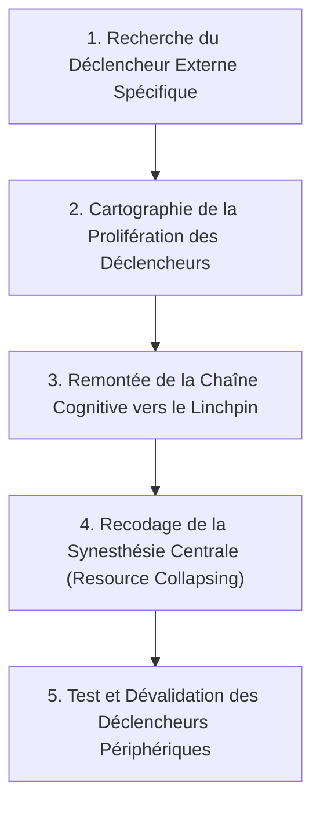
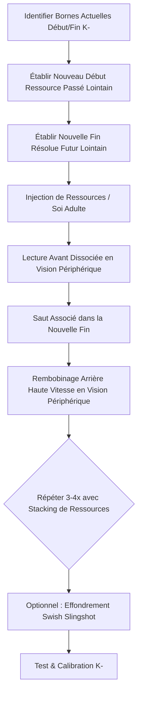

# HOC - Transcripts
**Formateur :** John Overdurf | **ID :** `john-overdurf-hoc-transcripts` | **Tranches :** 48

## Synthèse Architecturale du Cours : *HOC - Transcripts* (John Overdurf)

---

### 1. Thèse Centrale & Philosophie du Cours

#### A. La Vision Spécifique de John Overdurf : L'Épistémologie Non-Linéaire et Rhizomatique
La posture d'Overdurf se situe en rupture radicale avec la PNL classique et l'hypnose clinique traditionnelle, toutes deux imprégnées d'un réductionnisme mécaniste hérité de la méthode scientifique cartésienne :
- **Rejet de la causalité linéaire et de la « cause racine » (*Root Cause Trap*) :** Alors que la thérapie standard postule un modèle arborescent hiérarchique (où couper la « racine maîtresse » ou l'événement traumatique d'origine réglerait l'ensemble du système), Overdurf démontre que le système nerveux est un **organisme rhizomatique acentré** (emprunté à Deleuze & Guattari). Il n'existe pas de relation directe $A \to B$, mais des réseaux neuronaux enchevêtrés (*systems inside of systems*) opérant par ajustements dynamiques, oscillations et boucles rétroactives.
- **Démantèlement de l'Illusion de Solidité :** Les « problèmes », « traumatismes » ou « dépressions de 27 ans » ne sont pas des blocs rigides stockés dans le cerveau, mais des processus dynamiques perpétuellement ré-initiés. Une décharge neurochimique réelle a une demi-vie biologique de 5 à 30 secondes ; ce qui maintient le symptôme est une machinerie cognitive de relance (*throwing logs on the fire*).
- **Le Dépassement de la Matrice Identitaire :** L'illusion hypnotique la plus toxique réside dans l'utilisation du verbe « être » (*am, is, are*) comme un signe d'équivalence mathématique (« = »), fusionnant un comportement ou un rôle transitoire (*doing*) avec la structure globale du Soi (*being*). Overdurf ne cherche pas à « réparer » l'identité du client, mais à en dissoudre les frontières étanches.

#### B. Le Fil Rouge Méthodologique : La Cybernétique de la Présence Sensorielle
Le fil rouge reliant l'ensemble des interventions d'Overdurf repose sur un principe d'économie neurologique et de bascule attentionnelle :
1. **Saturer / Déconstruire le Néocortex Gauche (Auditory Digital - AD) :** Par l'analyse linguistique, la sémantique générale (Korzybski), les paradoxes logiques (*koans*), ou le sur-découpage conceptuel (*chunking* jusqu'au vide quantique subatomique).
2. **Basculer vers l'Hémisphère Droit / Système Parasympathique :** Réengager l'attention ouverte (*expanded awareness / Haklau*), la spatialisation, l'expérience sensorielle directe non étiquetée et la cognition incarnée (*embodied cognition*).
3. **Agir sur les Points de Levier Cybernétiques Multi-Points :** Remplacer la séquence linéaire standard (RI + Physio $\to$ État $\to$ Comportement) par une action simultanée ou inversée (forcer un comportement pour faire basculer la croyance via la dissonance cognitive, altérer la respiration pour dissoudre l'accès aux souvenirs dépendants de l'état).

---

### 2. Carte des Concepts & Leviers Émergents

```
                          ┌───────────────────────────────────────────────┐
                          │   ORGANISME / SYSTÈME VIVANT NON-LINÉAIRE     │
                          └──────────────────────┬────────────────────────┘
                                                 │
                   ┌─────────────────────────────┴─────────────────────────────┐
                   ▼                                                           ▼
    ┌──────────────────────────────┐                            ┌──────────────────────────────┐
    │     HÉMISPHÈRE GAUCHE        │                            │      HÉMISPHÈRE DROIT        │
    │  - Modèle arborescent        │     Bascule Pendulaire      │  - Modèle rhizomatique       │
    │  - Binarité (Pile/Face)      │ ◄────────────────────────► │  - 3e face de la pièce       │
    │  - Vision tunnel (Stress)    │   (Hemispheric Rocking)    │  - Vision périphérique      │
    │  - Étiquettes / Mots (AD)    │                            │  - Réel sensoriel brut       │
    │  - Équivalence "ÊTRE" (=)    │                            │  - Présence spatiale         │
    └──────────────┬───────────────┘                            └──────────────┬───────────────┘
                   │                                                           │
                   ▼                                                           ▼
    ┌──────────────────────────────┐                            ┌──────────────────────────────┐
    │    PIÈGES ÉPISTÉMIQUES       │                            │     LEVIERS OPÉRATOIRES      │
    │  - Identity Boundary         │                            │  - Choix de Heisenberg       │
    │  - Logs on the fire          │                            │  - Choix de Dirac            │
    │  - Miroir argenté (Ego)      │                            │  - Chunking vertical/latéral │
    │  - Complexe R-C-A (Douleur)  │                            │  - State Transfer contextuel │
    └──────────────────────────────┘                            └──────────────────────────────┘
```

#### Liste Structurée des Leviers et Mécanismes

1. **Architecture Épistémique & Neuro-Dynamique**
   - **Système Non-Linéaire vs Illusion Causaliste :** Navigation adaptative de flux (*riding the wave*) par ajustement dynamique permanent, à l'opposé du guidage rigide déterministe.
   - **Cycle Neurochimique vs Boucle de Relance (*Rise and Fall of a State*) :** Une émotion s'éteint biologiquement en 20 secondes ; son maintien dépend exclusivement d'un empilement de relances cognitives et mnésiques (*chaining waves*).
   - **Modèle Arborescent vs Modèle Rhizomatique :** Remplacement de la hiérarchie verticale (racine pivotale unique) par un réseau latéral distribué, acentré, interconnecté à l'infini (Deleuze & Guattari).
   - **Cohérence Laser vs Radiation Dispersée :** L'efficacité d'intervention ne réside pas dans la force ou l'énergie dépensée, mais dans la cohérence de phase et l'alignement neurologique strict.

2. **Cartographie Attentionnelle & Neurologique**
   - **Bascule Hémisphérique Pendulaire (*Hemispheric Rocking*) :** Saturation délibérée de l'hémisphère gauche par le langage abstrait/logique jusqu'à débordement, suivie d'un basculement subit dans l'hémisphère droit (sensoriel, spatial, métaphorique).
   - **Vision Tunnel vs Attention Périphérique (*Expanded Awareness*) :** Désactivation du réflexe de menace du tronc cérébral et de l'hyperfocalisation gauche au profit de la vision périphérique, réengageant le système parasympathique et l'état d'alerte détendue (*relaxed alertness*).
   - **La « Troisième Face de la Pièce » (*Third Side of the Coin*) :** Sortie du filtre catégoriel binaire (vrai/faux, pile/face) par redirection de l'attention vers la tranche continue neutre et ignorée du système.

3. **Linguistique Profonde & Niveaux d'Abstraction**
   - **L'Équivalence Neurologique du Verbe « Être » :** Dissolution du court-circuit où l'esprit confond une action temporaire avec la structure ontologique de la personne ($Faire \equiv Être$).
   - **L'Identité-Frontière (*Identity Boundary Condition*) :** Le rôle endossé agit comme un cadre hermétique interdisant l'accès à des ressources comportementales hors cadre.
   - **L'Écart Abstractionnel & Découpage Subatomique :** Traversée des couches : *Étiquette verbale $\to$ Représentation Interne (VAKOG) $\to$ Espace particulaire subatomique / vide*.
   - **Hiérarchies Logiques de Chunking :** *Chunking Up* (intention supérieure commune / induction), *Chunking Down* (composants sensoriels / déduction), *Chunking Lateral* (transduction / analogie).

4. **Physique Quantique Appliquée à la Cognition**
   - **Choix de Heisenberg :** Décision initiale de focalisation attentionnelle : *Où et sur quoi le système nerveux pose-t-il son instrument de mesure ?* (Gouverné par l'effet Zénon quantique).
   - **Choix de Dirac :** Décision interprétative et sémantique : *Quel sens, quelle valeur ou quelle étiquette le système attribue-t-il au phénomène mesuré ?*

5. **Modèles Temporels & Systémiques**
   - **Complexe de la Douleur Tritemporel R-C-A (Erickson) :** Décomposition d'une souffrance en Douleur Mémorisée (*Remembered*), Douleur Présente (*Current*) et Douleur Anticipée (*Anticipated*).
   - **Boucle de Rétroaction Cybernétique Multi-Points :** Déconstruction de la chaîne linéaire PNL standard ; utilisation du comportement ou de la physiologie pour contraindre et modifier croyances et états.
   - **Boucle Dépressive Fermée :** Figeage attentionnel exclusif sur le passé avec cécité sensorielle externe totale, bloquant le rafraîchissement synaptique.

---

### 3. Tableau Récapitulatif des Techniques & Démonstrations

| Technique / Exercice | Objectif Opératoire | Déclencheur / Indication | Séquence Résumée |
|---|---|---|---|
| **Expanded Awareness / Haklau (Attention Périphérique)** | Désactiver le réflexe de menace, stopper le bavardage mental (*yapping*) et basculer en mode parasympathique/hémisphère droit. | Vision tunnel, anxiété, rumination verbale de l'hémisphère gauche, état de stress aigu. | 1. Fixer un point visuel devant soi au niveau ou légèrement au-dessus des yeux.<br>2. Tout en gardant les yeux sur ce point, élargir le champ visuel latéralement jusqu'à percevoir le mouvement des mains sur les côtés.<br>3. Prendre conscience de l'espace au-dessus, en dessous et derrière soi.<br>4. Remarquer le ralentissement respiratoire et le silence intérieur instantané. |
| **Translation Trans-Contextuelle d'État Ressource** | Contourner l'interdit associé à une identité-frontière rigide sans déclencher de résistance frontale. | Blocage identitaire de rôle (*"I am the CEO/Manager, je ne peux pas montrer de vulnérabilité ou ne pas savoir"*). | 1. Cartographier l'opération requise bloquée dans le contexte pro (ex. poser des questions, hésiter).<br>2. Identifier un contexte personnel où cette même opération est vécue avec plaisir/jeu (ex. curiosité d'un père avec ses enfants).<br>3. Éliciter et amplifier l'état somatique et affectif ressource.<br>4. Superposer et transférer l'état sur la scène professionnelle par ancrage et association simultanée. |
| **Déconstruction du Vaisseau dans la Bouteille (*Ship in a Bottle*)** | Faire réaliser au sujet que sa contrainte est une construction imaginaire interne et redonner le contrôle de la simulation. | Impasse perçue comme extérieure et insoluble ; sensation d'emprisonnement mental ou de boucle claustrophobique. | 1. Faire décrire précisément au sujet le "piège" ou l'impasse mentale.<br>2. Poser le koan : *Comment le bateau est-il entré dans la bouteille ?*<br>3. Révéler que c'est l'artisan/l'esprit qui l'a assemblé pièce par pièce à l'intérieur.<br>4. Guider le sujet à utiliser le même moteur d'imagerie pour démonter ou transformer la contrainte. |
| **Tâche Ericksonienne de Rupture Épistémique (*Blinding Flash of Color*)** | Créer une boucle ouverte transdérivationnelle comportementale sans résistance consciente. | Résistance rigide à un changement environnemental ou comportemental (ex. refus de quitter son domicile / voyager). | 1. Poser une suggestion ouverte paradoxale : *"Je ne sais pas où ni quand vous allez voir un flash de couleur éblouissant..."*<br>2. Laisser l'inconscient en quête active permanente du stimulus.<br>3. Prescrire des déplacements exploratoires (voyages, sorties) sous prétexte de vérifier le terrain pour trouver ce flash.<br>4. L'objectif thérapeutique réel est atteint par la bande latérale (*behavioral side door*). |
| **Bascule Pendulaire Hémisphérique (*Hemispheric Rocking*)** | Provoquer une rupture d'état et induire une transe naturelle sans résistance formelle. | Résistance hyper-rationnelle, sur-intellectualisation, saturation analytique d'un client "trop cérébral". | 1. Surcharger délibérément l'hémisphère gauche avec un discours théorique dense, abstrait et logique (épistémologie, sémantique).<br>2. Guetter les micro-signes de saturation cognitive (*"cup-eth runneth over"* : déglutition, regard flou, soupir).<br>3. Basculer instantanément sans transition vers une métaphore poétique, un koan Zen ou une attention somatique/spatiale.<br>4. Ancrer l'état de relâchement et approfondir la transe. |
| **Chunking Vertical & Latéral de Conflit** | Dépasser un blocage ou un conflit interne en dissolvant les catégories rigides de l'hémisphère gauche. | Dilemmes insolubles (*"soit X, soit Y"*), conflits de parties, blocage au niveau des critères de surface. | 1. Identifier l'étiquette ou le comportement conflictuel de départ.<br>2. *Chunk Up* : Demander l'intention supérieure ou la catégorie englobante (*"Dans quel but ?", "De quoi s'agit-il d'un exemple ?"*) jusqu'à unifier les deux pôles dans un critère commun supérieur.<br>3. *Chunk Down* : Descendre dans les composantes sensorielles ou subatomiques pour éliminer la solidité apparente.<br>4. *Chunk Lateral* : Générer des alternatives transductives dans la même catégorie supérieure. |
| **Déconstruction du Complexe R-C-A de la Douleur** | Isoler et éliminer la composante mnésique et anticipatoire d'une douleur pour réduire la charge sensorielle brute. | Douleurs chroniques, souffrance psychosomatique amplifiée par l'angoisse de répétition. | 1. Segmenter explicitement l'expérience en trois registres temporels : ce qui est mémorisé (*Remembered*), ce qui est présent (*Current*), ce qui est anticipé (*Anticipated*).<br>2. Neutraliser la douleur anticipée (effondrement des simulations de projection dans le futur).<br>3. Déconnecter la douleur mémorisée (dissociation des souvenirs de crises passées).<br>4. Traiter la seule sensation physique présente résiduelle (*Current*), qui se révèle immédiatement gérable et fractionnée. |
| **Recodage Sous-Modal de l'Autorité (Cognition Incarnée)** | Rétablir la symétrie relationnelle et dissoudre un sentiment d'infériorité ou d'intimidation. | Sentiment d'infériorité, intimidation face à une figure d'autorité, anxiété de statut. | 1. Éliciter la sous-modalité spatiale critique de l'interlocuteur dans le champ visuel interne (généralement situé plus haut que le niveau des yeux).<br>2. Faire prendre conscience du schéma somatomoteur précoce d'enfance lié à la verticalité.<br>3. Abaisser physiquement ou mentalement l'image pour l'amener strictement *au niveau des yeux* (*eye-to-eye*) ou légèrement en contrebas.<br>4. Calibrer l'apaisement physiologique et l'accès spontané à l'assurance. |

---

---

## 0. Sommaire Sémantique & Index des Lignes

- **Tranche 1 [Lignes 154-271]** : Démontage de la Boucle d'Auto-Perpétuation Émotionnelle (The State De-Chaining Loop) — *Protocole :* Démontage de la Boucle d'Auto-Perpétuation Émotionnelle (The State De-Chaining Loop) | *Mécanisme :* Le Système Non-Linéaire vs L'Illusion Causaliste | *Verbatim :* Le Double Pacing Temporel et l'Amorçage de l'Énergie
- **Tranche 2 [Lignes 273-453]** : Démonstration 1 : Récupération Trans-Contextuelle d'État Épistémique (Cas du CEO) — *Protocole :* Démonstration 1 : Récupération Trans-Contextuelle d'État Épistémique (Cas du CEO) | *Mécanisme :* Le Piège de l'Identité-Frontière (Identity Boundary Condition) | *Verbatim :* Verbatim 1 : Le Démantèlement du Rôle Bloquant
- **Tranche 3 [Lignes 455-656]** : Désidentification Linguistique et Rencontre Élargie — *Protocole :* Désidentification Linguistique et Rencontre Élargie | *Verbatim :* La métaphore du laser et de la cohérence de phase
- **Tranche 4 [Lignes 658-788]** : Le Test de Torsion Somato-Représentationnelle (Démonstration d'Auto-Limitation Subconsciente) — *Protocole :* Le Test de Torsion Somato-Représentationnelle (Démonstration d'Auto-Limitation Subconsciente) | *Mécanisme :* La Boucle Cybernétique Multi-Points vs Linéarité PNL Classique | *Verbatim :* La Métaphore du Ventilateur (Dissolution de la Solidité de l'Identité)
- **Tranche 5 [Lignes 790-908]** : A : Négociation et Résolution de Conflits par Chunking Up (Alignement d'Intentions) — *Protocole :* A : Négociation et Résolution de Conflits par Chunking Up (Alignement d'Intentions) | *Verbatim :* La Bascule Hémisphérique comme Anesthésie de la Résistance Critique
- **Tranche 6 [Lignes 910-1025]** : Amorçage Hémodynamique du Mouvement (The Motion Priming & Freeze Reversal) — *Protocole :* Amorçage Hémodynamique du Mouvement (The Motion Priming & Freeze Reversal) | *Mécanisme :* Le modèle arborescent vs Modèle rhizomatique (Démantèlement du concept de « Cause Racine ») | *Verbatim :* Verbatim 1 : Sur la faillite de l'approche rationnelle des addictions
- **Tranche 7 [Lignes 1027-1156]** : DÉGIVRAGE LINGUISTIQUE DU RHIZOME (Nominalisation & Focalisation) — *Protocole :* DÉGIVRAGE LINGUISTIQUE DU RHIZOME (Nominalisation & Focalisation) | *Mécanisme :* Inondation Métabolique Cérébrale & Reconsolidation | *Verbatim :* Le Pré-cadrage Anti-Résistance pour Questions Étranges
- **Tranche 8 [Lignes 1158-1276]** : A : Sortie de Transe & Réveil Opératoire Sécurisé avec Programmation Post-Hypnotique — *Protocole :* A : Sortie de Transe & Réveil Opératoire Sécurisé avec Programmation Post-Hypnotique | *Verbatim :* La saturation distributive de l'attention consciente
- **Tranche 9 [Lignes 1278-1420]** : Le Découpage Ascendant Somatiquement Vérifié (Paced Chunking Up Protocol) — *Protocole :* Le Découpage Ascendant Somatiquement Vérifié (Paced Chunking Up Protocol) | *Mécanisme :* L'Apprentissage Dépendant de l'État (State-Dependent Learning & Retrieval) | *Verbatim :* La Métaphore de la Maison en Feu (Arrêt du Traitement Métacognitif Négatif)
- **Tranche 10 [Lignes 1422-1557]** : A : Construction de l'Attracteur Futur Géant & Aspiration Involontaire ("The Vacuum Cleaner... — *Protocole :* A : Construction de l'Attracteur Futur Géant & Aspiration Involontaire ("The Vacuum Cleaner & Verge" Protocol) | *Mécanisme :* L'Impatiente comme Téléologie Inconsciente (Outcome Magnetism)
- **Tranche 11 [Lignes 1559-1716]** : Traque de la Synesthésie Sauvage (Stalking the Wild Synesthesia) — *Protocole :* Traque de la Synesthésie Sauvage (Stalking the Wild Synesthesia) | *Mécanisme :* Le Linchpin Synesthésique vs Déclencheur Éloigné (Trigger vs Synesthesia) | *Verbatim :* La Métaphore Opératoire du Train Émotionnel
- **Tranche 12 [Lignes 1718-1846]** : A : Élicitation et Ancrage Conversationnel d'États Ressources (Démo "Ronald") — *Protocole :* A : Élicitation et Ancrage Conversationnel d'États Ressources (Démo "Ronald") | *Mécanisme :* Le Conditionnement Préalable et l'Interception Opérante Précoce | *Verbatim :* Extrait 1 : Le Double Lien Temporel d'Urgence
- **Tranche 13 [Lignes 1848-1980]** : Élicitation et Ancrage en Boucle Cybernétique (Attention Shifting Coaching) — *Protocole :* Élicitation et Ancrage en Boucle Cybernétique (Attention Shifting Coaching) | *Verbatim :* Le Contre-Exemple de Mike Fruntz (Incongruence, saturation et injonctions paradoxales)
- **Tranche 14 [Lignes 1982-2082]** : d'Isolation et de Réduction d'un Problème Généralisé (Pré-Collapse) — *Protocole :* d'Isolation et de Réduction d'un Problème Généralisé (Pré-Collapse)
- **Tranche 15 [Lignes 2084-2201]** : A : La Prise par la Poignée (The Pot Handle Isolation) — *Protocole :* A : La Prise par la Poignée (The Pot Handle Isolation) | *Verbatim :* Le Recadrage de l'Absence d'Historique
- **Tranche 16 [Lignes 2203-2318]** : Fondateur HNLP : Extraction de Stratégie de Problème & Contrat Inconscient (The Baseline Model) — *Protocole :* Fondateur HNLP : Extraction de Stratégie de Problème & Contrat Inconscient (The Baseline Model)
- **Tranche 17 [Lignes 2320-2454]** : Décodage de Stratégie & Effondrement Récursif sur le Déclencheur (Trigger-Resource Collapse) — *Protocole :* Décodage de Stratégie & Effondrement Récursif sur le Déclencheur (Trigger-Resource Collapse) | *Verbatim :* s Verbatim & Analyses
- **Tranche 18 [Lignes 2456-2580]** : A : La Boucle de Consolidation / Conviction par Défi Sceptique (« Convincer Loop ») — *Protocole :* A : La Boucle de Consolidation / Conviction par Défi Sceptique (« Convincer Loop ») | *Verbatim :* Induction Métaphorique & Ancrage Somatique Réflexe
- **Tranche 19 [Lignes 2582-2703]** : Protocole d'Intégration Post-Session & Pont vers le Futur Somatique (End-of-Day Exit Trance) — *Protocole :* Protocole d'Intégration Post-Session & Pont vers le Futur Somatique (End-of-Day Exit Trance) | *Verbatim :* La Ratification Universelle du Rêve et du Non-Rêve
- **Tranche 20 [Lignes 2705-2875]** : A : Suggestion Post-Hypnotique de Micro-Changement Continu (Génération d'Habitude & Présence) — *Protocole :* A : Suggestion Post-Hypnotique de Micro-Changement Continu (Génération d'Habitude & Présence) | *Verbatim :* La Prescription de Micro-Variabilité Subtile
- **Tranche 21 [Lignes 2877-3034]** : Élicitation et Recâblage Synesthésique Déclencheur-Ressource (Stimulus-Response Reconditioning) — *Protocole :* Élicitation et Recâblage Synesthésique Déclencheur-Ressource (Stimulus-Response Reconditioning)
- **Tranche 22 [Lignes 3036-3180]** : Désamorçage Émergent d'Images Traumatiques par Cognition Incarnée (Cas Stephanie / Terrain É... — *Protocole :* Désamorçage Émergent d'Images Traumatiques par Cognition Incarnée (Cas Stephanie / Terrain Équestre) | *Verbatim :* Recadrage Somatosensoriel Immédiat du Trauma
- **Tranche 23 [Lignes 3182-3303]** : A : Intervention Systémique "Inside Wants Out" (Prescription de Divulgation) — *Protocole :* A : Intervention Systémique "Inside Wants Out" (Prescription de Divulgation) | *Verbatim :* La Redéfinition Cybernétique du Déclencheur
- **Tranche 24 [Lignes 3305-3405]** : La Plus Petite Étape Suivante Émergente (Smallest Next Step Process) — *Protocole :* La Plus Petite Étape Suivante Émergente (Smallest Next Step Process) | *Verbatim :* La Bascule Ontologique (Do vs. Be)
- **Tranche 25 [Lignes 3407-3517]** : Résolution de Dilemme Décisionnel / Intégration de Parties par l'End State (Alternative Ling... — *Protocole :* Résolution de Dilemme Décisionnel / Intégration de Parties par l'End State (Alternative Linguistique au Visual Squash) | *Mécanisme :* Le piège cybernétique du Goal-Setting classique : La scission en conflit de parties | *Verbatim :* Verbatim 1 : L'Interruption du Débordement Temporel
- **Tranche 26 [Lignes 3519-3642]** : « Beyond Goals » Simplifié (Version 3 Cerveaux / 10 Minutes) — *Protocole :* « Beyond Goals » Simplifié (Version 3 Cerveaux / 10 Minutes) | *Verbatim :* Découplage de Crise et Contournement Temporel
- **Tranche 27 [Lignes 3644-3772]** : Démonstration : Le Découpleur Synesthésique & Réimpression de Partie (Synesthesia Splitter P... — *Protocole :* Démonstration : Le Découpleur Synesthésique & Réimpression de Partie (Synesthesia Splitter Protocol) | *Verbatim :* Induction Métaphorique Pré-Session : Le Fœtus et les Rêves
- **Tranche 28 [Lignes 3774-3893]** : Le Diviseur de Synesthésie (The Synesthesia Splitter) — *Protocole :* Le Diviseur de Synesthésie (The Synesthesia Splitter)
- **Tranche 29 [Lignes 3895-4008]** : La Double Dissociation Somato-Symbolique avec Recadrage de Contexte Externe — *Protocole :* La Double Dissociation Somato-Symbolique avec Recadrage de Contexte Externe | *Mécanisme :* La Double Dissociation Somato-Symbolique & Métacognitive | *Verbatim :* Élicitation de l'Énergie de l'État Final (End State Questioning)
- **Tranche 30 [Lignes 4010-4169]** : Le Découplage Figure-Fond (Foreground / Background Rush) — *Protocole :* Le Découplage Figure-Fond (Foreground / Background Rush) | *Mécanisme :* Le Découplage Figure-Fond (Figure-Ground / Foreground-Background Decoupling) | *Verbatim :* L'Élicitation Récursive de l'État Ressource
- **Tranche 31 [Lignes 4171-4346]** : A : La Bascule Figure-Fond Basique & Universelle (Foreground-Background Shift) — *Protocole :* A : La Bascule Figure-Fond Basique & Universelle (Foreground-Background Shift) | *Mécanisme :* Bascule Figure-Fond (Foreground-Background Shift) | *Verbatim :* Bascule Figure-Fond et Ancrage Spatial Somatique
- **Tranche 32 [Lignes 4348-4479]** : Le Shift Figure-Fond Quantique Multi-Positions (HOC 4-Positions Blender) — *Protocole :* Le Shift Figure-Fond Quantique Multi-Positions (HOC 4-Positions Blender) | *Mécanisme :* Le Shift Figure-Fond Multidirectionnel & Positions Perceptuelles Quantiques | *Verbatim :* Le Script de la 4e Position Quantique
- **Tranche 33 [Lignes 4481-4604]** : A : L'Estimation de Distance Évolutive (Distance Estimation Priming) — *Protocole :* A : L'Estimation de Distance Évolutive (Distance Estimation Priming) | *Mécanisme :* La cognition incarnée et métaphores littérales du système nerveux | *Verbatim :* Le Recadrage de la Base de Référence Spatiale
- **Tranche 34 [Lignes 4606-4755]** : Distance Estimation Resolution Process (D.E.R.P.) — *Protocole :* Distance Estimation Resolution Process (D.E.R.P.) | *Mécanisme :* L'Amorçage Neuro-Vasculaire et Câblage Hebbien Immédiat | *Verbatim :* Verbatim 1 : L'ambiguïté phonétique et syntaxique de mouvement
- **Tranche 35 [Lignes 4757-4870]** : A : La Réduction Enfantine (Narrative Interruption & Chunk-Down) — *Protocole :* A : La Réduction Enfantine (Narrative Interruption & Chunk-Down)
- **Tranche 36 [Lignes 4872-4994]** : Recodage Écologique de l'Image Résultat (The "In The Picture" Integration) — *Protocole :* Recodage Écologique de l'Image Résultat (The "In The Picture" Integration) | *Mécanisme :* L'Auto-Épuisement par Dissociation de Soi dans le Résultat Visuel (Missing Self-Representation) | *Verbatim :* Le Recadrage Fractal par la Sous-Modalité
- **Tranche 37 [Lignes 4996-5142]** : Le Double-Lien d'Élicitation Contextuelle & Le Double Lien d'Entrée sur l'Élicitation du Pro... — *Protocole :* Le Double-Lien d'Élicitation Contextuelle | *Mécanisme :* Le Double Lien d'Entrée sur l'Élicitation du Problème (The Now Resource / Strategy Double Bind) | *Verbatim :* Le Double-Lien d'Élicitation Temporelle
- **Tranche 38 [Lignes 5144-5273]** : Le "Spurious Not" (Désamorçage de la polarité et du mismatching) — *Protocole :* Le "Spurious Not" (Désamorçage de la polarité et du mismatching) | *Verbatim :* Le "Spurious Not" d'adhésion immédiate
- **Tranche 39 [Lignes 5275-5441]** : L'APPROCHE "BEYOND GOALS" POUR LES DEMANDES GLOBALES/ABSTRAITES — *Protocole :* L'APPROCHE "BEYOND GOALS" POUR LES DEMANDES GLOBALES/ABSTRAITES | *Mécanisme :* Le Langage Inductif Non-Linéaire et le Dépassement des Mots (Transcend Language) | *Verbatim :* La Question Non-Linéaire d'Élucidation du Processus
- **Tranche 40 [Lignes 5443-5568]** : La Rupture Signifiante & Réassignation de la Compétence Cachée (Hidden Ability Reassignment) — *Protocole :* La Rupture Signifiante & Réassignation de la Compétence Cachée (Hidden Ability Reassignment) | *Mécanisme :* Le Présupposé Opératoire de Compétence Inverse (Reverse Capability Elicitation) | *Verbatim :* Le Renversement de la Panique et du Rapport
- **Tranche 41 [Lignes 5570-5712]** : Désamorçage de Croyance par la Grille Cartésienne & l'Inversion Syntaxique — *Protocole :* Désamorçage de Croyance par la Grille Cartésienne & l'Inversion Syntaxique | *Mécanisme :* Le « Not I » et la dé-nominalisation de l'identité | *Verbatim :* La saturation de l'identité par négation inversée
- **Tranche 42 [Lignes 5714-5835]** : Déconstruction de Croyance Limitante par Boucle Émergente & Pivot Métaphorique (Démonstratio... — *Protocole :* Déconstruction de Croyance Limitante par Boucle Émergente & Pivot Métaphorique (Démonstration Catherine / Overdurf)
- **Tranche 43 [Lignes 5837-5998]** : La Boucle du Vide (The Void Loop & 3-Way Branching) — *Protocole :* La Boucle du Vide (The Void Loop & 3-Way Branching) | *Verbatim :* Commande Cachée dans la Négation avec Marquage Analogique
- **Tranche 44 [Lignes 6000-6161]** : Le Protocole Ultra-Rapide "The Void Loop" (Squelette Opératoire) — *Protocole :* Le Protocole Ultra-Rapide "The Void Loop" (Squelette Opératoire) | *Mécanisme :* Le Rythme Expiratoire comme Vecteur Hypnotique Direct | *Verbatim :* L'Illusion de Choix Spatiale
- **Tranche 45 [Lignes 6163-6299]** : Le « Rhizome Rewind » (Extension du Modèle Phobique) — *Protocole :* Le « Rhizome Rewind » (Extension du Modèle Phobique) | *Verbatim :* La Destruction de l'Attente de Garantie par Saturation Négative
- **Tranche 46 [Lignes 6301-6448]** : Expansion Rhizomatique des Bornes Temporelles & Défilement Inverse en Vision Périphérique (a... — *Protocole :* Expansion Rhizomatique des Bornes Temporelles & Défilement Inverse en Vision Périphérique (avec Option Swish de Clôture) | *Mécanisme :* Découplage de la Réponse Sympathique par la Vision Périphérique Associée | *Verbatim :* Découplage Somatique & Rétrogradation
- **Tranche 47 [Lignes 6450-6617]** : Le "Slingshot Future Self Swish" (Intégration & Propulseur d'Identité) — *Protocole :* Le "Slingshot Future Self Swish" (Intégration & Propulseur d'Identité)
- **Tranche 48 [Lignes 6619-6748]** : L'Induction Physiologique par Ralentissement et Synchronisation Respiratoire — *Protocole :* L'Induction Physiologique par Ralentissement et Synchronisation Respiratoire | *Verbatim :* L'Induction Minimaliste par Décélération du Tempo

---

## Extractions Détaillées par Tranche (Opératoire & Verbatim)

## Tranche 1 / 48 : Démontage de la Boucle d'Auto-Perpétuation Émotionnelle (The State De-Chaining Loop)

### 1. Mécanismes & Principes Actifs

#### A. Le Système Non-Linéaire vs L'Illusion Causaliste
* **Terme exact d'Overdurf :** *Nonlinear system* / *Linear cause-effect mistake*
* **Tags émergents :** `#systeme_non_lineaire` `#illusion_causale` `#complexite_dynamique` `#chaos_organique`
* **Principe actif :** Le système nerveux humain et son environnement ne fonctionnent pas selon un modèle déterministe machine (A cause B). En tentant d'appliquer une causalité linéaire stricte (la méthode scientifique classique réductionniste) à un organisme vivant, l'individu crée une friction constante : toute déviation d'une trajectoire idéale est interprétée comme un échec (« je suis hors trajectoire »). La météo et le vol aérien illustrent ce principe : un vecteur de vol n'est jamais respecté à 100 % en temps réel à cause des turbulences. L'organisme doit fonctionner par ajustement dynamique permanent et navigation de flux (*riding the wave*), plutôt que par projection rigide de cause à effet.

#### B. La Durée de Vie Neurochimique Réelle vs La Chaîne de Relances Internes
* **Terme exact d'Overdurf :** *Rise and fall of a state* / *Throwing logs on the fire* / *Chaining waves*
* **Tags émergents :** `#duree_neurochimique_etat` `#boucle_auto_perpetuation` `#metacognition_toxique` `#empilement_d_ondes`
* **Principe actif :** Physiologiquement, la décharge neurochimique d'un état ou d'une impulsion émotionnelle possède une demi-vie intrinsèque très brève : entre 5 et 30 secondes (avec un pic et une redescente spontanée en ~20 secondes). L'illusion d'une « dépression de 27 ans » ou d'une angoisse continue de plusieurs heures est produite par une ré-initiation cognitive en chaîne :
  1. Émergence de la sensation brute (onde 1).
  2. Jugement négatif immédiat (« Je déteste ce ressenti ») -> déclenche l'onde 2.
  3. Confirmation de scénario pessimiste (« Je savais que ça arriverait ») -> déclenche l'onde 3.
  4. Projection de catastrophe future (« Ma journée est fichue ») -> déclenche l'onde 4.
  5. Assignation de signification (« Et cela veut dire que... ») -> déclenche l'onde 5.
  6. La question piège (« Pourquoi est-ce que je ressens ça ? ») -> verrouillage du système dans le contenu du problème.
  Le sujet confond la succession ininterrompue de vagues auto-induites avec un état statique unique.

#### C. Asymétrie Hémisphérique : Hyper-Focalisation Gauche vs Présence Sensorielle Droite
* **Terme exact d'Overdurf :** *Left hemisphere trap* / *Tunnel vision* / *Peripheral vision & Expanded awareness*
* **Tags émergents :** `#piege_hemisphere_gauche` `#vision_tunnel_vs_peripherique` `#bavardage_asensoriel` `#attention_ouverte`
* **Principe actif :** L'activation du système de stress archaïque (tronc cérébral : combat/fuite/sidération) induit un rétrécissement immédiat du champ perceptif (vision tunnel). Ce mode est relayé par l'hémisphère gauche qui excelle dans l'abstraction, la parole et le raisonnement sans support sensoriel direct (*thinking with no sensory experience* / *yapping*), mais s'avère aveugle, sourd et anesthésié à l'instant présent. En état de menace ou de contrôle mental excessif, le sujet coupe le flux sensoriel au profit de cartes cognitives fermées. À l'inverse, l'attention périphérique (*expanded awareness*) réengage le traitement global, sensoriel et spatial (hémisphère droit/parasympathique), restituant la perception des opportunités et des prises d'appui d'ajustement.

#### D. L'Équivalence Neurologique du Verbe « Être » (L'Hypnose de l'Identité)
* **Terme exact d'Overdurf :** *The verb "to be" as nervous system equivalent* / *Mistaking what you do for who you are*
* **Tags émergents :** `#equivalence_identitaire_verbe_etre` `#effondrement_niveau_logique` `#hypnose_du_faire_vers_l_etre`
* **Principe actif :** Dans la syntaxe profonde du système nerveux, les formes du verbe être (*am*, *is*, *are*) agissent comme le signe mathématique « = » (équivalence complexe instantanée). Lier un comportement ou un état temporaire à la structure de l'identité (« Je suis déprimé », « Je suis thérapeute ») encode l'activité au niveau de la matrice du Soi. L'illusion hypnotique la plus répandue consiste à confondre le comportement transitoire (*doing*) avec l'identité globale (*being*), figeant ainsi un processus fluide en une entité immuable.

#### E. L'État Optimal d'Apprentissage et de Performance (Relaxed Alertness)
* **Terme exact d'Overdurf :** *Relaxed alert state* / *Relaxed brain having fun*
* **Tags émergents :** `#etat_alerte_detendue` `#neuroplasticite_optimale` `#desactivation_surveillance`
* **Principe actif :** L'apprentissage profond et l'adaptation optimale (Flow de Csíkszentmihályi) nécessitent la combinaison conjointe d'un système nerveux central détendu (parasympathique actif, absence de rigidité de survie) et d'une alerte attentionnelle aiguisée. Le jeu, l'humour et le lâcher-prise réduisent le filtrage critique et libèrent la neuroplasticité, permettant d'intégrer des patterns complexes bien plus rapidement qu'en contexte formel rigide.

---

### 2. Protocoles, Techniques & Démonstrations (Étape par Étape)

#### Protocole 1 : Démontage de la Boucle d'Auto-Perpétuation Émotionnelle (The State De-Chaining Loop)
* **Intention / Indication :** Interrompre la fausse croyance qu'un état négatif est continu (« je suis tout le temps angoissé/déprimé ») et désamorcer l'alimentation interne du problème.
* **Mise en place & Pré-framing :** Cadrer la réalité neurochimique : une émotion pure ne dure que 5 à 30 secondes. Poser le postulat que toute durée supérieure est une création active et inconsciente du sujet qui réalimente le feu.
* **Séquence d'actions pas à pas :**
  1. *Psychoéducation / Recadrage de la vague :* Dessiner ou décrire la courbe sinusoïdale d'une vague émotionnelle (montée, pic, redescente en ~20s).
  2. *Cartographie des relances internes :* Faire expliciter au sujet les phrases internes exactes prononcées au sommet de la vague :
     - Étape A : Le jugement de rejet (*« Je déteste ressentir ça »* -> Vague 2).
     - Étape B : La prophétie rétrospective (*« Je le savais »* -> Vague 3).
     - Étape C : La catastrophe projective (*« Ma journée est gâchée »* -> Vague 4).
     - Étape D : L'interrogation de cause (*« Pourquoi suis-je comme ça ? »* -> Puits sans fond).
  3. *Injonction d'arrêt du Pourquoi :* Stopper formellement toute recherche d'étiologie (« Pourquoi ») tant que le système est en état négatif.
  4. *Observation pure (Mindfulness opératoire) :* Guider le sujet à observer passivement l'ascension et la redescente somatique de la sensation brute sans y accoler de dialogue interne ni d'attribution de sens.
  5. *Shift attentionnel dirigé :* Dès que la courbe descend (après 15-20 secondes), basculer immédiatement l'attention sur un stimulus externe ou somatique neutre/ressource avant que l'hémisphère gauche ne relance une phrase.
* **Signes de calibration :**
  - Chute du tonus musculaire défensif (épaules qui descendent, mâchoire qui se desserre).
  - Modification du clignement oculaire et reprise d'une respiration diaphragmatique complète au bout de 20-30 secondes.

#### Protocole 2 : Recadrage Structurant "Who You Are vs What You Do"
* **Intention / Indication :** Désolidariser l'identité de l'individu de ses comportements, de ses échecs ou de ses fonctions professionnelles. Traiter le cas du sujet bloqué par un échec perçu comme une tare identitaire (ex: le CEO pétrifié par un audit).
* **Mise en place & Pré-framing :** Poser les questions de fracturation identitaire : *« Who are you? »* et exposer le piège du verbe *être*.
* **Séquence d'actions pas à pas :**
  1. *Élicitation de l'amalgame :* Poser la question de la fonction (*« What do you do? »*) et calibrer si la réponse se structure sous forme identitaire (*« I am [X] »*).
  2. *Mise en évidence du codage neurologique :* Révéler que le verbe « être » agit comme le signe « = » dans le système nerveux, figeant le comportement en identité.
  3. *Séparation des niveaux logiques :* Établir que l'identité consciente n'est qu'un sous-ensemble minuscule de ce que le système nerveux est réellement (*« You are always more than whatever you think you are »*).
  4. *Redirection vers l'apprentissage procédural :* Rétrograder l'échec passé (ne pas avoir su répondre à des questions techniques) du niveau identitaire (*« Je suis incompétent / malade »*) au niveau comportemental et contextuel (*« Des items spécifiques d'audit n'étaient pas présents dans la mémoire de travail à cet instant T »*).
* **Signes de calibration :**
  - Confusion féconde (arrêt du discours automatique de justification).
  - Dépolarisation affective face à l'événement traumatique passé.

---

### 3. Heuristiques, Subtilités & "Sagesse du Praticien"

#### Heuristiques Conditionnelles
* **Si** le sujet se met à demander *« Pourquoi est-ce que je ressens cela ? »* en plein état négatif, **alors** interdire immédiatement cette exploration, **parce que** le système cognitif ne peut formuler de réponses qu'à l'intérieur du cadre et de l'état où il se trouve ; il ne trouvera que des justifications toxiques qui relanceront une nouvelle vague de détresse.
* **Si** le sujet échoue de manière répétée sur un obstacle (à l'image du grimpeur bloqué 11 fois ou du cadre supérieur paniqué), **alors** vérifier s'il est enfermé dans l'hémisphère gauche (vision tunnel, scénario linéaire rigide, absence de capteurs sensoriels ouverts), **parce que** la solution réside toujours dans un élargissement de la perception (attention périphérique/sensing) qui révèle les prises d'appui alternatives non prévues par le plan mental.
* **Si** vous posez une question d'inclusion ou de cadrage à un groupe/sujet et qu'il hésite ou répond à côté (ex: Elisa ne sachant pas si elle veut coacher), **alors** validez immédiatement sa réponse en affirmant qu'elle rentre parfaitement dans le cadre prévu (*« It was one of those questions. No matter what you said, it was going to still work »*), **parce que** cela préserve le rapport, supprime la pression de conformité et démontre l'infaillibilité du cadre d'apprentissage.
* **Si** un état négatif semble durer des heures ou des années, **alors** traitez-le non comme une structure continue, mais comme une suite rapide d'états de 20 secondes auto-générés par le dialogue interne du sujet, **parce que** cela fractionne le problème en micro-décisions attentionnelles faciles à interrompre.

#### Postulats Fondamentaux & Pièges
* **L'état du praticien prime sur le toolkit :** L'impact transformationnel ne provient pas d'un empilement de protocoles rigides, mais de la résonance de l'état interne du praticien (*relaxed alertness*, spontanéité).
* **Le piège de la carte confondue avec le territoire :** Le langage n'est qu'une description ; le rôle des interventions linguistiques avancées est d'utiliser le langage pour le transcender lui-même, cassant l'enfermement métaphorique du client.
* **La non-linéarité fondamentale du changement :** Rejeter la planification rigide de type cause à effet dans l'accompagnement humain. Le sujet est un système non-linéaire (semblable à la météo) qui requiert une calibration en temps réel et des corrections de trajectoire permanentes.
* **La spontanéité contre le formalisme mortifère :** Refuser le format magistral rigide de la salle de classe traditionnelle (qui inhibe neurobiologiquement l'apprentissage selon les règles du cerveau de Medina) au profit d'un environnement ludique, décontracté et désinhibé.

---

### 4. Pépites Verbatim & Patterns Linguistiques (MOT À MOT EN V.O.)

#### Pépite 1 : Le Double Pacing Temporel et l'Amorçage de l'Énergie
> « Because if the energy is like this when we start, think about how you're going to be at the end of the day. And if you think this is how you're going to start, think about how you'll be at the end of eight days. See, that's the whole plan. »

* **[Analyse du Pattern]** : Utilisation d'un pont vers le futur contrasté sous forme de truismes couplés. La structure syntaxique « If [présent bas], think about [futur lointain encore plus bas] » force le groupe à réévaluer instantanément son état d'énergie présent pour éviter l'extrapolation négative inacceptable, créant une boucle de motivation auto-correctrice immédiate sans confrontation directe.

#### Pépite 2 : La Question Infaillible (The No-Lose Question Setup)
> « So, how many of you coach or want to coach? Okay. Lisa, not sure? [...] It was one of those questions. No matter what you said, it was going to still work. Right. »

* **[Analyse du Pattern]** : Cadre d'infaillibilité linguistique (*no-lose frame*). En exposant rétroactivement la structure de sa question, Overdurf installe un méta-cadre de sécurité totale : quoi que fasse ou dise le sujet, cela valide l'expérience et sert le processus d'apprentissage. Destruction de la peur de la mauvaise réponse.

#### Pépite 3 : Le Seed Framing du Changement Minime à Effet Massif
> « How many of you would be interested in really one small change that you can make? It's a teeny tiny little change that can have an absolute massive effect on your life. Okay, and this is backed up by about 40 years of research. »

* **[Analyse du Pattern]** : Enchaînement de presuppositions valorisantes et amorçage par contraste d'échelle (*fractional change vs massive impact*). L'utilisation de diminutifs polysensoriels (« *teeny tiny little change* ») abaisse drastiquement les résistances psychologiques (faible coût cognitif d'adoption), tandis que l'association à un « effet massif » étayé par « 40 ans de recherche » active l'autorité et le désir inconscient d'anticipation (ouverture d'une boucle hypnotique majeure).

#### Pépite 4 : La Métaphore du Guidage Non-Linéaire vs L'Obstacle
> « Would you like to know a really simple way that you can actually kind of stay on purpose and move forward in your life in a way that instead of, let's say, feeling like you're hitting brick walls all the time, instead it's more like you're just riding a wave. Just riding a wave, because that's really closer to how reality is. »

* **[Analyse du Pattern]** : Recadrage analogique par substitution kynesthésique. Remplacement d'une métaphore d'impact douloureux et de rigidité spatiale (*hitting brick walls*, activation de l'hémisphère gauche et de la résistance) par une métaphore fluide de dynamique naturelle (*riding a wave*). La répétition rythmique (« *Just riding a wave...* ») agit comme une transe de confort réduisant l'effort conscient.

#### Pépite 5 : La Déconstruction de la Boucle d'Auto-Entretien Émotionnel
> « See, let's pretend that this is the rise and fall of a certain emotion. [...] We start to feel this one, and we go, oh my God, this is the feeling I hate. [...] guess what you just did? You started another wave. You just started another one. And then after that one started, you go, oh, I knew this was going to happen. You just started another one. And then you go, oh, my God, now my whole day is going to be totally screwed up [...] And then you do the really cool thing that all humans love to do. You go, why am I feeling this way? And, you know, at that point, you should just give the fuck up. »

* **[Analyse du Pattern]** : Rupture de pattern par ironie et déflation du drame intérieur. Overdurf externalise le processus interne sous forme d'une cinématique objective d'ondes empilées. L'emploi d'un sarcasme familier (« *the really cool thing that all humans love to do* » suivi du brutal « *give the fuck up* ») court-circuite brutalement la posture victimaire ou intellectuelle du sujet, exposant l'absurdité mécanique du « Pourquoi » et créant un choc salvateur qui désamorce le sérieux morbide du symptôme.

#### Pépite 6 : La Présupposition d'Expansion Identitaire
> « Who are you? Okay, a lot of people would like to think that that's, you know, your name. And I'd like to suggest that you're kind of more than that. And in fact, whatever you think you are at any given point in time is limited to what you can consciously think. So you're always more than what you would ever think you are. »

* **[Analyse du Pattern]** : Paradoxe autoréférentiel et présupposition d'immensité de l'inconscient. La formule « *whatever you think you are [...] is limited to what you can consciously think* » trace une frontière infranchissable pour le moi conscient, tandis que la conclusion « *you're always more than what you would ever think you are* » installe une vérité non réfutable qui libère le sujet de ses auto-définitions restrictives passées.

## Tranche 2 / 48 : Démonstration 1 : Récupération Trans-Contextuelle d'État Épistémique (Cas du CEO)

Voici l'extraction opératoire intégrale de la **tranche 2/48** du séminaire *HOC* de John Overdurf, formatée selon les règles strictes d'ingénierie et d'ontologie émergente.

---

### 1. Mécanismes & Principes Actifs

#### 1. Le Piège de l'Identité-Frontière (Identity Boundary Condition)
* **Principe actif** : Dès qu'un individu colle à une étiquette de rôle (`"I am the CEO"`, `"I am a project manager"`), le système nerveux crée une frontière rigide dans son espace de référence. Les comportements, états et accès aux ressources extérieures à ce cadre deviennent neurologiquement inaccessibles ou perçus comme une menace vitale/sociale ("signe de faiblesse"). L'identité agit comme un contenant hermétique restreignant le répertoire de réponses disponibles.
* **Tags libres** : `#identity_boundary_condition` `#role_confinement` `#nominalization_trap` `#rigid_self_boundary`

#### 2. Translation Trans-Contextuelle d'État Ressource (Cross-Contextual State Transfer)
* **Principe actif** : Pour contourner l'interdit associé à une identité bloquée, le praticien va chercher un contexte où la même opération (ici : "ne pas savoir et chercher l'info") est vécue dans un état émotionnel ressource (la curiosité amusée d'un père avec ses filles). Une fois l'état somatique et affectif activé, il est projeté directement sur le contexte professionnel rigide par association temporelle/visuelle simultanée, dissolvant la frontière identitaire sans confrontation frontale.
* **Tags libres** : `#cross_contextual_state_transfer` `#father_state_anchoring` `#epistemic_curiosity_induction`

#### 3. Épistémologie Quantique du Langage : La Carte n'est pas le Réel Dérivé
* **Principe actif** : Les mots sont des nominalisations et des descriptions au nième degré (`"a description of a description of a description"`). Croire que l'étiquette linguistique est la réalité constitue l'hypnose de l'identité. Le praticien entraîne le sujet à employer les étiquettes fonctionnelles requises par le contexte social (`"I am a project manager"`) tout en maintenant simultanément la méta-conscience d'être infiniment plus vaste que le mot.
* **Tags libres** : `#linguistic_meta_awareness` `#map_territory_differentiation` `#functional_nominalization`

#### 4. Le Paradoxe du Vaisseau dans la Bouteille (Thought Experiment Deconstruction)
* **Principe actif** : Déconstruire le piège cognitif de l'anxiété ou des croyances limitantes en révélant que la contrainte a été créée par l'imagination même du sujet. Si le sujet a placé le problème dans son espace mental par simulation interne, il a le pouvoir fonctionnel de simuler sa résolution par le même processus d'imagerie.
* **Tags libres** : `#generative_imagination_reframe` `#ship_in_a_bottle_koan` `#cognitive_construction_awareness`

#### 5. Induction Isomorphique du Rhizome & Croissance Latérale Sous-Jacente
* **Principe actif** : Milton Erickson utilise la métaphore du rhizome (champignons, menthe, gingembre) qui se propage horizontalement sans être visible en surface, possédant une résilience indestructible (reconnexion automatique en cas de rupture). Ce cadre métaphorique reprogramme la relation du sujet au changement : le changement profond n'a pas besoin d'être vertical, visible ou mesurable immédiatement pour être massif et interconnecté dans les couches profondes de l'inconscient.
* **Tags libres** : `#rhizomatic_subconscious_growth` `#lateral_processing` `#covert_neurological_wiring` `#fractionated_trust`

#### 6. Tâche Ericksonienne de Rupture Épistémique : "A Blinding Flash of Color"
* **Principe actif** : La suggestion paradoxale ouverte (`"I don't know where or when you'll see a blinding flash of color..."`) crée une quête transdérivationnelle ouverte et obsédante. Pour satisfaire la recherche de ce "flash", la femme doit quitter sa maison, voyager, explorer de nouveaux horizons (Squaw Peak, Flagstaff, San Francisco, Europe), ce qui accomplit exactement l'objectif thérapeutique (faire voyager le couple) sans que sa résistance consciente à l'idée de voyager ne soit jamais déclenchée.
* **Tags libres** : `#transderivational_open_loop` `#blinding_flash_search` `#behavioral_side_door` `#ericksonian_tasking`

#### 7. Pré-encodage Épistémique & Logiciel Cognitif d'Apprentissage (Software of the Brain)
* **Principe actif** : Poser des questions directrices d'intention avant d'entrer dans une expérience ou un apprentissage active le système réticulé activateur et les aires cérébrales de détection d'opportunités. Le cerveau cesse de vagabonder passivement et filtre l'expérience en temps réel pour collecter les réponses.
* **Tags libres** : `#reticular_pre_activation` `#epistemic_software_loading` `#outcome_framing`

#### 8. Cohérence Quantique & Alignement Psycho-Neurologique
* **Principe actif** : Distinction entre la lumière radiante/diffuse (ampoule 5W qui n'éclaire rien) et la lumière cohérente en phase (laser 2.3W qui touche la Lune). Quand le Comportement/Résultat (Quoi), l'Identité (Qui) et les Valeurs (Pourquoi c'est important) sont en parfaite phase ondulatoire, l'énergie psychique n'est plus dissipée par les conflits internes : le levier d'action devient exponentiel.
* **Tags libres** : `#quantum_coherence_alignment` `#laser_metaphor` `#levels_in_phase`

---

### 2. Protocoles, Techniques & Démonstrations (Étape par Étape)

#### Démonstration 1 : Récupération Trans-Contextuelle d'État Épistémique (Cas du CEO)
* **Intention / Indication** : Sujet paralysé par un rôle rigide où le fait de demander de l'aide ou admettre son ignorance est interprété comme une faiblesse inadmissible.
* **Mise en place & Pré-framing** : Éliciter la croyance identitaire de blocage (`"I am the CEO, it would be a sign of weakness"`).
* **Séquence d'actions pas à pas** :
  1. *Identifier un contexte alternatif d'incompétence acceptée* : Trouver un domaine de vie où le sujet ignore des réponses sans aucune dévalorisation de soi (ex: questions inattendues de ses deux jeunes filles).
  2. *Élicitation phénoménologique de l'état* : Demander comment il réagit dans ce contexte (`"What's that like for you?"`).
  3. *Calibration et ancrage de l'état ressource* : Attendre le rire, la détente physique, la posture de curiosité (`"kind of cool, kind of intriguing"`).
  4. *Pont trans-contextuel immédiat* : Pendant que le sujet est saturé par cet état physiologique de curiosité/amusement, projeter la tâche bloquée (`"As you're feeling this, now imagine talking to some of your subordinates to get the details"`).
  5. *Test & Intégration* : Calibrer le soulagement et la surprise cognitive (`"How did you do that?"`).
* **Signes de calibration** : Passage d'une posture défensive/crispée à un relâchement somatique, sourire/rire, débit verbal adouci, dilatation de la vision.

---

#### Exercice : Désidentification Linguistique Opératoire
* **Intention / Indication** : Permettre au praticien/sujet de naviguer dans les contextes sociaux sans s'enfermer dans l'étiquette linguistique de son rôle.
* **Mise en place & Pré-framing** : Métaphore de la bouteille et du bateau pour démontrer que la frontière n'est qu'un artefact imaginé.
* **Séquence d'actions pas à pas** :
  1. Deux sujets se rencontrent et l'un demande : *"Who are you and what do you do?"*
  2. Le sujet répond avec ses mots habituels du quotidien (ex: *"I am a project manager"*).
  3. **Tâche interne simultanée** : Maintenir une double conscience :
     - Utiliser les mots nécessaires pour communiquer avec l'autre.
     - Ressentir somatiquement et mentalement que l'on est infiniment plus vaste que la phrase prononcée.
* **Signes de calibration** : Regard défocalisé, respiration diaphragmatique basse pendant la parole, absence de contraction musculaire liée au besoin de validation du statut.

---

#### Protocole : Installation Pré-Expérientielle de l'État de Fin (Pre-Experiencing End-State)
* **Intention / Indication** : Maximiser l'intégration d'un apprentissage, d'une formation ou d'un projet avant même son démarrage.
* **Mise en place & Pré-framing** : Recadrage sur l'anticipation : le système nerveux génère l'anxiété par anticipation négative ; on utilise le même moteur pour encoder l'état final désiré dès le présent.
* **Séquence d'actions pas à pas** :
  1. *Projection dans le futur post-événement* : Transporter le sujet à la fin de l'expérience (`"Eight days from now, we'll all be done..."`).
  2. *Hypothèse de plénitude* : Poser la présupposition qu'il a obtenu tout ce qu'il voulait, et même plus (`"If you had gotten everything that you wanted... and maybe even more..."`).
  3. *Élicitation de l'Identité d'arrivée* : `"How would you be as a person knowing that...?"`
  4. *Élicitation Somatique* : `"How would your body be feeling when you're realizing that?"` (Attendre une étiquette kinesthésique forte, ex: *"Elation"*).
  5. *Rétro-injection dans le présent* : Demander au sujet d'importer cette physiologie exacte dans l'instant présent (`"Start to feel it now... What if this is the way you go through this training?"`).
  6. *Boucle d'amplification d'apprentissage* : Lier la présence de cet état à la facilité d'assimiler les informations futures.
* **Signes de calibration** : Soupir d'intégration, redressement postural, micro-mouvements affirmatifs (tête, mains), hausse du tonus et brillance du regard.

---

#### Protocole : Alignement de Cohérence (Modèle 3 Niveaux d'Overdurf)
* **Intention / Indication** : Créer un faisceau laser neurologique en éliminant les dispersions internes entre action, identité et sens profond.
* **Mise en place & Pré-framing** : Métaphore physique du laser (2.3 Watts cohérents touchant la Lune vs ampoule 5 Watts diffuse).
* **Séquence d'actions pas à pas** :
  1. **Niveau 1 : Le Résultat / Outcome (Quoi ?)** : *"What do you want? What do you want to get from being here?"*
  2. **Niveau 2 : L'Identité / End-State (Qui ?)** : *"How would you be as a person having learned/gotten that?"*
  3. **Niveau 3 : Les Valeurs / Critères d'importance (Pourquoi ?)** : *"What's important to you about being this kind of person in your life going forward?"*
  4. *Mise en phase (Phase Alignment)* : Faire ressentir la convergence simultanée de ces trois niveaux à l'intérieur du corps jusqu'à sensation d'unification.
* **Signes de calibration** : Sensation de centrage, immobilité tonique (absence de micro-agitations corporelles), voix qui descend dans les graves.

---

### 3. Heuristiques, Subtilités & "Sagesse du Praticien"

#### Règles Conditionnelles d'Intervention
* **Si** le sujet affirme qu'il est incapable d'adopter un comportement en raison de son statut/rôle (`"I cannot ask because I am the CEO"`), **alors** ne discutez pas la règle du rôle ; cherchez un autre domaine de sa vie où l'incompétence temporaire est source de jeu ou d'apprentissage naturel (ex: avec des enfants).
* **Si** le sujet objecte face à une projection imaginative : *"Oui mais là je suis juste en train d'imaginer"*, **alors** retournez immédiatement le processus : *"C'est exactement avec cette même imagination que tu as construit ton anxiété et ta boîte, donc utilise-la maintenant pour en sortir"*.
* **Si** un sujet s'enferme dans une identité rigide au sein d'un groupe (ex: *"la femme un peu puckery qui défend son titre de project manager"*), **alors** validez complètement son utilité pragmatique (`"I agree with you, you have to use the words"`) avant d'introduire la méta-conscience (`"can you say it and know you're more than that?"`).
* **Si** un client résiste consciemment à un changement d'attitude (ex: l'épouse casanière refuse de voyager), **alors** déposez une boucle ouverte perceptuelle imprécise et hypnotisante liée à l'environnement extérieur (`"a blinding flash of color"`), de manière à ce que la vérification de la suggestion exige physiquement l'exécution du comportement thérapeutique souhaité.

#### Pièges Classiques & Erreurs de Débutant
* **Le piège de la spiritualisation abstraite prématurée** : Vouloir faire dire au sujet qu'il est *"un être céleste quantique vibrant en unité avec l'univers"*. Overdurf rejette cette fuite : il exige que le sujet reste capable d'opérer dans le réel social (`"I am a project manager"`) tout en restant fluide intérieurement.
* **Le piège du creusage de graine (Micro-management de l'inconscient)** : Erickson prévient : personne ne plante une graine pour ensuite déterrer la terre tous les jours afin de vérifier si elle pousse. Le praticien ne doit pas sur-analyser ou interrompre le temps d'intégration inconsciente en surface.
* **La confusion entre "Outcomes" et "État d'Identité"** : Répondre à *"Pourquoi es-tu ici ?"* par une simple liste de tâches techniques est superficiel. L'accès au levier de puissance nécessite de remonter à l'état d'être (`"How would you be as a person?"`) et aux valeurs de vie connectées.

#### Postulats de John Overdurf
1. **L'anxiété est une compétence imaginative de haut niveau** : Pour être anxieux, il faut un talent exceptionnel pour construire mentalement un futur défavorable et y réagir physiologiquement avant même qu'il ne se produise.
2. **Le conteneur mental est toujours auto-généré** : Le sujet oublie constamment qu'il est l'artisan qui a soufflé la bouteille de verre dans laquelle il a placé son navire.
3. **La cohérence bat la puissance brute** : Une faible intensité énergétique (2.3 Watts) parfaitement alignée en phase a un impact infiniment supérieur à une énergie massive mais dispersée dans tous les sens (5 Watts radiants).

---

### 4. Pépites Verbatim & Patterns Linguistiques (MOT À MOT EN V.O.)

#### Verbatim 1 : Le Démantèlement du Rôle Bloquant
> *"So here's what I said to him. I knew he had two little girls, so I said, hey, you have two little girls, right? And he's like, yeah. And I said, well, with these little girls, I mean, did they ever ask you when they were really young, did they ever ask you questions that you didn't know the answer to? And he goes, oh, my God, like all the time, like little kids. And I go, well, what's that like for you? And he starts to laugh a little bit. And he goes, well, you know what? He goes, usually what I end up doing is, like, sometimes I know the answer, but sometimes I kind of scratch my head and I go, you know, that's a really good question. I don't know the answer to it. And I said, well, what do you do when you don't know the answer to it? He goes, well, if it's something that it's a real head scratcher, I actually go and try and find out what it is. And I said, oh, but otherwise, how is it? And he goes, well, I think it's kind of cool. It's kind of intriguing... So I said, as you're feeling this, now imagine talking to some of your subordinates to get the details."*

* **[Analyse du Pattern]** : 
  - **Recherche trans-contextuelle d'isomorphisme** : Utilisation d'un contexte dénué de tout enjeu de hiérarchie ou de réputation (ses filles en bas âge) pour neutraliser le réflexe de défense de l'ego de PDG.
  - **Élicitation kinesthésique graduelle** : Questionnement phénoménologique (`"what's that like for you?"` -> rire spontané -> validation du shift somatique).
  - **Pontage temporel et spatial direct (Subordinate Bridging)** : Superposition instantanée (`"as you're feeling this, now imagine..."`) du prédicat kinesthésique ressource (*cool, intriguing*) sur la cible relationnelle interdite (*subordinates*), reprogrammant le réflexe opératoire en une fraction de seconde.

---

#### Verbatim 2 : Le Kōan du Vaisseau dans la Bouteille
> *"Can you imagine, I want you to imagine a ship in a bottle. Imagine a ship in a bottle. So how do you get the ship out of the bottle without destroying the ship or the bottle? Imagine it outside the bottle. But this is the problem that we have on the inside when we create identities for ourselves because we forget we were the ones that made them up. So we're living inside this box, but it's our box... It's like people go, you know, I had this anxiety... Did you ever realize that to do anxiety, you have to have really good imagination? You do, and you got to, you really do. Because what do you have to do? You have to imagine something that you don't think you can do well or you can't get out of... So then when I say to people, I go, well, I want you to imagine something else. And they go, yeah, well, I'd just be imagining. I go, well, that's how you did the anxiety in the first place."*

* **[Analyse du Pattern]** :
  - **Kōan d'illusion de contrainte** : Induction d'un double lien apparent (résoudre un problème physique impossible sans briser les composants), résolu par une bascule épistémologique pure : si le problème a été généré dans l'espace imaginaire, sa solution relève du même mode de génération.
  - **Recadrage de compétence de l'anxiété** : Dé-nominalisation du symptôme ("anxiety" devient un verbe d'action : *"to do anxiety"*).
  - **Attribution d'agentivité** : Révélation que l'impuissance n'est qu'un oubli de la paternité de l'illusion mentale.

---

#### Verbatim 3 : L'Ouverture Épistémique Ericksonienne
> *"And Erickson just said, well, there's a number of things that we need to do here. And he said, I'm going to talk to you about some things that you're not going to understand right away. Because if you understood everything you needed to understand, you wouldn't have this problem that you're saying that you have. And I don't know if he said these exact words, but one question is, are you willing to not know long enough to learn something new? Are you willing to not know long enough to become even more of who you are?"*

* **[Analyse du Pattern]** :
  - **Pré-cadrage de confusion bienveillante** : L'incapacité temporaire à comprendre consciemment est posée comme le prérequis direct et nécessaire à la guérison (`"if you understood... you wouldn't have this problem"`).
  - **Double présupposition emboîtée en miroir** : 
    1. *"Willing to not know long enough to learn something new?"* (Présuppose que le non-savoir débouche mécaniquement sur l'apprentissage).
    2. *"Willing to not know long enough to become even more of who you are?"* (Lie l'abandon du contrôle conscient à l'expansion identitaire profonde).

---

#### Verbatim 4 : L'Enchaînement Hypnotique du Sommeil et de l'Apprentissage
> *"Kind of like learning, in a way. Because, you know, learning, get ready, natural. You are learning processes inside while you rest. And the rest, your unconscious will pay attention to what's important. Already, you are learning. It is natural. You're learning processes inside while you rest. And the rest, your unconscious will pay attention to what? What is important? Already you are. Learning is natural. You're learning processes inside while you rest and the rest your unconscious will. Pay attention to what is important. Already you are learning."*

* **[Analyse du Pattern]** :
  - **Ambiguïté syntaxique et polysémie sur le mot "rest"** : Overdurf joue magistralement sur le double sens de *"rest"* :
    1. Le verbe se reposer (*"while you rest"*).
    2. Le nom désignant ce qui reste / le surplus (*"and the rest, your unconscious will..."*).
  - **Commandes enchâssées répétées (Embedded Commands)** : 
    - *"Learning... get ready... natural"*
    - *"You are learning processes inside"*
    - *"Pay attention to what is important"*
    - *"Already you are learning"*
  - **Ruptures de phrases et empilement de boucles** : Les phrases se chevauchent sans ponctuation logique rigide, saturant l'hémisphère analytique conscient pour permettre à l'inconscient de saisir directement les suggestions d'intégration autonome.

---

#### Verbatim 5 : La Boucle Ouverte de la Suggestion Indirecte Post-Hypnotique
> *"And then Erickson stops and he looks at the woman and says, I don't know when I see a blinding flash of color. You're dismissed... What a strangest thing, because the whole thing was just a blur, but there was one thing that she remembered really well. I don't know where and I don't know when you're going to see a blinding flash of color that's going to change you, change your life. She's like, blinding flash of color? What's he talking about anyway? Where would I see a blinding flash of color?... A couple weeks later, she says, honey, how about we go up to Flagstaff and see the colors change?... How about if we fly to the West Coast?... Dear, have you ever thought about going to Europe? Europe... Here's what's happened to this woman. She's thinking that change could be just around the corner. It could happen at any moment. You don't know when it will be. You just don't know when it will be."*

* **[Analyse du Pattern]** :
  - **Rupture de pattern brutale** : L'annonce *"You're dismissed"* coupe instantanément la transe sans débriefing analytique, figeant la suggestion à l'état brut dans l'inconscient.
  - **Pression de recherche transdérivationnelle orientée vers le monde extérieur** : En liant la transformation à un phénomène visuel imprévisible (*"blinding flash of color"*), l'esprit de la cliente se met en quête active du signal. Pour voir des couleurs changer, elle est contrainte de s'extraire de sa maison, de voyager à la montagne, puis sur la côte, puis à l'étranger, concrétisant la demande thérapeutique sans jamais avoir eu à négocier son refus de voyager.

---

#### Verbatim 6 : Le Pré-Encodage Somatique de l'État Futur
> *"Eight days from now, roughly, you know, we'll all be done... and I want you to think about, if you got everything, and you don't even have to know what all it is yet, but if you had gotten everything that you wanted from this training, and maybe even more than you were expecting... how would you be as a person knowing that you had spent eight days and you had gotten at least what you want, if not more? How would you be as a person at that point realizing that?... Yeah, and how would your body be feeling when you're realizing that, you know?... And as you're feeling all that, here's the thing, okay? As you're thinking about that, you're here now, and you got the feeling. So imagine what it would be like if you go through the training with the same feeling you thought you'd only get by the end if you start to feel it now... Now think about where you're going to be at the end of the training, okay?"*

* **[Analyse du Pattern]** :
  - **Pseudo-orientation temporelle dans le futur (Future Pacing inverse)** : Déplacement de la ligne du temps mentale 8 jours plus tard pour contempler l'achèvement réussi.
  - **Dissociation du contenu conscient (Content-Free Assumption)** : *"you don't even have to know what all it is yet"*. L'esprit inconscient n'a pas besoin de savoir le détail cognitif pour générer l'état somatique d'accomplissement.
  - **Boucle d'ancrage rétro-active** : Une fois la physiologie d'accomplissement (l'élégance / l'élan) déclenchée dans le corps du sujet, Overdurf la ramène dans le moment présent (*"you're here now, and you got the feeling"*), transformant l'objectif d'arrivée en filtre perceptuel continu pour tout le séminaire.

## Tranche 3 / 48 : Désidentification Linguistique et Rencontre Élargie

### 1. Mécanismes & Principes Actifs

- **Cohérence Laser vs Radiation Dispersée (Économie Neurologique de l'Alignement)** :
  *Principe actif* : Une ampoule à incandescence de 5 watts diffuse des ondes lumineuses non cohérentes (radiantes) dans toutes les directions, incapable d'éclairer une pièce fermée pour permettre la lecture. À l'inverse, un rayon laser de seulement 2,3 watts atteint la Lune et revient sur Terre en se réfléchissant sur des miroirs. La différence ne réside pas dans l'énergie brute dépensée, mais dans la **cohérence** de phase et l'alignement directionnel strict des ondes.
  Transposé au système nerveux : lorsqu'un individu est divisé dans ses désirs, ses critères ou son identité, son énergie attentionnelle et somatique est fragmentée (*"stuff shooting out here, and over here"*). Cela induit un effort épuisant en force brute (*"white knuckle stuff"*, *"grinding it out"*), neurologiquement insoutenable à moyen terme. L'alignement interne vertical (Désir $\rightarrow$ Identité $\rightarrow$ Critères / Valeurs $\rightarrow$ Vérité honnête sur l'état présent) génère une focalisation à bas coût énergétique mais à portée d'impact infiniment supérieure.
  *Tags* : #coherence_laser #alignement_interne #economie_attentionnelle #low_energy_high_impact

- **Métaphore Rhizomatique vs Pensée Arborescente / Binaire (Deleuze & Guattari)** :
  *Principe actif* : Les modèles cognitifs occidentaux classiques sont fondés sur la logique aristotélicienne binaire (*ou bien / ou bien*, tiers exclu) et hiérarchique (arborescente, du haut vers le bas). Le modèle du **rhizome** brise cette contrainte : dans une structure rhizomatique, n'importe quel point peut et doit être connecté à n'importe quel autre point sans centre directeur unifié, sans racine unique et sans binarité rigide.
  Sur le plan clinique et du recadrage : toute souffrance psychologique découle d'un enfermement dans une alternative binaire artificielle créée par l'hémisphère gauche. La perception rhizomatique dissout le dilemme en révélant une multiplicité de passages latéraux, non hiérarchiques et non linéaires.
  *Tags* : #rhizomatic_perception #deleuze_guattari #rupture_binaire #non_aristotelian_logic #pensee_laterale

- **Le Biais Catégoriel de l'Hémisphère Gauche et la "Troisième Face de la Pièce"** :
  *Principe actif* : L'hémisphère gauche traite l'information en classant les objets du monde dans des catégories discrètes étiquetées par le langage digital. Face à une pièce de monnaie, le réflexe lexical conditionne l'esprit à n'admettre que "pile ou face" (2 faces). L'esprit *supprime* (deletion) automatiquement la tranche (la troisième face continue qui fait le tour de la pièce), sous prétexte qu'« il n'y a rien d'écrit dessus ». La réduction sémantique élimine la réalité physique continue. Sortir du piège binaire consiste à diriger l'attention somatique ou visuelle sur l'espace intermédiaire ignoré.
  *Tags* : #left_brain_categorization #third_side_of_the_coin #depassement_du_dilemme #bistable_shift

- **Bascule Hémisphérique Pendulaire (Left Brain $\leftrightarrow$ Right Brain Oscillation)** :
  *Principe actif* : Surcharger délibérément l'hémisphère gauche (AD - Auditory Digital, explications théoriques, sémantique générale de Korzybski, découpage logique) jusqu'à saturation (*"until your cup-eth runneth over"*), puis basculer brusquement vers des métaphores poétiques, des récits Zen/Hassidiques, ou le champ visuel périphérique (Haklau). Cette transition crée un soulagement neuro-affectif instantané et induit une transe ouverte sans effort de rupture formelle.
  *Tags* : #hemispheric_rocking #left_to_right_shift #saturation_cognitive #transe_naturelle

- **Effet Miroir Argenté vs Fenêtre (Le Cadre Égologique comme Écran)** :
  *Principe actif* : Dans la métaphore hassidique du miroir et de la fenêtre, le verre est identique ; la seule différence est une fine couche d'argent déposée au dos. Cette couche transforme la vitre (qui permet de voir le monde extérieur, les arbres, les oiseaux, les autres) en un miroir renvoyant exclusivement sa propre image (l'ego souffrant et auto-référentiel). De même que dans le modèle de Carlos Castaneda / Don Juan, l'être humain s'enferme dans une "bulle" où chaque élément perçu n'est que le reflet de ses propres projections.
  *Tags* : #silver_frame_effect #bulle_de_castaneda #dissolution_egologique #auto_reference

- **Processus Universels de Modélisation (Korzybski / Science and Sanity) & Pathologie Limite** :
  *Principe actif* : Le cerveau ne peut pas ne pas déformer, supprimer et généraliser.
  - *Deletion (Suppression)* : Filtre protecteur vital contre la surcharge sensorielle. Son absence totale produit l'effondrement catatonique (le catatonique reste figé des heures parce qu'il est assailli par une tempête de stimuli bruts sans filtre). Son excès produit l'aveuglement, le déni et la stupidité relationnelle.
  - *Distortion (Distorsion)* : Capacité indispensable de projection dans des coordonnées spatio-temporelles fictives (anticipation, planification, art, physique théorique d'Einstein). Sa forme pathologique projette des motifs hostiles ou hallucinatoires sur des faits neutres.
  - *Generalization (Généralisation)* : Encodage rapide sous forme de schémas procéduraux automatisés (reconnaissance instantanée de la fonction d'une porte).
  *Tags* : #universal_modeling_processes #deletion_catatonia #distortion_creativity #generalization_schemas

- **Neurobiologie de la Mémoire Implicite et Dégradation par le Cortisol** :
  *Principe actif* : Les mémoires précoces des premières années ne contiennent souvent ni V (visuel) ni A (auditif), mais des configurations K-O-G (kinesthésique, olfactif, gustatif) pures, stockées dans la mémoire implicite. En cas de stress intense ou de trauma, la libération massive de cortisol altère directement le fonctionnement de l'hippocampe, bloquant l'encodage synaptique propre. Le souvenir ne peut s'encoder sous forme de récit complet mais subsiste sous forme de fragments sensoriels bruts et désorganisés.
  *Tags* : #implicit_memory #hippocampus_cortisol_corruption #trauma_encoding #kog_substratum

- **Mémoire Procédurale Kinesthésique (Schéma Moteur vs Clavier Numérique)** :
  *Principe actif* : L'accès cognitif explicite (digital/gauche) à un code PIN ou mot de passe échoue souvent, alors que la main retrouve instantanément la séquence spatiale dès qu'elle touche le clavier. Le schéma (*schema*) réside dans l'hémisphère droit et les circuits moteurs sous-corticaux, non dans la mémoire discursive gauche.
  *Tags* : #motor_schema #kinesthetic_storage #implicit_retrieval

- **Couplage Moteur-Cognitif et Neurogenèse (Effet Treadmill / Spark)** :
  *Principe actif* : Le mouvement physique continu à basse intensité (marche lente à 1,8 mph / ~2,9 km/h) stimule la libération de neurotransmetteurs (dopamine, noradrénaline, BDNF). L'activité physique engage l'ensemble du système nerveux, libérant l'apprentissage cognitif (mathématiques, orthographe) du carcan rigide gauche pour l'intégrer somatiquement.
  *Tags* : #motor_cognitive_coupling #spark_effect #active_learning_state

---

### 2. Protocoles, Techniques & Démonstrations (Étape par Étape)

#### Protocole 1 : Désidentification Linguistique et Rencontre Élargie
* **Intention / Indication** :
  Décoller l'identité de l'étiquette verbale du rôle socioprofessionnel ou du récit personnel (*"You are not your words"*). Installer une posture de méta-position stable tout en restant en interaction sociale directe.
* **Mise en place & Pré-framing** :
  - Déclencheur : Participants regroupés par affinités ou crispés sur leur définition d'eux-mêmes.
  - Cadrage : *"Quitter le nid de l'amitié"* pendant un temps calibré (7 minutes). Aller vers des inconnus complets.
  - Pré-requis interne : Conserver un sentiment de distance interne (*"sense of distance"*) : parler normalement, mais savoir viscéralement à l'intérieur que ce que l'on dit n'est qu'un véhicule de communication superficiel.
* **Séquence d'actions pas à pas** :
  - *Étape 1 : Franchissement du seuil spatial* : Se lever, quitter son groupe familier et entrer en mouvement dans la pièce.
  - *Étape 2 : Échange des 3 questions d'alignement* :
    1. *"What do you want?"* (Orientation vers l'objectif désiré)
    2. *"How will you be as a person, if you get it?"* (Ascension au niveau logique de l'identité / Être)
    3. *"What's important to you about being this kind of person?"* (Extraction des critères fondamentaux et des valeurs sources)
  - *Étape 3 : Tenue du double niveau de conscience (Méta-Distance)* :
    Pendant que l'on prononce ses propres réponses et que l'on écoute celles de l'autre, maintenir la sensation somatique : *"This is what I say I do, but I'm more than that"* (C'est ce que je dis que je fais, mais je suis au-delà de cela).
  - *Étape 4 : Rotation rythmée* :
    Interrompre le dialogue dès que le format est complété et passer à la personne suivante sans s'enliser dans le bavardage discursif (*"ready to move on"*).
* **Signes de calibration** :
  - Posture détendue mais éveillée (pas de sur-engagement anxieux à plaire ou à sur-expliquer).
  - Rythme de parole décalé du contenu : légèreté du ton, regard qui ne s'hypnotise pas dans le masque social.

---

#### Protocole 2 : L'Échauffement Rhizomatique et la Fracture Binaire
* **Intention / Indication** :
  Lorsqu'un client ou un groupe est bloqué dans un dilemme binaire (*"Soit je reste et je souffre, soit je pars et je perds tout"* ; *"Heads or Tails"*).
* **Mise en place & Pré-framing** :
  - Invoquer l'expression commune : *"There are two sides to every story"*.
  - Attribuer immédiatement cette limitation au fonctionnement restrictif de l'hémisphère gauche.
* **Séquence d'actions pas à pas** :
  - *Étape 1 : Présentation de l'objet bistable / Métaphore de la pièce* :
    Prendre ou mimer une pièce de monnaie. Poser la question binaire convenue : *"Heads or tails?"*.
  - *Étape 2 : Révélation de la dimension effacée* :
    Interrompre la réponse : *"Are coins two-sided? Think about it. No, there's a third side to every coin"*. Pointer physiquement ou conceptuellement la tranche continue.
  - *Étape 3 : Confrontation du filtre linguistique* :
    Poser la question de calibration métacognitive : *"Why did you delete that? Because there's nothing written on it. But what part of the brain appeals only to the fact that there's stuff written on it?"*
  - *Étape 4 : Généralisation expansive* :
    Transposer immédiatement l'ouverture à la vie du sujet : *"How many other things in your life have you thought about as either/or, when really there's much more going on in between, and much more going on outside of that?"*
* **Signes de calibration** :
  - Arrêt sur image (freeze attentionnel).
  - Micro-mouvement des yeux vers le haut ou dilatation pupillaire (traitement interne de rupture de cadre).
  - Relâchement musculaire au niveau des mâchoires ou des épaules signifiant la chute de la tension du dilemme.

---

#### Protocole 3 : L'Enchaînement Récitatif Hypnotique (Miroir, Drapeau, Fenêtre)
* **Intention / Indication** :
  Créer une déstabilisation du cadre de référence égologique par un empilement emboîté de contes d'enseignement courts, débouchant sur une amnésie ou une transe de réorganisation.
* **Mise en place & Pré-framing** :
  Installer un ton de conversation ordinaire, puis glisser insensiblement vers un débit rythmique hypnotique et répétitif.
* **Séquence d'actions pas à pas** :
  - *Étape 1 : Le Conte du Rabbin (Version 1)* :
    - Amener l'avare devant le miroir au cadre d'argent : *"What do you see? I see myself"*.
    - Amener l'avare devant la fenêtre : *"What do you see? Trees, birds, people"*.
    - Chute opératoire : *"The difference is just the silver frame"*. Laisser flotter sans expliquer.
  - *Étape 2 : L'Intermède de Transe Naturaliste (Boucle d'absorption)* :
    Injecter directement des suggestions de traitement inconscient :
    *"Learning is natural... your learning processes inside while you rest, and the rest, your unconscious, will pay attention to what is important..."*
  - *Étape 3 : Le Conte Zen des Deux Moines et du Drapeau* :
    - Moine 1 : Le vent bouge le drapeau.
    - Moine 2 : Le drapeau bouge.
    - Maître : *"Beyond that, because it's your mind that's moving"*.
  - *Étape 4 : Ré-injection de la Boucle 1 (Répétition verbatim amplifiée)* :
    Re-raconter immédiatement le conte du Rabbin mot à mot. Cette répétition sature la mémoire de travail de l'hémisphère gauche qui s'attendait à une suite linéaire.
  - *Étape 5 : Résonance chamanique (Castaneda / Don Juan)* :
    Lier le cadre d'argent à la bulle de perception : avant le monde, nous sommes lumière ; dans le monde, nous formons une bulle où nous ne voyons que notre propre reflet.
* **Signes de calibration** :
  - Fixité du regard (catalepsie oculaire spontanée).
  - Ralentissement de la fréquence respiratoire.
  - Signes manifestes d'amnésie légère ou de flottement attentionnel dans le groupe.

---

### 3. Heuristiques, Subtilités & "Sagesse du Praticien"

- **L'honnêteté radicale comme raccourci d'alignement** :
  *Règle* : Si le sujet ne sait pas comment s'aligner ou se sent divisé, l'inviter simplement à **être honnête** sur ce qu'il ressent et vit. L'admission pure de l'état présent, sans vernis social ni tentative de compensation, coupe court aux interférences dispersées et restaure instantanément la cohérence interne.
- **La règle du désengagement fluide ("The Lingering Conversationalist")** :
  *Règle* : Si vous avez achevé un processus ou atteint l'objectif d'une interaction, et que l'interlocuteur continue à parler mécaniquement, ne vous laissez pas aspirer dans son monologue de complétion. Sachez couper avec élégance et vous déplacer : l'efficacité hypnotique dépend de la capacité du praticien à interrompre l'inertie du bavardage.
- **La carte n'est pas le territoire (Niveaux de dégradation du signal)** :
  *Règle* : Plus on monte vers l'étiquette linguistique (Auditory Digital / AD), plus on s'éloigne de l'expérience brute.
  $$\text{Territoire Extérieur} \longrightarrow \text{VAKOG (Représentation Interne / Hémisphère Droit)} \longrightarrow \text{Étiquette AD (Description verbale / Hémisphère Gauche)} \longrightarrow \text{Abstraction hiérarchique}$$
  *Heuristique de guidage* : Si le client tourne en rond dans son problème, c'est qu'il manipule l'étiquette (AD) d'une description. Redescendez-le d'abord dans le VAKOG, puis connectez les mémoires kinesthésiques/somatiques implicites.
- **Le piège de la mémoire traumatique** :
  *Piège classique* : Attendre d'un client traumatisé qu'il fournisse un récit logique, chronologique et visuellement net des événements.
  *Correction clinique* : Le cortisol bloque le fonctionnement de l'hippocampe lors du stress aigu. La mémoire résultante est structurellement corrompue, incomplète et encodée de façon fragmentaire (souvent uniquement Kinesthésique ou Olfactive/Gustative). Travailler avec des bribes sensorielles implicites sans forcer une restitution séquentielle gauche.
- **Chunking Up vs Chunking Down** :
  *Heuristique linguistique* :
  - *Chunk Up* (Monter en abstraction) : Classer le marqueur parmi "stylos, crayons, fournitures". Crée des catégories génériques.
  - *Chunk Down* (Descendre dans le détail sensoriel) : Observer la pointe, l'encre verte parfumée, la matière plastique. Ancre dans l'expérience phénoménologique brute.

---

### 4. Pépites Verbatim & Patterns Linguistiques (MOT À MOT EN V.O.)

#### Pépite 1 : La métaphore du laser et de la cohérence de phase
> **John Overdurf** : *"If we have a light bulb here, okay, and let's say it's a 5-watt light bulb... You want to know what your chances are of being able to do that [light the room to read]? None and none... Yet, we have these things called lasers... You know how many watts you would need for a laser to reach the moon and back? 2.3 watts. That's a little more than half of a light bulb that wouldn't light a room for you to read in it. What's the difference? The light waves in a laser are not radiant. They are coherent. They are aligned. And if you want to kind of have a shorthand in terms of what we're going to be doing for the whole course is, how do you create that in yourself and in other people? How do you create coherence?"*

- **[Analyse du Pattern]** :
  - **Recadrage par contraste d'ordre de grandeur** : Démantèle la croyance commune voulant que le changement requiert une dépense massive d'énergie (*force brute*). La juxtaposition 5 watts (inefficace) vs 2,3 watts (porte jusqu'à la Lune) installe une réévaluation immédiate de la notion d'effort.
  - **Présupposition d'alignement** : Définit la "cohérence" comme la propriété clé recherchée, préparant le terrain pour la séquence d'intégration de l'identité et des valeurs.

---

#### Pépite 2 : La désidentification du masque linguistique
> **John Overdurf** : *"Just say what you would normally say, but can you say it with that sense of distance where it's like, yeah, this is what I say I do, but I'm more than that. And to actually feel what that feels like on the inside, realize those are just the words that you're using to communicate. But don't mistake you for that."*

- **[Analyse du Pattern]** :
  - **Double contrainte libératrice & Décalage kinesthésique** : L'injonction demande d'exécuter la tâche sociale convenue tout en injectant une dissociation interne (*"sense of distance"*).
  - **Présupposition ontologique** : *"I'm more than that"* installe l'existence irréductible du Soi au-delà de tout prédicat linguistique ou comportemental.
  - **Commande négative directe** : *"don't mistake you for that"* agit comme une instruction hypnotique directe de désidentification de l'ego digital.

---

#### Pépite 3 : Le paradoxe de la troisième face de la pièce
> **John Overdurf** : *"You've probably heard about, you know, like the old expression, there's two sides to every story, right? And that is very much a function of our left hemisphere. Because who says? Got to be more than that, right? ... Think about it. Are coins... Think about it. No, there's a third side to every coin. But because of putting things in categories, we actually go through most of our life deleting the fact that coins have three sides. Now, I get that the third side doesn't have anything written on it... But what part of the brain would appeal to the fact that there's stuff written on it?"*

- **[Analyse du Pattern]** :
  - **Rupture de truisme culturel** : Attaque une métaphore populaire universellement admise ("les deux côtés de la médaille") pour faire effondrer la logique binaire du sujet.
  - **Interruption de pattern par reformulation suspendue** : *"Think about it. Are coins... Think about it."* Force un arrêt brutal du traitement cognitif automatique.
  - **Question déstabilisatrice à niveau logique supérieur** : Demander *"quel côté du cerveau s'intéresse au fait qu'il y ait des choses écrites dessus"* démasque instantanément l'arbitraire du système d'évaluation linguistique de l'hémisphère gauche.

---

#### Pépite 4 : La transe naturaliste et la distorsion d'attention
> **John Overdurf** : *"Because, you know, learning is natural, isn't it? Your learning processes inside while you rest, and the rest, your unconscious, will pay attention to what is important. Already you are."*

- **[Analyse du Pattern]** :
  - **Tag question présuppositionnelle** : *"isn't it?"* valide rétroactivement l'assertion d'apprentissage naturel.
  - **Ambiguïté sémantique et syntaxique polysémique sur "rest"** :
    John joue sur le double sens du mot *rest* en anglais :
    1. *While you rest* = Pendant que tu te reposes somatiquement.
    2. *And the rest, your unconscious...* = Et pour ce qui est du reste, ton inconscient prend le relais.
  - **Phrase inachevée / Clôture suspendue (Incomplete syntactic link)** : *"Already you are."* Laisse l'inconscient du sujet compléter le prédicat manquant (Déjà tu apprends / Déjà tu es en transe / Déjà tu es aligné).

---

#### Pépite 5 : La parabole zen du mouvement de l'esprit
> **John Overdurf** : *"The one monk says, 'Oh, so the wind is moving the flag.' And the other one says, 'Well, you could just say the flag is moving.' The master says, 'Beyond that, because it's your mind that's moving.' And as you consider that piece, it's your mind that's moving."*

- **[Analyse du Pattern]** :
  - **Changement de plan d'attribution causale** : Élimine le dilemme physique extérieur (vent vs tissu) pour relocaliser toute la dynamique perceptuelle au sein du substrat projectif de l'observateur.
  - **Enchaînement hypnotique de transition** : *"And as you consider that piece, it's your mind that's moving."* Connecte l'écoute de l'histoire à une modification somato-cognitive en temps réel chez l'auditeur.

---

#### Pépite 6 : Le pont métaphorique des portes de la perception
> **John Overdurf** : *"Because your brain at a deeper level, you know, your unconscious, however you want to say it, saw that door and it began to think of all the other doors you've opened in your life. All the other doors you've opened in your life. And all the other openings that you've created in your life. And it said, this one looks a lot like that, and as simply as you were able to walk through this door, how many other doors have you not yet opened, but you could just as simply? Just something to consider."*

- **[Analyse du Pattern]** :
  - **Glissement métaphorique par isomorphisme structural** : Part du concept purement cognitif de "schéma de généralisation" (ouvrir une porte physique de la salle de formation) pour dériver vers l'ouverture d'opportunités existentielles (*"openings you've created in your life"*).
  - **Répétition à ancrage prosodique** : *"All the other doors you've opened in your life. All the other doors you've opened in your life."* Installe un balayage trans-dérivationnel inconscient de toutes les réussites passées.
  - **Post-suggestion ouverte** : *"how many other doors have you not yet opened, but you could just as simply?"* Implante une présupposition d'action future aisée, scellée par la formule désarmante : *"Just something to consider"*.

## Tranche 4 / 48 : Le Test de Torsion Somato-Représentationnelle (Démonstration d'Auto-Limitation Subconsciente)

Voici l'extraction exhaustive, structurée et directement opératoire de la tranche 4/48 du cours *HOC - Transcripts* de John Overdurf.

---

### 1. Mécanismes & Principes Actifs

#### A. La Boucle Cybernétique Multi-Points vs Linéarité PNL Classique
* **Terme d'Overdurf** : *Cybernetic looping function* / *Multi-leverage points*.
* **Tags** : `#cybernetique_systemique #boucle_retroactive #points_de_levier #effondrement_linearite_pnl`
* **Principe actif** : La PNL classique postule une séquence causale linéaire rigide : *Représentation Interne (RI) + Physiologie -> État -> Comportement*. Overdurf démontre qu'il s'agit d'un système cybernétique en rétroaction constante (*looping function*). Chaque pôle peut être la cause ou la conséquence d'un autre :
  - **Comportement -> Croyance/RI** : Via la réduction de la dissonance cognitive. Forcer la répétition d'un comportement oblige le système nerveux et le cerveau gauche à forger une rationalisation/croyance pour maintenir la cohérence de soi (ex. lavages de cerveau, soumission forcée).
  - **Physiologie -> État & RI** : Le simple changement du pattern respiratoire ou du mouvement locomoteur modifie immédiatement la chimie neuro-hormonale, dissolvant les boucles dépressives ou anxieuses sans intervention verbale préalable.
  - **État -> RI** : Un état dégradé active une recherche sélective de souvenirs concordants avec l'humeur (*state-dependent memory*). Demander « pourquoi » dans un mauvais état ne fait que convoquer des RI toxiques.

#### B. Les Deux Choix de l'Observateur (Heisenberg & Dirac Choices)
* **Terme d'Overdurf** : *Observer-created reality*, *Heisenberg choice*, *Dirac choice*.
* **Tags** : `#choix_de_heisenberg #choix_de_dirac #effet_zenon_quantique #orientation_attentionnelle #attribution_de_sens`
* **Principe actif** :
  1. **Le Choix de Heisenberg (Ce qu'on demande à la nature / Ce sur quoi on porte l'attention)** : Le praticien aide le sujet à déplacer le focus attentionnel de ce qui dysfonctionne vers une nouvelle cible. Si le sujet maintient son attention sur le problème, l'effet Zénon quantique neurologique (*Quantum Zeno Effect*) stabilise et renforce les connexions synaptiques de la souffrance (« muscle » les neurones du problème).
  2. **Le Choix de Dirac (La réaction et l'interprétation / La fabrique de sens)** : Propriété analytique de l'hémisphère gauche. Comment le sujet étiquette sensoriellement ce qu'il perçoit. Changer le cadre de signification modifie rétroactivement l'impact neurovégétatif de la perception.

#### C. L'Écart Abstractionnel (Du Quantique à l'Étiquette Verbale)
* **Terme d'Overdurf** : *Chunking down into subatomic space*, *The label of the representation*.
* **Tags** : `#niveaux_d_abstraction #vacog_vs_etiquette #dissolution_de_solidite #vide_quantique`
* **Principe actif** : La réalité perçue comme solide n'est qu'un agrégat de particules en mouvement rapide (métaphore des pales de ventilateur créant l'illusion d'un disque plein). Les humains s'enferment dans des « étiquettes » (mots du cerveau gauche), qui ne sont que des descriptions de représentations internes (VAKOG), elles-mêmes de simples approximations du réel. En descendant le niveau de découpage (*chunk down*) jusqu'au niveau particulaire ou spatial, la rigidité du problème s'effondre.

#### D. Le Complexe de la Douleur selon Erickson (Modèle Tritemporel R-C-A)
* **Terme d'Overdurf** : *Pain complex (Remembered - Current - Anticipated)*.
* **Tags** : `#complexe_douleur_ericksonien #douleur_memorisee #douleur_anticipee #retroaction_temporelle`
* **Principe actif** : La souffrance (physique ou émotionnelle) n'est jamais purement sensorielle à l'instant T. Elle est une résultante amplifiée par trois composantes bouclant les unes sur les autres :
  1. **Sensation actuelle (Current sensation)** : Le signal brut perçu à l'instant T.
  2. **Douleur mémorisée (Remembered pain)** : L'hémisphère droit réactive en cascade tous les souvenirs corporels/affectifs analogues stockés dans le passé.
  3. **Douleur anticipée (Anticipated pain)** : L'hémisphère gauche projette une perte future (« je ne pourrai plus jamais faire X »).
  - *Mécanisme opératoire* : L'accumulation passé + futur démultiplie l'intensité de la sensation présente. Nettoyer les représentations du passé et du futur fait chuter le signal présent à un niveau mineur, facilement modifiable par anesthésie hypnotique.

#### E. Prophétie Autoréalisatrice de l'Hémisphère Droit vs Croyance de l'Hémisphère Gauche
* **Terme d'Overdurf** : *Right hemisphere self-fulfilling prophecy*, *Limiting representations*.
* **Tags** : `#prophetie_autorealisatrice_sensorielle #hemisphere_droit_vs_gauche #filtrage_relationnel #effacement_distorsion`
* **Principe actif** :
  - **Croyance (Cerveau Gauche)** : Affirmation linguistique (« Je ne suis pas à la hauteur », « Impossible de courir le mile sous 4 minutes »).
  - **Attente Sensorielle (Cerveau Droit)** : Image non-verbale pure. Le praticien (ou le conjoint) qui maintient une image dégradée ou figée d'une personne force inconsciemment son système à se conformer à cette représentation via le filtrage (suppression des comportements matures, distorsion des réussites perçues comme des anomalies). À l'inverse, projeter silencieusement une image ressource bloque la capacité du client à alimenter le narratif de son problème.

---

### 2. Protocoles, Techniques & Démonstrations (Étape par Étape)

#### Protocole 1 : Le Test de Torsion Somato-Représentationnelle (Démonstration d'Auto-Limitation Subconsciente)
* **Intention / Indication** :
  - Prouver par le corps physique qu'une limite perçue comme physiologique/structurelle est en réalité verrouillée par une représentation interne subconsciente.
  - Démonter la résistance rationnelle du client qui croit que son blocage est « réel » ou biologique.
* **Mise en place & Pré-framing** :
  - Espace dégagé, debout, pieds écartés de la largeur des épaules, bras écartés pour éviter tout contact avec les murs ou autrui.
  - Pré-frame strict : les pieds doivent rester scellés au sol pour que l'étalonnage soit valide.
* **Séquence d'actions pas à pas** :
  1. *Étalonnage initial* : Lever les bras à l'horizontale. Fixer le majeur de la main droite.
  2. *Torsion 1 (Mesure du programme par défaut)* : Pivoter le buste vers la droite aussi loin que possible sans bouger les pieds. Repérer visuellement un point de repère sur le mur en face du majeur droit. Revenir au centre.
  3. *Reprogrammation multicanale les yeux fermés* : Baisser les bras, fermer les yeux.
     - *Canal Visuel* : Visualiser mentalement le bras pivotant largement **au-delà** du point de repère précédent.
     - *Canal Auditif Interne* : Répéter mentalement avec intensité : *« My hand just went past that point »*.
     - *Canal Kinesthésique* : Ressentir la sensation musculaire de rotation fluide allant bien plus loin.
  4. *Test de confirmation* : Rouvrir les yeux, relever les bras, regarder le majeur droit et pivoter à nouveau vers la droite.
  5. *Calibrage de la rupture de pattern* : Constater le gain mécanique immédiat (généralement 20 à 45 degrés supplémentaires).
  6. *Contrôle anti-rationalisation (Cerveau Gauche)* : Répéter immédiatement la séquence côté gauche pour neutraliser l'objection rationnelle d'un simple échauffement musculaire (« stretching »).
* **Signes de calibration** :
  - Dépassement visible de la marque sur le mur au second essai.
  - Expressions faciales de surprise / confusion cognitive (accès au mode « espace/transe » de l'hémisphère droit).

#### Protocole 2 : L'Interruption du Problème par Shift de Représentation du Praticien (Right-Brain Holding)
* **Intention / Indication** :
  - Désamorcer un monologue obsessionnel de client sans intervention verbale directe.
  - Démonstration de l'intrication relationnelle des représentations internes.
* **Mise en place & Pré-framing** :
  - Exercice en binôme : un Client et un Coach.
  - Consigne au Client : parler de son problème avec un maximum d'intensité.
* **Séquence d'actions pas à pas** :
  1. *Phase 1 (Maintien du problème)* : Le coach écoute le client en maintenant activement dans son propre esprit l'image négative du client en difficulté. Le client parle avec fluidité du problème.
  2. *Phase 2 (Shift silencieux)* : Sans avertir le client et sans changer sa posture physique externe, le coach bascule sa représentation interne vers une image vive du client incarnant pleinement sa ressource et son autonomie.
  3. *Phase 3 (Effondrement du pattern)* : Observer l'interruption spontanée du débit verbal du client.
* **Signes de calibration** :
  - Rupture du débit de parole chez le client (bafouillements, hésitations, perte du fil conducteur).
  - Ralentissement respiratoire, clignements des yeux, accès à un état de transe légère.

#### Protocole 3 : Traitement Ericksonien Multi-Temporel de la Douleur / Phobie / Anxiété
* **Intention / Indication** :
  - Douleur chronique, anxiété anticipatoire, état dépressif bloqué.
* **Séquence d'actions pas à pas** :
  1. *Fractionnement de la boucle* : Isoler la composante verbale (étiquette de l'hémisphère gauche : « J'ai mal », « C'est l'angoisse ») de la sensation brute (VAKOG).
  2. *Nettoyage de la douleur mémorisée* : Désensibiliser et modifier les représentations internes des épisodes traumatiques ou douloureux passés résonnant avec la sensation présente.
  3. *Recadrage de la douleur anticipée* : Éliminer la projection future d'impuissance (« Je ne pourrai plus travailler »). Remplacer par une projection temporelle orientée processus et devenir (*« What will this become? »*).
  4. *Intervention directe sur la sensation présente* : Une fois le passé et le futur déconnectés, appliquer des suggestions locales d'altération sensorielle (ex: anesthésie au gant, déplacement de la sensation, modification de submodalités).

---

### 3. Heuristiques, Subtilités & "Sagesse du Praticien"

#### Heuristiques Opératoires ("Si... Alors...")
- **Si** le client a une modalité kinesthésique dominante ou présente un état léthargique/dépressif, **alors** commence l'intervention par le corps et la locomotion (marche lente, course, posture, respiration) plutôt que par le langage, **parce que** le mouvement déclenche une libération neuro-hormonale qui déverrouille les états bloqués sans résistance mentale.
- **Si** le sujet est dans un mauvais état et commence à analyser le « pourquoi » (*Why am I this way?*), **alors** interromps immédiatement cette analyse verbale, **parce que** l'état oriente la recherche mémorielle vers tous les échecs et traumatismes passés, sur-musclant ces réseaux par l'effet Zénon quantique.
- **Si** le client présente une croyance limitante verbale (cerveau gauche), **alors** cherche l'expérience de référence sensorielle (cerveau droit) qui la nourrit et modifie cette perception, **parce que** dès que l'expérience de référence change, la croyance s'effondre automatiquement.
- **Si** un client verbalise une rationalisation pour minimiser un changement (« C'est juste parce que mes muscles se sont étirés »), **alors** ne débats pas et valide son objection (*« I don't give a shit »*), **parce que** tenter de convaincre le cerveau gauche réactive le doute ; il faut simplement ré-expérimenter pour saturer le système.
- **Si** le sujet stagne dans une tendance dépressive, **alors** réoriente systématiquement son attention vers le futur et vers des stimulations sensorielles externes, **parce que** la dépression est structurellement orientée vers le passé et verrouillée en canal interne sans nouvel apport d'information sensorielle.

#### Postulats & Biais d'Overdurf
- **L'illusion de la certitude** : *« With beliefs, you get to be right. That’s always how it works. »* Le système nerveux préfère mourir ou saboter son bonheur pour préserver la validité de sa croyance limitante plutôt que de vivre dans l'incohérence cognitive.
- **La prégnance universelle du non-mérite** : Tout individu éduqué dans la société occidentale porte l'empreinte subconsciente de « ne pas mériter » (*not good enough / I don't deserve this*), y compris le praticien chevronné face à ses plus grands objectifs matériels.
- **Pédagogie alternée hémisphérique** : Alterner rigoureusement théorie analytique (cerveau gauche) et exercices sensoriels d'état (cerveau droit) permet au cerveau gauche de consolider la matière pendant que le cerveau droit expérimente.

---

### 4. Pépites Verbatim & Patterns Linguistiques (MOT À MOT EN V.O.)

#### Pépite 1 : La Métaphore du Ventilateur (Dissolution de la Solidité de l'Identité)
> **« And so you can see there's like four different blades, right? And they're separated. And there's space in between here and here and here and here, right? But what happens if you add energy to that and the blade starts spinning fast enough? What will you see? Exactly. It'll look like one solid disc, won't it? That's you. That's actually you. »**
* **[Analyse du Pattern]** : 
  - **Empilement de truismes et tag questions** (*« right? »*, *« won't it? »*) forçant une validation kinesthésique et visuelle incontestable.
  - **Isomorphisme hypnotique brutal** : Glissement instantané du domaine physique externe (les pales d'un ventilateur qui tournent) vers l'identité du sujet (*« That's you. That's actually you. »*). Cela désagrège la croyance que les problèmes ou blocages du sujet sont des blocs solides et immuables, en réinstallant la conscience du vide et de l'espace à 99,9999%.

#### Pépite 2 : La Suggestion Multi-Canale de Dépassement de Limite
> **« Just go ahead and see your arm going right past that point. Or, if you like to talk to yourself more in your head, you could say, 'Oh my God, my hand just went past that point.' ... Or, if you're more kinesthetic, it might be you can just feel your body going way further than it was before. And you'll know you have that when you'll just feel a tendency. »**
* **[Analyse du Pattern]** :
  - **Couverture tricanale (Pacing universel)** : L'instruction ratifie les trois systèmes de représentation (visuel, dialogue interne, kinesthésique), empêchant tout blocage par incompatibilité cognitive.
  - **Commande enchâssée temporelle** : *« my hand just went past that point »* conjugué au passé accompli (*went*), présupposant que l'action est déjà un fait accompli au niveau neurologique avant même la rotation physique.
  - **Marqueur de transition hypnotique** : *« And you'll know you have that when you'll just feel a tendency »* lie la confirmation de la transe à une sensation proprioceptive émergente involontaire.

#### Pépite 3 : Le Recadrage par Négation et Métaphore du Rétroviseur
> **« And by the way, I don't want you to think this is absolutely a metaphor for life, okay? There's no reason for you to think this is absolutely a metaphor for life, because it's probably too simplistic, okay? But think about this... You can't drive a car going forward very easily looking through the rearview mirror. »**
* **[Analyse du Pattern]** :
  - **Négation paradoxale (Injonction de ne pas penser)** : *« I don't want you to think this is absolutely a metaphor for life... »* utilise une violation de la règle de sélection pour forcer l'inconscient à généraliser l'exercice mécanique des bras à l'ensemble de l'existence du sujet.
  - **Métaphore de l'impasse cognitive** : L'analogie du rétroviseur traduit instantanément l'incohérence neurologique consistant à vouloir avancer dans la vie tout en maintenant son focus attentionnel sur les représentations de ce qu'on fuit (passé négatif).

## Tranche 5 / 48 : A : Négociation et Résolution de Conflits par Chunking Up (Alignement d'Intentions)

### 1. Mécanismes & Principes Actifs

- **La boucle de maintien dépressive (Temporalité passée & Cécité sensorielle externe)**
  - *Principe actif* : La dépression se caractérise neurologiquement et cognitivement par deux invariants : une orientation attentionnelle focalisée sur le passé et un canal de traitement quasi exclusivement interne. Le système nerveux tourne en boucle fermée sur des représentations mnésiques antérieures (*dwelling on what was*), sans apport de nouvelles informations sensorielles externes (*sensory input* du présent). Ce manque de rafraîchissement sensoriel empêche la réactualisation synaptique et la projection vers le futur (*what is / what can be*).
  - *Tags libres* : `#boucle_fermee_depressive` `#past_orientation` `#internal_dwelling` `#deficit_sensoriel_externe` `#actualisation_temporelle`

- **Alternance hémisphérique pédagogique (Consolidation par bascule droite/gauche)**
  - *Principe actif* : L'ingénierie de formation alterne délibérément les phases analytiques/linéaires (hémisphère gauche) et les phases expérientielles/spatiales (hémisphère droit). Basculer le traitement cognitif vers le mode holistique et non linéaire de l'hémisphère droit libère la bande passante du néocortex gauche, permettant l'encodage et la consolidation mnésique des structures logiques précédemment ingérées.
  - *Tags libres* : `#hemispheric_swing` `#consolidation_mnesique` `#rythme_cognitif` `#pedagogie_rhizomatique`

- **Métaphore de l'Arborescence vs Métaphore du Rhizome (Ontologie de Deleuze & Guattari)**
  - *Principe actif* : La pensée occidentale et les sciences classiques reposent sur la métaphore de l'arbre (*arborescent*) : verticalité, hiérarchie, binarité (soit/soit), catégorisation rigide et causalité linéaire. Le rhizome (tige souterraine à croissance latérale, sans centre ni hiérarchie fixe) modélise les systèmes complexes et non linéaires (inconscient, internet, cellules de crise, marchés financiers). Dans un système rhizomatique, chaque point peut et doit être connecté à n'importe quel autre, sans passage obligé par un tronc central d'autorité.
  - *Tags libres* : `#pensee_arborescente` `#pensee_rhizomatique` `#systeme_complexe_non_lineaire` `#deleuze_guattari` `#ontologie_relationnelle`

- **Cognition incarnée de la verticalité & Encodage sous-modal de l'autorité**
  - *Principe actif* : Toute abstraction conceptuelle trouve sa genèse dans une expérience sensorimotrice précoce (*embodied cognition*). Le schéma spatial universel associe le haut au bien / à l'autorité / au divin, et le bas au mauvais / à l'enfer / à la chute, ancré dès l'enfance où les figures d'autorité devaient être regardées physiquement vers le haut. Les sous-modalités visuelles d'un problème d'intimidation ou d'autorité placent la représentation au-dessus du niveau des yeux (*above eye to eye*).
  - *Tags libres* : `#embodied_cognition` `#vertical_metaphor` `#sous_modalite_autorite` `#spatial_coding` `#archetype_somatosensoriel`

- **Hiérarchie logique d'abstraction (Chunking vertical vs Chunking latéral)**
  - *Principe actif* : Modélisé à partir de Bertrand Russell et Gregory Bateson. Le néocortex gauche compartimente la réalité :
    - *Chunking Up* (induction / abstraction) : Découvre la catégorie englobante ou l'intention positive d'un élément (ex: Marqueur -> Outil d'écriture -> Communication -> Interaction -> Existence ; Peur -> Protection -> Sécurité -> Confiance). Permet de contourner les blocages de surface et d'atteindre un niveau où le conflit s'annule dans un critère commun supérieur.
    - *Chunking Down* (déduction / analyse) : Décompose en propriétés sensorielles, détails ou composants physiques (Marqueur -> violet, plastique, mèche de feutre, encre).
    - *Chunking Lateral* (transduction / analogie) : Circule horizontalement au sein d'une même catégorie englobante (Marqueur -> Stylo, Crayon, Craie).
  - *Tags libres* : `#chunking_up` `#chunking_down` `#chunking_lateral` `#niveaux_logiques_abstraction` `#resolution_de_conflit` `#bertrand_russell`

- **Assimilation vs Accommodation cognitive (Piaget appliqué à la transformation)**
  - *Principe actif* :
    - *Assimilation (Le "Seau" / Bucket)* : L'information entrante est forcée ou filtrée pour rentrer dans une catégorie existante. L'individu supprime ou distord les nuances pour préserver ses généralisations. Changement correctif ou incrémental (*remedial change*), zéro saut évolutif.
    - *Accommodation (Transformation structurelle)* : Le système est submergé par une quantité ou une diversité d'informations qui ne peuvent plus entrer dans le conteneur existant. Le système nerveux est contraint de générer une nouvelle métaphore/catégorie plus vaste qui englobe l'ancienne tout en expliquant les anomalies (analogie avec le passage de la physique newtonienne à la physique quantique).
  - *Tags libres* : `#assimilation_piaget` `#accommodation_piaget` `#remedial_vs_transformational` `#saturation_de_contexte` `#expansion_de_modele`

- **Somato-kinésique de la confirmation vs de l'expansion**
  - *Principe actif* : L'assimilation s'accompagne d'un ressenti corporel de rétraction, de confirmation sécurisante et de fermeture ("c'est rangé"). L'accommodation/transformation s'accompagne d'un choc kinésique d'expansion, calibrable par l'ouverture physique du thorax et des bras vers l'extérieur (*mind blown*).
  - *Tags libres* : `#kinesique_expansion` `#signature_somatique_transformation` `#mind_blown_calibrate`

- **Disjonction Logique / Émotionnelle dans l'encodage du problème**
  - *Principe actif* : Les traumatismes, phobies et apprentissages émotionnels se créent par contiguïté spatiotemporelle empirique (*empirical learning* : une morsure de chien à l'instant T associe chien = danger mortel). Cet encodage est non linéaire, contextuel et amoral. Essayer de résoudre un problème émotionnel/inconscient par la logique rationnelle pure (ex: cours éducatifs sur les drogues pour stopper l'addiction) échoue systématiquement parce que le problème n'a pas été encodé logiquement.
  - *Tags libres* : `#empirical_learning` `#disjonction_logique_emotionnelle` `#conditionnement_spatiotemporel` `#non_sens_de_la_logique_sur_lemoi`

---

### 2. Protocoles, Techniques & Démonstrations (Étape par Étape)

#### Protocole A : Négociation et Résolution de Conflits par Chunking Up (Alignement d'Intentions)
* **Intention / Indication** : Deux parties (ou deux parties internes en conflit) bloquées sur des positions divergentes, ou une émotion limitante (ex: peur) en opposition avec le comportement souhaité.
* **Mise en place & Pré-framing** : Cadrer que toute position ou émotion sert une fonction sous-jacente. L'objectif n'est pas de débattre des détails de surface, mais d'explorer l'architecture de la finalité.
* **Séquence d'actions pas à pas** :
  1. *Élicitation de la position de surface* : Identifier le comportement, l'exigence ou l'émotion bloquée (Partie A : Peur / Exigence A ; Partie B : Frustration / Exigence B).
  2. *Chunking Up de premier niveau* : Poser la question de finalité : *"What is the intent of [X]?"* ou *"What would having [X] do for you in a positive way?"* (Ex: Peur -> Protection).
  3. *Ascension en paliers d'abstraction* : À chaque réponse obtenue, itérer l'ascension logique : *"And if you are fully [Protection], what does having that do for you / allow you to experience?"* (Protection -> Sécurité -> Confiance). Répéter jusqu'à émergence d'un état ou d'une valeur cardinale stable.
  4. *Identification du point de convergence (Critère commun)* : Élever les deux parties jusqu'à ce qu'elles partagent linguistiquement le même concept englobant (ex: Harmonie, Confiance, Réussite).
  5. *Recadrage par effet de levier (Leveraging a value)* : Révéler la contradiction opératoire entre la tactique de surface et l'intention profonde :
     - Confronter la partie : Le comportement de surface (ex: générer de la peur/bloquer l'action) sabote l'intention finale (atteindre la confiance).
     - Négociation conditionnelle : *"Does the part of you that's creating the [fear] realize that what it really wants is [confidence], and creating [fear] is in direct conflict with that? So would it be willing to let go of the [fear] to the extent that you're feeling [confident] now?"*
* **Signes de calibration** :
  - Relâchement du tonus musculaire du visage au moment où le niveau d'abstraction commun est atteint.
  - Décrochage oculaire vers le haut (recherche d'abstraction) suivi d'une expiration diaphragmatique profonde.

#### Protocole B : Interruption Linguistique du Réflexe d'Assimilation
* **Intention / Indication** : Interrompre le schéma automatique du praticien ou du client consistant à étiqueter toute nouveauté par une référence passée (*"This reminds me of..."*), ce qui supprime les distinctions uniques de l'expérience présente.
* **Mise en place & Pré-framing** : Prendre conscience que le cerveau cherche la sécurité en assimilant le nouveau à du déjà-vu, atrophiant l'acuité sensorielle.
* **Séquence d'actions pas à pas** :
  1. *Détection du stimulus de nouveauté* : Entrer dans un environnement nouveau, rencontrer une personne inconnue ou recevoir une information complexe.
  2. *Capture du déclencheur verbal interne* : Repérer l'amorce de la formule automatique : *"This reminds me of..."* / *"Cette personne me rappelle..."*.
  3. *Interruption et inversion linguistique immédiate* : Bloquer la phrase au milieu et énoncer à voix haute ou intérieurement : *"This place / this person doesn't remind me of any place / anyone I've ever been to / seen."*
  4. *Rupture physiologique par le rire* : Rire de la tentative du système de ranger l'expérience dans un tiroir préexistant.
  5. *Orientation sensorielle externe* : Ouvrir la vision périphérique et observer les caractéristiques uniques, non catégorisables de la situation.
* **Signes de calibration** :
  - Rupture du réflexe d'évaluation analytique : passage d'une fixité du regard à une vision panoramique.
  - Rire spontané (décharge de tension liée au besoin de contrôle de l'hémisphère gauche).

---

### 3. Heuristiques, Subtilités & "Sagesse du Praticien"

- **L'Injonction de Cohérence Personnelle du Praticien**
  - *Heuristique* : *Tu ne peux pas créer de cohérence chez autrui si ton propre système est en état d'incohérence.* L'alignement interne du praticien est la condition sine qua non de l'entraînement (*entrainment*) du système nerveux du client.
- **Règle de Traitement de la Dépression**
  - *Si* le sujet est enlisé dans un état dépressif, *alors* présuppose qu'il est saturé d'informations internes issues du passé. *Conséquence* : Ne pas creuser le contenu passé ; forcer la réorientation sur le sensoriel externe présent (*what is*) et sur la projection générative (*if I'm in this, what will this become?*).
- **Submodalités de l'Autorité et de la Domination**
  - *Si* un client ressent une subordination, une intimidation ou une peur liée à une figure d'autorité, *alors* sa représentation visuelle interne est positionnée physiquement au-dessus de sa ligne d'horizon visuelle (*above eye level*). La désactivation passe par le rabaissement spatial sous-modal de l'image.
- **Infaillibilité Linguistique de la Résolution de Conflits**
  - *Heuristique* : Il est linguistiquement et formellement impossible de ne pas converger vers un accord si l'on monte suffisamment haut dans les niveaux d'abstraction. À un niveau d'abstraction ultime, tous les désirs humains se rejoignent dans des méta-catégories universelles.
- **L'Erreur de Débutant : L'Assimilation Intellectuelle vs la Transformation**
  - *Erreur classique de l'élève* : Entendre un concept nouveau et s'empresser de dire : *"Ah, c'est comme X !"* ou *"C'est le conscient vs l'inconscient, non ?"*.
  - *Correction d'Overdurf* : Laisser l'élève utiliser temporairement son ancien conteneur pour se sécuriser (*"You're allowed to do that in here"*), puis déstabiliser le conteneur en montrant les dimensions où l'ancien modèle échoue à expliquer la nouvelle réalité.
- **Illusion de la Causalité Linéaire des Problèmes Humains**
  - *Postulat d'Overdurf* : Aucun système biologique ou affectif n'est linéaire. Les problèmes se construisent de manière contingente, spatio-temporelle et accidentelle. Utiliser des explications causales logiques (*"Pourquoi as-tu ce problème ?"*) n'est qu'une rationalisation a posteriori qui renforce l'enfermement.

---

### 4. Pépites Verbatim & Patterns Linguistiques (MOT À MOT EN V.O.)

#### Pépite 1 : La Bascule Hémisphérique comme Anesthésie de la Résistance Critique
> "So this is the left brain part. I got a little bit more left brain, and then we're swinging back over to the right again. Yeah, there it goes. It's going to be so nice. And see, the reason, if you're wondering starting from a design point of view why I'm doing this, is because when you swing over to the right hemispheric functioning, it allows the left to consolidate the information that you've taken in."
- **[Analyse du Pattern]** : Utilisation d'un métacadrage pédagogique qui agit comme une suggestion hypnotique indirecte. La phrase *"Yeah, there it goes. It's going to be so nice"* opère une ratification anticipée du relâchement du contrôle conscient. Le formateur légitime le désengagement du néocortex gauche en lui donnant une tâche noble (*"allows the left to consolidate"*), induisant ainsi une transe d'apprentissage par saturation et décharge d'effort.

#### Pépite 2 : Déstabilisation de l'Archétype Spatial de l'Autorité
> "So when we were little kids, where did we have to look to see all the authority figures? Up. So when you're working with somebody and if they have an issue with somebody and they feel intimidated and things like that, and it's more of an authority thing, I can pretty much guarantee you, like 90% of the time, it's going to be above eye to eye, because that's how our brain learns to categorize those things, in a sensory kind of way, right?"
- **[Analyse du Pattern]** : Question rhétorique fermée créant un truisme sensorimoteur irréfutable (*"Up"*). Enchaînement avec une présupposition d'universalité somatique (*"that's how our brain learns to categorize those things"*). L'ancrage de la calibration sous-modale prépare le praticien à lire la cinématique oculaire du client sans poser de questions directes intrusives.

#### Pépite 3 : Recadrage Conversationnel par Effet de Levier d'une Valeur (Leveraging a Value)
> "Oh, the part of you that's creating the fear, does it realize that what it's doing, you know, what it really wants is confidence and creating fears in direct conflict with that? So would it be willing to let go of the fear to the extent that you're feeling confident now?"
- **[Analyse du Pattern]** : 
  - *Personnification et scission* : *"the part of you that's creating the fear"* sépare l'identité du sujet du comportement indésirable.
  - *Mise en double contrainte logique* : Montre l'incompatibilité absolue entre le moyen (la peur) et la finalité voulue par la partie elle-même (la confiance).
  - *Lien de proportionnalité temporelle* : *"to the extent that you're feeling confident now"*. L'utilisation de *"to the extent that"* (mesure graduelle) liée à la commande temporelle *"now"* court-circuite le refus binaire en conditionnant la libération de la peur au ressenti synchrone et immédiat de la confiance.

#### Pépite 4 : La Désactivation In Situ de l'Assimilation
> "This place doesn't remind me of any place I've ever been to."
- **[Analyse du Pattern]** : Rupture de pattern linguistique syntaxique. La phrase commence par amorcer la reconnaissance d'un pattern de mémoire classique (*"This place..."*), puis insère une négation absolue appliquée à l'expérience passée globale (*"doesn't remind me of any place I've ever been to"*). Cette formulation vide instantanément le cadre de référence interne, obligeant le système perceptif à se réinitialiser en mode sensoriel pur sans filtre mnésique.

#### Pépite 5 : Recadrage Radical de l'Étiologie des Problèmes (Déconstruction du Sens)
> "There's nothing linear that got plotted out there. You can impose it after the fact, but I was just in the wrong place at the wrong time. That's all it was. There's nothing more to it than that. But then people make meaning about that. 'Well, therefore, I can't be around dogs. Or what it really means is...' No, what it really means is, is that you were in the wrong place at the wrong time and you didn't know what to do when you were a little kid or something. The dog bit you in the leg and your nervous system hooked those two things together. So now you see dog, you feel fear. It's that simple. That's called empirical learning."
- **[Analyse du Pattern]** : 
  - *Démolition du 'Complex Equivalence' (Équivalence complexe)* : L'énoncé détruit la fabrication névrotique de sens (*"what it really means is..."*) en la réduisant à un événement contingent neutre et mécanique.
  - *Matérialisme somatique pur* : *"your nervous system hooked those two things together"*. En ramenant la phobie à un simple couplage synaptique spatiotemporel (*empirical learning*) dénué de destin ou de fatalité psychologique profonde, le formateur libère le sujet de la culpabilité et de la sur-interprétation identitaire, rendant l'intervention purement technique (découplage d'ancrage).

## Tranche 6 / 48 : Amorçage Hémodynamique du Mouvement (The Motion Priming & Freeze Reversal)

Voici l'analyse opérationnelle chirurgicale de la tranche 6/48 du cours *HOC - Transcripts* de John Overdurf, structurée selon les règles d'ingénierie demandées.

---

### 1. Mécanismes & Principes Actifs

#### 1. Le modèle arborescent vs Modèle rhizomatique (Démantèlement du concept de « Cause Racine »)
* **Principe actif :** En psychologie classique et en hypnose traditionnelle linéaire, le postulat erroné est l'organisation arborescente de l'esprit (*arborescent model*) : une structure hiérarchique avec un tronc et un pivot central unique (*taproot* / cause originelle). Selon ce paradigme, couper la racine maîtresse guérit le système. Or, le cerveau humain et les réseaux neuronaux opèrent selon une structure **rhizomatique** (Deleuze & Guattari) : un réseau acentré, décentralisé, sans racine pivotale (*no central node* / *acentric*), où chaque point est interconnecté latéralement à n'importe quel autre point. 
* **Impact neurologique :** Chercher une « cause racine » (*root cause*) dans un système complexe enchevêtré (*systems inside of systems*) force une linéarité artificielle. Si l'on applique le modèle rhizomatique, un problème n'a pas de cause unique ; le symptôme est un nœud parmi d'autres. Détruire ou agresser une partie du réseau la fait simplement bourgeonner ailleurs (comme les métastases cancéreuses). En revanche, exploiter la vigueur hybride (*hybrid vigor*) et le rebranchement permet de rediriger l'énergie du réseau existant vers d'autres connexions sans confrontation directe.
* **Tags émergents :** `#rhizomatic_mind` `#acentric_networks` `#death_of_root_cause` `#hybrid_vigor` `#non_linear_systems`

#### 2. Compétences cachées des symptômes (*Hidden Abilities / Resource Utilization*)
* **Principe actif :** Les symptômes neurologiques ou émotionnels extrêmes ne sont pas le résultat d'un « endommagement » ou d'un déficit fonctionnel, mais l'expression de circuits neuronaux hyper-performants qui s'exécutent avec une vitesse et une efficacité remarquables, mais dans une direction dysfonctionnelle.
  - La **panique** exige une capacité exceptionnelle à générer une expérience somato-émotionnelle spontanée et ultra-rapide.
  - L'**anxiété** et la **déception** exigent une machinerie cognitive de simulation prospective et de planification séquentielle complexe extrêmement robuste (pour être déçu, il faut construire et projeter un scénario rigide et précis du futur).
* **Levier opératoire :** Ne jamais chercher à éliminer le réseau neuronal qui produit le symptôme. On capture la compétence neurologique sous-jacente (*hidden ability*) et on réassocie ce réseau ultra-entraîné vers une nouvelle cible comportementale ou émotionnelle.
* **Tags émergents :** `#hidden_abilities` `#symptom_as_excellence` `#neural_network_redirection` `#state_utilization`

#### 3. Décodage géométrique et temporel : La Cartographie Arbitraire (*Cartography Metaphor & The Arbitrary Cut*)
* **Principe actif :** Une carte topographique ne possède en soi ni « point de départ » ni « point d'arrivée ». C'est l'observateur qui pose arbitrairement une frontière temporelle et spatiale pour circonscrire une boucle.
* **Levier cognitif :** Tout traumatisme ou blocage psychique est une boucle séquentielle tronquée. Le sujet isole arbitrairement le début et la fin de l'événement en coupant la ligne temporelle au pire moment paroxystique (le pic d'impuissance). En altérant les coordonnées du point de départ ou en prolongeant le point d'arrivée au-delà de la phase de crise (vers la résolution, le soulagement ou le contact humain qui a suivi historiquement), l'architecture de la boucle s'effondre instantanément, car la chaîne d'associations s'ouvre sur un nouvel état ressource jusque-là effacé (*deleted*).
* **Tags émergents :** `#cartography_metaphor` `#arbitrary_framing` `#loop_shattering` `#rhizome_shapeshifter` `#boundary_shift`

#### 4. Neuroplasticité par Amorçage et Inondation Circulatoire (*Cerebral Priming & Hemodynamic Flooding*)
* **Principe actif :** Selon les recherches de Dan Siegel (*Mindsight*) et de Joseph LeDoux sur la neurobiologie de la peur, le blocage phobique ou la sidération active le circuit de congélation (*freeze / play dead*), caractérisé par l'immobilité somatique et une représentation interne sous forme d'image fixe (*still picture*).
* **Levier neurologique :** Le cerveau ne fait pas la distinction entre un mouvement physique et un mouvement kinéto-visuel simulé en transe (activation des neurones miroirs et du cortex vestibulo-moteur). Guider le sujet pendant 2 à 3 minutes dans une exploration imaginaire de mouvement tridimensionnel, libre et continu (*soaring, gliding, curving, accelerating*), force une redistribution hémodynamique massive vers les aires cérébrales du mouvement. Le sang véhiculant énergie et information, le réseau neuronal de la mobilité est « amorcé » (*primed*) et inondé. Réintroduire le stimulus anxiogène alors que le cerveau est saturé d'activation motrice rend neurologiquement impossible l'exécution du pattern de sidération (*freeze*).
* **Tags émergents :** `#hemodynamic_flooding` `#cerebral_priming` `#freeze_disruption` `#motor_cortex_flooding` `#motion_submodality`

#### 5. Le Gel Hémisphérique Gauche : La Nominalisation comme Arrêt sur Image (*Left-Brain Freezing*)
* **Principe actif :** La nominalisation n'est pas seulement une distorsion linguistique du méta-modèle ; c'est un mécanisme de gel cognitif de l'hémisphère gauche. Lorsque le langage fige un processus dynamique sous forme de substantif statique, le système de représentation interne de l'hémisphère droit synchronise cette immobilité en gelant la modalité visuelle sous forme d'image fixe (*still picture*) ou de micro-boucle bloquée au point le plus critique.
* **Tags émergents :** `#left_brain_freezing` `#nominalization_paralysis` `#analog_to_digital_trap` `#sensory_restoration`

---

### 2. Protocoles, Techniques & Démonstrations (Étape par Étape)

#### PROTOCOLE : Amorçage Hémodynamique du Mouvement (*The Motion Priming & Freeze Reversal*)

* **Intention / Indication :** 
  À déclencher face à un état de sidération (*freeze*), un réflexe d'intimidation face à une autorité, un blocage phobique, ou chez un sujet qui encode un problème sous forme d'image fixe (*still picture*) où autrui a le pouvoir de bouger et où le sujet est pétrifié.

* **Mise en place & Pré-framing :**
  - Expliquer que la peur est un réflexe archaïque de feinte de mort (*play dead*), biologiquement normal mais modifiable.
  - Déposer toute attente de « guérison miracle » : cadrer l'intervention comme une « simple gymnastique cérébrale » pour assouplir un circuit non exercé.
  - Sélectionner un problème modéré ou une sensation de timidité/gel (*not a level 10 trauma*).

* **Séquence d'actions pas à pas :**
  1. **Évocation brève du déclencheur (Calibration de base) :**
     Faire penser au contexte intimidant/bloquant juste assez longtemps pour que le système somatique s'aligne sur la configuration habituelle. Immédiatement ordonner de mettre cela de côté (*"Set that aside for a moment"*).
  2. **Induction par suspension proprioceptive (Fermeture des yeux et fond sonore) :**
     Inviter le sujet à fermer les yeux. Lancer un support sonore fluide/continu. Donner l'instruction de s'imaginer en mouvement dans l'espace sous n'importe quelle forme (avec son corps, sans corps, ou dans un véhicule).
  3. **Inondation hémodynamique vestibulo-motrice (2 à 3 minutes minimum) :**
     Déployer une boucle de suggestions kinéto-spatiales variées :
     - Variation d'allure : accélérer intensément -> relâcher la pression -> planer (*gliding*).
     - Variation d'axe et d'altitude : monter en flèche (*soar upward, zoom upward*), puis se laisser redescendre en planant.
     - Variation géométrique : tracer de longues courbes gracieuses, changer brusquement de direction, adopter des mouvements circulaires fluides.
     - Régulation personnalisée : laisser le système nerveux trouver sa vitesse et sa trajectoire de confort maximal.
  4. **Collision cognitive & Test sous saturation motrice :**
     Tandis que le cerveau baigne encore dans l'activation du mouvement, donner immédiatement l'instruction de reconnecter le problème initial : *"Now all I want you to do is just now go ahead and think about whatever was the issue... and just notice what happens now as you try to process that."*
  5. **Vérification et ancrage de la flexibilité :**
     Faire rouvrir les yeux et calibrer la désactivation de la physiologie de sidération.

* **Signes de calibration :**
  - **Phase 1 :** Blocage respiratoire (apnée haute), regard figé, fixité posturale.
  - **Phase 3 :** Respiration abdominale allongée, micromouvements fluides de la tête ou des paupières (activation du système oculaire saccadé/poursuite lente), relâchement des masséters.
  - **Phase 4 :** Tentative de reproduire le problème qui avorte : micro-confusion, sourire asymétrique, déglutition, incapacité à figer l'image mentale habituelle.

---

### 3. Heuristiques, Subtilités & "Sagesse du Praticien"

#### Règles conditionnelles :
* **SI** le sujet s'effondre émotionnellement ou décrit un trauma persistant, **ALORS** calibrer immédiatement la structure sous-modale de sa représentation : s'agit-il d'une image fixe (*still picture*) ou d'une boucle ultra-courte (*short loop*) qui coupe avant la résolution ?
* **SI** le sujet encode la scène sous forme d'image fixe associée, **ALORS** la première manœuvre obligatoire est de le dissocier en spectateur et d'ordonner à son système d'ajouter du mouvement continu pour transformer la photo en film (*"Turn it into a movie"*).
* **SI** un client se sent dominé/intimidé par une figure d'autorité, **ALORS** vérifier la dynamique cinétique de l'image mentale : immanquablement, la figure d'autorité est mobile, haute et s'avance, tandis que le client est statique et rapetissé. Inverser mécaniquement le rapport : figer l'agresseur en statue immobile et faire bouger/déambuler le client dans l'espace mental.
* **SI** un problème persiste malgré un travail logique ou éducatif (ex: alcool, addictions), **ALORS** ne pas attaquer par la rationalité de l'hémisphère gauche. Les conduites d'addiction ne répondent pas à un manque d'information, mais au désir viscéral de vivre une réalité alternative (*different reality*). L'intervention doit porter sur le besoin somato-émotionnel d'altération d'état.

#### Pièges classiques & Corrections :
* **Le piège de la chirurgie arborescente :** Croire qu'en supprimant le comportement problème, on règle l'équation. Si le réseau est rhizomatique, couper un nœud sans canaliser son potentiel le fera repousser sous une forme de compensation pathologique équivalente.
* **L'erreur de l'interprétation pathologique :** Croire que les personnes dysfonctionnelles dans le système linéaire (TDAH, dyslexie, marginaux) sont « défectueuses ». John rappelle que Milton Erickson et Richard Bandler ont fondé leurs génies respectifs sur le fait que leurs lésions, maladies (polio, dyslexie) ou schémas de pensée non linéaires les empêchaient structurellement d'entrer dans le moule de l'hémisphère gauche.
* **L'illusion du 100% :** Comme le formule Heisenberg cité par Overdurf : *"Eventually every generalization will break down, including this one."* Ne jamais s'attendre à ce qu'une sous-modalité marche sur chaque sujet ; calibrer le système vivant au lieu de s'obstiner sur la règle.

---

### 4. Pépites Verbatim & Patterns Linguistiques (MOT À MOT EN V.O.)

#### Verbatim 1 : Sur la faillite de l'approche rationnelle des addictions
> "We just need to teach them about the effects of drugs and alcohol. Well, you know what that usually does? It just makes more informed users. [...] People use drugs because they want to experience a different reality. And sometimes that's a good thing and sometimes it's not. It just depends. But that's really what it comes down to. That's only going to get solved on more of an emotional level, not like a logical thing."

* **[Analyse du Pattern]** : 
  - **Rupture de cadre logique / Dé-nominalisation de la « pathologie »** : Overdurf redéfinit l'addiction non pas comme une anomalie morale ou un déficit de connaissances, mais comme une tentative d'accès à un état altéré (*"experience a different reality"*).
  - **Utilisation du recadrage de neutralité** : *"And sometimes that's a good thing and sometimes it's not. It just depends."* Cette phrase suspend le jugement moralisateur de l'hémisphère gauche et neutralise les résistances en validant l'intention positive fondamentale du système nerveux : la modulation d'état de conscience.

#### Verbatim 2 : L'attribution arbitraire des frontières d'un problème
> "Does a map, when you get a map, does it tell you where the beginning and the end is of the map? No. Who decides what's the beginning and what's the end of a route? We do. So let's pretend that map is reality, okay? We act as if we've been given the beginning and the ends of things. [...] When you ask a person, let's say they're running a loop of something traumatic. What's the beginning of the loop that they, where does it start and where does it end? And what if we change the starting and ending points? They're not going to be able to do the problem the same way."

* **[Analyse du Pattern]** : 
  - **Métaphore isomorphique de déstabilisation épistémologique** : En transférant la notion de frontière géographique vers les états internes, Overdurf attaque le postulat selon lequel un « problème » possède une existence objective bornée.
  - **Présupposition d'impossibilité neurologique** : *"They're not going to be able to do the problem the same way."* Notez l'emploi du verbe d'action *"do the problem"* (le problème est un processus actif, pas une chose). L'adjonction de l'injonction temporelle présuppose inévitablement qu'un changement de repère spatio-temporel détruit la mécanique du symptôme.

#### Verbatim 3 : L'induction de mobilité spatiale (*Motion Priming*)
> "All I want you to do, and you can do this however you want to do this. I want you to just imagine that you were moving through space. [...] And to feel what it feels like, to know that you can adjust the speed. You can begin to feel like you're speeding up, like really fast. You could feel what it feels like to then kind of like just take your foot off the pedal so to speak and just kind of glide. Just feeling what it feels like to just be gliding. And even having the sense that you could even soar upward, zoom upward, climbing an altitude going up and up and maybe making really big, arching, graceful curves through space, changing direction, moving through space, changing direction."

* **[Analyse du Pattern]** : 
  - **Double contrainte permissive éricksonienne** : *"you can do this however you want to do this"* confère une fausse liberté totale de choix tout en verrouillant la commande d'exécution sous-jacente (*"imagine that you were moving"*).
  - **Empilement de prédicats kinésthésiques et kinesthésiques/vestibulaires** : Répétition hypnotique de la formule *"feel what it feels like"*, couplée à des verbes de poussée tridimensionnelle (*soar upward, zoom upward, climbing*).
  - **Séquençage phonétique et prosodique d'amplification** : Les répétitions rythmées de *"changing direction, moving through space, changing direction"* imposent une rupture continuelle de point de focalisation interne, saturant l'hémisphère gauche et allumant le cortex pariétal et vestibulaire droit.

#### Verbatim 4 : L'instruction d'échec programmé face au symptôme
> "And now all I want you to do is just now go ahead and think about whatever was the issue that you'd started with. And just notice what happens now as you try to process that."

* **[Analyse du Pattern]** : 
  - **Présupposition d'effort infructueux via le verbe « try »** : En PNL et hypnose éricksonienne, ordonner d'« essayer » (*"as you try to process that"*) présuppose implicitement que l'acte va rencontrer un obstacle ou échouer.
  - **Formule de liaison temporelle « As »** : Le syntagme lie l'évaluation du problème à un état corporel dans lequel la chimie et l'hémodynamique ont déjà été radicalement altérées par le mouvement mental, garantissant la divergence perceptive.

## Tranche 7 / 48 : DÉGIVRAGE LINGUISTIQUE DU RHIZOME (Nominalisation & Focalisation)

Voici l'extraction opératoire intégrale de la tranche 7/48 de la transcription de John Overdurf ("HOC - Transcripts").

---

### 1. Mécanismes & Principes Actifs

#### A. Inondation Métabolique Cérébrale & Reconsolidation
* **Principe actif** : En mobilisant intensivement une opération cognitive ou somatique (ici, le mouvement ou la multiplication rapide d'angles spatiaux) pendant une durée soutenue (~3 minutes, ou 50 à 60 itérations rapides), le système cardiovasculaire redirige un flux massif de sang vers les circuits neuronaux dédiés. Le sang transporte littéralement de l'information et de l'énergie (selon les modèles de Dan Siegel et Joseph LeDoux). Lorsque cette zone est « inondée » (*flooded*) et active (*humming*), réintroduire la représentation du problème empêche le réseau synaptique habituel de tourner sur son sillon figé : le pattern de la peur ou du blocage ne peut plus s'exécuter à l'identique, ce qui force une reconsolidation mémorielle immédiate sous un format altéré.
* **Tags émergents** : `#inondation_metabolique` `#blood_equals_information_energy` `#amorcage_neurobiologique` `#reconsolidation_memorielle` `#hyperactivation_circuit`

#### B. Dénomminalisation Syntaxique & Sortie du Champ Fovéal
* **Principe actif** : Le cerveau fige les processus dynamiques de la réalité en « nominalisations » (faux substantifs / concepts solides) et en catégories dichotomiques (« buckets » soit/soit). L'interrogation délibérée sur *ce qui bouge* ou *ce à quoi on ne prêtait pas attention* pulvérise la fausse immobilité du problème. En questionnant d'abord ce qui change dans le problème, puis ce qui change *en dehors* du problème dans la direction désirée, le praticien extrait l'attention du champ fovéal pathologique, déclenche un état ressource hors contexte, puis le réassocie au problème.
* **Tags émergents** : `#denominalisation_processuelle` `#deglaçage_attentionnel` `#defocalisation_foviale` `#meta_pattern_linguistique` `#unfreezing`

#### C. Cognition Incarnée & Déverrouillage Géométrique Spatial (*Points of View*)
* **Principe actif** : Les concepts abstraits de « point de vue », de jugement ou d'opinion sont des métaphores directes de la cognition incarnée (*embodied cognition*), ancrées dans l'enfance à travers les angles physiques de vision (regarder d'en bas, d'en haut, entre ses jambes). Un problème psychologique reste bloqué parce que le sujet est verrouillé sur une formule submodale rigide : **un angle fixe combiné à une distance fixe**. En court-circuitant tout contenu discursif pour entraîner purement le mécanisme cérébral de flexibilité angulaire (perspective visuelle et kinesthésique sur un stimulus neutre 2D), on « étire » le circuit d'observation.
* **Tags émergents** : `#cognition_incarnee` `#geometrie_perspective` `#angles_et_distances` `#liberation_submodale_sans_contenu` `#stretching_neuronal`

#### D. Effondrement d'Ancre par Amorçage Neutre et Rapide (*Content-Free Resource Collapse*)
* **Principe actif** : Contrairement à l'ancrage traditionnel qui recherche une ressource autobiographique complexe, l'activation répétitive à haute cadence (50-60 angles sur un symbole géométrique abstrait) crée spontanément un état de flexibilité et de dissociation neutre mais très actif. Dès que le système nerveux « vibre » dans cet état, la simple consigne de penser au problème sans transition opère un effondrement d'ancre direct (*collapse*) : le circuit du problème est absorbé et neutralisé par le champ d'activation perspective préexistant.
* **Tags émergents** : `#effondrement_sans_contenu` `#activation_haute_frequence` `#collapse_par_amorcage` `#rupture_monotrope`

---

### 2. Protocoles, Techniques & Démonstrations (Étape par Étape)

---

#### PROTOCOLE 1 : DÉGIVRAGE LINGUISTIQUE DU RHIZOME (Nominalisation & Focalisation)
* **Intention / Indication** : Sujet présentant un problème perçu comme statique, récurrent, immuable ou enfermé dans une impasse binaire.
* **Mise en place & Pré-framing** : Cadrer que le problème n'est qu'une habitude attentionnelle ayant figé le mouvement naturel du vivant. Préciser que le client a le droit de répondre verbalement ou de simplement traiter la question intérieurement en silence.
* **Séquence d'actions pas à pas** :
  1. **Calibration de la fixation** : Demander : *« What are you focusing on that makes it seem like the problem is not changing? »* (ou *« ...not changing the way you want? »*).
  2. **Balise d'intégration somatique** :
     - Si le client verbalise ou reste silencieux : répondre systématiquement : *« Just be with that. »*
     - Si un micro-changement physiologique apparaît (souffle, micro-mouvements des yeux, déglutition) : demander immédiatement : *« What's happening now? »*
  3. **Introduction du changement interne au problème** : Demander : *« What is changing about the issue in the way that you want, that you've not been paying attention to? »*
     - Suivre avec : *« What's happening now? »* -> puis après réponse : *« Just be with that. »*
  4. **Extraction totale du champ fovéal (Activation ressource exogène)** : Demander : *« What have you not been paying attention to that is not the issue that is changing the way you want? »*
     - Observer l'émergence d'un état positif (sourire, relâchement musculaire).
     - Calibrer : *« What's happening now? »* -> Réponse -> *« Just be with that. »*
  5. **Passage somatique spécifique** : Demander : *« How's your body feeling? »* ou *« As you're experiencing all this now, how are you feeling differently now? »*
  6. **Ré-association & Effondrement (Test)** : Demander : *« As you're feeling all this now, what happens when you think about that issue? »*
* **Signes de calibration** : Passage d'un visage figé et d'un regard fixe à des mouvements de poursuite oculaire, respiration qui descend dans le ventre, apparition de rougeurs ou d'un sourire spontané lors de l'étape 4, incapacité cognitive à retrouver la structure initiale du problème à l'étape 6.

---

#### PROTOCOLE 2 : AMORÇAGE GÉOMÉTRIQUE SANS CONTENU (*Points of View Prime & Collapse*)
* **Intention / Indication** : Blocage tenace, rumination mentale, fixation perspective, impression de tourner en rond sur une situation ou un choix.
* **Mise en place & Pré-framing** : Prévenir le sujet : « Choisis un blocage ou un problème. Tu l'identifies simplement, puis tu le mets complètement de côté ; on ne va pas du tout travailler sur l'histoire. »
* **Séquence d'actions pas à pas** :
  1. **Déclaration du problème** : Le sujet nomme brièvement le problème ou le sujet de blocage (10 secondes max).
  2. **Rupture d'état immédiate (*Break State*)** : Couper court à l'histoire et orienter l'attention vers une feuille blanche.
  3. **Tracé de la forme** : Le praticien dessine une courbe simple ou un profil (ex: vague, montagne, courbe 2D) sur le papier.
  4. **Entraînement perspectif à haute vélocité (50 à 60 itérations)** :
     - Le praticien trace une flèche orientée vers la courbe sous un angle et à une distance spécifiques.
     - Poser uniquement la question : *« What's this like? »*
     - Le sujet adopte mentalement la position spatiale indiquée par la flèche et ressent l'effet kinesthésique pur (aucun débat ou discours intellectuel requis, le sujet peut hocher la tête ou nommer un mot : *« hopeful »*, *« scared »*, *« excited »*).
     - Le praticien trace instantanément une autre flèche (angle opposé, plongée, contre-plongée, rase-mottes, vue de l'intérieur, flèche courte/proche, flèche longue/lointaine).
     - Répéter la question : *« What's this like? »*
     - Enchaîner à un rythme soutenu pendant 3 à 4 minutes sans interruption jusqu'à atteindre 50 à 60 angles distincts.
  5. **Effondrement instantané (*Direct Collapse*)** : À la toute dernière flèche, sans pause et alors que la plasticité est au maximum d'excitation :
     - Dire directement : *« Now think about the issue. »*
* **Signes de calibration** : Confusion légère, rires involontaires lors de la bascule finale, dilatation pupillaire, posture corporelle désaxée par rapport à la posture de départ, déclarations spontanées du type : « Je n'arrive plus à voir le problème » ou « C'est ridicule, je ne cherchais pas du tout au bon endroit ».

---

### 3. Heuristiques, Subtilités & "Sagesse du Praticien"

#### Règles Conditionnelles & Heuristiques
* **Règle du Micro-Shift Physiologique** : *Si* tu observes la moindre altération corporelle ou oculaire chez le sujet (pendant une question ou dans l'intervalle de silence), *alors* coupe la suite prévue et demande immédiatement : *« What's happening now? »*, *parce que* cela force son focus attentionnel à zoomer sur la réorganisation émergente plutôt que de le laisser replonger dans son sillon habituel.
* **Règle de l'Absence de Mouvement** : *Si* le sujet ne montre aucun changement ou ne dit rien, *alors* dis simplement : *« Just be with that »*, *parce que* valider l'immobilité empêche la résistance et laisse l'espace au traitement sous-cortical inconscient.
* **Règle de la Résistance Sémantique** : *Si* le sujet dit : *« What do you mean? »* face à une question déstabilisante, *alors* ne cherche jamais à expliquer intellectuellement ta question ; réponds : *« Just be with that for a moment »* et attends en silence.
* **Règle du Décalage d'Énergie Corporelle** : *Si* le sujet intellectualise la réponse (*« What's happening now? »* produit une analyse), *alors* bascule sur le canal somatique : *« How's your body feeling? »*, *parce que* l'émotion corporelle est la colle neurobiologique nécessaire pour effondrer le problème.
* **Règle du Silence sur le Contenu** : Pendant l'exercice des flèches, *si* le client commence à faire le lien avec son problème ou à philosopher, *alors* stoppe-le net : *« No discussion, just: what's this like? »*, *parce que* le protocole fonctionne par surcharge mécanique du cortex visuo-spatial sans contamination discursive.

#### Pièges Classiques & Erreurs Corrigées
* **L'erreur de vouloir adapter le client au script** : Overdurf prévient qu'il utilise ici un format scanné pour les besoins du début de stage, mais qu'en cabinet, tenter de faire rentrer le client au forceps dans un script préconçu détruit le rapport. Le haut niveau consiste à calibrer et danser avec le vivant en utilisant simplement les deux leviers pivots : *« What's happening now? »* et *« Just be with that »*.
* **L'erreur de l'explication logique sans pré-cadrage** : Si un praticien balance des questions de dé-nominalisation à froid (*« Sur quoi te focalises-tu qui fait que ton problème ne change pas ? »*), le client se sent agressé, pris pour un imbécile ou bloqué. 
  - *La solution d'Overdurf* : **« It's all in the setup »**. Tout le travail réside dans le pré-cadrage. Comparer avec les temples du sommeil antiques : la marche de 4 mois et la montée des marches à genoux créent l'attente et l'effet placebo avant même l'intervention.
* **Le piège de l'attente d'une vision consciente** : Après l'exercice des perspectives, beaucoup de praticiens débutants s'attendent à ce que le client dise : « J'ai vu mon patron sous un autre angle visuel ». La réalité calibrée est que la majorité n'a aucune vision nouvelle : leur système nerveux ressent simplement une différence globale (« Je n'arrive plus à penser au problème » ou « Je fais fausse route »). Le recalibrage opère sous le seuil conscient.

---

### 4. Pépites Verbatim & Patterns Linguistiques (MOT À MOT EN V.O.)

#### Pépite 1 : Le Pré-cadrage Anti-Résistance pour Questions Étranges
> « Look, I’m going to be asking you some questions that you might think are kind of weird. But here’s the thing. If I ask you the same questions that you’ve been asking yourself, you’re going to get the same shit you’ve been getting. So would you be cool with me asking you some stuff so that you get [whatever their outcome is]? »
* **[Analyse du Pattern]** : 
  - **Prise de judo conversationnelle** : L'utilisation de l'adjectif « weird » désamorce préventivement le jugement critique du client (truisme préemptif).
  - **Double lien logique implacable** : Établit une causalité indiscutable entre ses propres questions internes et l'échec actuel (« same questions = same shit »).
  - **Cadre d'accord orienté résultat** : La question finale lie la permission d'être bizarre à l'obtention du résultat désiré par le sujet, rendant tout refus illogique pour un client engagé.

#### Pépite 2 : La Technique du Pré-cadrage « Question Bizarre n°1 »
> « Okay, so, bizarre question number one... »
* **[Analyse du Pattern]** : 
  - **Amplification et dégonflement d'anticipation** : En annonçant explicitement le pattern comme aberrant, le praticien sature l'attente cognitive. Lorsque la vraie question arrive, le cerveau du sujet la jauge comparativement beaucoup moins étrange qu'annoncé (« Oh, that’s not that bizarre »), levant instantanément la garde critique.

#### Pépite 3 : Le Pivot Minimaliste Universel
> « Just be with that. »
* **[Analyse du Pattern]** : 
  - **Commande hypnotique d'acceptation radicale sans objet défini** : Syntaxe délibérément vague (« that » peut désigner l'émotion, le vide, la pensée ou la tension).
  - **Ralentissement cortical** : Bloque la fuite en avant analytique en commandant la stabilisation somatique dans le moment présent, favorisant l'émergence de signaux autonomes involontaires.

#### Pépite 4 : La Focalisation Fovéale Récursive
> « What’s happening now? »
* **[Analyse du Pattern]** : 
  - **Présupposition temporelle pure** : Le mot « now » force le système nerveux à réinitialiser son scan interne à la seconde exacte de la demande, empêchant la régurgitation de souvenirs ou de narrations passées.
  - **Rupture de boucle fermée** : Zoom attentionnel qui extrait le sujet de la rumination pour l'ancrer dans le traitement direct du feedback sensori-moteur immédiat.

#### Pépite 5 : La Dé-nominalisation Temporelle & d'Attention
> « What is changing about the issue in the way that you want, that you’ve not been paying attention to? »
* **[Analyse du Pattern]** : 
  - **Présupposition d'action continue** : L'utilisation du participe présent (« changing ») détruit la nominalisation statique du « problème ».
  - **Enchâssement directionnel positif** : « in the way that you want » oriente le système de recherche inconscient vers les exceptions positives.
  - **Postulat d'omission attentionnelle** : La clause relative finale présuppose comme un fait établi que le changement a *déjà* lieu, mais que seule une défaillance de son focus conscient l'avait masqué jusqu'ici.

#### Pépite 6 : L'Extraction Radicale Hors-Champ
> « What have you not been paying attention to that is not the issue that is changing the way you want? »
* **[Analyse du Pattern]** : 
  - **Double négation dissociative** : L'accumulation « not been paying attention » + « not the issue » crée une brève surcharge cognitive frontale.
  - **Saut quantique de contexte** : Éjecte violemment l'appareil perceptif en dehors de la topologie du problème pour reconnecter le système nerveux à une ressource collatérale active, préparant le terrain pour un effondrement d'ancres spontané.

#### Pépite 7 : La Ré-association Trans-Stadiale
> « As you’re connecting to all this and feeling what you’re feeling now, what happens when you think about that issue? »
* **[Analyse du Pattern]** : 
  - **Clause temporelle subordonnée de liaison (« As you're... »)** : Présuppose que la connexion aux ressources et les sensations corporelles nouvelles sont pleinement actives et stabilisées.
  - **Effondrement d'ancre conversationnel** : Invite la représentation du problème originel à l'intérieur du conteneur somatique transformé, rendant impossible la réactivation de l'ancienne réponse neuro-émotionnelle.

## Tranche 8 / 48 : A : Sortie de Transe & Réveil Opératoire Sécurisé avec Programmation Post-Hypnotique

### 1. Mécanismes & Principes Actifs

- **Réactivation par Mémoire Sensori-Motrice Implicite (*Sense Memory Revivification*)**
  - **Principe actif** : L'accès aux états de ressources ou aux réorganisations profondes ne nécessite pas une conceptualisation intellectuelle ni une imagerie visuelle forcée. Le système nerveux réagit directement aux souvenirs implicites de mouvement et de sensation proprioceptive (la trace neuromusculaire brute de mouvements passés, comme grimper à un arbre ou la motricité viscérale saine). En guidant l'attention vers un vecteur spatial ou une action motrice concrète, le système réactive les boucles de rétroaction neuromusculaires et végétatives d'origine sans passer par la filtration de l'hémisphère gauche.
  - **Tags libres** : `#sense_memory` `#implicit_memory` `#embodied_cognition` `#neuromuscular_revivification`

- **Dépotentiation de l'Hémisphère Dominant & Levée d'Inhibition Inter-Hémisphérique**
  - **Principe actif** : L'hémisphère gauche exerce une inhibition tonique continue sur l'hémisphère droit via le corps calleux (asymétrie de flux d'inhibition). Les patterns linguistiques complexes, non-linéaires ou paradoxaux n'ont pas pour fin d'être compris, mais de saturer et suspendre (*depotentiate*) cette machinerie critique/analytique gauche. Lorsque ce verrou inhibiteur saute, l'accès au réservoir somatique et expérientiel (cerveau droit, cerveau entérique, réseau cardiaque) s'ouvre naturellement.
  - **Tags libres** : `#depotentiation_hemispheric` `#corpus_callosum_inhibition` `#left_brain_exhaustion` `#bi_hemispheric_depth`

- **Apprentissage et Récupération Dépendants de l'État (*State-Dependent Learning & Retrieval*)**
  - **Principe actif** : Formulé à l'origine par Deese et Hull, ce principe biologique stipule que l'information et les apprentissages encodés dans un état neurophysiologique précis ne sont pleinement accessibles et restituables que lorsque le système nerveux se trouve dans ce même état (ou un état isomorphe). Tenter de résoudre un problème ou d'analyser une impasse en restant à l'intérieur de l'état-problème ne fait que ré-encoder et renforcer la boucle dysfonctionnelle, car la perception et la mémoire sont chimiquement et neurologiquement asservies à cet état.
  - **Tags libres** : `#state_dependent_learning` `#state_dependent_retrieval` `#neurochemical_context`

- **Isomorphisme Spatial & Perception Rhizomatique**
  - **Principe actif** : L'organisation de la pensée s'appuie sur une cartographie spatiale incarnée (haut/bas, trajectoire, flèche, distance). Le déplacement de l'observateur le long d'un vecteur spatial (ex. regarder une flèche très longue orientée vers l'avant plutôt qu'être sous une contrainte) altère instantanément la neurochimie temporelle (sensation d'avoir « tout son temps » vs sensation d'oppression/enfermement). Le cerveau traite l'analogie spatiale comme une réalité physique directe.
  - **Tags libres** : `#rhizomatic_perception` `#spatial_isomorphism` `#vectorial_attention`

- **Grammaire Pivot & Simplification Réceptive en Transe Profonde**
  - **Principe actif** : À mesure que la transe s'approfondit et que l'hémisphère gauche s'efface, l'appareil linguistique de l'hémisphère droit prend le relais. Ne traitant pas la syntaxe complexe, il répond à une grammaire primitive/sensorielle (« grammaire pivot » de la petite enfance : sujet + verbe d'action simple). L'utilisation d'un langage hautement sensoriel et dépouillé communique directement avec les structures sous-corticales et motrices.
  - **Tags libres** : `#pivot_grammar` `#right_hemisphere_syntax` `#sensory_based_language`

---

### 2. Protocoles, Techniques & Démonstrations (Étape par Étape)

#### Protocole A : Sortie de Transe & Réveil Opératoire Sécurisé avec Programmation Post-Hypnotique
* **Intention / Indication** : Clôturer une journée de formation intensive ou une session profonde en garantissant un réveil physiologique complet pour la sécurité (ex. conduite automobile), tout en verrouillant l'intégration inconsciente durant le sommeil nocturne.
* **Mise en place & Pré-framing** : S'adresser à la fois à l'esprit conscient saturé (surcharge 7 ± 2) et à l'inconscient comme deux entités distinctes qui collaborent.
* **Séquence d'actions pas à pas** :
  1. *Confusion et double dissociation linguistique* : Séparer le conscient de l'inconscient par des jeux syntaxiques distributifs (« both of each of all of you »).
  2. *Recadrage de la fatigue et de la résistance* : Cadrer le doute ou la résistance cognitive comme la preuve formelle que l'apprentissage est pris au sérieux par le système.
  3. *Ensemencement du travail onirique nocturne* : Suggérer que le sommeil et les rêves (quelle que soit leur forme : technicolor, noir et blanc, oubliés) serviront de laboratoire d'assimilation inconsciente.
  4. *Régression/Progression vers le contexte de sortie (Chaînage de déclencheurs sensoriels)* :
     - Évoquer la traversée des portes (ancrage de transition).
     - Visualisation motrice de l'arrivée à la voiture : sortir la clé, ouvrir la portière, s'asseoir, boucler la ceinture, introduire la clé / appuyer sur le bouton start.
  5. *Décharge d'énergie post-hypnotique* : Lier le démarrage du moteur à une montée immédiate, explosive et irrésistible de vigilance physique (« damn, I can't believe how wide awake I am »).
* **Signes de calibration** : Redressement postural, réouverture oculaire vive, changement de tonus musculaire chez les sujets avant qu'ils ne quittent la pièce.

---

#### Protocole B : Le Méta-Pattern Fondamental du Changement & Ancrage
* **Intention / Indication** : Structure de base incontournable pour toute intervention de changement, applicable des cas légers aux problématiques sévères (doubles diagnostics).
* **Mise en place & Pré-framing** : Renoncer aux acrobaties linguistiques superficielles si le sujet est capable d'accéder directement à un état ressource. Cadrer le travail non pas sur le contenu intellectuel, mais sur la bascule physiologique brute.
* **Séquence d'actions pas à pas** :
  1. *Élicitation de l'État Ressource (*State Elicitation*) :
     - Poser une question simple orientée sensoriellement (ex. « Qu'est-ce que ça fait quand tu te sens confiant ? »).
     - Si le sujet bloque ou intellectualise : utiliser des ruptures de pattern ou des patterns non-linéaires uniquement dans le but de dépotentialiser l'hémisphère gauche.
  2. *Calibration Sensorielle Brute* :
     - Vérifier que le changement d'état est visible à l'autre bout de la pièce (respiration, coloration cutanée, micro-mouvements faciaux, tonus postural).
  3. *Ancrage (Conditionnement classique Stimulus-Réponse)* :
     - Associer un stimulus précis (kinesthésique, auditif ou spatial) au pic de l'état ressource.
  4. *Test & Re-déclenchement* :
     - Réactiver le stimulus pour valider que la physiologie bascule automatiquement sans effort conscient.
  5. *Contextualisation Sécuritaire (Règle pour structures fragiles/borderline)* :
     - Si le sujet présente une structure instable, délimiter strictement le contexte d'application de la ressource. Ne jamais forcer un changement global (« go for the jugular ») sous peine de décompensation.
* **Signes de calibration** : Respiration qui descend dans l'abdomen, relâchement des muscles péri-orbitaires, modification spontanée du débit vocal lors de l'accès à la ressource.

---

### 3. Heuristiques, Subtilités & "Sagesse du Praticien"

- **L'illusion du visuel vs l'expérience globale** :
  - *Heuristique* : Ne présumez jamais qu'une réorganisation interne doit se manifester par une image visuelle 3D nette. La plupart des sujets rapportent un simple shift corporel, kinesthésique, ou une évidence cognitive (« je faisais fausse route »). Le cerveau effectue le travail computationnel automatiquement en arrière-plan sans nécessairement projeter le résultat sur l'écran visuel conscient.

- **Règle de l'incendie (Sortir de l'état avant de comprendre)** :
  - *Heuristique conditionnelle* : *Si* un client est plongé dans un état-problème dysfonctionnel et commence à se demander « Pourquoi est-ce que je ressens ça ? », *alors* interrompez immédiatement l'analyse et changez d'abord son état physiologique.
  - *Justification* : On ne cherche pas la cause de l'incendie pendant que la maison brûle autour de soi. Tout raisonnement produit à l'intérieur d'un état négatif est contaminé par la neurochimie de cet état (*state-dependent retrieval*). Sortez d'abord le sujet de l'état ; la compréhension viendra en sécurité.

- **Le rasoir d'Occam linguistique (Ne pas jeter de bombe H sur une puce)** :
  - *Piège de débutant* : S'enivrer de patterns de langage sophistiqués ou non-linéaires alors qu'une simple question directe déclenche l'état ressource. La linguistique avancée n'est qu'un outil de recours pour contourner un hémisphère gauche rigide qui refuse l'accès somatique. Si la porte est ouverte, entrez sans défoncer le mur.

- **Calibration macroscopique vs microscopique** :
  - *Règle de Bandler/Overdurf* : Une bonne élicitation d'état doit être visible depuis l'autre bout de la pièce. Si vous devez scruter pendant 3 minutes pour savoir si le client est dans la ressource, vous n'avez pas élicité l'état : vous avez simplement élicité une idée intellectuelle de l'état.

- **Sensibilité culturelle et corporelle** :
  - Les cultures à forte expressivité corporelle/émotionnelle (ex. Amérique latine) accèdent quasi instantanément aux états somatiques ; les cultures plus intellectualisées ou tempérées (ex. Europe du Nord) demandent un travail d'échauffement et de dépotentiation analytique bien plus soutenu. Ajustez votre niveau de rupture de pattern en conséquence.

---

### 4. Pépites Verbatim & Patterns Linguistiques (MOT À MOT EN V.O.)

#### Pépite 1 : La saturation distributive de l'attention consciente
> « So on that note, I'd like to thank both of each of all of you, every one of each of you, both of each of you, all of each of you, all of both of you. That's you too. Not the band, but you too. That's your conscious and your conscious mind hanging on by a thread. Trying to take in all this information but can only process seven plus or minus two chunks of information. Meanwhile, your unconscious mind has been faithfully recording all the information in ways that you can't know. »

* **[Analyse du Pattern]** : 
  - **Surcharge syntaxique combinatoire** (*both of each of all...*) : saturation immédiate du processeur verbal gauche par empilement de quantificateurs mutuellement redondants ou contradictoires.
  - **Jeu de mots phonétique / Rupture de cadre** (*you too / U2*) : déroute l'attention consciente par un calembour pop-culturel au moment précis où elle cherche du sens.
  - **Scission conscient/inconscient avec présupposition de limitation** : confine le conscient à son goulot d'étranglement millerien (7 ± 2 chunks) tout en attribuant à l'inconscient une omnicompétence d'enregistrement en tâche de fond.

---

#### Pépite 2 : La boucle temporelle réflexive & l'amorce post-hypnotique
> « But that you could look forward to looking back on many happy future memories that will let you know you've been learning, have you not? That's right. And to the extent that you have been, oh, you know, what kind of automatic, you know, reflex that's going to come from your unconscious mind that's going to let you know that the learnings are occurring at the deepest unconscious level. I have no idea what that is. I mean, you know, how could I? But you know what? Your unconscious knows... »

* **[Analyse du Pattern]** :
  - **Distorsion temporelle complexe** (*look forward to looking back on many happy future memories*) : projection dans le futur pour regarder vers le passé depuis un point temporel ultérieur, ce qui crée une boucle d'amnésie et présuppose que l'apprentissage est déjà un fait accompli et validé.
  - **Tag question confirmative** (*have you not? / That's right.*) : scelle l'acceptation de la proposition sans laisser d'espace au débat critique.
  - **Feinte d'impuissance et dissociation omnisciente** (*I have no idea... how could I? But your unconscious knows*) : l'opérateur retire toute pression d'autorité, neutralisant la réactance psychologique, tout en investissant l'inconscient du sujet d'une autorité infaillible.

---

#### Pépite 3 : Le recadrage hypnotique de la résistance & la métaphore du prurit
> « When you have an itch, when you have an itch to learn, try not to scratch it, you know, until finally you just realize it feels so much better to just accept the fact that you're learning. You know, and oh, and those of you, that's right, that are resisting this just means you're taking it even more seriously. »

* **[Analyse du Pattern]** :
  - **Injonction paradoxale (Prescribing the resistance)** : ordonner de « ne pas gratter la démangeaison » crée une tension kinesthésique irrésistible dont le seul soulagement possible devient l'abandon à l'apprentissage.
  - **Recadrage de la résistance en engagement d'ordre supérieur** (*resisting just means you're taking it even more seriously*) : double lien ericksonien classique rendant la résistance contre-productive ; plus le sujet lutte, plus il prouve qu'il intègre le cours en profondeur.

---

#### Pépite 4 : La chaîne d'ancrages environnementaux pour le réveil (Fractionnement contextuel)
> « So you go over to the car, click it open, open the door, sit down, seat, close the door, fasten your seatbelt, stick the key in the ignition or press the button. And what will you do at that point? You will start up your engines and probably right that moment, you're going to go, damn, I can't believe how wide awake I am. I'm so thoroughly wide awake. I am totally wide awake. I'm going to be able to drive home safely and easily... »

* **[Analyse du Pattern]** :
  - **Enchaînement d'évidences sensori-motrices (*Truism pacing*)** : synchronisation sur des actions physiques inévitables (clé, portière, ceinture, bouton start).
  - **Conditionnement post-hypnotique couplé** : la commande motrice (« start up your engines ») sert de métaphore et de pont d'ancrage somatique pour l'activation du système réticulé activateur (« thoroughly wide awake »). Le démarrage mécanique de la voiture déclenche le démarrage physiologique du sujet.

## Tranche 9 / 48 : Le Découpage Ascendant Somatiquement Vérifié (Paced Chunking Up Protocol)

Voici l'extraction exhaustive et la modélisation opératoire de la tranche 9/48 du cours *HOC - Transcripts* de John Overdurf.

---

### 1. Mécanismes & Principes Actifs

#### A. L'Apprentissage Dépendant de l'État (*State-Dependent Learning & Retrieval*)
- **Principe actif :** L'encodage mnésique et l'accès aux réseaux neuronaux d'une compétence ou d'un apprentissage sont indissociables de la neurochimie et de l'état physiologique présents lors de l'acquisition. Si le sujet tente de récupérer une information ou une compétence dans un état neurovégétatif radicalement différent (ex. : calme à l'entraînement en salle de sport vs panique/trac en compétition réelle), le réseau synaptique encodé devient inaccessible.
- **Application cognitive & émotionnelle :** Les valeurs, les priorités perçues et l'évaluation de soi ne sont pas des entités stables : elles sont elles-mêmes subordonnées à l'état (*state-dependent*). Éliciter des valeurs dans un état de détresse active un réseau de survie/défense ; les éliciter dans un état ressource active un réseau d'expansion.
- **Tags libres :** `#state_dependent_learning` `#state_dependent_retrieval` `#state_driven_behavior` `#neural_network_gating` `#chimie_de_recuperation`

#### B. La Métacognition en État Problématique (*In-State Metacognition Trap*)
- **Principe actif :** Tenter d'analyser, de comprendre ou de rationaliser un problème pendant que l'on se trouve immergé dans l'état neurophysiologique négatif ("*I wonder why I'm feeling this way*") renforce et réactive en boucle le réseau neuronal indésirable. L'état colore l'ensemble du champ perceptif et conceptuel.
- **Analogie opératoire :** S'interroger sur la cause d'un incendie alors qu'on est au milieu des flammes. La priorité biologique absolue est la sortie motrice et physiologique du foyer avant toute analyse.
- **Tags libres :** `#in_state_analysis_trap` `#cognitive_poisoning` `#re_triggering_loop` `#priorite_changement_detat`

#### C. L'Écologie du Chunking Up : Le Seuil Kinesthésique (*Kinesthetic Anchoring vs Intellectual Construct*)
- **Principe actif :** Monter dans les niveaux logiques / méta-niveaux (ex. : intentions positives, valeurs terminales, Core States) réorganise la perception en intégrant des perspectives supérieures. Cependant, si le saut d'abstraction est trop rapide ou trop élevé, le système nerveux se déconnecte du ressenti somatosensoriel (*kinesthetics*). L'abstraction devient un pur construct linguistique intellectuel dépourvu de force motrice (le comportement étant piloté par l'état somatique et non par l'intellect).
- **Le Risque du Conflit de Parties par Dissonance Cognitive :** Déclarer linguistiquement une valeur idéale ultra-haute sans atterrissage somatique immédiat peut induire un état négatif ("*Je n'y suis pas*"), créant une scission interne : une partie désire la valeur, l'autre constate l'impossibilité d'y accéder.
- **Tags libres :** `#chunking_up_pacing` `#kinesthetic_loss` `#intellectual_construct_trap` `#induced_parts_conflict` `#somatic_grounding`

#### D. La Régulation Gazométrie Sanguine / Bascule Neurovégétative (*Blood Gas Ratio Control*)
- **Principe actif :** Tout changement d'état interne est obligatoirement précédé d'une altération du pattern respiratoire, car l'état dépend directement du ratio dioxyde de carbone ($CO_2$) / oxygène ($O_2$) dans le sang et le cerveau.
  - **Panique / Anxiété :** Respiration superficielle, accumulation de $CO_2$ dans le sang et le cerveau $\rightarrow$ dérèglement de la clarté cognitive $\rightarrow$ réaction de peur face à la pensée altérée $\rightarrow$ boucle de panique.
  - **Inspirations courtes / Expirations très longues :** Évacuation accrue de $CO_2$, bascule parasympathique immédiate (relâchement, transe, "soupir hypnotique").
  - **Inspirations longues / Expirations courtes ("Fire Breathing") :** Augmentation du tonus sympathique, activation du système nerveux pour des états de haute énergie motrice.
- **Tags libres :** `#blood_gas_ratio` `#carbon_dioxide_oxygen_balance` `#parasympathetic_downshift` `#hypnotic_sigh` `#first_breath` `#fire_breathing`

#### E. L'Interconnectivité Neuronale & Multiplicité des Points d'Entrée (*Multiple Entry Points*)
- **Principe actif :** Pour qu'un apprentissage ou un état ressource (ex. : la sérénité, la confiance) soit généralisable et robuste face au stress, il ne doit pas dépendre d'un stimulus unique. Il doit être relié à une multiplicité de points d'accès sensoriels, contextuels et somatiques dans le réseau synaptique. Sans cette interconnectivité, le comportement reste rigide, fragile et "robotique".
- **Tags libres :** `#multiple_entry_points` `#neural_interconnectivity` `#second_order_change` `#robust_state_architecture`

#### F. Le Pont vers le Futur comme Suggestion Post-Hypnotique Sensorielle (*Sensory-Based Post-Hypnotic Trigger*)
- **Principe actif :** Le *future pacing* n'est pas une simple visualisation de convenance : c'est l'installation d'une suggestion post-hypnotique indexée sur un stimulus environnemental inévitable (ex. : poser le livre devant la porte pour buter dessus au moment de sortir). L'exposition future au signal sensoriel contextuel déclenche automatiquement le réflexe neurophysiologique programmé.
- **Tags libres :** `#future_pacing` `#sensory_based_post_hypnotic_suggestion` `#contextual_trigger` `#automatic_re_accessing`

---

### 2. Protocoles, Techniques & Démonstrations (Étape par Étape)

#### Protocole 1 : Le Découpage Ascendant Somatiquement Vérifié (*Paced Chunking Up Protocol*)

* **Intention / Indication :** Transitionner un sujet d'un état négatif, défensif ou bloqué (peur, colère, blocage) vers une intention positive ou une valeur supérieure, sans perdre l'ancrage corporel ni générer de dissonance.
* **Mise en place & Pré-framing :** Cadrer l'attention sur l'expérience sensorielle immédiate et non sur une joute intellectuelle. Si l'état initial est trop violent ou verrouillé, initier impérativement une brève induction/changement physiologique avant de questionner.
* **Séquence d'actions pas à pas :**
  1. **Calibration de l'état initial :** Observer la physiologie du problème (respiration, tonus musculaire, synesthésie d'inconfort).
  2. **Interrogation du premier niveau d'intention :**
     - Poser la question de remontée : *"What is the positive intention of that?"* ou *"What does this part want?"*
  3. **Vérification de l'atterrissage somatique (*Pacing the Landing*) :**
     - Ne PAS relancer immédiatement une question d'abstraction. Attendre que le sujet s'installe physiquement dans le concept nommé.
     - Valider le shift respiratoire et le relâchement kinesthésique.
  4. **Questionnement hiérarchique itératif :**
     - *"And when you have [Valeur/Intention], what does having that do for you that's even more important?"*
  5. **Contrôle du plafond d'abstraction :**
     - Dès qu'un changement d'état profond et robuste est calibré somatiquement, **stopper le chunking up**.
     - Ne pas chercher à monter plus haut si le niveau actuel procure déjà une ressource physiologique puissante.
* **Signes de calibration :**
  - Validation de chaque palier : Changement visible du rythme respiratoire (soupir, respiration abdominale descendante), baisse de la tension faciale.
  - Signal d'arrêt / Erreur : Regard qui monte dans le vide sans modification du tonus (pur traitement lexical), discours qui énonce un mot abstrait ("L'amour divin", "La paix") alors que le corps se fige ou se rétracte (déconnexion kinesthésique / amorce de dissonance cognitive).

---

#### Protocole 2 : L'Installation de Cible Finale Associée (*Dissociated Outcome Imprinting*)

* **Intention / Indication :** Mobiliser l'inconscient d'un individu ou d'un groupe sceptique / passif avant une intervention, en lui donnant des coordonnées attractives précises sans exiger de croyance préalable.
* **Mise en place & Pré-framing :**
  - Lever la résistance en autorisant explicitement le doute ou l'incrédulité.
  - Déclarer que la croyance en la possibilité n'est pas requise pour effectuer l'exercice de considération.
* **Séquence d'actions pas à pas :**
  1. **Désamorçage de l'esprit critique :**
     - *"You don't even have to think that this is possible... All I want you to do is just consider."*
  2. **Induction de la représentation cible dissociée :**
     - Demander au sujet de projeter devant lui une image de lui-même ayant déjà reçu l'intégralité des bénéfices de l'intervention, au-delà de ses attentes.
     - Spécifier la localisation spatiale : *"you, looking at an image of yourself right out here"*.
  3. **Rupture de complaisance & Fixation de l'attention (Recadrage d'autorité) :**
     - Si le sujet reste passif, briser le pattern par une interpellation directe et tranchante : *"I'm talking to you right now. Do you get it? Do you want to get something from this experience?"*
  4. **Pression téléologique inconsciente :**
     - Poser le principe de direction : expliquer au système nerveux que sans cette image directrice, le cerveau s'épuise en chemin sans savoir où aller.
* **Signes de calibration :**
  - Attention focalisée, arrêt des mouvements parasites et des chuchotements.
  - Changement de micro-expressions : présence d'une étincelle dans le regard (*"twinkle in their eye"*), immobilité d'absorption hypnotique.

---

### 3. Heuristiques, Subtilités & "Sagesse du Praticien"

#### Règles Conditionnelles d'Action
- **Si** le sujet est en train de vivre un état négatif aigu, **alors** interdire immédiatement toute introspection analytique ("*Pourquoi je ressens ça ?*") et modifier d'abord sa neurochimie/physiologie par le souffle ou l'interruption de pattern, **parce que** toute pensée produite à l'intérieur de l'état ne fait que réactiver le réseau neuronal du problème.
- **Si** le sujet nomme une intention positive ou une valeur très haute mais que son corps reste froid ou se crispe, **alors** redescendre d'un niveau d'abstraction ou ancrer kinesthésiquement le niveau précédent, **parce que** l'absence de kinesthésie transforme le travail en simple exercice intellectuel impuissant à piloter le comportement.
- **Si** le sujet formule une valeur élevée et commence à se dévaloriser ("*Mais je n'en suis pas là...*"), **alors** neutraliser immédiatement la dissonance cognitive pour éviter de créer un conflit de parties auto-généré.
- **Si** un changement d'état robuste et profond est visiblement atteint lors d'un processus de chunking, **alors** arrêter de monter, **parce que** continuer risque de le faire décrocher de son expérience somatique pour l'envoyer dans une construction mentale abstraite.
- **Si** le sujet présente une respiration haute et bloquée accompagnée d'une pensée chaotique (panique), **alors** allonger drastiquement l'expiration (vidage du $CO_2$), **parce que** le rééquilibrage des gaz sanguins est la condition *sine qua non* pour restaurer l'accès au cortex préfrontal.
- **Si** un changement thérapeutique est validé en séance, **alors** l'attacher immédiatement à un déclencheur sensoriel précis du contexte de vie futur (*future pace*), **parce que** l'apprentissage est dépendant de l'état et s'effacera si le contexte réel ne contient pas le déclencheur de rappel.

#### Pièges Classiques & Corrections
- **Le piège de la "Lecture de pensée" (*Mind Reading*) vs la Calibration Réelle :** Ne jamais étiqueter arbitrairement ce qu'un sujet ressent ("Tu as l'air triste"). En revanche, observer une synesthésie (micro-grimace, déglutition, sursaut, shift respiratoire) constitue une preuve objective irréfutable d'un basculement d'état interne. Si le sens est ambigu : poser des questions de précision, ne jamais projeter son interprétation.
- **L'illusion du "J'ai bien suivi le protocole" :** L'erreur type du débutant est de s'attribuer le succès d'une montée en abstraction ("J'ai fait ce que tu as dit, j'ai chunké jusqu'au bout") sans calibrer la physiologie du sujet. Le critère n'est jamais la conformité linguistique, mais la modification neurophysiologique effective observée chez le client.
- **L'unicité du chemin d'accès :** Former un client avec un seul ancrage ou une seule modalité d'accès à un état ressource produit un comportement rigide et fragile en cas de stress imprévu. Le praticien doit construire une toile d'araignée neuronale offrant des points d'entrée multiples pour activer la même ressource.

---

### 4. Pépites Verbatim & Patterns Linguistiques (MOT À MOT EN V.O.)

#### Pépite 1 : La Métaphore de la Maison en Feu (Arrêt du Traitement Métacognitif Négatif)
> "If you were in the middle of a burning house and there's flames all around you, do you think that's a good time to stop and go, huh, wonder how this started? Or do you think it might just be better to get the hell out of the house first? And then, after you're out of the house, then maybe if you want to, you can figure out, you know, once you're safe, you know, what's actually going on."

* **[Analyse du Pattern] :**
  - **Analogie isomorphe à haute charge de survie :** Utilisation d'un cadre d'urgence vitale évident pour saturer l'esprit conscient du sujet et rendre absurde toute tentative d'analyse causale pendant l'état de crise.
  - **Présupposition temporelle & conditionnelle :** *"after you're out of the house"*, *"once you're safe"* présupposent formellement que la sortie de l'état problématique et l'accès à la sécurité sont des étapes antérieures obligatoires à toute activité intellectuelle.
  - **Désensibilisation de l'analyse :** Le *"maybe if you want to"* minimise l'importance de l'élucidation intellectuelle ultérieure une fois le système nerveux stabilisé.

---

#### Pépite 2 : La Suggestion Post-Hypnotique du Livre au pas de Porte (Démystification du Future Pacing)
> "So, you know, what was the trick? Well, put the library book in front of the door, so that when I go out the door to go to the bus stop, I'm going to trip over, you know, so it reminds me in that moment. That's what a future pace is in a way. It's having that thing out there so you're going to encounter that and that's going to remind your nervous system to go, okay, it's time to be confident. It's time to be in a resourceful state."

* **[Analyse du Pattern] :**
  - **Ancrage analogique pragmatique :** Traduction d'un concept complexe de PNL (*future pacing*) en une action somatique inévitable (trébucher physiquement sur un livre).
  - **Chaînage linguistique stimulus-réponse :** Liaison causale directe entre une perception sensorielle extérieure (*"when I go out... trip over"*) et une activation neurovégétative automatique (*"that's going to remind your nervous system to go... it's time to be confident"*).
  - **Commande enchâssée somatique :** L'adresse directe au système nerveux contourne le filtre analytique en formulant l'état ressource non comme un choix réfléchi, mais comme une horloge biologique de déclenchement (*"it's time to be confident"*).

---

#### Pépite 3 : Le Cadrage Permissif avec Échappatoire Cognitif (*Deframing Resistance*)
> "So how would you be as a person if you got everything that you wanted from this training, even beyond what you were even thinking? And I'm not even asking, I'm not even suggesting this is totally possible what we're doing right now. All I want you to do is just consider. So you don't even have to think that this is possible, what we're going to be doing right now. You could just be going, I'm not really sure it is, okay? And so I want you to get an image in your mind of how you would be after this training and you'd gotten everything that you wanted."

* **[Analyse du Pattern] :**
  - **Présupposition d'accomplissement maximal :** La clause *"if you got everything that you wanted... even beyond what you were even thinking"* force le système d'imagerie du sujet à rechercher une issue idéale bien supérieure à ses représentations habituelles.
  - **Négation ericksonienne & Pacing du scepticisme :** *"I'm not even suggesting this is totally possible"*, *"You don't even have to think that this is possible"*. En validant et en prescrivant le doute du sujet (*"You could just be going, I'm not really sure it is"*), Overdurf élimine toute prise à la réactance psychologique.
  - **Réduction au minimum d'effort :** *"All I want you to do is just consider"* abaisse le seuil de tolérance de l'esprit critique, permettant à l'inconscient de commencer immédiatement à construire la cible sans engagement conscient formel.

---

#### Pépite 4 : L'Interruption de Pattern Directe & Focalisation Téléologique
> "I'm talking to you right now. Do you get it? I'm talking to you right now. And they're like, and I said, look, here's what I want you to read. I want you to think, do you want to get something from this experience we're doing right now? Do you? And they're like... I said, do you? Yeah. And I said, okay, then what you need to do is you need to get a picture in your mind of how you would be at the end of this training. And you really need to do it, because otherwise your brain isn't going to know how to take you there. If you don't have a picture in your mind of how you want to be at the end of a process, it might even get you close to how you want to be, but the problem is you might get used up in the process. So I want you to think about how you would be if you got everything you wanted from this and more. If you're looking at an image of yourself, you, looking at an image of yourself right out here..."

* **[Analyse du Pattern] :**
  - **Rupture de pattern par contact oculaire et proxémique :** Répétition rythmée de *"I'm talking to you right now"* brisant l'apathie sociale du groupe pour établir une relation de transe d'attention exclusive.
  - **Double contrainte motivationnelle :** Enchaînement questionnant (*"Do you want to get something... Do you?"*) qui force l'engagement verbal et non verbal explicite du sujet (*"Yeah"*).
  - **Présupposition de causalité négative (Conséquence inévitable) :** *"because otherwise your brain isn't going to know how to take you there"* et *"you might get used up in the process"*. Ce recadrage dramatique fait de l'absence de représentation interne un danger d'épuisement personnel, transformant l'exercice de visualisation en impératif biologique.
  - **Dissociation spatiale induite :** *"you, looking at an image of yourself right out here"*. L'empilement du pronom personnel suivi de la localisation précise force le sujet à se détacher de sa physiologie passive présente pour contempler son modèle performant projeté dans l'espace.

## Tranche 10 / 48 : A : Construction de l'Attracteur Futur Géant & Aspiration Involontaire ("The Vacuum Cleaner...

Voici l'extraction exhaustive, structurée et opératoire de la tranche 10/48 de la formation *HOC* de John Overdurf.

---

### 1. Mécanismes & Principes Actifs

*   **L'Impatiente comme Téléologie Inconsciente (Outcome Magnetism)**
    *   *Principe actif* : L'impatience n'est pas un état négatif ou une perte de contrôle, mais la preuve neurologique formelle de l'existence d'un objectif déjà encodé dans le futur (`Outcome`). On ne peut pas être impatient dans le vide : l'impatience est la tension kinesthésique générée par le différentiel entre le présent et une représentation cible fortement attractive. En recadrant l'impatience comme un vecteur d'aspiration irrépressible, le praticien transforme la frustration d'attente en énergie motrice (force de propulsion) vers l'état désiré.
    *   *Tags* : `#reframing_teleologique #impatience_propulsive #outcome_attractor #tension_temporelle`

*   **Le Seuil Critique d'Inévitabilité ("On the Verge")**
    *   *Principe actif* : Moment où l'accumulation de tension psychologique et somatique bascule vers l'action automatique. En calibrant et en amplifiant la sensation d'être "sur le point de" (activation sympathique modulée, respiration courte, micro-sourire involontaire), le praticien amène le système nerveux au point de bascule où retenir l'action demande plus d'énergie que de lâcher prise (*let go and go for it*).
    *   *Tags* : `#point_de_bascule #threshold_shift #on_the_verge #perte_de_controle_deliberee`

*   **Identité Stricte entre Ancre et Synesthésie (Conditionnement Classique Direct)**
    *   *Principe actif* : Démystification du jargon PNL : une ancre et une synesthésie ($V \to K$ ou $A \to K$) sont la même chose, à savoir un conditionnement pavlovien pur. Deux stimuli sensoriels non reliés logiquement sont appariés dans le temps. Un problème n'est jamais un déficit de logique, c'est un réflexe synesthésique automatique : un percept visuel ou auditif (externe ou interne) déclenche instantanément une réponse kinesthésique involontaire sans passer par l'analyse corticale.
    *   *Tags* : `#synesthesie_vk #conditionnement_pavlovien #ancre_naturelle #court_circuit_logique`

*   **La Respiration comme Précurseur Infaillible du Changement d'État**
    *   *Principe actif* : Le système respiratoire est le premier effecteur somatique visible lors d'un basculement de l'activité du système nerveux autonome. Toute altération du rythme, de l'amplitude ou de la suspension respiratoire précède immédiatement la prise de conscience ou la manifestation kinesthésique d'un état interne. Si le client bouge les yeux vers une position d'accès visuel et modifie son souffle (apnée, inspiration bloquée, soupir), la synesthésie a déjà eu lieu sous le radar conscient.
    *   *Tags* : `#calibration_respiratoire #marqueur_precurseur #physiologie_autonome #calibration_oculaire`

*   **Inefficacité Systémique des Ancres Kinesthésiques Artificielles vs Prépondérance $V$ et $A$**
    *   *Principe actif* : Dans la vie quotidienne, les êtres humains ne s'auto-pressent pas le genou ou la phalange pour changer d'état. Les ancrages naturels opérants sont à plus de 90 % visuels (expressions faciales, formes géométriques, signaux contextuels) et auditifs (prosodie, musique, tonalités). Le praticien efficace ancre par sa posture, ses micro-mouvements corporels (feed-back spéculaire) et sa voix, plutôt que d'imposer un toucher artificiel rarement réactivable en situation réelle.
    *   *Tags* : `#ancrage_conversationnel #ecologie_contextuelle #ancrage_visuel_auditif #rejet_du_kinesthique_scolaire`

*   **Recadrage Somato-Environnemental par Pré-Ancrage Auditif Contextualisé**
    *   *Principe actif* : Utiliser une ancre auditive puissante (ex: musique d'entraînement) pour sur-imprimer et saturer un contexte potentiellement phobique ou anxiogène (ex: tachycardie induite chimiquement lors d'un test médical). En injectant la bande-son associée à l'effort physique intense, le cerveau attribue la tachycardie non pas à une attaque de panique, mais à une performance sportive familière et positive.
    *   *Tags* : `#recontextualisation_somatique #saturation_auditive #prevention_panique #transfert_detat`

---

### 2. Protocoles, Techniques & Démonstrations (Étape par Étape)

#### Protocole A : Construction de l'Attracteur Futur Géant & Aspiration Involontaire ("The Vacuum Cleaner & Verge" Protocol)

*   **Intention / Indication** :
    *   Sortir un groupe ou un sujet de l'apathie, du doute ou de la procrastination.
    *   Installer un moteur téléologique inconscient irrépressible sans forcer l'adhésion rationnelle.
*   **Mise en place & Pré-framing** :
    *   Désamorcer immédiatement le scepticisme et la pression de performance par une permissivité radicale : *"You don't even have to think that this is possible... You could just be going, I'm not really sure it is, okay?"*
*   **Séquence d'actions pas à pas** :
    1.  *Création de la représentation dissociée future* : Faire construire une image de soi dans l'espace en face, ayant déjà atteint le résultat parfait à la fin du processus/de la formation (*peak performance*).
    2.  *Engagement direct de l'autorité relationnelle* : Casser la passivité en s'adressant directement à la cible (*"I'm talking to you right now"*), répéter jusqu'à obtenir l'engagement attentionnel total.
    3.  *Empilement sensoriel et sous-modalités* :
        *   Visuel : Agrandir l'image jusqu'à ce qu'elle devienne "plus grande que nature" (*larger than life*).
        *   Kinesthésique : Faire ressentir dans le corps ce que ça fait d'avoir déjà réussi (rechercher activement la contraction faciale involontaire / élévation des pommettes).
        *   Auditif interne : Éliciter le dialogue interne de haute compétence (*"What would you be saying to yourself as you're actually feeling this?"*).
    4.  *Élicitation de l'Impatience* :
        *   Raconter une anecdote universelle de frustration d'attente (la queue au supermarché avec une seule bouteille de lait, les conducteurs lents quand on est en retard).
        *   Installer la boucle : Impatience = existence d'un objectif attractif bloqué temporairement.
    5.  *Amplification jusqu'au Seuil ("On the Verge")* :
        *   Activer le pattern somatique de bascule adolescente/pulsionnelle où tout le corps veut bondir.
        *   Faire ressentir la tension extrême de rétention.
    6.  *Métaphore d'aspiration irréversible (The Vacuum Metaphor)* :
        *   Faire visualiser un insecte sur le sol face au phare d'un aspirateur qui approche la nuit, ou un tube d'aspiration directe entre le sujet et son image future.
        *   Commander l'aspiration automatique : aucune résistance possible, le sujet est aspiré dans son résultat (*hopelessly sucked into your outcome*).
    7.  *Relâchement et passage à l'acte* : Donner l'instruction de lâcher prise (*let go and go for it*).
*   **Signes de calibration** :
    *   Élévation involontaire des joues (*upward pulling in your cheeks* = micro-sourire pré-sardonique).
    *   Brillance dans les yeux (*twinkle in the eye*).
    *   Redressement postural net et vocalisation spontanée d'affirmation (*"Yeah!"*).

---

#### Protocole B : Diagnostic Chirurgical de la Synesthésie Dysfonctionnelle ($V \to K^-$)

*   **Intention / Indication** :
    *   Identifier le déclencheur inconscient d'un blocage émotionnel (anxiété de performance, trac, peur de parler en public) en moins de 10 secondes.
*   **Mise en place & Pré-framing** :
    *   Poser une question ouverte sur l'obstacle sans induire de réponse intellectualisée.
*   **Séquence d'actions pas à pas** :
    1.  *Stimulation de l'obstacle* : Poser la question : *"What's the issue that's really been bugging you that's stopping you from having the outcome that you want?"*
    2.  *Surveillance de l'accès visuel inconscient* : Observer l'orientation des yeux du client dès la fin de la question (mouvement vers le haut / défocalisation).
    3.  *Observation de la bascule respiratoire* : Détecter la rupture respiratoire millimétrique (blocage inspiratoire ou expiration subite) qui survient *pendant* l'accès visuel.
    4.  *Isolation de la synesthésie* : Même si le client déclare : *"I don't know, I just get nervous"* (ou reste muet sans mot kinesthésique), le diagnostic est posé : l'image interne spécifique réactivée déclenche la décharge neurovégétative ($V \to K^-$).
    5.  *Non-pertinence du contenu conscient* : Ne pas chercher à analyser rationnellement le problème : traiter l'appariement automatique image-sensation.
*   **Signes de calibration** :
    *   Accès oculaire vers le haut (mémoire ou construction visuelle).
    *   Rupture immédiate de la régularité respiratoire (*change in breath precedes state change*).
    *   Pâleur soudaine ou tension musculaire du cou/mâchoire.

---

### 3. Heuristiques, Subtilités & "Sagesse du Praticien"

*   **Règle du Contrat d'Attention et de Présence** :
    *   *Si* le groupe ou le sujet adopte une posture passive, intellectuelle ou polie (*"everybody's just kind of sitting there"*),
    *   *Alors* le praticien doit briser le cadre social poli, entrer dans l'espace proximal et répéter sur un ton de certitude absolue : *"I'm talking to you right now"*.
    *   *Parce que* l'inconscient n'engage aucun réencodage tant que le sujet croit assister à un spectacle au lieu de vivre une opération neurologique en direct.

*   **Heuristique de Survie Énergétique de l'Inconscient** :
    *   *Si* un sujet n'a pas une image nette, polarisée et géante de son état final désiré avant de commencer un processus de changement,
    *   *Alors* son cerveau peut s'épuiser ou se perdre en route (*"you might get used up in the process"*). L'image future sert de borne d'arrêt et de balise de navigation pour l'énergie psychique.

*   **Règle de Délégation Systémique au Groupe** :
    *   *Si* vous devez faire émerger un objectif d'équipe ou une cohésion maximale,
    *   *Alors* donnez l'instruction de cadrage puis quittez physiquement la pièce en fermant la porte.
    *   *Parce que* la présence du facilitateur inhibe l'auto-organisation tribale et crée une dépendance d'approbation. Calibrez les signaux à travers la vitre givrée jusqu'à observer un seuil d'adhésion d'au moins 80 % avant de réintégrer l'espace.

*   **Heuristique de la Synesthésie Involontaire (Overdurf vs PNL Classique)** :
    *   *Erreur de débutant* : Croire qu'un ancrage kinesthésique (toucher le bras) est la panacée. Dans la vie réelle, personne ne fait ça.
    *   *Règle du maître* : Observer ce qui se passe naturellement. Les clients sont déjà ancrés par des formes ($V$), des expressions faciales ($V$) et des intonations ($A$). Le travail de coaching consiste à repérer ces appariements pavloviens préexistants et à utiliser sa propre physiologie comme miroir d'ancrage visuel.

*   **Règle de Validation de l'Accès Inconscient : Le Souffle Précède l'État** :
    *   *Règle absolue* : *"Change in breath always precedes a state change."* Ne croyez jamais le client sur ce qu'il ressent tant que vous n'avez pas vu sa cage thoracique ou son diaphragme modifier sa fréquence ou son amplitude. Le verbe ment, la trachée ne ment jamais.

---

### 4. Pépites Verbatim & Patterns Linguistiques (MOT À MOT EN V.O.)

*   **Pattern 1 : Permissivité Paradoxale de Démarrage (Dé-pression cognitive)**
    > *"All I want you to do is just consider. So you don't even have to think that this is possible, what we're going to be doing right now. You could just be going, I'm not really sure it is, okay? And so I want you to get an image in your mind of how you would be after this training and you'd gotten everything that you wanted."*
    *   **[Analyse du Pattern]** : Utilisation d'un cadre permissif radical combiné à la négation ericksonienne (*"you don't even have to think..."*). En autorisant explicitement le doute et le scepticisme (*"I'm not really sure it is"*), John Overdurf contourne immédiatement le facteur critique conscient. Une fois la résistance neutralisée par ratification, il enchaîne directement avec une présupposition temporelle d'accomplissement total (*"after this training and you'd gotten everything that you wanted"*), guidant l'inconscient vers la cible sans friction.

*   **Pattern 2 : Recadrage Somatique Involontaire (Fractionnement Physiologique)**
    > *"How would your body be feeling knowing that you had gotten everything you wanted from this training? How would your body be feeling? Right. You might even notice an upward pulling in your cheeks for no apparent reason. That's right. Okay?"*
    *   **[Analyse du Pattern]** : Questionnement orienté vers le somatique (*"knowing that..."* présuppose que c'est déjà acquis) suivi d'une suggestion indirecte de manifestation involontaire (*"You might even notice an upward pulling in your cheeks for no apparent reason"*). Dès que le sujet esquisse le moindre micro-mouvement facial en réponse à l'évocation, Overdurf ratifie instantanément par un truisme d'approbation hypnotique (*"That's right"*), solidifiant le lien entre l'état interne et la physiologie réflexe.

*   **Pattern 3 : Le Recadrage Structurel de l'Impatience**
    > *"You can't get impatient unless you have an outcome. See, when you're impatient, it means there's something that you want, but it's not time yet. You can't get to it yet. But you have something out there, don't you? You bet you've got something out there. You do, don't you? Oh, yeah."*
    *   **[Analyse du Pattern]** : Équivalence complexe et recadrage de sens pur. L'opérateur modal d'impossibilité (*"You can't get impatient unless..."*) lie indéfectiblement l'état désagréable d'impatience à la présence obligatoire d'un but (*outcome*). Suivi d'une série de questions tag (*"don't you?", "You do, don't you?"*) qui forcent le système nerveux à valider la proposition par truisme interne, convertissant un affect d'agacement en preuve irréfutable de motivation orientée vers le futur.

*   **Pattern 4 : L'Induction du Seuil Involontaire ("The Verge")**
    > *"Have you ever been just like in your body, like the verge? You know what I'm talking about? Like some of you might have to go back to your adolescence, but you kind of know what I'm talking about, right? When you just feel like right on the verge of something, you know? Where every fiber of your being wants to do something. Nature is letting you know... Brings a smile to your face? Because you know what happens is, if you just let go and go for it, you can have what you want, right?"*
    *   **[Analyse du Pattern]** : Régression en âge implicite sans transe formelle déclarée (*"go back to your adolescence"*), réactivant les charges biologiques et hormonales de l'éveil pulsionnel (*"Nature is letting you know"*). L'ambiguïté contextuelle et les quantificateurs vagues (*"right on the verge of something"*, *"every fiber of your being"*) forcent une recherche transdérivationnelle intense. L'induction se clôture par un double lien de libération : l'unique moyen de résoudre cette tension corporelle extrême est d'abandonner le contrôle conscient (*"let go and go for it"*).

*   **Pattern 5 : La Métaphore de l'Aspirateur et l'Inévitabilité Inconsciente**
    > *"And then all of a sudden, you know, you have no control over it. You just end up getting hopelessly sucked into your outcome, and there's nothing you can do. Just like being sucked into a vacuum cleaner, you know? So it's like if you were at the end of a tube, and you're on the one side of the tube, and your outcome's on the other. And then all of a sudden, you see the light, you see the light, and you know what happens there?"*
    *   **[Analyse du Pattern]** : Métaphore de perte délibérée de contrôle cortical. L'association d'adverbes à valence négative détournés (*"hopelessly sucked into your outcome"*, *"there's nothing you can do"*) installe un paradoxe hypnotique puissant : l'impuissance devient le vecteur même du succès. L'imagerie spatiale du tube et du faisceau lumineux canalise la focalisation visuelle en vision tunnel, déclenchant l'aspiration automatique vers le résultat sans possibilité de régression.

*   **Pattern 6 : L'Empilement Hypnotique d'Incertitude Permissive**
    > *"I have no idea whether it's working really well, you know, at a deeper level. That's right. So that's right. And some of you are going, what? What? Yeah. Well, you know, you don't always really know if it's working really well at a deeper level. That's right. You know, because not everybody's always sure that it's working really well at a deeper level. Is it not?"*
    *   **[Analyse du Pattern]** : Utilisation d'un pattern de confusion par répétition de truismes négatifs et d'enchâssement de présuppositions (*"working really well at a deeper level"* répété 4 fois). En affirmant consciemment qu'on ne peut pas savoir si le travail opère au niveau inconscient profond, Overdurf installe comme une réalité acquise le fait que le travail est *effectivement* en train d'opérer à ce niveau profond. La formule finale inversée (*"Is it not?"*) crée une rupture de syntaxe qui force l'intégration inconsciente immédiate.

## Tranche 11 / 48 : Traque de la Synesthésie Sauvage (Stalking the Wild Synesthesia)

Voici l'analyse opératoire intégrale de la tranche 11/48 du séminaire *HOC (Human Operating Communication)* de John Overdurf.

---

### 1. Mécanismes & Principes Actifs

#### A. Le Linchpin Synesthésique vs Déclencheur Éloigné (Trigger vs Synesthesia)
* **Principe Actif :** 
  Une synesthésie au sens d'Overdurf est un couplage neurologique réflexe direct, ultrarapide et involontaire entre une représentation sensorielle et un état kinesthésique (ex. $V \rightarrow K$ ou $A \rightarrow K$). 
  La distinction critique réside dans le fait que **tout déclencheur n'est pas une synesthésie**. Un stimulus externe initial peut n'être qu'un « rappel » (*remind* / *RE-mind*) qui enclenche une séquence interne de pensée (une stratégie : $V^e \rightarrow V^i \rightarrow A^i_d$). Cette séquence aboutit ensuite au véritable pivot névralgique : la synesthésie finale ($V^i \rightarrow K^-$).
  Le système nerveux généralise les problèmes par **prolifération des points d'entrée** : une multitude de déclencheurs périphériques (l'heure sur une horloge, un panneau de sortie d'autoroute, un bureau) viennent tous converger vers la même représentation pivot interne qui déclenche le $K^-$. En neutralisant la synesthésie centrale (le *linchpin*), tous les déclencheurs périphériques perdent instantanément leur charge émotionnelle par rupture de la cascade associative.
* **Tags Libres Émergents :** `#linchpin_synesthesia` `#trigger_vs_synesthesia` `#associative_cascade_collapse` `#re_minding_loop` `#stimulus_response_chain`

#### B. La Synesthésie comme Compétence Inconsciente (Unconscious Competence Paradox)
* **Principe Actif :** 
  Une réponse phobique, une angoisse de performance ou un blocage corporel ne sont pas des dysfonctionnements aléatoires : ce sont des exemples parfaits d'**excellence et de compétence inconsciente**. Le système nerveux exécute le programme de manière chirurgicale, cohérente et répétable (stabilité du stimulus-réponse).
  - Quand la synesthésie aboutit à un $K^+$ (cas des athlètes d'élite : voir le ballon $\rightarrow$ réflexe immédiat de plongeon), le sujet ressent un contrôle absolu.
  - Quand elle aboutit à un $K^-$, le sujet subit le résultat à l'extrémité de la chaîne (« le dernier wagon du train ») sans avoir accès conscient à l'impulsion motrice de départ (« le train qui passe à toute allure en un éclair »), générant l'illusion d'une perte totale de contrôle.
* **Tags Libres Émergents :** `#unconscious_competence_of_problems` `#speed_of_processing_blur` `#train_car_metaphor` `#kinesthetic_terminus` `#performance_reflex`

#### C. Ré-ancrage Contextuel Somatique (Somatic Context Pre-empting)
* **Principe Actif :**
  Lorsqu'une réaction physiologique autonome (tachycardie, sudation, accélération du rythme cardiaque induite pharmacologiquement ou par le stress) risque d'être étiquetée par l'appareil cognitif comme une attaque de panique, introduire délibérément un ancrage auditif puissant et familier ($A^e \rightarrow K^+$) déjà apparié à cet état cardiaque précis (ex. écouter de la musique d'entraînement physique intense).
  Le cerveau a besoin de donner du sens aux stimuli intéroceptifs : en saturant le canal auditif avec une référence associée à l'effort gratifiant, le système nerveux assimile la tachycardie chimique à l'entraînement sportif et désamorce le déclenchement du circuit d'alarme de panique.
* **Tags Libres Émergents :** `#somatic_context_preempting` `#interoceptive_relabeling` `#auditory_entrainment_override` `#physiological_misattribution_hack`

#### D. Le Mapping Across par Neutralité Écologique
* **Principe Actif :**
  Pour neutraliser une compulsion alimentaire (craving de chips ou chocolat) sans créer de rejet agressif violent, on extrait la structure submodale d'un aliment codé dans le système du sujet comme « neutre/indifférent » (*take it or leave it*, ex. le crabe dormeur).
  En transposant les sous-modalités visuelles de la compulsion dans la grille submodale de la neutralité, on désactive l'aimantation dopaminergique sans installer d'aversion pathologique ou de conflit de parties.
* **Tags Libres Émergents :** `#mapping_across` `#neutral_state_coding` `#submodality_transposition` `#compulsion_depressurization`

#### E. Primauté du Conditionnement Classique sur l'Opérant dans l'Intervention
* **Principe Actif :**
  Le conditionnement classique (appariement de représentations $S \rightarrow R$) précède systématiquement le conditionnement opérant (renforcement post-comportemental). Pour déconstruire un trouble anxiogène, le praticien doit court-circuiter l'amorce Pavlovienne ($V/A \rightarrow K$) avant même que le comportement d'évitement ou la panique ne se déploie et ne soit renforcée. Dans les états intéroceptifs d'emballement (panique pure), l'ancrage d'une ressource directement sur le tout premier signal somatique interne précurseur agit à la frontière du classique et du renforcement d'interruption.
* **Tags Libres Émergents :** `#classical_precedes_operant` `#early_proprioceptive_interruption` `#upstream_shortcircuit`

---

### 2. Protocoles, Techniques & Démonstrations (Étape par Étape)

#### Protocole 1 : Traque de la Synesthésie Sauvage (Stalking the Wild Synesthesia)

* **Intention / Indication :** 
  Utilisé lorsqu'un client consulte pour un « problème généralisé » (peur de parler en public, crise d'angoisse diffuse) et rapporte des symptômes survenant dans des contextes apparemment déconnectés (en conduisant, au petit déjeuner, au bureau).
* **Mise en place & Pré-framing :**
  Réfuter l'étiquette globale du client (« j'ai une peur de parler en public »). Isoler une situation spécifique et concrète : *« Where are you? Walk me through this. »* Poser le postulat que le problème est un enchaînement déterministe d'étapes sensorielles inconscientes.



* **Séquence d'actions pas à pas :**
  1. **Recherche du déclencheur externe spécifique ($V^e$ ou $A^e$) :**
     Demander au sujet d'entrer dans la scène originelle. Pister le moment exact où le basculement kinesthésique s'opère. Identifier le stimulus visuel ou auditif précis (ex. voir le patron qui parle à un collègue au fond de la pièce).
  2. **Cartographie de la prolifération des déclencheurs périphériques :**
     Lorsque le client amène des contextes secondaires (« j'avais la même sensation en voiture », « j'avais la sensation au petit-déjeuner en regardant l'horloge »), noter précisément chaque déclencheur sans intervenir immédiatement dessus.
  3. **Remontée de la chaîne cognitive vers le Linchpin :**
     Prendre un déclencheur périphérique apparemment absurde (ex. regarder l'horloge à 9h55 en buvant son café). Demander : *« Qu'indique l'horloge ? »* $\rightarrow$ Révéler le chaînon manquant inconscient : 9h55 = la réunion est à 10h00 $\rightarrow$ projection interne de la réunion ($V^i$) $\rightarrow$ visualisation du patron qui chuchote $\rightarrow$ déclenchement de la synesthésie $V^i \rightarrow K^-$.
     Répéter l'élucidation pour les autres déclencheurs (ex. le panneau de sortie d'autoroute $\rightarrow$ rappel du lieu de travail $\rightarrow$ projection de la réunion $\rightarrow$ synesthésie).
  4. **Recodage de la synesthésie centrale (Resource Collapsing) :**
     Ignorer les déclencheurs périphériques lors de l'intervention. Cibler uniquement la synesthésie mère ($V \rightarrow K$) :
     - Éliciter et amplifier un état ressource puissant incompatible avec l'angoisse (ex. confiance inconditionnelle, curiosité).
     - Ancrer cet état ressource.
     - Faire maintenir l'état ressource somatique tout en exposant le sujet à la représentation visuelle pivot (voir les deux personnes au fond de la salle en train de parler et d'écrire).
     - Laisser le recadrage spontané émerger : l'état ressource dissout la lecture de pensée négative (*« Mind read »*). Le sujet réalise qu'il ne sait absolument pas ce qu'ils écrivent (ils parlent peut-être en bien de lui).
  5. **Test et dévalidation des déclencheurs périphériques :**
     Renvoyer successivement le sujet dans chaque contexte périphérique :
     - *« Tu es dans ton bureau avant la réunion, que se passe-t-il ? »*
     - *« Tu es au volant, tu vois le panneau de sortie d'autoroute, que se passe-t-il ? »*
     - *« Tu regardes l'horloge, il est 9h55, que se passe-t-il ? »*
     Valider l'aplatissement de la charge émotionnelle (réponse neutre / absence totale de réaction).

* **Signes de calibration :**
  - Pendant l'anamnèse : repérer le saut brutal du visage détendu à la sidération kinesthésique lors de l'évocation du stimulus visuel.
  - Lors du test des déclencheurs périphériques après intervention : réponse vocale plate, haussement d'épaules, ton neutre (*« Yep, it's 5 of 10, big deal »*), absence de blocage respiratoire ou de micro-tensions musculaires.

---

#### Protocole 2 : Neutralisation d'une Compulsion par Mapping Across Submodal Neutre

* **Intention / Indication :**
  Compulsions alimentaires, habitudes automatisées ou envies irrésistibles où le sujet désire retrouver le choix sans développer d'aversion pathologique ou de dégoût violent.
* **Mise en place & Pré-framing :**
  Expliquer au sujet qu'on ne va pas détruire son plaisir mais lui redonner la liberté de décision face au stimulus.
* **Séquence d'actions pas à pas :**
  1. **Élicitation de la cible compulsive :** Faire penser à l'aliment compulsif (ex. chips de maïs / chocolat). Relever la cartographie complète de ses sous-modalités visuelles (emplacement, distance, taille, luminosité, couleur, mouvement, cadre/panoramique).
  2. **Élicitation de l'état ressource d'indifférence :** Demander un aliment/objet neutre : *« Pense à quelque chose que tu peux manger ou laisser sans problème, où c'est juste "bof", sans aucun craving »* (ex. crabe dormeur).
  3. **Cartographie de la référence neutre :** Extraire les sous-modalités visuelles précises de cet état d'indifférence (ex. image plus petite, plus éloignée, terne, décalée sur le côté).
  4. **Transposition submodale (Mapping Across) :** Prendre l'image de l'aliment compulsif et modifier méthodiquement et physiquement chacun de ses paramètres pour les faire correspondre exactement à ceux de l'état neutre.
  5. **Test écologique direct :** Présenter le stimulus réel (ou le visualiser vivement dans l'environnement habituel). Calibrer l'absence d'urgence motrice.

---

### 3. Heuristiques, Subtilités & "Sagesse du Praticien"

#### Règles Conditionnelles & Arbres de Décision
* **Règle de l'Origine du Stimulus :**
  - *SI* vous cherchez le point de départ d'une stratégie problématique, *ALORS* traquez en priorité absolue un déclencheur sensoriel **EXTERNE** ($V^e, A^e, K^e$).
  - *PARCE QUE* si vous acceptez un déclencheur interne ($V^i, A^i_d$), vous risquez de démarrer l'intervention au milieu de la stratégie du client et de manquer le véritable stimulus initial inconscient qui amorce le processus.
* **Règle d'Économie Thérapeutique du Linchpin :**
  - *SI* un sujet présente 5 ou 10 contextes différents où l'émotion négative se produit, *ALORS* ne traitez JAMAIS les 10 contextes un par un.
  - *PARCE QUE* 80 % du temps, ces déclencheurs multiples sont des ramifications périphériques qui convergent toutes vers la même synesthésie mère ($V \rightarrow K^-$). Recoder la synesthésie mère effondre instantanément toute la chaîne en amont.
* **Règle de l'Attribution Intéroceptive en Milieu Médical/Stress :**
  - *SI* le corps d'un sujet va subir une stimulation adrénergique/cardiaque externe inévitable (médicament, opération, stress physiologique), *ALORS* appariez immédiatement cette accélération à un ancrage auditif d'effort physique agréable ($A^e$).
  - *PARCE QUE* le cerveau fabrique du sens à partir de l'état corporel : si le cadre kinesthésique n'est pas pré-configuré, le système nerveux interprétera la tachycardie comme une crise de panique.
* **Règle du Ton de Voix (Langage Toxique) :**
  - *SI* un client réagit vivement à une phrase apparemment anodine d'un proche, *ALORS* cherchez la synesthésie auditivo-kinesthésique ($A \rightarrow K$) encodée sur le **ton de voix** et non sur les mots.
  - *PARCE QUE* selon le concept du « crazy-making language » (Virginia Satir), le conflit réside dans l'incongruence entre le texte verbal positif et le message analogique/tonal porteur de disqualification.

#### Pièges Classiques & Erreurs de Débutant
1. **Confondre le déclencheur (*trigger*) et la synesthésie :**
   Le débutant tente de désensibiliser l'horloge ou le panneau de sortie d'autoroute. C'est inutile : l'horloge ne contient aucune angoisse en elle-même, elle n'est qu'un repère temporel qui invite le cerveau à visualiser la réunion. Il faut travailler sur l'image de la réunion, jamais sur l'horloge.
2. **Prendre pour argent comptant l'explication consciente du client :**
   Le client annonce : « J'ai une phobie de parler en public ». C'est une nominalisation abstraite. En réalité, le sujet est un ingénieur promu manager qui ne supporte pas de voir deux visages au fond de la pièce avoir une interaction qu'il ne contrôle pas. Traiter « la peur de parler en public » est un échec garanti ; traiter la réaction visuelle aux deux personnes au fond de la pièce résout le problème.
3. **Ignorer le "Mind Read" sous-jacent :**
   Dans presque toute synesthésie $V \rightarrow K^-$, le kinesthésique négatif est nourri par une hallucination de lecture de pensée (*« Ils parlent de moi et me jugent négativement »*). Dès que l'état ressource est injecté, la lecture de pensée s'effondre spontanément sous forme de constat lucide : *« En fait, je n'en sais rien, peut-être qu'ils disaient que je me débrouillais bien »*.

---

### 4. Pépites Verbatim & Patterns Linguistiques (MOT À MOT EN V.O.)

#### Pépite 1 : La Métaphore Opératoire du Train Émotionnel
```text
"It's kind of like seeing a train going, you know, like a commuter train going really, really fast. And the first part is a blur, and the only thing you can really see clearly is the back of the last car. The back of the last car is the feeling, you know, and that's where most people... and so this is the weird thing about synesthesias. Synesthesias are an example of unconscious competence because even if it's a problem, the person is unconsciously competent at consistently doing the problem."
```
* **[Analyse du Pattern] :**
  - **Dénominationalisation et Métaphore Isomorphique :** L'angoisse n'est plus une entité figée (« ma panique »), elle est transformée en un train à grande vitesse.
  - **Dé-culpabilisation par Recadrage Épistémologique :** En qualifiant le symptôme de *« unconscious competence »*, Overdurf inverse le cadre de victimisation du client. Le problème devient la preuve indiscutable d'une maîtrise neurologique absolue, simplement orientée vers un résultat indésirable.
  - **Distinction Neuro-Linguistique :** La métaphore du « dernier wagon » dissocie la conséquence sensorielle ressentie ($K$) de l'amorce motrice ($V/A$), expliquant pourquoi le conscient se sent démuni face à l'inconscient.

---

#### Pépite 2 : La Traque et Réhabilitation Écologique
```text
"It's called stalking the wild synesthesia. Stalking the wild synesthesia. It's finding, that's the linchpin. It's not the cause, you know, but it's the linchpin... synesthesias can be found in the wild, you know. And the idea is what you have to do is you have to stalk, then capture the wild synesthesia. Then you have to rehabilitate it, and then you release it back into nature again. And that's exactly what we do."
```
* **[Analyse du Pattern] :**
  - **Présupposition de Non-Destruction (Écologie Systémique) :** En utilisant le cycle *« stalk $\rightarrow$ capture $\rightarrow$ rehabilitate $\rightarrow$ release »*, Overdurf neutralise l'approche guerrière de la psychothérapie classique (éradiquer, combattre le symptôme). 
  - **Structure Linguistique Réifiée :** L'attribution du qualificatif *« wild »* dé-pathologise le processus : le comportement n'est pas malade, il est simplement sauvage, non éduqué.
  - **Recadrage de Rôle Thérapeutique :** Le praticien passe du rôle de médecin réparateur à celui de pisteur et réhabilitateur d'écosystèmes fauniques.

---

#### Pépite 3 : Le Recadrage Submodal par l'Indifférence Écologique
```text
"And I didn't make it so that it was an aversion. I just said, can you think of something that you can kind of take or leave? And it's just like, eh. And she goes, yeah. She goes, I'll eat it, but I don't really like it that much. And I'd never crave it or ever really want it. So we got how her brain coded, if you will, for stone crab, and then we got how she coded for chocolate, and we took the picture of... the corn chips, and we mapped them into the submodalities of stone crab."
```
* **[Analyse du Pattern] :**
  - **Évitement de l'Aversion Polarisée :** Refus explicite du contre-conditionnement négatif (ne pas créer de nausée ou de dégoût violent qui risquerait d'induire une réaction névrotique en miroir).
  - **Élicitation du Prédicat Somatique d'Indifférence :** L'expression somato-vocale *« eh »* ancre l'absence totale de saillance dopaminergique.
  - **Présupposition d'Équivalence de Code (« How her brain coded ») :** Présupposition structurelle que les désirs et les répulsions ne sont rien d'autre que des configurations informatiques de pixels sensoriels interchangeables.

## Tranche 12 / 48 : A : Élicitation et Ancrage Conversationnel d'États Ressources (Démo "Ronald")

Voici l'analyse opératoire intégrale de la tranche 12/48 du séminaire *HOC - Transcripts* de John Overdurf.

---

### 1. Mécanismes & Principes Actifs

#### 1. Le Conditionnement Préalable et l'Interception Opérante Précoce
* **Principe actif :** Dans toute chaîne d'apprentissage ou trouble comportemental, le conditionnement classique (appariement automatique stimulus-réponse / synesthésie V-K ou O-K) précède toujours le conditionnement opérant (renforcement ou punition *après* l'émission du comportement). Pour neutraliser une boucle d'habitude ou un état aigu (ex. attaque de panique), tenter d'intervenir après le déclenchement comportemental est inefficace. Le levier consiste à greffer une ressource positive directement sur les micro-sensations intéroceptives initiales (le tout début du signal kinesthésique d'alerte), court-circuitant ainsi l'escalade avant que le système nerveux ne bascule en réponse opérante de panique ou de fuite.
* **Tags :** #classical_conditioning #operant_conditioning #early_proprioceptive_interception #panic_short_circuit #sensory_pairing

#### 2. L'Ancrage Psycho-Immunologique et Conditionnement Olfactif
* **Principe actif :** Le système immunitaire et le système nerveux autonome répondent directement aux lois du conditionnement pavlovien. L'appariement d'un stimulus sensoriel prégnant et limbique (olfactif, ex. menthe poivrée ou chocolat) avec un agent pharmacologique actif (chimiothérapie, immunostimulants) permet, après seulement quelques essais, au simple stimulus olfactif de réactiver la cascade biochimique et immunologique en l'absence de molécule active.
* **Tags :** #psycho_neuro_immunology #olfactory_anchoring #visceral_classical_conditioning #limbic_priming

#### 3. Cognition Incarnée et Distance Sous-Modalitaire de la Compulsion
* **Principe actif :** Le désir compulsif (food craving, addiction) est gouverné par les lois de la cognition incarnée (*embodied cognition*). Une représentation mentale située « à portée de main » (*within arm's reach*) et directement dans l'axe de vision signale au système nerveux moteur une accessibilité immédiate et sans effort. Dès que l'image interne se met en mouvement cinématique vers le visage, le système nerveux déclenche la boucle physiologique préparatoire (ex. activation immédiate des glandes salivaires / salivation), verrouillant le sujet dans le « rabbit hole » de la transe compulsive. L'éloignement sous-modalitaire ou le déplacement hors de l'axe visuel désamorce instantanément la réponse motrice et kinesthésique.
* **Tags :** #embodied_cognition #peripersonal_space #submodality_distance #compulsion_rabbit_hole #visuomotor_priming

#### 4. La Règle Cardinale de l'État : Primauté Émotionnelle du Praticien
* **Principe actif :** La communication conversationnelle profonde n'opère pas sur le contenu verbal mais sur la contagion d'état via le système des neurones miroirs et le système nerveux autonome. Si le praticien n'habite pas physiquement et neurologiquement l'état qu'il invite chez le client, son intonation et sa micro-physiologie restent synchronisées avec l'état-problème. Toute tentative de changement posée depuis la physiologie du problème re-stimule et ancre l'état limitant chez le client (*"how do you want to be different?"* dit avec une voix affaissée verrouille l'impuissance).
* **Tags :** #first_state_rule #state_primacy #limbic_resonance #anti_problem_anchoring #voice_tone_congruence

#### 5. Le Miroir Visuo-Somatico-Vocal : L'Ancrage Naturel par Rétroaction Pure
* **Principe actif :** Contrairement au dogme scolaire de l'ancrage kinesthésique artificiel (poser un doigt sur l'épaule/le genou, souvent intrusif ou inapplicable en contexte social/professionnel), l'ancrage le plus puissant repose sur la calibration chirurgicale et la restitution instantanée de la signature physiologique propre au sujet lorsqu'il accède à l'état ressource : micro-inclinaison de tête, ouverture thoracique, inflexion tonale montante, dilatation pupillaire ou rougissement cutané (*skin flush*). En reproduisant fidèlement ce micro-geste ou cette inflexion, le praticien déclenche le rappel neuro-kinesthésique immédiat sans éveiller de résistance consciente.
* **Tags :** #naturalistic_anchoring #somatic_playback #micro_physiology_calibration #idiosyncratic_stimulus #stealth_elicitation

#### 6. Squeeze your Words (L'Imprégnation Phonétique de l'État)
* **Principe actif :** Prononcer un mot abstrait de ressource (ex. "confiance", "excité") avec une voix plate ou distanciée crée une dissonance cognitive et kinesthésique. "Presser ses mots" (*squeezing your words*) consiste à charger phonétiquement, rythmiquement et somatiquement l'intonation avec la qualité tactile et l'énergie de l'état visé, agissant comme un déclencheur hypnotique direct dans l'oreille du sujet.
* **Tags :** #squeezing_words #tonal_loading #phonetic_evocation #analog_marking #voice_state_coupling

---

### 2. Protocoles, Techniques & Démonstrations (Étape par Étape)

#### Protocole A : Élicitation et Ancrage Conversationnel d'États Ressources (Démo "Ronald")

* **Intention / Indication :** Développer un stock d'états ressources intenses, écologiques et immédiatement réactivables sans contact physique pour préparer le recadrage ou l'écroulement d'états-problèmes (*state collapsing*).
* **Mise en place & Pré-framing :** 
  - Pré-cadrer par l'expressivité et l'extravagance (*flamboyance*) : le praticien est démonstratif en amont pour donner la permission inconsciente au sujet de sortir de sa réserve.
  - Cadrage détendu : annoncer que ce n'est pas grave si l'état ne vient pas au premier coup (*"it ain't no big deal if you don't get it the first time"*), ce qui court-circuite la pression de performance du praticien et du client.
* **Séquence d'actions pas à pas :**
  * **Étape 1 : Amorçage nominal et provocation tonale.** 
    Inviter le sujet à nommer une ressource majeure : *"What might be a state that you want to feel...?"* -> Le sujet répond : *"Confidence"*.
  * **Étape 2 : Étalonnage aigu de la signature somatique.**
    Le praticien répète le mot en pressant la voix (*"Confidence"*) tout en observant l'altération immédiate : micro-mouvement de la tête (inclinaison ou recul), redressement vertébral, tonus musculaire.
  * **Étape 3 : Rétro-projection en miroir (Playback).**
    Le praticien rejoue exactement le mouvement de tête et l'inflexion vocale face au sujet. Tester la réactivité : observer si le sujet réactive immédiatement l'accès kinesthésique dès que le stimulus est reproduit.
  * **Étape 4 : Multiples points d'entrée somatiques (Deepening & Synesthésie).**
    Investiguer la structure intéroceptive interne de l'état pour densifier le réseau neuronal :
    - Questionner la somatisation : *"And how do you actually experience it in your body when you are?"* -> Client : *"Feel a glowing feeling inside"*.
    - Questionner la proprioception posturale : *"How else do you know when you're feeling confident?"* -> Client : *"Straight up, open"*.
  * **Étape 5 : Calibration du Seuil d'Amplitude (Amplification).**
    Si l'accès reste modéré, intensifier l'ancrage miroir : rejeter la tête en arrière un peu plus nettement avec la prosodie idoine (*"throw my head back a little bit harder"*). Constater le verrouillage de l'état.
* **Signes de calibration :** 
  - Micro-inclinaisons spécifiques de la tête en arrière/de côté.
  - Modification du teint de peau (*skin color change/flush*).
  - Changement de posture spontané (torse qui s'ouvre, colonne droite : *"straight up"*).
  - Déclenchement d'un sourire involontaire ou anticipation du pattern par le sujet.

---

#### Protocole B : Transition Spatiale et Rupture Problème/Ressource (Pace and Lead Visuo-Spatio-Somatic)

* **Intention / Indication :** Empêcher le sujet de rester aspiré par l'état-problème lors de la transition vers l'état désiré (*"How do you want to be different?"*).
* **Mise en place & Pré-framing :** Utiliser la cartographie visuelle naturelle de la ligne du temps et des mouvements oculaires (passé/auditoire digital en bas/latéral ; futur/construction visuelle en haut).
* **Séquence d'actions pas à pas :**
  * **Étape 1 : Pacing du problème dans un espace dédié.**
    Parler de l'état-problème en maintenant le corps, la voix et le geste dans une zone spatiale basse ou latérale (associée au passé / remémoré) : *"That's the way you've been..."*
  * **Étape 2 : Shift postural, spatial et respiratoire.**
    Se redresser physiquement, changer de tonus, et déplacer son propre regard et ses mains vers le quadrant supérieur opposé (Visuel Construit / Futur).
  * **Étape 3 : Leading visuel et oculaire.**
    Poser la question d'état désiré : *"How do you want to be different?"* en orientant subtilement sa propre tête et la focalisation de son regard vers le haut.
  * **Étape 4 : Conduite non-verbale du client vers le visuel construit.**
    Par effet de rapport et d'entraînement visuel, les yeux du sujet quittent le dialogue interne/kinesthésique du problème pour monter vers la zone visuelle construite, lui permettant de concevoir spontanément de nouvelles options d'être.
* **Signes de calibration :** 
  - Décrochage du regard vers le haut (accès au visuel construit).
  - Dégagement du tonus d'affaissement propre à l'état-problème.
  - Fluidité de réponse sans hésitation de blocage (*"I don't know"*).

---

### 3. Heuristiques, Subtilités & "Sagesse du Praticien"

#### Règles Conditionnelles :
* **Si** le sujet salive lorsque vous investiguez une compulsion alimentaire, **alors** son système nerveux est déjà dans le « rabbit hole » (amorce motrice et kinesthésique complète déclenchée par une image à portée de main). **Intervention :** Éloigner immédiatement la sous-modalité de distance et la sortir de l'axe central de vision.
* **Si** un client répond *"I don't really know"* à la question *"How do you want to be different?"*, **alors** ne supposez pas un manque d'idées ou une résistance : calibrez que *vous* l'avez laissé ancré dans l'état-problème par votre propre voix, posture ou manque de transition d'état.
* **Si** le sujet semble hésitant ou inhibé lors de l'évocation d'un état, **alors** amplifiez délibérément votre propre expressivité, extravagance et liberté corporelle (*flamboyance, be loose and easy*). L'extravagance du praticien constitue une permission inconsciente pour le client.
* **Si** un ancrage miroir ne produit pas immédiatement l'effet maximal au premier essai, **alors** restez totalement détendu et ajustez l'amplitude physique (ex. jeter la tête en arrière un peu plus fermement). Ne paniquez jamais intérieurement, sous peine d'émettre un signal de doute qui brise le rapport et ancre l'échec chez le sujet.
* **Si** vous voulez installer une neutralité face à une compulsion (*"food that you could take or leave"*), **attendez-vous** souvent à ce que le sujet développe une aversion temporaire de 1 à 2 semaines. C'est l'inconscient qui surcompense pour sécuriser la mise en place de la nouvelle habitude : ne tentez pas de corriger cette aversion transitoire.

#### Pièges Classiques & Erreurs de Débutant :
1. **L'illusion de la linguistique magique :** Croire que les mots et le verbiage font le changement conversationnel. Overdurf martèle : *la base du changement conversationnel n'est pas la linguistique, c'est l'élicitation et la transmission d'états.*
2. **Le piège de la neutralité clinique / raideur culturelle :** Rester rigide, posé et intellectuel (ex. profil britannique coincé). La neutralité vocale ancre la léthargie et le problème.
3. **La peur du singe savant / "Mocking" :** La peur des débutants d'être perçus comme insultants lorsqu'ils reflètent (*mirroring*). Overdurf démontre que le miroir ne sonne jamais moqueur s'il est porté par une intention sincère de connecter et d'aider, car il s'adresse directement au cerveau droit sans passer par l'analyse critique.
4. **La disproportion de robustesse :** Tenter de neutraliser ou d'écrouler un état-problème massif avec un état ressource faiblard. L'état ressource doit être provoqué pour devenir au moins aussi robuste et puissant que l'état limitant.

---

### 4. Pépites Verbatim & Patterns Linguistiques (MOT À MOT EN V.O.)

#### Extrait 1 : Le Double Lien Temporel d'Urgence
> **John Overdurf :** *"And I know that, like, you don't think that you're going to be able to get somebody out as soon as I'd like. But I was just wondering, when would now be a good time to get somebody out here, isn't it?"*
* **[Analyse du Pattern] :** 
  - **Pacing préalable de l'objection :** *"I know that you don't think..."* neutralise d'emblée la posture défensive du standardiste.
  - **Prise de recul adoucissante :** *"I was just wondering..."* réduit la pression sociale.
  - **Effondrement temporel / Paradoxe hypnotique :** L'enchâssement *"when would now be a good time..."* crée une surcharge cognitive en confrontant un adverbe de temps interrogatif abstrait (*"when"*) et un ancrage présent immédiat (*"now"*).
  - **Tag question déstabilisatrice :** La clôture agrammaticale *"isn't it?"* désorganise la syntaxe critique et force l'accord réflexe inconscient (*"Of course"*).

---

#### Extrait 2 : Double Séquence de Contrastes Posturo-Vocaux (Problème vs Ressource)
> **John Overdurf (Voix affaissée, rythmée sur le problème) :** *"So you're kind of feeling down and you're not really sure what's going on... Okay, well, okay, so that's the way you've been."*  
> *(Puis Shift corporel, élévation du torse, projection du regard vers le haut) :*  
> **John Overdurf :** *"How do you want to be different?"*
* **[Analyse du Pattern] :**
  - **Pacing somato-vocal :** Mimétisme de l'énergie dépressive pour valider la synchronisation.
  - **Past Tense Marking (Relégation temporelle au passé) :** L'usage du past perfect contracté *"that's the way you've been"* sous-entend immédiatement que cet état est achevé et n'appartient plus au présent.
  - **Rupture kinésique et directionnelle (Pace & Lead) :** En se redressant et en projetant son regard et ses bras vers le haut (Visuel Construit), Overdurf crée un guide visuo-spatial forçant le client à décrocher de son dialogue interne négatif (en bas à gauche) pour aller chercher une représentation visuelle nouvelle de lui-même.

---

#### Extrait 3 : Élicitation Incarnée Multi-Modale (Ancrage Phonétique et Kinesthésique)
> **John Overdurf :** *"So you like feeling confident, right? And how do you actually experience it in your body when you are?... And when you're feeling confident, it's that glowing feeling. How else do you know when you're feeling confident?"*
* **[Analyse du Pattern] :**
  - **Présupposition d'existence et truisme :** *"So you like feeling confident, right?"* présuppose l'accès universel à la ressource et valide l'accord.
  - **Redirection somatique directe :** *"how do you actually experience it in your body when you are?"* empêche l'intellectualisation et force une boucle de recherche intéroceptive.
  - **Empilement de boucles de feedback :** Reprise du verbatim kinesthésique du client (*"glowing feeling"*) couplée à une commande de deepening (*"How else do you know..."*), qui présuppose qu'il existe d'autres preuves somatiques déjà présentes et prêtes à être découvertes.

## Tranche 13 / 48 : Élicitation et Ancrage en Boucle Cybernétique (Attention Shifting Coaching)

### 1. Mécanismes & Principes Actifs

- **Squeezing Your Words (Compression Somato-Phonétique)**
  - *Principe actif :* L'état interne du praticien précède et informe l'état du client via la neuroception et les neurones miroirs. Si le mot est prononcé de manière plate, dissociée ou incohérente avec l'état visé (ex: demander du calme avec une voix aiguë et pressée, ou de l'énergie d'un ton mou), le système nerveux du sujet traite le signifiant sans activer le réseau somato-sensoriel correspondant. « Squeezer » un mot consiste à s'associer pleinement à l'état physiologique et émotionnel avant et pendant l'émission vocale, en exagérant légèrement la prosodie, la tonalité et la tension/détente musculaire pour charger le vecteur verbal de sa signature corporelle réelle.
  - *Tags :* `#squeezing_words` `#prosodie_incarnée` `#résonance_somatique` `#congruence_vocale`

- **Contre-Exemple Pédagogique : L'Anti-Modèle « Mike Fruntz » (Incohérence État-Contenu)**
  - *Principe actif :* Démonstration par l'absurde de la surcharge cognitive et de l'incongruence du praticien. L'instructeur de biofeedback impose un débit rapide, saccadé, stressé et directif tout en répétant mécaniquement *"relax"*. Le système nerveux du sujet calibre en priorité sur les signaux analogiques (rythme cardiaque perceptible, débit respiratoire, tension vocale) plutôt que sur les étiquettes digitales. Le résultat produit l'exact inverse de la transe recherchée : hypervigilance, crispation et résistance.
  - *Tags :* `#incongruence_analogique` `#anti_modele_mike` `#saturation_paradoxale`

- **La Question Ouverte Subconsciente vs. L'Accès Épisodique Linéaire**
  - *Principe actif :* Le modèle classique de PNL scolaire (*« Peux-tu te rappeler un moment précis où tu as ressenti X, y aller maintenant, voir ce que tu vois... »*) force l'activation de l'hémisphère gauche. Il contraint le client à fouiller dans un index autobiographique conscient, analytique et catégoriel. Si le client ne trouve pas d'événement spécifique ou s'il est intellectuel, cela déclenche une boucle d'échec (« je n'ai pas de souvenir »), générant l'état opposé à celui désiré. 
  À l'inverse, la question *« What's it like when you are [State]? »* (Qu'est-ce que ça fait / comment c'est quand tu es [État] ?) court-circuite la recherche linéaire. Elle force le système nerveux à synthétiser une réponse expérientielle globale, laissant la sélection de la matière à l'inconscient sans forcer le passage par un filtre conscient de date ou de lieu.
  - *Tags :* `#whats_it_like` `#court_circuit_hemisphere_gauche` `#recherche_transderivationnelle_non_lineaire` `#evitement_du_rote_nlp`

- **Priorité Somatique : « The Body Answers First »**
  - *Principe actif :* Avant même qu'une pensée puisse être conceptualisée linguistiquement dans les aires corticales motrices du langage, le système nerveux autonome et les micro-muscles (respiration, déglutition, micromouvements oculaires, posture axiale) manifestent le déplacement d'état. Le praticien ne parle pas à l'intellect du client mais dialogue en temps réel avec ces réponses analogiques immédiates.
  - *Tags :* `#le_corps_repond_en_premier` `#calibration_micro_somatique` `#dialogue_autonome`

- **La Boucle Cybernétique d'Élicitation & Amplification en Écho**
  - *Principe actif :* Système de rétroaction circulaire fermée entre praticien et sujet :
    1. Le praticien pose la question d'amorce.
    2. Le client répond par un mot, un son guttural (*gut sound*) ou un geste.
    3. Le praticien renvoie immédiatement (*feed back*) le mot exact, l'intonation exacte ou le geste exact avec une légère amplification d'énergie (+10-15%).
    4. Le client intègre cette réverbération, ce qui approfondit son état et génère un nouvel ajustement somatique.
    5. Le praticien s'accorde sur ce nouvel état. La répétition de cette boucle stabilise et ancre profondément l'état ressource sans avoir recours à des ancres kinesthésiques formelles artificielles.
  - *Tags :* `#cybernetic_loop` `#boucle_retroactive` `#amplification_en_echo` `#analog_feedback`

- **Empilement Réflexif et Méta-États Émergents (State on Top of State)**
  - *Principe actif :* Lorsqu'un client accède subitement à une ressource et s'en étonne (*« Oh mon dieu, je ressens ça ! »*), la surprise devient une seconde vague émotionnelle qui démultiplie l'état d'origine. Valider immédiatement cette surprise (*« Tu t'es surpris toi-même, n'est-ce pas ? »*) verrouille l'état dans le corps et désamorce tout retour analytique du cortex préfrontal.
  - *Tags :* `#meta_etat_surprise` `#state_on_state` `#verrouillage_phenomenologique`

- **Désengagement Égocentrique et Résonance par Rôle de Sauveur / Modélisation Involontaire**
  - *Principe actif :* L'hyper-attention portée à soi (*self-monitoring*, hypervigilance interne) bloque l'élicitation d'un état ressource. En inversant les rôles — soit en observant un partenaire qui accède à l'état, soit en se mettant en position d'aider un praticien feignant la vulnérabilité (anecdote de John Grinder) —, le sujet détourne son attention consciente de ses propres blocages. L'accès à la ressource devient alors spontané, généré par sympathie neuromotrice et impératif social d'action.
  - *Tags :* `#getting_out_of_your_own_way` `#defocalisation_egocentrique` `#ruse_de_grinder` `#miroir_involontaire`

---

### 2. Protocoles, Techniques & Démonstrations (Étape par Étape)

#### Protocole 1 : Élicitation et Ancrage en Boucle Cybernétique (*Attention Shifting Coaching*)
* **Intention / Indication :** Installer un état ressource puissant sans utiliser les protocoles scolaires rigides de PNL (pas de recherche d'événement biographique spécifique), ou pour réactiver un état déjà disponible.
* **Mise en place & Pré-framing :** Cadrage conversationnel détendu. Le praticien adopte une posture ouverte, sans formalisme rituel lourd.
* **Séquence d'actions pas à pas :**
  1. *Amorce d'état :* Poser la question directe en "squeezant" l'énergie du mot :  
     `"What's it like when you are [Resource State]?"` ou `"How do you want to feel instead?"`
  2. *Calibration somatique instantanée :* Regarder la réaction corporelle immédiate qui précède la parole (déglutition, regard, changement de tonus postural).
  3. *Branchement selon la réponse (Arbre de décision) :*
     - **Cas A : Accès immédiat et plein (Facile) :**  
       Le sujet bascule instantanément dans l'état (physiologie congruente, ton vibrant).  
       -> Action : Valider immédiatement avec leurs propres mots et analogues vocaux.  
       -> Collapse direct : Lier immédiatement cet état au déclencheur du problème :  
       `"You know what it's like when you just go for it... Go ahead and think about that situation now."`
     - **Cas B : Accès partiel ou purement conceptuel / son guttural (60% des cas) :**  
       Le sujet hésite, dit le mot sans jus, ou fait un simple bruit de tripes / geste vague (*"It's just like... ugh/hum..."*).  
       -> Action : Ne pas exiger de mot de vocabulaire standard. Renvoyer le son, le geste et l'intonation exacte avec un léger surcroît d'énergie :  
       `"It's just like [reproduire le son/geste]..."`  
       -> Relancer : `"Tell me more... What's it like when you get that feeling?"`  
       -> Maintenir la boucle jusqu'à ce que le corps confirme l'accès plein.
     - **Cas C : Surprise du sujet :**  
       Si le client s'étonne de l'émergence de la sensation (*"Oh my god, I'm feeling this"*), capturer immédiatement le méta-état :  
       `"Oh my god, you are feeling this, aren't you? You surprised yourself, didn't you?"`
  4. *Test / Stabilisation :* Vérifier la permanence du pattern somatique avant utilisation ou bascule vers le contexte cible.
* **Signes de calibration :** Teint de la peau, rythme respiratoire descendant dans l'abdomen, relâchement des muscles faciaux, posture congruente avec la ressource, intonation de voix descendante ou vibrante (fin du ton "tête/intellectuel").

---

#### Protocole 2 : Résolution du Conflit d'États Ressources Multiples (Wobbling State Resolution)
* **Intention / Indication :** Quand le sujet hésite entre deux états ressources (ex: "patience" vs "confiance/lâcher-prise"), commence à hésiter (*wobble*), s'agace et bascule dans l'analyse de l'hémisphère gauche.
* **Séquence d'actions pas à pas :**
  1. *Interrompre l'oscillation cognitive :* Ne pas laisser le sujet sur-analyser.
  2. *Test d'inclusion / Subsomption (Sous-ensemble) :*  
     Poser la question hiérarchique :  
     `"If you had [State A], would you have [State B]?"` (ex: *"If you had trust, would you be patient?"*).
  3. *Aiguillage :*
     - Si la réponse est **OUI** : L'État A englobe l'État B. Sélectionner l'État A comme levier unique et lancer l'élicitation.
     - Si la réponse est **NON** : Inverser le test : `"If you had [State B], would you have [State A]?"`
     - Si aucune ne contient l'autre : Traiter les deux états de façon strictement séquentielle, l'un après l'autre, sans jamais les mélanger dans la même boucle.

---

### 3. Heuristiques, Subtilités & "Sagesse du Praticien"

- **Règle du "Squeeze" :**  
  *Si tu demandes un état sans l'incarner d'abord dans ta propre physiologie et ta voix, alors le sujet cherchera le concept dans son intellect au lieu de l'activer dans sa chair.*
- **Règle de l'exagération dosée (+10%) :**  
  *Lorsque tu renvoies les mots et les analogues somatiques du sujet, amplifie-les très légèrement (just a little bit more than what they're doing). Cela permet à l'état de fleurir ("make the state bloom better") sans devenir une parodie grotesque.*
- **Heuristique de rejet du protocole scolaire PNL :**  
  *Ne demande jamais "Rappelle-toi d'un moment spécifique..." sauf en dernier recours absolu. Cela active l'hémisphère gauche, met le sujet en échec de recherche catégorielle et tue la transe spontanée.*
- **Règle de l'amorce contextuelle naturelle (L'effet "Comme des amis") :**  
  *Si tu connais une expérience ressource passée du client (récit antérieur, anecdote connue), ne fais pas d'élicitation formelle. Mentionne-la simplement sur le ton d'une conversation entre amis : "Tu te rappelles quand tu as dû passer après le CEO ?" L'accès à la ressource est alors instantané car il contourne le cadre clinique perçu.*
- **Règle du non-puritanisme linguistique (Gut States) :**  
  *Si le client répond par une onomatopée, un grognement ou une tension viscérale plutôt que par un mot poli de dictionnaire (ex: "confiance"), n'exige jamais un mot conventionnel. Renvoie le son viscéral. Les états viscéraux ("gut states") sont infiniment plus puissants pour l'ancrage et le travail que les abstractions verbales.*
- **Gestion des ratés de calibration / Rapport miroir perçu :**  
  *Si le client remarque que tu l'imites ou si un geste miroir le sort de son état, ne te justifie pas. Normalise l'erreur avec décontraction : "OK, c'était nul, on la refait." Cela modélise l'acceptation de l'imperfection, ce qui est souvent thérapeutique pour les profils perfectionnistes.*
- **Heuristique de la déviation d'attention (John Grinder Strategy) :**  
  *Quand un client est coincé dans sa propre tête et incapable d'accéder à un état ressource, feins d'avoir un problème et demande-lui son aide. En sortant de son auto-observation pour te secourir, son système nerveux bascule immédiatement dans un état de compétence.*

---

### 4. Pépites Verbatim & Patterns Linguistiques (MOT À MOT EN V.O.)

#### 1. Le Contre-Exemple de Mike Fruntz (Incongruence, saturation et injonctions paradoxales)
> « My name is Mike Fruntz and I'm from the Biofeedback Unit. Now, one of the things we're going to do here is we're going to actually work a little bit on helping you learn how to identify tension. And then what we're going to do is we're going to help you relax. Okay? And because, you know, one of the things that's really important when you're going through what you're going through is you have to learn how to relax... First thing, though, before you can relax, the thing you have to do is you have to feel, I know, where's the tension? Where's the tension? So, this is called body scanning... »
* **[Analyse du Pattern]** :  
  *Prosodie antithétique et injonction contradictoire.* Débit pressé, haché et anxiogène pour vendre de la relaxation. Utilisation d'un présupposé d'effort (*"you have to learn"*, *"before you can relax, the thing you have to do..."*) qui conditionne l'accès au calme à un labeur fastidieux. Focalisation obsessionnelle sur le problème (*"Where's the tension?"* répété en boucle), ce qui a pour effet hypnotique d'amplifier et de fixer la tension somatique au lieu de l'apaiser.

#### 2. L'Amorce Conversationnelle Ouverte (Court-circuit transdérivationnel)
> « So what's it like when you are confident? What's it like when you're feeling secure? What's it like when you're really chill? »
* **[Analyse du Pattern]** :  
  *Question d'élicitation transdérivationnelle non spécifique.* Contrairement à la recherche d'un souvenir daté (*"Can you remember a time..."*), la formule *"What's it like when you are [X]?"* force le cerveau à générer immédiatement la phénoménologie de l'état sans passer par les structures de contrôle et de tri de l'hémisphère gauche. Elle présuppose que l'état existe déjà et qu'il suffit d'en décrire la texture sensorielle présente.

#### 3. Réactivation d'Ancre Naturelle sans Formalisme Clinique
> « You remember that time when you were with the CEO? Oh, yeah. And remember what you thought to yourself? She goes, yeah, I got it. And it's like, yeah, you got it. Right. »
* **[Analyse du Pattern]** :  
  *Présupposition d'évidence en cadre conversationnel amical.* L'usage de *"You remember that time..."* combiné au rappel d'un dialogue interne déjà codé (*"what you thought to yourself"*) réactive instantanément toute la chaîne synesthésique (image-dialogue-sensation) sans que le sujet perçoive une tentative d'intervention hypnotique formelle. Le praticien verrouille la transe par écho analogique (*"yeah, you got it"*).

#### 4. Collapse Instantané depuis l'Élicitation Réussie
> « You know what it's like when you could just go for it... Go ahead and think about that situation now. »
* **[Analyse du Pattern]** :  
  *Enchaînement par truisme et collapse d'ancre direct.* Le praticien valide l'état qui vient d'émerger par un truisme analogique (*"You know what it's like..."*), puis utilise une commande de liaison directe (*"Go ahead and..."*) pour projeter cette charge somatique pleine sur le déclencheur problématique (*"that situation now"*), réalisant un collapse d'ancre conversationnel sans passage par un stimulus d'ancrage kinesthésique externe.

#### 5. Amplification Réflexive par Capture de la Surprise
> « Oh, my God, you are feeling this, aren't you? ... You surprised yourself, didn't you? »
* **[Analyse du Pattern]** :  
  *Tag questions d'accordage et empilement de méta-état.* L'utilisation des questions de queue (*tag questions* : *"aren't you?"*, *"didn't you?"*) force l'assentiment du système nerveux. En étiquetant l'émotion comme une surprise positive (*"You surprised yourself"*), le praticien transforme la stupeur cognitive en amplification de la transe ressource, empêchant toute reprise de contrôle intellectuelle.

#### 6. Test Subsomptif de Conflit d'États
> « Well, if you had trust, would you be patient? »
* **[Analyse du Pattern]** :  
  *Présupposition hiérarchique conditionnelle.* Structure linguistique en cadre "Si... alors" qui force l'inconscient à évaluer la relation d'inclusion entre deux états émotionnels en compétition. Cela résout instantanément la surcharge de l'hémisphère gauche en identifiant l'état maître (*core state*) qui gouverne l'autre.

## Tranche 14 / 48 : d'Isolation et de Réduction d'un Problème Généralisé (Pré-Collapse)

### 1. Mécanismes & Principes Actifs

- **Le Contrat Initial Explicite comme Garde-Fou Écologique**
  *Principe actif :* En séance, l'intervention ne peut progresser que dans les limites de l'accord négocié en amont avec le client. Dès que le praticien tente d'ancrer un état ressource ou d'étendre une chaîne de programmation vers des contextes non validés par le sujet (« trying to be crafty », « going for the transformation » sans permission), le système nerveux du client perçoit une intrusion ou une perte de contrôle et érige une barrière somatique ou un mur de résistance. Le contrat crée l'alliance opératoire où le sujet sait exactement pourquoi il joue le jeu.
  *Tags :* `#cadre_contractuel` `#ecologie_de_l_intervention` `#permission_inconsciente`

- **Normalisation de l'Erreur et Modélisation du Non-Attachement**
  *Principe actif :* Reconnaître explicitement et calmement un raté en séance (« *that wasn't very good, let's do this one again* ») agit comme une intervention thérapeutique directe et implicite. Le client perfectionniste ou phobique de l'échec est câblé sur l'équivalence complexe : « rater = danger/incompétence/catastrophe ». En observant le praticien modéliser le fait qu'une tentative infructueuse ne signifie rien et qu'on continue simplement à explorer, le cadre de référence rigide du client est désamorcé par mimétisme comportemental direct, bien plus puissamment que par une technique formelle.
  *Tags :* `#meta_modelisation_par_le_comportement` `#desensibilisation_du_perfectionnisme` `#relativisation_de_l_echec`

- **Stabilisation Synesthésique par Rétroaction en Miroir**
  *Principe actif :* Lorsqu'un client produit une physiologie ou un prédicat spécifique associé à un état ressource naissant et que le praticien lui renvoie fidèlement (inclinaison de tête, intonation ascendante, geste), cela agit comme une boucle de validation neurologique. Le retour miroir stabilise l'accès à l'état en train d'émerger sans nécessiter de surcharge cognitive. L'inconscient du sujet perçoit qu'il est compris au niveau somatique, ce qui consolide la neuro-ancre avant le collapse d'ancrage.
  *Tags :* `#miroir_physiologique` `#stabilisation_d_etat` `#boucle_de_retroaction_somatique`

- **Désaccouplement Sujet / Problème (Posture d'Équipe Tiers-Partie)**
  *Principe actif :* Rejeter la posture autoritaire « face-à-face » (qui transforme la séance en partie d'échecs de volontés conscientes) pour adopter spatialement et mentalement une posture d'« alliance côte-à-côte ». Le praticien et le client forment une équipe tournée vers un problème spatialement extériorisé (« *the problem's out there* »). Ce recadrage permet d'appliquer la règle heuristique : être extrêmement dur et agressif avec la structure du problème tout en restant infiniment doux, validant et soutenant avec l'identité de la personne.
  *Tags :* `#externalisation_du_probleme` `#alliance_cooperative` `#dur_sur_le_probleme_doux_sur_l_humain`

- **L'Hypnose comme Relation de Coopération Inter-Hémisphérique**
  *Principe actif :* L'hypnose n'est ni un simple état altéré isolé, ni un monologue descendant. C'est une dynamique de coopération sur deux niveaux : entre le praticien et le client (conversationnelle, bidirectionnelle), et entre le conscient du client (hémisphère gauche) et son inconscient (hémisphère droit). L'objectif n'est pas d'éteindre l'hémisphère gauche, mais de réduire son bruit parasite (« *diminishing the static* ») pour permettre une synchronisation et une synergie entre les deux hémisphères. La métaphore, stockée dans l'hémisphère droit, ne peut réorganiser le modèle du monde que si cette alliance fluide est établie.
  *Tags :* `#cooperation_hypnotique` `#synchronisation_interhemispherique` `#reduction_du_bruit_analytique`

- **Généralisation Inductive Négative & Empilement de Synesthésies V-K**
  *Principe actif :* Un problème massif ne démarre jamais grand ; il commence par un événement ponctuel ancrant une synesthésie Visuelle-Kinesthésique douloureuse (ex: regarder en haut à droite pour se souvenir d'un mot + rires de la classe = humiliation V-K). Par anticipation temporelle, la peur du déclencheur draine les ressources cognitives dans les contextes préalables (maths avant orthographe), provoquant de nouveaux échecs et de nouvelles synesthésies V-K associées. Par induction séquentielle, le réseau de peur se généralise de l'objet initial (un mot) vers la matière, puis l'école entière (la porte d'entrée), puis la chambre à coucher le matin et les conflits relationnels.
  *Tags :* `#generalisation_inductive` `#synesthesie_vk` `#empilement_traumatique_progressif` `#architecture_de_la_phobie`

- **Erreur de Grandeur d'Échelle du Changement (Le Piège de la Ressource Géante)**
  *Principe actif :* Les clients (et les participants aux séminaires de développement personnel) commettent systématiquement l'erreur de croire qu'il faut trouver un état ressource cosmique/géant pour éradiquer d'un seul coup un problème devenu gigantesque. Or, le cerveau a construit le problème grain par grain, synesthésie par synesthésie. Pour déconstruire l'édifice, il ne faut pas attaquer la montagne en bloc, mais isoler une seule unité discrète, spécifique et gérable (un cours précis, un micro-déclencheur) et réintroduire le choix à ce point d'ancrage fondamental.
  *Tags :* `#reduction_d_echelle` `#fragmentation_du_probleme` `#desactivation_ciblée`

---

### 2. Protocoles, Techniques & Démonstrations (Étape par Étape)

#### Protocole d'Isolation et de Réduction d'un Problème Généralisé (Pré-Collapse)

* **Intention / Indication :** Quand un client se présente submergé par une problématique tentaculaire (« *I've been carrying this thing around, it's really big* »), phobie scolaire, évitement généralisé, ou procrastination totale.
* **Mise en place & Pré-framing :** 
  Expliquer au client que son problème actuel est un empilement progressif et qu'on ne cherche pas une ressource magique géante. Établir le contrat d'alliance collaborative côte à côte contre la cible extérieure.
* **Séquence d'actions pas à pas :**
  1. *Cartographie de la chaîne inductive :* Identifier le point d'origine ou l'un des premiers déclencheurs V-K (ex: la consigne d'orthographe -> regard en haut -> rires -> honte).
  2. *Repérage de l'anticipation temporelle :* Tracer comment la peur s'est propagée aux étapes précédentes (anticipation de la matière -> saturation attentionnelle du cours précédent -> nouvel échec).
  3. *Arrêt de la généralisation sur le bloc macro :* Refuser de traiter « l'école » ou « la vie » comme une entité monolithique.
  4. *Extraction d'un nœud spécifique d'intervention :* Sélectionner un élément précis, modéré ou neutre dans la chaîne (ex: le cours de gym ou une matière intermédiaire), suffisamment détaché du traumatisme premier mais faisant partie du système évité.
  5. *Accès et Stabilisation de l'État Ressource :* Éliciter l'état ressource adapté à cette unité discrète, calibrer sa physiologie, la valider par reflet miroir, et préparer le collapse d'ancre sur ce nœud circonscrit.
* **Signes de calibration :** 
  Déplacement de la physiologie d'accablement global vers une attention focalisée ; réduction de la dilatation pupillaire liée au figement ; capacité du sujet à évoquer le micro-contexte sans déclencher la chaîne globale d'angoisse.

#### Protocole d'Élicitation Naturelle de Transe Conversationnelle (Voie Uptime / Voie Revivification)

* **Intention / Indication :** Induire un état d'apprentissage ou de travail hypnotique sans formalisme lourd, utilisable en coaching, en entreprise ou au téléphone.
* **Mise en place & Pré-framing :** Cadrer l'échange comme une simple conversation d'exploration curieuse.
* **Séquence d'actions pas à pas :**
  - *Option A (Revivification de transition naturelle) :*
    Poser la question d'accès sensoriel : *« I'm just curious, what's it like right when you first wake up in the morning before you're totally awake? Tell me about that. »*
  - *Option B (Utilisation du modèle subjectif) :*
    Demander : *« Have you ever been in a trance? »*
    - *Si Oui :* Demander de décrire l'expérience vécue en détail -> calibrer les micro-changements physiologiques au fur et à mesure du récit.
    - *Si Non :* Demander *« What do you think it would be like? »* -> le sujet doit construire intérieurement l'expérience, accédant immédiatement à la transe par recherche transdérivationnelle.
  - *Stabilisation & Bouclage :* Répéter en écho les prédicats et la cinématique corporelle du sujet pour approfondir l'état sans artifices.
* **Signes de calibration :** Ralentissement du rythme respiratoire, défocalisation du regard, latence accrue dans les réponses verbales, relâchement du tonus musculaire du visage.

---

### 3. Heuristiques, Subtilités & "Sagesse du Praticien"

- **Règle du Contrat d'Intervention :** 
  *Si* tu souhaites pousser l'état ressource ou la technique plus loin que ce qui a été convenu (vers le futur ou d'autres contextes), *alors* arrête-toi et redemande la permission explicite au client, *parce que* toute manœuvre clandestine (« *trying to be crafty* ») brise l'alliance et provoque un blocage défensif du sujet.
- **Règle du Raté Thérapeutique :**
  *Si* une technique ou un geste échoue en séance, *alors* reconnais-le immédiatement à voix haute sans affect (« *OK, that wasn't very good. Let's do this one again* »), *parce que* cela modélise en direct qu'un échec est dénué de charge dramatique et déconditionne le perfectionnisme pathologique du client.
- **Règle du Miroir Naturel (Rapport Somatique) :**
  *Si* le client se sent mal à l'aise parce qu'il prend conscience que tu l'imites, *alors* ne calibre pas sur des gestes grossiers ou trop visibles ; cherche le micro-signal opérant unique (une intonation montante, une micro-inclinaison de tête), *parce que* le rapport puissant n'a pas besoin d'être un mime global mais une résonance subtile sur le canal dominant.
- **Règle de l'Économie Cognitive du Praticien :**
  *Si* tu es submergé à essayer de suivre simultanément le système de représentation, les mouvements oculaires, les patterns linguistiques et la physiologie, *alors* sélectionne uniquement le marqueur somatique le plus saillant que tu remarques spontanément et travaille exclusivement avec celui-ci, *parce que* pour changer un état, un seul levier fonctionnel suffit ; si ça ne marche pas, tu pivotes vers un autre.
- **Règle de la Transe et du Bruit Hémisphérique :**
  *Si* le client n'entre pas dans une transe somnambulique profonde de type catalogue scolaire, *alors* ne force pas l'induction, *parce que* la transe n'est pas le but mais le véhicule. Son unique fonction est de diminuer le bruit parasite (« static ») de l'hémisphère gauche afin de rendre les métaphores et les ressources de l'hémisphère droit accessibles.
- **Règle de l'Intensité de l'État Ressource (Critère Bandler) :**
  *Si* l'état ressource élicité chez le client ne peut pas être perçu et calibré depuis l'autre bout de la pièce sans équivoque, *alors* ne procède jamais au collapse d'ancre, *parce que* la ressource sera insuffisante pour neutraliser l'intensité de la synesthésie problématique.
- **Règle des Quatre Informations Minimales :**
  *Si* tu élicites le problème d'un client, *alors* retiens qu'il n'existe que deux catégories de motifs de consultation : un comportement indésirable (présent ou absent) ou un état interne indésirable (présent ou absent). Dès que les quatre marqueurs minimaux sont identifiés, cesse de fouiller le problème et pivote immédiatement vers l'outcome.

---

### 4. Pépites Verbatim & Patterns Linguistiques (MOT À MOT EN V.O.)

> **"OK, that wasn't very good. Let's do this one again. You know, it's like, what difference does it make?"**
- **[Analyse du Pattern]** : Dé-dramatisation radicale et rupture de pattern d'évaluation. L'utilisation d'une question rhétorique d'équivalence nulle (*« what difference does it make? »*) détruit instantanément la structure cognitive du perfectionnisme. Le praticien s'inclut avec le client dans le processus sans perte d'autorité, normalisant l'itération comme une modalité standard d'apprentissage.

> **"I can be really hard on the problem but really soft on the person."**
- **[Analyse du Pattern]** : Recadrage de scission identité / comportement par antithèse symétrique. La structure oppose phonétiquement et conceptuellement « *hard on the problem* » et « *soft on the person* ». Elle libère le sujet de la culpabilité tout en autorisant une confrontation sans concession envers les schémas dysfonctionnels du symptôme.

> **"Hypnosis is not the goal. Hypnosis is the vehicle."**
- **[Analyse du Pattern]** : Distinction catégorielle par redéfinition (Sleight of Mouth). En dissociant le véhicule (le moyen d'accès) de la destination (le changement d'état ou de comportement), la formule libère le praticien du piège de performance visant à obtenir une transe visible à tout prix et recentre l'intervention sur l'efficacité pragmatique.

> **"I'm just curious, what's it like right when you first wake up in the morning before you're totally awake? Tell me about that."**
- **[Analyse du Pattern]** : Présupposition d'état transitoire et induction hypnopompique conversationnelle. L'adoucisseur préliminaire (*« I'm just curious »*) contourne la vigilance critique. La question force une recherche transdérivationnelle vers un état hypnopompique que tout système nerveux a déjà expérimenté, déclenchant les marqueurs physiologiques de la transe dès que le sujet commence à en décrire la kinesthésie.

> **"Have you ever been in a trance? [...] What do you think it would be like?"**
- **[Analyse du Pattern]** : Double lien ericksonien sur la transe. Si le sujet répond « oui », il revivifie un état de transe antérieur pour pouvoir en parler. S'il répond « non », la question projective (*« What do you think it would be like? »*) le contraint à halluciner et à construire intérieurement la physiologie et l'expérience de la transe pour répondre, induisant l'état par le processus même d'imagination.

## Tranche 15 / 48 : A : La Prise par la Poignée (The Pot Handle Isolation)

Voici l'analyse opératoire intégrale de la tranche 15/48 de John Overdurf, structurée selon les exigences strictes d'ingénierie PNL et d'hypnose.

---

### 1. Mécanismes & Principes Actifs

- **Généralisation Inductive Problématique vs Contraction Déductive Thérapeutique**
  *Principe actif* : Le système nerveux apprend par récursion (#neural_recursion). Une association initiale (stimulus-réponse) s'étend par cercles concentriques à des stimuli contigus (classe $\rightarrow$ porte d'entrée de l'école $\rightarrow$ sortir de la chambre $\rightarrow$ dispute avec la mère). Le client arrive submergé par un empilement de couches symptomatiques et tente de trouver un état ressource global "magique". Le principe actif consiste à bloquer cette induction par un mouvement déductif brutal : refuser d'adresser la gestalt entière et isoler arbitrairement un contexte unique (#single_context_isolation). En recalibrant ou en modifiant un nœud du réseau, la structure globale s'effondre sans qu'il soit nécessaire de traiter chaque couche.
  *Tags* : #inductive_generalization #deductive_braking #recursive_learning #gestalt_collapse

- **Ancrage / Synesthésie Sous le Niveau du Langage (Stimulus-Réponse Hors-Médiation)**
  *Principe actif* : Le problème s'installe par contiguïté temporelle et spatiale ($V \rightarrow K$). Il s'encode en dessous du cortex verbal et logique (#sub_linguistic_wiring). La tentative de rationaliser (persuasion, logique de gauche) renforce l'état d'impuissance et alimente la culpabilité/dépression chez le sujet, car son corps réagit viscéralement avant toute intervention de la pensée. L'intervention doit donc opérer au même niveau neurologique que l'encodage : apparier sensoriellement deux stimuli (intensité + répétition/vitesse) pour reconfigurer les voies neuronales (*"neurons that fire together, wire together"*).
  *Tags* : #stimulus_response #subconscious_synesthesia #hebbian_rewiring #non_conscious_mediation

- **Réfutation de l'Archéologie Thérapeutique (Non-Nécessité de l'Événement Sensibilisant Initial)**
  *Principe actif* : Il n'est ni nécessaire ni utile d'extraire la cause racine historique (ISE - *Initial Sensitizing Event*). La structure du problème est un rhizome acentré (#rhizomatic_structure) : n'importe quel point d'entrée actuel possède une connexion récursive avec le reste du pattern. Forcer une régression prématurée sur des traumas (notamment d'abus) sans relation établie reproduit la dynamique d'abus (#therapeutic_abuse_dynamic). Commencer par un micro-succès contextuel sans lien apparent crée la sécurité somatique et le modèle de réussite (#success_template) que l'inconscient applique ensuite de façon autonome aux nœuds plus profonds.
  *Tags* : #anti_archaeological_approach #rhizome_model #safety_priming #micro_success_induction

- **Le Rêve comme Régulation Émotionnelle Sans Contrainte Physique ("Night Shift")**
  *Principe actif* : Le sommeil paradoxal est un dispositif de recâblage synesthésique et de décharge énergétique. Durant le rêve, l'affect ($K$) est pleinement activé mais découplé de la motricité somatique et des limites spatiotemporelles. Ce découplage permet au système nerveux de réassocier des réponses émotionnelles (ex: assertion de soi, confrontation) sans subir les conséquences physiques du monde réel, libérant spontanément des charges traumatiques en tâche de fond.
  *Tags* : #night_shift_therapy #dream_reconsolidation #somatic_decoupling

- **Inversion Logique de la Compétence Non-Encore-Réalisée**
  *Principe actif* : La croyance limitante *"Je ne peux pas le faire car je ne l'ai jamais fait"* est une distorsion modale d'impossibilité. Le levier consiste à réactiver l'ensemble du réseau neurologique des apprentissages primaires (marcher, parler). En forçant l'accès aux contre-exemples universels de l'enfance, le praticien rétablit la référence interne d'auto-organisation : le manque d'historique n'est pas une preuve d'incapacité, c'est la condition préalable obligatoire à tout apprentissage.
  *Tags* : #learning_circuit_activation #modal_operator_collapse #counterexample_priming

---

### 2. Protocoles, Techniques & Démonstrations (Étape par Étape)

#### Protocole A : La Prise par la Poignée (*The Pot Handle Isolation*)
* **Intention / Indication** : Sujet présentant une saturation de problèmes ("smearing"), de l'anxiété généralisée, une phobie scolaire ou un tableau clinique étalé sur de multiples domaines sans point d'accroche clair.
* **Mise en place & Pré-framing** : Métaphore ericksonienne : *"On ne saisit pas un chaudron d'eau bouillante par son ventre posé dans les flammes, on le prend par la poignée."* Bloquer fermement l'expansion inductive.
* **Séquence d'actions pas à pas** :
  1. **Interruption du Smearing** : Dès que le client commence à énumérer ses 15 problèmes, poser une rupture de pattern verbale : refuser catégoriquement de chercher une ressource géante pour tout régler.
  2. **Sélection Arbitraire d'un Micro-Contexte** : Choisir un contexte physique spécifique où l'activité est encore neutre ou légèrement tolérée (ex: le cours de sport pour la phobie scolaire, parler dans une petite réunion pour la prise de parole).
  3. **Vérification de Disponibilité** : S'assurer que le sujet est prêt à travailler sur cette unité minimale sans exiger que ce soit le "vrai problème racine".
* **Signes de calibration** : Passage d'un regard erratique et d'une agitation posturale (transe du problème) à une focalisation attentionnelle étroite (regard stable, immobilité corporelle, relâchement respiratoire).

#### Protocole B : Traque de la Synesthésie Sauvage par Révivification (*Stalking the Wild Synesthesia*)
* **Intention / Indication** : Identifier le déclencheur sensoriel exact ($V$ ou $A$) qui déclenche instantanément la réponse kinesthésique problématique ($K$) dans un contexte donné.
* **Mise en place & Pré-framing** : Exiger le format *"Video Talk"* (description visuelle externe pure sans interprétation psychologique). Le client doit pouvoir décrire la scène comme une caméra objective.
* **Séquence d'actions pas à pas** :
  1. **Ancrage du Contexte Présent (Quand & Où)** :
     - Éliminer les généralités (*"Au travail"* $\rightarrow$ *"Dans quelle pièce ?"* $\rightarrow$ *"Dans la salle de réunion"*).
  2. **Installation en Temps Présent (Revivification Induction)** :
     - Dire : *"Walk me through this"* en maintenant impérativement le temps présent.
     - Si le sujet bascule au passé (*"Alors j'ai commencé à..."*), faire un Pace & Lead immédiat pour le ramener au présent (*"Tu es là... et que se passe-t-il ensuite ?"*).
  3. **Traçage Séquentiel Pas à Pas (Calibration de l'Accès)** :
     - Demander : *"Tu es dans la pièce. Ressens-tu de l'anxiété ? Non. Parfait. Que se passe-t-il juste après ?"*
     - Progresser milliseconde par milliseconde.
  4. **Isolation du Pivot (The Linchpin / VK)** :
     - Repérer le stimulus sensoriel précis qui bascule le corps : *"Je regarde au fond de la pièce, je vois mon patron qui parle à un collègue et ils prennent des notes."*
     - Le $K$ problème (bégaiement, trou noir, nœud à l'estomac) se déclenche immédiatement à cette image précise.
  5. **Vérification / Test Immédiat** :
     - Ré-évoquer directement le stimulus isolé : *"Tu es au pupitre, tu regardes au fond et tu vois ton boss chuchoter en prenant des notes..."*
     - Observer l'activation immédiate du macro/micro-état kinesthésique. La structure est verrouillée.
* **Signes de calibration** : Micro-contractions faciales, blocage inspiratoire, déglutition soudaine, dilatation pupillaire ou asymétrie musculaire au moment exact de l'apparition du stimulus $V$ déclencheur.

---

### 3. Heuristiques, Subtilités & "Sagesse du Praticien"

- **L'Heuristique du "Video Talk" (O'Hanlon / Overdurf)** :
  *Règle* : Si le praticien doit deviner, imaginer ou interpréter le lieu ou la scène que décrit le client, c'est que le praticien est aspiré dans la transe du problème (*"They have put you in their problem trance. Literally."*).
  *Action* : Exiger un descriptif visuel que n'importe quelle caméra pourrait filmer. Refuser toute description émotionnelle non située spatialement.

- **Pacing de l'Hyper-Fréquence** :
  *Règle* : Si le client résiste en disant *"Mais vous ne comprenez pas, ça m'arrive TOUT LE TEMPS !"*.
  *Action* : Utiliser cette affirmation comme levier paradoxal : *"Parfait. Si ça arrive tout le temps, alors c'est d'une facilité déconcertante d'en choisir un seul maintenant. Donne-m'en un."*

- **Séquençage Temporel de la Rationalité (Left-Brain Timing)** :
  *Règle* : Ne JAMAIS utiliser la logique ou le recadrage rationnel avant que le système nerveux n'ait changé d'état kinesthésique sous-jacent.
  *Raison* : La logique prématurée valide le sentiment d'échec du client. En revanche, une fois l'état physiologique basculé par ancrage ou travail sensoriel, injecter immédiatement des explications logiques pour stabiliser l'hémisphère gauche et consolider le changement.

- **L'Éthique Anti-Régressive sur le Trauma (Préservation de l'Écologie)** :
  *Règle* : Si un client arrive étiqueté par un tiers avec un trauma lourd (ex: abus sexuel) sans demande explicite et stabilisée, REFUSER d'aller "creuser" dans le passé (*"I'm not going to go on an archaeological dig with you"*).
  *Raison* : Forcer un client à revivre l'intime sans alliance thérapeutique établie est un viol psychologique qui reproduit la dynamique traumatique d'origine. Commencer par un problème périphérique (ex: lever la main dans un groupe de parole) pour installer la sécurité opératoire.

- **Test vs Future Pace vs Conditionnement** :
  *Règle* : Tester un travail consiste à renvoyer le sujet dans le stimulus sans activer l'ancre ressource.
  *Précaution* : Être constamment prêt à dégainer et presser l'ancre positive au premier signe visuel de glissement vers l'ancien état kinesthésique afin d'empêcher la réinstallation de l'ancien réflexe conditionné.

---

### 4. Pépites Verbatim & Patterns Linguistiques (MOT À MOT EN V.O.)

#### Pépite 1 : Le Recadrage de l'Absence d'Historique
> *"How many things in your life have you done that you didn't know you could do before you did them? ... Just imagine that if that was true in all of your life, you would have never accomplished anything. You wouldn't even be able to walk here to the office to come see me. Because there was a point where you didn't know how to do that. There was a point where you didn't know how to talk. There was a point where you didn't know what the capital of, I don't know, Montana was."*

* **[Analyse du Pattern]** : 
  - **Question présupposante orientée ressource** (*"How many things..."* présuppose qu'il y en a un grand nombre).
  - **Réduction à l'absurde (Reductio ad absurdum)** de la règle limitante du client (*"si c'était vrai, tu ne pourrais pas marcher jusqu'ici"*).
  - **Empilement de truismes incontestables** (marcher, parler, apprendre un fait géographique) forçant l'hémisphère gauche à lâcher prise et réactivant le métaprogramme d'apprentissage naturel par essais/erreurs.

#### Pépite 2 : La Cadence Révivificatrice en Temps Présent
> *"So you're in the boardroom. Okay. Are you feeling anxious? No. Okay. Great... So what happens next? ... And as you're there, walk me through this... What happens next?"*

* **[Analyse du Pattern]** :
  - **Induction par révivification fractionnée** : Utilisation exclusive du présent de narration (*"you're in"*, *"are you feeling"*, *"what happens next"*), ce qui court-circuite le rappel mnésique intellectuel pour forcer une ré-association kinesthésique directe.
  - **Fractionnement diagnostique** : Vérification de la ligne de base émotionnelle (état neutre validé par *"Great"*) avant d'avancer pas à pas pour capturer l'inflexion neurologique exacte sans polluer l'expérience avec des présuppositions d'anxiété prématurées.

#### Pépite 3 : Le Pacing de l'Objection de Fréquence
> *"I get that. It happens all the time, doesn't it? ... Well then it ought to be easy to just come up with one, right? So just give me one, okay?"*

* **[Analyse du Pattern]** :
  - **Pacing absolu avec tag question** (*"doesn't it?"*) pour valider l'expérience subjective du client sans entrer en conflit.
  - **Liaison causale inversée / Recadrage par implication** (*"Well then it ought to be easy..."*) : transforme l'argument de résistance du client (l'omniprésence du problème) en argument d'évidence pour isoler un seul exemple contextuel, clôturé par un double lien de validation douce (*"right?", "okay?"*).

#### Pépite 4 : L'Interdiction d'Archéologie Thérapeutique
> *"I'm not going to go on an archaeological dig with you. Here's what I'll do with you. What's happening right now in your present life that's not working, that may or may not have to do with the fact that you were abused? I'll work with you with that. And if it so happens that takes us to this other thing, great. But maybe there's nothing there. We don't know."*

* **[Analyse du Pattern]** :
  - **Métaphore de rupture** (*"archaeological dig"*) discréditant la fouille des traumas passés sans utilité présente.
  - **Sauvegarde de l'autonomie et double dissociation** (*"may or may not have to do with..."*) : dé-lie le symptôme présent de l'obligation causale du trauma passé.
  - **Normalisation par l'incertitude éricksonienne** (*"We don't know"*) : dégonfle l'attente névrotique ou institutionnelle d'une révélation traumatique obligatoire, créant un espace de sécurité immédiat.

## Tranche 16 / 48 : Fondateur HNLP : Extraction de Stratégie de Problème & Contrat Inconscient (The Baseline Model)

### 1. Mécanismes & Principes Actifs

- **La Synesthésie V-K comme Pivot Causal (The Linchpin)**
  - *Principe actif* : Dans le modèle d'Overdurf, un problème n'a pas besoin d'une exploration psychanalytique ou d'une recherche d'origine (« root cause » / rhizome). L'inconscient encode la problématique sous la forme d'un couplage synesthésique ultra-rapide, généralement Visuel-Kinesthésique ($V \rightarrow K$) ou Auditif-Kinesthésique ($A \rightarrow K$). Une perception sensorielle externe ou interne (ex. : voir le patron chuchoter, ou l'écran mental qui devient noir) déclenche instantanément et de façon automatisée l'état kinesthésique limitant (angoisse, frustration). Ce point de bascule est le pivot structurel unique (« linchpin »). Trouver cette fraction de seconde précise permet de démanteler le réseau sans avoir à traiter l'ensemble de l'histoire du sujet.
  - *Tags* : `#synesthesie_VK` `#linchpin` `#structure_du_probleme` `#cause_effet_somatique`

- **Le Présent Éternel de Revivification (Revivification Induction)**
  - *Principe actif* : Le système nerveux et les réseaux neuronaux épisodiques ne font pas de distinction fonctionnelle entre une mémoire rapportée et une expérience vécue si la syntaxe impose le temps présent. Parler au passé active les réseaux métacognitifs déclaratifs (le sujet *raconte* son problème, intellectualise ou rationalise). Forcer la narration au présent strict réactive la boucle perceptivo-motrice et somatosensorielle en temps réel. Cette contrainte grammaticale transforme un simple interrogatoire en une induction hypnotique directe par revivification.
  - *Tags* : `#revivification_induction` `#present_tense_pacing` `#activation_neurologique_directe`

- **Fractionnement Conversationnel Invisible (Conversational Fractionation)**
  - *Principe actif* : Le fractionnement classique en hypnose (endormir, réveiller, ré-endormir pour approfondir la transe) est ici généré de manière purement conversationnelle à travers le questionnement de stratégie. Chaque fois que le praticien pose une question sensorielle précise, le sujet est contraint de tourner son attention vers l'intérieur (transe / recherche transdérivationnelle), d'extraire la donnée, puis de revenir à l'extérieur pour la verbaliser, avant d'être immédiatement renvoyé à l'intérieur par la question suivante (« Qu'est-ce qui se passe juste après ? »). Cette oscillation rapide intérieur/extérieur produit une transe profonde naturelle et induit une flexibilité cireuse / catalepsie sans induction formelle.
  - *Tags* : `#fractionnement_conversationnel` `#transe_emergente` `#boucle_transderivationnelle`

- **La Métaphore du Toboggan et le Dernier Point de Libre Choix (The Sliding Board)**
  - *Principe actif* : Une stratégie problématique fonctionne comme un toboggan (« sliding board »). Une fois que le sujet s'est engagé dans la descente (la cascade neuro-émotionnelle d'angoisse, de monologue interne défaitiste ou d'inhibition), la quantité de mouvement (« momentum ») neuronale est trop puissante pour être interrompue facilement par une simple ressource. Le déclencheur véritable (« trigger ») se situe tout en haut, juste avant la glissade : c'est le *dernier point de libre choix*. L'intervention doit isoler la micro-seconde qui précède la bascule somatique pour greffer la ressource avant l'emballement sympathique.
  - *Tags* : `#sliding_board_metaphor` `#dernier_point_libre_choix` `#micro_sequence_declencheur`

- **Collage Ressource-Déclencheur et Asymétrie Temporelle (Gluing / State Collapsing)**
  - *Principe actif* : Pour reconditionner un ancrage problématique, le sens chronologique naturel dans la vie réelle est $Déclencheur \rightarrow Réponse$. Cependant, si l'on présente le déclencheur en premier lors d'une tentative de désactivation, le sujet risque de basculer instantanément dans l'ancien état kinesthésique avant que la ressource n'ait le temps d'agir. Le principe actif d'Overdurf consiste à inverser temporairement le vecteur d'association : saturer d'abord le système nerveux avec l'état ressource (« all lit up »), puis, alors que la neurochimie ressource est à son apogée, introduire l'image du stimulus problématique ($Ressource \rightarrow Déclencheur$). Une fois la nouvelle association synaptique « collée » (« glued »), on valide le processus en le déroulant dans le sens chronologique du monde réel ($Déclencheur \rightarrow Nouvelle\ Réaction$).
  - *Tags* : `#gluing` `#retro_ancrage` `#asymetrie_conditionnement` `#saturation_ressource`

---

### 2. Protocoles, Techniques & Démonstrations (Étape par Étape)

#### Protocole Fondateur HNLP : Extraction de Stratégie de Problème & Contrat Inconscient (The Baseline Model)

* **Intention / Indication** : À utiliser systématiquement au début de toute séance, quelle que soit la demande (blocage créatif, procrastination, phobie, prise de parole en public, arrêt du tabac). Permet d'isoler la micro-structure du problème en moins de 20 minutes sans s'enliser dans le contenu discursif.
* **Mise en place & Pré-framing** : 
  - Établir l'engagement réciproque (« 100% in »).
  - Poser un cadre de sécurité et de dédramatisation : le client peut dire « pause » à tout moment.
  - Prévenir que le praticien parlera parfois aux observateurs / prendra des notes pour ralentir le tempo.

* **Séquence d'actions pas à pas** :

  * **Étape 1 : Cartographie de l'État Présent (Les 4 composantes de l'État Présent)**
    1. *Contexte* : Identifier l'environnement physique invariant (ex: sur le lit, ordinateur portable ouvert).
    2. *Déclencheur (Trigger / Synesthésie)* : Trouver le dernier stimulus sensoriel perçu au point de choix (ex: l'écran mental qui devient noir en cherchant à visualiser le personnage).
    3. *État (State)* : L'émotion brute somatique immédiate (ex: sentiment d'écrasement, frustration, « hitting a wall »).
    4. *Comportement (Behavior)* : La réaction motrice observable qui clôt la séquence (ex: claquer l'ordinateur portable et partir courir).

  * **Étape 2 : Ralentissement Microscopique & Maintien au Présent Strict**
    - Interrompre l'histoire dès que le client résume (« Tout d'un coup je me sens dépassé »).
    - Guider pas à pas : *« You're sitting on the bed. You've got your laptop. You open it. What happens next? »*
    - Si le client utilise le passé (« I started writing »), le ramener immédiatement au présent par un Pace & Lead linguistique : *« So you're starting to write... and now what happens? »*
    - Isoler ce qui est vu ou entendu la micro-seconde avant le basculement : *« What are you actually looking at right before you start to feel overwhelmed? »*

  * **Étape 3 : Le Mouvement de Rupture et Dissociation (« The Move »)**
    - Marquer une césure temporelle et identitaire nette en utilisant la formule consacrée :
      *« That's the way you've been. How do you want to be different? »* (Répéter ou marteler le pattern pour ancrer le clivage passé/futur).

  * **Étape 4 : Élicitation de l'Objectif Formé (Outcome Criteria)**
    - S'assurer que la réponse satisfait impérativement aux 4 critères de bonne formation :
      1. *Positively stated* : Exprimé en ce que le sujet veut ressentir/faire, et non en négation du problème (si le sujet dit « Je ne veux plus bloquer », recadrer : *« How do you want to feel? »*).
      2. *Physiological shift* : Observer une modification corporelle involontaire (respiration, tonus musculaire, couleur de peau).
      3. *Constructed eye access* : Calibrer le regard qui se dirige vers les zones d'accès visuel construit (Vn/Vc) ou de traitement interne nouveau.
      4. *State & Behavior* : Nommer clairement le nouvel état et le nouveau comportement concret.

  * **Étape 5 : Le Processus de Reconditionnement (« Gluing »)**
    - Amplifier et stabiliser l'état ressource chez le sujet.
    - Alors que l'état ressource est pleinement actif, introduire le déclencheur : *« As you're feeling [Ressource], see [Déclencheur / ex: visage du patron / écran avec curseur], and notice what happens. »*
    - Répéter si nécessaire en empilant les ressources (« stacking »).
    - Vérification en sens réel : Replacer le sujet au début de la scène au présent : *« Be in the room, see the trigger, and notice what happens now. »*

* **Signes de calibration observés par le formateur** :
  - La rupture de rythme de parole (débit saccadé ou staccato signalant l'impact kinesthésique).
  - L'accès oculaire construit (regard vers le haut/côté opposé au rappel mémoriel) lors de la recherche de la ressource.
  - L'immobilité cireuse ou début de catalepsie du bras/de la main (signe d'absorption en transe par fractionnement).
  - Le relâchement des micro-tensions faciales et la reprise d'une respiration ventrale lors du basculement ressource.

---

### 3. Heuristiques, Subtilités & "Sagesse du Praticien"

- **Lenteur opératoire vs Vitesse du sujet** :
  * *Règle* : Si le sujet accélère et compresse son expérience (« J'ouvre l'ordi, j'écris, et boum je bloque »), *alors* le praticien doit impérativement faire une pause (« Stop » / « Time out ») et décortiquer chaque geste au ralenti. La vitesse sert à l'inconscient pour masquer le déclencheur critique.

- **Le Piège de l'Intellectualisation du Méta-Modèle** :
  * *Règle* : Ne pas confondre analyse linguistique théorique et intervention de changement. Un coach scolaire voudrait challenger l'équivalence complexe ou la lecture de pensée (« Qu'est-ce qui te prouve que ton patron chuchote contre toi ? »). Overdurf avertit : démonter la croyance cognitivement peut sortir le sujet de son état, mais cela ne traite pas le couplage neurobiologique. Dans le monde réel, traitez l'équivalence complexe ou la relation cause-effet directement comme une synesthésie sensorielle ($V \rightarrow K$).

- **La Détection du Vrai Déclencheur (L'Écran Noir)** :
  * *Règle* : Le déclencheur n'est pas toujours un objet physique externe (l'ordinateur ou le curseur qui clignote). Dans le cas d'Alyssa, le curseur n'est qu'un témoin : le véritable déclencheur interne est la tentative de projection mentale qui échoue (« my mind goes black »). C'est *l'absence d'image intérieure* qui déclenche la frustration somatique.

- **Gestion de l'Échec de Désactivation (Collapsing Failure)** :
  * *Si* lors de la confrontation au déclencheur, le sujet replonge immédiatement dans le problème, *alors* la ressource mobilisée était insuffisante en intensité ou inadéquate en nature.
  * *Action* : Ne pas forcer. Demander immédiatement : *« What else do you need there? »*, empiler une deuxième ou troisième ressource (« resource stacking »), ou passer directement à la dissociation visuelle (faire voir la scène depuis l'extérieur).

- **La Généralisation Inconsciente et Masse Critique** :
  * *Règle* : Le cerveau ne peut pas ne pas généraliser. Il a créé le problème en généralisant une poignée d'expériences négatives (atteinte d'une masse critique de 3 à 5 répétitions). Il suffit de conditionner la nouvelle réponse sur 2 ou 3 contextes clés pour que le système nerveux bascule l'ensemble de la classe de situations vers le nouvel état.

---

### 4. Pépites Verbatim & Patterns Linguistiques (MOT À MOT EN V.O.)

* **Pacing & Leading temporel / Recadrage au Présent**
  > « And if they start saying, if they leave present tense, you just do a little pace and lead. And they go, well, that's when I started talking. Okay, so you're starting to talk. So you just bring them back into present tense. And now what happens? Don't say what happened. Say, and now what happens? It's always present tense. Okay? And you're basically doing hypnosis here. It's just a revivification induction. »
  * **[Analyse du Pattern]** : Utilisation d'un Pace & Lead grammatical ultra-serré. Overdurf intercepte le verbe au passé simple/composé (« started talking ») et le reformule immédiatement sous forme progressive au présent (« you're starting to talk »), enchaînant avec une commande directionnelle ouverte (« And now what happens? »). Cela empêche le cerveau d'activer le cortex préfrontal réflexif et le verrouille en état de transe par revivification somatosensorielle.

* **La Formule Pivot de Rupture et Dissociation (« The Move »)**
  > « That's the way you've been. How do you want to be different? »
  * **[Analyse du Pattern]** : Présupposition temporelle d'achèvement et rupture de pattern par contraste d'état. L'utilisation du present perfect (« you've been ») relègue l'intégralité du problème, de l'identité et du comportement limitant dans un passé désormais clos et révolu. La question immédiate (« How do you want to be different? ») oriente brutalement l'attention du sujet vers la création d'un état désiré futur, forçant une dissociation instantanée de l'état problème.

* **Élicitation du Déclencheur au Point de Choix Minimal**
  > « When you're looking at the screen, what happens right before you start to get that thing where you're getting overwhelmed? »
  * **[Analyse du Pattern]** : Présupposition de séquençage temporel linéaire (« right before »). L'attention consciente du sujet est détournée vers la recherche d'un repère chronologique précis, ce qui présuppose de facto que l'état d'accablement n'est pas une entité monolithique ou permanente, mais l'aboutissement mécanique d'un processus précédé d'un déclencheur neutre.

* **Suggestion Post-Hypnotique de Généralisation avec Lévitation / Descente de Bras**
  > « That's right, all the way down, and have that arm go down only as quickly as you attach this experience that you're having now to all those other situations that we've not talked about, but you know at a deeper level have existed. »
  * **[Analyse du Pattern]** : Double lien ericksonien couplé à un pontage somatique (baisse du bras indexée sur le traitement inconscient) et présupposition d'apprentissage profond. La conjonction « only as quickly as » lie la vitesse motrice involontaire à la propagation inconsciente du changement. L'expression « at a deeper level » valide et légitime le travail autonome de l'inconscient hors du contrôle analytique conscient.

* **Recadrage Conversationalisé du Méta-Modèle en Synesthésie Opératoire**
  > « If a person says, he makes me angry, I already know. I just got to find out what part of he are you looking at? What's he look like? Okay. Or what's he sound like? So they're telling me it's a cause effect. He makes me angry. That's a cause effect, right? Makes is the tip off word there. So it's like, how does he make you angry? Well, when he gets that look on his face and he kind of burrows his eyebrows, now you got it. »
  * **[Analyse du Pattern]** : Translation immédiate de la structure linguistique de surface (violation du méta-modèle en cause-effet / équivalence complexe) vers sa réalité de structure profonde neuro-sensorielle ($V_{externe} \rightarrow K_{interne}$). Au lieu de débattre sémantiquement de la responsabilité (« Comment peut-il te rendre en colère ? »), Overdurf utilise une question de spécification sensorielle directe (« what part of he are you looking at? »), qui force l'accès visuel direct à l'ancre négative.

## Tranche 17 / 48 : Décodage de Stratégie & Effondrement Récursif sur le Déclencheur (Trigger-Resource Collapse)

Voici l'analyse opératoire intégrale de la tranche 17/48 du cours « HOC - Transcripts » de John Overdurf.

---

### 1. Mécanismes & Principes Actifs

- **Intervention à l'apex de la boucle (Catching at the Top)**
  - *Principe actif* : Dès qu'une boucle neurologique négative acquiert de la vélocité kinesthésique descendante (*momentum*), le système nerveux est inondé d'affects (frustration, évitement, shut-down) et la résistance au changement devient maximale. L'intervention doit être positionnée précisément au point d'ignition micro-cognitif initial, là où le stimulus externe rencontre la première opération interne (regarder l'écran $\rightarrow$ écran noir), avant l'emballement neurovégétatif.
  - *Tags* : #point_d_ignition #momentum_break #interception_somato_cognitive #retro_ingenierie_du_seuil

- **Erreur d'adressage neurologique : Visual Remembered vs Visual Constructed**
  - *Principe actif* : Le sujet tente de résoudre une tâche de création littéraire originale (imaginer ce que fait un personnage) en activant les zones d'accès mémoriel passé (*Visual Remembered*). Ne trouvant aucune archive d'un scénario non encore écrit, le système cognitif produit un crash perceptif (« c'est noir »), immédiatement traduit en kinesthésie d'impuissance et de frustration. La redirection physiologique vers les quadrants de construction (*Visual Construct* et *Auditory Construct*) débloque mécaniquement le traitement génératif de l'information.
  - *Tags* : #accessing_cues_redirection #adresse_neurologique #crash_synesthesique #visual_remembered_trap #cognition_generative

- **Contre-exemple spontané du Méta-Modèle (Meta-Model Counterexample Loosening)**
  - *Principe actif* : La croyance limitante (« Je dois connaître la fin et tous les détails pour écrire un long-métrage ») soutient une distorsion d'échelle. En contrastant avec une expérience de réussite réelle sur un court-métrage où cette condition n'était pas requise, la généralisation s'effondre sans confrontation agressive. La structure de certitude perd sa rigidité neuronale (*loosen the model*).
  - *Tags* : #meta_model_organique #busting_generalization #dissolution_sans_confrontation #counterexample_shift

- **Ascension vers l'État de Fin et le Sens Identitaire (End State & Core Purpose Elicitation)**
  - *Principe actif* : Partir d'un micro-état ressource (excitation, flow) et le faire monter en boucle récursive vers l'effet de l'effet (*consequence chain*) : soulagement $\rightarrow$ satisfaction $\rightarrow$ création de contenu $\rightarrow$ transmission de message $\rightarrow$ alignement avec la mission de vie (*serving my purpose*). Associer le déclencheur contextuel trivial (ouvrir l'ordinateur portable sur son lit) à l'expression de son identité et de sa raison d'être inverse la valence affective de la tâche : la corvée anxiogène devient un rituel d'auto-accomplissement.
  - *Tags* : #chaine_de_consequences #end_state #valeur_fondamentale #purpose_anchoring #changement_de_cadre_identitaire

- **Empilement récursif de prédicats et effondrement naturel (Recursive Stacking & Natural Collapse)**
  - *Principe actif* : Chaque mot-ressource validé par la physiologie du sujet (*excited*, *energized*, *up*, *relief*, *satisfaction*, *easy*, *possibility*, *movement*) est repris textuellement par le praticien, réinjecté dans la boucle conversationnelle et greffé au déclencheur problématique (*looking at the laptop screen*). Cet empilement multi-points crée un réseau de ressources résilient : il offre de multiples portes d'entrée au système nerveux pour basculer automatiquement hors de la synesthésie négative.
  - *Tags* : #recursive_looping #stacking_anchors #collapsus_naturel #resilience_neuronale #ancrage_verbal_isomorphique

- **Élicitation de la structure de référence vs Défi frontal**
  - *Principe actif* : Quand une objection ou une croyance limitante émerge (« Je ne le mérite pas » ou « Comment tu sais ça ? »), la question « How do you know that? » n'est pas une contestation logique mais un traceur d'accès neuro-somatique. Elle force le sujet à scanner ses représentations internes sources (images mémorisées, voix critiques) pour en révéler les sous-modalités et l'origine, permettant de traiter l'objection avec le même schéma trigger/état/ressource.
  - *Tags* : #how_do_you_know #cartographie_neurologique #traquage_des_representations #neutralisation_de_conflit_interne

---

### 2. Protocoles, Techniques & Démonstrations (Étape par Étape)

#### Protocole : Décodage de Stratégie & Effondrement Récursif sur le Déclencheur (Trigger-Resource Collapse)

* **Intention / Indication** :
  Procrastination aiguë, blocages créatifs, états d'impuissance ou d'inhibition liés à un stimulus contextuel précis (s'asseoir à un bureau, ouvrir un document, prendre la parole).

* **Mise en place & Pré-framing** :
  - Isoler le moment où le sujet est « au sommet de la vague » (*close to the top*), juste avant que l'emballement kinesthésique d'évitement ne commence.
  - Établir une posture de curiosité absolue (« Je cherche juste à comprendre comment ça marche »), en évitant toute argumentation intellectuelle.

* **Séquence d'actions pas à pas** :
  1. **Micro-traçage de la stratégie d'échec (Strategy Elicitation)** :
     - Identifier le stimulus externe exact : *Regarder l'écran du laptop en tapant*.
     - Identifier la première opération interne : *Tenter de visualiser le personnage*.
     - Identifier le point de rupture : *L'écran devient noir (crash V)* $\rightarrow$ *Kinesthésie de frustration* $\rightarrow$ *Comportement de compensation (fermer l'écran, aller courir)*.
  2. **Interception du pattern d'accès oculaire** :
     - Calibrer où le sujet cherche l'information. S'il accède au remémoré (*Visual Remembered*) pour inventer du neuf, interrompre immédiatement le pattern (*« Uh-uh! »*) et calibrer la bascule vers le construit (*Visual Construct* / *Auditory Construct*).
  3. **Assouplissement par contre-exemple (Méta-Modèle)** :
     - Rechercher un contexte analogue où le blocage ne s'applique pas (ex: court-métrage vs long-métrage).
     - Pointer la dissonance : « Tu ne savais pas la fin pour le court, et tu l'as fini... donc tu n'as pas besoin de savoir la fin pour le long. »
  4. **Élicitation de l'État Ressource & Ascension de Valeurs (Chaining to Purpose)** :
     - Demander : *« How do you want to be different? »* $\rightarrow$ Récolter les mots du sujet (*excited, in flow, productive*).
     - Amplifier l'état somatique : *« How's your body feeling right now? »* $\rightarrow$ Récolter (*energized*).
     - Faire monter l'effet de l'effet : *« Quel état après le soulagement ? »* (*Satisfaction*).
     - Lier à la valeur et au sens : *Satisfaction $\rightarrow$ Écrire d'autres scénarios $\rightarrow$ Créer du contenu $\rightarrow$ Transmettre un message important $\rightarrow$ Servir sa mission de vie (Life Purpose)*.
  5. **Bouclage Récursif sur le Déclencheur (Collapsus Synesthésique Naturel)** :
     - Réinjecter l'intégralité des mots-ressources tout en ramenant le sujet à la scène de déclenchement :
       *« Tu es sur ton lit... le laptop ouvert... face à ce personnage... et tu ressens cette excitation... ce flot... tu accomplis ta mission de vie... Regarde l'écran maintenant. »*
     - Calibrer le traitement neuro-perceptif du sujet (mouvements oculaires en construction, micro-sourires, posture).
  6. **Empilement de ressources supplémentaires issues de l'expérience (Stacking Loops)** :
     - Dès que le sujet exprime un nouvel état induit (*relief, easy, open, possibility, movement*), le nommer, l'attacher à la chaîne et refaire un passage sur le déclencheur.
  7. **Tests de Provocation & Rupture de Résistance (Provocative Testing)** :
     - Ordonner au sujet de recréer le problème : *« Essaie d'avoir le noir... Essaie d'être frustrée... N'oublie pas, c'est pour un long-métrage, c'est pas un petit truc ! »*
     - Calibrer l'impossibilité d'accéder à l'ancien état kinesthésique (le sujet rit, constate que « c'est ouvert », ressent du mouvement).
     - Tester avec un détail intrinsèque au problème : *« Essaie de ne pas savoir quoi faire de Luna. »* $\rightarrow$ Constater l'effondrement (*« I can't... I just feel movement »*).
  8. **Pont vers le Futur (Future Pacing contextuel)** :
     - Déployer l'exécution dans le temps et l'espace réels : *« Demain matin, sur ton lit, tu ouvres le laptop face à Luna... que se passe-t-il ? »* $\rightarrow$ Réponse intégrée : *« Whatever I want. »*

* **Signes de calibration observés par Overdurf** :
  - Mouvements d'accès oculaire : passage du quadrant haut gauche (remémoration/blocage) au quadrant haut droit (construction visuelle) et latéral droit (construction auditive).
  - Déglutition, relâchement de la mâchoire, changement du tonus postural (passage de l'inhibition à l'énergie, puis à l'aisance « easy »).
  - Incapacité physique et cognitive à retrouver l'image sombre ou la frustration lors du défi provocatif (*convincer naturel*).

---

### 3. Heuristiques, Subtilités & "Sagesse du Praticien"

- **Règle du Momentum** :
  *Si le sujet décrit une cascade de réactions négatives jusqu'à l'évitement comportemental complet, alors ne travaille jamais sur la fin de chaîne (la course à pied ou la fermeture de l'ordinateur) ; isole le seuil exact où le stimulus externe bascule en synesthésie interne initiale.*
- **Règle de l'Adresse Neurologique (Past vs Construction)** :
  *Si le sujet bloque sur une tâche créative ou d'anticipation et que ses yeux montent en visuel remémoré, alors interromps le mouvement immédiatement (« Uh-uh ») : on ne peut pas trouver de la nouveauté dans des archives de mémoire.*
- **Heuristique de la Fenêtre Temporelle Neurochimique (90-Second State Window)** :
  *Un état neuro-somatique intense dure moins de 90 secondes avant de se dissiper. Dès qu'un état ressource pur et puissant s'allume dans la physiologie du sujet, n'attends pas, ne théorise pas : connecte-le immédiatement au stimulus déclencheur.*
- **Règle de l'Interrogation sans Défi (How do you know that?)** :
  *Si le sujet émet une croyance limitante ou un doute écologique (« Je ne le mérite pas »), ne débats jamais avec le contenu. Demande simplement « Comment tu sais ça ? » avec une curiosité neutre pour forcer le système nerveux à révéler ses sous-modalités de référence.*
- **Règle de l'Auto-Attribution du Changement** :
  *Rappelle systématiquement au sujet que c'est son propre inconscient qui opère les connexions : « C'est toi qui le fais, pas moi. Je ne fais que suivre ton inconscient. » Cela installe l'auto-efficacité et évite les jeux relationnels de dépendance hypnotique.*
- **Erreur de débutant corrigée** :
  *Vouloir déployer immédiatement de la linguistique complexe (ambiguïtés, calembours) alors que le couplage basique stimulus-état-ressource avec calibration oculaire suffit amplement. La simplicité chirurgicale prime toujours sur les feux d'artifice verbaux.*
- **Heuristique de Test (Context-Trigger-State-Behavior)** :
  *Pendant l'installation, on amène la ressource vers le déclencheur (Resource $\rightarrow$ Trigger). Mais pour tester la solidité réelle du changement, on déroule toujours la séquence dans le sens naturel : Contexte $\rightarrow$ Déclencheur $\rightarrow$ État interne $\rightarrow$ Comportement.*

---

### 4. Pépites Verbatim & Patterns Linguistiques (MOT À MOT EN V.O.)

#### Pépites Verbatim & Analyses

> **« Do you know all that with a short script? — No. — Huh. That's kind of interesting, isn't it? So I guess you don't have to know all that with a feature because you didn't have to do it with a short script when you get it done. »**
- **[Analyse du Pattern]** : Recadrage par contre-exemple du Méta-Modèle combiné à une présupposition d'isomorphisme. L'interjection faussement naïve (*« Huh. That's kind of interesting, isn't it? »*) désarme l'esprit critique, puis l'inférence logique (*« So I guess you don't have to... »*) détruit l'équivalence complexe du problème en s'appuyant sur l'expérience réussie du sujet.

---

> **« Relief is really nice. Okay. But the best part is what's the feeling you get after the relief? — Satisfaction. — Satisfaction. And if you knew that you were getting satisfaction from writing a script that was like a feature... what would happen then? »**
- **[Analyse du Pattern]** : Enchaînement de conséquences (*consequence chaining / pacing forward*). En demandant ce qui vient *après* le soulagement, le praticien déplace la focale cognitive au-delà de la cessation de douleur pour la diriger vers une gratification kinesthésique intrinsèque positive (*satisfaction*), ancrée par répétition hypnotique et projection conditionnelle (*« And if you knew that... »*).

---

> **« And if you knew that you did and it was out there and you got the feedback that it was out there, how would you be as a person then knowing that you put that content out there and you got it out there? — I feel like I'm serving my purpose. — Yeah, yeah. So that's why this is really a big deal and kind of cool. Because every time you open that laptop, you have a chance to fulfill your purpose. »**
- **[Analyse du Pattern]** : Re-cadrage de niveau identitaire et ancrage de mission (*Purpose Anchoring*). Overdurf relie directement l'action physique de base (*« every time you open that laptop »*) à la valeur existentielle suprême du sujet (*« fulfill your purpose »*). Le stimulus contextuel devient le véhicule neurologique de l'identité du sujet.

---

> **« And you know what it's like when you start to get this going, right, that feeling right there, and you're getting excited, and you realize that something's emerging, and it's a creative process, and you're fulfilling your life purpose. And all this is happening. Notice what's happening now. »**
- **[Analyse du Pattern]** : Empilement récursif (*Recursive Stacking*) et suggestion de prise de conscience ouverte (*« Notice what's happening now »*). Utilisation de connecteurs de fluidité continue (*and... and... and*), d'indexations somatiques (*« that feeling right there »*) et nominalisations de haut niveau (*creative process, life purpose*), culminant en une commande d'observation passive sans obligation de performance.

---

> **« Okay. So let's go back. You're looking at your laptop again. Try and get frustrated. It's like, you know, because look, I'm going to tell you something. This is for a feature. It's for a feature. This isn't a short thing. Okay. This is for a feature. All right. Well, you got a lot of balls. What's happening right now? »**
- **[Analyse du Pattern]** : Défi provocatif avec double lien et injonction paradoxale (*Ordeal / Provocative Testing*). L'ordre *« Try and get frustrated »* présuppose l'impossibilité de le faire (*try* implique l'échec). Overdurf réinjecte délibérément l'argument autrefois anxiogène (*« It's for a feature »*) avec une intonation théâtrale pour surcharger le canal critique et vérifier si le collapse tient sous pression.

---

> **« You're writing about Luna, and you weren't able, because that thing was getting in the way, you weren't able to think about what kind of character Luna could be or how she could be, right? Okay, so go ahead and try not to think about that. Try to actually get into, like, I don't know where to go with her. »**
- **[Analyse du Pattern]** : Injonction paradoxale négative couplée à une désignation passée du problème (*« that thing was getting in the way »*). En reléguant le problème au passé révolu (*was*) et en commandant au sujet de reproduire l'inhibition créative sur l'élément précis du scénario (*« try not to think about that »*), il force le système nerveux à prouver son incapacité à réactiver l'ancien blocage.

---

> **« See, the thing that's cool with the unconscious mind is you don't tell the unconscious mind what to do. You just get it in the right place, and it does what it knows how to do. »**
- **[Analyse du Pattern]** : Truisme épistémologique ericksonien agissant comme suggestion post-hypnotique pour le praticien et le sujet. Présupposition fondamentale que l'inconscient possède une sagesse auto-organisatrice générative dès lors que les coordonnées spatiales et l'état physiologique adéquats sont restaurés.

## Tranche 18 / 48 : A : La Boucle de Consolidation / Conviction par Défi Sceptique (« Convincer Loop »)

### 1. Mécanismes & Principes Actifs

- **Friction de Conviction & Recrutement de Réseaux Neuronaux (« Testing to Saturation / Growing Roots »)** :
  - *Principe actif* : Tester l'état ressource ou le changement en défiant le sujet (« *How do you know? Really? Are you sure?* ») force son système nerveux à ré-accéder au nouvel état et à chercher des preuves internes tangibles. Au lieu d'accepter une simple validation verbale de surface, le praticien pousse le doute jusqu'à ce que le client manifeste une exaspération kinesthésique ou un rire de saturation (« *Look, I'm done, I'm telling you!* »). Sur le plan neurobiologique, chaque réfutation réussie recrute de nouvelles voies associatives transverses, consolidant le câblage synaptique du changement au même niveau de robustesse structurelle que l'était le problème initial.
  - *Tags libres émergents* : #testing_to_saturation #neural_network_recruitment #growing_roots #convincer_loop #state_consolidation #done_is_done

- **Distinction Opératoire : État Ressource vs État Final (« Energetic State vs End State »)** :
  - *Principe actif* : Les clients demandent systématiquement un état final passif (« *calm* », « *relaxed* », « *neutral* ») pour faire face à un contexte stressant (ex: confrontation hiérarchique). Un état hypotonique/parasympathique ne peut pas être amplifié ni injecté dynamiquement dans un contexte d'action sous pression. L'état ressource doit obligatoirement posséder une charge d'activation neuro-végétative positive élevée (#energetic_state, ex: excitation, certitude, défi, curiosité mordante). L'état final passif (« calme ») n'est que la retombée homéostatique post-résolution, non le carburant du franchissement.
  - *Tags libres émergents* : #energetic_state_vs_end_state #physiological_arousal #resource_activation #functional_charge #high_tonic_resource

- **La Dissociation Déguisée en Demande de Neutralité (« Neutrality as Unconscious Dissociation »)** :
  - *Principe actif* : Quand un sujet exprime le désir de « ne plus être affecté », « être chill » ou « être neutre », son inconscient verbalise en réalité un besoin d'extrication perceptive, c'est-à-dire de dissociation (3ème position). L'erreur consiste à tenter de produire une anesthésie émotionnelle associée. Le levier consiste à honorer cette demande en séparant immédiatement le point de vue perceptif (le sujet s'observe lui-même en train de vivre la scène).
  - *Tags libres émergents* : #unconscious_dissociation_request #third_position_shift #perceptual_distance #affective_decoupling

- **Décalage Spatial & Réduction Submodale Subliminale (« Screen/iPad Projection Frame »)** :
  - *Principe actif* : La modification explicite des sous-modalités visuelles (taille, distance, hauteur) provoque souvent des résistances ou de l'intellectualisation. En intégrant ces paramètres dans une métaphore physique concrète (« *imagine un iPad posé par terre contre le mur à l'autre bout de la pièce* »), le système nerveux applique instantanément la miniaturisation, l'abaissement sous la ligne d'horizon et l'éloignement spatial sans aucune friction cognitive consciente.
  - *Tags libres émergents* : #conversational_submodalities #spatial_downscaling #ipad_anchor #embedded_submodality_shift

- **Modélisation Universelle Dissociée & Ré-association Séquentielle (« Universal Modeling Strategy »)** :
  - *Principe actif* : En apprentissage moteur et comportemental, répéter une compétence en association alors qu'elle est imparfaite renforce les circuits neuronaux de l'erreur (« laying tracks for mistakes »). Le sujet doit ajuster, corriger et projeter l'état ressource sur sa représentation dissociée jusqu'à ce que la performance observée soit congruente (« perfect practice »). Ce n'est qu'à cet instant précis que la ré-association physique et kinesthésique s'opère pour consolider le schéma moteur idéal.
  - *Tags libres émergents* : #universal_modeling_strategy #dissociated_rehearsal #perfect_practice #error_track_prevention #step_in_consolidation

- **Consolidation Synaptique Nocturne & Décharge Émotionnelle Onirique** :
  - *Principe actif* : Utilisation des mécanismes biologiques du sommeil paradoxal (REM) et de la synthèse protéique cérébrale comme vecteurs de transe post-séance. La transe est projetée dans les rêves pour agir comme un décompresseur affectif et un intégrateur inconscient où les compétences acquises fusionnent avec les acquis biographiques préalables.
  - *Tags libres émergents* : #synaptic_protein_synthesis #dream_emotional_discharge #metaphoric_blending #unconscious_integration_loop

---

### 2. Protocoles, Techniques & Démonstrations (Étape par Étape)

#### Protocole A : La Boucle de Consolidation / Conviction par Défi Sceptique (« Convincer Loop »)
* **Intention / Indication** : À la fin de tout collage ressource-déclencheur, lorsque le sujet affirme spontanément qu'il va mieux ou que le problème a changé, afin d'ancrer neurologiquement la permanence de la transformation.
* **Mise en place & Pré-framing** : Cadrer le feed-back non pas comme une approbation du thérapeute, mais en adoptant une posture faussement sceptique.
* **Séquence d'actions pas à pas** :
  1. *Élicitation de la validation initiale* : Demander comment le sujet évalue la situation présente.
  2. *Interrogation déstabilisante (1er passage)* : Demander sèchement : « *How do you know?* ». Forcer le sujet à scanner son corps et son imagerie interne.
  3. *Incrédulité feinte (2ème passage)* : Relancer immédiatement : « *Really? So you're sure?* ». Observer le temps de latence et le ré-accès interne.
  4. *Pression sceptique (3ème à 5ème passage)* : Répéter : « *Are you sure about that? How do you know?* » jusqu'à ce que les micro-mouvements corporels deviennent expressifs et fermes.
  5. *Seuil de saturation / Rupture* : Poursuivre jusqu'à ce que le client montre une exasperation ludique (« *Look, I'm done, stop asking!* »).
  6. *Ratification & Scellement* : Poser la clôture : « *I believe you. We're done.* », puis basculer sur le *Future Pace* formel.
* **Signes de calibration** :
  - Augmentation progressive du tonus musculaire et de l'animation faciale.
  - Recul corporel d'évidence, rire ou exaspération manifeste face à l'insistance du praticien.
  - Disparition complète de toute hésitation ou recherche mentale du problème.

---

#### Protocole B : Régulation de l'Accès Émotionnel par Contrat d'Alliance & Amplification Téléologique
* **Intention / Indication** : Lorsque le sujet est bloqué dans son hémisphère gauche, intellectualise et rapporte une intensité affective nulle ou trop faible (1 ou 2 sur 10) face au déclencheur par mécanisme de défense.
* **Mise en place & Pré-framing** : Poser un « time-out » méta pour court-circuiter le cadre conversationnel standard et parler directement au système d'auto-protection.
* **Séquence d'actions pas à pas** :
  1. *Déclaration de pause méta* : Interrompre le protocole technique en cours : « *Let's just do a timeout here. I want to talk directly to you right now.* »
  2. *Normalisation et recadrage de la protection* : Valider explicitement l'inconfort comme condition sine qua non de la libération : « *In order for you to make this change, it's really important for you to feel these feelings...* »
  3. *Surexcitation du gain final (Carrot Loading)* : Déployer le questionnement sur les valeurs et l'état terminal désiré pour saturer le désir de changement : « *Do you realize how your life is going to change when this changes?* »
  4. *Vérification du bénéfice secondaire* : Clarifier les intentions positives cachées du blocage.
  5. *Ré-exposition au stimulus déclencheur* : Ramener le sujet au problème ; le système protecteur cède la place à l'accès émotionnel car l'enjeu téléologique est désormais supérieur à la peur d'éprouver l'inconfort.
* **Signes de calibration** :
  - Relâchement des tensions d'hyper-vigilance intellectuelle (visage, respiration haute).
  - Émergence spontanée de marqueurs somatiques émotionnels auparavant absents.

---

#### Protocole C : Conversion Dissociée & Répétition Universelle (« The iPad / Universal Modeling Sequence »)
* **Intention / Indication** : Sujet submergé émotionnellement par un problème majeur ou incapable d'éliciter un état ressource parce qu'il exige la « neutralité » ou le « calme plat ».
* **Mise en place & Pré-framing** : Refuser le leurre du « calme », valider le besoin inconscient de recul spatial et externaliser le champ perceptif.
* **Séquence d'actions pas à pas** :
  1. *Installation de la Dissociation Submodale Éloignée* : Donner instruction de projeter la scène problème sur un support miniaturisé à distance : un écran d'iPad posé au sol, contre le mur opposé.
  2. *Basculement en 3ème position* : Le sujet voit sa propre image (« lui ») aux prises avec le déclencheur (ex: le patron).
  3. *Élicitation d'un état à haute charge motrice (#energetic_state)* : Sélectionner une émotion dynamique (ex: curiosité aiguë, certitude, audace).
  4. *Projection de l'Énergie sur le Double Dissocié* : Pendant que le sujet ressent physiquement cette charge, orienter son attention sur l'écran : « *As you're feeling all this energy, notice what's happening to her/him over there.* »
  5. *Ajustement du Schéma Modélisé* : Observer la silhouette à distance jusqu'à ce qu'elle adopte l'attitude comportementale idéale.
  6. *Ré-association Kinesthésique Finale* : Donner l'instruction de franchir l'espace et d'enfiler le comportement : « *Okay, now step into this.* »
* **Signes de calibration** :
  - Décompression respiratoire immédiate lors du placement sur l'iPad.
  - Décalage postural lors de la perception du double corrigé (« *the pop* »).
  - Intégration somatique symétrique lors du « *step in* ».

---

### 3. Heuristiques, Subtilités & "Sagesse du Praticien"

- **L'Heuristique de la Fenêtre Temporelle Critique (< 90 Secondes)** :
  * *Règle* : Si le sujet accède à un état ressource propre et puissant dès la première tentative, ne temporisez jamais, n'expliquez rien : branchez-le immédiatement sur le déclencheur (« *glue the things together* »). Un état neurochimique de haute intensité ne dure pas 90 secondes ; la moindre analyse le dissipe.
- **L'Heuristique de l'Orientation Temporelle du Problème** :
  * *Règle* : Si le sujet tente de concevoir une ressource en scannant le passé (« trying to imagine how to be different by going into the past »), il bloque cognitivement. Si vous ressentez que vous-même seriez bloqué en utilisant sa stratégie, arrêtez : faites-lui déposer le passé et orientez le focus strictement vers le contexte futur.
- **L'Heuristique du Refus du « Calme » face à la Menace** :
  * *Règle* : Si le client réclame « Je veux juste être calme/détendu », traitez cela comme une erreur de ciblage de sa part. Être détendu est un état de repos périphérique ; au travail sous le feu d'un stimulus d'agression, le calme passif se fait écraser. Exigez un état énergique mobilisateur.
- **L'Heuristique du Décodage de la Neutralité** :
  * *Règle* : Si un client dit « Je veux que ça ne me fasse rien / être neutre », traduisez mentalement : *« Il a un besoin critique de dissociation spatiale immédiate »*. Dissociez-le avant toute tentative de formulation d'objectif.
- **L'Heuristique du Droit à l'Erreur Transparent** :
  * *Règle* : Si une manœuvre échoue lamentablement en séance, nommez-le crûment sans honte (« *Well, that was a big piece of shit, let's roll on to the next thing* »). L'acceptation décomplexée de l'échec modélise pour le client la flexibilité adaptative et dédramatise la perfection névrotique.

---

### 4. Pépites Verbatim & Patterns Linguistiques (MOT À MOT EN V.O.)

#### Induction Métaphorique & Ancrage Somatique Réflexe
> « When you have an itch to learn, try not to scratch it or just realize every time you do, it's just you're recognizing your unconscious learning is happening even deeper than you thought. And if you understand anything that I've just said in the last few sentences, you're weighed. »
* **[Analyse du Pattern]** : Utilisation d'un double lien fondé sur une sensation somatique inévitable (l'envie de se gratter). L'injonction paradoxale négative (« *try not to scratch it* ») associée à une refonte de sens (« *every time you do, it's just you're recognizing your unconscious learning...* ») lie une réponse physiologique involontaire à l'approfondissement de la transe et de l'intégration cognitive.

---

#### Boucle de Confusion Phonétique & Fractionnement Syntaxique
> « All of you, every one of each of you, both of each of you, both of you, both of all of you. That's each and every one of you, too. That's your conscious and your... And, you know, the thing that you probably haven't considered that, you know, as you're coaching, skills deepen. The supervision expands. Trusting. Insight. To increase confidence inside. Your client's change is occurring as you're coaching. Skills deepen this. Supervision. Trusting. Insight too. To increase confidence inside your clients, change is occurring. »
* **[Analyse du Pattern]** : Rupture de pattern par empilement récursif de redondances pronominales (« *both of each of all of you* ») visant à surcharger l'hémisphère gauche. Enchaînement d'ambiguïtés syntaxiques par ponctuation phonétique (« *Insight to / Insight too / Inside* », « *Skills deepen / Deepen this* »), où les verbes et compléments s'intervertissent pour former simultanément des descriptions de compétences et des commandes hypnotiques enchâssées adressées à l'inconscient du praticien.

---

#### Présupposition d'Amnésie par Évidence Analytique
> « And what was it that I said three sentences ago? You've already forgotten, haven't you? Because you understand how to create an amnesia for things that you don't need to know, but can still profit from. Because most of the knowledge that you have, you don't know that you have until you need it, do you? »
* **[Analyse du Pattern]** : Question piège à rupture temporelle immédiate forçant la prise de conscience de l'amnésie spontanée. Utilisation d'un tag question (« *haven't you?* ») validant l'oubli, immédiatement articulé à un recadrage fonctionnel : l'amnésie n'est plus une perte d'information mais une compétence active de triage permettant à l'inconscient d'opérer hors de l'interférence consciente.

---

#### Analogie Isomorphe de l'Apprentissage Invisible (Contournement de l'Effort Conscient)
> « All the words that you know that you use. You learned every single one of them in vocabulary class, didn't you? Memorized, toiling night after night, reading dictionaries, trying to read, memorizing all of these words. You did that every night of your life as a child. Or perhaps not. Because perhaps you had a way of learning most of the words that you use and you don't even know how you did it because you did it unconsciously. The question is, how many things are you learning here and are going to be able to use as easily as you use the words that you know now... »
* **[Analyse du Pattern]** : Déconstruction par l'absurde (truisme sarcastique) de la croyance que tout apprentissage requiert un contrôle volontaire laborieux. Déploiement d'une structure métaphorique parallèle : l'acquisition native du vocabulaire d'un enfant sert d'équivalence complexe pour pré-installer la certitude que l'intégration des compétences du stage s'effectue sans effort délibéré.

---

#### Métaphore Isomorphe Spatiale du Nettoyage Nocturne
> « Or are you going outside of anything that had been bothering you in your life that you can let go? Because you know what they do here? We're going to have them vacuum in here so you can let go of anything that you want in here. And it'll stay here. And they're going to come in with the vacuum cleaner and suck it all up. So when you come back here, it'll all be gone. It's amazing. It's the same with dreams. Because you know, you can use dreams to actually discharge emotions that you no longer need. »
* **[Analyse du Pattern]** : Isomorphisme spatial direct reliant un événement environnemental trivial (le passage de l'aspirateur par le personnel d'entretien dans la salle de formation vide) à la fonction physiologique du sommeil paradoxal. La métaphore permet de déposer les résidus émotionnels non désirés dans la pièce pour les faire disparaître physiquement, installant une commande indirecte de décharge affective automatique durant la nuit.

## Tranche 19 / 48 : Protocole d'Intégration Post-Session & Pont vers le Futur Somatique (End-of-Day Exit Trance)

### 1. Mécanismes & Principes Actifs

- **Décharge Émotionnelle Nocturne et Nettoyage Métaphorique**
  *Principe actif* : L'utilisation de métaphores d'externalisation et de nettoyage somatosensoriel (l'aspirateur qui nettoie la pièce, le sommeil qui décharge les émotions résiduelles) permet de contourner le monitoring conscient. En attribuant la fonction de tri et de décharge à des processus autonomes (le sommeil paradoxal/REM, le personnel d'entretien qui passe l'aspirateur pendant l'absence), le système nerveux est déchargé de la compulsion de contrôle analytique, facilitant une réinitialisation neuro-émotionnelle sans effort conscient.
  *Tags* : #decharge_nocturne #nettoyage_metaphorique #externalisation_somatique #sommeil_therapeutique

- **Blocage Alpha sous Stress (Hémi-paralysie Décisionnelle)**
  *Principe actif* : Sous l'effet du stress et de la menace perçue, le système nerveux déclenche un phénomène d'inhibition (« *alpha block* ») qui met l'hémisphère droit en veille/ralenti (*idle*). L'hémisphère gauche (analytique, séquentiel, verbal) se retrouve isolé. Or, l'hémisphère droit est la voie d'intégration holistique et le pont par lequel transitent les afférences vagales et neuronales des réseaux entérique (*gut brain*) et cardiaque (*heart brain*). Coupé de ces résonances somatiques, le cortex préfrontal gauche tourne en boucle logique : il fabrique d'excellents arguments rationnels pour justifier n'importe quelle option, mais s'avère incapable de trancher faute de signal somatique intégrateur.
  *Tags* : #alpha_block #deconnexion_interhemispherique #cerveau_cardiaque_enterique #paralysie_analytique

- **Conflit d'Opérateurs Modaux et Procrastination Structurelle**
  *Principe actif* : La procrastination émerge neurologiquement d'une collision entre les signaux corticaux de contrainte (« *modal operator of necessity* » : *il faut / je dois*) et les signaux motivationnels profonds issus du corps/cœur (« *modal operator of possibility* » : *ce que je veux / ce qui est possible*). Quand l'individu tente de forcer une décision uniquement via la nécessité sans alignement kinesthésique avec l'axe cœur-tripes, le système inhibiteur s'active pour bloquer l'action motrice, générant la stagnation.
  *Tags* : #operateurs_modaux #necessite_vs_possibilite #mecanisme_procrastination #alignement_somatique

- **Génération Forcée d'Alternatives & Rupture du Conditionnement Hiérarchique**
  *Principe actif* : Sous contrainte ou décision par défaut, l'être humain recourt inconsciemment à une hiérarchie de conformité régressive : 1) Les figures d'autorité primaires (parents), 2) La norme sociétale dominante. En interdisant strictement le recours aux choix évidents préexistants (y compris ceux déjà envisagés), le système nerveux subit une rupture de pattern qui force le recrutement de circuits créatifs dormants. L'impossibilité de choisir les options préformatées oblige l'appareil cognitif à générer des solutions inédites, augmentant massivement le sentiment d'agentivité et de satisfaction post-décisionnelle.
  *Tags* : #generation_d_alternatives #rupture_d_autorite #depassement_du_cout_benefice #autonomie_cognitive

- **Amorçage Contextuel & Rajeunissement Psychobiologique (Étude Counterclockwise)**
  *Principe actif* : La biologie et l'expression génétique/cellulaire ne répondent pas seulement à l'âge chronologique, mais au contexte perceptif et sémiotique global (vêtements, signaux temporels, objets, musique, alimentation). En immergeant des sujets âgés dans un environnement temporel antérieur strict et en verrouillant le langage au temps présent (interdisant la référence verbale au futur postérieur ou aux marqueurs du vieillissement), les boucles de rétroaction épigénétiques et neuro-endocriniennes réactivent les réseaux neuromusculaires et immunitaires associés à cette époque (densité osseuse, vision, posture, force).
  *Tags* : #amorcage_contextuel #counterclockwise_effect #plasticite_somatique #verrouillage_temps_present

- **Attention à la Nouveauté (Novelty Tracking) comme Vecteur de Pleine Conscience**
  *Principe actif* : La consigne purement conceptuelle « soyez présent » échoue parce qu'elle ne fournit pas d'ancrage computationnel au cerveau. En revanche, l'injonction « remarque ce qui est nouveau et différent » (*pay attention to what's new and different*) utilise une présupposition opérationnelle : pour chercher ce qui est nouveau dans un cadre habituel, le cerveau est contraint de quitter le mode de traitement par défaut (rumination, anticipation) pour scruter le sensoriel immédiat. Cette recherche stimule directement la voie dopaminergique mésolimbique (très sensible à la nouveauté), reconnectant le sujet à la dynamique permanente du changement et synchronisant le système avec son environnement.
  *Tags* : #new_and_different #novelty_dopamine #presence_par_presupposition #desynchronisation_environnementale

- **Renversement de Cadrage Téléologique (L'Effet Test Visuel Inversé)**
  *Principe actif* : Les instruments de mesure classiques (tels que l'échelle d'acuité visuelle standard allant du grand au petit) imposent une structure téléologique de dégradation programmée : le sujet s'attend neurologiquement à échouer à mesure qu'il descend. En inversant le stimulus (du microscopique vers le lisible), la prophétie autoréalisatrice d'échec est brisée, libérant des capacités d'accommodation visuelle et de perception corticale bloquées par l'attente sociale d'incapacité.
  *Tags* : #renversement_de_cadrage #defaite_induite #attente_societale #recuperation_perceptive

---

### 2. Protocoles, Techniques & Démonstrations (Étape par Étape)

#### A. Protocole d'Intégration Post-Session & Pont vers le Futur Somatique (End-of-Day Exit Trance)
* **Intention / Indication** : Clôturer une journée de formation ou une séance de thérapie profonde, sécuriser le trajet de retour (vigilance au volant) tout en confiant au sommeil le traitement inconscient des apprentissages.
* **Mise en place & Pré-framing** : Le sujet est encore en état modifié de conscience à la fin de la séance. Aucune consigne directe de "réveil" abrupte : le praticien enchâsse les suggestions de réveil dans les gestes kinesthésiques futurs du retour chez soi.
* **Séquence d'actions pas à pas** :
  1. *Dératification des rêves* : Déclarer l'imprévisibilité totale du type de rêve à venir (sauvages, ennuyeux, technicolor, noir et blanc, foule ou vide). Poser le postulat que même l'absence apparente de souvenir de rêve est le signe absolu que les apprentissages sont en marche (*learnings are a go*).
  2. *Délégation du nettoyage* : Utiliser l'environnement physique immédiat (l'équipe d'entretien et l'aspirateur de la salle) comme métaphore isomorphique : tout ce qui encombrait le sujet reste dans la pièce pour être aspiré et évacué.
  3. *Enchaînement kinesthésique vers l'extérieur* : Évoquer sensoriellement le franchissement de la porte de la pièce, le changement de température de l'air extérieur.
  4. *Liaison de la clé et de l'éveil maximal* : Ancrer la pleine vigilance motrice sur la séquence d'allumage du véhicule (sortir la clé, déverrouiller la portière, s'asseoir, boucler la ceinture, tourner la clé/appuyer sur le bouton).
  5. *Déclencheur d'alerte instantanée* : Suggérer que le démarrage du moteur déclenche une clarté mentale absolue, totale et sécurisante (*wide awake*), garantissant un trajet sans risque jusqu'à destination.
* **Signes de calibration** : Respiration qui passe du rythme de transe profonde à un rythme d'orientation active, clignotement des paupières, tonus postural qui se redresse au moment exact de la mention de la clé et du moteur.

#### B. Protocole de Conditionnement à la Nouveauté (Micro-Pratique Quotidienne "New and Different")
* **Intention / Indication** : Sujets coincés dans l'ornière de la rumination, de l'anxiété chronique, de la déconnexion environnementale ou de la rigidité mentale.
* **Mise en place & Pré-framing** : Dédramatiser la notion de "pleine conscience" ou d'aventure exotique. Cadrer l'exercice comme un réentraînement neurologique ciblé de 5 minutes.
* **Séquence d'actions pas à pas** :
  1. *Fenêtrage temporel strict* : Définir une plage de 5 minutes, 1 à 2 fois par jour, au cœur même des routines habituelles (bureau, domicile, trajet).
  2. *Tâche de détection sensorielle* : Chercher activement 3 à 5 éléments *nouveaux et différents* dans un cadre considéré comme déjà connu par cœur (nuance d'ombre, texture, son d'arrière-plan, infime variation corporelle).
  3. *Maintien de l'observation sans conceptualisation* : Empêcher le dialogue interne analytique de cataloguer l'objet ; maintenir le système nerveux en posture pure de récepteur sensoriel.
  4. *Répétition adaptative* : Répéter quotidiennement pour saturer les récepteurs dopaminergiques à la micro-nouveauté et réhabituer l'organisme à la fluidité du changement perpétuel.
* **Signes de calibration** : Pupilles dilatées (activation dopaminergique d'exploration), ralentissement de la respiration, micro-mouvements de la tête et des yeux qui balaient l'espace sans rigidité fovéale.

#### C. Protocole de Résolution Décisionnelle par Élimination des Évidences (Langer Choice Generator)
* **Intention / Indication** : Indécision chronique, blocage par analyse excessive, choix contraints par le conformisme familial ou social.
* **Mise en place & Pré-framing** : Prévenir le sujet qu'une décision prise sous stress avec la seule logique verbale est vouée à la rationalisation post-hoc ou au regret.
* **Séquence d'actions pas à pas** :
  1. *Explicitation des options initiales* : Faire lister par le sujet les 2 ou 3 choix évidents qu'il a déjà formulés mentalement.
  2. *Interdiction formelle et rupture de pattern* : Poser la règle absolue : « Ces 3 options sont désormais strictement interdites et éliminées du champ des possibles. »
  3. *Génération forcée sous contrainte* : Forcer le sujet à générer immédiatement 3 options totalement nouvelles et non évidentes.
  4. *Descente kinesthésique (Test Cœur-Tripes)* : Pour chacune des 3 nouvelles options, court-circuiter l'argumentaire rationnel ("ce que je devrais faire") et calibrer la réponse somatique viscérale et cardiaque ("laquelle de ces options résonne réellement dans tes tripes et ton cœur ?").
  5. *Sélection somatique* : Valider le choix uniquement sur la cohérence de la sensation interne.
* **Signes de calibration** : Disparition de la tension faciale associée à la rumination, soupir de soulagement viscéral, accès oculaire kinesthésique bas, tonalité de voix plus basse et affirmée.

---

### 3. Heuristiques, Subtilités & "Sagesse du Praticien"

- **Règle de l'Injonction Négative Paradoxale (Bypass du Monitoring Conscient)** :
  *Règle* : Si vous voulez qu'un sujet commence immédiatement à traiter une idée au niveau inconscient, ordonnez-lui consciemment de ne pas y penser, puis offrez-lui aussitôt l'échappatoire de constater le bien-être procuré par cette pensée.
  *Formule* : *"Try not to think about that... or notice how good it is when you are thinking about it right now."*

- **Règle du Pont d'Éveil Somatique Sécurisé (Drive-Home Safety)** :
  *Règle* : Ne terminez jamais une induction de fin de journée par un simple « ouvrez les yeux ». Liez la commande d'hyper-vigilance (*wide awake*) à un geste moteur inévitable que le sujet exécutera mécaniquement (tourner la clé de contact, démarrer le moteur). Le déclencheur externe (*trigger*) garantit la sécurité neuro-motrice hors du cabinet/de la salle.

- **Règle de Réactivation Hémisphérique Droite sous Décision** :
  *Règle* : Si un sujet est intellectuellement très brillant et produit des argumentaires parfaits pour justifier plusieurs choix contradictoires, ne tentez jamais de débattre avec sa logique. Le sujet est en blocage alpha (*alpha block*), son hémisphère droit est en veille. Vous devez réactiver le sensoriel global et le canal d'entrée somatique (cœur/ventre) pour réconcilier les hémisphères avant tout choix.

- **Règle du Pont vers le Futur pour l'Apprentissage Dépendant de l'État (State-Dependent Learning)** :
  *Règle* : Si un apprentissage ou un changement d'état intervient en transe ou en état spécifique, il reste prisonnier de cet état s'il n'est pas expressément câblé au contexte externe. À la fin de chaque acquisition, jetez systématiquement une corde vers le futur (*future pacing*) en faisant visualiser au sujet le moment exact de restitution (ex: l'examen, le déclencheur environnemental).

- **Postulat Philosophique d'Overdurf & Langer sur la Maladie** :
  *Postulat* : « All we are is change. » La souffrance psychologique et la dégradation somatique surviennent lorsque l'individu se désynchronise du flux perpétuel du changement interne et environnemental. La rigidité perceptuelle engendre la pathologie ; l'orientation vers ce qui est « nouveau et différent » réaligne le système avec la réalité vivante.

---

### 4. Pépites Verbatim & Patterns Linguistiques (MOT À MOT EN V.O.)

#### Pépite 1 : La Ratification Universelle du Rêve et du Non-Rêve
> "I don't know what kind of dreams you're going to have, because you may have wild dreams. You may have boring dreams. You may have technicolor dreams. You may have black and white dreams. You may have dreams with a cast of thousands, or perhaps just a few of you. You may have the audacity to think you've had no dreams at all. And you know what? In even that event, let that be a sign that the learnings are a go."

* **[Analyse du Pattern]** : 
  - *Couverture exhaustive des possibilités* : L'alternance systématique des contraires (sauvages/ennuyeux, couleur/noir et blanc, foule/solitude) sature et épuise toute tentative de résistance ou de catégorisation consciente.
  - *Recadrage préemptif et double lien d'apprentissage* : En qualifiant humoristiquement le fait de ne pas se souvenir de ses rêves d'« audace » et en posant la suggestion post-hypnotique que cette absence même est la preuve irréfutable que « les apprentissages sont en route » (*learnings are a go*), Overdurf crée une boucle fermée où l'inconscient gagne à tous les coups : se souvenir ou ne pas se souvenir valide le succès de l'intervention.

#### Pépite 2 : La Double Porte et l'Injonction Paradoxale
> "Do you think you're going to feel a tremendous burst of energy when you walk through that door over there? Come on now, do you think so? Nah. You know why? Because you're going to be thinking about all the other doors you're opening at the unconscious level. Try not to think about that, by the way. Or notice how good it is when you are thinking about it right now. That's right."

* **[Analyse du Pattern]** : 
  - *Rupture d'attente conversationnelle* : Il pose une question rhétorique avec défi (*Come on now...*), répond lui-même par la négative (*Nah*), brisant la structure classique de suggestion directe pour désarmer l'esprit critique.
  - *Métaphore spatiale empilée* : Glissement immédiat de la porte physique visible (la porte de la salle) vers les « portes ouvertes au niveau inconscient ».
  - *Commande négative paradoxale enchaînée* : *« Try not to think about that »* force immédiatement l'activation mentale de la représentation, suivie instantanément d'une bifurcation permissive temporelle (*« Or notice how good it is when you are thinking about it right now »*) scellée par la ratification d'autorité bienveillante (*« That's right »*).

#### Pépite 3 : La Métaphore de l'Aspirateur et l'Évacuation Somatique
> "Or are you going outside of anything that had been bothering you in your life that you can let go? Because you know what they do here? We're going to have them vacuum in here so you can let go of anything that you want in here. And it'll stay here. And they're going to come in with the vacuum cleaner and suck it all up. So when you come back here, it'll all be gone. It's amazing. It's the same with dreams. Because you know, you can use dreams to actually discharge emotions that you no longer need."

* **[Analyse du Pattern]** : 
  - *Isomorphisme physique immédiat* : Utilisation d'un élément d'environnement prosaïque et banal (l'équipe de ménage qui passe l'aspirateur la nuit dans la salle de conférence) pour y externaliser la matière toxique ou encombrante du sujet.
  - *Suggestion d'irréversibilité spatiale* : Ce qui est déposé reste dans la pièce physique (*it'll stay here*), est détruit matériellement (*suck it all up*), créant un ancrage spatial de disparition définitive.
  - *Pont analogique somatique* : Transition fluide de la métaphore de l'aspirateur vers la fonction neurophysiologique du rêve comme déchargeur d'affects inutiles (*discharge emotions that you no longer need*).

#### Pépite 4 : L'Enchaînement Sensorimoteur vers l'Hyper-Éveil
> "And as you do, you're going to walk over to your car and what are you going to pull out but the key, that's right, the key, the key, the key, this is heavy man, the key, the key, okay, to your car door. You'll walk over, you know, you'll click open the door, you know, sit down in the seat, close the door, fasten the seatbelt, and you know what you're going to do then, don't you? You're going to press the button or turn the key and you're going to start up your engines and probably right that moment, you know, it's going to happen, you're going to say, damn, I can't believe how wide awake I am. I'm so thoroughly wide awake, I'm so totally wide awake, I'll be able to drive home safely and easily."

* **[Analyse du Pattern]** : 
  - *Répétition rythmique et ambiguïté polysémique/prosodique* : La répétition insistante et scandée de *« the key, the key, the key... this is heavy man »* fonctionne comme une clé physique de voiture tout en évoquant la « clé » psychologique/thérapeutique majeure de la transformation.
  - *Empilement d'évidences comportementales (Truisms Sequence)* : Décomposition motrice séquentielle incontournable (marcher, cliquer, s'asseoir, fermer, boucler la ceinture). Chaque fait indéniable renforce la transe de conformité motrice.
  - *Liaison post-hypnotique contingente* : Le démarrage mécanique du moteur devient l'amorce inévitable de l'explosion de lucidité subjective : commande directe incorporée dans un monologue interne présupposé (*« damn, I can't believe how wide awake I am »*), amplifiée par les renforçateurs adverbiaux (*thoroughly, totally wide awake*) pour garantir la sécurité et la fin de la séance.

## Tranche 20 / 48 : A : Suggestion Post-Hypnotique de Micro-Changement Continu (Génération d'Habitude & Présence)

### 1. Mécanismes & Principes Actifs

- **Blocage Alpha par le Stress (Alpha Block) & Asymétrie Hémisphérique**  
  *Principe actif :* Le stress déclenche neurologiquement un "alpha block" qui inhibe ou met en veille l'activité de l'hémisphère droit ("idle"), laissant l'hémisphère gauche monopoliser le traitement cognitif. L'hémisphère droit étant le siège du traitement holistique, de la vision globale ("big picture") et des opérateurs modaux de possibilité, son extinction enferme le sujet dans un tunnel réactif, rigide et linéaire. La réactivation de la coopération interhémisphérique est la condition sine qua non pour réaccéder au choix et à la flexibilité cognitive.  
  *Tags :* #alpha_block #cooperation_interhemispherique #stress_narrowing #modal_operators_possibility #lateralisation_fonctionnelle

- **Mindfulness Opératoire selon Ellen Langer (Orientation vers la Nouveauté)**  
  *Principe actif :* Définie non comme une méditation passive, mais comme l'acte intentionnel de "repérer ce qui est nouveau et différent" (*pay attention to what's new and different*). Ce mécanisme interrompt l'assimilation passive (plaquer d'anciens schémas sur le présent) au profit de l'accommodation active. L'attention portée à la micro-différence désactive les boucles de conditionnement automatique et stimule la plasticité cérébrale en forçant le système nerveux à rester connecté au réel non-édité.  
  *Tags :* #mindfulness_langerienne #attention_nouveau_different #interruption_assimilation #anti_boredom #neuroplasticite_intentionnelle

- **Micro-Variations Comportementales Subtiles (*Vary your behavior in subtle ways*)**  
  *Principe actif :* L'exécution intentionnelle d'une variation comportementale si infime qu'elle échappe à l'observateur externe mobilise une auto-observation métacognitive intense. Cette micro-adaptation volontaire allume des réseaux corticaux étendus (bien au-delà du cortex moteur primaire). Sur le plan relationnel, cette présence vivante émet des micro-signaux subliminaux perçus par autrui comme du charisme, de l'inspiration et de l'authenticité (vérifié empiriquement auprès de musiciens classiques et de commerciaux).  
  *Tags :* #micro_variations_subtiles #presence_subliminale #charisme_neurologique #post_hypnotic_seeding #intention_motrice

- **Effet de Contexte & Dévaluation des Valeurs (Hypnose Sociale / Étude Zimbardo)**  
  *Principe actif :* Un environnement physique et relationnel prédéfini impose des rôles rigides (ex. gardien vs prisonnier) qui court-circuitent les valeurs identitaires profondes du sujet pour le faire régresser vers le plus bas dénominateur commun. Le contexte physique véhicule des présuppositions massives auxquelles le système nerveux obéit inconsciemment (*mindless trance*).  
  *Tags :* #transe_sociale #effet_contexte #decheance_valeurs #presuppositions_contextuelles #contestation_de_cadre

- **Diagnostic Médical comme Suggestion en Transe Profonde (Larry Dossey)**  
  *Principe actif :* En situation de vulnérabilité ou de maladie, la figure d'autorité (le médecin) sature l'attention critique du patient. Poser une étiquette nosologique ("vous êtes cliniquement dépressif") fonctionne rigoureusement comme une suggestion post-hypnotique directe délivrée sous transe somnambulique, incrustant la prophétie autoréalisatrice dans la physiologie (inflammation, baisse d'énergie, cécité acquise).  
  *Tags :* #suggestion_diagnostique #transe_d_autorite #nocebo_nosologique #nominalisation_pathologique

- **L'Ennui comme Pathologie de la Délétion / Évitement de ce qui Est (Byron Katie)**  
  *Principe actif :* L'ennui ou la souffrance surviennent lorsqu'un individu tente de répliquer une expérience passée dans un contexte présent. Pour forcer le présent à correspondre à la représentation interne statique, le cerveau doit effacer (*deletion*) la quasi-totalité des stimuli actuels. Cette résistance à "ce qui est" (*resisting what is*) rétrécit la carte du monde, fige les états ressources et amorce le déclin somatique.  
  *Tags :* #mecanisme_de_deletion #resistance_a_ce_qui_est #piege_de_la_replication #retrecissement_perceptuel

- **Structure de la Nominalisation et Métaphore du Tabouret (*Legs of the Stool*)**  
  *Principe actif :* Une nominalisation (ex. "dépression", "crise de milieu de vie", "conflit") est un processus dynamique gelé sous forme de nom abstrait statique. Ce concept abstrait ne repose pas sur une entité physique, mais sur une poignée d'expériences de référence et d'équivalences complexes spécifiques (les "pieds du tabouret"). Démanteler une nominalisation ne nécessite pas de combattre le concept global : il suffit de tester, invalider ou recadrer un ou deux de ses piliers de référence sensoriels pour que toute la structure s'effondre.  
  *Tags :* #nominalisation #reality_strategy #pieds_du_tabouret #demantelement_de_preuve #reference_experience

- **Ancrage Spatial d'Habitude (Le Piège du Lit)**  
  *Principe actif :* Un stimulus environnemental spatial (retourner au lit un matin de Noël avec un café) réactive instantanément l'état neurovégétatif qui lui a été associé pendant des années de dépression. La rechute n'est pas biologique ni psychiatrique : c'est un déclenchement d'ancre kinesthésique/environnementale pure qui réenclenche le circuit perceptuel (voir les chats léthargiques -> conclure à la dépression).  
  *Tags :* #ancrage_spatial #rechute_pavlovienne #equivalence_complexe_erronee #stimulus_reponse

---

### 2. Protocoles, Techniques & Démonstrations (Étape par Étape)

#### Protocole A : Suggestion Post-Hypnotique de Micro-Changement Continu (Génération d'Habitude & Présence)
* **Intention / Indication :** Consolider l'installation d'une nouvelle habitude, débloquer une rigidité comportementale, augmenter le charisme en situation de performance (vente, art, prise de parole), prévenir la rechute post-transe.
* **Mise en place & Pré-framing :** Cadrer le changement non comme un effort titanesque, mais comme un jeu d'adaptation intérieur imperceptible.
* **Séquence d'actions pas à pas :**
  1. *Établissement de la transe / État réceptif* : Amener le sujet dans un niveau de réceptivité ou de transe conversationnelle.
  2. *Prescription de double tâche attentionnelle* :
     - "Repère continuellement ce qui est nouveau et différent dans ton environnement immédiat ou chez ton interlocuteur."
     - "Varie ton comportement de manières infinitésimales et subtiles, si subtiles que personne d'autre ne pourrait le remarquer, mais toi tu sais que c'est différent."
  3. *Injonction de continuité* : Lier cette micro-variabilité à la progression continue du résultat souhaité dans le futur.
* **Signes de calibration :** Micro-ajustements posturaux, défocalisation puis réancrage du regard, ralentissement de la respiration, micro-sourire de soulagement (levée du perfectionnisme d'exécution).

---

#### Protocole B : Revivification d'une Représentation Interne pour Problématique Future (Performance / Anticipation Anxieuse)
* **Intention / Indication :** Traiter les phobies de performance, l'anxiété d'anticipation (présentations, examens, interventions chirurgicales). Pas besoin de chercher un souvenir passé traumatique si l'anxiété est générée dans l'instant par une projection.
* **Mise en place & Pré-framing :** Interrompre l'histoire verbale. Pointer le fait que le sujet panique *maintenant* à propos de ce qui n'est pas encore arrivé.
* **Séquence d'actions pas à pas :**
  1. *Calibration de l'état présent* : Repérer la montée de l'état d'anxiété dans la physiologie du sujet ici et maintenant.
  2. *Extraction directe du processus interne sans régression* : Demander directement :  
     *"As you're feeling this feeling, what's running through your mind?"*  
     *"How are you playing that through right now that's getting you feeling anxious?"*
  3. *Élicitation des sous-modalités visuelles/auditives* : Demander spécifiquement ce qui est visualisé :  
     *"What are you actually seeing in your mind's eye?"*
  4. *Dissociation / Définition de l'état-cible trans-résultat* : Guider le sujet au-delà de l'événement redouté indépendamment du résultat physique :  
     *"How would you be if you were on the other side of this and your life had gotten to where you wanted to be, regardless of what the outcome was?"*
* **Signes de calibration :** Accès oculaires vers le haut (visuel construit/remémoré), blocage diaphragmatique qui se relâche à l'expression du mot-clé de l'état cible (ex. le mot *"clear"* chez Doug).

---

#### Protocole C : Élicitation de la Stratégie de Réalité de la Preuve du Problème (*The Stool Leg Demolition*)
* **Intention / Indication :** Face à toute plainte formulée sous forme de nominalisation ou d'abstraction globale ("Je suis dépressif", "J'ai une crise existentielle", "Je suis en conflit").
* **Mise en place & Pré-framing :** Refuser catégoriquement de traiter le diagnostic ou la nominalisation en tant qu'entité globale. Neutraliser le réflexe d'induction de ressources globales sur un problème vague.
* **Séquence d'actions pas à pas :**
  1. *L'interrogation de la preuve (Question de pivot)* :  
     Poser la question clinique : *"How do you know?"* (Comment le sais-tu ? Qu'est-ce qui te le prouve ?).
  2. *Cartographie cumulative des piliers de preuve (Les pieds du tabouret)* :  
     - Identifier la première preuve (ex. comportementale : *"I cry a lot"* / *"Hard time getting out of bed"*).  
     - Relancer sans analyser : *"How else do you know?"* (Autorité : *"The psychiatrist told me"*).  
     - Relancer : *"How else do you know?"* (Sous-modalités de projection : *"The future is just really dark"*).
  3. *Ralentissement chirurgical de la micro-stratégie sensorielle* :  
     Prendre un contexte spatio-temporel hyper-spécifique (ex. le réveil dans la chambre) et contraindre le récit au présent :  
     *"You wake up, walk me through this, what happens right now?"*
  4. *Détection du stimulus déclencheur / Ancre racine* :  
     Repérer le geste, le lieu ou la transition qui précède immédiatement l'effondrement d'état (ex. se lever, prendre un café, puis retourner se recoucher au lit le matin de Noël).
  5. *Recadrage des équivalences complexes* :  
     Séparer le stimulus sensoriel brut de l'attribution de sens (ex. "les chats dorment" ≠ "les chats sont dépressifs parce que je le suis", mais "les chats se reposent").
  6. *Interruption de pattern & Rupture d'ancre* :  
     Empêcher le comportement d'ancrage physique (interdire le retour au lit avec le café, substituer par de l'exercice ou une tâche motrice incompatible).
* **Signes de calibration :** Arrêt net de la respiration suivi d'un réflexe de sursaut cognitif ("Aha moment"), changement immédiat de posture, désactivation des larmes, clignement rapide des yeux lorsque l'équivalence complexe s'effondre.

---

### 3. Heuristiques, Subtilités & "Sagesse du Praticien"

- **Règle de Spécification Spatio-Temporelle Absolue :**  
  *Si* le client exprime son problème de manière générale ("au travail", "avec mon partenaire"),  
  *Alors* refusez l'information et forcez la granularité physique pure : *"Where specifically at work? - In my office"*.  
  *Parce que* tant que le problème n'est pas enfermé dans un lieu et un temps stricts, le cerveau traite le problème par induction générale et l'amplifie sans fin. C'est le fait même de contraindre le cerveau à isoler un contexte physique qui commence le travail thérapeutique (*"Stop the madness"*).

- **Écoute Exclusive au Présent d'Incarnation :**  
  *Si* le sujet raconte son expérience passée ou future au passé ou au conditionnel ("J'avais senti...", "Si je devais..."),  
  *Alors* interrompez-le et exigez le temps présent ("Dis-moi ce qui se passe maintenant").  
  *Parce que* seule la narration au présent active la revivification neuro-somatique réelle de la stratégie.

- **Non-Régression pour Problème Futur :**  
  *Si* le sujet vient avec un blocage anticipatoire futur (trac, chirurgie, discours),  
  *Alors* ne perdez pas de temps à faire revivifier un traumatisme passé ; adressez directement l'image construite dans l'instant présent (*"What are you seeing in your mind's eye right now?"*).  
  *Parce que* le problème n'existe pas dans le futur, il est fabriqué physiologiquement dans l'instant même où le sujet consulte.

- **Traitement des Rechutes Post-Sevrage :**  
  *Si* un client rechute brutalement après plusieurs mois d'autonomie et de libération d'une dépendance ou d'une dépression,  
  *Alors* ne cherchez pas une cause inconsciente profonde refoulée ou une rechute biochimique ; traquez un ancrage spatial contextuel réactivé par inadvertance (ex. le retour dans le lit).  
  *Parce que* le système nerveux répond aveuglément aux déclencheurs environnementaux passés sans que cela implique une régression psychologique globale.

- **Le Piège du Formateur/Praticien (L'Erreur de la Réplication) :**  
  *Si* une intervention ou une présentation a été brillante et magique,  
  *Alors* ne tentez JAMAIS de la reproduire à l'identique la fois suivante.  
  *Parce que* le succès venait de votre syntonie totale avec le contexte unique de cet instant précis. Tenter de répliquer force le praticien à effacer (*delete*) la réalité vivante du nouveau groupe pour la faire coller à un souvenir, basculant de la présence à la rigidité névrotique.

- **Recadrage Biologique de la Vision :**  
  *Si* le sujet panique face à un problème oculaire ou visuel,  
  *Alors* dissociez les yeux du cerveau : *"You don't see with your eyes. Your eyes catch light. You see with your brain. I can help you with the brain part."*  
  *Parce que* cela déplace le problème d'une défaillance organique incurable vers une compétence de traitement neurologique rééduquable.

---

### 4. Pépites Verbatim & Patterns Linguistiques (MOT À MOT EN V.O.)

#### Pépite 1 : La Prescription de Micro-Variabilité Subtile
> *"I want you to vary your behavior in very just tiny, tiny incremental change that perhaps nobody else would even notice. But you would. And to continue to do that."*

* **[Analyse du Pattern]** :  
  - **Double contrainte bienveillante & Calibration invisible** : En ordonnant un changement si infime que *personne ne peut le remarquer*, la pression du regard d'autrui ou du résultat extérieur est entièrement levée.
  - **Focalisation interne sur l'agentivité (*"But you would"*)** : Crée un ancrage métacognitif puissant de contrôle intérieur, réactivant l'hémisphère droit et la présence sans générer de résistance critique.
  - **Commande post-hypnotique ouverte continue (*"And to continue to do that"*)** : Empilage d'une suggestion de processus sans fin déterminée, assurant la pérennité de l'apprentissage adaptatif hors de la séance.

---

#### Pépite 2 : Élicitation de la Construction Anxieuse Future
> *"So you got this performance coming up next week. Yeah, okay. So how are you playing that through right now that's getting you feeling anxious? What are you actually seeing in your mind's eye?"*

* **[Analyse du Pattern]** :  
  - **Présupposition de causalité interne et présente (*"how are you playing that through right now that's getting you feeling..."*)** : Présuppose que l'anxiété n'est pas un événement qui "lui arrive", mais une production active, volontaire et instantanée du sujet via une stratégie interne.
  - **Redirection sensorielle directe (*"What are you actually seeing in your mind's eye?"*)** : Interrompt instantanément la boucle kinesthésique d'angoisse viscérale en forçant l'accès au canal visuel interne, ouvrant l'accès à la modification des sous-modalités.

---

#### Pépite 3 : Déconnexion de l'Attente de Résultat (Trans-Outcome Framing)
> *"How would you be if you were on the other side of this and your life had gotten to where you wanted to be and you don't even know what happens with the surgery, but if you made it and you handled it regardless of what the outcome was...?"*

* **[Analyse du Pattern]** :  
  - **Projection temporelle post-événementielle (*"on the other side of this"*)** : Téléporte l'inconscient du sujet au-delà du point d'angoisse chirurgicale, contournant la peur de la mort ou de la cécité.
  - **Suppression du lien conditionnel au résultat (*"and you don't even know what happens... regardless of what the outcome was"*)** : Décharge le système nerveux de l'hyper-focalisation sur le résultat binaire (voir ou devenir aveugle) pour ancrer un état d'être ontologique autonome (qui a provoqué la réponse somatique et linguistique : *"clear"*).

---

#### Pépite 4 : Interrogation Balistique de la Structure de la Preuve
> *"How do you know? [...] How else do you know? [...] How else do you know?"*

* **[Analyse du Pattern]** :  
  - **Démantèlement de nominalisation par questionnement itératif pur** : Ne s'intéresse jamais au contenu sémantique ("pourquoi es-tu dépressif ?"), mais uniquement à la structure épistémique de l'évaluation dans le système nerveux.
  - **Empilement de contraintes d'extraction (*"How else..."*)** : Force le sujet à épuiser sa liste fermée d'expériences de référence pour faire émerger à la conscience les 2 ou 3 équivalences complexes qui maintiennent la réalité du problème.

---

#### Pépite 5 : Recadrage de l'Organe Sensoriel vers le Traitement Central
> *"You don't see with your eyes. Your eyes catch light. That's really what they do. So, I can help you with the brain part. So, maybe if we do some stuff with your brain, it might actually help you."*

* **[Analyse du Pattern]** :  
  - **Scission fonctionnelle / Truisme biologique irréfutable (*"Your eyes catch light... You see with your brain"*)** : Redéfinit le problème perçu comme irréversible (dégradation physique de l'organe oculaire) en un simple problème de décodage neurologique central.
  - **Modalisateur de possibilité à bas profil d'induction (*"So, maybe if we do some stuff... it might actually help you"*)** : L'utilisation de *"maybe"* et de *"might"* désamorce toute réactance psychologique ou promesse médicale illégale, tout en glissant subrepticement l'attente positive de guérison dans le système nerveux.

## Tranche 21 / 48 : Élicitation et Recâblage Synesthésique Déclencheur-Ressource (Stimulus-Response Reconditioning)

### 1. Mécanismes & Principes Actifs

- **L'Échafaudage de Preuves du Problème ("Legs of the Stool" / Ancrage Réparti)**  
  Un état problématique chronique (ex: dépression, phobie scolaire) ne tient pas par lui-même : il est soutenu par un réseau d'ancres contextuelles et sensorielles réparties dans l'environnement quotidien (le lit, les chats léthargiques, le journal, la musique à la radio, les portes de l'école). Chaque élément agit comme une gâchette déclenchant la boucle kinesthésique négative. En identifiant chaque « pied du tabouret » (*legs that hold the stool up*), le praticien transforme une entité pathologique monolithique en une série de réflexes conditionnés précis. Si on retire ou recadre ces piliers, la structure s'effondre : le « tabouret » redevient une simple planche neutre.  
  *Tags :* #legs_of_the_stool #distributed_anchors #environmental_cues #evidence_procedure #depatterning

- **Recrutement de Réseau Neuronal par la Justification ("A Reason is a Neural Network")**  
  La question *"How do you know?"* (Comment sais-tu ?) oblige le système nerveux à rechercher ou construire les connexions associatives soutenant une affirmation. Demander la justification d'un état positif ou d'une ressource recrute un réseau neuronal inédit, consolidant le changement en y « faisant pousser des racines ». Inversement, sonder les raisons du problème permet de localiser les boucles de rétroaction qui maintiennent l'homéostasie négative.  
  *Tags :* #neural_network_recruitment #how_do_you_know #anchoring_change #cognitive_roots

- **Création de Synesthésie Remplaçante (Re-Synesthesia : V/A $\to$ K+)**  
  La majorité des états indésirables reposent sur une synesthésie rigide automatique : voir quelque chose induit un sentiment négatif ($V \to K^-$) ou entendre quelque chose induit un sentiment négatif ($A \to K^-$). Le mécanisme actif consiste à superposer d'abord le déclencheur ($V$ ou $A$) pendant que le sujet est saturé de la ressource ($K^+$), créant un câblage alternatif ($V/A \to K^+$).  
  *Tags :* #synesthesia_recode #vk_collapse #stimulus_response_rewiring #cross_modal_coupling

- **Asymétrie Énergétique des Transitions d'États (High-Energy to High-Energy)**  
  L'erreur fondamentale de la régulation émotionnelle consiste à tenter de passer directement d'un état indésirable à haute charge énergétique (ex: crise de panique, agitation, détresse) à un état positif à basse charge (ex: relaxation, calme). Le système nerveux ne peut franchir cette « bosse » (*the bump*) sans un état ressource mobilisateur à haute énergie (ex: excitation, audace, détermination, *"just go for it"*). La relaxation forcée face à un pic d'angoisse boucle sur la représentation interne de la panique.  
  *Tags :* #energy_matching #the_bump #high_energy_resource #state_transition_dynamics

- **Pattern Déictique de Recyclage du Passif (Eye Accessing Cues & Spatial Box)**  
  Lorsqu'on demande au client comment il veut être différent, le réflexe du système consiste souvent à scanner visuellement le cadran de la mémoire passée (ex: regard vers le bas/gauche) pour y projeter l'image de ce qu'il ne veut plus. Le praticien bloque activement ce pattern moteur (*"Not going to find it there"*) et redirige le regard et l'attention vers un vecteur visuel constructif/externe (ex: fenêtre, futur spatialisé).  
  *Tags :* #spatial_blocking #eye_accessing_redirection #out_of_the_box #visual_construct_cueing

- **Conditionnement Bidirectionnel vs Test Sans Roulettes d'Entraînement**  
  Associer Ressource $\to$ Déclencheur ne garantit pas la stabilité écologique, car cela présuppose que le client accède à la ressource *avant* de rencontrer le stimulus. Le véritable conditionnement opérant exige d'inverser la séquence : Contexte $\to$ Déclencheur $\to$ Réponse Ressource. Le test d'efficacité pur implique l'extinction complète des suggestions du praticien (*"keep hands to yourself"*), tolérant une latence neurologique d'intégration lors du premier passage autonome.  
  *Tags :* #conditioning_sequence #ecological_testing #training_wheels_removal #synaptic_latency

- **Décharge Neurobiologique Spontanée du Traumatisme (Neurogenic Tremor)**  
  Le tremblement involontaire post-choc immédiat (ex: après une fusillade) est la voie biologique par laquelle le système nerveux autonome décharge la sidération et la surcharge sympathique. Encourager le tremblement permet la résorption spontanée sans figer le trauma en mémoire procédurale.  
  *Tags :* #neurogenic_discharge #somatic_release #trauma_clearing #nervous_system_regulation

---

### 2. Protocoles, Techniques & Démonstrations (Étape par Étape)

#### Protocole : Élicitation et Recâblage Synesthésique Déclencheur-Ressource (Stimulus-Response Reconditioning)

* **Intention / Indication :**  
  Réponse conditionnée automatique indésirable (phobie, angoisse situationnelle, évitement, dépression réactive à des déclencheurs environnementaux précis).
* **Mise en place & Pré-framing :**  
  Ralentir le débit du client pour décomposer la séquence automatique au ralenti sensoriel (*"I'm slowing the strategy down"*). Prévenir que l'on va créer une nouvelle option neuronale attractive.

```
[Contexte + Déclencheur Spécifique (V/A)]
                 │
                 ▼
[Rupture d'État / Éjection du Passé ("Not there")]
                 │
                 ▼
[Élicitation d'un État Ressource Haute Énergie (K+)]
                 │
                 ▼
[Superposition Croisée : K+ activé ──> Exposition V/A]
                 │
                 ▼
[Inversion Séquentielle Réelle : Contexte ──> Déclencheur ──> K+ Automatique]
                 │
                 ▼
[Test Neutre (Zéro Guidage / Retrait des Aides)]
```

* **Séquence d'actions pas à pas :**
  1. **Cartographie des Gâchettes (The Legs) :**  
     Demander au sujet comment il sait qu'il a le problème (*"How do you know?"*). Obtenir les représentations sensorielles précises : ce qu'il voit ou entend juste avant que l'état ne bascule (ex: voir le lit, entendre la radio, voir la porte de la classe).
  2. **Interruption du Rétroviseur (The Move) :**  
     Demander : *"How do you want to be different?"*.  
     *Si les yeux partent vers la mémoire passée / ce qu'il ne veut pas :* Intervenir verbalement et physiquement (*"Nope, not going to find it there"*, redirection vers une ouverture spatiale ou la construction visuelle).
  3. **Activation de la Ressource Haute Énergie :**  
     Identifier une réponse ressource active et désirée (ex: *"just want to go for it"*). Faire amplifier la physiologie : posture, respiration, voix. Si le sujet stagne dans le flou, le faire lever et sauter pour briser l'état somatique.
  4. **Superposition Associative Préliminaire :**  
     Pendant que le sujet est *pleinement* dans la physiologie ressource ($K^+$), ancrer avec la voix et le geste, puis ordonner : *"And as you're feeling this... go ahead and see [Déclencheur X] / hear [Déclencheur Y]"*.
  5. **Conditionnement dans l'Ordre Écologique Réel :**  
     Inverser l'ordre temporel pour calquer la réalité :  
     - Placer le sujet mentalement dans le **Contexte**.  
     - Présenter le **Déclencheur** ($V$ ou $A$).  
     - Déclencher l'ancre de la **Ressource** ($K^+$).  
     Répéter la boucle pour automatiser le trajet synaptique.
  6. **Empilement de Qualités ("What's happening now?") :**  
     Après chaque passage, demander : *"What's happening now?"* ou *"How are you feeling now?"*. Récolter les mots/états émergents et les réinjecter sur le déclencheur.
  7. **Le Test "Sans Roulettes" :**  
     Demander au sujet d'entrer dans le contexte et de regarder/écouter le déclencheur.  
     *Action du praticien :* Rester immobile, mains immobiles, voix neutre sans aucune induction d'aide.
  8. **Généralisation aux autres "Pieds" (Generalization Run) :**  
     Une fois le premier déclencheur 100 % imperméable, brancher la ressource sur les autres gâchettes identifiées (le bus, le gymnase, le journal, les chats, etc.).

* **Signes de calibration :**  
  - *Étape 2 :* Déplacement de l'axe du regard ; basculement de la posture hors de la kinesthésie basse.
  - *Étape 3 :* Modification du timbre de voix, redressement du tronc, micro-expressions d'alignement ou d'excitation.
  - *Étape 7 :* Observation attentive de la phase de latence (*lag*) : le sujet rencontre le stimulus, marque une micro-pause d'hésitation neuronale, puis bascule spontanément dans la physiologie ressource sans incitation externe.

---

### 3. Heuristiques, Subtilités & "Sagesse du Praticien"

- **Règle du Contre-Exemple Systématique :**  
  *Si* le client utilise un comportement contextuel comme preuve de sa pathologie (*"Je ne veux pas sortir du lit, donc je suis en dépression"*),  
  *Alors* injecter un contre-exemple logique dissociant l'action de l'étiquette (*"Il y a plein de bonnes raisons de rester au lit le matin qui n'ont rien à voir avec la dépression"*),  
  *Parce que* cela brise l'équivalence complexe ($A = B$) et détruit la généralisation.

- **Règle du Sujet Bloqué dans la Tête ("In my head") :**  
  *Si* le sujet dit ne rien ressentir dans son corps et affirme tout vivre "dans sa tête",  
  *Alors* ne pas forcer l'accès somatique direct ; le laisser continuer de parler du sujet en observant son corps en calibration continue. Dès que la physiologie trahit un micro-accès émotionnel (respiration, déglutition, rougeur), intervenir immédiatement : *"What's happening now?"*.

- **Règle de l'Orientation Temporelle du Désir :**  
  *Si* à la question *"How do you want to be different?"*, les yeux du client plongent vers le bas/gauche ou le passé pour énoncer ce qu'il cherche à fuir (*"Je ne veux plus angoisser"*),  
  *Alors* bloquer l'accès immédiatement : *"Nope, not going to find it there"*.  
  *Parce que* le cerveau matérialise l'image de ce qu'il veut éviter pour traiter la négation, réactivant l'état indésirable en boucle fermée.

- **Règle de l'Énergie Nominale d'Échappement :**  
  *Si* un client cherche à calmer un état hautement agité par du calme/relaxation,  
  *Alors* refuser la transition directe et imposer une ressource à haute énergie (détermination, enthousiasme, mouvement physique),  
  *Parce que* l'écart d'activation du système nerveux autonome est trop large pour être franchi sans un palier d'énergie équivalent.

- **Règle de l'Ordre de Conditionnement :**  
  Ne jamais s'arrêter à la formule *"Ressens la ressource et regarde le déclencheur"*. Il faut impérativement ré-entraîner dans l'ordre de la vie réelle (*Contexte $\to$ Déclencheur $\to$ Réaction Ressource*), sous peine d'échec dès que le sujet sera pris par surprise dans son quotidien.

- **Règle du Thème Métaphorique Incarné (Embodied Theme) :**  
  Repérer les prédicats spontanés du sujet traduisant sa structure de fonctionnement (ex: la cliente qui se déprime en « se rendormant » le matin et va bien le soir car elle a « fait une bonne journée »). Utiliser ces polarités brutes pour construire un méta-cadre opératoire (*"Ce n'est pas une question de dépression, c'est une question de se réveiller dans ta vie vs se rendormir"*).

- **Postulat Philosophique d'Overdurf sur l'Évolution des Modèles :**  
  Un modèle n'est pas une vérité dogmatique immuable : s'il peut être mieux décrit ou simplifié à la lumière de la clinique et des neurosciences, le praticien doit abandonner ses certitudes antérieures sans état d'âme (*"Just when I think I got it figured out, I keep moving ahead and realize it could be said better"*).

---

### 4. Pépites Verbatim & Patterns Linguistiques (MOT À MOT EN V.O.)

* **Citation Verbatim :**  
  > *"So you wake up, tell me what happens."*  
  - **[Analyse du Pattern] :** Présupposition temporelle et réduction de vitesse de traitement. L'injonction force le sujet à se dissocier de la conclusion globale ("je suis dépressive") pour entrer dans une description séquentielle et sensorielle fine de la stratégie (micro-étapes).

* **Citation Verbatim :**  
  > *"I can think of a lot of reasons why you might not want to get out of bed in the morning. It doesn't have anything to do with depression."*  
  - **[Analyse du Pattern] :** Rupture de pattern par injection de contre-exemple et dissociation sémantique. Casse l'équivalence complexe "rester au lit = rechute dépressive" en normalisant le comportement par le biais d'un recadrage contextuel implicite.

* **Citation Verbatim :**  
  > *"What's happening now?"*  
  - **[Analyse du Pattern] :** Commande de focalisation somatique présente ultra-épurée. Empêche toute intellectualisation ou narration causale passée en forçant l'attention consciente du sujet à s'ancrer dans le ressenti kinesthésique émergent à la milliseconde exacte où la physiologie se modifie.

* **Citation Verbatim :**  
  > *"How do you want to be different?"*  
  - **[Analyse du Pattern] :** Question de bascule directionnelle orientée vers le constructif (The Move). Présuppose grammaticalement que le sujet *va* être différent et exige la sélection active d'un nouvel état cible plutôt que l'analyse du problème.

* **Citation Verbatim :**  
  > *"Nope, not going to find it there."*  
  - **[Analyse du Pattern] :** Interruption de pattern verbale et spatiale abrupte. Bloque l'accès visuel remémoré / dialogue interne du client en traitant l'espace visuel interne comme une pièce physique dans laquelle l'objet cherché est absent.

* **Citation Verbatim :**  
  > *"And as you're ready... as you're ready, go ahead and see or hear the trigger."*  
  - **[Analyse du Pattern] :** Pacing et leading avec saupoudrage prosodique et commande enchâssée temporelle. La répétition du prédicat de ressource (*"as you're ready"*) synchronisée avec le geste d'ancrage installe la disposition interne avant d'ordonner la confrontation sensorielle au déclencheur.

* **Citation Verbatim :**  
  > *"Go ahead, put yourself into context, see or hear the trigger, and notice what happens."*  
  - **[Analyse du Pattern] :** Empilement de truismes et suggestion ouverte d'inévitabilité du changement (*"notice what happens"*). L'intonation vocale modulée agit comme une commande cachée non verbale, orientant le système nerveux vers la découverte spontanée de la nouvelle réponse automatique.

* **Citation Verbatim :**  
  > *"You know what this is about? This is about your waking up in your life. Instead of going back to sleep, you're waking up."*  
  - **[Analyse du Pattern] :** Recadrage identitaire par métaphore incarnée (Embodied Cognition). Utilise les propres termes du sujet (sommeil/réveil liés au lit) pour transmuter une habitude d'évitement physique en une décision existentielle globale de présence et d'éveil.

## Tranche 22 / 48 : Désamorçage Émergent d'Images Traumatiques par Cognition Incarnée (Cas Stephanie / Terrain É...

### 1. Mécanismes & Principes Actifs

- **Neuroplasticité ciblée par activation d'état (Lighting up the Brain)**
  - *Principe actif :* Le système nerveux ne peut réorganiser, restructurer ou réencoder que les réseaux synaptiques et neuronaux activement engagés dans l'instant présent (« the only part of the brain that's plastic is whatever is lit up »). Sans activation affective et sensorielle précise de l'état-problème, le système reste figé dans ses circuits par défaut ; il n'y a aucune malléabilité neurobiologique.
  - *Tags libres émergents :* #activation_synaptique #neural_plasticity #lighting_up_the_network #requis_de_malleabilite

- **Décharge somatique post-traumatique aiguë (Somatic Tremoring / Shaking)**
  - *Principe actif :* Après un stress aigu ou une menace vitale (fusillade, agression), le système nerveux autonome accumule une charge sympathique colossale. Les tremblements spontanés (théorisés notamment par David Bercelli / TRE) constituent la voie physiologique naturelle et mammalienne pour décharger l'énergie de figement/combat-fuite et réinitialiser le tonus vagal. Empêcher ou pathologiser ces tremblements augmente le risque de cristallisation sous forme de PTSD.
  - *Tags libres émergents :* #decharge_somatique #shaking_mechanism #bercelli_tremor #regulation_vagale #prevention_ptsd

- **Atténuation de l'affect par modulation de distance spatiale (Embodied Cognition Distance Effect)**
  - *Principe actif :* Selon les lois de la cognition incarnée et des sous-modalités visuelles, l'intensité émotionnelle d'un stimulus est indexée sur sa proximité perçue dans l'espace péripersonnel. Éloigner physiquement ou mentalement une image aversive (par exemple la projeter à l'autre bout d'un terrain équestre ou sur un écran distant) recadre l'activation limbique, réduit la menace sensorielle immédiate et abaisse le pic d'adrénaline.
  - *Tags libres émergents :* #cognition_incarnee #distance_spatiale #spatial_distance_modulation #diminution_limbique #sous_modalite_distance

- **Priorité opératoire du mouvement cognitif sur la charge émotionnelle**
  - *Principe actif :* Pour installer une flexibilité neurologique chez un sujet, il est plus efficace d'entraîner le mécanisme de manipulation sous-modalitaire (le déplacement spatial de l'image) sur un stimulus neutre ou positif avant de l'appliquer au matériel traumatique. Le cerveau apprend le « pattern cinétique » de contrôle de l'image sans être submergé par la charge aversive.
  - *Tags libres émergents :* #entrainement_cinetique #movement_over_content #generalisation_inconsciente #neuro_fitness

- **Dissolution du conflit conscient/inconscient par bypass du besoin déclaré (The Phobia / Self-Hypnosis Paradox)**
  - *Principe actif :* Le mental conscient présente souvent une demande d'outil (« je veux apprendre l'auto-hypnose pour tolérer mes piqûres ») qui fait office de masque protecteur. Traiter le câblage inconscient sous-jacent (dissociation V/K de la phobie) résout le blocage. Donner tout de même au conscient l'outil demandé évite la résistance et la réactance psychologique (« uh-uh »), jusqu'à ce que le conscient oublie spontanément la technique devenue inutile.
  - *Tags libres émergents :* #satisfaction_du_conscient #dissolution_de_la_phobie #amnesie_spontanee #alignement_niveaux

- **Règle de compression du déclencheur (Minimalist Trigger Firing)**
  - *Principe actif :* Une fois la synesthésie problème isolée, le système nerveux n'a besoin que du signal initial minimal (ex: « le visage de ton patron », 2-3 mots) pour illuminer le réseau complet. Dérouler un long préambule contextuel (jour, heure, décor) surcharge la mémoire de travail, induit une dispersion cognitive et casse la synchronisation temporelle requise pour ancrer/écraser la ressource.
  - *Tags libres émergents :* #declencheur_minimal #economie_linguistique #precision_d_ancrage #suppression_du_bruit

- **Changement de second ordre par résolution du méta-problème (The CEO Floor Phenomenon)**
  - *Principe actif :* Une difficulté spécifique (A) est fréquemment l'émanation de surface d'une structure organisatrice supérieure ou d'un conflit plus fondamental (B, « the boss »). Résoudre le problème A dégage la voie et permet au système de se sentir suffisamment en sécurité pour faire émerger B. En s'adressant et en effondrant B, l'ensemble des ramifications subordonnées (dont A) s'effondre spontanément sans nécessiter de traitement individuel.
  - *Tags libres émergents :* #changement_second_ordre #meta_probleme #structure_hierarchique #collapse_en_cascade

- **Encodage symbolique pré-verbal de l'hémisphère droit**
  - *Principe actif :* Les traumatismes ou configurations relationnelles précoces (ex: ton de voix de la mère vécu dans la petite enfance) sont encodés sous forme de symboles abstraits, de formes, de couleurs ou de synesthésies auditivo-kinesthésiques (A-K) sans étiquette sémantique. Interagir directement avec le symbole géométrique/abstrait modifie l'affect à la racine développementale sans passer par l'intellectualisation verbale.
  - *Tags libres émergents :* #symbolisme_preverbal #synesthesie_A_K #hemisphere_droit #transfert_archaique

---

### 2. Protocoles, Techniques & Démonstrations (Étape par Étape)

#### Protocole 1 : Désamorçage Émergent d'Images Traumatiques par Cognition Incarnée (Cas Stephanie / Terrain Équestre)
* **Intention / Indication :** Flashbacks récents, intrusion d'images violentes/aversives en phase post-aiguë, sensation d'écrasement par des images intrusives.
* **Mise en place & Pré-framing :** Validation des décharges physiologiques (tremblements). Posture relationnelle légère, dédramatisée et amicale (« friend thing »). Interdiction de coller des étiquettes nosologiques déstabilisantes (interdire le jargon type « culpabilité du survivant » qui fige le trauma).
* **Séquence d'actions pas à pas :**
  1. *Étalonnage du canal :* Vérifier la présence de l'image intrusive (« You're seeing a picture, aren't you? »).
  2. *Ancrage dans un support externe familier :* Utiliser un conteneur spatial virtuel connu (écran d'iPhone/iPad).
  3. *Repositionnement spatial extrême :* Inviter le sujet à pousser l'image mentalement à l'autre bout de l'environnement physique réel (« imagine your iPhone is on the other end of the arena and just push that picture way out there »).
  4. *Répétition cinétique :* Répéter la poussée 4 à 5 fois d'affilée jusqu'à ce que l'image tienne spontanément sa position éloignée.
  5. *Test somatique :* Vérifier l'allègement corporel et le soulagement affectif immédiat (« feels so much better »).
* **Signes de calibration :** Détente faciale, respiration qui s'élargit, diminution du réflexe de sursaut, stabilisation spontanée de l'image au point éloigné sans effort de maintien.

#### Protocole 2 : Le Méta-Pattern Fondamental de Recâblage (Meta-Pattern Pipeline)
* **Intention / Indication :** Séquence maîtresse de base pour transformer tout blocage, phobie, réflexe limitant ou transition d'état présent vers un état désiré.
* **Mise en place & Pré-framing :** Cadrer l'exploration sur un seul contexte spécifique (« making a fence »). Maintenir une atmosphère légère (« keep it light »).
* **Séquence d'actions pas à pas :**
  1. *Activation de l'État Présent / Problème (Lighting Up) :*
     - Associer le sujet à l'expérience problématique.
     - Isoler la synesthésie racine et le déclencheur microscopique précis (visage, geste, intonation).
     - *Point d'arrêt critique :* Renvoyer les mots déclencheurs au sujet. S'il ne revit pas l'affect instantanément, recommencer l'élucidation. Ne pas avancer tant que le réseau n'est pas illuminé.
  2. *Dissociation nette (Sortir de la Maison qui Brûle) :*
     - Interrompre l'état et séparer l'identité du comportement passé.
     - Poser la question de bascule : « That's the way you've been. How do you want to be different? »
  3. *Accès et Amplification de la Ressource :*
     - Faire expliciter l'état ressource souhaité.
     - Explorer le kinesthésique pur (« What's it like when you feel it? ») et amplifier la physiologie jusqu'au pic.
  4. *Connexion / Écrasement (Linking up to the Trigger) :*
     - Délivrer le déclencheur sous sa forme la plus courte possible (2-3 mots).
     - Déclencher immédiatement l'accès à la ressource : « See [Trigger], have [Resource] ».
     - Répéter le chaînage en boucle serrée sans préambule discursif.
* **Signes de calibration :**
  - Étape 1 : Micro-tensions, blocage respiratoire, expression faciale de gêne validant l'allumage neural.
  - Étape 2 : Relâchement postural, expiration franche, regard qui défocalise.
  - Étape 3 : Élévation du tonus musculaire, ouverture thoracique, modification de la teinte de la peau.
  - Étape 4 : Absence de réaction d'évitement à l'évocation du déclencheur ; la ressource s'enclenche automatiquement dès l'énoncé du stimulus.

#### Protocole 3 : Négociation de Dérivation vers un Méta-Problème (Gestion de la transition A -> B)
* **Intention / Indication :** Lorsque le sujet bloque au moment du lien, ou annonce en plein processus : « Ce n'est pas ça, en réalité c'est autre chose » (Transition de A vers B).
* **Mise en place & Pré-framing :** Valider que le travail accompli sur A a servi d'échafaudage de sécurité (« turn the page ») pour permettre au système de dévoiler B en confiance.
* **Séquence d'actions pas à pas :**
  1. Ne pas essayer de coller la ressource de A sur B à la volée.
  2. Prendre une note mentale ou écrite de A. « Tourner la page ».
  3. Réinitialiser la séquence complète du Méta-Pattern depuis l'étape 1 sur le contenu de B :
     - Élucider l'état-problème de B.
     - Dissocier.
     - Identifier la ressource requise pour B.
     - Connecter B à sa ressource.
  4. Tester la généralisation : Revenir tester le déclencheur initial de A.
  5. Calibrer si A a été dissous par contrecoup du traitement de B (changement de 2nd ordre).
* **Signes de calibration :** Changement massif de physiologie lors de l'évocation de B, sensation de congruence accrue (« c'est vraiment ça »), suivi de l'impossibilité de retrouver le trouble en reconnectant au déclencheur A.

---

### 3. Heuristiques, Subtilités & "Sagesse du Praticien"

#### Arbres Décisionnels & Règles Conditionnelles
- **Règle de l'Activation Synaptique :**
  * *SI* lorsque tu renvoies au sujet sa formule problème, son corps ne réagit pas physiquement,
  * *ALORS* interdiction absolue de passer à la ressource ; retourne chercher le véritable déclencheur spécifique,
  * *PARCE QUE* l'on ne peut pas recâbler un réseau synaptique éteint (« if you can't light it up, it's not plastic »).
- **Règle de l'Économie au Tirage d'Ancre (Trigger Economy) :**
  * *SI* le déclencheur précis est isolé (ex: le boss qui croise les bras),
  * *ALORS* utilise la formule la plus compacte possible (« See the face, have this »),
  * *PARCE QU'UN* long préambule (« imagine qu'on est mardi matin, tu arrives... ») noie la mémoire de travail et brise le timing neurologique du couplage stimulus-réponse.
- **Règle de la Perte d'État Ressource (L'analogie de l'acteur) :**
  * *SI* le sujet retombe hors de son état ressource avant la connexion,
  * *ALORS* ne t'acharne jamais à forcer le retour à cet état précis ; laisse-le partir et repars de zéro (« How is it that you want to be again? »),
  * *PARCE QUE* comme un acteur qui a pleuré à la scène 1 et doit jouer la scène 2, forcer une émotion passée produit un jeu faux ; la ressource antérieure n'était qu'un échelon transitoire pour monter plus haut.
- **Règle de Sécurité Écologique (Le Cadrage de Clôture / Borderline Dynamic) :**
  * *SI* un sujet présente une labilité relationnelle aiguë (peur d'engloutissement / peur d'abandon) ou un profil hautement réactif,
  * *ALORS* restreins drastiquement le changement à un seul contexte fermé (« build a fence ») et proscris les interventions globales explosives (type Visual Squash massif en séance 1),
  * *PARCE QU'UNE* intégration trop vaste déstabilise un ego non préparé et provoque des retours de bâton sévères (« personality wasn't ready for the tidal wave »).
- **Règle de la Dérivation (A versus B) :**
  * *SI* le sujet déclare « ce n'est pas A, c'est B »,
  * *ALORS* traite intégralement B comme un nouveau cycle, puis reviens vérifier A,
  * *PARCE QUE* B est fréquemment le nœud hiérarchique supérieur (« the boss on the 70th floor ») dont A n'était qu'une simple expression symptomatique.

#### Pièges Classiques & Erreurs de Débutant
- **La pesanteur diagnostique :** S'enfoncer dans le dramatique et la lourdeur émotionnelle. La consigne d'Overdurf est catégorique : « *If you keep it light, it works a lot better. Don't get down into the heaviness.* »
- **L'étiquetage psychopathologique sauvage :** Plaquer des explications théoriques ou analytiques sur le vécu du sujet (ex: sauter sur le terme « culpabilité du survivant »), ce qui mentalise et fige l'expérience au lieu de la laisser s'évacuer par la physiologie et l'espace.
- **La précipitation vers le sommet :** Vouloir s'adresser au traumatisme racine ou au « PDG au 70e étage » dès les premières minutes. Il faut toujours « dire bonjour à l'accueil » au rez-de-chaussée (un contexte sécurisé de surface) pour donner à l'inconscient la preuve que le cadre est sain.
- **S'accrocher aux marches effondrées :** Regretter une ressource intermédiaire qui s'est dissoute au cours du travail. Ce n'était qu'un barreau de l'échelle qui s'effrite après avoir permis au sujet d'atteindre le palier suivant.

---

### 4. Pépites Verbatim & Patterns Linguistiques (MOT À MOT EN V.O.)

#### Pépite 1 : Recadrage Somatosensoriel Immédiat du Trauma
> « Kirsten's a good friend of hers... got shot at... And it was a mess, as you might expect. But the good news was she was shaking, which is really good. So we encouraged her to keep shaking because that's how people clear trauma when it first happens. That's actually a positive thing. It's when people don't shake that they're more set up for PTSD and stuff like that. »
- **[Analyse du Pattern]** : Recadrage de sens radical opérant sur la physiologie (*reframing*). Le formateur transforme un symptôme habituellement interprété par le profane comme une crise de panique ou une perte de contrôle (« shaking ») en une preuve de santé neurobiologique et de guérison active (« the good news », « positive thing »). Utilisation d'un contraste binaire qui dépathologise le kinesthésique et prévient l'installation de la peur de la peur.

#### Pépite 2 : Commande de Déplacement Spatial en Cognition Incarnée
> « And all Kirsten did with her, she said, I want you to go ahead... she said, you're seeing a picture, aren't you? And she said, yeah. She said, and all she did... she said, just go ahead and imagine your iPhones on the other end of the arena. And just push that picture. Just move that picture way out there so you're seeing it out there on your iPad. »
- **[Analyse du Pattern]** : Commande permissive enchâssée (« I want you to go ahead and imagine... »). Utilisation d'un objet tiers technologique du quotidien (iPhone / iPad) servant de cadre de dissociation (*boundary box*). Le verbe d'action physique direct (« push that picture », « move that picture way out there ») active les circuits moteurs pariéto-frontaux de la cognition incarnée, forçant la rétrogradation de l'affect aversif par simple mise à distance métrique dans l'espace perçu.

#### Pépite 3 : La Formule Épure du Re-Conditionnement Synaptique
> « So if you have that, you can literally just go, okay, see your boss's face, have this. See your boss's face, have this. See your boss's face, have that. You don't have to do the big long windup after you finally isolate it. Because they're going to know what you're talking about... Take them to the trigger and fire the resource. That's it. That's all you've got to do. »
- **[Analyse du Pattern]** : Enchaînement staccato ultra-minimaliste. Syntaxe de type stimulus-réponse directe sans connecteur logique complexe : `[Entrée sensorielle V] -> [État K]`. L'élimination systématique des fioritures linguistiques maximise la vitesse de présentation neurale et crée une contiguïté temporelle parfaite, condition indispensable à l'écrasement ou au re-câblage pavlovien/hebbien d'une synesthésie.

#### Pépite 4 : La Formule Maîtresse de Dissociation Identité/Comportement
> « So that's the way you've been. How do you want to be different? »
- **[Analyse du Pattern]** : Présupposition temporelle et séparation identitaire chirurgicale. Le segment « that's the way you've been » conjugue l'état-problème au passé révolu (*present perfect* marquant la clôture d'une période), coupant le lien entre l'identité du sujet et son symptôme historique. La question ouverte « How do you want to be different? » oriente immédiatement le système nerveux vers un avenir téléologique et un état désiré, rendant l'état-problème caduc.

#### Pépite 5 : Recadrage Analytique d'une Synesthésie Voix/Mère
> « As we used to say in transactional analysis, you had your mother's face painted on that guy and you didn't know it. »
- **[Analyse du Pattern]** : Métaphore visuelle saisissante de projection transférentielle. L'expression « having your mother's face painted on that guy » transforme un agacement auditif abstrait (le staccato de la voix du collègue) en un calque visuel concret. L'ajout de l'incise « and you didn't know it » présuppose à la fois l'inconscience passée du phénomène et l'émancipation instantanée dès que la prise de conscience est verbalisée dans le présent.

## Tranche 23 / 48 : A : Intervention Systémique "Inside Wants Out" (Prescription de Divulgation)

### 1. Mécanismes & Principes Actifs

- **La Synesthésie Auditive-Kinesthésique (A-K Synesthesia) & Projection Transférentielle** :
  Un stimulus auditif externe spécifique (ici la cadence staccato et le timbre d'une voix) allume instantanément une décharge kinesthésique intense (envie d'étranglement, rage, sidération). L'inconscient opère une équivalence neurologique immédiate entre le stimulus présent et une trace mnésique ancienne non résolue (la mère/la tante qui criait dans l'enfance). En termes d'analyse transactionnelle cités par Overdurf : peindre le visage/la voix d'une figure parentale sur un collègue innocent sans s'en rendre compte.
  *Tags :* #synesthesie_AK #transference_auditive #equivalences_neurologiques #imprinting_vocal

- **Cartographie Spatiale des Sous-Modalités Émergentes (Spatial Submodalities Sorting)** :
  Le sujet localise spontanément ses représentations internes par des micro-gestes involontaires (la mère près du visage, la tante agressive juste à côté, et une trajectoire ascendante de fuite/aggravation quand l'état empire). Les représentations ne sont pas abstraites : elles occupent un emplacement physique précis dans l'espace péripersonnel. Modifier cet arrangement ou intercaler un objet visuel tampon ("muffler") altère mécaniquement la synesthésie.
  *Tags :* #sous_modalites_spatiales #geometrie_mentale #tampon_synesthesique #tracking_somatique

- **Le Seuil de Contrôle vs L'Automatisme Réactionnel (The Trigger as the Last Point of Control)** :
  Recadrage cybernétique capital du déclencheur : le déclencheur n'est pas ce qui *cause* le problème, c'est **le dernier point où le système nerveux conserve encore le contrôle conscient**. Une fois ce point franchi, le réseau de neurones bascule en pilote automatique réactif en chaîne. L'intervention doit donc allumer le réseau juste assez pour qu'il soit activé ("bloom enough to light up the neural network"), puis intervenir strictement sur la fenêtre critique qui précède immédiatement l'emballement.
  *Tags :* #dernier_point_de_controle #seuil_critique #activation_reseau_neuronal #short_circuit

- **Divergence Opératoire : Phobie vs Attaque de Panique (All-or-None Generalization)** :
  * Dans une phobie circonscrite : associer l'état ressource directement au stimulus déclencheur permet d'éteindre la chaîne en amont.
  * Dans la panique : la recherche exhaustive de chaque déclencheur est une illusion cognitive ("What if this happens?"). Le cerveau anxieux anticipe constamment de nouveaux déclencheurs. Le mécanisme actif consiste alors à **ancrer la ressource non pas avant, mais au milieu du pic de panique**, afin d'enseigner au système nerveux qu'il peut "traverser et sortir de l'autre côté". La certitude de survie/résolution somatique neutralise l'anxiété d'anticipation.
  *Tags :* #boucle_de_panique #effondrement_anticipatoire #ressource_au_sommet #traignee_somatique

- **La Solution Tentée Devient le Problème (Approche Systémique de Palo Alto / Watzlawick)** :
  La tentative de supprimer, dissimuler ou forcer un état confirme et renforce la boucle pathologique.
  * *Dynamique "Inside Wants Out" (La dissimulation d'un secret) :* Vouloir cacher un symptôme ou un état émotionnel (ex: anxiété de prise de parole, douleur psychogène au genou) exige une tension inhibitrice colossale qui amplifie le signal corporel. Dès que l'information est divulguée ("j'ai mal au genou", "je suis un peu nerveux"), la boucle de rétention s'effondre et le symptôme perd sa fonction cybernétique.
  * *Le paradoxe "Sois spontané" (Be Spontaneous Paradox) :* Une commande volontaire directe appliquée à un processus involontaire paralyse le processus.
  *Tags :* #systemique_palo_alto #watzlawick_change #solution_qui_est_le_probleme #inside_wants_out #prescription_du_symptome

- **L'Étiologie des Objectifs Linéaires et le Piège de l'Équivalence Complexe ("Beyond Goals")** :
  La construction linguistique `"Quand j'aurai [X externe], je ressentirai [Y interne]"` installe une cause-effet toxique (`Événement externe = Cause de l'État interne`) et constitue une auto-affirmation négative permanente au présent : tant que X n'est pas atteint, le sujet réaffirme inconsciemment qu'il est en carence de Y. De plus, la poursuite forcenée du but génère la procrastination, car dès que le chemin devient pénible, le système nerveux se déconnecte : ce que cherchait l'inconscient n'a jamais été l'objet matériel ou la certification, mais **l'état d'être (State of Being)** supposé en découler.
  *Tags :* #beyond_goals #cause_effet_toxique #affirmation_negative_inconsciente #etat_detre #deconstruction_smart

- **L'Incertitude comme Espace des Possibles (The Sweet Spot of Uncertainty)** :
  Le cerveau gauche fétichise la certitude, les plannings rigides et la prédictibilité linéaire (la base illusoire des buts SMART à 3 ans dans un monde non-linéaire complexe). Or, la certitude fige les possibles. Le praticien aide le sujet à trouver la bascule : faire de l'incertitude non plus un gouffre anxiogène, mais l'unique matrice de pure potentialité neurologique.
  *Tags :* #sweet_spot_incertitude #cognition_non_lineaire #matrice_des_possibles

---

### 2. Protocoles, Techniques & Démonstrations (Étape par Étape)

#### Protocole A : Intervention Systémique "Inside Wants Out" (Prescription de Divulgation)
* **Intention / Indication :** Symptôme somatique récurrent (douleur psychogène, spasmes, trac panique de prise de parole) maintenu par l'effort conscient de dissimulation et la peur que le public/l'entourage s'en aperçoive.
* **Mise en place & Pré-framing :** 
  - Établir un contrat d'adhésion aveugle préalable : le client doit s'engager formellement à exécuter la tâche sans la connaître à l'avance, sous condition de garantie éthique et bienveillante.
  - Identifier le contexte où le problème apparaît (ex: avant une conférence, lors d'un rendez-vous).
* **Séquence d'actions pas à pas :**
  1. *Identifier le secret :* Déterminer ce que le sujet s'efforce d'étouffer ou de "garder à l'intérieur" (ex: "J'ai cette atroce douleur au genou", "J'ai un trac fou").
  2. *Prescrire l'extériorisation inaugurale :* Donner pour consigne absolue de verbaliser ouvertement le symptôme à l'auditoire dès les premières secondes de l'interaction, avant même le début du contenu :
     *"Dites à la salle que vous avez un problème au genou / que vous êtes un peu nerveux, et que vous aurez peut-être besoin de bouger ou de faire une pause."*
  3. *Levier d'externalisation (optionnel) :* Si le sujet hésite, lui permettre de déléguer la responsabilité au praticien ("Mon thérapeute toqué m'a forcé à vous dire que...").
  4. *Exécution & Constat :* Le sujet parle, le secret est rompu, la pression de containment tombe instantanément, le symptôme disparaît.
* **Signes de calibration :** Relâchement immédiat de la respiration, disparition des tensions posturales de compensation, sidération face à la disparition de la douleur sans induction préalable.

---

#### Protocole B : Régulation de Panique & Sortie de Tunnel (Through the Peak Re-anchoring)
* **Intention / Indication :** Anxiété généralisée, crises d'angoisse, phobies à déclencheurs multiples et imprévisibles où l'anticipation d'une crise future ("What if...") alimente le trouble.
* **Mise en place & Pré-framing :** Expliquer au sujet qu'on ne va pas chercher à éliminer chaque déclencheur du monde, mais lui donner le pouvoir somatique de traverser la crise et d'émerger intact de l'autre côté.
* **Séquence d'actions pas à pas :**
  1. *Allumage contrôlé (Ignition) :* Évoquer le début de l'état anxieux juste assez pour que le réseau neuronal s'illumine ("bloom enough"), sans traumatiser.
  2. *Repérage de l'escalade :* Suivre la rampe de montée de l'état jusqu'au point de bascule.
  3. *Ancrage de la Ressource au Sommet / dans la Traversée :* Connecter un état ressource puissant (calme, présence, sécurité) directement *pendant* la sensation de crise montante, pour orienter la physiologie vers un débouché positif ("come out the other side").
  4. *Test de Généralisation :* Faire vérifier au sujet ce qui se passe quand il pense à une situation imprévue. Constater que la certitude de savoir en sortir dissout l'anxiété d'anticipation.
* **Signes de calibration :** Baisse du tonus sympathique (déglutition, respiration abdominale descendante), rupture du regard fixe paniqué, accès fluide aux représentations d'avenir.

---

#### Protocole C : Amorce du "Beyond Goals" (Désamorçage de la Cause-Effet Événement/État)
* **Intention / Indication :** Objectifs rigides de type SMART produisant procrastination, auto-jugement, anxiété de performance ou déception post-succès ("Tout ça pour ça ?").
* **Mise en place & Pré-framing :** Faire constater l'illusion cognitive de la prédictibilité linéaire à 3 ans et l'impact délétère de retarder son épanouissement personnel à la validation d'un résultat matériel externe.
* **Séquence d'actions pas à pas :**
  1. *Clarification du résultat désiré :* Laisser le sujet considérer ce qu'il imagine vouloir accomplir dans le futur.
  2. *Extraction de l'État d'Être sous-jacent :* Poser la question de bascule ontologique :
     *"Si vous atteigniez cet objectif, comment seriez-vous en tant que personne, l'ayant accompli ?"* (Insistance sur le verbe **ÊTRE**).
  3. *Kinesthésie de l'État d'Être :* Faire calibrer et ressentir cet état au présent (liberté, paix, confiance fondamentale).
  4. *Inversion Temporelle & Écologique :* Découpler l'état du résultat extérieur. Installer l'état d'être *dès maintenant* comme base opérationnelle pour agir dans l'incertitude du présent, au lieu de le reléguer à une récompense post-accomplissement.
* **Signes de calibration :** Passage d'une posture contractée focalisée sur l'horizon à une présence somatique détendue, respiration plus ample, décharge de la charge mentale liée à la temporalité.

---

### 3. Heuristiques, Subtilités & "Sagesse du Praticien"

- **L'Inconscient et la Sécurité Relationnelle :**
  * *Heuristique :* *"L'inconscient du sujet déroulera ce dont il a besoin de dérouler avec vous s'il se sent en sécurité. C'est l'essentiel."*
  * Si un lien originel (ex: la voix de la mère) n'émerge pas immédiatement, ne jamais forcer l'investigation analytique. Traiter le niveau qui se présente (l'image tampon sur la voix du collègue) suffit souvent. Si l'on nettoie le symptôme B, le trauma A s'effondre parfois de lui-même sans avoir besoin de remuer le passé. Fouiller trop tôt sans mandat inconscient provoque des résistances massives ("L'inconscient se dit : je ne t'ai jamais autorisé à fouiller là").

- **Le Sur-Testage Provocateur (Over-Testing) :**
  * *Heuristique :* Ne pas hésiter à tester au-delà du confort poli du sujet. Quand le sujet dit *"Oui c'est bon, ça marche"*, continuer à tester ("Are you sure? Are you sure?"). C'est ce sur-testage sans compromis ("leave no stone unturned") qui installe la certitude viscérale de l'efficacité du changement.

- **Désamorçage des Pièges Analytiques :**
  * *Erreur de débutant :* Quand un client dit avoir mal au genou en dansant avec sa compagne, le praticien débutant sur-psychologise : *"Oh, il a des problèmes d'intimité, il a peur de l'engagement !"*
  * *Correction Overdurfienne :* C'est confondre le problème avec le problème. La cause réelle est la boucle de contrôle cybernétique : la personne s'efforce de masquer sa douleur/gêne, et cet effort conscient nourrit le symptôme. Attaquez la tentative de solution, pas le contenu du scénario.

- **Le Postulat du Méta-Pattern Universel :**
  * Tout le travail de transformation se résume à une séquence cybernétique en quatre temps :
    1. Brancher le système nerveux sur l'état problématique ("plug them into the thing they don't like").
    2. Les en déconnecter complètement (break state).
    3. Les brancher sur un état nettement meilleur / ressource ("plug them into something better").
    4. Câbler les deux ensemble dans la neurologie ("hook them together").

---

### 4. Pépites Verbatim & Patterns Linguistiques (MOT À MOT EN V.O.)

#### 1. La Redéfinition Cybernétique du Déclencheur
> *"Here's another way to think about what a trigger is. It's the last point of actual control. It's the last point of actual control. After that, it's automatic."*
- **[Analyse du Pattern]** : Répétition hypnotique isochrone et nominalisation pivot ("last point of actual control"). Ce pattern déplace radicalement le locus de contrôle du sujet : le stimulus n'est plus une fatalité subie, mais une frontière précise d'interruption comportementale avant l'automatisme neurologique.

#### 2. L'Axiome Systémique
> *"There's a large class of problems where the problem is not the problem. The problem is how the person tries to solve the problem, and you have to go after that, not the problem."*
- **[Analyse du Pattern]** : Antimétabole / Chiasme syntaxique produisant une rupture de pattern logique. En brisant l'équivalence linéaire [Symptôme = Problème], la phrase plonge l'intellect analytique dans une confusion temporaire pour orienter l'attention vers les méta-réactions et les tentatives de solutions conscientes.

#### 3. Le Pattern de Rupture / Déstabilisation Conversationnelle
> *"Kind of, but not really."*
- **[Analyse du Pattern]** : Double contrainte de qualification / Paradoxe réducteur instantané. Ce truisme ambigu valide en surface l'affirmation de l'interlocuteur ("Kind of") tout en la vidant instantanément de sa substance dans la même fraction de seconde ("but not really"). Il suspend net le dialogue interne et crée un vide cognitif propice à une réorientation.

#### 4. Le Recadrage de l'Incertitude
> *"The only real true certainty is that there's uncertainty... Here's a little reframe for y'all. The only place where you will ever experience true, clean, pure possibility is in uncertainty. It's in what you don't know, not what you do know."*
- **[Analyse du Pattern]** : Oxymore existentiel ("true certainty is uncertainty") couplé à un empilement d'adjectifs sensoriellement purs ("true, clean, pure possibility"). Ce recadrage inverse la polarité affective de l'inconnu : ce qui était calibré comme un danger (l'imprévisible) devient le réceptacle exclusif de la liberté et du potentiel génératif.

#### 5. La Question Ontologique Pivot ("Beyond Goals")
> *"If I achieve this goal, how would I be, and the key word is be, how would I be as a person having achieved it?"*
- **[Analyse du Pattern]** : Déplacement catégoriel du Faire/Avoir vers l'Être, soutenu par une boucle de rétroaction temporelle ("having achieved it" - futur antérieur présupposé acquis). La focalisation parataxique sur l'auxiliaire modal "be" contourne les représentations matérielles rigides pour forcer l'inconscient à échantillonner immédiatement l'état somatique et identitaire profond.

## Tranche 24 / 48 : La Plus Petite Étape Suivante Émergente (Smallest Next Step Process)

### 1. Mécanismes & Principes Actifs

- **End State Energy vs. Goal Form** : L'individu ne désire jamais l'objet matériel ou l'événement en tant que tel, mais l'état d'être interne (*state of being*) projeté lors de son accomplissement. Lorsque l'objectif est poursuivi à partir d'un manque, le cerveau kinesthésique détecte un décalage entre la souffrance/l'effort immédiat et l'état désiré, déclenchant l'inhibition motrice et la procrastination. Le principe actif consiste à dissocier la forme de l'objectif de son énergie d'état finale pour rendre cette dernière accessible au présent.
  * *Tags libres* : #end_state_energy #state_vs_goal #dissociation_forme_etat #illusion_teleologique

- **L'Ancrage Temporel Invariant du Corps ("The Body Stays in Now")** : Le système nerveux central peut projeter des représentations visuelles et auditives dans le futur ou le passé, mais la physiologie somatique (tonus musculaire, biochimie, proprioception) ne peut exister que dans l'instant présent. Récupérer l'état final désiré dans l'imaginaire s'actualise immédiatement sous forme d'état kinesthésique présent ($K^+$).
  * *Tags libres* : #body_in_now #effondrement_temporel_somatique #actualisation_presente #kinesthésique_present

- **Inversion Dynamique : "Away-From" vers "Towards" via l'Énergie d'État** : Poser un objectif lointain pour échapper à un état actuel (ex: la pauvreté, la sensation d'être rejeté) génère une motivation répulsive (*away-from*). Plus l'individu s'approche de la réussite, plus la tension répulsive initiale diminue, entraînant l'effondrement de la motivation et un cycle d'oscillation/sabotage. Accéder à l'état final immédiatement comble le manque à la racine : l'action n'est plus propulsée par la fuite de l'opposé, mais par une valeur intrinsèque affiliée au centre cardiaque (*heart brain*).
  * *Tags libres* : #away_from_collapse #boucle_oscillatoire #motivation_vers #bascule_motivationnelle #reframe_ontologique

- **Alignement Head-Heart-Gut (Cerveau - Cœur - Tripes)** :
  * Le *Head Brain* gère la conceptualisation, la projection temporelle et le plan logique.
  * Le *Heart Brain* incarne les valeurs profondes ("What's important about that?") et le désir authentique.
  * Le *Gut Brain* fournit l'énergie d'ancrage, le passage à l'acte concret et l'adhérence somatique (*traction*).
  * *Tags libres* : #head_heart_gut #alignement_multi_cerveaux #gut_traction #ancrage_visceral

- **Dynamique des Systèmes Non-Linéaires et Émergence (Chaos & Complexité)** : Les approches rigides (type objectifs SMART) reposent sur un modèle linéaire déductif où l'attention doit se restreindre de façon artificielle, coupant le sujet des opportunités du champ d'incertitude. À l'inverse, dans un système non-linéaire complexe, la plus infime variation locale (*smallest next step*) cohérente avec l'attracteur étrange (l'énergie d'état) induit une bifurcation globale majeure et imprédictible.
  * *Tags libres* : #systemes_non_lineaires #theorie_du_chaos #bifurcation_systemique #emergence_inductive #attracteur_detat

- **Focalisation Active sur la Nouveauté (Principe d'Ellen Langer)** : L'orientation attentionnelle délibérée vers ce qui est nouveau et différent après chaque micro-action active la neuroplasticité, brise les fixations de certitude déductive et ouvre l'espace de probabilités (*uncertainty/possibility*).
  * *Tags libres* : #ellen_langer_mindfulness #nouveaute_differentielle #attention_ouverte #calibration_du_changement

---

### 2. Protocoles, Techniques & Démonstrations (Étape par Étape)

#### Protocole : La Plus Petite Étape Suivante Émergente (*Smallest Next Step Process*)

* **Intention / Indication** :
  * Procrastination chronique, sentiment de submersion (*overwhelm*), perte de motivation sur un projet à long terme.
  * Décalage entre la tâche quotidienne et l'état promis par l'objectif.
  * Sortie des cycles de réussite/échec répétitifs (effondrement de la motivation répulsive).
* **Mise en place & Pré-framing** :
  * Ne pas éliminer l'objectif : le considérer simplement comme une direction ou une hypothèse de départ, non comme une forme figée.
  * Poser que le corps ne peut pas aller dans le futur et que la seule ressource motrice réelle est l'état somatique éprouvé *ici et maintenant*.

* **Séquence d'actions pas à pas** :
  1. **Identification de l'Objectif et Élicitation de l'État d'Être** :
     - Formuler l'intention ou l'objectif futur.
     - Poser la question axée sur l'identité : *"If I achieve this goal, how would I be as a person having achieved it?"*
  2. **Connexion Kinesthésique Immédiate ($K^+$)** :
     - Inviter le sujet à identifier précisément la sensation associée à cet accomplissement (ex: paix, liberté, clarté).
     - Laisser le corps s'imprégner de cette sensation au temps présent : l'énergie de l'état final (*end state energy*) est active maintenant.
  3. **Test Écologique Fondamental de l'Objectif** :
     - En maintenant l'état somatique présent, interroger : *"As I'm feeling this [state] right now in my body, do I still want to do this [goal]?"*
     - **Option A (Non)** : L'objectif matériel n'était qu'un alibi pour ressentir l'état. Demander : *"Feeling this feeling, what do I want to do instead?"* Économie immédiate d'efforts vains.
     - **Option B (Oui)** : L'action est validée en dehors du manque. Passer à l'étape 4.
  4. **Bascule des Valeurs (Heart Brain Integration)** :
     - Poser la question : *"Now that you're feeling this, what's important to you about doing it?"*
     - Calibrer le passage d'une motivation répulsive (*away-from*) à une motivation attractive pure (*towards*).
  5. **Élicitation Somatique de la Plus Petite Étape Suivante** :
     - Toujours immergé dans l'énergie d'état, formuler la requête interne : *"As I'm feeling this [state], what is the smallest next step I can take that will move me in that direction?"*
     - **Test de congruence** : Si l'idée de l'action génère de la tension ou altère l'état de paix/liberté, l'étape est encore trop grosse ou dictée par le cortex analytique gauche (*head brain*). Réduire jusqu'à ce que l'action proposée maintienne rigoureusement l'énergie de l'état final.
  6. **Exécution Kinesthésique (Gut Traction)** :
     - Exécuter la micro-action immédiatement (ex: franchir une porte, sortir sur le trottoir). L'action achevée valide l'engagement et injecte du momentum neurologique.
  7. **Réouverture à l'Incertitude & Détection Différentielle (Boucle d'Ellen Langer)** :
     - Après l'action, observer le système et l'environnement : *"What's new and different? What do I know now that I didn't know before?"*
     - Ré-accéder à l'énergie d'état final et répéter à partir de l'étape 5.

* **Signes de calibration** :
  * Relâchement musculaire axial, baisse des épaules et respiration diaphragmatique lors de l'accès à l'état d'être final.
  * Absence de micro-tensions faciales au moment d'évoquer la "plus petite étape". Si les yeux fixent le vide avec plissement du front : le sujet rationalise (*head brain*) au lieu de laisser émerger l'étape depuis le corps.
  * Fluidité motrice immédiate lors du passage à l'action.

---

### 3. Heuristiques, Subtilités & "Sagesse du Praticien"

- **L'Erreur du Panneau Indicateur** : *"People mistake a direction or an idea with a goal, or a metric with a purpose."* Confondre la métrique (la forme) avec l'état (le but profond) revient à percuter en voiture le panneau routier indiquant la ville de destination au lieu de continuer à rouler dans cette direction.
- **Le Danger des Objectifs SMART Rigides** : Plus on exige une forme pré-établie, mesurable et étroite à l'avance, plus on doit fermer ses canaux perceptifs à mesure qu'on approche. On sacrifie l'incertitude fertile, les opportunités émergentes et l'énergie du champ pour un résultat prédéterminé souvent obsolète.
- **Règle de Validation de l'Étape** : *Si en imaginant la micro-étape proposée l'état intérieur se dégrade, ce n'est PAS la plus petite étape suivante.* C'est une prescription intellectuelle du cerveau gauche. Réduire l'amplitude de l'étape jusqu'à neutralité somatique parfaite.
- **Heuristique de Déblocage dans le Chaos** : Face à une crise majeure de vie (divorce, effondrement financier) et au sentiment d'enchevêtrement ingérable (*tangled yarn*), ne jamais chercher à démêler le problème de manière linéaire. Trouver l'état d'être désiré de "l'autre côté", le ressentir dans l'instant, et poser un acte microscopique même totalement sans rapport logique direct (non-linéarité : sortir dehors, prendre une leçon de pilotage).
- **Le Piège du "Feu dans le Ventre" Répulsif** : L'énergie *away-from* donne une propulsion de démarrage colossale, mais son intensité s'éteint mécaniquement à mesure qu'on s'éloigne de la source de douleur. Le client qui réussit grâce à la peur du manque est condamné à recréer le manque pour retrouver sa capacité d'action, sauf si l'on transmute la force motrice via l'énergie d'état.
- **Certitude Minimale Transitoire** : Ne rester en mode déductif (*certainty*) que le temps strictly nécessaire pour exécuter la micro-étape. Aussitôt après, basculer immédiatement en mode inductif/ouvert (*uncertainty*).

---

### 4. Pépites Verbatim & Patterns Linguistiques (MOT À MOT EN V.O.)

#### Pépite 1 : La Bascule Ontologique (Do vs. Be)
> "Because you weren't really after the goal, you were after the state of being you thought you were going to get."
* **[Analyse du Pattern]** : Recadrage ontologique direct. Emploi du passé pour distancer la croyance erronée (*"thought you were going to get"*) et contraste binaire entre l'objet externe (*the goal*) et le prédicat identitaire d'être (*the state of being*), brisant la cause à effet classique "Faire $\rightarrow$ Avoir $\rightarrow$ Être".

#### Pépite 2 : Présupposition Temporelle et Ancrage Corporel
> "And the good news is you just accessed the feeling now. Because remember, anything you imagine out in the future, your body stays in now. So your body can't leave now. It's impossible. Okay? So it's just a matter of letting yourself kind of dream on this enough that you get, what's the feeling that you get when you achieve this? You're already feeling it now."
* **[Analyse du Pattern]** : Truisme physiologique indiscutable (*"your body stays in now"*, *"your body can't leave now"*), suivi d'un empilement de présuppositions d'inévitabilité (*"It's impossible"*, *"just a matter of"*). Utilisation du verbe permissif d'induction douce (*"letting yourself kind of dream"*) aboutissant à une commande temporelle directe au présent : *"You're already feeling it now"*.

#### Pépite 3 : Le Test Écologique et la Libération de la Tâche
> "As I'm feeling this right now, do I still want to do this? And that's where you're going to save yourself lots of therapy, coaching, and just wasted time. Because if you end up saying no, that's okay, it's alright. Then you know what you were really after was the feeling. But if you're still in it, then you just go, so what do I want to do instead? It's really simple. Feeling this feeling. What is it that I really want to do? And then you ask the question, what's important to me about that?"
* **[Analyse du Pattern]** : Double lien libérateur. Quelle que soit l'issue (Oui ou Non), le sujet gagne : s'il répond non, il s'épargne du temps perdu et de la thérapie inutile ; s'il répond oui, l'intention est réalignée sur le cœur. Le syntagme *"Feeling this feeling"* est une commande enchâssée continue qui maintient l'état somatique stable pendant l'exploration cognitive du choix.

#### Pépite 4 : Induction de Rupture Temporelle Subite
> "How many times in your life did your life change in a significant way just like that? Just like that? Where somebody could have said, like in my case, I want a divorce. My life changed just like that. Or you meet somebody who says, I love you. Your life changes just like that. It can happen just like that. Okay, am I being clear about that? It could happen just like that. Got it? It could happen just like that."
* **[Analyse du Pattern]** : Répétition hypnotique rythmée en marteau-pilon de la formule *"just like that"* (7 occurrences consécutives). Polarité émotionnelle extrême en miroir (rupture amoureuse brutale vs déclaration d'amour soudaine) pour saturer l'hémisphère logique et installer la présupposition que les bascules systémiques majeures ne demandent pas de temps linéaire, mais surviennent en un instant critique.

#### Pépite 5 : La Calibration Somatique de l'Étape Émergente
> "The smallest next step is getting generated from the feeling of feeling free and peace. So the idea is, as I'm feeling peaceful and free, what's the smallest next step I can take that will move me in the direction I want? And how I will know that it really is the smallest next step is when I realize what that is, what the step happens to be, I'll still feel a sense of freedom and peace. If I feel something else, even though I think it was a small step, it's not the smallest next step."
* **[Analyse du Pattern]** : Boucle de bio-feedback autoréférentielle. Le critère de validation de l'action n'est pas logique ou métrique mais somatosensoriel. Syntaxe en cause-à-effet inversée : ce n'est pas l'action qui produit la paix, c'est l'état de paix qui sélectionne et génère l'action (*"is getting generated from the feeling"*). Recadrage du faux pas comme une simple intrusion analytique (*"my left brain's getting too involved"*).

## Tranche 25 / 48 : Résolution de Dilemme Décisionnel / Intégration de Parties par l'End State (Alternative Ling...

Voici l'extraction intégrale et opératoire de la substance de la tranche 25/48 du cours *HOC - Transcripts* de John Overdurf.

---

### 1. Mécanismes & Principes Actifs

#### Le piège cybernétique du Goal-Setting classique : La scission en conflit de parties
* **Principe actif :** Dans le modèle traditionnel du coaching ou de la PNL (État Présent vs État Désiré / Outcome State), le praticien force le système nerveux à poser une dichotomie : *"Je ne ressens pas X ici, mais je veux le ressentir là-bas"*. En créant cette distance temporelle et spatiale, l'esprit conscient engendre automatiquement deux entités psychodynamiques en tension : la partie qui gère le problème actuel et la partie qui exige le changement.
* **Conséquence neurologique :** Cela crée un conflit de parties (*parts conflict*) artificiel. Bien que cette tension puisse générer une énergie propulsive motrice, elle place le sujet dans un mode d'effort, de division interne et de manque ("away-from" ou tension d'incomplétude), rendant l'accès aux solutions hautement contraint.
* **Tags :** `#parts_conflict_creation #dichotomie_etat_present_etat_desire #tension_propulsive #scission_psychodynamique`

#### L'apprentissage dépendant de l'état (State-Dependent Learning & Problem Solving)
* **Principe actif :** L'accès synaptique aux représentations internes, aux souvenirs et à la synthèse de nouvelles solutions est strictement indexé sur la neurochimie et l'état somatique du sujet au moment de la recherche. Si l'évaluation d'un problème est tentée depuis un état de contraction, de doute ou de charge allostatique élevée (cognition restreinte), les options neuro-perceptuelles demeurent invisibles, même si elles sont évidentes dans l'environnement physique (ex: la pension pour chevaux juste de l'autre côté de la route ignorée pendant 9 mois).
* **Conséquence :** Les prises de décision majeures formulées depuis un état ressource ordinaire ou un état de problème génèrent des scénarios d'échec par projection de l'état limité (*Ellen Langer's mindful decision making*). À l'inverse, l'alignement sur l'énergie de l'état final élargit instantanément l'empan attentionnel et lève les cécités perceptuelles.
* **Tags :** `#state_dependent_learning #state_dependent_problem_solving #cecite_perceptuelle #neurochimie_de_la_solution`

#### Distinction Amplitude vs Fréquence : Outcome State vs End State
* **Principe actif :** 
  * **Outcome State (Ressource contextuelle standard) = Haute Amplitude (Volume élevé, Force Yang) :** Énergie explosive, puissante, surchargée en intensité adrénergique/dopaminergique (ex: motivation Tony Robbins, excitation vive). Indispensable localement pour "écraser" ou faire un effondrement d'ancre sur un déclencheur aigu, mais insoutenable sur la durée sans épuisement surrénalien (*adrenal burnout*).
  * **End State (État Final au-delà des objectifs) = Haute Fréquence (Accordage subtil, Force Yin) :** Énergie identitaire globale, subtile, fine (*pitch* acoustique élevé), requérant un minimum d'effort métabolique et somatique (ex: liberté, fluidité, paix, progression continue). C'est un état régulateur homéostatique stable qui transcende le contexte et s'intègre au niveau de l'identité du sujet (*beingness*).
* **Tags :** `#high_amplitude_vs_high_frequency #yang_energy_vs_yin_energy #adrenal_sustainability #end_state_vibration #accordage_frequentiel`

#### Réinitialisation du Point de Calage Émotionnel (Emotional Set Point)
* **Principe actif :** Chez la plupart des individus, en l'absence de stimuli extérieurs intenses, le système nerveux autonome ne revient pas au neutre, mais régresse vers un *attracteur étrange* par défaut : anxiété de bas niveau (*low-level anxiety*), nostalgie mélancolique ou anticipation de la catastrophe (*waiting for the other shoe to drop*). 
* **Dynamique de transformation :** Le travail itératif avec l'End State vise à modifier cet état de repos du système nerveux. L'accumulation répétée des traces de l'End State à travers divers contextes réécrira le "fond de toile" émotionnel par masse critique, jusqu'à ce que la paix de fond devienne le nouvel attracteur de base. L'individu peut alors ressentir de la tristesse, du deuil ou de la colère contextuelle intense sans que sa structure identitaire fondamentale ne s'effondre (*overall okayness*).
* **Tags :** `#emotional_set_point #attracteur_de_repos #masse_critique_neuronale #stabilite_identitaire #overall_okayness`

#### Résolution Atemporelle vs Chunk-Up Temporel Inconscient
* **Principe actif :** Là où le *Visual Squash* (écrasement visuel classique) opère une montée en abstraction hors du temps (*atemporal chunk-up* via l'intention positive suprême), l'End State utilise la dimension temporelle de manière inconsciente : il projette l'attention "après" la résolution complète (`once you're on the other side... and it's totally working out`), ce qui court-circuite l'analyse logique du "comment faire" et extrait directement l'intention suprême incarnée dans la physiologie.
* **Tags :** `#temporal_chunk_up #atemporal_chunk_up #court_circuit_du_comment #highest_common_intention`

---

### 2. Protocoles, Techniques & Démonstrations (Étape par Étape)

#### Protocole : Résolution de Dilemme Décisionnel / Intégration de Parties par l'End State (Alternative Linguistique au Visual Squash)

* **Intention / Indication :** Quand le sujet est paralysé face à deux choix exclusifs (ex: rester salarié vs devenir formateur indépendant), incapable de trancher parce que chaque option active une partie contradictoire.
* **Mise en place & Pré-framing :** Interdire explicitement au sujet de comparer ou d'évaluer les options depuis son état actuel. Cadrer que la solution logique ne peut pas apparaître tant que la physiologie n'est pas indexée sur l'après-décision réussie.

* **Séquence d'actions pas à pas :**
  1. **Défocalisation des options :** Accueillir la confusion sans entrer dans les détails des deux choix. Interrompre la boucle analytique.
  2. **Induction temporelle indirecte (Post-Résolution) :**
     Inviter le sujet à s'imaginer à un moment indéfini dans le futur, de l'autre côté de cette situation, lorsque la bonne décision a été prise et que tout fonctionne parfaitement.
  3. **Élicitation de l'État Identitaire (End State) :**
     Poser la question ontologique : *"Comment serais-tu en tant que personne ?"* (Ne pas demander *"Que ferais-tu ?"* ou *"Que penserais-tu ?"*, mais cibler l'état d'être).
  4. **Calibration de l'Accrochage Somatique :** Observer l'accès instantané (micro-expression faciale, relâchement musculaire global, respiration qui s'amplifie, assentiment somatique non-verbal).
  5. **Ancrage physiologique & Retour au Présent :**
     Faire revenir le sujet dans l'ici et maintenant en maintenant activement la même physiologie et la même qualité d'énergie somatique.
  6. **Test de Congruence / Re-vision des Options :**
     Depuis cet End State réinjecté dans le présent, demander au sujet d'observer les options initiales. 
     * *Résultat opérationnel :* Une troisième voie évidente émerge immédiatement (solution créative intégrant les besoins profonds sans conflit), ou l'un des choix s'élimine de lui-même sans regret.

* **Signes de calibration :**
  * Bascule posturale : passage d'une asymétrie corporelle (tension de doute) à un alignement axial détendu.
  * L'absence de verbalisation immédiate : un silence suivi d'un *"Got it"* (J'ai compris / C'est là) avec un hochement de tête net.
  * Absence d'effort cognitif lors de la formulation de la solution : la nouvelle option est énoncée sur un ton d'évidence simple, presque déconcertante.

---

### 3. Heuristiques, Subtilités & "Sagesse du Praticien"

#### Heuristiques Opératoires
1. **Règle du non-choix analytique :**
   * *Si* un client hésite entre deux objectifs incompatibles,
   * *Alors* ne travaille pas sur les options elles-mêmes ni sur leurs avantages/inconvénients,
   * *Parce que* son système cognitif tente de résoudre le dilemme depuis l'état restreint qui maintient l'impasse. Fais émerger l'état d'être de la bonne décision prise, puis ré-observe les options.
2. **Règle du désengagement du conflit :**
   * *Si*, en réinjectant l'End State dans le corps au présent, le client dit *"Finalement, je n'ai plus du tout envie de faire cet objectif"*,
   * *Alors* valide immédiatement et célèbre l'abandon de l'objectif,
   * *Parce que* tu viens de désactiver un faux désir piloté par une partie ou par la névrose. Le système redevient 100% congruent, prêt pour ce qu'il veut *réellement* à la place.
3. **Règle du pas minimal d'émergence (Beyond Goals) :**
   * *Si* la projection dans la logistique future paralyse le mental (cerveau qui devient vide, saturation cognitive),
   * *Alors* ramène immédiatement le focus dans le moment présent et n'exige que l'information minimale requise pour le prochain pas physique immédiat (*smallest next step*),
   * *Parce que* la forme finale doit être émergente et s'ajuster au fil de la réalité du terrain.

#### Postulats & Sagesse de John Overdurf
* **La non-neutralité du système au repos :** Tout le monde possède un attracteur émotionnel d'attente. Tant qu'on n'a pas transmuté le point de consigne (l'anxiété de fond ou la méfiance), les ressources contextuelles ne font que masquer temporairement le symptôme.
* **L'évolution ne supprime pas la réactivité contextuelle :** Être avancé spirituellement ou psychologiquement ne signifie pas être impassible. Le but est de pouvoir vivre un deuil dévastateur ou une saine colère tout en maintenant, en trame de fond, la certitude inébranlable que *"tout est OK"* au niveau de son être.
* **L'évidence rétrospective :** Quand une véritable solution d'End State émerge, elle paraît tellement simpliste et flagrante rétrospectivement que l'entourage demande systématiquement : *"Mais pourquoi tu n'y as pas pensé plus tôt ?"* C'est la signature exacte d'une levée de filtre dépendant de l'état.

---

### 4. Pépites Verbatim & Patterns Linguistiques (MOT À MOT EN V.O.)

#### Verbatim 1 : L'Interruption du Débordement Temporel
> "John, you're too far out in the future. Reel yourself back into now and just take the smallest next step and it'll start to do it."

* **[Analyse du Pattern]** : 
  * *Rupture de pattern et commande d'auto-régulation* : Métaphore spatiale kinesthésique (`reel yourself back`) qui ramène la conscience dispersée dans l'axe somatique présent.
  * *Réduction drastique de chunk* : `smallest next step` décharge instantanément le cortex préfrontal de la surcharge cognitive.
  * *Présupposition de dynamique autonome* : La formule causale `and it'll start to do it` attribue le mouvement à un processus inconscient auto-organisateur émergent plutôt qu'au contrôle volontaire.

#### Verbatim 2 : Le Recadrage Brut de l'Outcome State
> "See, I'm going to break the news to you here, because even though this is practitioner training, it's actually kind of a lot more advanced than that. So I'm just going to tell you the truth. Every time you do a present state and an outcome state with somebody, you have just created a conflict. Do you understand that? That's a part. You've created a parts conflict immediately..."

* **[Analyse du Pattern]** :
  * *Pré-cadrage d'autorité et rupture d'illusion* : Utilisation d'un cadre de divulgation d'élite (`break the news to you`, `more advanced than that`, `tell you the truth`) qui sidère l'esprit critique de l'auditoire.
  * *Recadrage définitif d'équivalence complexe* : Assimile l'axiome fondamental de la PNL classique (`Present State / Outcome State`) à une création directe de pathologie divisionnaire (`you have just created a parts conflict`). Déstabilise le cadre de référence théorique des stagiaires pour ouvrir une réceptivité maximale au modèle *Beyond Goals*.

#### Verbatim 3 : L'Induction d'Intégration Atemporelle de Décision
> "So I'm just curious. I know that you don't know which way to go with this, I got that. But if you were just going to imagine, you know, at some point, how you would be as a person when you're on the other side of this whole thing. And you made the right decision and it's totally working out. How would you be as a person?"

* **[Analyse du Pattern]** :
  * *Pacing de l'impasse* : `I know that you don't know which way to go` valide et apaise la résistance consciente sans la combattre.
  * *Marqueur de transe adoucissant* : `I'm just curious`, `if you were just going to imagine`.
  * *Induction temporelle floue* : `at some point... on the other side of this whole thing` projette la conscience au-delà du point d'achoppement logique.
  * *Présupposition d'accomplissement parfait* : L'insertion au passé composé (`And you made the right decision and it's totally working out`) installe le succès comme un fait accompli incontestable.
  * *Changement de niveau logique vers l'Ontologie Pure* : La répétition en anaphore de la question `How would you be as a person?` interdit la focalisation comportementale ou contextuelle pour contraindre le système à accéder à l'état identitaire (End State).

## Tranche 26 / 48 : « Beyond Goals » Simplifié (Version 3 Cerveaux / 10 Minutes)

### 1. Mécanismes & Principes Actifs

- **Découplage Problème / Identité Finale (*Bypassing & Chunking Out*)**
  *Principe actif :* Lorsqu'un sujet est piégé dans une surcharge émotionnelle aiguë (descente dans le « rabbit hole »), son cortex préfrontal et ses fonctions exécutives sont saturés par des représentations internes menaçantes projetées dans le futur (ex: avocat incompétent, perte des enfants). En contournant complètement la négociation du problème contextuel (« comment résoudre le litige ») pour poser immédiatement la question ontologique : *« How would you be as a person on the other side of this? »*, le praticien force une dissociation temporelle et spatiale. Le système nerveux quitte la boucle d'effondrement limbique pour recruter l'énergie somatique d'un état final (*End State Energy*).
  #bypassing #end_state_energy #dissociation_temporelle #chunking_up_ontologique

- **L'Émergence du Plus Petit Pas Suivant (*Smallest Next Step via Uncertainty*)**
  *Principe actif :* Contrairement au coaching linéaire classique qui force la planification analytique rigide (cerveau gauche : « Que vas-tu faire d'ici la semaine prochaine ? »), le modèle utilise la dynamique de l'incertitude et des systèmes non linéaires. Dès que l'état final est pleinement ancré corporellement, l'inconscient réorganise instantanément les sous-modalités et représentations bloquantes (l'image de l'avocat toxique est remplacée spontanément par le plaisir d'auditionner des avocats d'élite). La seule action demandée est le pas minimal immédiat (*Smallest Next Step*). Interdiction stricte de chercher le coup d'après : chaque pas réel dans le monde physique modifie l'environnement et génère de nouvelles informations (« What's new and different? ») qui rendent toute prédiction préalable obsolète.
  #smallest_next_step #non_linear_dynamics #uncertainty_principle #embodied_direction

- **Cohérence des Trois Cerveaux (*Three Brains Coherence*)**
  *Principe actif :* L'intervention aligne séquentiellement la tête (direction / vision de l'identité), le cœur (valeurs, investissement viscéral profond : *« Is your heart really in it? »*) et le corps/tripes (action motrice minimale dans la réalité matérielle). Si le cœur n'est pas engagé, le sujet est en conflit d'objectifs ou en loyauté invisible ; forcer la tâche mène à la procrastination ou à l'échec. L'ancrage somatique (main sur le cœur, respiration cardiaque) rétablit la cohérence autonome avant de solliciter l'action motrice.
  #three_brains_coherence #neurocardiology #heart_alignment #somato_cognitive_congruence

- **Masse Critique et Reconfiguration en Toile de Fond (*Critical Mass in Spaced Coaching*)**
  *Principe actif :* Dans l'accompagnement au long cours (séances courtes espacées de 3 à 6 semaines), le changement ne résulte pas nécessairement d'un « grand » protocole formel unique, mais de l'accumulation itérative de micro-alignements d'états d'être. Chaque retour à l'état identitaire (« How would you be as a person? ») dépose une trace neurologique jusqu'à ce que le système atteigne un point de bascule stochastique (masse critique).
  #critical_mass #spaced_consolidation #iterative_attractor #identity_repatterning

- **Hypnagogie Onirique & Traitement sans Conséquence Physique (*REM / Pons Incubation*)**
  *Principe actif :* La métaphore et l'induction finale exploitent la neurobiologie du sommeil paradoxal (activité du pont / *pons*, atonie motrice musculaire). Le rêve est présenté à l'inconscient comme un simulateur de réalité virtuelle à haute fidélité sans conséquences physiques néfastes. En suggérant que le fœtus et le jeune enfant rêvent leur personnalité dans l'existence (*dreaming their personality into being*), Overdurf crée un cadre permissif où l'inconscient peut reconfigurer de nouvelles compétences, identités et patterns durant la nuit sans friction de l'ego vigile.
  #dream_simulation #pons_activation #motor_atonia_reframing #subconscious_incubation

---

### 2. Protocoles, Techniques & Démonstrations (Étape par Étape)

#### Protocole : « Beyond Goals » Simplifié (Version 3 Cerveaux / 10 Minutes)

* **Intention / Indication :**
  À utiliser pour débloquer un collaborateur, un client de coaching ou une situation thérapeutique bloquée dans l'anxiété projective. Fonctionne idéalement en format court (10 à 15 minutes, en présentiel ou par téléphone) pour reconnecter la personne à son axe et amorcer l'action.
* **Mise en place & Pré-framing :**
  Cadrage léger : *« This stuff is far too important to take seriously »*. Rappeler que l'issue n'a pas besoin d'être un but quantifié ou contextuel précis ; il peut s'agir simplement d'être « de l'autre côté » d'une épreuve ou d'un conflit.
* **Séquence d'actions pas à pas :**
  1. **Élicitation de l'État Final Ontologique (Tête / Identité) :**
     * Demander : *« How will you be as a person when you achieve the outcome / when you're on the other side of this? »*
     * Si le sujet rechute dans les détails du problème (*« Mais il va me détruire au tribunal ! »*), persister avec souplesse dans le contournement (*bypass*) jusqu'à dissociation complète de la boucle réactive.
     * Amplifier l'état (*pump up the state*) : *« What's it like when you are? What's it like in your body? »*
  2. **Test d'Alignement Cardiaque & Valeurs (Cœur / Écologie) :**
     * Demander : *« Is your heart really in it? »* (Possibilité d'inviter le sujet à poser la main sur le cœur et respirer à travers la poitrine).
     * *Branche OUI :* Demander : *« What's important to you about that? »* et intensifier l'expérience somatique de cette valeur : *« What's it like when you're experiencing that value? »*.
     * *Branche NON / « I don't know » :* Demander : *« Well then, what is your heart into? What do you want to do instead? »*. Si le sujet ignore ce qui l'inspire, remonter d'un cran d'abstraction (*chunk up*) : *« You don't even have to know what your heart would be into, but if your heart was really into what you were doing and you were living your life the way you wanted, how would you be as a person? »*.
  3. **Détermination du Plus Petit Pas Suivant (Corps / Action) :**
     * Demander, en maintenant l'état somatique combiné des étapes 1 et 2 : *« And as you're feeling all of this, what is the smallest next step you can take to move in the direction that you want to go? »*
     * Le sujet énonce son action minimale.
     * **Point d'Arrêt Immédiat :** Ne PAS demander ce qui se passera après. Clôturer l'interaction dès la validation congruente du pas.

#### Protocole d'Itération Macro : Le Modèle de Suivi Continu (*Staying on Purpose Architecture*)

* **Séquence d'actions pas à pas :**
  1. **Séance 1 (Setup) :** Définir le grand cadre (*Big Picture Goal*) -> Connecter à l'énergie de l'état final (*End State Energy*) -> Valider le plus petit pas suivant (*Smallest Next Step*).
  2. **Inter-séance :** Le client exécute le pas dans le monde réel sous le principe d'incertitude.
  3. **Séance 2 (Check-in 15 min) :**
     * Poser la question directe : *« Did you do it or not? »*
     * *Option A (Succès) :* Le client l'a fait. Activer le cadre d'apprentissage : *« What's new and different? What have you learned as a result of this? »* -> Reconnecter à l'End State Energy -> *« What's the smallest next step? »*.
     * *Option B (Blocage / Échec) :* Le client n'a pas fait le pas ou a heurté un mur. Considérer ce blocage comme l'état présent (*Present State*). Si nécessaire, basculer sur une séance de travail approfondie (1h) : traiter le blocage avec les outils d'intervention PNL/Hypnose classiques pour obtenir un état ressource (*Outcome State*) -> Connecter l'Outcome State à l'image globale (*Big Picture*) : *« And as you're feeling all this, can you see/feel how this is moving you in the direction that you want? »* -> Fixer le nouveau plus petit pas suivant.
  4. **Répéter le cycle à chaque session.**

---

### 3. Heuristiques, Subtilités & "Sagesse du Praticien"

- **L'Erreur Fatale de la Prédiction Linéaire :**
  *Règle :* Dès que le client a identifié son plus petit pas tout en étant dans l'état final désiré, **ARRÊTEZ-VOUS IMMÉDIATEMENT**.
  *Raison :* Demander *« Et après avoir fait ça, que feras-tu ? »* réactive le cerveau gauche, détruit la dynamique non linéaire et pousse le client à « jouer à Dieu » en prétendant prédire l'avenir. L'action produit de l'information émergente imprévisible qui redéfinit le pas suivant.
- **Gestion du « Je ne sais pas » ou de l'Exception :**
  *Heuristique :* Toute exception, blocage ou réponse *« I don't know »* signifie simplement que le praticien n'a pas étendu l'état final assez loin (*« You didn't go far enough out on an end state / You didn't chunk up high enough »*). Si le sujet ne sait pas ce qu'il veut faire, faites-le accéder à l'état de ce que ce serait si sa vie était déjà comme il le souhaitait.
- **Calibration de la Congruence vs « Musclage » d'Objectif :**
  *Heuristique :* Ne jamais se fier à un accord verbal poli ou à une poignée de main de coaching traditionnel. Lorsque le sujet annonce son action minimale, répétez-la mot pour mot en observant son visage, son ton et sa physiologie. Si la réponse est flottante (*« well, yeah, I'm feeling pretty good about it »*), l'écologie n'est pas résolue : il y a encore du travail à faire avant de le laisser partir.
- **La Technique du Jeu des Opposés (*Opposites Game*) :**
  *Heuristique :* Si un sujet est totalement enlisé dans le négatif somatique (ex: *« I feel small, crushed, and scared »*), ne tentez pas de lui faire formuler un objectif complexe. Demandez-lui simplement le mot opposé brut, sans obligation de le ressentir : *« Quel est l'opposé de small ? De crushed ? De scared ? »*. Ce simple pivot linguistique amorce la bascule neurologique hors de l'état réactif.
- **La Posture Fondamentale d'Overdurf :**
  *Axiome :* *« This stuff is far too important to take seriously. Keep it light. »* L'humour, le jeu et la légèreté dissolvent la rigidité de l'identité égotique et permettent des réorganisations subconscientes instantanées, là où le sérieux thérapeutique réactive les défenses.

---

### 4. Pépites Verbatim & Patterns Linguistiques (MOT À MOT EN V.O.)

#### Découplage de Crise et Contournement Temporel

> « How would you be as a person if you were on the other side of this thing? It was all resolved and it resolved the way that you wanted. How would you be as a person? »

* **[Analyse du Pattern]** : Présupposition temporelle et ontologique majeure. L'expression *« on the other side of this thing »* spatialise le problème comme un objet clos traversable. En enchaînant sur *« it was all resolved »* (passé révolu présupposant que la résolution a déjà eu lieu), Overdurf court-circuite le « comment » procédural pour installer directement le système nerveux dans l'état d'être identitaire post-résolution.

---

#### Démontage de l'Exception par Chunking Up Ontologique

> « So you don't even have to know what your heart would be into. But if your heart was really into what you were doing and you were living your life the way you wanted, how would you be as a person? »

* **[Analyse du Pattern]** : Utilisation d'une permission libératoire (*« you don't even have to know... »*) pour désactiver la pression cognitive de trouver une réponse, immédiatement suivie d'un subjonctif hypothétique en empilement (*« But if your heart was... and you were living... »*) qui extrait l'état identitaire pur sans nécessiter de contenu factuel.

---

#### Congruence Check & Test Somatique

> « As you're feeling free, John, what's the smallest next step? [...] okay, so you'll do X. »

* **[Analyse du Pattern]** : Commande somatique enchâssée liant l'état émotionnel à la décision motrice (*« As you're feeling free... what's... »*). Suivi d'un mirroring direct en écho neutre (*« so you'll do X »*) couplé à une suspension silencieuse de calibration pour tester si le système nerveux maintient l'état ressource sans bascule ni micro-hésitation.

---

#### Saupoudrage Transe & Fractionnement Identitaire Conscient/Inconscient

> « So I'd like to thank both of you, all of you, every one of each of you, both of each of you, all of each of you, all of both of you, both of all of you. That's every one of each of you, you know, that's your conscious and your, that's right, conscious mind, paying attention to that small amount of information, seven plus or minus two chunks. Meanwhile, your unconscious has been faithfully recording in all the information in ways that you wouldn't understand or it wouldn't be. You are unconscious learning, aren't you? That's right. »

* **[Analyse du Pattern]** : Séquence d'amorce hypnotique par surcharge combinatoire (*both of you, all of you, both of each of you...*). Ce pattern désoriente le système de classification logique du conscient avant de distribuer les rôles : confinement du conscient dans la limite ericksonienne des *7 +/- 2 chunks*, pendant que l'inconscient reçoit une commande directe avec ambiguïté syntaxique/phonétique (*« You are unconscious learning, aren't you? »* : fusion entre l'adjectif « inconscient en train d'apprendre » et le nominal « apprentissage inconscient »). Utilisation de ratifications conversationnelles rapprochées (*« That's right »*).

---

#### Recadrage de la Résistance en Approfondissement Inévitable

> « Anybody who's resisting the suggestions just means you're taking them even more seriously. In which case, you'll be in the privacy of your own room, or, you know, wherever it is that you'll be. And you'll be thinking, ha! All those positive suggestions that Overdurf's given me. All those positive suggestions, they don't work really well. That's right. That's right. »

* **[Analyse du Pattern]** : Double lien ericksonien classique et utilisation de la résistance. Si le sujet accepte la suggestion, elle opère ; s'il résiste, cette résistance est redéfinie (*reframing*) comme la preuve qu'il prend les suggestions encore plus au sérieux. En projetant la scène dans le futur (*« in the privacy of your own room »*) avec un dialogue interne sarcastique prévisible, Overdurf piège l'esprit critique : même le doute valide la prise en compte de la suggestion positive.

---

#### Induction Métaphorique du Rêve : Plasticité Sans Conséquence

> « Kirsten's like, I don't want to see my parents having sex. But that's all happening outside of a dream, Kirsten. That's all happening outside the dream, inside the dream. You could be in a dream and not even know that you are in a dream. Have you ever thought about that? Wouldn't you be surprised one day if you thought that you weren't in a dream right now, only to wake up later tonight realizing that you were? Wouldn't that be interesting? Wouldn't it be interesting that you've never even left your home, and you've been dreaming this entire seminar? »

* **[Analyse du Pattern]** : Empilement de ruptures de niveaux de réalité (*nested reality loops*). Overdurf passe d'une plaisanterie de groupe à un basculement hypnotique profond en introduisant l'incertitude épistémique (*« inside the dream / outside the dream »*). Les questions rhétoriques à double négation et rétroaction temporelle (*« wake up later tonight realizing that you were »*) dissolvent la certitude de l'état de veille actuel, créant une transe amnésique où l'ensemble du séminaire est réencodé au niveau inconscient sous forme d'incubation onirique pure.

## Tranche 27 / 48 : Démonstration : Le Découpleur Synesthésique & Réimpression de Partie (Synesthesia Splitter P...

### 1. Mécanismes & Principes Actifs

- **Dé-fusion Synesthésique par Projection Somatosensorielle Externe (Synesthesia Splitter) :**
  Lorsqu'une kinesthésie négative interne (charge somatique, douleur mémorisée, émotion bloquée) est collapsée avec une représentation identitaire ou un souvenir, le système nerveux entre dans une boucle récursive fermée. Le principe actif consiste à cartographier la kinesthésie en tant qu'objet physique spatialement défini (taille, forme, texture : ici, *la plaque de protection / plastron de football*), puis à la déplacer visuellement et spatialement à l'extérieur du champ corporel (*down below, over by the door*). En décrochant le canal visuel du canal kinesthésique interne, le système nerveux décompresse instantanément l'affectif.
  *Tags :* #synesthesia_splitter #externalisation_somatosensorielle #embodied_cognition #defusion_kinesique_visuelle

- **Régression Symbolique de la Partie Figée & Restauration Relationnelle Trans-Temporelle :**
  L'ancrage d'un traumatisme ou d'une défaite sportive/corporelle fige un « hologramme identitaire » du sujet à un âge précis (le jeune homme courbé dans l'apitoiement sur soi). Le praticien maintient le sujet adulte en position méta-sécurisée (observateur ressourcé) et lui fait envoyer des ressources métacognitives ultérieures (persistance, amour inconditionnel, regard médical de recul) à cette partie bloquée. Cette interaction brise l'auto-jugement et relance le développement interrompu de cette part identitaire.
  *Tags :* #parts_work #reimprinting_temporel #unconditional_love_installation #maturation_symbolique

- **Réassignation Fonctionnelle Écologique d'un Symbole Défensif (Symbolic Repurposing) :**
  Au lieu de tenter de « détruire » ou « chasser » l'armure/la plaque (qui représentait une fonction protectrice archaïque mais envahissante), le praticien invite le système à trouver un contexte spatiotemporel où cet objet est héroïque, noble et parfaitement adapté (ex. *le bouclier des soldats spartiates à 300 av. J.-C.*). Cette réallocation symbolique libère totalement l'espace phénoménologique actuel du client tout en respectant l'intention positive de la défense somatique.
  *Tags :* #symbolic_repurposing #reframing_archetypal #spartan_shield #decharge_defensive

- **Intégration Somatique par Réabsorption Kinesthésique Cardiaque :**
  Une fois la part du passé débloquée, grandie et chargée de vitalité (âge 30 ans, nage, culture, endurance, énergie illimitée), l'image n'est pas laissée en dissociation : elle est ramenée kinesthésiquement et visuellement directement à l'intérieur du thorax/cœur (*moving him right back into your heart*). Cela remplace la « plaque compressive » initiale par une sensation chaude d'alignement et d'énergie.
  *Tags :* #reintegration_somatique #heart_collapse #reassociation_ressource

- **Boucle d'Élicitation Réalité vs Narration (The Reality Strategy) :**
  Plutôt que de s'enliser dans le récit biographique du client (*pourquoi* il déteste le football), Overdurf isole le micro-geste somatique répétitif (la main qui touche le genou) et pose la question de réalité : *« Comment sais-tu que tu as ce problème ici et maintenant ? »*. Cette question court-circuite la rationalisation pour cibler directement la sensation kinesthésique présente (*chest pressure*) qui sert d'ancrage actif au problème.
  *Tags :* #reality_strategy #somatosensory_marker #micro_geste_calibrage #structure_of_subjective_reality

---

### 2. Protocoles, Techniques & Démonstrations (Étape par Étape)

#### Démonstration : Le Découpleur Synesthésique & Réimpression de Partie (Synesthesia Splitter Protocol)

* **Intention / Indication :**
  Traiter une synesthésie dysfonctionnelle rigide où un souvenir traumatique/physique est collé à une sensation corporelle bloquante (oppression, douleur résiduelle, blocage) et contamine l'identité ou un projet présent (ici : blocage d'écriture d'un livre et haine de soi via le football).

* **Mise en place & Pré-framing :**
  - Calibrer les micro-gestes inconscients du sujet durant le récit narratif (le sujet touche son genou opéré à chaque évocation négative).
  - Identifier la kinesthésie actuelle : isoler la sensation physique interne provoquée par l'évocation du blocage (*« It's like a chest pressure »*).
  - Établir l'alliance sur la passion commune (sport, mental de compétiteur).

* **Séquence d'actions pas à pas :**

  1. **Élicitation de la forme kinesthésique (Embodied Cognition) :**
     - Demander au sujet de donner une forme spatiale/matérielle à la sensation interne : *« If you were going to notice just the shape of that... »*
     - Le sujet identifie une « plaque » / protection d'épaule de football rigide comprimant sa poitrine.
  
  2. **Dissociation Spatiale de la Kinesthésie (The Split) :**
     - Ordonner au sujet de projeter cette forme hors de son corps physique, au loin dans la pièce, vers le bas : *« If you were to see that thing way out there, maybe over by the door, down below you there... »*
     - Calibrer le soulagement corporel immédiat (*« Feels better, doesn't it? »*).
  
  3. **Dissociation de la Partie Identitaire Blessée :**
     - Demander au sujet de voir, à la même distance, l'image de lui-même à l'époque où il était prisonnier de cet état d'apitoiement / souffrance.
     - Calibrer la posture de l'hologramme mental (*« bent over in a self-pity boat »*).
  
  4. **Élicitation et Amplification d'un État Ressource Somatique Contrasté :**
     - Demander ce que serait la vie sans ce problème (qualités : spontané, léger, volant).
     - Ancrer une expérience somatique vécue de liberté totale (le bodysurf sur des vagues de 12 pieds, sentiment de voler au-dessus de la gravité).
     - Guider le sujet pour projeter ce fluide kinesthésique vers l'image de lui-même là-bas.
     - *Marqueur de calibration :* La plaque de protection commence à devenir transparente (*« I can kind of see through it more now »*).

  5. **Transfert de Ressources et Réparation de l'Auto-Attachement (Love without Judgment) :**
     - Faire injecter par le sujet adulte à la part blessée les compréhensions ultérieures : le courage, la ténacité, le recul médical, le droit de bifurquer vers un autre sport sans honte.
     - Verbaliser la validation affective de la part : *« I didn't forget you... you had heart »*.
     - Calibrer le redressement postural spontané de la part (*« He's standing up »*).

  6. **Réassignation Écologique du Symbole Défensif :**
     - Reprendre la plaque/plastron devenue périphérique.
     - Demander au système inconscient où, hors du corps et dans toute l'histoire/monde, cet objet serait parfaitement à sa place et inspirerait la fierté.
     - Le sujet choisit le bouclier d'un guerrier spartiate (300 av. J.-C.). La charge négative de l'objet est ainsi convertie en honneur historique extérieur.

  7. **Maturation et Réincorporation (Age Progression & Somatic Collapse) :**
     - Observer l'hologramme grandir et mûrir jusqu'à l'âge idéal ressource (30 ans : pleine vitalité, nage, culture, énergie infinie).
     - Guider le sujet pour aspirer/déplacer cette image ressource directement dans son centre cardiaque (*« moving that image of him right into your heart »*).

  8. **Test et Pont vers le Futur (Future Pace) :**
     - Remettre le sujet dans le contexte déclencheur initial : la discussion avec l'éditeur et l'écriture d'exemples de football.
     - Constater l'inversion spontanée du dialogue interne et l'accès fluide aux métaphores sportives positives.

* **Signes de calibration observés par le formateur :**
  - Disparition du micro-geste compulsif vers le genou.
  - Décompression respiratoire au moment où la plaque est projetée vers la porte.
  - Changement sous-modalitaire spontané : la plaque opaque devient translucide au contact de l'état ressource (*bodysurf*).
  - Redressement du buste et tonus musculaire revitalisé dès l'absorption cardiaque de la part à 30 ans.

---

### 3. Heuristiques, Subtilités & "Sagesse du Praticien"

- **Règle du Micro-Mouvement Inconscient Récurrent :**
  *« Si le sujet répète un geste somatique involontaire (ex: toucher son genou, frotter sa nuque) chaque fois qu'il évoque son problème, ne suis pas son histoire intellectuelle : prends ce geste comme l'ancrage somatique réel du circuit récursif. »*
- **Règle des 3 Stratégies d'Élicitation :**
  Overdurf formalise trois accès à l'état problème :
  1. *Revivification d'un moment passé spécifique.*
  2. *Projection dans une appréhension future.*
  3. *Stratégie de Réalité :* Demander *« Comment sais-tu ici et maintenant que tu as ce problème ? »*. Cette 3ème stratégie est impérative quand le client a des ancrages corporels résiduels constants.
- **Règle de Traitement de la Défense (Le Plastron / Bouclier) :**
  *« Ne cherche jamais à dissoudre ou détruire une barrière somato-psychique défensive par la force. Externalise-la, puis trouve le contexte archétypal ou historique où cette armure est pleinement légitime et héroïque. »*
- **Préséance du Langage Corporel (Talking to the body) :**
  Overdurf ne s'adresse pas à l'intellect du client mais aux réponses involontaires du système nerveux autonome :
  *« Remember, I'm talking to his body. »* Quand le client dit *« Je ne peux même pas penser à des éléments positifs »*, et qu'Overdurf voit le visage s'éclairer, le formateur valide le corps : *« I know, I saw it, right. »*
- **Recadrage de la Douleur Mémorisée (Intention Positive Radicale) :**
  *« That was his way of making sure you wouldn't forget. »* La souffrance et la rancœur du client n'étaient que l'unique stratégie trouvée par son inconscient pour ne pas abandonner ou renier le jeune athlète courageux qu'il avait été.

---

### 4. Pépites Verbatim & Patterns Linguistiques (MOT À MOT EN V.O.)

#### Induction Métaphorique Pré-Session : Le Fœtus et les Rêves
> « Did you know that a fetus in utero dreams almost 24 hours a day? And even once he or she comes into physical being, the first 18 months or so, they dream around 18 hours a day. Why would that be? You might wonder. And you know what the theorists think? Because it's a hard one to prove. But what they really believe is true is that that young little being is dreaming their personality into being so that it's made manifest when it's in its waking state. Why? Because it can try on all different kinds of things without the physical consequences. »
- **[Analyse du Pattern] :** Métaphore emboîtée d'apprentissage sans risque. Le syntagme nominal *« dreaming their personality into being »* agit comme une commande déguisée pour l'inconscient de l'auditoire : autoriser une reconfiguration plastique de l'identité en état de transe sans crainte de conséquences nocives physiques ou relationnelles.

#### Le Double Emboîtement Récursif des Portes
> « Because when you get to that door and you open that door, you're going to be thinking about all the other doors that you've opened at the unconscious level. And the thing that you might not have thought about is that you're thinking about all the other doors that you've opened at the unconscious level. How many other doors did those doors lead to? Think about that for a while. Geometrically speaking, I mean. »
- **[Analyse du Pattern] :** Surcharge syntaxique et boucle récursive métacognitive (*« thinking about ... that you're thinking about »*). La spatialisation de la porte physique de la salle collapsée avec les « portes inconscientes » crée une transe de réorientation amnésique où l'ouverture de la porte réelle déclenche l'activation combinatoire géométrique des apprentissages profonds.

#### Externalisation de la Kinesthésie Somatique
> « It's like a chest pressure... So what I want you to do, just as we're sitting here right now, if you were going to notice just the shape of that... If you were to see that thing right there... way out there, maybe over by the door, down below you there. Feels better, doesn't it? »
- **[Analyse du Pattern] :** Dé-nominalisation kinesthésique transformée en objet spatialisable (*« the shape of that »*), suivie d'un marquage analogique spatial (*« way out there... down below you »*). La question affirmative terminale (*tag question* : *« Feels better, doesn't it? »*) présuppose et impose neurologiquement le soulagement kinesthésique issu de la défusion optique.

#### Découplage de l'Identité et Réfutation du Rejet
> « And if he also knew that after all this time of you not really kind of paying attention or not even wanting to think about like all the football stuff, that you're coming back around to kind of save that part of you, that's him out there. How he would feel if there was this guy who's 60-something and said, you know, man, I didn't forget you. I didn't forget you because you did a lot of good things. And notice what that's feeling like right now. »
- **[Analyse du Pattern] :** Clivage temporel protecteur (dissociation sujet actuel 60 ans vs part bloquée passée) combiné à une boucle d'acceptation inconditionnelle. La répétition hypnotique rythmée *« I didn't forget you... I didn't forget you »* désactive immédiatement l'affect de honte/culpabilité en installant la compassion trans-temporelle.

#### Recadrage de la Persistance du Symptôme
> « Yeah, well, you know, it's impossible to forget.
> I know, but here's the thing. That was his way of making sure you wouldn't forget. »
- **[Analyse du Pattern] :** Recadrage de sens (*reframing*) fulgurant sur la cause finale. Overdurf redéfinit le symptôme récurrent pénible (la haine et la douleur du passé qui refusent de disparaître) non comme un problème névrotique, mais comme une tentative de fidélité et d'amour de la part du jeune homme pour préserver la valeur de son sacrifice.

#### Réintégration Kinesthésique Cardiaque
> « As you see him with unlimited energy and he was into the arts and culture, he was out, you know, he was swimming, he was doing climbs and stuff like that, you know, you see him out there like that... What I want you to imagine is just moving him right back into right here, just moving that image of him right into your heart. »
- **[Analyse du Pattern] :** Empilement de prédicats de haute vitalité kinesthésique et proprioceptive, suivi d'une commande d'incorporation directe (*« moving that image of him right into your heart »*). L'association kinesthésique directe dans la zone thoracique précédemment comprimée réalise le collapsus d'ancrage somatique final.

## Tranche 28 / 48 : Le Diviseur de Synesthésie (The Synesthesia Splitter)

Voici l'analyse opératoire intégrale de la tranche 28/48 du cours *"HOC - Transcripts"* de John Overdurf.

---

### 1. Mécanismes & Principes Actifs

- **Le Diviseur de Synesthésie (*Synesthesia Splitter*) & Double Dissociation Systémique**
  - **Principe actif :** Dans un état non désiré ou traumatique, le système nerveux fusionne de manière indissociable une kinesthésie interne intense ($K$) et une identité/image de soi ($V$). En extériorisant d'abord la sensation sous forme géométrique dans l'espace, puis en extériorisant l'image du soi en souffrance séparément de cette sensation, le praticien crée une dissociation tripartite : l'observateur adulte ici présent, l'image de soi passée/vulnérable là-bas, et la forme du problème à distance. Cette opération découple immédiatement l'embrasement de l'amygdale en privant le signal kinesthésique de son point d'ancrage somatique direct.
  - **Tags :** `#synesthesia_splitter` `#double_dissociation` `#decouplage_k_v` `#extériorisation_spatiale` `#calmage_amygdalien`

- **L'Overlap Transmodal Présuppositionnel (Kinesthésique vers Visuel Construit : $K \to V_c$)**
  - **Principe actif :** Le cerveau ne peut pas déplacer une kinesthésie brute à volonté sans résistance critique (« je ne peux pas bouger une émotion »). Pour contourner cette barrière, le praticien utilise l'intersection naturelle entre systèmes de représentation en demandant directement la *forme* et les *bords* du ressenti. La question présuppose l'existence d'une frontière géométrique, ce qui oblige le cortex visuel à s'activer pour cartographier le signal somatosensoriel. Dès lors que l'émotion possède une forme visuelle ($V_c$), elle acquiert les propriétés des objets spatiaux et peut être projetée à l'extérieur.
  - **Tags :** `#overlap_transmodal` `#pace_and_lead_sensoriel` `#presupposition_de_forme` `#k_to_vc`

- **Le Système Cybernétique à Trois Pôles & Boucles de Rétroaction Récursive**
  - **Principe actif :** L'intervention n'est pas un protocole linéaire rigide mais l'activation d'un mobile systémique à 3 variables interconnectées :
    1. *Le Soi Observateur* (conscience somatique actuelle).
    2. *L'Image de Soi du problème* (le soi d'alors / la partie en difficulté).
    3. *La Représentation Interne de la Construction du Problème* (IR of PC - la forme/l'objet du problème).
    Toute modification imposée ou spontanée sur l'un des pôles (ex: rendre l'objet transparent, modifier sa taille, ou amplifier un état ressource dans le corps de l'observateur) force instantanément une réorganisation homéostatique des deux autres pôles. Le praticien active ainsi une boucle de rétroaction positive (*positive feedback loop*) qui accélère la résolution sans avoir à forcer le contenu.
  - **Tags :** `#systemic_triad` `#recursive_loops` `#positive_feedback_loop` `#metaphore_du_mobile`

- **Grammaire Spatiale et Prosodie de Décrochage (*Spatial & Pronominal Distance*)**
  - **Principe actif :** La dissociation s'effondre dès que le langage réassocie le sujet. Overdurf utilise une triple contrainte linguistique et physique :
    - *Pronoms :* Remplacement strict de "tu/toi" par "lui/elle/cette version plus jeune" lorsqu'on pointe l'image externe.
    - *Déictiques spatio-temporels :* Alternance polarisée "Ici / Maintenant" vs "Là-bas / À l'époque" (*Here-Now* vs *There-Then*).
    - *Ancrage auditif par projection vocale (Locus Anchoring) :* Parler directement vers le sujet lorsqu'on adresse son corps actuel, et projeter intentionnellement sa voix vers le point de l'espace où se trouve l'image externe.
  - **Tags :** `#deictic_shift` `#pronominal_cleaving` `#locus_anchoring` `#spatial_prosody`

- **Submodalités de Cognition Incarnée (*Embodied Cognition Elevation & Distance*)**
  - **Principe actif :** En neurosciences cognitives incarnées, les abstractions sont indexées sur la gravité et l'axe spatial vertical : "en haut" équivaut à l'autorité, au contrôle et à la sécurité ; "en bas" équivaut à la vulnérabilité ou au problème. Projeter l'objet du problème et l'image vulnérable vers le bas et à bonne distance impose au cerveau de traiter l'information en position de supériorité neurologique, tout en réduisant automatiquement la taille apparente de l'image via la perspective rétinienne naturelle.
  - **Tags :** `#embodied_cognition` `#vertical_bias` `#submodality_distance` `#position_d_autorite`

---

### 2. Protocoles, Techniques & Démonstrations (Étape par Étape)

#### Protocole : Le Diviseur de Synesthésie (*The Synesthesia Splitter*)

* **Intention / Indication :**
  - Utilisé lorsque le sujet est submergé par une kinesthésie bloquante (*unwanted state* / sentiment d'impasse), particulièrement s'il n'y a pas de déclencheur externe évident (comme une phobie simple à stimulus discret), mais un état interne envahissant ("je ressens ça et je suis pris dedans").
* **Mise en place & Pré-framing :**
  - Faire asseoir le sujet. Le praticien se place de manière à pouvoir désigner physiquement l'espace devant le sujet et vers le bas.
  - Pré-frame implicite : "On a juste une conversation". Pas d'annonce protocolaire lourde.

* **Séquence d'actions pas à pas :**

  * **Étape 1 : Accès somatique et Overlap de Forme ($K \to V_c$)**
    - Amener le sujet à contacter la sensation interne du problème.
    - Dès que la kinesthésie est présente, faire l'overlap : *"Remarque les contours/bords de cette sensation... quelle est sa forme ?"* (Ne jamais demander *si* elle a une forme, présupposer la forme).
  
  * **Étape 2 : Projection spatiale de la forme du problème (IR of PC)**
    - Demander au sujet de voir cette forme projetée là-bas devant lui, plus bas que son champ de vision direct.
    - Pointer physiquement du doigt l'emplacement : *"Vois ça là-bas"*.
    - Vérifier immédiatement le corps de l'observateur : *"Comment ton corps se sent-il ici maintenant en regardant cela là-bas ?"* (Calibration : le corps se redresse, décharge de tension).

  * **Étape 3 : Élicitation et Extériorisation de l'Image de Soi ($Self-Image$)**
    - Demander : *"Pense à toi quand tu es vraiment au cœur de ça, quand tu es complètement pris dedans. Vois une image de lui/elle là-bas."*
    - Laisser l'inconscient choisir l'âge spontané de cette image (souvent une version beaucoup plus jeune ou le soi submergé).
    - Verrouiller la double dissociation : Le sujet ici regarde là-bas l'image de lui-même qui, elle-même, est séparée de la forme du problème.

  * **Étape 4 : Activation des Boucles de Rétroaction Récursive (*Systemic Loops*)**
    - Jouer avec les interactions du trio :
      - *Option A :* Éliciter l'état désiré/énergie de fin (*End State Energy*) : *"Comment serais-tu si ce n'était plus du tout un problème ?"* (Ex: sensation de légèreté/liberté dans le corps).
      - *Option B :* Observer l'impact de cet état sur l'extérieur : *"À mesure que tu ressens cette liberté ici, qu'arrive-t-il à cette forme là-bas ?"* (Ex: elle devient transparente, se réduit, se transforme en bouclier).
      - *Option C :* Observer l'impact de la transformation de l'objet sur l'image de soi : *"Quand cette forme devient transparente/plus petite, que fait-il/elle là-bas ?"*
      - *Option D :* Répercuter ce changement sur le corps de l'observateur : *"Et en le voyant bouger plus librement là-bas, comment ton corps se sent-il ici maintenant ?"*
    - Faire tourner la boucle jusqu'à dissolution complète du problème ou intégration spontanée.

  * **Étape 5 : Pont vers le futur spontané (*Future Pace*)**
    - Vérifier le scénario redouté originel (ex: l'appel avec l'éditeur, courir, etc.).
    - Calibrer si le sujet génère spontanément ses prochaines étapes sans guidage direct.

* **Signes de calibration :**
  - *Posturaux :* Redressement spontané de la colonne vertébrale au moment exact où la forme sort du corps.
  - *Respiratoires :* Passage d'une respiration bloquée ou haute à une respiration abdominale ou un profond soupir de décharge.
  - *Neurologiques :* Diminution de l'intensité de la charge affective dès que le regard plonge vers le bas et à distance.
  - *Linguistiques :* Le sujet parle de l'ancien problème avec détachement ou indifférence (*"I don't really care actually"*, rires spontanés).

---

### 3. Heuristiques, Subtilités & "Sagesse du Praticien"

#### Règles Conditionnelles :
- **Si** le sujet commence à se réassocier dans l'émotion négative en regardant son image là-bas, **alors** activer immédiatement la vision périphérique (ou la respiration du cœur) **parce que** l'élargissement du champ visuel désactive le tonus sympathique de l'amygdale et rétablit instantanément la dissociation.
- **Si** vous parlez de l'image externe, **alors** utilisez rigoureusement *"lui/elle"* (*him/her/that younger you*) et jamais *"toi"* (*you*), **parce que** le pronom *"toi"* refait plonger le sujet dans l'expérience associée.
- **Si** vous désignez l'objet ou la forme extériorisée, **alors** dites impérativement *"ce/cette"* (*that*) et jamais *"ceci"* (*this*), **parce que** deux lettres suffisent à faire basculer la localisation spatiale mentale du lointain vers le proche/interne.
- **Si** le sujet génère spontanément l'action suivante ou la résolution métaphorique (ex: transformer la planche en bouclier, savoir quoi dire à l'éditeur), **alors** ne pas intervenir et s'abstenir de faire un "smallest next step" protocolaire **parce que** l'intervention redondante briserait le momentum auto-organisateur du système inconscient.
- **Si** vous positionnez la scène dans l'espace, **alors** placez-la toujours en contrebas (*down*) par rapport au regard du sujet, **parce que** placer un problème en hauteur au-dessus des yeux place le système nerveux en état d'infériorité/submersion (erreur classique de l'écran de cinéma géant dans le protocole phobie classique).

#### Pièges Classiques & Erreurs de Débutant :
- **L'erreur du film géant :** Croire qu'il faut faire projeter l'image sur un écran de cinéma immense. Overdurf souligne que cela amplifie la menace au lieu de la réduire. Il faut projeter au loin et vers le bas pour induire un rapetissement automatique et un statut d'autorité cognitive.
- **Vouloir contrôler l'âge de la régression :** Chercher à deviner ou imposer l'âge du trauma. Il suffit de demander l'image de *"quand tu es vraiment dedans"* pour que l'inconscient choisisse la représentation source optimale.
- **S'attribuer les métaphores du client :** Croire que le thérapeute a transformé le problème. Ken dit *"tu as transformé la planche en bouclier"*, Overdurf corrige fermement : *"I didn't. You did."* Le praticien pose le cadre systémique, le client réorganise ses propres symboles.

---

### 4. Pépites Verbatim & Patterns Linguistiques (MOT À MOT EN V.O.)

* **L'Overlap de forme ($K \to V_c$) sans négociation :**
  > *"And you can say, just notice the edges of it, you know, and notice what's the shape. Don't say, does it have a shape? Don't say that. Just say, just notice what's the shape. Presuppose there is one."*
  - **[Analyse du Pattern]** : Présupposition pure par subordination temporelle/attentionnelle (*"notice what is the shape"*). La question n'offre pas l'alternative binaire d'existence de la forme ; elle dirige l'attention sur les caractéristiques de la forme, contraignant le système nerveux à basculer du kinesthésique vers le visuel construit pour répondre.

* **Le verrouillage spatial et pronominal de la dissociation :**
  > *"So Ken, you're here and that is out there. Okay? So, here, so spatially to create dissociation, you go here, there, here, there... My voice is here for him here, and when I'm talking about that over there, I'm projecting my voice out that way."*
  - **[Analyse du Pattern]** : Ancrage auditivo-spatial de locus (*locus anchoring*) combiné à un contraste déictique absolu (*here/there*). La prosodie directionnelle crée une frontière physique dans l'espace auditif du sujet, empêchant tout glissement d'identité entre l'observateur et l'image observée.

* **La rupture du feedback kinesthésique par le déictique démonstratif :**
  > *"And I say, okay, now look at this red ball. Now look at that red ball and notice if spatially then your mind wants to move it somewhere else... just by changing two letters you can create dissociation from this to that."*
  - **[Analyse du Pattern]** : Micro-levier syntaxique subliminal. La transition phonétique et sémantique de *"this"* (proximité corporelle immédiate) à *"that"* (distance spatiale objectifiée) impose au traitement spatial cérébral d'éloigner la représentation mentale sans effort conscient.

* **L'amorçage de la boucle de rétroaction positive :**
  > *"And as you're feeling more free and you're feeling your heart, what happens when you see him? See at that point all you're doing is you're just spinning around... you've created a system so that you can have in technical terms, it's called a positive feedback loop. It just starts accelerating then."*
  - **[Analyse du Pattern]** : Conjonction de coordination de liaison continue (*"And as you're feeling... what happens when you see him"*). Overdurf couple l'état somatique positif présent avec la perception de l'image dissociée passée, convertissant une ancienne boucle de rétroaction négative (peur/blocage) en une spirale auto-renforçante d'intégration de ressources.

* **L'élicitation de l'Énergie d'État Final (*End State Energy*) :**
  > *"How would you be if that was no longer an issue in your life? What do you have with all of what you have now that he or she doesn't, that if she had it would make it no longer an issue in his or her life?"*
  - **[Analyse du Pattern]** : Double lien temporel et dissociation générative. La question installe le sujet dans le futur accompli (*"no longer an issue"*), puis compare les deux instances psychologiques (*"what you have now that he or she doesn't"*), forçant l'adulte présent à devenir le réservoir de ressources de son propre moi passé.

## Tranche 29 / 48 : La Double Dissociation Somato-Symbolique avec Recadrage de Contexte Externe

Voici l'extraction chirurgicale et la modélisation opératoire de la tranche 29/48 du cours *HOC - Transcripts* de John Overdurf.

---

### 1. Mécanismes & Principes Actifs

#### A. La Double Dissociation Somato-Symbolique & Métacognitive
* **Principe actif** : La dissociation classique en PNL place souvent le sujet au cinéma face à un souvenir. Overdurf opère une dissociation en deux temps distincts et asymétriques pour découpler radicalement l'affect de l'identité :
  1. *Première dissociation (Somato-Symbolique)* : Extraire la sensation kinesthésique brute du corps (tension, blocage, douleur) et la projeter dans l'espace sous la forme d'un symbole visuel discret (une forme géométrique, une pierre, une planche). En transformant une sensation proprioceptive/intéroceptive en un objet visuel externe, le système nerveux cesse de subir la boucle réflexe viscérale.
  2. *Deuxième dissociation (Identitaire / Représentation de soi)* : Projeter ensuite une image de soi ("*you in the throes of that problem*") en relation avec cette forme, observée depuis l'état présent (ici et maintenant). L'observateur actuel regarde son "soi en souffrance" en interaction avec "l'objet du problème". La charge affective s'effondre car le système nerveux traite la scène en position méta pure.
* **Tags émergents** : `#double_dissociation_somato_symbolique` `#decouplage_kinesique_visuel` `#externalisation_somatique` `#meta_position_triangulee`

#### B. Recadrage de Contexte Spatial & Énergétique (Context Reframe via Outer Compatibility)
* **Principe actif** : Lorsque le soi dissocié a intégré les ressources et a réintégré le corps de l'adulte, l'objet symbolique (ex: le carré sombre devenu blanc, la planche, la pierre) reste parfois présent dans l'espace mental. Plutôt que de chercher à le détruire, l'expulser ou le nier (ce qui recréerait une boucle de résistance et d'attention fixée), Overdurf utilise une réaffectation contextuelle externe.
  * En posant comme contrainte stricte que le symbole soit placé **à l'extérieur du sujet**, dans un contexte où il est **harmonieux, esthétiquement plaisant ou fonctionnel** (ex: une case sur un échiquier, un bouclier spartiate en 300 av. J.-C., une œuvre dans un musée de graffitis), le cerveau réassigne la valence émotionnelle du stimulus de négative à neutre/ressource. Le réseau mnésique passe de la menace à l'intégration écologique.
* **Tags émergents** : `#context_reframe_spatial` `#externalisation_esthetique` `#reassignation_de_valence` `#integration_ecologique_du_symbole`

#### C. Leviers Neurologiques Basés sur le Cerveau (Brain-Based Leverage Points)
* **Principe actif** : Le système nerveux autonome ne peut pas soutenir simultanément un réflexe de survie sympathique aigu (fight/flight) et certains schémas physiologiques spécifiques :
  * *Vision périphérique* : L'activation du champ visuel périphérique inhibe la vision tunnel fovéale (typique du système sympathique/amygdalien) et stimule le tonus vagal/parasympathique, ce qui aplatit le champ d'activation émotionnelle (*"flattens out the field"*).
  * *Ratio respiratoire 1:2 (Prolongation de l'expiration)* : Une expiration deux fois plus longue que l'inspiration active directement le nerf vague et le ralentissement cardiaque (arythmie sinusale respiratoire), rendant l'état de panique ou de peur neurophysiologiquement impossible à maintenir.
* **Tags émergents** : `#brain_based_leverage_points` `#inhibition_sympathique_peripherique` `#ratio_respiratoire_vagal` `#incompatibilite_neurophysiologique`

#### D. Spatialisation Analogique & Ligne du Temps Submodalitaire (Spatial Coordinate Alignment)
* **Principe actif** : L'espace périthérapeutique n'est pas neutre ; le sujet y projette sa ligne du temps et ses repères de codage submodalitaire. Placer un problème ou une ressource à un endroit spatial discordant (par exemple placer un problème passé dans l'axe de son futur ou à une mauvaise hauteur) déclenche une friction cognitive et kinesthésique intense. Overdurf préconise une position par défaut prudente (au loin, vers le bas et devant) tout en calibrant et calibrant la topographie subjective du sujet.
* **Tags émergents** : `#topographie_submodalitaire` `#alignement_spatial_du_codage` `#ergonomie_spatiale_transe`

---

### 2. Protocoles, Techniques & Démonstrations (Étape par Étape)

#### Protocole : La Double Dissociation Somato-Symbolique avec Recadrage de Contexte Externe
*Forme issue de la pratique de John Overdurf pour traiter un schéma affectif bloqué sans dépendre d'un déclencheur précis.*

* **Intention / Indication** :
  * Utilisé lorsque le sujet ressent intensément une sensation corporelle / un état émotionnel problématique récurrent (frustration, douleur, blocage), mais que le déclencheur contextuel initial est flou, complexe ou diffus.
* **Mise en place & Pré-framing** :
  * Établir l'état ressource de l'adulte présent.
  * Si le sujet est trop associé ou submergé, engager immédiatement un levier neuro-physiologique : vision périphérique ou respiration 1:2 pour abaisser le tonus sympathique.
  * Positionner l'espace d'observation : l'adulte est assis ici, en sécurité avec le praticien.

* **Séquence d'actions pas à pas** :

  * **Étape 1 : Extraction & Symbolisation du Kinesthésique (1ère Dissociation)**
    * Demander au sujet de localiser la sensation physique dans son corps : *"Where do you feel the frustration / pain?"*
    * Demander à l'inconscient de projeter cette sensation sous forme de symbole visuel dans l'espace extérieur : *"Can you see that dark stuck thing out there?"* / Obtenir une forme, une couleur, un emplacement (ex: un carré sombre, une planche, un rocher).
    * *Consigne spatiale critique* : Placer l'objet au loin, en bas, devant lui, totalement à l'extérieur de son corps.

  * **Étape 2 : Projection de l'Image de Soi dans le Problème (2ème Dissociation)**
    * Inviter le sujet à voir une image de lui-même à l'extérieur, au moment où il subit ce problème : *"See an image of you out there when he is really in the throes of that problem."*
    * Maintenir la description purement visuelle, sans ancrer un contexte spatio-temporel rigide afin de permettre une généralisation maximale du changement (souvent une régression spontanée vers une part plus jeune émerge à ce stade).

  * **Étape 3 : Élicitation de l'Énergie de l'État Final & Transformation de l'Image de Soi**
    * Appliquer une induction de mouvement à travers l'espace (*"moving through space"*) ou injecter l'état final désiré (*End State Energy*) : *"How would you be if that was no longer an issue in your life?"*
    * Observer la transformation de l'image de soi (elle bouge, flotte, grandit, devient libre, se déplace autour de la forme).
    * Observer les changements spontanés sur le symbole (ex: le carré sombre devient un carré blanc).

  * **Étape 4 : Réintégration Somatique de l'Image de Soi Ressource**
    * Une fois que l'image de soi manifeste une physiologie congruente, libre et stable, faire réintégrer ("pull it back in") cette image et ces ressources à l'intérieur du corps de l'adulte présent.

  * **Étape 5 : Traitement du Reliquat Symbolique & Recadrage de Contexte Externe**
    * Vérifier l'état du symbole d'origine :
      * *Option A* : Le symbole a disparu -> Passer directement au pont vers le futur.
      * *Option B* : Le symbole persiste dans l'espace mental -> Initier le **Recadrage de Contexte Externe**.
    * Poser la question de réassignation contextuelle : demander où, à l'extérieur de lui (dans l'univers, l'histoire, l'art, le monde physique), cet objet serait parfaitement harmonieux, compatible avec son environnement et esthétiquement plaisant :
      * *"Where outside of you would that be totally compatible with the environment, totally fit in, aesthetically pleasing, and might even bring a smile to your face?"*
    * Laisser l'inconscient délivrer une métaphore d'intégration (ex: une case sur un échiquier, un bouclier spartiate, une fresque urbaine).

  * **Étape 6 : Test & Futurisation**
    * Vérifier l'accès au souvenir ou à l'ancien problème : la représentation interne déclenche désormais une réaction neutre, amusée ou ressource.

* **Signes de calibration** :
  * *Étape 1 & 2* : Relâchement postural visible de l'adulte présent, affaissement des épaules, soupir neuro-végétatif (signe que la charge n'est plus dans le corps).
  * *Étape 3* : Micro-mouvements, changement de teinte de la peau, respiration qui s'amplifie.
  * *Étape 5* : Sourire spontané, rire léger ou autodérision (*"giggling"*, *"she was kind of laughing at herself"*), signe d'un basculement de l'hémisphère gauche vers une gestalt intégrative.

---

### 3. Heuristiques, Subtilités & "Sagesse du Praticien"

#### Règles Conditionnelles d'Overdurf
* **Si** le sujet a du mal à identifier le déclencheur précis d'un problème mais ressent pleinement l'état kinesthésique, **alors** démarrer directement par l'extraction somatique du sentiment sous forme d'objet visuel dissocié, **parce que** c'est le point d'entrée le plus accessible au système nerveux à cet instant.
* **Si** le sujet a des difficultés à se dissocier ou reste collé à l'état émotionnel, **alors** activer la vision périphérique ou allonger l'expiration au double de l'inspiration, **parce que** ces leviers neurologiques rendent physiquement impossible l'activation du système de combat-fuite (*fight or flight*).
* **Si** le sujet propose une destination agressive ou répressive pour le symbole (ex: *"Je veux enterrer cette roche noire au fond de l'océan Pacifique"*), **alors** rejeter immédiatement cette réponse et reformuler la consigne vers l'harmonie et l'esthétique, **parce que** l'énergie de colère et d'évitement réactivera la boucle neurale de la douleur/du problème.
* **Si** le symbole a complètement disparu après la réintégration de l'image de soi ressource, **alors** ne pas chercher à le faire réapparaître artificiellement pour lui trouver une place, **parce qu'**une gestalt dissoute n'a pas besoin de recadrage de contexte.
* **Si** le sujet est un mauvais visualisateur, **alors** matérialiser la dissociation sur un support physique externe (ex: poser un smartphone ou un iPad contre le mur et projeter l'image dessus), **parce que** la fixation visuelle externe compense le déficit d'imagerie interne.

#### Pièges et Erreurs Corrigés par Overdurf
* **Erreur du débutant sur l'ordre de dissociation** : Vouloir sortir l'image de soi avant le symbole. Overdurf rectifie fermement : on extrait d'abord la sensation sous forme de symbole, puis on installe l'image de soi confrontée à ce symbole.
* **Le piège de la contextualisation prématurée** : Décrire l'image de soi dans un décor trop précis trop tôt limite la portée du travail. Laisser l'image de soi sans contexte spatio-temporel strict permet à l'inconscient d'effectuer une régression spontanée vers la racine du pattern et de généraliser la résolution.
* **L'illusion d'éradiquer la peur (Le syndrome du "New Age")** : Vouloir éliminer toute réaction de *fight or flight* ou promettre une "confiance aveugle en l'univers" est une absurdité clinique. La réaction d'urgence est un réflexe sensoriel de survie immédiat (sauter pour éviter une voiture). Le travail hypnotique ne vise pas à supprimer ce réflexe vital, mais à éteindre la terreur abstraite résiduelle générée hors contexte réel dans le cabinet de consultation.
* **Le piège du protocole rigide ("Tennis Metaphor")** : Ne jamais forcer le client à rentrer dans les cases du script. Apprendre la technique en amont, mais en séance, jouer la balle qui arrive : *"I don't try to make the person fit the pattern. I try to make the pattern fit the person."*

---

### 4. Pépites Verbatim & Patterns Linguistiques (MOT À MOT EN V.O.)

#### Pépite 1 : Élicitation de l'Énergie de l'État Final (End State Questioning)
> **"How would you be if that was no longer an issue in your life? What do you have with all of what you have now that he or she doesn't, that if she had it would make it no longer an issue in his or her life?"**
* **[Analyse du Pattern]** : Utilisation d'un cadre hypothétique irréel (*"if that was no longer an issue"*) combiné à une présupposition temporelle de complétion. La deuxième question crée une boucle de rétro-injection de ressources : elle présuppose que le "soi actuel" possède déjà les apprentissages et les ressources manquants à la "partie dissociée/passée", forçant le système cognitif à transférer les acquis adultes vers l'image de soi bloquée.

#### Pépite 2 : Suggestion Post-Hypnotique de Recadrage Spatial & Somatique
> **"As you look at that plank out there, I want you to go ahead and consider where, outside of you, would be totally harmonious with the environment, might be aesthetically pleasing, might even... bring a smile to your face when you see it."**
* **[Analyse du Pattern]** : Empilement de prédicats de facilitation (*"consider where"*, *"might be"*, *"might even"*). L'expression *"outside of you"* est marquée analogiquement comme une frontière d'externalisation absolue. L'insertion de *"might even bring a smile to your face"* constitue une commande post-hypnotique enchâssée liant l'évocation de l'ancien objet problématique à un réflexe somato-moteur d'amusement (libération dopaminergique).

#### Pépite 3 : Découplage de la Présence Traumatique Passée
> **"I don't see him here, do you? It's really not him, is it? It's the part of you that's him. You're walking around with this in you, so we need to fix you, not him."**
* **[Analyse du Pattern]** : Rupture de pattern par confrontation sensorielle directe ici et maintenant (*"I don't see him here, do you?"*). Overdurf brise l'hallucination temporelle de la reviviscence. Il opère ensuite un recadrage d'attribution identitaire par une question orientée (*"tag question"* : *"is it?"*) : l'agresseur externe est redéfini comme une représentation neuronale interne (*"the part of you that's him"*), redonnant immédiatement au client son locus de contrôle interne et l'agentivité de sa propre guérison.

#### Pépite 4 : Commande de Double Dissociation Spatialement Réduite
> **"I want you to see an image of you out there when he is in the throes of that problem, when he is really in the problem, when it's really affecting him. What does he look like if you were looking at him out there, and you're sitting here, what does he look like out there?"**
* **[Analyse du Pattern]** : Nominalisation et pronominalisation dissociative à la troisième personne (*"he"*, *"him"* au lieu de *"you"*). Overdurf sature le feedback visuel externe tout en ancrant physiquement le client dans la position de l'observateur sécurisé (*"and you're sitting here"* versus *"him out there"*), forçant le cerveau à traiter l'état critique comme un objet tiers distant.

## Tranche 30 / 48 : Le Découplage Figure-Fond (Foreground / Background Rush)

Voici l'analyse d'ingénierie modélisatrice de la tranche 30/48 du cours *HOC - Transcripts* de John Overdurf.

---

### 1. Mécanismes & Principes Actifs

#### A. Le Découplage Figure-Fond (Figure-Ground / Foreground-Background Decoupling)
* **Principe actif :** Dans la genèse perceptive du nourrisson, la réalité commence comme une masse indifférenciée (*undifferentiated mass*). Le système nerveux effectue un « engagement perceptuel pré-cognitif » (*precognitive perceptual commitment*) : il extrait un élément isolé (la figure / l'avant-plan) en relation avec tout le reste (le fond / l'arrière-plan). Le sens cognitif et émotionnel (*meaning*) n'est pas inhérent à l'objet, mais émerge exclusivement du rapport différentiel entre la figure et son fond (analogue au contraste sémantique : « l'amour » n'a de sens que par rapport à « tout ce qui n'est pas l'amour »).
* **Levier neurologique :** Le problème psychologique fige l'attention sur un avant-plan disproportionné ou hyper-focalisé (ex. phobie, irritation, obsession). En inversant violemment ou dynamiquement les sous-modalités spatiales et kinesthésiques (faire avancer l'arrière-plan vers soi pendant que l'avant-plan recule et s'y dissout), le système nerveux perd la référence de contraste qui encodait la charge négative. Il y a « découplage » (*decoupling*) et réorganisation inconsciente immédiate au niveau perceptif le plus primaire.
* **Tags :** `#precognitive_perceptual_commitment` `#figure_ground_decoupling` `#foreground_background_shift` `#perceptual_meaning_generator` `#submodality_boundary_collapse`

#### B. La Double Dissociation Structurelle (Synesthesia Splitter & Shape Work)
* **Principe actif :** Dissocier ne signifie pas uniquement « voir son propre corps de l'extérieur » (définition étroite de la PNL standard). Dissocier signifie neurologiquement « séparer de » (*split from*).
* **Levier opérationnel :** Dans le travail de découplage synesthésique (*Synesthesia Splitter*), la double dissociation opère sur deux axes distincts :
  1. L'observateur est dissocié de la forme/forme géométrique (*shape*) qui encode le ressenti kinesthésique du problème dans l'espace.
  2. L'observateur est dissocié de son image de soi (*self-image*) prise dans les affres du problème.
  3. La forme elle-même est externalisée et dissociée de l'image de soi.
* Cette triangulation spatiale empêche la boucle rétroactive kinesthésique-visuelle (le feedback synesthésique qui maintient l'état problème) tout en permettant au sujet d'observer la transformation sans y régresser.
* **Tags :** `#double_dissociation_redefined` `#synesthesia_splitter` `#spatial_externalization` `#kinesthic_shape_projection`

#### C. L'Élicitation Réelle In Situ vs Transfert Abstrait de Ressources
* **Principe actif :** On ne projette pas une étiquette conceptuelle (« confiance », « calme ») vers une image dissociée. Pour qu'une ressource transforme une représentation problématique, l'état somatique et neurochimique doit être activé *ici et maintenant* chez le sujet assis devant le praticien. 
* **Levier :** Le praticien empile et calibre l'état désiré chez le sujet vivant dans l'instant présent (« Comment tu te sentirais si ce n'était plus un problème ? » -> « Léger » -> « Qu'est-ce que ça fait d'être léger ? »). Une fois que la physiologie bascule dans la ressource, le simple fait de regarder l'image problème modifie spontanément l'image sans nécessiter d'ordre mécanique complexe, par percolation neuroplastique directe.
* **Tags :** `#in_situ_state_elicitation` `#resource_pumping` `#spontaneous_representational_shift` `#neuroplasticity_kinesthetics`

#### D. La Réattribution Contextuelle d'Énergie (« Modèle Huna » / Compatibilité Environnementale)
* **Principe actif :** Une « énergie négative » ou un symptôme n'est qu'une énergie bloquée, statique et hors contexte (*energy that doesn't belong where it is, and it's not moving*). 
* **Levier :** Plutôt que de détruire ou refouler la forme géométrique/l'objet mental du problème, l'esprit inconscient lui trouve un emplacement écologique externe où elle devient harmonieuse ou esthétiquement compatible (ex. la cible/bullseye replacée sur la carlingue d'un avion de la RAF). L'énergie est libérée par contextualisation adéquate.
* **Tags :** `#energy_recontextualization` `#aesthetic_compatibility` `#huna_modernized` `#non_destructive_integration`

---

### 2. Protocoles, Techniques & Démonstrations (Étape par Étape)

---

#### PROTOCOLE 1 : Le Découplage Figure-Fond (Foreground / Background Rush)
*Technique ultra-rapide d'auto-hypnose et d'intervention cognitive/sensorielle directe.*

* **Intention / Indication :** Pensée intrusive, réaction négative réflexe (irritation envers une personne, une voiture, un objet, souvenir visuel désagréable), fixation phobique légère à modérée. Précurseur neurosensoriel aux schémas de langage inductifs.
* **Mise en place & Pré-framing :** Cadrer comme une expérience perceptuelle primaire, simple, sans effort intellectuel : « C'est l'engagement perceptuel pré-cognitif le plus fondamental du système nerveux ».

* **Séquence d'actions pas à pas :**
  1. **Isolation de la figure (Avant-plan / Foreground) :**
     Demander au sujet de penser à la situation, à l'objet ou à la personne qui suscite la réaction désagréable. Fixer cette image/représentation mentale au premier plan.
  2. **Élargissement au fond (Arrière-plan / Background) :**
     Inviter le sujet à remarquer consciemment tout le reste dans ce contexte : l'environnement autour, l'espace, les éléments périphériques qui ne sont *pas* l'objet focalisé (« *everything else that's not that* »).
  3. **L'Inversion Dynamique Accélérée (The Rush / The Collapse) :**
     Donner l'instruction d'exécuter le mouvement très rapidement :
     * Faire avancer l'arrière-plan à toute vitesse vers soi (*have the background rush toward you*).
     * Simultanément, faire reculer l'avant-plan pour qu'il s'enfonce et se dissolve loin dans l'arrière-plan (*while the foreground recedes into the background*).
  4. **Vérification somatique & Décharge :**
     Calibrer le relâchement respiratoire (« *letting the steam out* » / soupape d'estime de soi).
  5. **Répétition / Consolidation (1 ou 2 passes) :**
     Refaire la bascule une seconde fois immédiatement pour saturer le nouveau câblage perceptif.

* **Signes de calibration :** Soupir spontané, relâchement des trapèzes/épaules, clignement des yeux ralenti ou regard défocalisé, sensation physique immédiate d'allègement ou d'amusement.

---

#### PROTOCOLE 2 : Séquence Opératoire du Synesthesia Splitter & Self-Image Recoding
*Protocole de désensibilisation kinesthésique et de transformation de l'image de soi.*

* **Intention / Indication :** Charge émotionnelle bloquée, schéma somatique récurrent, phobie ou blocage identitaire avec ressenti kinesthésique intense.
* **Mise en place :** Traiter le pattern comme un jeu d'ajustement dynamique (« adapter le pattern à la personne, pas la personne au pattern »).

* **Séquence d'actions pas à pas :**
  1. **Extraction de la Forme Kinesthésique (Shape Dissociation) :**
     * Identifier le ressenti dans le corps.
     * Lui donner une forme géométrique/visuelle (ex. une cible, un cercle, une boule de papier froissé).
     * Projeter cette forme à l'extérieur, dans l'espace en face du sujet (*see it out there*).
     * Calibrer le corps : le corps commence déjà à se sentir mieux par simple dissociation spatiale de la forme.
  2. **Dissociation de l'Image de Soi dans le Problème :**
     * *Sans réassocier le sujet dans le problème*, lui demander de voir à côté de la forme une image de lui-même plongé dans les affres de cette difficulté (*in the throes of that problem*).
  3. **Élicitation de l'État Ressource Kinesthésique In Situ (The Pump) :**
     * S'adresser au sujet assis dans le fauteuil (et NON à l'image là-bas) :
       * *« Comment serais-tu si tout cela n'était plus du tout un problème dans ta vie ? »*
     * Le sujet nomme un état (ex. « Léger »).
     * Amplifier l'état somatique réel par questionnement sensoriel :
       * *« Qu'est-ce que ça fait quand tu es léger ? »*
       * Poursuivre jusqu'à l'obtention d'un ancrage gestuel/postural spontané (ex. mouvement des bras, sensation de liberté de mouvement).
     * Valider la saturation : l'état actuel doit être visiblement plus puissant que l'état initial du problème.
  4. **Projection / Transmutation de l'Image de Soi :**
     * Inviter le sujet, tout en éprouvant pleinement cette sensation ici et maintenant, à regarder le « lui » là-bas.
     * *Branchement A (Profil Options / Synthétique) :* Laisser la modification se faire spontanément (l'image change d'elle-même sous l'influence du champ somatique).
     * *Branchement B (Profil Procédurier) :* Si l'image reste bloquée, donner une commande explicite étape par étape : *« Prends une partie de cette sensation que tu as ici et projette-la dans ce gars là-bas »*.
  5. **Vérification de la Forme Symbolique (Presupposition of Change) :**
     * Poser une question qui présuppose le changement : *« Qu'est-il arrivé à la forme ? »* (formulation douce) ou *« Comment la forme a-t-elle changé ? »*.
     * *Option A :* La forme a disparu -> Valider et ancrer le soulagement.
     * *Option B :* La forme persiste -> Demander où, à l'extérieur dans l'environnement, cette forme serait parfaitement compatible et esthétique (ex. sur l'aile d'un avion).
  6. **Réintégration de l'Image Métamorphosée :**
     * Calibrer la nouvelle posture de l'image de soi dissociée.
     * Faire réintégrer l'image à l'intérieur du corps (*pull him inside*).
  7. **Test & Future Pace Temporel (Context = NOW) :**
     * Calibrer le corps dans le présent (« *How's your body feeling now?* »). Le présent est le contexte de référence du système nerveux.
     * Pont vers le futur : tester dans des contextes futurs où le problème se manifestait auparavant.

* **Signes de calibration :** Respiration abdominale profonde, disparition des micro-tensions faciales associées au problème, alignement postural lors de l'intégration, regard qui bascule de la focalisation interne étroite à une vision périphérique détendue.

---

### 3. Heuristiques, Subtilités & "Sagesse du Praticien"

#### Règles Conditionnelles (« Si X -> Alors Y parce que Z »)
* **Si** le praticien hésite sur la puissance de l'état ressource chez le sujet, **alors** agir comme si la ressource était insuffisante et continuer à la « pomper » (*pump it up*), **parce que** si l'intensité somatique n'écrase pas la kinesthésie du problème, la neuroplasticité ne s'enclenchera pas.
* **Si** le sujet a un métaprogramme fortement « Procédurier » (*procedural person*), **alors** lui donner l'instruction séquentielle explicite de projeter la sensation dans l'image (« prends ce ressenti et projette-le »), **parce qu'**un procédurier attend une consigne pas-à-pas et ne fera pas le saut intuitif spontané d'un profil « Options ».
* **Si** l'on veut vérifier le sort d'un symbole/forme sans imposer de résistance, **alors** demander *« What's happened to the shape? »* plutôt que *« How has it changed? »*, **parce que** la première formule présuppose que quelque chose s'est passé tout en restant permissive et douce, tandis que la seconde est une présupposition trop directive (*in your face*).
* **Si** le praticien n'a pas défini de contexte passé spécifique pour tester l'intervention, **alors** tester simplement sur l'état corporel dans l'instant présent (« Comment se sent ton corps maintenant ? »), **parce que** le système nerveux réagit au problème dans le présent (*« Now is the context »*) ; l'absence de ressenti négatif immédiat prouve la plasticité neurologique.
* **Si** la forme symbolique ne disparaît pas spontanément, **alors** la relocaliser dans un endroit externe où elle devient esthétiquement adaptée, **parce que** l'énergie n'est « négative » que lorsqu'elle est coincée hors contexte.

#### Pièges Classiques & Erreurs de Débutant (Corrigés par Overdurf)
* **Le piège de la réassociation inutile :** Vouloir faire réassocier le sujet dans le problème pour dissocier son image de soi. C'est une étape superflue qui réactive inutilement la détresse somatique.
* **Le piège de l'intellectualisation / L'extrémisme méthodologique :** Traiter les protocoles PNL comme des dogmes religieux rigides. John rappelle : *« I'm a simple guy »*. Il faut faire correspondre le pattern à la personne, et non contraindre la personne dans le moule du pattern. La métaphore du tennis : à l'entraînement on apprend le geste technique, sur le court on regarde la balle et on frappe sans penser à la théorie.
* **Le piège de la fausse double dissociation :** Croire que la double dissociation consiste uniquement à « se voir en train de se voir ». La dissociation est simplement une rupture, une séparation (*split from*). Éloigner une image sous-modalitaire est déjà une dissociation.

#### Postulats Fondamentaux de John Overdurf
* **Tant que le sujet est branché à la kinesthésie, il y a neuroplasticité :** Ce ne sont pas les représentations cognitives ou verbales qui changent la neurologie, c'est l'expérience kinesthésique directe vécue dans le corps.
* **Le sens est toujours une relation Figure/Fond :** Aucun problème n'existe isolément ; il n'existe que par le cadre et l'arrière-plan avec lesquels il contraste.
* **La non-dualité des états de haute performance :** Contrairement au dogme de la PNL classique (« soit associé, soit dissocié »), les états de Flow et de haute performance sont simultanément associés ET dissociés.

---

### 4. Pépites Verbatim & Patterns Linguistiques (MOT À MOT EN V.O.)

#### Pépite 1 : L'Élicitation Récursive de l'État Ressource
> **« How would you be if that whole thing was no longer an issue in your life? … What's it like when you're light? … So you're free to move around. John, you're free to move around. What's it like when you're free to move around? … So, John, if you feel free to move around, just feel like anything's possible. »**

* **[Analyse du Pattern]** : 
  * **Présupposition temporelle et ontologique majeure :** « *if that whole thing was no longer an issue* » court-circuite toute tentative d'analyse causale du problème en transportant directement la cognition dans l'état résultant résolu.
  * **Boucle récursive d'ancrage verbal :** Overdurf isole le prédicat somatique fourni par le sujet (« *light* »), le réinjecte sous forme de questionnement d'accès à l'état brut (« *What's it like when...* »), puis calque et amplifie le prédicat kinesthésique émergent (« *free to move around* ») en l'associant à une induction d'omnipossibilité (« *feel like anything's possible* »). Il s'agit d'un empilement de micro-trémies amenant le système nerveux à saturer neurologiquement la physiologie ressource.

---

#### Pépite 2 : La Commande Écologique par Présupposition Douce
> **« That's right, the shape's gone, isn't it? And how do you feel knowing that the shape's gone? That's a relief. Right, so as you're looking at feeling like this relief and seeing that guy out there who's feeling light and whatever else I said, free to move and anything is possible... How's he looking now? »**

* **[Analyse du Pattern]** :
  * **Tag question de ratification :** « *That's right, the shape's gone, isn't it?* » verrouille la disparition du problème comme un fait accompli et indiscutable.
  * **Présupposition de factualité par prédicat de connaissance :** « *knowing that the shape's gone* » présuppose syntaxiquement la disparition de la forme comme une vérité objective déjà intégrée par le système.
  * **Empilement de nominalisations et prédicats de transe :** Overdurf tresse ensemble la kinesthésie actuelle (« *feeling like this relief* ») et l'observation visuelle externe (« *seeing that guy out there who's feeling light...* »), forçant une fusion synesthésique entre l'état somatique présent et la nouvelle image de soi.

---

#### Pépite 3 : La Suggestion Masquée par Déni (Negated Suggestion / Observation Frame)
> **« Inductive language patterns are what cause your processing to go like this, to expand out. So if I say, what's everything else that you weren't thinking that you can now? Exactly. That's the effect of that... And that's not a suggestion. I just want you to know that. It's just an observation. »**

* **[Analyse du Pattern]** :
  * **Langage inductif et rupture de frontières :** La question « *what's everything else that you weren't thinking that you can now?* » force l'appareil attentionnel à chercher hors du cadre habituel en créant une vacuité trans-dérivationnelle instantanée.
  * **Recadrage para-hypnotique d'effacement de résistance :** En affirmant immédiatement après « *that's not a suggestion... It's just an observation* », Overdurf contourne l'esprit critique du sujet (l'hémisphère gauche). En niant formellement qu'il s'agit d'une suggestion, il valide l'effet suggestif comme un phénomène naturel et spontané de la réalité biologique du sujet.

---

#### Pépite 4 : La Commande d'Inversion Sensorielle Figure-Fond
> **« Now, what I want you to do, really, really fast, as you see the background... Have the background rush toward you while you have the foreground recede into the background. »**

* **[Analyse du Pattern]** :
  * **Marqueur de vitesse neurologique :** « *really, really fast* » a pour but d'empêcher l'intervention des boucles de contrôle conscientes et rationnelles de l'hémisphère gauche.
  * **Double liaison d'action synchrone (*while*) :** La conjonction « *while* » couple deux mouvements vestibulaires et visuels diamétralement opposés (« *background rush toward you* » VS « *foreground recede* »). Cette collision kinesthésique et visuelle déstructure instantanément le couplage synesthésique qui maintenait l'affect négatif attaché à la figure.

## Tranche 31 / 48 : A : La Bascule Figure-Fond Basique & Universelle (Foreground-Background Shift)

Voici l'extraction opératoire intégrale de la tranche 31/48 du séminaire *HOC (Hypnosis of Connection)* de John Overdurf, structurée selon vos exigences d'ingénierie.

---

### 1. Mécanismes & Principes Actifs

#### Bascule Figure-Fond (*Foreground-Background Shift*)
- **Principe actif :** La distinction figure/fond constitue l'engagement perceptif fondamental (*« the most basic perceptual commitment we have, at the bottom of the pile »*). Dans tout problème ou état de blocage, le système nerveux focalise l'attention (fovéale/consciente) sur un élément isolé (le symptôme, l'objet phobique, la personne intimidante), le figeant en « figure » (*foreground*) et reléguant tout le reste de la réalité en « fond » (*background*). En ordonnant neurologiquement au fond d'avancer massivement vers soi à grande vitesse pendant que la figure recule au loin, on brise la fixation attentionnelle fovéale. Ce renversement rapide force une réorganisation inconsciente immédiate (*« unconscious reorganization »*) au niveau sous-cortical sans passer par l'analyse sémantique.
- **Tags libres :** `#foreground_background_shift` `#gestalt_reversal` `#perceptual_commitment` `#subcortical_reorganization` `#visual_looming_reversal`

#### Échelle d'Explosion Contextuelle (*Universe Pumping*)
- **Principe actif :** En passant d'un fond restreint au contexte local (ex: la pièce) à la totalité de l'univers matériel et temporel (« civilisation, nature, étoiles, histoire de l'humanité »), le praticien sature le cadre de référence. La charge émotionnelle du problème dépend directement du ratio surface occupée par l'élément / surface du contexte perçu. En faisant converger l'immensité de l'univers vers le sujet tandis que le stimulus problématique recule dans l'infini, la gestalt du problème s'effondre par insignifiance contextuelle relative.
- **Tags libres :** `#universe_context_inflation` `#scale_collapse` `#cosmic_frame_dilation`

#### Récupération des Ressources Projetées en Seconde Position
- **Principe actif :** L'intimidation ou la peur d'autrui provient toujours d'une dissociation : le sujet projette inconsciemment ses propres ressources de pouvoir ou de contrôle sur l'image mentale de l'autre (*« I am projecting resources into them that I think I don't have »*). En flottant somatiquement et visuellement à l'intérieur de l'autre (seconde position), deux mécanismes s'activent :
  1. *Calibration de la réalité interne de l'autre :* Découverte que l'autre est vulnérable, hésitant ou effrayé.
  2. *Réintégration neurologique :* En occupant l'espace spatial où le pouvoir avait été projeté, le système nerveux réassocie instantanément cette ressource (*« as soon as I float over into it, I'm reclaiming it back »*).
- **Tags libres :** `#resource_reclamation` `#projected_power_reintegration` `#perceptual_position_empathy`

#### Annihilation Neurologique de la Jalousie & des Conflits par Incompatibilité Structurelle
- **Principe actif :** Tout état de jalousie nécessite impérativement une structure cognitive en première position : *"Moi ici (dépourvu) observant l'Autre là-bas (qui possède X)"*. En obligeant le sujet à flotter *dans* la personne jalousée, la distance nécessaire à la comparaison s'effondre. Le cerveau ne peut pas maintenir la sensation de manque à l'égard de quelqu'un tout en occupant sa propre physiologie. La jalousie s'éteint instantanément, traçant une nouvelle voie synaptique d'extinction du pattern (*« it creates a pathway for how not to experience it »*).
- **Tags libres :** `#structural_impossibility` `#jealousy_collapse` `#neurological_dead_end`

#### Quatrième Position Quantique (*Omni-Position / The Space In-Between*)
- **Principe actif :** Contrairement à la méta-position classique (troisième position cartésienne/newtonienne qui reste un point d'observation extérieur créant une régression infinie méta-méta), la quatrième position quantique identifie la conscience non pas à un observateur, mais à **l'espace lui-même** reliant et entourant les entités. Elle s'appuie sur la vision périphérique élargie aux six directions de l'espace tridimensionnel (droite, gauche, haut, bas, avant, arrière). 
- *Levier de résolution :* Pour maintenir un conflit ou une tension relationnelle (*« tiff »*), le système nerveux a besoin d'une polarité dualiste (au moins deux éléments distincts). En devenant l'espace qui englobe et traverse les deux personnes, la dualité est dissoute dans le champ unifié.
- **Tags libres :** `#omni_position` `#quantum_perceptual_position` `#space_identification` `#polarity_dissolution` `#peripheral_awareness_induction`

#### Le « Mixeur Cosmique » (*Cosmic Blender*) : Matrice Croisée Figures/Fonds × Positions Perceptuelles
- **Principe actif :** L'application de la bascule figure-fond *à l'intérieur* de la seconde position. Le sujet, positionné dans la peau de son interlocuteur (seconde position), regarde sa propre image (le « moi » vu de l'extérieur, qui devient la figure). Le praticien fait alors précipiter l'univers entier vers cette seconde position tandis que l'auto-image problématique recule dans l'espace. Le modèle du soi problématique est littéralement réécrit depuis l'extérieur par saturation contextuelle.
- **Tags libres :** `#cosmic_blender` `#matrix_perceptual_processing` `#cross_positional_shift`

---

### 2. Protocoles, Techniques & Démonstrations (Étape par Étape)

#### Protocole A : La Bascule Figure-Fond Basique & Universelle (*Foreground-Background Shift*)
* **Intention / Indication :** Fixation attentionnelle, micro-phobie (ex: chaise), contrariété, pensée obsessionnelle, sentiment d'impuissance ponctuel.
* **Mise en place & Pré-framing :** Expliquer que c'est le pattern le plus élémentaire et le plus rapide pour réinitialiser le système nerveux (*« your self-esteem valve »*).
* **Séquence d'actions pas à pas :**
  1. **Identification de la Figure :** Faire fixer visuellement ou mentalement l'élément non désiré (personne, objet, situation). C'est le premier plan (*Foreground*).
  2. **Délinéation du Fond Contextuel :** Guider l'attention vers tout le reste du contexte immédiat qui n'est *pas* cet élément (la pièce, les murs, les meubles, etc.). C'est l'arrière-plan (*Background*).
  3. **Bascule Synchrone Rapide (Niveau 1 - Local) :** 
     - Donner l'ordre sous-modalitaire : *« Fais foncer le fond vers toi à toute vitesse, pendant que la figure recule au loin dans l'arrière-plan. »*
     - Répéter le geste si nécessaire jusqu'à ressentir un soulagement somatique immédiat.
  4. **Expansion Cosmique (Niveau 2 - Univers) :**
     - Refocaliser sur l'élément initial.
     - Évoquer verbalement : *« Tout le reste de l'univers qui n'est pas cela : la civilisation, la nature, les étoiles, l'espace, l'histoire entière de l'humanité. »*
     - Ordonner la projection : *« Fais foncer tout cet univers vers toi à grande vitesse, pendant que cette chose recule et s'efface dans l'arrière-plan. »*
* **Signes de calibration :** Soupir de relâchement (*« letting the steam out »*), déglutition, défixation du regard (passage spontané en vision périphérique), micro-secousse de réorganisation somatique.

---

#### Protocole B : Effacement Immédiat de la Jalousie / Neutralisation de la Lecture de Pensée
* **Intention / Indication :** Jalousie envers un pair/rival ou certitude toxique en lecture de pensée (*Mind Read*, ex: *« Il ne m'aime pas »*).
* **Mise en place & Pré-framing :** Cadrage ultra-rapide et direct, souvent en fin de séance ou comme « tour de passe-passe » conversationnel.
* **Séquence d'actions pas à pas :**
  1. **Pour la jalousie :**
     - Demander au client de voir devant lui la personne qu'il jalouse.
     - Donner la commande directive immédiate : *« Flotte à l'intérieur de cette personne maintenant. »*
     - Calibrer l'installation somatique du sujet dans le corps de l'autre.
     - Poser immédiatement la question de rupture : *« Où est passée la jalousie maintenant ? »*
  2. **Pour la lecture de pensée (*Mind Read*) :**
     - Le sujet déclare : *« Il ne m'aime pas / me méprise »*.
     - Commander le saut perceptuel : *« Flotte à l'intérieur de lui maintenant. »*
     - Poser la question de vérification : *« De là où tu es maintenant, comment le sais-tu ? »*
* **Signes de calibration :** Regard qui se fige, micro-expression de surprise/sidération (rupture de pattern cognitive), sourire involontaire ou éclat de rire face à l'impossibilité de retrouver l'émotion.

---

#### Protocole C : Les Positions Perceptuelles Quantiques (*Quantum Perceptual Positions*)
* **Intention / Indication :** Conflit relationnel, dispute de couple, blocage interpersonnel chronique, sentiment de supériorité ou d'infériorité relationnelle.
* **Mise en place & Pré-framing :** Présenter l'intervention comme l'intégration de la sagesse de Gregory Bateson (nécessité de connaître une situation depuis au moins deux points de vue extérieurs pour acquérir la sagesse) alliée à la physique quantique.
* **Séquence d'actions pas à pas :**
  1. **Induction par Expansion Spatiale 3D (Préparation à la 4e Position) :**
     - Fixer un point central en vision fovéale.
     - Étendre l'attention sur les côtés (champ périphérique horizontal).
     - Étendre la conscience vers l'arrière, au-dessus de la tête/épaules (au-delà du plafond), sous les pieds (au-delà du plancher).
     - Projeter cette présence spatiale au-delà des murs, le plus loin possible dans l'espace.
     - Fermer les yeux à la transition et réaliser que le corps physique est lui-même constitué majoritairement d'espace vide.
     - *« Sois simplement tout cet espace dans toutes les directions. »*
     - Réassociation brève dans le corps physique (Position 1).
  2. **Position 1 (Soi) :** Visualiser la personne avec laquelle il y a eu un différend ou une dispute (*« tiff »*).
  3. **Position 2 (L'Autre) :** 
     - Flotter à l'intérieur du corps de l'autre personne.
     - Éprouver ce qu'elle ressent en présence du sujet.
     - Récolter les informations/apprentissages.
     - Revenir en Position 1 en intégrant *uniquement* ce qui sert les intérêts supérieurs de la personnalité totale.
  4. **Position 3 (Observateur Méta) :**
     - Flotter très haut au-dessus de la scène, en plongée.
     - Observer les deux protagonistes en interaction objective.
     - Enregistrer la dynamique de la relation sans implication affective.
     - Redescendre s'ancrer dans le corps (Position 1).
  5. **Position 4 (Omni-Position Quantique) :**
     - Remonter à nouveau en tant que pure conscience au-dessus de la scène.
     - Noter l'espace physique entre les deux corps, l'espace tout autour d'eux, et l'espace entre eux et le point de conscience.
     - Donner l'instruction d'immersion : *« Descends et deviens l'espace même situé entre les deux personnes. Sois l'espace qui les entoure, tourbillonne et les relie dans toutes les directions. »*
     - Interroger : *« Où est passée la dispute/le conflit maintenant ? »*
  6. **Réintégration :** Flotter à nouveau dans son corps physique et ouvrir les yeux.
* **Signes de calibration :** Respiration profonde et continue, disparition des tensions faciales et maxillaires, baisse significative du tonus musculaire défensif, sensation de désorientation bienheureuse (*chill trancy mood*).

---

#### Protocole D : Le « Mixeur Cosmique » (*Cosmic Blender*)
* **Intention / Indication :** Auto-jugement sévère, intimidation profonde face à une autorité, sentiment d'impuissance identitaire projetée.
* **Séquence d'actions pas à pas :**
  1. Le sujet s'installe en Seconde Position (dans la personne intimidante ou l'interlocuteur).
  2. Depuis les yeux de l'autre, faire regarder l'image du sujet resté en face (cette auto-image devient la Figure / *Foreground*).
  3. Appliquer la bascule locale : faire foncer le décor environnant vers la 2e position pendant que l'auto-image du sujet recule au loin.
  4. Appliquer la bascule cosmique : *« Prends tout le reste de l'univers qui n'est pas cette image de toi à ce moment précis, et fais foncer tout cet univers vers toi pendant que cette ancienne image recule et disparaît dans l'arrière-plan infini. »*
* **Signes de calibration :** Soulagement massif, impression de reconfiguration identitaire, rire libérateur.

---

### 3. Heuristiques, Subtilités & "Sagesse du Praticien"

#### Règles Conditionnelles d'Intervention ("If... Then...")
* **Si le sujet fait une lecture de pensée (*Mind Read*) négative sur autrui :**
  * *Alors :* Ne jamais argumenter logiquement ; le faire flotter immédiatement en seconde position et lui demander : *« Comment le sais-tu ? »*.
  * *Raison :* De l'intérieur de l'autre, l'illusion projective s'effondre d'elle-même.
* **Si le sujet est intimidé par une personne :**
  * *Alors :* L'envoyer en seconde position dans l'intimidateur.
  * *Raison :* L'intimidation est une dissociation de ses propres ressources projetées dans l'autre. Entrer dans l'autre permet de calibrer sa peur/vulnérabilité réelle et de réincorporer le pouvoir projeté.
* **Si le sujet est coincé dans un état de jalousie toxique :**
  * *Alors :* Le faire flotter dans la personne jalousée et lui demander où est passée la jalousie.
  * *Raison :* La jalousie exige structurellement une séparation spatiale et un sentiment de manque subjectif ; elle est neurologiquement impossible à générer depuis l'objet jalousé.
* **Si un sujet est chroniquement bloqué ou manque de ressources dans un contexte :**
  * *Alors :* Vérifier dans quelle position perceptuelle il est figé, et le faire cycler systématiquement dans les positions manquantes.
  * *Raison :* Le manque de ressource est presque toujours causé par une rigidité attentionnelle au sein d'une seule position.
* **Si vous travaillez avec des couples ou des problématiques relationnelles :**
  * *Alors :* Toujours terminer l'accompagnement par la quatrième position quantique (*« the whipped cream and cherry on top »*).

#### Pièges Classiques & Erreurs Corrigées
* **Erreur du débutant avec la 3e position (l'Observateur) :** Croire que la troisième position doit être froide, clinique ou "neutre". Overdurf souligne que l'observation extérieure d'une relation (notamment chez les couples) peut provoquer de vives prises de conscience émotionnelles et compassionnelles.
* **L'illusion du DTI (*Deep Trance Identification*) :** Croire qu'en faisant une identification en transe profonde avec un modèle (comme Erickson), on va se réveiller avec des souvenirs conscients, des faits encyclopédiques ou une liste d'étapes. Le DTI télécharge des *processus inconscients*. L'apprentissage ne se révèle que lorsque le sujet est placé dans le contexte concret d'action où ces compétences sont sollicitées.
* **Le piège écologique du DTI :** Vouloir modéliser quelqu'un sans obtenir au préalable l'accord explicite de l'inconscient sur les attributs à exclure (*« this but not that »*). Grinder a mis des mois à négocier avec son inconscient pour ne pas importer la polio et les souffrances physiques d'Erickson. Sans ce tri amont, l'inconscient bloque la transe par sécurité.
* **La dérive conceptuelle de la Méta-Position de Dilts :** Traiter la position méta comme un énième palier cartésien d'observation intellectuelle entraîne une régression infinie vers le haut (5e, 6e, N-ième position). L'omni-position quantique d'Overdurf n'est pas un étage au-dessus, c'est **la trame spatiale elle-même** reliant la matière.

#### Postulats & Philosophie d'Overdurf
* **La structure prime sur le contenu :** Il est inutile d'analyser la cause psychologique d'un conflit ; il suffit de changer la géométrie spatiale et le rapport figure/fond de la perception pour que l'état change.
* **L'apprentissage de la non-expérience :** Créer une expérience où le symptôme est structurellement impossible à ressentir crée immédiatement dans le cerveau un nouveau chemin neuronal (*« a pathway for how not to experience it »*).
* **Le cadre Batesonien de la sagesse :** L'esprit ne commence à connaître réellement un système que lorsqu'il l'appréhende depuis au moins deux perspectives extérieures à la sienne.

---

### 4. Pépites Verbatim & Patterns Linguistiques (MOT À MOT EN V.O.)

#### 1. Bascule Figure-Fond et Ancrage Spatial Somatique
> **« Have the background rush toward you while you have the foreground recede into the background. »**
- **[Analyse du Pattern]** : Suggestion directive basée sur une synchronisation temporelle par la conjonction *« while »*. L'utilisation de verbes kinesthésiques kinesthétiques puissants (*« rush »*, *« recede »*) impose au cortex visuel et vestibulaire une réorientation physique instantanée, forçant le désengagement fovéal.

#### 2. Dilation Cosmique du Contexte (Universe Shift)
> **« And now what I want you to do is I want you to consider everything else in the universe that's not that. Everything else in the universe. Civilization, nature, the stars, space, everything that's existed in the history of man and womankind. And have that rush toward you while that other thing recedes into the background. »**
- **[Analyse du Pattern]** : Empilement hypnotique de quantificateurs universels (*« everything else »*, *« in the history of »*) créant une surcharge cognitive immédiate. L'énumération parataxique élargit drastiquement le cadre attentionnel, diluant le stimulus problématique jusqu'à son anéantissement par insignifiance relative, avant de sceller l'opération par le double mouvement visuel opposé.

#### 3. Recadrage de l'Intimidation & Réappropriation de Ressources
> **« So if I'm intimidated by somebody, in order to be intimidated, what am I doing? I am projecting resources into them that I think I don't have. But it's all happening inside of me. [...] As soon as I float over into it, I'm reclaiming it back. »**
- **[Analyse du Pattern]** : Présupposition causale déconstructrice. Overdurf transforme l'intimidation (subie de façon passive) en une action activement produite par le sujet (*« what am I doing? »*). La nominalisation « intimidation » est re-somatisée en transfert d'énergie/ressource spatiale, rendant la réappropriation immédiate et mécanique dès le changement de position.

#### 4. Rupture de Pattern & Annihilation de la Jalousie
> **« I just said, float over into that person. [...] And as soon as you know that they floated into the other person, just say, where's the jealousy now? Won't be there. »**
- **[Analyse du Pattern]** : Question orientée (*leading question*) présupposant la disparition absolue de l'état. Le lien temporel direct *« as soon as »* couple la kinesthésie de la 2e position avec l'effondrement de l'état émotionnel précédent. L'affirmation péremptoire *« Won't be there »* agit comme une commande post-hypnotique de verrouillage.

#### 5. Induction de la Quatrième Position Quantique par l'Espace
> **« And as you're paying attention to all the space in front of you, I want you to pay attention to all the space in front of you, even beyond the walls here. So just as far out as you can imagine, and all the space along the sides, as far out as you can imagine, space behind you, as far back as you can imagine, the space above the plane of your shoulders and your head, beyond even the ceiling or the roof of this building, as far up and out as you can imagine. And all the space below the plane of your feet and the floor, well below that, expand it all the way out. And then when you're ready, just to kind of, and you'll know you're ready because you'll just notice the tendency for unconscious mind and just let your eyes close when you're ready. And as you do, have a sense of all the space in between all of us and know that we're mostly made of space as well. And now just be all the space, all the way out in every direction. »**
- **[Analyse du Pattern]** : 
  - *Expansion spatio-sensorielle fractale :* Répétition hypnotique de la locution *« as far out as you can imagine »* sur les 6 axes cardinaux, saturant le système d'orientation spatial du cerveau.
  - *Truisme et double lien d'induction :* *« You'll know you're ready because you'll just notice the tendency for unconscious mind and just let your eyes close when you're ready. »* L'action de fermer les yeux devient la preuve irréfutable que l'inconscient est prêt.
  - *Glissement ontologique / Nominalisation de l'identité :* Passage graduel de l'attention portée à l'espace extérieur (*« paying attention to all the space »*) vers la prise de conscience que le corps est constitué d'espace, jusqu'à la commande d'identification pure : *« just be all the space »*.

#### 6. Dissolution Quantique du Conflit Interpersonnel
> **« And as mind, as consciousness, looking down on those two people. Notice the space in between them. And then notice all the space around them. And then notice all the space between them and you. All this space. And just have the sense that you can just go right into the space in between them. Just being the space in between that image of you and the other person. Just being all the space in between and surrounding, swirling in all directions. And ask yourself, where's the little tiff now? »**
- **[Analyse du Pattern]** : Shift d'identité direct de l'ego vers la « pure conscience » (*« as mind, as consciousness »*). Utilisation d'un prédicat kinesthétique flou et enveloppant (*« swirling in all directions »*) qui empêche toute fixation visuelle rigide. La formulation dépréciative du problème (*« little tiff »*) agit comme un recadrage sémantique miniaturisant la dispute, tandis que la question finale exploite la vacuité spatiale pour rendre le conflit structurellement introuvable.

## Tranche 32 / 48 : Le Shift Figure-Fond Quantique Multi-Positions (HOC 4-Positions Blender)

Voici l'analyse d'ingénierie modélisatrice de la **tranche 32/48** du cours *HOC - Transcripts* de John Overdurf.

---

### 1. Mécanismes & Principes Actifs

#### A. Le Shift Figure-Fond Multidirectionnel & Positions Perceptuelles Quantiques
* **Principe actif :** Dans la cognition humaine, le biais pré-cognitif fondamental isole systématiquement un élément saillant (la figure / le problème / le déclencheur) en refoulant le reste de l'expérience sensorielle dans le fond. En couplant le basculement figure-fond (*foreground-background shift*) aux positions perceptuelles classiques (1re, 2e, 3e positions) et à une 4e position « quantique », le système nerveux est forcé de recalibrer la saillance cognitive dans tous les axes spatiaux :
  1. *Axe sagittal (avant-arrière)* : faire reculer la figure vers l'arrière-plan pendant que le fond (contexte immédiat, puis univers entier) fonce vers le sujet.
  2. *Axe vertical (haut-bas)* : en 3e position, faire plonger le problème vers le bas tout en aspirant le fond vers le haut.
  3. *Axe omnidirectionnel (espace 4e position)* : dissolution du sujet dans le vide/l'espace, où le système s'effondre en tant qu'observateur localisé pour fusionner avec le champ d'interconnectivité globale.
* **Effet neurologique/cognitif :** Ce que John qualifie de « *cosmic blender* » agit comme un destructeur de boucles récursives rigides (*pattern interrupt* radical). En submergeant la bande passante attentionnelle par l'immensité du contexte, le réseau neuronal figé autour de l'évaluation menaçante perd sa cohérence topologique.
* **Tags :** `#perceptual_positions_quantum` `#foreground_background_shift` `#cosmic_blender` `#rhizomatic_connectivity` `#spatial_sorting_3D`

#### B. Attracteurs Chaotiques & Énergie de l'État Final (*End-State Energy*)
* **Principe actif :** Ouvrir le champ perceptuel de manière inductive (« tout ce qui dans l'univers n'est pas cette image ») crée une dispersion massive de probabilités. Sans vecteur d'orientation, le cerveau pourrait s'effondrer sur d'autres représentations aversives non désirées. L'élucidation préalable de « l'énergie de l'état final » (*End-State Energy* / *Attractor*) n'impose pas un but rigide, mais installe un **attracteur étrange** (au sens de la théorie du chaos).
* **Effet cognitif :** L'inconscient reçoit une contrainte directrice douce (*intention priming*). Lors de l'effondrement du problème dans le vide spatial, l'inconscient sélectionne spontanément une nouvelle figure (*new foreground*) alignée sur cet attracteur fractal, souvent bien supérieure à ce que le conscient aurait pu concevoir.
* **Tags :** `#end_state_energy` `#chaos_theory_attractor` `#fractal_attention` `#unconscious_resource_selection` `#ecological_safety`

#### C. Cognition Incarnée (*Embodied Cognition*) & Décodage Littéral des Prédicats
* **Principe actif :** Selon la théorie de la cognition incarnée, les concepts abstraits ne sont pas des entités désincarnées mais des extensions directes d'expériences sensori-motrices précoces (ex: chaleur thermique $\rightarrow$ chaleur relationnelle ; distance physique $\rightarrow$ désengagement émotionnel ; hauteur/élévation $\rightarrow$ valence positive/statut de ressource).
* **Effet opératoire :** Les métaphores spatiales employées par les clients (« je me sens écrasé vers le bas », « je ne peux pas monter au niveau ») ne sont pas de simples figures de style, mais des descriptions mot à mot du câblage de leur réseau neuronal. Le praticien n'a plus besoin d'élucider laborieusement les sous-modalités visuelles standard : le prédicat spatial du client fournit immédiatement le levier de bascule neurologique (*driver submodality*).
* **Tags :** `#embodied_cognition` `#literal_listening` `#spatial_predicates_as_drivers` `#sensorimotor_grounding`

#### D. Entraînement Neuronal In Situ (*Physical Neuro-Conditioning*)
* **Principe actif :** Pour pérenniser une réorganisation neurologique effectuée en séance, le cerveau a besoin de répétitions somatosensorielles réelles dans l'environnement physique. Réaliser physiquement l'action spatiale (monter au 60e étage et regarder en bas) active les mêmes aires cérébrales (cortex pariétal postérieur, traitement visuel dorsal) que la sous-modalité interne, envoyant un flux sanguin et consolidant la plasticité synaptique bien plus vite qu'une simple visualisation passive.
* **Tags :** `#neuro_conditioning` `#in_situ_reps` `#sensory_bloodflow_activation` `#spatial_proprioception`

#### E. Recadrage de Déplacement Déictique : De « L'ascension » au « Point d'Origine » (*New Home Base*)
* **Principe actif :** Tant qu'un client dit « j'arrive à monter là-haut », il présuppose que son identité par défaut est en bas et que la ressource exige un effort d'élévation temporaire. La bascule linguistique et spatiale consiste à installer la position haute comme base de départ native (*Home Base*) : le sujet ne monte plus vers la ressource, il est déjà en haut et regarde vers le bas les événements de sa vie.
* **Tags :** `#home_base_anchoring` `#deictic_shift` `#identity_level_recode`

---

### 2. Protocoles, Techniques & Démonstrations (Étape par Étape)

#### Protocole 1 : Le Shift Figure-Fond Quantique Multi-Positions (HOC 4-Positions Blender)
* **Intention / Indication :** Fixations obsessionnelles, blocages relationnels, anxiété sociale, intimidation, sentiment d'être écrasé par un problème (personne, objet ou tâche comme de la paperasse).
* **Mise en place & Pré-framing :**
  1. *Sécurité Écologique* : Identifier le déclencheur/figure (*Foreground/Trigger*).
  2. *Attracteur Énergétique* : Demander l'état final désiré : « *Comment serais-tu en tant que personne si ce problème n'était plus un problème dans ta vie ?* » (Ne pas sur-analyser, capter les mots et l'énergie brute).
* **Séquence d'actions pas à pas :**
  * **Étape 1 : 1re Position (Contexte & Univers)**
    - Le sujet est associé dans son corps, regardant la figure menaçante/bloquante.
    - Élargir au contexte immédiat : identifier tout ce qui se trouve dans cet environnement immédiat qui n'était pas remarqué. Faire foncer ce fond vers le sujet pendant que la figure recule.
    - Élargir à l'univers : considérer tout le reste de l'univers qui n'est pas cette image. Faire déferler cet univers entier vers le sujet pendant que la figure recule au loin dans l'arrière-plan.
  * **Étape 2 : 2e Position (Le Point de Vue de l'Autre / de l'Objet)**
    - Faire flotter le sujet dans l'autre personne (ou dans l'objet, ex: la montagne de paperasse).
    - Depuis cette position, regarder en arrière vers son propre auto-portrait (*self-image*). Cette auto-image devient la nouvelle figure (*foreground*).
    - Faire déferler tout ce qui dans le contexte, puis dans l'univers entier, n'est pas cette image de soi, pendant que cette ancienne image de soi s'éloigne et rétrécit dans le fond.
  * **Étape 3 : 3e Position (Verticale / Méta-Relationnelle)**
    - Flotter au-dessus, en surplomb vertical. Observer la relation entre soi et l'autre en bas (la relation = figure).
    - Faire remonter l'arrière-plan vers le haut en direction de la conscience du sujet, tandis que la figure (les deux personnes en bas) s'enfonce et s'éloigne vers le bas.
  * **Étape 4 : 4e Position Quantique (Omniprésente / Espace Pur)**
    - Flotter encore plus haut jusqu'à n'être qu'un pur esprit, une pure conscience sans corps physique.
    - Focaliser l'attention sur l'espace entre les personnes, l'espace tout autour, et l'espace entre la conscience et tout ce qui existe.
    - Devenir l'espace lui-même : faire déferler tout cet espace dans toutes les directions simultanément, en fusionnant avec l'immensité énergétique du vide quantique ($10^{-33}\text{ cm}$).
  * **Étape 5 : Ré-association & Sélection Inconsciente**
    - Redescendre et observer spontanément quel nouveau focus attentionnel (*new foreground*) émerge naturellement au sein de l'attracteur posé au départ.
* **Signes de calibration :**
  - Regard vague/défocalisé, traits du visage détendus, respiration lente et profonde, micro-mouvements de désorientation spatiale, amnésie post-transe spontanée ou distorsion temporelle (ex: le sujet qui ne voit pas le temps passer).

---

#### Protocole 2 : Exploitation Thérapeutique de la Cognition Incarnée (Cas « Up/Down »)
* **Intention / Indication :** Dépressions légères, épuisement professionnel, anxiété de performance chez des cadres ou profils à haute responsabilité utilisant le champ lexical de l'abattement (« *down* », écrasé).
* **Mise en place :** Écoute chirurgicale des métaphores spatiales littérales lors de la conversation préliminaire. Repérage du driver : si le problème est bas (*down*), la ressource est nécessairement haute (*up*).
* **Séquence d'actions pas à pas :**
  * **Étape 1 : Cartographie Spatiale Somatique**
    - Faire placer mentalement la situation stressante tout en bas.
    - Faire monter le sujet spatialement tout en haut (« *up here* ») pour regarder la situation en contre-plongée.
    - Calibrer le basculement d'état ressource (ex: la cliente qui déclare être son « *scintillating self* »).
  * **Étape 2 : Conditionnement Déclencheur $\rightarrow$ Ressource**
    - Répéter la boucle : Connecter au déclencheur $\rightarrow$ Flotter instantanément en haut $\rightarrow$ Regarder en bas. Réitérer jusqu'à ce que la pensée du problème déclenche automatiquement l'élévation.
  * **Étape 3 : Prescription de Tâches Neuro-Somatiques In Situ (Entre les séances)**
    - Prescrire un équivalent moteur physique réel : si le client doit aller dans des tours d'affaires, lui ordonner de monter au dernier étage (ex: 60e étage) 2 fois par jour pendant 5 minutes, et scruter les fissures des trottoirs en bas.
    - Intention : envoyer le flux sanguin et muscler les circuits pariéto-visuels de perception de la distance verticale.
  * **Étape 4 : Recadrage de la Base par Défaut (*Home Base Shift*)**
    - Lorsque le client dit : « J'arrive facilement à monter là-haut », intervenir immédiatement sur la présupposition.
    - Recadrer la déixis : « *Tu n'es pas en bas en train d'essayer de monter ; ta maison est là-haut. Tu ES là-haut, et depuis là-haut, tu observes la vie.* »
* **Signes de calibration :**
  - Posture érigée, port de tête relevé, regard panoramique, disparition complète de l'usage des prédicats d'écrasement dans le discours spontané.

---

### 3. Heuristiques, Subtilités & « Sagesse du Praticien »

* **Gestion du dégoût/trauma en 2e position :**
  * *Règle :* **SI** le sujet exprime une réticence, une révulsion ou un blocage somatique congruent à l'idée d'entrer dans le corps d'une autre personne (antécédents toxiques, abus, agression), **ALORS** ne jamais forcer l'entrée dans le corps.
  * *Action :* Modifier immédiatement l'instruction : « *Va simplement dans l'espace physique que cette personne occupe.* » L'occupation de la coordonnée spatiale suffit à activer le changement de perspective sans déclencher l'abréaction somatosensorielle.
* **Incapacité à visualiser les positions spatiales :**
  * *Règle :* **SI** un client n'arrive pas à modéliser la 3e position en imagination fermée, **ALORS** utiliser l'espace physique du cabinet (le faire se lever de son fauteuil et regarder son siège vide), ou utiliser des repères concrets (photos satellites, vues aériennes, Google Earth) pour installer des références kinesthésiques et visuelles concrètes d'élévation.
* **L'analogie du Coach Sportif & des Antibiotiques vs Vitamines (Écologie du travail inter-séances) :**
  * *Règle :* Le changement hypnotique profond reconfigure le câblage en cabinet (comme un traitement de choc ou un entraînement intense), mais le client ne peut pas attendre que le changement persiste par magie s'il ne cultive pas l'activation du circuit. Les prescriptions physiques d'exercices incarnés agissent comme des « vitamines neuronales quotidiennes » pour entretenir le réseau synaptique.
* **Le piège de la tentative d'ascension :**
  * *Erreur classique :* Laisser le client s'épuiser à « essayer de monter » vers un état ressource.
  * *Correction :* Tout effort pour atteindre un état ressource présuppose qu'on en est séparé. Dès que l'accès à la ressource est stabilisé, verrouiller que l'état ressource est le sol de départ à partir duquel le monde est appréhendé.

---

### 4. Pépites Verbatim & Patterns Linguistiques (MOT À MOT EN V.O.)

#### Pépite 1 : Le Script de la 4e Position Quantique
> « Float way up above until you and that other person's mind consciousness. Notice that you and that other person down there, that's the foreground now. Now notice everything else in the context that you weren't paying attention to, that's the background. And now all the space in between and inside everything, including you, that you weren't paying attention to, and be the space rushing towards space in all directions beyond what you were thinking. »

* **[Analyse du Pattern] :**
  - *Distorsion syntaxique délibérée :* « *until you and that other person's mind consciousness* » court-circuite la grammaire standard pour créer une coalescence entre les deux identités psychiques.
  - *Désactivation du biais de saillance :* L'instruction attire l'attention sur ce qui était préalablement omis (« *that you weren't paying attention to* »), détruisant l'illusion de complétude de la vision étroite du problème.
  - *Commande paradoxale et expansion spatiale :* « *be the space rushing towards space in all directions beyond what you were thinking* ». L'utilisation de « space » à la fois comme sujet, verbe implicite et récepteur produit une boucle d'auto-référence infinie qui sature le néocortex analytique et force une bascule transpersonnelle immédiate.

#### Pépite 2 : L'Élucidation de l'Attracteur Écologique (*End-State Energy*)
> « How would you be as a person if this issue was no longer an issue in your life? »

* **[Analyse du Pattern] :**
  - *Présupposition temporelle et ontologique :* La structure conditionnelle passée (« *was no longer an issue* ») installe temporellement la résolution du problème comme un fait déjà accompli.
  - *Saut au niveau identitaire :* La question ne demande pas « que ferais-tu ? » (comportement) ou « que ressentirais-tu ? » (état), mais « *How would you be as a person* », ce qui ancre directement l'intervention au niveau du soi profond (*Self/Identity*), créant un attracteur global stable pour la réorganisation inconsciente.

#### Pépite 3 : Métaphore de la Saturation Énergétique du Vide
> « Did you know that the smallest measurable wavelength of space, 10 to the negative 33 centimeters, has more energy in it than the entire known physical universe? [...] Space is anything but empty. It's full of energy. Energy beyond anything we can understand. And I said, could you imagine what it would be like if you could tap into that energy? »

* **[Analyse du Pattern] :**
  - *Recadrage de croyance implicite :* La notion commune associe l'espace et le vide à l'absence, au néant ou à la solitude. En injectant un fait d'autorité physique quantique ($10^{-33}\text{ cm}$ / longueur de Planck), Overdurf transforme le vide en un réservoir d'énergie infinie.
  - *Question d'ouverture d'accès transique :* « *Could you imagine what it would be like if you could tap into that energy?* » est une induction ericksonienne classique combinant un truisme d'accès et une commande enchâssée (*tap into that energy*) projetant le sujet dans une quête de ressources illimitées.

#### Pépite 4 : Recadrage Déictique du « Home Base »
> « But listen to what she's saying. I'm up there. Okay, when I'm up there. What's that presuppose? Yeah, there. Where do you want her to be? Now hook the two together. Up here. So then we started switching it to, okay, so you're up here. See, so that's becoming her new home. She's up here, and she's looking down on the situations. Instead of, I'm here, and I'm trying to get up there, now we're anchoring, and so she's up here, and she's looking down. »

* **[Analyse du Pattern] :**
  - *Changement de repère déictique (*there* vs *here*) :* La cliente disait « *when I'm up there* », ce qui dénote que son point d'ancrage psychique d'origine reste le bas (*here* = le problème, *there* = la ressource lointaine). Overdurf bascule la spatialisation en « *up here* ».
  - *Effacement de la polarité d'effort :* En éliminant la métaphore d'effort (« *trying to get up there* ») au profit d'une assignation territoriale (« *her new home* »), il stabilise l'état scintillant en tant que statut par défaut, neutralisant toute rechute par le simple verrouillage de la syntaxe spatiale interne.

## Tranche 33 / 48 : A : L'Estimation de Distance Évolutive (Distance Estimation Priming)

Voici l'analyse modélisée de la tranche 33/48 du séminaire "HOC - Transcripts" de John Overdurf, structurée selon les exigences d'ingénierie opératoire.

---

### 1. Mécanismes & Principes Actifs

* **La cognition incarnée et métaphores littérales du système nerveux** :  
  Le cerveau traite les constructions linguistiques (« être abattu », « se sentir écrasé », « être au-dessus », « voir les choses de haut ») non comme des abstractions rhétoriques, mais comme des cartographies spatiales et somato-sensorielles concrètes. Entraîner une position spatiale (« *being up and looking down* ») agit comme une supplémentation quotidienne (« *taking a vitamin every day* ») : cela active et renforce le câblage synaptique associé aux états de recul, de vue d'ensemble et de régulation émotionnelle.  
  *Tags : #embodied_cognition #literal_language_transcription #spatial_neuromapping #neural_circuitry_conditioning*

* **Amorçage spatial d'état-ressource (Spatial Priming as Resource State)** :  
  L'estimation répétée de distances physiques croissantes dans l'environnement réel force le flux sanguin cérébral à irriguer de manière soutenue le réseau neuronal du calcul de distance et de perspective distale. L'éloignement physique perçu induit automatiquement un éloignement émotionnel (« *physical distance equals emotional distance* »). L'activation répétée de ce circuit neurobiologique *devient* l'état ressource lui-même, sans nécessiter d'induction hypnotique formelle.  
  *Tags : #spatial_priming #perceptual_distancing #blood_flow_steering #distance_estimation #resource_state_generation*

* **Rupture d'ancrage somatique de l'observateur (Decoupling Observer Origin)** :  
  Dans l'évaluation de distance, si le point de départ reste le corps du client (« de toi à cet objet »), le sujet reste en état associé. En déplaçant la borne d'origine hors de lui (« de l'arbre à la voiture », puis « de la voiture au poteau »), on détache le sujet de la ligne de mesure. Ce décrochage spatial coupe le couplage kinesthésique à la scène et installe une dissociation pure de second/troisième ordre.  
  *Tags : #observer_decoupling #dissociation_vector #source_point_shift #de-anchoring*

* **Amnésie par fractionnement et bascule biochimique** :  
  L'amnésie post-travail profond ne nécessite pas d'injonction autoritaire. Le va-et-vient répété entre des états de transe profonde et l'état de veille (fractionnement) déstabilise la rétention de la mémoire de travail. Dès la sortie, capturer l'attention sur un contenu prosaïque et totalement étranger (« *qu'as-tu prévu aujourd'hui ?* ») pendant la phase critique de reconsolidation empêche le mental conscient d'encoder le processus thérapeutique. L'écart entre l'environnement biochimique de la transe et celui de l'éveil dissout le souvenir conscient, à la manière d'un rêve au réveil.  
  *Tags : #fractionation_amnesia #state_dependent_memory #biochemical_state_shift #reconsolidation_interruption*

* **Inversion de perspective de menace (Second Perceptual Position Shift)** :  
  Face à une phobie de contact/proximité (ex. cafard), éloigner l'objet ne résout pas la terreur de la contiguïté spatiale. L'inversion de position perceptive — forcer le sujet à adopter la perspective visuelle et sensorielle de la menace (« *combien tu parais gigantesque et terrifiant vu d'en bas par le cafard* ») — pulvérise le cadre relationnel de la peur en recalculant l'équilibre de vulnérabilité.  
  *Tags : #perceptual_position_reversal #recalculating_threat #scale_inversion #phobia_reframing*

---

### 2. Protocoles, Techniques & Démonstrations (Étape par Étape)

#### Protocole A : L'Estimation de Distance Évolutive (Distance Estimation Priming)

* **Intention / Indication** :  
  Perturbation d'un état émotionnel aigu, charge affective résiduelle (« *a bit of an edge* »), blocage kinesthésique lourd ou besoin de créer une dissociation instantanée sans résistance consciente.
* **Mise en place & Pré-framing** :  
  Cadrer l'exercice comme un échauffement cognitif décontextualisé pour le cerveau :  
  *« On va faire un truc un peu différent pendant une seconde, c'est juste pour échauffer ton cerveau. Ça n'aura pas de sens au début. »*
* **Séquence d'actions pas à pas** :
  1. **Calibration de la ligne de base** : Faire penser brièvement au stimulus déclencheur ou problème pour calibrer la physiologie (kinesthésique/couleur/expression faciale). Mettre de côté immédiatement.
  2. **Phase 1 – Mesures associées (3 à 4 répétitions)** :  
     Faire estimer mentalement ou oralement des distances depuis le corps du sujet vers des points rapprochés dans la pièce (ex. de toi à la chaise, de toi au micro).
  3. **Phase 2 – Décrochage du point d'origine (3 à 4 répétitions)** :  
     Fixer un repère externe comme point de départ et faire mesurer vers un repère plus lointain (ex. de cette plante à l'arbre dehors). Le sujet n'est plus la base de la ligne.
  4. **Phase 3 – Amplification distale extrême (3 à 4 répétitions)** :  
     Faire estimer des distances encore plus éloignées dans l'espace lointain (ex. de la voiture au lampadaire, du lampadaire aux branches au fond, puis vers les nuages ou la lune). Répéter 10 à 12 estimations au total sans précipitation.
  5. **Phase 4 – Collapse / Reconnexion immédiate** :  
     Dans la fenêtre d'activation neuronale (quelques secondes), ramener le sujet au problème initial en introduisant une présupposition linguistique de distance :  
     *« Quand tu penses à cette image/ce problème maintenant, jusqu'où est-elle partie au loin ? »*
  6. **Phase 5 (Variations / Combinaisons Overdurf)** :  
     - *Position Perceptive Externe* : Envoyer le sujet au point le plus lointain mesuré et lui faire regarder en arrière vers le point de départ du problème.  
     - *Shift Angulaire* : Faire basculer l'angle de vue (ex. vue d'en haut à 90°, vue plongeante ou latérale) tout en réestimant les distances sous ce nouvel angle.
* **Signes de calibration** :  
  Changement de coloration cutanée (*color shift*), défocus visuel, mouvements oculaires en saccades de recalcul spatial, hésitation/perte de l'accès à la représentation initiale (*« It's hard to remember »*), micro-transe spontanée.

---

#### Protocole B : Amnésie Post-Transe par Distraction Temporelle (Ericksonian Amnesia Delivery)

* **Intention / Indication** :  
  Empêcher l'esprit conscient d'interférer, de sur-analyser ou de défaire un travail inconscient profond non encore intégré dans le concept de soi du client.
* **Mise en place & Pré-framing** :  
  Aucun pré-cadrage direct sur l'oubli. L'induction de l'amnésie s'appuie sur la structure du processus thérapeutique lui-même.
* **Séquence d'actions pas à pas** :
  1. **Induction par fractionnement lourd** : Faire entrer et sortir le sujet de transe plusieurs fois de suite à des profondeurs variables afin de désorganiser le fil mnésique continu.
  2. **Rupture d'état à la réémergence** : Dès que le sujet ouvre les yeux (fenêtre critique de reconsolidation), ne poser **aucune** question sur le ressenti, la transe ou le problème.
  3. **Orientation vers un contenu prosaïque** : Enchaîner immédiatement sur une question triviale et prospective :  
     *« Alors, qu'est-ce que tu as prévu de beau pour ta journée ? »*
  4. **Maintien temporel** : Maintenir l'attention consciente focalisée sur cette réalité ordinaire pendant au moins 5 minutes d'horloge.
  5. **Utilisation de l'isomorphisme du rêve (facultatif / conversationnel)** : Intégrer en amont des truismes sur l'oubli naturel des rêves au réveil pour amorcer le système neurobiologique à laisser s'évaporer le contenu de la séance.
* **Signes de calibration** :  
  Regard vitreux puis clignement rapide de réorientation, amnésie spontanée des étapes intermédiaires, incapacité à formuler ce qui vient de se passer, verbalisation dépréciative consciente du style : *« On a juste discuté, il ne s'est rien passé »*, contrastant avec une transformation comportementale nette.

---

### 3. Heuristiques, Subtilités & "Sagesse du Praticien"

* **Règles conditionnelles (Si -> Alors -> Parce que)** :
  * *SI* le client emploie des métaphores spatiales verbales (*"I feel smashed down"*, *"I can get up there"*) -> *ALORS* traiter ces mots au sens littéral et fixer spatialement son ancre dans la position ressource (*"Now you're up here looking down"*), *PARCE QUE* les métaphores verbales sont la transcription fidèle de l'organisation somato-topologique de son cerveau.
  * *SI* un sujet présente une phobie d'hyper-proximité (ex. cafard contre la jambe) où la distance ne suffit pas -> *ALORS* opérer une inversion de position perceptive (devenir le stimulus et regarder l'humain gigantesque et menaçant), *PARCE QUE* cela recalcule instantanément le rapport de vulnérabilité et de danger perçu.
  * *SI* le sujet sort d'un travail hypnotique profond -> *ALORS* interdire toute question sur le processus et dévier sur un sujet anodin pendant 5 minutes, *PARCE QUE* la phase de reconsolidation biochimique immédiate détermine l'ancrage ou l'amnésie de la séance par rapport au mental conscient.
  * *SI* vous amorcez une ressource par estimation spatiale -> *ALORS* effectuez au minimum 10 à 12 itérations sans vous presser avant de reconnecter au problème, *PARCE QUE* le réseau cérébral ciblé a besoin d'un afflux sanguin soutenu et répété pour être pleinement mobilisé.
  * *SI* vous reconnectez l'état amorcé au problème -> *ALORS* faites-le en l'espace de quelques secondes, *PARCE QUE* la fenêtre temporelle d'activation synaptique (activation synchrone pour câblage hebbien : *wire together*) exige une contiguïté temporelle immédiate.

* **Pièges classiques & Erreurs de débutant** :
  * *Vouloir conscientiser prématurément le levier* : Révéler au client la mécanique spatiale ("tu vois, on travaille sur le fait d'être en haut") avant que son concept de soi ne l'ait intégré. Cela provoque des résistances ou une intellectualisation stérile.
  * *La question orientée négative lors du test* : Demander *"Où est ton problème ?"* ou *"Est-ce qu'il est encore proche ?"* au lieu de présupposer la distance via *"À quelle distance au loin l'image est-elle partie ?"*.
  * *Garder le client comme centre de mesure* : Conserver le corps du sujet comme point d'ancrage de la distance, ce qui perpétue l'association kinesthésique au lieu d'induire la dissociation externe.
  * *Confondre amorçage synaptique et reconsolidation mémorielle* : L'amorçage pour câblage hebbien demande une bascule en quelques secondes ; la reconsolidation mémorielle (effacement/réécriture de trace mnésique) exige que le problème ait été activé pendant environ 10 minutes.

---

### 4. Pépites Verbatim & Patterns Linguistiques (MOT À MOT EN V.O.)

#### Pépite 1 : Le Recadrage de la Base de Référence Spatiale
> **Verbatim** :  
> « And she said, when I'm up there, I'm like super creative. I am on my game and this is what people pay me for. But listen to what she's saying. I'm up there. Okay, when I'm up there. What's that presuppose? Yeah, there. Where do you want her to be? Now hook the two together. Up here. So then we started switching it to, okay, so you're up here. See, so that's becoming her new home. She's up here, and she's looking down on the situations. Instead of, I'm here, and I'm trying to get up there, now we're anchoring, and so she's up here, and she's looking down. »
* **[Analyse du Pattern]** :  
  *Détection et bascule de présupposition spatiale déictique*. La formulation initiale de la cliente (*"when I'm up there"*) présuppose qu'elle réside "en bas" et visite occasionnellement le "haut" comme un état passager distant. Overdurf intercepte la particule déictique (*there* vs *here*) et opère un glissement spatial conversationnel direct : transformer le lieu d'exception en camp de base permanent (*"her new home"* : *"so you're up here"*). Le problème est alors relégué sous le regard de l'observateur.

---

#### Pépite 2 : L'Injonction Paradoxale de l'Oubli et Truisme Ericksonien
> **Verbatim** :  
> « It's important, you know, important to remember to forget things that you just don't need to know. For example, you could be going to a party and you meet somebody for the first time and, you know, you find out what their name is and then you get really involved in what's being said. Maybe you're looking around the room. Maybe you're starting to think other thoughts. Maybe you're actually, there's another person that you'd really like to talk to. And what was it that I said three sentences ago? That's right. You've developed an amnesia. You've forgotten what I said three sentences ago. You might think you know what it is, but you'd be guessing and you would, wouldn't you? Because you've already developed an amnesia. »
* **[Analyse du Pattern]** :  
  *Oxymore hypnotique couplé à une ratification immédiate d'amnésie naturelle*. La séquence débute par une commande enchâssée en boucle paradoxale (*"remember to forget"*). Elle est immédiatement soutenue par une régression en transe via un scénario universel hautement identifiable (l'oubli instantané d'un prénom en soirée). Overdurf interrompt brutalement l'histoire par une question de rupture temporelle (*"What was it that I said three sentences ago?"*), créant un vide transitoire dans la mémoire de travail immédiate qu'il ratifie et étiquette instantanément comme une transe amnésique réussie (*"That's right. You've developed an amnesia"*), validée par un double tag question (*"wouldn't you?"*).

---

#### Pépite 3 : Le Marquage Linguistique Directionnel Présupposé
> **Verbatim** :  
> « What's the distance from this wall to one of the cars in the back of the parking lot? How far out's the picture now? Now, I used another language pattern there. Yeah, I didn't say how close is the picture now. And I didn't say where's the picture now. I said how far out is the picture. »
* **[Analyse du Pattern]** :  
  *Présupposition de directionnalité et prédicat spatial orienté*. Au lieu d'employer une question neutre (*"Où est l'image ?"*) qui autoriserait le système nerveux à conserver la représentation à proximité, Overdurf verrouille le vecteur spatial dans la syntaxe (*"How far out..."*). L'esprit du sujet ne peut pas répondre à la question sans d'abord exécuter mentalement l'instruction implicite d'avoir déjà éloigné l'image au loin.

---

#### Pépite 4 : La Métaphore de Dissolution Entropique
> **Verbatim** :  
> « And you know what? I mean, have you ever seen like, there aren't any clouds there, but if you saw a cloud and the wind was blowing this way, you know, and you were watching the cloud and the wind's blowing that way? Not that you're thinking about that problem out there now. That's right. All the way out. And you know what happens eventually with clouds, don't you? They disappear because they vaporize into something else. And then it's just blue sky. So many layers. That's right. Not to mention if you were looking at it from the moon. »
* **[Analyse du Pattern]** :  
  *Suggestion par négation métaphorique enchâssée et empilement de dissociations*. L'utilisation de la négation hypnotique (*"Not that you're thinking about that problem out there now"*) dirige l'attention du sujet exactement sur le problème tout en le liant au prédicat de distance extrême (*"out there"*). La métaphore du nuage qui se vaporise fournit un isomorphisme de dématérialisation somatique (disparition du résidu kinesthésique pour ne laisser que le "ciel bleu"). L'intervention se clôture par un saut d'échelle de perspective extrême (*"looking at it from the moon"*), réduisant tout contenu à une insignifiance spatiale absolue.

## Tranche 34 / 48 : Distance Estimation Resolution Process (D.E.R.P.)

### 1. Mécanismes & Principes Actifs

#### 1. L'Amorçage Neuro-Vasculaire et Câblage Hebbien Immédiat
- **Principe actif** : L'activation répétée et cadencée d'une fonction cognitive spécifique (comme l'estimation spatiale de distances ou d'angles) provoque un afflux sanguin ciblé (*blood rush*) et une hyper-activation métabolique dans les aires cérébrales concernées (cortex pariétal et visuo-spatial). Cet état de stimulation neuronale maximale constitue en lui-même l'état ressource (*the resource state*). Si l'on réactive la représentation du problème dans une fenêtre temporelle immédiate (quelques secondes), les réseaux métaboliquement activés se lient au réseau du problème selon la loi de Hebb (*cells that fire together, wire together*). Le réseau pathologique est forcé de partager ses circuits avec les circuits spatiaux nouvellement suractivés.
- **Tags libres émergents** : `#priming_neurovasculaire` `#fenetre_synaptique_immediate` `#hebbian_rewiring` `#etat_ressource_somatospatial`

#### 2. Recouvrement par Saturation de Réseau vs Reconsolidation Mémorielle
- **Principe actif** : Overdurf distingue deux architectures de transformation neurologique :
  1. *Reconsolidation mémorielle* : Nécessite une réactivation isolée et prolongée du réseau du problème (environ 10 minutes) pour rendre la trace mnésique labile avant d'écraser/réécrire le souvenir original.
  2. *Saturation par réseaux concurrents ("10,000 daisies around a weed")* : Ne cherche pas à effacer le réseau initial. En allumant simultanément de multiples sous-réseaux neutres ou divergents (perspectives spatiales, angles, distances, sous-modalités), le réseau du problème perd sa frontière d'isolation et son énergie de résonance. Il s'étiole par privation de charge attentionnelle relative.
- **Tags libres émergents** : `#reconsolidation_vs_saturation` `#metaphore_des_marguerites` `#desactivation_par_dispersion_de_reseau` `#deconstruction_frontiere_probleme`

#### 3. Cognition Incarnée et Littéralité Somato-Sémantique
- **Principe actif** : Le langage abstrait n'est pas un système symbolique désincarné ; il s'enracine dans la cognition incarnée (*embodied cognition*). Les métaphores quotidiennes ("je suis coincé dedans", "je suis sous l'eau", "trop près") sont la description littérale du codage visuo-kinesthésique dans l'hémisphère droit. L'hémisphère gauche nominalise le processus (gel temporel), tandis que l'hémisphère droit fige l'image dans une localisation, une distance et un mouvement nuls. Modifier la syntaxe ou la préposition force instantanément le système nerveux à modifier son codage spatial interne.
- **Tags libres émergents** : `#embodied_cognition` `#litteralite_somato_semantique` `#decodage_literal` `#isomorphisme_langage_espace`

#### 4. Le Contexte Corporel comme Méta-Cadre de Signification
- **Principe actif** : Les indices non verbaux du praticien (posture, cohérence neuro-cardiaque, vision périphérique, micro-expressions) forment le méta-cadre informationnel qui détermine la réception sémantique des mots. En référence à la théorie du double lien de Bateson et à la genèse des dysfonctions communicationnelles, un décalage verbal/non verbal désorganise le système d'intégration du sujet. À l'inverse, une cohérence physiologique stable du praticien autorise des interventions verbales paradoxales ou déstabilisantes sans déclencher de réaction de défense neuro-végétative.
- **Tags libres émergents** : `#coherence_praticien_metacadre` `#vision_peripherique_stabilisatrice` `#prosodie_incarnee` `#congruence_hypnotique`

#### 5. Surcharge Trans-Hémisphérique par Conversion Lexicale (Bascule Gauche/Droite)
- **Principe actif** : En prenant une nominalisation statique et en la modifiant par des glissements phonétiques et prépositionnels ambigus (ex. transformer "stuck in" en "sticking to"), le cortex gauche est saturé par la complexité de la combinatoire grammaticale. Face à cette surcharge de calcul, le sujet décroche de son récit logique et est basculé vers le traitement expérientiel/somatique de l'hémisphère droit, validé immédiatement par l'interrogation kinesthésique ("Comment se sent ton corps maintenant ?").
- **Tags libres émergents** : `#surcharge_hemispherique_gauche` `#deraillement_grammatical` `#redirection_somatosensorielle` `#bascule_analytique_kinesique`

---

### 2. Protocoles, Techniques & Démonstrations (Étape par Étape)

#### Protocole 1 : Distance Estimation Resolution Process (D.E.R.P.)
* **Intention / Indication** : Problèmes récurrents, états phobiques, blocages émotionnels ou fixations compulsives encapsulées dans des représentations figées.
* **Mise en place & Pré-framing** : L'exercice se pratique de préférence en extérieur ou face à une fenêtre ouverte pour maximiser la profondeur de champ visuel et la variété des points de repère réels.
* **Séquence d'actions pas à pas** :
  1. *Phase d'amorçage spatial intensif (Priming)* :
     - Sans évoquer le problème, guider le sujet à travers 10 à 12 estimations successives de distances vers des objets physiques de plus en plus éloignés dans l'environnement réel (ex. poteau, arbre au loin, bâtiment à l'horizon).
     - Si l'on utilise les angles, pousser jusqu'à 40 ou 50 variations rapides d'angles de vue.
     - *Rythme* : Prendre son temps sur chaque point, ne pas précipiter la phase d'amorçage jusqu'à ce que l'activation neurologique de la zone pariétale soit solidement installée.
  2. *Activation immédiate du problème (Câblage Hebbien)* :
     - Dans une fenêtre de **quelques secondes** après la dernière estimation (ne surtout pas attendre), demander au sujet de penser brièvement à la situation problématique.
     - Ne pas demander d'explorer le problème ni de décrire son contenu ; le simple contact mnésique suffit.
  3. *Hybridation par perspective spatiale (Piggybacking)* :
     - Projeter le point de vue du sujet directement sur l'un des repères spatiaux activés pendant l'amorçage : *"Et si tu te plaçais tout là-bas, en haut de ce lampadaire, à regarder cette situation en arrière, que se passe-t-il ?"*
     - Varier la position perceptive : devenir l'objet distant (la fleur, la roche) regardant vers soi.
  4. *Vérification du shift* :
     - Observer les réactions physiologiques et le changement spontané de configuration interne du problème.
* **Signes de calibration** :
  - Modification de l'orientation du regard (passage d'une fixation fovéale proche à un balayage lointain/défocalisé).
  - Ralentissement respiratoire ou soupir végétatif marquant l'effondrement du schéma d'hyper-vigilance.
  - Décalage kinesthésique immédiat rapporté par le sujet ("C'est bizarre, c'est plus clair / c'est loin").

---

#### Protocole 2 : Recodage Submodalitaire par Écoute Littérale & Dénomminalisation
* **Intention / Indication** : Client amenant un récit de blocage avec sentiment d'enfermement, de charge mentale écrasante ou d'impuissance ("coincé dans", "submergé sous", "trop petit").
* **Mise en place & Pré-framing** : Écouter la formulation métaphorique du client au premier degré absolu, sans chercher d'interprétation psychologique abstraite.
* **Séquence d'actions pas à pas** :
  1. *Extraction du triplet sous-modalitaire encodé dans le prédicat* :
     - Isoler : la statique (nominalisation), la direction spatiale (préposition) et la relation d'échelle.
  2. *Inversion linguistique et réinjection en processus dynamique* :
     - Si le sujet dit *"I am stuck in this relationship"* :
       - Identifier : *Stuck* (immobile), *in* (englobé/associé), *relationship* (nominalisation figée).
       - Option morphosyntaxique : Transformer le verbe d'état figé en processus continu (*"How can you be sticking to relating to this person the way you want?"*).
       - Option prépositionnelle : Remplacer "in" par "through" ou "out" (*"How can you be moving through this relationship?"*).
     - Si le sujet dit *"I feel totally snowed under"* :
       - Extraire la position submodalitaire : "under" (en dessous de la masse, écrasé).
       - Projeter l'opposé spatial immédiat : "above" (au-dessus).
       - Suggérer le processus cinétique thermique : *"How easily can you melt that snow being above it all?"*
     - Si le sujet dit *"I feel really small"* :
       - Extraire l'échelle et inverser directement l'échelle de taille de la représentation interne.
  3. *Verrouillage du traitement somatique* :
     - À l'instant exact où le sujet manifeste un arrêt cognitif de traitement linguistique ("Quoi ? Répétez ?"), ne pas réexpliquer.
     - Poser immédiatement l'ancre d'attention interne : *"That's right. How's your body feeling now?"*
* **Signes de calibration** :
  - Rupture de pattern visuel : yeux qui clignent rapidement, suspension de la mâchoire, fixité du regard.
  - Confusion cognitive transitoire (marqueur de saturation de l'hémisphère gauche).
  - Réorganisation posturale (détente des épaules, inspiration plus profonde).

---

### 3. Heuristiques, Subtilités & "Sagesse du Praticien"

#### Règles Conditionnelles & Heuristiques d'Action
1. **Règle du délai synaptique de câblage** :
   - *SI* vous réalisez un amorçage neuro-spatial (distances, angles), *ALORS* activez la représentation du problème dans une fenêtre de **quelques secondes** (2 à 5 secondes maximum), *PARCE QUE* l'afflux sanguin et l'excitation des réseaux neuronaux retombent rapidement si le lien n'est pas fait immédiatement.
2. **Règle d'endurance de l'amorçage** :
   - *SI* vous voulez que le câblage opère, *ALORS* ne précipitez pas la phase d'amorçage (faire au moins 10-12 estimations de distance, ou 40-50 variations d'angles), *PARCE QUE* le réseau cérébral cible doit être recruté à répétition pour être saturé d'activité métabolique avant d'y connecter le problème.
3. **Règle du décodage littéral des métaphores** :
   - *SI* un client énonce une métaphore spatiale ou corporelle ("je suis trop près", "je suis sous la paperasse"), *ALORS* prenez-la au sens littéral le plus strict sans méta-interpréter, *PARCE QUE* la métaphore est la transcription exacte de la sous-modalité motrice et visuelle qui verrouille l'état dans son hémisphère droit.
4. **Règle de conversion de la nominalisation** :
   - *SI* le client emploie une nominalisation en "-tion" ou un état figé ("relationship", "stuck"), *ALORS* reformulez-le immédiatement sous forme verbale active continue en "-ing" ("relating", "sticking"), *PARCE QUE* le problème n'existe que par l'immobilisation artificielle d'un processus neuro-cognitif en image fixe.
5. **Règle de gestion du verbiage narratif (Le filtre de l'enfant de 3 ans)** :
   - *SI* le client commence à déverser une histoire complexe, longue et confuse pour décrire son problème, *ALORS* interrompez-le calmement et demandez : *"Could you just say this like in a sentence, like if I'm three, just so I get it?"*, *PARCE QUE* contraindre le client à condenser son récit brise la transe du problème et le force à reformuler son encodage fondamental en une proposition minimale traitable.
6. **Règle du postulat conversationnel et guidage gestuel** :
   - *SI* vous voulez induire un changement de distance submodalitaire de manière fluide, *ALORS* utilisez une formulation permissive couplée à un pointage physique (*"Can you move that picture out there?"* en pointant loin), *PARCE QUE* le système moteur et visuel du sujet suit la commande implicite sans opposer la résistance critique d'un ordre direct.

#### Pièges Classiques & Erreurs de Débutant
- **La précipitation lors du priming** : Vouloir aller vite et n'offrir que 2 ou 3 stimuli avant de ramener le problème. Le réseau ressource n'est pas assez activé métaboliquement et le problème "avale" l'exercice au lieu d'être transformé par lui.
- **La tentation de la "liste de restaurant chinois"** : Prendre un formulaire standard de sous-modalités et tester mécaniquement 30 variations (brillant/sombre, grand/petit, cadre/sans cadre). Overdurf insiste : travaillez uniquement avec les leviers moteurs réels (distance, localisation, mouvement vs arrêt) directement livrés par le discours du client.
- **La fausse neutralité / "Mice milking"** : L'habitude académique consistant à cacher l'origine de son affirmation (performatif perdu du type *"Il est bon de remarquer ceci"* au lieu de *"Je me demande ce qui arrive si..."*). C'est une perte d'énergie stérile ; l'autorité relationnelle et la présence incarnée du praticien créent le contexte de transe bien plus que l'asepsie lexicale.
- **Vouloir obtenir la résolution complète d'un seul coup** : Considérer que la manipulation linguistique d'une sous-modalité doit éradiquer le problème instantanément. Le but premier de ces inversions est de rendre le problème "bancal" (*super wobbly*), de désorganiser sa structure rigide pour qu'il s'effondre facilement avec n'importe quelle autre intervention.

#### Postulats Opératoires de John Overdurf
- **"All we are is changing"** : Le système nerveux humain est un flux cinétique ininterrompu. Pour créer un problème, le cerveau est obligé d'accomplir un effort anti-naturel : figer le mouvement (image arrêtée à droite, nominalisation à gauche).
- **"Your non-verbals create the context for the words"** : Le corps du praticien, son état de cohérence interne et sa vision périphérique constituent le contenant hypnotique qui valide ou invalide la suggestion verbale.
- **L'expérimentation sauvage comme méthodologie d'élite** : Se considérer comme les cofondateurs de la discipline. Ne pas s'enfermer dans un protocole standardisé : observer le feedback somatique, tester une variation, observer ce qui bouge, inventer au fur et à mesure.

---

### 4. Pépites Verbatim & Patterns Linguistiques (MOT À MOT EN V.O.)

#### Verbatim 1 : L'ambiguïté phonétique et syntaxique de mouvement
> *"How can you be sticking to relating to this person the way you want?"*
* **[Analyse du Pattern]** : 
  - **Glissement sémantique par homophonie/polysémie (*Phonetic/Semantic Ambiguity*)** : Overdurf prend le mot "stuck" (coincé, bloqué) amené par le client et le transforme en "sticking to" (s'en tenir avec persévérance à, coller à un engagement positif).
  - **Dénominalisation cinétique** : Transformation de la nominalisation statique "relationship" en verbe d'action progressif "relating".
  - **Présupposition de directionnalité positive** : Le syntagme final "the way you want" enchâsse la réussite du changement comme déjà accessible et oriente la recherche inconsciente vers le résultat désiré.

---

#### Verbatim 2 : Double bind métaphorique et dissolution submodalitaire
> *"How easily can you melt, melt, melt that snow being above it all?"*
* **[Analyse du Pattern]** : 
  - **Présupposition de facilité par question adverbiale (*Adverbial Presupposition*)** : En demandant *"How easily can you..."*, la question exclut l'impossibilité de la transformation pour ne questionner que son degré de simplicité.
  - **Répétition rythmée à valeur d'induction kinesthésique** : Le truisme sonore *"melt, melt, melt"* agit comme une suggestion de fluidification et de réchauffement somatique, brisant la rigidité interne du sujet.
  - **Recadrage spatial paradoxal (*Spatial Inversion*)** : Le client ayant déclaré être "snowed under" (enseveli sous la neige/le travail), Overdurf lui commande de se placer instantanément "above it all" (au-dessus de tout cela), combinant une dissociation spatiale protectrice avec une métaphore thermique de dissolution du problème.

---

#### Verbatim 3 : Postulat conversationnel combiné au pointage kinesthésique
> *"Can you move that picture out there?"*
* **[Analyse du Pattern]** : 
  - **Postulat conversationnel (*Conversational Postulate*)** : Formulation syntaxique fermée (réponse théorique possible par "oui" ou "non"), qui est comprise neurologiquement et exécutée par le système nerveux comme une commande directive sans susciter l'esprit de contradiction.
  - **Ancrage spatial analogique** : L'utilisation simultanée de l'index pointant au loin force le regard et l'attention fovéale à quitter l'espace intra-personnel proche (champ de l'angoisse/problème) pour projeter la représentation dans l'espace extra-personnel lointain, produisant un état de transe instantané (*"That is hypnosis in that moment"*).

---

#### Verbatim 4 : Présupposition projective de distance illimitée
> *"How far can it go beyond what it has so far?"*
* **[Analyse du Pattern]** : 
  - **Présupposition d'éloignement perpétuel** : La structure syntaxique présuppose que le problème est déjà en train de s'éloigner ("what it has so far") et oblige l'appareil visuel interne du sujet à rechercher une coordonnée spatiale encore plus distante ("beyond").
  - **Boucle ouverte d'amplification** : En formulant la question sous forme d'une extension indéfinie ("how far can it go"), Overdurf empêche le cerveau du sujet de refixer une frontière spatiale stable pour le problème, dissolvant son pouvoir de capture attentionnelle.

---

#### Verbatim 5 : Recadrage permissif adoucissant (*Softening Hypnotic Frame*)
> *"I wonder what would happen is if you were moving through this relationship..."*
* **[Analyse du Pattern]** : 
  - **Formulation hypnotique indirecte par curiosité feinte** : L'introduction par *"I wonder..."* court-circuite tout réflexe d'opposition en se posant comme un monologue interne du praticien plutôt qu'une consigne adressée au client.
  - **Substitution prépositionnelle dynamique** : Remplacement de la préposition statique d'enfermement "in" par la particule de transit et de progression cinétique "through", ordonnant à l'inconscient d'imaginer une trajectoire temporelle continue qui traverse et dépasse la situation.

## Tranche 35 / 48 : A : La Réduction Enfantine (Narrative Interruption & Chunk-Down)

### 1. Mécanismes & Principes Actifs

- **La hiérarchie ontogénétique du sens : Expérience Sensorielle $\to$ Schémas $\to$ Métaphores $\to$ Langage**
  * **Principe actif :** Avant que le cerveau ne développe la capacité linguistique, la relation au monde est exclusivement sensorielle. De cette interaction émergent les schémas pré-verbaux (ex. schéma du contenant « dedans/dehors », « immobile/en mouvement », orientation dans l'espace). Les métaphores s'échafaudent directement sur ces schémas corporels, et le langage abstrait n'est qu'une couche superficielle tardive greffée par-dessus. Le problème psychologique se forme par conditionnement classique direct (appariement sous le seuil verbal, haute intensité ou répétition, sans médiation rationnelle). Dès lors, tenter de résoudre un problème au niveau du langage ou du concept abstrait est inefficace. Travailler sur les sous-modalités et l'incarnation somatique permet d'intervenir sous le niveau du langage conscient, là où le problème est neurologiquement encodé.
  * **Tags libres émergents :** `#pre_verbal_schema` `#embodied_cognition` `#sub_language_conditioning` `#sensory_generalization` `#container_schema`

- **La littéralité incarnée (Embodied Metaphor & Literal Listening)**
  * **Principe actif :** Tout concept abstrait (« je n'arrive pas à me lever pour me défendre / *stand up for myself* », « c'est écrasant / *overwhelming* ») prend racine dans une configuration perceptuelle et spatio-motrice littérale. Le système nerveux encode l'abstraction via des coordonnées physiques (distance, angle, poids, hauteur). En écoutant et en traduisant littéralement le langage figuré du sujet, le praticien identifie directement la structure spatiale et sous-modalitaire du problème.
  * **Tags libres émergents :** `#literal_listening` `#embodied_metaphors` `#spatial_cognition` `#somatic_syntax`

- **Rupture de boucle verbale par sur-simplification enfantine (Chunk-Down Forcé)**
  * **Principe actif :** Face à un client qui délivre une narration dense (« court roman »), l'inconscient masque la structure du problème sous un empilement de concepts et de justifications rationnelles. Demander au sujet de résumer son expérience « en une phrase, comme si j'avais 3 ans » force l'appareil cognitif à abandonner les abstractions défensives de l'hémisphère gauche pour synthétiser directement l'expérience brute et sensorielle. Cela crée une rupture de schéma instantanée et engage une reformulation neurologique.
  * **Tags libres émergents :** `#age_three_frame` `#narrative_interruption` `#cognitive_synthesis` `#left_hemisphere_bypass`

- **Confusion consciente et découplage hémisphérique (Conscious Confusion & Hemispheric Decoupling)**
  * **Principe actif :** L'usage de questions déstabilisantes ou de patterns linguistiques inhabituels sature ou bloque les processus séquentiels/logiques de l'hémisphère dominant (gauche). Lorsque le sujet entre en « confusion consciente » (réaction de sidération ou de blanc mental, « *what?* »), la boucle d'auto-entretien du problème est désactivée. L'accès aux sensations corporelles et aux processus de l'hémisphère sous-dominant (droit) devient instantanément fluide et direct, permettant au corps de relâcher la tension (« *I kind of feel relaxed* »).
  * **Tags libres émergents :** `#conscious_confusion` `#hemispheric_decoupling` `#left_brain_overload` `#somatic_release`

- **Le pont fractal et l'équivalence inter-modalitaire (Cross-Modal Fractal)**
  * **Principe actif :** Un fractal est un motif d'auto-similarité invariant à travers les échelles (le micro reflète le macro). Dans la psyché, un prédicat verbal (« *light* ») possède une double valence sensorielle : kinesthésique (léger vs lourd) et visuelle (lumineux vs sombre). De plus, il fait écho à un méta-thème de vie (« s'alléger », « dédramatiser »). En utilisant un mot-pivot qui active simultanément une sous-modalité sensorielle (hémisphère droit/système nerveux) et un thème de vie global (hémisphère gauche/narration), le praticien déclenche une résonance systémique et holistique dans tout le cerveau.
  * **Tags libres émergents :** `#fractal_linguistics` `#cross_modal_shift` `#polysemic_anchor` `#micro_macro_isomorphism`

- **Séparation Carte vs Territoire face aux crises réelles**
  * **Principe actif :** Même lorsque la situation extérieure est objectivement catastrophique (deuil, faillite, maladie), le point de levier thérapeutique ne réside jamais dans la réalité factuelle extérieure (impossible à modifier directement), mais exclusivement dans le codage interne (les sous-modalités et la distance perceptuelle) que le sujet utilise pour se représenter cette réalité. Soustraire l'impuissance en démontrant au sujet qu'il génère activement la souffrance additionnelle via sa carte mentale lui rend son agentivité.
  * **Tags libres émergents :** `#map_territory_distinction` `#leverage_point` `#internal_representation_agency`

---

### 2. Protocoles, Techniques & Démonstrations (Étape par Étape)

#### Protocole A : La Réduction Enfantine (Narrative Interruption & Chunk-Down)
* **Intention / Indication :** Client submergé par sa propre narration, livrant un récit fleuve abstrait, métaphorique ou analytique qui masque la structure du problème.
* **Mise en place & Pré-framing :** Interrompre gentiment mais fermement le flux discursif.
* **Séquence d'actions pas à pas :**
  1. **Arrêt du pattern :** Stopper le client en plein milieu d'une phrase avec un geste ou une voix posée.
  2. **Cadrage de simplification radicale :** Poser l'injonction : *« Pourrais-tu me dire cela en une seule phrase, juste pour que je comprenne ? Fais comme si j'avais 3 ans. »*
  3. **Attente du recalibrage interne :** Laisser le sujet silencieux réorganiser sa pensée (accès visuels/kinesthésiques internes).
  4. **Extraction du prédicat de base :** Écouter la phrase simplifiée, qui contient désormais les sous-modalités brutes ou le schéma corporel du problème.
* **Signes de calibration :** Silence soudain, respiration qui s'arrête brièvement puis s'approfondit, regard qui défocalise, passage d'un débit rapide et tendu à un débit lent et posé.

#### Protocole B : Décalage Spatial & Kinesthésique Littéral (Embodied Distance Intervention)
* **Intention / Indication :** Le sujet exprime verbalement ou non-verbalement un sentiment d'écrasement ou d'oppression (« c'est trop », corps qui recule, épaules voûtées, regard fixé sur un point très proche de son visage).
* **Mise en place & Pré-framing :** Utiliser la posture physique du sujet comme preuve directe de la localisation de l'image mentale, même s'il n'a pas conscience de voir une image.
* **Séquence d'actions pas à pas :**
  1. **Calibration de l'orientation spatiale :** Observer la direction des yeux et le recul du buste.
  2. **Interrogation somatique/visuelle :** *« Qu'est-ce que tu regardes juste là ? »* (Si le sujet dit : *« Je ne sais pas »*, enchaîner immédiatement : *« Et si tu le savais, que serais-tu en train de regarder là maintenant ? »*).
  3. **Action physique directe (modalité kinesthésique) :** Demander au sujet d'engager ses bras : *« Fais juste comme ça avec tes mains [geste de pousser vers l'extérieur]. Fais-le pour me faire plaisir. »*
  4. **Dynamisation du mouvement :** Ajouter du mouvement continu : *« Éloigne-le... et bouge tes mains comme ceci. »*
  5. **Test d'interférence :** *« Maintenant, essaie d'avoir le problème pendant que tu fais ce mouvement avec tes bras. »*
* **Signes de calibration :** Impossibilité d'accéder à l'état problème (rire réflexe, haussement d'épaules, confusion), détente musculaire des trapèzes et du visage.

#### Protocole C : Le Pont Fractal Sous-Modalité $\leftrightarrow$ Thème de Vie
* **Intention / Indication :** Utiliser une sous-modalité kinesthésique ou visuelle spontanément émergée pour faire basculer simultanément un état physiologique et une thématique existentielle.
* **Mise en place & Pré-framing :** Provoquer d'abord un état de confusion consciente pour évacuer les résistances verbales, puis interroger le corps.
* **Séquence d'actions pas à pas :**
  1. **Induction de la confusion :** Poser une question déstabilisante ou utiliser un paradoxe.
  2. **Interrogation somatique immédiate :** Dès que la confusion apparaît (« *what?* »), demander : *« Comment se sent ton corps en ce moment ? »*
  3. **Capture de la sous-modalité :** Le sujet nomme un ressenti corporel (ex. *« C'est léger / light »*).
  4. **Bascule inter-modalitaire :** Exploiter la double nature du mot (ex. léger = poids [K] ou luminosité [V]).
  5. **Injection du thème linguistique fractal :** Proposer une commande utilisant le mot sous son angle métaphorique et sous-modalitaire : *« Et si tu éclaircissais/allégeais [lighten up] cette image maintenant, tout en t'allégeant toi-même par rapport à cette situation ? »*
  6. **Expansion macro :** Relier le micro-changement au macro-thème : *« C'est vraiment le moment pour toi de prendre plus de place dans ta vie / d'être plus grand, n'est-ce pas ? »*
* **Signes de calibration :** Respiration abdominale profonde, micro-mouvements d'ouverture corporelle, sensation d'évidence (« *Aha!* » cognitif).

---

### 3. Heuristiques, Subtilités & "Sagesse du Praticien"

- **Heuristiques Conditionnelles :**
  * *Si* le client se perd dans un récit détaillé avec une infinité de métaphores, *alors* choisis-en une arbitrairement et teste-la immédiatement, *parce que* l'important n'est pas le contenu spécifique mais de mettre le système en mouvement.
  * *Si* le sujet affirme ne pas avoir d'images conscientes de son problème, *alors* observe ses gestes moteurs et le point d'ancrage de son regard dans l'espace, *parce que* le corps pointe toujours l'emplacement spatial du stimulus interne.
  * *Si* le sujet dit *« Je ne sais pas »*, *alors* réponds *« Et si tu savais, qu'est-ce que ce serait ? »*, *parce que* cette tournure suspend le jugement critique et autorise l'émergence de l'inconscient.
  * *Si* le client réagit par une confusion totale (*« What the f*** are you talking about? »*), *alors* ne réponds pas sur le fond et demande immédiatement comment son corps se sent, *parce que* l'hémisphère gauche est temporairement court-circuité, laissant le système nerveux autonome ouvert à l'intervention.
  * *Si* une intervention sur papier (post-it, empreintes au sol) est utilisée, *alors* veille impérativement à associer le sujet dans l'état émotionnel kinesthésique intense avant de déplacer l'objet, *parce que* déplacer un symbole sans charge kinesthésique n'est qu'un exercice intellectuel stérile.

- **Pièges Classiques & Erreurs de Débutant :**
  * **L'illusion de la technicité verbale :** Croire que les motifs linguistiques sophistiqués constituent l'intervention elle-même. Ils ne servent qu'à écarter l'hémisphère gauche pour accéder à la réalité sensorielle et motrice incarnée.
  * **La sur-intellectualisation / abstraction :** Empiler des concepts sur des concepts. Les gens ne résolvent pas leurs problèmes parce qu'ils restent bloqués dans des abstractions de haut niveau.
  * **L'hypnose par le problème du client :** Croire que parce qu'une situation extérieure est dramatique (faillite, maladie, deuil), le praticien est impuissant. L'extérieur ne peut pas être « dé-fait », mais le levier opératoire reste à 100 % la façon dont le client encode cette réalité dans sa carte interne.
  * **Attendre une réponse verbale :** Lorsque le praticien pose une question transformatrice, la vraie réponse est d'abord corporelle (micro-mouvements, changement de teinte, respiration). Attendre des mots fait souvent manquer le moment charnière de la réorganisation neurologique.

- **Postulats Fondamentaux de John Overdurf :**
  * *« Penser littéralement »* : Prends au pied de la lettre chaque expression du client. Le langage figuré est une description exacte de la géométrie neurologique sous-jacente.
  * *« Perdre la tête et revenir à ses sens »* (citant Fritz Perls / Esalen) : Le changement durable n'opère jamais dans l'intellect, mais dans la réassignation des sous-modalités sensorielles pré-verbales.
  * *L'éthique de la focalisation :* Ne pas appliquer le filtre de l'écoute littérale et de l'incarnation somatique 24h/24 dans la vie quotidienne sous peine de surcharge ou d'inadaptation sociale ; c'est un filtre opératoire d'élite à activer chirurgicalement lors de la pratique professionnelle.

---

### 4. Pépites Verbatim & Patterns Linguistiques (MOT À MOT EN V.O.)

* **Citation 1 :**
  > *"Could you just say this like in a sentence, just so I get it. Like if I'm three, like, could you just say how I need to understand this?"*
  * **[Analyse du Pattern]** : Recadrage régressif et rupture de pattern narrative. L'utilisation du cadre d'un enfant de 3 ans (« *like if I'm three* ») désamorce instantanément la complexité défensive de l'adulte. Cela force le client à abandonner le jargon conceptuel pour accéder à l'expérience phénoménologique brute. La formulation *« just so I get it »* retire tout enjeu narcissique et place le thérapeute en posture basse, ce qui contourne la résistance.

* **Citation 2 :**
  > *"Well, if you did know, what would you be looking at right now?"*
  * **[Analyse du Pattern]** : Présupposition d'omniscience inconsciente et levée d'inhibition. Le conditionnel contrefactuel (*« if you did know »*) contourne le blocage réflexe conscient (*« I don't know »*) en ouvrant un espace hypothétique où la réponse est déjà disponible. La commande temporelle et sensorielle enchâssée (*« what would you be looking at right now »*) force immédiatement un accès visuel interne dans l'instant présent.

* **Citation 3 :**
  > *"Just humor me for a second. Okay, just for old time's sake. Just move the thing out. Just, you know, move your hands out like that. And then, you know, add some motion to it."*
  * **[Analyse du Pattern]** : Démarche permissive et suggestion d'action physique contournant l'analyse critique. L'expression familière *« Just humor me »* et le prétexte nostalgique absurde *« just for old time's sake »* rendent la demande anodine et non menaçante pour le conscient. L'empilement de répétitions du mot *« just »* minimise l'effort psychologique tout en installant une rupture kinesthésique directe de la sous-modalité spatiale (éloignement physique de la représentation).

* **Citation 4 :**
  > *"Now try and have the problem when you go like this."*
  * **[Analyse du Pattern]** : Défi paradoxal avec présupposition d'impossibilité. L'injonction *« try and have »* présuppose que le sujet va échouer à retrouver son problème dans cette nouvelle posture physique. La conjonction temporelle *« when you go like this »* lie indissolublement l'état interne à l'acte moteur en cours, créant une interférence neuro-musculaire directe avec l'ancien encodage du problème.

* **Citation 5 :**
  > *"You know what makes it the most painful of all? Is if you think you can't do anything about it. And the good news is, is that it's not just it, it's you. And what we can do is we can find out, well, how are you representing it on the inside that makes it harder than what it would have to be."*
  * **[Analyse du Pattern]** : Recadrage d'agentivité par scission sémantique. Overdurf commence par valider la douleur via une question d'accroche empathique, puis inverse radicalement la polarité avec un truisme recadré : l'affirmation paradoxale *« it's not just it, it's you »* (généralement négative) est étiquetée comme une excellente nouvelle (*« the good news is »*). Le comparatif de déflation *« harder than what it would have to be »* présuppose qu'une partie de la souffrance est superflue et modifiable par le simple réajustement des représentations internes.

* **Citation 6 :**
  > *"How about if you lighten up that picture of that situation now... meaning turn up the brightness, but I'm also saying to them lighten up, like lighten up on yourself."*
  * **[Analyse du Pattern]** : Équivoque linguistique et pont sous-modalité/méta-thème (pattern fractal). L'expression *« lighten up »* est délivrée avec une double commande imbriquée : au niveau sous-modalitaire visuel explicite (augmenter la luminosité de l'image), et au niveau existentiel inconscient (cesser d'être sévère avec soi-même). Cette homophonie sémantique crée une résonance simultanée entre la physiologie visuelle (hémisphère droit) et l'attitude identitaire (hémisphère gauche).

## Tranche 36 / 48 : Recodage Écologique de l'Image Résultat (The "In The Picture" Integration)

Voici l'analyse chirurgicale et opératoire de la tranche 36/48 de la formation *HOC* de John Overdurf, structurée selon les règles d'ingénierie demandées.

---

### 1. Mécanismes & Principes Actifs

#### 1. L'Auto-Épuisement par Dissociation de Soi dans le Résultat Visuel (Missing Self-Representation)
* **Principe actif :** Lorsque le système nerveux projette un objectif futur sous forme d'image visuelle sans y inclure la représentation somatique/visuelle de soi-même à l'état final ("self in the picture"), le cerveau reçoit une consigne de programmation qui porte uniquement sur l'objet externe (ex: un appartement rangé, une somme d'argent, une quantité de travail abattue). En l'absence de critère écologique interne incarné, le système nerveux mobilise toutes ses ressources énergétiques et adrénergiques jusqu'à l'effondrement somatique (épuisement, fièvres, récidive de symptômes immunitaires), car le corps n'a pas reçu d'instruction d'état pour la fin du processus.
* **Tags :** #SelfInThePicture #MissingEcologyCriteria #VisualSubmodalityDriver #AddictiveDrivenPattern #SomaticDepletion

#### 2. L'Isomorphisme Fractal et la Modélisation Littérale (Verbatim Embodiment)
* **Principe actif :** La structure micro-séparable (la sous-modalité visuelle : ne pas être dans l'image mentale) est le reflet fractal exact du méta-thème de vie (la blessure relationnelle et identitaire : « Mes parents agissaient comme si je n'étais pas là, je n'ai jamais fait partie du tableau »). Le langage du client n'est pas une métaphore poétique mais la description géométrique directe du codage neurologique inconscient. En écoutant littéralement le verbe (*« I was never in the picture »*), le praticien accède directement au sous-modalité driver (*sous-modalité motrice*) sans passer par un interrogatoire standardisé fastidieux.
* **Tags :** #FractalIsomorphism #VerbatimEmbodiment #DriverSubmodality #LinguisticMapping #SomaticSyntax

#### 3. Le Modèle Non-Aristotélicien de la Négation (Set-Theoretic Problem Demarcation)
* **Principe actif :** La pensée aristotélicienne binaire enferme le sujet dans une opposition stérile (ex: plein/vide, malade/guéri), générant du paradoxe et nécessitant de supprimer la majeure partie de la réalité. À l'inverse, la logique non-aristotélicienne oppose un élément $X$ à son complémentaire universel $\text{Not-}X$ (tout ce qui n'est pas $X$). 
Dès lors qu'un problème (ex: anxiété, dépression) est rigoureusement borné par des coordonnées spatio-temporelles et sensorielles strictes au lieu d'être « étalé » (*smeared*), l'espace du « non-problème » devient infini par rapport à l'espace circonscrit du problème. Statistiquement et neurologiquement, faire basculer le sujet dans l'espace non-problème devient inévitable.
* **Tags :** #NonAristotelianLogic #NegationField #ProblemBoundary #InfiniteResourceField #DeSmearing

#### 4. La Matrice Quadridimensionnelle STEM (Space, Time, Energy, Matter)
* **Principe actif :** Tout état ou comportement problématique n'existe que par une instanciation stricte de coordonnées dans l'espace-temps physique et subjectif : **Espace** (*Where*), **Temps** (*When*), **Énergie/Mouvement** (*How*), et **Matière/Forme** (*What*). Si le praticien modifie de manière significative au moins une seule de ces quatre coordonnées (ex: éloigner l'image, changer la vitesse/trajectoire du mouvement interne, modifier la forme ou la localisation corporelle), l'état problématique s'effondre obligatoirement car le système nerveux ne peut pas maintenir la même gestalt avec des paramètres d'encodage altérés.
* **Tags :** #STEMModel #SpatiotemporalCoordinates #AnalogSubmodalities #StateCollapseDynamics

---

### 2. Protocoles, Techniques & Démonstrations (Étape par Étape)

---

#### Protocole 1 : Recodage Écologique de l'Image Résultat (The "In The Picture" Integration)

* **Intention / Indication :** Pour les profils compulsifs/acharnés (*addictive driven patterns*, workaholics, burnout à répétition) qui réalisent des tâches au détriment direct de leur intégrité physique et biologique, retombant régulièrement malades après un pic de productivité.
* **Mise en place & Pré-framing :** Cadrer l'exploration non pas sur la tâche en cours, mais sur la façon dont le système nerveux encode la motivation et le critère de terminaison de la tâche.
* **Séquence d'actions pas à pas :**
  1. **Éliciter la représentation visuelle motrice de fin de tâche :** Demander au sujet : *"How did you motivate yourself to do that?"* puis calibrer la description de l'image du résultat final souhaité.
  2. **Tester la présence somatique dans le cadre :** Demander de manière directe et littérale : *"When you were picturing how you wanted [the outcome] to look, were you seeing you in the picture?"*
  3. **Calibrer la rupture émotionnelle / l'insight fractal :** Observer la libération somatique (larmes,喟, relâchement des fascias) validant que l'absence visuelle correspond au schéma de vie global (*"I've never been in the picture"*).
  4. **Injecter le soi futur et les critères écologiques :** Donner au cerveau les instructions de fonctionnement manquantes : *"See yourself in the picture. How do you want to be when you're done? What do you want to look like at the end of that whole process, not just [the external task]?"*
  5. **Verrouillage par commande linguistique hypnotique d'écologie :** Conditionner l'exécution de l'action à la préservation physiologique : *"Only [clean/work/act] to the extent that you stay healthy throughout the process."*
* **Signes de calibration :** Bascule instantanée de la posture ; passage d'un regard focalisé hyper-tendu (adrénergique) à un relâchement lacrymal ou musculaire profond ; respiration ventrale ; intégration d'une auto-évaluation somatique dans le discours.

---

#### Protocole 2 : Circonscription Spatio-Temporelle & Contre-Exemples STEM

* **Intention / Indication :** Face à des nominalisations massives et diffuses (ex: « Je suis anxieux », « Je suis dépressif ») que le sujet généralise à toute son existence (*smeared pattern*).
* **Mise en place & Pré-framing :** Refuser de traiter l'étiquette diagnostique abstraite ; exiger du système nerveux du client qu'il matérialise les frontières de l'événement.
* **Séquence d'actions pas à pas :**
  1. **Isoler les frontières du problème (De-smearing) :** Définir précisément l'espace, le moment, la forme et le mouvement où l'état se produit. Poser des questions de cadrage strict : *Où précisément ? Quand précisément ? Comment ça bouge ? Quelle forme cela prend-il ?*
  2. **Déployer la matrice de contre-exemples par négation :**
     * *Espace :* *"Where do you do it? Where don't you do it?"*
     * *Temps :* *"When do you do it? When don't you do it?"*
     * *Énergie :* *"How do you do it? How don't you do it?"*
     * *Matière/Forme :* *"What is it? What is it not?"*
  3. **Extraire l'état ressource dans l'espace $\text{Not-}X$ :** Dès que le sujet identifie un lieu, un moment ou une modalité où le problème n'opère pas, stabiliser cet espace non-problème pour en faire un point d'ancrage de ressource.
* **Signes de calibration :** Rupture de la transe négative généralisée ; accès oculaire vers des zones de remémoration contrastées ; confusion cognitive passagère lorsque l'omnipotence du symptôme est contredite par l'espace $\text{Not-}X$.

---

#### Protocole 3 : Le Double-Lien d'Élicitation Immédiate ("Are you feeling it now?")

* **Intention / Indication :** En tout début de séance, dès que le client nomme une nominalisation ou un état continu (« J'ai de l'anxiété »).
* **Mise en place & Pré-framing :** Intervenir instantanément sur l'expérience en temps réel dans la pièce de consultation.
* **Séquence d'actions pas à pas :**
  1. **Poser le piège temporel :** *"Are you doing it now? Are you feeling it now?"*
  2. **Bifurcation Branche A (Réponse = NON) :** 
     * Recadrer immédiatement l'état présent en état ressource : *"That's kind of interesting, isn't it? Because that's called 'now is a resource state'."*
     * Exploiter les conditions environnementales actuelles : *"What is it about this situation here, what is it about these conditions that make it so you're not feeling it?"*
  3. **Bifurcation Branche B (Réponse = OUI) :**
     * Exploiter l'état actif pour extraire la stratégie en direct : calibrer les micro-mouvements, la physiologie, la direction du regard et la sous-modalité motrice du problème en train d'être exécuté.
* **Signes de calibration :** Si "Non" : surprise, déstabilisation du cadre de plainte habituel, relâchement du tonus musculaire. Si "Oui" : indices somatiques directs du symptôme (accélération respiratoire, blocage oculaire) immédiatement exploitables.

---

### 3. Heuristiques, Subtilités & "Sagesse du Praticien"

* **L'heuristique du Verbatim Littéral vs Menu Chinois de PNL :**
  * *Règle :* Ne jamais passer en revue la liste scolaire des sous-modalités (la « carte de restaurant chinois »).
  * *Conditionnel :* Si le client s'exprime librement pendant 10 à 15 minutes au début -> alors écoute ses phrases littérales mot à mot -> car son inconscient répète en boucle l'encodage structurel de son problème (ex: *"I'm not in the picture"* = image dissociée sans soi).
* **L'heuristique de la Distance Visuelle (The Universal Driver) :**
  * *Règle empirique :* Si tu dois tester une sous-modalité motrice sur une image, teste en priorité la **distance** : éloigner l'image diminue l'intensité émotionnelle, la rapprocher l'intensifie. C'est le driver le plus universel du système nerveux humain.
* **L'heuristique du Fixisme de l'Image de Soi (Frozen Self-Image) :**
  * *Règle :* Si un client évite de se regarder (dans un miroir ou mentalement, fréquent dans les troubles du poids ou de l'estime de soi) -> il se réfère continuellement à une ancienne photo mentale "gelée" (*frozen picture*) qui s'est ancrée à toutes ses expériences négatives.
  * *Conséquence opératoire :* Débloquer la capacité à regarder l'image actuelle (même imparfaite) brise l'ancre négative et généralise le changement à tout le réseau d'ancrages associés.
* **L'heuristique du Dé-barbouillage (De-Smearing) :**
  * *Règle :* Un problème ne peut être dissous que s'il est rigoureusement délimité. Si le client « barbouille » (*smears*) son problème sur toute sa vie, le praticien doit d'abord forcer des coordonnées (Espace, Temps, Énergie, Matière) strictes avant toute tentative d'intervention.
* **Le Piège du Thérapeute Traditionnel :**
  * *Erreur classique :* Interpréter le fait qu'un client ne ressente pas son anxiété pendant la séance comme de la "résistance".
  * *Correction Overdurf :* C'est une ressource pure et un contre-exemple en temps réel à exploiter immédiatement par double lien.

---

### 4. Pépites Verbatim & Patterns Linguistiques (MOT À MOT EN V.O.)

#### Pépite 1 : Le Recadrage Fractal par la Sous-Modalité
> "I said, well, so how did you motivate yourself to do that? And here's what he said. He said, I just kept picturing how awesome my apartment was going to look with all that stuff gone and just seeing it nice and clean [...] And I said, but when you were like picturing how you wanted your apartment to look, were you seeing you in the picture? And he just burst into tears. And he said, that's the problem my whole life. I've never been in the picture."
* **[Analyse du Pattern] :** Question de calibration sous-modalitaire ultra-précise posée au sens littéral (*"were you seeing you in the picture?"*). La réponse déclenche un pont sémantique spontané entre la syntaxe visuelle de motivation et le méta-thème identitaire/biographique inconscient du sujet, provoquant un collapse émotionnel instantané par mise en résonance fractale.

---

#### Pépite 2 : La Commande Enchâssée d'Écologie Restrictive
> "Only clean your apartment to the extent that you stay healthy throughout the process."
* **[Analyse du Pattern] :** Structure de suggestion hypnotique conditionnelle restrictive (*"Only [X] to the extent that [Y]"*). Elle lie de manière inséparable l'impulsion motrice compulsive du client (le besoin impérieux de nettoyer/accomplir) au critère de sécurité somatique (préserver sa santé), forçant le système nerveux à ralentir ou à stopper l'action dès l'apparition des premiers signes physiologiques de fatigue.

---

#### Pépite 3 : La Question Écologique du « Shape-Shifter »
> "What's not included that if it was, they would end up feeling better as a person?"
* **[Analyse du Pattern] :** Présupposition d'omission basée sur la logique de négation non-aristotélicienne. La structure syntaxique présuppose qu'il manque un élément précis (*"What's not included"*) et que l'inclusion de cet élément entraînera inévitablement une amélioration globale de l'état d'être (*"if it was, they would end up feeling better"*).

---

#### Pépite 4 : La Matrice Linguistique des Contre-Exemples STEM
> "Where do you do it? Where don't you do it? When do you do it? When don't you do it? How do you do it? How don't you do it? What is it? What is it not?"
* **[Analyse du Pattern] :** Empilement rythmique d'antithèses et de négations directes calquées sur les coordonnées physiques fondamentales (Espace, Temps, Énergie, Forme). Chaque alternance affirme/nie force le cerveau à sortir de l'état nominalisé du problème pour explorer l'immensité de l'espace non-problème ($\text{Not-}X$).

---

#### Pépite 5 : Le Double Lien Temporel de Début de Séance
> "So are you doing it now? Are you feeling it now? No. Oh, you're not [...] That's kind of interesting, isn't it? Because that's called now is a resource state [...] If they say, oh, yeah, I actually do. That's okay. Because what are you going to do? You're going to elicit the strategy. So either way is better."
* **[Analyse du Pattern] :** Double lien thérapeutique conversationnel (*therapeutic double bind*). Quelle que soit la réponse du client, le praticien gagne le contrôle opérationnel du cadre : si "Non", le présent est nominalisé comme état ressource et contre-exemple actif ; si "Oui", le symptôme se manifeste in situ et permet l'élicitation sensorielle directe de la micro-stratégie.

## Tranche 37 / 48 : Le Double-Lien d'Élicitation Contextuelle & Le Double Lien d'Entrée sur l'Élicitation du Pro...

Voici l'analyse modélisée et opératoire de la tranche 37/48 de la formation *Hypnotic Organizational Coaching (HOC)* de John Overdurf.

---

### 1. Mécanismes & Principes Actifs

#### A. Le Double Lien d'Entrée sur l'Élicitation du Problème (*The Now Resource / Strategy Double Bind*)
- **Principe actif :** Lorsqu'un sujet présente une nominalisation ou une abstraction massive (« J'ai de l'anxiété », « Je fais une dépression »), le praticien teste immédiatement l'état présent : *« Are you feeling it now? »*. 
  - Si le sujet répond **Non** : l'ici-et-maintenant devient instantanément un *état ressource*. Le présupposé d'invariance du problème s'effondre. Le praticien isole les conditions contextuelles et physiologiques présentes qui empêchent le problème d'exister.
  - Si le sujet répond **Oui** : le praticien est directement en prise avec la physiologie, la structure et la stratégie du problème en direct, éliminant le besoin de reconstruire un souvenir passé. 
  - Dans les deux cas, le piège de la nominalisation est désamorcé dès l'ouverture.
- **Tags émergents :** `#double_bind_initial` `#nominalization_collapse` `#now_as_resource` `#state_testing`

#### B. La Rupture Quantificatrice Non-Linéaire (*The Universal Quantifier / "Anymore" Spin*)
- **Principe actif :** En demandant : *« When don't you do it anymore? »*, le mot *« anymore »* agit comme un quantificateur universel inversé et un opérateur de non-linéarité temporelle (*not when*). Il présuppose de force qu'il existe déjà un point temporel à partir duquel le problème a cessé ou cessera d'exister.
- **Effet neuro-cognitif :** La question force l'hémisphère gauche (analytique, séquentiel) dans un bogue de traitement immédiat (*processing glitch* / court-circuit logique). Cette suspension temporaire de l'hémisphère dominant libère l'accès direct aux signaux somatiques et intéroceptifs de l'hémisphère droit.
- **Tags émergents :** `#temporal_presupposition` `#not_when` `#anymore_quantifier` `#left_hemisphere_suspension` `#somatic_access`

#### C. La Négation Non-Aristotélicienne Complète (*The "Not Not X" Space / Category Demolition*)
- **Principe actif :** La logique aristotélicienne binaire enferme la cognition dans l'alternative rigide : $A$ ou non-$A$ (ex: « Sécurisé » vs « Insécurisé »). En introduisant le niveau non-aristotélicien $A$ et non-$A$, puis en injectant une double négation unitaire : **« Not not secure »** (ou en syntaxe directe : *« not insecure »*), on brise la frontière hermétique des catégories verbales.
- **Effet neuro-cognitif :** L'esprit conscient réduit le réel par filtrage binaire (les catégories de l'hémisphère gauche agissent comme des *attaches* / *tethers* emprisonnant l'expérience). *« Not not secure »* inclut *secure* ainsi que **l'intégralité du reste de l'univers d'expériences possibles** (toutes les nuances de gris), en n'excluant rigoureusement que le noyau pathologique isolé (*the problem*). L'hémisphère gauche entre dans un *« piège à ours »* (*bear trap*) et capitule face à l'espace infini entre les cases.
- **Tags émergents :** `#non_aristotelian_logic` `#not_not_X` `#category_boundary_collapse` `#tether_release` `#infinite_possibility_field`

#### D. La Présupposition d'Attention vs Le Mythe du "Cerveau qui ne traite pas la négation" (*Presuppositions of Awareness*)
- **Principe actif :** L'idée que l'inconscient « ne comprend pas la négation » est un mythe populaire mal formulé. Ce qui focalise l'attention dans *« Don't think of a purple tree »*, ce n'est pas le « ne pas », c'est l'usage d'un verbe d'accès sensoriel/cognitif créant une **présupposition d'attention** (*presupposition of awareness* : *think, see, hear, feel, notice, pay attention*). Le système nerveux doit obligatoirement charger la représentation neurologique de la cible avant de tenter de lui soustraire l'attention consciente.
- **Tags émergents :** `#presupposition_of_awareness` `#sensory_verbs` `#negation_mechanism` `#attentional_focusing`

#### E. Neutralisation des Répondeurs de Polarité (*The "Or Not" Energetic Counterbalance*)
- **Principe actif :** Environ 15 % des sujets présentent un pattern automatique de tri par différence (*mismatching* / répondeur de polarité / *therapist eaters*). Tout énoncé affirmatif extérieur déclenche une opposition mécanique de survie identitaire ou de protection somatique.
- **Levier de résolution :** L'adjonction de la particule permissive : **« … or not »**.
  - Contrairement à une *tag question* directive (*« wouldn't you? »*, *« do you not? »* qui cherche à forcer l'accord), *« or not »* ouvre l'intégralité du champ de liberté à l'inconscient.
  - **Calibrage énergétique dynamique :** Le praticien injecte dans la prosodie et l'énergie du *« or not »* exactement la même intensité que la résistance manifestée par le sujet.
  - **Effet systémique :** L'opposition automatique devient impossible car la négation est déjà incluse dans la proposition du praticien. Le sujet est alors contraint d'accéder à son désir intrinsèque réel au lieu de réagir à la contrainte perçue (ex: la bascule spontanée vers : *« But I want to »*).
- **Tags émergents :** `#polarity_responders` `#mismatching` `#or_not_syntax` `#energetic_matching` `#parts_conflict_unhooking`

---

### 2. Protocoles, Techniques & Démonstrations (Étape par Étape)

#### Protocole 1 : Le Double-Lien d'Élicitation Contextuelle
- **Intention / Indication :** Quand le sujet arrive avec une étiquette clinique abstraite (« J'ai des crises d'angoisse », « Je suis déprimé »).
- **Mise en place :** Posture de curiosité neutre, sans validation de la pathologie.
- **Séquence d'actions :**
  1. **Tester la présence immédiate :** Demander : *« Are you feeling it now? »*
  2. **Branche A (Le sujet dit « Non ») :**
     - Marquer la rupture : *« Oh, you're not. That's kind of interesting, isn't it? »*
     - Éliciter les conditions du non-problème : *« What is it about this situation here, what is it about these conditions that make it so you're not feeling it? »*
     - Utiliser l'ici-et-maintenant comme base d'ancrage de ressources.
     - Optionnel (Différenciation / Chunk-down) : *« Can you compare this to when you're feeling anxious? What's different? »*
  3. **Branche B (Le sujet dit « Oui ») :**
     - Valider l'état somatique présent et calibrer les micro-indices physiologiques en direct pour cartographier la stratégie d'accès.
  4. **Interrogation spatio-temporelle croisée :**
     - *« Where do you do it? Where don't you do it? »*
     - *« When do you do it? When don't you do it? »*
     - *« How do you do it? How don't you do it? »*
- **Signes de calibration :** Regard qui défocalise, pause réflexive, changement de posture, dégonflement du narratif dramatique.

---

#### Protocole 2 : L'Interruption Quantificatrice Temporelle & Redirection Somatique
- **Intention / Indication :** Sujet enfermé dans une boucle d'anxiété aiguë ou une fixation verbale sur son problème pendant la séance.
- **Séquence d'actions :**
  1. Accuser réception de la présence de l'état : *« So you're feeling it right now? »* (Attendre le « Oui »).
  2. Lancer la frappe linguistique de rupture : *« When don't you do it anymore? »* (Délivré avec un ancrage vocal calme et descendant).
  3. Calibrer le gel cognitif / bogue de l'hémisphère gauche (arrêt respiratoire, yeux qui se fixent ou partent vers le vide).
  4. Enchaîner immédiatement sur l'intéroception somatique tant que le contrôle analytique est suspendu : *« So I'm just curious, how's your body feeling right now? »*
- **Signes de calibration :** Haussement d'épaules confus, expression d'arrêt mental (*blank look*), descente de l'attention du crâne vers le thorax/l'abdomen.

---

#### Protocole 3 : La Désactivation Énergétique des Répondeurs de Polarité (Cas Joost / Conflit de Parties)
- **Intention / Indication :** Sujet qui contredit systématiquement les constats ou suggestions, ou dont le corps se ferme dès qu'une consigne est donnée (ex: *« Mon cœur s'est fermé dès que tu as posé la question »*).
- **Mise en place :** Identifier le pattern de protection sous-jacent : le sujet anticipe une contrainte ou une douleur somatique et coupe préventivement le contact. Ne jamais entrer dans l'argumentation.
- **Séquence d'actions :**
  1. **Ratification et accord total avec la restriction du sujet :**
     - Sujet : *« It shut down not fully, but a little bit. »*
     - Praticien : *« Okay, just a little bit, mm-hmm. »*
  2. **Éliciter l'écologie / l'intention protectrice :**
     - Explorer ce qui se passe quand il essaie de ne pas ressentir : mettre au jour le pattern (ex: l'hémisphère gauche type A qui surmène le corps et ignore les signaux d'alerte).
  3. **Formulation du Double Choix Élargi (*The Expanded Field*) :**
     - Présenter l'action désirée sous forme d'une liberté totale, en injectant une intensité vocale égale à la résistance du sujet sur le segment final :
     - *« You have the choice to listen to your body, to your gut, OR NOT. »*
     - *« You have the choice to listen to your heart, OR NOT. »*
  4. **Attendre en silence le retournement autonome :**
     - Laisser l'inconscient intégrer l'absence de contrainte.
- **Signes de calibration :** Silence prolongé, relâchement de la cage thoracique, modification tonale de la voix (régression spontanée vers une tonalité plus douce, enfantine ou authentique : *« … but I want to »*), unification des parties opposées.

---

### 3. Heuristiques, Subtilités & "Sagesse du Praticien"

#### Règles Conditionnelles
- **Si** le sujet répond qu'il ne ressent pas son problème dans l'instant présent, **alors** ne traite JAMAIS cela comme de la résistance (erreur des approches traditionnelles), **parce que** l'ici-et-maintenant constitue la preuve formelle que le problème est discontinu et fournit un état ressource immédiat.
- **Si** le sujet a une propension automatique au mismatching (*polarity responder*), **alors** n'utilise JAMAIS de *tag questions* de complaisance (*« wouldn't you? »*, *« do you not? »*), **parce qu'il** les vivra comme une tentative déguisée de le coincer et réagira en s'opposant.
- **Si** le sujet résiste vigoureusement, **alors** mets exactement cette dose d'énergie dans la formule *« or not »*, **parce que** cette symétrie énergétique donne à son inconscient un champ d'espace suffisant pour cesser de se défendre et choisir ce qu'il veut réellement.
- **Si** tu souhaites suspendre l'hémisphère gauche pour reconnecter le sujet à son ressenti corporel, **alors** balance un paradoxe linguistique non-linéaire (ex: *« not not secure »* ou *« when don't you do it anymore? »*), **parce que** l'intellect s'arrête face à l'impossibilité de catégoriser.

#### Pièges Classiques & Erreurs de Débutant
- **Le piège de la fusion analytique (L'hémisphère gauche qui prend le dessus) :** Chez les profils performants / *Type A*, l'hémisphère gauche écrase en permanence les alertes de l'hémisphère droit et du corps (*« I should be able to do this »*). Le praticien novice tente de convaincre le sujet intellectuellement, ce qui renforce le contrôle du cortex gauche au lieu de le contourner.
- **Confondre un répondeur de polarité avec un désaccord légitime :** Dire « non » parce qu'on refuse une consigne abusive ne fait pas de quelqu'un un *polarity responder*. Ce dernier se définit par une inversion compulsive et automatique du cadre posé par autrui, même quand la proposition est bénéfique pour lui.
- **L'illusion de la suppression mathématique :** Penser que *« not not secure »* équivaut simplement à *« secure »* est une erreur réductionniste. En neurologie et en sémantique générale, la double négation ouvre l'ensemble du spectre d'expérience hors du problème, alors que le mot positif seul reste confiné dans sa boîte sémantique étroite.

#### Validation Indirecte du Changement Profond
- La preuve la plus authentique qu'un changement hypnotique a opéré ne se mesure pas toujours dans la salle, mais dans le respect spontané de son écologie par le sujet hors contexte (ex: Joost envoyant un mail pour annuler un cours en disant : *« Je suis trop fatigué, j'écouterai l'enregistrement »*, démontrant que son inconscient écoute désormais son corps plutôt que l'injonction morale de son hémisphère gauche).

---

### 4. Pépites Verbatim & Patterns Linguistiques (MOT À MOT EN V.O.)

#### Pépite 1 : Le Double-Lien d'Élicitation Temporelle
> **« If you start and the person says, I have anxiety, you say, do you have it right now? And they say, no, that's kind of interesting, isn't it? Because that's called now is a resource state. See, it's a double bind. If they say, oh, yeah, I actually do. That's okay. Because what are you going to do? You're going to elicit the strategy. So either way is better. »**

- **[Analyse du Pattern]** : 
  - **Double-lien thérapeutique (Ericksonien) :** Quelle que soit la réponse binaire du sujet (Oui ou Non), le praticien gagne le contrôle du cadre thérapeutique.
  - **Reframing de la nominalisation :** L'anxiété cesse d'être une entité possédée en continu pour devenir un phénomène contextuel testable dans l'instant présent.
  - **Tag question douce :** *« isn't it? »* invite à la curiosité partagée sans forcer la soumission.

---

#### Pépite 2 : La Fracture Temporelle par le Quantificateur Inversé
> **« And let's say they say yes. And then, you know, so they're like, yeah, I'm feeling it right now. And you say to them, when don't you do it anymore? And just feel what that feels like. So when don't you do it anymore? »**

- **[Analyse du Pattern]** :
  - **Quantificateur universel / Paradoxe temporel :** *« anymore »* couplé à une négation temporelle (*« when don't you »*) crée une collision sémantique frontale (*glitch*). 
  - **Présupposition de finitude inévitable :** L'expression force la cognition à chercher un point dans le temps où le comportement a déjà cessé, fracturant la certitude de la chronicité du problème.
  - **Commande somatique enchâssée :** *« And just feel what that feels like »* réoriente la conscience vers l'expérience kinesthésique brute au moment précis où le traitement verbal de l'hémisphère gauche est paralysé.

---

#### Pépite 3 : La Négation Non-Aristotélicienne Maximale
> **« What it does is it opens up the field, when you talk about not insecure, it opens up the entire field of everything else except insecure, including secure. (...) It literally blows the boundaries off the categories because it starts to open up all the space in between the categories that we were deleting in terms of our own experience. (...) The part of the brain we're asking to step into the bear trap, so to speak, is the left. We're like, try this on, thinking brain. »**

- **[Analyse du Pattern]** :
  - **Destruction de frontières catégorielles :** L'usage délibéré de la négation de l'état négatif (*« not insecure »*) contourne la saturation sémantique du mot ressource (*« secure »*) et valide toutes les nuances neutres ou positives intermédiaires ignorées par le filtre binaire.
  - **Métaphore du piège cognitif :** Qualifier l'exercice de *« bear trap »* pour l'hémisphère gauche illustre le recours conscient à la surcharge logique pour induire un état de réceptivité sans transe formelle.

---

#### Pépite 4 : La Libération par le « Or Not » Énergétique
> **« So the choice you have just there, and I want you to listen to this very closely. You have the choice to listen to your body, to your body, to your gut, or not, okay? You have the choice to listen to your heart, or not. And then there's this long pause, and very softly he goes, but I want to. »**

- **[Analyse du Pattern]** :
  - **Injonction d'attention sélective :** *« I want you to listen to this very closely »* active un état de focalisation étroite (transe conversationnelle).
  - **Délivrance du double choix absolu (*The Or Not Dynamic*) :** L'accentuation prosodique sur *« or not »* enlève toute pression d'obéissance. L'inconscient du sujet répondeur de polarité, qui s'apprêtait à refuser l'ordre d'écouter son corps, se retrouve sans point d'appui contre lequel lutter.
  - **Effondrement du conflit de parties :** En rendant le refus légitime, la contrainte externe s'efface, permettant à la partie infantile/authentique refoulée d'exprimer son désir profond (*« but I want to »*), réalignant instantanément le soma et l'identité.

## Tranche 38 / 48 : Le "Spurious Not" (Désamorçage de la polarité et du mismatching)

### 1. Mécanismes & Principes Actifs

- **La négation comme pure abstraction linguistique (vs Réalité sensorielle)**
  *Principe actif* : La négation n'existe pas dans le monde sensoriel direct ni dans les stimuli physiques bruts ; elle constitue une construction abstraite purement symbolique traitée par l'hémisphère gauche. Le dogme simpliste selon lequel *"le cerveau n'entend pas la négation"* est faux : le système nerveux décode parfaitement le mot, mais l'inconscient et le corps ne peuvent se représenter sensoriellement une négation sans d'abord activer la représentation de base qu'elle cherche à exclure, sauf si un opérateur linguistique d'attention vient polariser la recherche cognitive.
  *Tags* : #negation_linguistique_pure #abstraction_hemisphere_gauche #traitement_symbolique_vs_sensoriel

- **Le rôle discriminateur des Présuppositions d'Attention (Presuppositions of Awareness)**
  *Principe actif* : Lorsqu'une négation s'applique à un verbe d'action comportementale pure (*"Don't play in the street"*), l'impact dépend de la disposition préalable du système et de l'accès direct au comportement. En revanche, lorsqu'on accouple la négation à un prédicat de conscience ou de cognition (*"Don't think about...", "Don't pay attention to...", "Consider..."*), le mot d'attention agit comme un marqueur directionnel instantané (à la fois synchronisation et guidage / *pacing & leading*). Le système nerveux est contraint d'activer immédiatement la représentation ciblée pour pouvoir traiter l'instruction d'exclusion, court-circuitant le filtrage conscient.
  *Tags* : #presupposition_of_awareness #pacing_and_leading_integre #amorcage_attentionnel_force

- **Le "Spurious Not" (Le "Non" fallacieux / antéposé) face au tri par différence**
  *Principe actif* : Chez les sujets à profil polarisé ou triant fortement par différence (*mismatchers*, esprits contradictoires systématiques), la formulation d'une proposition directe déclenche un réflexe neuro-linguistique d'opposition. Déplacer la négation avant la proposition (*"Would you not agree...?"* au lieu de *"Do you agree or not?"*) crée un court-circuit cognitif instantané. La négation absorbe l'énergie d'opposition du sujet ; le cerveau est désynchronisé dans son pattern défensif habituel et valide la commande enchâssée sous-jacente sans livrer bataille.
  *Tags* : #spurious_not #court_circuit_contrariant #mismatching_hack #polarite_absorbee

- **Asymétrie neuro-cognitive entre contractions et formes pleines**
  *Principe actif* : Les contractions linguistiques courantes (*wouldn't you*) sont automatisées et traitées comme des blocs colloquiaux à faible impact de saturation. Les formes verbales disjointes (*would you not*) obligent l'appareil phonatoire et auditif à marquer une césure rythmique et une emphase neuro-sémantique. Cette séparation "pousse" l'énergie sur la polarité de manière infiniment plus tranchante, saturant le canal conscient et forçant l'accès direct au sens profond.
  *Tags* : #forme_pleine_vs_contraction #squeezing_the_polarity #saturation_prosodique

- **L'ouverture logique et ontologique du "Double Not" (Double Négation)**
  *Principe actif* : Dans la logique formelle binaire classique, deux négations s'annulent ($$\neg\neg A = A$$). Dans la grammaire transformationnelle et le traitement inconscient selon Overdurf, deux négations ne s'annulent pas : elles fracturent le cadre binaire et ouvrent l'espace des tiers inclus. 
  Exemple : Entre "Sécure" et "Non sécure", il y a polarité. Poser *"Pas non sécure"* exclut uniquement l'état "Non sécure", ouvrant instantanément la porte à une infinité d'autres états possibles (y compris la sécurité, mais sans s'y restreindre). Le double "not" génère un vide conceptuel où l'évaluation habituelle s'effondre.
  *Tags* : #double_not_pattern #logique_non_aristotelicienne #tiers_inclus #decompression_semantique

- **Surcharge inductive et récursion non-linéaire (L'effet "Pac-Man")**
  *Principe actif* : Une question récursive à double négation appliquée aux coordonnées fondamentales de la réalité (Identité, Matière, Énergie, Espace, Temps) déclenche un processus inductif non-linéaire. Le calcul logique conscient tente de rattraper la structure grammaticale en boucle fermée (*"Who wouldn't you be if you weren't you?"*), génère un débordement d'activations neuronales simultanées dans toutes les directions, et épuise les capacités de l'hémisphère gauche. Le mental abdique, laissant le système nerveux basculer dans une expansion somatique et transverbale (état de transe spacieuse ou "bliss").
  *Tags* : #processus_inductif_non_lineaire #surcharge_neuronale #transcendance_du_langage #effet_pacman

- **Le Corps comme cadre de référence ultime (Body as Frame)**
  *Principe actif* : Les mots constituent le premier plan (*foreground*), mais le corps et la para-communication (tonalité, micro-expressions, posture) constituent le cadre (*frame*). L'état interne du praticien — calibré sur une attente bienveillante, signifiante et amusée (le *"twinkle in the eye"* d'Erickson) — communique au système nerveux du client la sécurité nécessaire pour s'abandonner au vertige linguistique du double "not". De même, la validation d'une réorganisation identitaire se repère dans l'ouverture spatiale des gestes spontanés du sujet dès que le langage s'épuise.
  *Tags* : #body_as_frame #presence_ericksonienne #calibration_somatique #transverbal

---

### 2. Protocoles, Techniques & Démonstrations (Étape par Étape)

#### Protocole 1 : Le "Spurious Not" (Désamorçage de la polarité et du mismatching)
* **Intention / Indication** : À utiliser face à un client ou stagiaire "contrariant" qui trie systématiquement par différence, conteste automatiquement chaque suggestion ou hésite entre deux parties internes (*yes/no/yes/no*).
* **Mise en place & Pré-framing** : Repérer la polarité d'opposition. Ne pas lutter frontalement contre le refus ni chercher à argumenter logiquement.
* **Séquence d'actions pas à pas** :
  1. *Formuler la suggestion visée* sous forme d'interrogation.
  2. *Antéposer impérativement la négation pleine (sans contraction)* juste avant le verbe ou la proposition d'adhésion :
     - Formule : *"So, would you NOT [action/accord souhaité]...?"* (ex: *"So would you not agree this is a good idea?"*, *"Would you not like to go to the party?"*).
  3. *Maintenir une prosodie stable et neutre* pour laisser le "not" absorber la pulsion de désaccord.
  4. *Calibrer la réponse réflexe* : le sujet s'arrête net, la boucle de contradiction se bloque, et il acquiesce simplement.
* **Signes de calibration** : Regard fixe ("comme si on lui débranchait la prise du cerveau"), micro-rupture de tonus musculaire facial, bascule du refus automatique vers un *"Yeah / Okay"* direct et détendu.

---

#### Protocole 2 : "No matter what you think you are, you're always more than that" (Désidentification par Double Négation Récursive)
* **Intention / Indication** : Expansion de conscience, dépassement des fixations d'identité/rôles rigides, sortie des injonctions de l'hémisphère gauche (*"I should be..."*), accès à un état méditatif profond ou transe d'auto-actualisation.
* **Mise en place & Pré-framing** : Cadre d'environ 7 à 10 minutes par sujet. Inviter le sujet à s'installer confortablement : *"Close your eyes, fasten your seatbelt"*. Préciser qu'il n'est pas nécessaire de répondre à haute voix, mais d'explorer pleinement chaque question de l'intérieur.

* **Séquence d'actions pas à pas** :

  * **Phase 1 : Cartographie de l'Identité Présente (Point d'ancrage fixe)**
    - Poser la question : *"Who are you?"* -> Laisser le sujet considérer pleinement sa réponse.
    - Approfondir la structure de preuve : *"And how do you know?"* -> Laisser le temps au système de valider ses critères habituels.

  * **Phase 2 : L'Essorage des Coordonnées Espace-Temps-Matière-Énergie par le Double Not**
    *(NB : Conserver scrupuleusement la syntaxe précise, sans chercher à mentaliser la réponse)*
    1. *Identité* : *"Who wouldn't you be if you weren't you?"*
    2. *Matière* : *"What wouldn't it be like to be not you?"* (ou *"What wouldn't you be if you weren't you?"*)
    3. *Énergie (Processus)* : *"How wouldn't you be if you weren't you?"*
    4. *Espace* : *"Where wouldn't you be if you weren't here?"*
    5. *Temps* : *"When wouldn't you be if you weren't now?"*
    *(Laisser une pause silencieuse après chaque question jusqu'à ce que la saturation cognitive opère et bascule dans le corps).*

  * **Phase 3 : Réintégration & Émergence Transverbale**
    - Demander au sujet d'ouvrir les yeux.
    - Questionner la nouvelle configuration : *"Who are you now?"*
    - Éliciter les critères actuels : *"And how do you know now?"*
    - Si le sujet reste silencieux ou stupéfait : *"What happened?"*

* **Signes de calibration** :
  - Blocage de la poursuite oculaire, déglutition, ralentissement net du rythme respiratoire.
  - Sensation rapportée de "Pac-Man qui tourne à vide sans réussir à croquer l'objet" (saturation de l'hémisphère gauche).
  - À la réouverture des yeux : gestuelle spontanée large et expansive qui dépasse le cadre corporel habituel (signe que la représentation interne a débordé le vocabulaire verbal).
  - État de plénitude diffuse (*blissed out*), impression de sensation "trippy" ou d'ouverture temporelle continue.

---

### 3. Heuristiques, Subtilités & "Sagesse du Praticien"

- **L'injonction du "Should" (Hémisphère Gauche) vs Le Signal Corporel (Hémisphère Droit / Inconscient)** :
  *Règle* : Si un client hyper-performant (type A) présente un épuisement ou des antécédents physiologiques graves (ex: chirurgies cardiaques), observez si son hémisphère gauche tyrannise le corps avec des *"I should be able to do this"*. 
  *Heuristique de validation du changement profond* : Le test réel d'un travail hypnotique ne réside pas dans ce que le client promet en séance, mais dans ses actes autonomes de préservation somatique (ex: annuler ou écouter un cours en différé parce qu'il s'avoue fatigué). C'est la communication directe de l'inconscient disant : *"I got it, je respecte enfin mon corps"*.

- **Gestion des Contractions : Contexte de Polarité vs Contexte d'Exploration** :
  *Règle* : Si l'objectif est d'absorber une polarité ou de contrer un mismatching, n'utilisez JAMAIS de contractions (*"Would you not..."* et non *"Wouldn't you..."*). La contraction dissout la tension nécessaire pour presser la polarité (*squeeze the polarity*). En revanche, dans un exercice d'épuisement inductif global (comme le protocole des coordonnées), l'usage de contractions est secondaire car on ne cherche pas à résoudre une polarité mais à faire saturer l'espace de calcul conscient.

- **Négation et Directionnalité de la Suggestion** :
  *Règle* : Ne dites pas *"Don't be anxious"* en pensant que le cerveau efface le mot. L'erreur n'est pas que le cerveau n'entend pas le mot, c'est que cette phrase renvoie son attention directement dans le problème sans lui donner de vecteur de déplacement. Dire *"Be calm"* crée une orientation attentionnelle claire (*directionalizes their thinking*).

- **La Posture Éricksonienne du Double Nœud Linguistique** :
  *Règle* : Lorsque vous projetez des structures de double négation, regardez impérativement le client *"meaningfully and expectantly, with a little smile on your face and a twinkle in your eyes"*. Si vous le faites avec gravité ou raideur, le client vivra la boucle comme une attaque verbale ou une mise en échec intellectuelle ; si vous le faites avec légèreté complice, son système acceptera de s'abandonner au paradoxe.

---

### 4. Pépites Verbatim & Patterns Linguistiques (MOT À MOT EN V.O.)

#### Pépite 1 : Le "Spurious Not" d'adhésion immédiate
> "So would you not agree, this is a good idea."
* **[Analyse du Pattern]** : *Spurious Not* sans contraction. La négation est placée en tête de phrase pour capter le réflexe d'opposition du sujet contradictoire. La commande enchâssée *"agree, this is a good idea"* est injectée directement pendant que l'hémisphère gauche traite le paradoxe négatif.

#### Pépite 2 : La provocation d'accord chez le contrariant
> "So would you not consider this?"
* **[Analyse du Pattern]** : Présupposition d'attention (*consider*) couplée au *spurious not*. La structure grammaticale désarme l'obligation de s'opposer : pour refuser de considérer, le sujet doit paradoxalement considérer la proposition. Rupture instantanée de la réponse en polarité.

#### Pépite 3 : La comparaison d'ancrage de polarité (Contraction vs Forme Pleine)
> "You would like to do this, would you not?"
* **[Analyse du Pattern]** : Question rhétorique inversée (*tag question*) avec négation pleine et disjointe. L'absence de contraction (*would you not* au lieu de *wouldn't you*) crée un contraste prosodique lourd qui presse la polarité (*squeezes the polarity*), obligeant l'esprit critique à s'effacer devant la confirmation attendue.

#### Pépite 4 : La clarification ontologique du tiers inclus
> "There's secure, there's not secure, and there's not, not secure."
* **[Analyse du Pattern]** : Déconstruction de l'espace binaire aristotélicien. L'introduction du *not, not secure* ne ramène pas au point de départ ("sécure"), mais détruit la contrainte d'exclusion mutuelle, déployant un univers de possibles infinis en dehors du seul espace proscrit.

#### Pépite 5 : La récursion d'Identité
> "Who wouldn't you be if you weren't you?"
* **[Analyse du Pattern]** : Double négation récursive sur le prédicat d'identité. Le pattern force le sujet à chercher une identité alternative dans l'espace de ce qu'il ne serait pas si sa condition d'existence actuelle était révoquée. Court-circuit instantané de l'auto-évaluation habituelle.

#### Pépite 6 : La dislocation du Processus (Énergie)
> "How wouldn't you be if you weren't you?"
* **[Analyse du Pattern]** : Double négation appliquée au prédicat de processus (*How* / Énergie). La question attaque la dynamique même de fabrication du soi en action. Le sujet ne peut plus se concevoir comme un processus en train de s'exécuter, provoquant une suspension de l'activité mentale orientée résultat.

#### Pépite 7 : L'extraction de l'Ici et Maintenant (Espace et Temps)
> "Where wouldn't you be if you weren't here?"
> "When wouldn't you be if you weren't now?"
* **[Analyse du Pattern]** : Double négation projetée sur les coordonnées de localisation spatiale et temporelle. *When wouldn't you be if you weren't now?* crée une boucle non-linéaire qui suspend la ligne temporelle subjective. La structure linguistique s'auto-dévore, éjectant l'attention de la segmentation passé/présent/futur vers un présent pur et dilaté (*blissed out*).

## Tranche 39 / 48 : L'APPROCHE "BEYOND GOALS" POUR LES DEMANDES GLOBALES/ABSTRAITES

Voici l'analyse modélisatrice et l'extraction opératoire intégrale de la tranche 39/48 du cours *HOC (Human Operating Communication)* de John Overdurf.

---

### 1. Mécanismes & Principes Actifs

#### A. Le Langage Inductif Non-Linéaire et le Dépassement des Mots (*Transcend Language*)
* **Principe actif :** Le langage ordinaire fonctionne selon une grammaire séquentielle, propositionnelle et logique (linéaire). Lorsque la syntaxe utilise des doubles négations imbriquées, des boucles autoréférentielles et des inversions catégorielles, l'hémisphère gauche (analytique / conscient) sature et décroche. Le traitement linguistique est forcé de se replier sur lui-même (*loop back on top of itself*). L'expérience passe d'une représentation digitale à un état kinesthésique et spatial global et direct. L'expansion corporelle spontanée (ouverture des bras, respiration qui descend, sensation d'immensité ou de vide plein / *bliss*) est la preuve somatique que le système nerveux traite l'information au-delà des étiquettes symboliques verbales.
* **Tags :** `#inductive_language` `#nonlinear_syntax` `#transcending_language` `#conscious_overload` `#somato_spatial_expansion`

#### B. La Métaphore du Sapin de Noël & L'Architecture Hiérarchique du Coaching
* **Principe actif :** Dans le modèle de coaching d'Overdurf, la structure de base (l'arbre et la guirlande) est l'axe *État Présent $\rightarrow$ État Désiré $\rightarrow$ Déclencheur $\rightarrow$ Ancrage/Ressource*. Les patterns avancés (dissociation, sous-modalités, avant-plan/arrière-plan) sont des adaptations structurelles en cas de résistance ou d'impasse. Le langage inductif non-linéaire et les questions paradoxales constituent les "boules et lumières" : ils ne remplacent pas la structure, ils s'y injectent pour contourner le mental conscient hyper-analytique lorsque le client intellectualise ou bloque le processus de base.
* **Tags :** `#coaching_architecture` `#state_chaining` `#hierarchical_interventions` `#bypassing_conscious_interference`

#### C. L'Approche *Beyond Goals* et la Réduction au "Plus Petit Pas Somatique"
* **Principe actif :** Face à un client submergé par des abstractions massives (*"Ma vie est un désastre, je veux tout changer"*), chercher une solution rationnelle horizontale nourrit la rumination et le sentiment d'impuissance. Le principe consiste à projeter directement le système nerveux dans l'état identitaire et somatique terminal (*End State*) : comment le client *serait* physiquement et intérieurement si le problème était entièrement résolu. Une fois l'empreinte neuro-affective activée dans le corps, le praticien pose la question de l'action minimale immédiate (*baby step*). Si le client agit sans friction : l'auto-organisation inconsciente s'enclenche (séance express de 15 minutes). Si un blocage émerge : c'est précisément le déclencheur névralgique réel qu'il convient de traiter en séance.
* **Tags :** `#beyond_goals` `#end_state_orientation` `#micro_action_emergence` `#emergent_block_elicitation`

#### D. L'Alchimie Linguistique : Capacité Cachée dans le Symptôme (*Hidden Ability*)
* **Principe actif :** Tout symptôme, perturbation somatique ou névrose requiert des compétences neurologiques et hypnotiques d'élite pour exister. Une douleur fantôme exige une capacité d'hallucination kinesthésique/tactile externe de très haut niveau ; des acouphènes exigent une hallucination auditive ultra-précise et soutenue ; une attaque de panique requiert la capacité de générer spontanément un état neuro-végétatif d'intensité extrême en une fraction de seconde, combinée à une acuité sensorielle aiguisée (calibration de la rupture de rapport).
* Le cerveau traite le symptôme comme un fait passif subi. En modélisant la *structure formelle du processus*, le praticien isole le mécanisme actif pur (la "capacité cachée") et le sépare du contenu toxique pour le réorienter latéralement vers un contexte ressource ou neutre.
* **Tags :** `#linguistic_alchemy` `#hidden_ability` `#symptom_as_phenomenon` `#functional_equivalence` `#process_vs_content`

#### E. Neuroplasticité Compétitive et Prise de Territoire Neuronal (*Neural Real Estate*)
* **Principe actif :** En neurosciences (cf. V.S. Ramachandran, Norman Doidge), les cartes corticales sont plastiques et férocement territoriales. Lorsqu'une zone sensorielle est privée de signaux afférents (amputation, déficit auditif sur une bande de fréquence), les neurones adjacents colonisent l'espace synaptique libre, ou le cortex comble le vide en synthétisant un signal fantôme (douleur fantôme, fréquence acouphénique compensatoire). Tenter d'abolir frontalement la douleur ou le son se heurte à cette dynamique biologique. La solution hypnotique consiste à détourner l'attention ou à déplacer l'énergie vers un signal non invalidant (ex: transformer une migraine en démangeaison à l'orteil).
* **Tags :** `#neural_plasticity` `#neural_real_estate` `#sensory_displacement` `#cortical_remapping`

---

### 2. Protocoles, Techniques & Démonstrations (Étape par Étape)

---

#### PROTOCOLE 1 : L'APPROCHE "BEYOND GOALS" POUR LES DEMANDES GLOBALES/ABSTRAITES

* **Intention / Indication :** Client arrivant avec une plainte vague, existentielle ou systémique (*"Je suis paumé, ma vie ne va pas, je veux un coaching de vie"*), où toute tentative d'analyse logique mènerait à une complexification paralysante.
* **Mise en place & Pré-framing :** Cadrer l'intervention en contournant le "comment" rationnel pour focaliser directement sur l'état d'être final.

* **Séquence d'actions pas à pas :**
  1. **Validation & Saut dans le Résultat Final (*End State*) :**
     Valider la demande et bypasser les mécanismes de décision/logistique par une présupposition d'accomplissement :
     * *"Si ta vie était déjà meilleure, sans même avoir besoin de savoir comment tu t'y es pris, et que tu avais pris toutes les bonnes décisions et posé les bonnes actions : comment serais-tu en tant que personne ?"*
  2. **Connexion Neuro-Affective Somatique :**
     Faire calibrer et amplifier l'état physiologique et l'émotion associée à cette version aboutie de lui-même (*plugged in to the feeling*).
  3. **Déclenchement du Plus Petit Pas (*Next Baby Step*) :**
     Tant que le client est pleinement associé à cet état terminal, demander :
     * *"En ressentant ce que tu ressens là maintenant, que veux-tu faire ? Quel est le tout prochain petit pas ?"*
  4. **Test Opératoire Entre les Séances :**
     Le client s'engage à exécuter uniquement ce micro-pas dans le monde réel.
  5. **Dérivation à la Séance Suivante (Algorithme de Décision) :**
     * *Branche A (Le pas a été fait sans friction) :* Le client rapporte que tout s'est bien déroulé $\rightarrow$ Réitérer le processus depuis les nouvelles données vers l'End State (Séance express de 10-15 min).
     * *Branche B (Un blocage spécifique a surgi) :* Le client dit : *"Je me sentais bien, j'ai voulu faire le pas, mais X est arrivé"* $\rightarrow$ Le blocage réel a émergé de lui-même. Basculer immédiatement sur un protocole de résolution ciblé (dissociation, recadrage, désensibilisation).

* **Signes de calibration :** Posture qui se détend, sortie de la rumination mentale, réponse motrice et décisionnelle rapide et fluide lors du choix du *baby step*.

---

#### PROTOCOLE 2 : ALCHIMIE LINGUISTIQUE & RECADRAGE DE CONTEXTE D'UNE CAPABILITÉ DU SYMPTÔME (*HIDDEN ABILITY CONTEXT REFRAME*)

* **Intention / Indication :** Tout symptôme chronique somatique, phobie, attaque de panique ou douleur sur lesquels les approches habituelles de suppression échouent.
* **Mise en place & Pré-framing :** Postulat éricksonien fondamental : on ne détruit pas le symptôme, on révèle la compétence inconsciente nécessaire à sa production et on lui offre un canal d'expression équivalent ou fonctionnel.

* **Séquence d'actions pas à pas :**
  1. **Déconstruction Éléments de Base (*Linguistic Alchemy*) :**
     Isoler la compétence hypnotique/neurologique pure requise pour générer le problème :
     * Douleur fantôme $\rightarrow$ Hallucination tactile/kinesthésique externe.
     * Acouphène $\rightarrow$ Hallucination auditive continue.
     * Attaque de panique $\rightarrow$ Capacité de basculer spontanément et instantanément dans un état neuro-végétatif d'intensité extrême.
  2. **Proposition du Recadrage d'Équivalence Formelle :**
     Poser le lien logique direct au client / à l'inconscient :
     * *"Si tu as la capacité d'expérimenter une douleur fantôme, tu as la capacité d'expérimenter un plaisir fantôme."*
     * *"Si ton inconscient sait déclencher une attaque de panique spontanée et intense, il sait déclencher une 'attaque de plaisir/fun' tout aussi spontanée et intense."*
  3. **Recherche de Signaux Inconscients Idéo-moteurs (Oui/Non) :**
     Installer ou utiliser des réponses involontaires pour valider l'accord de l'inconscient à rediriger cette compétence.
  4. **Ancrage et Conditionnement de Bascule (Exemple de l'Attaque de Fun) :**
     * Évoquer le début du signal déclencheur (ex: amorce du malaise ou de la panique).
     * Ancrer le changement d'état somatique (ex: fermeture des yeux).
     * Activer la capacité d'intensité spontanée sur l'état ressource (*fun attack*).
     * Ouvrir les yeux dès que l'état s'installe.
     * Répéter en boucle jusqu'à ce que la bascule s'opère en un clignement d'yeux (*in the blink of an eye*).
  5. **Défocalisation Attentionnelle et Channing Métaphorique :**
     Utiliser des histoires d'habituation involontaire (ex: le corps d'Erickson habitué au fond dur du canoë au point de trouver un lit mou inconfortable) ou lier le stimulus récurrent à un phénomène neutre/agréable (acouphène $\rightarrow$ introduction d'une musique préférée).

* **Signes de calibration :** Rupture de l'état figé de panique/douleur, apparition de micro-sourires, relâchement des muscles péri-orbitaires, incongruence manifeste entre l'amorce du symptôme et la réaction corporelle spontanée.

---

### 3. Heuristiques, Subtilités & "Sagesse du Praticien"

* **Règle de l'Expansion Somatique :**
  * *Si* après avoir posé une question non-linéaire ou paradoxale, les mains et les bras du sujet s'ouvrent largement dans l'espace avec un regard vague ou ébahi,
  * *Alors* se taire immédiatement et ne pas interrompre le processus verbalement,
  * *Parce que* cette gestuelle signale que le système nerveux a dépassé le codage verbal digital pour accéder à un traitement spatial et kinesthésique global (*transcending language*).

* **Règle de Progression Pédagogique et Thérapeutique (L'Arbre de Noël) :**
  * *Si* un client répond directement à la séquence simple (État Présent $\rightarrow$ État Désiré $\rightarrow$ Déclencheur $\rightarrow$ Ancrage), *alors* appliquer la séquence simple sans compliquer.
  * *Si* le client bloque ou intellectualise, *alors* introduire la dissociation et le travail sur les sous-modalités.
  * *Si et seulement si* le client reste enlisé dans un mental hyper-rationnel (*bogged down with a lot of thinking*), *alors* injecter le langage inductif non-linéaire et les boucles paradoxales dans la structure de base.

* **Règle de Traitement de la Plainte Vague :**
  * *Si* le client demande à être "coaché sur toute sa vie" sans problème spécifique,
  * *Alors* ne pas chercher à cartographier tous les problèmes ; l'emmener directement dans l'état corporel final (*End State*) et lui faire exécuter un micro-pas d'action dans la réalité,
  * *Parce que* les véritables résistances n'apparaissent qu'en mouvement ; le blocage émergent fournira la matière clinique réelle de la séance suivante.

* **Règle de la Compétence Cachée (*Hidden Ability*) :**
  * *Ne jamais* chercher les ressources exclusivement en dehors du problème.
  * *Toujours* se demander : *"Quelle compétence cognitive, somatique ou hypnotique d'exception ce sujet doit-il posséder pour parvenir à créer ce problème ?"*

* **Règle du Respect de l'Écologie du Symptôme (Posture Ericksonienne) :**
  * *Ne jamais* chercher à éradiquer brutalement un symptôme chronique sans comprendre son rôle homéostatique dans le système du patient.
  * *Préférer* transformer la nuisance invalidante en une manifestation mineure (déplacement de la migraine vers une démangeaison au petit orteil) ou la convertir latéralement (douleur fantôme en sensation de plaisir fantôme).

* **Règle du Pré-cadrage Implicite (*The Setup*) :**
  * Toute suggestion est amplifiée de manière exponentielle par le cadrage d'attente environnemental et relationnel mis en place en amont (analogie avec Mesmer et ses cuves magnétiques ou les peintures de crises convulsives préparant les abreactions).

---

### 4. Pépites Verbatim & Patterns Linguistiques (MOT À MOT EN V.O.)

#### Pépite 1 : La Question Non-Linéaire d'Élucidation du Processus
> "Like, how wouldn't you be if you weren't you? And like, in what direction to think of that me as a process, right?"

* **[Analyse du Pattern]** : Double négation imbriquée combinée à une déstabilisation identitaire (*"how wouldn't you be if you weren't you"*). Cette construction détruit la fixation rigide du concept de "soi" comme une entité statique (nominalisation) et force le système nerveux à concevoir l'identité comme un processus dynamique spatialisé (*"think of that me as a process"*). Effet immédiat de décrochage du dialogue interne analytique.

---

#### Pépite 2 : Définition Opératoire du Langage Transcendant
> "Would you be interested in learning how to use language to transcend itself? That's what we're doing now. And beyond words, the beyond part is on purpose because I could even say even below words in some ways, but it's beyond in the sense that when you use inductive language that's nonlinear, so there's two different, inductive language just takes you out here, but then when it's nonlinear, when it loops back on top of itself, you really get this expansive kind of feeling."

* **[Analyse du Pattern]** : Utilisation d'une question d'engagement permissif suivie d'un recadrage spatial bidirectionnel (*"beyond words"* / *"below words"*). Overdurf définit la boucle récursive syntaxique : le langage inductif traditionnel dilate le focus vers l'extérieur (*"takes you out here"*), tandis que la non-linéarité replie la proposition sur elle-même (*"loops back on top of itself"*), créant une rupture logique qui oblige le sujet à vivre l'état somatique expansif plutôt qu'à le verbaliser.

---

#### Pépite 3 : Le Cadrage "Beyond Goals" pour l'État Terminal
> "So if your life was better, you don't even have to know how you went about doing it. If it was, and you had made all the right decisions, and you had taken the action, and this whole coaching process worked, how would you be as a person?"

* **[Analyse du Pattern]** : Accumulation de présuppositions d'accomplissement parfait (*"had made all the right decisions"*, *"had taken the action"*, *"this whole coaching process worked"*) couplée à une amnistie cognitive libératrice (*"you don't even have to know how you went about doing it"*). Ce pattern désactive la charge mentale du "plan d'action" pour focaliser exclusivement la neurologie sur l'état d'être identitaire résultant (*"how would you be as a person?"*).

---

#### Pépite 4 : L'Induction Récursive de Sortie de Stage (Saturation & Confusion Syntaxique)
> "So I'd like to thank both of you, all of you, everyone of each of you, both of each of you, all of each of you, both of each of you, both of all of you, everyone of each of you too. That's your conscious and your, oh, and boy, oh, boy, oh, boy, was the conscious mind hanging by a thread on that last exercise... That's right, because certainly your conscious mind's been paying attention to what they can, but meanwhile, your unconscious mind has been, that's right, and even further out."

* **[Analyse du Pattern]** : Séquence hypnotique d'Overdurf combinant permutations quantitatives récursives (*both/all/each*) pour saturer la mémoire de travail, dissociation explicite conscient/inconscient, phrases incomplètes calibrées (*"your unconscious mind has been, that's right..."*) laissant l'inconscient combler les blancs, et truismes sur l'attention limitée de l'esprit conscient pour induire une transe somnambulique profonde de fin de journée.

---

#### Pépite 5 : Suggestion Post-Hypnotique de Rêve & Réveil à la Clé de Contact
> "You've got the key, don't you? You got the key. The key. The key. Not key. The key. Okay? You got the key that opens your car door... And so you walk over to your car door, you open the car door, you sit down in a seat, you close the door, fasten your seatbelt, and you take the key and you stick the key into the ignition, or you press that button, and you know what happens? You start up your engine, and right at that moment, you're going to go, damn, I can't believe how wide awake I am. I'm totally wide awake. I'll be able to return here once again tomorrow with utter and total alacrity."

* **[Analyse du Pattern]** : Double sens phonétique et symbolique sur *"The Key"* (la clé physique de la voiture / la clé inconsciente de l'intégration). Empilement de truismes séquentiels inévitables basés sur la réalité future immédiate (marcher, ouvrir la portière, s'asseoir, boucler la ceinture, mettre le contact). Le démarrage du moteur sert d'ancrage contextuel infaillible déclenchant la suggestion post-hypnotique de pleine vigilance (*wide awake*) pour assurer la sécurité du retour et la disponibilité d'apprentissage pour le lendemain.

---

#### Pépite 6 : Le Recadrage de Capacité Cachée (Douleur Fantôme $\rightarrow$ Plaisir Fantôme)
> "So what's the hypnotic skill the person had to have to do with phantom limb pain? Okay, kinesthetic, external tactile hallucination... So then he'd go, okay, I know that person has that ability, so how can I reroute that but still use the ability? ... And here's what he said, because he didn't try to get rid of the pain. He said, 'If you can experience phantom pain, you can experience phantom pleasure.'"

* **[Analyse du Pattern]** : Recadrage de contenu par équivalence fonctionnelle directe. La structure syntaxique *"If you can [X], you can [Y]"* valide l'existence du symptôme non pas comme une pathologie, mais comme une preuve irréfutable d'un talent hypnotique (l'hallucination kinesthésique). Dès lors que le postulat de la compétence est accepté, le basculement de la valence de la sensation (de la douleur vers le plaisir) devient une simple option d'orientation de la même mécanique.

---

#### Pépite 7 : La Transformation Panique $\rightarrow$ "Attaque de Fun"
> "The thing I really zeroed in on was my reframe was: your unconscious mind knows how to create very intense states spontaneously. OK, so guess what? Guess what I got her unconscious mind to do. It's pretty simple. Actually, I said that she was going to start to have fun attacks... If you can do panic, you can create spontaneous states. Intense spontaneous states. If you can do panic, you can do a fun attack. If you can have a panic attack, you can have a fun attack."

* **[Analyse du Pattern]** : Extraction de la structure nominalisée de l'attaque de panique ramenée à son essence opératoire : la production involontaire et foudroyante d'un état neuro-végétatif de haute intensité. Création du néologisme conversationnel et métaphorique *"fun attack"*. L'inconscient reçoit l'autorisation de conserver sa capacité explosive spontanée, tout en substituant l'état de terreur par un état d'amusement irrépressible, bypassant toute résistance par l'humour et l'équivalence de processus.

## Tranche 40 / 48 : La Rupture Signifiante & Réassignation de la Compétence Cachée (Hidden Ability Reassignment)

Voici l'analyse modélisatrice et l'extraction opératoire intégrale de la tranche 40/48 du cours **HOC** de John Overdurf.

---

### 1. Mécanismes & Principes Actifs

#### 1. Le Présupposé Opératoire de Compétence Inverse (Reverse Capability Elicitation)
* **Principe actif :** Pour qu'un symptôme ou un comportement problématique se produise de manière consistante, automatique et intense (ex. panique, amnésie, perte de rapport, phobie), le système nerveux du sujet doit obligatoirement mobiliser des compétences cognitives, perceptuelles et physiologiques hautement sophistiquées. L'esprit conscient étiquette le résultat comme une « défaillance » ou un « problème », alors que d'un point de vue systémique et cybernétique, il s'agit d'une compétence d'exécution parfaite sans attribution de ressource adéquate. En faisant remonter à la conscience ce que le sujet *doit savoir faire* pour exécuter le problème, le praticien neutralise l'identité de « victime impuissante » et révèle le stock de processus disponibles pouvant être réassignés à l'objectif.
* **Tags émergents :** `#reverse_capability` `#presupposition_of_competence` `#covert_resource_elicitation` `#symptom_as_achievement`

#### 2. La Rupture Signifiante Rhizomatique (Signifying Rupture & Transduction)
* **Principe actif :** Inspiré du modèle rhizomatique de Deleuze et Guattari (principe n°4), le problème n'est pas traité comme une chaîne linéaire cause-effet à réparer (ce qui réenferme le sujet dans l'histoire du trauma ou du dysfonctionnement). Le praticien isole un composant opératoire élémentaire de la boucle symptomatique (ex. la capacité de calibration fine, la projection dans le futur, l'automatisation somatique absolue), brise son lien avec le contexte pathologique (« rupture »), et pose la question téléologique ouverte : *« Que va devenir cette capacité ? »*. Ce fragment brisé repousse alors sous la forme d'une nouvelle ramification vers l'état désiré (*end state*), connectant des réseaux neuronaux jusqu'alors disjoints.
* **Tags émergents :** `#signifying_rupture` `#rhizome_model` `#deleuze_guattari_nlp` `#non_linear_transformation` `#what_will_this_become`

#### 3. Diagnostic Métaprogramme Structurel vs Résolution de Contenu (Options vs Procédural)
* **Principe actif :** Lorsqu'un système humain (individu ou organisation) s'effondre dans une impasse (ex. fort taux de rotation du personnel / *turnover*), l'erreur classique consiste à traiter le problème en aval au niveau du contenu (rémunération, avantages). L'analyse de John Overdurf démontre que le problème au niveau de la sortie (*retention*) présuppose une compétence spécifique à l'entrée (*funnel/attraction*). L'attrition n'était qu'un mismatch de métaprogrammes : attirer des profils « Options » (attirés par la flexibilité, le choix) pour un poste intrinsèquement « Procédural » (suivre un script à la lettre sans dévier). L'activation du tri *Why vs How* permet de discriminer instantanément la structure de traitement de l'information.
* **Tags émergents :** `#metaprogram_mismatch` `#options_vs_procedural` `#systems_thinking` `#why_to_how_elicitation` `#selection_vs_retention`

#### 4. Le Pré-cadrage Énergétique et Hypnotique par Environnement (The Mesmer/Boyne Archetype)
* **Principe actif :** L'attente d'une crise de guérison (*healing crisis / ab reaction*) ou d'un changement spontané est conditionnée par le cadrage en amont (*setup*). L'environnement physique, les métaphores visuelles et les attentes créent une suggestion implicite massive qui structure l'expérience somatique du client avant même l'intervention verbale.
* **Tags émergents :** `#environmental_priming` `#healing_crisis_setup` `#presuppositional_scaffolding`

#### 5. Maintien du Champ Périphérique & Représentation Interne Ressource
* **Principe actif :** Pendant que le sujet est en recherche interne (état d'*afterglow* ou traitement cognitif), le praticien applique *Stopping the World* (vision périphérique) tout en maintenant une Représentation Interne (RI) du sujet déjà dans son état ressource. Ce champ de présence non-intrusif empêche le praticien de polluer le processus avec ses propres jugements, valide l'espace de sécurité somatique du client et dissout la charge du problème par résonance kinesthésique et visuelle.
* **Tags émergents :** `#stopping_the_world` `#holding_resource_ir` `#peripheral_field_presence` `#non_interference`

---

### 2. Protocoles, Techniques & Démonstrations (Étape par Étape)

#### Protocole : La Rupture Signifiante & Réassignation de la Compétence Cachée (Hidden Ability Reassignment)

* **Intention / Indication :** 
  À utiliser face à tout problème chronique, habitude compulsive, phobie, anxiété d'anticipation ou blocage où le sujet se perçoit comme « défectueux » ou coincé. Particulièrement redoutable sur les clients « sur-thérapisés » (*therapized*) englués dans l'analyse causale.
* **Mise en place & Pré-framing :**
  Cadrer l'interaction comme une collaboration d'équipe (*"working as a team"*). Le praticien ne s'érige pas en expert omnisicavé qui réinterprète, mais invite à une exploration curieuse : *"Let's talk about this for a little bit, because you probably haven't thought about it this way."*

* **Séquence d'actions pas à pas :**

  * **Étape 1 : Élicitation Épurée du Problème**
    - Demander au client ce qu'il aimerait changer. 
    - *Consigne :* Ne pas chercher le déclencheur ni s'enliser dans le contenu émotionnel lourd. Écouter et noter les mots incarnés (*embodied words*) et les ambiguïtés structurelles du discours.
  
  * **Étape 2 : Élicitation de l'État Désiré / État Final (Outcome / End State)**
    - Faire formuler :
      - Soit le résultat en contexte (*Outcome*) : *"In this context, how do you want to be different?"*
      - Soit l'état d'être global (*End State*) : *"How would you be as a person if this was no longer an issue?"*
  
  * **Étape 3 : Rétro-Ingénierie de la Compétence Cachée (Brainstorming)**
    - Poser la question directe (ou la faire émerger en coconstruction) : 
      *"What do you have to be good at to do this problem?"*
    - *Sous-étape de décomposition de stratégie (Chunking down) :* Si le sujet répond par un comportement négatif global (ex. *"Je suis fort pour m'inquiéter"*), bloquer immédiatement et descendre d'un niveau d'abstraction : *"Hold on, stop. What do you have to do inside of that to be good at worrying?"* -> Extraire la sous-compétence pure (ex. projection temporelle dans le futur, consistance infaillible, fidélité corporelle). Viser au moins 3 compétences fondamentales.
  
  * **Étape 4 : Le Pont Transductif (The Signifying Question)**
    - Au moment exact où le client valide la compétence (phase d'impact ou d'*afterglow* où il réalise qu'il possède cette compétence), poser l'amorce de recadrage :
      *"Can you now consider, how can this hidden ability help you achieve your outcome / end state?"*
    - Laisser le silence s'installer. Ne pas interférer. Laisser le système nerveux construire les nouvelles connexions neuronales (*"laying tracks"*).

* **Signes de calibration :**
  - **Rupture de pattern :** Regard qui se fige, yeux qui s'écarquillent, léger strabisme ou désorientation (*"looking cross-eyed"*), micro-sidération signant la décharge des circuits habituels.
  - **Shift somatique :** Soulagement visible au niveau des épaules et du diaphragme, passage d'une physiologie affaissée/abattue (*forlorn*) à un état de curiosité éveillée.
  - **Afterglow :** Sourire spontané, rire ou silence réflexif prolongé avant la verbalisation des nouvelles pistes.

---

#### Outil Diagnostique Opératoire : Élicitation Flash du Métaprogramme "Options vs Procédural"

* **Intention / Indication :** Déterminer si un individu est câblé pour la créativité/le choix ou pour la rigueur/le respect d'étapes fixes (recrutement, coaching de performance, levée de procrastination).
* **Question Déclencheur :** *"Why did you choose this job / this path?"*
* **Grille de Décodage Calibrée :**
  1. **Réponse Type "Procédural" :** 
     - Répond à la question *Pourquoi* (*Why*) comme s'il s'agissait d'un *Comment* (*How*).
     - Déroule une séquence chronologique pas à pas (*"J'ai vu l'annonce, alors j'ai postulé, puis on a convenu d'un rendez-vous, et..."*).
  2. **Réponse Type "Options" :**
     - Répond en citant des critères, des valeurs ou des abstractions en un seul mot (*"Pour la liberté, la flexibilité, le choix de mes horaires"*).

---

### 3. Heuristiques, Subtilités & "Sagesse du Praticien"

* **Règle du Sujet Sur-thérapisé (Therapized Clients Rule) :**
  * *SI* le client a un long passé d'analyse ou de psychothérapie intellectuelle (enfermé dans la recherche obsessionnelle des « causes » et des « pourquoi »),
  * *ALORS* ne faites pas de lecture de pensée (*mind reading*) en lui donnant directement le recadrage.
  * *PARCE QUE* lui poser la question directe (*« Qu'avez-vous besoin de savoir faire de si remarquable pour produire ce problème ? »*) crée une interruption de pattern radicale, forçant son intellect analytique à se court-circuiter lui-même.

* **Heuristique de Décomposition d'une Faillite Apparente (Chunking Down Strategies) :**
  * *SI* le client nomme une compétence sous une étiquette péjorative (ex. *"Je suis doué pour me dévaloriser"*, *"Je suis fort pour paniquer"*),
  * *ALORS* arrêtez-le immédiatement (*"Hold on, stop"*) et disséquez la cinétique interne (*"Que devez-vous faire pour être capable de réussir cela ?"*).
  * *PARCE QUE* tout symptôme repose sur des processus neutres et précieux : accès ultra-rapide à des sous-modalités visuelles, constance kinesthésique à 100%, mémoire procédurale infaillible, capacité à créer des représentations internes intenses.

* **La Règle de Consistance Absolue (Phobia as 100% Reliability) :**
  * Traiter l'automaticité d'une phobie ou d'une panique comme un chef-d'œuvre de mémoire somatique (*"You don't even have to plan it! Your body knows how to respond every single time without exception"*). L'admiration authentique du praticien pour la précision de la machinerie déstabilise le cadre de souffrance.

* **Posture Intérieure : Le Miroir Validant vs L'Interférence d'Ego :**
  * Éviter impérativement de sur-interpréter ou d'injecter ses propres théories dans le modèle du monde du client (*"throwing your two cents in"*). Refléter fidèlement le verbe et la posture somatique du sujet.
  * Si aucune action verbale n'est requise, basculer dans le regard périphérique (*Stopping the world*) et maintenir la représentation interne du client dans sa plénitude ressource.

* **Heuristique Systémique : Entrée vs Sortie (Funnel vs Retention) :**
  * *SI* un système s'épuise à tenter de résoudre un problème en bout de chaîne (*retention/sortie*),
  * *ALORS* remonter immédiatement à l'autre bout de la chaîne (*funnel/sélection*). Ce qu'un système subit à la sortie est la conséquence directe de la compétence qu'il déploie à l'entrée.

---

### 4. Pépites Verbatim & Patterns Linguistiques (MOT À MOT EN V.O.)

#### 1. Le Renversement de la Panique et du Rapport
> **« If you can do panic, you can create spontaneous states. Intense spontaneous states. If you can do panic, you can do a fun attack. If you can have a panic attack, you can have a fun attack. »**
> * [Analyse du Pattern] : **Équivalence complexe et recadrage d'habileté somatique**. Overdurf décontextualise l'affect pour ne garder que la forme du processus neurologique (génération instantanée d'un état spontané de haute intensité). Il utilise une symétrie phonétique et sémantique percutante (*panic attack -> fun attack*) qui transforme une pathologie subie en une capacité de transe générative.

#### 2. L'Amnésie comme Preuve Présuppositionnelle de Savoir
> **« So you got amnesia, right, forgetting. But what's the other thing? So if you can forget the information and you know that you're missing information, what does that presuppose? That you know the information, it's just you happen to forget it there, but you can't forget something that you didn't think that you already knew. »**
> * [Analyse du Pattern] : **Boucle logique autoréférentielle et présupposition d'omniscience**. L'argument syntaxique piège l'intellect conscient : affirmer l'absence de l'information (« j'ai oublié ») valide formellement et nécessairement la présence préalable de l'information dans l'inconscient. Le problème (amnésie) devient la preuve irréfutable de la compétence (la possession du savoir).

#### 3. Recadrage de la Phobie par l'Infaillibilité Automatique
> **« Every single time, no exception, every single time? Yep, every single time I go, God, I wish I could do something like that. And they go, what? And I go, I don't even remember half the time what day to bring the garbage out. And you can remember no matter what situation you're in, no matter where it is, you don't even have to do this at home, do you? You can actually do this in other states and other places, right? And the person's like, yeah. And I go, and every single time there's thunder, your body knows how to respond. I mean, and like, are you planning this? No, I'm not planning it. So you're not even planning it. Wow. And it's a really intense feeling... It happens automatically. So you can do this thing completely automatically. »**
> * [Analyse du Pattern] : **Choc de contraste, truisme somatique et utilisation de l'ambiguïté spatio-temporelle**. Overdurf oppose avec autodérision sa propre incapacité triviale (sortir les poubelles) à la rigueur surhumaine du client qui active une réponse neurologique complète n'importe où et n'importe quand. Il utilise un empilement de confirmations (*"do you?", "right?"*) qui force le sujet à convenir de sa prodigieuse fiabilité inconsciente. Le jeu sur le mot *"states"* opère une ambiguïté phonético-sémantique entre les États géographiques et les États internes de conscience.

#### 4. La Rupture de Pattern par Décontextualisation Radicale (Bandler Reference)
> **« Richard Bandler goes, where's my wallet? Where's my wallet? Did you steal it? »**
> * [Analyse du Pattern] : **Rupture brutale de pattern par accusation saugrenue (Shock Interrupt)**. Alors que la cliente s'installe dans la névrose intellectuelle en formulant son problème sous une étiquette abstraite (*anticipatory loss*), l'intervention fracasse l'échafaudage sémantique en posant une question totalement hors contexte. Le choc vide instantanément l'espace de travail mental (*"pulled plugs out of her brain"*), créant une ouverture hypnotique immédiate pour insérer de nouveaux apprentissages.

#### 5. La Question Transductive (L'Aiguillage Neuronal)
> **« Can you now consider how can this hidden ability help you achieve your outcome or your end state? »**
> * [Analyse du Pattern] : **Commande enchâssée temporelle et interrogation permissive orientée**. *"Can you now consider..."* présuppose que le processus réflexif est déjà amorcé dans le présent (*"now"*). L'expression *"hidden ability"* requalifie définitivement le symptôme en ressource latente. La formulation relie directement cette énergie à l'état désiré sans imposer le contenu, contraignant l'inconscient à créer ses propres voies d'intégration neuronale.

## Tranche 41 / 48 : Désamorçage de Croyance par la Grille Cartésienne & l'Inversion Syntaxique

Voici l'analyse modélisatrice et opératoire de la tranche 41/48 de l'enseignement de John Overdurf (*HOC - Transcripts*).

---

### 1. Mécanismes & Principes Actifs

#### A. Le « Not I » et la dé-nominalisation de l'identité
- **Terme exact d'Overdurf** : *De-identifying with I* / *Not I* / *I-ing* (*« Coaching Beyond the I »*).
- **Principe actif neurologique et cognitif** : L'hémisphère gauche fige le flot perceptif continu sous forme de nominalisations stables pour préserver la cohérence du récit narratif interne (« le narrateur ») et s'adapter à l'hypnose sociale du groupe. En transformant le pronom figé « Je » (*I*) en un processus actif et verbalisé (*I-ing*, *Janing*, *Overdurfing*), ou en introduisant la négation sur le sujet lui-même (*« Not I »* / *« What is not you »*), le praticien court-circuite la boucle fermée de l'auto-modélisation. Le système nerveux ne peut pas maintenir une croyance limitante si le référent « Moi » auquel elle est attachée cesse d'être une entité statique.
- **Tags libres émergents** : `#de_nominalisation_identitaire #rupture_du_narrateur_gauche #processualisation_du_soi #not_I #coaching_beyond_the_I`.

#### B. La grille cartésienne des négations comme désorganisateur de certitude
- **Terme exact d'Overdurf** : *Cartesian logic (training wheels)* / *Double knot pattern* / *Reverse syntax*.
- **Principe actif** : La croyance est codée sous forme d'équivalence complexe ($A = B$) ou de cause à effet ($A \rightarrow B$). Les quatre quadrants ($A, B$ ; $A, \neg B$ ; $\neg A, B$ ; $\neg A, \neg B$) et l'inversion syntaxique ($B \rightarrow A$) forcent le cortex préfrontal à chercher du sens là où les calculs sémantiques habituels échouent. Ce travail computationnel sature le traitement analytique (« *flatline* », état de transe de surcharge/confusion), défait le verrouillage rigide des catégories et ouvre une fenêtre de neuroplasticité où l'accès aux ressources est rétabli.
- **Tags libres émergents** : `#grille_cartesienne_quantique #inversion_syntaxique #saturation_computationnelle #double_knot #deverrouillage_categoriel`.

#### C. L'inversion de l'ordre d'activation synaptique (*Reverse Syntax*)
- **Terme exact d'Overdurf** : *Reversing the syntax* / *Changing the firing order*.
- **Principe actif** : Placer l'effet avant la cause, ou inverser l'ordre des éléments grammaticaux de la croyance ($B$ avant $A$), inverse la séquence temporelle de déclenchement neuronal (*firing order*). Le pattern automatique de réponse kinesthésique ne peut plus se dérouler dans son ordre habituel (stimulus $\rightarrow$ évaluation $\rightarrow$ affect), ce qui crée un effet de rotation/vertige cognitif (*spin*) propice à la réorganisation spontanée.
- **Tags libres émergents** : `#reverse_syntax #changement_d_ordre_d_activation #desynchronisation_synaptique #spin_cognitif`.

#### D. L'état du praticien comme attracteur de champ (*Holding Positive Internal Representation*)
- **Terme exact d'Overdurf** : *Stopping the world* / *Paying attention to the space in between* / *Holding positive IR*.
- **Principe actif** : Lorsque le praticien passe en vision périphérique (*Hakalau* / *stopping the world*) et maintient activement dans son champ attentionnel la représentation interne (IR) du client dans son état de ressources pendant que ce dernier évoque son problème, le phénomène de résonance interpersonnelle et d'induction non verbale épuise la boucle du problème (« *people start to run out of steam* »).
- **Tags libres émergents** : `#vision_peripherique #holding_positive_IR #stopping_the_world #resonance_non_verbale #extinction_du_pattern`.

#### E. L'auto-référencement / Récursion paradoxale
- **Terme exact d'Overdurf** : *Self-referencing*.
- **Principe actif** : Appliquer le prédicat ou le processus de la croyance sur lui-même (ex. appliquer « apprendre » sur « ne pas apprendre », ou « pas assez bien » sur « la croyance »). Cela génère une boucle récursive autoréférentielle paradoxale (de type théorème de Gödel / paradoxe de Russell) qui fait s'effondrer la structure logique de la limitation.
- **Tags libres émergents** : `#auto_referencement #boucle_recursive #effondrement_paradoxal #meta_niveau`.

---

### 2. Protocoles, Techniques & Démonstrations (Étape par Étape)

#### Protocole 1 : Désamorçage de Croyance par la Grille Cartésienne & l'Inversion Syntaxique
* **Intention / Indication** : Sujet bloqué dans une croyance identitaire rigide ($A = B$) ou d'impossibilité ($A \rightarrow \text{incapable}$), enfermé dans une pensée binaire ou des catégories hiérarchiques rigides, incapable d'accéder à ses états ressources.
* **Mise en place & Pré-framing** :
  - Cadrer l'exercice comme une simple expérience conceptuelle : *« Ce n'est pas pour changer maintenant, imaginez simplement vos clients... »* (ambiguïté de portée / *scope ambiguity* pour contourner les résistances conscientes).
  - Établir les deux variables de départ issues du discours du sujet : $A$ (le sujet/l'identité, ex: « Je ») et $B$ (le prédicat limitant, ex: « pas assez bien » ou « ne peux pas apprendre »).
* **Séquence d'actions pas à pas** :
  1. **Établissement du problème brut ($A, B$)** : Identifier l'équivalence complexe ou la cause-effet.
  2. **Application des 4 positions de base** :
     - Forme brute : $A, B$ (ex: « Je suis pas assez bien »).
     - Inverse : $A, \text{non-}B$ (ex: « Comment es-tu non pas assez bien ? »).
     - Converse : $\text{non-}A, B$ (ex: « Qu'est-ce qui n'est pas toi qui est pas assez bien ? »).
     - Négatif réciproque (*Non-mirror image reverse*) : $\text{non-}A, \text{non-}B$ (ex: « Qu'est-ce qui n'est pas toi qui n'est pas pas assez bien ? »).
  3. **Formulation sous forme de questions ouvertes en « Comment » (*How*)** :
     - Toujours privilégier « Comment » ou « Qu'est-ce qui » plutôt qu'une affirmation oui/non, afin de forcer un traitement interne complet.
  4. **Modulations linguistiques pour le $\text{non-}A$ (« Pas Moi »)** :
     - Remplacer l'expression brute « Pas Je » par des leviers syntaxiques fluides :
       * *« Contrairement à ce que tu as été... »* (*Unlike how you've been...*)
       * *« Rien de ce que tu es / as été... »* (*Nothing like you are / have been...*)
       * *« Qu'est-ce qui n'est pas toi... »* (*What's not you...*)
       * *« Tout sauf ce qui n'est pas toi... »* (*Anything but not you...*)
  5. **Inversion de Syntaxe (*Reverse Syntax*)** :
     - Intervertir l'ordre : basculer le composant $B$ en tête et le composant $A$ en queue (ex: *« Qu'est-ce qui n'est pas assez bien qui n'a pas été toi ? »* / *« Qu'est-ce qui n'est pas assez bien que tu es ? »*).
  6. **Marquage analogique et ancrage de commande** :
     - Prononcer la question en accentuant l'inclinaison de tête et l'inflexion vocale sur la portion contenant la ressource ou la négation de la négation (commande enchâssée).
* **Signes de calibration** :
  - Arrêt du clignement oculaire, regard fixe dans le vide (*flatline* cérébral).
  - Perte du sourire automatique d'intellectualisation.
  - Pauses prolongées, soupirs, sensation de vertige (*spin*).
  - Incapacité à réactiver l'état kinesthésique limitant habituel.

---

#### Protocole 2 : Extraction Directe de Croyance depuis l'État-Problème Somatique
* **Intention / Indication** : Le sujet amène un problème sous forme de sensation corporelle diffuse, de réaction somatique (ex: sueurs, oppression) ou de comportement réactionnel, sans énoncer de croyance explicite.
* **Mise en place & Pré-framing** :
  - Ne pas travailler sur la sensation comme une fatalité biologique, mais comme l'ancrage somatique d'une construction cognitive inconsciente.
* **Séquence d'actions pas à pas** :
  1. **Activation de l'état indésirable** : Faire décrire au sujet le contexte spatial et temporel précis où le phénomène se déclenche jusqu'à ce que la physiologie se modifie.
  2. **Interrogation au cœur de l'état** : Au pic de l'état somatique, poser la question d'extraction :
     * *« Pendant que tu ressens cela, qu'est-ce que tu es en train de croire à propos de toi-même ? »* (*As you're feeling this, what are you believing about yourself?*)
     * Variante : *« Qu'est-ce que tu te dis à toi-même ? »*
  3. **Purification du prédicat** : Si le sujet répond par une émotion secondaire (ex: « Je suis embarrassé »), creuser le critère sous-jacent :
     * *« Qu'est-ce qui est embarrassant là-dedans ? »*
  4. **Isolation des variables $A$ et $B$** : Extraire la structure fondamentale obtenue (ex: « Je » = $A$ ; « Transpirer / Être incompétent » = $B$) pour l'injecter immédiatement dans les dynamiques de recadrage ou la grille cartésienne.
* **Signes de calibration** :
  - Congruence immédiate entre le ressenti corporel présent et la verbalisation de la croyance.
  - Déplacement du regard vers le dialogue interne ou le canal visuel remémoré avant l'énonciation verbale.

---

### 3. Heuristiques, Subtilités & "Sagesse du Praticien"

#### Règles conditionnelles & Heuristiques d'intervention
1. **Si** le sujet commence à réfléchir de manière interne pendant que vous travaillez, **alors** mettez-vous en vision périphérique (*stopping the world*), prêtez attention à l'espace intermédiaire et maintenez l'image interne du sujet dans son plein état de ressource, **parce que** cela prive le pattern problématique de son carburant relationnel et accélère son effondrement.
2. **Si** vous essayez de comprendre intellectuellement le sens de la phrase cartésienne que vous formulez pour le client, **alors** vous êtes en train de vous hypnotiser vous-même ; **veillez** à surveiller uniquement l'assemblage syntaxique et les variables formelles ($A, B, \neg$), **parce que** l'impact opère sur la grammaire profonde du sujet et non sur votre propre sémantique.
3. **Si** le problème initial contient déjà une négation (« Je ne suis *pas* capable », « Je ne suis *pas* assez bien »), **alors** le double-négatif standard ($\neg A, \neg B$) ne produira pas nécessairement l'effet de rupture attendu, **car** il peut simplement rétablir la polarité initiale ; testez alors l'inverse ($A, \neg B$) ou le converse ($\neg A, B$).
4. **Si** vous formulez le recadrage sous forme d'affirmation, **alors** vous déclenchez un tri binaire (acceptation ou rejet conscient) ; **formulez-le** impérativement sous forme de question ouverte en « Comment » ou « Qu'est-ce qui », **car** l'esprit inconscient est obligé de faire tourner la simulation complète pour tenter de répondre.
5. **Si** vous souhaitez contourner la résistance consciente du client lors d'un apprentissage ou d'un recadrage profond, **alors** utilisez l'ambiguïté de portée (*scope ambiguity*) : *« N'appliquez pas ceci à vous-même, imaginez simplement vos clients »*, **parce que** le système nerveux intègre le changement par procuration sans déclencher les défenses de l'ego.

#### Pièges classiques & Erreurs de débutant
- **Le piège de la mitraillette linguistique** : Vouloir débiter 10 ou 15 variations cartésiennes à la suite. Une ou deux formulations bien calibrées, avec le bon timing et les bonnes pauses, suffisent à faire disjoncter la boucle.
- **Le piège de la réification de l'Identité** : Considérer que le client *est* ce qu'il dit être. Se rappeler que toute déclaration d'identité (« Je suis X ») est un instantané périmé de l'instant précédent, une nominalisation d'un processus perpétuel.

---

### 4. Pépites Verbatim & Patterns Linguistiques (MOT À MOT EN V.O.)

#### Pépite 1 : La saturation de l'identité par négation inversée
> « Unlike how you've been, how are you not not good enough? »
- **[Analyse du Pattern]** : Présupposition de changement temporel en pré-cadrage (*« Unlike how you've been »* repousse l'état limitant dans un passé révolu), suivie d'une double négation couplée à une question en *« How »* qui force le système cognitif à chercher des exemples actuels où le sujet dépasse sa sensation d'insuffisance, créant une suspension immédiate du narrateur interne.

---

#### Pépite 2 : La dé-nominalisation du soi par l'interrogation d'essence
> « What's not you that's not, not good enough? »
- **[Analyse du Pattern]** : Dissociation identitaire radicale. L'opérateur linguistique *« What's not you »* fractionne la structure psychologique en séparant le Soi profond des comportements ou symptômes, tandis que le second segment déstabilise le qualificatif négatif par une négation redoublée, rendant impossible la réassignation de l'étiquette au « Moi ».

---

#### Pépite 3 : L'inversion syntaxique à double négation
> « What's not good enough that's not been you? »
- **[Analyse du Pattern]** : *Reverse Syntax* pure. En plaçant le prédicat négatif en tête de proposition et en le reliant au sujet par une négation temporelle passée (*« that's not been you »*), le schéma de cause à effet s'inverse. Le cerveau doit chercher ce qui a toujours existé en dehors de l'identité restreinte, ouvrant l'accès aux ressources omises.

---

#### Pépite 4 : Commande enchâssée et suggestion hypnotique d'affirmation
> « How are you... not not good enough? »
- **[Analyse du Pattern]** : Utilisation d'une pause suspensive stratégique (*analogue marking*) combinée à un hochement de tête affirmatif sur le double négatif. Au niveau conscient, la phrase sonne comme une énigme logique ; au niveau inconscient, la suppression des négations équivaut à la commande directe : *« Be good enough »*.

---

#### Pépite 5 : Rupture temporelle et saupoudrage de transe
> « Unlike how you've been, how can you... learn... have you not? »
- **[Analyse du Pattern]** : Empilement d'une présupposition d'évolution (*« Unlike how you've been »*), d'une modalité de possibilité (*« can you »*), d'une pause marquant le verbe ressource (*« learn »*) en commande analogique, scellée par une question-tag finale paradoxale (*« have you not? »*) qui valide inconsciemment l'apprentissage déjà accompli.

---

#### Pépite 6 : L'illusion identitaire comme levier d'expansion
> « You were. You were you. But you're not that you now. You're some other you that you weren't thinking about. And that's what you're becoming. You're becoming a you that you could have been thinking about or maybe not, but not the one that you did. »
- **[Analyse du Pattern]** : Enchaînement de distinctions temporelles et d'ambiguïtés pronominales polyphoniques. L'alternance des temps verbaux (*were*, *are not*, *becoming*) désagrège l'ancrage rigide du « Moi » présent en le dispersant entre le passé dissous et un futur de potentialités infinies, induisant un état de transe somnambulique axé sur l'actualisation de soi.

---

#### Pépite 7 : L'auto-référencement paradoxal de la procrastination
> « Can you put off procrastination to the extent that you're going to start to wonder what you're going to do with all the free time? »
- **[Analyse du Pattern]** : *Self-referencing* paradoxal appliqué à un comportement. En ordonnant de « procrastiner la procrastination », le pattern tourne ses propres armes contre lui-même, enchaîné directement à une présupposition temporelle d'abondance de temps libre (*« start to wonder what you're going to do with all the free time »*).

## Tranche 42 / 48 : Déconstruction de Croyance Limitante par Boucle Émergente & Pivot Métaphorique (Démonstratio...

### 1. Mécanismes & Principes Actifs

- **Élicitation de Croyance par Couplage État-Neurologie (In-State Elicitation)**
  *Principe actif* : Poser la question de la croyance à froid ne produit qu'une construction sémantique intellectuelle ou rationnelle. Pour accéder à la véritable structure de la croyance limitante, le sujet doit d'abord être physiologiquement et affectivement associé dans l'état indésirable (kinesthésique activée). La question posée au cœur de la sensation brute (« *What are you believing about yourself now?* ») force le cerveau à verbaliser le modèle du monde exact connecté à ce réseau neuro-affectif spécifique.
  *Tags* : #in_state_elicitation #neuroplastic_coupling #state_dependent_cognition #somatic_belief_hook

- **La Négation comme Fantôme & Surcharge Cartésienne (The "Not" as a Ghost)**
  *Principe actif* : L'opérateur « NOT » (la négation) n'a pas d'équivalent kinesthésique ou sensoriel direct dans l'expérience subjective : on ne peut pas « saisir » un *non*. L'utilisation répétée de structures de négation (logique cartésienne à 4 quadrants : $A$, non-$A$, $B$, non-$B$) sature les capacités analytiques de traitement séquentiel de l'hémisphère gauche. Faute de pouvoir résoudre le puzzle logique, le mental conscient décroche (état de confusion légère), libérant l'hémisphère droit et la physiologie pour réencoder spontanément l'état.
  *Tags* : #cartesian_logic #negation_overload #left_hemisphere_unclogging #ghost_operator

- **Pivot Sémantique par Équivoque Linguistique / Double Entente (Semantic Pivot on Idiom)**
  *Principe actif* : Dérivation du matériel métaphorique et somatique du sujet (ici : « *sweating / stress / hot* ») vers ses expressions idiomatiques (« *no sweat* », « *cool* »). En recyclant littéralement le mot d'un symptôme physique pour en faire un modificateur d'état d'aisance et de ressource (« *cool* » = basse température physique VS « *cool* » = détendu/serein ; « *no sweat* » = absence de transpiration VS « *no sweat* » = facile/sans effort), le système nerveux commute instantanément du problème à la solution sans combat analytique.
  *Tags* : #idiomatic_reframing #somatic_pun #linguistic_pivot #double_entente

- **Redirection vers le Corps comme Issue de Secours (Body Drop / Somatic Reset)**
  *Principe actif* : Lorsque le système cognitif entre en boucle de saturation ou de confusion non-linéaire, l'attention doit impérativement être ramenée dans la sensation corporelle directe (« *How's your body feeling right now?* »). Cela empêche l'anxiété cognitive et force l'ancrage kinesthésique du nouvel état émergeant.
  *Tags* : #body_drop #somatic_grounding #kinesthetic_re-entry

- **Confusion Consciente vs Confusion Inconsciente (Safe Confusion vs Threat Reaction)**
  *Principe actif* : 
  - La *confusion consciente* est cognitive : le cortex gauche ne comprend pas la syntaxe ou la négation, le visage s'adoucit, esquisse un demi-sourire ; l'inconscient cherche et reste détendu.
  - La *confusion inconsciente* est affective et viscérale : le système nerveux perçoit une incohérence entre les mots du praticien et son intention réelle (ex: manipulation d'ego, forçage, absence de rapport, message double à la Virginia Satir). Elle active le système de menace/défense et conduit à la rupture de transe, à la résistance ou à l'abréaction.
  *Tags* : #conscious_vs_unconscious_confusion #crazy_making_dynamics #relational_safety #threat_detection

- **Écologie des Limites & Non-Répétition du Schéma Traumatique (Boundary Ecology)**
  *Principe actif* : Forcer un sujet en état de transe ou lui imposer une technique rigide alors qu'il manifeste une réticence reproduit exactement la blessure relationnelle d'invasion de limites (boundary violation) qui motive fréquemment sa consultation. Le pacing authentique et le respect du rythme sont les seuls garants de l'intégrité thérapeutique.
  *Tags* : #boundary_integrity #isomorphic_violation_avoidance #relational_attunement

---

### 2. Protocoles, Techniques & Démonstrations (Étape par Étape)

#### Protocole : Déconstruction de Croyance Limitante par Boucle Émergente & Pivot Métaphorique (Démonstration Catherine / Overdurf)

* **Intention / Indication** :
  Lorsqu'un sujet présente un blocage associant une sensation physique gênante (ex. transpiration, tension) et une croyance d'auto-évaluation négative (« *I can't do it / I don't know what I'm doing / I'm embarrassed* »).
* **Mise en place & Pré-framing** :
  - Créer un espace de rapport authentique et de sécurité humaine (zéro posture d'expert supérieur).
  - Écarter temporairement les solutions linéaires si le sujet est bloqué.
* **Séquence d'actions pas à pas** :
  1. *Activation & Association somatique* : Faire revivre la scène déclenchante spécifique (« *walk in in the morning... suddenly buckets... stressed* »).
  2. *Élicitation de la croyance dans l'état* : Demander exactement ce que le sujet croit/se dit à propos de lui-même à cet instant précis (« *What is it that you're believing about yourself when this is happening?* »).
  3. *Ensemencement linguistique (Seeding)* : Glisser conversationnellement des tournures idiomatiques anticipant la résolution (« *changing this belief is really no sweat at all* », « *I can't stress this enough* »).
  4. *Pacing sensoriel et confrontation douce des incohérences* : Interroger l'état présent (« *You are hot? You are sweating?* »).
  5. *Recadrage d'interstice (The Edge Twist)* :
     - Sujet : « *I feel kind of a little on the edge [of sweating].* »
     - Praticien : Valide puis pivote la frontière (« *You're on the edge of being yourself.* »).
     - Vérification kinesthésique immédiate : « *How does it feel being on the edge of being yourself?* » -> Sujet : « *It feels good.* »
  6. *Élicitation de l'état d'être pur (Pure Being)* :
     - Demander comment le sujet sait qu'il a franchi le bord pour être pleinement lui-même (« *How would you know that you are yourself?* »).
     - Attendre l'émergence du mot-ressource du sujet (« *I'll be / Just be* »).
  7. *Récupération somatique & Ancrage du Pivot* :
     - « *And what's it like in your body when you just be?* » -> Sujet : « *Cool.* »
     - Amplification et bouclage : Valider l'adéquation physique et identitaire (« *You're cool being yourself. No sweat, right?* »).
  8. *Test Rétrospectif (Flashback Test)* :
     - Renvoyer le sujet dans l'image du déclencheur passé avec ce nouvel état corporel (« *think back to the image... going into work, and you're cool just being you. Play that through in your mind and see what happens now.* »).
     - Calibration : Sujet confirme « *It's fine. It's cool.* »
  9. *Pont vers le Futur (Future Pace)* :
     - Projeter le maintien de cet état d'être (« *if you continued to just be you, being cool, how would you be as a person over time?* »).
* **Signes de calibration** :
  - Sujet qui bascule de la crispation/honte à un sourire de confusion consciente (« *half smiling* »).
  - Gestes expansifs spontanés au-delà des mots (« *expansive gestures, beyond words* »).
  - Respiration qui descend, détente musculaire faciale.

---

### 3. Heuristiques, Subtilités & "Sagesse du Praticien"

- **Heuristique de Primauté Somatique** :
  *Règle* : Si le sujet part dans une sur-intellectualisation ou commence à être désorienté par un pattern linguistique -> *Ramène-le immédiatement à son corps* (« *How's your body feeling right now?* »).
- **Heuristique de Sélection de Stratégie (Principe de Parcimonie)** :
  *Règle* : Si une simple association ressource-déclencheur linéaire (ancrage classique) suffit -> *Ne sors JAMAIS les patterns linguistiques complexes ou non-linéaires*. Réserve la non-linéarité aux points de blocage purs.
- **Heuristique de la Métaphore du Client vs Métaphore de l'Outil (Critique de la Time Line)** :
  *Règle* : Si tu dois passer 10 minutes à expliquer au client le concept d'une ligne du temps ou d'une grille -> *Arrête immédiatement*. Tu es en train d'installer une métaphore étrangère pour résoudre un problème au lieu d'utiliser la métaphore organique déjà encodée dans le corps et le langage du client.
- **Heuristique du Débit d'Intervention (Pacing de Boucle)** :
  *Règle* : Ne tire pas 5 millions de patterns à la suite. Attends que le sujet réponde, répète d'abord fidèlement ce qu'il vient de dire pour sécuriser le pacing, puis seulement introduis la torsion sémantique suivante.
- **Heuristique de l'Alignement Intérieur du Praticien** :
  *Règle* : Si tu utilises les patterns de Milton Erickson avec une posture d'ego, d'artifice ou de vendeur sans scrupules (« *slimeball used car salesman* ») -> Le système inconscient du sujet détecte le double message, se sent manipulé et se ferme hermétiquement. L'amour authentique et la congruence du praticien sont les conditions *sine qua non* de l'efficacité du pattern.
- **Heuristique de Sélection des Clients (Gut Feeling)** :
  *Règle* : Si dès le premier contact par email ou téléphone tu n'as pas l'intuition viscérale que tu peux réussir et « faire du bon travail » avec ce client -> *Ne le prends pas*. Prendre un client payant sous le doute crée une pression d'ego toxique.

---

### 4. Pépites Verbatim & Patterns Linguistiques (MOT À MOT EN V.O.)

> **"What is it that you're believing about yourself when this is happening? What are you saying to yourself?"**
- **[Analyse du Pattern]** : *Élicitation directe couplée à l'état*. Présuppose que la réaction somatique découle d'une proposition identitaire interne (« *about yourself* ») et d'un dialogue interne actif (« *saying to yourself* »).

---

> **"So, I mean, you realize that changing this belief is really no sweat at all, that you weren't embarrassed. Right. I can't stress this enough for you. I can't stress this enough for you that you actually can do it."**
- **[Analyse du Pattern]** : *Double entente et ensemencement conversationnel par jeu sur les sous-modalités du problème*. L'expression idiomatique « *no sweat* » (aucun problème / aucune transpiration) s'attaque directement au symptôme de la cliente (les sueurs). « *I can't stress this enough* » utilise le mot « stress » pour commander l'impossibilité de stresser davantage, tout en délivrant une commande enchâssée d'auto-efficacité : « *you actually can do it* ».

---

> **"Catherine: I feel kind of a little on the edge... of sweating.
> Overdurf: So you know what it's like being on the edge of sweating, okay. So are you not? Being yourself, I mean. You are yourself, right. And when you say that you are yourself, how's your body feeling right now?
> Catherine: It's still on the edge.
> Overdurf: So you're on the edge of being yourself."**
- **[Analyse du Pattern]** : *Recadrage d'interstice par glissement de prédicat (Border Shift)*. Overdurf intercepte l'expression spatiale « *on the edge* » (au bord de transpirer) et substitue le complément circonstanciel pour l'appliquer à l'identité (« *on the edge of being yourself* »). La négation « *So are you not?* » crée une rupture de pattern temporaire qui désamorce la trajectoire symptomatique et dirige immédiatement la prise de conscience vers l'état d'intégrité personnelle.

---

> **"And how's it feel being on the edge of being yourself?
> Catherine: It feels good.
> Overdurf: It does, doesn't it? So how would you know that you're no longer on the edge being yourself, I mean, that you are yourself? That you're like, just being you. How would you know?
> Catherine: I'll be. Just be.
> Overdurf: And what's it like in your body when you just be?
> Catherine: Cool."**
- **[Analyse du Pattern]** : *Pression présuppositionnelle de transition & Boucle de rétroaction somatique pure*. En demandant « *how would you know that you're no longer on the edge... that you ARE yourself?* », Overdurf présuppose inévitable la sortie du bord et l'accès à l'état d'être. Lorsque la cliente émet le signifiant fondamental « *Cool* », le symptôme physique d'excès thermique (« *sweating / hot* ») est instantanément transmuté en son antonyme homophone kinesthésique d'apaisement.

---

> **"So when you're just being yourself, you're cool. You're cool being yourself. No sweat, right? No sweat. That's right. You're cool being yourself. No sweat, right?"**
- **[Analyse du Pattern]** : *Empilement d'équivalences complexes et ancrage verbal rythmique*. Overdurf verrouille l'équivalence : « *Être soi-même = Être cool = Pas de transpiration (No sweat)* ». La répétition avec tag-questions confirmatoires (« *right?* ») scelle le reconditionnement neurologique direct du déclencheur initial.

---

> **"Turn and look towards now and notice how all the events, just like a row of dominoes, can reevaluate themselves between then and now. And you know what? That row of dominoes goes way out into the future, way past now, too. Begin to flip back to now only as quickly as all those changes are being made."**
- **[Analyse du Pattern]** : *Métaphore de réorganisation automatique et double lien temporel (Ericksonian Domino Re-evaluation)*. La chaîne causale d'apprentissage est externalisée sous forme de dominos. La suggestion post-hypnotique est régie par un double lien éricksonien classique (« *only as quickly as* »), subordonnant le retour au temps présent à la complétion inconsciente et autonome des réajustements neuronaux passés et futurs.

## Tranche 43 / 48 : La Boucle du Vide (The Void Loop & 3-Way Branching)

### 1. Mécanismes & Principes Actifs

- **Déconstruction par l'Induction Non-Linéaire et Accès au Vide (The Void)**
  - *Principe actif :* L'esprit conscient structure l'expérience problématique à travers une logique binaire et aristotélicienne rigide (description de second ordre de la réalité). En formulant des questions basées sur des doubles négations, des paradoxes et des prédicats non-linéaires (*Beyond Words*), le cortex hémisphérique gauche est saturé et incapable de résoudre syntaxiquement l'équation. Ce court-circuit cognitif éjecte le sujet hors de sa carte linguistique habituelle (*"off their linguistic map"*). Il entre dans le « Void » (état de suspension, discours interrompu, vacuité, superposition quantique de ressources potentielles). La certitude kinesthésique du problème est alors instantanément brisée.
  - *Tags :* #void #quantum_field_superposition #off_linguistic_map #left_hemisphere_depatterning #zen_koan_mechanism #beyond_words

- **La Confusion et le Non-Savoir comme Sas Transitionnel (The Halfway House to Transformation)**
  - *Principe actif :* Un problème persiste tant que le sujet possède une certitude absolue quant à son état limitant (accès direct au circuit kinesthésique automatisé). L'accès au Vide dissout cette certitude et plonge le sujet dans la confusion, le vague ou l'incapacité d'analyser rationnellement. Cet état de déstabilisation intermédiaire (*halfway house*) signifie que les filtres d'interférence consciente sont tombés. Le système nerveux est malléable, hautement suggestible et prêt à être réorienté vers l'état désiré sans résistance.
  - *Tags :* #halfway_house #uncertainty_as_leverage #cognitive_loosening #kinesthésique_décrochée

- **Boucle Récursive Somatique Post-Vide (Kinesthetic Reset & Utilization)**
  - *Principe actif :* Dès que le bavardage mental de l'hémisphère gauche est évacué par le saut dans le Vide, le système nerveux autonome bascule spontanément vers le relâchement (parasympathique). En ramenant immédiatement l'attention du sujet sur sa physiologie (*"how's your body feeling now?"*), le praticien intercepte les sensations émergentes de relaxation, de chaleur ou de décontraction somatique. Ces sensations deviennent un point d'appui propre pour effondrer l'ancre du problème.
  - *Tags :* #somatic_rerouting #body_sensory_grounding #left_hemisphere_silencing #parasympathetic_emergence

- **Maintien Corporel de la Représentation Interne Positive (Body-Holding Positive IR & Peripheral Vision)**
  - *Principe actif :* Les systèmes nerveux communiquent via des indices micro-comportementaux et des neurones miroirs. En adoptant une vision périphérique relâchée et en incarnant physiquement l'état résultat du client (*outcome physiology*), le praticien ou l'observateur prépare le terrain de retour du sujet. Lorsque le client émerge du Vide (amnésie transitoire ou désorientation), le premier stimulus externe qu'il capte est un modèle somatique stable et congru de sa propre solution, ce qui oriente instantanément sa reconfiguration neurologique.
  - *Tags :* #positive_IR #mirroring_outcome #peripheral_vision_field #somatic_resonance #holding_space

- **Double Contrainte Permissive par Commande Négative Non-Verbale (Negative Command + Head Nod)**
  - *Principe actif :* L'inconscient traite le contenu sémantique indépendamment de la particule de négation tout en répondant aux signaux analogiques (marquage moteur, inclinaison de la tête). En interdisant verbalement un comportement tout en hochant affirmativement la tête (*"I don't want you to go ahead and think..."* + hochement), le praticien crée une double contrainte permissive. Cette structure contourne la réactance psychologique des sujets réfractaires ou rebelles en leur offrant l'illusion du libre choix inconscient.
  - *Tags :* #negative_command #analog_marking #unconscious_agreement #rebellion_utilization #choice_illusion

- **Régulation Neuro-Végétale : Vision Périphérique et Respiration Cardiaque**
  - *Principe actif :* L'activation du champ visuel périphérique inhibe le tonus sympathique (réponse fuyante/combattante liée à la vision fovéale du focus problème) et active la réponse vagale ventrale. Couplée à une respiration abdominale/cardiaque, elle libère les charges somatiques bloquées issues de traumatismes ou de tensions chroniques, facilitant le recalibrage sur l'expiration.
  - *Tags :* #peripheral_vision #vagal_reset #heart_breathing #stop_the_world #autonomic_regulation

---

### 2. Protocoles, Techniques & Démonstrations (Étape par Étape)

#### Protocole 1 : La Boucle du Vide (The Void Loop & 3-Way Branching)

* **Intention / Indication :** À utiliser lorsque le sujet présente une interférence mentale tenace, un verrouillage logique/analytique, ou lorsqu'une simple élucidation de ressources ne suffit pas à fissurer le problème.
* **Mise en place & Pré-framing :**
  1. Recueillir l'État Présent (EP) en une phrase courte.
  2. Demander la preuve kinesthésique ou cognitive (*"How do you know you have the problem?"*).
  3. Recueillir l'État Désiré / Outcome (ED).
  4. Réactiver l'EP juste avant la bascule (*"So as I understand it, this is the issue, right?"* -> Calibrer le "Oui").

* **Séquence d'actions pas à pas :**
  - **Étape 1 : Propulsion dans le Vide.** Délivrer une question ou un pattern de langage non-linéaire (contenant doubles négations, paradoxes ou équivalences complexes issues des mots du client) pour saturer la carte logique jusqu'à ce que le sujet décroche (regard vague, arrêt du dialogue interne, immobilité, "speechlessness").
  - **Étape 2 : Maintien de l'État Désiré par le Praticien.** Pendant que le sujet est dans le Vide, le praticien (ou co-coach) est en vision périphérique et adopte la physiologie exacte de l'ED du client.
  - **Étape 3 : Question de retour somatique.** Dès que le sujet redescend du Vide, poser immédiatement la question d'évaluation kinesthésique :
    > *"How are you feeling now?"* ou *"How's your body feeling right now?"*
  - **Étape 4 : Aiguillage selon 3 branches exclusives :**
    - **Branche A [État Positif / Kinesthésie Agréable] :**
      - Le sujet dit se sentir bien, détendu, libéré ou solide.
      - *Optionnel (Pump up) :* Amplifier l'état : *"What's good like?"* -> Attendre la description kinesthésique précise (*grounded, solid, relaxed*).
      - *Effondrement d'ancre :* Lier directement cet état somatique au déclencheur du problème :
        > *"And as you feel [Grounded/Solid/Good], go ahead and think about that problem down there and notice what happens now."*
    - **Branche B [Confusion / Flou / Non-Savoir / "Halfway House"] :**
      - Le sujet exprime de l'incertitude (*"I'm confused"*, *"I'm spacey"*, *"I don't understand"*).
      - Valider et ratifier immédiatement l'état : *"That's right, you are confused / you don't understand."*
      - Réorienter vers la kinesthésie corporelle : *"And as you don't understand, how's your body feeling right now?"*
      - Dès qu'une détente inconsciente émerge (*relaxed, loose*), ratifier et orienter :
        > *"Well, how do you want to feel instead?"* -> Développer la ressource, puis l'amener sur le problème.
    - **Branche C [État Négatif Persistant / Inconfortable] :**
      - Le sujet exprime un ressenti négatif résiduel (*"I'm not feeling so great"*, *"I feel down"*).
      - *Élucidation des prédicats :* Poser *"How so?"* ou *"How do you know?"* pour récolter de nouvelles nominalisations et prédicats spécifiques.
      - *Recyclage :* Réutiliser immédiatement ces mots verbatim pour construire un nouveau pattern de langage inductif / question non-linéaire.
      - *Réinjection :* Réexpédier le client dans le Vide (*"spin them back up in the void"*).
      - Réitérer la séquence à l'Étape 3 jusqu'à l'obtention de la Branche A ou B.

* **Signes de calibration :**
  - Validation du saut dans le Vide : dilatation pupillaire, regard non-focalisé, arrêt des micromouvements faciaux, silence prolongé, suspension respiratoire ou grande expiration de relâchement, absence de réponse verbale rapide ("speechless").
  - Validation de la sortie : clignement des yeux, réorientation du regard vers le praticien, micro-mouvements corporels de réintégration.

---

#### Protocole 2 : Réinitialisation Autonome Somatique d'Urgence (Peripheral Reset / Stop the World)

* **Intention / Indication :** Lorsque le client revient du Vide dans un inconfort (Branche C) ou présente une surcharge émotionnelle résiduelle avant de pouvoir traiter le problème.
* **Mise en place :** Intervention directe, sans analyse conceptuelle préalable.
* **Séquence d'actions pas à pas :**
  - **Étape 1 :** Interrompre l'orientation sur le contenu problématique : *"Great, all I want you to do is just go ahead and take a look at that thought..."*
  - **Étape 2 :** Installer immédiatement la vision périphérique : *"Let's go into peripheral vision. Get yourself in that."*
  - **Étape 3 :** Guider la respiration profonde (centrée sur le cœur / abdominale) : *"Let's do some breathing."*
  - **Étape 4 :** Calibrer le relâchement physiologique et le changement de tonalité vagale.
  - **Étape 5 :** Vérifier l'état : *"How are you feeling now?"* (Le sujet répond typiquement : *"Actually, I feel a lot better now. That's kind of weird"*).
  - **Étape 6 :** Utiliser l'état modifié comme ancre de sécurité :
    > *"That's right. So as you stay in peripheral vision and continue doing some nice deep breathing, go ahead and think about that problem now... and notice what happens."*

---

### 3. Heuristiques, Subtilités & "Sagesse du Praticien"

- **Hiérarchie d'intervention (Le principe du rasoir d'Ockham d'Overdurf) :**
  * *Règle :* Ne commence jamais par le travail linguistique non-linéaire complexe si un simple accès à l'état ressource suffit.
  * *Conditionnel :*
    - **SI** le client peut simplement accéder à l'état désiré en lui posant la question (*"How do you want to be different?"*) -> **ALORS** ancre cet état et projette-le directement sur le déclencheur (*"take it to the trigger"*).
    - **SI** l'accès est modéré -> **ALORS** rétro-alimente le ressenti par élucidation (*"What's it like?"*) jusqu'à saturation de l'état.
    - **SI et SEULEMENT SI** le mental logique interfère, fige la structure ou sature le système de rationalisations rigides ("béton armé") -> **ALORS** dégaine les patterns linguistiques non-linéaires pour le propulser dans le Vide.

- **Gestion de la rationalisation ("Je ne comprends pas la question") :**
  * *Heuristique :* Si le client intellectualise, demande une clarification rationnelle ou refuse d'aller dans le ressenti somatique :
  * *Règle d'action :* **Ne répète jamais la question de manière logique.** Valide l'incompréhension comme une avancée hypnotique majeure :
    > *"That's right. You don't understand the question, do you? So as you're not understanding, I'm curious, how's your body feeling right now?"*
  * *Justification :* Les problèmes humains ne sont jamais créés par la logique ; ils naissent sous le langage. L'incompréhension rationnelle est la preuve que le client s'approche enfin du niveau neuro-somatique sous-jacent où le problème a été généré.

- **Calibration de la confusion saine vs Décompensation :**
  * *Distinction critique :* La confusion opératoire se manifeste par un silence déconcerté, un regard suspendu, un flottement mental léger (*"kind of spacey"*). La décompensation émotionnelle se caractérise par des pleurs paniques, une agitation motrice ou une détresse aiguë (*unconscious confusion*).
  * *Règle :* Ne recadre verbalement que la confusion saine. Si décompensation, reviens au grounding corporel immédiat (respiration, vision périphérique).

- **La posture non-verbale du praticien comme feedback d'autorité :**
  * Pour valider si l'inconscient d'un sujet ou d'un groupe a accepté une suggestion implicite, délivre une question en effectuant un geste non-verbal (ex: lever la main, hocher la tête). Maintiens le geste : le degré de réplication analogique non-verbale du sujet révèle sa suggestibilité réelle et son niveau de rapport inconscient.

- **La métaphore de la pente glissante (The Slippery Slope) :**
  * Lorsqu'un client atteint un état ressource élevé après le Vide, il est presque impossible de ne pas glisser spontanément vers la résolution. Le praticien utilise l'inertie naturelle du système pour effondrer le problème sans effort de volonté.

---

### 4. Pépites Verbatim & Patterns Linguistiques (MOT À MOT EN V.O.)

#### 1. Commande Cachée dans la Négation avec Marquage Analogique
> *"I don't really know why you were going ahead and doing it. I'm not really sure what it was that you were thinking you could make the change or going straight for transformation. Because remember, I tried to be clear with you as ambiguously as possible. I might add that this, you know, this was not about total transformation."*

* **[Analyse du Pattern] :**
  - **Présupposition d'action & Double Négation :** En affirmant qu'il ignore *pourquoi* ils allaient de l'avant pour accomplir le changement, Overdurf présuppose comme un fait accompli qu'ils *ont* fait ou *vont* faire le changement.
  - **Empilement de commandes négatives :** L'usage répété de *"I'm not really sure what it was that you were thinking you could make the change"* et *"going straight for transformation"* neutralise la résistance consciente par la négation d'intention tout en projetant avec force l'image mentale de la transformation directe.
  - **Paradoxe explicite :** *"clear with you as ambiguously as possible"* induit un court-circuit logique immédiat qui ouvre le récepteur à la suggestion indirecte.

---

#### 2. Ratification de l'Incompréhension et Dérivation Somatique
> *"That's right. You don't understand the question, do you? So you really don't understand. So as you're not understanding, I'm curious, how's your body feeling right now?"*

* **[Analyse du Pattern] :**
  - **Ratification absolue & Pacing :** *"That's right. You don't understand..."* valide le constat d'échec logique du client, désamorçant toute tension de performance ou de justification intellectuelle.
  - **Tag Question confirmatrice :** *"...do you?"* verrouille l'accord inconscient.
  - **Liaison temporelle causale (Subordinate Time Binding) :** *"So as you're not understanding..."* transforme l'état mental d'incompréhension en une condition temporelle active servant de passerelle.
  - **Reroutage attentionnel :** La transition directe *"I'm curious, how's your body feeling right now?"* déplace l'attention du cortex préfrontal analytique vers la kinesthésie proprioceptive autonome.

---

#### 3. Recadrage Métacognitif sur l'État Mixte / Flottant
> *"That's right. You are kind of spacey. You're not really sure what's going on. But I'm curious. As that's all happening, how's your body feeling right now? [...] So how do you feel about the fact that you're relaxed and loose even though you weren't sure about what you're thinking?"*

* **[Analyse du Pattern] :**
  - **Fractionnement et dissociation :** Scission nette entre le domaine cognitif (*"weren't sure about what you're thinking"*) et le domaine somatique (*"relaxed and loose"*).
  - **Question de niveau méta (Méta-état) :** *"How do you feel about the fact that..."* oblige le sujet à évaluer positivement un état somatique calme tout en constatant l'impuissance de son dialogue intérieur logique.
  - **Présupposition de coexistence :** Le connecteur *"even though"* valide que la relaxation profonde opère de façon totalement autonome, sans avoir besoin du contrôle conscient.

---

#### 4. Effondrement d'Ancre par Dévaluation Dimensionnelle du Problème
> *"That's right. It does feel kind of cool. And as you're feeling all that kind of stuff, go ahead and think about that little pinyon nail problem down there and notice what happens."*

* **[Analyse du Pattern] :**
  - **Liaison kinesthésique continue :** *"And as you're feeling all that kind of stuff..."* transfère la dynamique de bien-être physique accumulée.
  - **Prédicats de minimisation submodale & spatiale :** L'expression *"that little pinyon nail problem down there"* combine une réduction d'échelle (submodalité visuelle de taille minuscule) et un ancrage spatial vers le bas (*"down there"*), réduisant l'importance et l'intensité neurologique du problème.
  - **Commande ouverte d'exploration (Open-ended processing) :** *"...and notice what happens"* présuppose inévitablement qu'une modification perceptive est déjà en train de s'opérer.

---

#### 5. Utilisation Émergeante des Mots du Client (Re-Spinning into the Void)
> *"Are you saying that you're not down with confidence right now?"*

* **[Analyse du Pattern] :**
  - **Ambiguïté sémantique et polysémie idiomatique :** Le client s'étant plaint de se sentir abattu (*"down"*), Overdurf détourne instantanément le mot pour l'associer à l'expression d'adhésion argotique (*"to be down with"* = être en accord/être partant pour).
  - **Collision des contraires :** En articulant *"not down with confidence"*, il crée une superposition paradoxale entre l'état dépressif/limitant initial (*down*) et la ressource ciblée (*confidence*), forçant le cerveau à restructurer simultanément les deux concepts dans une même représentation.

## Tranche 44 / 48 : Le Protocole Ultra-Rapide "The Void Loop" (Squelette Opératoire)

Voici l'analyse opératoire intégrale de la tranche 44/48 de la transcription du cours *HOC - Transcripts* de John Overdurf.

---

### 1. Mécanismes & Principes Actifs

#### 1. Le Rythme Expiratoire comme Vecteur Hypnotique Direct
*Principe actif* : Le système nerveux autonome active la branche parasympathique lors de la phase d'expiration (ralentissement de la fréquence cardiaque, baisse de tension musculaire, détente vagale). En calant la voix exclusivement sur l'expiration du sujet, le praticien s'apparie directement à la décélération physiologique. Le sujet intègre les suggestions sans friction consciente car elles surviennent au moment exact où la réceptivité neuromusculaire et l'abandon sont physiologiquement maximaux.
- *Tags émergents* : `#calibrage_respiratoire` `#parler_sur_expiration` `#ancrage_parasympathique` `#trance_pacing`

#### 2. L'Extraction Somatosensorielle du Savoir ("How do you know?")
*Principe actif* : Lorsqu'un sujet formule un ressenti vague ("je me sens mal", "c'est négatif"), il utilise une nominalisation ou un prédicat de bas niveau qui ne fournit aucun point d'appui submodalitaire. La question *"How do you know?"* force le système nerveux à chercher l'évidence kinesthésique ou visuelle interne sous-jacente (localisation somatique, tension, direction). Cela transforme un jugement abstrait en prédicats linguistiques et kinesthésiques réutilisables immédiatement pour réamorcer la boucle de transformation (par exemple renvoyer dans le "void" ou tisser un nouveau pattern de langage).
- *Tags émergents* : `#how_do_you_know` `#extraction_somatosensorielle` `#recherche_transderivationnelle` `#carburant_linguistique`

#### 3. Le Choix Illusoire Spatialisé (Double Bind d'Installation)
*Principe actif* : Poser la question *"Would you like to change in this chair or this chair?"* impose une présupposition d'action inéluctable : le changement aura lieu. L'attention consciente est entièrement captée par le choix trivial (chaise de gauche vs chaise de droite), ce qui court-circuite la résistance ou le doute sur le changement lui-même. Dès que le sujet s'assoit, le cadre de transformation est scellé somatiquement et spatialement.
- *Tags émergents* : `#double_lien_spatial` `#illusion_de_choix` `#presupposition_d_action` `#spatial_anchoring`

#### 4. La Dissociation Conscient/Inconscient par Découplage Tête-Corps
*Principe actif* : Lorsque le sujet se retrouve bloqué dans la confusion cognitive (tête), le praticien interroge la kinesthésie somatique brute ("How's your body feeling right now?"). En constatant que le corps peut ressentir une sensation neutre ou positive (chaleur, relâchement, fluidité) pendant que le mental est confus, le système nerveux expérimente une dissociation structurelle nette entre l'esprit conscient et le corps inconscient.
- *Tags émergents* : `#dissociation_tete_corps` `#conscious_unconscious_dissociation` `#decouplage_kinesthésique_cognitif`

#### 5. Le Saut Métalogique par le Prédicat "About"
*Principe actif* : L'insertion de la préposition *"about"* appliquée à un état ("How are you feeling *about* that?") contraint la cognition à changer de niveau logique (chunk-up). Le sujet cesse d'être immergé dans l'état de premier ordre (confusion + sensation corporelle) pour générer un état méta (curiosité, amusement, détachement). L'évaluation d'un état génère mécaniquement un état d'ordre supérieur.
- *Tags émergents* : `#saut_meta` `#chunk_up_logique` `#operateur_about` `#higher_order_state`

#### 6. L'Épreuve de Provocation Aversive & Test d'Invariance ("Provocative Testing")
*Principe actif* : Une croyance ou un pattern limitant survit tant que son mécanisme de déclenchement demeure automatique et inconscient. Pour tester la solidité de l'intégration, le praticien attaque délibérément le résultat ("Essaie de ne pas te sentir confiant", "Essaie de retrouver le problème", "Tu as eu ce problème pendant 27 ans, tu te moques de moi ?"). Le but est de saturer les métaprogrammes de conviction du sujet (convinceurs répétitifs). L'installation est totale et robuste lorsque la réponse du sujet devient automatique, viscérale, voire agacée : *"I just know / Enough already!"*. La preuve du nouvel état est devenue aussi inconsciente que ne l'était l'ancien problème.
- *Tags émergents* : `#test_de_resilience` `#provocation_paradoxale` `#saturation_du_convinceur` `#preuve_inconsciente`

#### 7. L'Après-Lueur Intégrative (Integration Afterglow) & Hypersensibilité Linguistique
*Principe actif* : Juste après une sortie du *void* ou une résolution neuro-émotionnelle, le cerveau se trouve dans un état de plasticité et de fluidité synaptique temporaire (*afterglow*). Les rigidités défensives sont dissoutes. Dans cet intervalle, une intervention linguistique minime (recadrage d'un mot, suggestion directe, réorientation) produit une bascule instantanée qui aurait échoué au début de la séance.
- *Tags émergents* : `#afterglow_d_integration` `#neuroplasticite_aigue` `#recadrage_a_faible_friction`

---

### 2. Protocoles, Techniques & Démonstrations (Étape par Étape)

---

#### A. Le Protocole Ultra-Rapide "The Void Loop" (Squelette Opératoire)
* **Intention / Indication** : Dissolution rapide d'un problème émotionnel, d'une fixation ou d'un schéma bloqué en consultation enchaînée.
* **Mise en place & Pré-framing** : Cadrage d'entrée avec illusion de choix spatial : *"Would you like to change in this chair or this chair? Take your pick."*
* **Séquence d'actions pas à pas** :
  1. **Élicitation du problème** : Demander : *"What's the problem?"*
  2. **Localisation somatique / Ancrage corporel** : Demander : *"How do you know (you have the problem)?"* (recueillir la kinesthésie et les mots-clés/hot words).
  3. **Bascule vers le résultat désiré** : Cadrer le problème dans le passé et demander : *"That's the way you've been. How do you want to be different / How do you want to feel?"*
  4. **Phase d'amnésie/dissolution (The Void)** : Faire tournoyer les mots et sensations dans le vide (*"Spin them up in the void"*).
  5. **Évaluation à la sortie** : À la réémergence, demander immédiatement : *"How are you feeling now?"*
  6. **Test dissocié initial** : Dès que l'état ressource apparaît (ex: "Awesome"), réintroduire le déclencheur de manière dissociée : *"As you're feeling awesome, go ahead and think about that problem... Notice what happens now."*
  7. **Vérification de la nouvelle croyance** : Demander : *"What are you believing now?"* (Calibration de l'ouverture des possibles).
* **Signes de calibration** : Posture corporelle détendue, désorientation légère, sourire spontané, voix qui s'éclaircit, incapacité motrice ou visuelle à retrouver l'image ou la charge du problème.

---

#### B. Protocole de Gestion de la Confusion : Découplage Tête-Corps & Saut Méta
* **Intention / Indication** : Sujet qui sort du void ou d'un pattern en disant *"I feel confused"* ou qui est incapable de verbaliser son expérience.
* **Mise en place & Pré-framing** : Ratifier la confusion sans chercher à la dissiper intellectuellement.
* **Séquence d'actions pas à pas** :
  1. **Ratification** : *"That's right. You are confused, aren't you?"*
  2. **Interrogation somatique (découplage)** : *"As you're kind of confused, kind of like in your head because you're not getting this, how's your body feeling right now?"*
  3. **Précision submodalitaire de la sensation corporelle** : *"Good in what way?"* -> Sujet : *"It feels loose, kind of fluid."*
  4. **Saut Méta par le 'About'** : *"So as your body's feeling kind of loose and kind of fluid, as you're confused, how do you feel ABOUT that?"*
  5. **Ratification de l'état méta** : Sujet : *"I think that's really interesting."* -> Praticien : *"It is interesting, isn't it?"*
  6. **Re-connexion au problème** : *"And as you're feeling all this, think about that problem."*
* **Signes de calibration** : Modification de la respiration (plus profonde), bascule de la tension crânienne vers un affaissement postural agréable (corps relâché), pupilles dilatées.

---

#### C. Protocole de Test Échelonné (Graduated Testing & Convincer Challenge)
* **Intention / Indication** : Vérifier et verrouiller l'intégration neurologique pour empêcher la rechute post-séance, particulièrement chez les sujets analytiques ou sceptiques.
* **Mise en place & Pré-framing** : *"Look, if this thing's going to fall apart, I want it to fall apart when you're with me, not when you leave here."*
* **Séquence d'actions pas à pas** :
  1. **Test inverse (interdiction d'accéder à la ressource)** :
     - *"Try not to feel confident."*
     - Calibrer si le sujet échoue à bloquer la ressource.
  2. **Test direct cognitif/dissocié (Think)** :
     - *"Think about that problem."* (Tester d'abord la pensée avant la kinesthésie).
  3. **Test kinesthésique direct (Feel)** :
     - *"Try and get in touch with the feeling."*
  4. **Injection des mots brûlants (Hot Words)** :
     - Réinjecter délibérément le lexique exact utilisé par le client au début de la séance pour provoquer le pattern négatif.
  5. **Boucle de doute délibérée (Challenge)** :
     - Demander : *"How do you know? Are you sure? Really? You had this problem for 27 years and you don't feel it anymore? You've got to be kidding!"*
  6. **Critère d'arrêt** : Pousser jusqu'à ce que le sujet s'exaspère ou refuse de coopérer avec le doute (*"John, enough already! I got it, I'm good!"* ou *"I just know"*).
* **Signes de calibration** : Rupture de l'effort de recherche, ton péremptoire, rejet franc des inductions négatives du praticien, congruence corporelle totale.

---

### 3. Heuristiques, Subtilités & "Sagesse du Praticien"

#### Règles Conditionnelles Opératoires ("Si X -> Alors Y parce que Z")
- **Si** le sujet a une image mentale gelée (*frozen picture*) qui bloque la transe, **alors** induire un déplacement spatial (*moving through space / float thing*), **parce que** le mouvement kinétique des sous-modalités brise la rigidité de la représentation.
- **Si** le sujet donne une réponse négative vague après le void ("I don't feel so great"), **alors** ne pas tenter de le renvoyer directement dans le void ; poser immédiatement : *"How so?"* ou *"How do you know?"*, **parce que** vous avez besoin de prédicats et de matière verbale/somatique pour alimenter le pattern suivant.
- **Si** vous commencez la phase de test post-intervention, **alors** demandez au sujet de *PENSER* au problème (*"think about that problem"*) avant de lui demander de le *RESSENTIR* (*"feel it"*), **parce que** la pensée introduit une dissociation protectrice qui sécurise les premiers gains avant de tester la charge kinesthésique brute.
- **Si** le sujet formule un doute prospectif du type *"Je me sens bien ici, mais que va-t-il se passer quand je vais rentrer chez moi ?"*, **alors** ratifier intégralement son absence de garantie (*"That's right, you don't know. So why don't you go home and find out"*) et réancrer le contraste : *"Tu ne le sais pas, mais tu le sens bien maintenant, alors que tu le ressentais mal au début. Comment expliques-tu ça ?"*, **parce que** tenter de rassurer le client le remet dans une posture passive d'attente, alors que souligner le contraste actuel lui redonne la responsabilité du choix.
- **Si** une perturbation imprévue ou une bévue survient en séance (ex: bouteille renversée, intrusion d'un tiers loufoque, erreur verbale du praticien), **alors** l'utiliser immédiatement comme rupture de pattern et enchaîner sur la ressource (*"And where is the problem now?"*), **parce que** le système nerveux ne fait pas la différence entre un choc contextuel et une technique formelle : tout état hors du problème est exploitable.

#### Pièges Classiques & Erreurs de Débutant
- **Le piège de la discussion au lieu de la transe** : Ne pas voir que la conversation thérapeutique est déjà une induction formelle. Parler n'importe quand au lieu de synchroniser sa voix sur l'expiration du client fait perdre un levier hypnotique continu.
- **Le piège de l'intervention trop courte non testée** : Réussir une bascule en 10-15 minutes et relâcher le client. Le conscient du client n'a pas eu le temps d'intégrer le changement ; sans une phase de test agressive de 25 minutes ou de métaphores d'intégration, le sujet risque d'invalider le travail par manque de convinceurs conscients.
- **Le piège de la justification face aux attaques du client** : Quand un client agressif dit *"C'est du charabia"* ou *"Pourquoi je devrais payer pour ça ?"*, le débutant argumente. Overdurf répond : *"That's right, you do"* ou *"That's right, it is"*. Valider l'objection crée un vide relationnel où la résistance s'effondre d'elle-même.

---

### 4. Pépites Verbatim & Patterns Linguistiques (MOT À MOT EN V.O.)

#### 1. L'Illusion de Choix Spatiale
> "Would you like to change in this chair or this chair? Take your pick."

* **[Analyse du Pattern]** : Double lien ericksonien classique spatialisé. Le présupposé incontournable est *"you are going to change"*. Le choix conscient est détourné vers une décision motrice banale (chaise A ou chaise B), éliminant toute possibilité de débattre de la survenue du changement.

---

#### 2. La Triple Question d'Entrée & Découpage Temporel
> "What's the problem? How do you know? That's the way you've been. How do you want to be different?"

* **[Analyse du Pattern]** : 
  1. *Nominalisation du problème*.
  2. *Extraction de l'évidence kinesthésique/somatique*.
  3. *Présupposition temporelle d'achèvement* via le passé composé (*"That's the way you've been"*), qui relègue instantanément le problème dans une époque révolue, immédiatement enchaîné sur un vecteur directionnel orienté résultat (*"How do you want to be different?"*).

---

#### 3. L'Inversion Négative Provocatrice (Not-Pattern)
> "So how down are you not feeling to be totally awesome?"

* **[Analyse du Pattern]** : Violation syntaxique majeure par saturation d'opérateurs négatifs et de présuppositions imbriquées. L'esprit conscient tente de calculer la quantité de *"down"* qu'il ne ressent *pas*, ce qui force l'accès direct et simultané à la représentation de *"totally awesome"*. La surcharge cognitive produit un court-circuitage instantané de l'état dépressif/bas.

---

#### 4. Ratification et Capture du Non-Savoir
> "I'm kind of feeling like, you know, I don't really know."  
> "That's right, you don't know about that problem that you had. So, how do you want to feel instead?"

* **[Analyse du Pattern]** : Ratification (*"That's right"*), suivie d'un recadrage sémantique immédiat : le "je ne sais pas" général du client est rattaché et restreint au problème (*"about that problem"*), qui est simultanément conjugué au passé révolu (*"that you had"*). Le praticien libère ainsi l'espace présent pour diriger le focus vers l'état désiré.

---

#### 5. Découplage Somato-Cognitif et Saut Méta (About Pattern)
> "Well, as you're kind of confused, kind of like in your head because you're not getting this, how's your body feeling right now? (...) So as your body's feeling kind of loose and kind of fluid, as you're confused, how do you feel about that?"

* **[Analyse du Pattern]** : Dissociation conscient/inconscient orchestrée linguistiquement :
  1. Confinement de la confusion à la boîte crânienne (*"in your head"*).
  2. Élicitation d'un état somatique autonome et opposé dans le corps (*"loose and kind of fluid"*).
  3. L'opérateur métalogique *"about"* force le système nerveux à synthétiser les deux informations divergentes à un niveau logique supérieur, dissolvant l'impasse mentale au profit de la curiosité.

---

#### 6. Double Lien d'Invariance Temporelle
> "Could you end up feeling some of what you don't want some other time? It's possible, but now, whether you like it or not, you have a choice. Because now you can feel this way, because you are now, aren't you? And you were feeling that way before, weren't you? So help me out. Explain to me how this could be."

* **[Analyse du Pattern]** : Validation apparente du doute futur (*"It's possible"*), aussitôt verrouillée par un double lien inévitable : l'expérience présente prouve l'existence d'une alternance d'états, transformant la fatalité du symptôme en un choix mécanique (*"whether you like it or not, you have a choice"*). Les questions de clôture (*"aren't you?"*) forcent l'assentiment kinesthésique, et l'inversion des rôles (*"explain to me how this could be"*) contraint le client à argumenter lui-même en faveur de sa propre flexibilité.

---

#### 7. La Déclaration de Non-Garantie Paradoxale (Embedded Commands)
> "There's no fucking guarantees in life, you know? Even learning all of what you've been learning here, even though everything you've been learning here, there's no guarantee that when you leave here today, that you're going to feel like your life is opening up like it hasn't ever before."

* **[Analyse du Pattern]** : Négation paradoxale ericksonienne avec commandes cachées massives. En affirmant avec insistance qu'il n'y a *aucune garantie* que le phénomène se produise, Overdurf élimine la réactance psychologique tout en décrivant avec une précision hypnotique la suggestion exacte qu'il installe dans l'esprit du sujet : *"...you're going to feel like your life is opening up like it hasn't ever before"*. Le système inconscient reçoit et active la représentation positive libre de toute pression d'obligation.

## Tranche 45 / 48 : Le « Rhizome Rewind » (Extension du Modèle Phobique)

### 1. Mécanismes & Principes Actifs

- **Principe de Cartographie Rhizomatique (Deleuze & Guattari)**
  - *Mécanisme :* Une carte réelle ne prescrit ni point d'entrée ni point de sortie. Dans la cognition humaine, un problème, un trauma ou une boucle phobique n'existent que parce que le sujet a arbitrairement figé un début (déclencheur) et une fin (généralement un ressenti kinesthésique négatif, le « crash »). En réassignant arbitrairement ce début et cette fin, on détruit la frontière de la boucle traumatique.
  - *Tags :* `#cartographie_rhizomatique` `#frontieres_arbitraires` `#rupture_de_boucle` `#reframe_de_contexte`

- **Dilatation Contextuelle & Effondrement de la Saillance Kinesthésique**
  - *Mécanisme :* Un trauma est typiquement encodé sous forme d'image fixe (*flashbulb*) ou d'une boucle très courte et hautement associée se terminant sur une sensation d'impuissance. En étirant le cadre temporel bien en amont (heures, jours, semaines, mois) et bien en aval (résolution, lendemain, poursuite de la vie), la charge émotionnelle relative du souvenir critique s'effondre par effet de perspective temporelle.
  - *Tags :* `#dilatation_temporelle` `#ecrasement_de_saillance` `#redimensionnement_contextuel`

- **Rupture Asignifiante & Rupture Causaliste (Non-linéarité)**
  - *Mécanisme :* L'hémisphère gauche cherche compulsivement la cause (« d'où ça vient ? »). Le principe de rupture asignifiante postule l'absence de source ou de causalité unique nécessaire à la transformation. Comme une bouture de gingembre coupée d'un rhizome qui repousse n'importe où, l'intervention ne cherche pas l'origine de la blessure mais réoriente les compétences inconscientes déjà mobilisées par le problème vers un nouveau développement adaptatif.
  - *Tags :* `#rupture_asignifiante` `#anti_causalisme` `#reorientation_de_competence` `#hybridation_rhizomatique`

- **Ensemencement de Réseaux Neuronaux Concurrençants (« Planting Daisies »)**
  - *Mécanisme :* En questionnant les associations positives présentes dans le nouveau point de départ et le nouveau point d'arrivée, le praticien force le cerveau à réactiver une multiplicité de réseaux neuronaux de ressources. Le problème (la « mauvaise herbe ») est noyé sous des millions de connexions positives compétitives (« 10 millions de marguerites »), modifiant la valence globale de l'expérience mémorielle.
  - *Tags :* `#ensemencement_synaptique` `#multiplicite_associative` `#saturation_de_ressources` `#planting_daisies`

- **Désensibilisation Rétrograde et Reconsolidation Mnésique (Rewind Technique)**
  - *Mécanisme :* Le défilement à l'envers (*backwards movie*) brise la séquence temporelle de la trace synaptique originale. Le cerveau ne peut pas maintenir l'apprentissage associatif conditionné (phobique ou traumatique) lorsque le film est rembobiné à grande vitesse, car la séquence cause-effet est biomécaniquement et sémiotiquement inversée.
  - *Tags :* `#reconsolidation_mnesique` `#rembobinage_retrograde` `#inversion_temporelle` `#deconditionnement`

- **Incompatibilité Neurophysiologique : Vision Périphérique Associée**
  - *Mécanisme :* L'état de panique, de peur ou de trauma active obligatoirement la réponse orthosympathique de combat/fuite (*fight or flight*), caractérisée par une focalisation tubulaire (vision fovéale étroite, *tunnel vision*). Imposer la vision périphérique tout en étant *associé* à l'expérience (et/ou en rembobinage) bloque l'activation sympathique et déclenche l'apaisement parasympathique. Le système nerveux ne peut physiquement pas paniquer en vision périphérique panoramique.
  - *Tags :* `#vision_peripherique_associee` `#inhibition_parasympathique` `#blocage_fight_or_flight` `#incompatibilite_neurophysiologique`

---

### 2. Protocoles, Techniques & Démonstrations (Étape par Étape)

#### Protocole : Le « Rhizome Rewind » (Extension du Modèle Phobique)

* **Intention / Indication :**
  Traumas, phobies, souvenirs envahissants, boucles d'anxiété de performance (ex: peur de parler en public), vignettes mentales figées avec terminaison kinesthésique négative (*unhappy K*).

* **Mise en place & Pré-framing :**
  Expliquer au sujet qu'un souvenir désagréable n'est qu'un court métrage mal découpé qui s'arrête arbitrairement au pire moment. Installer d'emblée l'état ressource d'observateur via des leviers neurophysiologiques (respiration cardiaque, vision périphérique élargie).

* **Séquence d'actions pas à pas :**
  1. **Élicitation de la construction du problème :**
     - Déterminer si le problème est une image fixe (*still picture*) ou une boucle dynamique (*loop/movie*).
     - Identifier le début perçu (ex: *« J'entre dans la salle, je vois le patron »*) et la fin perçue (ex: *« Je perds le fil, panique totale »*).
  2. **Interruption d'état / Élicitation de l'État Final (*End State*) :**
     - Poser la question identitaire de rupture : *« Quelle personne seras-tu lorsque ce problème n'en sera plus un dans ta vie ? »*
  3. **Dissociation Neuro-Basée :**
     - Installer la vision périphérique (ancrage visuel large), respiration lente.
     - Positionner mentalement le film au loin, vers le bas, depuis une posture d'observateur surélevé.
  4. **Exploration des Éléments Omis (*Deletions / Dimensionality*) :**
     - Demander ce qui n'est pas inclus dans la scène du problème et qui, si c'était présent, empêcherait le problème d'exister (ex: présence de deux amis, un son particulier, une autre perspective sensorielle V-A-K).
  5. **Établissement du « Nouveau Début » (*New Beginning*) :**
     - Reculer l'origine temporelle bien avant l'événement (heures, jours, semaines, voire années en amont).
     - Éliciter les associations positives de cette période : *« Comment ce moment se connecte-t-il à d'autres choses positives dans ta vie que tu n'incluais pas ? »* (Activation et empilement d'états ressources).
  6. **Établissement de la « Nouvelle Fin » (*New Ending*) :**
     - Étirer la fin temporelle bien après l'événement (retour à la maison, dîner agréable, réveil serein le lendemain, le moment où le problème n'est plus un sujet).
     - Vérifier la kinesthésie positive et demander : *« Comment cette fin est-elle le nouveau début d'autre chose ? »*
  7. **Rembobinage Associé en Vision Périphérique (Le « Twist de Ronald ») :**
     - Le sujet visionne la séquence complète de l'extérieur en vision périphérique ultra-rapide.
     - Arrivé à la fin (dans l'état positif de la nouvelle fin), le sujet *saute à l'intérieur* de la scène (pleinement associé).
     - En maintenant impérativement la **vision périphérique panoramique**, il rembobine toute l'expérience à toute vitesse jusqu'au nouveau début (comme un film muet de Charlie Chaplin à l'envers).
     - Éjection (*pop out*) au début, ré-observation, répétition de la boucle arrière 2 à 3 fois d'affilée.

* **Signes de calibration :**
  - Passage d'un regard fovéal fixe/tendu à un regard panoramique décontracté (yeux défocalisés, muscles faciaux lisses).
  - Bascule respiratoire (expiration profonde, passage en respiration abdominale).
  - Émergence de micro-mouvements de confusion ou sourires spontanés lors du rembobinage rapide.
  - Impossibilité calibrée de retrouver la kinesthésie négative (*unhappy K*) lors du test final.

---

### 3. Heuristiques, Subtilités & "Sagesse du Praticien"

- **Règle du Test Sans Merci (*More Punishment*) :**
  - *Heuristique :* Si le client hésite après le processus (*« Je ne suis pas trop sûr »*), ne jamais le convaincre ni chercher à le rassurer. Le regarder et dire : *« More punishment »* (plus de punition/plus de tests) et tester agressivement jusqu'à ce qu'il capitule de lui-même (*« C'est bon, j'y crois, je n'arrive plus à retrouver le mauvais sentiment »*).
- **Règle du Désengagement Radical (*No axe to grind*) :**
  - *Heuristique :* Si le client objecte dans le futur (*« Je me sens différent maintenant, mais qui sait ce qui arrivera une fois rentré chez moi ? »*), valider immédiatement son incertitude (*« C'est vrai, tu n'en sais rien. Rentre chez toi et découvre-le »*). Ne jamais porter la responsabilité de sa vie.
- **Règle de la Confrontation Temporelle Incontestable :**
  - *Heuristique :* Si le client insiste sur la possibilité de replonger plus tard, utiliser sa physiologie présente contre son doute : *« Tu pouvais ressentir le problème au début de la séance, n'est-ce pas ? Et là tu ressens ceci. Alors explique-moi comment c'est possible ? Qu'on le veuille ou non, tu as maintenant le choix. »*
- **Règle de la Rupture du Besoin de Garantie :**
  - *Heuristique :* Si un client exige des garanties absolues de guérison, saturer et détruire cette attente par un recadrage existentiel : chaque décision déterminante de sa vie a été prise sans aucune garantie. L'absence de garantie est la condition même de l'ouverture du changement.
- **Règle de l'Arrêt Arbitraire du Récit (*Unhappy K Exit*) :**
  - *Heuristique :* Tout client anxieux ou phobique interrompt sa narration mentale exactement sur l'acmé de son malaise kinesthésique. Demander systématiquement : *« Pourquoi t'arrêtes-tu là ? La vie a continué après ce moment. »*
- **Règle de Non-Causalité d'Erickson :**
  - *Heuristique :* Ne pas perdre de temps à traquer la « cause initiale » dans le passé. Se demander : *« En quoi le sujet est-il extrêmement doué pour réussir à produire ce problème ? »*, puis rediriger cette compétence opérationnelle vers le futur.
- **Règle d'Intégration d'Urgence :**
  - *Heuristique :* Si un exercice patine ou que le client s'embourbe intellectuellement, couper court aux discussions, élargir immédiatement son champ visuel en vision périphérique et faire bouger sa physiologie.

---

### 4. Pépites Verbatim & Patterns Linguistiques (MOT À MOT EN V.O.)

#### Pépite 1 : La Destruction de l'Attente de Garantie par Saturation Négative

> « You know what, man? There's no fucking guarantees in life, you know? Even learning all of what you've been learning here, even though everything you've been learning here, there's no guarantee that when you leave here today, that you're going to feel like your life is opening up like it hasn't ever before. There's no guarantees for that. There's no guarantees that, you know, when you leave here for once, you might realize, you know what? Just stop sweating the small stuff. Just stop it. You know? There's no guarantees that you'll remember how important it is, you know, to actually take life one step at a time and to actually smell the roses. There's no guarantee you're going to remember this. There's no guarantee that, you know, you're going to see that all of a sudden an old unproductive habit starts just unraveling in front of you. You don't even know how it happens. There's no guarantee that's going to happen. There's no guarantee that you're going to replace that old habit with a new productive one. There is no fucking guarantee on that. I'm going to tell you something. Every important change you've ever made in your entire life, you made with no guarantees. So what's the difference? »

* **[Analyse du Pattern] :**
  - **Négation Paradoxale (Polissage par la Négation) :** En martelant *« There's no guarantee that... »*, Overdurf contourne le facteur critique conscient. Le conscient accepte l'idée qu'il n'y a pas de garantie, tandis que l'inconscient est contraint de représenter et d'expérimenter toutes les suggestions enchâssées : *« your life is opening up »*, *« stop sweating the small stuff »*, *« take life one step at a time »*, *« an old unproductive habit starts just unraveling in front of you »*.
  - **Empilement de Truismes Existentiels & Clôture par Double-Lien :** La conclusion (*« Every important change... you made with no guarantees »*) recadre l'absence de garantie non plus comme un risque, mais comme le prédicat universel de tout changement réussi dans l'histoire personnelle du sujet.

---

#### Pépite 2 : Recadrage de la Confusion en Confort Somatique

> « When a person comes out of the void, you could say, how do you feel now? A person goes kind of confused, and you think, man, you know what? Do you ever realize that confusion can actually start to feel really good? No, I never knew that. Well, just go ahead and take a look at that point over there. Get them in peripheral vision, you know? And as you're in peripheral vision with a really wide view, go ahead and look at that problem now and notice what happens. »

* **[Analyse du Pattern] :**
  - **Liaison Neuro-Sémantique Inattendue :** Recadre l'état de vide/confusion (souvent vécu comme un bug cognitif inconfortable) en une expérience kinesthésique positive (*« feel really good »*).
  - **Dérivation d'Accès Visuel & Ancrage Spatial :** Utilisation immédiate d'un point de focalisation externe pour basculer en vision périphérique panoramique, enchaînée avec une suggestion de processus ouvert (*« notice what happens »*) qui présuppose que le problème a déjà changé de structure.

---

#### Pépite 3 : Les Présuppositions Temporelles d'Extension du Cadre

> « What's the stuff that was before the beginning? That you're not including that if you did, you'd probably feel differently. Or I could say, what's after the ending that's deleted or not included that if you included it, you probably couldn't feel the same way? »

* **[Analyse du Pattern] :**
  - **Présupposition Conditionnelle et Restriction d'Accès Négatif :** L'usage de la structure hypothétique complexe (*« that if you did, you'd probably feel differently »* / *« you probably couldn't feel the same way »*) pose comme inéluctable le changement d'état émotionnel dès lors que l'élargissement contextuel a lieu. L'impossibilité de maintenir le problème (*« couldn't feel the same way »*) est linguistiquement verrouillée.

---

#### Pépite 4 : Répétition Hypnotique Suggestive de l'Expression Clé

> « And I like using the phrase new beginning, you know, because they're going to have to keep hearing new beginning over and over and over again. So what's included in the new beginning that you're choosing? How is it connecting to something else that's positive to you? What is it? How is the beginning and ending to something else? If you wanted to, you won't always have to use that. What is included in the new ending? How is it connecting to something else that's positive for you? What is it? How is the ending a new beginning to something else? »

* **[Analyse du Pattern] :**
  - **Enchâssement Itératif (*Stacking*) d'une Commande Nominale :** L'insistance délibérée sur le syntagme *« new beginning »* agit comme une suggestion post-hypnotique répétée en boucle (*over and over*). L'esprit inconscient intègre l'identité de l'état présent comme un renouveau continu.
  - **Questions de Connexion Multi-Directionnelles :** L'injonction interrogative oblige le système nerveux à rechercher des passerelles associatives positives (*« connecting to something else that's positive for you »*), forçant la réorganisation du réseau mnésique.

---

#### Pépite 5 : L'Incompatibilité Visuo-Motrice Rétrograde

> « You'd be in it, but you're in peripheral vision and you're going, that would be so awesome. That's a really good idea... I mean, that would blow it to smithereens, man. It would. Because when you're in fear, you're always narrowed, see? So to be in the movie going backwards in peripheral vision, wow... It's rewriting the memory. It's a reconsolidation move. »

* **[Analyse du Pattern] :**
  - **Rupture par Contradiction Biologique :** Overdurf isole le principe actif de la double tâche incompatible : l'association dans un souvenir de peur nécessite le mode fovéal / tunnel vision. En forçant la vision périphérique *pendant* l'association et le rembobinage (*backwards*), le système nerveux subit un court-circuit complet (*« blow it to smithereens »*), forçant la reconsolidation immédiate du tracé synaptique sans la réponse d'alarme.

## Tranche 46 / 48 : Expansion Rhizomatique des Bornes Temporelles & Défilement Inverse en Vision Périphérique (a...

### 1. Mécanismes & Principes Actifs

#### 1. Découplage de la Réponse Sympathique par la Vision Périphérique Associée
- **Principe actif** : L'activation volontaire du champ visuel périphérique (stimulant les bâtonnets rétiniens et les voies magnocellulaires) déclenche une bascule automatique vers le système nerveux parasympathique. En maintenant cette vision périphérique pendant que le sujet est *associé* dans le film et le fait défiler à reculons (*running it backwards in peripheral vision*), on court-circuite neurologiquement l'accès aux réponses de sidération, combat ou fuite (*fight and flight*). Le trauma ne peut plus re-déclencher la signature adrénergique associée parce que le tonus vagal est forcé physiologiquement.
- **Tags libres** : `#vision_peripherique_associee` `#inhibition_sympathique` `#recablage_vagal` `#submodalite_physiologique`

#### 2. Recadrage par Expansion des Bornes Temporelles (« Les Serre-Livres »)
- **Principe actif** : La mémoire traumatique ou l'encodage d'un problème repose sur un cadrage arbitraire et restreint : un début (l'intrusion du stimulus) et une fin abrupte (le pic de détresse ou l'impuissance). En déplaçant le point de départ loin en amont (un état d'enfance ou de ressource non contaminé) et le point d'arrivée loin en aval (une résolution future incarnée où la vie s'ouvre), on crée deux nouveaux « serre-livres » (*bookends*). L'événement problématique perd son statut d'identité ou de conclusion narrative pour devenir un simple épiphénomène transitoire (« un blip ») dans une trajectoire vitale immensément plus vaste.
- **Tags libres** : `#temporal_bookending` `#expansion_de_cadre` `#dilution_narrative` `#shift_temporel`

#### 3. Rupture de la Continuité Synaptique par Déroulement Rétrograde Associé
- **Principe actif** : Le cerveau encode les chaînes causales de manière antérograde (A entraîne B qui entraîne C). Forcer le système à revivre l'expérience à l'envers, à haute vitesse (*sucked back to the very beginning*), détruit la valeur prédictive de la séquence neuronale. Les effets précèdent les causes, annulant la charge kinesthésique négative (*K negative*).
- **Tags libres** : `#retrograde_unspooling` `#effondrement_causal` `#vitesse_sous_modale`

#### 4. Recodage Épistémique : « Ce que tu te rappelles n'est pas ce qui s'est passé »
- **Principe actif** : Le sujet bloque souvent sur l'illusion d'objectivité de son passé (« c'est de l'histoire, c'est ce qui est arrivé »). En démontrant que la mémoire est un processus de reconstruction interne (une carte arbitraire découpée sans instruction du territoire), Overdurf dissout la culpabilité et le regret. Si toute remémoration est déjà une fiction cognitive, alors reconstruire activement une représentation ressourçante relève de l'écologie mentale et non du déni.
- **Tags libres** : `#memoire_reconstructive` `#carte_vs_territoire` `#dissolution_ontologique`

#### 5. Dynamique Rhizomatique et Effondrement par Prolifération (« Daisies around the Weed »)
- **Principe actif** : Plutôt que de chercher à éliminer directement le nœud traumatique (assimilation forcée), le travail active un réseau de connexions collatérales en amont et en aval. En empilant des ressources à travers plusieurs passages, le réseau neuronal sous-jacent au problème est submergé par une prolifération d'associations positives non-linéaires. Le réseau problématique résiduel n'a plus l'énergie synaptique pour maintenir son attracteur : il devient « une mauvaise herbe perdue au milieu d'un champ de marguerites ».
- **Tags libres** : `#croissance_rhizomatique` `#saturation_associative` `#accommodation_cognitive` `#effondrement_par_abondance`

#### 6. Double Intégration Hémisphérique (Story Maker vs Réseau Holistique)
- **Principe actif** : L'hémisphère gauche (le « story maker » verbal) a besoin d'une cohérence temporelle linéaire (début, milieu, fin). L'hémisphère droit traite les configurations globales et spatiales. Le protocole satisfait le besoin narratif de l'hémisphère gauche en lui fournissant un début et une fin valides, tout en injectant par la vision périphérique et le défilement inverse une restructuration globale non-linéaire (hémisphère droit). La structure est « non pas non-linéaire, mais pas seulement linéaire ».
- **Tags libres** : `#integration_interhemispherique` `#left_brain_satisfaction` `#reconstruction_du_sens`

---

### 2. Protocoles, Techniques & Démonstrations (Étape par Étape)

#### Protocole : *Expansion Rhizomatique des Bornes Temporelles & Défilement Inverse en Vision Périphérique* (avec Option Swish de Clôture)

* **Intention / Indication** : Expériences passées traumatiques, souvenirs négatifs bloqués, boucles de regret/culpabilité, situations où le client termine son histoire interne sur l'état négatif (K-).
* **Mise en place & Pré-framing** :
  - Métaphore de la carte : *« Une carte ne te dit jamais où est le début ni où est la fin. C'est toi qui choisis où tu poses ton départ et ton arrivée. Pourquoi laisser la réalité décider pour toi ? »*
  - Pré-framing épistémique : *« Tu ne te souviens jamais de ce qui s'est réellement passé. Tu te souviens de ce que tu te souviens. »*



##### Séquence d'actions pas à pas :

1. **Cartographie du Cadrage Problématique (K-)**
   - Calibrer le début arbitraire du problème et sa fin arbitraire (ex: *« Le tyran m'a frappé, je suis rentré chez moi en pleurant »*). Noter que le client coupe la scène au pire moment.

2. **Établissement du Nouveau Début Temporel (Passé Ressource)**
   - Régresser bien avant l'événement (jours, mois, années) à une période de bien-être stable (ex: 8 ans, jeu de football en équipe, sentiment de complicité).
   - Éliciter et stabiliser les sous-modalités et l'état ressource (*« Comment c'était fantastique ? Qu'est-ce qui était là ? »*).
   - Figer cette image ressource comme **Nouveau Début**.

3. **Établissement de la Nouvelle Fin Temporelle (Futur Résolu)**
   - Projeter le sujet dans le futur, au-delà de la résolution complète du problème (ex: fin du lycée, départ pour l'université, horizon d'indépendance adulte).
   - Valider que l'état kinesthésique est expansif (*« Toute ta vie est en train de s'ouvrir »*).
   - Figer cette image comme **Nouvelle Fin**.

4. **Injection de Ressource Rétrospective (Optionnel mais Recommandé)**
   - Poser la question de contraste : *« Qu'est-ce qui n'était pas inclus dans cette scène passée et qui, si cela avait été là, t'aurait empêché de ressentir la même chose ? »*
   - Introduire la ressource (ex: le sujet adulte actuel intervenant dans la scène d'enfance face au bully).

5. **Défilement Avant Dissocié en Vision Périphérique**
   - Induire l'état de vision périphérique (*Hakalau* / vision large).
   - Le sujet, en position d'observateur dissocié, visionne le film depuis le **Nouveau Début** (8 ans), traversant l'événement neutralisé par la présence adulte, jusqu'à la **Nouvelle Fin** (adulte vers l'université).

6. **Défilement Arrière Associé en Vision Périphérique à Haute Vitesse**
   - Demander au sujet de **sauter à l'intérieur** de la scène de la Nouvelle Fin (pleinement associé).
   - Maintenir fermement la vision périphérique ouverte.
   - Déclencher le rembobinage instantané à reculons (*« sucked back to the very beginning »*) jusqu'au Nouveau Début (8 ans), en voyant tout défiler à l'envers à grande vitesse.
   - Sortir (*pop out*) de l'image.

7. **Itérations et Empilement Rhizomatique (Stacking)**
   - Répéter le cycle 3 à 4 fois.
   - À chaque itération, inviter le sujet à empiler intuitivement de nouvelles connexions et ressources positives dans le Nouveau Début et la Nouvelle Fin.

8. **Cerise sur le Gâteau : Swish Pattern « Slingshot » (Optionnel)**
   - *Image Déclencheur* : Le sujet associé au Nouveau Début (8 ans).
   - *Image Cible* : Petite image dissociée de qui il est devenu dans la Nouvelle Fin (vie qui s'ouvre), logée au centre.
   - *Mouvement* : Éloigner les deux images au loin comme un lance-pierre géant (*« God pulling a slingshot back »*).
   - Au relâchement, l'image cible revient à toute vitesse au premier plan, écrasant l'ancienne représentation.

* **Signes de calibration** :
  - *Phase de cadrage K-* : Respiration bloquée, regard fixe/focalisé, affaissement postural.
  - *Phase de vision périphérique* : Lissage des traits du visage, défocalisation oculaire, respiration abdominale profonde (signe parasympathique).
  - *Pendant le retour arrière associé* : Rires spontanés, désorientation passagère, mouvements oculaires de balayage rapide.
  - *Test post-exercice* : Impossibilité de retrouver la kinesthésie négative originelle ; micro-haussements d'épaules (*« it's just a blip »*), accès direct aux nouvelles associations du futur.

---

### 3. Heuristiques, Subtilités & "Sagesse du Praticien"

#### Règles Conditionnelles (« Si... Alors... »)
- **Si** le client s'arrête sur une conclusion traumatisante (« ça s'est terminé là et j'étais dévasté »), **alors** repérer immédiatement qu'il s'agit d'un point d'arrêt narratif arbitraire et forcer une expansion temporelle en aval (« Et 4 jours plus tard ? Et 10 ans plus tard quand tout est résolu ? ») pour créer un nouveau serre-livre.
- **Si** le client hésite à modifier le souvenir en affirmant « mais ce n'est pas ce qui est arrivé dans la réalité », **alors** ne pas débattre sur les faits, mais recadrer épistémiquement : *« Ce n'est pas l'histoire, c'est ton enregistrement de l'histoire. Tu ne te souviens jamais de ce qui est arrivé, tu te souviens de ce que tu te rappelles »*.
- **Si** le sujet ressent un début de regret ou de culpabilité lors du recodage (« j'aurais aimé que ce soit vraiment comme ça à l'époque »), **alors** recadrer immédiatement par présupposition cognitive : *« Tu ne peux éprouver du regret que parce qu'aujourd'hui tu sais mieux. Prends cet apprentissage et utilise-le pour ton futur »*.
- **Si** le sujet a du mal à maintenir la dissociation lors du passage avant, **alors** s'assurer que la vision périphérique est pleinement installée ; elle agit physiologiquement comme un tampon contre le réflexe d'alarme.

#### Pièges Classiques & Erreurs Débutants
- **L'erreur du point fixe sans émotion** : Dans le modèle classique de la phobie (Bandler/Grinder), le début et la fin sont souvent traités comme des arrêts sur image froids et statiques. Overdurf insiste : le Nouveau Début et la Nouvelle Fin doivent être des *processus vivants*, riches en ressources sensorielles et en récits ouverts (*« it's a whole story unfolding »*).
- **Le piège de la modification locale du trauma** : Essayer de « corriger » chirurgicalement l'incident lui-même enferme l'attention dans le problème. La force de l'intervention vient du fait qu'on ne touche presque pas au problème : on noie le problème entre deux immenses champs de ressources (dilution par le contexte).
- **La confusion entre mémoire et réalité** : Croire que l'amnésie de l'événement est l'objectif. On ne cherche pas à effacer l'événement (« on n'arrache pas la mauvaise herbe »), mais à modifier la perception de contraste (« la mauvaise herbe devient invisible au milieu des marguerites »).

#### Postulats Opératoires de John Overdurf
- *« Un changement n'est jamais terminé à la fin d'une technique : vous venez seulement d'amorcer un processus rhizomatique dont vous ne pouvez mesurer jusqu'où il grandira. »*
- *« Le cerveau gauche est le 'Story Maker'. Si vous lui offrez un début et une fin qui font sens, il accepte la transformation sans résister. »*
- *« L'induction générative (l'éveil d'un processus inductif) vaut mieux que l'assimilation : créer un contenant ('bucket') infiniment plus large plutôt que forcer l'événement dans le petit cadre existant. »*

---

### 4. Pépites Verbatim & Patterns Linguistiques (MOT À MOT EN V.O.)

#### 1. Découplage Somatique & Rétrogradation
> "You're in the movie and you're running it backwards in peripheral vision... That's a real, because it's going to block fight and flight. You know, so it doesn't just have to be you're the observer watching it go this way... you hop into this, and I'm associated to the scene, whatever this scene is, and I'm running the whole thing backwards while... while I'm in peripheral vision."
- **[Analyse du Pattern]** : **Injonction de double contrainte physiologique et rupture proprioceptive**. En forçant l'association kinesthésique directe conjuguée à une modalité visuelle parasympathique (vision périphérique) et à une inversion cinétique (marche arrière), le système nerveux est placé dans une impossibilité physique d'accéder au pattern neurologique habituel de stress (court-circuitage du réflexe de fuite/combat).

---

#### 2. Recadrage Ontologique de la Mémoire
> "That's not history. This is a representation in your head. What wasn't there? It's not the history. It's your recording of the history... You're not remembering what actually happened. You're remembering what you remember. Don't ever confuse the two."
- **[Analyse du Pattern]** : **Distinction épistémique radicale par répétition en miroir**. Overdurf utilise une tautologie déstabilisatrice (*"remembering what you remember"*) qui brise la fusion cognitive entre le fait objectif et la trace mnésique. La cadence hachée et l'impératif direct séparent chirurgicalement l'événement du processus d'encodage interne.

---

#### 3. Métaphore de la Carte et Sélection Arbitraire
> "In a map, what you do is you pick where the starting point and the ending point. You do that. The map doesn't. So why do we have to have reality do it to us automatically? Why don't we pick the starting point? And why don't we pick the ending point? And what if you started to do that with all kinds of things in your life?"
- **[Analyse du Pattern]** : **Empilement de questions inductives et pont vers le futur (Isomorphisme)**. En posant la métaphore d'une carte topologique où les bornes sont un choix subjectif de l'utilisateur, Overdurf enchaîne sur une série de questions rhétoriques menant à une généralisation générative (*"with all kinds of things in your life"*), transférant le contrôle du déterminisme externe à l'agentivité interne.

---

#### 4. Recadrage Conversionnel du Regret et de la Culpabilité
> "The only way you can do regret is to know better. So you couldn't do regret if you didn't already know better in terms of what would have been possible then. So then if you think about if you ever were encountering any situation in the future, knowing what you know now, how much better would you feel after that? You know, because then you have the learning, right? You have the learning to go forward with."
- **[Analyse du Pattern]** : **Redéfinition par présupposition de critère supérieur (Sleight of Mouth / Redéfinition)**. La nominalisation négative « regret » est transformée en verbe d'action cognitif (*"to do regret"*), puis immédiatement redéfinie comme la preuve irréfutable d'une compétence déjà acquise (*"to know better"*). Le pattern boucle ensuite sur une projection future présupposant que l'apprentissage est déjà actif et intégré.

---

#### 5. Métaphore Écologique du Rhizome & Prolifération des Marguerites
> "We're not necessarily erasing what happened, but what we are totally doing is planting daisies all around the weed. And so much so that it's like, okay, and you might even think the weed looks a little attractive every now and then. It adds a little contrast, you know?... And see, when you're thinking about the rhizome, it's not just you never know how far change will go. It's you never know how far change will grow."
- **[Analyse du Pattern]** : **Métaphore organique d'assimilation contrastée et paronomase suggestive**. L'acceptation du symptôme comme simple « contraste esthétique » élimine toute réactance psychologique ou combat contre le problème. La substitution phonétique finale (*"go"* / *"grow"*) installe une commande hypnotique de développement inconscient continu et autonome dans le temps.

## Tranche 47 / 48 : Le "Slingshot Future Self Swish" (Intégration & Propulseur d'Identité)

### 1. Mécanismes & Principes Actifs

- **Processus Inductif vs Déductif (Accommodement vs Assimilation)** :
  L'induction cognitive génère un embrasement de questions génératives (*"What about this? What if this?"*). Contrairement à l'assimilation qui tente de forcer de nouvelles données dans un cadre ou un modèle mental préexistant et rigide, l'induction stimule l'**accommodation** cognitive (au sens piagétien) : l'esprit est contraint de créer un récipient conceptuel plus vaste (*"make a much bigger bucket"*, métaphore élargie). Le système nerveux passe d'un traitement linéaire à une expansion rhizomatique.
  * `#processus_inductif` `#accommodation_cognitive` `#bigger_bucket_frame` `#expansion_rhizomatique`

- **Le Rhizome comme Métaphore de l'Inconscient (Jung & Deleuze)** :
  La structure de l'apprentissage profond n'est pas arborescente (tronc/branches rigides), mais rhizomatique : souterraine, interconnectée, sans début ni fin fixes. La partie visible de l'expérience (le conscient, la fleur) est éphémère et saisonnière, tandis que les apprentissages et la transformation opèrent sous la surface via le réseau du rhizome.
  * `#structure_rhizome` `#invisible_durabilite` `#apprentissage_subconscient_profond`

- **Dépotentialisation de l'Hémisphère Dominant par la Surcharge / Vitesse / Transposition Littérale** :
  Le langage propositionnel ordinaire occupe l'hémisphère dominant (estimé symboliquement à ~7% de la communication). En transe ou sous confusion syntaxique délibérée, le contrôle hémisphérique dominant est court-circuité. Le sujet se met alors à s'exprimer et à traiter l'information au sens **littéral** (décryptage direct des métaphores, projection somatique non censurée).
  * `#depotentialisation_hemispherique` `#literalite_inconsciente` `#deconnexion_cortex_gauche`

- **Asymétrie Latérale & Ligne Médiane Somatique (Conflit Hémisphérique Objectivé)** :
  Les voies neuromotrices du corps ne se croisent pas de façon anarchique ; la ligne médiane corporelle et faciale sépare deux commandes hémisphériques distinctes. Lorsqu'une partie du système veut A et qu'une autre veut B, le conflit n'est pas abstrait : il se matérialise par une rupture de symétrie motrice et spatiale (visage scindé, posture asymétrique, projection de voix latéralisée).
  * `#ligne_mediane` `#asymetrie_somato_motrice` `#lateralisation_du_conflit` `#congruence_vs_incongruence`

- **Locus Vocal (*Voice Locus*) & Spatialisation Phonatoire** :
  L'origine physique et directionnelle de l'émission vocale trahit l'état interne. Un sujet indécis ne projette pas sa voix au même endroit dans l'espace selon la "partie" qui parle (ex. : la proposition positive projetée au centre/gauche, l'objection projetée sur le côté droit via la commissure des lèvres). Le simple mot de transition (*"but"*) déclenche un saut spatial immédiat de la source sonore.
  * `#voice_locus` `#spatialisation_phonatoire` `#projection_directionnelle` `#marquage_spatial_inconscient`

- **Pacing Neuro-Végétatif par le Tempo & Pitch (Trunk-Brain Resonance)** :
  Le tempo et la modulation de fréquence (*pitch*) agissent directement sur les circuits autonomes sous-corticaux, immédiatement au-dessus du tronc cérébral :
  * *Accélération du tempo* : induit une sympathicotonie immédiate (sensation somatique d'urgence motrice et cognitive).
  * *Ralentissement du tempo + maintien régulier* : déclenche un réflexe parasympathique de décélération cardiaque, d'inhibition motrice et d'hypo-vigilance propice à la transe, sans même nécessiter de contenu formellement hypnotique.
  * *Pitch descendant et volume expiratoire en fin de phrase* : signature acoustique de l'impuissance acquise ou de la dépression clinique (inhibition de l'énergie phonatoire).
  * `#tempo_entrainment` `#tronc_cerebral_acoustique` `#pitch_drop` `#urgence_vs_transe_somatique`

---

### 2. Protocoles, Techniques & Démonstrations (Étape par Étape)

#### Protocole 1 : Le "Slingshot Future Self Swish" (Intégration & Propulseur d'Identité)
* **Intention / Indication** : À la fin d'un séminaire, d'une étape de changement ou d'une thérapie pour automatiser l'intégration inconsciente des apprentissages et lier l'identité future à un déclencheur environnemental quotidien précis.
* **Mise en place & Pré-framing** : Orienter l'attention du sujet au-delà du contexte présent, dans un futur où les changements ont déjà continué d'évoluer de manière autonome.
* **Séquence d'actions pas à pas** :
  1. *Élicitation de l'Image du Soi Intégré (Dissociée)* : Demander au sujet de voir son image dans le futur, plus grande que nature (*"larger than life"*), ayant intégré tous les apprentissages.
  2. *Amplification Sous-Modale VAK* :
     - *Visuel* : Image animée (*moving picture*), ajouter des reflets de lumière scintillants (*sparkle/light bouncing*).
     - *Auditif Interne / Externe* : Identifier le dialogue interne valorisant de cette identité, puis amplifier en le spatialisant dans un stade géant où une foule entière scande ces mots à l'unisson.
  3. *Réduction & Ancillaire (Postage Stamp)* : Réduire cette image hyper-puissante à la taille minuscule d'un timbre-poste.
  4. *Choix du Déclencheur Contextuel Associé* : Demander au sujet de voir, à travers ses propres yeux (associé), la scène exacte où il veut déclencher cette identité (ex. : franchir la porte d'entrée chez lui, s'asseoir à son bureau).
  5. *Incrustation* : Placer l'image timbre-poste minuscule au centre précis du champ visuel associé.
  6. *Tension de la Fronde (Slingshot Zoom Out)* : Projeter l'ensemble (déclencheur + timbre) extrêmement loin au loin dans l'espace, derrière les murs, comme un élastique géant étiré au maximum.
  7. *Relâchement & Impact Frontal (Whistling In)* : Relâcher la fronde : le timbre grossit, devient éblouissant de lumière, siffle dans l'espace et vient exploser en plein champ visuel au premier plan, face à face avec le sujet.
  8. *Rupture / Évacuation Somatique* : Basculer l'image vers le bas à droite et vider l'esprit (*"Clear your mind"*).
  9. *Répétition Rapide avec Entrain (Gusto)* : Réexécuter la boucle entière en vitesse maximale pour imprimer la séquence neurologique.
* **Signes de calibration** : Fixité du regard, apnée brève suivie d'une inspiration libératoire, micro-sourire (activation du zygomatique), déglutition, état de sidération temporaire (regard dans le vide post-impact).

---

#### Protocole 2 : Cartographie Diagnostique & Résolution du Conflit par le "Voice Locus" (Auditif & Spatial)
* **Intention / Indication** : Détecter une incongruence, une double contrainte ou un sabotage à venir (particulièrement en coaching téléphonique ou sans support visuel) dès qu'un sujet utilise un connecteur d'opposition (*"but"*, *"cependant"*, *"j'aimerais bien mais..."*).
* **Mise en place & Pré-framing** : Écoute purement descriptive, calibrée sur les paramètres sensoriels de la voix (zéro lecture de pensée, zéro jugement interprétatif).
* **Séquence d'actions pas à pas** :
  1. *Calibration de la Base Neutre* : Repérer l'axe médian d'émission vocale habituel du sujet.
  2. *Écoute du Pivot de Conflit* : Isoler le mot connecteur (*"but"*).
  3. *Localisation Spatiale de la Partie A* : Noter l'angle de projection de la première proposition (*"I'd really like to go..."* -> ex. : centré/légèrement vers l'avant).
  4. *Localisation Spatiale de la Partie B* : Noter le déplacement immédiat du son sur la clause restrictive (*"but I don't have time"* -> ex. : projeté vers la commissure droite ou le côté droit de la tête).
  5. *Test de Pression & Prédiction Comportementale* :
     - Si l'on encourage le sujet (*"Allez viens, ça va être génial !"*) et qu'il répond affirmativement (*"Yeah, OK"*) mais depuis le **Voice Locus de l'objection (côté droit)**, le praticien prédit l'incongruence et la défection future. Le sujet est en pure complaisance consciente mais n'a pas résolu l'objection inconsciente.
  6. *Intervention Conversationnelle / Hypnotique* : Traiter l'objection en s'adressant spécifiquement à la partie logée dans ce locus spatial avant de demander tout engagement.
* **Signes de calibration** : Déviation asymétrique de la lèvre inférieure ou de la mâchoire lors de l'émission, asymétrie des épaules/tête, changement concomitant de pitch (tonalité plus aiguë ou affaissée) et de tempo sur la partie contestataire.

---

### 3. Heuristiques, Subtilités & "Sagesse du Praticien"

- **Règle de Prédiction Comportementale sur la Complaisance** :
  *SI* le client accepte une suggestion ou prend un engagement verbal (*"OK, I'll do it"*), *MAIS* que le son de sa voix est émis depuis le locus spatial ou la physiologie asymétrique de l'objection (*"but side"*), *ALORS* il ne passera PAS à l'action dans le monde réel ; il rationalisera plus tard son désistement par une excuse circonstancielle. *PARCE QUE* le système moteur autonome a déjà acté le refus.

- **Principe de Traduction Sensorielle vs Lecture de Pensée (*Mind Reading*)** :
  Ne jamais qualifier une voix de "sarcastique", "déprimée" ou "détendue" lors de l'évaluation clinique initiale. Traduire systématiquement en variables sensorielles brutes :
  - *Pitch* : haut vs bas (chute de tonalité en fin de phrase = pattern d'affaissement dépressif).
  - *Tempo* : rapide vs lent (vitesse = induction d'urgence ; lenteur = induction de transe parasympathique).
  - *Volume* : fort vs faible (traînante d'expiration = baisse d'énergie vitale).
  - *Locus* : angle d'émission (gauche, centre, droite).

- **L'Incongruence n'est pas une Annulation mais une Qualification (Loi Gestaltiste)** :
  Le mot *"but"* n'annule pas la première proposition ; il indique que l'individu est habité par deux polarités réelles. Ce n'est pas un choix binaire (*either/or*), c'est une simultanéité (*both*), dont l'expression dépend de l'état/humeur dans lequel la personne bascule au moment d'agir.

- **Le Postulat du Téléphone comme Amplificateur de Clarté Hypnotique** :
  L'absence de canal visuel (en coaching téléphonique) n'est pas un handicap mais un filtre purificateur : elle empêche le praticien d'être saturé par des micro-mouvements oculaires asynchrones (ex. artéfacts vidéo/Skype) et l'oblige à écouter la **littéralité pure** de la syntaxe et des modulations acoustiques de l'inconscient.

- **Postulat Ericksonien de Clôture d'Apprentissage** :
  *"You never know how far change will go."* Le praticien ne cherche pas à voir immédiatement la totalité du résultat. Planter la suggestion comme un rhizome : l'effet peut émerger des semaines plus tard au détour d'un geste anodin (ex. : mettre la clé dans la voiture, entendre une voix intérieure sur le trottoir).

---

### 4. Pépites Verbatim & Patterns Linguistiques (MOT À MOT EN V.O.)

```text
"And what it is, see, is that you have lit an inductive process in your brain because of this. And what that means is, it's literally where you get this, oh, what about this? What if this? What if that? What if this? What if that? That's an inductive process. And that's what you want. And that, by the way, is the difference between assimilation and accommodation. Because, see, what's happened now is that we weren't trying to put everything into whatever that one thing was. Instead, what we were trying to do is make a much bigger bucket. And that is a much bigger frame and a much bigger metaphor. And that was the whole idea. So there you go. The rhizome strikes again."
```
* **[Analyse du Pattern]** : Recadrage de niveau méta reliant l'agitation mentale ou le doute (*"what about this?"*) à une victoire neurologique (*"inductive process"*). Utilisation d'une métaphore spatiale expansive (*"make a much bigger bucket"*) pour convertir la saturation cognitive en un saut structurel d'accommodation. Réancrage de la métaphore filée du séminaire (*"The rhizome strikes again"*).

---

```text
"If you were going to get an image in your mind somewhere out in the future where you have been integrating all this stuff. The changes have been rolling in. You've continued to practice and think about it and do what you can. If you were going to get an image of you, however far out you want to get it, being the person you want to be. Okay? Are you getting here? I'm talking to you. You know that, right? This time, right? So if you get an image like that and you're looking at you and you're larger than life."
```
* **[Analyse du Pattern]** : Présupposition temporelle imbriquée au conditionnel passé et présent continu (*"where you have been integrating"*, *"changes have been rolling in"*). Rupture de cadre conversationnel directe (*"I'm talking to you. You know that, right?"*) pour forcer un basculement immédiat de l'écoute passive à une focalisation interne hypnotique intense.

---

```text
"Now imagine that you're in the middle of a giant stadium and people are chanting. They are chanting your internal dialogue that you were hearing. You're hearing a whole crowd, you know, whatever it is. That's inside, right? Inside you."
```
* **[Analyse du Pattern]** : Transposition sous-modale auditive extrême : externalisation du dialogue interne et amplification à l'échelle d'un stade entier en délire, suivie d'une ré-internalisation foudroyante (*"That's inside, right? Inside you"*). Ce pattern convertit une voix critique ou timide en une certitude kinesthésique massive et viscérale.

---

```text
"Now, zoom both of those away, all the way, way past, way past the wall, way out there, just like if we were pulling back a giant slingshot. And in a minute, not yet, but in a minute, what's going to come whistling toward you is that picture of who you are becoming. So let it release and start to come toward you. It's get bigger and brighter and bigger and brighter and bigger and brighter until it's just like, like right up in..."
```
* **[Analyse du Pattern]** : Utilisation d'une suggestion à double détente avec interdiction temporaire (*"in a minute, not yet, but in a minute"*), créant une tension d'attente kinesthésique. Empilement de prédicats sous-modaux intensifs (*"bigger and brighter"* répété trois fois avec crescendo rythmique) simulant l'accélération d'un projectile et déclenchant une ancre cinétique involontaire.

---

```text
"So, from my heart, from Mark's heart, from Paul's heart, from Kirsten's heart, we just want to thank the both of each of all of you. Every one of each of you, both of all of you, each of all of you, both of each of you, all of both of all of you. How do you like that one? That's your conscious and your been faithful recording to all the information and ways you want to go. You might want to go. Okay. That you may not realize, but that's because you are unconscious learning."
```
* **[Analyse du Pattern]** : Surcharge combinatoire par permutations syntaxiques impossibles (*"both of each of all of you..."*). Ce pattern de confusion sémantique pure sature instantanément la boucle phonologique de l'hémisphère dominant, forçant une sidération vigile, immédiatement suivie d'une commande d'apprentissage inconscient enchâssée (*"that's because you are unconscious learning"* / *"unconscious learning"* utilisé comme nom et verbe ambigu).

---

```text
"And of course, the final option is those of you that are resisting the suggestion just means you're taking it even more seriously. Which means it could be like later tonight when you're in your room or maybe on your way home tomorrow. You could be thinking about all those positive suggestions in overduruf community. Don't work really well, right?"
```
* **[Analyse du Pattern]** : Recadrage de résistance par double lien ericksonien parfait : résister à la suggestion équivaut à la prendre encore plus au sérieux. Utilisation d'une clause temporelle diffuse (*"later tonight"*, *"tomorrow"*) et d'un marqueur d'inversion/négation enchâssée sur la fin (*"Don't work really well, right?"* = commande négative paradoxale invitant l'inconscient à prouver le contraire).

---

```text
"You're going to sleep soundly and as you sleep you get to dream, right? And aren't dreams wonderful? [...] I mean, so you may have wild dreams, f*cking dreams, technicolor dreams, dreams with a gas of thousands, or perhaps just a few of you. You've had no dreams at all, and in any event, let that be a sign that the learnings are up."
```
* **[Analyse du Pattern]** : Épuisement total des polarités (avoir des rêves fous, des rêves technicolor, des rêves épiques OU n'avoir aucun rêve du tout). Quelle que soit la réponse physiologique du sujet pendant la nuit, elle est pré-recadrée comme une validation irréfutable de l'intégration des apprentissages (*"in any event, let that be a sign that the learnings are up"*).

---

```text
"Because when you walk through that door, what are you going to be thinking about? Huh? What are you going to be thinking about? All the other doors you've been opening at the unconscious level. Oh, and you know the other thing that's going to happen to you? [...] You're going to be walking down the street one day. You know what you're going to hear? Hey, you! Hey, you! You're a great hypnotic subject, coming straight from your unconscious mind."
```
* **[Analyse du Pattern]** : Ancrage de transition spatiale (le seuil physique de la porte devient le déclencheur d'ouverture des portes métaphoriques intérieures). Ensemencement d'une hallucination auditive positive future (*"Hey, you! You're a great hypnotic subject"*), injectée sur une temporalité indéterminée pour consolider l'identité du sujet à son insu.

---

```text
"So when you finally walk over to the car, and you reach into your pocket or purse, and what are you going to pull out but the key? It's, it's, this is the key. It's the key. The key. Then open your car door. So you walk over to the car, take the key, look it open, sit down and see, close the door, fasten the seatbelt, take the key and ignition, press the button..."
```
* **[Analyse du Pattern]** : Utilisation d'un objet du quotidien (la clé de voiture) comme pont métaphorique à polysémie hypnotique (*"the key"* = l'objet physique ET la solution inconsciente/clé de compréhension). L'enchaînement d'actions motrices inévitables et ultra-familières (truismes moteurs : ouvrir la porte, boucler la ceinture, démarrer) ancre solidement le processus hypnotique dans la réalité matérielle.

---

```text
"I'd really like to go to the party... but I'm not really sure if I have the time."
```
* **[Analyse du Pattern]** : Démonstration du marquage spatial analogique par la voix (*voice locus*). La première proposition est émise depuis l'axe central avec un timbre ouvert ; le mot connecteur *"but"* déclenche un décrochage physique immédiat vers la droite et une projection asymétrique latérale, matérialisant auditivement la scission des deux parties en conflit.

---

```text
"And right now, the grass is green. That's right. And as you are considering the grass is green, what positive attributes are growing inside of you that you didn't consider? That might cause an upward pulling in your cheeks for no apparent reason. And that's all because I've slowed down my tempo."
```
* **[Analyse du Pattern]** : Démonstration vivante du couplage truisme sensoriel + tempo ultra-ralenti. Overdurf associe une évidence externe indiscutable (*"the grass is green"*) à un processus inconscient interne non spécifique (*"what positive attributes are growing..."*), menant directement à une réponse somatique involontaire calibrée en direct (*"upward pulling in your cheeks"* = micro-sourire inconscient catalysé par la seule décélération neuro-acoustique).

## Tranche 48 / 48 : L'Induction Physiologique par Ralentissement et Synchronisation Respiratoire

Voici l'extraction exhaustive, structurée et purement opératoire de la tranche 48/48 de la formation de John Overdurf :

---

### 1. Mécanismes & Principes Actifs

- **Régulation neurovégétative par le Tempo Vocal** : 
  - Le système nerveux autonome réagit de façon câblée et sous-corticale (immédiatement au-dessus du tronc cérébral) à la cadence prosodique du locuteur. L'accélération du débit vocal déclenche un réflexe d'alerte et active la branche sympathique, générant une sensation viscérale d'urgence (*urgency*). À l'inverse, la décélération volontaire du tempo abaisse la fréquence cardiaque, favorise la dominance parasympathique et induit automatiquement une focalisation interne (transe spontanée sans aucun artifice verbal).
  - `#tempo_neural_pacing` `#activation_sympathique_urgence` `#parasympathetic_slowing` `#subcortical_wiring`

- **Synchronisation croisée sur l'expiration (Crossover Matching)** :
  - Calibrer le débit et l'émission des mots exclusivement durant la phase d'expiration (*exhale*) du sujet. L'expiration est la phase physiologique naturelle de relâchement musculaire et de baisse du tonus vagal. Parler sur l'expiration du client superpose la réception du message à la fenêtre neurophysiologique de décharge de tension, dissolvant l'esprit critique. La rupture de transe ou la réactivation s'opèrent à l'inverse par une désynchronisation aléatoire (parler à cheval sur l'inspiration et l'expiration).
  - `#crossover_matching` `#respiratory_pacing` `#exhale_delivery` `#state_induction_depatterning`

- **Somatic Gut Feedback & Communication Entérique** :
  - Le système nerveux entérique ("le cerveau du ventre") communique de manière pré-verbale et littérale à travers des sensations, des bruits digestifs, des spasmes ou des métaphores somatiques brutes (ex: *"having the shits"*). Le rire en réaction à une sensation intestinale est souvent une décharge défensive consciente d'un signal viscéral réel. Le praticien traite ces manifestations comme des verbatims corporels à prendre au pied de la lettre.
  - `#enteric_nervous_system` `#literal_somatic_listening` `#gut_communication`

- **Divergence Syntaxique vs Tonale (Question Syntax / Command Tonality)** :
  - Le conscient traite la grammaire de surface (l'ordre des mots d'une question, interprété socialement comme une proposition ouverte et polie), tandis que le traitement auditif primitif et l'inconscient traitent l'intonation descendante (*command tonality*) comme un ordre direct non négociable. Cette dissonance permet de contourner la réactance psychologique : la conscience ne se sent pas menacée ni contrainte, pendant que le système sous-jacent exécute la directive.
  - `#question_syntax_command_tonality` `#tonal_bypass` `#neuro_dissonance` `#reactance_management`

- **Marquage Analogique et Clivage Conscient/Inconscient (Interspersal Technique)** :
  - L'utilisation de deux signatures vocales distinctes (voix A pour le conscient, voix B pour l'inconscient, caractérisées par des variations de hauteur, de grain ou de tempo) permet d'insérer des suggestions dispersées (*interspersal*) à l'intérieur du flux discursif ordinaire sans alerter la conscience. Les micro-gestes (ex: hochement de tête directif vers le bas) couplés à l'accentuation tonale marquent analogiquement le message cible dans l'expérience du sujet.
  - `#interspersal_technique` `#analog_marking` `#conscious_unconscious_split_voice` `#covert_anchoring`

---

### 2. Protocoles, Techniques & Démonstrations (Étape par Étape)

#### Protocole 1 : L'Induction Physiologique par Ralentissement et Synchronisation Respiratoire
* **Intention / Indication** : Provoquer une entrée rapide en transe somatique sans susciter de résistance intellectuelle, sans utiliser de langage "hypnotique" explicite (idéal en coaching ou contexte corporate).
* **Mise en place & Pré-framing** : Parler de n'importe quel sujet anodin ou environnemental trivial (ex: l'herbe dehors, la pièce).
* **Séquence d'actions** :
  1. *Ralentissement du Tempo* : Réduire drastiquement le débit de parole, espacer les mots, allonger la durée des syllabes.
  2. *Calibration Respiratoire* : Observer le torse/épaules/ventre du sujet pour isoler le cycle inspiration/expiration.
  3. *Crossover Delivery* : Ajuster la phonation pour que vos phrases ou fragments de phrases soient émis **uniquement pendant l'expiration** du sujet. Maintenir le silence ou une suspension neutre pendant son inspiration.
  4. *Semis de Truismes Sensoriels* : Émettre des truismes sur l'expiration (ex: couleur de l'environnement) puis introduire une question ouverte sur les changements internes physiologiques naissants (ex: élévation des pommettes/joues).
  5. *(Variante Groupe)* : Instaurer une respiration partagée explicite (ex: respiration *Ha*, avec un temps d'expiration double de l'inspiration) pour synchroniser la totalité de la salle avant d'abaisser le tempo.
* **Signes de calibration** : Relâchement de la mâchoire, micro-tiraillement ascendant des joues (*upward pulling in cheeks*), baisse tonale de la pièce, immobilité posturale, ralentissement autonome du souffle du sujet.

---

#### Protocole 2 : L'Ordre Enchâssé Ericksonien (Question Syntax + Command Tonality)
* **Intention / Indication** : Délivrer une directive puissante tout en maintenant une politesse protocolaire et une totale permissivité de surface (closing, engagement en formation, suggestion d'entrée en transe formelle).
* **Mise en place & Pré-framing** : S'adresser au sujet en contexte conversationnel normal.
* **Séquence d'actions** :
  1. *Formuler la structure syntaxique d'une question fermée* : Utiliser un auxiliaire d'ouverture d'interrogation (ex: *"Would you like to...", "How many of you are..."*).
  2. *Délimiter la commande cible en fin de phrase* : Isoler l'action exacte désirée dans les derniers mots (ex: *"...go into a trance", "...interested in this"*).
  3. *Inverser la prosodie terminale* : Au lieu de faire monter l'inflexion vocale en fin de phrase (tonalité standard de question interrogative en Occident), **abaisser sèchement la tonalité** (*downward pitch*) sur les derniers mots.
  4. *Marquage analogique somatique* : Accompagner l'intonation descendante d'un micro-mouvement physique franc (ex: un hochement de tête affirmé vers le bas synchronisé exactement avec les mots cibles).
* **Signes de calibration** : Absence d'argumentation verbale, hochement de tête inconscient en miroir chez le sujet, suspension du dialogue interne critique.

---

#### Protocole 3 : L'Interspersal à Deux Voix (Conscient / Inconscient)
* **Intention / Indication** : Insérer des directives hypnotiques de confort, de relaxation ou de réorganisation sans qu'elles soient repérées en fin de phrase, via un clivage d'attention.
* **Mise en place & Pré-framing** : Utiliser un méta-commentaire de doute ou d'impossibilité (ex: *"Je ne suis pas sûr que vous puissiez entendre...", "Ce n'est pas pour tout de suite..."*).
* **Séquence d'actions** :
  1. *Établir la Voix Consciente* : Utiliser un registre normal, conversationnel, modérément élevé ou plat pour poser des prémisses logiques ou anodines.
  2. *Bifurquer vers la Voix Inconsciente* : Modifier instantanément le timbre (plus bas, plus chaud, plus dense) au milieu de la phrase pour prononcer la commande ou le fragment suggestif (ex: *"...relax...", "...feel more comfortable..."*).
  3. *Repasser à la Voix Consciente* : Reprendre la syntaxe ordinaire sans marquer de rupture logique, comme si de rien n'était.
  4. *Ratification Somatique Spontanée* : Suggérer que le corps va vouloir bouger/s'ajuster sur la chaise pour valider inconsciemment le changement d'état.
* **Signes de calibration** : Mouvements spontanés d'ajustement postural (*body shift*), clignements lents des yeux, déglutition, amnésie immédiate de la commande reçue.

---

### 3. Heuristiques, Subtilités & "Sagesse du Praticien"

- **Règle de Rupture d'Urgence (Break State)** :
  - *SI* le praticien souhaite sortir un sujet d'un état trop profond, léthargique ou figé, *ALORS* il rompt la cadence respiratoire en parlant de manière aléatoire sur les inspirations et expirations, tout en augmentant la vitesse (*tempo*) et le volume.
- **Règle de Préservation du Contexte (Anti-Gravelly Voice)** :
  - *SI* le contexte est formel, professionnel ou corporatif (ex: directeurs généraux, comités d'entreprise), *ALORS* ne jamais adopter la voix caverneuse, rauque et lente stéréotypée de Milton Erickson (risque de disqualification : *"they're going to think I'm crazy"*). Utiliser à la place le tempo modulé, le marquage spatial par hochement de tête et la syntaxe de question avec tonalité de commande.
- **Règle de Réaction face au Démasquage (The Call-Out Defense)** :
  - *SI* un client ou un collègue praticien demande : *"Est-ce que tu es en train de me faire de l'hypnose / un pattern linguistique ?"*
  - *ALORS* répondre par un double recadrage : 
    1. Retourner la question : *"Well, what makes you think that I am?"*
    2. Valider avec clause d'efficacité : *"That's right. I am, but only to the extent it's working better."* Cela annule le conflit en subordonnant la technique au résultat du sujet.
- **Erreur de débutant : La Question Flottante (High Pitch)** :
  - Demander : *"Voulez-vous entrer en transe ?"* avec une voix qui monte dans les aigus à la fin transmet de l'incertitude et invite le conscient du client à juger de la compétence du praticien. Le praticien expert commande l'expérience tout en laissant l'illusion du libre arbitre via la forme grammaticale.
- **Postulat philosophique fondamental** :
  - *Le corps et l'inconscient n'ont pas d'autre filtre que l'écoute littérale.* L'inconscient ne traite pas les métaphores somatiques comme des figures de style ; les manifestations viscérales (tripes, tensions, rires) sont des messages bruts du système nerveux à intégrer tels quels.

---

### 4. Pépites Verbatim & Patterns Linguistiques (MOT À MOT EN V.O.)

#### Pépite 1 : L'Induction Minimaliste par Décélération du Tempo
> "I could talk to you about the grass outside. And right now, the grass is green. That's right. And as you are considering the grass is green, what positive attributes are growing inside of you that you didn't consider? That might cause an upward pulling in your cheeks for no apparent reason. And that's all because I've slowed down my tempo."

* **[Analyse du Pattern]** :
  - *Truisme environnemental sensoriel* : *"the grass is green"* (adhésion cognitive automatique / pacing).
  - *Ratification hypnotique* : *"That's right."* (valide l'écoute et ancre la réceptivité).
  - *Cause-Effet temporel implicite* : *"And as you are considering... what positive attributes are growing..."* (lie la simple attention portée à l'herbe à l'activation de ressources inconscientes).
  - *Présupposition de changement interne non conscientisé* : *"growing inside of you that you didn't consider"*.
  - *Attribution causale somatique externe* : *"That might cause an upward pulling in your cheeks for no apparent reason."* (suggestion indirecte d'un sourire/relâchement facial, en liant un effet physiologique involontaire à la commande).

---

#### Pépite 2 : La Commande Enchâssée dans la Syntaxe Interrogative (Command Tonality)
> "So, would you like to **go into a trance**? [intonation descendante marquée avec hochement de tête]"
> "How many of you are **interested in this**? [intonation descendante avec marquage analogique de la tête]"

* **[Analyse du Pattern]** :
  - *Syntaxe de question ouverte/polie* : La structure grammaticale présente une interrogation (*Would you... / How many...*), ce qui désamorce toute résistance consciente ou perception d'autorité arbitraire.
  - *Tonalité de commande descendante (Command Tonality)* : La voix descend en fréquence fondamentale (Pitch bas) sur les mots cibles (*go into a trance* / *interested in this*). Le cerveau primitif traite le signal comme un impératif catégorique.
  - *Marquage analogique non verbal* : Le mouvement physique de la tête agit comme une ancre spatiale kinesthésique renforçant l'injonction neurologique sans attirer l'attention lexicale.

---

#### Pépite 3 : Le Clivage Vocal et la Dissémination (Interspersal Pattern)
> "So what I'm doing is I'm kind of wobbling back and forth and I have a voice for the conscious mind and I have a voice for the unconscious mind... So, you know, you could be sitting here and wondering if it's possible to **relax**. And, you know, you might be thinking, well, why would you actually want to **relax**? Well, I don't know why you'd want to. Maybe you'd actually want to **feel more comfortable** than what you had been feeling. I'm not really sure."

* **[Analyse du Pattern]** :
  - *Clivage de voix (Split-Voice Delivery)* : Alternance du canal acoustique adressé au conscient (rythme d'explication analytique) et à l'inconscient (intonation abaissée, plus lente et appuyée).
  - *Technique d'interspersal (Dissémination)* : Les commandes (*relax*, *feel more comfortable*) sont injectées à l'intérieur de propositions subordonnées réputées dubitatives (*wondering if it's possible to...*, *why would you actually want to...*).
  - *Posture d'ignorance délibérée (Negative Pacing / Feigned Ignorance)* : *"Well, I don't know why you'd want to... I'm not really sure."* Cette posture neutralise toute réactance d'opposition : le conscient du sujet ne peut pas contredire quelqu'un qui avoue ne pas savoir, ce qui laisse la commande agir directement sous le radar.

---

#### Pépite 4 : La Ratification Kinesthésique Involontaire (Body Shift Loop)
> "Or you know what? You might even notice that for no apparent reason, your body wants to **shift**. Because you might not have realized that the chair was a little uncomfortable. And now what you want to do is **shift in order to feel more comfortable**."

* **[Analyse du Pattern]** :
  - *Orientation attentionnelle* : *"You might even notice that for no apparent reason..."* (introduit la présupposition que quelque chose va se produire spontanément, déconnecté de la volonté réfléchie).
  - *Suggestion d'ajustement moteur* : *"your body wants to shift"* (délègue l'action au "corps" comme une tierce entité autonome).
  - *Recadrage rétroactif d'inconfort* : Utilise la micro-tension naturelle de la posture assise pour justifier logiquement le mouvement suggéré (*"chair was a little uncomfortable"*).
  - *Double lien somatique (Feedback Loop)* : L'action de bouger sur la chaise devient la preuve kinesthésique indiscutable que le sujet obéit à la suggestion d'aller vers le confort (*"shift in order to feel more comfortable"*). Dès que le sujet bouge, la transe est verrouillée dans la boucle sensorielle.

