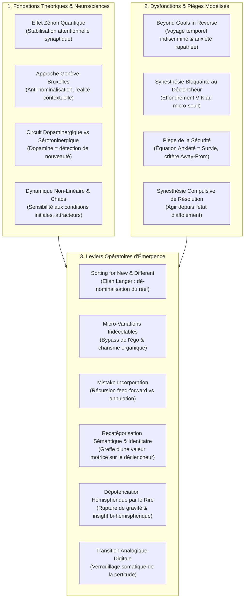

# TCU Recording Beyond Goals 2.0 - Transcripts
**Formateur :** John Overdurf | **ID :** `john-overdurf-tcu-recording-beyond-goals-20-transcripts` | **Tranches :** 26

# Synthèse Architecturale du Cours : Beyond Goals 2.0 (John Overdurf)

---

### 1. Thèse Centrale & Philosophie du Cours

#### A. Vision Spécifique & Différenciation de l’Approche Standard
L'approche classique du développement personnel, du coaching d'objectifs et de la PNL traditionnelle repose sur un modèle linéaire, newtonien et téléologique : formuler un objectif précis dans le futur (*Well-Formed Outcome*), élaborer un plan d'action séquentiel et tenter de combler l'écart par la volonté, la discipline ou la motivation.

John Overdurf opère une rupture paradigmatique radicale en fondant **Beyond Goals 2.0** sur la physique quantique (effet Zénon, approche Genève-Bruxelles de Diederik Aerts), les neurosciences cognitives (circuits dopaminergiques de la nouveauté) et la dynamique des systèmes non linéaires (théorie du chaos et attracteurs étranges) :

1. **Le futur lointain comme piège neurologique (*Beyond Goals in Reverse*) :** La projection compulsive dans le futur lointain active le voyage temporel inconscient du cerveau limbique. Face à une infinité de variables incontrôlables, l'appareil cognitif hallucine l'incertitude, fabrique de l'anxiété, et la rapatrie instantanément dans le système nerveux au présent. Ce qui devait être une vision inspirante devient un ancrage rétroactif négatif qui paralyse l'action.
2. **La primauté de l’État sur l’Action :** Agir pour fuir un état indésirable (synesthésie d'urgence : *"Qu'est-ce que tu vas faire pour arranger ça ?"*) ne fait qu'ancrer et propager la vibration neurologique de la panique ou du manque. L'action ne doit jamais être le moyen d'atteindre l'état ; **l'état doit précéder et informer le moindre mouvement**.
3. **Le minimalisme sub-perceptif contre la résistance homéostatique :** Toute tentative de transformation massive et brutale déclenche les contre-mesures immunitaires de l'égo et du système nerveux. En réduisant le geste à une échelle microscopique et sub-perceptive pour autrui, le seuil de menace limbique tombe à zéro, permettant au circuit dopaminergique de s'amorcer sans friction.

#### B. Fil Rouge Méthodologique
Le fil rouge reliant l'ensemble des interventions d'Overdurf se résume à une boucle récursive en trois temps :
1. **Dénominaliser et Dé-sécuriser :** Dissoudre les blocs statiques de pensée (objectifs rigides, résistances réifiées, équation erronée *anxiété = sécurité*) en réinjectant du flux, du relativisme perceptif et de la présence sensorielle externe (*sorting for new & different*).
2. **Éliciter l'État Final (*End State*) et Verrouiller le Seuil Somatique :** Accéder à la signature neurobiologique de l'état désiré libre de tout contenu analytique (*Beyond Goals*), et faire basculer la probabilité phénoménologique du mode analogique (*Could be / Might be*) au mode digital incarné (*It is*).
3. **Récursion Réactive & Micro-Pas Minimal (*Smallest Next Step*) :** Greffer cet état directement sur le stimulus déclencheur immédiat, initier le plus petit mouvement concevable, incorporer toute « erreur » comme une donnée organique nouvelle, et laisser l'attracteur dynamique réorganiser l'ensemble du système sans projection lointaine.

---

### 2. Carte des Concepts & Leviers Émergents



#### Écosystème des Concepts Clés :
* **Effet Zénon Quantique & Neuroplasticité Attentionnelle :** L'attention répétée et ininterrompue ralentit la dégradation d'un état et force l'épaississement synaptique (*neurons that fire together wire together*). C'est le sculpteur biologique du cerveau.
* **Fenêtre de Maturation Neuroplastique Souterraine (3-4 semaines) :** Tout protocole ou amorçage attentionnel produit une réorganisation sous-corticale invisible pendant 14 à 21 jours avant l'émergence phénoménologique consciente. Comprendre cette cinétique évite l'abandon prématuré.
* **Dé-nominalisation par le tri sur la nouveauté (*Sorting for New & Different*) :** Pratique attentionnelle dérivée d'Ellen Langer consistant à traquer activement les micro-changements dans l'environnement pour réaligner le système nerveux sur le flux dynamique du monde et faire chuter l'anxiété de stase.
* **Micro-variations Sub-perceptibles & Charisme Organique :** L'injection volontaire d'infimes variations connues du seul sujet détruit les ruminations autoréférentielles (« Suis-je bon ? »), maximise la présence somatique externe et génère magnétisme et fluidité d'adaptation.
* **Incorporation de l'Erreur (*Mistake Incorporation*) :** Refus de réinitialiser la boucle (*never start over*). L'erreur est absorbée comme une contrainte matérielle immédiate intégrée dans le pas suivant, enrichissant la texture du résultat final.
* **Réassignation Neurologique Fonctionnelle (*The Brain Sees, Not the Eye*) :** Déplacement du locus de compétence ou de défaillance depuis l'organe périphérique vers les aires corticales et associatives, réouvrant un potentiel de compensation neuroplastique.
* **L'Énergie Inverse de la Résistance (Continuité Dynamique) :** Reconnaissance que le problème n'est pas une passivité, mais une compétence motrice à très haute dépense d'énergie déployée pour maintenir l'immobilité. Le praticien ne détruit pas la résistance : il réoriente son vecteur cinétique vers l'état cible.
* **Transition Analogique $\to$ Digitale :** Progression phénoménologique (*Could be* $\to$ *Might be* $\to$ *Will be* $\to$ *It is*) permettant de condenser un champ de potentiels diffus en certitude somatique éprouvée au présent.

---

### 3. Tableau Récapitulatif des Techniques & Démonstrations

| Technique / Exercice | Objectif Opératoire | Déclencheur / Indication | Séquence Résumée |
|---|---|---|---|
| **Recatégorisation Sémantique & Identitaire du Déclencheur** | Dissoudre la synesthésie de paralysie au seuil d'une tâche (*Micro-step paralysis*) et réactiver l'énergie motrice. | Sujet bloqué devant le micro-stimulus d'un projet (ouvrir un logiciel, passer un appel), manifestant une contraction physique (oppression thoracique, fuite). | 1. Identifier le stimulus visuel déclencheur exact ($V_e$).<br>2. Calibrer la synesthésie bloquante ($K^-$).<br>3. Éliciter une valeur motrice fondamentale intrinsèque et l'identité désirée du sujet (*ex: apprendre à être une star*).<br>4. Reclasser sémantiquement l'action : le stimulus déclencheur devient l'expression immédiate de cette identité.<br>5. Tester la réponse somatique (afflux sanguin, relâchement de la poitrine). |
| **Tri sur la Nouveauté & Micro-Variations Délibérées (*Langerian Grounding*)** | Réamorcer le système dopaminergique, sortir de la rumination autoréférentielle et ancrer l'hyper-présence somatique. | Routine étouffante, perte d'élan vital (sérotonine intacte mais dopamine éteinte), rigidité comportementale, trac en performance. | 1. Amorcer le système nerveux à rechercher activement ce qui est « nouveau et différent » dans le contexte immédiat.<br>2. Prescrire d'insérer des micro-variations motrices ou verbales imperceptibles pour autrui.<br>3. Maintenir l'attention focalisée de manière continue (stabilisation par effet Zénon quantique).<br>4. Vérifier le basculement vers le charisme organique et le couplage sensoriel externe. |
| **Rupture par Dépotenciation Hémisphérique & Humour** | Désactiver le circuit de défense amygdalien et libérer l'accès à l'insight bi-hémisphérique. | Climat de gravité excessive, dramatisation du problème, boucle analytique fermée empêchant tout recadrage. | 1. Calibrer la posture de menace et le champ visuel tubulaire du sujet.<br>2. Injecter une absurdité contextuelle, un paradoxe comique ou une dérision sur la structure du problème.<br>3. Provoquer le rire somatique pour saturer/dépotencier l'hémisphère dominant.<br>4. Livrer la suggestion de recadrage ou poser la question d'émergence exactement au point de rupture. |
| **Effondrement de l'Équation Anxiété = Sécurité (*Beyond Goals in Reverse Bypass*)** | Découpler la vigilance de la peur panique et neutraliser la motivation d'évitement (*away-from*). | Anxiété d'anticipation chronique, superstition cognitive selon laquelle s'inquiéter garantit de ne pas être pris au dépourvu. | 1. Mettre au jour le voyage temporel inconscient et l'hallucination de variables futures incontrôlables.<br>2. Dénominaliser la « sécurité » en révélant son présupposé de danger permanent (*"Safe from what?"*).<br>3. Séparer neurologiquement la vigilance attentive (*awareness*) de la contraction anxieuse.<br>4. Réassigner la sécurité au ressenti somatique présent de ses propres ressources adaptatives. |
| **Protocole de la Plus Petite Étape Suivante 2.0 (*Smallest Next Step*)** | Dépasser l'écrasement (*overwhelm*), réamorcer le flux dopaminergique et engager le mouvement sans déclencher de résistance homéostatique. | Procrastination aiguë, paralysie d'analyse devant un projet complexe, incapacité à maintenir son état ressource face au futur. | 1. Accéder à l'état désiré (*End State*) sans contenu analytique.<br>2. Réduire l'échelle de l'action jusqu'à un niveau infinitésimal, sub-perceptif et débarrassé de tout enjeu de résultat.<br>3. Exécuter ce micro-pas unique dans l'état incarné.<br>4. Traiter le feedback ou « l'erreur » émergente par récursion (*feed-forward*) sans jamais réinitialiser la boucle (*never start over*). |
| **Réalignement de l'Énergie Cinétique de Résistance** | Convertir la dépense énergétique du blocage en force de propulsion vers l'état cible. | Résistance tenace et active d'une partie du système, auto-sabotage persistant perçu comme un mur insurmontable. | 1. Calibrer l'intensité et l'effort déployés par le sujet pour maintenir son problème immobile dans un monde en mouvement.<br>2. Valider et congratuler le système pour cette prouesse de stabilité et de force cinétique.<br>3. Déplacer métaphoriquement et sous-modalitairement le point d'application de cette force : l'orienter vers la direction cible.<br>4. Utiliser la transition analogique $\to$ digitale (*Could be $\to$ It is*) pour sceller la nouvelle trajectoire somatique. |

---

## Extractions Détaillées par Tranche (Opératoire & Verbatim)


## --- Tranche 1 / 26 ---

### 1. Mécanismes & Principes Actifs

- **La Synesthésie Bloquante au Déclencheur (Trigger Synesthesia)**
  - *Principe actif* : Lorsqu'un sujet envisage le premier micro-pas concret d'un projet (ici, ouvrir l'application Scrivener pour écrire un livre), son système nerveux effondre prématurément une boucle V-K (Visuel externe/interne $\rightarrow$ Kinesthésique négatif). L'évocation du déclencheur contextuel active instantanément un sentiment d'écrasement ou une contraction physique (pression dans la poitrine), déconnectant l'accès à l'état désiré (l'*End State*). Tant que le déclencheur microscopique est associé à cette synesthésie d'obligation ou d'effort aride, toute tentative de motivation globale par le résultat final reste inopérante.
  - *Tags libres* : #synesthesie_de_seuil #stimulus_kinesique_bloquant #micro_step_paralysis

- **Recatégorisation Sémantique & Identitaire du Déclencheur (Identity-Level Reframing)**
  - *Principe actif* : Au lieu de lutter contre la tâche technique rébarbative, le praticien identifie une valeur motrice intrinsèque préexistante chez le sujet (le goût d'apprendre) couplée à son identité désirée (devenir une "star"). Il greffe ensuite cette identité directement sur le stimulus visuel déclencheur : *"ouvrir l'ordinateur portable et lancer l'application n'est pas faire une corvée, c'est s'ouvrir à apprendre à être une star"*. La représentation mentale de l'action change instantanément de catégorie neurologique : d'une obligation laborieuse (*task*), elle devient le vecteur immédiat de la réalisation de soi, dissolvant la pression thoracique somatique et activant un afflux sanguin (changement de couleur du visage).
  - *Tags libres* : #recategorisation_identitaire #recollement_de_declencheur #valeur_fondamentale_carburant

- **Sous-Modalités Émergentes et Équivalences Linguistiques Spontanées**
  - *Principe actif* : Le langage spontané du sujet trahit la structure sous-modalitaire de son encodage interne. Quand le sujet dit *"I'll be a star"*, le terme "star" n'est pas seulement une métaphore sociale : il s'agit d'un indice sous-modalitaire visuel potentiel (luminosité, brillance, scintillement, expansion spatiale). Le praticien utilise cette équivalence sémantique/visuelle comme un raccourci direct pour intensifier la représentation interne de l'état ressource sans avoir à dérouler un inventaire scolaire rigide de sous-modalités.
  - *Tags libres* : #sous_modalites_linguistiques #shorthand_submodalities #spatialisation_spontanee

- **Transposition Trans-Contextuelle de Compétences (Ericksonian Cross-Mapping)**
  - *Principe actif* : Transférer la structure cognitive et relationnelle d'une habileté hyperspécialisée (la navigation fluide, non linéaire et réactive d'une séance d'hypnose ericksonienne) vers un domaine élargi (la conduite globale de sa propre existence). Plutôt que de figer un plan d'action rigide à l'avance, le système nerveux opère par micro-injections d'initiatives, observe le feedback de la réalité, puis ajuste le mouvement suivant.
  - *Tags libres* : #cross_mapping_ericksonien #boucle_action_feedback #conduite_non_lineaire

- **Effet Zénon Quantique et Neuroplasticité de Stabilisation**
  - *Principe actif* : En physique quantique, l'observation continue et répétée suspend ou ralentit la désintégration d'un état instable (effet Zénon). Transposé au système nerveux : plus la durée et la fréquence de l'attention focalisée sur un circuit neuronal spécifique sont maintenues sans interruption, plus le taux de dégradation de la pensée diminue et plus le réseau synaptique se stabilise. La répétition intentionnelle de l'attention recrute les neurones voisins, accélère la vitesse de décharge et épaissit physiquement les connexions synaptiques.
  - *Tags libres* : #quantum_zeno_effect #stabilisation_attentionnelle #ancrage_neuroplastique

- **L'Approche Genève-Bruxelles : Observation Contextuelle vs Illusion Particulaire**
  - *Principe actif* : D'après les travaux de Diederik Aerts, les "particules" ne sont pas des objets tridimensionnels durs préexistants, mais des manifestations spatiales éphémères dépendant entièrement du contexte et du dispositif d'observation. En psychologie et modélisation cognitive, nos "problèmes" ou "objectifs" fixes sont des nominalisations illusoires créées par notre appareil perceptif. Dès que nous changeons l'angle ou la durée de l'observation, la nature même de ce qui se manifeste est altérée, car toute mesure interfère avec le système mesuré.
  - *Tags libres* : #aerts_geneva_brussels #anti_nominalisation #interference_observateur

- **Tri sur la Différence et Présence Présupposée (Mindfulness selon Ellen Langer)**
  - *Principe actif* : Contrairement aux injonctions méditatives abstraites ("soyez présent", "restez dans l'ici et maintenant") qui provoquent souvent un effort cognitif contre-productif, la consigne cognitive de chercher et repérer activement *ce qui est nouveau et différent* force structurellement le système nerveux à habiter le présent immédiat. Cette consigne suspend la généralisation automatique, inhibe les automatismes inconscients du mode par défaut (*mindless*), empêche la cristallisation de l'expérience et transforme chaque instant en un nouveau point de départ où l'erreur n'existe plus en tant qu'échec, mais en tant que simple donnée de calibration.
  - *Tags libres* : #sorting_for_new_and_different #mindfulness_operationnelle #suspension_de_generalisation

---

### 2. Protocoles, Techniques & Démonstrations (Étape par Étape)

#### Démonstration : Recalibrage et Fusion Déclencheur-Identité (Cas Brian & Scrivener)

* **Intention / Indication** :
  À utiliser lorsqu'un sujet a un grand objectif enthousiasmant (*End State* clair et désirable), mais qu'il procrastine ou s'effondre dans un état kinesthésique d'inhibition dès qu'il est confronté au tout premier micro-pas technique nécessaire pour démarrer.

* **Mise en place & Pré-framing** :
  - Calibrer le contraste d'état entre l'évocation du micro-pas rébarbatif (affaissement somatique) et l'évocation de l'état désiré final (excitation, projection).
  - Poser un cadre exploratoire sans enjeu : *"we'll just do this, if you want to do this, just to play for a second"*.

* **Séquence d'actions pas à pas** :
  1. **Calibration de l'effondrement d'état** :
     Demander au sujet d'évoquer l'étape de blocage immédiate. Calibrer la dégradation de la physiologie.
  2. **Réactivation et amplification de l'End State** :
     Questionner l'intention fondamentale et la vision à long terme : *"If you knew that you had even just the first done, how would you be?"*. Pousser jusqu'à ce que le sujet formule une nomination identitaire forte (ex: *"I'll be a star"*).
  3. **Capture de l'indice sous-modalitaire / linguistique** :
     Prendre au mot la métaphore spontanée du sujet (la "star") et inviter le sujet à visualiser l'image dans son œil intérieur en amplifiant la brillance et l'expansion.
  4. **Traque de la synesthésie sauvage au déclencheur matériel** :
     Préciser rigoureusement le décor sensoriel précis du déclencheur : lieu exact, posture, environnement physique (*"Where would you actually be doing this? In my living room, in my couch, Mac on my lap, opening Scrivener"*).
  5. **Élicitation de l'état désiré alternatif vs Piège de l'évitement** :
     Demander : *"How do you want to be in that situation instead?"*.
     *Attention au piège* : Si le sujet répond par la fuite de la tâche (*"Je veux déjà être à la fin"*), tester cette idée. Si la contraction physique réapparaît (pression dans la poitrine), invalider cette option immédiatement : *"Not that"*.
  6. **Extraction de la valeur ressource intrinsèque** :
     Mobiliser un levier de plaisir naturel chez le sujet (ex: *"You like to learn. I really love learning"*).
  7. **Recatégorisation et pont vers le futur (Liaison Déclencheur-Identité)** :
     Lier le geste technique trivial à la valeur et à l'identité suprême : *"You're learning to be a star. So now, you open your laptop, and you're opening up to learning to be a star"*.
  8. **Vérification et intégration somatosensorielle** :
     Faire jouer la scène en temps réel dans l'expérience subjective du sujet et vérifier la décharge de la tâche (*"Well, I'm actually hallucinating doing it... It doesn't feel as much of a task"*).

* **Signes de calibration** :
  - **Au blocage initial** : Rupture du tonus postural, regard fuyant ou baissé, voix plate, mention explicite de tension thoracique (*"I feel this pressure in my chest"*).
  - **À la réactivation de l'End State / Submodalités** : Changement vasculaire visible, afflux de couleur dans le visage (*"See the color coming into his face right now?"*), sourire spontané, redressement du buste.
  - **À la résolution** : Détente des épaules, micro-hallucinations spontanées intégratives (inclusion d'éléments réels et vivants comme la tasse de café, le chat), sensation de légèreté.

---

### 3. Heuristiques, Subtilités & "Sagesse du Praticien"

- **Règle du Décrochage de l'End State** :
  *Si* un sujet est capable de décrire son grand objectif avec passion mais redevient inhibé dès qu'on nomme le premier micro-pas, *alors* il est inutile de répéter des affirmations positives sur le but final. Il faut traquer le point de bascule synesthésique exact dans le décor physique (l'ordinateur, le canapé, le clic de souris) où la physiologie se fige.
- **Règle de l'Indice Linguistique Sub-modalitaire (Shorthand Submodality)** :
  *Si* le sujet utilise un mot porteur d'une charge sensorielle ou lumineuse forte (*"star"*, *"étincelle"*, *"sombre"*), *alors* le praticien peut présupposer immédiatement la sous-modalité visuelle sous-jacente sans passer par une grille formelle, et l'injecter directement dans le guidage pour amplifier l'état.
- **Règle du Rejet de la "Fin de Tâche" comme Ressource** :
  *Si* à la question *"Comment veux-tu être à la place ?"*, le sujet répond *"Je veux juste en avoir fini / être à la fin"*, *alors* refuser cette direction car vouloir avoir fini maintient la résistance envers le processus en cours et réactive la contraction somatique (*"Not that"*). Trouver plutôt comment transformer le *processus d'action lui-même* en un acte désirable (ex: apprendre).
- **Règle du Recouvrement Déclencheur $\leftrightarrow$ Identité** :
  *Si* l'action requise est perçue comme un travail fastidieux (*task*), *alors* changer le cadre de l'action pour qu'elle devienne l'expression directe d'une valeur et d'une identité (*"Ouvrir Scrivener = Apprendre à devenir une star"*).
- **Règle de l'Intervention Émergeante (Approche Ericksonienne appliquée à la Vie)** :
  Ne jamais planifier plus d'une étape thérapeutique à l'avance. Introduire une seule idée/stimulus, calibrer précisément la réaction du sujet (ou de l'environnement), et utiliser ce retour d'information pour déterminer le geste suivant.
- **Règle de la Présence sans Effort (Langer)** :
  *Si* vous voulez ancrer un sujet dans le moment présent ou l'arracher à la rumination mentale sans passer par la méditation formelle, *alors* donnez-lui la tâche attentionnelle explicite de chercher et d'identifier *ce qui est nouveau et différent* dans son environnement ou son expérience actuelle.
- **Postulat Philosophique d'Overdurf** :
  *"All we are is changing, and we're not so great that it's just us."* La souffrance humaine provient de la tentative illusoire de nominaliser, figer et résister au flux perpétuel du changement en se désynchronisant du rythme du vivant qui nous entoure.

---

### 4. Pépites Verbatim & Patterns Linguistiques (MOT À MOT EN V.O.)

#### Extrait 1 : L'Amplification sous-modalitaire spontanée
> **« And you know what? That's just the beginning. That's right, you know, it's just the beginning. And when you know it's just the beginning, you know, it could get bigger, and you know what? It's like, you're a star. That's it. And you know what? And if you were to see that all happening in your mind's eye right now, and make it, yeah, you see the color coming into his face right now? »**

* **[Analyse du Pattern]** :
  - *Répétition rythmée et truisme temporel* : L'expression *"That's just the beginning"* répétée trois fois crée un ancrage auditif qui ouvre le futur vers une expansion continue.
  - *Saut analogique direct* : Transition fluide entre la taille de l'événement (*"it could get bigger"*) et l'équivalence identitaire (*"you're a star"*).
  - *Guidage sous-modalitaire implicite* : *"if you were to see that all happening in your mind's eye right now, and make it..."* laisse la phrase volontairement en suspens sur le plan syntaxique au moment où le sujet commence déjà à modifier l'image visuelle, validé immédiatement par la calibration autonome (*"you see the color coming into his face"*).

#### Extrait 2 : Ratification de la Connexion Inconsciente
> **« It just means you're really connected to your unconscious mind. Right? [...] You have a very good relationship with it. »**

* **[Analyse du Pattern]** :
  - *Recadrage par cause à effet (Complex Equivalence)* : Utilise la réaction physiologique autonome involontaire (rougeur du visage) et la pose comme une preuve irréfutable que le sujet est profondément connecté à son esprit inconscient.
  - *Suggestion directe présupposée* : Établit et renforce immédiatement la croyance d'une excellente relation de travail et de collaboration avec l'inconscient.

#### Extrait 3 : La Traque de la Synesthésie Déclenchante
> **« Are we at the trigger? Do you think we have stalked the wild synesthesia, everybody? You're like dead on it, man. This is awesome. »**

* **[Analyse du Pattern]** :
  - *Métaphore cynégétique / Dé-dramatisation humoristique* : Qualifier la synesthésie bloquante de *"wild synesthesia"* qu'on traque comme du gibier sauvage détache l'identité du sujet du symptôme. La difficulté n'est plus une fatalité psychologique, mais un mécanisme d'encodage spécifique et localisé sur lequel on a mis le doigt.

#### Extrait 4 : La Fusion Déclencheur - Valeur - Identité
> **« If you knew that you were learning something that was going to help you become a star. I see where you're going. That's really what it comes down to. You're learning to be a star. So now, you open your laptop, and you know what? You're opening up to learning to be a star. You got it. »**

* **[Analyse du Pattern]** :
  - *Conditionnel préparatoire* : *"If you knew that you were learning..."* contourne la résistance analytique en installant la possibilité.
  - *Redéfinition par empilement sémantique* : Glissement progressif de *"learning something"* vers *"learning to be a star"*.
  - *Ancrage contextuel spatial immédiat* : Liaison directe de l'action physique concrète (*"open your laptop"*) à l'état identitaire désiré (*"opening up to learning to be a star"*). L'ambiguïté du verbe *"opening"* (ouvrir l'ordinateur / s'ouvrir à l'apprentissage) fond le geste matériel dans l'attitude psychologique.

#### Extrait 5 : Utilisation du Paradoxe Quantique en Suggestion de Transe
> **« As microscopic particles are not particles, but are instead the ephemeral and spatial and local manifestations of non-spatial and non-local entities. And if that doesn't put you in trance, then you're deeper than you thought. »**

* **[Analyse du Pattern]** :
  - *Surcharge cognitive (Overload)* : Utilisation d'un jargon scientifique hautement abstrait et dense qui dépasse les capacités de traitement linéaire de l'hémisphère dominant.
  - *Double lien ericksonien (Double Bind)* : *"Soit cette complexité vous plonge en transe, soit vous y êtes déjà plus profondément que vous ne le pensiez"*. Quelle que soit la réaction cognitive du sujet (incompréhension ou saisie intuitive), l'état de transe hypnotique est posé comme un fait inévitable.

#### Extrait 6 : Présupposition d'Action Présente (Ellen Langer)
> **« All she does is she asks people to notice, in any context that they're in, what's new and different. And see, by presupposition then, you will be present and engaged in the context. »**

* **[Analyse du Pattern]** :
  - *Structure présuppositionnelle d'orientation attentionnelle* : L'ordre de trier sur la nouveauté et la différence porte une présupposition d'action : pour évaluer ce qui est différent, le cerveau est forcé de scanner le décor perceptif immédiat, éliminant par structure même la dissociation dans des représentations passées ou futures figées.


## --- Tranche 2 / 26 ---

### 1. Mécanismes & Principes Actifs

- **Dé-nominalisation du réel par le tri sur la nouveauté (*Sorting for New & Different*)**
  *Principe actif :* Le système nerveux tend à figer des processus dynamiques continus en entités statiques (nominalisations, passage d'un film fluide à un arrêt sur image mental). Cette réification crée une désynchronisation aiguë entre la vitesse de changement interne et celle du monde extérieur, provoquant sentiment d'aliénation, impuissance et souffrance. En orientant l'attention sur la recherche active de ce qui est « nouveau et différent », le praticien force l'ouverture des filtres sensoriels et rétablit le couplage dynamique du sujet avec son environnement en flux permanent.
  *Tags :* #sorting_new_and_different #denominalisation_attentionnelle #recalibrage_temporel #flux_vs_stase

- **Effet Zénon Quantique & Priming Neuroplastique**
  *Principe actif :* L'attention répétée et soutenue vers une catégorie d'indices (ici, les micro-variations) active le mécanisme de facilitation synaptique et stabilise les réseaux neuronaux associés (effet Zénon quantique appliqué aux neurosciences cognitives). Plus le cerveau est amorcé (*primed*) à détecter la nouveauté, plus le seuil perceptif s'abaisse, transformant une consigne volontaire en automatisme inconscient génératif.
  *Tags :* #quantum_zeno_effect #priming_neuroplastique #stabilisation_attentionnelle #boucle_facilitation

- **Micro-variations délibérées et Genèse du Charisme / Rapport Organique**
  *Principe actif :* Dans les interactions humaines ou les performances motrices/artistiques, la répétition mécanique d'un script ou d'un protocole figé enferme le sujet dans un dialogue interne autoréférentiel (« Suis-je en train de bien faire ? »), rompant le calibrage externe. À l'inverse, l'instruction d'introduire des micro-variations subtiles connues de lui seul oblige le sujet à demeurer en hyper-présence somatique et sensorielle. Cette fluidité motrice et attentionnelle non verbale est captée inconsciemment par les interlocuteurs (clients, auditoire, animaux), qui l'attribuent subjectivement au « charisme » ou à une intensité de présence captivante.
  *Tags :* #micro_variations_deliberees #charisme_organique #external_sensory_tracking #disruption_de_l_automatisme

- **Assimilation non linéaire de l'erreur (*Mistake Incorporation*)**
  *Principe actif :* L'erreur n'est pathologique que dans un modèle linéaire où le sujet interrompt l'action, annule son travail (*start over*) et réinitialise la boucle avec une charge affective d'échec. L'incorporation créative consiste à traiter la trace motrice ou décisionnelle de l'erreur comme une donnée matérielle déjà intégrée au paysage, la recombinant immédiatement dans la nouvelle direction. Le résultat est perçu par le système nerveux (et par les observateurs externes) comme plus complexe, plus dense et plus esthétique qu'une exécution immaculée standard.
  *Tags :* #incorporation_de_l_erreur #boucle_retroactive_nonlineaire #feedback_vs_failure #opportunisme_neurologique

- **Bistabilité Perceptive & Dépendance Contextuelle de l'Amorce**
  *Principe actif :* Les représentations mentales fonctionnent comme des figures ambiguës (cube de Necker, vase de Rubin). La bascule (*flip*) d'une interprétation à l'autre ne dépend pas d'un effort volontaire direct, mais des contraintes de l'amorce contextuelle (*priming variables*). La vitesse de permutation entre deux états incompatibles est strictement bornée par la rapidité avec laquelle l'attention est invitée à multiplier les angles d'observation plutôt qu'à osciller entre deux pôles binaires exclusifs.
  *Tags :* #bistable_perception #necker_cube_flip #relativisme_perceptif #recadrage_contextuel

- **Réassignation Neurologique Fonctionnelle (*Brain Sees, Not the Eye*)**
  *Principe actif :* Déplacement hypnotique de l'organe défaillant (l'œil physique) vers le processeur central (les aires associatives visuelles du cortex occipital). En dissociant la captation mécanique de la lumière et la synthèse neurologique de l'image, le praticien ouvre un espace de rééducation neuroplastique : le client ne cherche plus à réparer un organe périphérique condamné, mais entraîne son cerveau à optimiser le traitement du signal résiduel.
  *Tags :* #reassignation_corticale #dissociation_organe_processeur #recadrage_neuroplastique #preop_priming

---

### 2. Protocoles, Techniques & Démonstrations (Étape par Étape)

#### Protocole A : La Consigne Opératoire de Pleine Conscience selon Ellen Langer
* **Intention / Indication :** Rompre la rumination interne, le figement d'un état bloqué (*stuck state*) ou la rigidité d'une exécution de tâche (vente, prise de parole, performance sportive ou musicale).
* **Mise en place & Pré-framing :** Cadrer la consigne non pas comme une injonction mystique (« Soyez présent »), mais comme une simple tâche de tri d'information concrète et mesurable.
* **Séquence d'actions pas à pas :**
  1. *Pose de l'amorce attentionnelle :* Avertir le sujet qu'après l'interaction ou l'action, il lui sera demandé d'énumérer spécifiquement ce qui était nouveau et différent.
  2. *Consigne de micro-variation secrète :* Exiger du sujet qu'il suive la trame ou la compétence requise tout en introduisant délibérément d'infimes variations que lui seul percevra.
  3. *Entrée dans l'action :* Le sujet exécute la tâche en maintenant un calibrage sensoriel externe ouvert vers les micro-changements continus de la situation.
  4. *Débriefing opératoire :* Questionner immédiatement après l'action : « Qu'as-tu remarqué de nouveau et différent cette fois-ci ? Quelles micro-variations as-tu introduites ? »
* **Signes de calibration :** Sortie immédiate de la focalisation oculaire interne (défocalisation/transe de présence), baisse de la tension faciale associée à la performance, fluidité vocale et gestuelle accrue, réactivité instantanée aux micro-signaux du partenaire/client.

#### Protocole B : Recadrage et Incorporation de l'Erreur Décisionnelle
* **Intention / Indication :** Quand un sujet ou un client se fige après avoir pris une « mauvaise décision », veut tout abandonner ou s'enferme dans l'autocritique.
* **Mise en place & Pré-framing :** Utiliser la métaphore du dessin où la consigne a été mal interprétée (l'ambiguïté homophone *morning* vs *mourning*).
* **Séquence d'actions pas à pas :**
  1. *Suspension de l'effacement :* Interdire formellement au sujet de « repartir à zéro » ou de gommer ce qui a été fait.
  2. *Re-contextualisation de la matière existante :* Pointer les éléments concrets de la décision initiale et poser : « Comment cette forme précise devient-elle le support structurel de la nouvelle trajectoire ? »
  3. *Tressage de la nouvelle orientation :* Guider le sujet pour ajouter des traits ou des actions qui redéfinissent la signification globale de l'erreur dans le nouveau cadre.
  4. *Validation de la valeur ajoutée :* Vérifier somatiquement comment l'intégration de l'accident produit une complexité et une richesse impossibles à atteindre via un chemin rectiligne prévu à l'avance.
* **Signes de calibration :** Rire ou relâchement diaphragmatique lors de la bascule de perspective ; passage d'un affect d'effondrement à une posture d'exploration curieuse et ludique.

#### Protocole C : Swish Pattern Écologique pour Événement Médical / Pré-Opératoire Incertain
* **Intention / Indication :** Préparation à une intervention chirurgicale lourde avec pronostic incertain (ex : risque résiduel de perte totale de la vue).
* **Mise en place & Pré-framing :** Recadrer l'opération : ce n'est pas l'œil qui voit, c'est le cortex visuel. Établir l'objectif non pas sur une pensée magique de garantie de guérison, mais sur la résilience et la capacité interne à gérer n'importe quel résultat post-opératoire.
* **Séquence d'actions pas à pas :**
  1. *Évocation du déclencheur présent :* Faire calibrer l'image/sensation d'appréhension face à l'opération ou au risque de cécité.
  2. *Construction de la Self-Image Ressource :* Créer l'image de soi *après* l'opération, doté de toutes les capacités d'adaptation et de traitement de l'information nécessaires pour prospérer, quelle que soit l'issue médicale.
  3. *Exécution de la cinétique du Swish :*
     - Image déclencheur grande, lumineuse, proche.
     - Dans le coin inférieur, petite image ressource sombre.
     - Déclenchement du mouvement cinétique rapide (*SWISH*) : l'image ressource grossit à toute vitesse, s'illumine et remplace l'image initiale qui rétrécit et disparaît.
     - Rupture d'état (respiration, ouverture des yeux).
  4. *Répétition multi-contextuelle :* Réitérer le mouvement dans plusieurs contextes prévisibles de la vie quotidienne du sujet après l'opération.
  5. *Test et calibration des sous-modalités spontanées :* Demander ce qui se produit spontanément dans le champ visuel interne.
* **Signes de calibration :** Amplification spontanée de la luminosité et des couleurs internes (« *I'm seeing more color now* »), expansion volumétrique de l'image de soi (« *I'm getting bigger* »), sourire et tonus musculaire équilibré traduisant un soulagement profond.

---

### 3. Heuristiques, Subtilités & "Sagesse du Praticien"

- **Règle du non-morcellement cognitif (*Chunking level rule*) :**
  *Si* tu donnes une consigne de présence ou de rapport trop complexe, trop technique ou trop découpée en micro-paramètres (ex: synchronisation respiratoire + prédicats + posture simultanés), *alors* le sujet/thérapeute va saturer sa mémoire de travail et basculer en interne, ce qui détruit le rapport. *Donc* utilise une consigne globale, simple et immédiatement intelligible par l'inconscient : « Remarque simplement ce qui est nouveau et différent ».

- **Règle de l'instruction de processus vs suggestion directe :**
  Une suggestion post-hypnotique fonctionne à son plein potentiel lorsqu'elle n'est pas étiquetée comme « hypnose » ou « changement », mais introduite sous la forme d'une consigne de procédure d'observation (*process instruction*). Dire à quelqu'un qu'on va l'interroger sur ce qui a changé amorce le système nerveux à rechercher activement le changement sans déclencher de résistance critique.

- **Règle de bascule de la bistabilité :**
  *Si* un sujet est enfermé dans une perception rigide d'un problème (comme un cube de Necker bloqué sur une seule face), *ne tente pas* de lui prouver l'autre face par l'argumentation. *Alors* amorce son système en multipliant le champ des perceptions possibles : « Remarque de combien de façons différentes tu peux percevoir cela ». La vitesse de défigement est proportionnelle à la levée des amorces rigides antérieures.

- **Posture ontologique sur la vérité :**
  Toute vérité est strictement relative à l'angle d'observation. On ne peut pas observer le bois en train de flotter et le bois en train de brûler sous le même angle et dans la même catégorie conceptuelle au même instant. L'acceptation que notre perception est une réduction contextuelle libère le client de l'obligation de trouver « la » bonne représentation statique.

---

### 4. Pépites Verbatim & Patterns Linguistiques (MOT À MOT EN V.O.)

```text
"So there really, there aren't mistakes because they're part of what's new and different."
```
* **[Analyse du Pattern]** : **Recadrage ontologique par redéfinition catégorielle.** La suppression de la catégorie nominalisée « erreur » (*mistakes*) est opérée en l'incluant de force comme un sous-ensemble naturel du flux permanent (*what's new and different*). Présupposition : si tout change continuellement, aucune bifurcation n'est une erreur, mais une simple variation informative.

---

```text
"The problem with that is most of the time is we forget we're doing that. And we forget that that isn't what is real in the moment. What is real is everything is changing, whether we can always perceive it or not."
```
* **[Analyse du Pattern]** : **Double négation de l'illusion / Éveil méta-cognitif.** Utilisation du verbe de prise de conscience (*forget*) couplé à un truisme irréfutable (*everything is changing*). Le pattern détruit la validité des fixations mentales du client en exposant la nominalisation comme une illusion d'optique cognitive dont le sujet est l'auteur inconscient.

---

```text
"Would you be interested in knowing what probably scientifically is the closest way that we know how to create charisma?"
```
* **[Analyse du Pattern]** : **Question conversationnelle d'ouverture de boucle (*Open Loop*) & Priming de curiosité.** La formulation en question fermée orientée vers le désir (*Would you be interested...*) associée à un étayage d'autorité (*scientifically*) crée une suspension attentionnelle immédiate. La dopamine générée par l'attente augmente la réceptivité à la consigne opératoire qui suit.

---

```text
"They were told also they needed to memorize the script. But on each call, each face-to-face call that they would have, they were to vary the script, and this is the key piece, to vary the script in very subtle ways that perhaps no one else would know except them."
```
* **[Analyse du Pattern]** : **Instruction de tâche à double contrainte émancipatrice.** Le respect du cadre rigide (mémoriser le script) est couplé à une consigne d'agentivité secrète (*in very subtle ways that perhaps no one else would know except them*). Ce pattern linguistique installe une boucle d'auto-référence ludique qui libère le sujet de l'anxiété de conformité et le projette instantanément dans un état de présence aiguisée.

---

```text
"You may not realize, but, you know, while your eyes do see, they're really light, they catch light, and it's really an equation in terms of the neural impulses that go from your retina back through your optic nerve to your visual associational areas in your brain. So it's really your brain that sees. Brain's what makes the picture. And so, while I can't necessarily say that what we're going to do is going to really help your actual eye, what it will do is, what we can do, is we can help you develop your brain so that you can see better."
```
* **[Analyse du Pattern]** : **Trance-logic, saupoudrage de dénégation et recadrage neuro-anatomique.** Overdurf utilise une dénégation d'autorité médicale apparente (*while I can't necessarily say that...*) pour faire passer une suggestion hypnotique puissante sous le radar critique (*we can help you develop your brain so that you can see better*). Le glissement sémantique déplace l'agentivité de l'organe défaillant (l'œil) vers la plasticité cérébrale modifiable (le cerveau qui fabrique l'image).


## --- Tranche 3 / 26 ---

Voici l'analyse opératoire intégrale de la tranche 3/26 du cours *Beyond Goals 2.0* de John Overdurf.

---

### 1. Mécanismes & Principes Actifs

#### 1. L'Effet Zénon Quantique & Neuroplasticité Attentionnelle
- **Principe actif :** En physique quantique, l'effet Zénon stipule qu'un système instable reste figé dans son état lorsqu'il est observé de manière continue. Transposé aux neurosciences cognitives par Overdurf, le fait de focaliser intentionnellement et de manière répétée l'attention sur un signal spécifique (ici : repérer activement ce qui est « *new and different* ») stabilise et renforce les connexions synaptiques dédiées (*"neurons that fire together wire together"*). L'attention dirigée agit comme un sculpteur synaptique : elle réactive les circuits visuels et corticaux dormants ou endommagés en forçant le cerveau à traiter de nouvelles variations d'informations environnementales plutôt que d'opérer sur des automatisations habituelles.
- **Tags libres émergents :** `#effet_zenon_quantique` `#stabilisation_synaptique` `#focalisation_attentionnelle` `#plasticite_visuo_corticale` `#attention_sculptrice`

#### 2. La Fenêtre de Maturation Neuroplastique Souterraine (Latence de 3 à 4 Semaines)
- **Principe actif :** Les modifications neurobiologiques induites par la répétition d'un schéma d'attention ou d'un *swish* s'opèrent d'abord au niveau sous-cortical et microscopique (mesurable au TEP-scan/fMRI mais imperceptible consciemment) durant les deux premières semaines. Vers la 3ᵉ ou 4ᵉ semaine, la masse critique de connectivité synaptique atteint le seuil d'émergence phénoménologique : les résultats émergent brutalement dans la conscience perceptive sous forme d'éclaircissements ponctuels, puis de stabilisation globale.
- **Tags libres émergents :** `#latence_neuroplastique` `#seuil_emergence_consciente` `#consolidation_sous_corticale` `#cinetique_du_changement`

#### 3. Dépotenciation Hémisphérique par l'Humour et le Rire
- **Principe actif :** L'humour et le rire opèrent sur le système nerveux exactement comme une transe hypnotique formelle profonde : ils créent une rupture de pattern immédiate qui dépotencie l'hémisphère dominant (analytique, focalisé sur la menace, rigide). L'anxiété ou la gravité excessive rétrécissent le champ attentionnel et inhibent la créativité synaptique (blocage de l'insight). En injectant du rire ou un décalage comique sur un sujet grave, on désactive le circuit de défense amygdalien, élargissant le traitement de l'information aux deux hémisphères simultanément, condition indispensable pour que l'insight (« l'aha ») émerge spontanément.
- **Tags libres émergents :** `#depotenciation_hemispherique` `#transe_par_le_rire` `#desactivation_amygdalienne` `#insight_bi_hemispherique` `#rupture_de_gravite`

#### 4. Le Voyage Temporel Indiscriminé & L'Ancrage Rétroactif Involontaire (*"Beyond Goals in Reverse"*)
- **Principe actif :** Le cerveau inconscient ne fait pas la différence entre un événement vécu et un événement intensément imaginé dans le futur : il réagit biologiquement au présent. Lorsqu'un individu planifie ou sur-anticipe à trop long terme, il projette son imagination dans un champ à variables infinies. Inévitablement, son intelligence identifie une variable incontrôlable. Il ressent alors l'anxiété de cette variable non résolue, et sans s'en rendre compte (« oubliant qu'il voyage dans le temps »), il rapatrie cet état neurochimique de menace dans son système nerveux au présent. L'anxiété présente devient alors le filtre d'état par lequel il évalue toutes ses décisions actuelles.
- **Tags libres émergents :** `#voyage_temporel_indiscrimine` `#ancrage_retroactif_negatif` `#beyond_goals_in_reverse` `#contamination_de_l_etat_present` `#boucle_anxieuse_anticipatoire`

#### 5. Effondrement de l'Équation Anxiété = Sécurité (Confusion Signal vs État)
- **Principe actif :** De nombreux sujets souffrant d'anxiété chronique ont créé une fausse relation de cause à effet : *"Chaque fois que j'ai été anxieux, j'ai anticipé le pire et rien de grave n'est arrivé, donc mon anxiété garantit ma survie"*. Le cerveau associe la survie à la présence de l'anxiété. Le levier consiste à séparer la conscience vigilante (*awareness*) de la peur (*anxiety*), et à invalider le critère « sécurité », car la sécurité est intrinsèquement une motivation d'évitement (*away-from*) qui ne peut exister linguistiquement et neurologiquement sans la présupposition permanente d'une menace (*safe from what?*).
- **Tags libres émergents :** `#dissociation_vigilance_peur` `#piege_de_la_securite` `#nominalisation_parasite` `#invalidation_critere_away_from`

#### 6. Transition Phénoménologique : De l'Analogique au Digital (Le Basculement de Probabilité)
- **Principe actif :** La perception du futur passe par un gradient linguistique et somatique : *Could be* (potentiel vague/analogique) $\to$ *Might be* $\to$ *Will be* (certitude numérique/digitale) $\to$ *It is* (réalité somatique immédiate). L'anxiété se déclenche dès que ce seuil franchit la bascule digitale (*"It will be / It is"*). En inversant délibérément ce processus sur un état ressource, on verrouille le système nerveux dans la sensation physique de l'accomplissement avant même l'action extérieure.
- **Tags libres émergents :** `#transition_analogique_digitale` `#gradient_modal` `#effondrement_de_la_fonction_d_onde` `#verrouillage_somatique`

#### 7. Le Double Lien Positif Émergent de l'État-Ressource
- **Principe actif :** En stabilisant l'état cible (ex: confiance, sérénité) issu du futur au présent, le sujet gagne sur deux tableaux mutuellement bénéfiques :
  1. Soit l'état ressource sert de vecteur/fluide conducteur (*thread*) qui facilite l'atteinte concrète du but ;
  2. Soit l'accès à cet état au présent dissout le besoin compulsif d'atteindre l'objectif extérieur, car le sujet réalise que l'objectif matériel n'était qu'un prétexte pour ressentir cet état interne ici et maintenant.
- **Tags libres émergents :** `#double_lien_positif` `#vecteur_d_etat` `#desillusion_de_l_objectif` `#resolution_par_l_etre`

#### 8. La Dynamique Neurochimique Dopamine / Sérotonine (Désir vs Complétude)
- **Principe actif :** 
  - **Circuit Dopaminergique (Énergie Yang / Poussée) :** S'étend du cortex préfrontal jusqu'au tronc cérébral et au cervelet (lié au mouvement). Activé par la **nouveauté**, la curiosité, l'excitation et l'anticipation (la traque/le chemin).
  - **Circuit Sérotoninergique (Énergie Yin / Préservation) :** Associé aux états finaux (*end states*), au sentiment global de complétude, de satisfaction et de sécurité fondamentale (*"everything is going to be okay"*).
  - En entraînant l'attention à repérer ce qui est « nouveau et différent », on exerce et hypertrophie directement les neurones dopaminergiques sans nécessiter de bouleversements externes majeurs dans sa vie.
- **Tags libres émergents :** `#circuit_dopamine_serotonine` `#polarite_yang_yin` `#neurobiologie_de_la_nouveaute` `#neuroplasticite_dopaminergique`

---

### 2. Protocoles, Techniques & Démonstrations (Étape par Étape)

#### Protocole 1 : Le Swish Adaptatif Intégral & Rééducation Neuroplastique Visuelle
* **Intention / Indication :** Préparation à une intervention chirurgicale incertaine, rééducation perceptive/visuelle ou tout contexte de transition critique avec issue probabiliste (peur de l'échec chirurgical ou perte de fonction).
* **Mise en place & Pré-framing :** Recadrer l'objectif non pas sur la garantie médicale du résultat externe, mais sur la capacité du système nerveux à s'adapter et optimiser ses capacités cérébrales :
  > *"While I can't necessarily say that what we're going to do is going to really help your actual eye, what we can do is we can help you develop your brain so that you can see better."*
* **Séquence d'actions pas à pas :**
  1. **Définition de la cible post-opératoire ouverte :** Créer une représentation de soi après l'opération intégrant toutes les compétences et ressources nécessaires pour faire face à *n'importe quelle issue chirurgicale* (succès complet, succès partiel, ou absence d'amélioration).
  2. **Exécution du Swish multidirectionnel :**
     - Image déclencheur (situation présente incertaine).
     - Remplacement ultra-rapide par l'image de soi dotée de ces méta-ressources.
     - Répéter dans plusieurs contextes de vie distincts.
  3. **Calibration et recalibrage des sous-modalités spontanées :** Observer l'enrichissement chromatique spontané (*"I'm seeing more color"*) et le grandissement de l'image de soi qui avance vers le sujet (*"I'm getting bigger"* $\to$ facilitation visuelle et sensation de joie).
  4. **Tâche de pratique écologique quotidienne :** 
     - Répéter le Swish mental 5 à 6 fois par jour, 1 fois par jour.
     - Choisir un contexte d'entraînement routinier neutre (ex : les trajets quotidiens en train).
  5. **Protocole attentionnel « New & Different » :**
     - Durant le trajet, focaliser l'attention sur des stimuli habituels (panneaux, éclairages de gare).
     - Chercher délibérément ce qui a changé, les micro-variations de lumière, les différences de détail.
  6. **Suivi d'intégration (Semaines 1 à 4) :**
     - Semaines 1-2 : Intégration sous-corticale sans attentes conscientes.
     - Semaines 3-4 : Observer l'émergence de micro-fenêtres de clarté visuelle accrue (5-10 secondes), puis d'états de clarté soutenue sur une journée entière.
* **Signes de calibration :** Changement des sous-modalités internes (couleur, luminosité, taille perçue), micro-expressions de plaisir et soulagement somatique lors du retour de l'image, rapport verbal d'instants de netteté sensorielle réelle dans le quotidien.

---

#### Protocole 2 : Le Recadrage Opératoire « Beyond Goals » appliqué à la Décision
* **Intention / Indication :** Sujet bloqué dans l'indécision, l'analyse paralysis, ou pris dans une spirale d'anxiété anticipatoire par excès de projection future.
* **Mise en place & Pré-framing :** Cadrer la projection future non comme une certitude prédictive, mais comme une machine à extraire des états-ressources pour agir au présent.
* **Séquence d'actions pas à pas :**
  1. **Projection au-delà du choix (*Time-travel forward*) :** 
     Poser la question de bascule :
     > *"How would you be if you made the right decision?"* ou *"How would you be when the project is moving in the right direction?"*
  2. **Calibration de l'état nominal vs réel :**
     - Si le sujet répond un mot intellectuel (*"I'd be confident"*) sans le tonus physique associé : REFUSER la réponse verbale.
  3. **Élicitation kinesthésique et somatique pure :**
     - Demander : *"What's it like when you're confident? Tell me about that. What's it like when you're confident?"*
     - Calibrer la respiration, l'abaissement des épaules, le timbre vocal.
  4. **Rapatriement temporel au Présent (*Reeling back to NOW*) :**
     - Dès que l'état ressource est saturé et visible dans la physiologie, ramener immédiatement l'attention dans l'ici et maintenant :
     > *"Okay, so now from this state, what's the smallest next step?"*
  5. **Verrouillage du double lien :** La décision immédiate est prise depuis l'état du but déjà résolu.
* **Signes de calibration :** Congruence entre le prédicat émotionnel et la réponse somatique (voix qui descend dans les graves, relâchement musculaire facial, regard défocalisé/transe légère).

---

### 3. Heuristiques, Subtilités & "Sagesse du Praticien"

#### Règles Conditionnelles (« Si... Alors... Parce que... »)
* **Si** un client veut développer une nouvelle compétence neuroplastique (attention, méditation, flexibilité perceptive), **alors** fais-le pratiquer exclusivement dans un contexte neutre à faibles enjeux (*"low stakes"*, ex: regarder des panneaux dans un train), et **jamais** dans le contexte du problème initial, **parce que** le système nerveux sous stress régresse à ses anciens automatismes de survie ; il faut apprendre à nager dans une piscine avant de traverser la Manche.
* **Si** un sujet est bloqué dans une boucle de projection anxieuse, **alors** « mouline-le » en arrière vers le présent (*reel them back in*), **parce que** toute anxiété prouve qu'il est projeté trop loin dans le futur avec trop de variables non résolubles au présent.
* **Si** le sujet nomme la « sécurité » (*safety*) comme critère/état cible, **alors** refuse de t'y arrêter et remonte la chaîne des critères (*"Safety for what purpose?"*), **parce que** la sécurité est un critère d'évitement (*away-from*) qui maintient implicitement active la représentation du danger (*"Safe from what?"*).
* **Si** tu veux obtenir un insight profond ou débloquer une décision complexe chez un sujet sérieux, **alors** induis le rire et la comédie plutôt que de creuser la gravité du problème, **parce que** le rire dépotencie l'hémisphère gauche dominant et désactive le rétrécissement de vision imposé par le stress.

#### Pièges Classiques & Erreurs Corrigées
* **Erreur du débutant :** Croire qu'il faut planifier chaque étape future jusqu'au bout.
  * *Correction d'Overdurf :* Le futur n'a pas de point d'arrêt naturel. Plus on avance mentalement, plus on ajoute des variables qu'on n'a pas les données pour résoudre aujourd'hui. Il faut calibrer les « règles de cartographie » (*map-making rules*) du client pour savoir où il s'arrête arbitrairement.
* **Erreur d'élicitation :** Prendre le mot prononcé par le client pour de l'argent comptant. S'il dit « Je serais confiant » avec une voix atone et un corps figé, l'état n'est pas là. Il faut le faire vivre sensoriellement (*"What's it like when..."*).
* **Piège de la routine :** Croire que pour stimuler la dopamine, il faut révolutionner son quotidien et faire des choses extraordinaires.
  * *Correction d'Overdurf :* Il suffit d'introduire de subtiles micro-variations attentionnelles dans une routine rigide existante (ex : la nuance d'interprétation chez un musicien classique).

#### Postulats Opératoires de John Overdurf
1. *« L'humour est le meilleur état de transe que je connaisse. »*
2. *« Le problème avec les problèmes sérieux, c'est qu'on les prend trop au sérieux. »*
3. *« Le cerveau répond toujours au présent ; l'anxiété n'est qu'un voyage dans le temps dont on a oublié le retour. »*
4. *« Tout change constamment, tout varie dans le temps, et les choses apparaissent différentes selon les perspectives adoptées. »*

---

### 4. Pépites Verbatim & Patterns Linguistiques (MOT À MOT EN V.O.)

#### Pépite 1 : Le Recadrage Neuroplastique Médical
> *"While I can't necessarily say that what we're going to do is going to really help your actual eye, what it will do is, what we can do, is we can help you develop your brain so that you can see better."*
* **[Analyse du Pattern]** : 
  - **Structure concessive & dissociation organe/cerveau** : Overdurf commence par déminer toute promesse médicale illégale (*"While I can't necessarily say..."*), ce qui désamorce le scepticisme du facteur critique.
  - **Rupture syntaxique et recentrage de puissance** : Passage de l'impuissance de l'œil physique à la neuroplasticité cérébrale modifiable (*"help your actual eye"* vs *"develop your brain"*).
  - **Présupposition de résultat** : L'utilisation de *"so that you can see better"* pose l'amélioration de la vision comme une conséquence mécanique naturelle du développement cérébral.

#### Pépite 2 : La Cascade Modale Inversée (De la Possibilité à l'Être)
> *"It could be, it might be, it will, it is, or it's going to be, it is. Wow, how great does it feel knowing I'm moving forward with that as a really strong possibility?"*
* **[Analyse du Pattern]** :
  - **Changement de quantification modale graduelle** : Glissement continu depuis le conditionnel incertain (*"could be", "might be"*) vers le futur déterminé (*"it will", "it's going to be"*), pour aboutir à l'indicatif présent absolu (*"it is"*). Ce pattern force l'effondrement quantique de la probabilité dans le système somatique.
  - **Présupposition d'action & question orientée d'amplification** : *"How great does it feel knowing..."* présuppose que le sentiment d'excellence est déjà installé physiquement, tout en étiquetant la projection comme *"a really strong possibility"*, ce qui contourne la résistance logique en évitant toute prétention d'omnipotence illusoire.

#### Pépite 3 : Le Double Lien Hypnotique de l'Objectif
> *"And if you get the state, you know, you're in a positive double bind at that point because either number one, you're in the state, so your existence in this moment is much better because you're feeling something that feels really good. And because you're in that state and it's the same state that's associated with whatever it is that you're imagining out there, the state is the thread that gets you there... The other possibility is you get in the state and you go, you know what? I wasn't really after that thing anyway. I was really just after feeling this way. That's not important whether I get that or not. So either way is better."*
* **[Analyse du Pattern]** :
  - **Double lien thérapeutique (Bateson/Erickson)** : Overdurf structure une alternative fermée dont les deux branches mènent invariablement à la libération du client (*"either number one... or the other possibility... either way is better"*).
  - **Métaphore isomorphique du fil et de la rivière** : *"The state is the thread that gets you there"* / *"flowing in the same river"*. L'état n'est plus la récompense finale d'un labeur, mais le véhicule fluide du présent.
  - **Dégagement de l'attachement matériel au résultat** : En amenant le sujet à réaliser que le but n'était que le porteur d'une kinesthésie désirée, il libère le système nerveux de la pression de performance.

#### Pépite 4 : La Désactivation du Piège de l'Évitement (« Safe from what? »)
> *"You can't talk about safety without, it begs the question, safe from what? See, so the person's, so what's driving it, the representation that's probably associated with the anxiety."*
* **[Analyse du Pattern]** :
  - **Déconstruction méta-modèle chirurgicale** : Mise en lumière instantanée de la suppression linguistique contenue dans la nominalisation « sécurité ». En questionnant l'omission (*"safe from what?"*), il force le praticien à réaliser que parler de sécurité réactive continuellement l'image traumatique ou anxiogène dont le client cherche à fuir.


## --- Tranche 4 / 26 ---

Voici l'extraction et la modélisation intégrale de la substance opératoire issue de la tranche 4/26 du cours *TCU Recording Beyond Goals 2.0* de John Overdurf.

---

### 1. Mécanismes & Principes Actifs

#### A. Le Circuit Dopaminergique vs Sérotoninergique (Le Moteur d'Action Yin/Yang)
- **Principe actif :** L'atrophie des neurones dopaminergiques laisse la personne dans un état où elle « va bien » (sérotonine intacte = maintien, homéostasie, sensation que la vie est correcte), mais incapable d'éprouver l'élan, l'envie ou l'excitation d'agir (dopamine = impulsion vers l'avant, énergie d'action). La dopamine n'est pas activée par l'effort massif, mais par la détection active de la **nouveauté** (*novelty*).
- **Levier neuro-cognitif :** Stimuler ce circuit ne requiert pas de révolutionner sa vie matérielle ; il suffit d'entraîner l'attention à discriminer ce qui est nouveau et différent au sein même d'une routine établie. Cela déclenche la neuroplasticité, créant une boucle vertueuse d'auto-amorçage.
- **Tags libres :** `#dopamine_novelty_circuit` `#yin_yang_neurologique` `#neuroplasticity_loop` `#attention_vs_action`

#### B. Dynamique Non-Linéaire, Sensibilité aux Conditions Initiales et Récursion
- **Principe actif :** Le système humain est un système dynamique non-linéaire (théorie du chaos et de la complexité). Dans un tel système, la prévisibilité à long terme est impossible car on ne peut contrôler toutes les variables. Dès lors, projeter son attention loin dans le futur génère inévitablement de la paralysie ou de l'anxiété (hallucination de variables incontrôlables / *mind-reading* du futur).
- **Mécanisme de récursion :** La récursion consiste à prendre l'information émergente de l'instant présent (y compris une « erreur » ou un imprévu), sans revenir en arrière ni l'ignorer, et à l'injecter immédiatement comme nouvelle donnée de départ pour le pas suivant (*feed forward*).
- **Tags libres :** `#nonlinear_dynamics` `#recursion_feed_forward` `#sensitivity_to_initial_conditions` `#anti_predictability`

#### C. Dénominalisation Somato-Comportementale par Micro-Variation
- **Principe actif :** Les blocages (« procrastination », « peur de l'échec », « peur de s'engager publiquement ») sont des nominalisations qui figent le mouvement. En prescrivant d'introduire des *micro-variations imperceptibles pour autrui* (« vary what you do in very subtle ways that perhaps no one else would notice »), le praticien court-circuite la menace pour l'égo et l'inhibition de l'action. Le comportement redevient un processus fluide (*denominalization*).
- **Tags libres :** `#micro_variation_imperceptible` `#denominalisation_active` `#ego_bypass` `#stealth_adaptation`

#### D. L'Énergie Inverse du Problème : Le Principe de Continuité Dynamique
- **Principe actif :** Dans un univers où tout change constamment, maintenir un problème ou une résistance exige une énergie phénoménale et une adaptation constante et subtile pour continuer à produire le même résultat rigide. La « résistance » n'est pas un blocage passif, mais une **compétence active** de ténacité, de stabilité et d'ajustement contextuel. L'intervention consiste simplement à réallouer ce vecteur d'énergie cinétique déjà présent vers l'état cible (*End State*).
- **Tags libres :** `#resistance_as_high_energy_skill` `#kinetic_realignment` `#linguistic_alchemy`

---

### 2. Protocoles, Techniques & Démonstrations (Étape par Étape)

#### A. Le Protocole de la Plus Petite Étape Suivante (Smallest Next Step 2.0)
* **Intention / Indication :** Quand le sujet est paralysé face à un objectif lointain, submergé (*overwhelmed*), figé dans la sur-analyse ou incapable de maintenir son état ressource lorsqu'il pense à l'avenir.
* **Mise en place & Pré-framing :** Cadrer l'illusion de la certitude. Rappeler que l'océan de l'incertitude s'apprivoise en trempant le pied au bord de l'eau, non en plongeant en plein milieu. Établir l'état ressource désiré (*End State*).
* **Séquence d'actions pas à pas :**
  1. **Activation de l'État Ressource :** Accéder pleinement à l'état interne motivant (*End State* / état cible).
  2. **Calibrage du Pas Minimum :** Déterminer une seule action concrète, immédiate et minuscule.
     * *Test de validité :* Le sujet peut-il maintenir l'état ressource pur en pensant à cette étape ? Si l'état faiblit ou se tend, l'étape est encore trop grande ou inclut des variables hors de son contrôle. Réduire l'étape.
  3. **Passage à l'Acte Déductif :** Exécuter cette unique micro-action dans la matière.
  4. **Orientation Attentionnelle Récursive (Ajout 2.0) :** S'arrêter immédiatement après l'action. Regarder autour de soi et sonder : *« Qu'est-ce qui est nouveau et différent maintenant ? Qu'est-ce que je sais à présent que j'ignorais avant d'agir ? »*
  5. **Réinjection (Feed Forward) :** Intégrer cette nouvelle donnée pour déterminer le pas suivant, et répéter.
* **Signes de calibration :** Maintien absolu du tonus musculaire détendu, respiration basse et régulière (maintien de l'état ressource sans micro-tensions de stress ou d'hésitation cognitive).

#### B. Le Swish d'Installation Générative d'Habitude Attentionnelle
* **Intention / Indication :** Installer un réflexe inconscient automatique de repérage de la nouveauté et de micro-variation comportementale au quotidien.
* **Mise en place & Pré-framing :** Expliquer que le Swish n'est pas réservé aux compulsions, mais constitue l'un des meilleurs outils pour reprogrammer l'identité et les filtres attentionnels (stimuler la neuroplasticité).
* **Séquence d'actions pas à pas :**
  1. **Image Déclencheur (Cue Picture) :**
     * Construire une image associée de tous les moments/contextes où le sujet souhaite être automatiquement rappelé de sortir du pilote automatique (ex. début d'une routine, sensation de stagnation, interaction quotidienne).
  2. **Image Résultat Auto-Évolutive (Outcome Picture) :**
     * Construire une image dissociée de Soi ayant pleinement intégré la capacité de détecter ce qui est nouveau et différent, s'amusant à faire varier ses comportements de manière subtile et invisible.
  3. **Exécution du Swish :**
     * Faire rétrécir et assombrir l'image déclencheur tandis que l'image résultat grandit, s'illumine et prend toute la place à très haute vitesse (*Whoosh!*).
  4. **Clear Screen & Répétition :**
     * Blanchir/effacer l'écran mental entre chaque passage. Répéter 5 à 7 fois à vitesse croissante.
  5. **Test & Pont vers le futur :**
     * Présenter l'amorce contextuelle : le cerveau bascule immédiatement et involontairement vers l'image d'adaptation subtile et curieuse.
* **Signes de calibration :** Accélération du traitement cognitif, clignement spontané des yeux, soupir ou relâchement diaphragmatique lors du basculement, sourire amusé (*"having fun with it"*).

---

### 3. Heuristiques, Subtilités & "Sagesse du Praticien"

#### Règles Conditionnelles :
- **Si** le sujet perd son état ressource en envisageant ce qu'il croit être sa « plus petite étape suivante », **alors** l'étape est encore trop vaste : elle exige de deviner des inconnues futures (*mind-reading*) ou porte sur une variable sur laquelle il n'a aucun contrôle direct. Réduire drastiquement le périmètre de l'étape.
- **Si** un client manifeste une résistance tenace ou une stagnation prolongée (même une dépression chronique), **alors** ne tentez pas de « casser » la résistance : présupposez qu'il utilise une quantité massive d'énergie et une habileté d'adaptation phénoménale pour maintenir cette constance contre le flux du changement environnemental.
- **Si** vous présentez cette réallocation énergétique à l'esprit conscient, il va objecter (*"Oui mais comment faire ?"*). **Alors**, adressez cette vérité directement à l'inconscient sous transe formelle : l'inconscient reconnaît instantanément sa propre puissance et redirige l'énergie sans friction analytique.
- **Si** vous intégrez une micro-variation comportementale, **alors** donnez la consigne qu'elle soit *imperceptible pour l'entourage*. Cela élimine l'angoisse du jugement social, la pression du résultat et la peur de l'échec.

#### Pièges Classiques & Postulats d'Overdurf :
- **L'illusion du macro-changement :** Les débutants pensent que pour réveiller la dopamine ou transformer une vie, il faut faire de « grandes choses nouvelles ». C'est une erreur neurobiologique. La dopamine s'active par la finesse de discrimination (*noticing differences*), pas par l'ampleur de la rupture extérieure.
- **Le piège de la projection temporelle :** Plus on s'éloigne du présent pour planifier, plus on fabrique des certitudes illusoires ou des points d'arrêt arbitraires (*arbitrary endpoints*). Tout système vivant est un processus continu sans ligne d'arrivée figée.
- **L'acuité et le charisme comme sous-produits :** Le charisme en vente ou en thérapie ne s'enseigne pas comme une posture technique plaquée ; il émerge naturellement dès lors que le praticien recherche activement ce qui est subtilement unique et différent chez son interlocuteur à cet instant précis.

---

### 4. Pépites Verbatim & Patterns Linguistiques (MOT À MOT EN V.O.)

#### Pépite 1 : La Suggestion Post-Hypnotique de Micro-Variation
> **« All you got to do is notice what's new and different, even if you've got a routine... vary what you do in very subtle ways that maybe no one else would notice. »**

* **[Analyse du Pattern]** : Réduction drastique d'effort via l'opérateur restrictif (*"All you got to do is..."*). Présupposition d'existence de la différence au sein même de la routine (*"even if..."*). La clause de discrétion absolue (*"that maybe no one else would notice"*) agit comme un désamorceur de résistance : elle libère le système nerveux de toute exigence de validation externe et invite à un jeu privé ultra-sécurisant.

---

#### Pépite 2 : La Métaphore de l'Immersion Douce face à l'Océan d'Incertitude
> **« You don't have to dive into the middle of the ocean to find out what the ocean's like. You can actually just step off the beach into the shallow water and still enjoy that. And in that way, you're still being able to tap into that vast ocean without having to put yourself in a situation where you're not enjoying things and not in the flow. »**

* **[Analyse du Pattern]** : Isomorphisme spatial puissant déconstruisant la phobie de l'inconnu. Utilisation de négations permissives (*"You don't have to..."*) couplées à des présuppositions d'accès immédiat (*"tap into that vast ocean"*). Le recadrage somato-sensoriel déplace le cadre de l'épreuve/danger (noyade en haute mer) vers une expérience hédonique et sensorielle maîtrisée (*"step off the beach... enjoy... flow"*).

---

#### Pépite 3 : La Formulation Ericksonienne de l'Évolution Invisible
> **« And I don't know what very subtle changes that you can make that only you will know and no one else will notice. »**

* **[Analyse du Pattern]** : Formule classique d'implication ericksonienne (*"I don't know what..."*). La fausse ignorance du praticien neutralise tout risque de réactance psychologique. L'enchâssement présuppose avec certitude que des changements très subtils *vont* avoir lieu (*"that you can make"*). La structure en boucle fermée (*"only you will know and no one else will notice"*) crée un ancrage complice et intime entre le sujet et son propre processus inconscient.

---

#### Pépite 4 : La Transe de Réorientation Cinétique de la « Résistance »
> **« How much energy they really have... And that it's really about just redirecting it in another place. And what are all the other places they'd like to direct that energy where they haven't that would make such a big difference? »**

* **[Analyse du Pattern]** : Alchimie linguistique totale. Le symptôme ou le blocage n'est plus une tare, mais un stock disponible d'énergie pure (*"how much energy they really have"*). L'usage de l'adverbe restrictif de simplification (*"just redirecting it"*) banalise la transition. La question orientée vers l'inconscient présuppose l'existence de multiples territoires inexplorés (*"all the other places..."*) tout en projetant le système dans un impact transformateur inévitable (*"that would make such a big difference"*).


## --- Tranche 5 / 26 ---

Voici l'extraction et l'analyse modélisatrice complète de la tranche 5/26 de *Beyond Goals 2.0* de John Overdurf.

---

### 1. Mécanismes & Principes Actifs

#### 1. Atténuation de l'Échelle d'Action & Déclencheur Dopaminergique Minimal (#scale_down #micro_step_threshold #dopamine_novelty)
- **Principe actif** : La résistance, la procrastination ou le gel du système nerveux face à un objectif proviennent d'une surcharge cognitive et d'une menace perçue liée à l'amplitude du pas à franchir. En réduisant l'action à un niveau infinitésimal (« *scale it down so much* »), le seuil de menace limbique tombe à zéro.
- **Mécanisme neurologique** : La nouveauté et la progression stimulent la libération de dopamine dans la voie mésolimbique. Il n'est pas nécessaire de vivre une transformation radicale pour activer ce circuit : une micro-action perceptible uniquement par le sujet valide l'atteinte d'un pas, ce qui génère une première charge énergétique (« *builds energy* »). Chaque palier franchi renforce la boucle plutôt que de dissiper l'énergie dans la friction psychologique.

#### 2. Non-Linéarité & Dynamique des Systèmes (#nonlinear_dynamics #butterfly_effect #subtle_attractor)
- **Principe actif** : Emprunté aux théories du chaos et de la complexité dynamique, ce principe stipule qu'au sein d'un système complexe (l'esprit/le corps humain), une perturbation minime à un point critique modifie l'ensemble de l'attracteur étrange du système. Vouloir imposer un changement massif (« *radical transformation* ») engendre de l'homéostasie et un effet rebond violent ; une altération imperceptible réorganise la structure sans déclencher les contre-mesures immunitaires psychiques.

#### 3. Synesthésie Conditionnée de Résolution (« Que vas-tu faire ? ») & Double Lien de l'État (#state_field_fallacy #doing_from_unwanted_state #conditioning_loop)
- **Principe actif** : Conditionnement d'enfance : lors d'une erreur ou d'un incident, l'adulte exigeait immédiatement « Qu'est-ce que tu vas faire pour arranger ça ? » sur un ton d'urgence. Le sujet a encapsulé une synesthésie dysfonctionnelle : *État d'anxiété/erreur -> Impulsion compulsive d'agir immédiatement pour fuir l'état*.
- **Le piège du Double Lien** : Pour agir efficacement, il faut être dans un état de ressource ; or, le sujet tente d'utiliser l'action pour générer l'état de ressource tout en concevant son plan depuis le champ émotionnel de la détresse. L'état non désiré agit comme un champ agricole (*« field »*) : toute graine semée dans un champ de peur produit des fruits de peur.

#### 4. Compression Temporelle & Gel du Contexte d'Apprentissage (#temporal_compression_illusion #frozen_context)
- **Principe actif** : L'anxiété anticipatoire (ex: trac avant une représentation) est une hallucination kinesthésique produite par une distorsion temporelle. Le sujet rapproche l'échéance future dans son champ perceptif présent (*« As I get closer and closer »*), mais réalise cette opération mentale en figeant le temps : il omet d'intégrer dans sa projection toute l'expérience et la pratique qui s'accumuleront entre maintenant et l'événement. Le futur entre en collision avec les compétences actuelles sans l'intégration de la ligne du temps évolutive.

#### 5. Régulation Récursive de l'Erreur vs Jugement Binaire (#error_incorporation #recursive_learning #beyond_shit_happens)
- **Principe actif** : Il existe trois niveaux de traitement d'une erreur :
  1. *Échec/Arrêt* (sidération/abandon).
  2. *Résilience passive* (« Shit happens », pas grave, on continue) : évite le découragement mais ne produit pas de réorganisation cognitive.
  3. *Incorporation récursive* (improvisation) : l'erreur n'est pas un écart par rapport à une norme, mais une entrée brute d'information. Comme en musique jazz ou en thérapie, une fausse note devient la transition mélodique vers la note suivante. Le système utilise la déviation pour enrichir son répertoire de choix.

#### 6. Effet Zeno Quantique & Redirection Attentionnelle (#quantum_zeno_effect #attentional_measurement #generative_framing)
- **Principe actif** : En physique quantique, l'observation continue stabilise l'état d'un système. Sur le plan cognitif, maintenir son attention et son intensité sur un scénario d'échec fige le réseau neuronal correspondant, facilitant sa généralisation. En appliquant la méthode d'Ellen Langer (générer 10 conséquences positives imprévues pour 5 scénarios négatifs), on brise la fixation observationnelle, on réinjecte de l'entropie et on restaure la plasticité décisionnelle.

---

### 2. Protocoles, Techniques & Démonstrations (Étape par Étape)

#### Protocole 1 : L'Alignement de l'État Présent d'Être vs Faire (Beyond Goals Calibration)
* **Intention / Indication** : Sujet paralysé par une décision importante, pressé par l'urgence ou en proie à l'illusion « ce n'est pas assez rapide ».
* **Mise en place & Pré-framing** : Cadrer que l'action ne doit pas servir à fuir le malaise, mais être l'émanation naturelle de l'état d'être désiré.
* **Séquence pas à pas** :
  1. **Interrompre la question de l'action** : Bloquer le « Que dois-je faire ? ».
  2. **Éliciter l'État Terminal d'Être** : Poser la question méta-générative : « *Si tu prenais une excellente décision / si cet objectif était résolu, comment serais-tu là, maintenant ?* ».
  3. **Stabiliser le champ émotionnel (End State in the Now)** : Faire éprouver physiquement la physiologie, la respiration et la texture kinesthésique de cet état d'accomplissement ou de discernement.
  4. **Calibration de la décision/action** : Depuis cet état, regarder le projet ou le premier pas.
     - *Test* : Est-ce que l'action envisagée résonne avec la même qualité vibratoire que cet état d'être ?
     - Si non (sensation de compromis, de fuite, d'impulsivité due à un manque de données) : suspendre l'action extérieure et accomplir la micro-étape de préparation requise (ex: *due diligence*).
  5. **Définition de l'action congrue** : Trouver le pas qui s'exécute *depuis* cet état et non *pour* l'obtenir.
* **Signes de calibration** : Disparition de l'urgence motrice, abaissement du tonus musculaire défensif, cohérence vocale, certitude calme (« *knowing I can do that* »).

---

#### Protocole 2 : Désamorçage de l'Anxiété Anticipatoire par Réintégration Temporelle
* **Intention / Indication** : Anticipation panique d'une échéance (date limite, concert, examen, prise de parole).
* **Mise en place & Pré-framing** : Faire remarquer au sujet qu'il utilise le présent pour souffrir d'un futur virtuel incomplet.
* **Séquence pas à pas** :
  1. **Mettre en évidence la distorsion grammaticale** : Calibrer le présent continu dans son discours (« Alors que je me rapproche... ») et lui faire verbaliser l'image interne correspondante.
  2. **Interrompre le gel contextuel** : Faire constater que l'image de l'événement futur exclut actuellement tout le temps d'apprentissage intermédiaire.
  3. **Rétablir la ligne de pratique** :
     - Réinsérer dans la représentation mentale toutes les séances d'entraînement, les répétitions et l'adaptation qui vont se produire d'ici l'échéance.
  4. **Prescription de l'Erreur Délibérée (Paradoxical Intention)** :
     - Ordonner au sujet de commettre volontairement 2 ou 3 erreurs lors de ses répétitions immédiates.
  5. **Mappage de l'Improvisation (Map Across)** :
     - Éliciter un contexte ressource où le sujet improvise déjà naturellement sans juger (ex: consultations avec ses propres clients, conversations spontanées).
     - Transférer les sous-modalités et le schéma kinesthésique de ce contexte vers l'activité anxiogène.
* **Signes de calibration** : Sourire ou rire de soulagement (rupture de pattern), expiration profonde, réévaluation de la tâche comme un jeu (« *how much fun can you have* »).

---

#### Protocole 3 : La Balance Générative des Conséquences (Méthode Langer-Overdurf)
* **Intention / Indication** : Fixation mentale monomaniaque sur le risque d'échec ou la perte de contrôle (Effet Zeno négatif).
* **Mise en place & Pré-framing** : Expliquer que le cerveau passe son temps à inventer de futures fictions ; autant équilibrer mathématiquement l'imaginaire.
* **Séquence pas à pas** :
  1. Noter par écrit **5 issues indésirables** ou non conformes aux attentes idéales.
  2. Forcer le système cognitif à trouver **10 retombées positives collatérales** inattendues, générées directement ou indirectement par ces situations ou par l'expérience.
  3. Laisser la question ouverte sans exiger de réponse immédiate : « *Qu'est-ce qu'il y a de bon là-dedans ?* ».
  4. Observer le basculement d'attention.
* **Signes de calibration** : Pause cognitive (regard défocalisé, accès visuels constructifs), dilatation pupillaire marquant la recherche inconsciente, disparition de la tension faciale.

---

### 3. Heuristiques, Subtilités & "Sagesse du Praticien"

#### Heuristiques Conditionnelles (If / Then)
- **Si** le sujet dit : *« Ça ne va pas assez vite, je veux que ça aille plus vite »*, **alors** ne pas chercher à accélérer le processus ni à analyser le retard, **parce que** le sujet n'est plus dans le *Maintenant* (Now) et agit depuis un état aversif dont il cherche compulsivement à s'échapper.
- **Si** le client hésite ou procrastine sur la micro-étape proposée, **alors** réduire encore la taille du pas (jusqu'à simplement *regarder l'objet* ou *faire un geste imperceptible de l'extérieur*), **parce que** le seuil d'inhibition doit être totalement annulé pour que l'énergie d'accomplissement s'enclenche.
- **Si** le sujet commet une erreur et s'interrompt brutalement en jurant (*« Oh shit! »*), **alors** lui faire prendre conscience qu'il n'est pas en train d'apprendre son instrument ou sa compétence, mais qu'il *répète le programme d'interruption et d'auto-flagellation*.
- **Si** le sujet formule son anxiété au présent (*« As I get closer... »*), **alors** calibrer immédiatement la structure spatio-temporelle de son cinéma intérieur : il est en train de téléscoper l'échéance dans l'instant présent sans y adjoindre les ressources intermédiaires.

#### Pièges Classiques & Erreurs de Débutant
- **Confondre « Savoir que je peux l'atteindre » et « Savoir que je peux faire le geste »** : Vouloir valider le succès final de l'objectif dissipe l'énergie dans le doute ; valider l'exécution immédiate du prochain micro-mouvement amorce la boucle motrice.
- **Le mythe du grand soir (Radical Transformation)** : Croire qu'un changement profond requiert une secousse gigantesque. Overdurf démontre par la métaphore du bateau sur le canal que les grands mouvements de barre mènent droit dans l'arbre : la maîtrise réside dans des micro-ajustements continus d'un centimètre.
- **L'illusion du « Make It »** : Croire qu'un jour on « arrive » à destination et que le processus s'arrête. Dès que l'on croit être arrivé, le monde continue de bouger et l'on entre en rigidité. La santé mentale consiste à demeurer dans l'ajustement joueur et permanent du changement.

---

### 4. Pépites Verbatim & Patterns Linguistiques (MOT À MOT EN V.O.)

#### Pépite 1 : La Suggestion Post-Hypnotique Ericksonienne de la Différence Invisible
> « *And I don't know what very subtle changes that you can make that only you will know and no one else will notice.* »

* **[Analyse du Pattern]** :
  - *Structure d'ignorance délibérée* : « *I don't know* » désarme la réactance psychologique et élimine toute posture d'autorité directive.
  - *Présupposition d'inévitabilité* : L'existence de changements est présupposée par la subordonnée relative restrictive (« *subtle changes that you can make* »).
  - *Privatisation du contrôle* : « *that only you will know and no one else will notice* » confère au sujet une autonomie totale, un sentiment d'agentivité absolue et de sécurité relationnelle (aucun risque de jugement d'autrui).

---

#### Pépite 2 : La Métaphore du Champ Kinesthésique
> « *If you're in an unwanted state, think of that as a field. And so whatever you plant in that field is going to be a manifestation of that field. [...] But if a person plants seeds in a field of fear, they're going to grow things that continue to, you know, promote fear. If, on the other hand, a person is feeling peaceful and they plant their seeds there, what's going to happen is that they're going to probably have things pop up that continue to reinforce or further that feeling of peace.* »

* **[Analyse du Pattern]** :
  - *Recadrage ontologique par métaphore spatiale* : L'état interne n'est plus une simple émotion passagère, mais le substrat causal (*le champ*) de toute production future.
  - *Double lien générateur de congruence* : Rend absurde toute tentative d'action stratégique issue de la panique (« semer dans la peur ne peut donner que des plantes de peur »).
  - *Boucle d'amplification naturelle* : L'utilisation de verbes organiques (« *grow* », « *pop up* ») contourne l'effort conscient au profit de la maturation automatique de l'inconscient.

---

#### Pépite 3 : La Déconstruction Temporelle du Présent Continu
> « *See, it's, if I take it literally, you're saying, as I, present tense, as I get closer and closer to this. [...] It's getting closer and closer to the gig, but that's the only thing that's happening. It's almost like we're putting our life on, everything else is frozen, like nothing else gets to change, except we keep getting closer and closer to this date or this deadline.* »

* **[Analyse du Pattern]** :
  - *Méta-modèle chirurgical appliqué à la proxémie temporelle* : Mise en lumière de la nominalisation implicite du temps et de la généralisation abusive.
  - *Rupture de transe hypnotique négative* : En nommant le mécanisme d'illusion (« *everything else is frozen* »), Overdurf sort le sujet de l'effet d'optique où l'échéance avance vers lui comme un train sur une voie, restaurant la dimension d'apprentissage actif.

---

#### Pépite 4 : La Distinction Maîtresse : Être vs Faire dans l'Instant
> « *And the question is, is how do I want to be right now? Not as opposed to what do I want to do? You know, it's kind of how do I want to be first? And then once I'm in that state, it's a lot easier to know what you want to do next. The now that you want to be in. Not the now that you're doing something in, but the now that you want to be in.* »

* **[Analyse du Pattern]** :
  - *Distinction de niveaux logiques (Identité/État vs Comportement)* : Primauté absolue accordée à l'état somatique et neuro-affectif sur l'agitation comportementale.
  - *Antithèse hypnotique cadencée* : L'opposition symétrique « *Not the now that you're doing something in, but the now that you want to be in* » crée une saturation cognitive menant à une réorientation instantanée de la focalisation interne vers l'état désiré.


## --- Tranche 6 / 26 ---

### 1. Mécanismes & Principes Actifs

- **Désocclusion du Processus de Décision par Dénominalisation Somato-Temporelle**
  *Principe actif :* En grammaire transformationnelle et en PNL, le mot « décision » est une nominalisation : un processus dynamique figé dans le temps sous forme de substantif statique. Lorsque le sujet s'impose « je dois prendre une décision et m'y tenir », le système nerveux crée un point d'arrêt arbitraire et rigide qui bloque l'assimilation d'informations environnementales émergentes. Remplacer la « décision » par un processus continu d'expérimentation (« trouver ce que ça fait », « ré-évaluer pas à pas ») lève l'activation du système de menace (pression, culpabilité du choix irréversible) et rétablit la boucle cybernétique d'apprentissage du cerveau.
  *Tags :* #denominalisation_decision #processus_continu_vs_evenement_fige #reduction_pression_executive

- **L'Alternance Cybernétique Déductif / Inductif (Vortex of Possibility)**
  *Principe actif :* L'approche classique (linéaire, objectifs SMART stricts à long terme) force le système nerveux à rester dans un mode déductif rigide où toute information imprévue doit être supprimée (*deleted*) pour correspondre à l'issue prédéfinie, générant épuisement et cécité attentionnelle. Dans le modèle d'Overdurf :
  1. *Phase déductive ultra-courte :* Le sujet choisit uniquement le plus petit pas suivant (*smallest next step*), si subtil que personne d'autre ne le remarquerait, minimisant ainsi la dissipation d'énergie.
  2. *Phase inductive immédiate :* Sitôt l'action exécutée, le système s'ouvre à nouveau : « Qu'est-ce qui est nouveau et différent ? Que sais-je maintenant que j'ignorais avant ? ». Cela réinjecte de l'entropie positive et régule le système nerveux en temps réel.
  *Tags :* #alternance_deductif_inductif #vortex_of_possibility #reduction_dissipation_energie #boucle_sensorielle_ouverte

- **Régulation Duale Dopamine / Sérotonine par Micro-Micromouvements**
  *Principe actif :* Les grands objectifs lointains ou les décisions perçues comme « risquées » stimulent un pic d'excitation dopaminergique coûteux en énergie, souvent suivi d'anxiété ou de sidération. En réduisant l'action au pas le plus subtil possible, le sujet valide immédiatement un micro-succès. Cela stimule une libération contrôlée et rythmée de dopamine sans crash, tout en recrutant le système sérotoninergique (sentiment de plénitude, de sécurité et de bien-être somatique : « C'est en train de se faire, subtilement »). L'énergie augmente au fur et à mesure que l'action progresse, au lieu de s'épuiser.
  *Tags :* #homeostasie_dopamine_serotonine #micro_momentum #anti_burnout_neurobiologique

- **Démantèlement de l'Attelage Cause-Effet Objectif / État Interne (Beyond Goals Fallacy)**
  *Principe actif :* L'illusion commune (notamment exploitée en marketing et dans le conditionnement social) consiste à projeter un état interne désiré (ex. confiance, sécurité, puissance) sur l'obtention d'un objet ou la finalisation d'un objectif extérieur : `[Objet/Action Externe] -> Cause -> [État Interne Désiré]`. Ce mécanisme retarde l'accès à l'état et enferme le sujet dans un piège de poursuite infinie. En accédant *d'abord* à l'état final (*End State*) dans le présent, le besoin compulsif d'atteindre l'objectif ou le produit peut instantanément s'évaporer : le sujet se rend compte qu'il n'avait besoin que de l'état, ou il agit enfin sans charge névrotique.
  *Tags :* #dissociation_cause_effet #court_circuit_end_state #desamorçage_illusion_marketing

- **Non-Linéarité Opératoire : L'Analogie Swish / Beyond Goals**
  *Principe actif :* Dans le pattern du *Swish* (Bandler), le cerveau colle l'image déclic (état présent problématique) à une nouvelle image de soi (direction désirée), sans intercaler les étapes intermédiaires (les 50 images linéaires du « comment »). Overdurf démontre que le modèle *Beyond Goals* repose sur la même neurodynamique : on fixe une direction d'évolution et un état d'être, mais on refuse scrupuleusement de cartographier la trajectoire intermédiaire rigide. La traversée se fait de manière non-linéaire, émergente, le système s'ajustant au chaos du terrain tout comme les prévisions météorologiques.
  *Tags :* #non_linearite_cognitive #swish_neurodynamics #suppression_des_etapes_lineaires #vecteur_directionnel

- **Alignement Organique vs Incongruence Séquentielle**
  *Principe actif :* Tenter de respecter une décision passée à laquelle l'environnement ou les ressentis ne correspondent plus génère une friction interne majeure. Permettre une « incongruence séquentielle » temporaire (ex. tester de ne plus manger de gluten ou de dessert pendant une seule semaine sans en faire une identité ni un vœu perpétuel) permet d'acquérir de l'information somatique pure. La cohérence véritable ne vient pas de la rigidité mentale envers une décision figée, mais de l'ajustement dynamique permanent avec soi-même en tant que système vivant en mouvement.
  *Tags :* #incongruence_sequentielle_positive #flexibilite_somatique #ecologie_identitaire

---

### 2. Protocoles, Techniques & Démonstrations (Étape par Étape)

#### Protocole 1 : Le Processus de Décision & Action Déductive Subtile (*The Smallest Next Step Process*)

* **Intention / Indication :** 
  Sujet bloqué face à une décision majeure, paralysé par l'analyse ou s'imposant une pression temporelle (« Je dois décider » / « Je dois changer ») ; sujet qui rêve d'un projet depuis des années sans agir ou qui s'épuise dans la mise en œuvre d'un objectif lointain.
* **Mise en place & Pré-framing :**
  Cadrer l'exploration non pas comme une décision définitive engageant la vie entière, mais comme une simple expérience d'échantillonnage d'information : *« On ne cherche pas à savoir si tu vas faire ça pour toujours, mais juste à découvrir ce que ça fait de tester un micro-élément. »*

* **Séquence d'actions pas à pas :**
  1. **Élicitation de l'État Final Découplé (*End State Elicitation*) :**
     - Poser la question méta : *« Si tu prenais une excellente décision en ce moment même, comment serais-tu ? Dans quel état serais-tu ? »* (ou : *« Comment serais-tu en tant que personne si ce processus fonctionnait parfaitement ? »*).
     - Laisser le sujet calibrer et s'installer pleinement dans cet état somatique d'ancrage.
  2. **Vérification de l'Intention Réelle :**
     - Une fois installé dans cet état : *« Maintenant que tu ressens cela, as-tu toujours envie de poursuivre cet objectif précis, ou y a-t-il quelque chose de beaucoup plus immédiat que tu préfères faire ? »*
  3. **Rapatriement dans l'Ici et Maintenant (*Reeling back to Now*) :**
     - Conserver l'état et le ramener dans le moment présent.
  4. **Phase Déductive - Recherche du Plus Petit Pas :**
     - Poser l'instruction discriminante : *« En ressentant cet état maintenant, quel est le plus petit pas suivant (the smallest next step) que tu peux poser ? Quelle est la modification si subtile que personne d'autre ne la remarquerait, mais dont toi seul sauras qu'elle a eu lieu ? »*
  5. **Calibration du Seuil de Tolérance Neuro-Émotionnelle :**
     - Inviter le sujet à se projeter mentalement en train de poser cette micro-action.
     - *Test somatique :* Est-ce que le sujet maintient l'état ressource (*End State*) pendant qu'il pense à l'action ?
       - *Si l'état s'effondre ou qu'un « je devrais » (should) émerge :* L'étape est trop grande. Reculer, réinstaller l'état de soulagement, et réduire encore la taille du pas.
       - *Si l'état demeure stable et léger :* Valider l'étape.
  6. **Exécution du Pas & Bascule Inductive Immédiate :**
     - Le sujet pose l'action minime.
     - Dès l'action posée, ouvrir la focalisation sensorielle : *« Qu'est-ce qui est nouveau et différent ? Que remarques-tu maintenant que tu ne remarquais pas avant ? Quelle influence cela a-t-il sur la direction générale ? »*
  7. **Boucle Itérative d'Amplification du Momentum :**
     - Réitérer le cycle. À mesure que les micro-pas s'enchaînent, la vitesse et l'amplitude des pas augmentent naturellement sans forçage conscient.

* **Signes de calibration :**
  - Validation de l'étape : Détente musculaire, respiration abdominale continue, absence de micro-tensions faciales au moment d'envisager l'action.
  - Alerte de surcharge (pas trop grand) : Blocage respiratoire, posture qui se fige, changement du ton de voix vers une intonation surmoïque, mention de verbes modaux de nécessité (*"should"*, *"have to"*).

---

### 3. Heuristiques, Subtilités & "Sagesse du Praticien"

- **L'Heuristique du "Should" comme Baromètre de Découpage (*Chunking Threshold*) :**
  *Règle :* Dès que le sujet (ou le praticien envers lui-même) utilise le modal « Je devrais » (*« I should be able to do this »*), ce n'est PAS une preuve de paresse ou de manque de volonté. C'est l'indice formel que le pas envisagé est trop grand et qu'une règle de conditionnement social extérieur a parasité le système.
  *Action :* Reculer immédiatement. Réinstaller l'état ressource en s'accordant la permission explicite de ne pas faire cette action (*« N'est-ce pas agréable de réaliser que tu n'as pas à faire cela ? »*), puis réduire drastiquement la granularité de l'action jusqu'à retrouver la fluidité.

- **Le Test de Maintien de l'État Somatique :**
  *Règle :* L'unique critère de validité de la taille d'un pas n'est pas logique ou objectif, il est purement neuro-somatique. Si le sujet quitte l'état d'être désiré (*End State*) au moment où il formule ou visualise l'action, l'étape est invalide car elle réactive le réseau de stress antérieur.

- **L'Illusion de la Résolution Anticipée chez les Sujets Intelligents :**
  *Règle :* Plus un sujet est intelligent, plus son cerveau excelle à simuler des scénarios catastrophiques futurs insolubles, précisément parce qu'il n'est pas encore sur place pour en avoir les données réelles.
  *Action :* Interrompre la simulation mentale à longue distance. Ramener l'individu à l'instant présent (*« reel ourselves back into now »*) et remplacer le « Que dois-je faire face à cette situation future ? » par « Comment est-ce que je choisis d'être maintenant ? ».

- **Le Postulat de la Météorologie Chaotique vs Objectifs SMART :**
  *Postulat :* L'actualisation des buts humains est soumise aux mêmes lois mathématiques que la météo : plus l'horizon temporel s'éloigne (ex. plan à 5 ans), plus l'entropie et le chaos dominent. S'accrocher à un objectif SMART ultra-spécifique à 5 ans force l'individu à s'aveugler et à filtrer négativement les opportunités émergentes de son environnement pour sauver son plan rigide. Le modèle Overdurf prescrit : fixer une *direction* macroscopique, mais ne piloter qu'en *micro-pas* microscopiques.

- **Le Principe du Contrat d'Échantillonnage Temporaire :**
  *Règle :* Pour contourner l'anxiété de privation lors d'un changement de comportement (nutrition, addiction, arrêt d'une habitude), ne jamais acter un « changement d'identité à vie » (*« Je deviens sans gluten pour toujours »*). Cadrer un pacte court et délimité (*« Juste une semaine pour voir ce que ça fait »*). L'absence de sentiment de privation permet aux bénéfices physiologiques réels de devenir la nouvelle force d'attraction motrice.

---

### 4. Pépites Verbatim & Patterns Linguistiques (MOT À MOT EN V.O.)

#### 1. Désamorçage de la Pression de Décision par Décalage Ontologique
> *"If I made a good decision, how would I be? [...] Well, how would you be if you were making good decisions? And that becomes the end state. And then when you're in that state, obviously what you're going to be able to access is a lot of the strategies that you use when you are making good decisions."*

* **[Analyse du Pattern]** : 
  - **Détournement temporel et passage du "faire" à "l'être"** : La question déplace la focalisation de l'objet du dilemme (*« Que dois-je décider ? »*) vers l'état somato-identitaire (*« How would you be »*).
  - **Présupposition d'existence de compétences latentes** : L'adverbe *"obviously"* agit comme un truisme conversationnel forçant l'inconscient à présupposer que le sujet possède déjà en mémoire neurologique les stratégies requises (*"the strategies that you use"*), attendant simplement l'état physiologique adéquat pour s'exprimer.

#### 2. Induction de la Réduction Granulaire et Décompression Immédiate
> *"Doesn't it feel good to know I don't have to do that one? Okay, that feels a lot better. Okay, great. So, you know, what's the smallest next step? What's something I can do that's so subtle, it's going to move me in the direction that I want, but maybe somebody else might not even notice it, but I'll know I did it."*

* **[Analyse du Pattern]** :
  - **Question négative orientée vers le soulagement somatique** : *"Doesn't it feel good to know..."* est une suggestion conversationnelle encastrée qui déclenche instantanément la libération de la tension musculaire et l'inhibition du surmoi.
  - **Double contrainte permissive** : En réduisant l'exigence sociale à l'invisible (*"maybe somebody else might not even notice it"*), Overdurf dissout la peur du jugement extérieur tout en renforçant l'auto-référencement interne (*"but I'll know I did it"*).

#### 3. Interrogation Inductive Post-Action
> *"You're only going deductive long enough to take the step, and then you're going inductive again. So it's, okay, I've just done this. Now, this is interesting, so what's new and different? What am I noticing now that I didn't notice before? And what bearing does that have on the direction that I'm moving in right now?"*

* **[Analyse du Pattern]** :
  - **Ancrage linguistique de curiosité** : L'utilisation de l'adjectif évaluatif *"Now, this is interesting"* interrompt le réflexe d'auto-critique du sujet et pré-conditionne un état de curiosité sans jugement.
  - **Empilement de questions ouvertes sensorielles** : Les questions orientent le filtre attentionnel vers le contraste perceptif (*"what's new and different"*, *"didn't notice before"*), brisant la transe du problème pour forcer l'intégration de nouvelles données environnementales.

#### 4. Recadrage Radical du Désir vs Exploration
> *"So now you've just made your own reframe. So now it's not about I really want this thing, it's I think I want it. Let's find out if I really do. So now it shifts the whole focus from I have to accomplish this thing to I'm going to continue taking steps and kind of getting my feet wet in this to find out if this is really something I want to do."*

* **[Analyse du Pattern]** :
  - **Rétrogradation épistémique (Distorsion de certitude)** : Remplacement chirurgical de l'affirmation identitaire bloquante (*"I really want this"*) par une modalité doxastique révisable (*"I think I want it"*).
  - **Métaphore somatique déstabilisatrice de pression** : L'expression idiomatique *"getting my feet wet"* (tremper ses pieds dans l'eau) rabaisse le coût cognitif et la menace de l'engagement total vers un simple test sensoriel à bas risque.

#### 5. Déconstruction de la Linéarité dans le Swish Pattern
> *"What you don't have, and this is the reason why I think it works so well, is what you don't have is like, for example, 50 pictures in between those of each precise step that you would have to take in order to get to that final outcome picture. In other words, we don't know how we're going to get, consciously, we don't know how we're going to get from where we are now to that new self-image. And we shouldn't, because that's the whole non-linearity of it."*

* **[Analyse du Pattern]** :
  - **Normalisation de l'incompétence consciente** : L'incise *"consciously, we don't know [...] And we shouldn't"* neutralise la compulsion de contrôle de l'esprit conscient en transformant l'ignorance du chemin en condition de réussite absolue du processus.
  - **Présupposition de complétion inconsciente** : En affirmant que le conscient ne doit pas savoir comment aller du point A au point B, le pattern présuppose obligatoirement que l'inconscient, lui, sait réorganiser les ressources de façon distribuée et non-linéaire.


## --- Tranche 7 / 26 ---

Voici l'analyse opératoire et la modélisation de la tranche 7/26 du cours *TCU Recording Beyond Goals 2.0* par John Overdurf.

---

### 1. Mécanismes & Principes Actifs

- **Découplage État Interne / Objectif Final vs Process-Being State**
  * **Principe actif** : Dans le modèle linéaire classique, l'état désiré (soulagement, satisfaction, confiance) est conditionné à l'achèvement temporel d'un but externe lointain ("je me sentirai comblé une fois devenu le meilleur kinésithérapeute/lorsque le projet sera fini"). Cela génère une insatisfaction chronique et une rigidité téléologique. En installant le sujet dans l'état final immédiatement (*End State*), mais redéfini non pas comme "le livrable est terminé" mais comme "comment je choisis d'être pendant que j'agis vers ce but", l'énergie motrice bascule d'une tension d'évitement/manque vers une boucle de feedback d'apprentissage continu.
  * **Tags libres** : `#process_being_state` `#decouplage_etat_resultat` `#teleologie_non_lineaire`

- **Le Swish Pattern comme Suggestion Post-Hypnotique Sous-Corticale & Non-Verbale**
  * **Principe actif** : Overdurf recadre le Swish Pattern de Bandler : ce n'est rien d'autre qu'une suggestion post-hypnotique d'orientation de l'attention sans vecteur langagier. En utilisant des bascules visuelles (sous-modalités de taille, luminosité, distance), le protocole opère sous le langage formel en mobilisant le fonctionnement de l'hémisphère subdominant (non-dominant/droit). Le signal déclencheur (*trigger*) devient le commutateur automatique qui redirige la bande passante attentionnelle vers la nouvelle image de soi.
  * **Tags libres** : `#swish_as_post_hypnotic_suggestion` `#subdominant_hemispheric_redirection` `#attentional_trigger`

- **Attracteur Émergent & Stratégie "Move-Toward" (Installation de Direction)**
  * **Principe actif** : L'image finale (*outcome picture*) ne doit pas être sur-contextualisée ni figée sur une tâche spécifique. Elle agit comme un attracteur étrange dans l'espace mental : une configuration de ressources globale incarnée par une image de soi dissociée qui grossit et s'illumine. Plus les sous-modalités visuelles explosent vers le sujet, plus la charge kinesthésique d'attraction (*compelling motivation*) se densifie, câblant une stratégie automatique d'aller-vers (*move-toward strategy*).
  * **Tags libres** : `#attracteur_identitaire` `#move_toward_wiring` `#generalisation_transcontextuelle`

- **Dynamique Non-Linéaire, Sensibilité aux Conditions Initiales & Recursion**
  * **Principe actif** : Les êtres humains et les systèmes sociaux ne sont pas des chaînes de causalité linéaire (A $\rightarrow$ B $\rightarrow$ C), mais des systèmes complexes et non-linéaires (théorie du chaos / complexité). Parce qu'il est impossible de connaître l'intégralité des conditions initiales avec une précision infinie, projeter une trajectoire rigide vers un but mène inévitablement à l'écart systématique (la métaphore de l'avion décalé d'un degré). L'apprentissage humain fonctionne par **récursion** : le système traite l'état présent, agit par le plus petit pas suivant (*smallest next step*), réinjecte (*feed-forward*) le nouveau feedback dans le "maintenant" suivant, et ajuste la direction.
  * **Tags libres** : `#systemes_non_lineaires` `#sensibilite_conditions_initiales` `#boucle_recursive` `#feed_forward_learning`

- **Résilience Neurologique par Multiplicité des Points d'Entrée (Multi-Point Entry)**
  * **Principe actif** : Une ressource interne n'est solide que si elle dispose de multiples points d'accès neuronaux. Dans le travail conversationnel récursif, chaque boucle d'élicitation ajoute des prédicats, des kinesthésiques, des métaphores ou des labels distincts associés au même état physiologique. Cette redondance synaptique complexe assure que, quel que soit l'angle ou le contexte dans lequel le client se trouve, un déclencheur sera disponible pour réactiver l'état ressource.
  * **Tags libres** : `#resilience_neurologique` `#multi_entry_points` `#empilement_d_ancres_conversationnel`

- **Distorsion Métrique vs Intention Systémique**
  * **Principe actif** : Les organisations et les individus tombent dans le piège de substituer l'évidence facilement mesurable (ex: réparer 150 nids-de-poule, cocher une tâche linéaire) à l'intention systémique réelle (la qualité de vie, la santé globale). Cela crée une illusion de progrès qui étouffe les transformations profondes non linéaires.
  * **Tags libres** : `#piege_de_la_metrique` `#intention_vs_evidence` `#alignement_systemique`

---

### 2. Protocoles, Techniques & Démonstrations (Étape par Étape)

#### Protocole 1 : Le Swish Pattern Génératif "Beyond Goals" (Reprogrammation de l'Attention & Nouvelle Image de Soi)

* **Intention / Indication** :
  * Câbler une stratégie automatique de motivation ("move-toward").
  * Installer un commutateur d'attention vers la détection de la nouveauté/différence ("paying attention to what's new and different").
  * Généraliser un changement d'état ou modifier l'impact d'une scène d'histoire personnelle (*Swish of a Lifetime*).
* **Mise en place & Pré-framing** :
  * Cadrer le *trigger* non pas comme un problème obligatoire, mais comme un rappel : *"Quand voulez-vous que votre cerveau soit inconsciemment rappelé de basculer dans cette direction ?"*
  * Prévenir le sujet de l'effet d'estompage kinesthésique temporaire lors de la phase de réduction de l'image ressource : *"Dans un instant, vous n'allez pas aimer cela au début, mais je vais vous demander de rétrécir cette image et vous remarquerez que les sensations vont diminuer. C'est tout à fait normal pour l'instant."*

* **Séquence d'actions pas à pas** :
  1. **Élicitation du Déclencheur (Trigger Picture)** :
     - Demander au client : *"Où/Quand voulez-vous avoir cette nouvelle façon d'être déclenchée ?"*
     - Faire formuler une image visuelle spécifique vue à travers ses propres yeux (associé).
     - Si le déclencheur comporte une composante auditive critique (ex: un ton de voix précis), inclure cette composante.
     - Rupture d'état (*Break State*).
  2. **Construction de la Nouvelle Image de Soi (Outcome Picture)** :
     - Éliciter l'état désiré : *"Comment seriez-vous si vous continuiez d'être comme vous le désirez, en prêtant attention à ce qui est nouveau et différent ?"*
     - Construire une image de soi **dissociée** (le sujet se voit lui-même dans l'image).
     - **Règle capitale** : Garder l'image libre de tout contexte spécifique (pas de décor précis) pour permettre une généralisation transcontextuelle.
     - Amplifier l'état jusqu'à intensité kinesthésique maximale (*cheerleader pattern*), en calibrant les prédicats verbaux et la physiologie du sujet.
  3. **Insertion & Rétraction (Postage Stamp Zoom-Out)** :
     - Rétrécir l'image de soi (*outcome picture*) jusqu'à la taille d'un petit timbre-poste.
     - Placer ce timbre au centre exact de l'image déclencheuse (*trigger picture*).
     - Envoyer l'ensemble de l'image (le déclencheur avec le timbre au milieu) très loin dans le lointain, à grande vitesse, jusqu'à ce qu'elle devienne minuscule, sombre et à peine visible.
  4. **Projection Explosive (The Swish Return)** :
     - Faire revenir en un éclair l'image de soi désirée vers l'avant.
     - Pendant qu'elle se rapproche à pleine vitesse, la rendre exponentiellement **plus grande**, **plus lumineuse** et animée de mouvement.
     - Si de l'auditif était requis, intégrer le dialogue interne congruant avec le ton de voix exact.
     - Ancrer kinesthésiquement et auditivement par le son verbal *"SWISH !"* ou un claquement dès que le sujet commence à ressentir l'intensité de l'état.
  5. **Vidage d'écran & Répétition Accélérée** :
     - Effacer l'écran mental (blanc ou état neutre).
     - Répéter la boucle 3 à 5 fois en augmentant la vitesse à chaque itération.
  6. **Test & Validation du Réflexe Neurologique** :
     - Demander au sujet de repenser à l'image déclencheuse initiale.
     - **Calibration** : L'accès à l'ancienne image doit être immédiatement et involontairement court-circuité par l'apparition de la nouvelle image ressource (*"bam, it should just be in"*).

---

### 3. Heuristiques, Subtilités & "Sagesse du Praticien"

- **Règle du Déclencheur Minimaliste (Non-Problématique)** :
  * *Si* le client n'a pas de scène de blocage ou d'échec aiguë, *alors* ne fabriquez pas artificiellement un problème. Choisissez simplement le contexte ou l'instant précis où l'inconscient doit être alerté de rediriger l'attention (*"When do you unconsciously want to be reminded?"*).

- **Règle de Préservation de l'Auditif dans le Swish** :
  * *Si* le déclencheur initial contient une composante auditive forte (ex: critique avec un ton de voix spécifique), *alors* vous devez impérativement calibrer et installer la réponse auditive correspondante dans l'état final (ce que le sujet se dit avec la tonalité appropriée).
  * *Si* le déclencheur n'a pas de charge auditive spécifique, *alors* ne rajoutez rien et restez strictement sur le canal visuo-kinesthésique pour éviter de surcharger inutilement le traitement cognitif.

- **Règle de l'Indépendance Contextuelle de l'Image de Soi** :
  * *Si* vous construisez l'image finale, *alors* ne laissez jamais le client y intégrer un environnement rigide ou un bureau précis. Le contexte appartient au déclencheur ; l'image de soi doit rester contextuellement neutre pour que le système nerveux puisse la projeter et la généraliser partout.

- **Gestion de la Baisse Kinesthésique au Rétricissement** :
  * *Si* un client débutant panique ou bloque lors du rétrécissement de l'image parce qu'il sent la ressource faiblir, *alors* pré-cadrez systématiquement cette perte temporaire d'intensité avant de donner l'instruction de réduction (*"You're not going to like this at first..."*).

- **Règle de Gestion des Objectifs d'Équipe en Entreprise** :
  * *Si* des collaborateurs ou des managers résistent au modèle Beyond Goals par peur de perdre la motivation ("si on se sent déjà comblés, pourquoi travailler ?"), *alors* ne définissez pas l'état final comme l'achèvement du projet, mais comme la qualité d'être et d'énergie de l'équipe pendant l'avancement vers ce but (*"how you would be as you are achieving..."*).

- **L'Heuristique Non-Linéaire du Plus Petit Pas Suivant** :
  * *Si* vous êtes confronté à un projet à long terme ou à un changement d'habitude complexe, *alors* cessez de fixer un plan linéaire strict. Installez l'état désiré, exécutez le plus petit pas suivant, et observez si la trajectoire reste congruente ou si une bifurcation émergente (aller à gauche plutôt que tout droit) s'impose.

---

### 4. Pépites Verbatim & Patterns Linguistiques (MOT À MOT EN V.O.)

```text
"So what you do have control over in a big way is how do you want to be as you are working as a team towards that goal? See, so all I do is rather than put them in, quote, the end state of the project is done, it's really just a matter of putting them in the state of how they would be as they are achieving whatever it is that they want to be achieving in the project."
```
- **[Analyse du Pattern]** : Recadrage de portée spatio-temporelle (*Scope/Category shift*). Overdurf déplace l'index de référence de l'attention : du point d'arrêt statique du livrable (*"project is done"*) vers le processus dynamique de l'action en cours (*"as you are working... as they are achieving"*). L'usage de la conjonction temporelle *"as"* synchronise en temps réel l'état ressource avec l'effort d'exécution, éliminant la friction entre devoir présent et récompense future.

---

```text
"It's the difference between having to stick to a decision as opposed to just finding out how firm your decision is going to be over time or not, you know?"
```
- **[Analyse du Pattern]** : Présupposition épistémique et désamorçage de contrainte déontique. La structure oppose l'obligation rigide (*"having to stick to"*) à un processus d'exploration curieuse (*"finding out"*). L'expression modale *"how firm your decision is going to be over time or not"* introduit une ouverture non-linéaire : l'éventuelle modification de trajectoire n'est plus un échec ou un manque de volonté, mais une simple collecte de données au fil de l'eau.

---

```text
"When do you unconsciously want to be reminded to move in a certain direction?"
```
- **[Analyse du Pattern]** : Commande cachée et présupposition d'action autonome. L'adverbe *"unconsciously"* présuppose de façon indiscutable que l'inconscient prend en charge la surveillance du signal. L'expression *"move in a certain direction"* utilise un prédicat spatial analogique vague qui contourne le filtre analytique conscient tout en orientant l'appareil locomoteur et attentionnel vers l'avant.

---

```text
"So if you've got anything like that, you might want to have that in the back of your mind so that you might experience a few unconscious benefits as a result of paying attention consciously to the content while on another level you could be listening to matters that are far more important and practical for you. And that's only a suggestion and I'm only a hypnotherapist."
```
- **[Analyse du Pattern]** : Dissociation conscient/inconscient avec double lien et utilisation du paradoxe ericksonien. 
  1. *Dissociation des voies de traitement* : L'esprit conscient est assigné à une tâche périphérique ("paying attention consciously to the content"), libérant les strates inconscientes pour le travail opératoire profond ("listening to matters that are far more important and practical").
  2. *Connecteur causal présupposé* : *"as a result of"* lie mécaniquement l'écoute superficielle à la transformation interne.
  3. *Post-décharge / Clôture permissive ironique* : *"And that's only a suggestion and I'm only a hypnotherapist"*. En feignant de déprécier son autorité par un truisme d'auto-dérision, Overdurf neutralise instantanément toute réactance psychologique ou résistance critique du groupe, rendant la suggestion d'intégration inconsciente entièrement perméable.


## --- Tranche 8 / 26 ---

### 1. Mécanismes & Principes Actifs

- **La Rupture Métrique/Intention (Effet Goodhart appliqué aux Objectifs Humains & Systémiques)** :
  - *Principe actif* : Lorsqu'un système cognitif ou organisationnel substitue une mesure facilement quantifiable (ex. temps de réponse ambulancier, réparer 150 nids-de-poule) à l'intention systémique globale (sauver des vies, qualité de vie urbaine), le focus attentionnel s'hyper-focalise sur l'optimisation exclusive de la métrique. Ce rétrécissement attentionnel crée une cécité aux variables contextuelles critiques (adéquation pathologie/hôpital). En termes neurologiques et systémiques, optimiser le signe au détriment du signifié conduit à l'effondrement de la finalité adaptative du système.
  - *Tags* : #metric_vs_intent #perversion_de_la_mesure #tunnel_attentionnel #effet_goodhart

- **La Dynamique "Focalisation Étroite vs Réouverture" (Narrow Focus Cycle)** :
  - *Principe actif* : La fixation rigide d'objectifs conventionnels impose de restreindre continuellement le focus à mesure que l'échéance approche. Ce rétrécissement isole la cognition des flux d'informations et d'énergie émergents de l'environnement (« bark burn » : voir l'écorce et manquer la forêt). Le mécanisme adaptatif optimal consiste à n'entrer en focus étroit *que* pour le temps nécessaire à l'exécution d'un micro-pas d'action, avant de réouvrir immédiatement l'attention en conscience périphérique / champ large pour capter les nouvelles ressources, les feedbacks et l'énergie disponibles.
  - *Tags* : #narrow_focus_cycle #ouverture_peripherique #prevention_bark_burn #alternance_focale

- **Objectifs de Performance vs Objectifs d'Apprentissage en Systèmes Non-Linéaires** :
  - *Principe actif* : Les systèmes vivants et humains sont non-linéaires et complexes. Les *performance goals* (statiques, descendants) imposent des cibles fermées qui induisent des comportements cosmétiques ou inadaptés. Les *learning goals* reposent sur des boucles de récursion et de rétroaction immédiate (feedback continu). Ils autorisent la dérive régulatrice : la direction se met à jour en permanence en fonction de l'information nouvelle acquise (« What do you know now that you didn't know before? »).
  - *Tags* : #learning_goals #recursion_feedback #non_linear_systems #mise_a_jour_continue

- **Le Contraste Mental et la Validation de Congruence (Anti-Fantasme Passif)** :
  - *Principe actif* : S'appuyant sur les travaux d'Oettingen & Mayer (2002), Overdurf démontre que la pure visualisation positive (« fantasmer » l'idéal atteint) génère une gratification biochimique et émotionnelle prématurée dans le système nerveux. Le cerveau reçoit le signal de complétude, ce qui effondre la tension motivationnelle et laisse l'individu démuni face à l'inévitable imprévisibilité du réel. Le contraste mental — confronter l'état désiré aux points d'achoppement réels — force l'évaluation de congruence : le sujet tranche immédiatement si l'investissement neurologique vaut la peine, éliminant les faux objectifs.
  - *Tags* : #contraste_mental #illusion_du_fantasme #test_de_congruence #elimination_precose

- **Inversion de Causalité et Erreur Fondamentale du Conditionnement Temporel** :
  - *Principe actif* : La structure linguistique occidentale « Je serai [État Interne] quand [Condition Externe X] arrivera » inverse la causalité neurologique. Chaque fois que le sujet réactive cet objectif futur, il envoie simultanément à son système nerveux une auto-suggestion négative présupposant le manque (« je ne le suis pas maintenant »). En gelant l'accès à l'état désiré jusqu'à l'atteinte de la cible externe, il se prive précisément de l'énergie et des filtres perceptifs requis pour réaliser cette cible.
  - *Tags* : #inversion_causale #affirmation_de_manque #delai_detat #cause_effet_inverse

- **L'Attracteur de Champ d'État (Field of State & Graine d'Objectif)** :
  - *Principe actif* : L'état présent fonctionne comme un champ d'attraction morphogénétique/cognitif dans lequel s'enracinent les intentions. Si un individu formule un plan ou plante un objectif depuis un état de désespoir ou de manque, les stratégies qu'il déploiera ne seront que des manifestations complexes et amplifiées de ce désespoir initial. En ramenant l'état final désiré *dans le présent*, on installe le champ ressource approprié (ex. confiance) dans lequel toute action subséquente est une extension naturelle de cet état.
  - *Tags* : #field_of_state #attracteur_present #semence_cognitif #polarite_motivationnelle

- **Le Piège du Moteur d'Évitement ("Away-From" Rubber Band)** :
  - *Principe actif* : Agir par fuite d'un stimulus aversif (la pauvreté, le surpoids, la peur) utilise le différentiel de douleur comme carburant. À mesure que le sujet réussit et s'éloigne du déclencheur douloureux, le signal aversif s'atténue, provoquant un effondrement direct de la force motrice. Ce mécanisme engendre une oscillation systémique : succès -> baisse de motivation -> sabotage/échec -> résurgence de la panique -> retour au travail. Le système nécessite un attracteur vers lequel tendre (*toward motivation* incarné par l'End State présent).
  - *Tags* : #away_from_trap #oscillation_systemique #baisse_de_tension #moteur_aversif

- **Traitement Inductif & Métaphores Inclusives vs Régressions Réductrices** :
  - *Principe actif* : Les objectifs viables procèdent par induction et inclusion : ils intègrent l'intégralité des apprentissages, contextes et erreurs passées dans une gestalt plus vaste (analogie de la physique quantique qui englobe la physique newtonienne sans l'annuler). Le réflexe régressif (« Je veux juste redevenir comme à 25 ans / comme avant ») exige l'amputation neurologique de décennies d'informations, ce qui court-circuite la cognition. De plus, cela ignore le fait systémique fondamental : l'état à 25 ans contenait déjà en germe les déséquilibres ayant conduit à la situation actuelle.
  - *Tags* : #traitement_inductif #metaphore_inclusive #refus_de_l_amputation #inclusion_des_erreurs

---

### 2. Protocoles, Techniques & Démonstrations (Étape par Étape)

#### Protocole : Élucidation de l'État Final, Rétro-Injection Temporelle et Test de Réalité de Congruence

* **Intention / Indication** :
  - À employer dès qu'un sujet formule une demande d'objectif, de projet, de changement de carrière, de compétence ou de perte de poids.
  - Permet de désamorcer les illusions d'objectifs, d'éviter les conflits de parties (« parts conflict ») et de vérifier si l'objectif n'est pas un simple déguisement instrumental pour obtenir un état émotionnel.

* **Mise en place & Pré-framing** :
  - Cadrer l'exploration hors des sentiers battus : « Ne regardons pas la mécanique de ce que tu vas faire, mais là où cela atterrit. »

* **Séquence d'actions pas à pas** :
  - **Étape 1 : Projection Temporelle Associée (Future-Pacing au-delà du point d'achèvement)**
    - Inviter le sujet à flotter ou avancer sur sa ligne temporelle jusqu'au moment précis où l'objectif est totalement réalisé et accompli.
    - S'assurer d'une association kinesthésique et sensorielle complète dans la scène future.
  - **Étape 2 : Extraction et Élucidation de l'État Final (End State Extraction)**
    - Extraire la composante kinesthésique pure liée à l'accomplissement : « Ayant accompli cela, quel est l'état exact que tu ressens ? »
    - Élargir et amplifier cet état sensoriel dans le corps.
  - **Étape 3 : Rétro-Injection dans le Présent (Collapsing into the Now)**
    - Maintenir l'état somatique intact tout en ramenant la conscience du sujet dans l'ici et maintenant physique : « Cet état est pleinement présent ici, maintenant. »
  - **Étape 4 : Test de Réalité et de Congruence (The "Do You Still Want It?" Reality Check)**
    - Alors que le sujet est saturé de cet état dans son corps présent, poser le test de rupture : « Maintenant que tu ressens déjà cela... as-tu réellement encore envie d'aller vers cet objectif externe ? »
    - *Bifurcation A (Réponse "Non")* : L'objectif matériel n'était qu'un alibi pour compenser un manque d'état. L'intervention pivote vers la consolidation et l'utilisation de l'état présent. Conflit de parties désamorcé, économie d'années d'efforts stériles.
    - *Bifurcation B (Réponse "Oui")* : L'objectif est aligné et congruent. L'état devient le champ attracteur (*field*) depuis lequel planifier le premier pas d'action.

* **Signes de calibration** :
  - *Validation Étape 1 & 2* : Changement du rythme respiratoire (approfondissement abdominal), relâchement des micromuscles faciaux, dilatation pupillaire, changement de tonus postural (accès kinesthésique franc).
  - *Validation Étape 3* : Conservation des marqueurs somatiques de l'état ressource lors de la réorientation spatiale vers la pièce actuelle.
  - *Validation Étape 4* : Absence d'hésitation ou de micro-mouvements de tête asymétriques lors de la réponse. Si le sujet soupire de soulagement en disant « En fait... non, je m'en fiche du poste/de la voiture », validation du tri d'état. S'il sourit avec ancrage solide en disant « Oui », la congruence est confirmée.

---

### 3. Heuristiques, Subtilités & "Sagesse du Praticien"

- **L'Heuristique du Panneau Indicateur vs la Destination** :
  - *Règle* : *Si* un client sacralise son objectif comme étant la fin ultime, *alors* recadrer l'objectif comme un simple jalon kilométrique : *« Quand tu conduis vers Washington D.C., lorsque tu vois le panneau 'Vous entrez dans Washington D.C.', tu ne fonces pas ta voiture dans le panneau. »* L'objectif est une borne de régulation, jamais le but en soi.
- **L'Heuristique du Rétroviseur (Motivation d'Évitement)** :
  - *Règle* : *Si* un sujet utilise l'inconfort ou le dégoût du passé (« I'm sick and tired of being sick and tired ») comme moteur principal, *alors* autoriser cette énergie uniquement pour décoller de l'inertie initiale, mais interdire la planification de trajectoire avec ce repère : conduire en regardant uniquement dans le rétroviseur mène inévitablement au crash quand la peur s'éloigne.
- **L'Heuristique de l'Amputation Temporelle (Le Paradoxe de la Régression)** :
  - *Règle* : *Si* un client formule son objectif sous la forme régressive « Je veux redevenir comme j'étais à [âge antérieur X] », *alors* briser le pattern immédiatement en exposant la faille systémique :
    1. Cela exige la délétion impossible de tout son historique de vie entre X et aujourd'hui.
    2. *« Si tout était si parfait à 25 ans, comment as-tu fait pour prendre 150 livres ? »* Le passé idéalisé contenait déjà le programme de la rupture actuelle.
- **L'Heuristique du Micro-Pas et de l'Alternance Attentionnelle** :
  - *Règle* : *Si* l'on s'apprête à passer à l'action, *alors* réduire le champ d'attention au focus étroit (*narrow focus*) uniquement le temps d'exécuter le prochain pas immédiat, puis ouvrir immédiatement la focale en grand angle pour réévaluer le paysage informationnel.
- **L'Erreur Classique de Débutant (corrigée lors de l'interaction)** :
  - Confondre la projection dans l'état final de *Beyond Goals* avec la pure visualisation positive créatrice d'illusions passives. Le praticien non averti fait rêver le client dans le futur ; le praticien Overdurfien ramène l'état dans le présent et soumet immédiatement cet état au test de stress de la réalité (« Do you actually want to move towards that goal? »).

---

### 4. Pépites Verbatim & Patterns Linguistiques (MOT À MOT EN V.O.)

#### Pépite 1 : La Formule Universelle de Souffrance Occidentale
> « What's the construction that creates suffering in the Western world? And the simple one is, I'll be happy, or I'll be whatever the positive state is, but we'll just say happy. I'll be happy when X happens, and X is something external. I'll be happy when I get that new job. I'll be happy when I move to this other city. I'll be happy when I make a certain amount of money. I'll be happy when I buy a car. I'll be happy when I'm with this person. All those things where essentially we have the cause-effect running the wrong way, where the external conditions are producing the internal state. »

* **[Analyse du Pattern]** :
  - **Empilement de truismes et rythme d'équivalences complexes** : Overdurf énumère des exemples universellement partagés par l'auditoire (boulot, ville, argent, voiture, relation) pour créer un accord hypnotique unanime (*yes-set* cognitif).
  - **Démantèlement de structure causale** : Mise en lumière de la distorsion métamodèle Cause-Effet ($X \to Y$) où le locus de contrôle émotionnel est entièrement délégué à des variables externes circonstancielles.
  - **Présupposition implicite** : La structure syntaxique sous-entend de manière inéluctable que différer l'état interne équivaut structurellement à générer de la souffrance.

---

#### Pépite 2 : Le Test de Congruence Inattendu (Rupture d'Attente)
> « So you might be thinking, oh, but John, that sounds a lot like the pitfall that the authors were talking about earlier. But see, it's really not because the first thing you do is once you get the person in the end state and you bring them back to now, the very first thing you do is you say to the person, okay, now that you're feeling this, do you actually want to move towards that goal? »

* **[Analyse du Pattern]** :
  - **Lecture de pensée et préemption d'objection** (*Mind reading / Anticipatory pacing*) : « So you might be thinking, oh, but John... » capture et désamorce instantanément le dialogue interne critique de l'auditeur avant qu'il ne se cristallise.
  - **Commande imbriquée et ancrage temporel** : « bring them back to now » ancre la physiologie dans le présent temporel.
  - **Question de rupture de pattern cognitif** : « now that you're feeling this, do you actually want to move towards that goal? » Cette question agit comme un coin linguistique séparant l'état somatique (qui est maintenant disponible gratuitement) de l'obligation laborieuse d'atteindre l'artefact externe.

---

#### Pépite 3 : La Métaphore du Champ et de la Semence (Attracteur Morphique)
> « So if you think about it in a concrete way, you know, if you've got a field of, let's say, confidence, then whatever seeds, i.e. goals that you plant in that field of confidence will be more sophisticated manifestations of the confidence that you have. However, if you have a person that is, let's say, in desperation... so now they've got a field of desperation. So what happens when they plant seeds? While they're planting seeds in a field of desperation, what are they going to get? More sophisticated versions of desperation. »

* **[Analyse du Pattern]** :
  - **Métaphore isomorphe agricole puissante** : Projection de concepts abstraits (états internes, objectifs) sur des réalités physiques fondamentales (champ, terreau, semences, récolte).
  - **Recadrage de niveau logique (Champ vs Graine)** : L'objectif n'est pas la force directrice, il n'est que la graine. Le champ (l'état sous-jacent) détermine biologiquement la nature de la récolte.
  - **Boucle rhétorique et répétition hypnotique** : Répétition rythmée du syntagme « more sophisticated manifestations of... » qui imprime l'idée qu'on ne peut jamais échapper à la nature de son état de base en accumulant simplement des réussites de surface.

---

#### Pépite 4 : La Provocation Déstabilisante du Paradoxe Temporel
> « And second of all, it's kind of interesting, and I often say this to people if they bring that up, I go, well, you know, it's kind of interesting because if everything was so perfect at 25, then how did you put on 150 pounds? You know, so something wasn't right. Something was getting set up there that the person didn't realize that needs to be included in the process. »

* **[Analyse du Pattern]** :
  - **Pré-cadrage adoucisseur** : « it's kind of interesting... » atténue la confrontation frontale en installant un cadre de curiosité clinique bienveillante.
  - **Coupure paradoxale / Reductio ad absurdum** : Mise en collision brutale de deux croyances mutuellement exclusives (« J'étais parfait à 25 ans » vs « J'ai pris 150 livres depuis cet état »).
  - **Recadrage d'inclusion obligatoire** : « that needs to be included in the process » impose la présupposition que l'erreur fait partie intégrante du système d'apprentissage et détruit l'illusion d'une régression purement nostalgique.


## --- Tranche 9 / 26 ---

### 1. Mécanismes & Principes Actifs

- **Court-circuit de la boucle régressive (Chronological Impossibility & Nonlinear Illusion)**
  * *Principe actif :* Lorsqu'un sujet formule un objectif sous la forme d'un retour à un état passé (ex. : « retrouver le corps/poids de mes 25 ans »), son système nerveux se heurte à une contradiction logique et temporelle. Tenter d'imposer une représentation interne passée efface (*deletion*) l'intégralité des itérations, des apprentissages et des adaptations contextuelles survenues entre-temps. Sur le plan cognitif, le cerveau fige le passé dans une image fixe (*still picture*), générant une illusion rétrospective de certitude qui occulte l'incertitude réelle vécue à l'époque. La question de rupture (« *si tout était si parfait, comment en es-tu arrivé là ?* ») brise brutalement cette boucle fermée et force le système à reconnaître que le problème actuel découle précisément de la trajectoire d'adaptation amorcée à ce moment-là.
  * *Tags :* `#chronological_impossibility` `#nonlinear_feedback_loop` `#temporal_deletion_rupture` `#shattering_past_certainty`

- **Dissociation de l'Intention Originelle vs Réponse Conditionnée Automatisée**
  * *Principe actif :* Tout comportement dysfonctionnel long terme (prise de poids, dépendance) démarre comme une adaptation fonctionnelle visant un état terminal (*end-state* ou sentiment désiré). Cependant, avec les itérations, l'intention originelle s'estompe : le comportement devient un programme autonome déclenché par des ancres contextuelles du quotidien (*conditioned response*). Le praticien doit agir sur deux niveaux neurologiques distincts : satisfaire l'intention systémique profonde par un autre canal, et neutraliser les déclencheurs pavloviens automatisés.
  * *Tags :* `#intention_vs_conditioned_response` `#automatic_program_decoupling` `#contextual_anchors_reset`

- **Fermeture Prématurée vs Tolérance à l'Incertitude Systémique (Premature Closure)**
  * *Principe actif :* Le cerveau privilégie la certitude cognitive, au point d'adopter des recadrages purement intellectuels et inopérants simplement pour échapper au vide de l'indécision. Un vrai changement émergent exige de maintenir le système dans une confusion consciente temporaire (*conscious confusion*), le temps qu'une réorganisation spontanée et congruente se produise au niveau somatique et émotionnel.
  * *Tags :* `#premature_closure` `#conscious_confusion_tolerance` `#emergent_order_vs_static_reframe`

- **État d'Être Rémanent / Point de Référence Affectif (Enduring State of Being)**
  * *Principe actif :* Dans les moments neutres du quotidien — là où aucune tâche consciente n'est requise —, le système nerveux revient par défaut à un point de consigne émotionnel (*emotional set point* : anxiété de fond, mélancolie, paix). En élicitant et consolidant de manière récurrente l'énergie de l'état final (*end-state energy*), on remplace ce fond par défaut. Cet état devient le filtre perceptif global (*background paint*) enveloppant toutes les émotions contextuelles légitimes (ex. : ressentir de la tristesse face à un deuil, mais enveloppée d'une paix et d'une liberté de fond).
  * *Tags :* `#enduring_state_of_being` `#emotional_setpoint_recode` `#background_filter_consolidation`

- **Bascule Énergétique : De la Motivation d'Évitement à la Motivation d'Attraction (Away-From to Toward Shift)**
  * *Principe actif :* Une fois l'état d'être final expérimenté somatiquement, le sujet évalue son objectif à partir de la plénitude de cet accomplissement et non plus depuis un manque à combler (évitement de la douleur, quête de reconnaissance extérieure). L'inspiration change de source : l'action n'est plus une tentative désespérée d'acquérir un état, mais l'expression naturelle de cet état déjà présent.
  * *Tags :* `#away_from_to_toward_shift` `#generative_inspiration` `#beyond_compensation_goals`

- **État de Processus en Environnement Contraint (Process State)**
  * *Principe actif :* Lorsque l'objectif final est imposé de l'extérieur (contexte corporate, KPI descendu par la hiérarchie), ancrer un état final d'accomplissement risque d'induire un plateau de satisfaction prématuré (*New York taxi phenomenon*). L'intervention bascule alors sur l'activation d'un *Process State* (« *comment veux-tu être en sachant que tu es en train d'apprendre et de progresser avec succès vers cet objectif ?* »), stimulant le système dopaminergique lié à l'apprentissage continu plutôt qu'à la complétion.
  * *Tags :* `#process_state` `#corporate_kpi_modulation` `#learning_drive_activation`

- **Topographie Submodale de la Procrastination (Distance, Taille, Mouvement)**
  * *Principe actif :* La procrastination n'est pas un déficit de volonté, mais une distorsion spatiale de la représentation interne. Le sujet extrait une micro-étape complexe ou anxiogène future, la fige (*still picture*), l'agrandit de façon disproportionnée et la projette au contact direct de son champ visuel (*right in front of the face*). Ce rapprochement spatial surcharge l'amygdale et déclenche un réflexe d'évitement sur les étapes présentes. Rétablir la distance adéquate (au-delà de la longueur de bras), réduire la taille et réintroduire du mouvement rétablit l'homéostasie et l'accès aux fonctions exécutives.
  * *Tags :* `#spatial_submodalities_procrastination` `#looming_step_shrinkage` `#executive_function_restoration`

---

### 2. Protocoles, Techniques & Démonstrations (Étape par Étape)

#### Protocole A : La Rupture Temporelle Régressive (Weight / Past Restoration Shock)
* **Intention / Indication :** Client bloqué dans un objectif formulé comme la restauration nostalgique d'un état ou poids passé (ex. : « retrouver mon corps de 25 ans »), occultant sa responsabilité et son historique.
* **Mise en place & Pré-framing :** Cadrage franc, confrontation bienveillante directe du modèle du monde.
* **Séquence d'actions pas à pas :**
  1. *Éliciter la représentation du passé idéal :* Faire verbaliser la cible nostalgique (« *Tout allait bien quand j'avais 25 ans et que je pesais X kg* »).
  2. *Envoyer la rupture paradoxale :* Poser la question de rupture : « *Si tout était si parfait à 25 ans, comment as-tu pris 70 kilos ensuite ? Quelque chose n'allait pas dès le départ.* »
  3. *Accueillir le choc de recalibration :* Laisser le silence s'installer le temps que l'illusion de certitude rétrospective s'effondre.
  4. *Identifier l'intention originelle de l'adaptation :* Isoler le besoin comblé à l'époque par l'amorce de ces comportements.
  5. *Démêler l'automatisme contextuel :* Cartographier les ancres environnementales actuelles qui déclenchent le comportement machinalement, en dissociation du besoin originel.
* **Signes de calibration :** Regard qui décroche, immobilité soudaine, confusion faciale (« *spinning* »), soupir de réorganisation, verbalisation d'un changement d'angle (« *Ça n'était pas ce que je croyais* »).

---

#### Protocole B : Consolidation de l'État d'Être Rémanent (Enduring State Installation)
* **Intention / Indication :** En coaching ou thérapie suivie, pour unifier les séances au-delà des demandes contextuelles fluctuantes et recoder le point d'équilibre émotionnel du client.
* **Mise en place & Pré-framing :** Présenter le travail non pas comme la résolution d'une tâche, mais comme l'exploration de la qualité d'être que le sujet souhaite incarner dans sa vie.
* **Séquence d'actions pas à pas :**
  1. *Définir le contexte présent :* Identifier le problème amené en séance, le déclencheur et l'état limitant associé.
  2. *Élicitation de l'État Final (End-State) :* Poser la question pivot d'identité : « *Si cela continuait à se résoudre et que ce problème n'existait plus du tout dans ta vie, comment serais-tu en tant que personne ?* »
  3. *Ancrage et calibration somatique :* Laisser le sujet nommer les états (ex. : paix, liberté, plénitude) et faire monter la physiologie associée.
  4. *Retour au présent & Test de motivation :* Ramener le sujet dans l'ici-et-maintenant en maintenant cette charge somatique : « *En ressentant cela maintenant, veux-tu toujours accomplir [l'objectif contextuel] ?* »
  5. *Cartographie de la nouvelle inspiration :* Questionner la raison d'agir renouvelée (passage d'une quête compensatoire à une expression générative).
  6. *Consolidation itérative :* Répéter ce processus de séance en séance jusqu'à ce que les mêmes descripteurs émergent spontanément, devenant l'arrière-plan affectif par défaut du sujet.
* **Signes de calibration :** Respiration abdominale basse, déglutition, détente des traits du visage, voix plus grave et posée, formulation spontanée de motivations orientées « vers » (*toward*).

---

#### Protocole C : Résolution du Deuil & Réalignement du Comportement Compensatoire (Grief & Secondary Adaptation)
* **Intention / Indication :** Compulsion de compensation (ex. : hyperphagie pour combler le « vide ») survenant après le décès d'un être cher.
* **Mise en place & Pré-framing :** Respect absolu de la perte ; séparation entre la réalité physique irréversible et la préservation vivante de la valeur relationnelle.
* **Séquence d'actions pas à pas :**
  1. *Restructuration sous-modale du souvenir (Dissociation spatio-temporelle) :* 
     - Vérifier la structure de la représentation interne du défunt. Si le sujet est en vue associée (voyant l'absence dans l'ici-et-maintenant), créer une série d'images **dissociées** de lui-même avec la personne lors de moments privilégiés du passé.
     - Valider que le sujet « se voit avec la personne là-bas dans le passé », garantissant que le système nerveux distingue distinctement *hier* et *maintenant*.
  2. *Extraction de la valeur relationnelle :* Demander : « *Quelle était la valeur de cette relation pour toi ? Qu'est-ce que tu recevais de cette relation qui est profondément important ?* » (ex. : connexion).
  3. *Recadrage d'hommage systémique (Toward re-routing) :* Demander : « *Où d'autre dans ta vie as-tu besoin d'expérimenter cette connexion aujourd'hui d'une façon qui honore l'esprit de cette personne pour qu'il continue à vivre à travers toi ?* »
  4. *Rupture de la fausse équivalence comportementale :* Vérifier la logique de compensation : « *Est-ce que manger plus t'apporte réellement le sentiment de connexion que tu désires ?* » (Constat viscéral de l'échec du symptôme).
  5. *Installation de la nouvelle stratégie de décision :*
     - Amener le sujet au moment du déclencheur alimentaire.
     - *Futurisation de la punition somatique :* « *Imagine que tu continues à te gaver sans limite. Comment vas-tu te sentir juste après ?* » (Calibration du dégoût / malaise avant l'action).
     - *Futurisation de l'état ressource :* « *Maintenant, considère comment tu seras si tu manges la juste quantité et que tu conserves ton énergie, te sentant en paix.* »
* **Signes de calibration :** Dégagement du regard vers le passé dissociated, apaisement de la tension thoracique, micro-réflexe de rejet lors de la projection du gavage, alignement postural serein lors de la projection de la juste mesure.

---

#### Protocole D : Désensibilisation Spatiale de la Procrastination (Distance-Size-Movement Reset)
* **Intention / Indication :** Blocage, inertie ou évitement d'une tâche administrative ou d'un projet jugé écrasant, perçu comme « trop compliqué » avant même d'avoir commencé.
* **Mise en place & Pré-framing :** Déconstruire l'illusion de complexité en ramenant l'évitement à sa mécanique géométrique interne.
* **Séquence d'actions pas à pas :**
  1. *Élicitation de la micro-étape effrayante :* Identifier l'étape spécifique sur laquelle le sujet bloque.
  2. *Diagnostic sous-modal :* Calibrer la position, la taille et le mouvement de l'image interne (systématiquement : immense, statique, collée aux yeux).
  3. *Confrontation du pattern :* Pointer gentiment la distorsion (ex. : « *Tu as décidé que c'était compliqué avant même d'avoir ouvert l'enveloppe ?* »).
  4. *Connexion à l'End-State :* Réactiver l'état d'être désiré une fois le processus global accompli.
  5. *Remaniement sous-modal direct :*
     - Faire réduire la taille de l'image de la tâche (*make it small*).
     - Réinjecter du mouvement (*add some movement*).
     - Repousser l'image à distance confortable, au-delà de la longueur de bras (*beyond arm's length*).
  6. *Calibration du soulagement :* Vérifier la nouvelle évaluation interne.
* **Signes de calibration :** Élargissement des yeux, rire de décharge, expression d'évidence (« *C'est pas un drame* » / « *It's no big deal* »), reprise immédiate de la motricité.

---

### 3. Heuristiques, Subtilités & "Sagesse du Praticien"

- **Règle du « How did you get here? » :**
  * *Si* le sujet idéalise une période passée comme la référence absolue de sa réussite/minceur/bonheur,  
  * *Alors* poser immédiatement la question : « *Si c'était si parfait, comment en es-tu arrivé là où tu en es aujourd'hui ?* »  
  * *Parce que* cela brise l'illusion de certitude rétrospective et force le système à reconnaître que les graines de son problème actuel étaient déjà semées dans ce passé idéalisé.

- **Règle du timing de conscience (Awareness Timing Shift) :**
  * *Si* un client exprime du regret après avoir cédé à un comportement compulsif (nourriture, évitement),  
  * *Alors* ne pas travailler sur la culpabilité a posteriori, mais transférer la conscience sensorielle des conséquences désagréables **au début** de la boucle de décision.  
  * *Parce que* la prise de conscience arrive trop tard dans le pattern automatique ; la déplacer en amont court-circuite le déclencheur impulsionnel.

- **Règle de distinction End-State vs Process-State (Contexte Hiérarchique / Corporate) :**
  * *Si* le sujet évolue dans un cadre où les objectifs lui sont imposés de l'extérieur sans adhésion spontanée,  
  * *Alors* ne pas chercher l'état final du résultat (qui risque de créer la complaisance du « chauffeur de taxi new-yorkais »), mais éliciter le **Process State** : « *Comment veux-tu être en sachant que tu es en train d'apprendre et d'avancer avec maîtrise ?* »  
  * *Parce que* cela réinvestit l'agentivité sur l'état intérieur immédiat plutôt que sur une obligation externe subie.

- **Règle de la dissociation dans le deuil (Grief Image Structuration) :**
  * *Si* le souvenir d'un proche disparu déclenche une douleur aiguë de manque et de vide,  
  * *Alors* vérifier immédiatement si l'image est associée (vue à la première personne) et la recadrer impérativement en **image dissociée positive** (le sujet se voyant interagir avec la personne dans le passé).  
  * *Parce que* l'image associée fait croire au système nerveux que la personne devrait être physiquement présente dans l'espace perceptif actuel, générant le déchirement cognitif du deuil.

- **Règle de la distance kinesthésique (Arm's Length Threshold) :**
  * *Si* un sujet déclare qu'une tâche est insurmontable ou anxiogène,  
  * *Alors* faire repousser la représentation visuelle mentale juste au-delà de la longueur de son bras.  
  * *Parce que* toute représentation visuelle maintenue à portée de main immédiate envahit l'espace proprioceptif d'action et déclenche une réaction de panique/sidération amygdalienne.

- **Piège classique du recadrage prématuré :**
  * Vouloir produire un recadrage sémantique brillant pour rassurer le sujet trop tôt. John Overdurf rappelle qu'un recadrage purement intellectuel auquel on essaie de « s'auto-persuader » ne modifie aucunement la physiologie. Mieux vaut tolérer une zone d'incertitude et de confusion temporaire jusqu'à l'émergence d'une restructuration neuro-émotionnelle authentique.

---

### 4. Pépites Verbatim & Patterns Linguistiques (MOT À MOT EN V.O.)

#### Verbatim 1 : La Rupture de Régression Idéalisée
> "Well, you know, it's kind of interesting because if everything was so perfect at 25, then how did you put on 150 pounds? You know, so something wasn't right. Something was getting set up there that the person didn't realize that needs to be included in the process."

* **[Analyse du Pattern]** :  
  * *Adoucisseur conversationnel d'ouverture* (« *Well, you know, it's kind of interesting because...* ») qui désactive le réflexe de défense de l'interlocuteur.  
  * *Double lien paradoxal / Rupture logique* : opposition frontale entre la prémisse du client (« *everything was so perfect* ») et le résultat factuel indiscutable (« *how did you put on 150 pounds?* »).  
  * *Présupposition d'inclusion obligatoire* (« *needs to be included in the process* ») : recadre le symptôme non comme un échec isolé, mais comme une rétroaction systémique d'apprentissage non prise en compte.

---

#### Verbatim 2 : L'Élicitation de l'État d'Être Rémanent
> "And if that would continue to happen, how would you be as a person if that was no longer an issue in your life?"

* **[Analyse du Pattern]** :  
  * *Présupposition temporelle d'évolution continue* (« *if that would continue to happen* »), orientant le système neurologique vers la trajectoire future du changement.  
  * *Déplacement du niveau logique* : passage du plan du comportement/problème au niveau de l'identité et de l'état d'être global (« *how would you be as a person* »).  
  * *Effacement linguistique total du problème* (« *if that was no longer an issue in your life* »), créant un vide sémantique immédiatement comblé par l'émergence somatique de l'End-State.

---

#### Verbatim 3 : La Bascule de Motivation Vers / Depuis l'État d'Être
> "Great, as you're feeling free and creative, you still want to write this book?"

* **[Analyse du Pattern]** :  
  * *Plaquage d'un truisme somatique présent* (« *as you're feeling free and creative* »), liant l'état émotionnel interne nouvellement activé à l'action matérielle.  
  * *Question de vérification d'alignement* (« *you still want to write this book?* »), qui teste si la motivation survit à la disparition du besoin compensatoire (reconnaissance, évitement du rejet) pour s'enraciner dans une énergie générative pure.

---

#### Verbatim 4 : L'Honneur Systémique du Deuil
> "Where else can you experience that connection in your life now that would be a way of honoring the spirit of the person that's passed on? So in that way, their spirit lives on through the connection that you experience with other people."

* **[Analyse du Pattern]** :  
  * *Présupposition spatio-temporelle de transfert* (« *Where else... in your life now* »), obligeant le sujet à rechercher activement de nouvelles cibles relationnelles dans le présent.  
  * *Recadrage d'équivalence complexe de haute valeur* (« *honoring the spirit of the person... their spirit lives on through...* ») : requalifie l'ouverture relationnelle envers d'autres personnes non pas comme une trahison ou un oubli du défunt, mais comme l'acte suprême de fidélité et d'immortalisation de son lien affectif.

---

#### Verbatim 5 : L'Élicitation du Process State (KPI / Corporate)
> "How would you be knowing that you're learning and that you're successfully moving in the direction that you want?"

* **[Analyse du Pattern]** :  
  * *Postulat de savoir interne irréfutable* (« *knowing that...* »), bypassant le doute analytique.  
  * *Nominalisations dynamiques couplées* (« *learning* », « *successfully moving* »), orientant l'attention sur la sensation kinesthésique du progrès et de l'adaptation en cours de route, plutôt que sur la tension figée du résultat chiffré terminal.

---

#### Verbatim 6 : Le Recadrage de la Procrastination Spatiale
> "So basically what you're telling me is that you've decided something's really complicated and it's going to be really hard, and you never really opened the envelope to even see what it looks like yet?"

* **[Analyse du Pattern]** :  
  * *Miroir de distorsion / Confrontation d'incongruence* : juxtapose la certitude imaginaire catastrophique (« *you've decided something's really complicated... really hard* ») avec la réalité sensorielle concrète (« *you never really opened the envelope to even see what it looks like yet* »).  
  * *Rupture de pattern conversationnelle* mettant en lumière l'hallucination sous-modale anticipatoire et libérant instantanément l'énergie bloquée par l'évitement.


## --- Tranche 10 / 26 ---

### 1. Mécanismes & Principes Actifs

- **Régulation neuro-spatiale par sous-modalités critiques (Distance, Taille, Mouvement)** :
  L'écrasement affectif ou l'évitement provient souvent d'une représentation interne statique (*still picture*), surdimensionnée et projetée immédiatement devant le champ visuel (*right in front of her face*). Le système nerveux traite cette proximité spatiale comme une menace imminente et inévitable, ce qui déclenche un gel ou une sidération. En introduisant du mouvement dynamique, en diminuant la taille et en repoussant l'image juste au-delà de la longueur de bras (*just a little bit beyond arm's length*), la charge limbique diminue instantanément. L'évaluation cognitive bascule spontanément d'« insurmontable » à « faisable / pas grave » (*no big deal*).
  *Tags : #spatial_submodalities #arm_length_boundary #kinesthetic_downregulation #defrosting_frozen_frames*

- **Rétro-ancrage temporel depuis l'État Final (*End State Retrospective Stance*)** :
  Regarder une épreuve depuis le présent vers l'avenir induit l'anticipation anxieuse. En projetant d'abord le système nerveux dans l'état identitaire et somatique consécutif à la réussite (*End State* : avoir pris les bonnes décisions et agi), puis en le faisant se retourner pour regarder la tâche passée (*looking back on it like they've accomplished it*), le système nerveux recontextualise l'obstacle : il ne s'agit plus d'un danger futur non résolu, mais d'une tâche déjà complétée et intégrée dans la mémoire procédurale.
  *Tags : #retrospective_temporal_stance #end_state_priming #pseudo_orientation_in_time #neurological_completion*

- **Empilement de l'Énergie de Processus (*Process Energy Stacking*)** :
  L'état final absolu (résultat lointain) ne suffit pas à alimenter l'action quotidienne complexe. Il doit être couplé (empilé/chaîné) avec l'« énergie de processus » issue du modèle d'Ellen Langer : l'état d'être en train d'apprendre, d'ajuster et d'avancer avec succès dans la direction voulue (*knowing that you're learning and successfully moving in the direction you want*). Cela immunise contre l'anxiété de performance liée au résultat unique.
  *Tags : #process_energy #langer_mindful_learning #state_stacking #direction_over_destination*

- **Génération d'Action Dépendante de l'État (*State-Bound Micro-Tasking*)** :
  Le plus petit pas suivant (*smallest next step*) n'est pas une simple planification analytique : il est rigoureusement dépendant de l'état (*state-bound*). Si le sujet cherche l'action en sortant de l'état ressource, il ne générera que des solutions recyclées issues de son ancien modèle du problème (qui ont déjà échoué). Dès qu'il demeure immergé dans l'état final/de processus, des solutions simples, évidentes et jusqu'alors écartées émergent spontanément sans effort de volonté.
  *Tags : #state_bound_action #generative_micro_tasking #state_dependent_retrieval #smallest_next_step*

- **Recyclage Fonctionnel de Compétence Latente (*Hidden Symptom Competence*)** :
  Tout symptôme ou comportement d'évitement (ex. : procrastination) requiert une architecture cognitive et comportementale sophistiquée (planification précise, gestion du stress sous pression, anticipation fine des critères d'évitement). Le problème est une compétence employée à contre-emploi. En extrayant la fonction ressource pure sous-jacente (« de quoi as-tu dû être expert pour réussir à procrastiner ? ») et en la réinjectant immédiatement au service du plus petit pas suivant, la résistance psychique est contournée sans confrontation.
  *Tags : #symptom_utilization #hidden_competence #functional_recycling #micro_redirection*

- **Boucle Récursive Réflexive (*What's New and Different Feedback Loop*)** :
  Plutôt que d'exiger une trajectoire linéaire vers un macro-objectif sur 6 mois, l'action est segmentée en itérations cybernétiques. L'exécution du micro-pas apporte une information réelle inédite sur le terrain. L'interrogation systématique (« Qu'est-ce qui est nouveau et différent ? Que sais-je maintenant que j'ignorais ? ») met à jour la cartographie mentale et permet de calibrer le micro-pas suivant en restant ancré dans l'état.
  *Tags : #recursive_loop #cybernetic_feedforward #updating_internal_maps #iterative_action*

- **Déconstruction des Nominalisations et Généralisations Limitantes par la Structure de Preuve** :
  Les blocages (« Je n'ai jamais été athlétique », « J'ai échoué ») reposent sur des généralisations rigides où un processus fluide a été figé en nominalisation, adossé à un référentiel rigide ou inaccessible (ex. se comparer à Bruce Jenner). L'intervention désagrège la nominalisation en interrogeant la méthode d'évaluation sensorielle interne (« Comment sais-tu que tu n'es pas X ? Quelle image construis-tu ? ») pour rouvrir l'accès à l'énergie de mouvement (*ING moving energy*).
  *Tags : #unfreezing_nominalizations #proof_pattern #submodality_comparison #reopening_access*

---

### 2. Protocoles, Techniques & Démonstrations (Étape par Étape)

#### Protocole 1 : Le Méta-Pattern d'Évitement et de Tâche Écrasante (*Overwhelm to "No Big Deal" Pattern*)
* **Intention / Indication** : Sujet confronté à une tâche, un projet ou une échéance qu'il évite, procrastine ou perçoit comme écrasant (*overwhelming*), figé, trop lourd ou complexe.
* **Mise en place & Pré-framing** :
  Identifier la représentation interne exacte du déclencheur d'évitement sans s'attarder sur le contenu narratif.
* **Séquence d'actions pas à pas** :
  1. *Élicitation & Dissociation sous-modalitaire* : Demander au sujet ce à quoi il pense et qu'il évite. Calibrer la position de l'image (souvent proche, statique, grande).
  2. *Ajustement spatial* : Inviter le sujet à réduire la taille de l'image, à y introduire un mouvement fluide, et à la repousser dans l'espace jusqu'à ce qu'elle atteigne une distance confortable (généralement juste au-delà de la portée du bras).
  3. *Élicitation de l'État Final (End State)* : Demander : *"How will you be as a person having achieved that, having made good decisions and taken action?"* Amplifier et stabiliser l'état somatique et identitaire.
  4. *Rétro-évaluation temporelle* : Guider le sujet : *"As you're feeling all of this, think about that situation you were anticipating [au passé], and notice what happens now."*
  5. *Intégration au Présent* : Ramener le sujet dans l'ici et maintenant : *"As you're here now feeling all of this, think about that situation, notice what's happening now."*
  6. *Pont vers le futur / Test* : Vérifier la nouvelle évaluation automatique du sujet.
* **Signes de calibration** :
  - Relâchement musculaire immédiat, soupir de soulagement.
  - Déclaration spontanée de désensibilisation (ex. : *"Oh, it's no big deal"*).
  - Posture symétrique, respiration qui descend dans l'abdomen.

---

#### Protocole 2 : Génération du Plus Petit Pas Suivant & Ancrage Visuel Émergent (*Smallest Next Step Pattern*)
* **Intention / Indication** : Phase de passage à l'action sur un objectif à moyen/long terme ou résolution d'un conflit décisionnel interne.
* **Mise en place & Pré-framing** :
  Empiler l'état final avec l'énergie de processus (orientation apprentissage/mouvement).
* **Séquence d'actions pas à pas** :
  1. *Empilement des États* : Connecter l'état final (*having achieved the goal, made good decisions, taken action*) à l'état de processus (*knowing you are learning and successfully moving in that direction*).
  2. *Question d'Émergence Dépendante de l'État* : En maintenant l'ancrage somatique de ces états combinés, poser : *"As you're feeling all of this right now, what is the smallest next step you can take that moves you in the direction you want?"*
  3. *Validation de l'État de Débit* : Calibrer si la réponse surgit rapidement et sans rupture physiologique. Si le sujet hésite ou bascule dans l'analyse, reboucler dans l'état avant de redemander.
  4. *Micro-Swish Pattern d'Action* : Dès que le plus petit pas est nommé, ordonner au sujet de se voir lui-même dissocié en train d'exécuter ce micro-pas (*see themselves in the process of doing it*).
  5. *Boucle Cybernétique après Exécution* : Une fois le micro-pas accompli dans la réalité, le sujet se pose les questions de mise à jour : *"What's new and different? What do I know now that I didn't know?"*
  6. *Itération* : Définir le micro-pas suivant à partir de ces nouvelles données.
* **Signes de calibration** :
  - Sortie verbale rapide, spontanée, souvent teintée d'une légère surprise amusée (*"Oh, that was kind of a good idea"*).
  - Absence de pause cognitive lourde ; la physiologie reste détendue et engagée.

---

#### Protocole 3 : Recadrage par Compétence Cachée du Problème (*Hidden Ability Utilization Reframe*)
* **Intention / Indication** : En cas de non-accomplissement du pas défini, de rechute ou de résistance/procrastination résiduelle lors du suivi.
* **Mise en place & Pré-framing** :
  Accueillir le non-passage à l'action sans aucun jugement moral, comme une démonstration de savoir-faire comportemental.
* **Séquence d'actions pas à pas** :
  1. *Interrogation de Structure* : Demander au sujet : *"What did you have to be good at to do the problem [or to prevent yourself from taking that step]?"*
  2. *Élicitation des Compétences Latentes* : Identifier les aptitudes requises pour le symptôme (ex. pour la procrastination : planification stratégique, capacité à gérer la montée d'adrénaline, clarté sur ce qu'on refuse de faire).
  3. *Validation de la Capacité* : Confirmer que la compétence est bel et bien installée et disponible (*"Because you can plan, right?"*).
  4. *Redirection Hypnotique Non Menaçante* : Relier directement la compétence à l'action voulue par une formulation permissive au conditionnel : *"So how could [cette compétence, ex: planning] right now actually help you take the smallest next step?"*
* **Signes de calibration** :
  - Rupture du pattern de culpabilité ou d'auto-critique.
  - Bascule de la tête ou clignement des yeux signalant une réorganisation cognitive (*cognitive uptake*).

---

### 3. Heuristiques, Subtilités & "Sagesse du Praticien"

- **Règle de Synchronisation État/Action (Heuristique du Timing Somatique)** :
  *Si* le sujet met du temps à répondre à la question du plus petit pas suivant, montre une longue pause réflexive, ou si sa physiologie s'affaisse / redevient asymétrique,
  *Alors* il a décroché de l'État Final et est retourné chercher dans sa mémoire analytique habituelle (il proposera une idée recyclée inefficace).
  *Action* : Interrompre immédiatement la réflexion cognitive, ré-éliciter l'État Final par bouclage somatique (*"As you feel this..."*), et ne redemander le pas que lorsque les marqueurs physiologiques sont réinstallés.

- **Heuristique de la Récursivité vs Linéarité** :
  Bien qu'un protocole soit modélisé sous forme linéaire pour l'enseignement, le travail en direct est perpétuellement récursif. Dès que le sujet donne une réponse abstraite ou floue (*"I'd feel better"*), le praticien ne passe pas à l'étape suivante : il masse l'état (*massage the state*), pose des questions de spécification sensorielle (*"What's better like? How would you know you're better?"*) et répète les prédicats du sujet en boucle jusqu'à ce que la charge kinesthésique soit pleinement congruente.

- **Heuristique de l'Orientation Intrinsèque vs Extrinsèque ("Goals Gone Wild")** :
  *Si* l'objectif est imposé de l'extérieur (par une entreprise, un patron, une obligation financière),
  *Alors* ne pas se focaliser sur l'attente de la récompense matérielle finale (ce qui détruit la motivation intrinsèque sur les tâches complexes et transforme le parcours en torture psychologique).
  *Action* : Transposer la récompense en état interne d'identité et de maîtrise : *"How would you be knowing that you got the job done, even when it wasn't always easy?"* Connecter le sujet au défi et à son propre pouvoir d'agir dans le processus.

- **Heuristique Linguistique de Non-Menace (Judy's Distinction)** :
  L'utilisation du conditionnel potentiel impersonnel (*"How could [X] help you..."*) contourne instantanément les résistances de l'ego, contrairement à une injonction directe (*"How can you use [X]..."*). Le sujet n'est pas mis sur la sellette ; c'est la compétence elle-même qui est invitée à agir.

- **Le Signe de Résolution Spontanée (Calibration Overdurf)** :
  L'intégration complète d'un état ou d'une décision ne nécessite pas un protocole laborieux de 45 minutes : elle se lit par une transition physiologique brutale d'une posture asymétrique vers une symétrie corporelle complète, accompagnée d'une inspiration diaphragmatique profonde et d'un regard stable et direct (*"I got it"*). Lorsque cette bascule a lieu, le praticien s'arrête immédiatement (*"We're done"*).

---

### 4. Pépites Verbatim & Patterns Linguistiques (MOT À MOT EN V.O.)

#### Pépite 1 : La Bascule Temporelle Rétrospective
> "As you're feeling all of this end state, think about whatever that situation was you were, past tense, anticipating, and notice what happens now."

* **[Analyse du Pattern]** :
  - **Présupposition temporelle & Rupture d'ancrage** : L'utilisation explicite et marquée du temps passé (*"situation was you were... anticipating"*) relègue linguistiquement l'événement redouté dans un passé révolu alors même que la date calendaire est future.
  - **Empilement de contexte (Context-shifting)** : L'instruction enchâssée *"As you're feeling all of this end state"* sature le canal kinesthésique avec l'état ressource avant d'évoquer l'ancien problème, empêchant la réactivation de l'anxiété.
  - **Commande ouverte d'attention** : *"notice what happens now"* dirige le système nerveux vers la perception du changement spontané sans lui dicter son contenu.

---

#### Pépite 2 : La Question Fondatrice de l'État Final en Conflit Décisionnel
> "I know that you don't know which way to go. That's why we're talking right now. But I want you to consider, and you don't have to know what actually happens, but I want you to consider how would you be as a person if you knew that you had made the right decision and it was working for you? How would you be as a person?"

* **[Analyse du Pattern]** :
  - **Pacing & Trémplin d'évidence** : *"I know that you don't know... That's why we're talking"* valide intégralement l'état actuel de confusion, neutralisant toute réactance.
  - **Décharge de responsabilité cognitive (Permission d'ignorance)** : *"you don't have to know what actually happens"* désamorce la recherche obsessionnelle de la solution logistique.
  - **Pression douce & Répétition hypnotique** : Répéter *"I want you to consider... how would you be as a person"* élève le niveau logique : on passe de la décision matérielle (faire/choisir) au niveau de l'identité somatique (être).
  - **Présupposition de succès achevé** : *"if you knew that you had made the right decision and it was working for you"* installe une double présupposition temporelle de certitude et d'efficacité rétroactive.

---

#### Pépite 3 : Le Recyclage Linguistique Doux de la Compétence du Problème
> "Well, okay, so how could planning, because you can plan, right? Okay, yeah. So how could planning right now actually help you achieve that?"

* **[Analyse du Pattern]** :
  - **Validation par truisme (Tag question)** : *"because you can plan, right?"* force un acquiescement immédiat ("Yes-set") sur l'existence de la ressource.
  - **Dé-personnalisation agissante (Modalité permissive)** : L'emploi de *"how could planning..."* plutôt que *"how can you plan..."* transforme la compétence en un agent actif autonome qui opère pour le sujet, éliminant toute exigence de performance intimidante.
  - **Ancrage temporel d'immédiateté** : L'insertion de *"right now"* ramène l'énergie abstraite de planification dans l'instant présent pour amorcer l'action motrice.

---

#### Pépite 4 : L'Alignement Identitaire sur un Mandat Imposé
> "So, how do you want to be knowing that, you know, you're choosing to still work here, right? And they go, yeah, you know, because if you think it's that bad, you could always leave. No, no, wait, no, that's fine. Okay, great. So then, you know, how do you want to be as you're working with this team, how do you want to be knowing that you're moving towards, you know, more acquisitions?"

* **[Analyse du Pattern]** :
  - **Double contrainte libératrice & Restitution de l'Agentivité** : En rappelant la possibilité radicale de partir (*"you're choosing to still work here... you could always leave"*), Overdurf brise la posture passive de victimisation face à l'objectif imposé par l'institution.
  - **Recadrage d'engagement volontaire** : Dès que les sujets confirment qu'ils restent (*"No, that's fine"*), le contexte redevient un choix personnel consenti.
  - **Changement de prédicat vers l'Être en mouvement** : *"how do you want to be as you're working... knowing that you're moving towards..."* installe une dynamique processuelle continue (*ING form*) orientée vers le flux d'action plutôt que vers l'obligation figée du résultat chiffré.


## --- Tranche 11 / 26 ---

Voici l'extraction et la modélisation opératoire intégrale de la tranche 11/26 du cours *TCU Recording Beyond Goals 2.0* de John Overdurf.

---

### 1. Mécanismes & Principes Actifs

#### A. Le Verrouillage de Levier Préalable (*Upfront Leverage & System Buy-in*)
* **Principe actif :** Avant toute tentative de changement d'état ou de recadrage d'un objectif imposé ou contraignant, le système nerveux du sujet doit acter son appartenance volontaire au système contextuel. Si le sujet refuse l'existence même du cadre (l'entreprise, le couple, le contrat), toute technique de motivation ou d'état ressource s'effondre face à une incongruence majeure. En le confrontant au choix binaire ultime (démissionner ou assumer de rester ; divorcer ou tenter l'essai pendant 3 semaines), on force l'inconscient à cesser sa rébellion stérile contre le cadre et à rediriger ses ressources vers : *"Puisque je choisis de rester dans ce système, comment est-ce que je choisis d'y être ?"*.
* **Tags libres émergents :** `#system_buy_in` `#upfront_leverage` `#choix_binaire_cadre` `#polarisation_d_engagement` `#reduction_d_incongruence`

#### B. La Résilience Neurologique par Multiplicité des Points d'Accès (*Multi-Entry Point Resilience*)
* **Principe actif :** La résilience n'est pas définie comme un simple effort volontaire pour « rebondir » (*bounce back*), mais comme la densité synaptique et la redondance des circuits menant à l'état ressource (*End State*). Par l'effet Zénon quantique et la neuroplasticité, plus le praticien fait nommer au sujet des prédicats kinesthésiques, des rythmes verbaux et des métaphores variées associées à cet état (*growing*, *on the move*), plus le réseau neuronal s'épaissit et s'active facilement (*priming effect* / amorçage).
* **Tags libres émergents :** `#quantum_zeno_effect` `#neuroplasticity_priming` `#multi_entry_points` `#state_redundancy` `#resilience_par_amorcage`

#### C. L'Oscillation Déductive / Inductive et l'Incertitude comme Milieu Porteur
* **Principe actif :** Pour éviter l'épuisement ou le blocage face à l'imprévisibilité :
  1. *Phase déductive :* Réduire l'action au « plus petit pas suivant » (*smallest next step*), microscopique, exécutable sans perdre l'état final.
  2. *Phase inductive :* Dès le pas franchi, ouvrir les capteurs sensoriels sur l'émergence. Ce que l'esprit rationnel nomme « incertitude » est recadré neurologiquement en « lieu unique de la nouveauté et de la possibilité ». Au lieu de corriger une trajectoire majeure à retardement (inertie systémique destructrice), le sujet intègre en continu des micro-ajustements sans effort de rattrapage traumatique.
* **Tags libres émergents :** `#deductive_inductive_oscillation` `#smallest_next_step` `#uncertainty_as_possibility` `#in_step_with_change` `#micro_ajustement_systemique`

#### D. La Confusion Consciente comme Épreuve d'Immunisation Somatique
* **Principe actif :** Face à un apprentissage ou une impasse, le sujet entre naturellement en confusion. Si le praticien connecte immédiatement l'état cognitif de confusion (« je ne sais pas ») à un ancrage somatique de sécurité (« le corps est relâché »), il neutralise le réflexe d'alarme amygdalien. Le système nerveux apprend qu'un doute cognitif temporaire peut coexister avec une sécurité physiologique, rendant le sujet imperméable au découragement.
* **Tags libres émergents :** `#conscious_confusion_loop` `#somatic_cognitive_split` `#confusion_normalization` `#securite_proprioceptive`

#### E. Anti-SMART : Flou Téléologique Distal vs Hyper-Précision Proximale
* **Principe actif :** Plus un objectif est situé loin dans le temps, plus exiger de la spécificité (critères SMART rigides) est toxique : cela contraint le système cognitif à une focalisation tunnel aveugle qui élimine les opportunités émergentes et engendre la rigidité. Overdurf préconise une direction générale globale pour le lointain, et réserve la précision sensorielle uniquement à l'action immédiate (*here and now*).
* **Tags libres émergents :** `#distal_vagueness` `#anti_smart_heuristic` `#general_directional_vector` `#focalisation_souple`

---

### 2. Protocoles, Techniques & Démonstrations (Étape par Étape)

#### Protocole 1 : Levier de Cadrage Préalable d'Appartenance au Système (*Upfront Leverage Pattern*)
* **Intention / Indication :** Quand le client rechigne à s'engager, manque d'énergie sur un projet imposé (corporate, mandat extérieur), ou remet en cause le travail sans trancher sur sa présence.
* **Mise en place & Pré-framing :** Cadrer la réalité incontournable de la situation sans complaisance empathique paralysante.
* **Séquence d'actions pas à pas :**
  1. *Élicitation de la plainte systémique :* Laisser le client formuler la contrainte subie.
  2. *Polarisation binaire abrupte :* Demander cash : *"Est-ce si grave que tu prévois de démissionner / divorcer / quitter ce projet ?"*
  3. *Validation de l'adhésion :*
     - Si le client dit « Oui » $\rightarrow$ Clôturer l'accompagnement d'adaptation et basculer sur un protocole de sortie (*divorce therapy* / transition de carrière).
     - Si le client dit « Non, je ne veux/peux pas partir » $\rightarrow$ Verrouiller le contrat : *"Puisque tu choisis d'être dans ce système, c'est le mandat pour le moment."*
  4. *Redirection vers l'Être :* Déplacer le focus de la contrainte externe vers la souveraineté interne : *"Étant donné que tu es dans ce système, comment choisis-tu d'ÊTRE pendant que tu accomplis cela ?"*
* **Signes de calibration :** Bascule posturale du sujet : de la posture d'impuissance réactive (vocalisations traînantes, épaules affaissées) à une résignation active puis à une reprise de responsabilité posturale (tonus raffermi, regard direct).

---

#### Protocole 2 : Élicitation et Consolidation de l'État Final par Téléphone (*End State Elicitation Protocol*)
* **Intention / Indication :** En coaching à distance (téléphone/audio), faire émerger et stabiliser l'état d'être final (*End State*) sans retour visuel non verbal.
* **Mise en place & Pré-framing :** Ajuster son propre état de facilitateur : accélérer légèrement le tempo vocal, injecter du relief, augmenter légèrement le volume pour créer un champ d'entraînement vocal (*vocal entrainment*).
* **Séquence d'actions pas à pas :**
  1. *Orientation téléologique distale :* Poser la question de l'état d'accomplissement :
     *"Si tu avais obtenu ce que tu voulais de ce processus et pris les bonnes décisions, comment serais-tu en tant que personne ?"*
  2. *Calibration du délai de latence :* Si aucune réponse ne vient dans les 2 à 3 secondes $\rightarrow$ Injecter immédiatement le traceur de flux : *"What's happening right now?"* pour empêcher la dérive vers le dialogue interne critique.
  3. *Tri selon les 3 réponses phénoménologiques du client :*
     * **Cas 1 : Accès Somatique Plein (Optimal)**
       - Le client verbalise des prédicats de mouvement/énergie alignés avec un tonus congruent (*"I'm just growing and on the move"*).
       - *Action :* Renvoyer en miroir exact le rythme et les mots pour fixer l'ancrage auditif.
     * **Cas 2 : Accès Verbal Nominalisé / Partiel**
       - Le client lâche un mot abstrait sur un ton monocorde (*"Well, I'd be growing..."*).
       - *Action :* Relance proprioceptive immédiate : *"Et c'est comment quand tu sais que tu grandis ? C'est comment pour toi ?"* $\rightarrow$ Répéter jusqu'à obtenir un prédicat analogique dynamique.
     * **Cas 3 : Blocage / "Je ne sais pas" Inopérant**
       - Le client s'effondre dans une confusion non ressourçante (manque de dissociation du problème présent).
       - *Action :* Réinitialiser la dissociation temporelle en verrouillant le passé composé : *"Si tu savais que tu te trouvais de l'autre côté de ce processus... et que ça avait marché... et que tu AVAIS pris les bonnes décisions... comment serais-tu en sachant cela ?"*
  4. *Réinjection dans le Présent / Mouvement :* Relier l'énergie obtenue à l'action présente :
     *"Et en sachant cela, comment seras-tu en train d'avancer dans la direction voulue ?"*
* **Signes de calibration :**
  - Rythme respiratoire perçu dans le micro.
  - Prosodie : congruence entre l'énergie du mot prononcé et la dynamique de la voix (attaque des consonnes, modulation fréquentielle).
  - Rapidité de réponse après le stimulus "What's happening right now?".

---

### 3. Heuristiques, Subtilités & "Sagesse du Praticien"

* **Règle du Verrou de Levier :**
  * *Condition :* Si le client conteste la tâche ou l'environnement $\rightarrow$ *Action :* Ne jamais chercher à le motiver. Poser la question du départ/abandon. *Raison :* S'il n'y a pas d'accord minimal sur le maintien dans le système, le travail sur l'état interne opère sur du vide (*you don't have any leverage*).
* **Règle du Téléphone et du Silence :**
  * *Condition :* Si le client marque une pause de plus de quelques secondes au téléphone après une question d'élicitation $\rightarrow$ *Action :* Rompre immédiatement le silence avec : *"What's happening right now?"*. *Raison :* Sans repères visuels, le silence prolongé permet au sujet de décrocher de l'état somatique émergent et de repartir dans ses boucles d'auto-analyse défensives.
* **Règle de Distinction des Deux "Je ne sais pas" :**
  * *Condition A :* Le sujet dit *"I don't know"* avec curiosité, tonus vocal ouvert $\rightarrow$ C'est une **confusion consciente**, porte d'entrée de la transe et du réaménagement neurologique : la maintenir et vérifier le calme corporel.
  * *Condition B :* Le sujet dit *"I don't know"* avec aplatissement prosodique, affaissement $\rightarrow$ C'est une **confusion inconsciente/inopérante** due à une contamination par l'état problème : augmenter immédiatement la dissociation en projetant le sujet loin après la résolution passée.
* **Règle de l'Échelle Temporelle d'Overdurf (Anti-SMART) :**
  * *Condition :* Plus l'horizon temporel de l'objectif s'éloigne dans le futur $\rightarrow$ *Action :* Réduire délibérément le niveau de spécificité factuelle et n'éliciter qu'une direction vectorielle et un état d'être (*End State*). *Raison :* La fixation prématurée de détails rigides verrouille la perception et empêche l'adaptation heuristique face aux imprévus.
* **Règle du Feedback Somato-Cognitif de la Confusion :**
  * *Formule :* *"Tu es confus mentalement ET ton corps est relaxé : que fais-tu de cela ?"* $\rightarrow$ Cette boucle dissocie le signal de doute intellectuel de la réponse somatique de stress, apprenant au système nerveux à tolérer l'inconnu comme un espace d'apprentissage naturel.

---

### 4. Pépites Verbatim & Patterns Linguistiques (MOT À MOT EN V.O.)

#### A. Le Recadrage du Mandat Subi
> *"So, how do you want to be knowing that, you know, you're choosing to still work here, right? And they go, yeah, you know, because if you think it's that bad, you could always leave. No, no, wait, no, that's fine. Okay, great. So then, you know, how do you want to be as you're working with this team, how do you want to be knowing that you're moving towards, you know, more acquisitions?"*
* **[Analyse du Pattern] :** Double contrainte thérapeutique (*therapeutic double bind*) couplée à une présupposition d'action continue (*"as you're working"*, *"knowing that you're moving"*). L'intervention coupe court à toute posture victimaire par la mise en avant abrupte de la possibilité de partir (*"you could always leave"*), forçant l'acceptation de la responsabilité du choix d'être là, tout en orientant l'identité (*"how do you want to be"*) plutôt que le comportement.

#### B. La Dissociation Temporelle avec Antériorité Verrouillée
> *"If you knew you were on the other side of this process, and you know what? It worked, and you knew that you'd made good decisions, and you'd stayed on purpose... and you knew that you had made, and listen to the tense there, that you had made good decisions. How would you be knowing that, you know what, it worked? You got what you wanted from this process. How would you be as a person knowing that?"*
* **[Analyse du Pattern] :** Utilisation délibérée du *Past Perfect* (*"had made"*, *"had stayed"*, *"it worked"*) opérant un saut par-dessus l'espace problème. Cette conjugaison force l'appareil neurologique à traiter la réussite non comme un futur incertain ou conditionnel, mais comme un fait historique révolu et archivé, désamorçant instantanément l'anxiété d'anticipation et libérant l'accès à l'état d'être identitaire (*"as a person"*).

#### C. L'Élicitation Récursive de la Kinesthésie de Mouvement
> *"So you feel like you're just growing and you are on the move... So what's it like when you know that you're growing? What's that like for you?"*
* **[Analyse du Pattern] :** Question de modélisation symbolique et élicitation clean. Le praticien ne valide pas une étiquette sémantique froide (*growing*), il relance avec un prédicat de sensation brute (*"What's it like when you know..."*), forçant une recherche transdérivationnelle vers l'expérience somatosensorielle profonde plutôt que vers l'explication intellectuelle.

#### D. La Boucle de Raccord Confusion-Relaxation
> *"Oh, and, you know, so you're confused right now... And the person goes, yeah. And we go, well, how's your body feeling? Well, my body feels really relaxed. Oh, so your body feels really relaxed. And yet you're a little bit confused. What do you make of that?"*
* **[Analyse du Pattern] :** Juxtaposition paradoxale (*utilization of confusion*) et rupture de pattern. Overdurf ratifie l'état de confusion, calibre l'état périphérique (le corps relâché), lie les deux par une conjonction d'opposition (*"and yet"*), puis ouvre une question ouverte déstabilisante (*"What do you make of that?"*). Ce pattern reconfigure l'équivalence complexe habituelle [Confusion = Danger/Échec] en [Confusion = État d'apprentissage détendu].

#### E. Le Recadrage Pivot de l'Incertitude
> *"When you think of uncertainty, the other thing that you want to consider is that's the only place where a possibility lives."*
* **[Analyse du Pattern] :** Recadrage de sens (*Reframing*) par redéfinition exclusive. L'adverbe restrictif *"only place"* crée une équivalence ontologique contraignante : la certitude est synonyme de déjà-connu/passé figé ; l'incertitude devient la condition sine qua non de toute émergence et de toute liberté future.


## --- Tranche 12 / 26 ---

Voici l'extraction intégrale et opératoire de la tranche 12/26 du cours *TCU Recording Beyond Goals 2.0* de John Overdurf.

---

### 1. Mécanismes & Principes Actifs

#### Renforcement des voies neurales d'état (*Pathway Strengthening vs. Fleeting State*)
- **Principe actif** : Le client ne "saute" pas spontanément ni durablement dans l'état désiré, non par résistance, mais parce que les réseaux synaptiques associés à cet état n'ont pas été suffisamment empruntés et stabilisés. Le rôle du praticien n'est pas simplement d'éliciter un pic émotionnel momentané, mais de répéter l'accès pour transformer une expérience passagère en un mode d'être continu (*ongoing enduring state of being*).
- **Tags libres** : `#neuroplasticite_pratique #enduring_state_of_being #renforcement_synaptique #stabilisation_detat`

#### Régulation du Momentum par l'Énergie du Processus (*Process Energy / Step Two*)
- **Principe actif** : Lorsque le momentum d'action est faible, ou dans les contextes où l'objectif concret est imposé par une autorité externe (système corporatif, hiérarchie), focaliser le sujet sur l'issue finale génère de la friction ou du désinvestissement. Déplacer l'attention sur *comment la personne veut être durant le déploiement* permet de réinjecter de l'autonomie et de l'énergie kinesthésique interne, découplant l'état interne de la contrainte externe.
- **Tags libres** : `#process_energy #internal_locus_of_control #decouplage_objectif_etat #momentum_generation`

#### Dissolution du Piège Déductif et Utilisation de l'Incertitude (*Non-linear Action vs. Deductive Fantasy*)
- **Principe actif** : La planification linéaire traditionnelle ("quelles sont toutes les étapes ?") oblige le néocortex à fabriquer des scénarios imaginaires complets pour justifier chaque étape future. Dès que la réalité diverge, le système s'effondre. Limiter la focalisation au *plus petit pas suivant* (*smallest next step*) ancre l'action dans le présent somatique et laisse le système ouvert à la contingence, aux opportunités imprévues (*luck / emergence*) et aux données réelles non prévisibles à l'avance.
- **Tags libres** : `#smallest_next_step #anti_deductive_planning #non_linear_dynamics #exploitation_incertitude`

#### Écart Kinesthésique et Cognition Incarnée de la Distance (*Embodied Spatial Distance / John Bargh*)
- **Principe actif** : L'abstraction conceptuelle de la "distance émotionnelle" est neurologiquement câblée sur les structures motrices et visuelles primitives de la distance physique spatiale (recherches de John Bargh). Réduire la taille d'une représentation mentale anxiogène, lui injecter du mouvement ou l'éloigner physiquement dans l'espace perceptuel réduit mécaniquement l'activation du système nerveux sympathique et la charge affective négative, ouvrant un espace cognitif neutre pour installer un état ressource.
- **Tags libres** : `#embodied_cognition #distance_perceptuelle #desactivation_sympathique #sous_modalites_spatiales`

#### Cadre Intrinsèque vs Extrinsèque de la Récompense (*Intrinsic Reward Shift*)
- **Principe actif** : Fonder la valorisation uniquement sur l'atteinte d'un résultat final déplace le cadre de référence vers la validation externe (conditionnement opérant classique). En calibrant la réussite sur l'exécution immédiate et discrète d'une micro-action ("un pas que personne d'autre ne remarque"), la boucle de dopamine est fermée instantanément et de façon purement endogène.
- **Tags libres** : `#internal_frame_of_reference #boucle_dopamine_interne #micro_accomplissement #autonomie_motivationnelle`

#### Dépendance Contextuelle de la Signification (*Korzybski Contextual Principle*)
- **Principe actif** : Selon le principe de Korzybski (*all meaning is context-dependent*), un objectif ou une valeur formulés hors contexte restent des nominalisations vagues incapables de mobiliser le système d'action moteur. La précision neurologique requiert un contexte spécifique afin d'engager des circuits sensorimoteurs définis.
- **Tags libres** : `#contextualisation_radicale #nominalisation_grounding #semantique_generale #reduction_vague`

---

### 2. Protocoles, Techniques & Démonstrations (Étape par Étape)

#### Protocole A : La Boucle du Plus Petit Pas Suivant (*The Smallest Next Step Flow*)

* **Intention / Indication** : Sortir le client de la rumination ou de la paralysie de planification pour convertir un état final ressource (*end state*) en action motrice immédiate.
* **Mise en place & Pré-framing** : Le client vient d'accéder aux mots de son état d'être final (*end state words*). Le praticien maintient sa voix calibrée sur celle de la ressource.
* **Séquence d'actions pas à pas** :
  1. **Ancrage du Momentum au Présent** : Réassocier le sujet aux sensations de mouvement :
     *"As you're feeling like you're growing and you know what? You're moving... on the move..."*
  2. **Interrogation du Micro-Pas** :
     *"What is the smallest next step that you can take that will let you know you're moving in the direction you want?"*
  3. **Chronométrage de Réponse (Test de Calibrage)** :
     - Si réponse immédiate (< 10 s) : Valider, le pas est issu de l'état.
     - Si délai (> 10 s) : Interrompre le mental analytique (*head mode*) par : *"What's happening now?"* ou rééliciter l'état ressource.
  4. **Installation de Résilience (Mini-Swish Dissocié)** :
     - Si blocage ou friction à démarrer, faire visualiser le pas depuis l'extérieur :
       *"What would you look like in the process of taking this next step?"*
     - S'assurer que l'image est dissociée, en mouvement, et intègre les attributs/compétences nécessaires.
     - Réassocier ensuite le client à l'état ressource final.
  5. **Future Pace Non-Linéaire Restreint** :
     - Ne JAMAIS demander le pas d'après.
     - Assigner la tâche de découverte post-action :
       *"Once you've taken that step, your task is to notice what you know now that you didn't have before, that's going to help you make the next small step."*

---

#### Protocole B : Recadrage Spatial de la Procrastination & Tâche Aversive (*The Spatial Defusion Pattern*)

* **Intention / Indication** : Procrastination, évitement actif ou blocage somatique face à une tâche perçue comme désagréable, pénible ou conflictuelle (ex: régime, exercice, impôts).
* **Mise en place & Pré-framing** : Isoler la représentation interne aversive spécifique que le sujet projette sur le processus.
* **Séquence d'actions pas à pas** :
  1. **Élicitation de la Représentation Aversive** :
     Identifier l'image ou le film intérieur précis qui déclenche le recul : *"Qu'est-ce que ton corps refuse exactement ? Qu'est-ce que tu vois ?"*
  2. **Désamorçage Spatial & Moteur (Sous-modalités de Bargh)** :
     - Faire réduire la taille de l'image (*make it smaller*).
     - Injecter du mouvement fluide si l'image est figée.
     - Éloigner physiquement l'image dans l'espace mental jusqu'à atténuation nette de la tension kinesthésique.
  3. **Élicitation de l'État d'Être Final (*End State*)** :
     Demander : *"Comment serais-tu en tant que personne si tu avais dépassé cela ?"* ou *"Qu'est-ce qui est important pour toi là-dedans ?"*
  4. **Superposition Perceptuelle (Variation du Future Self d'Erickson)** :
     Du point de vue de cet état final pleinement ressenti :
     *"As you're feeling all of this, look back at that situation you were anticipating... What's it look like from this point of view? What are you noticing now that you weren't noticing before?"*
  5. **Calibrage Spatial du Passage à l'Acte (Réintégration au Présent)** :
     Ramener le sujet dans l'ici et maintenant avec ces nouvelles données.
     Ajuster la distance de l'image de la tâche :
     - Faire rapprocher doucement l'image : si sensation de surcharge, reculer légèrement.
     - Verrouiller la distance optimale où la sensation bascule en : *"Oui, je peux le faire"*.

---

### 3. Heuristiques, Subtilités & "Sagesse du Praticien"

#### Règles Conditionnelles d'Intervention
- **Règle des 10 Secondes** : Si le client met plus de 10 secondes à formuler son prochain pas -> *Hypothèse* : il a basculé en mode analytique/mental (*head mode*) et a perdu le contact somatique avec l'état ressource. *Action* : Ne pas attendre ; intervenir immédiatement par *"What's happening now?"* et réancrer l'état.
- **Règle du Mimétisme Vocal & Résonance d'État** : Quand le praticien pose la question du prochain pas, il DOIT utiliser le tempo, le timbre et la prosodie exacts de l'état ressource. Adopter un ton plat ou intellectuel désactive instantanément l'état du client.
- **Interdiction Formelle du Pas N+2** : Ne jamais laisser le client planifier la suite après le premier micro-pas. Dès que le néocortex cherche à anticiper le coup suivant, il quitte le présent somatique pour retomber dans le contrôle déductif.
- **Critère d'État vs Critère Comportemental** : Si un client formule un but comportemental rigide (ex: *"faire 1h de sport par jour"*), il s'expose à la rupture binaire tout-ou-rien. *Action* : Extraire l'état d'être sous-jacent (ex: *"me sentir léger"*). Le critère d'évaluation devient l'état ("fais du sport autant que cela maintient ta légèreté"), ce qui autorise la flexibilité contextuelle.

#### Pièges Classiques & Postulats d'Overdurf
- **L'Illusion du But Matériel** : *"They don't really give a shit about the goal, they care about how they're going to feel."* Les gens croient vouloir un résultat objectif ; leur système nerveux ne recherche en réalité que l'état d'être associé.
- **L'Erreur Déductive de l'Univers** : Traiter le monde comme une suite causale linéaire prévisible est une hallucination. La planification rigide empêche d'exploiter les bifurcations imprévues et les opportunités émergentes (*luck*).
- **La Résistance est Souvent une Réaction Saine à un Film Interne Horrible** : Quand le corps d'un client dit "Non !", ce n'est pas un sabotage mystique, mais une réponse normale à une représentation interne punitive et austère du processus. Changer la représentation du processus dissout le refus somatique.

---

### 4. Pépites Verbatim & Patterns Linguistiques (MOT À MOT EN V.O.)

#### Verbatim 1 : Présupposition Temporelle et Maintien de l'État Moteur
> "So as you're on the move, feeling that right now, so what is the smallest next step that you can take that will let you know you're moving in the direction you want?"

* **[Analyse du Pattern]** : 
  - **Présupposition de mouvement continu** : L'utilisation de la forme en *-ing* (*"as you're on the move", "feeling that right now"*) impose linguistiquement que l'action et le ressenti sont déjà en cours d'exécution dans le système nerveux.
  - **Réduction de seuil moteur** : L'emploi du superlatif *"smallest next step"* court-circuite l'inhibition néocorticale de la performance en rendant l'effort minimaliste.
  - **Critère de feedforward interne** : *"that will let you know you're moving..."* lie le succès à un signal proprioceptif de direction plutôt qu'à un résultat externe achevé.

---

#### Verbatim 2 : Le Future Pace d'Incertitude et d'Émergence
> "Once you get to that point, you can future pace them and you can say, okay, once you've taken that step, here's your task. Your task is to notice what you know now. What information do you have now that you didn't have before that's going to help you make the next small step to move in the direction you want?"

* **[Analyse du Pattern]** :
  - **Marqueur temporel d'accomplissement inévitable** : *"Once you've taken that step"* présuppose comme un fait accompli le franchissement de l'étape.
  - **Recadrage de l'action en quête épistémique** : Transformer l'action en une tâche de pure observation perceptive (*"notice what you know now"*).
  - **Contraste de rétroaction temporelle** : L'opposition *"what you know now that you didn't have before"* focalise l'attention du sujet sur le gain informationnel direct issu de l'action physique, interdisant toute spéculation abstraite préalable.

---

#### Verbatim 3 : Neutralisation de la Contrainte et Permission Hypnotique
> "Exercise as much or as little as you want to the extent that it helps you continue to feel light."

* **[Analyse du Pattern]** :
  - **Double lien permissif / Polarité neutralisée** : *"as much or as little as you want"* élimine la réactance psychologique en accordant une permission totale aux deux extrêmes du comportement.
  - **Subordination conditionnelle à l'état somatique** : *"to the extent that it helps you continue to feel light"* déplace le centre de contrôle du devoir mental extérieur vers le ressenti intérieur. Le comportement n'est plus une fin, mais une variable d'ajustement au service du maintien de l'état (*"continue to feel light"*).

---

#### Verbatim 4 : Recadrage Provocateur de Polarité & Décentrage Identitaire
> "Oh, but what you're not considering is how you would be as a person if you knew that you would overcome that and how much nicer you'd be to other people because you'd be feeling so much better about yourself."

* **[Analyse du Pattern]** :
  - **Présupposition de cécité cognitive partielle** : *"what you're not considering is..."* introduit un fait incontestable que le sujet a omis d'évaluer, créant une ouverture hypnotique immédiate.
  - **Saut logique de niveau identitaire** : Transcende le refus local du sujet (peur de ne plus être sympa ou de manquer de nourriture) en reliant directement le dépassement du problème à son identité relationnelle élargie (*"how much nicer you'd be to other people"*).
  - **Boucle de rétroaction positive** : Lie la bienveillance envers autrui au soulagement somatique personnel (*"because you'd be feeling so much better about yourself"*), détruisant le bénéfice secondaire de la plainte.


## --- Tranche 13 / 26 ---

Voici l'analyse opératoire intégrale de la tranche 13/26 du cours *TCU Recording Beyond Goals 2.0* de John Overdurf.

---

### 1. Mécanismes & Principes Actifs

#### A. La Nature Temporelle des Émotions et l'Invariance Somatique
- **Principe Actif :** Le cerveau encode le temps de manière asymétrique : le passé est traité comme une **évaluation/jugement** rétroactif (*"j'aurais dû faire autrement"* -> regret, culpabilité), tandis que le futur est traité sous forme de **buts/téléologie**, que la représentation interne soit attractive ou répulsive. En revanche, le système nerveux somatique ignore le temps : **les kinesthésiques sont TOUJOURS dans l'ici et maintenant** (`kinesthetics are always in now`). 
- **Impact Neurologique :** Que le cortex préfrontal simule un futur catastrophique ou revisite un échec passé, l'amygdale et l'axe HHS (hypothalamo-hypophyso-surrénalien) réagissent instantanément dans l'instant présent. Cela signifie qu'aucun changement n'a besoin d'attendre : tout changement d'état se produit immédiatement dans le corps présent.
- **Tags libres :** `#temporal_nature_of_emotions` `#kinesthetics_in_now` `#past_as_evaluation` `#future_as_goal` `#somatic_immediacy`

#### B. La Procrastination comme Rupture Représentationnelle Aversive
- **Principe Actif :** La procrastination n'est ni un manque de volonté, ni une paresse intrinsèque. C'est un mécanisme d'auto-préservation : le sujet a intercalé dans la chaîne opératoire (la ligne du temps du projet) une **micro-représentation spécifique du processus** hautement indésirable, douloureuse ou répugnante. Le corps réagit somatiquement dans le présent par un réflexe d'évitement (`screaming no`).
- **Impact Neurologique :** Le système d'inhibition comportementale (BIS - *Behavioral Inhibition System*) est activé par le contraste entre la tâche anticipée et la dépense énergétique/inconfort perçu, inhibant l'initiation motrice.
- **Tags libres :** `#process_representation_aversive` `#somatic_refusal` `#procrastination_as_avoidance` `#contrast_incongruity`

#### C. L'Échec des Buts SMART et le Piège de la Fantaisie Positive
- **Principe Actif :** La visualisation ultra-détaillée et idéalisée du but ultime (*positive fantasizing*) induit deux pièges majeurs :
  1. *Consommation prématurée de la récompense :* Le système nerveux ressent l'état désiré dès maintenant dans la fantaisie, privant l'organisme de la tension nécessaire à l'action (*"they feel so good, they don't need to do it"*).
  2. *Incongruité séquentielle / Choc de contraste :* En rouvrant les yeux ou en revenant au présent, le fossé entre l'extase du but et la lourdeur des premières étapes non résolues crée un gouffre émotionnel (ex: vouloir être riche vs se sentir démuni et terrifié aujourd'hui). L'état présent devient diamétralement opposé à l'état désiré, gelant l'action.
- **Fondement Scientifique :** Recherches de Pham & Taylor (1999) et Oettingen & Mayer (2002). Visualiser le **processus** régule l'anxiété et active la tâche, alors que visualiser le résultat final augmente le taux d'échec.
- **Tags libres :** `#positive_fantasizing_trap` `#sequential_incongruity` `#contrast_gap` `#process_vs_outcome_visualization` `#nonlinear_goal_failure`

#### D. L'Attente Positive et l'Amorçage Dopaminergique (Effet Placebo)
- **Principe Actif :** Contrairement à la projection rigide d'images détaillées, l'**attente positive globale** (*positive expectation* : *"d'une manière ou d'une autre, ça va s'arranger / je vais trouver un moyen"*) n'enferme pas le système nerveux dans une prédiction rigide. 
- **Impact Neurologique :** C'est l'anticipation positive de la trajectoire (et non l'image statique de la ligne d'arrivée) qui déclenche la libération de dopamine dans la voie mésolimbique. La dopamine est le carburant de la poursuite motrice et cognitive (`the go-for-it chemical`). Elle active la résilience et le mécanisme psycho-neuro-immunologique sous-jacent à l'effet placebo.
- **Tags libres :** `#positive_expectation` `#dopamine_anticipation` `#placebo_mechanism` `#state_driven_action`

#### E. Saturation Bilatérale du Conscient et Transférence Inconsciente
- **Principe Actif :** Dans le travail de coaching de haut niveau (particulièrement en hypnose conversationnelle ou par téléphone), les structures protocolaires complexes ne servent pas uniquement à occuper l'esprit conscient du client : **elles occupent également l'esprit conscient du praticien**.
- **Impact Neurologique :** Lorsque l'hémisphère gauche/le réseau du mode par défaut des deux protagonistes est neutralisé par la gestion technique, une résonance inconsciente à inconsciente (synergie symétrique) s'installe, permettant des shifts relationnels et intuitifs hors du contrôle volontaire.
- **Tags libres :** `#dual_conscious_overload` `#practitioner_conscious_tie_up` `#unconscious_synergy` `#symmetrical_resonance`

#### F. Hypnose Téléphonique et Fixation de l'Attention
- **Principe Actif :** Travailler uniquement par la voix (sans contact visuel direct ni vidéo de type Skype) crée une transe naturelle par catalepsie posturale (maintien du combiné ou immobilité au casque), déprivation du champ visuel externe (le regard part dans le vide) et focalisation exclusive sur la prosodie et le rythme auditif. L'attention est drastiquement plus concentrée et réactive au timing.
- **Tags libres :** `#auditory_trance_induction` `#phone_catalepsy` `#fixation_of_attention` `#sensory_channel_purity`

---

### 2. Protocoles, Techniques & Démonstrations (Étape par Étape)

#### Protocole : Déconstruction de la Procrastination & Réalignement d'Incongruité Séquentielle

* **Intention / Indication :** Quand le sujet exprime un blocage récurrent, un report systématique d'une action essentielle (*"je veux manger sainement mais je ne le fais pas"*, *"je veux faire du sport mais je n'y arrive pas"*, blocages d'affaires ou d'écriture).
* **Mise en place & Pré-framing :** Cadrer la procrastination non pas comme un défaut de personnalité, mais comme une **défense somatique intelligente** d'un corps qui dit *"non"* à une étape ou une représentation aversive du processus. Neutraliser la culpabilité immédiatement.

* **Séquence d'actions pas à pas :**
  1. **Élicitation du point de rupture aversif dans le processus :**
     - Amener le sujet à scanner mentalement le déroulement de l'action envisagée.
     - Isoler la micro-représentation exacte qui suscite le rejet : identifier l'image, le dialogue ou la sensation répulsive (ex: l'image de soi frustré, grincheux, privé de nourriture plaisante).
  2. **Validation somatique :**
     - Faire constater au sujet la réaction corporelle présente : *"Si j'étais ton corps, moi aussi je hurlerais non."* Aligner le conscient avec l'intelligence du corps.
  3. **Inversion Foreground/Background (Figure/Fond) & Shift de Permanence :**
     - Identifier si l'état désagréable est encodé comme permanent (*"je serai frustré pour toujours"*).
     - Rétrograder la difficulté au second plan (Background) et amener au premier plan (Foreground) la perception d'impermanence de l'effort et la transformation identitaire post-résolution.
  4. **Projection de l'Identité Post-Dépassement :**
     - Orienter l'attention non pas sur le but matériel statique, mais sur qui le sujet devient une fois l'obstacle franchi : *"Comment serais-tu en tant que personne si tu savais que tu as surmonté cela ?"*
  5. **Ancrage Kinesthésique dans le Présent :**
     - Ramener l'état d'assurance et d'attente positive (`positive expectation`) directement dans le corps, ici et maintenant. S'assurer que le sujet ne repart pas dans l'action avec un état déficitaire ou d'anxiété.
  6. **Test & Validation par l'Action :**
     - Vérifier que la représentation du premier pas déclenche désormais une impulsion fluide sans friction mentale.

* **Signes de calibration :**
  - Disparition des tensions faciales et du soupir d'impuissance lors de l'évocation de la tâche.
  - Changement de posture spontané (redressement, relâchement des mâchoires/épaules).
  - Émergence d'un sourire ou d'un ton humoristique/détaché face à l'ancien problème.
  - Alignement kinesthésique : le sujet n'intellectualise plus le futur, il manifeste l'état dans l'immédiat (ex: calibration de Judy accédant instantanément à l'état de confiance).

---

### 3. Heuristiques, Subtilités & "Sagesse du Praticien"

- **Règle de l'Incongruité Séquentielle :**
  * *Si* l'état interne dans lequel le sujet commence la tâche est radicalement inférieur ou opposé à l'état désiré dans le but (ex: désespoir actuel vs plénitude financière projetée), *alors* il y a conflit interne immédiat et procrastination. 
  * *Action :* Il est impératif de modifier l'état kinesthésique **dans le présent** avant même d'envisager la moindre étape d'action.

- **Règle de l'Économie Visuelle dans le Travail d'Objectifs :**
  * *Si* le sujet tente de construire une image visuelle ultra-nette et parfaite de son futur à 1 ou 3 ans, *alors* freinez-le. Les systèmes vivants étant non linéaires et imprévisibles au-delà de 24h, l'hyper-spécificité génère de l'anxiété, de la rigidité et de l'incongruité.
  * *Action :* N'utiliser le visuel que comme une poignée minimale pour accéder à l'**état ressource** (`only enough of a handle to access the state`). Travailler au niveau de l'état émotionnel somatique, en laissant le détail des images à l'inconscient.

- **Règle de la Trajectoire vs Ligne Droite :**
  * Considérez l'objectif comme le plan de vol d'un avion : l'appareil n'est jamais exactement sur la ligne tracée plus de quelques secondes à cause des turbulences. L'objectif donne un cap global ; l'efficacité repose à 100 % sur l'adaptation sensorielle continue dans l'instant présent.

- **Règle de Réparation du Regret :**
  * *Si* le sujet ou le coach exprime du regret (*"J'aurais dû travailler plus avec X dans le passé"*), *alors* intervenir immédiatement sur la structure temporelle : *"The best way to fix regret is to make sure that it doesn't happen again."* (Transformer l'évaluation rétrospective en décision d'action future).

- **Subtilité Téléphonique vs Vidéo (Pureté du Canal Auditif) :**
  * Éviter la visio (Skype/Zoom) si elle crée des désynchronisations micro-temporelles qui détruisent le pacing. En audio pur, l'attention est focalisée, l'état hypnotique est plus profond et l'acuité du coach à la prosodie, au tempo respiratoire et aux micro-hésitations verbales augmente exponentiellement.

- **Différence Fondamentale : Fantaisie Positive vs Attente Positive :**
  * *Positive Fantasizing* = Visualiser le résultat final comme acquis -> Baisse de l'énergie, tromperie du système nerveux, choc de contraste avec la réalité -> Échec.
  * *Positive Expectation* = Confiance viscérale non spécifique qu'on va trouver le chemin face aux imprévus -> Sécrétion de dopamine, persévérance, résilience -> Succès.

---

### 4. Pépites Verbatim & Patterns Linguistiques (MOT À MOT EN V.O.)

#### Pépite 1 : Recadrage Identitaire par Présupposition et Déplacement Temporel
> **John Overdurf :** « Oh, but what you're not considering is how you would be as a person if you knew that you would overcome that and how much nicer you'd be to other people because you'd be feeling so much better about yourself. »
* **[Analyse du Pattern]** : 
  - **Présupposition de complétude future :** L'usage de *"if you knew that you would overcome that"* présuppose de manière incontournable que l'obstacle *sera* surmonté, déplaçant le débat sur la prise de conscience de ce fait.
  - **Shift de niveau logique (Comportement vers Identité) :** Il détourne l'attention du blocage行为 (ne pas faire le régime/la tâche) pour l'ancrer sur l'écologie identitaire et relationnelle (*"how you would be as a person"*, *"how much nicer you'd be to other people"*).
  - **Boucle de rétroaction positive somato-émotionnelle :** Enchaînement causal par conjonction (*"because you'd be feeling so much better about yourself"*), imposant au système nerveux de faire l'expérience kinesthésique du bien-être pour comprendre la phrase.

---

#### Pépite 2 : Déculpabilisation par Alignement Somatique Radical
> **John Overdurf :** « Seeing you there, you know, being grumpy and not eating stuff that you want to eat and all that kind of stuff isn't something that anybody would ever want to move toward. I can tell you that. If I was your body, I would be screaming no also. So it's not procrastination, it's just... »
* **[Analyse du Pattern]** :
  - **Truisme et validation universelle :** L'affirmation que *personne* ne voudrait aller vers cet état dépressif normalise le ressenti et retire le label pathologique.
  - **Métaphore somatique personnalisée :** En disant *"If I was your body, I would be screaming no also"*, il recadre le symptôme (l'inertie) non pas comme un échec moral, mais comme un acte d'intelligence biologique et de conservation de soi.
  - **Destruction du label limitant :** La coupure finale (*"So it's not procrastination, it's just..."*) laisse un espace ouvert dans lequel l'ancien diagnostic s'effondre.

---

#### Pépite 3 : Dissociation Conscient/Inconscient & Suggestion Post-Hypnotique Enchâssée
> **John Overdurf :** « ...because as you consider whatever that is, one of the things that we'll be doing is going through a lot of different possibilities that even though while you may not be consciously applying it to yourself throughout the call, you might even be thinking about working with other people or you might even just be really engaged in whatever the information is. Certainly at a deeper level, your unconscious mind can be using the information in ways that can be helpful to you so that something that you hadn't been doing, you know what, you just find yourself, you just do it. »
* **[Analyse du Pattern]** :
  - **Double dissociation et couverture de toutes les possibilités :** Il liste toutes les options conscientes possibles (ne pas appliquer à soi, penser aux clients, écouter passivement) pour libérer le conscient de toute obligation de performance.
  - **Plaquage d'une suggestion indirecte à l'inconscient :** Transition fluide par adverbe modal (*"Certainly at a deeper level, your unconscious mind can be using..."*).
  - **Commande temporelle enchâssée d'action automatique :** La fin de phrase *"you just find yourself, you just do it"* utilise le présent de vérité générale et présuppose un déclenchement moteur automatique, spontané et sans délibération consciente (stratégie du non-agir actif).

---

#### Pépite 4 : Recadrage Conversationnel Rétroactif du Regret
> **John Overdurf :** « And Mark, so, you know, the best way to fix regret is to make sure that it doesn't happen again. »
* **[Analyse du Pattern]** :
  - **Aphorisme de recadrage de temps :** Court-circuite la boucle fermée de l'auto-évaluation négative du passé (le regret stérile) en la transformant instantanément en règle procédurale orientée vers le futur immédiat. Le focus passe du constat d'une perte à la vigilance d'une opportunité à saisir.


## --- Tranche 14 / 26 ---

### 1. Mécanismes & Principes Actifs

- **Attentes Positives Non Spécifiques & Voies Dopaminergiques** : Le système nerveux répond plus favorablement lorsqu'il possède une direction générale associée à la certitude interne qu'une issue favorable va émerger (« *somehow it's going to work out* »), plutôt qu'un objectif rigide et sur-spécifié. Cette anticipation positive active la libération tonique de dopamine (« *the go-for-it chemical* »), le neurotransmetteur régulant la motivation d'exploration et l'orientation vers le gain.
  - Tags : `#positive_expectations` `#dopamine_anticipation` `#direction_vs_outcome` `#placebo_mechanism`

- **Détection de la Nouveauté & Sortage sur la Différence (Ellen Langer)** : Porter l'attention sur ce qui est « nouveau et différent » active des cascades dopaminergiques induites par la nouveauté. Savoir que l'on doit rendre compte ou s'auto-observer reconfigure le système attentionnel : le sujet cesse de chercher la confirmation de son problème pour trier les micro-indices de progrès. Ce mécanisme récursif alimente la neuroplasticité adaptative (ajustements continus en vol).
  - Tags : `#sorting_for_difference` `#novelty_dopamine` `#recursive_feedback` `#langer_mindfulness`

- **Placebo en Étiquette Ouverte (Open-Label Placebo & Effet Amplificateur)** : L'effet placebo ne repose pas sur une supercherie cognitive, mais sur la mobilisation de circuits d'auto-guérison par l'attente positive contextualisée. L'étude de Kapchuk (Harvard) sur le Maxalt démontre que 50 % du soulagement de la douleur provient de la composante placebo/attente. Plus frappant : savoir qu'il s'agit d'un placebo n'annule pas la réponse physiologique si l'intervention s'accompagne d'un cadrage d'efficacité potentielle.
  - Tags : `#open_label_placebo` `#expectancy_priming` `#neurobiology_of_hope`

- **Conditionnement Linguistique & Opérateurs Modaux Antagonistes** : Lorsque le système d'objectifs d'un individu mélange un opérateur modal de possibilité (*ce qui est désiré / ce qui est possible*) avec un opérateur modal de nécessité sous-jacent issu du conditionnement social ou familial (*ce qu'il « faut » faire, les obligations de performance*), le système nerveux entre en conflit d'action. L'injonction (« *should / have to* ») active les circuits de menace et d'inhibition de l'action.
  - Tags : `#modal_operators_conflict` `#necessity_vs_possibility` `#social_conditioning_priming`

- **Mythe de la Peur de l'Inconnu vs Certitude Inconsciente Négative** : La « peur de l'inconnu » ou de l'incertitude est une illusion clinique. L'inconscient ne craint pas le vide ; il comble immédiatement l'incertitude par une représentation concrète, stabilisée et catastrophique (ex: être vieux et seul en maison de retraite, être isolée dans un appartement sombre). Le système nerveux traite cette image future comme un **objectif négatif d'évitement** et y adapte l'état somatique présent.
  - Tags : `#unconscious_certainty` `#negative_future_goal` `#myth_of_uncertainty`

- **Neurologie de la Procrastination (Submodalités et Figeage Somatique)** : La procrastination s'enracine dans une micro-séquence structurelle précise : le sujet isole une étape du processus, l'agrandit visuellement (*big*), la rapproche dans son champ péri-personnel (*close / within arm's reach*), et la fige (*frozen image*). Le corps traitant le kinesthésique dans l'instant présent (« *the body's always in now* »), cette image fige l'état neuro-émotionnel, génère anxiété/surcharge et déclenche un réflexe d'évitement moteur vers une activité de soulagement immédiat.
  - Tags : `#procrastination_syntax` `#frozen_submodalities` `#somato_temporal_collapse`

- **Nominalisation Linguistique et Arrêt Visuo-Spatial** : Une nominalisation n'est pas qu'un phénomène grammatical : au niveau neuro-computationnel, elle correspond à la conversion d'un processus dynamique en une image statique figée. Le choix (« *choice* ») traité comme un nom bloque l'action, alors que le processus continu de choisir (« *choosing* ») permet des adaptations en continu selon le point de vue et la temporalité.
  - Tags : `#nominalization_freeze` `#denominalization` `#process_vs_event`

- **Rétrécissement de l'Espace des Choix sous Stress & Primat de l'Être** : Le stress inhibe la génération de nouvelles alternatives cognitives et force le système à sélectionner parmi des options préexistantes conditionnées (généralement dictées par l'autorité). Traiter un blocage au niveau du « faire » (*doing*) renforce le figeage. L'intervention doit restaurer l'« être » (*being*) : modifier l'état somatique pour ré-ouvrir le cortex préfrontal à la génération d'alternatives tierces.
  - Tags : `#stress_induced_forced_choice` `#being_before_doing` `#generation_of_alternatives`

---

### 2. Protocoles, Techniques & Démonstrations (Étape par Étape)

#### Protocole 1 : Dégagement Spatial & Défocalisation de l'Image Négative Pivot (Submodality Unfreezing & Context Dissociation)

* **Intention / Indication** :
  À utiliser dès qu'un sujet manifeste de la procrastination, de l'anxiété anticipatoire, de l'évitement ou un blocage face à une décision. Le sujet a converti une étape ou une issue future en une image figeante, imposante et anxiogène.
* **Mise en place & Pré-framing** :
  Cadrer que toute représentation d'un futur menaçant n'existe pas en dehors de l'espace imaginal présent. L'objectif immédiat n'est pas de résoudre le problème, mais de créer de l'espace neurologique pour restaurer un état ressource.

```
[Identifier la représentation] ➔ [Basculer en Visuel Externe] ➔ [Éloigner & Réduire (2D)] ➔ [Sortie Totale de Contexte] ➔ [Restaurer l'Espace de Choix]
```

* **Séquence d'actions pas à pas** :
  1. **Éliciter la représentation figeante** : Identifier le contenu exact de l'image qui sert d'objectif inconscient négatif (ex: l'image de Ted isolé en maison de retraite ; l'étape d'écriture d'un manuel).
  2. **Conversion visuelle structurée** : Faire décrire la position, la taille et la distance de l'image pour passer d'une sensation kinesthésique informe à une structure géométrique observable.
  3. **Déplacement spatial et réduction de taille** : Ordonner au sujet de reculer l'image loin dans l'espace mental (au fond de la pièce) et de la réduire considérablement.
  4. **Aplatissement en Deux Dimensions (2D Photograph Frame)** : Écraser la tridimensionnalité. Transformer l'image en une simple photographie posée ou adossée contre un mur éloigné.
  5. **Dés-inclusion contextuelle complète (Total Out-of-Context Dissociation)** :
     - *Correction Overdurfienne cruciale* : Ne pas laisser le sujet flotter en dissociation dans le même environnement (ex: s'observer soi-même en voiture sur un pont depuis le bas-côté maintient le contexte phobogène).
     - Ancrer le sujet dans son contexte sensoriel présent immédiat : « *Tu es ici dans cette pièce, au téléphone avec moi, et cette simple feuille de papier plat est là-bas, tu ne peux pas entrer dans un bout de papier.* »
  6. **Ouverture de l'état d'être** : Une fois la charge kinesthésique effondrée, installer un état positif/ressource permettant la génération de nouvelles trajectoires.

* **Signes de calibration** :
  - Déglutition réflexe, soupir automatique ou reprise d'une respiration diaphragmatique ample dès que l'image est aplatie en 2D et éloignée.
  - Décrochage du regard fixe (fin du figeage oculaire de la transe négative).
  - Détente visible des épaules et dé-tonification des muscles posturaux du cou.

---

#### Protocole 2 : Génération d'Alternatives Hors-Cadre (Langer Third Alternative Protocol)

* **Intention / Indication** :
  Indiqué lorsqu'un sujet est piégé dans un double lien négatif (« *screwed either way* »), où les seules options perceptibles mènent toutes à l'échec ou à la souffrance.
* **Mise en place & Pré-framing** :
  Interdire formellement le choix immédiat entre les options existantes. Requalifier les deux options négatives comme des fabrications autoritaires ou conditionnées issues du stress.
* **Séquence d'actions pas à pas** :
  1. **Interrompre la dynamique du choix forcé** : Stopper le sujet dans sa tentative de peser les options A et B.
  2. **Shift d'état : Priorité à l'État d'Être** : Utiliser un recadrage ou le protocole de submodalités spatiales ci-dessus pour ramener le sujet dans un état de sécurité somatique.
  3. **Injonction de rupture d'options** : Poser la contrainte formelle : « *L'option A et l'option B sont désormais interdites. Elles n'existent plus.* »
  4. **Élicitation de l'Alternative Émergente** : Solliciter la création d'au moins une alternative totalement inédite qui n'appartient pas au champ initial du problème.
  5. **Dénominalisation du Choix** : Réintégrer la décision comme un acte évolutif continu (« *the process of choosing* ») qui s'ajuste au fur et à mesure que le temps s'écoule, à l'image du pilote modifiant sa trajectoire en vol.
* **Signes de calibration** :
  - Micro-sourire ou rire d'absurdité (libération de la tension du double-lien).
  - Mouvements d'accès visuel vers le haut constructif plutôt que le bas kinesthésique interne.

---

### 3. Heuristiques, Subtilités & "Sagesse du Praticien"

- **Règle de l'Indirection du Résultat** :
  *Si* le client bloque sur un objectif hyper-spécifique, *alors* défocalise des détails concrets pour installer une orientation directionnelle générale portée par l'attente positive (*« somehow it's going to work out »*), *parce que* l'excès de détails rigides génère inévitablement une étape insolvable qui fige le système en surcharge.

- **Règle de l'Incertitude Révélée** :
  *Si* un client verbalise qu'il « a peur de l'incertitude », *alors* ne travaille jamais sur l'incertitude en tant que concept abstrait ; traque immédiatement l'image inconsciente précise de la catastrophe qu'il a logée à l'intérieur de ce futur, *parce que* le système nerveux ne s'angoisse que face à une certitude négative construite.

- **Règle de la Dissociation Hors-Contexte (Piège Classique de la PNL)** :
  *Si* tu dissocies un sujet d'une scène phobique ou traumatique mais qu'il reste spectateur *à l'intérieur* du même environnement (ex: se regarder sur le pont depuis la route), *alors* la phobie persiste, *parce que* le contexte visuo-spatial global continue de bombarder le système nerveux. Il faut extraire le sujet du contexte environnemental et transformer l'expérience en un objet plat (photo 2D) manipulé depuis la réalité présente.

- **Règle de la Procrastination Spatiale** :
  *Si* un sujet procrastine sur une tâche, *alors* demande-lui où se trouve l'image de cette tâche dans son espace perceptuel. Elle sera quasi-systématiquement trop proche (à portée de main), géante et figée. Réduis-la et recule-la avant tout travail de motivation.

- **Règle du Primat de l'Être sur le Faire** :
  *Si* le client tente de résoudre un dilemme en forçant des plans d'action (« *what should I do?* »), *alors* interromps la recherche d'actions et élève d'abord son état somatique (« *get out of the doing and get back into the being* »), *parce qu'*un système nerveux en détresse ne peut que sélectionner des solutions conditionnées par la peur ou l'autorité.

- **Règle de l'Évaluation Temporelle du Choix** :
  *Si* un choix semble être un échec immédiat, *alors* élargis l'échelle temporelle et le contexte d'application (comme pour l'adhésif des Post-it de 3M), *parce que* la qualité d'une décision dépend exclusivement de la fenêtre temporelle et du cadre dans lesquels elle est observée.

---

### 4. Pépites Verbatim & Patterns Linguistiques (MOT À MOT EN V.O.)

#### Pépite 1 : La Présupposition d'Émergence d'Issue Positive
> « And instead, it was more just a general feeling that they had that, you know what, you're going to make it. You know what, it's going to work out. Somehow it's going to work out. »

- **[Analyse du Pattern]** :
  - Utilisation de l'adverbe indéfini de processus (*« Somehow »*) qui court-circuite le besoin de contrôle conscient ou d'ingénierie étape par étape.
  - Bascule de la 2e à la 3e personne impersonnelle (*« you're going to make it »* / *« it's going to work out »*) créant un truisme conversationnel intériorisé par le sujet comme un dialogue interne apaisant.

---

#### Pépite 2 : La Suggestion Permissive de l'Open-Label Placebo
> « It's like placebo may not work for everybody, but it could work for you. And because you know placebo is placebo, it can have an effect. »

- **[Analyse du Pattern]** :
  - **Recadrage paradoxal & Boucle autoréférentielle** : L'utilisation de la conjonction de causalité fallacieuse (*« And because you know placebo is placebo, it can have an effect »*) transforme la lucidité critique du sujet (savoir qu'il n'y a pas de principe actif physique) en cause directe et permissive de l'efficacité thérapeutique.
  - Utilisation du contraste modal permissif (*« may not... could... can »*) qui neutralise toute réactance psychologique.

---

#### Pépite 3 : Le Recadrage Ontologique de la Peur de l'Incertitude
> « As far as I can tell, there really is no such thing as the fear of uncertainty. What there is, is there's the fear that we're unconsciously certain that something bad's going to happen. »

- **[Analyse du Pattern]** :
  - **Sleight of Mouth / Redéfinition catégorielle radicale** : Démantèlement de la nominalisation figeante *« fear of uncertainty »* par un retournement sémantique opposé (*« unconsciously certain »*).
  - Déplacement du locus de contrôle : la peur n'est plus une vulnérabilité face au vide imprévisible du monde, mais le produit d'une hallucination interne hyper-spécifique générée par l'inconscient, redevenant ainsi modifiable par les submodalités.

---

#### Pépite 4 : L'Ancrage Spatial d'Incompatibilité Physique et Contextuelle
> « See a photograph of that, that's then. That's a photograph. You can't fit into a piece of paper, you know, and you're on the phone with me right now. So you're in the room that you're in as you're talking to me, and there's that photograph of that context that you're seeing out there. »

- **[Analyse du Pattern]** :
  - **Effondrement d'espace-temps & Réduction dimensionnelle** : Utilisation d'un fait physiologique incontestable sous forme de truisme spatial (*« You can't fit into a piece of paper »*) pour forcer la dissociation kinesthésique.
  - Empilement de suggestions de présence sensorielle actuelle (*« right now »*, *« on the phone with me »*, *« in the room that you're in as you're talking to me »*) qui ancre solidement le système nerveux dans la sécurité du présent, reléguant le problème à un simple objet inerte bidimensionnel (*« that photograph... out there »*).


## --- Tranche 15 / 26 ---

Voici l'analyse opératoire intégrale de la tranche 15/26 du cours *TCU Recording Beyond Goals 2.0* par John Overdurf.

---

### 1. Mécanismes & Principes Actifs

#### La dissociation contextuelle radicale vs la fausse dissociation
* **Terme d'Overdurf** : *Separating context* / *Getting out of the context* / *Photograph on a piece of paper*.
* **Principe actif** : La dissociation classique (ex: se voir au volant sur le pont depuis le bord de la route) échoue régulièrement sur les phobies et les états intenses parce que le sujet reste encodé dans le **même contexte perceptuel**. Son système nerveux maintient l'affordance de présence : le corps croit encore qu'il peut glisser dans la scène. L'intervention consiste à réduire la scène à un objet physique bidimensionnel externe (*« a piece of paper »*) situé dans l'environnement présent (`Here and Now`). Le cerveau traite alors le problème non plus comme un espace habitable, mais comme un artefact inerte incapable de contenir de la proprioception ou de la kinesthésie vivante (*« You cannot fit into a piece of paper »*).
* **Tags** : #dissociation_contextuelle #desamorcage_kinesique #reification_bidimensionnelle #reality_strategy #spatial_anchoring

#### L'énergie de processus vs la fantaisie de l'état final
* **Terme d'Overdurf** : *Process Energy* / *Seeing the process of moving*.
* **Principe actif** : Se focaliser excessivement sur le but final (*« Begin with the end in mind »*) génère deux pièges majeurs : (1) si le sujet s'y associe pleinement, son système nerveux enregistre l'objectif comme déjà accompli, ce qui effondre la tension motivationnelle dopaminergique ; (2) s'il reste dissocié et perçoit l'écart avec le présent, cela déclenche un conflit interne et une détresse d'impuissance. La *Process Energy* consiste à récupérer uniquement la **kinesthésie/l'émotion** de l'état final pour l'injecter immédiatement dans une **image animée du sujet en train d'exécuter la transition** (ex: se voir curieux, résilient, cherchant les alternatives). C'est la structure miroir positive de la procrastination (laquelle consiste à figer et rapprocher une image statique du moment le plus pénible).
* **Tags** : #process_energy #swish_de_processus #inversion_procrastination #boucle_dopaminergique_d_action

#### Le déverrouillage hémisphérique et la génération d'alternatives (Cadre Ellen Langer)
* **Terme d'Overdurf** : *Subdominant hemisphere shutdown* / *Generating alternatives* / *Attention shifting*.
* **Principe actif** : Sous stress, le système nerveux inhibe l'hémisphère subdominant (droit), limitant le traitement cognitif à une pensée séquentielle, linéaire et fermée (hémisphère gauche). Le sujet s'enferme dans un tri des erreurs (*sorting for what's wrong*) et des dilemmes binaires illusoires (*either/or*). Forcer la génération délibérée d'au moins une alternative supplémentaire non évidente (*« just for the fun of it »*) déverrouille l'inhibition hémisphérique, réintroduit de la perspective globale et bascule l'état d'un mode réactif/menace à un mode exploratoire/ludique.
* **Tags** : #deverrouillage_hemispherique #flexibilite_cognitive #generation_d_alternatives #sortie_du_dilemme_binaire

#### La transcendance des dilemmes de valeurs simultanés
* **Terme d'Overdurf** : *Simultaneous incongruency* / *Beyond the choices* / *Being aspect vs Thing aspect*.
* **Principe actif** : Lorsqu'un sujet est bloqué entre deux choix matériels concurrents (ex: maison en ville vs maison en nature), il traite les « objets » extérieurs comme les porteurs exclusifs de la valeur (la liberté). Or, les objets futurs sont des constructions imaginaires sans données réelles fiables (*phony data*). En projetant le sujet directement dans **l'état d'être au-delà de la résolution du conflit** (*« How would you be on the other side of that? »*), l'illusion de causalité entre l'objet externe et l'état interne s'effondre. Le sujet découvre que la valeur est déjà accessible ici et maintenant, libérant la prise de décision de l'impasse d'évitement.
* **Tags** : #transcendance_de_conflit #incongruence_simultanee #nominalisation_vers_etat_d_etre #collapse_de_dilemme

---

### 2. Protocoles, Techniques & Démonstrations (Étape par Étape)

#### Protocole 1 : Dissociation Radicale par Réification d'Objet Présent
* **Intention / Indication** : Sujet incapable de se dissocier d'un traumatisme, d'une phobie (ex: pont) ou d'une charge émotionnelle envahissante lors d'une dissociation V/K standard.
* **Mise en place & Pré-framing** : Orienter massivement le sujet dans la réalité sensorielle présente de la pièce (ou du téléphone).
* **Séquence pas à pas** :
  1. *Ancrage dans le contexte présent* : Faire décrire au sujet l'espace physique immédiat : *« Tu es dans cette pièce avec moi / au téléphone en ce moment »*.
  2. *Transformation en objet plat* : Demander au sujet de voir la scène traumatique sous la forme d'une simple photographie imprimée posée de l'autre côté de la pièce : *« C'est une photographie. C'est un morceau de papier »*.
  3. *Verrouillage logique/spatial de non-viabilité* : Imposer le truisme spatial : *« Peux-tu rentrer dans un morceau de papier ? Non, tu ne peux pas entrer dans une feuille de papier »*.
  4. *Éloignement et réduction de taille* : Faire rétrécir l'image et l'éloigner jusqu'à extinction de la kinesthésie résiduelle.
  5. *Test de réalité* : Vérifier que le sujet traite l'image comme un simple objet dans la pièce et non plus comme un événement spatial dans lequel il est immergé.
* **Signes de calibration** : Déglutition, relâchement des trapèzes, respiration descendant dans l'abdomen, perte du regard fixe/figé, capacité à parler de l'événement au passé avec un ton neutre.

---

#### Protocole 2 : Recadrage de Valeur et Transcendance de Conflit (Démonstration Live sur Eva)
* **Intention / Indication** : Conflit simultané de valeurs (dilemme insoluble entre deux options perçues comme mutuellement exclusives, générant une procrastination de décision).
* **Mise en place & Pré-framing** : Dissocier le sujet des contenus spécifiques des deux options pour porter l'attention exclusivement sur l'état d'être post-résolution.
* **Séquence pas à pas** :
  1. *Élicitation de l'incongruence* : Identifier les deux choix extérieurs (Option A vs Option B) et la valeur commune sous-jacente recherchée (ex: la liberté).
  2. *Saut temporel hors-contenu (Beyond the Conflict)* :
     * Inviter le sujet à aller au-delà de la résolution sans choisir ni imaginer les détails : *« Comment serais-tu si ce conflit n'était plus un conflit, et que tu étais de l'autre côté ? »*
  3. *Calibration de l'état d'être (Being State)* :
     * Le sujet nomme et ressent l'état pur : *« Je serais libre »*.
  4. *Révélation de l'identité de valeur* :
     * Faire remarquer que l'état obtenu est exactement la valeur que le conflit prétendait lui refuser : *« Tu te focalisais sur les choses au lieu de l'état »*.
  5. *Ouverture du champ des alternatives* :
     * Depuis cet état de plénitude, poser la question d'élargissement : *« À quel point es-tu libre maintenant de considérer tout ce que tu n'avais pas envisagé au-delà de ces deux choix ? »*
  6. *Installation du plus petit pas suivant (Next Smallest Step)* :
     * *« En ressentant cet état maintenant, quel est le plus petit pas suivant que tu peux faire ? »*
     * Critère de validation interne : *« Tu sauras que c'est le bon pas parce que tu ressentiras toujours ce même état final »*.
* **Signes de calibration** : Bascule du visage tendu/bloqué vers un sourire franc, ouverture soudaine des yeux (effet *« aha »*), soupir de soulagement, posture qui s'ouvre, confirmation verbale : *« It's not about the choice anymore. It's about being free »*.

---

### 3. Heuristiques, Subtilités & "Sagesse du Praticien"

* **Règle de la fausse dissociation** : Si le sujet dit *« je me vois sur le bord de la route en train de paniquer dans ma voiture »*, il n'est **pas** dissocié opérationnellement. Il a simplement décalé sa caméra dans le même espace traumatique. **Action** : Le ramener physiquement dans la pièce actuelle et transformer la scène en objet matériel inerte (photographie/feuille de papier).
* **Règle de la dissociation préalable aux choix** : Si le sujet tente de concevoir le pas suivant mais dit *« je le comprends intellectuellement mais je ne le ressens pas »* (comme Eva au début), c'est qu'il est encore trop associé à la kinesthésie de contraction du conflit. Ne pas insister sur l'action : dissocier d'abord dans le temps ou dans l'espace jusqu'à ce que la kinesthésie de l'état final s'installe.
* **Règle des objectifs imposés (Monde de l'entreprise)** : Si le sujet n'a pas le contrôle du but (objectif assigné par la hiérarchie ou un client) :
  * Ne pas forcer l'état final sur le but imposé (cela crée du cynisme ou une résistance passive).
  * **Action** : Poser la question de la *Process Energy* : *« Sachant que vous avez choisi de rester dans cette entreprise, comment voulez-vous ÊTRE en tant qu'équipe pendant que vous avancez vers cet objectif ? »*
* **Heuristique de la décision (Langer)** : Il n'y a pas de données réelles dans le futur pour savoir si un choix est bon ou mauvais avant de l'avoir fait ; les données projetées sont des fictions (*phony data*). La seule mauvaise décision est celle qui trahit ses propres valeurs fondamentales. Toute autre décision devient la bonne décision par la capacité d'adaptation et les choix ultérieurs qu'on y déploie.
* **Prescription paradoxale du symptôme** : Si un sujet est terrorisé par l'anticipation d'un échec, lui faire délibérément *essayer l'échec* à petite échelle. Dès qu'il constate que l'échec ne détruit pas son intégrité, l'attente négative s'effondre et libère l'énergie d'action.
* **Détection de la transe culturelle** : Quand un sujet dit *« J'écoute ce type qui a un succès incroyable »*, identifier immédiatement l'hypnose sociale sous-jacente. Interroger : *« Succès d'après qui ? Selon quels critères ? »*. Éviter que le sujet n'adopte des objectifs pré-packagés qui le couperont de ses propres états de plénitude.

---

### 4. Pépites Verbatim & Patterns Linguistiques (MOT À MOT EN V.O.)

#### Verbatim 1 : L'ancrage de non-viabilité spatiale
> *"So you're in the room that you're in as you're talking to me, and there's that photograph of that context that you're seeing out there. It is a piece of paper. You cannot fit into a piece of paper. Do you understand that you cannot fit in a piece of paper?"*

* **[Analyse du Pattern]** : 
  - **Empilement de truismes spatio-temporels** : Verrouille la conscience dans la proprioception actuelle (*« in the room that you're in as you're talking to me »*).
  - **Réification / Réduction d'affordance** : Transforme une expérience traumatique tridimensionnelle en un objet physique inerte (*« piece of paper »*).
  - **Négation d'inclusion absolue** : La répétition insistante de l'impossibilité physique d'occuper l'espace (*« You cannot fit into a piece of paper »*) agit comme une commande de désactivation kinesthésique directe pour l'inconscient.

---

#### Verbatim 2 : L'installation de la Process Energy
> *"It has more to do with, can the person see themselves in the process of kind of moving in the direction they want? So in a lot of ways, it's like a swish pattern, really... Is it a moving picture? Are they seeing themselves move? They're actually moving. If they see that, that's really all the further we really have to take it. And if you take that combined, and that's what I'm calling the process energy."*

* **[Analyse du Pattern]** :
  - **Changement de sous-modalité cinétique** : Passe d'une représentation statique (procrastination) à une image en mouvement fluide (*« moving picture »*, *« actually moving »*).
  - **Présupposition de directionnalité continue** : L'utilisation du participe présent continu (*« moving in the direction »*) préserve la tension motivationnelle sans déclencher l'illusion d'achèvement d'un but final statique.
  - **Structure de Swish kinesthésique** : Conditionne l'accès aux ressources identitaires (curiosité, résilience) non pas à la ligne d'arrivée, mais à l'acte même d'avancer.

---

#### Verbatim 3 : L'atténuation du Nocebo médical (Modèle Bruce Lipton)
> *"You could say that there's a very small chance that something might happen that's negative. And then you can say, and the majority of people respond this way, and this is what we know about these people. And so, therefore, if you're doing these other things along with that, you're likely to fall into that category."*

* **[Analyse du Pattern]** :
  - **Minimisation d'impact statistique** : Relègue le risque à une marge négligeable (*« a very small chance »*), satisfaisant l'obligation légale sans saturer l'attention.
  - **Recadrage sur la norme positive** : Bascule immédiate sur la majorité saine (*« the majority of people respond this way »*).
  - **Liaison causale / Cause-effet conversationnel** : L'enchaînement *« And so, therefore, if you're doing... you're likely to fall into that category »* réattribue le contrôle interne et oriente l'attente neurochimique du patient vers la guérison.

---

#### Verbatim 4 : La transcendance temporelle et nominale du conflit (Démonstration Eva)
> *"So when you consider, you know, how would you be if that conflict was no longer a conflict in your life and you were on the other side of that, and you don't have to know what you picked, you don't have to know any of that. All you have to know is how would you be if you were on the other side of that conflict? How would you actually be? And you were moving forward. How would you be?"*

* **[Analyse du Pattern]** :
  - **Postulat d'amnésie sélective opératoire** : La clause répétée *« you don't have to know what you picked, you don't have to know any of that »* court-circuite le cortex analytique gauche et désamorce la rumination décisionnelle.
  - **Présupposition temporelle d'achèvement** : L'expression *« on the other side of that »* installe le sujet dans un espace psychologique où le problème est déjà résolu et relégué dans le passé.
  - **Répétition en boucle hypnotique du verbe être** : La triple frappe *« How would you be? »* / *« How would you actually be? »* / *« How would you be? »* force le basculement d'un mode de résolution de surface (« faire / avoir ») vers le niveau logique de l'identité et de l'état d'être (« être »).

---

#### Verbatim 5 : L'utilisation de l'état retrouvé pour pulvériser le dilemme
> *"See, so how free are you now to consider all the other things you hadn't been considered beyond those two choices? It doesn't matter anymore. It's not about the choice anymore. It's about being free."*

* **[Analyse du Pattern]** :
  - **Présupposition d'existence de l'état** : La question *« How free are you now...? »* ne demande pas si elle est libre, mais quantifie son degré de liberté actuel, présupposant l'état déjà pleinement actif.
  - **Effondrement des polarités matérielles** : *« It doesn't matter anymore. It's not about the choice anymore »* désinvestit brutalement la charge émotionnelle fixée sur les deux objets matériels du conflit.
  - **Cristallisation nominale** : *« It's about being free »* clôt la boucle cybernétique en reliant directement l'état présent à la valeur motrice ultime du sujet.


## --- Tranche 16 / 26 ---

Voici l'extraction opératoire intégrale de la **tranche 16/26** du cours *"TCU Recording Beyond Goals 2.0"* de John Overdurf.

---

### 1. Mécanismes & Principes Actifs

- **La Transe Sociale du Succès vs Clarté Auto-Générée** :
  * *Principe actif* : Adopter les définitions conventionnelles du succès injecte des critères et des valeurs extrinsèques qui placent le système nerveux en tension continue (écart permanent entre le comportement imposé et les états internes réels). L'intervention déshypnotise le sujet en questionnant la source de la métrique (« Selon qui ? ») pour substituer la poursuite d'objectifs rigides par une clarification somatosensorielle de ce qui est fondamental pour l'individu.
  * *Tags libres* : `#dehypnose_sociale #clarification_valeurs #sortie_injonction #ecologie_interne`

- **Dépendance d'État de la Créativité & Résolution Hors-Problème** :
  * *Principe actif* : Lorsqu'un sujet est dans un état de conflit ou de pénurie (activation sympathique de survie), sa bande passante cognitive se réduit à un tunnel binaire (« soit A, soit B » ; ex. vendre son âme en corporate vs faire ce qu'on aime gratuitement). Les solutions créatives ne peuvent émerger dans la neurochimie du problème. Dès que le sujet est amené somatiquement dans l'*End State* (état final résolu), le champ perceptif s'élargit immédiatement et les connexions évidentes (utiliser un matériel existant pour ses anciens clients) apparaissent sans effort délibéré.
  * *Tags libres* : `#state_dependent_learning #tunnel_binaire #expansion_perceptive #end_state_creativity`

- **Prescription de Symptômes & Épuisement Énergétique par Pires Scénarios** :
  * *Principe actif* : En forçant délibérément un profil à orientation d'évitement (*Away From* / obsessionnel) à concevoir les pires catastrophes imaginables, le thérapeute s'aligne sur le vecteur d'énergie du client tout en l'amplifiant jusqu'à saturation. La créativité est réquisitionnée pour fabriquer du pire, ce qui relativise instantanément la situation de départ (changement d'échelle de référence) et provoque une bascule émotionnelle (rire, relâchement du diaphragme, gain de contrôle perçu).
  * *Tags libres* : `#prescription_symptome #saturation_away_from #rupture_par_le_rire #recalibration_echelle`

- **Taxonomie des États : Contextuel, Processus, Final & Rémanent** :
  * *Contextual Outcome State* : État spécifique requis dans la fenêtre temporelle critique (quelques secondes lors du déclencheur, ex. entrer en scène), souvent à haute énergie (yang / adrénaline), mais non viable sur la durée sans épuisement nerveux.
  * *Process Energy / Process State* : États d'accompagnement à valence yin (curiosité, apprentissage, aisance) soutenant le système nerveux pendant la progression sans le surcharger.
  * *End State* : État global ressenti lorsque le problème n'en est plus un dans la vie entière. Agit comme l'intention positive suprême d'un *Visual Squash*, mais obtenue par saut temporel futur plutôt que par montée logique abstraite.
  * *Enduring State of Being (État d'Être Rémanent)* : Le « point de consigne » (set-point) homéostatique du système nerveux au repos. Si ce set-point est l'anxiété ou la nostalgie, le sujet y revient par défaut. Le reconfigurer sur une qualité stable (ex. la paix) colore toutes les expériences contextuelles sans les interdire (on peut être en colère tout en conservant un socle de paix).
  * *Tags libres* : `#taxonomie_etats #contextual_state #process_energy #end_state #enduring_state_of_being #yin_energy`

- **Intégration Rétroactive des Apprentissages Évitant Culpabilité/Regret** :
  * *Principe actif* : Une fois le sujet installé dans l'*End State* dans le futur, lui faire extraire ce qu'il a appris pour arriver là installe les apprentissages dans le système nerveux *avant* même que les actions ne soient vécues. Cette structure supprime les anticipations de regret ou de culpabilité (qui naissent de la peur d'oublier une leçon essentielle) et installe un filtre perceptif actif qui scannera automatiquement l'environnement présent à la recherche des opportunités cohérentes.
  * *Tags libres* : `#future_learning_extraction #inoculation_anti_regret #filtre_perceptif_retroactif`

- **Validation Neurologique du Plus Petit Pas Suivant (*Smallest Next Step*)** :
  * *Principe actif* : Une action décidée hors de l'état ressource est une construction intellectuelle séquentielle (cerveau gauche, sensation d'effort/résistance "white-knuckle"). L'action doit être obligatoirement conçue et verbalisée *pendant* que le sujet habite physiquement l'*End State*. L'état du sujet au moment où il formule son prochain pas est le seul prédicteur fiable de son exécution fluide.
  * *Tags libres* : `#smallest_next_step #conception_etat_dependante #indicateur_de_succes`

---

### 2. Protocoles, Techniques & Démonstrations (Étape par Étape)

#### Protocole 1 : Alignement End State -> Apprentissages -> Plus Petit Pas (Beyond Goals 2.0)
* **Intention / Indication** : Sujet bloqué dans une boucle de procrastination, un conflit interne (ex. vendre son âme vs passion non rentable), ou une impasse décisionnelle.
* **Mise en place & Pré-framing** : Cadrer que le problème apparent n'est jamais le problème réel : c'est l'état dans lequel on pense au problème qui est déficitaire. Rendre le sujet réceptif à imaginer la résolution globale plutôt que de s'acharner sur la mécanique du blocage.
* **Séquence d'actions pas à pas** :
  1. *Élicitation du Déclencheur / Contexte* : Identifier rapidement la synesthésie déclenchante (contexte, état, comportement limitant).
  2. *Saut Temporel vers l'End State* : Poser la question de bascule globale :  
     *« How would you be as a person if that issue was no longer an issue in your life? »* (ou si l'objectif était atteint / la décision prise).
  3. *Stabilisation Somatique* : Attendre et calibrer la physiologie de l'*End State* (respiration abdominale, micro-mouvements faciaux, déglutition, regard défocalisé). S'assurer qu'il s'agit d'une énergie soutenable (yin), non d'une surexcitation temporaire.
  4. *Extraction Rétroactive des Apprentissages* : Tandis que le sujet habite cet état futur, lui demander :  
     *« Looking back from this place, what have you learned as a result of that process? »*
  5. *Rapatriement au Présent* : Ancrer ces apprentissages et l'état dans le corps au moment présent. Laisser ces apprentissages formater ses filtres d'attention.
  6. *Conception de l'Action Minimale* : Toujours maintenu dans cet état, demander :  
     *« What is the smallest next step? »*
  7. *Calibration de l'État d'Exécution* : Observer si la réponse est dite avec aisance, évidence et curiosité, ou si elle retombe dans le devoir intellectuel tendu. Si le sujet retombe dans l'effort, ré-induire l'*End State* avant de valider l'action.
* **Signes de calibration** :
  * Étape 2-3 : Décompression du visage, épaules qui tombent, modification du ton de voix (plus posé, plus grave ou plus fluide), passage d'un regard saccadé à un accès visuel construit ou défocalisé.
  * Étape 6-7 : Absence totale de tension de combat ("white-knuckle"), verbalisation simple, spontanée et immédiate d'une action à très faible friction (ex. "Je vais juste passer un coup de fil").

---

#### Protocole 2 : Défocalisation de l'Obsession Négative par Saturation Créative (Variante Jay Haley)
* **Intention / Indication** : Client ultra-analytique avec fort profil d'évitement (*Away From*), bloqué dans une anxiété obsessionnelle où toute tentative de recadrage positif déclenche irritation et rejet.
* **Mise en place & Pré-framing** : Valider son orientation d'évitement comme une compétence utile (ex. expertise informatique de détection de bugs) plutôt que de lutter contre.
* **Séquence d'actions pas à pas** :
  1. *Autorisation & Prescription* : Inviter le sujet à exploiter pleinement sa capacité d'anticipation négative.
  2. *Escalade des Scénarios Catastrophes* : Demander systématiquement :  
     *« What's the worst thing that could happen? Let's think about some horrible outcomes. »*
  3. *Poursuite jusqu'à Débordement Créatif* : Continuer à empiler les scénarios grotesques ou extrêmes jusqu'à ce que la charge de menace s'effondre sous le poids de la surenchère imaginaire.
  4. *Calibration du Point de Bascule Somatique* : Guetter le rire ou l'éclat de voix attestant que le système nerveux est passé de la terreur passive à la création active.
  5. *Réévaluation Spontanée* : Observer le sujet conclure de lui-même : « Finalement, ce que je craignais au début n'est pas si terrible comparé à ce qu'on vient d'inventer ». L'espace est alors ouvert pour une expectation positive.
* **Signes de calibration** :
  * Relâchement spasmodique du diaphragme (rire franc ou gloussement).
  * Reprise de contrôle kinesthésique (redressement du buste, sourire).
  * Réduction immédiate de la rumination mentale.

---

### 3. Heuristiques, Subtilités & "Sagesse du Praticien"

- **Règles Conditionnelles :**
  * *Si* le client exprime une action sous forme d'effort rigide (*"I just have to buckle down and do it"*), *alors* refuser immédiatement l'engagement et ré-accéder à l'*End State*, *parce que* l'action en mode "poings serrés" (*white-knuckle*) s'épuise dès la première tentative et ne crée aucune résilience.
  * *Si* un client à profil *Away From* s'irrite dès qu'on l'oriente vers le positif, *alors* faire pivoter l'intervention en lui demandant de générer les pires alternatives possibles, *parce que* mobiliser sa créativité dans le sens de sa stratégie habituelle change son point de référence sans confrontation.
  * *Si* un client hésite indéfiniment entre deux choix opposés et souffre d'un conflit apparent, *alors* ne pas traiter le contenu du dilemme, mais induire l'*End State* temporel (la vie où ce dilemme est résolu), *parce que* les deux polarités s'intègrent d'elles-mêmes dès que l'intention la plus haute est vécue dans le corps.

- **Pièges & Erreurs Classiques :**
  * *Le piège de l'extase permanente (syndrome Tony Robbins)* : Chercher à amener le client à un niveau d'excitation de 8 à 10 en permanence. Overdurf prévient que maintenir le système nerveux en activation sympathique soutenue provoque une détérioration biologique ; l'*End State* et le *Process State* doivent privilégier une énergie *yin*, douce, intégrable au repos.
  * *Le piège du contenu dans les objectifs* : Croire que le client veut l'objet, le contrat ou la maison, alors qu'il court après l'état interne qu'il présuppose associé à cet objet.
  * *Croire que le premier pas doit être grandiose* : Plus le premier pas est modeste (*smallest next step*), plus la friction neurologique est nulle et plus la mise en mouvement est instantanée.

- **Postulats de John Overdurf :**
  * *"The state you're in determines the choices you see."* (Quand tu es dans le mauvais état, les évidences les plus simples te sont neurologiquement invisibles).
  * Le véritable but d'une vie n'est pas d'atteindre des cibles statiques, mais d'apprendre à trier et clarifier ce qui est fondamental pour soi au fil des changements constants de l'environnement.
  * L'*End State* récurrent d'un individu finit par constituer son *Enduring State of Being*, le thermostat émotionnel par défaut auquel son corps revient lorsqu'aucune stimulation extérieure ne le sollicite.

---

### 4. Pépites Verbatim & Patterns Linguistiques (MOT À MOT EN V.O.)

#### Pépite 1 : Déconstruction de la Suggestion de Succès
> "That is the hypnosis, meaning, okay, so successful according to who? What constitutes success? What does that mean? And does that really mean, you know, whatever, and it could be whatever it means."

* **[Analyse du Pattern]** :  
  *Dé-nominalisation et méta-modèle en rafale.* Overdurf identifie le mot "succès" comme une transe imposée non questionnée. Par l'interrogation de l'index de référence (*"according to who?"*) et l'effritement du sens (*"What constitutes... What does that mean?"*), il crée une rupture de certitude cognitive qui libère le sujet du modèle du monde extérieur.

---

#### Pépite 2 : La Métaphore du Contournement de l'Orage
> "As I'm flying the plane, I see a thunderstorm in front of me. I don't have to go, 'Well, I've decided that I'm going to stay on this course no matter what,' when in fact I could just fly around the darn thing."

* **[Analyse du Pattern]** :  
  *Métaphore isomorphique de flexibilité comportementale.* Utilisation d'un cadre d'évidence sensorielle (piloter un avion) pour rendre absurde l'entêtement rigide face à un objectif préétabli. L'expression familière et décontractée (*"the darn thing"*) désamorce la dramatisation de l'échec tout en suggérant indirectement la permission d'adapter sa trajectoire en temps réel.

---

#### Pépite 3 : Les Questions d'Induction de l'End State (Temporelles et Inclusives)
> "How would you be as a person if that issue was no longer an issue in your life?"  
> "How would you be as a person if you were on the other side of this situation and you'd made all the right decisions and took action?"

* **[Analyse du Pattern]** :  
  *Présupposition temporelle et bascule d'identité.* La question ne demande pas *ce que fera* le client, mais *qui il sera* somatiquement (*"as a person"*). La clause subordonnée *"if that issue was no longer an issue"* installe la disparition du problème comme un fait accompli dans le temps, court-circuitant le cortex logique pour forcer l'accès direct à la neurophysiologie de la libération.

---

#### Pépite 4 : Rétro-Apprentissage et Inoculation Temporelle
> "The thing to ask the person is what have they learned as a result of that process, as if they would have been out there."

* **[Analyse du Pattern]** :  
  *Saut temporel rétroactif (*pseudo-orientation dans le temps*).* En demandant ce qui a été appris depuis la position future résolue, Overdurf force le système inconscient à synthétiser des ressources épistémiques qui comblent le vide générateur d'anxiété. L'apprentissage précède l'action, sécurisant le système nerveux contre le regret futur.

---

#### Pépite 5 : Questions d'Élicitation de l'Énergie de Processus (*Process Energy*)
> "How would you be as you're moving in the direction that you want? How would you be knowing that you're making progress and learning as you're moving in the direction you want?"

* **[Analyse du Pattern]** :  
  *Prédicats de continuité et présupposition de mouvement fluide.* Les structures en participes présents (*"moving"*, *"knowing"*, *"making progress"*, *"learning"*) court-circuitent la fixité des objectifs finis pour induire une dynamique kinesthésique d'écoulement (*flow*), orientant l'attention sur la sensation de progression plutôt que sur la tension du résultat.

---

#### Pépite 6 : Définition Linguistique de la Procrastination (Citation de Don Marquis relayée par Mark)
> "Procrastination is the art of keeping up with yesterday."

* **[Analyse du Pattern]** :  
  *Recadrage paradoxal / rupture de pattern.* Le mot "art" anoblit ironiquement un comportement d'échec tandis que l'expression "rattraper la journée d'hier" matérialise l'inversion temporelle pathologique du sujet : le procrastinateur s'épuise à poursuivre un passé inaccessible plutôt que de créer dans le présent. Overdurf valide immédiatement l'impact hypnotique de ce schéma linguistique.


## --- Tranche 17 / 26 ---

Voici l'analyse modélisatrice et opératoire intégrale de la tranche 17/26 du cours *TCU Recording Beyond Goals 2.0* de John Overdurf.

---

### 1. Mécanismes & Principes Actifs

* **Dissolution de l'Équivalence Complexe Cause-Effet (Goal vs. State) :**
  * *Principe actif :* L'individu associe inconsciemment l'obtention d'un résultat matériel externe à un état interne d'être (« Quand j'aurai écrit ce livre, alors je serai confiant »). En installant le sujet directement dans l'état final désiré (*End State*) dès le présent, la compulsion externe s'effondre. Le sujet réalise dans environ 33 % des cas que le but matériel n'était qu'un alibi issu du conditionnement social (*social conditioning* / opérateurs de nécessité *should/need*). En découplant l'état de l'accomplissement physique, l'énergie bloquée se libère et le conflit interne disparaît.
  * *Tags :* #dissolution_cause_effet #end_state_primacy #deconditionnement_social #ontologie_du_but

* **Basculement Métaprogramme par Téléologie Inverse (*Away-From* vers *Toward*) :**
  * *Principe actif :* La procrastination est fréquemment alimentée par une motivation d'évitement (*Away-From* : fuite de la pauvreté, peur de l'échec). Une motivation d'évitement produit une dynamique oscillatoire en dents de scie : plus le sujet progresse vers le succès, plus la tension d'évitement diminue, entraînant un relâchement, du sabotage ou de la léthargie. En plaçant neurologiquement le sujet dans l'énergie du résultat final puis en lui demandant s'il désire toujours agir, l'axe motivationnel bascule spontanément vers l'attraction pure (*Toward*), sans nécessiter une réévaluation laborieuse de l'échelle des valeurs.
  * *Tags :* #shift_metaprogramme #away_from_to_toward #stabilite_motivationnelle #homeostasie_oscillatoire

* **La Dynamique Non-Linéaire du Plus Petit Prochain Pas (*Smallest Next Step*) :**
  * *Principe actif :* La planification linéaire traditionnelle est un processus déductif rigide. Plus l'objectif est éloigné dans le temps, plus le système est soumis au chaos et à l'imprévisibilité. Vouloir maintenir un cap hyper-spécifique force le système nerveux à rétrécir excessivement son champ attentionnel (*tunnel vision*), transformant toute variation environnementale en distraction parasite. Le *Smallest Next Step* fonctionne par micro-impulsions déductives ultra-proches du présent (haute prédictibilité), immédiatement suivies d'une ouverture inductive (« Qu'est-ce qui est nouveau et différent ? Que sais-je maintenant ? »). L'énergie s'accumule de manière récursive jusqu'à atteindre un seuil de masse critique (*critical mass*) où le système se réorganise spontanément à un niveau supérieur.
  * *Tags :* #non_linear_dynamics #smallest_next_step #boucle_recursive_inductive #masse_critique #reduction_entropie

* **L'Ontologie des Trois Gunas (Être, Faire, Avoir / *Being, Doing, Having*) :**
  * *Principe actif :* L'erreur universelle de la cognition occidentale réside dans la séquence inversée : Faire $\rightarrow$ Avoir $\rightarrow$ Être.
    * Le blocage dans le **Faire** (*Doing* / Rajas) engendre agitation, irritabilité, fringales (*cravings*) et anxiété par sur-activation du système d'effort sans carburant ontologique.
    * Le blocage dans l'**Avoir** (*Having* / Tamas) génère lourdeur, ennui, dépression et rigidification des nominalisations (peur de lâcher prise).
    * Le retour direct dans l'**Être** (*Being* / Sattva) rétablit la source de l'inspiration. L'énergie d'être est le carburant neurologique indispensable qui permet d'exécuter le mouvement du faire sans friction somatique.
  * *Tags :* #triade_des_gunas #being_primacy #resorption_nominalisatrice #carburant_ontologique

* **L'Énergie de Processus (*Process Energy*) et Locus de Contrôle Interne :**
  * *Principe actif :* Lorsque l'objectif final est imposé par une contrainte extérieure (hiérarchie, tiers, aléas de la vie), focaliser l'attention sur le but génère impuissance et réactance psychologique. Déplacer l'état désiré du *résultat final* vers la *façon d'être pendant la traversée* (*Process Energy*) réancre le système nerveux dans sa seule sphère de contrôle direct, neutralisant l'amertume et restaurant l'agentivité.
  * *Tags :* #process_energy #locus_de_controle #agentivite_somatique #pacing_and_leading

* **Renforcement de Résilience par Auto-Modélisation Dissociée Dynamique :**
  * *Principe actif :* Générer une représentation visuelle dissociée de soi-même en mouvement dans le processus, dotée de toutes les compétences, attitudes et résiliences nécessaires. Cette structure sous-modalitaire active le système des neurones miroirs et fournit un modèle d'auto-guidage permanent, garantissant que le sujet enchaîne naturellement les pas 2, 3 et 4 sans s'arrêter au premier.
  * *Tags :* #dissociated_moving_image #auto_modelisation #moteur_de_resilience #swish_structure

---

### 2. Protocoles, Techniques & Démonstrations (Étape par Étape)

#### Protocole A : "The Baseline Beyond Goals Model" (Auto-application ou Coaching Direct)
* **Intention / Indication :** Déblocage d'une prise de décision, démarrage d'un projet enlisé, levée immédiate de la procrastination sans exploration traumatique.
* **Mise en place & Pré-framing :** Ne pas chercher d'ancrage déclencheur (*trigger*) si la personne est déjà dans le moment présent de sa démarche. Travailler directement depuis le « Maintenant ».
* **Séquence d'actions pas à pas :**
  1. **Élicitation de l'État Final (*End State*) :** Amener le sujet au-delà du processus et de la décision :
     * *« Comment serais-tu si tu avais atteint cet objectif, si tu prenais d'excellentes décisions, si tu étais déjà de l'autre côté de cette décision ? »*
  2. **Connexion Somatique (*Plugging In*) :** Faire ressentir pleinement l'état corporel et l'énergie associée à l'accomplissement présent.
  3. **Le Test de Vérité Écologique (Levée du conditionnement social) :**
     * *« Maintenant que tu ressens cela… as-tu toujours envie de faire cette chose ? »*
     * *Si NON :* Le conflit s'annule immédiatement. La personne cherchait l'état d'être, pas l'objet. Réorienter vers d'autres voies alignées pour exprimer cette compétence/énergie.
     * *Si OUI :* Passer à l'étape 4 (la motivation a basculé en *Toward*).
  4. **Calibration de la Direction Motivationnelle (Optionnelle) :**
     * Demander : *« Pourquoi veux-tu le faire maintenant ? »* pour constater le passage du « Je dois/il faut » (*need/should*) au désir d'impact, de plaisir ou d'expression.
  5. **Détermination du Plus Petit Prochain Pas (*Smallest Next Step*) :**
     * Depuis cet état d'être exact, demander : *« Quel est le plus petit pas suivant que tu puisses faire et qui va te faire avancer dans la direction que tu veux ? »*
  6. **Vérification de l'Isomorphisme d'État :** S'assurer que le sujet effectue mentalement et physiquement ce micro-pas en conservant 100 % de l'intensité de l'énergie de l'End State.
  7. **Réouverture Inductive post-action :** Une fois le pas posé :
     * *« Qu'est-ce qui est nouveau et différent ? Que sais-tu maintenant que tu ne savais pas avant ? »*
* **Signes de calibration :** Bascule de la physiologie d'effort (épaules crispées, respiration haute) vers une physiologie d'évidence (respiration abdominale, soupir d'intégration, micro-sourire, voix détendue et posée).

---

#### Protocole B : "Process Energy Fallback" (Objectifs Imposés / Systèmes Hiérarchiques)
* **Intention / Indication :** Quand le sujet doit accomplir une tâche dont il n'a pas choisi le but (mission d'entreprise, obligations familiales, crise imprévue), ou quand l'End State déclenche des « Oui, mais… ».
* **Mise en place & Pré-framing :** Cadrer le non-choix structurel pour obtenir l'accord d'engagement minimal.
* **Séquence d'actions pas à pas :**
  1. **Verrouillage de l'Engagement Réel :**
     * *« Tu me dis que tu as décidé de rester sur ce projet / de garder ce travail, exact ? »* $\rightarrow$ Réponse : *« Oui. »*
  2. **Recadrage du Locus de Contrôle vers le Mode d'Être :**
     * *« Sachant cela, comment veux-tu ÊTRE pendant que tu traverses ce processus ? »*
  3. **Élicitation et Empilement de l'Énergie de Processus (*Process Energy*) :**
     * Faire décrire et ressentir l'état somatique optimal pour naviguer l'épreuve (calme, curiosité, détachement amusé).
  4. **Stacking avec l'End State (Optionnel) :**
     * Lier la sensation d'avancer dans le processus avec la certitude d'être de l'autre côté une fois terminé.
  5. **Auto-Modélisation de Résilience Dissociée :**
     * *« Construis une image de toi-même, là-bas, en train d'évoluer dans le processus… une image en mouvement qui possède toutes les compétences, les ressources et l'énergie nécessaires. Que vois-tu ? »*
  6. **Vérification de Continuité :** S'assurer que l'image montre le sujet traversant les étapes successives avec agilité.
* **Signes de calibration :** Cessation immédiate des objections verbales (*yes buts*), redressement postural, sentiment d'alignement intérieur malgré la contrainte externe.

---

### 3. Heuristiques, Subtilités & "Sagesse du Praticien"

* **Règle de l'Élucidation Somatique vs. Extraction de Valeurs :**
  * *Si* un sujet procrastine sur un projet, *alors* ne perds pas 45 minutes à faire une élicitation formelle de hiérarchie des valeurs ; *place-le directement dans l'End State et demande s'il veut toujours le faire*. L'End State court-circuite le métacognitif et met à nu l'intention brute.
* **Heuristique de l'Origine du But (Contrôle vs. Contrainte) :**
  * *Si* le sujet a le plein contrôle sur son objectif (entrepreneur, vie personnelle) $\rightarrow$ Vise directement l'**End State Energy**.
  * *Si* le sujet est coincé dans une structure hiérarchique ou un événement inévitable $\rightarrow$ Bascule immédiatement sur la **Process Energy**. Ne perds pas de temps à lui faire aimer un but qu'il n'a pas choisi ; fais-lui choisir *qui il est pendant le trajet*.
* **Heuristique du "Oui, mais..." (Résistance à l'End State) :**
  * *Si* lors de l'accès à l'End State, le sujet enchaîne des *« Oui, mais... »*, *alors* recule immédiatement d'un cran : pose la question de levier d'engagement (*« Mais tu as choisi de rester dans ce job, n'est-ce pas ? »*) et glisse sur l'énergie du processus.
* **Heuristique Diagnostique des Trois Gunas :**
  * *Si* le sujet présente de l'irritabilité, de la frustration, de la colère ou de l'anxiété $\rightarrow$ Il est coincé dans le **Faire** (*Doing*). Il s'épuise à essayer d'obtenir un résultat sans avoir l'état interne pour le soutenir.
  * *Si* le sujet présente de la lourdeur, de l'ennui, de la dépression ou de l'inertie $\rightarrow$ Il est coincé dans l'**Avoir** (*Having*). Il s'accroche à des formes ou nominalisations périmées par peur du vide.
  * *Dans les deux cas :* **La prescription unique est de ramener le sujet dans l'Être (*Being*)**. L'Être génère l'inspiration qui dissout l'inertie de l'Avoir et lubrifie la friction du Faire.
* **Erreur Classique de Débutant (Planification Déductive vs. Récursivité Non-Linéaire) :**
  * *Erreur :* Forcer le client à planifier les étapes 1 à 20 sur trois ans. Cela rigidifie le filtre attentionnel et transforme l'inévitable imprévisibilité de la vie en source de stress et de démotivation.
  * *Correction Overdurf :* Une seule micro-action déductive (*Smallest Next Step*), puis ouverture inductive immédiate (*« What do I know now? »*). Laisser la dynamique non-linéaire accumuler l'énergie jusqu'au saut quantique du système.

---

### 4. Pépites Verbatim & Patterns Linguistiques (MOT À MOT EN V.O.)

#### Pépite 1 : La question de déconditionnement social dans l'état final
> « ...once you're feeling the feeling, the key thing, and this is one of the first moves to undo procrastination, is once we're in the state, once we're in the end state, the first question to ask yourself is, do I still want to do this? »

* **[Analyse du Pattern]** : Présupposition temporelle et rupture de pattern logique. L'expression *« once you're feeling the feeling »* et *« once we're in the end state »* installe une hypothèque temporelle incontournable : l'état d'accomplissement est présupposé déjà acquis. Poser alors la question *« do I still want to do this? »* crée une rupture de boucle cognitive. Le mental conscient, habitué à désirer le but pour obtenir le soulagement, est mis face à son paradoxe : une fois le soulagement ressenti, le désir pour l'objet s'évanouit s'il n'était qu'un fardeau compensatoire.

---

#### Pépite 2 : La bascule vers le plus petit pas dans l'énergie maintenue
> « How will you be when you've completed this process and you know you're on the other end of it, you make good decisions, you've taken action, all those things. How would you be then? Get them in the state. Say, okay, what's the smallest next step that you can take that's going to move you? Well, do you still want to do it? Yeah. Okay, great. So what's the smallest next step that you can take that will move you in the direction that you want? »

* **[Analyse du Pattern]** : Empilement de présuppositions d'accomplissement au présent (*« you've completed... you know you're on the other end... you make good decisions... you've taken action »*) agissant comme une induction conversationnelle de transe d'achèvement. L'utilisation du superlatif réducteur *« the smallest next step »* contourne instantanément l'inhibition de l'amygdale (réflexe de freeze/procrastination face à la tâche monumentale). La double répétition ancre l'action non pas comme un effort, mais comme un simple écoulement cinétique de l'état présent.

---

#### Pépite 3 : Le recadrage de contrainte et l'activation de la Process Energy
> « ...you just jump back into the process energy and just go, okay, so you're telling me you've decided you want to stay in this project or if it's like a corporate thing, you're not going to quit your job, right? No, I don't want to quit my job. Okay, so given that, how do you want to be as you go through this process...? »

* **[Analyse du Pattern]** : Utilisation d'un double lien conversationnel et d'un recadrage de souveraineté. Overdurf force le sujet à assumer son choix implicite (*« you're not going to quit your job, right? »*), fermant la porte aux plaintes stériles sur l'environnement non maîtrisable. La formule de liaison *« Okay, so given that... »* efface le débat sur le contenu pour imposer la transition vers la structure ontologique : *« how do you want to be as you go through this process? »*. Le verbe d'état *« to be »* réoriente l'énergie neurologique de la résistance passive vers la création somatique active.

---

#### Pépite 4 : La structure visuelle dissociée de résilience
> « ...what we're really doing then is saying, okay, you want the person to make a dissociated image that's moving... that has all the attributes and skills and so forth that you would want them to be having in the process. »

* **[Analyse du Pattern]** : Prescription sous-modalitaire précise pour un codage neurologique de résilience. La dissociation (*« dissociated image »*) empêche la surcharge kinesthésique d'anxiété liée à la tâche, tandis que le prédicat dynamique cinétique (*« that's moving »*) neutralise le figement de la nominalisation. L'enchâssement des attributs (*« all the attributes and skills... in the process »*) programme l'inconscient sur l'assimilation continue des apprentissages plutôt que sur l'obsession rigide du résultat terminal.


## --- Tranche 18 / 26 ---

Voici l'analyse opératoire intégrale de la tranche 18/26 du cours *TCU Recording Beyond Goals 2.0* de John Overdurf.

---

### 1. Mécanismes & Principes Actifs

#### A. L'Énergie de Processus vs. L'Énergie d'État Final
- **Mécanisme neurologique et cognitif :** L'état final (*End-State Energy*) projette le sujet dans l'accomplissement accompli (« être une star », « avoir écrit la série »). Bien que motivant, ce focus exclusif génère une vulnérabilité critique : face au moindre obstacle concret ou tâche intermédiaire fastidieuse, le système nerveux bascule dans l'évitement ou la frustration (*« I want to be at the end of the damn thing already »*). L'énergie de processus (*Process Energy*) convertit la motivation extrinsèque/téléologique en motivation intrinsèque d'action immédiate. Elle active les circuits dopaminergiques liés à l'apprentissage et à la progression pas-à-pas plutôt qu'au seul soulagement de la fin.
- **Tags libres :** `#ProcessEnergy` `#EndStateEnergy` `#IntrinsicNeuroplasticity` `#DopamineLoopShift`

#### B. La Dissociation Cinétique comme Levier de Résilience (Swish Implicite)
- **Principe actif :** Construire une image dissociée et en mouvement du sujet en train d'agir avec toutes les compétences et ressources nécessaires (*« a dissociated image that's moving »*). La dissociation permet de contourner le blocage kinesthésique présent (l'anxiété ou le dégoût immédiat lié à la tâche), tandis que le mouvement active les neurones miroirs et le cortex prémoteur pour préparer l'exécution motrice fluide.
- **Tags libres :** `#DissociatedMovingImage` `#KineticSwish` `#ActionReadiness` `#PremotorPriming`

#### C. L'Élucidation / Amplification Submodale Directe par Contenu Universel (Shorthand Submodalities)
- **Principe actif :** Au lieu d'administrer le menu fastidieux d'élicitation standard des sous-modalités (P-N-L classique : taille, distance, luminosité...), Overdurf décode la métaphore spontanée du sujet (*« I'll be a star »*). Le contenu sémantique contient intrinsèquement ses sous-modalités de référence (« star » $\rightarrow$ lumineux, brillant, élevé). Le praticien injecte directement ces sous-modalités universelles pour faire monter l'état sans passer par une prise de conscience consciente lourde.
- **Tags libres :** `#ShorthandSubmodalities` `#UniversalMetaphorSubmodalities` `#ImplicitAmplification`

#### D. Entraînement Quotidien à la Neuroplasticité (« What's New and Different »)
- **Principe actif :** L'esprit humain a un biais attentionnel de confirmation qui boucle sur le problème. En prescrivant une tâche métacognitive de 5 minutes par jour sous hypnose conversationnelle (repérer le « nouveau et différent »), on développe et renforce physiquement le réseau synaptique de l'attention divergente et de la flexibilité cognitive, rendant la généralisation post-séance automatique.
- **Tags libres :** `#WhatsNewAndDifferent` `#NeuroplasticityConditioning` `#BrainMuscleExercise`

#### E. Re-cadrage du Contexte Problème en « Opportunité »
- **Principe actif :** Demander « où es-tu bloqué ? » réactive l'ancrage spatial et somatique du problème. Demander *« Where would you have the opportunity to actually be starting this? »* oriente le système de recherche inconscient vers la disponibilité contextuelle et spatiale d'une ressource, dissolvant l'évitement avant même l'entrée dans le stimulus.
- **Tags libres :** `#OpportunityFraming` `#ContextualReanchoring`

---

### 2. Protocoles, Techniques & Démonstrations (Étape par Étape)

#### Protocole : Déblocage du « Plus Petit Pas Suivant » par Intégration de l'Énergie de Processus
*(Cas Brian : Blocage face à un outil technique incontournable [Scrivener] nécessaire à la réalisation du grand projet).*

- **Intention / Indication :**  
  À utiliser lorsqu'un sujet a un état final très motivant mais s'effondre systématiquement en kinesthésique négative (*drop-out*, dégonflement d'énergie, fuite) dès qu'il est ramené au « plus petit pas suivant » (*smallest next step*).
- **Mise en place & Pré-framing :**  
  Normaliser le blocage comme un simple problème de calibrage du système d'attention. Pré-cadrer le stimulus bloquant non comme une corvée mais comme une opportunité concrète.

- **Séquence d'actions pas à pas :**
  1. **Calibration de la Synesthésie Négative sur le Déclencheur :**  
     Faire nommer le plus petit pas. Calibrer immédiatement la chute vocale (perte de pitch, tonalité plate) et la chute somatique (affaissement).  
     *(Brian : « ...I have to learn this program called Scrivener » [voix descendante, fade-out]).*
  2. **Accès et Amplification de l'État Final (End-State) :**  
     Poser la question d'état d'aboutissement : *« If you knew that you had even just the first of that series done, how would you be? »*  
     Récupérer la métaphore centrale du sujet (*« I'll be a star »*).
  3. **Amplification Submodale par la Métaphore :**  
     Injecter les sous-modalités universelles liées à sa métaphore sans demander de permission analytique : faire grandir, éclaircir, illuminer (*« it may get bright »*). Calibrer les changements vasomoteurs (flush au visage, respiration basse diaphragmatique).
  4. **Ancrage Contextuel Réel (The Specific Trigger Context) :**  
     Sortir de l'abstraction : *« Where would you have the opportunity to actually be doing this? »* (Localisation physique : canapé, Mac sur les genoux, café).
  5. **Test de Collision & Dépistage de l'Énergie d'Évitement :**  
     Demander comment il veut être dans cette situation. Si le sujet répond par de l'évitement ou de l'impatience (*« I want to be at the end of the damn thing already »*), NE PAS valider cet état comme suffisant.
  6. **Extraction de la Ressource de Processus Intrinsèque (Process Energy) :**  
     Traquer les valeurs intrinsèques du sujet. Repérer ce que le sujet aime faire par nature dans l'action brute (*« You like to learn »*).  
     Faire valider l'amour d'apprendre.
  7. **Fusion Sémantique (End-State + Process Energy) :**  
     Créer la formule de recadrage d'identité : *« You're learning to be a star »*.  
     Associer l'action redoutée à cette nouvelle signification : ouvrir l'ordinateur = s'ouvrir à apprendre à être une star.
  8. **Projection dissociée puis associée dans l'Action en direct :**  
     Vérifier la projection : faire visualiser l'écran, le lancement du logiciel, voir l'action se dérouler.  
     Calibrer le tempo corporel (mouvements rythmiques de la tête, corps penché en avant, respiration haute et dynamique).

- **Signes de calibration observés par Overdurf :**
  - **Échec/Blocage :** Perte de pitch vocal en fin de phrase, compression thoracique déclarée (*« pressure in my chest »*), posture rétractée.
  - **État Ressource / Intégration :** Tonalité vocale profonde (venant du diaphragme), coloration cutanée (flush / rougeur sur le visage), inclinaison du buste vers l'avant, battement rythmique de la tête (*« chomping at the bit »*).

---

### 3. Heuristiques, Subtilités & "Sagesse du Praticien"

1. **Règle de la chute de pitch (The Pitch Drop-Off) :**  
   *Si* le client énonce son étape suivante et que la tonalité ou le volume de sa voix chute à la fin de la phrase $\rightarrow$ *alors* il est sorti de l'état ressource et est entré dans la synesthésie du problème, même si verbalement il prétend que « tout va bien ».
2. **Règle de l'impatience comme indicateur d'énergie toxique :**  
   *Si* le sujet dit vouloir « en avoir fini au plus vite avec cette saloperie » $\rightarrow$ *alors* il est en motivation d'évitement (*Away From*). Au premier obstacle technique rencontré seul, il abandonnera. Il faut obligatoirement injecter de l'énergie de processus (*Process Energy*) avant de clore la séance.
3. **Règle de la dissociation préalable sécurisante :**  
   *Si* le plus petit pas suivant correspond exactement au contexte traumatique ou aversif $\rightarrow$ *alors* il est préférable de faire d'abord voir le sujet en train d'accomplir l'action (image dissociée en mouvement) avant de l'y faire s'associer.
4. **Règle de la récursivité face aux états parasites :**  
   *Si* en demandant l'état de processus le sujet retombe dans un symptôme physique (*« I have this pressure in my chest right now »*) $\rightarrow$ *alors* ne pas considérer la question comme ratée : masser le processus, ré-interroger, trouver un levier latéral (ici : le plaisir d'apprendre) et boucler récursivement.
5. **Postulat d'Overdurf sur les objectifs extrinsèques :**  
   Lier un objectif à une récompense purement extrinsèque (argent, statut imposé, validation) est le moyen le plus sûr d'échouer. La résilience exige que l'activité intermédiaire elle-même devienne porteuse de sens et d'énergie intrinsèque.

---

### 4. Pépites Verbatim & Patterns Linguistiques (MOT À MOT EN V.O.)

#### Pépite 1 : Amplification Hypnotique par Sous-Modalités Émergentes et Truismes
> « Yeah, you got that thing done. No fear zone. Yeah. And you got, like, all the stuff that can come with that, right? And you know what? That's just the beginning. That's right. You know it's just the beginning. And when you know it's just the beginning, you know, it can get bigger. And you know what? It's like, you're a star. That's it. And you know what? If you were to see that all happening in your lives already now, it may get bright. »

- **[Analyse du Pattern] :**  
  Overdurf utilise ici un empilement de truismes et de boucles de ratification (*« That's right », « you know »*) servant de rampe de lancement. Il enchaîne avec une présupposition d'expansion continue basée sur une cause-effet implicite (*« when you know it's just the beginning... it can get bigger »*). Enfin, il délivre la suggestion submodale directe (*« it may get bright »*) adossée au mot sémantique du sujet (*« star »*), utilisant le modal de possibilité permissif (*« may »*) qui court-circuite toute résistance consciente tout en déclenchant l'ajustement visuel interne.

---

#### Pépite 2 : Ratification Transe et Connexion Inconsciente Immédiate
> « You see the color coming into his face right now? Can you guys see that? Yeah. Okay. It just means you're really connected to your unconscious mind. »

- **[Analyse du Pattern] :**  
  Attribution de sens causale directe (Équivalence Complexe / Cause-Effet). Overdurf prend une réponse physiologique involontaire (la vasodilatation faciale / le blush) et lui assigne arbitrairement et autoritairement la signification d'un état d'hypnose profonde et de lien avec l'inconscient. Cela verrouille le sujet dans l'obligation d'accepter que son esprit inconscient est déjà au travail.

---

#### Pépite 3 : Recadrage Fusionnel (Process + Identity Goal)
> « You gave me a clue when we first walked up here. You like to learn... If you knew that you were learning something that was going to help you become a star... That's really what it comes down to. You're learning. You're learning to be a star. So now, you open your laptop, and you know what? You're opening up to learning to be a star. »

- **[Analyse du Pattern] :**  
  Pattern de redéfinition et ancrage par glissement de prédicat. L'action aversive concrète (« ouvrir un laptop pour affronter Scrivener ») est reliée par contiguïté temporelle et équivalence sémantique à une quête identitaire valorisante (« ouvrir ton ordinateur, c'est t'ouvrir à apprendre à être une star »). La charge négative de la tâche technique est totalement absorbée et transmutée par la motivation de l'état final.

---

#### Pépite 4 : Enchaînement Spatial et Kinesthésique dans l'Action Réelle
> « And how does it feel knowing that you're moving in that direction? That's right. Can you see your laptop? As soon as you open your laptop and you see that app, you're moving in that direction. And then can you see yourself actually, like, digging into it and you're learning? »

- **[Analyse du Pattern] :**  
  Installation d'un ancrage temporel et contextuel conditionnel (*« As soon as... you're moving in that direction »*). Le stimulus externe visuel qui déclenchait autrefois le blocage (*« see that app »*) devient le déclencheur automatique de la sensation de progression cinétique. L'utilisation du verbe kinesthésique d'engagement physique (*« digging into it »*) scelle l'association ressource-comportement.


## --- Tranche 19 / 26 ---

### 1. Mécanismes & Principes Actifs

- **Dichotomie Énergie de Processus vs Énergie de l'État Final** (`Process Energy` vs `End-State Energy`) :
  - *Principe actif* : La fixation classique d'objectifs ancre le sujet exclusivement dans l'état désiré final (`End-State`). Cependant, si la marche intermédiaire (le plus petit pas suivant) déclenche une réactivation de l'état problème (anxiété, procrastination, rejet), le fossé neuro-émotionnel bloque le système. L'énergie de processus injecte les aspects positifs du deuxième Guna (Rajas vertueux : industrieux, persévérant, tenace, aimant apprendre) au cœur même de l'exécution, transformant la friction cognitive en état ressource intrinsèque.
  - *Tags* : `#process_energy` `#end_state_energy` `#intrinsic_motivation` `#guna_rajas`

- **Déconstruction de la Récompense Extrinsèque et Alignement Intrinsèque** :
  - *Principe actif* : Les motivations purement extrinsèques (argent, validation externe, objectifs imposés par la hiérarchie) n'activent que le soulagement en cas de complétion et créent un terrain propice au déni, au mensonge et à l'abandon. L'alignement sur une sensation interne auto-récompensante (« *something that feels good for them inside, period* ») stabilise le système nerveux autonome face aux imprévus de la trajectoire.
  - *Tags* : `#intrinsic_state` `#extrinsic_trap` `#self_rewarding_loop`

- **Effondrement Rétrotemporel de l'Anticipation par Post-Positionnement** (`Timeline Collapsing via End-State Vantage`) :
  - *Principe actif* : L'anxiété par anticipation repose sur une structure temporelle stricte : le sujet est situé *avant* l'événement et regarde *vers* le futur. En projetant la physiologie et l'attention du sujet *au-delà* de l'étape problématique (dans l'état final accompli) et en lui demandant de regarder en arrière vers cette situation, la mécanique neurologique de l'anticipation devient cognitivement impossible (« *you can't do anticipation looking back on it* »). La charge affective s'effondre instantanément par incompatibilité syntaxique interne.
  - *Tags* : `#temporal_collapse` `#anticipation_breaker` `#post_timeline_vantage`

- **Dé-nominalisation Sensorielle et Mobilisation de l'Image Figée** :
  - *Principe actif* : Sur le plan somato-sensoriel, un problème conceptualisé sous forme de nominalisation est représenté sous-modalement par une image fixe/gelée (`still picture`). L'immobilité visuelle cristallise l'état problème en le déconnectant du flux continu de la réalité. En diminuant la taille, en éloignant spatialement l'image et en forçant l'introduction de mouvement (`add movement`), le système nerveux réintroduit le processus dynamique sous-jacent, désamorçant la sidération.
  - *Tags* : `#submodality_distance` `#freeze_to_fluid` `#denominalization` `#motion_induction`

- **Dissociation Spatiale Immédiate en Contexte Réel** :
  - *Principe actif* : Séparer drastiquement les contextes en ancrant le sujet dans son environnement physique immédiat (la pièce où il se trouve) puis en projetant la scène anxiogène sur le mur le plus éloigné (« *furthest wall* »). Cela crée un espace proprioceptif et perceptuel suffisant pour couper le court-circuit amygdalien.
  - *Tags* : `#spatial_dissociation` `#environmental_anchoring` `#perceptual_distance`

- **Mindfulness Opérationnelle selon Ellen Langer vs Mindlessness Conditionné** :
  - *Principe actif* : Le mode automatique (`mindlessness`) est une réponse réflexe conditionnée qui cherche la certitude absolue, fige la réalité via des nominalisations et opère par exclusion du champ attentionnel. À l'inverse, l'attention portée à ce qui est « nouveau et différent » (`noticing what's new and different`) force le néocortex à rester synchronisé avec l'impermanence intrinsèque des systèmes non-linéaires, dissolvant l'angoisse née de la tentative de figer le monde.
  - *Tags* : `#langer_mindfulness` `#mindlessness_interruption` `#noticing_new_different` `#nonlinear_systems`

- **Fenêtre Neurochimique des 90 Secondes et Régulation des Vagues Émotionnelles** :
  - *Principe actif* : La décharge physiologique pure d'une pulsion ou d'une montée émotionnelle aiguë a une demi-vie d'environ 90 secondes. Si aucune réalimentation cognitive interne (pensées catastrophistes) ou déclencheur externe n'entretient le signal, la vague redescend naturellement. En maintenant le sujet dans le pur présent relationnel sans fuite ni interruption prématurée, on lui permet de vivre somatiquement la crête et la retombée de la vague, rééduquant le système à la résilience.
  - *Tags* : `#90_second_rule` `#emotional_wave` `#urge_surfing` `#present_containment`

- **Bande Passante Cérébrale et Régulation de l'Attention (Bêta vs Alpha)** :
  - *Principe actif* : L'hyperfocalisation en bande Bêta haute induit un rétrécissement attentionnel (exclusion), focalisé sur le micro-détail au détriment du schéma global. Une transition vers le seuil Alpha haut (~11 Hz) préserve la capacité d'action et d'expression tout en réouvrant la vision périphérique et l'intégration des méta-patterns (état de flow).
  - *Tags* : `#brainwave_tuning` `#alpha_flow_11hz` `#attentional_bandwidth`

- **Recadrage par Cycle d'Observation Temporel** (`Cycle of Observation`) :
  - *Principe actif* : L'évaluation d'un échec ou d'un blocage dépend strictement de la fenêtre temporelle choisie pour le mesurer. Élargir le cycle d'observation transforme une anomalie ou un « mauvais résultat » immédiat en propriété exploitable dans un cadre élargi (métaphore de la colle du Post-It de 3M).
  - *Tags* : `#cycle_of_observation` `#temporal_reframing` `#nonlinear_evaluation`

---

### 2. Protocoles, Techniques & Démonstrations (Étape par Étape)

#### Protocole A : Intégration de l'Énergie de Processus sur le Plus Petit Pas Suivant
* **Intention / Indication** : Lorsque le sujet a défini son objectif, mais que l'évocation du plus petit pas suivant (`smallest next step`) réactive immédiatement l'état problème (procrastination, frustration, découragement, agitation).
* **Mise en place & Pré-framing** : Expliquer que la réussite ne dépend pas seulement de visualiser la ligne d'arrivée, mais de la manière d'être (`how do you want to be`) pendant la traversée des micro-étapes.
* **Séquence d'actions pas à pas** :
  1. *Élicitation de l'état final* : Amener le sujet dans l'énergie de l'état final accompli (`End-State Energy`).
  2. *Test de transition vers le présent* : Ramener le sujet au moment présent avec ces sensations et demander : « Quel est le plus petit pas suivant ? ».
  3. *Diagnostic du blocage* :
     - Si le sujet maintient l'état et s'engage : l'intervention est terminée.
     - Si le sujet bascule dans l'état problème (ex: agitation, friction) : identifier ce blocage comme étant le problème opérationnel réel.
  4. *Dissociation sous-modale immédiate* :
     - Ancrer le sujet dans sa pièce actuelle.
     - Projeter la représentation du pas problématique sur le mur opposé le plus lointain sous forme de photographie miniature.
     - Introduire du mouvement dans l'image.
  5. *Élicitation de l'Énergie de Processus (Guna 2 positif)* :
     - Identifier l'état interne requis pour traverser les phases d'apprentissage, les manuels ou les imprévus (ex: ténacité, adaptabilité, « aimer apprendre »).
  6. *Couplage Processus -> État Final* :
     - Lier l'énergie de processus (ex: aimer apprendre) à l'état final (ex: être une star / accompli).
  7. *Conditionnement & Consolidation* : Vérifier l'intégration par calibrage de l'illumination du visage (« *connecting the dots* ») et ré-interroger le plus petit pas suivant.
* **Signes de calibration** :
  - Dissolution de la mimique d'agitation ou de tension faciale liée au pas suivant.
  - Bascule de la micro-physiologie vers la clarté : sourire de compréhension spontané, alignement postural, pupilles dilatées, baisse de fréquence respiratoire.

---

#### Protocole B : Effondrement Temporel de l'Anticipation par Surplomb Rétrospectif
* **Intention / Indication** : Anticipation anxieuse paralysante face à une situation ou une tâche future précise.
* **Mise en place & Pré-framing** : Le protocole s'appuie sur l'impossibilité neurologique d'anticiper un événement déjà classé dans le passé.
* **Séquence d'actions pas à pas** :
  1. *Projection dans l'état final accompli* : Guider le sujet sur sa ligne du temps bien au-delà de la tâche à accomplir, pleinement immergé dans l'énergie de l'état accompli (`End-State Energy`).
  2. *Orientation rétrospective* : Depuis cette position future et stable, inviter le sujet à se retourner temporellement pour regarder la situation redoutée désormais située derrière lui.
  3. *Injonction d'effondrement paradoxal* :
     - Formule opératoire : *« Et tandis que tu ressens toute cette énergie de l'état final, repense à cette situation que tu anticipais... »*
     - Constater l'effondrement : l'anxiété s'annule car l'anticipation exige un regard vers l'avant.
  4. *Retour au présent & Test* :
     - Ramener le sujet dans l'ici et maintenant avec ces sensations intégrées : *« Et tandis que tu es ici maintenant en ressentant tout cela, pense à cette situation et remarque ce qui se passe maintenant. »*
  5. *Validation* : Observer l'absence de réactivité au stimulus initial.
* **Signes de calibration** :
  - Moment de confusion cognitive passagère suivi d'un relâchement musculaire marqué (rupture du pattern d'anticipation).
  - Incapacité verbale à retrouver la charge de détresse passée.

---

### 3. Heuristiques, Subtilités & "Sagesse du Praticien"

- **Heuristique d'économie d'intervention sur le pas suivant** :
  - *Règle* : Si le sujet peut accéder facilement au plus petit pas suivant en maintenant un état ressource, *ne monte aucun Swish Pattern ni aucune machinerie complexe d'énergie de processus*. L'inconscient fait déjà le travail. N'interviens que si le plus petit pas réveille l'état problème.

- **Heuristique du Guna 2 (Rajas) - Inversion de Polarité** :
  - *Règle* : Si le sujet manifeste les aspects négatifs du Guna 2 (agitation, frustration, précipitation agacée : *« I just want to get the damn thing done »*), ne cherche pas à le forcer dans un calme passif (Tamas/Sattva décalé). Oriente-le vers les aspects positifs de la même dynamique motrice : curiosité tenace, caractère industrieux, adaptabilité, amour de l'apprentissage.

- **Heuristique du Mur Lointain pour la Dissociation Somatique** :
  - *Règle* : Pour casser l'association kinesthésique à un problème, commence toujours par contextualiser la pièce où se trouve physiquement le client (ancrage sensoriel objectif), puis projette l'image mentale sur le mur le plus éloigné en la réduisant drastiquement.

- **Heuristique de la Certitude vs Incertitude dans le Leadership et le Changement** :
  - *Règle* : L'exigence rigide de certitude produit des représentations figées (`still pictures`) et un contrôle excessif qui étouffe le système. Le praticien et le leader efficaces maintiennent une haute confiance intérieure tout en reconnaissant pleinement l'incertitude du contexte.

- **Heuristique de Contenance des 90 Secondes** :
  - *Règle* : Quand une émotion ou une pulsion aiguë monte en séance, ne te précipite pas pour la réparer ou l'interrompre immédiatement. Maintiens une présence synchronisée dans l'instant présent pendant au moins 90 secondes pour permettre au cycle neurochimique de culminer puis de redescendre de lui-même.

---

### 4. Pépites Verbatim & Patterns Linguistiques (MOT À MOT EN V.O.)

> **« Okay, given the fact you want to be here, there's some really good things that come out of you achieving this goal. It's not 100% your cup of tea, but the question is, this is going to be a process here, so how do you want to be during the process? »**
* **[Analyse du Pattern]** : Présupposition d'atteinte inévitable (« *given the fact you want to be here* ») combinée à un truisme d'acceptation qui valide la réalité du client (« *It's not 100% your cup of tea* »). Redirection stratégique de l'attention du résultat extérieur vers la posture ontologique interne via une question d'identité (« *how do you want to be during the process?* »).

---

> **« You're in your study. I want you to look across to the other wall in your study, the furthest wall, and I want you to, if you were to see like a photograph of that situation out there, you in that situation out there, however you want to do that... »**
* **[Analyse du Pattern]** : Dé-kinesthésiation spatiale immédiate. Double dissociation linguistique enchâssée (« *you to see like a photograph... you in that situation out there* ») couplée à un ancrage spatial externe (« *the furthest wall* ») et une permission ericksonienne permissive (« *however you want to do that* ») qui contourne toute résistance consciente.

---

> **« And as you're feeling all this end state energy, think about that situation you were anticipating, because you can't do anticipation looking back on it, remember? »**
* **[Analyse du Pattern]** : Effondrement temporel paradoxal. Utilisation d'un lien d'association simultanée (« *as you're feeling all this... think about...* ») greffé sur une impossibilité neurologique injectée en présupposition conversationnelle (« *you can't do anticipation looking back on it, remember?* »). Le « *remember?* » agit comme une commande de verrouillage logique qui force l'inconscient à valider l'incompatibilité de l'anxiété.

---

> **« And as you're here now feeling all this, think about that situation and notice what's happening now. »**
* **[Analyse du Pattern]** : Ré-association au présent (« *here now* ») avec transfert direct de ressources (« *feeling all this* »). Commande ouverte de calibration interne (« *notice what's happening now* ») orientée exclusivement sur la nouveauté du traitement sensoriel présent.

---

> **« What's the state that's going to kind of handle all of those kinds of things? And for him, it was loving to learn. And then when we hooked loving to learn... to the end state, which was you're learning to be a star... »**
* **[Analyse du Pattern]** : Recadrage nominalisateur en ressource opérationnelle (« *loving to learn* ») transformé en levier de processus, suivi d'un pontage linguistique direct (« *hooked* ») entre le moyen comportemental présent et l'identité finale amplifiée (« *learning to be a star* »).


## --- Tranche 20 / 26 ---

### 1. Mécanismes & Principes Actifs

- **Cycle d'observation et recadrage temporel du sens**
  *Principe actif :* Le sens attribué à un événement ou à un comportement n'est jamais intrinsèque ; il dépend strictement de la fenêtre temporelle et du contexte au sein duquel le système nerveux évalue l'expérience (*"all meaning is context-dependent"* — Korzybski). Évaluer un événement au niveau instantané ("moment to moment") active souvent un jugement d'échec ou d'erreur (comme la colle trop faible du Post-it). En élargissant la fenêtre d'observation dans le temps, les propriétés intrinsèques de l'état ou du comportement sont recontextualisées : l'échec initial devient une fonction adaptative dans un contexte élargi.
  *Tags :* #cycle_of_observation #context_reframe_over_time #temporal_chunking #emergent_properties

- **Résolution du conflit par dissolution de l'exclusion (Exclusive OR vs Inclusivité)**
  *Principe actif :* Tout conflit interne naît de l'exclusion linguistique et cognitive (l'opérateur logique `OU` exclusif). Poser une frontière stricte entre deux parties ("soit X, soit Y") brise l'unité du système et déclenche la friction. Deux leviers neurologiques permettent de dissoudre cette frontière :
  1. *Chunking atemporel :* Monter d'un niveau logique pour trouver une classe supérieure (méta-catégorie / intention commune) englobant les deux polarités.
  2. *Chunking temporel (Beyond Goals - End State) :* Projeter l'inconscient à un point indéfini dans le futur où le problème n'existe plus. En évacuant la contrainte du "comment" et du présent immédiat, les deux parties fusionnent naturellement dans l'état final désiré.
  *Tags :* #exclusive_or_dissolution #chunking_up #atemporal_vs_temporal #end_state_conflict_collapse #inclusion_model

- **La décision en 2 phases et l'hémi-fonctionnement sous stress**
  *Principe actif :* Décider ne se résume pas à sélectionner parmi les options disponibles (phase 2 : sélection). La phase critique (phase 1 : génération / modification d'options) exige un état de ressources. Sous stress, le système nerveux bascule en ondes Bêta avec dominance de l'hémisphère dominant (gauche : séquentiel, analytique, contraint par le temps, rigide), tandis que l'hémisphère sous-dominant (droit : traitement simultané, perspective élargie, décodage sensoriel global ici-et-maintenant) est inhibé. Sous menace ou tension, le sujet décide avec "un demi-cerveau" et subit des dilemmes fermés (choix binaire imposé).
  *Tags :* #two_phase_decision_making #hemispheric_dominance #stress_cognitive_narrowing #option_generation_vs_selection

- **Engagement cognitif et introjection d'autorité**
  *Principe actif :* Ellen Langer démontre qu'une décision se fige lors d'un "engagement cognitif" (nominalisation équivalente à une croyance ou une valeur verrouillée). Ce verrouillage s'active préférentiellement via une information transmise par une figure d'autorité ou un consensus social contraignant. Sous stress, le sujet réactive automatiquement ces programmes introjectés du passé sans tester leur pertinence présente. Défaire ce schéma nécessite un travail d'empreinte (*re-imprint*) pour réécrire les expériences de référence et libérer le lobe préfrontal.
  *Tags :* #cognitive_commitment #authority_introject #reimprint_land #reference_experience_update

- **La boucle dopaminergique [Attente positive ↔ Détection de nouveauté]**
  *Principe actif :* La dopamine est le neurotransmetteur de la motivation et de l'anticipation (et non de la simple récompense finale).
  - L'attente positive (*positive expectation*) active immédiatement la décharge des neurones dopaminergiques.
  - La détection de stimuli nouveaux ou différents (*noticing what is new and different*) stimule directement ces mêmes circuits dopaminergiques et mobilise le cortex préfrontal.
  Ces deux portes d'entrée forment une boucle cybernétique vertueuse : peu importe par quel pôle on commence, induire l'un active l'autre, ce qui engendre la résilience et des micro-adaptations comportementales continues.
  *Tags :* #dopamine_anticipatory_loop #positive_expectation #new_and_different #prefrontal_activation #resilience_engine

- **Visualisation du processus vs Fantasmatisation du résultat (Pham & Taylor)**
  *Principe actif :* Fantasmer sur l'objectif final identifié procure une gratification passive qui réduit la tension adaptative et induit l'échec ou la déception. À l'inverse, visualiser le déroulement du processus tout en maintenant une attente positive globale ("c'est faisable, quelque chose de bon va en sortir", sans connaître tous les détails à l'avance) réduit l'anxiété, soutient l'engagement moteur et permet l'ajustement aux rétroactions réelles.
  *Tags :* #process_visualization #positive_fantasizing_trap #anxiety_reduction #beyond_goals_process

- **Architecture de l'Effet Placebo : Pré-cadrage de certitude causale & Incertitude ouverte**
  *Principe actif :* L'effet placebo ne repose pas nécessairement sur le mensonge ou l'illusion. L'étude de Kaptchuk sur la migraine démontre qu'un placebo ouvert (*open-label placebo* étiqueté placebo) produit une réduction de 26 % de la douleur (contre +15 % d'aggravation sans traitement). Le principe actif repose sur :
  1. *Le cadrage linguistique préalable (Setup) :* Poser en présupposition absolue que le soulagement *va* arriver (ex: "comprendre *pourquoi* les pilules placebo rendent sans douleur").
  2. *L'attention focalisée sur le changement :* Le fait d'ingérer une substance modifie les habitudes perceptives du sujet, qui se met activement en quête de nuances et de signaux de soulagement.
  3. *L'incertitude transcendante :* Briser la certitude du problème en introduisant un vaste champ d'incertitude quant aux mécanismes inconscients de guérison.
  *Tags :* #placebo_architecture #open_label_placebo #presuppositional_setup #setup_is_everything #uncertainty_as_possibility

---

### 2. Protocoles, Techniques & Démonstrations (Étape par Étape)

#### Protocole 1 : Dissolution de Conflit par la Question de l'État Final (Beyond Goals Temporal Collapse)
* **Intention / Indication :** Présence d'un dilemme interne ("soit A, soit B"), d'une polarité en conflit ou d'un blocage de décision fondé sur un OU exclusif.
* **Mise en place & Pré-framing :** Cadrer que la résolution ne viendra pas d'un arbitrage analytique ou d'une concession, mais d'une sortie de la ligne temporelle où le problème est actif.
* **Séquence d'actions pas à pas :**
  1. *Identification des polarités :* Expliciter les deux pôles en tension (ex: Part A vs Part B).
  2. *Projection temporelle non définie :* Poser la question de l'état final (*end state elicitation question*) en projetant le sujet à un point indéterminé dans le futur : *"Quand tu te retrouves à ce moment dans l'avenir où ce problème n'est plus du tout un problème..."*
  3. *Élicitation de l'état résultant :* Questionner l'état somatique et cognitif présent à ce point futur : *"Comment es-tu là-bas ? Qu'est-ce qui est présent maintenant que ce conflit n'a plus lieu d'être ?"*
  4. *Rétro-intégration :* Laisser cet état supérieur réenglober rétrospectivement les deux polarités initiales, qui perdent leur frontière d'exclusion.
* **Signes de calibration :** Relâchement du tonus musculaire facial, bascule respiratoire (expiration profonde), défixation du regard (accès à un espace trans-temporel), disparition de la micro-tension corporelle alternée (tête qui oscillait de gauche à droite).

#### Protocole 2 : L'Induction Placebo par Amplification de Variables & Séquençage d'Incertitude
* **Intention / Indication :** Sujet bloqué dans des certitudes négatives rigides, des symptômes chroniques ou une résistance à l'induction classique.
* **Mise en place & Pré-framing :** Cadrer l'intervention en empilant des éléments techniques réels (neurosciences, technologie audio, suggestions) pour saturer l'esprit critique et légitimer l'attente positive.
* **Séquence d'actions pas à pas :**
  1. *Sur-empilement de variables actives (Tightening the setup) :* Présenter tous les composants actifs de la session : musique psychotrope, battements binauraux, suggestions directes, suggestions indirectes, amorçage cognitif (*priming*).
  2. *Installation de la présupposition de résultat :* Affirmer sans détour que ces processus produisent des changements profonds et mesurables.
  3. *Injection de l'incertitude libératrice :* Poser qu'il est impossible de savoir consciemment lequel de ces facteurs va déclencher la bascule : *"Vous ne savez pas vraiment laquelle de ces composantes va faire basculer votre état... car si le placebo ne marche pas pour tout le monde, il se pourrait bien qu'il fonctionne précisément pour vous..."*
  4. *Décrochage conscient :* Laisser la certitude du problème se dissoudre dans l'immensité de l'inconnu inconscient.
* **Signes de calibration :** Signes d'état thêta/alpha, mouvements oculaires lents, baisse de la déglutition, lâcher-prise postural, absorption sensorielle profonde.

#### Protocole 3 : L'Installation de Pratique Écologique Post-Hypnotique (Tâche "New & Different")
* **Intention / Indication :** Consolider un recâblage de séance pour éviter la rechute dans les automatismes passés ; développer la plasticité du lobe préfrontal.
* **Mise en place & Pré-framing :** En fin de transe, lier la séance immédiate à une tâche de curiosité quotidienne dans des contextes neutres (faible enjeu).
* **Séquence d'actions pas à pas :**
  1. *Ancrage de l'état de ressources :* Valider l'état ressource ou l'état désiré généré pendant la séance.
  2. *Délivrance de la suggestion post-hypnotique :* En transe profonde, suggérer que l'inconscient prend plaisir à guider l'attention consciente vers ce qui est nouveau, différent et subtil dans l'environnement quotidien.
  3. *Prescription de tâche consciente à faible enjeu :* Donner pour consigne au réveil de repérer 3 à 5 détails inédits par jour dans des routines banales (trajet, repas, interactions familières).
  4. *Bouclage dopaminergique :* L'inconscient motive la tâche ; la découverte consciente stimule la dopamine ; la dopamine renforce la présence et la résilience globale.
* **Signes de calibration :** Hochement de tête inconscient lors de la suggestion en transe, regard vif et pétillant au réveil, sourire d'anticipation ou de curiosité.

---

### 3. Heuristiques, Subtilités & "Sagesse du Praticien"

- **L'Incertitude comme état transcendantal suprême :**
  *Heuristique :* Face à un client rongé par l'incertitude, **ne tentez jamais de l'amener directement à la certitude**. La certitude est un îlot minuscule et rigide, condamné à se heurter à la réalité mouvante. *Règle :* Ajoutez davantage d'incertitude à l'incertitude. Ouvrez l'incertitude sur la façon dont le problème peut se dissoudre, sur la vitesse à laquelle les changements inconscients peuvent opérer, sur l'apparition de surprises. La certitude ne doit durer qu'une seconde : le temps de poser le tout prochain micro-pas.

- **Le piège du recâblage unique sans hygiène attentionnelle :**
  *Heuristique :* Se contenter du travail en cabinet ("trigger -> nouvel état") apporte un résultat rapide mais fragile si les habitudes attentionnelles du client restent rigides. *Règle :* Combinez toujours le travail de recâblage ponctuel (*rewiring job*) avec une prescription de pratique quotidienne basée sur la détection de nouveauté (*noticing what is new and different*), implantée sous forme de suggestion post-hypnotique en transe pour engager la motivation inconsciente.

- **L'éthique de la transparence et l'effet Placebo :**
  *Heuristique :* Il est inutile de tromper ou de manipuler le client pour mobiliser les ressources d'auto-guérison. Un placebo ouvert fonctionne dès lors que le cadre (*setup*) présuppose le résultat et que le sujet scrute les changements avec curiosité. Présentez la démarche en toute honnêteté : le fonctionnement inconscient dépasse la compréhension logique, et le simple fait d'ouvrir l'attention change la réponse neurobiologique.

- **Dilemme vs Génération d'options :**
  *Heuristique :* Si un sujet vous dit : *"J'hésite entre faire X ou faire Y"*, ne l'aidez pas à choisir entre X et Y. Il est en train de décider avec "la moitié de son cerveau" sous l'effet du stress et de règles apprises. *Règle :* Changez son état neurophysiologique pour réactiver l'hémisphère sous-dominant, puis faites-le entrer en Phase 1 (créer de nouvelles options ou modifier les options existantes) avant toute tentative de sélection.

- **Orientation Processus vs Fantasmatisation du But :**
  *Heuristique :* Si le client s'évade dans une visualisation extatique et parfaite de son objectif final, intervenez. La fantasmatisation passive décharge la motivation motrice. *Règle :* Réorientez immédiatement vers la visualisation du processus d'action, combinée à une conviction globale et détendue que l'issue sera positive (*positive expectation* sans sur-spécification des détails).

---

### 4. Pépites Verbatim & Patterns Linguistiques (MOT À MOT EN V.O.)

#### Pépite 1 : Le Pré-cadrage Présuppositionnel de Cause à Effet (Étude Kaptchuk)
> *"Our second goal is to understand why placebo pills can also make you pain-free."*

* **[Analyse du Pattern]** : Présupposition linguistique totale. La structure syntaxique ne pose jamais la question de savoir *si* les pilules placebo fonctionnent ou non (ce qui maintiendrait le doute analytique). L'adverbe interrogatif *"why"* et l'auxiliaire modal associé au verbe d'action (*"can make you pain-free"*) installent le soulagement comme un fait acquis et incontestable dans la réalité. Le focus conscient est détourné vers la recherche des causes ("comprendre pourquoi"), validant subconsciemment l'effet curatif comme un postulat de base.

#### Pépite 2 : L'Empilement de Variables et le Décrochage par l'Incertitude Permissive
> *"Well, this has psychotropic music and it has binaural beats and there's indirect suggestion and there's direct suggestion. And there's priming and there's all these different things that are going on in this induction and you don't really know, you know, which one could affect you because placebo might not work for everybody, but it could work for you..."*

* **[Analyse du Pattern]** : Saturation cognitive par énumération polysyndétique (*"and... and... and..."*). Overdurf empile les technologies et labels scientifiques pour saturer l'esprit critique par la complexité. Immédiatement après, il insère une rupture par négation de savoir conscient (*"you don't really know... which one could affect you"*), créant un vide hypnotique (transe d'incertitude). Il enchaîne sur une truie modalité contrastée (*"placebo might not work for everybody, but it could work for you"*) : en excluant "tout le monde", il flatte l'exceptionnalité du sujet tout en ouvrant une possibilité permissive non menaçante (*"could"*), contournant ainsi tout réflexe de réactance psychologique.

#### Pépite 3 : L'Incertitude Épistémique comme Vecteur de Possibilité
> *"The bottom line is you just introduce uncertainty. In other words, you don't really know if placebo is going to work. You don't really know if it's not either. And just like all the other things in our lives, which are controlled more by our automatic and unconscious functioning, you don't really know what could be the case for you."*

* **[Analyse du Pattern]** : Double lien d'incertitude symétrique couplé à une métaphore d'assimilation inconsciente. Les deux propositions miroirs (*"you don't really know if it's going to work"*, *"you don't really know if it's not either"*) neutralisent la polarisation mentale et privent l'esprit critique de son point d'appui habituel (le doute négatif). Overdurf relie ensuite cette incertitude à l'ensemble des processus vitaux autonomes (*"controlled more by our automatic and unconscious functioning"*), suggérant implicitement que la guérison ou le changement relève de la même sagesse biologique involontaire, hors de portée du contrôle volontaire.

#### Pépite 4 : La Question d'Élicitation de l'État Final Hors-Ligne Temporelle
> *"An easy way to collapse a conflict is simply to use the end state elicitation question. So taking the person out to an unidentified point in the future, essentially, where the issue is no longer an issue."*

* **[Analyse du Pattern]** : Déplacement spatial et temporel indéfini. En refusant de dater précisément l'événement futur (*"an unidentified point in the future"*), le langage empêche l'esprit rationnel de calculer l'itinéraire logique ou de soulever des objections de faisabilité. La redondance circulaire nominale/verbale (*"where the issue is no longer an issue"*) opère un effacement linguistique direct du problème dans la physiologie du sujet, l'amenant à habiter l'état résultant sans effort analytique préalable.


## --- Tranche 21 / 26 ---

Voici l'extraction et la modélisation intégrale de la substance opératoire issue de la tranche 21/26 du cours *Beyond Goals 2.0* de John Overdurf.

---

### 1. Mécanismes & Principes Actifs

#### Le cycle universel des 3 Gunas appliqué au changement psychologique
*Terme d'Overdurf :* **The Gunas (Being / Doing / Transforming-Destructive)**
*Tags :* #cycle_des_gunas #entropie_psychologique #stagnation_nominale #physique_du_changement
- **Principe actif :** Issu du Vedānta et mis en résonance avec le principe thermodynamique (rien ne se crée, tout se transforme), tout processus psychologique, conceptuel ou matériel traverse trois phases :
  1. *Creative / Being* (Sattva) : Énergie d'inspiration, pure présence, états terminaux ouverts (*end states*).
  2. *Doing / Sustaining / Preserving* (Rajas) : Énergie cinétique, mise en mouvement, effort, action soutenue pour manifester la forme.
  3. *Transforming / Destructive / Completing* (Tamas) : Densification maximale, matérialisation, puis dissolution nécessaire de la forme pour libérer l'énergie et réamorcer le cycle.
- **La pathologie de la réussite (Le blocage au 3ᵉ Guna) :** Lorsque la forme s'est densifiée (statut, possessions, identité, nominalisations), le sujet tente de « maintenir » la forme au lieu d'achever le cycle (*completing*). Le système nerveux interprète le lâcher-prise comme une perte (*fear of loss*). L'énergie devient statique, dense et s'exprime sous forme de complaisance, ennui, dépression, encombrement (*clutter*), rigidité.

#### La fausse "peur de l'inconnu" comme écran de fumée pour un scénario connu inconscient
*Terme d'Overdurf :* **Unconscious Conditioning / Smoke Screen of the Unknown**
*Tags :* #deconstruction_peur_inconnu #amorce_inconsciente #traumatisme_imprime #clarification_visuelle
- **Principe actif :** Overdurf postule que la « peur de l'inconnu » n'existe pas dans le système nerveux. Quand un sujet déclare redouter l'inconnu ou l'incertitude, il projette en réalité une hallucination négative *très précise et connue*, mais cryptée ou inconsciente (ex. un souvenir d'enfance télévisuel de ville bombardée assimilé à l'abandon/la perte). L'invocation de « l'inconnu » n'est qu'une nominalisation défensive empêchant le contact direct avec la représentation source. Dès que l'image sous-jacente est explicitée et régressée à son empreinte, la fixation disparaît.

#### Priming et conditionnement inconscient (Étude de John Bargh 1996)
*Terme d'Overdurf :* **Priming / Unconscious Sensitivity**
*Tags :* #priming_neurologique #inhibition_motrice #charge_semantique_subliminale
- **Principe actif :** L'activation subliminale de réseaux sémantiques (ex. mots associés à la vieillesse) modifie immédiatement les performances physiologiques et motrices (temps de réaction altéré, vitesse de marche ralentie) à l'insu total de l'esprit conscient. En thérapie/coaching, tout mot ou nominalisation sur lequel le client boucle agit comme un *priming* somatique qui inhibe sa physiologie d'action.

#### Le micro-ajustement continu vs La correction d'urgence catastrophique
*Terme d'Overdurf :* **Subtle Adjustments / Canal Barge Metaphor / Ellen Langer's Mindfulness**
*Tags :* #ajustements_subtils #mindfulness_operationnelle #evitement_surcompensation #navigation_souple
- **Principe actif :** Si le sujet applique la *mindfulness* active (remarquer en temps réel ce qui est nouveau et différent), il apporte de minuscules corrections comportementales continues. En l'absence de friction/quille profonde (dans le flux changeant de la vie), maintenir une trajectoire rigide (nominalisation) mène inévitablement à un écart critique par rapport au réel, forçant le sujet à une manœuvre violente et désespérée de surcompensation (qui le jette droit dans les arbres). Le changement fluide est homéostatique et permanent.

#### Le piège du "Happy Place" : Fantaisie positive vs Découplage Beyond Goals
*Terme d'Overdurf :* **Positive Fantasizing vs. Positive Expectation / Decoupling the State**
*Tags :* #decouplage_etat_objectif #piege_happy_place #ancrage_dans_le_present #pham_taylor_effect
- **Principe actif :** La visualisation du résultat final idéal (*positive fantasizing*) crée une satisfaction prématurée dans le système de récompense, réduisant l'énergie d'action disponible et augmentant le taux d'échec (travaux de Pham & Taylor). L'attachement à un « lieu refuge » (*happy place*) coupe le sujet de son contexte sensoriel présent (*now*). Le levier *Beyond Goals* consiste à extraire l'état terminal (*end state*), à le déconnecter de l'objectif futur, puis à rapatrier cet état directement dans la physiologie du présent afin de questionner le « plus petit pas suivant » (*smallest next step*).

#### L'inversion toxique : Faire/Avoir pour Être vs Être pour Faire
*Terme d'Overdurf :* **Doing to Have in order to Be (The Doing Trap)**
*Tags :* #piege_du_faire #epuisement_motivationnel #craving_addiction #boucle_rajasique
- **Principe actif :** Le blocage dans l'énergie du *Doing* (Rajas non nourri par Sattva) génère anxiété, frustration et *craving* (mélange d'évitement et de tension vers l'objet). Le sujet cherche compulsivement à faire (*Doing*) pour obtenir (*Have*) dans l'espoir illusoire d'atteindre enfin l'état (*Being*). Cette structure consomme une énergie colossale sans jamais boucler le cycle, aboutissant au burn-out motivationnel ou à l'addiction. La dynamique doit être inversée : installer d'abord l'Être (*Being*), qui alimente naturellement le Faire sans résistance.

---

### 2. Protocoles, Techniques & Démonstrations (Étape par Étape)

#### Protocole 1 : Démantèlement de la "Fausse Peur de l'Inconnu" et Régression à l'Empreinte

* **Intention / Indication :** Quand le sujet bloque sur une décision ou un passage à l'acte en invoquant l'angoisse de « l'inconnu », la peur « de perdre quelque chose » ou de « ce qui va arriver ».
* **Mise en place & Pré-framing :** Cadrer que toute peur dite « de l'inconnu » repose sur une structure interne connue et encodée sensoriellement.
* **Séquence d'actions pas à pas :**
  1. **Circonscrire l'épisode récent :** Demander au sujet d'isoler le dernier moment exact où cette anxiété a émergé (ex. juste avant de passer un appel compulsif pour chercher de la réassurance externe).
  2. **Interrompre la stratégie compensatoire et figer l'état :** Reculer le fil temporel d'une fraction de seconde *avant* le comportement de fuite. Maintenir le sujet dans cette physiologie brute sans distraction.
  3. **Éliciter la représentation visuelle/somatique sous-jacente :**
     - Poser la question directe : *« Qu'est-ce que perdre cela / que cette mauvaise chose arrive a l'air ? À quoi ça ressemble ? »*
     - Laisser émerger l'image brute sans préjuger du contenu (ex. image symbolique d'une ville dévastée/en ruines).
  4. **Pont affectif / Régression somatique (*Affect Bridge*) :**
     - Inviter le sujet à laisser l'image et la sensation corporelle le ramener à la première fois où il a encodé cette scène : *« Laisse cette sensation, cette image, te ramener en arrière... »*
  5. **Identifier l'empreinte originelle (*Imprint*) :** Localiser le contexte historique précis (ex. enfant de 7-8 ans devant un documentaire de guerre à la télévision avec ses parents).
  6. **Restructuration & Dé-nominalisation :** Prendre acte que la peur actuelle est un conditionnement archaïque emprunté au passé et non une propriété de la situation présente.
* **Signes de calibration :** Bascule émotionnelle visible (larmes, rougeurs, relâchement du tonus postural), passage d'une explication intellectualisée floue (« j'ai peur de l'avenir ») à une description sensorielle concrète (« c'est une ville grise détruite »), puis soupir de décharge neuro-végétative lors de l'accès au souvenir source.

---

#### Protocole 2 : Franchissement du 3ᵉ Guna par Découplage de l'Objectif (*Beyond Goals Pivot*)

* **Intention / Indication :** Client bloqué entre Matérialisation (*Transforming*) et Nouvel État (*Being*), paralysé par des opérateurs modaux de nécessité/impossibilité (« je dois garder ça », « je ne peux pas lâcher »), ou dérivant dans la rêverie passive (*positive fantasizing*).
* **Mise en place & Pré-framing :** Exposer la métaphore de la péniche sur le canal : maintenir une trajectoire rigide précipite le crash ; la survie et l'évolution exigent de micro-ajustements permanents.
* **Séquence d'actions pas à pas :**
  1. **Repérage des opérateurs modaux et des nominalisations fixes :** Identifier les expressions de fixation (*« Je dois absolument maintenir X »*, *« Si je lâche, c'est la catastrophe »*).
  2. **Ouverture au champ (*Opening up to the field*) :** Élargir l'attention périphérique du sujet. Rompre l'association exclusive à la forme matérielle passée (fondamental dans le travail de deuil ou de transition de carrière).
  3. **Accès et installation de l'état terminal (*End State / Being*) :** Activer un état ouvert et auto-suffisant (paix, clarté, curiosité, intégration, non-attachement).
  4. **Test de contexte sensoriel présent (*Now Testing*) :** Vérifier que le sujet expérimente cet état *ici et maintenant* dans la pièce, et non dissocié dans un « happy place » imaginaire hors sol.
  5. **Question de Découplage 1 :** 
     - *« Maintenant que vous ressentez pleinement cet état, voulez-vous toujours poursuivre cet objectif ? Est-ce encore un processus qui en vaut la peine pour vous ? »*
  6. **Question d'Action Minimale Déclenchée 2 :** 
     - Si oui : *« En ressentant cela en cet instant précis, quel est le plus petit pas suivant que vous pouvez poser ? »*
* **Signes de calibration :** Décélération du rythme respiratoire, ouverture du regard périphérique, disparition de la tension musculaire d'agrippement, passage d'un discours abstrait/lourd à l'énoncé limpide d'une micro-action pragmatique.

---

### 3. Heuristiques, Subtilités & "Sagesse du Praticien"

#### Règles conditionnelles du formateur (Si -> Alors -> Parce que)
1. **Si** le sujet formule sa résistance sous la forme *"j'ai peur de l'inconnu / de l'incertitude"* -> **Alors** ne jamais explorer "l'inconnu", mais traquer immédiatement l'image négative spécifique sous-jacente -> **Parce que** l'inconnu est un leurre linguistique masquant un événement catastrophique précis, connu inconsciemment mais non verbalisé.
2. **Si** un client manifeste du succès matériel/social mais consulte pour un sentiment de vide, de complaisance ou de dépression -> **Alors** chercher un blocage au 3ᵉ Guna (rétention de forme) -> **Parce que** le client tente de pérenniser des nominalisations au lieu de compléter le cycle de transformation par peur de la perte (*fear of loss*).
3. **Si** le client s'évade dans un état ressource magnifique coupé de son environnement réel (*happy place*) -> **Alors** le ramener impérativement dans ses perceptions sensorielles du présent avant toute décision -> **Parce que** la fantaisie positive non ancrée dans l'ici et maintenant épuise la dopamine sans créer de pont vers l'action.
4. **Si** un sujet s'épuise dans l'anxiété, la frustration ou l'addiction (*Doing trap*) -> **Alors** stopper les incitations à l'action et installer en priorité l'état d'Être (*Being*) -> **Parce qu'**il tente d'accumuler (*Have*) par le faire (*Doing*) pour obtenir un état d'être, ce qui inverse l'écologie énergétique du système.

#### Pièges classiques et corrections opératoires
* **L'illusion de l'équilibre (*Balance*) :** Overdurf raye délibérément le mot *balance* de ses notes pour le remplacer par *integration*. L'équilibre présuppose un état statique figé luttant contre le mouvement, tandis que l'intégration permet la fluidité des micro-corrections permanentes au sein du cycle.
* **L'erreur de sur-braquage (*Over-steering*) :** Croire qu'un changement majeur exige une manœuvre colossale. Comme sur un bateau à fond plat ou en pilotage d'avion, tout mouvement exagéré induit la perte de contrôle. La seule compétence requise est l'attention à la nouveauté couplée au micro-ajustement continu.
* **Le piège du deuil figé :** La souffrance pathologique du deuil provient de l'attachement à la forme physique disparue (impossible à recréer). L'intervention consiste à dissocier l'énergie d'amour de sa forme historique pour l'ouvrir au champ relationnel élargi.

---

### 4. Pépites Verbatim & Patterns Linguistiques (MOT À MOT EN V.O.)

#### Extrait 1 : Déconstruction de la peur de l'inconnu
> *"When a person says that they're afraid of the unknown and, you know, that kind of thing, and that's why they can't move forward, and it's like, well, I don't know what's going to happen... So for me, most of the time, fear of the unknown or fear of uncertainty is a certain thing, and it is known. It's just that it might be unconsciously driven."*
* **[Analyse du Pattern] :** **Renversement de présupposition et oxymore recadrant.** Overdurf détruit l'illusion sémantique du client en juxtaposant directement *uncertainty* et *certain thing*, *unknown* et *known*. La manœuvre déplace instantanément le focus cognitif : le problème cesse d'être une absence d'information sur l'avenir pour devenir une présence active d'un conditionnement inconscient archaïque.

#### Extrait 2 : Élicitation de la forme visuelle de la perte
> *"We held that state and he said, yeah, it's like, I'm just... it's like something really bad is going to happen. You know, I'm really losing something. And I said to him, I said, well, what does... what does losing something like that, what's that look like?"*
* **[Analyse du Pattern] :** **Translation kinesthésique-visuelle & Forçage de submodalité.** Face à une nominalisation émotionnelle floue (*"losing something"*, *"something really bad"*), le formateur convertit le verbe abstrait en objet visuel concret (*"what's that look like?"*). Cela oblige le cortex visuel du sujet à projeter l'hallucination sous-jacente (la ville bombardée) et court-circuite la boucle de rumination interne.

#### Extrait 3 : Régression somatique par pont d'affect
> *"So what happened was I said, okay, just go ahead and let that feeling, that picture, that feeling take you back."*
* **[Analyse du Pattern] :** **Commande enchâssée d'amnésie/régression et empilement analogique.** Utilisation du verbe permissif (*"just go ahead"*), synesthésie liant sensation et image (*"that feeling, that picture, that feeling"*), puis commande temporelle directe orientée vers l'origine (*"take you back"*). Le système nerveux utilise la charge kinesthésique comme fil d'Ariane pour descendre jusqu'à l'empreinte développementale.

#### Extrait 4 : Le découplage Beyond Goals et le plus petit pas
> *"The main idea with the Beyond Goals idea is we're decoupling those. That's the whole point. It's to get the person in the state only long enough to get them back to now and then to either ask them, the first question is, okay, do you still want to go for this thing now that you have the state? Is this still a worthy process or goal that you want? The person says yes. Then it's like, as you're feeling this, what's the smallest next step that you can take?"*
* **[Analyse du Pattern] :** **Double liaison de réévaluation écologique & Présupposition temporelle d'action minimale.** 
  - La première question teste l'illusion du but : une fois l'état d'Être atteint par avance, le but matériel perd souvent son urgence névrotique.
  - La seconde question enchâsse une clause de temporalité présente (*"as you're feeling this"*) couplée à un quantificateur minimal (*"smallest next step"*). Cela élimine d'emblée la sidération face à la tâche tout en assurant que l'action est propulsée depuis l'état ressource présent et non depuis un manque.


## --- Tranche 22 / 26 ---

Voici l'extraction intégrale et opératoire de la tranche 22/26 du cours *TCU Recording Beyond Goals 2.0* de John Overdurf.

---

### 1. Mécanismes & Principes Actifs

- **Découplage État-Objectif (Beyond Goals Core Decoupling)** :
  *Principe actif* : Dans la programmation classique axée sur les objectifs, l'état interne désiré est conditionné à l'obtention future du résultat matériel ou situationnel (« j'aurai cet état quand j'aurai le résultat »). Ce mécanisme maintient le système nerveux dans une tension de manque et de dépendance temporelle. En dissociant et amenant l'état ressource/état d'être immédiatement dans le présent (*anchored to now*), la boucle de manque s'effondre. Le praticien vérifie ensuite si le but extérieur reste pertinent une fois le système comblé par l'état.
  *Tags* : #decoupling_state_goal #beyond_goals #presentification_ressource #effondrement_du_manque

- **Le Piège du Cycle "Faire pour Être" vs "Être pour Agir" (Gunas & Épuisement Dopaminergique)** :
  *Principe actif* : Les individus bloqués dans le deuxième Guna (*Rajas* / le Faire compulsif) ou le troisième (*Tamas* / l'Avoir) tentent d'accumuler des actions ou des possessions pour enfin accéder à l'énergie d'Être (*Sattva*). Cette boucle « Faire $\to$ Avoir $\to$ Être » épuise les réserves motivationnelles car l'action est alimentée par une tension d'évitement/recherche simultanée (*toward/away-from conflict*, racine de l'anxiété et de l'addiction). La bascule opératoire consiste à réinstaller d'abord l'énergie d'Être (*being energy* / inspiration / présence) afin qu'elle serve de carburant durable sans surcharger le système nerveux.
  *Tags* : #gunas_model #being_vs_doing #conflit_approche_evitement #carburant_inspirationnel

- **Énergie Yin Sustentatrice vs Énergie Yang Poussante** :
  *Principe actif* : Les états Yang (excitation, poussée volontaire massive, hyper-activation dopaminergique) sont hautement efficaces pour franchir un obstacle ponctuel et contextualisé (*push over a hump*), mais biologiquement insoutenables à long terme (épuisement surrénalien, burn-out du système immunitaire). Les états Yin (présence, liberté, légèreté, espace) requièrent un coût métabolique minime pour être maintenus au quotidien. Le travail du praticien consiste à trier pour installer des états Yin pérennes, réservant l'énergie Yang aux micro-actions d'impulsion.
  *Tags* : #yin_yang_states #homeostasie_nerveuse #seuil_metabolique #dopamine_vs_sustenance

- **L'End State comme Chunk-Up Temporel et Méta-Critère** :
  *Principe actif* : L'End State (état final/état d'être ultime) n'est pas un simple état ressource destiné à écraser un problème : c'est une élévation de niveau logique (*chunk-up*) opérée sur l'axe temporel (« Comment serais-tu en tant que personne si ce problème n'était plus un problème depuis un moment ? »). Il active le niveau de l'identité et génère des méta-critères d'auto-régulation (ex: « énergie et légèreté »). Le sujet cesse d'obéir à des règles rigides de comportement (ex: « marcher impérativement 5 jours par semaine ») et filtre ses décisions d'action selon que l'acte nourrit ou non ces critères qualitatifs.
  *Tags* : #end_state #chunk_up_temporel #meta_criteres_identitaires #auto_regulation_organique

- **Processing Energy (Énergie de Processus) vs End State** :
  *Principe actif* : Quand l'objectif final est imposé par une autorité extérieure (contexte corporatif, contrainte académique, figures d'autorité), l'End State est souvent pollué ou vide d'affect positif (simple « soulagement »). Le levier consiste alors à activer la *Processing Energy* : l'état dans lequel le sujet choisit d'être *pendant* qu'il avance vers l'objectif (ex: focus martial type « kata »), rétablissant ainsi l'agentivité interne et la neurochimie de préparation optimale sans dépendre de l'attrait du résultat final.
  *Tags* : #processing_energy #agentivite_interne #preparation_vs_outcome #contexte_impose

- **Dissociation comme Coupe-Circuit de Haute Intensité (De-energizing)** :
  *Principe actif* : Lorsque le client demande des états d'évitement (« être neutre », « ne pas être affecté », « être relaxé face à une agression »), il verbalise en réalité un besoin structurel de dissociation. La dissociation agit neurologiquement comme un disjoncteur qui décharge l'intensité émotionnelle du problème (*pulling the plug on intensity*). Une fois le système apaisé et déchargé, l'accès à un End State plus doux (Yin) devient immédiatement accessible et stable.
  *Tags* : #dissociation_tampon #de_energizing #rupteur_d_intensite #chainage_dissociatif

- **Interférence Relationnelle d'Ordre Supérieur (Authority Figures & Re-imprinting Trigger)** :
  *Principe actif* : L'hésitation résiduelle face à une tâche de performance (examen, facture, prise de parole) cache presque systématiquement une boucle de rétroaction sociale internalisée : la peur de décevoir une figure d'autorité (parents, mentors, pairs). Le sujet est motivé par l'opinion d'autrui, ce qui amplifie le scénario d'échec anticipé. C'est un problème de niveau logique supérieur à la compétence technique, exigeant la restructuration des sous-modalités du modèle interne ou un réempreinte (*Re-imprint*).
  *Tags* : #authority_projections #re_imprint_trigger #boucle_de_jugement #niveaux_logiques_performance

---

### 2. Protocoles, Techniques & Démonstrations (Étape par Étape)

#### Protocole A : La Boucle "Beyond Goals" (Découplage & Plus Petit Pas Suivant)
* **Intention / Indication** : Sujet bloqué dans l'attente d'un état interne conditionné par l'atteinte d'un but, ou épuisé par le cycle compulsif du « faire/avoir pour être ».
* **Mise en place & Pré-framing** : Cadrer que l'état d'être est disponible immédiatement, sans avoir à franchir l'obstacle temporel ou matériel du but.
* **Séquence d'actions pas à pas** :
  1. *Élicitation & Amplification de l'État d'Être* : Guider le sujet dans l'expérience pleine de l'état qu'il pense obtenir une fois le but atteint.
  2. *Ancrage dans le Présent (Now)* : Stabiliser l'état dans le corps ici et maintenant, déconnecté de la représentation future du but.
  3. *Test de Pertinence du But* : Demander directement : *« Maintenant que tu as cet état, veux-tu toujours poursuivre cet objectif ? Est-ce toujours un processus digne de ton énergie ? »*
  4. *Régulation & Action Minimale* : Si oui, enchaîner immédiatement : *« Tout en ressentant cela maintenant, quel est le plus petit pas suivant que tu peux faire ? »*
* **Signes de calibration** : Respiration stabilisée, tonus musculaire relâché (passage en mode Yin), absence de précipitation ou de tension anxieuse, voix posée confirmant la clarté du pas d'action.

#### Protocole B : Chaînage Contextualisé $\to$ End State $\to$ Critères d'Action
* **Intention / Indication** : Procrastination, rigidité comportementale (« tout ou rien »), incapacité à maintenir une habitude (ex: sport, travail administratif).
* **Mise en place & Pré-framing** : Ne pas négocier sur des chiffres rigides (ex: nombre de jours/heures), mais explorer la structure d'expérience.
* **Séquence d'actions pas à pas** :
  1. *Contextualisation du Déclencheur Présent* : Identifier le moment exact où l'action échoue (*front half of the synesthesia* : lieu, heure, stimuli déclencheurs).
  2. *Élicitation de l'État Ressource de Poussée (Contextualized Outcome State)* : Éliciter l'énergie Yang nécessaire pour franchir la porte / amorcer l'action (ex: détermination, motivation brute).
  3. *Élicitation de l'End State par Chunk-Up Temporel* : Demander : *« Si tu agissais comme tu le souhaites et que cela fonctionnait parfaitement pour toi sur la durée, comment serais-tu en tant que personne ? »*
  4. *Extraction des Méta-Critères* : Extraire les prédicats somatiques et identitaires (ex: « énergie », « légèreté »).
  5. *Installation du Filtre Décisionnel* : Conditionner le sujet à évaluer ses actions futures via ces critères : *« Si tu es fatigué et que tu te forces, est-ce que cela nourrit ton 'énergie et ta légèreté' ? Si tu prends un jour de repos conscient, est-ce que cela sert ces critères ? »*
* **Signes de calibration** : Sortie de la physiologie robotique/coupable ; émergence de micro-mouvements d'ouverture corporelle ; shift tonal vers une voix intégrée et calme.

#### Protocole C : Conversion d'Adjectif Plat ("Good/Fine") en Accès Somatique Robuste
* **Intention / Indication** : Le sujet répond par des nominalisations vides ou des adjectifs neutres (« Je me sentirais bien », « Ce serait cool ») sans physiologie associée.
* **Mise en place & Pré-framing** : Ne jamais accepter le mot au niveau intellectuel ; le praticien modifie sa propre physiologie pour induire le contraste.
* **Séquence d'actions pas à pas** :
  1. *Amplification Prosodique & Posturale du Praticien* : Ralentir le tempo, moduler la voix, incarner une intensité corporelle accrue.
  2. *Questionnement de Contraste d'Intensité* : Demander : *« Si tu te sentais VRAIMENT bien... je veux dire, vraiment bien, pas juste 'bien'... à quoi ça ressemble pour toi ? »*
  3. *Chunk-Down Somatosensoriel (Sensations Brutes)* : Si le mental bloque encore, descendre aux micro-sensations : *« Qu'est-ce que ton corps ressent exactement quand tu te sens bien ? Qu'est-ce qui se passe à l'intérieur de ton corps ? »*
  4. *Amplification Rétroactive* : Dès qu'une sensation brute émerge (ex: « une chaleur »), la refléter et empiler : *« Une sensation de chaleur... et qu'est-ce que tu remarques d'autre pendant que cette chaleur s'installe ? »*
* **Signes de calibration** : Modification du rythme respiratoire, micro-déglutition, changement de posture, regard qui défocalise (accès kinesthésique interne profond).

#### Protocole D : Activation de la "Processing Energy" (Modélisation de Pratique - Ex: Kata)
* **Intention / Indication** : Blocage sur une épreuve de performance (examen, rédaction, factures) où la visualisation du résultat final n'apporte aucun élan moteur.
* **Mise en place & Pré-framing** : S'appuyer sur les recherches de Pham & Taylor (l'imagerie de processus surpasse l'imagerie de résultat).
* **Séquence d'actions pas à pas** :
  1. *Question de Maîtrise Amont* : Demander : *« Comment voudrais-tu être durant la phase de préparation, de sorte que si tu étais ainsi, seules de bonnes choses puissent arriver ? »*
  2. *Identification d'un Isomorphisme de Focus* : Identifier un domaine d'excellence où le sujet possède déjà une discipline naturelle et sans effort (ex: l'exécution d'un kata en karaté).
  3. *Reviviscence & Déploiement Somatique* : Réactiver la physiologie complète, le regard et l'état d'esprit de cette pratique de précision.
  4. *Collision Synesthésique Immédiate avec le Déclencheur du Problème* : Avant que le mental n'analyse, brancher immédiatement cet état sur le stimulus problématique : *« Regarde tes papiers, regarde l'écran de ton ordinateur... que se passe-t-il maintenant ? »*
* **Signes de calibration** : Redressement vertébral spontané, focalisation oculaire aiguë (*tunnel vision* fonctionnelle), envie physique d'interrompre la séance pour passer à l'action immédiate (« Je veux le faire maintenant »).

---

### 3. Heuristiques, Subtilités & "Sagesse du Praticien"

- **La Règle du Ratio d'Activation Neurale (Neural Activation Matching)** :
  *Heuristique* : *Si* tu dois effondrer un état problème (*collapse*), *alors* l'état ressource doit générer une activation neuronale au moins égale ou supérieure en intensité somatique et vocale au problème, *parce qu'*un état faible ou purement conceptuel se fait phagocyter par la charge neurophysiologique du problème.
- **La Règle de l'Indicateur Négatif (Détection de Dissociation)** :
  *Heuristique* : *Si* un client formule son objectif par la négative ou l'anesthésie (« Je veux être neutre », « Je ne veux plus être affecté », « Je veux juste être relaxé » face à un trauma/conflit), *alors* ne cherche pas immédiatement un état ressource actif ; installe d'abord une étape de dissociation explicite (se voir de l'extérieur), *parce que* ces mots signalent que le système est submergé et réclame de couper le courant d'intensité avant toute reconstruction.
- **La Règle des Objectifs Imposés (Corporate / Dictated Goals)** :
  *Heuristique* : *Si* l'objectif est imposé de l'extérieur (hiérarchie, parents) et que le sujet ne ressent qu'un fade « soulagement » à l'idée de le finir, *alors* abandonne l'End State et élicite la *Processing Energy* (« Comment veux-tu être durant la traversée ? »), *parce que* l'état final est aliéné, tandis que la manière d'habiter le processus restitue son pouvoir personnel au sujet.
- **Le Piège du But Isolé vs Interférence Relationnelle** :
  *Heuristique* : *Si* après avoir activé une ressource puissante le sujet manifeste encore une micro-hésitation ou un doute flottant sur un enjeu de performance, *alors* pose une question neutre sur ce qui se passera après l'évaluation (*« Qu'est-ce qui arrive une fois le test passé ? »*), *parce que* la véritable interférence n'est pas la tâche mais la projection du jugement d'une figure d'autorité (parents, mentors), ce qui nécessite une intervention sur les sous-modalités ou un réempreinte.
- **La Règle du Travail au Téléphone (Chaînage Séquentiel Forcé)** :
  *Heuristique* : En coaching téléphonique, l'absence de feedback visuel et d'ancrage spatial simultané impose de concevoir toute intervention sous forme de chaînage séquentiel (*chaining*) plutôt que d'empilement synchrone (*stacking/collapse*).
- **Le Postulat Fondamental de John Overdurf sur le Métier** :
  *« When we're working with people, all we're ever really doing is sorting for states. »* Le contenu est une illusion d'optique narrative ; la seule matière première manipulée par le praticien est le tri, le calibrage et la transition des états neurophysiologiques.

---

### 4. Pépites Verbatim & Patterns Linguistiques (MOT À MOT EN V.O.)

#### Pépite 1 : Le Découplage Présentifié de l'Objectif
> *"Okay, do you still want to go for this thing now that you have the state? Is this still a worthy process or goal that you want? ... As you're feeling this, what's the smallest next step that you can take?"*

* **[Analyse du Pattern]** : Présupposition d'acquisition immédiate (*« now that you have the state »*). L'utilisation de *« as you're feeling this »* crée un lien de simultanéité sensorielle liant la ressource corporelle actuelle à une action comportementale découpée au format microscopique (*« smallest next step »*), désamorçant instantanément l'inhibition de l'action.

#### Pépite 2 : La Pression Temporelle Identitaire (Chunk-Up Temporel)
> *"How would you be as a person if that issue was no longer an issue in your life?"*

* **[Analyse du Pattern]** : Déplacement de niveau logique (de l'environnement/comportement vers l'identité : *« as a person »*). La subordonnée temporelle conditionnelle *« if that issue was no longer an issue in your life »* présuppose structurellement que le problème est déjà résolu et relégué dans le passé, forçant le système nerveux à chercher ses repères dans un futur guéri.

#### Pépite 3 : La Sortie du Piège Normatif (Création de Méta-Critères)
> *"How would you be if you were exercising the way you wanted to exercise and it was working for you, how would you be?"*

* **[Analyse du Pattern]** : Double postulat de réussite et de congruence (*« the way you wanted »* et *« it was working for you »*). Cette formulation évacue le cadre quantitatif rigide (nombre de séances) pour focaliser la neurologie sur la qualité de l'expérience vécue, permettant d'extraire des critères de pilotage internes.

#### Pépite 4 : La Restitution d'Agentivité face à l'Objectif Imposé
> *"So given the fact that you've decided to stay employed here and you're going to do this project, how do you want to be moving in the direction to get this thing done? If you could be any way you wanted to be, how do you want to be then?"*

* **[Analyse du Pattern]** : Recadrage de choix personnel et de responsabilité (*« given the fact that you've decided to stay employed »*). Enchaînement avec une ouverture hypnotique totale (*« If you could be any way you wanted to be »*), libérant le sujet de la contrainte externe pour le reconnecter à sa liberté fondamentale d'état d'être durant le mouvement.

#### Pépite 5 : Le Chunk-Down Somatique sur l'Adjectif Plat
> *"If you were really feeling good, I mean really good, not just like, 'well, I feel good.' But if you're feeling really good, what's that like for you? ... What's your body actually feel like when you're feeling good? What's that like inside your body?"*

* **[Analyse du Pattern]** : Rupture de pattern par dévaluation vocale de la réponse automatique du client (*« not just like, 'well, I feel good' »*), suivie d'un changement prosodique marquant. La question oriente ensuite l'attention de manière chirurgicale vers la proprioception somatique interne (*« inside your body »*), transformant une nominalisation abstraite en données sensorielles brutes.

#### Pépite 6 : L'Activation de la Processing Energy par Anticipation Récursive
> *"If you knew that you had done the preparation that you needed to do, and you know what, it all came out. How would you be knowing that? ... So I want you to think about how you would be leading up to that that would get you to the point where you'd be feeling so satisfied."*

* **[Analyse du Pattern]** : Boucle temporelle récursive (*future pacing* inversé). Le praticien projette d'abord le sujet après le succès (*« it all came out »*), puis utilise cet état de satisfaction terminale comme point d'ancrage pour remonter le temps en amont (*« leading up to that »*), amenant l'énergie de préparation optimale dans le moment présent.

#### Pépite 7 : La Collision Synesthésique Foudroyante (Test de Réalité)
> *"Look at the papers and look at your computer, what happens now?"*

* **[Analyse du Pattern]** : Commande directe et abrupte d'orientation sensorielle externe (*V_ext*). En branchant immédiatement le stimulus visuel traumatique/procrastinateur (*« the papers », « your computer »*) sur la physiologie de puissance (kata) fraîchement réveillée, le praticien effectue un télescopage neuro-émotionnel qui recalibre instantanément le déclencheur sans laisser d'espace au dialogue interne critique.

#### Pépite 8 : L'Extraction de l'Interférence Relationnelle Invisible
> *"I'm just curious. So what's going to happen when you take this test?"*

* **[Analyse du Pattern]** : Posture d'innocuité et de curiosité non menaçante (*« I'm just curious »*), dissimulant une question projective d'ouverture. La formulation pousse le client à dérouler la ligne du temps post-événement, faisant immédiatement émerger les figures d'attachement ou de jugement tapies derrière l'enjeu apparent (*advisor*, *parents*).


## --- Tranche 23 / 26 ---

### 1. Mécanismes & Principes Actifs

- **La hiérarchie des niveaux logiques d'influence (Higher Level Issue)** :
  Traiter un symptôme de performance (passer un examen, donner une conférence) au niveau comportemental direct est inefficace si l'enjeu sous-jacent relève de l'évaluation par des figures d'autorité externes (parents, mentors, pairs). Le système nerveux encode la peur du rejet ou de la déception à un niveau identitaire/relationnel supérieur, ce qui génère un stress invalidant. Identifier la représentation interne de « pour qui » le sujet performe permet de remonter directement à la source de la pression.
  *Tags :* #higher_level_issue #authority_representations #external_validation_trap #leverage_point

- **Le recadrage téléologique par rétroaction (The Back Door Questioning)** :
  Lorsqu'un sujet panique à l'idée d'une performance, son attention est monopolisée par des représentations internes d'échec ou de jugement négatif. En lui demandant de définir l'état kinesthésique qu'il souhaite induire chez son public (*« How do you want your audience to feel? »*), on opère un double déplacement cognitif : 
  1. On décentre son focus de son ego vers autrui (altruisme/service).
  2. On force son système nerveux à fabriquer des représentations visuelles positives de l'auditoire réceptif. 
  La boucle de rétroaction kinesthésique (*« Si le public ressent cela, comment te sens-tu alors ? »*) ancre immédiatement l'état ressource désiré chez l'orateur.
  *Tags :* #back_door_outcome #audience_state_induction #attentional_shift #decentering

- **Ancrage somatique vs Voyage temporel mental (Temporal Navigation & Somatic Reality)** :
  Le cerveau a la capacité de voyager dans le temps (anticiper le futur, revivre le passé), mais le corps et le système nerveux autonome ne connaissent et ne réagissent que dans l'instant présent (*« now »*). Toute représentation future catastrophique génère des marqueurs somatiques tangibles et réels *ici et maintenant*. La kinesthésie n'est donc pas une prémonition mystique de l'avenir, mais le reflet en temps réel des représentations internes projetées.
  *Tags :* #temporal_mental_travel #somatic_now #body_in_the_present #tangible_reality

- **Démystification du « Gut Feeling » & Relecture du Mental Contrasting** :
  L'intuition viscérale négative (« je sais que ça va mal tourner ») n'est pas une fatalité magique ni une loi de l'attraction déterministe linéaire : c'est un signal d'alerte émis par l'inconscient pointant vers une lacune d'information ou un obstacle non préparé dans la séquence d'action. En appliquant le *Mental Contrasting* (Oettingen & Mayer / Pham & Taylor), le praticien invite le sujet à explorer ce signal somatique inconfortable pour extraire la représentation visuelle du problème potentiel, créer un plan de contingence cognitif/comportemental, et transformer l'anxiété en certitude d'action.
  *Tags :* #gut_feeling_deconstruction #mental_contrasting #unconscious_warning_signal #linear_loa_reframing

- **Dynamique micro/macro des trois Gunas & Respiration Déductive** :
  L'atteinte d'un objectif repose sur une alternance fluide entre focalisation et ouverture :
  1. *Sattva (Inspiration / Processing Energy)* : Connexion à l'état d'être désiré et à la direction générale.
  2. *Tamas (Action concrète / 3ème Guna)* : Réduction déductive temporaire de l'attention (*exclusion*) pour déterminer et poser uniquement la « plus petite étape suivante » (*smallest next step*).
  3. *Rajas / Champ des possibles* : Dès l'action posée, réouverture immédiate du champ perceptif à l'incertitude afin de collecter les nouvelles données environnementales et ajuster la forme (*form change*).
  *Tags :* #gunas_cycling #deductive_focus #smallest_next_step #opening_the_field #form_change

- **Désensibilisation à l'incertitude & Neurobiologie préfrontale (Micro-Dosing Uncertainty)** :
  Les zones primitives du cerveau (système limbique) assimilent l'incertitude au danger de mort et forcent une clôture cognitive prématurée (*premature closure*), amenant le sujet à préférer une certitude négative à l'inconnu. En injectant l'état de non-savoir à doses homéopathiques (pendant environ 90 secondes) tout en maintenant le corps en sécurité et en équanimité, on active et muscle le cortex préfrontal, installant l'inconfort comme une étape normale de tout apprentissage.
  *Tags :* #micro_dosing_uncertainty #prefrontal_cortex_conditioning #premature_closure_inhibition #90_second_rule

- **Neuro-sémantique : « Incertitude » vs « Champ des possibles »** :
  Le signifiant verbal « Uncertainty » déclenche des synesthésies négatives conditionnées dès l'enfance (insécurité parentale, manque, menace), provoquant une constriction somatique. Le syntagme « Field of possibilities » neutralise ces traces limbiques archaïques, active un cadre génératif ouvert et aligne le métaprogramme de recherche de « nouveau et différent » sans biais négatif.
  *Tags :* #neuro_semantic_priming #synesthesia_shift #field_of_possibilities #linguistic_placebo

---

### 2. Protocoles, Techniques & Démonstrations (Étape par Étape)

#### Protocole A : L'investigation de l'Échiquier d'Autorité (Authority Re-imprint Pre-framing)
* **Intention / Indication** : Sujet bloqué par le trac ou l'angoisse de performance face à un défi (examen, discours, échéance professionnelle).
* **Mise en place & Pré-framing** : Cadrer l'exploration par une curiosité neutre et désarmée afin de contourner les défenses conscientes du sujet.
* **Séquence d'actions pas à pas** :
  1. *Question d'ouverture générale* : Poser une question dénuée de pression sur l'après-événement : *« I'm just curious, so what's going to happen when you take this test? »*
  2. *Élicitation des représentations externes* : Relever les figures évoquées spontanément (parents, tuteur, mentor, examinateur, pairs).
  3. *Évaluation de la charge de jugement* : Identifier le scénario d'attente/déception projeté : *« What would it mean if they are disappointed? »*
  4. *Intervention structurelle* : 
     - Option 1 (légère) : Modification directe des sous-modalités (distance, taille, tonalité de la voix du juge interne).
     - Option 2 (profonde) : Ré-empreinte (*Re-imprint*) pour actualiser la relation aux figures d'autorité précoces afin d'annihiler leur pouvoir de jugement somatique.
* **Signes de calibration** : Déglutition, modifications posturales de soumission/tension lors de la mention d'un nom spécifique, changement d'orientation du regard vers les emplacements spatiaux d'autorité.

#### Protocole B : La Boucle de Rétroaction Kinesthésique de l'Auditoire (The Back Door Questioning Loop)
* **Intention / Indication** : Sujet terrorisé à l'idée de parler en public ou d'interagir avec un groupe.
* **Mise en place & Pré-framing** : Poser le principe selon lequel une audience retient très peu les mots mais massivement l'état ressenti.
* **Séquence d'actions pas à pas** :
  1. *Décentrage par l'intention d'impact* : *« What would be your outcome for the audience? How do you want them to feel after the speech? What do you really want them to take with them? »*
  2. *Création de la représentation visuelle ressource* : Laisser le sujet construire mentalement une image claire de l'auditoire réceptif et enthousiaste.
  3. *Question « Back Door » (Rétroaction somatique)* : *« And if you knew you were doing that, how would you be? / How do you feel then? »*
  4. *Intégration corporelle* : Laisser l'état somatique induit s'installer et colorer la préparation de l'intervention.
* **Signes de calibration** : Détente faciale, respiration descendant dans l'abdomen, passage d'un regard défensif à un regard ouvert et visualisant.

#### Protocole C : Traitement de l'Intuition Négative par le Mental Contrasting Somatique
* **Intention / Indication** : Sujet affirmant avoir un pressentiment (« gut feeling ») ou une certitude absolue qu'un événement va échouer.
* **Mise en place & Pré-framing** : Valider pleinement le ressenti somatique comme réel dans l'instant, tout en suspendant la croyance en sa fatalité prédictive.
* **Séquence d'actions pas à pas** :
  1. *Validation somatique* : Reconnaître que la sensation viscérale est une donnée corporelle présente et légitime.
  2. *Assouplissement modal (De la certitude à la possibilité)* : Remplacer linguistiquement le « ça va rater » (*it will*) par « c'est une possibilité » (*it may / it could*).
  3. *Élicitation de l'image sous-jacente* : *« What are you actually imagining that could happen that's going to go wrong? »*
  4. *Contraste mental & Plan de contingence* : Identifier l'obstacle concret et générer la réponse comportementale appropriée.
  5. *Recalibration de l'état interne* : Vérifier que la résolution de l'obstacle transforme la vigilance anxieuse en conviction et alignement.
* **Signes de calibration** : Baisse du tonus musculaire défensif, expiration profonde, disparition de l'agitation viscérale.

---

### 3. Heuristiques, Subtilités & "Sagesse du Praticien"

- **Règle de l'enjeu supérieur (Higher Level Issue Rule)** :
  *Si* le client bloque sur un problème de performance comportementale ponctuelle (examen, pitch),  
  *Alors* cherche immédiatement quelle figure externe il a peur de décevoir,  
  *Parce que* la validation d'autrui est un enjeu d'un niveau logique bien supérieur, et le résoudre libère automatiquement la compétence technique.

- **Règle du tri des signaux somatiques (The Somatic Signal Heuristic)** :
  *Si* le client ressent une gêne viscérale ou une anxiété quant à l'avenir,  
  *Ne cherche pas* à la faire disparaître par des visualisations magiques ou la prétendue loi de l'attraction,  
  *Mais invite-le* à rester avec la sensation assez longtemps pour décoder l'avertissement inconscient, traiter l'éventuel obstacle et réinstaller la conviction.

- **Règle d'ajustement du métaprogramme de différence (Mismatching vs Curiosity)** :
  *Si* le client trie systématiquement l'information par « ce qui cloche » (*sorting for what's wrong*),  
  *Ne combats pas* son filtre (qui est une excellente stratégie de contrôle qualité),  
  *Mais calibre* son état interne lorsqu'il trie : s'il trie dans le découragement, fais un *backtrack* vers une ré-empreinte ; s'il trie dans la curiosité passionnée (comme le réparateur d'ordinateurs), ce filtre devient un puissant accélérateur d'apprentissage.

- **Règle du « Champ des possibles » vs « Incertitude » (Neuro-Semantic Swap)** :
  *Si* le mot « Incertitude » déclenche chez le sujet une constriction kinesthésique d'alerte,  
  *Alors* substitue-le immédiatement par « Champ des possibles » (*Field of possibilities*),  
  *Parce que* le système nerveux primitif associe l'incertitude à l'impuissance, tandis que le champ des possibles recrute les circuits d'exploration préfrontaux.

- **Règle de la boussole et de la carte (Direction vs Goal Mistake)** :
  *Ne confonds jamais* la direction et le but fixe : s'accrocher à un but rigide équivaut à vouloir percuter le panneau « Bienvenue à Phoenix » sur l'autoroute au lieu d'entrer dans la ville réelle. N'adopte une posture déductive fermée que le temps de poser la plus petite action concrète, puis rouvre instantanément ton attention au champ complet.

---

### 4. Pépites Verbatim & Patterns Linguistiques (MOT À MOT EN V.O.)

> *"The main thing there is find out who, you know, what the representations are... all you do is you just say, well, I'm just curious. So what's going to happen when, you know, you take this test?"*
- **[Analyse du Pattern]** : Utilisation du cadrage d'innocuité (*« I'm just curious »*) qui désarme la posture défensive du conscient, couplé à une question temporelle ouverte projetant l'après-événement (*« what's going to happen when... »*), forçant l'esprit à révéler automatiquement l'échiquier des autorités relationnelles.

> *"Pointing out, you know, most people, it's really about how they end up feeling in the presentation. So how do you want your audience to feel? And then if you knew you were doing that, how would you be?"*
- **[Analyse du Pattern]** : Truisme universel de validation (*« most people, it's really about... »*) servant de rampe de lancement, suivi d'un décentrage de l'ego vers l'état de l'auditoire, puis verrouillage par une présupposition d'action réussie au conditionnel passé/présent (*« if you knew you were doing that, how would you be? »*) provoquant une boucle kinesthésique rétroactive instantanée.

> *"Our brain is capable of time traveling... We can go out into the future, we can go into the past, we can go all over the place. But our body is only in one realm, and that's called now."*
- **[Analyse du Pattern]** : Clivage conceptuel net esprit/corps (*« brain/mind »* vs *« body »*) brisant l'illusion de l'anxiété projective : il cadre l'émotion future comme une hallucination cognitive dont seul l'impact somatique présent est tangible, ouvrant la porte à une réappropriation immédiate de l'état ressource.

> *"So there's an interesting thing to say that it will. See, so that's going to be two things... because how could you ever know? How could you really know definitively? It may. I think if you loosen it up a little bit to, well, okay, that's a possibility."*
- **[Analyse du Pattern]** : Déstabilisation conversationnelle d'un opérateur modal de certitude absolue (*« it will »*) par questionnement épistémologique (*« how could you ever know definitively? »*), suivi d'un recadrage doux vers la modalité épistémique de probabilité (*« It may... that's a possibility »*), dissolvant la transe de fatalité.

> *"Instead of using uncertainty, a lot of times I just say to the field, just to the field of possibility and find out what do I know now that I didn't know before."*
- **[Analyse du Pattern]** : Remplacement neuro-sémantique direct (*Uncertainty* -> *Field of possibility*), combiné à une question d'élicitation temporelle contrastée (*« what do I know now that I didn't know before »*), installant un état d'esprit orienté découverte et intégration de nouveauté.

> *"So it's really what exists in the field of possibility that's beyond the uncertainty that you've been considering."*
- **[Analyse du Pattern]** : Inclusion spatiale et transcendance linguistique : en plaçant l'incertitude négative *à l'intérieur* et le champ des possibles *au-delà* (*« beyond »*), la syntaxe miniaturise le problème et élargit le cadre perceptif du sujet vers un méta-espace de ressources.


## --- Tranche 24 / 26 ---

Voici l'extraction intégrale et l'ingénierie opératoire de la tranche 24/26 du cours *Beyond Goals 2.0* de John Overdurf.

---

### 1. Mécanismes & Principes Actifs

#### A. La Matrice Quadratique de l'Incertitude / Certitude
* **Principe actif :** Dans la cognition humaine courante, le terme « incertitude » est un faux-ami sémantique. L'incertitude toxique du client n'est pas une absence d'information, mais une **certitude absolue quant à l'occurrence d'un résultat négatif** associée à un cadre binaire (« *either-or / when's the other foot going to fall* »). À l'inverse, l'incertitude créative (le « vide » ou le *field of possibilities*) correspond à la suspension de tout cadre prédictif, ouvrant le système nerveux à l'exploration non-orientée.
* **Typologie opératoire des 5 formes d'incertitude/certitude (Overdurf / Jos) :**
  1. *Certitude négative* (couramment nommée à tort « incertitude ») : focus rigide sur des conséquences désagréables futures.
  2. *Certitude positive* : attente assurée d'un événement agréable précis.
  3. *Incertitude exploratoire (Field of Possibilities / Métaphore de Noël)* : certitude qu'il y aura du positif ou de la nouveauté, sans savoir quoi (préservation de la surprise).
  4. *Incertitude du Vide (Void / Not Knowing éricksonien)* : état amorphe, pré-linguistique, sans mots ni représentations (« *pure sensory void* »).
  5. *Certitude du Processus (The Go-To)* : absence totale de visibilité sur le résultat externe, mais certitude interne ancrée quant à la façon dont on va traverser l'expérience (*« excited about being excited to discover »*).
* **Tags :** `#uncertainty_reframing` `#field_of_possibilities` `#positive_expectancy` `#process_certainty` `#epistemic_sorting`

#### B. Menaces de Sens & Activation de l'Apprentissage Implicite (*Meaning Threats*)
* **Principe actif (Proulx & Heine, 2009) :** Lorsqu'un sujet est engagé dans une tâche cognitive et qu'une rupture de cohérence (non-sequitur, confusion délibérée, violation de schéma) survient, son hémisphère dominant (chargé du séquençage temporel, de la catégorisation et de la nominalisation) est saturé ou temporairement suspendu. Ce décrochage déclenche un réflexe adaptatif de survie : le système nerveux ramène immédiatement son attention sur les entrées sensorielles directes de l'environnement immédiat (*« brings a person to their senses »*). La réceptivité aux patterns présents (*implicit learning*) explose.
* **Tags :** `#meaning_threats` `#proulx_heine_effect` `#implicit_learning` `#dominant_hemisphere_suspension` `#pattern_interrupt_neurobiology`

#### C. La Confusion Thérapeutique comme « Halfway House of Transformation »
* **Principe actif :** Un problème psychologique nécessite une structure neurologique stable pour être exécuté (nominalisations, tethers sémantiques, boucles de rétroaction rigides). L'introduction d'un état de non-savoir (*therapeutic confusion*) déstabilise cette architecture : **on ne peut pas maintenir un problème si l'on est confus sur la façon même de le produire**. Le problème devenant « bancal » (*wobbly*), l'appareil cognitif cherche désespérément à s'accrocher au prochain élément d'ordre ou de certitude disponible dans l'environnement immédiat.
* **Tags :** `#therapeutic_confusion` `#halfway_house_transformation` `#destabilization_of_nominalizations` `#sensory_reorganization`

#### D. Effet Miroir & Captation Sensorielle en Phase de Décrochage
* **Principe actif :** Dès que les filtres conscients de l'hémisphère gauche sont désactivés par une boucle linguistique de non-savoir, le client se tourne vers la source de certitude la plus saillante dans le présent :
  * *En présentiel :* la physiologie du praticien (un sourire, une étincelle dans les yeux / *twinkle in the eye*). Le client modélise inconsciemment cet état ressource par résonance neuromotrice.
  * *À distance / au téléphone :* la prosodie du praticien (rires, accélération du tempo, animation vocale, tonalité chaleureuse). L'état interne du praticien sert de rail d'atterrissage à la réorganisation du client.
* **Tags :** `#sensory_anchoring_in_now` `#vocal_entrainment` `#unconscious_modeling` `#state_transfer`

#### E. Dissociation Contextuelle Réelle vs Dissociation en Même Contexte
* **Principe actif :** La dissociation classique en PNL échoue fréquemment parce que le client, tout en se voyant à distance, place son point d'observation *dans le même espace spatial et temporel que l'événement problématique* (ex. : il se voit faire une erreur dans un bureau, mais sa perspective imaginaire flotte dans ce même bureau, réactivant l'angoisse par contamination contextuelle).
* **Le levier d'Overdurf :** Imposer un ancrage physique et spatial hyper-spécifique dans la pièce présente réelle (*« right now, on the phone, in your living room »*) et projeter la scène difficile sous la forme d'un objet matériel externe et inerte (une photographie 2D posée contre la plinthe de l'autre côté de la pièce). Cela sépare hermétiquement le contexte présent de l'événement représenté, effondrant les charges phobiques ou anticipatoires.
* **Tags :** `#contextual_dissociation` `#spatial_anchoring` `#submodality_flattening` `#spatial_tethering`

#### F. La Priorité de Réponse Somatique (*Body Answers First*)
* **Principe actif :** Sur le plan neuro-anatomique, les voies sous-corticales et le système nerveux autonome réagissent à toute stimulation ou question avant que l'hémisphère dominant n'ait verbalisé une réponse consciente. Toute variation de souffle, micro-rire, altération du tonus laryngé ou soupir est la véritable réponse inconsciente. Valider cette réponse somatique immédiatement (*« That’s right »*) établit une boucle de communication directe avec l'inconscient, contournant l'appareil rationnel.
* **Tags :** `#body_answers_first` `#somatic_signaling` `#direct_unconscious_dialogue` `#autonomic_calibration`

---

### 2. Protocoles, Techniques & Démonstrations (Étape par Étape)

#### Protocole 1 : Le Déploiement de l'Incertitude vers le Champ des Possibles (*Field of Possibilities*)
* **Intention / Indication :** Utiliser quand le client est bloqué dans une « incertitude » anxieuse, superstitieuse, binaire (*« when is the other foot going to drop »*) face à un projet ou un apprentissage.
* **Mise en place & Pré-framing :** Cadrer que l'incertitude n'est pas un manque, mais le carburant du plaisir de découvrir. Introduire une métaphore de ressource universelle (ex. le matin de Noël ou l'envie d'apprendre).
* **Séquence d'actions :**
  1. **Nommer l'illusion de certitude :** Relever que la peur du client est en réalité une certitude déguisée de quelque chose de négatif (*« To that extent, it's not uncertainty, it's certainty »*).
  2. **Valider le conteneur ressource :** Demander si l'on peut être *certain* qu'il y a plus de possibilités qu'envisagé (*« You can be certain there's more possibilities than what you've considered in any given moment, can't you? »*).
  3. **Introduire la nuance d'incomplétude (« Fully ») :** Verrouiller l'ouverture cognitive en rappelant l'impossibilité de tout savoir par avance (*« you don't know it fully »*). Ce mot (*fully*) désamorce le tri sur la différence du mental et réintroduit l'espace d'exploration.
  4. **Ancrer la certitude du processus :** Amener le client à visualiser non pas l'objectif final rigide, mais son propre état d'enthousiasme en train de découvrir l'inconnu (*« see yourself in the process of being excited to discover new things »*).
* **Signes de calibration :**
  * Émergence spontanée d'un rire ou sourire soulagé.
  * Grande inspiration / expiration profonde et relâchement des épaules.
  * Décrochage des yeux et entrée spontanée en catalepsie / transe légère.

---

#### Protocole 2 : L'Interrogation Directe du Corps par Négation Temporelle
* **Intention / Indication :** Saturer l'analyse consciente et obtenir une réponse autonome immédiate pour amorcer la transe ou bifurquer hors du problème (particulièrement efficace au téléphone).
* **Mise en place & Pré-framing :** Prévenir le client qu'une question va être posée non pas à son intellect, mais à sa physiologie.
* **Séquence d'actions :**
  1. **Délivrer la formule de cadrage :**
     * *« In a moment, I'm going to ask your unconscious a question... »*
     * *« And right now, you don't know what that is. »* (Création du yes-set par truisme irréfutable).
     * *« And it's a question only your body can answer. »*
  2. **Marquer une pause et observer/écouter :**
     * En présentiel : calibrer le micro-mouvement, le clignement, le tonus postural.
     * À distance : calibrer la modification du rythme respiratoire, le silence lourd ou le rire involontaire.
  3. **Ratifier instantanément :** Poser une ratification d'autorité douce : *« That’s right. »*
  4. **Enchaîner sur la conscience sensorielle présente :** Demander : *« What are you noticing now? »* ou *« What's happening now? »*. Ne pas traiter le contenu verbal de la réponse, mais calibrer la tonalité, le tempo et le timbre pour jauger le nouvel état somatique.
* **Signes de calibration :** Shift respiratoire soudain, rire réflexe (« *giggle* »), changement immédiat de tonus laryngé (voix plus basse ou plus animée).

---

#### Protocole 3 : La Dissociation Contextuelle Rigide par Projection Photographique
* **Intention / Indication :** Anticipation négative, procrastination, réactivation traumatique ou charge phobique où le sujet reste contaminé par la scène passée ou future.
* **Mise en place & Pré-framing :** Ancrage spatial strict dans la pièce actuelle où se trouve physiquement le client.
* **Séquence d'actions :**
  1. **Activation neuronale du problème :** Demander au client de penser brièvement à la situation problématique (*« What’s running through your mind? »*).
  2. **Verrouillage du contexte réel présent :**
     * *« Where actually are you right now as you're talking to me? »* (Attendre qu'il nomme le lieu : « *in my office* / *in my living room* »).
     * Ré-injecter ce lieu physique : *« As you are on the phone with me right now, in your office/living room... »*
  3. **Projection spatiale externe éloignée :**
     * Demander au client de fixer un point précis, distant et bas dans sa pièce réelle (*« look way over to the wall on the other side of the room, down by the molding where the floor meets the wall »*).
  4. **Aplatissement et chosification sous-modale :**
     * Projeter la scène sous forme d'une simple photographie posée contre la plinthe : *« Imagine you see that situation over there as a photograph leaning against the wall... you see you in that situation over there, but you are right here in your living room right now. »*
  5. **Vérification de la séparation contextuelle :** S'assurer que le sujet n'est pas « dans » la scène à distance, mais fermement installé dans la pièce présente en train d'observer un objet inerte.
* **Signes de calibration :** Décoloration émotionnelle immédiate du visage, voix qui se stabilise, perte de l'urgence motrice, prise de recul somatique évidente.

---

### 3. Heuristiques, Subtilités & "Sagesse du Praticien"

* **L'Arbre de Décision d'Overdurf (Simplicité vs Complexité) :**
  * *Heuristique :* Toujours commencer par l'élicitation la plus dépouillée et directe.
  * *Si* le client accède facilement à l'état désiré en réponse à une simple question d'évocation (*« How would you be if that's no longer an issue? »* / *« What's it like when you're confident? »*) $\rightarrow$ **Alors :** Ne rien complexifier, valider et faire vivre l'état immédiatement.
  * *Si* le client intellectualise, analyse ou reste bloqué dans la nominalisation sans accès somatique $\rightarrow$ **Alors :** Déployer les patterns non-linéaires, les négations enchâssées et la confusion pour saturer son hémisphère dominant et permettre à l'état de jaillir spontanément.
* **Le Piège de la Dissociation en Même Contexte :**
  * *Erreur classique :* Demander au client de « se voir de l'extérieur dans la scène ». S'il s'imagine flottant au plafond de la pièce où s'est produite l'erreur, son système nerveux traite toujours l'environnement hostile comme son cadre de référence.
  * *Règle :* Séparer radicalement le *contexte d'observation* (le bureau réel et sûr d'aujourd'hui) du *contexte observé* (réduit à une image statique posée au loin).
* **Le Statut de l'Objectif (Outcome vs Processus) :**
  * Il est inutile — et souvent contre-productif — de forcer le client à visualiser une image nette et ultra-détaillée du but final atteint (*« it never has to be clear »*). Cela enferme l'esprit dans un cadre interne trop rigide.
  * La cible prioritaire est de créer une **image de soi enthousiaste face au processus d'apprentissage et de découverte** (*process energy*).
* **Le Modèle des Gunas et l'Ennui :**
  * L'ennui est identifié comme le blocage dans le 3ᵉ Guna (Tamas / inertie, stagnation). Il traduit l'incapacité à percevoir le champ des possibles et l'absence d'utilisation dynamique de l'inconnu.
* **La Réactivité Spontanée (Catching the State) :**
  * Si un rire ou un état ressource émerge accidentellement, ne jamais poursuivre le script prévu : capturer immédiatement cet état et l'utiliser comme levier de transformation.

---

### 4. Pépites Verbatim & Patterns Linguistiques (MOT À MOT EN V.O.)

#### Pépite 1 : Le Recadrage de l'Incertitude en Certitude
> « So to that extent, then, see, here's the part that's kind of interesting. So to that extent, Mark, then it's not uncertainty, it's certainty... And the certainty has to do with things going wrong. »

* **[Analyse du Pattern] :** Rupture de cadre cognitive et recadrage de sens. Overdurf démonte la plainte d'« être bloqué par l'incertitude » en révélant qu'il s'agit en réalité d'une stratégie de **certitude rigide** appliquée à un scénario négatif. L'amorce *« here's the part that's kind of interesting »* agit comme un piège attentionnel qui désarme les défenses avant de poser la contradiction logique.

---

#### Pépite 2 : L'Injection de Certitude dans les Possibles
> « Right. So you can be certain there's more possibilities than what you've considered in any given moment, can't you? »

* **[Analyse du Pattern] :** Utilisation d'un quantificateur universel inversé couplé à un *tag question* (*« can't you? »*). Overdurf associe le prédicat de « certitude » (dont le client a un besoin compulsif) non plus au problème, mais à l'existence d'alternatives non encore perçues. Le syntagme *« in any given moment »* lie cette ouverture à l'expérience temporelle continue.

---

#### Pépite 3 : La Récursivité de la Double Négation et de la Suspension Hémisphérique
> « So was it really only when you were not totally certain there's more possibilities? »

* **[Analyse du Pattern] :** Boucle de rétroaction linguistique non-linéaire à saturation. L'enchevêtrement des opérateurs modaux et des négations (*« only when »*, *« not totally certain »*, *« more possibilities »*) surcharge l'hémisphère gauche. Le cerveau conscient abdique toute tentative de calcul logique, provoquant un décrochage instantané vers la transe (*« Boom, you shot me right back in the field of possibility »*).

---

#### Pépite 4 : L'Induction du « Not Knowing » et Dialogue Somatique
> « In a moment, I'm going to ask your unconscious a question. And right now, you don't know what that is. Of course not. And it's a question only your body can answer. »

* **[Analyse du Pattern] :** Empilement de truismes, présupposition temporelle (*« In a moment »*) et double lien éricksonien. L'assertion *« right now, you don't know what that is »* est indiscutable pour l'esprit conscient, créant un *yes-set* neurologique immédiat renforcé par le truisme conversationnel *« Of course not »*. La suggestion finale scinde la conscience et l'inconscient somatique, contraignant le système nerveux à attendre et produire une réponse corporelle involontaire.

---

#### Pépite 5 : La Dissociation Contextuelle Rigide
> « So as we're on the phone and you're in your office right now, I want you to look way over to the wall on the other side of the room. I want you to imagine that situation you were telling me about where you're seeing you over there in a photograph and that photograph is like leaning against... on the molding where the floor meets the wall. You see it leaning over there so you see you in that situation, but you're in your living room right now. »

* **[Analyse du Pattern] :** Ancrage spatial physique ultra-précis couplé à une manipulation sous-modale contraignante. L'utilisation répétée de la conjonction d'équivalence temporelle et spatiale (*« right now »*, *« on the other side of the room »*, *« but you're in your living room right now »*) ancre solidement le client dans la sécurité de sa réalité corporelle présente. L'objet traumatique est réifié, miniaturisé et neutralisé sous la forme d'une photo 2D posée au sol à distance maximale.


## --- Tranche 25 / 26 ---

Voici l'analyse modélisatrice intégrale et opératoire de la tranche 25/26 du cours *TCU Recording Beyond Goals 2.0* de John Overdurf.

---

### 1. Mécanismes & Principes Actifs

#### 1. Dissociation par Rupture de Contexte (Contextual Dissociation)
- **Principe actif :** Dans la dissociation classique en PNL, le client recule simplement à l'intérieur de la scène problématique (ex. : il est toujours dans le bureau où a eu lieu l'échec, mais se regarde de loin). Neurologiquement et somatiquement, le système nerveux reste ancré dans les signaux environnementaux de la menace (même pièce, même charge contextuelle). La dissociation contextuelle opère une démarcation spatio-temporelle radicale : l'observateur est ancré dans son contexte physique présent ("ici dans ton salon avec moi au téléphone"), tandis que la scène problématique est confinée dans une image/photographie bidimensionnelle située dans un autre contexte ("au bureau là-bas"). Ce contraste environnemental force les sous-modalités critiques (taille réduite, 2D, arrêt sur image, noir et blanc spontané) et coupe la contamination kinesthésique.
- **Tags libres émergents :** `#dissociation_par_contexte` `#rupture_spatiale` `#confinement_sous_modal` `#ancrage_environnemental_present`

#### 2. Découplage Temporel de Sécurité (Temporal Dissociation)
- **Principe actif :** Lorsque le client se trouve physiquement immergé dans l'environnement du problème (ex. : assis devant l'ordinateur où il procrastine), la dissociation spatiale pure échoue. Le praticien introduit alors une dimension temporelle : renvoyer l'occurrence du problème dans le passé révolu ("hier"). En conjuguant le problème au passé ("that happened then, that was yesterday") et en sur-accentuant l'immédiateté présente de la relation ("you're on the phone with me right now"), le système nerveux réassigne l'activation à un souvenir fermé plutôt qu'à une menace active.
- **Tags libres émergents :** `#dissociation_temporelle` `#decouplage_alors_vs_maintenant` `#desactivation_phobique`

#### 3. Réinitialisation Tronc-Cérébral par Isomorphisme Respiratoire (Brainstem State Reset & Exhale Pacing)
- **Principe actif :** Face à un débordement émotionnel aigu (pleurs, panique, détresse), le cortex préfrontal est court-circuité. Vouloir raisonner, dissocier ou questionner est inopérant. L'intervention descend directement au niveau sous-cortical / tronc cérébral via la physiologie respiratoire. Synchroniser son élocution exactement sur l'expiration du sujet (*crossover matching* / parler sur l'exhalaison) induit un phénomène de biofeedback et d'entraînement parasympathique involontaire. L'expiration signale la fin de la menace au système nerveux autonome, ouvrant instantanément la porte à un état de transe réceptif.
- **Tags libres émergents :** `#regulation_tronc_cerebral` `#synchronisation_expiration` `#apaisement_parasympathique` `#crossover_matching_respiratoire`

#### 4. Recadrage de Compétence Cachée (Hidden Ability / Context Reframe)
- **Principe actif :** Tout comportement symptomatique ou réaction phobique/excessive requiert des macro et micro-compétences cognitives, perceptives et physiologiques hautement spécialisées (hyper-focalisation, timing parfait, intensité d'activation, acuité sensorielle). En demandant ce que la personne « doit savoir faire d'excellent » pour réagir ainsi, le praticien présuppose que le problème n'est pas un déficit, mais une prouesse technique mal contextualisée, libérant immédiatement l'auto-jugement et ouvrant la plasticité de l'état.
- **Tags libres émergents :** `#competence_cachee` `#recadrage_de_contexte` `#rehabilitation_des_ressources`

#### 5. Surcharge de la Stratégie de Réalité (Reality Strategy Overload - Ellen Langer)
- **Principe actif :** La certitude anxieuse repose sur une boucle fermée de validation d'un scénario catastrophe futur. Le praticien attaque directement la stratégie de test de réalité en exigeant des contre-explications. L'utilisation du quantificateur universel (*"all the reasons"*) impose une surcharge cognitive insoluble pour le conscient, forçant le système à lancer une recherche inconsciente transdérivationnelle. Ce vide cognitif crée une rupture de schéma et un allègement somatique instantané.
- **Tags libres émergents :** `#effondrement_strategie_realite` `#surcharge_quantificateur_universel` `#recherche_transderivationnelle`

#### 6. Double Lien d'Attribution Somatique (Conscious-Unconscious Double Bind)
- **Principe actif :** En formulant *"Je vais te poser une question à laquelle seul ton corps peut répondre"*, le praticien contourne la censure analytique et l'intellectualisation. Le conscient est placé en position d'observateur passif ("ce n'est pas à toi de répondre"), tandis que l'inconscient reçoit la commande de produire une réponse somato-motrice directe (soupir, déglutition, micro-mouvements, changement de tonus).
- **Tags libres émergents :** `#double_lien_corps_inconscient` `#contournement_analytique` `#calibration_somatique_pure`

#### 7. Empilement Spatial Prépositionnel (Linguistic Prepositional Stacking)
- **Principe actif :** Les prépositions spatiales agissent comme des opérateurs de syntaxe neurologique. 
  - Si l'état émergent est ressourçant, on utilise des prépositions d'union / d'empilement (*"along with this"*, *"together with this"*, *"in addition to all this"*) pour coalescer les ressources.
  - Si l'état précédent est neutre, résiduel ou insatisfaisant, on utilise des prépositions d'exclusion / de frontière (*"outside of that"*, *"beyond all that"*, *"apart from that"*) pour isoler la réponse pauvre et bifurquer vers un champ d'exploration vierge.
- **Tags libres émergents :** `#alchimie_linguistique` `#operateurs_prepositionnels` `#empilement_d_etats` `#confinement_d_etats`

#### 8. Inversion de Perspective Temporelle et Bouclage Ressource (Temporal Flip & Reverse Check)
- **Principe actif :** Lorsqu'un sujet s'associe pleinement dans l'image ressource future (là où le problème est dépassé), le moment présent initial (l'état problématique) est automatiquement relégué neurologiquement au statut de « passé ». En lui faisant regarder, depuis cette ressource future, la personne qu'il était quelques minutes plus tôt, on crée une rétroaction d'assimilation : la ressource dissout le pattern obsolète sans effort d'affrontement frontal.
- **Tags libres émergents :** `#inversion_perceptive` `#retroaction_ressource_futur_vers_passe` `#effondrement_spontane`

---

### 2. Protocoles, Techniques & Démonstrations (Étape par Étape)

---

#### PROTOCOLE A : DISSOCIATION PAR RUPTURE DE CONTEXTE ET DUPLICATA DE LIEU
* **Intention / Indication :** Phobies, réactions émotionnelles excessives, souvenirs d'échecs cuisants, ou lorsqu'une dissociation visuelle standard (simple recul dans la pièce) conserve la charge affective.
* **Mise en place & Pré-framing :** Établir le contraste net entre la position physique actuelle du client et l'emplacement de l'image.
* **Séquence d'actions pas à pas :**
  1. **Ancrage du Contexte Présent :** Délimiter verbalement et précisément l'endroit où le sujet est assis (*"Tu es dans ton salon en ce moment même avec moi au téléphone"*).
  2. **Projection Confinée :** Demander au sujet de projeter la scène problématique sous la forme d'une photographie ou d'un tableau miniature situé sur un mur distant dans sa pièce actuelle (*"Vois cette situation là-bas comme une photo sur le mur d'en face"*).
  3. **Vérification des Sous-modalités Spontanées :** S'assurer sans forcer que l'image devient 2D, réduite, figée et éventuellement en noir et blanc.
  4. **Gestion de l'Immersion Locale (Variante Procrastination/Bureau) :**
     - Si le client est déjà physiquement dans la pièce du problème (ex. devant son PC) :
     - A. Lui faire détourner la tête ou regarder dans une autre direction physique.
     - B. Insérer le découplage temporel : *"C'est arrivé hier. Vois une photo de toi à ton bureau hier, tout là-bas de l'autre côté de la pièce. Tu es au téléphone avec moi maintenant, c'était hier."*
  5. **Contrôle d'État :** Demander : *"Qu'est-ce qui se passe maintenant ?"* pour calibrer l'allègement.
* **Signes de calibration :** Regard qui se défocalise, déglutition, détente des épaules, voix qui ralentit, absence de sursaut viscéral face à l'évocation de la scène.

---

#### PROTOCOLE B : URGENCE SOMATIQUE PAR SYNCHRONISATION EXPIRATOIRE (Phone Emergency Reset)
* **Intention / Indication :** Client en crise au téléphone, submersions affectives aiguës (pleurs incontrôlés, panique, crise de larmes, sidération).
* **Mise en place & Pré-framing :** Suspendre toute analyse psychologique ou recherche de contenu. Établir un accord minimaliste d'action somatique.
* **Séquence d'actions pas à pas :**
  1. **Pacte Somatique :** *"On va respirer ensemble pendant une minute ou deux, d'accord ?"*
  2. **Pacing de l'Expiration (Crossover Matching) :** Écouter le souffle du client dans l'écouteur. Ne parler *que* lorsque le client commence à expirer (parler sur l'exhalation).
  3. **Conduite (Leading) par le Ton :** Ralentir progressivement sa propre cadence et abaisser son tonus vocal sur chaque souffle expiratoire du sujet, jusqu'à ce que sa respiration se cale sur un rythme ample et ralenti.
  4. **Attribution et Consolidation de l'État :** Dès qu'un changement de souffle est entendu, questionner immédiatement : *"Qu'est-ce qui se passe maintenant ?"*
  5. **Répétition & Amplification :** Répéter le mot exact du client (*"Tu te sens plus léger/apaisé, n'est-ce pas ?"*) et enchaîner sur : *"Et qu'est-ce que tu remarques d'autre qui te montre que tu commences à te sentir mieux ?"*
* **Signes de calibration :** Fin des trémolos dans la voix, soupir profond de décharge, allongement de la phase expiratoire, reprise de la capacité à formuler des phrases complètes.

---

#### PROTOCOLE C : L'ENCHAÎNEMENT D'EXPANSION DE CONSCIENCE & EFFONDREMENT D'ÉTAT (The Beyond Goals Linguistic Protocol)
* **Intention / Indication :** Déloger une boucle de certitude limitante, réorienter le focus du futur anxiogène vers l'état ressource présent, faire émerger un état "End-State" pour effondrer le déclencheur (trigger).
* **Mise en place & Pré-framing :** Cadrer la question initiale pour neutraliser l'intellect : *"Dans un instant, je vais te poser une question que j'aimerais que tu considères pleinement, mais c'est une question à laquelle seul ton corps peut répondre."*
* **Séquence d'actions pas à pas :**
  1. **Étape 1 - Capacité Cachée (Context Reframe) :**  
     *"En regardant cela là-bas, à un niveau plus profond, quelles sont toutes les choses positives dans lesquelles cette personne doit exceller pour avoir réagi de cette manière ?"*  
     -> Calibrer la réponse et vérifier l'état : *"Qu'est-ce qui se passe maintenant ?"*
  2. **Étape 2 - Contestation de la Stratégie de Réalité (Langer Destabilizer) :**  
     - Option Surcharge Inconsciente : *"Et en dehors de ça, comment peux-tu être si sûr que ce problème puisse même arriver ? Quelles sont toutes les raisons pour lesquelles cela pourrait ne pas arriver que tu n'as pas envisagées jusqu'à présent ?"*  
     - Option Régulation Consciente (si besoin de clarté cognitive) : Demander 3 à 5 raisons précises.
     - **Règle critique :** Dès qu'un changement d'état se produit pendant l'énonciation, interrompre la liste et capter l'état : *"Qu'est-ce qui se passe maintenant ?"*
  3. **Étape 3 - Recadrage de Conséquences Positives :**  
     *"Par-dessus tout cela, quels sont les nombreux avantages qui pourraient réellement émerger de tout cela, et qui s'avèrent être de très bonnes choses dans ta vie que tu n'as pas encore considérées ?"*
  4. **Étape 4 - Évocation de l'État Final (End-State Formulation) :**  
     *"Et au-delà de tout cela, comment seras-tu en tant que personne lorsque tu sauras que tu es de l'autre côté de toute cette histoire et que ce n'est plus du tout un problème dans ta vie ?"*
  5. **Étape 5 - Les Questions Non-Linéaires de Non-Savoir (Non-Linear Not-Knowing Questions) :**
     - Question 5a (Ouverture du champ de possibilités) :  
       *"Qu'est-ce que tu ne sais pas mais qui pourrait arriver et qui changerait totalement ce que tu as ressenti jusqu'ici ?"*
     - Question 5b (Validation inconsciente et empilement spatial) :  
       - Si l'état monte : *"En lien avec tout cela (*Along with this*), qu'est-ce que tu n'as pas envisagé mais que tu as déjà expérimenté uniquement inconsciemment et qui peut totalement changer tes sentiments ?"*  
       - Si l'état traîne : *"En dehors de tout cela (*Outside of all that*), qu'est-ce que tu n'as pas envisagé..."*
     - Question 5c (Activation de l'anticipation positive inconsciente) :  
       *"En plus de tout cela / Au-delà de tout cela, de quoi ne te souviens-tu pas encore mais qui est en train de se produire uniquement inconsciemment alors que tu commences à ressentir que tout cela va tellement mieux se passer que ce que tu pensais ?"*
     - Question 5d (Pont temporel vers l'End-State involontaire) :  
       *"Et conjointement à tout cela, quand as-tu déjà expérimenté [Mots exacts de l'End-State] alors que tu ne t'attendais pas du tout à le ressentir, seulement pour réaliser que c'est en train de commencer à se produire sans que tu saches comment tu fais cela ?"*
  6. **Étape 6 - Effondrement sur le Déclencheur (Trigger Collapse) :**  
     Dès que l'état ressource est à son apogée somatique :  
     *"Exactement. Et pendant que tu ressens cela ici et maintenant, pense à cette situation / regarde ce déclencheur initial... et qu'est-ce qui se passe ?"*
* **Signes de calibration :** Rires soudains, soupirs de soulagement, dilatation pupillaire, changement spontané de posture, incapacité à retrouver l'intensité du problème initial.

---

### 3. Heuristiques, Subtilités & "Sagesse du Praticien"

#### Règles Conditionnelles d'Overdurf ("Si... Alors...")
- **Règle du Changement d'État Précédant l'Explication :**  
  *Si* le client commence à répondre à une question de recadrage/recherche cognitive et qu'un changement d'état somatique se manifeste au milieu de sa phrase, *alors* interrompre immédiatement le contenu analytique et capturer l'état (*"Qu'est-ce qui se passe maintenant ?"*), *parce que* le but n'est jamais d'obtenir une récitation cognitive (CBT), mais de déclencher une bascule neuro-somatique pour effondrer le problème.
- **Règle de Sélection Prépositionnelle (Syntactic Pacing) :**  
  *Si* la question précédente a produit un état ressource positif, *alors* utiliser des prépositions d'association (*"along with this"*, *"together with this"*, *"in addition to this"*).  
  *Si* la question précédente a échoué ou a produit une réponse terne, *alors* utiliser impérativement des prépositions de séparation spatiale (*"outside of that"*, *"beyond that"*, *"apart from that"*), *parce qu*’on ne veut jamais lier linguistiquement un état non-ressource avec la suggestion suivante.
- **Règle de Conjugaison du Problème :**  
  *Si* le client a déjà commencé à s'alléger, *alors* ne jamais formuler *"changer comment tu te sens"* (ce qui ré-associerait le problème au présent), mais employer obligatoirement le passé composé/passé continu (*"totally change how you've been feeling"*), *parce que* cela repousse implicitement l'état indésirable dans un passé révolu.
- **Règle du Conflit d'Association Inversé :**  
  *Si* le client dissocie le problème mais que l'image projetée au loin devient extraordinairement ressourçante pendant que lui-même reste collé à l'inconfort dans son fauteuil, *alors* :
  1. Valider son ressenti présent et calibrer le contraste avec l'image là-bas.
  2. L'inviter à s'associer pleinement dans l'image ressource là-bas.
  3. Depuis cette position future ressourcée, lui faire baisser les yeux et regarder en arrière la personne assise dans le fauteuil qui "ne se sentait pas bien jusqu'à maintenant".
  4. Réaliser le bouclage : ce qui était le "présent souffrant" devient instantanément le "passé dépassé" pour le cerveau.
- **Règle de l'Emballement Futur :**  
  *Si* le client projette son anxiété loin dans le futur (scénarios catastrophes en chaîne jusqu'à la ruine ou la mort), *alors* ne jamais tenter de résoudre les détails de ce futur hypothétique. Ramener immédiatement le client à l'instant présent (*"Le deal, c'est de revenir au maintenant"*), *parce que* la seule variable modifiable en temps réel est son état somatique actuel.

#### Pièges Classiques & Erreurs de Débutant
- **Le Piège du "Contenu dans le Contexte" :** Croire qu'une dissociation est acquise simplement parce que le sujet se voit de l'extérieur. Si le sujet s'imagine dans le même bureau où le trauma a eu lieu, la charge contextuelle continue d'activer l'amygdale.
- **Le Piège du Modèle Scolaire en Boîte :** Vouloir forcer le client à rentrer dans les étapes du script pas à pas. John rappelle : les protocoles PNL fonctionnent sur des relations de cause à effet ou d'équivalence complexe bien délimitées. Si le problème ne se présente pas sous cette forme, le praticien doit soit utiliser sa linguistique pour reformater le problème, soit abandonner le script pour piloter à vue selon l'état du sujet.
- **Le Piège du Besoin de Réponses Cognitives :** Vouloir que le client trouve des solutions mentales à ses incertitudes futures. L'anxiété n'est pas un manque d'informations, c'est un état physiologique d'insécurité. Changer l'état permet au sujet de s'adapter au fur et à mesure que les événements se présenteront.

#### Postulats d'Overdurf
- *Le corps et le cerveau ne connaissent que le présent.* Le futur et le passé ne sont que des étiquettes linguistiques opérant dans l'instant présent.
- *L'incertitude est le champ même de la guérison.* Être à l'aise avec le fait de ne pas savoir est la posture fondamentale du praticien et la condition de liberté du client.
- *Tous les patterns linguistiques ne sont que des excuses techniques pour créer un espace où le sujet bascule dans un état inhabituel.* Le travail du praticien se résume à : susciter cet état, le calibrer, le stabiliser et effondrer le déclencheur originel.

---

### 4. Pépites Verbatim & Patterns Linguistiques (MOT À MOT EN V.O.)

#### 1. Délimitation de la Dissociation Contextuelle
> "You're in your living room right now, or you're in your office right now, and you're seeing that picture of that situation as a photograph over there."
- **[Analyse du Pattern]** : Double ancrage de contraste spatio-temporel. L'utilisation réitérée du déictique temporel *"right now"* coupled à l'environnement présent (*"living room"*) ancre le système nerveux dans la sécurité actuelle, tandis que l'objet conflictuel est nominalisé et figé via la sous-modalité distante *"a photograph over there"*.

---

#### 2. Découplage Temporel pour Sujet Immergé
> "You're on the phone with me right now. It's now. That happened then. That was yesterday. You're on the phone with me right now. And separate the context out that way."
- **[Analyse du Pattern]** : Clivage temporel par empilement de truismes et saturation d'antithèses (*"now"* vs *"then"*, *"yesterday"* vs *"right now"*). La répétition hypnotique et rythmée de la présence partagée (*"with me right now"*) tire le client hors de la temporalité de son problème par simple traction linguistique.

---

#### 3. Ratification et Pacing d'Allègement Somatique
> "You are starting to feel better, aren't you? And what else are you noticing that's letting you know that you're feeling better?"
- **[Analyse du Pattern]** : Question rhétorique avec tag question assertive (*"aren't you?"*), suivie immédiatement d'une présupposition d'accumulation (*"what else are you noticing"*). Le changement d'état n'est plus à prouver, il est présupposé déjà actif ; le conscient est mandaté pour chercher des preuves supplémentaires de son amélioration somatique.

---

#### 4. Recadrage de Compétence Cachée
> "So as you're looking at that over there at a deeper level, what are all the positive things that he or she has to be good at to have been reacting that way?"
- **[Analyse du Pattern]** : Dissociation à la 3e personne (*"he or she"*) + présupposition de profondeur (*"at a deeper level"*) + quantificateur universel (*"all the positive things"*). La formule force le cerveau à réinterpréter la réaction névrotique comme une manifestation de talent et d'aptitude technique hautement maîtrisée.

---

#### 5. Surcharge Inconsciente par Quantificateur Universel (Langer Hypnotique)
> "What are all the reasons why it may not happen that you've not considered until now?"
- **[Analyse du Pattern]** : Présupposition temporelle d'achèvement (*"until now"*) associée à un quantificateur universel (*"all"*). La formulation sature le traitement analytique de l'hémisphère gauche et ouvre un appel d'air transdérivationnel : si ces raisons n'étaient pas considérées "jusqu'à maintenant", elles commencent inévitablement à émerger à la conscience dans l'immédiat.

---

#### 6. Double Lien d'Attribution Somatique
> "In a moment I'm going to ask you a question that I'd like you to consider fully, but it's a question only your body can answer."
- **[Analyse du Pattern]** : Double lien de dissociation conscient/inconscient. L'intellect est poliement neutralisé (*"consider fully"*), mais destitué de son autorité décisionnelle au profit direct de la neuro-physiologie somatique (*"only your body can answer"*). Crée une attente réflexive autonome (idéomotrice/somatosensorielle).

---

#### 7. Ouverture du Champ par Non-Savoir & Commande Enchâssée
> "What don't you know but could happen that would *totally change how you've been feeling*?"
- **[Analyse du Pattern]** : Exploitation de l'ambiguïté épistémique (l'espace du "non-savoir") couplée à une commande enchâssée marquée par l'intonation (*"totally change how you've been feeling"*). L'aspect verbal au passé composé continu (*"you've been feeling"*) déplace l'état douloureux dans un cycle révolu sans réactiver l'affect au présent.

---

#### 8. Empilement Spatial Prépositionnel Positif
> "Along with this, what have you not considered but have experienced only unconsciously that can *totally change your feelings*?"
- **[Analyse du Pattern]** : Opérateur spatial additif (*"along with this"*), combiné à une présupposition d'expérience inconsciente préexistante (*"have experienced only unconsciously"*). Ce pattern installe l'idée que les ressources requises sont déjà mémorisées dans le système nerveux, attendant simplement d'être convoquées.

---

#### 9. Séparation Spatiale Prépositionnelle d'Échec
> "Outside of all that, what have you not considered but have experienced only unconsciously, that can *totally change your feelings*?"
- **[Analyse du Pattern]** : Opérateur spatial d'exclusion (*"outside of all that"*). Au lieu de buter sur l'absence de réponse à l'étape précédente, le praticien met métaphoriquement la tentative infructueuse "en boîte" et invite le système nerveux à chercher ses ressources dans une tout autre région de son paysage mnésique.

---

#### 10. Activation Temporelle de l'Inattendu et Perte de Contrôle Contrôlée
> "When have you experienced your end state and weren't expecting to feel it, only to realize it's beginning to happen and you don't know how you're doing it?"
- **[Analyse du Pattern]** : Présupposition temporelle d'involontarité (*"weren't expecting to feel it"* / *"you don't know how you're doing it"*). Ce pattern désamorce le besoin d'effort conscient et normalise l'émergence automatique de la ressource comme un phénomène autonome dicté par les processus inconscients.

---

#### 11. Inversion Rétrospective depuis la Ressource
> "So as you're in this picture feeling resourceful, look back at that person over there that had been looking at you that wasn't in a resourceful state as you are now."
- **[Analyse du Pattern]** : Re-balayage temporel et spatial d'inversion. Le sujet, stabilisé dans son identité future accomplie, pose son regard sur son ancienne incarnation. L'emploi de l'antériorité linguistique (*"had been looking at you"*, *"wasn't in a resourceful state"*) achève la recodification mémorielle : la détresse devient un fait d'archive, désamorcé par la supériorité somatique de l'état présent (*"as you are now"*).


## --- Tranche 26 / 26 ---

### 1. Mécanismes & Principes Actifs

#### La Réduction Fondamentale du Problème : Cause-Effet ($X \rightarrow Y$) et Équivalence Complexe ($X = Y$)
- **Principe actif** : Tout schéma dysfonctionnel en PNL et en thérapie brève est encodé sous forme d'une causalité linéaire (*"Quand X arrive, je ressens Y"* / *"Le comportement de mon patron me stresse"*) ou d'une équivalence de sens (*"Si elle ne répond pas, cela signifie qu'elle me rejette"*). Si le praticien n'amène pas le client à formuler son problème selon l'une de ces deux syntaxes, les protocoles formels (ancrages, recadrages, collapse d'ancres, changements d'histoire de vie) perdent leur prise neurologique car le point d'impact n'est pas isolé.
- **Fonctionnement neuro-cognitif** : Le fait d'isoler un contexte spécifique et un déclencheur (*trigger*) opérationnalise automatiquement une relation de cause à effet. Le système nerveux lie une entrée sensorielle précise à une réponse d'état interne. Dès lors que cette syntaxe est active dans la mémoire de travail, l'accès à la structure du problème devient modifiable par superposition ou court-circuitage.
- **Tags libres** : `#cause_effect_structure` `#complex_equivalence` `#problem_syntax` `#context_trigger_coupling` `#deep_structure_access`

#### Le "Not Knowing" comme État de Haute Réceptivité Attentionnelle
- **Principe actif** : L'adhésion rigide aux protocoles mémorisés surcharge l'attention consciente du praticien (boucle phonologique / surcharge de contrôle), le rendant aveugle aux micro-ouvertures émergentes chez le sujet. L'acceptation du "non-savoir" libère la bande passante perceptive, permettant de capter le moment précis où le système nerveux du client bascule hors de ses frontières habituelles (état d'instabilité dynamique ou bifurcation de phase).
- **Fonctionnement neuro-cognitif** : Dans un état de non-savoir détendu, le praticien s'appuie sur le traitement pré-attentionnel et la calibration intuitive. Lorsque le sujet manifeste un micro-changement d'état (respiration, tonus musculaire, défocalisation), le praticien le capture instantanément plutôt que d'attendre l'étape suivante d'un script théorique.
- **Tags libres** : `#comfortable_with_not_knowing` `#open_awareness` `#emergent_instability` `#state_capture` `#dynamic_calibration`

#### Le Langage et le Cadrage comme Dispositifs de Déstabilisation Émotionnelle et Déclencheurs de Collapse
- **Principe actif** : Les patterns linguistiques avancés (Milton Model, Sleight of Mouth, Quantum Language) ne sont pas des fins en soi ni des tours de passe-passe oratoires. Ils servent d'échafaudages contextuels dont le seul but est de conduire le sujet dans un territoire émotionnel non exploré ou instable.
- **Fonctionnement neuro-cognitif** : Dès que l'accès à cet état inédit se produit (rupture homéostatique), le rôle du praticien est de reconnaître immédiatement la structure de la configuration présente pour effondrer (*collapse*) l'ancienne boucle conditionnée par superposition d'une ressource ou saturation sensorielle.
- **Tags libres** : `#language_as_context_generator` `#state_induction` `#collapse_architecture` `#neuro_collapse` `#attractor_destabilization`

#### La Dissociation Spatiale Autonome comme Générateur Immédiat de Ressources
- **Principe actif** : L'acte d'extraire la représentation du problème du corps du sujet et de la projeter dans l'espace ("là-bas" sous forme d'image externe) réassigne la charge proprioceptive et émotionnelle. Le fait d'observer l'ancien problème depuis une chaise physique crée une bascule somatique instantanée : le sujet accède spontanément à un état ressource sans avoir besoin d'induire une ressource tierce.
- **Fonctionnement neuro-cognitif** : En passant d'une position associée (système limbique et amygdale activés par la menace subjective) à une position dissociée (cortex préfrontal dorsolatéral et traitement visuel allocentrique), l'inhibition émotionnelle chute drastiquement. L'ancien problème est perçu au passé ("what used to be the problem"), signalant que la reconsolidation mémorielle a déjà commencé.
- **Tags libres** : `#spatial_dissociation` `#immediate_resource_access` `#allocentric_remapping` `#temporal_linguistic_shift` `#preemptive_collapse`

---

### 2. Protocoles, Techniques & Démonstrations (Étape par Étape)

#### Protocole : Stabilisation et Extraction de Syntaxe Problème (Context-Trigger Framing)
* **Intention / Indication** : À utiliser dès l'ouverture de l'exploration lorsqu'un sujet arrive avec un problème vague, généralisé ou métaphoriquement diffus, avant d'appliquer tout pattern ou technique de changement.
* **Mise en place & Pré-framing** : Cadrer l'attention vers la précision sensorielle sans imposer de grille d'analyse rigide.
* **Séquence d'actions pas à pas** :
  1. *Extraction du Contexte* : Amener le sujet à spécifier un environnement ou un cadre temporel précis (*"Où et quand cela se produit-il précisément ?"*).
  2. *Isolation du Déclencheur (Trigger)* : Identifier l'entrée sensorielle exacte (visuelle, auditive ou kinesthésique) qui initie la séquence (*"Quel est le premier signal sensoriel qui t'indique que cela commence ?"*).
  3. *Verrouillage Syntactique* : Vérifier que le format obtenu correspond soit à une relation de cause à effet ($X \rightarrow Y$), soit à une équivalence complexe ($X = Y$).
  4. *Observation en Éveil Libre ("Not Knowing")* : Relâcher l'agenda mental, observer la configuration physiologique émergente chez le sujet.
* **Signes de calibration** :
  - Focalisation oculaire accrue et ralentissement du débit verbal (le sujet quitte le récit narratif pour accéder au souvenir sensoriel).
  - Présence d'un stimulus déclencheur identifiable et reproductible.

---

#### Protocole : Capture Émergente et Effondrement Rapide (The "Catch and Collapse" Loop)
* **Intention / Indication** : Lorsque le cadrage linguistique a déstabilisé le modèle du monde du client et provoqué un état émotionnel nouveau, ou lorsqu'une simple dissociation spatiale a spontanément rendu le sujet hautement ressource.
* **Mise en place & Pré-framing** : Agir immédiatement sans chercher à sur-élaborer ou à prolonger la phase verbale.
* **Séquence d'actions pas à pas** :
  1. *Génération de Contexte / Déstabilisation* : Utiliser le questionnement ou les patterns linguistiques pour déloger le sujet de sa boucle habituelle jusqu'à ce qu'il atteigne un état émotionnel atypique ou une dissociation claire.
  2. *Calibration du Point de Bascule* : Détecter l'instant exact où le sujet change d'état (défocalisation, relâchement neuromusculaire, modification du prédicat temporel vers le passé).
  3. *Capture de l'État ("Catch it")* : Ancrer ou figer immédiatement l'état ressource ou l'accès nouvellement ouvert avant que la mémoire de travail ne réactive les défenses habituelles.
  4. *Effondrement Immédiat ("Collapse it now")* : Superposer l'état présent (ressource dissociée) à la représentation de l'ancien problème ("l'image là-bas"), annulant la réponse conditionnée initiale.
* **Signes de calibration** :
  - Sentiment d'évidence exprimé par le sujet (*"Collapse me now before it changes"*, *"C'est fait, c'est réglé"*).
  - Perte de la charge affective associée à l'ancienne image : l'image du problème apparaît floue, lointaine, ou est spontanément qualifiée au passé ("what used to be the problem").

---

### 3. Heuristiques, Subtilités & "Sagesse du Praticien"

#### Règles Conditionnelles Opératoires
- **Si** le client expose son problème de manière abstraite ou existentielle, **alors** il faut le ramener impérativement à un contexte spatial/temporel précis et à un déclencheur sensoriel, **parce que** les patterns d'effondrement neurologique de la PNL ne fonctionnent que sur une syntaxe active de type cause-effet ou équivalence complexe.
- **Si** le praticien se crispe sur le protocole théorique et la prochaine question à poser, **alors** il manque les micro-états transitoires du sujet, **parce que** les points d'inflexion thérapeutiques ("magical moments") surviennent sous forme de bifurcations fugaces qu'il faut être en mesure de capter en temps réel.
- **Si** une simple dissociation spatiale amène spontanément le sujet dans un état hautement ressource, **alors** il faut procéder au collapse immédiatement ("collapse me now before it changes"), **parce que** chercher à empiler d'autres techniques ou à creuser le problème réactiverait l'association à l'état limitant.

#### Pièges Classiques & Erreurs Corrigées
- **L'illusion du protocole infaillible** : Penser que mémoriser parfaitement des protocoles complexes suffit. Sans la capacité à réduire la structure du problème en cause-effet ou équivalence complexe, ces protocoles tournent à vide.
- **La sophistication excessive** : Vouloir rendre l'intervention inutilement compliquée ou "fancy". L'essence du travail se résume à : créer un contexte qui ouvre un état émotionnel inhabituel, calibrer l'instant où cet état apparaît ("catch it"), et effondrer la structure de l'ancien état ("collapse it").
- **La sur-thérapisation du sujet ressource** : Continuer à dérouler une séquence alors que la dissociation a déjà fait le travail de transformation. Quand le sujet accède à la ressource et perçoit l'ancien problème comme résolu, il faut verrouiller l'état sans surenchère.

#### Postulat Philosophique de John Overdurf
- *Toute la machinerie linguistique et technique n'a qu'une seule fonction : servir d'échafaudage pour placer le sujet dans un état émotionnel qu'il ne visite pas d'ordinaire ; le travail du praticien consiste ensuite simplement à être assez éveillé pour capturer cet instant et effondrer l'ancienne structure.*

---

### 4. Pépites Verbatim & Patterns Linguistiques (MOT À MOT EN V.O.)

#### Pépite 1 : La Racine Structurelle des Schémas de Changement
> "All of the main patterns in NLP were based on working with something that's in the form of a cause effect or a complex equivalence. That's it. So if the coach or the therapist doesn't have the tools to be able to work the problem into that form, all the patterns that they've memorized so well aren't going to work very well, you know."
- **[Analyse du Pattern]** :
  - *Distinction structurelle vs phénoménologique* : Réduction d'une infinité apparente de problèmes à deux formes syntaxiques primaires ($X \rightarrow Y$ ou $X = Y$).
  - *Double conditionnelle présuppositionnelle* : L'expression *"if... doesn't have the tools to be able to work the problem into that form"* présuppose que le praticien ne subit pas la formulation du client mais a pour responsabilité opératoire d'usiner la plainte jusqu'à obtenir cette syntaxe.
  - *Dégonflement de la mémoire procédurale rigide* : Contraste direct entre les protocoles mémorisés ("memorized so well") et leur inefficacité opérationnelle si la syntaxe de base fait défaut.

#### Pépite 2 : L'État d'Incertitude Féconde ("Not Knowing") et la Présence Attentionnelle
> "I think that the idea is that you've got to get comfortable with not knowing because those are going to be the magical moments when you're working with people too, you know, where something happens and you're still aware and you're awake and you notice it and you know, you catch it, you know."
- **[Analyse du Pattern]** :
  - *Recadrage de l'incertitude (Comfort with Not Knowing)* : Transformation d'un état habituellement anxiogène pour un praticien (ne pas savoir quoi faire) en un récepteur de haute valeur clinique ("magical moments").
  - *Empilement d'ancrages sensoriels d'éveil* : Séquence d'états d'attention soutenue : *"still aware"* $\rightarrow$ *"awake"* $\rightarrow$ *"notice it"* $\rightarrow$ *"catch it"*. Cette gradation linguistique programme le praticien à fonctionner en veille dynamique plutôt qu'en pilote automatique algorithmique.
  - *Utilisation de l'indéfini "something happens"* : Préserve une ouverture totale sur ce qui va émerger sans biaiser l'observation par des attentes préconçues.

#### Pépite 3 : La Réduction Opératoire Finale de l'Hypnose et du Coaching
> "All these language patterns and different frames and stuff are really just there to create a context for a person to get into some place that, you know, emotionally that they don't normally get into. And then it's your job to catch it when it happens and you know the structure of how to collapse it and then to be able to do that. Right. That's it. I mean, and we can get as fancy as we want, but that's really, you know, to me, that's all we're ever really doing."
- **[Analyse du Pattern]** :
  - *Dé-nominalisation et désacralisation des outils* : *"All these language patterns and different frames and stuff"* réduit les artifices techniques au statut de simples inducteurs de contexte contextuel.
  - *Définition du levier thérapeutique central* : *"Get into some place emotionally that they don't normally get into"* identifie la sortie de l'attracteur habituel comme l'unique condition nécessaire au changement.
  - *Prescription de rôle minimaliste et impérative* : Découpage de l'acte thérapeutique en trois micro-instructions séquentielles : (1) créer le contexte, (2) *"catch it when it happens"*, (3) *"collapse it"*.
  - *Recadrage anti-complexité* : *"We can get as fancy as we want, but... that's all we're ever really doing"*. Efface la sur-intellectualisation au profit de l'efficacité neuro-somatique brute.

#### Pépite 4 : La Temporalisation Spontanée et la Dissociation Opérante (Verbatim de Ted)
> "What happened was I was actually resourceful just by doing the dissociation of the issue. I was resourceful not only sitting in my chair here, but also seeing the picture over there of what used to be the problem... So that's why I said, you know, I said, collapse me now before it changes."
- **[Analyse du Pattern]** :
  - *Déplacement spatial allocentrique (Dissociation)* : Clivage explicite entre le corps ressource dans l'ici-et-maintenant (*"sitting in my chair here"*) et la représentation spatiale externalisée (*"seeing the picture over there"*).
  - *Glissement temporel linguistique implicite* : Utilisation spontanée du syntagme *"what used to be the problem"*, actant que l'expérience a déjà perdu son statut de problème présent pour devenir un artefact mémoriel révolu.
  - *Urgence du collapse cinétique* : *"Collapse me now before it changes"* montre la conscience du client/praticien de saisir la fenêtre de plasticité neuronale ouverte par la déstabilisation avant que l'homéostasie défensive ne tente de se rétablir.
