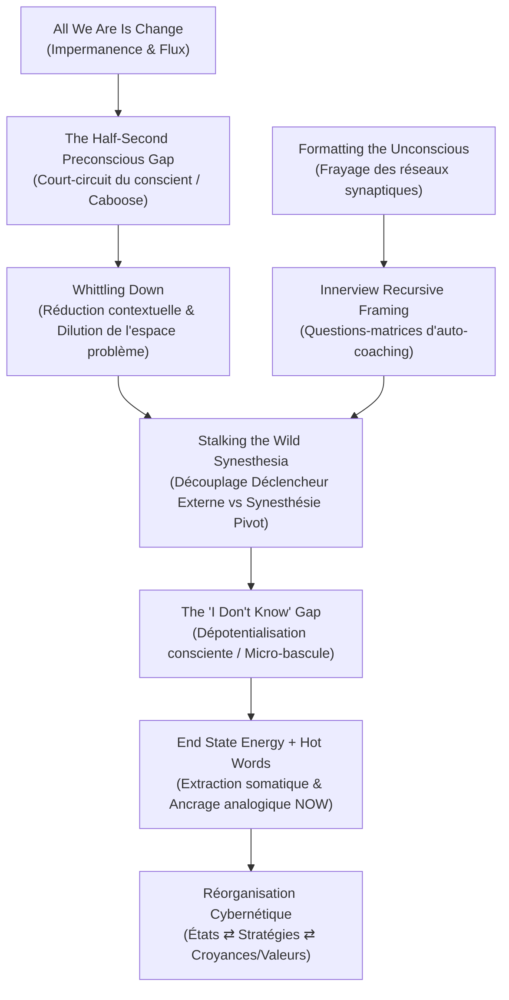

# The Innerview Overview - Transcripts
**Formateur :** John Overdurf | **ID :** `john-overdurf-the-innerview-overview-transcripts` | **Tranches :** 8

Voici la **Synthèse Architecturale** ultra-dense et structurée issue de l'analyse du cours complet *"The Innerview Overview"* de John Overdurf, conçue pour servir de tête de pont conceptuelle et opérationnelle à votre fiche maîtresse.

---

# Synthèse Architecturale du Cours : *The Innerview Overview* (John Overdurf)

---

## 1. Thèse Centrale & Philosophie du Cours

### Vision Spécifique & Posture Opératoire
La posture de John Overdurf dans *The Innerview Overview* prend le contre-pied direct de la PNL classique et du coaching orienté solution traditionnel :

1. **Le refus du syndrome du wagon de queue (*The Caboose Syndrome*) :**  
   Les approches standards tentent d'analyser le problème, de fixer des objectifs conscients ou de négocier avec la rationalité du client. Or, les neurosciences (Libet, décalage préconscient de 500 ms) démontrent que tout symptôme, blocage ou réaction affective est déjà **physiologiquement encodé et exécuté avant que la conscience éveillée n'en ait le moindre soupçon**. Négocier avec le conscient revient à vouloir piloter une locomotive depuis le wagon de queue. L'intervention d'Overdurf dialogue exclusivement avec la dynamique sous-corticale et préconsciente.
2. **L'impermanence ontologique active (*"All We Are Is Change"*) :**  
   Un « problème » n'est pas une entité statique qu'il faudrait « réparer » ou « détruire ». C'est une **re-création rigide et continue** de coordonnées perceptuelles (Temps, Espace, Matière, Énergie / TSME). Le système nerveux étant en flux biochimique et synaptique permanent, la stabilité du symptôme demande un effort neurologique colossal. Le rôle du praticien n'est donc pas de fabriquer laborieusement du changement par une technique lourde, mais de déstabiliser la boucle de ré-instanciation, de capter (*catch it*) la moindre micro-variation d'état qui émerge naturellement, et de l'ancrer.
3. **Le démantèlement du piège des objectifs (*Beyond Goals & The Creator Paradox*) :**  
   Les objectifs conscients sont souvent des pansements de l'ego (*« Je serai heureux quand j'aurai X »*). Ce faisant, le sujet crée un cadre imaginaire qui l'asservit : il est le créateur du bateau, mais s'enferme dans la bouteille en s'interdisant de ressentir l'état ressource dans l'instant présent. Overdurf inverse le vecteur : on extrait immédiatement l'énergie de l'état final (*End State Energy*), dissolvant la charge écrasante de la nominalisation.

### Fil Rouge Méthodologique
Le fil rouge unificateur repose sur la **boucle cybernétique récursive entre États et Stratégies** :
$$\text{Déclencheur externe brut} \longrightarrow \text{Projection contextuelle} \longrightarrow \text{Synesthésie pivot } (V_e / A_d \to K^-) \longrightarrow \text{Justification a posteriori (Mind Read)}$$

Au lieu d'attaquer les valeurs ou croyances de front (ce qui active les défenses du conscient), le praticien :
- Réduit le problème massif à une réponse spécifique dans un contexte précis (*Whittling Down*).
- Traque la milliseconde de dépotentialisation consciente (le bug temporel du *"I don't know"*).
- Isole la synesthésie centrale avant l'apparition du bavardage interne.
- Injecte l'énergie de l'état final (*NOW*) au point de bascule exact via un marquage analogique naturel (*Hot Words*).

---

## 2. Carte des Concepts & Leviers Émergents

| Concept / Levier Émergent | Rôle & Fonction dans l'Écosystème Overdurf |
|---|---|
| **Half-Second Preconscious Gap** | Axiome neuroscientifique : le système nerveux tranche 500 ms avant la conscience. Interdit le débat d'idées ou la rationalisation ; impose de travailler sur les réponses physiologiques automatiques. |
| **All We Are Is Change** | Postulat ontologique : la rigidité psychologique est une illusion coûteuse. Le praticien s'appuie sur l'instabilité naturelle du système pour guider les micro-glissements d'états. |
| **Creator Paradox & Ship in a Bottle** | Métaphore opérationnelle : si le client a généré le cadre de son angoisse, il possède la puissance de le dissoudre. Le praticien refuse d'entrer dans les règles arbitraires du cadre du client. |
| **Set Negation & Asymétrie Logique** | Principe ensembliste : ce qu'est le problème est minuscule par rapport à l'univers de ce qu'il n'est pas. Réduire le problème à un contexte restreint élargit mathématiquement l'espace de ressources (*Non-Problème*). |
| **Formatting the Unconscious** | Pré-cadrage architectural (métaphore du marquage au sol d'un parking) : préparer les autoroutes attentionnelles et synaptiques du sujet avant de manipuler le contenu émotionnel. |
| **End State Energy** | Carburant d'intervention : éliciter la sensation kinesthésique et identitaire pure de la résolution (« qui serais-tu si c'était déjà là ? ») sans s'embarrasser du plan d'action conscient. |
| **Hot Words & Analog Marking** | Leviers d'ancrage naturaliste : réutiliser les termes sur-polarisés du client avec sa propre prosodie/gestuelle pour approfondir la transe et marquer les polarités inconscientes. |
| **Whittling Down** | Dé-nominalisation chirurgicale : fragmenter un problème existentiel global ("je stresse tout le temps") en une séquence microscopique contextuelle ("à quelle seconde précise démarre la tension ?"). |
| **Stalking the Wild Synesthesia** | Traque du point de rupture : distinguer le déclencheur contextuel initial (souvent neutre, ex. une horloge) de la synesthésie centrale projective ($V^e/V^i \to K^-$) où le cerveau s'effondre. |
| **Recursive Mind Read & Feed-Forward** | Détection du piège analytique : le dialogue interne ou l'interprétation d'autrui n'est qu'une rationalisation *post-hoc* d'un choc synesthésique brut. On court-circuite l'explication pour traiter la synesthésie source. |
| **The "I Don't Know" Gap** | Marqueur somato-linguistique : l'hésitation ou le bug verbal signale que l'esprit conscient décroche et que l'algorithme inconscient est à nu, prêt pour la ré-empreinte. |
| **Le marqueur temporel « NOW »** | Connecteur kinesthésique direct : inséré au moment précis d'une question, il force le système nerveux à trier sur la micro-sensation présente plutôt que sur la mémoire du problème. |

---

## 3. Tableau Récapitulatif des Techniques & Démonstrations

| Technique / Exercice | Objectif Opératoire | Déclencheur / Indication | Séquence Résumée |
|---|---|---|---|
| **Cadre Récursif d'Ouverture (*Innerview Framing*)** | Court-circuiter le bavardage d'opinion, pré-activer les réseaux synaptiques et conditionner une métacognition d'auto-résolution. | Début de séance (nouveau client ou suivi régulier) dès les premières minutes. | 1. Annoncer la structure (5 min d'échange libre puis passage au cadrage rituel). 2. Poser la question-matrice invariante sur l'état désiré. 3. Répéter récursivement le format à chaque session pour installer le pattern d'auto-coaching inconscient. |
| **Élicitation par Revivification Sensorielle** | Convertir l'exploration de l'état présent en une induction hypnotique sans transe formelle artificielle. | Dès que le client intellectualise, théorise ou raconte son problème sous forme abstraite. | 1. Exiger les paramètres sensoriels précis ($V-A-K-O-G$, espace, distance, luminosité). 2. Guider l'association en direct dans la scène source. 3. Calibrer la bascule physiologique (respiration, tonus musculaire, regard) attestant de l'accès à la mémoire sous-corticale. |
| **Whittling Down (Réduction Contextuelle)** | Écraser l'espace neurologique du problème et faire émerger un espace colossal de ressources (*Non-Problème*). | Face à une nominalisation massive et envahissante (*« Je suis dépressif »*, *« J'échoue toujours »*). | 1. Isoler le contexte précis où l'état survient (heure, lieu, interlocuteur). 2. Extraire les paramètres temporels d'activation. 3. Valider que dans 95 % du reste de la vie, la nominalisation est inactive, libérant l'accès aux états ressources. |
| **Traque de la Synesthésie Pivot (*Stalking the Wild Synesthesia*)** | Dissocier le déclencheur externe anodin de la projection interne critique pour cibler l'intervention là où la charge se verrouille. | Anxiété d'anticipation, phobie, trac ou procrastination avec emballement mental. | 1. Repérer le premier déclencheur externe ($V^e$ / environnement). 2. Suivre la chaîne de pensée jusqu'à la scène projetée. 3. Isoler le couplage exact ($V^i \to K^-$ ou $A_d \to K^-$) précédant toute justification intellectuelle. |
| **Extraction & Injection de l'Énergie Finale (*End State Energy & NOW Injection*)** | Effondrer le conflit de parties et désamorcer le conditionnement ego-dépendant de l'objectif. | Fixation rigide sur un résultat extérieur (*« Je dois absolument atteindre X pour être serein »*). | 1. Court-circuiter le « comment faire » cognitif. 2. Poser : *« Comment serais-tu en tant qu'être si c'était déjà résolu ? »*. 3. Amplifier la réponse somatique et l'ancrer avec le marqueur *NOW* et les *Hot Words* du client au point de bascule synesthésique. |
| **Capture du Bug Temporel (*"I Don't Know" Trapdoor*)** | Dépotentialiser le conscient au moment précis du saut qualitatif vers le changement. | Le client marque une pause, soupire ou verbalise spontanément *« Je ne sais pas »*. | 1. Cesser toute question de contenu. 2. Marquer analogiquement l'arrêt. 3. Utiliser le silence ou un feed-forward hypnotique pour laisser le système inconscient réorganiser la réponse motrice/affective. |

---

## Extractions Détaillées par Tranche (Opératoire & Verbatim)

## --- Tranche 1 / 8 ---

Voici l'extraction et la modélisation intégrale de la substance opératoire de cette première tranche.

---

### 1. Mécanismes & Principes Actifs

#### Le décalage neuroscientifique du demi-seconde (*The Half-Second Preconscious Gap*)
- **Principe actif :** L'activité neurologique inconsciente précède la conscience éveillée d'environ 500 millisecondes (découvertes de Libet et des neurosciences modernes). Toute problématique de coaching (procrastination, anxiété de performance, perte de motivation, conflits de priorités) s'exécute automatiquement et somatiquement avant même que le client n'ait accès à une pensée consciente.
- **Conséquence opératoire :** Questionner, analyser ou fixer des tâches au niveau conscient revient à tenter de piloter un train depuis le wagon de queue (*the caboose*). L'intervention doit court-circuiter le mental analytique pour interagir conversationnellement avec la dynamique préconsciente.
- **Tags libres :** `#half_second_gap` `#inconscient_preconscient` `#caboose_syndrome` `#reponse_automatique`

#### L'ontologie du changement perpétuel (*All We Are Is Change*)
- **Principe actif :** Le sentiment de fixité ou de « blocage » est une illusion cognitive. Au niveau physique et subatomique, la matière se renouvelle en continu (99,999 % des particules composant l'organisme sont renouvelées en un an). L'état naturel du système nerveux est l'instabilité dynamique et le flux d'états.
- **Conséquence opératoire :** Le praticien n'a pas à « créer » le changement à force d'efforts techniques. Le système change déjà spontanément à chaque seconde. Le travail consiste uniquement à créer un contexte relationnel fluide, à observer les micro-dérives d'états chez le sujet, et à capturer le changement pertinent dès qu'il apparaît.
- **Tags libres :** `#all_we_are_is_change` `#flux_subatomique` `#dissolution_du_blocage` `#capture_detat`

#### Les objectifs comme pansements conscients à des dilemmes inconscients (*Goals as Conscious Band-Aids*)
- **Principe actif :** Les objectifs conscients sont presque systématiquement pilotés par l'ego (*ego-driven*). Ils incarnent la structure linguistique conditionnelle : *« Je serai [État désiré] quand [X événement/résultat extérieur] arrivera »*. L'objectif projette l'attention hors du moment présent, créant un sentiment d'impuissance et de perte de contrôle dès que l'environnement résiste.
- **Conséquence opératoire :** Derrière tout objectif se cache un **état interne ressource** (paix, curiosité, partage, joie) que le sujet s'interdit de ressentir tant que la condition extérieure n'est pas remplie. En accédant d'abord à cet état ressource *maintenant*, le problème initial perd sa charge d'écrasement (*from a big thing to a small thing*) et la cognition génère spontanément des solutions pragmatiques.
- **Tags libres :** `#beyond_goals` `#ego_driven_goals` `#piege_conditionnel` `#point_de_levier`

#### Cybernétique non-hiérarchique : États, Stratégies, Valeurs et Croyances
- **Principe actif :** Contrairement aux modèles hiérarchiques rigides de la PNL classique (ex. Niveaux Logiques de Dilts), les relations entre comportements, états, stratégies, croyances et valeurs sont **cybernétiques et circulaires**.
  - Si l'on fait émerger les valeurs d'une personne dans un état négatif puis dans un état ressource, on obtient deux hiérarchies totalement différentes : la valeur est dépendante de l'état contextuel actif.
  - La porte d'entrée la plus puissante en coaching conversationnel est le couple **Stratégies ⇄ États**, car modifier la microstructure séquentielle (stratégie) ou l'état interne réorganise instantanément les croyances et les critères de valeur sans confrontation frontale.
- **Tags libres :** `#boucle_cybernetique` `#etat_comme_contexte_des_valeurs` `#strategie_vers_etat` `#levier_minimal`

#### La boucle musicale hypnotique (*The Coaching Loop & Nested Fragmentations*)
- **Principe actif :** L'usage de phrases hypnotiques fragmentées et réarrangées de manière semi-aléatoire sur un rythme continu sature la mémoire de travail et épuise le processeur syntaxique de l'hémisphère gauche. En privant le cerveau de la complétion logique immédiate des phrases, l'esprit conscient lâche prise, laissant place à une réceptivité involontaire et à une transe de traitement interne.
- **Tags libres :** `#coaching_loop` `#saturation_syntaxique` `#fragmentation_linguistique` `#transe_involontaire`

#### Le pont temporel du « NOW » (*The "Now" Linguistic Reset*)
- **Principe actif :** Le mot « Maintenant » (*Now*) ramène brutalement l'attention au centre somatosensoriel présent, coupant l'accès aux représentations mnésiques du problème. Utilisé juste après une perturbation ou une induction conversationnelle, il ancre l'état de présence et dissout l'attachement aux boucles cognitives antérieures.
- **Tags libres :** `#now_reset` `#centrage_temporel` `#rupture_mnesique` `#ancrage_de_presence`

---

### 2. Protocoles, Techniques & Démonstrations (Étape par Étape)

#### Protocole : La Transposition au-delà des Objectifs (*Beyond Goals State Elicitation*)

* **Intention / Indication :** Quand un client arrive avec un objectif tendu, de l'anxiété de performance, ou un sentiment de perte de contrôle face à des circonstances extérieures ingérables (ex: dirigeant qui s'acharne à vouloir tout contrôler).
* **Mise en place & Pré-framing :** Ne pas débattre sur la faisabilité technique de l'objectif. Accepter l'objectif comme le révélateur d'un état sous-jacent manquant.
* **Séquence d'actions pas à pas :**
  1. **Identifier l'équation conditionnelle de l'ego :** Repérer la structure implicite *« Je dois obtenir X pour me sentir Y »*.
  2. **Question d'évocation de l'état d'aboutissement :** Poser la question de bascule :
     * *« Si tout cela était déjà réglé et en train de se produire, comment serais-tu ? »* (*How would you be if all of these things were happening?*).
  3. **Calibration et extraction des états primaires :** Laisser le sujet nommer les états d'être (ex: curiosité, apprentissage, partage, sérénité, plaisir).
  4. **Association somatique complète :** Guider le sujet pour qu'il s'associe kinesthésiquement et physiologiquement dans cet état d'être *ici et maintenant* (changement respiratoire, détente du tonus musculaire).
  5. **Vérification de l'état présent :** Valider par la question d'ancrage : *« Comment te sens-tu maintenant ? »* (*How are you feeling now?*).
  6. **Re-test / Application au stimulus problème :** Dès que l'état ressource est saturé, réintroduire le déclencheur problématique initial :
     * *« En ressentant cela maintenant, pense au problème X (ex: le recrutement bloqué)... »*
  7. **Génération spontanée de solutions :** Observer le changement de perspective (le problème devient « petit »). Le client propose lui-même des solutions fonctionnelles et pragmatiques sans intervention analytique du coach.
* **Signes de calibration :**
  - Chute de la tension faciale et ralentissement du débit vocal.
  - Déflation de la taille et de la charge émotionnelle perçue du problème (« ce n'est plus un gros problème, c'est devenu une petite chose »).
  - Émergence spontanée de stratégies alternatives sans forçage mental.

---

### 3. Heuristiques, Subtilités & "Sagesse du Praticien"

#### Règles conditionnelles du Praticien
- **Règle du non-arrêt sur l'erreur :** Si tu dis quelque chose d'incongru ou de provocateur qui « ne passe pas » chez le client -> **ne t'arrête pas, ne t'excuse pas et n'insiste pas**. Enchaîne avec fluidité sur la phrase suivante. Si tu n'y accordes aucune attention consciente, le client ne l'ancre pas et fournit la réponse utile la minute suivante.
- **Règle de l'association contextuelle pour les valeurs :** Si tu veux faire émerger les vraies valeurs agissantes d'un sujet -> **associe-le d'abord somatiquement à l'état spécifique du contexte concerné**. Extraire des valeurs « à froid » sur une table de travail ne produit que des constructions intellectuelles déconnectées du comportement réel.
- **Règle de calibration auditive :** Si en coaching téléphonique tu entends un changement d'intonation, une pause respiratoire inhabituelle ou un soupir -> **considère qu'un basculement de traitement inconscient vient de se produire**. Pose immédiatement une ancre verbale de présence (*« How are you feeling now? »*).

#### Pièges classiques et erreurs de débutant
- **Le piège de la posture d'intervention solennelle :** Le praticien débutant plaisante de manière détendue (le client est dans un état fluide et réceptif), puis déclare soudainement : *« Bon, maintenant nous allons faire la technique X »* en prenant un air grave. Cela contracte instantanément le système nerveux du client, fige la fluidité des états et rend le changement laborieux.
- **Le piège du fétichisme technique :** Penser que c'est la technique formelle de PNL qui guérit. La technique n'est qu'un cadre pour occuper le conscient du praticien et du client ; le véritable levier réside dans le contexte relationnel permissif et l'alignement des états.
- **Le piège de l'attente rigide du résultat :** Attendre un résultat préconçu bloque la perception fine. Le praticien expert fonctionne dans la curiosité de *« qu'est-ce qui arrive ? »* plutôt que dans l'attente directive de *« qu'est-ce qui doit arriver ? »*.

#### Postulats de John Overdurf
- *« All we really are is change »* : Le changement n'est pas un événement à provoquer, c'est la nature constitutive de l'être humain.
- *« Unconscious processing precedes conscious awareness by half a second »* : Tout changement durable doit négocier avec ce qui se joue dans cette fraction de seconde préconsciente.
- L'inconscient du client apprend par modélisation implicite (transfert et contre-transfert) : la manière dont le coach habite son propre corps, gère ses imprévus et reste fluide enseigne plus au système nerveux du client que le contenu verbal des séances.

---

### 4. Pépites Verbatim & Patterns Linguistiques (MOT À MOT EN V.O.)

#### Le dilemme du wagon de queue (Métaphore d'influence)
> « As you know, neuroscience has long known that our unconscious functioning precedes our conscious awareness by a half a second. This means that most if not all coaching issues like motivation, procrastination, indecision, conflicting priorities, burnout, overwhelm, performance issues, performance anxiety are all a result of automatic unconscious reactions and patterns which occur before conscious awareness. Consider that. Unconsciously. Amazingly, most coaching models rely heavily on conscious processing through questioning, analysis, and tasking. It's a lot like trying to steer a train by asking someone in the caboose to change the direction of the entire train. »
- **[Analyse du Pattern] :**
  - **Trébuchet de truismes & Présupposition :** *« As you know... »* valide immédiatement le postulat d'autorité sans contestation possible.
  - **Empilement de nominalisations :** Liste exhaustive des motifs de consultation (*motivation, procrastination, indecision, burnout...*) regroupés sous une cause unique préconsciente.
  - **Commande cachée / Clivage :** L'enchaînement syntaxique interrompu par *« Consider that. Unconsciously. »* fonctionne comme une suggestion directe à l'inconscient de traiter l'information en arrière-plan.
  - **Métaphore isomorphique :** La comparaison du « wagon de queue » (*caboose*) crée une rupture de logique qui disqualifie instantanément les approches purement cognitives et analytiques.

---

#### La boucle hypnotique de fragmentation (The Coaching Loop)
> « As you're coaching, skills deepen. Supervision expands. Insight to increase. As you're coaching, skills deepen. This supervision expands. Trusting insight to increase confidence inside. Your client's change is occurring. As you're coaching. Skills, deep in this, supervision, expands trusting insight to increase confidence inside is occurring. Azure coaching, skills, deep in this, supervision, trusting insight to increase confidence inside your clients change is occurring. »
- **[Analyse du Pattern] :**
  - **Ambiguïté phonétique & glissement de sens (*Phonetic Ambiguity*) :** Glissement magistral entre *« skills deepen »* (les compétences s'approfondissent), *« deep in this »* (profondément dans ceci), et *« As you're »* devenant *« Azure »* (évocation visuelle et flottement subliminal).
  - **Double liaison et syntaxes enchevêtrées :** Les phrases ne se terminent pas là où la grammaire l'attend. *« Trusting insight to increase confidence inside your client's change is occurring »* lie l'état interne du coach (*trusting, confidence*) à la transformation autonome du client (*change is occurring*).
  - **Saupoudrage kinesthésique interne :** Utilisation répétée du mot *« inside »* qui force le système d'écoute à rediriger la focalisation vers les sensations viscérales et proprioceptives.

---

#### La rupture de boucle par le « NOW »
> « How are you feeling now? So just consider, how are you feeling now? [...] And if you do something in the interim and then you come back and you always anchor things and frame things with the word now, what that does is... it's like, well, I don't even remember what was happening before that because it's just bringing me to now and how I'm feeling now. »
- **[Analyse du Pattern] :**
  - **Question de réinitialisation d'état (*Pattern Interrupt Query*) :** Posée immédiatement à la fin d'une transe ou d'une boucle saturante, la question force le sujet à tester son état somatique actuel sans pouvoir réactiver les états précédents.
  - **Présupposition temporelle :** L'insistance sur *« now »* crée une scission nette entre le passé (le problème, la surcharge) et l'expérience en temps réel (la présence, les ressources disponibles).

## --- Tranche 2 / 8 ---

Voici l’analyse chirurgicale et opératoire de la tranche 2/8 de la transcription de John Overdurf (*The Innerview Overview*).

---

### 1. Mécanismes & Principes Actifs

#### 1. L’Impermanence Ontologique & la Dynamique de Ré-instanciation du Problème
* **Principe actif :** Pour maintenir un problème dans le temps, le système nerveux ne "possède" pas une entité statique : il doit continuellement ré-encoder et ré-instancier l'état interne selon des coordonnées perceptuelles précises (Temps, Espace, Matière, Énergie / *TSME coordinates*). Dès lors que l'on admet que le système biologique est en changement perpétuel (*"All we are is change"*), la persistance du symptôme requiert un effort de recréation rigide. Une simple rupture ou déviation de ces coordonnées suffit à faire basculer le sujet hors de la boîte du problème.
* **Tags émergents :** `#all_we_are_is_change` `#recreating_the_problem` `#tsme_coordinates` `#moment_to_moment_shift` `#fluidity_vs_rigidity`

#### 2. L'Asymétrie Logique de l'Exégèse du Problème (*Presupposition of Existence & Set Negation*)
* **Principe actif :** Tout problème exprimé sous forme d'équivalence complexe identitaire (ex. *"Je suis dépressif"*) présuppose une frontière stricte d'existence. Or, sémantiquement et neurologiquement, ce qu'une chose *est* est infiniment plus petit que la totalité de ce qu'elle *n'est pas*. L'ensemble complémentaire ("Non-Problème") contient mathématiquement et phénoménologiquement un champ infini de ressources, de postures et d'états. Le praticien s'appuie sur cette asymétrie d'échelle pour élargir le cadre perceptif du sujet, rendant l'état problématique négligeable par rapport à l'univers des possibles disponibles.
* **Tags émergents :** `#set_negation` `#problem_vs_not_problem` `#complex_equivalence_collapse` `#asymmetry_of_scale` `#boundary_transgression`

#### 3. L'Isomorphisme de la Création du Cadre (*The Creator Paradox*)
* **Principe actif :** L'illusion pathologique consiste pour le sujet à faire de son symptôme (ou de son objectif) une entité plus vaste que lui-même, oubliant qu'il en est l'auteur cognitif direct. Si un sujet a eu la puissance générative de fabriquer un cadre contraignant (l'équivalent de "l'expérience de pensée du bateau dans la bouteille"), il possède par définition ontologique la puissance de dissoudre ou de changer ce cadre. Le piège réside dans le fait de chercher à manipuler le contenu tout en respectant les contraintes arbitraires du cadre imposé.
* **Tags émergents :** `#creator_paradox` `#frame_generation` `#ship_in_a_bottle` `#cognitive_trap_dissolution` `#meta_creator_stance`

#### 4. Le Formatage de l'Inconscient (*Formatting the Unconscious Mind*)
* **Principe actif :** Pré-activer et structurer l'architecture des réseaux de neurones (lignes blanches et flèches de circulation d'un parking) avant même de manipuler le contenu clinique ou émotionnel. Ce pré-cadrage crée des voies de frayage synaptique (*lighting up the neural networks*), facilitant l'accès fluide aux états de transe, la séparation conscient/inconscient, et la réceptivité sans surcharge cognitive (*chaos prevention*).
* **Tags émergents :** `#formatting_the_unconscious` `#neural_network_priming` `#parking_lot_metaphor` `#pre_framing_channels` `#preconscious_scaffolding`

#### 5. L'Extraction de l'Énergie de l'État Final (*End State Energy Elicitation*)
* **Principe actif :** Au lieu d'enquêter sur le contenu narratif du symptôme ou sur des objectifs instrumentaux ("Je veux gagner X"), le praticien oriente immédiatement le sujet vers la sensation kinesthésique et identitaire pure de la réalisation ("Comment serais-tu en tant que personne si c'était déjà là ?"). Cet état terminal (*End State Energy*) fournit le carburant neuro-physiologique et le levier de réorganisation identitaire maximal dès les premières minutes.
* **Tags émergents :** `#end_state_energy` `#kinetic_state_access` `#leverage_point` `#beyond_goals` `#identity_level_fuel`

#### 6. Rétroaction Analogique des Mots Chauds (*Hot Words as Naturalistic Anchors*)
* **Principe actif :** Les "mots chauds" (*hot words*) sont des marqueurs linguistiques chargés d'activation neuro-émotionnelle chez le client. Utilisés en écho direct avec le même marquage analogique (tonalité, rythme, micro-gestes), ils agissent comme des ancres naturalistes universelles. Ils permettent de moduler la profondeur de transe instantanément, tout en cartographiant en filigrane le conflit de parties sous-jacent (chaque mot hautement polarisé signale l'existence de son pôle refoulé/opposé).
* **Tags émergents :** `#hot_words` `#analog_marking` `#naturalistic_anchoring` `#parts_duality_indicator` `#somatosensory_resonance`

---

### 2. Protocoles, Techniques & Démonstrations (Étape par Étape)

---

#### Protocole 1 : Désamorçage de l'Enfermement du Cadre ("L'Expérience de Pensée du Bateau dans la Bouteille")

* **Intention / Indication :** Quand le client s'enferme dans un double lien ou une impasse logique insoluble ("Je veux changer, mais sans rien bousculer de ce qui me définit", ou quand le problème semble insurmontable par rapport à ses forces).
* **Mise en place & Pré-framing :** Cadrer l'exercice comme une simple expérience de pensée (*thought experiment*), sans enjeu thérapeutique apparent.
* **Séquence d'actions pas à pas :**
  1. **Création de la métaphore de contrainte :** Poser le problème sous forme d'énigme matérielle rigide :  
     *"Imagine that you’ve got one of those bottles, and there’s the ship in the bottle... You can't break the bottle, and you can't break the ship or collapse the ship in any way, and your job is to get the ship out of the bottle. How do you do that?"*
  2. **Laisser le client s'épuiser dans les solutions au premier niveau :** Attendre qu'il propose des tactiques mécaniques (démontage, ficelles, etc.) et invalider systématiquement selon les règles du cadre.
  3. **Révéler la prémisse constitutive :** Rappeler le pré-cadrage exact de la genèse du problème :  
     *"What I said to you was: imagine that there's a ship in a bottle."*
  4. **Exécuter la sortie de cadre :**  
     *"You just imagine that it's out now."*
  5. **Transposition immédiate :** Relier au vécu du client : il a oublié qu'il est le créateur du cadre dans lequel il se sent piégé. En changeant l'attribution de l'autorité générative, le problème perd sa factualité.
* **Signes de calibration :** Regard qui défocalise, silence soudain, micro-rire ou soupir de soulagement traduisant l'effondrement du pattern (*frame collapse*), réorientation de la posture.

---

#### Protocole 2 : Extraction Immédiate de l'État Final (*End State Energy Setup*)

* **Intention / Indication :** À utiliser dès l'ouverture de la toute première séance (5 à 20 premières minutes) avec un nouveau client pour court-circuiter le récit du problème et installer la ressource maîtresse.
* **Mise en place & Pré-framing :** Normalité conversationnelle détendue. Ne pas formaliser de protocole rigide.
* **Séquence d'actions pas à pas :**
  1. **Orientation vers le méta-objectif :** Poser la question sans aborder le problème :  
     *"So here you are. What do you want to get out of this? If you were to think about where you want to be at a certain period of time or what your real purpose is in wanting to have the coaching..."*
  2. **Ascension au niveau de l'Être :** Passer de l'action à l'état identitaire :  
     *"How would you be as a person if you achieved this or if you got this outcome...?"*
  3. **Capture et traçage des Hot Words :** Isoler les termes à forte charge physiologique (changements de respiration, rougissement, dilatation des pupilles, intonation appuyée).
  4. **Ancrage naturaliste et boucle rétroactive :** Répéter les *hot words* en calquant exactement les marqueurs analogiques du sujet pour stabiliser l'accès à l'état.
  5. **Vérification de l'Incongruence :**
     * Si le sujet nomme un objectif mais ne s'allume pas physiologiquement (*not lighting up*) -> Identifier l'incongruence : l'objectif est un "moyen pour" intellectuel (*wrong outcome*) et non l'état terminal désiré.
* **Signes de calibration :** Alignement somatique complet, coloration faciale, déglutition spontanée, changement immédiat de tonus musculaire (*lighting up*).

---

#### Protocole 3 : Pré-formatage Inconscient Multimodal ("The All-Possibilities Frame")

* **Intention / Indication :** En amont d'une première rencontre, lors de l'envoi d'un questionnaire, inventaire de vie ou formulaire préparatoire, afin de créer des rails sans induire de névrose de performance ou d'anxiété du "bien faire".
* **Mise en place & Pré-framing :** Présenter l'outil non pas comme une tâche à évaluer, mais comme un provocateur d'associations et d'émergence de patterns.
* **Séquence d'actions pas à pas :**
  1. **Envoi du support de réflexion** (inventaire, questions orientées vers l'état désiré).
  2. **Verrouillage par couverture intégrale des choix (*Covering all possibilities*) :**
     Formuler explicitement la clause de liberté totale :  
     *"Some people complete the whole thing and send it to me. Some people go over certain sections. Some people just use it to help them focus. Other people use it to develop patterns. Use this as you see fit."*
  3. **Observation diagnostique du comportement du sujet :**
     * S'il panique ou cherche la perfection -> Révélation immédiate du méta-problème de contrôle / validation externe.
     * S'il remplit tout de manière hyper-analytique -> Détection d'un tri par similitude/différence strict.
* **Signes de calibration :** Absence de crispation lors de la prise de contact, clarté des thèmes prioritaires dès l'entrée dans le cabinet ou l'appel.

---

### 3. Heuristiques, Subtilités & "Sagesse du Praticien"

#### Règles Conditionnelles Opératoires
* **Règle de fluidité face à l'erreur :** *Si* tu fais un geste, un mot ou un faux-pas imprévu en séance -> *alors* ne t'arrête jamais pour le surligner ni y accorder d'attention consciente, continue de glisser fluidement -> *parce que* ce n'est pas une faute mais une émergence non planifiée dont l'inconscient du sujet utilisera la suite naturelle pour produire la réponse recherchée.
* **Règle de modélisation par transfert :** *Si* tu accompagnes un client dans la durée -> *alors* sois attentif à ta propre gestion de toi-même (ton état interne, ton calme, ta tolérance à l'ambiguïté) -> *parce que* ce que tu enseignes au niveau inconscient par ton incarnation physique a infiniment plus de poids thérapeutique que tes techniques déclaratives.
* **Règle des 5 premières minutes (Heuristique de Ron Klein) :** *Si* un client entre en séance et commence à interagir -> *alors* observe son fonctionnement structurel et non son histoire -> *parce que* le client va inévitablement mimer, dire ou jouer son problème central au niveau du processus dans les 5 premières minutes, étant neurologiquement incapable de ne pas le faire.
* **Règle de persistance du pattern :** *Si* tu manques l'apparition du pattern dans les 5 premières minutes -> *alors* reste détendu et attentif -> *parce que* le client est tellement expert dans son problème qu'il le reproduira en boucle sous tes yeux jusqu'à ce que tu le voies.
* **Règle du timing de restitution :** *Si* tu identifies le problème central dès le début via un acte inconscient du sujet -> *alors* interdiction formelle de lui révéler ou de l'analyser avec son esprit conscient à cet instant -> *parce que* c'est beaucoup trop précoce ; cela déclencherait ses résistances conscientes et court-circuiterait l'accès à l'état ressource.
* **Règle du décalage d'échelle (*Scale Shift*) :** *Si* un sujet est sidéré par l'ampleur d'un problème ou d'un objectif -> *alors* demande-toi : "Qu'est-ce qui est le plus grand : le problème, ou tout ce que l'univers est d'autre que ce problème ?" -> *parce que* déplacer le sujet ne serait-ce qu'une seconde dans le "Non-Problème" brise la continuité de l'état hypnotique négatif.
* **Règle du tri de la réaction au pré-cadrage :** *Si* un client exprime une angoisse aiguë à l'idée de remplir un document ou un questionnaire préalable ("J'ai peur de ne pas bien faire") -> *alors* note ce comportement comme étant la reproduction exacte de son méta-problème de vie -> *parce que* l'attitude envers le cadre révèle la structure même de la limitation.

#### Pièges Classiques & Postulats d'Overdurf
* **Le piège de la fixation de l'erreur :** L'erreur de débutant absolue consiste à s'excuser ou marquer une hésitation ("Ah, non, ce n'est pas ce que je voulais dire"). Cela ancre l'accident et force l'esprit critique du sujet à s'y intéresser.
* **Le piège de l'évaluation au premier degré :** Vouloir résoudre le problème dans les termes exacts où le client l'énonce revient à vouloir sortir un navire d'une bouteille en verre sans casser le verre. Il ne faut pas réparer le contenu, il faut dissoudre le cadre.
* **La métaphore de la suggestion à graine tardive (Cas Erickson) :** La confusion maximale préalable à une suggestion ultra-simple et énigmatique (*"Blinding flash of color where you will totally change your life... You're dismissed"*) crée une boucle de recherche inconsciente perpétuelle. L'inconscient du sujet devient actif 24h/24 pour guetter la réalisation de la prédiction, transformant l'environnement entier en opportunité de changement.

---

### 4. Pépites Verbatim & Patterns Linguistiques (MOT À MOT EN V.O.)

#### 1. La Commande Post-Hypnotique à Déclencheur Flou & Sortie Abrupte (Erickson Case Study)
> "Blinding flash of [color] where you will totally change your life. And then just said to both of them, you're dismissed."
* **[Analyse du Pattern]** :  
  * **Présupposition temporelle et inéluctabilité :** L'usage du marqueur d'obligation future (*"where you will totally change your life"*) élimine toute alternative de choix ; le changement n'est pas conditionnel ("si"), il est une certitude temporelle consécutive à l'événement sensoriel.  
  * **Ambigüité sensorielle ouverte (*Unspecified Sensory Predicate*) :** L'expression *"blinding flash"* n'a aucun référent concret dans le monde réel (une lumière ? une idée ? un objet ? une peinture ?). L'inconscient est forcé d'entrer dans une recherche transdérivationnelle permanente pour lui donner sens.  
  * **Rupture de pattern relationnel (*Pattern Interrupt*) :** L'injonction *"you're dismissed"* coupe court à toute rationalisation, laissant la boucle ouverte (*open loop*) active dans le système nerveux sans possibilité de fermeture par le conscient.

---

#### 2. La Désidentification par Négation d'Ensemble
> "So if you have a client come in and the client says, I'm depressed, then we could say the form of that problem is in the form of a complex equivalence, I equal depression. Which means they've actually done a real nice job of self-hypnosis on themselves where that's become their identity... and really, all your job is as a coach is do you think it is possible that even for a second, a minute, or however long it would need to be, what do you think is the likelihood that you could shift that person to what the problem isn't, given the fact what's bigger, what it is, or everything else in the universe that it's not?"
* **[Analyse du Pattern]** :  
  * **Recadrage d'autorité par normalisation hypnotique :** Qualifier la dépression d'"auto-hypnose réussie" redéfinit le symptôme non pas comme une tare neurologique fixe, mais comme une compétence de transe active (déplacement de l'impuissance vers la capacité).  
  * **Fractionnement temporel minimaliste :** L'insertion de *"even for a second, a minute, or however long it would need to be"* réduit le seuil de résistance à zéro. Le client n'a pas à guérir pour toujours ; il a juste à sortir de l'état pendant une micro-seconde.  
  * **Double lien d'évidence mathématique :** La mise en contraste de l'étroitesse du problème face à l'immensité de *"everything else in the universe that it's not"* force l'esprit du praticien (et par contamination, celui du client) à reconnaître l'inévitabilité statistique du basculement hors du symptôme.

---

#### 3. L'Inversion Générative de l'Autorité du Cadre
> "What I said to you was, and if you listen to the recording, you'll know I did say this. I said, here's a little thought experiment for you. I said, imagine that there's a ship in a bottle... You just imagine that it's out now. What happens with most people's problems is that they forget that they created the frame that created the problem. So now they're living inside of it going, how the hell do I get out of this one? Well, they created the frame. They create a different one."
* **[Analyse du Pattern]** :  
  * **Appel au méta-témoin (*Meta-Check*) :** En renvoyant à l'exactitude de ses propos enregistrés (*"if you listen to the recording..."*), Overdurf utilise une commande de réalité objective qui réoriente l'attention sur la structure linguistique et non sur le problème imaginaire.  
  * **Dissolution de l'illusion par commande symétrique directe :** Face à l'injonction initiale *"Imagine that there's a ship in a bottle"*, la seule réponse opérationnelle est l'injonction inverse directe *"You just imagine that it's out now"*. Cela démontre que le blocage n'a jamais été physique mais purement instructionnel.  
  * **Récupération de la souveraineté ontologique :** Présupposition fondamentale que l'expérience douloureuse est une production active (*"they created the frame"*), ce qui implique nécessairement l'équipotence de produire le cadre antagoniste.

---

#### 4. Le Questionnaire à Choix Multiple Couvrant Toutes les Possibilités (*All-Possibilities Frame*)
> "Some people complete the whole thing and send it to me. Some people go over certain sections. Some people just use it to help them focus. Other people use it to develop patterns. Use this as you see fit."
* **[Analyse du Pattern]** :  
  * **Empilement de truismes descriptifs (*Pacing Current Reality*) :** L'énumération de toutes les variantes comportementales possibles (tout remplir, une partie, simple lecture, repérage de motifs) couvre exhaustivement le spectre des actions humaines. Aucune réaction du sujet ne peut sortir de cette prédiction.  
  * **Suppression de la polarité et du jugement :** En validant chaque sous-groupe (*"Some people... Other people..."*), il neutralise la rébellion ou l'anxiété de conformité chez le client.  
  * **Délégation d'autonomie avec commande permissive :** L'injonction finale *"Use this as you see fit"* agit comme un cadre de souveraineté redonnée au client, empêchant l'installation d'une relation de soumission infantile au praticien.

## --- Tranche 3 / 8 ---

Voici l'analyse modélisée de la tranche 3/8 de la transcription « *The Innerview Overview* » de John Overdurf.

---

### 1. Mécanismes & Principes Actifs

#### A. Le Principe de Préséance de l'État Interne sur la Technique
* **Principe actif** : L'efficacité de l'intervention ne repose pas sur l'application mécanique d'un protocole algorithmique, mais sur la qualité de présence, de disponibilité neurologique et d'acuité sensorielle du praticien. Quand le praticien est focalisé sur « quelle technique appliquer » ou « comment faire valider son modèle », il contracte son champ attentionnel, augmente son besoin de contrôle et perd la calibration fine du client. En s'installant dans un état d'ouverture à l'incertitude et à l'ambiguïté, le praticien modélise neuro-physiologiquement la flexibilité qu'il cherche à installer chez le sujet.
* **Tags libres émergents** : `#state_over_technique` `#presence_neurologique` `#tolerance_ambiguite` `#modelisation_implicite`

#### B. La Question Régulatrice de Centrage (« Pour qui fais-tu cela ? »)
* **Principe actif** : Tout acte posé par le praticien (envoyer un questionnaire, expliquer didactiquement un modèle, introduire une ligne du temps, donner un cadre théorique) sert soit à réguler l'anxiété du praticien, soit à servir l'état ressource du client. Expliquer rationnellement une technique à un client anxieux est souvent une manœuvre du praticien pour se sécuriser lui-même dans son rôle d'expert. Prendre conscience de la cible de l'action empêche d'imposer un cadre rigide non écologique au système du client.
* **Tags libres émergents** : `#intention_primaire_qui_sert_on` `#auto_regulation_praticien` `#anti_marteau_de_maslow`

#### C. Réduction Contextuelle et Dilution de l'Espace Problème
* **Principe actif** : Un client arrive avec un « problème massif », indifférencié et globalisant (« je suis anxieux », « je n'y arrive pas »). Le système nerveux ne peut pas trouver de ressource supérieure à une nominalisation perçue comme totale. En forçant la réduction de ce problème à *une réponse précise dans un contexte précis*, l'espace neurologique occupé par le « problème » rétrécit drastiquement. Mathématiquement et phénoménologiquement, l'espace du « non-problème » (le reste de la vie du client où l'état indésirable n'opère pas) devient gigantesque, rendant l'accès aux ressources immédiatement accessible.
* **Tags libres émergents** : `#whittling_down` `#reduction_contextuelle` `#expansion_du_non_probleme` `#dissolution_de_la_nominalisation`

#### D. La Dérive de Résolution Déductive vs Genèse Inductive des Problèmes
* **Principe actif** : Les limitations psychologiques et somatiques ne s'installent pas par déduction logique abstraite, mais par généralisation inductive (ancrages kinesthésiques, chocs, corrélations implicites, répétition sensorielle inconsciente). Appliquer une explication didactique/déductive (type conseil d'expert ou interprétation analytique) ne modifie pas l'encodage sous-cortical ; cela génère simplement un client capable d'intellectualiser son dysfonctionnement (« maintenant je parle de mes problèmes de façon plus sophistiquée, mais rien n'a changé »). L'intervention doit modifier l'état et l'expérience inductive avant toute conceptualisation.
* **Tags libres émergents** : `#encodage_inductif_vs_deductif` `#piege_de_l_insight_intellectuel` `#changement_sous_cortical`

#### E. Le Piège de la Bouteille : Acceptation des Présuppositions d'Entrée
* **Principe actif** : Dès les premières secondes, les demandes apparemment logiques du sujet (« Expliquez-moi le fonctionnement pour que je sois rassuré ») constituent l'expression isomorphique exacte de sa structure de problème : une équivalence complexe ou une relation de cause à effet rigide (*« Si je contrôle/comprends cognitivement -> Alors je suis en sécurité »*). Si le praticien rentre dans le contenu et commence à expliquer son protocole, il valide la présupposition pathologique du client et « rampe à l'intérieur de la bouteille avec le bateau ». L'intervention consiste à extraire l'état sous-jacent (le besoin de sécurité) au lieu de nourrir la stratégie d'évitement cognitive.
* **Tags libres émergents** : `#piege_du_bateau_dans_la_bouteille` `#meta_structure_du_probleme` `#refus_du_contenu_de_facade` `#elicitation_de_l_etat_sous_jacent`

#### F. Le Postulat Fondamental : « All We Are Is Change » et le Levier Temporel « NOW »
* **Principe actif** : Le système corps-esprit n'est pas une structure statique mais un flux perpétuel en réorganisation. Le problème n'est qu'une tentative de figer ce flux. L'insertion stratégique du marqueur temporel « *NOW* » (maintenant) immédiatement après une question oriente l'attention vers la micro-variation somatosensorielle qui vient tout juste d'émerger, forçant le système nerveux à constater le décalage entre l'état figé du passé et la réactivité présente.
* **Tags libres émergents** : `#all_we_are_is_change` `#marqueur_temporel_now` `#tri_sur_les_etats`

---

### 2. Protocoles, Techniques & Démonstrations (Étape par Étape)

#### Protocole : Déminage de la Demande Didactique / Contournement de la Façade de Contrôle
* **Intention / Indication** : Le client arrive dès les premières minutes avec une demande d'explication intellectuelle, de contrôle ou d'orientation procédurale (*« Comment ça marche ? Que vais-je devoir faire ? Expliquez-moi votre méthode »*).
* **Mise en place & Pré-framing** : Refuser intérieurement de valider la cause à effet : [Comprendre le modèle = Être en sécurité]. Ne pas débattre, ne pas argumenter, ne pas faire de cours magistral.
* **Séquence d'actions pas à pas** :
  1. *Écoute méta-structurelle* : Identifier l'état inconscient recherché derrière la demande rationnelle (ex: le besoin de sécurité, de certitude ou de confort).
  2. *Reflet & Validation de l'intention inconsciente* : Renvoyer au client la légitimité absolue de cet état intérieur plutôt que de répondre à l'objet mental formulé.
     * Formule : *« Il est important pour vous de vous sentir en sécurité et à l'aise, n'est-ce pas ? »*
  3. *Alignement d'intention* : Poser la complicité thérapeutique sur l'état désiré.
     * Formule : *« Et je veux vraiment que vous ressentiez cela aussi, parce que cela fait partie intégrante de votre réussite dans ce processus. »*
  4. *Bascule d'élicitation kinesthésique directe* : Interroger l'expérience phénoménologique de cet état ressource afin de court-circuiter le mental analytique.
     * Formule : *« Qu'est-ce que cela fait pour vous, lorsque vous vous sentez pleinement en sécurité et à l'aise ? »*
  5. *Suivi de l'état* : Laisser le sujet descendre dans la physiologie du confort/sécurité avant toute considération technique ou contextuelle.
* **Signes de calibration** :
  * Relâchement musculaire (épaules qui descendent, déglutition, expiration profonde).
  * Ralentissement du débit verbal et pause réflexive (accès transique léger).
  * Abandon spontané des questions procédurales ou théoriques.

---

#### Protocole : Timing d'Introduction Didactique / Consultant
* **Intention / Indication** : Utilisation d'un cadre conceptuel, d'un modèle stratégique, commercial ou théorique auprès d'un client.
* **Mise en place & Pré-framing** : Proscrire tout apport magistral ou éducatif en début de séance tant que le sujet se trouve dans un état de détresse, de stress ou de contraction identitaire.
* **Séquence d'actions pas à pas** :
  1. *Élicitation de l'énergie de l'état final désiré* (End State Energy).
  2. *Réduction contextuelle du problème* (Whittling down) : réduire la nominalisation générale à un seul déclencheur dans un contexte délimité.
  3. *Intervention transformationnelle inconsciente / somatique* : exécution de la bascule d'état (changement d'état significatif).
  4. *Test & Généralisation*.
  5. *Phase Didactique Optionnelle* :
     * *Option A* : Vérifier si l'explication théorique est devenue obsolète (souvent, le client ayant changé, il génère ses propres solutions sans avoir besoin du modèle du praticien).
     * *Option B* : Si l'apport d'un modèle reste pertinent, le délivrer uniquement maintenant, car la plasticité neuronale et la réceptivité du sujet sont optimales (évitant ainsi d'ancrer un état ressource manquant sur le modèle d'apprentissage).
* **Signes de calibration** :
  * Présence d'un état ressource stable chez le client avant la transmission intellectuelle.
  * Capacité du client à faire des associations d'idées neuves et créatives.

---

### 3. Heuristiques, Subtilités & "Sagesse du Praticien"

* **La Règle des Premières Minutes** :
  * *Si* le client exprime dès l'entame une exigence, une hésitation ou une peur (ex: peur de ne pas bien faire, besoin de comprendre le déroulement),
  * *Alors* traite cela immédiatement comme le problème méta sous-jacent qui l'amène en séance, et non comme une simple question logistique.
  * *Parce que* la façon dont le client structure son rapport au praticien dans un contexte nouveau est l'isomorphisme exact de la manière dont il structure son impasse dans sa vie quotidienne.

* **Heuristique de l'Information Préalable (Dossiers et Formulaires)** :
  * Ne lis pas les diagnostics, rapports de confrères ou inventaires détaillés avant d'avoir parlé directement au client.
  * *Pourquoi ?* Être saturé d'informations préconçues détruit tes choix d'intervention, t'enferme dans le modèle du monde d'un tiers et altère ton acuité sensorielle en temps réel.

* **Règle de l'Outil Unique (Le Marteau de Maslow)** :
  * *Si* tu te surprends à passer 20 minutes à justifier et expliquer théoriquement ton outil (ex: ligne du temps) à un client pour qu'il « rentre » dedans,
  * *Alors* arrête immédiatement. Tu es en train de forcer la réalité du client dans tes propres limitations techniques. Adapte ton approche au terrain du sujet, jamais l'inverse.

* **Heuristique d'Élicitation vs Présentation** :
  * Ne fonctionne jamais sur un mode « présentatif » (exposer d'abord comment le monde fonctionne, puis questionner).
  * Adopte une posture 100% « élicitative » : avance pas à pas, observe ce qui émerge somatiquement et linguistiquement, et fais émerger les états ressources directement à travers l'interaction.

* **La Règle du Bateau dans la Bouteille** :
  * Ne cherche jamais à résoudre le problème à l'intérieur du cadre logique imposé par le client.
  * *Si* tu acceptes la cause à effet posée par le client (*« Pour faire X, j'ai absolument besoin de savoir Y »*), tu rentres dans la bouteille avec lui et tu deviens incapable de l'en sortir.

* **Le Postulat Antidogmatique d'Overdurf** :
  * Rejeter toute église méthodologique (« Ceci n'est pas l'église de Coaching Beyond Goals »). Si une théorie fige la dynamique sous prétexte d'être un modèle parfait, elle fait perdre de vue l'humain. Tout ce que nous sommes est changement ; les modèles d'aujourd'hui doivent pouvoir être abandonnés demain si l'observation l'exige.

---

### 4. Pépites Verbatim & Patterns Linguistiques (MOT À MOT EN V.O.)

#### A. Le Recadrage Conversationnel du Besoin de Contrôle vers l'Accès à la Ressource
> **« So it's important for you to feel safe and comfortable, isn't it? Yeah. And I really want you to feel that way, too, because that's really, really a part of, you know, you're getting what you want in this process, and that's feeling safe and comfortable. What's it like for you when you are feeling safe and comfortable? »**

* **[Analyse du Pattern]** :
  * *Tag question d'accordage* : « *isn't it?* » force un premier « Oui » somatique et mental, créant un micro-yes-set.
  * *Pacing & Leading d'intention* : Valide immédiatement le besoin (« *I really want you to feel that way, too* ») sans valider le contenu intellectuel (le besoin d'explication du protocole).
  * *Liaison de causalité implicite* : Établit que ressentir la sécurité est la composante obligatoire pour obtenir le résultat désiré (« *that's really, really a part of... you're getting what you want* »).
  * *Bascule d'élicitation directe au présent continu* : « *What's it like for you when you are feeling safe and comfortable?* ». Emploi de la forme progressive (*feeling*) qui amorce un accès kinesthésique interne et transporte le client de la modalité cognitive/analytique vers une transe somatique orientée ressource.

---

#### B. La Dissolution de la Macro-Généralisation du Problème
> **« Look, this person's come in with, if it's an issue-oriented, they're coming in with something that's big. And the reason probably why they haven't made the change is they're trying to take care of that thing, that big thing in one fell swoop, and the likelihood of them finding a resource state that's bigger than that is probably not super high. That's why we want to take it down to a specific context, because if we take it down to a specific context, if we go back to that idea of what the problem is, we've now whittled the problem down to one particular response in one particular context. So then how much bigger is the not problem if we whittle it down to one particular response in one particular context? »**

* **[Analyse du Pattern]** :
  * *Raisonnement analogique spatial* : Oppose la taille perceptive perçue du problème (« *that big thing* ») aux capacités du système nerveux.
  * *Recadrage de décontextualisation* : Utilise le verbe d'action physique « *whittled down* » (tailler en copeaux / raboter) pour modifier la représentation spatiale du problème : d'un bloc monolithique insurmontable, il devient « une réponse singulière dans un contexte isolé ».
  * *Question rhétorique d'inversion d'arrière-plan (Figure-Ground Reversal)* : « *How much bigger is the not problem... ?* ». En focalisant la conscience sur le « non-problème », le problème devient une anomalie minuscule dans un océan de fonctionnement normal, ce qui rend la recherche d'une ressource disproportionnellement facile.

---

#### C. L'Induction Conversationnelle de la Présomption de Changement par le Marqueur « NOW »
> **« All we are is change. So again, all that we're really doing is creating a context where some sort of dynamic change can happen. We can catch it. And one of the easiest ways to catch it is asking a question and then putting the simple word NOW now after that because it implies that something has shifted. If you've got them there, then you take them back to the trigger. »**

* **[Analyse du Pattern]** :
  * *Présupposition ontologique* : « *All we are is change* » prive le problème de sa stabilité structurelle. L'immobilité psychologique n'existe pas.
  * *Double répétition et commande temporelle enchâssée* : « *putting the simple word NOW now after that* ». John Overdurf prononce le mot *now* deux fois de suite : une fois pour le désigner linguistiquement en tant qu'étiquette, et la seconde fois en shift de tonalité descendante (analogue marker) qui opère comme une commande hypnotique d'actualisation immédiate au présent.
  * *Rupture de boucle récursive* : L'adjonction de « *now* » en fin de question brise la rumination du passé et contraint l'inconscient à calibrer l'état neuro-végétatif de l'instant présent, où la modification est déjà amorcée. Une fois le shift ancré, le réancrage sur le déclencheur (« *take them back to the trigger* ») permet de valider le collapse d'ancre ou la généralisation du nouveau comportement.

## --- Tranche 4 / 8 ---

Voici l'extraction exhaustive, structurée et opératoire de la tranche 4/8 du cours *The Innerview Overview - Transcripts* de John Overdurf.

---

### 1. Mécanismes & Principes Actifs

#### A. Le Postulat Fondamental : "All We Are Is Change"
- **Principe actif** : L'état d'un individu n'est jamais figé, statique ou permanent ; le système nerveux est en flux perpétuel. Le rôle du praticien n'est pas de « fabriquer » du changement ex nihilo, mais de créer un cadre interactionnel où une variation dynamique se produit spontanément, de la repérer (*catch it*), de la stabiliser linguistiquement et de la réassocier au déclencheur du problème.
- **Leviers & Tags** : #ontologie_dynamique #flux_perpetuel #all_we_are_is_change #state_sorting

#### B. L'Enchâssement Récursif du Modèle Thérapeutique
- **Principe actif** : En posant de manière invariante les mêmes questions de cadrage à chaque séance, le praticien n'obtient pas seulement des réponses : il conditionne la métacognition du sujet. La répétition crée une boucle récursive qui automatise au niveau inconscient une nouvelle stratégie de résolution de problème, jusqu'à ce que les difficultés se résolvent avant même d'atteindre le seuil de conscience.
- **Leviers & Tags** : #recursion_cognitive #apprentissage_inconscient #meta_programmation #question_is_the_training

#### C. L'Élicitation comme Induction par Revivification
- **Principe actif** : L'exploration précise de l'état présent (demander le lieu, la disposition spatiale, les détails perceptifs via le méta-modèle) n'est pas une simple collecte d'informations cognitives. C'est une induction hypnotique directe par réassociation sensorielle (*revivification*). Le sujet est contraint de revivre l'expérience pour pouvoir la décrire, ce qui donne accès à ce qu'il fait réellement de manière automatique (*inconsciente*), plutôt qu'à ce qu'il intellectualise ou croit faire.
- **Leviers & Tags** : #induction_par_revivification #modelisation_etat_present #competence_inconsciente #specifique_vs_intellectuel

#### D. La Décomposition Stratégique : Déclencheur Externe vs Synesthésie Centrale
- **Principe actif** : Dans les problématiques généralisées ("je stresse tout le temps"), le déclencheur (*trigger*) externe n'est souvent pas la synesthésie elle-même, mais la première phase de test (TOTE) qui initialise une chaîne associative. Quel que soit le point de départ extérieur (l'heure sur une horloge, une sortie d'autoroute, un document sur un bureau), le train de pensée finit toujours par s'écraser sur une unique représentation interne associée : la synesthésie pivot (ex. voir le public dans la salle de réunion -> kinesthésie d'anxiété).
- **Leviers & Tags** : #stalking_the_wild_synesthesia #decouplage_trigger_synesthesie #train_de_pensee #point_de_bascule_inconscient

---

### 2. Protocoles, Techniques & Démonstrations (Étape par Étape)

#### Protocole 1 : Le Cadre Récursif d'Ouverture de Séance ("Innerview Framing")
* **Intention / Indication** : À utiliser dès le premier rendez-vous avec un nouveau client pour court-circuiter le bavardage narratif et installer une boucle d'auto-coaching inconsciente.
* **Mise en place & Pré-framing** : Annoncer explicitement la structure temporelle : « On discute librement 5 minutes, puis je vous poserai rituellement une ou deux questions spécifiques. »
* **Séquence d'actions pas à pas** :
  1. *Étape 1* : Laisser un sas relationnel conversationnel de 5 minutes.
  2. *Étape 2* : Poser la première question calibrante :  
     *"What do you want to work through?"*  
     *(Présuppose que le problème est un passage à traverser pour en sortir, et non un objet statique sur lequel on s'acharne).*
  3. *Étape 3* : Poser la seconde question d'orientation :  
     *"How do you want to be different?"*  
     *(Oriente directement vers un changement d'état d'être/identité plutôt qu'un objectif intellectuel extérieur).*
  4. *Étape 4 (Variante immédiate / conversationnelle)* : Si le client intellectualise ou projette dans un futur lointain, ramener au présent somatique :  
     *"How do you want to be feeling differently right now?"*
* **Signes de calibration** : À la 3ᵉ ou 4ᵉ séance, le sujet commence la séance sans y être invité en disant spontanément : *"Ce que je veux traverser aujourd'hui, c'est X, et la façon dont je veux être différent, c'est Y."* Preuve de l'intégration inconsciente du pattern.

---

#### Protocole 2 : "Stalking the Wild Synesthesia" (Traquer, Capturer et Rééduquer la Synesthésie Sauvage)
* **Intention / Indication** : Tout problème manifesté par un comportement ou un état indésirable automatique (anxiété, trac, blocage, procrastination).
* **Mise en place & Pré-framing** : Le praticien ne cherche que 4 à 5 pièces d'information essentielles : le Contexte singulier, l'État interne indésirable, le Comportement associé, et la bascule sensorielle exacte.
* **Séquence d'actions pas à pas** :
  1. *Étape 1 : Isoler un Contexte Unique*  
     Demander : *"When does this happen?"*.  
     Si le sujet généralise (*"Ça m'arrive tout le temps"*), recadrer immédiatement : *"Great, let's pick one. It ought to be pretty easy."*
  2. *Étape 2 : Induction de Revivification (Remplir les suppressions)*  
     Questionner les détails spatio-temporels : *"Where are you? Where are the people sitting?"*. Forcer l'association sensorielle à la scène.
  3. *Étape 3 : Ralentir le Processus pour Isoler le Point de Bascule*  
     Faire dérouler le film au ralenti : *"You're there, you're getting ready... and what happens next?"*.
  4. *Étape 4 : Détecter la Synesthésie Pivot*  
     - Identifier la représentation qui précède immédiatement la chute dans la kinesthésie indésirable (ex. $V \to K$ : voir le regard des gens $\to$ anxiété).
     - *Distinction critique* : Si le sujet prétend que l'anxiété commence ailleurs (dans la voiture, au petit déjeuner), remonter le train de pensée pour vérifier si l'image mentale déclenchée n'est pas, là encore, la scène finale de la salle de réunion.
  5. *Étape 5 : Capturer la Moitié Avant (The Front Half)*  
     Formuler précisément le stimulus d'entrée : *"So as you [Stimulus visuel/auditif], you feel [Kinesthésie]?"*.
  6. *Étape 6 : Intervention / Rééducation*  
     Faire entrer le sujet dans la synesthésie centrale (dans le contexte associé), accéder à un état ressource robuste issu d'un autre domaine (ex. sport, golf), amplifier cette kinesthésie et la connecter à la vue de la scène. Répéter plusieurs fois.
  7. *Étape 7 : Test sur les Déclencheurs Périphériques*  
     Ramener le sujet au déclencheur le plus en amont (ex. regarder l'horloge à 10h le matin du petit-déjeuner) et observer sa réaction.
* **Signes de calibration** :
  - À l'étape 1 : Micro-mouvements corporels de malaise, frottements, hésitations posturales (*squirming around*) prouvant que l'amnésie/généralisation protectrice est bloquée.
  - À l'étape 3-4 : Changement de rythme respiratoire, inflexions vocales, accès oculaires fixes marquant l'entrée dans la transe du problème.
  - Au test final : Rupture de pattern spontanée. Le sujet affiche une posture neutre, haussement d'épaules ou confusion légère (*"Yeah, so what?"*).

---

### 3. Heuristiques, Subtilités & "Sagesse du Praticien"

- **Règle du "NOW" d'ancrage dynamique** :  
  *Si* vous posez une question sur le changement ou l'état interne, *alors* placez immédiatement le mot *"now"* (ou répétez *"now... now"*) en fin de phrase, *parce que* cela présuppose au niveau subconscient qu'une bascule d'état vient tout juste de se produire.
- **Règle de l'Économie d'Information (4 à 5 éléments max)** :  
  *Si* le client commence à raconter l'historique de sa vie ou à intellectualiser, *alors* coupez court et isolez uniquement : Contexte, État, Comportement, Déclencheur, Synesthésie, *parce que* toute information supplémentaire ne sert qu'au maintien du problème ou à la réassurance consciente, pas à la mécanique du changement.
- **Règle de l'Extériorité du Déclencheur** :  
  *Si* vous cherchez le point de départ d'une stratégie, *alors* considérez toujours que le déclencheur (*trigger*) initial est externe à l'environnement physique de la personne (une heure sur une pendule, un panneau d'échangeur autoroutier, un objet posé).
- **Règle de la Synesthésie "Mobile" vs Déclencheur Fixe** :  
  *Si* le client affirme avec certitude qu'il peut déclencher son anxiété/blocage n'importe où, *alors* ne tentez pas de neutraliser chaque situation périphérique ; neutralisez l'image/la représentation interne commune vers laquelle chaque déclencheur l'envoie (phase d'opération TOTE).
- **Règle de la Compétence Inconsciente du Problème** :  
  *Principe d'Overdurf* : Un client qui produit un problème n'est pas "déficient" ; il fait preuve d'une **compétence inconsciente absolue**. Il est capable de reproduire de manière prédictible et chirurgicale une réponse neuro-végétative complexe hors de sa propre conscience. Modéliser le problème, c'est modéliser cette virtuosité pour réorienter la machinerie.
- **Règle de la Traçabilité Téléphonique** :  
  En coaching vocal/téléphonique, la calibration visuelle est remplacée par la détection des prédicats linguistiques, l'altération du tempo respiratoire et les micro-variations de hauteur/prosodie vocale au moment précis où la synesthésie se verrouille.

---

### 4. Pépites Verbatim & Patterns Linguistiques (MOT À MOT EN V.O.)

#### A. Le Recadrage de Début de Séance (Work Through vs Work On)
> *"What do you want to work through?"*  
> *"How do you want to be different?"*

* **[Analyse du Pattern]** :  
  - *Présupposition spatiale/cinétique* : L'emploi de la particule *"through"* (traverser) présuppose que le problème est un espace temporaire délimité dont on ressort nécessairement de l'autre côté, contrairement au traditionnel *"work on"* qui réifie le problème et invite à une analyse laborieuse sans fin.  
  - *Orientation ontologique* : *"How do you want to be different"* court-circuite la formulation d'un objectif matériel extérieur (*"What do you want"*) pour cibler directement l'état d'être, l'identité et le système de réponse somatique.

---

#### B. La Rupture de Pattern par Confusion Syntaxique & Ambiguïté Temporelle
> *"That's the way you've been. How do you want to be from how you've been now as you're thinking about it?"*

* **[Analyse du Pattern]** :  
  - *Distorsion temporelle & Marquage analogique* : Enchaînement passé/présent (*been* $\to$ *be* $\to$ *been* $\to$ *now*).  
  - *Ambiguïté de ponctuation et phonologique* : La structure étire la syntaxe de sorte que l'esprit conscient qui essaie d'analyser grammaticalement la phrase décroche (surcharge cognitive).  
  - *Commande enchâssée temporelle* : L'insertion de *"now as you're thinking about it"* fusionne l'état désiré avec le moment présent de l'interaction, forçant une réorientation immédiate des accès neuronaux.

---

#### C. Le Verrouillage de la Capture de Synesthésie
> *"Let me see if I have this right: You're there in the boardroom, you're getting ready to start, you look at the audience, and as you see the audience, you feel anxious."*

* **[Analyse du Pattern]** :  
  - *Pseudo-vérification d'équivalence complexe* : Sous couvert de vérifier s'il a bien compris (*"Let me see if I have this right"*), le praticien impose une chaîne de causalité stricte (*"as you see... you feel"*).  
  - *Présent de narration & Revivification* : L'utilisation exclusive du présent d'actualité associe le sujet dans la physiologie du problème pour en vérifier la calibration directe sous les yeux du praticien.

---

#### D. Le Test du Déclencheur Amont Désactivé
> *"Okay, so you're sitting there at breakfast, and you look up at the clock, and it's 10 o'clock... and then your client goes: 'Yeah, so what?'"*

* **[Analyse du Pattern]** :  
  - *Test d'amnésie structurelle / Collapse* : Le praticien réintroduit le stimulus source originel (regarder l'heure du petit déjeuner).  
  - *Calibration de la vacuité* : La réponse attendue n'est pas un enthousiasme forcé, mais une neutralité désarmante (*"Yeah, so what?"*), signe clinique irréfutable que le lien neurologique entre le déclencheur et la synesthésie a été dissous.

## --- Tranche 5 / 8 ---

Voici l'extraction et la modélisation intégrale de la substance opératoire de cette tranche 5/8 du séminaire *The Innerview Overview* de John Overdurf.

---

### 1. Mécanismes & Principes Actifs

#### A. La dissociation topologique : Déclencheur Externe vs Synesthésie Cible
- **Principe actif :** Dans toute stratégie limitante, il existe une confusion fréquente entre ce qui *démarre* le train de pensée (le déclencheur/trigger) et ce qui *scelle* l'état problème (la synesthésie). Overdurf pose comme axiome que le **déclencheur est toujours externe à l'environnement présent** (l'heure sur une horloge, une case vide dans un agenda, un visage qui se détourne). Cependant, ce déclencheur n'est souvent que la première étape qui téléporte l'attention du sujet dans un contexte imaginaire ultérieur (ex: la salle de réunion, le podium). C'est *à l'intérieur* de ce second contexte associé que la synesthésie problématique (ex: $V^e \rightarrow K^-$ ou $A_d \rightarrow K^-$) se produit réellement.
- **Levier neurologique :** Intervenir directement sur le premier déclencheur contextuel (ex: l'horloge au petit-déjeuner) est inefficace si la charge affective est rattachée au contexte projeté. En amenant le sujet à **s'associer directement dans le contexte précis où la synesthésie se déclenche** pour y installer les ressources, le sillon synesthésique est reconfiguré. Par rétroaction, lorsque le premier déclencheur réapparaît dans la vie réelle, le train de pensée ne dérive plus vers le drame : il s'arrête ou reste neutre (*"yeah, so what?"*).
- **Tags :** `#dissociation_trigger_synesthesia` `#locus_d_intervention` `#neutralisation_de_train_de_pensee` `#ecologie_contextuelle`

#### B. La Lecture de Pensée Récursive (*Recursive Mind Read*) et Feed-Forward Loop
- **Principe actif :** La lecture de pensée ($A_d$) n'est presque jamais le déclencheur premier d'une réaction traumatique ou phobique, mais une **justification cognitive a posteriori** (*feed-forward loop*). À l'origine réside souvent une simple synesthésie brute sans dialogue interne (ex: un éclat de rire à l'école primaire $\rightarrow$ humiliation). Avec le temps, le cerveau génère une explication intellectuelle après coup (*"il regarde ailleurs donc il me méprise"*).
- **Levier cognitif :** Chercher à démonter logiquement ou analyser le dialogue interne lorsqu'il est trop loin en aval (*"down the sliding board"*) fait perdre un temps précieux et incite le sujet à confabuler (*"they are just making it up"*). Deux options opératoires s'imposent :
  1. *L'interruption par contre-exemple direct* pour déstabiliser l'équivalence complexe.
  2. *L'induction d'état ressource en amont* : en associant le sujet à une ressource avant qu'il ne réévalue la scène, l'étiquetage sémantique ($A_d$) bascule automatiquement vers une interprétation constructive sans effort analytique.
- **Tags :** `#recursive_mind_read` `#feed_forward_loop` `#confabulation_post_hoc` `#court_circuit_ressource`

#### C. La Dépotentialisation du Conscient par le Bug Temporel (*The "I Don't Know" Gap*)
- **Principe actif :** Lorsqu'un sujet revit la séquence menant au problème et lâche subitement un *"Je ne sais pas"* (*"I don't know"*) accompagné d'un changement de tonus vocal ou postural, cela signale que l'on a atteint la milliseconde exacte de la bascule inconsciente (entre 250 ms et 1 seconde).
- **Levier somatique & hypnotique :** L'incapacité cognitive à verbaliser ce qui s'est passé indique que le conscient est dépotentialisé. Le praticien ne doit surtout pas interpréter cela comme une résistance ou un manque d'information, mais comme la signature neurologique du micro-déclencheur automatique.
- **Tags :** `#depotentialisation_du_conscient` `#i_dont_know_gap` `#micro_bascule_temporelle` `#calibration_prosodique`

#### D. Extraction Implicite des Critères/Valeurs via l'Équation Stratégique
- **Principe actif :** Il n'est nullement nécessaire de dérouler un questionnaire formel d'une heure et demie pour cartographier les valeurs, conflits de valeurs et directions motivationnelles (*toward / away from*). En ralentissant le ralenti stratégique autour du déclencheur visuel et en observant les micro-gestes (ex: mains rapprochées signalant un cadre attentionnel hyper-restreint), les critères de décision émergent d'eux-mêmes sous forme de polarités opératoires (ex: *Excitation vs Ennui/Rater une opportunité*).
- **Levier linguistique & spatial :** Le comportement d'évitement ou d'attraction est contenu dans la comparaison de sous-modalités spatiales et de scénarios internes. Élargir le cadre spatial (*expand the frame/notion*) dissout le faux dilemme sans protocole analytique lourd.
- **Tags :** `#elicitation_implicite_des_valeurs` `#syntaxe_motivationnelle` `#micro_cadrage_spatial` `#economie_de_moyens`

---

### 2. Protocoles, Techniques & Démonstrations (Étape par Étape)

#### Protocole 1 : Traque et Résolution de la Synesthésie Sauvage (*Stalking the Wild Synesthesia*)

* **Intention / Indication :** Réactions automatiques indésirables, anxiété de performance, phobies situationnelles ou prises de décision impulsives récurrentes.
* **Mise en place & Pré-framing :** Poser le principe que tout problème automatique repose sur une équation précise dans un contexte précis. Ignorer les justifications rationnelles du sujet.

* **Séquence d'actions pas à pas :**
  1. **Localisation du Contexte Réel de la Synesthésie :** Identifier si le déclencheur rapporté (ex: horloge, réveil) n'est qu'un signal introductif menant à une projection. Si oui, faire associer immédiatement le sujet dans la scène projetée (ex: devant la salle de réunion).
  2. **Ralenti Micro-Séquentiel (Micro-Chunky Slowdown) :**
     - Amener le sujet juste avant la bascule d'état.
     - Poser la question de traque : *"You're in front of the audience, and what happens next?"*
  3. **Calibration du "Gap" Inconscient :**
     - Guetter l'hésitation somatique, l'inspiration bloquée ou le *"I don't know"*.
     - Si le sujet dit *"Je ne sais pas"* mais que la voix change d'inflexion, valider la présence de la synesthésie.
  4. **Segmentation Sensorielle Descendante (Chunking Down) :**
     - Si le canal visuel semble actif : *"What specifically are you seeing in the audience?"* (un visage, un regard qui s'échappe, un hochement de tête).
     - Si le visuel ne donne rien après 3 à 5 boucles : basculer immédiatement en auditif : *"Oh, by the way, are you hearing anything?"* (un soupir, un raclement de gorge).
     - Vérifier les sous-modalités visuelles différentielles si le déclencheur est endogène au réveil (luminosité, saturation, taille du champ).
  5. **Effondrement / Réencodage par Ressource Associée :**
     - Extraire un état ressource kinesthésique intense dans un domaine de compétence réel du sujet (ex: sport, golf).
     - Associer le sujet à cette physiologie et lui faire regarder à nouveau le stimulus déclencheur spécifique identifié à l'étape 4.
  6. **Test de Déconnexion du Train de Pensée (Future Pace & Reality Check) :**
     - Renvoyer le sujet au déclencheur initial anodin (ex: assis à la table du petit-déjeuner, regarde l'horloge).
     - Calibrer la réaction : la réponse cible doit être une neutralité totale (*"Yeah, so what?"*) ou une projection d'enthousiasme fonctionnel.

* **Signes de calibration :**
  - Mouvements oculaires : passage direct de $V^r$ ou $V^c$ à $K$ (synesthésie propre) vs passage par $A_d$ (mentalisation/justification).
  - Prosodie vocale : micro-ruptures de rythme, modifications de hauteur ou d'intensité lors du *"I don't know"*.
  - Posture corporelle : micro-réactions musculaires lors du test au ralenti.

---

#### Protocole 2 : Élucidation Stratégique des Conflits de Valeurs sans Entretien Formel

* **Intention / Indication :** Sujets débordés, surmenés, incapables de dire non à des sollicitations professionnelles au détriment de leur vie personnelle/familiale.
* **Mise en place & Pré-framing :** Ralentir la prise de décision au moment exact où le sujet s'apprête à accepter un engagement.

* **Séquence d'actions pas à pas :**
  1. **Isolement d'une Occurrence Spécifique :** Refuser les généralisations (*"je fais ça tout le temps"*). Obtenir une scène précise (ex: au téléphone, en train de regarder l'agenda).
  2. **Identification du Déclencheur Visuel :** Isoler le stimulus perceptif direct (ex: un espace vide dans l'agenda).
  3. **Élicitation de l'Équation Comparative :**
     - *"What happens next?"*
     - Isoler la polarité d'évitement (*Away from*) : *"What would happen if you missed out?"* $\rightarrow$ *"It would be boring / I'd miss something."*
     - Isoler la polarité d'attraction (*Toward*) : *"What's important about not missing out?"* $\rightarrow$ *"I'd feel really excited."*
  4. **Calibration Spatiale des Sous-modalités :** Observer les gestes des mains. Des mains très rapprochées signalent un cadrage focalisé uniquement sur l'événement en cours (*narrow focus*).
  5. **Élargissement du Cadre d'Évaluation sous État Ressource :**
     - Installer un état de stabilité et de présence.
     - Élargir l'évaluation spatiale : inclure dans l'espace vide non pas l'alternative binaire *[Faire cette formation = Excitation] vs [Ne pas la faire = Ennui]*, mais l'ensemble du champ temporel : *[Cette formation] vs [Toutes les autres activités hautement excitantes possibles, incluant la famille et soi-même]*.
  6. **Vérification de l'Équilibre :** Calibrer si la comparaison d'excitation inclut spontanément les valeurs hautes précédemment occultées.

---

### 3. Heuristiques, Subtilités & "Sagesse du Praticien"

- **L'Heuristique du Déclencheur Externe :**
  * *Règle :* Le déclencheur premier est **toujours** externe à l'individu dans son environnement présent. Si le sujet prétend être déclenché par un état interne, remontez d'un cran : comment sait-il qu'il est réveillé ? Quelles sous-modalités visuelles de sa chambre remarque-t-il ? Que s'est-il passé la veille au soir ?
- **L'Heuristique du "I Don't Know" (Le Signal d'Or) :**
  * *Règle :* *« When they start doing the "I don't know", you are just licking your lips and saying, yeah. »* Si le sujet dit *"Je ne sais pas"*, ne tentez pas de lui faire intellectualiser. Réjouissez-vous : son conscient vient de lâcher prise, vous êtes exactement sur la brèche de la programmation automatique. Ralentissez immédiatement le débit et découpez (*chunk down*).
- **L'Heuristique du Découpage Sensoriel Descendant (Loop Rule) :**
  * *Règle :* Si vous bouclez 3 à 5 fois sur le canal visuel sans obtenir la bascule de l'état, changez de système de représentation sans transition théorique : passez à l'auditif externe (*"Are you hearing anything?"*).
- **L'Heuristique de l'Omission Sensorielle Historique :**
  * *Règle :* L'hyper-dépendance à un circuit synesthésique strict (ex: pur $V \rightarrow K$) au détriment d'un autre canal (l'auditif) découle souvent d'une adaptation fonctionnelle passée (ex: grandir dans un environnement familial de cris, d'invectives et de promesses non tenues pousse l'enfant à couper l'auditif pour ne calibrer que les gestes visuels).
- **L'Heuristique du Recadrage Naturel par l'État :**
  * *Règle :* Ne débattez jamais de la validité d'une lecture de pensée négative à froid. Placez d'abord le sujet dans un état hautement ressource, puis invitez-le à observer la même scène. Sous état ressource, le système nerveux produit spontanément un sens positif ou neutre sans nécessiter d'argumentation logique.
- **Postulat Overdurfien sur le Coaching :**
  * *Règle :* *"When you are coaching somebody, you are training them."* Tout ce que vous répétez en séance formate l'inconscient du sujet. Si vous passez votre temps à parler du problème et de ses justifications, vous l'entraînez à consolider son problème.

---

### 4. Pépites Verbatim & Patterns Linguistiques (MOT À MOT EN V.O.)

#### Pépite 1 : La régression au ralenti vers le stimulus critique
> **"You're in front of the audience, and what happens... If I hear this, like that, just as an example, I know I have it. If on the other hand I say, so you're sitting in front of the audience and this is what you hear, then the next thing I'm going to say is, and what happens next?"**
* **[Analyse du Pattern]** : Présupposition d'enchaînement inéluctable par la structure syntaxique temporelle (*"and what happens next?"*). Overdurf utilise une phrase inachevée avec intonation suspendue pour créer un vide cognitif, forçant l'inconscient du sujet à compléter la séquence par l'expérience kinesthésique brute plutôt que par une réflexion intellectualisée.

---

#### Pépite 2 : Le contre-exemple déstabilisateur de lecture de pensée
> **"Well, have you ever looked down and away from a presenter at a presentation and were still interested?"**
* **[Analyse du Pattern]** : Pattern de Sleight of Mouth (Contre-exemple / Référentiel externe). L'utilisation d'une question fermée orientée vers une expérience personnelle universelle brise instantanément l'équivalence complexe (*"regarder ailleurs = désintérêt"*). En forçant le sujet à valider sa propre incohérence, la structure de la croyance perd sa rigidité sans confrontation directe.

---

#### Pépite 3 : Le test de réalité par provocation d'indifférence
> **"Okay, so you're sitting there at breakfast, and you're looking, you know, you look up the clock, and it's 10 o'clock, and then your client goes, yeah, so what?"**
* **[Analyse du Pattern]** : Test d'écologie par ré-évocation contextuelle naturaliste (*Reality Check*). Overdurf ne demande pas au sujet *"Est-ce que tu te sens guéri ?"* (ce qui réactiverait le conscient et le doute analytique). Il réassocie le sujet au déclencheur périphérique originel (l'horloge à 10h) et calibre si le système nerveux produit la réponse somatique d'extinction du réflexe conditionné : le détachement absolu (*"yeah, so what?"*).

---

#### Pépite 4 : La transition conversationnelle vers un autre système de représentation
> **"Oh, by the way, are you hearing anything?"**
* **[Analyse du Pattern]** : Rupture de pattern naturaliste et feinte d'oubli (*"Oh, by the way"*) servant d'amorce conversationnelle hypnotique. Cela contourne les résistances ou l'effort conscient de recherche en introduisant le canal auditif de manière anodine, permettant à l'inconscient d'accéder au stimulus occulté sans tension volontaire.

---

#### Pépite 5 : L'interrogation des sous-modalités au réveil
> **"When you first open your eyes and you know you're having a great day and you've just woken up, how do you know that? [...] And what are you noticing?"**
* **[Analyse du Pattern]** : Présupposition temporelle et ontologique imbriquée (*"when you first open your eyes and you know..."*). La phrase présuppose comme un fait déjà établi que le sujet *sait* qu'il va passer une excellente journée dès l'ouverture des yeux. La question *"how do you know that?"* force le système nerveux à fouiller directement dans les critères analogiques et les sous-modalités visuelles/kinesthésiques distinctives codant l'état de certitude.

## --- Tranche 6 / 8 ---

Voici l’analyse chirurgicale et opératoire de la tranche 6/8 de l'intervention de John Overdurf (*The Innerview Overview*).

---

### 1. Mécanismes & Principes Actifs

- **Détection des sous-modalités critiques par calibration analogique et verbale spontanée** :
  - *Principe actif* : Les micro-gestes (ex. rapprocher les deux mains pour signifier un espace restreint) et les prédicats spontanés (« *teeny, tiny, dark* ») sont des projections somato-sensorielles directes de la structure de l'état problématique. L'évaluation erronée ou le blocage décisionnel découle directement du cadrage sous-modal (champ visuel réduit, sombre, restreint qui exclut le contexte global ou la famille).
  - *Tags* : #analog_submodality_calibration #gestural_spatial_encoding #perceptual_framing #submodality_collapse

- **Court-circuitage de la médiation consciente (Vitesse & Vitesse sous-lexicale)** :
  - *Principe actif* : Le problème s'est encodé par conditionnement classique sous le seuil de la verbalisation (*below the level of language*). Si l'intervention passe par une réflexion discursive consciente, le client réactive ses boucles de doute, ses justifications ou ses sabotages habituels. En basculant instantanément de la physiologie ressource vers le déclencheur (*trigger*) en une fraction de seconde, la réponse neurologique est scellée avant que le cortex préfrontal n'intervienne.
  - *Tags* : #sub_linguistic_conditioning #bypass_conscious_mediation #rapid_state_transduction #speed_over_analysis

- **Ambiguïté phonétique & Surcharge du sens critique (The "But / Butt" Protocol)** :
  - *Principe actif* : L'utilisation intentionnelle d'une ambiguïté homophone (la conjonction adversative « *but* » / le substantif corporel « *butt* ») perturbe la syntaxe interne du doute. Le mot qui introduisait la limitation devient le vecteur d'une imagerie ridicule et transgressive, entraînant une désinhibition limbique immédiate (rire franc, rupture de transe négative). L'obstacle linguistique est converti en ancre de ressource kinesthésique/visuelle.
  - *Tags* : #phonetic_ambiguity #humor_as_state_breaker #neurological_spin #resource_hijacking

- **Dissymétrie Opératoire : Collapsus d'Urgence vs Conditionnement Écologique Temps Réel** :
  - *Principe actif* : Amener le sujet dans la ressource pour le catapulter vers le déclencheur (*Ressource -> Trigger*) est un artifice de cabinet utile pour purger la charge du problème (*take the gas out*). En revanche, dans le monde réel, l'organisme rencontre d'abord le stimulus extérieur avant de produire une réponse. L'installation définitive exige impérativement de restaurer la chronologie naturelle : **Contexte -> Déclencheur (Trigger) -> Bascule automatique dans la Ressource**.
  - *Tags* : #chronological_reconditioning #ecological_flow_direction #stimulus_response_realignment #loop_recursion

- **Transe par Fractionnement Naturel et Réceptivité de l'« Afterglow »** :
  - *Principe actif* : L'alternance répétée entre l'écoute de l'opérateur (traitement externe) et l'accès aux sous-modalités/états internes (traitement interne) produit un fractionnement hypnotique continu sans induction formelle. À la résolution du problème, le sujet se trouve dans un état d'ouverture cognitive et de plasticité maximale (*afterglow / transe d'intégration*) où des métaphores génératrices et des suggestions de généralisation s'intègrent sans aucune résistance critique.
  - *Tags* : #stealth_fractionation #integration_afterglow #generative_hypnotic_seeding #neuroplastic_window

---

### 2. Protocoles, Techniques & Démonstrations (Étape par Étape)

#### Protocole 1 : Recodage des Croyances et de l'Identité en 3 Mouvements (*Three-Move Belief & Identity Recode*)
* **Intention / Indication** : Remplacer une croyance limitante ou une mauvaise identification liée à un état resserré, sans passer par un protocole lourd d'audit de croyance.
* **Mise en place & Pré-framing** : Définir la croyance non comme une vérité métaphysique, mais comme une pure décision prise sous le coup d'un état physiologique altéré, généralisée par erreur à d'autres contextes.
* **Séquence pas à pas** :
  1. *Élicitation de la croyance source* : Conduire le sujet au déclencheur ou dans la synesthésie de l'état indésirable. Poser la sonde :  
     *« As you're feeling [état indésirable], what are you believing? »* (ou niveau identité : *« What are you believing about yourself as you're feeling this? »*).
  2. *Bascule d'état* : Provoquer la rupture de pattern ou le basculement vers l'état ressource intense.
  3. *Installation immédiate dans l'afterglow* : Dès que la physiologie bascule et s'illumine, verrouiller avec le marqueur temporel :  
     *« And what are you believing NOW? »* (ou pour l'identité : *« What are you believing about yourself NOW? »* / pour les valeurs : *« What is important to you NOW? »* / pour l'attention : *« What are you noticing / paying attention to NOW? »*).
  4. *Généralisation contextuelle* : Associer cette nouvelle matrice (croyance + état + orientation sensorielle) aux contextes futurs.
* **Signes de calibration** : Passage d'un ton monocorde/lourd avec regard fixe à une expansion thoracique, tonification de la voix, rire ou lueur oculaire au mot *« now »*.

---

#### Protocole 2 : Extraction de l'Énergie de l'État Final par le Grand Cadre (*End State Energy Elicitation from Big Picture Outcome*)
* **Intention / Indication** : Sujets bloqués dans des conflits d'évitement/approche (*toward-away-from conflict*), dilemmes décisionnels ou états de stagnation logique.
* **Mise en place & Pré-framing** : Rompre l'association au problème en modifiant l'état corporel (ex. faire lever la personne au téléphone) et en projetant l'esprit bien au-delà de la résolution de la décision.
* **Séquence pas à pas** :
  1. *Rupture kinesthésique d'état* : Interrompre la posture assise / passive (*« Are you sitting down? Stand up and move around... »*).
  2. *Projection temporelle post-résolution (Niveau Identité)* :  
     *« If you were on the other side of that decision, well beyond it, and it's no longer an issue in your life... how are you as a person now? »*
  3. *Amplification somato-sensorielle* : Demander la localisation corporelle, les pensées et récolter les prédicats à haute charge (*hot words*).
  4. *Chaining / Pontage d'énergie* : Conserver le sujet pleinement associé à cette identité élargie et le reconnecter directement au stimulus initial (déclencheur).
* **Signes de calibration** : Déblocage immédiat de la prosodie, posture redressée, débit plus fluide, disparition de la tension conflictuelle liée au dilemme de départ.

---

#### Protocole 3 : Conditionnement Chronologique Réel & Test sans Ancre (*Real-Time Sequence Conditioning & Clean Testing*)
* **Intention / Indication** : Sceller le changement pour empêcher l'analyse consciente de réinstaller le problème une fois le client rentré chez lui.
* **Mise en place & Pré-framing** : Expliquer que la compétence doit fonctionner de façon réflexe, sans avoir besoin d'y penser.
* **Séquence pas à pas** :
  1. *Reproduction de l'ordre réel* :
     - Étape A : Placer le sujet dans le contexte mental neutre.
     - Étape B : Présenter le déclencheur (*trigger* ou début de synesthésie).
     - Étape C : Déclencher immédiatement la ressource (*fire resource*).
     - Étape D : Vérifier la sortie sensorielle (*« What happens then? »*).
  2. *Répétition d'empreinte neurologique* : Répéter la séquence 3 à 5 fois jusqu'à ce que la réponse ressource devance la parole du praticien.
  3. *Test Épuré (Clean Test)* : Présenter le déclencheur brut *sans tirer aucune ancre*. Observer si l'état bascule de façon autonome.
  4. *Sauvetage immédiat si latence* : Si le sujet hésite ou marque un délai supérieur à quelques secondes, réactiver instantanément les ancres ressources et refaire 2 à 3 boucles de conditionnement.
* **Signes de calibration** : Temps de latence nul : la physiologie ressource s'active dès l'énoncé du déclencheur, avant même la fin de la phrase de l'opérateur.

---

### 3. Heuristiques, Subtilités & "Sagesse du Praticien"

- **L'accès oculaire au souvenir comme alerte d'interruption immédiate** :
  - *Règle* : Si vous demandez : *« How do you want to be different? »* et que les yeux du sujet partent dans les accès mémoriels (visuel/auditif remémoré), **interrompez le pattern à la seconde même**.
  - *Raison* : Le sujet accède à la mémoire de ce qu'il a déjà essayé sans succès ou se remémore ce qu'il fuit. Tout ce qui sortira de sa bouche sera une négation (*« Je ne veux plus ressentir ça »*), créant une représentation interne négative qui recharge l'état indésirable.

- **Le présupposé d'antériorité linguistique** :
  - *Formulation* : *« That's the way you've been... »* (C'est ainsi que tu as été jusqu'ici).
  - *Subtilité* : Le temps grammatical (Present Perfect continu) présuppose implicitement et indiscutablement que le problème appartient au passé révolu et s'arrête exactement à cet instant présent.

- **La règle d'or du timing face au mental analytique** :
  - *Règle* : Ne laissez jamais le client réfléchir à la ressource. Dès que vous voyez ou entendez la signature physiologique de l'état ressource, amenez-le au déclencheur *avant* qu'il n'ait le temps de conceptualiser.
  - *Raison* : La lenteur invite l'intellectualisation et le sabotage. La vitesse grave l'association sous le niveau du langage.

- **Conditionnement : Ne confondez pas le soulagement et l'automatisation** :
  - *Erreur classique de débutant* : Amener le sujet dans une ressource, le voir sourire face au problème et penser que la séance est finie.
  - *Correction d'Overdurf* : C'est une commodité de séance. Dans la vraie vie, le stimulus arrive par surprise. Vous devez impérativement conditionner l'ordre naturel : **Déclencheur -> Ressource**. À terme, ce conditionnement crée une boucle récursive où le sujet en vient à se réjouir de rencontrer le déclencheur, sachant qu'il produit un état gratifiant.

- **Test vs Pont vers le Futur (*Test vs Future Pace*)** :
  - Le *Test* est passif et neutre pour le praticien : on expose le stimulus et on observe sans aider.
  - Le *Future Pace* est actif : on guide la personne dans une projection future imaginaire. Si le test échoue, on reconditionne avant tout pont vers le futur.

- **La fenêtre d'ancrage somatique pour l'action minimale** :
  - *Règle* : Demander le plus petit pas d'action (*next smallest step*) pendant que le sujet est encore dans l'état final (*end state*) et l'afterglow.
  - *Alerte* : Si le sujet met plus de 5 à 10 secondes à trouver son action, il est repassé dans son cortex analytique ; l'action doit émerger de la physiologie de l'état ressource.

---

### 4. Pépites Verbatim & Patterns Linguistiques (MOT À MOT EN V.O.)

#### Pépite 1 : La Bascule Identitaire Élargie (Grand Cadre Post-Résolution)
> *"If you were on the other side of that decision, well beyond it, and it's no longer an issue in your life. In fact, you've moved on and, you know, it's just no longer an issue. How are you as a person now?"*
- **[Analyse du Pattern]** : 
  - Présupposition temporelle et spatiale majeure (*« on the other side of that... well beyond it »*) qui externalise le problème et le place loin derrière dans la ligne du temps.
  - Éradication de la charge d'évitement par truisme conversationnel (*« it's just no longer an issue »*).
  - Élévation directe au niveau logique de l'Identité (*« How are you as a person »*) combinée à l'adverbe d'immédiateté hypnotique (*« now »*) qui force le système nerveux à incarner l'état final sur-le-champ.

---

#### Pépite 2 : La Cadence Hypnotique du "But/Butt" (Désamorçage par Ambiguïté & Saturation)
> *"There's going to be certain times in your life when things aren't going the way you want, but... and you might think that you understand what we're doing right now, but... and there's going to be times when you guys get along and there's going to be times when you don't get along, but... and you might think that you have to know exactly what's going on right now, but..."*
- **[Analyse du Pattern]** :
  - Utilisation récurrente de la conjonction adversative « *but* » maintenue en suspension prosodique, résonnant avec l'homophone « *butt* » (fesses) activé visuellement chez le sujet.
  - Double lien et négation implicite des doutes conscients : chaque tentative du cortex d'intellectualiser (*« you might think you understand... »*) est immédiatement annulée par la rupture du « *but...* ».
  - Rythme fractionné créant une surcharge sensorielle et cognitive qui déclenche un état de transe par hilarité et rupture de cadre permanente.

---

#### Pépite 3 : La Suggestion de Généralisation Inconsciente dans l'Afterglow
> *"That's because your nervous system knows how to generalize things and I want you to just reflect on how it could begin to spread into other areas of your life, what you've been learning up to this point. Moving into all kinds of other areas, some of which you might not even be thinking about in a conscious, deliberate way, could actually be very pleasantly surprised to find out where you realize, my gosh, you're reacting differently than what you were before. And you wonder, I wonder how that happened. And then you start to wonder in what other contexts would you start to notice a difference..."*
- **[Analyse du Pattern]** :
  - **Nominalisation émancipatrice** : Validation de la compétence autonome de la physiologie (*« your nervous system knows how to generalize »*).
  - **Empilement de présuppositions de changement non-conscient** : L'utilisation de participes présents (*« Moving into... »*) et d'adjectifs dissociatifs (*« not even be thinking about in a conscious, deliberate way »*) contourne l'analyse volontaire.
  - **Double induction de curiosité** : L'encastrement des verbes de recherche interne (*« you wonder, I wonder how that happened... and then you start to wonder »*) déclenche une recherche transdérivationnelle ouverte, ensemençant le changement dans des contextes non divulgués sans risque d'objection.
  - **Apprêtement d'attente positive (Expectancy Seeding)** : L'ancrage de la formule éricksonienne classique *« pleasantly surprised »* prépare le système nerveux à accueillir la nouveauté sans vigilance défensive.

## --- Tranche 7 / 8 ---

### 1. Mécanismes & Principes Actifs

- **La Stratégie du "Next Smallest Step" (Micro-Pas Émergent de l'End-State)**
  * *Principe actif :* En fin de processus de changement ou lors d'un état de résolution ("afterglow"), le sujet incarne physiquement l'état désiré (*end state*). Si l'on demande au client de planifier une action lointaine, il sort immédiatement de l'état somatique pour régresser vers un calcul mental analytique (dissociation). En exigeant le « plus petit pas suivant » (*next smallest step*) dans une fenêtre temporelle immédiate (< 5 à 10 secondes), l'action formulée ne résulte pas d'une délibération logique mais devient une manifestation directe et somatique de l'état ressource.
  * *Tags libres émergents :* `#next_smallest_step` `#end_state_manifestation` `#fenetre_temporelle_limite` `#embodied_action`

- **Dynamique Énergétique : Induction vs Déduction (Beyond Goals)**
  * *Principe actif :* Viser un objectif abstrait situé à 6 mois oblige le système nerveux à un traitement purement déductif. Pour préserver cette trajectoire rigide, le sujet doit filtrer et rejeter toutes les informations émergentes entre le présent et le terme, percevant les imprévus comme des résistances. Énergétiquement, la projection des ressources actuelles sur un futur lointain dilue l'influx nerveux. À l'inverse, l'approche inductive concentre 100 % de l'énergie disponible sur une micro-action immédiate à haute probabilité de succès. L'accomplissement du micro-pas crée un sentiment d'auto-efficacité (*self-efficacy*), libère de la dopamine/énergie, et invite le sujet à réévaluer son environnement de manière sensorielle et inductive (« que puis-je percevoir de nouveau maintenant ? ») avant d'engager la déduction suivante.
  * *Tags libres émergents :* `#boucle_inductive_deductive` `#beyond_goals` `#epuisement_deductif` `#auto_efficacite_dopaminergique` `#momentum_recursif`

- **Neurobiologie de l'Anxiété et du Submersion (*Overwhelm*) : Erreur de Portée Temporelle**
  * *Principe actif :* L'accablement et l'anxiété ne sont pas des dysfonctionnements identitaires ou émotionnels, mais un bogue de traitement temporel cognitif : le sujet projette son état de ressources actuel trop loin dans une situation future saturée d'inconnues. Faute de données computationnelles suffisantes pour ce contexte futur, le système nerveux sonne l'alarme sous forme d'anxiété. Le recadrage consiste à ramener l'horizon temporel au présent absolu, où les inconnues sont nulles.
  * *Tags libres émergents :* `#anxiete_portee_temporelle` `#computation_future_surchargee` `#reduction_d_horizon`

- **Stratégie de Récupération (*Recovery Strategy*) vs Prévention Idéale**
  * *Principe actif :* Une synesthésie indésirable (stimulus -> effondrement d'état) implique une perte transitoire de conscience vigile. Tenter d'empêcher préventivement l'apparition de l'état négatif est souvent un vœu pieux. La véritable résilience neurologique repose sur une *stratégie de récupération* rapide (interruption de pattern physiologique, réorientation attentionnelle) combinée à l'absence de méta-jugement négatif (« j'ai replongé, donc je suis nul »). Le fait de développer une confiance inconditionnelle dans sa capacité à récupérer (*recovery confidence*) neutralise en amont le déclencheur : le système aborde les contextes à risque avec une anticipation neutre ou positive.
  * *Tags libres émergents :* `#recovery_strategy` `#meta_jugement_destructeur` `#immunite_synesthesique` `#enduring_state_of_being`

- **Dé-littéralisation Spatiale d'un Prédicat Métaphorique ("Sky High")**
  * *Principe actif :* Lorsqu'un client utilise une métaphore spatiale pour décrire son malaise (« ce qu'il dit est *sky high* / perché dans le ciel »), le système nerveux code réellement la représentation sous-modale en hauteur dans son champ visuel interne. Ce positionnement spatial impose au client une posture somatique de soumission, d'impuissance ou d'incompréhension (regarder vers le haut). En invitant le sujet à manipuler physiquement la localisation sous-modale (abaisser l'image en dessous de la ligne d'horizon), on rééquilibre instantanément la relation kinesthésique et hiérarchique avec la figure d'autorité.
  * *Tags libres émergents :* `#spatialisation_predicats` `#submodalite_critique_hauteur` `#manipulation_analogique`

- **Boucle d'Effondrement d'Ancres et Échec de Ratio de Charge Émotionnelle**
  * *Principe actif :* Si l'ancre ressource (ici : état "Super Carla", sourire, enthousiasme) n'est pas suffisamment saturée ou amplifiée kinesthésiquement par rapport à la charge du pattern problématique, l'association simultanée entraîne l'effondrement de la ressource par le problème (*the resource got collapsed by the problem*). L'analyste doit immédiatement calibrer l'échec kinesthésique (ex: bascule dans la tristesse) pour abandonner l'ancrage direct et bifurquer vers une restructuration sous-modale ou un ré-alignement perceptuel temporel.
  * *Tags libres émergents :* `#effondrement_d_ancre_inverse` `#saturation_kinesthesique_insuffisante` `#bifurcation_strategique`

- **Ré-empreinte Génétique et Temporelle (*Parental/Partner Timeline Reimprinting*)**
  * *Principe actif :* Pour dissoudre l'irritation envers le comportement d'un partenaire, le praticien fait régresser la représentation du partenaire à l'âge où le comportement d'adaptation s'est forgé (ici 4-5 ans). Ce saut temporel change instantanément la méta-émotion : l'irritation face à un adulte se transmute en tendresse/compassion face à un jeune enfant développant une stratégie de survie. Ensuite, le praticien fait adopter au sujet la 2ème position perceptuelle (entrer dans le corps du partenaire à 4 ans regardant l'adulte qu'il épousera plus tard), ce qui ancre un lien téléologique et affectif profond.
  * *Tags libres émergents :* `#reimprinting_relationnel` `#regression_age_partenaire` `#2eme_position_temporelle` `#transmutation_compassionnelle`

---

### 2. Protocoles, Techniques & Démonstrations (Étape par Étape)

#### Protocole A : Installation du Micro-Pas Inductif ("Next Smallest Step")
* **Intention / Indication :** En fin d'intervention, pour convertir un changement d'état intérieur en propulsion comportementale réelle sans déclencher d'anxiété future.
* **Mise en place & Pré-framing :** Attendre la phase de rayonnement post-transe (*afterglow*), où le client baigne dans son état désiré (*end state*).
* **Séquence pas à pas :**
  1. *Pose de la question motrice :* Demander avec précision : *« What is the next smallest step that you can take that will move you in the direction that you want to be moving in? »*
  2. *Calibration temporelle stricte :*
     - Si la réponse fuse en moins de 5 secondes : l'action est issue de l'état ressource. Valider.
     - Si le client hésite plus de 5 à 10 secondes : le client est sorti de l'état somatique pour monter dans son analyse réflexive (risque d'anxiété/submersion).
  3. *Boucle de ré-association immédiate (en cas d'hésitation) :*
     - Ré-évoquer les prédicats de l'état : *« As you're feeling this... »*
     - Réduire drastiquement la taille du pas jusqu'au niveau somatique élémentaire (ex: *« Take a breath »*).
     - Relancer : *« As you take that breath and feel this, what's the next smallest step? »*
  4. *Bouclage récursif (*Chaining to End State*) :* Dès que l'action est formulée ou exécutée, rediriger l'attention sur l'amplification de l'état : *« Remarquant que tu viens de poser ce pas, à quel point ressens-tu davantage cet état final ? »*
  5. *Orientation inductive de l'environnement :* Enjoindre le client à observer ce qui a changé autour de lui sensoriellement (V-A-K) avant d'échafauder un nouveau pas.
* **Signes de calibration :**
  - Fluidité et rapidité de la réponse verbale (< 5 sec).
  - Présence du tonus postural et des micro-expressions de l'état désiré (sourire, relâchement respiratoire).
  - Absence de plissement des yeux ou de blocage respiratoire (signes d'intellectualisation déductive).

#### Protocole B : Auto-Gestion Énergétique "Beyond Goals" (Utilisation personnelle)
* **Intention / Indication :** Lorsqu'on doit aborder une échéance majeure et qu'une angoisse ou un sentiment d'impuissance émerge.
* **Séquence pas à pas :**
  1. *Projection dans l'Être post-résolution :* Déplacer son attention au-delà de l'événement et se poser la question : *« Comment serai-je en tant que personne une fois de l'autre côté de cet événement ? »*
  2. *Sensibilisation somatique :* Vivre pleinement l'état physiologique associé à cette identité post-résolution.
  3. *Retour au Présent dans le Champ :* Revenir au moment présent tout en conservant 100 % de la sensation corporelle de l'état final (*field of resourcefulness*).
  4. *Génération du Micro-Pas :* Demander : *« Depuis cet état, qu'est-ce que je choisis de faire maintenant ? »*
  5. *Test de Portée :* Si une anxiété ressurgit, s'arrêter immédiatement, reconnaître le saut temporel excessif, revenir à l'état d'être et réduire l'échelle d'action.

#### Protocole C : Intervention Combinée Submodalité Spatiale & Ré-empreinte Relationnelle (Démonstration Carla & Hank)
* **Intention / Indication :** Blocage, irritation et sentiment d'infériorité/déconnexion d'un formateur/partenaire face au style d'animation de son binôme.
* **Mise en place :** Traitement en direct de la métaphore spatiale issue de la plainte du sujet (« c'est *sky high* »).
* **Séquence pas à pas :**
  1. *Phase d'amorçage et tentative d'effondrement d'ancre (Échouée & calibrée) :*
     - Élicitation de l'état ressource (« Super Carla » : sourire, enthousiasme, énergie globale).
     - Ancrage conversationnel du sourire physiologique.
     - Provocation / Test : Demander d'imaginer Hank répondant de façon "sky high".
     - Calibration : Apparition de la tristesse -> Le problème engloutit la ressource. Time-out immédiat du praticien.
  2. *Intervention sur la Sous-Modalité Critique (Spatialisation) :*
     - Prise au mot du prédicat : *« Notice what happens if you move the picture of Hank down so he's not sky high anymore. Just lower the picture down. »*
     - Calibration somatique : La cliente place l'image en contrebas -> soupir de soulagement et détente immédiate confirmée.
  3. *Génération de l'Âge d'Origine (Élicitation Inconsciente) :*
     - Demander à l'inconscient du sujet de deviner spontanément à quel âge le partenaire a développé cette structure comportementale abstraite / globale pour la première fois.
     - La cliente répond : « 4 ou 5 ans ».
  4. *Visualisation de l'Enfant & Recadrage Téléologique :*
     - Faire voir le partenaire à l'âge de 4-5 ans avec cette même expression.
     - Superposer la relation maritale adulte : *« Tu regardes ce petit garçon de 4-5 ans en sachant que tu es mariée à l'homme qu'il deviendra. »*
     - Calibration de l'état : Émergence spontanée de tendresse et d'amour (*« A bit more loving feelings »*).
  5. *Deuxième Position Perceptuelle Temporelle :*
     - Faire flotter le sujet à l'intérieur du corps du petit garçon de 4-5 ans.
     - Depuis les yeux du garçon, regarder Carla adulte souriante, et réaliser : *« C'est la personne avec qui je vais partager ma vie. »*
     - Récupération des apprentissages et réintégration dans le corps présent (1ère position).

---

### 3. Heuristiques, Subtilités & "Sagesse du Praticien"

- **La Règle des 5-10 Secondes sur le Prochain Pas :**
  * *Règle :* Si après la question « Quel est le plus petit pas suivant ? », le sujet marque un silence supérieur à 5-10 secondes, **interrompre immédiatement**. Ne le laissez pas chercher mentalement. Ce temps de latence prouve qu'il a quitté l'état somatique pour réactiver son réseau du mode par défaut (DMN) déductif et anxieux. Ré-associez-le d'abord, puis réduisez la granularité du pas à une micro-physiologie (ex: une respiration).
- **Heuristique de l'Anxiété :**
  * *Règle :* Si anxiété ou sentiment de submersion -> *« Tu vas trop loin dans le futur sans les informations requises »*. Ramener le sujet au présent absolu ; l'anxiété est une distorsion de projection spatio-temporelle, jamais un déficit intrinsèque de capacité.
- **Gestion de l'Échec d'un Effondrement d'Ancre :**
  * *Erreur classique :* S'acharner à ré-ancrer ou forcer l'état positif quand le sujet retombe dans l'état problème face au stimulus.
  * *Comportement d'Overdurf :* Reconnaître instantanément l'échec opérationnel (*« the resource got collapsed by the problem »*), l'expliquer pédagogiquement sans honte, et pivoter immédiatement vers un autre canal d'intervention (les sous-modalités visuo-spatiales).
- **L'Écoute Radicale des Prédicats Métaphoriques :**
  * *Subtilité :* Quand le sujet dit « Hank answers sky high », le praticien novice traite cela comme une métaphore abstraite de style de communication. Overdurf l'entend au premier degré spatial neurologique : Carla projette littéralement l'image visuelle de Hank en l'air. Faire baisser l'image physique dissipe la dominance kinesthésique.
- **La Philosophie de la "Recovery Strategy" (Sortir la tête de son propre fondement) :**
  * *Postulat d'Overdurf :* L'illusion du débutant en PNL est de croire qu'on ne doit plus jamais avoir de synesthésies négatives ou entrer dans des états limitants. La maîtrise ne consiste pas à éviter de tomber dans le trou, mais à développer un automatisme féroce et sans jugement pour en ressortir immédiatement (*« pull your head out of your ass »*). La souffrance naît de la récursion du méta-jugement négatif (« Je suis maître praticien et je stresse, quelle honte »).
- **Règle Pédagogique d'Incongruence Thérapeutique Bienveillante :**
  * *Technique :* Lorsqu'un client commence à modifier son état trop vite ou de façon imprévue, Overdurf utilise une fausse injonction paradoxale : *« Non, ralentis, tu ne peux pas changer si vite, je dois dérouler la technique pour le groupe ! »*. Cela élimine la pression de performance, fait rire le sujet et valide indirectement que le changement opère déjà.

---

### 4. Pépites Verbatim & Patterns Linguistiques (MOT À MOT EN V.O.)

* **Généralisation Ericksonienne et Suggestion Ouverte d'Évolution :**
  > *"Moving into all kinds of other areas, some of which you might not even be thinking about in a conscious, deliberate way, could actually be very pleasantly surprised to find out where you realize, my gosh, you're reacting differently than what you were before. And you wonder, I wonder how that happened. And then you start to wonder in what other contexts would you start to notice a difference, maybe in how you feel or how you see or perceive things, maybe how you behave."*
  * **[Analyse du Pattern]** : Empilement de présuppositions d'apprentissage inconscient. Utilisation de la dissociation conscient/inconscient (*« not even thinking about in a conscious... way »*), dissociation temporelle rétroactive (*« you're reacting differently than what you were before »*), et boucle d'admiration réflexive (*« wonder I wonder »*) qui oriente le système nerveux vers la recherche active de preuves de transformation dans tous les canaux V-A-K-O-G sans imposer de contenu précis.

* **La Métaphore Ericksonienne de l'Éclair Révélateur :**
  > *"It's a lot like that poor woman that Milton Erickson had said, at some point, you're going to see a blinding flash of color, a blinding flash of light, and your life is going to totally change. And in that way, it was as if change was just around the corner."*
  * **[Analyse du Pattern]** : Enchâssement d'une métaphore d'autorité (Erickson) portant sur une rupture de pattern sensorielle majeure (*« blinding flash of light »*). L'association lie un stimulus visuel arbitraire et inéluctable à une reprogrammation identitaire immédiate (*« your life is going to totally change »*), créant une attente inconsciente permanente de bascule positive imminente (*« change was just around the corner »*).

* **La Métaphore du Courant Fluvial pour l'End-State :**
  > *"The idea is that if the person is in the end state, whatever they think of will be a manifestation of that state. It's like jumping in a river. Once you're in the river, as long as you're willing that you've decided that's the river you want to be in, the current is going to take you where you want to go."*
  * **[Analyse du Pattern]** : Isomorphisme puissant redéfinissant l'état interne non pas comme une émotion passive, mais comme un flux énergétique directionnel (*« the current »*). Cela désamorce l'effort volontaire délibéré : le comportement n'a pas besoin d'être forcé, il est mécaniquement transporté par l'inertie du champ somatique.

* **Double Lien Négatif et Confusion sur le Sourire :**
  > *"And you know what this feels like, don't you? Yes. I mean, you're not feeling that way right now, aren't you? No. No, no, no. How would you know that you are? How would you actually be, like, are you, you're on the phone, obviously, so you're not smiling right now? Not now, no. Not now? Uh-huh. No. So you're not noticing, like, what it would be like if you were? I don't understand it. Very good. You're not really noticing how you would be if you were smiling. And I'm smiling, eh? You are smiling now, aren't you? Yeah, yeah, now I'm smiling."*
  * **[Analyse du Pattern]** : Utilisation magistrale de la négation hypnotique et de l'ambiguïté pour provoquer une réponse kinesthésique involontaire. En répétant avec insistance *« you're not smiling right now »* et *« you're not noticing... what it would be like if you were »*, le cerveau du sujet est contraint de se représenter le sourire pour traiter la négation linguistique, ce qui active les motoneurones faciaux. La confusion cognitive (*« I don't understand it »*) court-circuite la résistance critique, provoquant l'émergence somatique immédiate du sourire.

* **Injonction Paradoxale de Ralentissement (Anti-Performance) :**
  > *"Oh, no. Carla, I've got to do this other thing. You can't change yet. Slow down. You can't change this quickly. I need to do this pattern for the people."*
  * **[Analyse du Pattern]** : Utilisation d'un double lien par interdiction paradoxale (*« You can't change this quickly »*). Cette commande enchâssée présuppose irréfutablement que le changement est en train d'arriver à une vitesse fulgurante. En feignant de privilégier le public sur la thérapie, Overdurf décharge toute pression chez la cliente, validant inconsciemment la réalité de la transformation.

* **Changement de Perspective Temporelle et Téléologique :**
  > *"Now, as you're looking at him, also knowing that you're married to the man that he becomes, this little four or five-year-old boy, you're married to the man that he becomes. Notice how you feel as you're looking at him that way."*
  * **[Analyse du Pattern]** : Re-cadrage de temporalité croisée (*collapsing temporal frames*). En confrontant l'image mentale d'un enfant vulnérable de 4-5 ans avec le statut d'épouse adulte actuelle, Overdurf force une recombinaison sémantique dans l'hippocampe : l'agacement suscité par l'adulte ne peut pas survivre face à l'imagerie d'un petit garçon apprenant à parler au monde.

## --- Tranche 8 / 8 ---

### 1. Mécanismes & Principes Actifs

- **Régression d'Âge Téléologique / Dé-mécanisation de la Réactivité Partenaire** :
  - *Principe actif* : Face à un comportement récurrent du partenaire perçu comme irritant ou déclencheur (ici, la manière globale et abstraite dont Hank répond aux élèves), le système nerveux de Carla réagissait par une tension automatique liée au cadre adulte/professionnel présent. En invitant son inconscient à régresser Hank à l'âge présumé d'apparition de ce pattern (4-5 ans), Overdurf opère une dissociation temporelle et contextuelle immédiate. Regarder son conjoint adulte à travers les yeux de l'enfant vulnérable de 4-5 ans désactive les circuits d'agressivité/frustration de l'amygdale pour activer le système ocytocinergique de soin parental et de tendresse (*loving feelings*).
  - *Tags libres émergents* : `#age_regression_reframing` `#pattern_origin_elicitation` `#transgenerational_softening` `#affective_system_override`

- **Double Boucle de Position Perceptuelle Croisée Trans-temporelle** :
  - *Principe actif* : Overdurf ne se contente pas d'une 3e ou 2e position classique. Il crée un saut quantique dans la ligne du temps :
    1. Position 1 (Carla adulte) regarde Position 2 (Hank enfant de 4 ans), tout en intégrant la présupposition qu'elle est mariée à l'homme qu'il deviendra.
    2. Position 2 (Carla flotte dans Hank enfant de 4 ans) et regarde en contre-plongée Carla adulte, recevant son regard bienveillant et souriant avec la prescience inconsciente : *"C'est la femme avec qui je vais vivre ma vie"*.
    3. Position 2 récursive adulte : Plus tard dans la séquence, Carla flotte dans Hank adulte en train d'observer Carla enseigner avec enthousiasme, intégrant le sentiment de fierté que Hank éprouve pour elle (*"I'm so proud of her"*).
    Ce circuit brise l'évaluation en miroir négatif et installe une résonance empathique bidirectionnelle indélébile.
  - *Tags libres émergents* : `#quantum_perceptual_positions` `#temporal_cross_mapping` `#nested_empathy_loop`

- **Somatic Space Re-attribution & Atténuation du Champ Proxémique** :
  - *Principe actif* : Lorsque la tension somatique disparaît, le sujet rapporte spontanément un changement structural de la proxémie interne : *"It's more relaxed between the space in between Hank and me"*. L'espace interpersonnel cesse d'être un conducteur de réactivité nerveuse pour devenir un champ neutre, spacieux et sécurisant. Overdurf ratifie et ancre immédiatement cette découverte spatiale.
  - *Tags libres émergents* : `#spatial_relational_field` `#relational_buffer_zone` `#somatosensory_relief`

- **Recyclage / Utilisation Submodale d'un Déclencheur ("Sky-High")** :
  - *Principe actif* : Le terme submodal critique qui posait problème était la façon dont Hank répondait de manière "sky-high" (très haut, abstrait, perché). Au lieu d'écraser cette sous-modalité spatiale/sémantique, Overdurf l'utilise d'abord comme épreuve de résistance (stress-test), puis l'associe par transférence à la ressource : *"let that love for him just go sky high"*. La sous-modalité qui activait le rejet devient le vecteur d'expansion de l'amour et de la complicité.
  - *Tags libres émergents* : `#submodality_utilization` `#semantic_pacing_and_leading` `#driver_submodality_flip`

- **Normalisation de l'Alerte Neutre vs Réactivité Émotionnelle** :
  - *Principe actif* : Quand Carla répond *"Nothing happened"*, elle interprète son absence de réaction comme anormale (*"That's rare. Is that possible?"*). Overdurf recadre immédiatement ce "vide" en un état noble et fonctionnel : l'état d'observateur alerte (*alertness*). La dissociation émotionnelle n'est pas un engourdissement pathologique mais une présence attentive, exempte de charge réactive.
  - *Tags libres émergents* : `#state_renaming` `#neutral_alertness_reframing` `#somatic_vacuum_normalization`

- **Recadrage Identitaire & Modélisation Pédagogique Systémique** :
  - *Principe actif* : Élévation logique finale au niveau de l'identité et de la mission (Niveaux Logiques de Dilts). Le fait qu'ils enseignent différemment cesse d'être un conflit de styles pour devenir un enseignement vivant offert aux étudiants : la démonstration de l'authenticité et de l'intégrité au sein d'un couple sans compromission névrotique (100% + 100%).
  - *Tags libres émergents* : `#higher_logical_level_reframing` `#systemic_modeling` `#identity_ecology`

---

### 2. Protocoles, Techniques & Démonstrations (Étape par Étape)

#### Protocole : La Boucle Temporelle Empathique et d'Écologie de Couple

* **Intention / Indication** :
  - Conflit d'agacement ou de réactivité chronique face au style de communication, comportement ou pattern récurrent d'un partenaire (intime ou professionnel).
  - Présence d'un jugement persistant réduisant la complicité dans un espace partagé (animation, enseignement, co-working).

* **Mise en place & Pré-framing** :
  - Le sujet observe le partenaire dans la situation problématique depuis une position légèrement dissociée (en hauteur ou à distance).
  - Calibration du sourire du sujet pour vérifier la baseline somatique.

* **Séquence d'actions pas à pas** :

  1. **Élicitation Inconsciente de l'Origine du Pattern** :
     - Demander à l'inconscient du sujet de deviner l'âge exact auquel le partenaire a appris à communiquer de cette façon pour s'adapter ou survivre (Carla identifie : 4-5 ans).

  2. **Imagerie de l'Enfant & Ancrage Temporel Inverse** :
     - Faire visualiser le partenaire à cet âge précis (4-5 ans) dans le champ visuel.
     - Injecter la suggestion relationnelle : *"Tu regardes ce petit garçon de 4-5 ans en sachant que tu es mariée à l'homme qu'il devient."*
     - Calibrer le shift émotionnel (apparition de sentiments affectueux / tendresse).

  3. **Position Perceptuelle Temporelle Croisée (2e Position Inverse)** :
     - Inviter le sujet à flotter dans le corps du partenaire enfant (Hank à 4-5 ans).
     - Depuis les yeux de l'enfant, regarder en contre-plongée le sujet adulte (Carla) qui le regarde avec amour et un sourire.
     - Réaliser :
Voici l'analyse opératoire complète de la tranche 8/8 selon vos règles strictes d'ingénierie :

### 1. Mécanismes & Principes Actifs

- **Régression Temporelle Attribuable au Partenaire (Dissociation de l'Irritation)** :
  - *Principe actif* : Face à un trait de communication jugé irritant chez le partenaire (mode d'expression très global et abstrait), le réflexe ordinaire est le jugement adulte immédiat. En orientant l'inconscient à estimer l'âge où le partenaire a développé ce pattern d'adaptation (l'enfance, 4-5 ans), Overdurf désamorce la confrontation d'adulte à adulte. L'activation bascule des circuits de confrontation vers des circuits d'affection, de tendresse et d'accueil.
  - *Tags libres émergents* : `#age_reframing` `#pattern_origin_elicitation` `#affective_system_override`

- **Positions Perceptuelles Multiples et Réciproques (Boucle Croisée)** :
  - *Principe actif* : Le sujet expérimente d'abord le regard d'adulte protecteur vers l'enfant que le partenaire a été. Puis, en 2e position, le sujet entre dans la perspective de l'enfant qui contemple sa future compagne adulte souriante. Plus tard, une seconde boucle de 2e position est réalisée à l'âge adulte (le sujet dans le partenaire observant avec fierté l'enthousiasme du sujet qui enseigne). Ce tissage d'angles perceptuels dissout l'évaluation critique unilatérale au profit d'une sécurité relationnelle profonde.
  - *Tags libres émergents* : `#perceptual_positions_loop` `#cross_perspective_empathy` `#relational_alignment`

- **Atténuation du Champ Proxémique Interpersonnel** :
  - *Principe actif* : Dès que la crispation s'efface, la perception somatosensorielle de la distance se modifie spontanément : le sujet rapporte une détente dans l'espace physique intermédiaire (*"more relaxed in the space in between"*). Overdurf s'appuie sur cette transformation de la géométrie interne pour stabiliser l'état.
  - *Tags libres émergents* : `#spatial_relational_field` `#relational_buffer_zone` `#somatosensory_relief`

- **Recyclage de la Sous-Modalité Critique ("Sky-High")** :
  - *Principe actif* : Le terme submodal "sky-high" (très haut, perché) qualifiait au départ le mode de réponse agaçant du conjoint. Le praticien s'en sert d'abord comme épreuve de charge, puis réinvestit cette même sous-modalité spatiale pour amplifier le sentiment affectueux : *"let that love for him just go sky high"*. La sous-modalité qui causait la rupture devient le canal de l'expansion du lien.
  - *Tags libres émergents* : `#submodality_utilization` `#driver_submodality_flip` `#semantic_pacing_and_leading`

- **Normalisation de l'Observation Neutre (Alertness vs Réaction)** :
  - *Principe actif* : Lorsque le stimulus ne déclenche plus rien, le sujet s'étonne du silence intérieur (*"Nothing happened. That's rare"*). Le praticien recadre instantanément ce non-événement en présence vigilante et calme (*"alertness"*). Cela empêche le mental d'interpréter le calme comme un vide anormal.
  - *Tags libres émergents* : `#neutral_alertness_reframing` `#state_renaming` `#calibration_stabilization`

- **Recadrage Systémique de Mission et Modélisation Pédagogique** :
  - *Principe actif* : Élévation logique finale au niveau du rôle et de la contribution. La divergence de style cesse d'être une friction pour devenir la démonstration vivante d'un partenariat où chacun reste fidèle à 100 % à sa singularité, offrant aux apprenants un modèle d'authenticité relationnelle.
  - *Tags libres émergents* : `#higher_logical_level_reframing` `#systemic_modeling` `#identity_ecology`

---

### 2. Protocoles, Techniques & Démonstrations (Étape par Étape)

#### Protocole : La Boucle Perceptuelle Temporelle et Systémique de Couple

* **Intention / Indication** :
  - Réactivité, agacement ou jugement persistant face au mode de communication ou comportement habituel d'un partenaire (professionnel ou personnel) lors d'une tâche commune.

* **Mise en place & Pré-framing** :
  - Observer la scène déclenchante depuis une posture légèrement dissociée (en retrait ou en hauteur).
  - Vérifier la baseline corporelle (présence d'un sourire, relâchement facial).

* **Séquence d'actions pas à pas** :

  1. **Élicitation de l'âge d'origine du pattern** :
     - Demander à l'inconscient, sans intellectualiser, à quel âge le partenaire a appris à fonctionner de cette façon (ici : 4-5 ans).

  2. **Regard bienveillant trans-temporel (Position 1 -> Position 2 Jeune)** :
     - Visualiser le partenaire à cet âge précis.
     - Lier cette vision au présent : savoir que l'on partage sa vie avec l'homme qu'il est devenu.
     - Constater l'apparition de sensations affectueuses et protectrices.

  3. **Inversion de perspective (Position 2 Jeune -> Position 1)** :
     - Flotter dans le corps du partenaire à l'âge identifié.
     - Regarder d'en bas le sujet adulte présent, souriant, en sachant inconsciemment le lien futur partagé.
     - Intégrer la sensation d'être accueilli et réintégrer son propre corps.

  4. **Test immédiat de la scène déclenchante** :
     - Rejouer l'interaction habituelle (le partenaire répond de manière abstraite).
     - Calibrer le relâchement de la tension et l'élargissement de l'espace relationnel.

  5. **Épreuve de résistance (Stress-test avec sous-modalité déclenchante)** :
     - Réintroduire délibérément le trait critique ("sky-high").
     - Observer l'interférence mentale résiduelle éventuelle (*"Can I do this?"*).
     - Neutraliser en orientant vers la simple vigilance neutre (*alertness*).

  6. **Conversion de la sous-modalité en ressource** :
     - Associer la sous-modalité spatiale ("sky-high") à la considération et à l'amour portés au partenaire.
     - Célébrer la complémentarité des compétences différentes.

  7. **Boucle de valorisation mutuelle (Position 2 Adulte)** :
     - Visualiser le sujet répondant à son tour avec énergie.
     - Flotter dans le partenaire adulte observant le sujet : ressentir la fierté éprouvée par le partenaire (*"I'm so proud of her"*).
     - Rapatrier cette fierté dans son propre corps.

  8. **Pont vers le futur et recadrage de mission** :
     - Rejouer la séquence complète lors de la prochaine échéance réelle (le week-end suivant).
     - Élever l'interaction au rang de modèle éducatif pour l'entourage (deux individualités entières à 100 %).

* **Signes de calibration** :
  - Disparition de la rigidité vocale et de l'hésitation.
  - Sourire franc et spontané.
  - Déclaration d'un espace neutre et apaisé entre les deux protagonistes.
  - Réponse fluide : *"It's okay / It is also okay"*.

---

### 3. Heuristiques, Subtilités & "Sagesse du Praticien"

- **L'ajout intentionnel de la difficulté comme validation (Le stress-test à 90 %)** :
  - *Heuristique* : *Si le sujet commence à se détendre trop facilement -> alors réintroduire volontairement la sous-modalité exacte qui posait problème pour éprouver la solidité du changement*. Overdurf réinjecte délibérément le mot "sky-high" afin de vérifier si le pattern d'agacement tient encore la route ou s'il s'effondre.
- **Le piège de la surprise face au calme intérieur** :
  - *Heuristique* : *Si le sujet dit « il ne s'est rien passé, c'est bizarre » -> alors normaliser immédiatement cet état comme de la vigilance attentive (alertness)*. Un sujet habitué à la surréaction interprète souvent l'absence d'activation physiologique comme un dysfonctionnement ; le praticien doit valider cette neutralité comme le marqueur de la réussite.
- **Ne pas chercher à fusionner les styles, valoriser la polarité** :
  - *Heuristique* : *Si deux partenaires ont des profils opposés (l'un métaphorique/global, l'autre pragmatique/énergique) -> alors recadrer cette différence en synergie systémique plutôt qu'en compromis affaiblissant*. Le compromis ampute les deux personnes ; l'expression pleine des deux styles enrichit l'environnement.
- **La répétition minutieuse (Thoroughness)** :
  - *Heuristique* : Ne jamais se satisfaire d'un seul test positif. Overdurf rejoue la boucle plusieurs fois avec de légères variations contextuelles (assis, debout, question d'un autre élève, etc.) pour saturer le pont vers le futur.

---

### 4. Pépites Verbatim & Patterns Linguistiques (MOT À MOT EN V.O.)

> "And I want your unconscious mind, without really thinking about it, just think about what age he was at when he first learned to actually communicate that way and have it turn out the way that it does. Just guessing."
- **[Analyse du Pattern]** : Présupposition d'action inconsciente (*"without really thinking about it"*), double contrainte douce associant la réflexion sans effort intellectuel, et décharge de responsabilité cognitive par le recadrage permissif (*"Just guessing"*), ce qui court-circuite la censure de l'hémisphère gauche.

> "So what I want you to do now is I want you to go ahead and literally see Hank as four or five years old right there. Yes. Okay? Now, as you're looking at him, also knowing that you're married to the man that he becomes, this little four or five-year-old boy, you're married to the man that he becomes. Yes. Notice how you feel as you're looking at him that way."
- **[Analyse du Pattern]** : Superposition temporelle paradoxale. En associant la perception visuelle de l'enfant de 4-5 ans à la réalité du mariage adulte (*"you're married to the man that he becomes"* répété deux fois), la structure linguistique rend impossible le maintien d'une irritation adulte ordinaire et installe une posture d'affection bienveillante.

> "And realizing as you're looking up at her, my God, as I'm Hank, this is the person who I will end up being with. And what it's like to just be in her presence as she's smiling and she's looking at you. Got that? Yes. And how does that feel?"
- **[Analyse du Pattern]** : Enchâssement d'un soliloque intérieur en position 2 (*"my God, as I'm Hank, this is the person who I will end up being with"*). Cette projection trans-temporelle confère à la présence du sujet adulte une dimension rassurante et bienveillante, ressentie directement dans le corps de l'autre.

> "Because it's possible to be alert and not necessarily have a strong feeling one way or the other. You're just tracking or you're just alert to what's occurring, are you not? Yes. Right. So I think we got the next piece here."
- **[Analyse du Pattern]** : Truisme et recadrage d'état par question d'accordage (*"are you not?"*). La neutralité affective, qui déstabilisait le sujet, est requalifiée en compétence d'observation alerte (*"tracking"*), transformant une absence de réaction en une ressource fonctionnelle.

> "Knowing where that pattern came from as a four or five-year-old boy and when you were looking down on him and you felt the love that you have, and now what you can do is you can just let that love for him just go sky high."
- **[Analyse du Pattern]** : Récupération et conversion submodale. Le terme critique *"sky high"*, initialement rattaché au comportement dérangeant de Hank, est ici réassocié syntaxiquement au sentiment d'amour (*"let that love for him just go sky high"*), inversant la polarité émotionnelle du terme.

> "And can you feel now, Carla, that when both of you respond as you are as individuals, how much more the students get? Because they get more than just the way Hank would do it and more than just the way you would do it. They actually get both. And they learn what it's like to be yourself inside of a relationship."
- **[Analyse du Pattern]** : Recadrage systémique et élévation de niveau logique. L'opposition perçue entre les deux individus est transformée en une offre combinée d'une valeur supérieure (*"they actually get both"*). La relation devient une métaphore pédagogique en temps réel pour l'auditoire.
