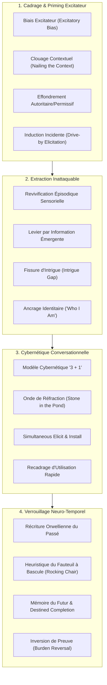

# Advanced Weaponized Communication - Transcripts
**Formateur :** Kenrick Cleveland | **ID :** `kenrick-cleveland-advanced-weaponized-communication-transcripts` | **Tranches :** 20

## Synthèse Architecturale du Cours : *Advanced Weaponized Communication* (Kenrick Cleveland)

---

### 1. Thèse Centrale & Philosophie du Cours

#### Vision spécifique et rupture avec l'approche standard
L'approche conventionnelle de la persuasion (vente consultative, PNL classique, thérapie brève) repose sur un dogme : *diagnostiquer le problème pour y apporter une solution*. Cette dynamique force l'interlocuteur à expliciter ses failles, à activer un état inhibiteur (*away-from / stress*), et exige en amont qu'il admette une erreur ou une incompétence (« *make themselves wrong* »). Cette friction réveille immédiatement les défenses de l'ego et la réactance psychologique.

Kenrick Cleveland renverse radicalement cette posture :
1. **Élimination intégrale du cadre problème :** On ne pose jamais de questions sur ce qui bloque ou dysfonctionne (« pas de boîte de mouchoirs »). L'influence ne pousse pas de l'extérieur ; elle capte et canalise l'élan moteur naturel (*innate momentum*) déjà présent chez l'interlocuteur.
2. **L'Influence comme arme furtive (*Weaponized*) :** L'approche abandonne les suggestions directes et les commandes enchâssées artificielles (dont la prosodie forcée alerte le cortex critique). La persuasion s'opère par **l'architecture invisible de la conversation** : le sujet fournit l'intégralité du matériel (critères, souvenirs de succès, vision), et le praticien réinjecte cette matière en boucle fermée. Réfuter la proposition équivaudrait pour le sujet à réfuter sa propre expérience vécue.
3. **Le « Wetware » comme terrain de jeu :** Le cerveau biologique n'est pas conçu pour des argumentaires rationnels linéaires, mais pour réagir à des dynamiques narratives, des boucles dopaminergiques de récompense (*excitatory bias*) et des distorsions de lignes temporelles (*timeline reconstruction*).

#### Le fil rouge méthodologique : *Elicit, Utilize, Install* en boucle simultanée cybernétique
Toutes les interventions du cours convergent vers une boucle opérationnelle unique :
- **Amorcer l'état excitateur (*Excitatory Priming*) :** Fixer le contexte d'emblée sur l'accomplissement et le désir sans laisser de place à l'inhibition.
- **Extraire le matériau vivant (*Emergent Information*) :** Obtenir des revivifications épisodiques ultra-spécifiques de succès passés et de critères de désir pur.
- **Utiliser en miroir inattaquable (*Unassailable Utilization*) :** Recomposer la structure décisionnelle avec les mots et les faits du sujet.
- **Verrouiller le futur accompli (*Temporal Pre-supposition*) :** Projeter la décision non pas comme une possibilité à évaluer, mais comme un fait historique déjà consommé et validé depuis une perspective temporelle future.

---

### 2. Carte des Concepts & Leviers Émergents



#### Écosystème des leviers clés :

1. **Gouvernance de l'État & Cadrage Neuro-Biologique**
   - **`#excitatory_bias` (Biais Excitateur Opératoire) :** Priming dopaminergique systématique axé sur le désir (*towards*), saturant les circuits de récompense et empêchant la bascule en état inhibiteur.
   - **`#authoritative_permissive_collapse` (Double-Lien de Frontière) :** Cadre structurel rigide imposé unilatéralement, à l'intérieur duquel une autonomie de choix absolue est offerte, neutralisant toute réactance.
   - **`#drive_by_elicitation` / `#passing_comment` :** Déclenchement d'états internes cibles via des remarques périphériques apparemment anodines, inspiré du conditionnement opérant animal, bypassant le radar conscient.
   - **`#nailing_the_context` (Clouage Contextuel) :** Liaison immédiate entre l'identité du sujet et la haute valeur de la mission dès les premières secondes de l'interaction.

2. **Élicitation & Extraction de Levier Inattaquable**
   - **`#revivification_episodique` :** Refus catégorique des abstractions génériques au profit d'un événement précis et unique revécu au présent, réactivant la charge somatique originale.
   - **`#emergent_information` & `#unassailable_narrative` :** Construction du plaidoyer exclusivement à partir des verbatims et triomphes réels du sujet, rendant l'argumentaire immunisé contre la réfutation critique.
   - **`#intrigue_gap` (Asymétrie Relationnelle) :** Remplacement des compliments convenus par la description d'un impact interne chez l'opérateur, créant une boucle cognitive ouverte forçant l'engagement.
   - **`#self_concept_hook` (Ancrage « Who I Am ») :** Interrogation cybernétique ramenant l'effort instrumental à l'identité fondamentale, verrouillant l'engagement sous peine d'auto-négation.

3. **Cybernétique & Dynamique de Flux en Temps Réel**
   - **`#modele_3_plus_1` & `#simultaneite_tactique` :** Gestion conversationnelle simultanée : capter l'information, installer la suggestion, verrouiller le cadre, tout en calibrant l'onde en continu.
   - **`#stone_in_the_pond` (Onde de Réfraction) :** Rejet des scripts rigides au profit d'un ajustement stochastique : chaque phrase est une onde jetée dont on calibre la réfraction avant d'ajuster le tir.
   - **`#rapid_reframing` / `#utilization` :** Absorption immédiate de toute méfiance ou tentative d'évaluation pour la convertir en carburant vers l'objectif.

4. **Architecture Temporelle Rétrograde**
   - **`#orwellian_leverage` (Récriture du Passé) :** Réattribution de sens au présent sur les faits passés : transformer un micro-succès isolé en « preuve absolue de compétence intrinsèque ».
   - **`#rocking_chair_technique` & `#future_memory` :** Dissociation temporelle à 80-90 ans regardant le présent en arrière ; l'exécution et la réussite du projet y sont présupposées comme un fait accompli historique.
   - **`#burden_reversal` (Inversion de l'Obligation) :** Déplacement de toute la pression de délivrance sur l'opérateur/système, réduisant le coût psychologique de l'engagement du sujet à zéro.

---

### 3. Tableau Récapitulatif des Techniques & Démonstrations

| Technique / Exercice | Objectif Opératoire | Déclencheur / Indication | Séquence Résumée |
|---|---|---|---|
| **Triade d'Extraction & Construction de Levier** (*The 3-Step Information Gathering*) | Extraire le levier motivationnel pur sans activer le cortex critique ni le cadre problème. | Ouverture d'entretien, cadrage initial de diagnostic d'opportunité. | 1. Établir une posture de détente absolue (*« cup of tea »*).<br>2. Proscrire toute question de problème ; poser uniquement des questions d'orientation désir/succès.<br>3. Relancer jusqu'à obtention de l'élan moteur intrinsèque (*innate momentum*). |
| **Effondrement Autoritaire / Permissif** (*Boundary-Set Collapse*) | Verrouiller l'action et l'engagement tout en offrant l'illusion d'une agentivité totale. | Pré-cadrage de collaboration, closing d'accords, élimination de réactance. | 1. Poser un cadre inviolable et non-négociable (Frontière autoritaire).<br>2. Accorder une liberté de choix totale à l'intérieur de ces limites (Espace permissif).<br>3. Laisser le sujet exercer son libre arbitre vers l'issue unique pré-dessinée. |
| **Revivification Épisodique Ciblée** (*Precision vs Generalization*) | Réactiver somatiquement les réseaux neuronaux de certitude et de compétence en temps réel. | Lorsque le sujet répond par des généralités abstraites (*« d'habitude ça va »*). | 1. Interrompre la généralisation.<br>2. Forcer la focalisation sur **un** événement unique et contextualisé.<br>3. Faire décrire l'action au présent jusqu'à apparition des calibrations somatiques de succès. |
| **Induction Incidente Périphérique** (*Drive-by Elicitation / Passing Comment*) | Installer un état de réceptivité excitatrice sans éveiller les défenses critiques. | Prise de contact, début d'interaction sous tension ou formelle. | 1. Lancer une remarque périphérique anodine à intonation spécifique (type louange animale).<br>2. Calibrer le redressement attentionnel et le marqueur dopaminergique.<br>3. Enchaîner immédiatement sur le flux opérationnel sans s'attarder. |
| **Clouage Contextuel & Identitaire** (*Nailing the Context*) | Empêcher la compartimentation en corvée en liant l'identité à la tâche. | Assignation de responsabilité, amorce de mission à haute friction. | 1. Rejeter les compliments superficiels de surface.<br>2. Lier la présence même du collaborateur/client à l'impact structurel noble de la tâche.<br>3. Verrouiller le cadre avant toute négociation technique. |
| **Fissure d'Intrigue Asymétrique** (*The Intrigue Gap*) | Forcer l'investissement cognitif et créer une boucle ouverte dans la mémoire de travail. | Phase d'attraction, captation d'attention d'un profil distant ou sur la défensive. | 1. Remplacer le compliment symétrique par l'effet interne produit sur l'opérateur (*« tu m'as distrait »*).<br>2. Laisser le silence s'installer.<br>3. Laisser la cible tenter de résoudre l'ambiguïté en s'investissant dans la relation. |
| **Inversion du Fardeau de Preuve** (*Burden of Performance Shifting*) | Éliminer le réflexe d'anti-vente et désamorcer la méfiance de closing. | Phase d'offre, closing, objections sur le risque financier ou opérationnel. | 1. Recadrer la demande de la cible : *« Ce que vous exigez, c'est que nous tenions notre promesse pour vous »*.<br>2. Assumer explicitement 100% de la charge de performance sur soi/le produit.<br>3. Rendre l'accord trivial et sans friction décisionnelle. |
| **La Perspective en Fauteuil à Bascule** (*Rocking Chair Heuristic & Future Memory*) | Créer une présupposition neurologique d'achèvement inéluctable (*destined completion*). | Négociation de partenariat majeur, projets longs sujets à procrastination ou doute. | 1. Projeter la conscience du sujet à 80-90 ans, assis dans un fauteuil à bascule.<br>2. Orienter le regard en arrière vers le moment présent.<br>3. Traiter le succès du projet actuel comme un fait historique validé et évaluer sa fluidité d'exécution. |
| **Verrouillage « Who I Am »** (*Identity Core Lever*) | Porter l'engagement au niveau logique identitaire pour rendre l'abandon impossible. | Élicitation de critères profonds, phase de qualification d'un partenaire clé. | 1. Pousser la cible au bout de ses justifications rationnelles (*« Pourquoi travailler si dur ? »*).<br>2. Faire émerger la réponse ontologique (*« Parce que c'est ce que je suis »*).<br>3. Ancrer cette phrase pour sceller tout arbitrage ou décision future. |
| **Désorientation Sensorielle & Vestibulaire** (*Audio Neuro-Imprinting*) | Surcharger le cortex frontal pour forcer une amnésie régressive et une réceptivité brute. | Transe formelle, induction audio, déstabilisation d'un blocage rigide. | 1. Fractionnement acoustique bilatéral accéléré (droite/gauche).<br>2. Métaphore kinesthésique de chute libre et force G ventrale.<br>3. Rupture brutale par décélération et vortex tournant horaire $\to$ ancrage fœtal. |

---

---

## 0. Sommaire Sémantique & Index des Lignes

- **Tranche 1 [Lignes 136-256]** : La Triade d'Extraction d'Information et de Construction de Levier (The 3-Step Information Ga... — *Protocole :* La Triade d'Extraction d'Information et de Construction de Levier (The 3-Step Information Gathering Process) | *Verbatim :* Le Recadrage de Pont (Élimination du Doute Technique)
- **Tranche 2 [Lignes 258-421]** : Le Cadre du « Tremplin de Ressources » (Structure de Contrôle du Contexte) — *Protocole :* Le Cadre du « Tremplin de Ressources » (Structure de Contrôle du Contexte) | *Mécanisme :* L'Effet Pygmalion Projectif & Boucle d'Attente Complice | *Verbatim :* La Salve d'Ouverture Temporelle et de Présupposition de Succès
- **Tranche 3 [Lignes 423-542]** : Le "Drive-By Task Assignment" (Délégation sous Contrainte Extrême) — *Protocole :* Le "Drive-By Task Assignment" (Délégation sous Contrainte Extrême)
- **Tranche 4 [Lignes 544-671]** : Le Double-Lien d'Injonction Autoritaire/Permissive (Boundary-Set Collapse) — *Protocole :* Le Double-Lien d'Injonction Autoritaire/Permissive (Boundary-Set Collapse)
- **Tranche 5 [Lignes 673-796]** : Construction de la Prémisse Excitatoire et Cadrage "Forme Complète" (Whole Form Framing) — *Protocole :* Construction de la Prémisse Excitatoire et Cadrage "Forme Complète" (Whole Form Framing)
- **Tranche 6 [Lignes 798-918]** : L'Ancrage Rétro-Temporel de Complétion (Démonstration sur Kenrick à 90 ans) — *Protocole :* L'Ancrage Rétro-Temporel de Complétion (Démonstration sur Kenrick à 90 ans) | *Mécanisme :* Le Levier Temporel Rétro-Actif : "Standing in Space-Time & Destined Completion" | *Verbatim :* La Clôture Temporelle Inévitable
- **Tranche 7 [Lignes 920-1043]** : Le Cadrage Diagnostique du "Sniper" (Prise de Statut Immédiate en Vente/Coaching) — *Protocole :* Le Cadrage Diagnostique du "Sniper" (Prise de Statut Immédiate en Vente/Coaching) | *Verbatim :* Le Déploiement du Cadre Chirurgical (Chirurgien / Cadre d'Inévitabilité)
- **Tranche 8 [Lignes 1045-1183]** : Le Cadrage Initial d'Autorité & Accord Contextuel (Entrée en matière) — *Protocole :* Le Cadrage Initial d'Autorité & Accord Contextuel (Entrée en matière) | *Mécanisme :* Le Biais d'Excitation & Récupération de Ressources Positives | *Verbatim :* Verbatim 1 : Présupposition d'action & passing comment
- **Tranche 9 [Lignes 1185-1360]** : Le Cadre de Début d'Interaction à Deux Étapes (Orientation Positive & Projection Futur) — *Protocole :* Le Cadre de Début d'Interaction à Deux Étapes (Orientation Positive & Projection Futur) | *Verbatim :* La rupture de pattern d'esquive polie
- **Tranche 10 [Lignes 1362-1479]** : d'Amorçage Temporel & Construction de l'Espérance (Linking Strategy) — *Protocole :* d'Amorçage Temporel & Construction de l'Espérance (Linking Strategy)
- **Tranche 11 [Lignes 1481-1619]** : A : L'Installation Conversationnelle Invisible (Structure Module 2) — *Protocole :* A : L'Installation Conversationnelle Invisible (Structure Module 2) | *Verbatim :* Le Modèle de Backtracking & Entraînement Logique
- **Tranche 12 [Lignes 1621-1734]** : Installation de la "Future Memory" par Time Sliding Conversationnel — *Protocole :* Installation de la "Future Memory" par Time Sliding Conversationnel
- **Tranche 13 [Lignes 1736-1860]** : Construction de la "Future Memory" via le Time Slide Hexagonal — *Protocole :* Construction de la "Future Memory" via le Time Slide Hexagonal | *Mécanisme :* La Boucle Temporelle Récursive / Time Slide Multi-Directionnel | *Verbatim :* La Bascule Passé $\rightarrow$ Futur sur Biais Excitateur
- **Tranche 14 [Lignes 1862-2015]** : La Chaîne Logique de Bifurcation Conversationnelle (The 5-Question Funnel) — *Protocole :* La Chaîne Logique de Bifurcation Conversationnelle (The 5-Question Funnel) | *Mécanisme :* La Bifurcation continue (Réduction exponentielle des degrés de liberté cognitifs) | *Verbatim :* Le Cadrage Initial de Partenariat & Présupposition de Valeur
- **Tranche 15 [Lignes 2017-2175]** : L'Entonnoir de Bifurcation Conversationnelle (The 7-Step Conversational Bifurcation Funnel) — *Protocole :* L'Entonnoir de Bifurcation Conversationnelle (The 7-Step Conversational Bifurcation Funnel) | *Mécanisme :* Le Contexte Présomptif Structurel (Structural Presumptive Context) | *Verbatim :* Le Cadre Présomptif Structurel
- **Tranche 16 [Lignes 2177-2274]** : L'Échelle de Logique Propositionnelle (The Propositional Ladder) — *Protocole :* L'Échelle de Logique Propositionnelle (The Propositional Ladder) | *Mécanisme :* Logique Propositionnelle & Calcul Rétroactif du Sens | *Verbatim :* Glissement Rétroactif de Prémisse
- **Tranche 17 [Lignes 2276-2379]** : La Chaîne Propositionnelle à Double Vitesse (Du Cadre d'Entente à la Décision Réduite) — *Protocole :* La Chaîne Propositionnelle à Double Vitesse (Du Cadre d'Entente à la Décision Réduite) | *Mécanisme :* La Logique Propositionnelle & Chaînage Logique (Quasi-Logic Chaining) | *Verbatim :* La Démonstration du Chaînage Logique et de l'Assomption Arbitraire
- **Tranche 18 [Lignes 2381-2512]** : Le Double Choix Implicite Anti-Pression (Prise de RDV) — *Protocole :* Le Double Choix Implicite Anti-Pression (Prise de RDV)
- **Tranche 19 [Lignes 2514-2626]** : Le Verrouillage par Dérivation sur Point Mineur (Minor Point Misdirection Close) — *Protocole :* Le Verrouillage par Dérivation sur Point Mineur (Minor Point Misdirection Close) | *Mécanisme :* Inertie Cognitive & Dérivation d'Attention (Cognitive Inertia & Attention Siphoning) | *Verbatim :* La Fermeture Immédiate de Manœuvre Opportuniste
- **Tranche 20 [Lignes 2628-2746]** : Le "Logical Chaining" du Rendez-vous / de la Décision — *Protocole :* Le "Logical Chaining" du Rendez-vous / de la Décision | *Mécanisme :* Le Choix Binaire Illusionniste (Binary Choice Decision Making / Illusion of Choice) | *Verbatim :* Verbatim 1 : Le Choix Binaire Implicite et l'Inertie d'Agenda

---

## Extractions Détaillées par Tranche (Opératoire & Verbatim)

## Tranche 1 / 20 : La Triade d'Extraction d'Information et de Construction de Levier (The 3-Step Information Ga...

### 1. Mécanismes & Principes Actifs

- **Levier émergent : L'Ingénierie du Levier Motivationnel Immédiat (*Leverage via Emergent Information*)**
  * **Principe actif :** Dans une conversation d'influence, l'information ne doit jamais être collectée de façon neutre ou documentaire. Le praticien ne cherche pas « n'importe quelle information », mais exclusivement celle qui active l'intention innée et le désir spontané du sujet d'aller vers l'avant. En faisant verbaliser au sujet ce qu'il désire profondément et ce qui fonctionne déjà, le système nerveux amorce un élan moteur intrinsèque (*innate momentum*). L'adhésion (*agreement*) puis l'action concrète (*compliance*) ne reposent pas sur une poussée externe ou un argumentaire logique, mais sur le fait que le sujet est désormais mis en tension par son propre désir.
  * **Tags libres émergents :** `#leverage_dynamique` `#emergent_information` `#innate_momentum` `#compliance_organique` `#weaponized_listening`

- **Levier émergent : Communication Multi-Niveaux et Élimination Radicale du Cadre Problème (*Multi-Level Positive Framing*)**
  * **Principe actif :** La communication opère simultanément sur deux plans : la surface verbale (le contenu explicite échangé) et le niveau des implications (les présuppositions inconscientes sur l'état d'esprit et l'orientation temporelle). Si le praticien ouvre un espace d'investigation sur le problème (« Qu'est-ce qui ne va pas ? », « Pourquoi ça bloque ? »), le système nerveux du sujet s'ancre dans un état inhibiteur (*inhibitory position*). Cela active des mécanismes défensifs : pour accepter une solution extérieure à un problème qu'il reconnaît, l'interlocuteur doit d'abord « se donner tort » (*make themselves wrong*), ce que l'ego et la biologie refusent spontanément. En orientant l'investigation exclusivement sur ce qui marche déjà vers un futur désiré, on bypass les résistances, évite le collapse émotionnel passif (le piège du « sortir la boîte de mouchoirs ») et conditionne la neurologie à une disponibilité d'action.
  * **Tags libres émergents :** `#multi_level_communication` `#bypass_cadre_probleme` `#anti_inhibition` `#non_blaming_frame` `#direction_neuro_positive`

- **Levier émergent : Cadrage Narratif et Imprégnation du "Wetware" (*Narrative Triad Architecture*)**
  * **Principe actif :** Le cerveau humain est biologiquement câblé (« le *wetware* ») pour réagir aux séquences narratives plutôt qu'aux listes logiques analytiques. La structure narrative standard comporte : une situation initiale/contexte, un déploiement/quête, et une résolution. Transposée à l'influence conversationnelle, cette architecture se découpe en trois phases :
    1. *Présent Positif* : Ce qui fonctionne déjà maintenant (création du cadre de sécurité et de compétence).
    2. *Futur Amplifié* : Ce qui sera encore meilleur en bâtissant sur cette base (le corps de l'histoire, allumant l'imagination).
    3. *Stratégie de Liaison* : Le pont d'action naturel reliant 1 et 2, fondé sur les ressources dont le sujet dispose déjà (la conclusion logique et inévitable).
    Cette structure désactive l'esprit critique en créant l'illusion d'une histoire familière (« story time »), plongeant l'interlocuteur dans un état de captivation hypnotique fluide.
  * **Tags libres émergents :** `#narrative_structure` `#neurologie_wetware` `#triade_temporelle` `#fluidite_conversationnelle` `#story_trance`

- **Levier émergent : Neutralisation Précoce du Cadre de Jugement & Utilisation Conversationnelle (*Context Dominance via Rapid Reframing*)**
  * **Principe actif :** Laisser l'interlocuteur imposer le doute ou reporter son évaluation à la fin (« Je jugerai quand tout sera fini » ou « Est-ce que ce qui marche est la meilleure façon de faire ? ») détruit immédiatement le levier de contrôle. Le praticien applique une utilisation immédiate (*utilization*) en deux temps : (1) valider l'input pour maintenir le rapport, puis (2) recadrer instantanément le sens de cet input pour le convertir en un pont vers la direction souhaitée. Ce mouvement doit intervenir très vite pour rompre toute dynamique d'interrogatoire que l'interlocuteur tenterait d'instaurer.
  * **Tags libres émergents :** `#rapid_reframing` `#context_control` `#utilization_ericksonienne` `#frame_locking` `#anti_evaluation_trap`

---

### 2. Protocoles, Techniques & Démonstrations (Étape par Étape)

#### Protocole : La Triade d'Extraction d'Information et de Construction de Levier (*The 3-Step Information Gathering Process*)

* **Intention / Indication :** 
  À employer dès l'ouverture de toute interaction d'influence, de vente, de management, de coaching ou de négociation où l'on cherche à obtenir un accord (*agreement*) puis une action ferme (*compliance*), sans jamais entrer dans la négativité ou le combat d'objections.
* **Mise en place & Pré-framing :**
  - Adopter une posture conversationnelle d'un confort absolu : l'équivalent de boire un café ou un thé avec un ami intime (*like having a cup of tea*).
  - Écarter totalement et explicitement le diagnostic de défaillances. Interdiction de demander « quel est le problème ».
  - Fixer le postulat que le sujet tire déjà de la valeur ici et maintenant.

* **Séquence d'actions pas à pas :**

  * **Étape 1 : Ancrage du Présent Positif (*What's Working Right Now*)**
    - Poser la question directe : *« Qu'est-ce qui fonctionne en ce moment ? »*
    - Approfondir les réussites actuelles : qu'est-ce que le sujet fait déjà qui produit des résultats satisfaisants ?
    - *Sous-étape d'imprégnation immédiate :* Amener le sujet à constater la valeur qu'il reçoit dans l'interaction présente (ex. : « Qu'est-ce qui, dans ce que nous faisons là, fait déjà sens pour toi ? »).
    - Verrouiller la reconnaissance : amener le système nerveux du sujet à ressentir l'état somatique de déjà posséder de la valeur sans attendre la fin du processus.

  * **Étape 2 : Projection dans le Futur Amplifié (*The Expansive Future Orientation*)**
    - Prendre appui sur les points validés à l'étape 1 pour sauter directement dans le futur désiré sans s'attarder sur les détails d'optimisation du présent.
    - Déployer le questionnement d'amplification : *« En s'appuyant sur ce qui marche déjà, qu'est-ce qui serait encore meilleur ? »*
    - Allumer l'imagination (*ignite the imagination*) : solliciter les critères de validation sensorielle future (*« Qu'est-ce qui te ferait savoir que tu atteins des résultats au-delà de ce que tu espérais au départ ? »*).
    - Mécanisme d'attribution implicite : pendant que le sujet décrit cette vision lumineuse en regardant le praticien, son inconscient associe l'interlocuteur comme étant le guide naturel et nécessaire pour y parvenir.

  * **Étape 3 : La Liaison Stratégique (*The Strategy Piece*)**
    - Relier la base solide du présent (Étape 1) à la vision future (Étape 2) via une stratégie déjà familière au sujet.
    - Activer la confiance innée : s'assurer que le pont opérationnel utilise des schémas d'action dans lesquels le sujet se sent déjà confiant et compétent, garantissant la conformité (*compliance*).

* **Signes de calibration observés par le formateur :**
  - Changement d'attitude somatique : passage d'une retenue analytique ou contractée à une posture penchée en avant (*lean in*), captivée, en état de flow.
  - Absence de soupirs d'abattement ou de postures de repli (typiques du cadre problème).
  - Regard orienté vers le praticien avec une charge émotionnelle d'anticipation positive (le regard du sujet investit le praticien du rôle de facilitateur de son futur).

---

#### Technique de Déviation : Le Recadrage Éclair de l'Hyper-Perfectionnisme (*Bypassing the "Is it the best way?" Loop*)

* **Intention / Indication :**
  À utiliser lorsque l'interlocuteur tente de ramener la conversation dans l'hésitation critique ou le doute technique en disant : *« Oui, ça marche, mais est-ce que c'est la meilleure méthode ? »*
* **Mise en place & Pré-framing :**
  Ne jamais entrer dans le débat logique pour défendre ou contester la méthode actuelle. Neutraliser immédiatement la charge critique sans créer de heurt.
* **Séquence d'actions pas à pas :**
  1. **Valider et Accuser Réception Immédiatement :** Déclarer que la réponse est « parfaite » pour maintenir le lien conversationnel intact.
  2. **Dépouiller le Doute de sa Valeur Critique :** Signifier avec aisance que l'on se désintéresse de savoir si c'est la façon optimale ou non.
  3. **Redéfinir la Fonction de l'Élément :** Transformer ce qui a été cité (les points 1, 2, 3) non pas en un sommet à perfectionner, mais en un simple tremplin/pont de découverte.
  4. **Basculer Directement à l'Étape 2 :** Lancer immédiatement la question du futur : *« Alors, où souhaites-tu aller à partir d'ici ? »*

---

### 3. Heuristiques, Subtilités & "Sagesse du Praticien"

- **Règles Conditionnelles :**
  * *Si* l'interlocuteur pose une série de questions pour prendre le contrôle du flux (comme un avocat en contre-interrogatoire), *alors* casser le rythme immédiatement (*break the flow*) et réorienter vers le cadre global, *parce que* celui qui répond en cascade aux questions devient passif comme « un écureuil courant dans une cage » et se fait acculer.
  * *Si* le sujet dit : « J'attends d'avoir tout vu/tout fini pour savoir si c'est bien », *alors* refuser absolument ce cadre en amont (*control that context right up front*), *parce que* concéder ce délai détruit le levier psychologique et place le praticien en posture d'accusé devant prouver sa valeur.
  * *Si* le sujet exprime une préoccupation technique sur ce qui fonctionne, *alors* valider les données sans valider le souci, puis basculer vers le futur désiré, *parce que* cela décharge la tension psychologique (*takes the psychic pressure off*) et remet la balle dans votre camp pour manœuvrer.

- **Pièges Classiques & Erreurs de Débutant :**
  * *L'illusion de l'enquête doloriste (Sales Masochism) :* Croire qu'il faut obligatoirement remuer le couteau dans la plaie (« Quel est votre problème ? Depuis combien de temps souffrez-vous ? »). Piège : cela enferme le prospect dans une identité d'échec. S'il doit reconnaître qu'il a eu tort pendant des années, adopter votre offre l'humilie.
  * *Le syndrome de la boîte de mouchoirs :* Passer du rôle d'architecte de l'action à celui de témoin passif d'un déversement émotionnel. Écouter les gens pleurer ne produit aucune décision d'action concrète.
  * *La sur-intellectualisation / Explication scolaire :* Vouloir dérouler un plan rigide (Point 1A, 1B, 2A...). Le formateur insiste : la persuasion conversationnelle d'élite est « tellement habile qu'on ne peut pas y trouver l'astuce » (*so clever that you can't find the clever in it*).

- **Postulats Philosophiques de Kenrick Cleveland :**
  * *« We're gathering information for the purposes of gaining leverage... which is ultimately compliance. »* L'écoute n'est pas une politesse sociale, c'est l'armement du levier d'action.
  * *« People don't want to be wrong, everybody wants to be right. »* Toute intervention qui oblige l'interlocuteur à se considérer comme incompétent génère un rejet biologique de la solution.
  * *L'apprentissage par contagion expérientielle :* L'auditeur/praticien doit d'abord vivre et ressentir somatiquement l'efficacité de la structure au moment où on la lui applique, avant de chercher à la conceptualiser ou à la reproduire.

---

### 4. Pépites Verbatim & Patterns Linguistiques (MOT À MOT EN V.O.)

#### Pépite 1 : Le Recadrage de Pont (Élimination du Doute Technique)
> **« Well, the first thing I'd say is that that's perfect. So now that you've given me one, two, three, that's working. And even though you have concerns about whether that's the most ideal or perfect form of it working, we don't really care. Because what we're trying to do is not use what's working right now as the basis of everything we're going to do going forward, but as the basis of discovering what we want to do moving forward. So rather than concerning ourselves with whether or not this is the best way you could possibly take a step forward, let's talk a bit about where you want to go to from where you are. »**
* **[Analyse du Pattern]** : 
  - **Approbation de surface et cadrage positif initial :** L'amorce *« that's perfect »* valide immédiatement le comportement de l'interlocuteur sans valider son doute, désamorçant toute friction d'ego.
  - **Recadrage de contexte par dévaluation délibérée :** *« we don't really care »* brise brutalement l'importance que le sujet accordait à son anxiété de perfection.
  - **Redéfinition linguistique (X n'est pas A mais B) :** La structure *« not use [X] as the basis of everything... but as the basis of discovering [Y] »* transforme la nature même de l'information : le présent n'est plus une fin à auditer, mais un simple tremplin vers l'objectif.
  - **Présupposition d'action conjointe :** L'usage de l'impératif doux *« let's talk a bit about where you want to go »* s'empare de la direction du dialogue et projette le sujet dans l'exploration du futur sans lui laisser le choix de replonger dans le problème.

#### Pépite 2 : La Transe d'Imprégnation de Valeur Immédiate
> **« As you're listening to us, literally, right here, right now, what's working for you? What about the way Kenrick and I are speaking? What Kenrick and I are speaking about? You being here in this program and choosing to give us your attention is working for you. What have you already gotten? What is beginning to stir in your mind about what you can be putting your attention on and what's captured your attention in a way that you already recognize will serve you in some way if you allow it to become part of the process you use? »**
* **[Analyse du Pattern]** :
  - **Ancrage temporel et spatial redondant :** L'insistance sur *« literally, right here, right now »* fixe l'attention du sujet sur le canal sensoriel présent et suspend le jugement rétrospectif ou prospectif.
  - **Présupposition temporelle et ontologique :** *« What have you already gotten? »* et *« what is beginning to stir »* ne demandent pas *si* le sujet a reçu de la valeur, mais *quelle* valeur il a *déjà* reçue, rendant l'existence du bénéfice incontestable.
  - **Commande enchâssée et nominalisation processuelle :** *« what's captured your attention in a way that you already recognize will serve you »* installe une dynamique hypnotique où l'intérêt devient une preuve inconsciente d'utilité future.
  - **Subordonnée conditionnelle permissogène :** *« if you allow it to become part of the process you use »* induit que le seul frein potentiel serait le refus délibéré du sujet, invitant implicitement son inconscient à céder au flow et à s'approprier les concepts.

#### Pépite 3 : L'Ignition de l'Imagination vers le Futur Positif
> **« Given the presumption that you've already begun to notice this question sets up a state, a frame of mind that's got a proper orientation to take me to a consideration of the future that would be positive and open up possibilities for me. What is it that you want is the next question. From here, what's next? What would be even better than the experiences you've had that worked? What would be even better than what's working for you right now, given that you can build on what's working? Given that you've begun to pick up some information, what is it that your imagination has now begun to ignite about the possibilities of taking this information and applying it in a future state with the people that you're going to interact with to get incredible kinds of outcomes that you'd like to get? What are those outcomes like? What would let you know that you were achieving those kind of outcomes? How would you know that you had more success as a result of what you're picking up than you ever expected to get when you first started engaging with us in the program? »**
* **[Analyse du Pattern]** :
  - **Empilement de présuppositions d'ouverture :** *« Given the presumption that... »* installe comme fait acquis que l'état d'esprit est déjà convenablement orienté et détendu.
  - **Comparatif ascendant récurrent :** L'usage répété de *« What would be even better than... »* oblige la cognition à concevoir une expansion continue à partir d'un socle positif, interdisant tout retour en arrière vers le manque.
  - **Métaphore kinésthésique active :** *« your imagination has now begun to ignite »* active les centres visuels et affectifs de l'inconscient en suggérant un processus autonome et spontané de visualisation.
  - **Projection dans le futur avec critères de calibration :** *« What would let you know... », « How would you know... »* force le sujet à générer ses propres représentations sensorielles spécifiques (V-A-K) de réussite.
  - **Recadrage d'attente à la hausse :** *« than you ever expected to get when you first started »* crée une réévaluation rétroactive : le sujet conclut que l'interaction présente a d'ores et déjà dépassé ses espérances initiales, verrouillant une gratitude et une compliance totale envers le formateur/praticien.

## Tranche 2 / 20 : Le Cadre du « Tremplin de Ressources » (Structure de Contrôle du Contexte)

Voici l'extraction opératoire et l'analyse clinique intégrale de la tranche 2/20 du cours *Advanced Weaponized Communication* dispensé par Kenrick Cleveland et Joseph Riggio.

---

### 1. Mécanismes & Principes Actifs

* **Le Biais Excitateur Opératoire (*Excitatory Bias*)**
  * *Principe actif* : Le système nerveux humain ne s'engage pas de la même manière dans l'action selon qu'il est orienté vers l'évitement d'une menace (*inhibitory/away-from state*) ou vers la réalisation d'une possibilité valorisée (*excitatory/towards state*). En déclenchant intentionnellement une réponse d'excitation positive en tout début d'interaction, le praticien sature les circuits de la récompense (dopamine) et met le sujet dans un état de réceptivité motrice et d'accord implicite.
  * *Leviers émergents* : `#excitatory_bias` `#orientation_propulsive` `#amorcage_dopaminergique` `#priming_motivationnel`

* **L'Effet Pygmalion Projectif & Boucle d'Attente Complice**
  * *Principe actif* : En maintenant un contact visuel soutenu et en communiquant verbalement et non verbalement des attentes futures de très haute réussite, le praticien crée une tension d'alignement identitaire. Le sujet adopte l'hypothèse de réussite pour répondre à l'attente projetée par le communicateur, devenant le propre artisan de cette réalisation.
  * *Leviers émergents* : `#positive_expectation_transfer` `#projection_d_autorite_bienveillante` `#alignement_collaboratif`

* **La Revivification Sensorielle Précise vs La Généralisation**
  * *Principe actif* : Le cerveau traite une remémoration hautement détaillée et contextualisée d'un succès passé (*episodic memory*) en activant exactement les mêmes réseaux neuro-fonctionnels que l'expérience temps réel. Une généralisation (« *je réussis souvent mes négociations* ») reste un concept cortical abstrait sans charge somatique. En obligeant le sujet à isoler **un** événement unique (« *une conversation en particulier* »), le praticien force la réassociation immédiate (*revivification*) : les ressources de confiance, de fluidité et de certitude deviennent somatiquement disponibles à l'instant *t*.
  * *Leviers émergents* : `#revivification_episodique` `#ancrage_neuro_somatique_temps_reel` `#anti_generalisation` `#pont_temporel_passe_present`

* **La Récriture Présente du Passé (Heuristique Orwellienne du Levier Historique)**
  * *Principe actif* : La mémoire humaine n'est pas une archive gravée mais une reconstruction active. La signification donnée à un événement passé dépend du cadre contextuel établi au présent. En qualifiant un fait passé de « preuve de compétence indiscutable », le communicateur redéfinit l'histoire du sujet (« *The victor writes history* »), transformant un événement isolé en tremplin narratif inévitable vers l'action future demandée.
  * *Leviers émergents* : `#orwellian_leverage` `#reconstruction_de_sens` `#retro_suggestion_legitimante`

* **L'Auto-Utilisation Inattaquable (*The Unassailable Story Loop*)**
  * *Principe actif* : Lorsque le praticien formule une suggestion ou bâtit un argumentaire à partir d'éléments externes ou d'histoires inventées, le filtre critique du sujet peut analyser, douter et réfuter. Dès lors que l'argumentaire est constitué de la propre matière du sujet (ses souvenirs précis, ses mots, ses victoires réelles réutilisées en écho), le filtre critique est totalement contourné : le sujet ne peut pas contester sa propre expérience sans créer une dissonance cognitive insupportable.
  * *Leviers émergents* : `#unassailable_narrative` `#utilization_pure` `#feedforward_miroir` `#immunite_critique`

* **Le Modèle Cybernétique Simultané « 3 + 1 »**
  * *Principe actif* : La communication d'influence ne suit pas une linéarité rigide mais une dynamique dialogique en temps réel :
    1. *Élicitation* : Jeter une sonde verbale pour cartographier l'état et prélever la matière.
    2. *Utilisation* : Récupérer immédiatement l'objection, la contrainte ou la matière énoncée sans friction.
    3. *Installation* : Connecter cette matière au comportement cible souhaité.
    4. *(+1) Renforcement* : Verrouiller la compliance acquise par une validation valorisante.
  * *Leviers émergents* : `#modele_3_plus_1` `#boucle_dialogique_continue` `#simultaneite_tactique`

* **Le Recadrage par Commentaire Incident (*Passing Comment / Drive-By Suggestion*)**
  * *Principe actif* : Les suggestions explicites ou formelles éveillent la résistance analytique du sujet. En glissant une présupposition d'identité ou de compétence sous la forme d'un commentaire anodin dit « en passant » (*drive-by comment*), le système nerveux absorbe la présupposition sans la vérifier, à la manière d'un réflexe de conditionnement classique (le ton enthousiaste avec un animal qui dresse l'attention avant même de donner l'ordre).
  * *Leviers émergents* : `#passing_comment` `#drive_by_suggestion` `#pre-cadrage_covert` `#amorçage_infra_critique`

---

### 2. Protocoles, Techniques & Démonstrations (Étape par Étape)

#### Protocole 1 : Le Cadre du « Tremplin de Ressources » (Structure de Contrôle du Contexte)
* **Intention / Indication** : À employer au tout début d'un entretien de vente, d'un coaching, d'une négociation ou d'un échange stratégique pour empêcher le sujet de s'effondrer dans un cadre de problème insoluble (ex. la crise, l'économie, les blocages systémiques) et verrouiller la faisabilité de l'intervention.
* **Mise en place & Pré-framing** : S'interdire formellement de demander « Quel est le problème ? » ou « Que voulez-vous changer ? » tant que le socle de ressources n'est pas établi.
* **Séquence d'actions pas à pas** :
  * *Étape 1 : Cartographie de ce qui fonctionne déjà (Élicitation)*
    Poser la question de focalisation sélective : *« What’s working for you right now? »* ou *« What are you doing that's working? »*. Si le sujet tente de ramener le contexte négatif, accuser réception brièvement sans s'y arrêter, puis re-focaliser immédiatement sur les îlots de compétence réels.
  * *Étape 2 : Expansion sensorielle du succès*
    Faire décrire les conséquences positives concrètes : *« What happens when you do that? »*. Laisser le sujet nommer les résultats relationnels ou matériels obtenus jusqu'à observer un changement d'état.
  * *Étape 3 : Projection d'amplification (Le « Even Better »)*
    Lier directement la réussite avérée à l'opportunité future : *« Given that that is so wonderful and such a really good thing, where would you see your future becoming even better maybe as a result of our interaction? »*.
  * *Étape 4 : Dérivation d'une mémoire épisodique isolée*
    Exiger un souvenir spécifique et non généralisé : *« Is there one conversation or another in particular you can think about where you really achieved the kind of outcomes that you wanted to...? »*.
  * *Étape 5 : Extraction du méta-état de confiance et liaison stratégique*
    Attribuer formellement ce succès à une compétence interne du sujet, puis installer la suite logique : *« So knowing that you could disappear something like that must mean that you have a sense of confidence or faith in [X]... So it's reasonable for us to be aiming at taking this even further... »*.
* **Signes de calibration** :
  * Étape 1 & 2 : Changement de tonus postural (redressement du buste, ouverture de la respiration), disparition des micro-tensions faciales liées au stress du problème.
  * Étape 4 : Accès oculaire en remémoration visuelle/kinesthésique (regard qui se fige, micro-sourire, pause respiratoire signalant la revivification interne).
  * Étape 5 : Acquiescement verbal spontané et appuyé (*« Yeah... how boy do I ever »*), production d'imagerie interne spontanée (ex. le sujet qui entend « une musique » dans sa tête).

---

#### Protocole 2 : La Négociation d'Urgence en Contexte Opérationnel (Démonstration Manager / Collaborateur)
* **Intention / Indication** : Obtenir l'exécution immédiate et prioritaire d'une tâche lourde par un individu déjà débordé, sans générer de réactance, de ressentiment ou de sentiment d'oppression hiérarchique brutale.
* **Mise en place & Pré-framing** : S'approcher sans agressivité et injecter d'emblée une présupposition d'excellence passée via un commentaire incident.
* **Séquence d'actions pas à pas** :
  * *Étape 1 : Le Commentaire Incident d'Identité (Amorçage)*
    Valider l'historique de compétence avant d'énoncer la charge : *« I know that you've done a great job with getting stuff out for us in the past and the report you did last week was phenomenal. »*
  * *Étape 2 : Formulation du besoin d'impact et de la contrainte temporelle*
    Donner le cadre d'importance systémique : *« I need to get this out to the client tonight because it's going to make a really big difference in the relationship we have with them. »*
  * *Étape 3 : Utilisation de l'objection de surcharge (Absorb & Re-channel)*
    Lorsque le sujet objecte le manque de temps (*« I don't know there's enough hours in the day today »*), ne pas contester. Utiliser l'objection comme preuve d'éthique de travail : *« I understand that. And I understand you always do your best and you get stuff out the door. And probably you already have a full schedule for the day because I know how you work. »*
  * *Étape 4 : Recadrage de la permission d'éviction (The « Even Better » implicite)*
    Donner l'autorisation managériale d'abandonner temporairement les tâches secondaires pour libérer le champ : *« Figure out what's least important that you have on your schedule now. Put that aside so it makes enough room and gives you the most leverage you need to get this report out... »*
  * *Étape 5 : Clôture par présupposition de capacité inconditionnelle (+1 Renforcement)*
    Valider l'accord implicite d'une voix calme et résolue : *« Great. I know you can. No question. »*
* **Signes de calibration** :
  * Relâchement de la résistance défensive au moment où la permission d'écarter les tâches secondaires est donnée.
  * Bascule verbale de l'incapacité (« *I don't know...* ») à la conformité collaborative (« *All right. I can.* »).

---

### 3. Heuristiques, Subtilités & "Sagesse du Praticien"

* **L'Heuristique du Piège de l'Objectif de Réparation** :
  * *Règle* : Si vous demandez à un interlocuteur en détresse ce qu'il veut et qu'il répond en termes globaux (« *Je veux que les choses redeviennent normales, je veux que la crise disparaisse* »), **vous êtes mort professionnellement si vous acceptez ce cadre**. Vous vous enfermez dans une promesse impossible à honorer (« *You've screwed the pooch* »).
  * *Correction* : Forcer immédiatement le cadrage sur ce que le sujet contrôle et sur ce qui produit déjà des résultats, aussi minime soit-il.

* **L'Heuristique de Granularité Mémorielle (Spécifique vs Général)** :
  * *Règle* : *Si le sujet reste dans des généralités sur ses compétences (« J'ai toujours été bon négociateur ») -> Alors interrompre et exiger un épisode biographique unique (« Donne-m'en un en particulier »)*.
  * *Raison* : Une généralisation maintient le sujet dans un traitement cognitif froid et dissocié. Seul l'épisode précis réactive la physiologie du succès (l'état excitateur somatique).

* **L'Heuristique de Proportionnalité Contextuelle (Tâche Simple vs Projet Mobilisateur)** :
  * *Règle* : N'utilisez pas de lourds protocoles d'induction de motivation pour des micro-tâches du quotidien (sortir les poubelles, plier du linge).
  * *Raison* : La motivation artificielle déconnectée de l'objet (ex. promettre une récompense érotique pour une tâche ménagère) s'épuise dès la 3ème occurrence et détruit la dynamique relationnelle car elle est perçue comme un stratagème grossier (*a ploy*). Les profils performants exécutent les tâches simples sans cérémonial.

* **L'Heuristique du « Biais Excitateur Instantané » (L'Analogie Canine)** :
  * *Règle* : Ne matraquez pas votre interlocuteur avec une interrogation formelle pour susciter l'excitation. Un changement d'inflexion vocale et un compliment incidental posé en passant (« *Hey good boy* » / « *You've always done a phenomenal job* ») dressent instantanément les récepteurs attentionnels et prédisposent à l'adhésion immédiate.

* **L'Heuristique de Contrôle du Cadre Initial** :
  * *Règle* : 80% des échecs en coaching, management ou vente sont scellés dès les deux premières minutes si vous laissez le sujet imposer son cadre de problème, de passivité ou d'impuissance. Celui qui contrôle le cadre temporel (passé ressource -> présent de choix -> futur amplifié) contrôle l'issue de l'échange.

---

### 4. Pépites Verbatim & Patterns Linguistiques (MOT À MOT EN V.O.)

#### Pépite 1 : La Salve d'Ouverture Temporelle et de Présupposition de Succès
> "nation has now begun to ignite about the possibilities of taking this information and applying it in a future state with the people that you're going to interact with to get incredible kinds of outcomes that you'd like to get? What are those outcomes like? What would let you know that you were achieving those kind of outcomes? How would you know that you had more success as a result of what you're picking up than you ever expected to get when you first started engaging with us in the program?"

* **[Analyse du Pattern]** :
  * *Présupposition temporelle et somatique active* : « *has now begun to ignite* » installe le processus comme ayant déjà démarré dans le corps/l'esprit du sujet sans qu'il ait eu à donner son accord conscient.
  * *Nominalisations expansives* : L'usage répété de termes indéterminés (« *possibilities* », « *incredible kinds of outcomes* ») force le système nerveux du sujet à combler le vide avec ses propres désirs les plus élevés.
  * *Double contrainte et questionnement orienté vers le futur* : Les questions « *What would let you know...* » et « *How would you know that you had more success... than you ever expected...* » ne demandent jamais **si** le succès aura lieu, mais installent le dépassement des attentes passées comme une réalité acquise qui doit seulement être calibrée sensoriellement.

---

#### Pépite 2 : L'Enchaînement Ressource-Futurisation
> "Given that that is so wonderful and such a really good thing, where would you see your future becoming even better maybe as a result of our interaction?"

* **[Analyse du Pattern]** :
  * *Liaison de subordination causale (« Given that... »)* : Transforme une validation subjective de la situation présente en prémisse logique irréfutable pour le pas suivant.
  * *Présupposition comparative d'amélioration (« becoming even better »)* : Il est syntaxiquement impossible de répondre à la question sans présupposer que la situation actuelle est déjà bonne et que le futur sera supérieur.
  * *Adoucisseur d'insertion covert (« maybe as a result of our interaction »)* : Le mot « *maybe* » lève l'alerte du facteur critique tandis que la structure syntaxique lie intimement l'amélioration future à l'interaction présente avec le praticien.

---

#### Pépite 3 : Le Piège de l'Élucidation du Problème Insoluble (Contre-Exemple Pédagogique)
> "Well, what do you want? I just want something that works. I just don't want any more of this. I want things to go back to normal. I want things to be okay again in my life. And you know, that's what I want to do. Well, how can you make things normal again? Really, how can you eradicate the problems that society has right now? What are you going to do about that? And the answer is nothing."

* **[Analyse du Pattern]** :
  * *Boucle d'impuissance acquise par focalisation « Away-From »* : La question classique « *What do you want?* » posée dans un état négatif déclenche des réponses d'évitement (« *I just don't want any more of this* »).
  * *Cul-de-sac conversationnel* : En acceptant de creuser comment restaurer un passé idéalisé (« *make things normal again* »), le praticien s'enferme dans des nominalisations universelles et hors de contrôle (« *society* », « *normal* »), détruisant tout levier d'action opérationnelle.

---

#### Pépite 4 : La Formulation du Levier de Revivification Épisodique
> "So is there one conversation or another in particular you can think about where you really achieved the kind of outcomes that you wanted to as a result of how you spoke with someone and how they spoke with you?"

* **[Analyse du Pattern]** :
  * *Double lien d'illusion de choix (« one conversation or another in particular »)* : Le sujet n'a pas le choix de chercher ou non, le choix porte uniquement sur *quelle* conversation spécifique il va extraire.
  * *Structure de revivification interactionnelle* : « *as a result of how you spoke... and how they spoke with you* » oriente le focus sur la dynamique comportementale et relationnelle précise, reconnectant le sujet à sa propre boucle d'efficacité interpersonnelle.

---

#### Pépite 5 : La Transmutation du Passé en Certitude Future Inévitable
> "So knowing that you could disappear something like that must mean that you have a sense of confidence or faith in the power of conversation and dialogue to really change how people respond... So it's reasonable for us to be aiming at taking this even further, building even greater skills and competencies about where it is we could go if we just add in a few critical pieces that make that more available, more evident to you."

* **[Analyse du Pattern]** :
  * *Équivalence complexe imposée (« knowing that... must mean that you have... »)* : Établit un lien d'équivalence indiscutable entre le fait historique isolé et une qualité d'identité profonde (« *confidence or faith* »).
  * *Tréma de rationalité feinte (« So it's reasonable for us... »)* : Emploie le prédicat logique « *reasonable* » pour faire accepter une extrapolation ambitieuse comme une déduction purement logique de bon sens.
  * *Minimisation de l'effort résiduel (« if we just add in a few critical pieces »)* : L'utilisation de l'adverbe restrictif « *just* » réduit l'apprentissage futur à un simple réglage de précision, neutralisant toute sensation de difficulté ou d'accablement cognitif.

---

#### Pépite 6 : La Suggestion d'Action Directe sous Couvert d'Allègement de Charge
> "Listen, I understand that. And I understand you always do your best and you get stuff out the door. And probably you already have a full schedule for the day because I know how you work. Figure out what's least important that you have on your schedule now. Put that aside so it makes enough room and gives you the most leverage you need to get this report out because we really need to focus on this for today. And it's okay that we back up the other stuff a bit."

* **[Analyse du Pattern]** :
  * *Pacing total de l'identité (« I understand you always do your best... because I know how you work »)* : Valide l'ego et l'engagement du sujet, désarmant immédiatement le réflexe d'opposition ou la victimisation face à la tâche.
  * *Commandes d'action enchâssées sous forme de libération (« Figure out... Put that aside... »)* : L'injonction n'ordonne pas de travailler plus, mais d'éliminer le secondaire (« *Put that aside* »), transformant une exigence managériale lourde en une autorisation de simplification acceptée avec soulagement.
  * *Verrouillage de subordination hiérarchique bienveillante (« And it's okay that we back up the other stuff a bit »)* : Lève la responsabilité de la faute pour retard sur les autres dossiers, canalisant l'intégralité de l'énergie disponible vers l'unique livrable critique.

## Tranche 3 / 20 : Le "Drive-By Task Assignment" (Délégation sous Contrainte Extrême)

### 1. Mécanismes & Principes Actifs

* **L'Induction Excitatoire Incidente (*The Passing Comment / Drive-by Elicitation*)**
  * **Principe actif :** Déclencher l'état neuro-émotionnel cible (orientation, disponibilité, excitation, curiosité) par une remarque périphérique apparemment anodine, plutôt que d'assaillir le sujet avec des questions frontales d'élucidation (*bludgeoning*). Inspiré du conditionnement opérant animal (le ton aigu *"Hey good boy / good girl"* qui fait dresser les oreilles et remuer la queue du chien), ce levier sature le canal conscient avec une banalité tout en activant directement le système réticulaire activateur et le système de récompense (dopamine). Le sujet entre en réceptivité sans s'apercevoir qu'un recadrage a eu lieu.
  * **Tags libres :** `#passing_comment` `#drive_by_elicitation` `#excitatory_bias` `#covert_arousal` `#tonal_anchoring` `#animal_conditioning_isomorphism`

* **Le Clouage Contextuel (*Nailing the Context*)**
  * **Principe actif :** Verrouiller instantanément le cadre opératoire dès l'ouverture de l'interaction. L'amorce ne doit pas être un simple compliment générique (ex: *"belles lunettes"*), mais doit lier la présence du sujet à la valeur structurelle de la tâche (ex: *"faire ce qui change la boîte en mieux"*). Cela empêche l'esprit critique de compartimenter l'interaction comme une corvée extérieure et installe l'identité du sujet au centre de la mission.
  * **Tags libres :** `#nailing_the_context` `#contextual_lock` `#identity_task_binding` `#covert_framing`

* **L'Utilisation Dynamique des Réponses de Surface (*Surface Utilization & Pacing-Leading*)**
  * **Principe actif :** Traiter n'importe quelle réponse (plaisir ou méfiance du type *"Qu'est-ce que tu me veux encore, patron ?"*) non pas comme un obstacle, mais comme du carburant conversationnel. En validant immédiatement le soupçon par exagération bienveillante ou absorption (*"Exactement, je viens te coller un dossier de plus sur la pile"*), le praticien désamorce le bouclier défensif, supprime le double fond psychologique et réoriente l'énergie vers la priorité absolue.
  * **Tags libres :** `#utilization` `#defensive_preemption` `#pacing_skepticism` `#leverage_resistance`

* **L'Intrigue par Implication Différée (*The Intrigue Gap / Relational Implication*)**
  * **Principe actif :** Remplacer les compliments plats et symétriques (*"tu es brillante"*, *"tu es la plus belle"*) par une formulation asymétrique qui décrit l'effet interne produit sur l'opérateur (*"tu m'as vraiment distrait"*, *"cela me donne un temps d'arrêt pour réfléchir"*). Cette asymétrie crée une boucle ouverte dans la mémoire de travail de la cible : *"Comment l'ai-je distrait ? Qu'est-ce que cela signifie ?"*. Pour résoudre l'ambiguïté, la cible est contrainte de s'investir cognitivement et d'entrer dans la relation.
  * **Tags libres :** `#intrigue_gap` `#open_loop` `#relational_implication` `#asymmetric_framing` `#internal_state_attribution`

* **L'Inversion de l'Obligation de Preuve (*Shifting the Burden of Performance*)**
  * **Principe actif :** Déplacer toute la pression de délivrance sur soi-même tout en subordonnant l'atteinte des désirs du sujet au simple fait que le programme/système tienne ses promesses. Au lieu de convaincre le prospect qu'il doit acheter, l'opérateur pose : *"Ce que vous me demandez en réalité, c'est de tenir notre promesse pour que votre vie soit meilleure"*. Cela neutralise le réflexe d'anti-vente car le vendeur prend le fardeau de l'engagement, rendant le consentement trivial.
  * **Tags libres :** `#burden_reversal` `#obligation_transfer` `#anti_sales_frame` `#promise_mirroring`

* **L'Onde de Réfraction Conversationnelle (*The Stone in the Pond Metaphor*)**
  * **Principe actif :** Rejet du modèle rigide par étapes linéaires au profit d'un ajustement stochastique par rétroaction. Chaque phrase jetée est un "caillou dans l'eau" : on observe où se propagent les ondulations (calibrations somatiques, hésitations, objections), puis on lance le caillou suivant pour infléchir la trajectoire de l'onde dans la direction souhaitée.
  * **Tags libres :** `#stone_in_the_pond` `#stochastic_pacing` `#dynamic_calibration` `#implicit_trajectory`

---

### 2. Protocoles, Techniques & Démonstrations (Étape par Étape)

#### Protocole 1 : Le "Drive-By Task Assignment" (Délégation sous Contrainte Extrême)
* **Intention / Indication :** Obtenir d'un collaborateur saturé, débordé ou méfiant qu'il accepte une surcharge urgente (délai court, 6h) sans générer de rupture relationnelle ni de démotivation.
* **Mise en place & Pré-framing :** Interrompre le sujet dans son flux de travail par une entrée latérale sans fioriture sociale creuse. Ne pas poser la question : *"Peux-tu faire ceci ?"*, mais amorcer par une constatation valorisante liée au contexte global.
* **Séquence d'actions pas à pas :**
  * **Étape 1 : Amorce incidente contextuelle (*Passing Comment*).** Déposer une phrase reliant son activité à son identité d'excellence (*"Hard at work, doing the stuff that makes a difference..."*).
  * **Étape 2 : Calibration de la micro-réaction immédiate.**
    * *Option A (Sourire / Fierté) :* Récompenser et verrouiller l'exclusivité (*"C'est exactement pour ça que c'est toi que je veux sur ce dossier"*).
    * *Option B (Regard cynique / Défensif "Qu'est-ce que tu veux ?") :* Préempter et assumer crûment (*"Oui, je viens te coller un truc de plus sur la pile déjà monstrueuse"*).
  * **Étape 3 : Priorisation absolue & Couverture hiérarchique.** Ordonner le dégagement du reste (*"Mets tout le reste de côté, je te couvre, rien d'autre ne compte"*).
  * **Étape 4 : Définition d'un standard calibré sur la contrainte temporelle.** Ne pas exiger la perfection impossible sur 3 jours, mais sceller un livrable réaliste estampillé à son nom (*"Fais-moi le résultat Kenrick en 6 heures"*).
  * **Étape 5 : Présupposition finale de réalisation.** Balayer l'hésitation résiduelle par un postulat partagé (*"You and I both know you're going to get it done"*).
* **Signes de calibration :** Regard qui passe de l'agacement à la concentration résignée puis engagée ; posture qui s'ancre ; verbalisation du type *"Bon, d'accord, je pousse le reste"*.

#### Protocole 2 : L'Inversion Conversationnelle en Vente Entrante (Le Cas "Mythoself")
* **Intention / Indication :** Prospect curieux mais vague, se renseignant sur un programme/produit sans engagement clair, risquant d'enfermer le vendeur dans un interrogatoire descriptif passif.
* **Mise en place & Pré-framing :** Casser l'attente du prospect qui s'attend à la question de routine : *"Que voulez-vous savoir ?"*.
* **Séquence d'actions pas à pas :**
  * **Étape 1 : Présomption de valeur (*Presumptive Value Toss*).** Renvoyer immédiatement l'hypothèse que son appel est motivé par la perspective d'un impact positif concret (*"My guess is you probably have some idea that if we can meet expectations..."*).
  * **Étape 2 : Élicitation de l'état désiré authentique.** Laisser le prospect formuler ses critères profonds (authenticité, relations, confiance).
  * **Étape 3 : Reformulation en fardeau d'obligation inversé.** Reformuler la demande du prospect comme une mise au défi du vendeur (*"Donc ce que vous me demandez, c'est : Joseph, tenez vos promesses pour que je puisse vivre cette vie..."*).
  * **Étape 4 : Contrat relationnel implicite.** Lier la réalisation de la promesse au début d'une relation à long terme.
  * **Étape 5 : Tri des attentes (*Disqualification Frame*).** Établir une autorité tranquille en se déclarant prêt à refuser le client si ses attentes réelles divergent de la mission du programme (*"I know which ones we can fill, I know which ones we might not"*).
* **Signes de calibration :** Le prospect passe d'une attitude d'évaluateur distant à celle d'un demandeur cherchant confirmation (*"Do you feel that this program will do that for me?"*).

---

### 3. Heuristiques, Subtilités & "Sagesse du Praticien"

* **Règle du Matraquage vs Incision :** Si tu tentes d'éliciter un état interne ou une valeur par une suite de questions directes explicites (*"Qu'est-ce qui est important pour toi dans... ?"*), tu actives le cortex critique, l'intellectualisation et les défenses. Utilise à la place une déclaration incidente (*passing comment*) énoncée comme une évidence contextuelle.
* **Heuristique de Congruence Totale :** En communication implicite, la moindre dissonance entre le ton, le regard, la posture corporelle et les marqueurs linguistiques entraîne le rejet instantané du message. L'outil ne tolère pas les formules toutes faites (*throwaway lines*) débitées mécaniquement sans présence réelle.
* **Règle du "Assez, c'est assez" (*Stop at Green*) :** Dès que le sujet bascule dans l'état excitatoire ou donne son accord implicite (même un accord tiède mais fonctionnel), cesse immédiatement de persuader ou d'empiler des arguments. Pousser au-delà réactive le doute et défait l'ancrage.
* **Heuristique de la Déclaration Intonative :** Une suggestion puissante s'énonce grammaticalement sous forme d'affirmation indiscutable, mais s'accompagne d'une micro-inflexion ou d'un regard qui invite le sujet à y répondre intérieurement comme à une question acceptée d'avance (*"You and I both know you can do this"*).
* **Le Piège du Focus Focalisé sur le Profit vs Valeur de Service :** En négociation ou en management, focaliser l'interlocuteur sur la rentabilité pure crée une résistance épidermique (sentiment d'être pressé comme un citron ou manipulé pour la prime de l'autre). Réorienter le cadre sur le service irréprochable au client produit mécaniquement le profit sans générer de friction relationnelle.
* **Règle de l'Élicitation Positive vs Négative :** Ne jamais tenter de motiver en s'appuyant sur l'évitement de la douleur ou la peur de l'effondrement (*"Il faut qu'on boucle ça, j'espère que tu vas pas craquer"*), car cela charge le système nerveux d'affects négatifs qui paralysent la motricité exécutive.

---

### 4. Pépites Verbatim & Patterns Linguistiques (MOT À MOT EN V.O.)

```text
"Hey, Kendrick, I see you're hard at it again, probably doing something that's changing the company for the better once more."
```
* **[Analyse du Pattern] :** Présupposition contextuelle d'utilité et marquage d'identité positive. L'utilisation de l'adverbe *"probably"* adoucit la suggestion pour contourner le radar critique, tandis que *"changing the company for the better once more"* installe l'acte de travail en cours dans une continuité historique vertueuse indiscutable.

```text
"Yep, I got another thing for you to do. Just one more thing, I'm going to throw on the pile of stuff you're already getting done. But this one's got to take preeminence. I got to have you move some other stuff aside and put this first in the order of things."
```
* **[Analyse du Pattern] :** Préemption tactique de la résistance et synchronisation radicale (*pacing*). En verbalisant de manière brute l'objection interne du sujet (*"throw on the pile"*), le locuteur élimine toute possibilité de reproche passif-agressif et enchaîne immédiatement sur une commande directionnelle directe d'ordonnancement temporel (*"move some other stuff aside and put this first"*).

```text
"Whatever you're working on, I don't care what it is that you're slammed on, I'm telling you it's less important than you being the guy who gets this out for us tonight."
```
* **[Analyse du Pattern] :** Rehaussement identitaire par contraste de valeur. Annihilation de la validité de toutes les tâches concurrentes (*"I don't care what it is"*) subordonnées à une identité d'élite de sauveur de situation (*"you being the guy who gets this out for us tonight"*).

```text
"Listen, you and I both know you're going to get it done. I know you like to make a little noise, but I'm telling you, tomorrow, you're going to see the difference it made."
```
* **[Analyse du Pattern] :** Double lien de complicité et pont vers le futur (*future pacing*). *"You and I both know"* présuppose un consensus absolu déjà acquis. L'expression *"I know you like to make a little noise"* recadre l'objection ou la plainte du sujet comme un trait de folklore inoffensif sans impact sur le résultat, avant de projeter la satisfaction neurologique dans le lendemain (*"tomorrow, you're going to see"*).

```text
"What's important, though, is this quarter will end. And then there's the quarter after this and the quarter after that and the quarter after that that we still want all these clients to be looking at us as the number one supplier. The way you walk through the door is going to make a difference here."
```
* **[Analyse du Pattern] :** Élargissement de cadre temporel (*chunking up time*) et induction de transe par répétition hypnotique polysyndète (*"and the quarter after this and the quarter after that..."*). Cette dilatation temporelle relativise l'obsession court terme du trimestre en cours et ancre la posture somatique immédiate (*"the way you walk through the door"*) comme le pivot causal de l'avenir.

```text
"Wow, there are many beautiful women in the world, but you really distracted me."
```
* **[Analyse du Pattern] :** Rupture de pattern de séduction et induction d'intrigue asymétrique. La clause concessive classique est rompue : au lieu du compliment attendu sur l'apparence physique, l'opérateur verbalise un état d'altération interne chez lui (*"you really distracted me"*), créant une boucle ouverte irrésistible qui oblige l'interlocutrice à questionner la nature de cette distraction.

```text
"Cameron, that was an incredibly insightful comment. It really gives me pause to think."
```
* **[Analyse du Pattern] :** Validation d'autorité par implication relationnelle. En affirmant que le propos de l'autre force son propre esprit à marquer un temps d'arrêt (*"gives me pause to think"*), l'opérateur crée un lien d'égal à égal intellectuel sans la condescendance d'un jugement évaluatif unilatéral (*"you must be brilliant"*).

```text
"My guess is you probably have some idea that if we can meet the expectations we set up in what you saw, that would have a positive impact for you in some way, right?"
```
* **[Analyse du Pattern] :** Empilement de modalisateurs de flou (*"my guess"*, *"probably"*, *"some idea"*, *"in some way"*) couplé à une structure conditionnelle présupposant l'impact positif. La terminaison par un tag question (*"right?"*) invite à une validation motrice réflexe (hochement de tête).

```text
"So really what you're asking of us is, hey, Joseph, live up to the promise you made in your advertising so that I can find an authentic way to be interacting with other people and have the kind of life I really want to be living. And when that's happened, then we would have had the kind of relationship we're hoping we can start from today."
```
* **[Analyse du Pattern] :** Recadrage par régression temporelle future (*future perfect framing*). L'opérateur formule la relation comme ayant déjà réussi depuis le futur (*"when that's happened, then we would have had..."*), tout en transformant la posture du prospect d'acheteur suspicieux en commanditaire exigeant de sa propre transformation.

```text
"When they walk in the door, they're carrying a lot of the world on their shoulders, a lot of impositions and a lot of ideas that have been given to them as though they're their own. When they walk out the door, they're much lighter and freer because all they're carrying is who they truly are and not all the load of everything everybody else wants them to be."
```
* **[Analyse du Pattern] :** Métaphore isomorphique de décharge somatique et contraste spatial seuil (*"in the door"* vs *"out the door"*). La suggestion de libération identitaire opère par dissociation kinesthésique lourdeur/légèreté (*"carrying a lot of the world"* vs *"lighter and freer"*), installant le programme non comme un apprentissage de plus, mais comme un dépouillement libérateur de conditionnements aliénants.

## Tranche 4 / 20 : Le Double-Lien d'Injonction Autoritaire/Permissive (Boundary-Set Collapse)

### 1. Mécanismes & Principes Actifs

- **L'effondrement Autoritaire / Permissif (*Authoritative-Permissive Collapse*)**
  *Principe actif* : La persuasion échoue fréquemment face à deux écueils : l'injonction autoritaire frontale (qui génère de la réactance psychologique immédiate) et le flou permissif absolu (qui dilue l'autorité et laisse le sujet dériver hors cadre). Le mécanisme ici consiste à poser un cadre rigide et inviolable (« autoritaire ») à l'intérieur duquel on accorde une liberté totale et absolue de choix (« permissif »). Neurologiquement et cognitivement, le cerveau du sujet s'investit dans l'exercice de son libre arbitre interne (sensation d'autonomie et d'agentivité), ce qui désactive les défenses critiques anti-manipulation. L'illusion d'autonomie valide le choix, alors même que toutes les options possibles mènent strictement à l'issue voulue par l'opérateur.
  *Tags* : #authoritative_permissive_collapse #double_bind_structure #boundary_set_illusion #agency_redirection #weaponized_leverage

- **Le Biais Excitatoire & Orientation Future (*Excitatory Bias & Positive Framing*)**
  *Principe actif* : La sollicitation de valeurs d'évitement (« *away from* » ou négatives : travailler trop, s'effondrer, avoir peur) active l'axe du stress, crée de l'épuisement cognitif et engendre un rejet réflexe de l'interlocuteur perçu comme la source du malaise. À l'inverse, l'ancrage sur le « biais excitatoire » force le système nerveux à rechercher et réactiver des réseaux neuronaux associés au succès, à la compétence déjà validée et au désir (« *towards* »). Poser la question « Qu'est-ce qui fonctionne déjà ? » active une boucle de validation et un état dopaminergique.
  *Tags* : #excitatory_bias #positive_framing #away_from_collapse_prevention #state_priming #resource_activation

- **Réécriture de la Chronologie Perceptive & Régression Rétrospective (Principe Orwellien)**
  *Principe actif* : Le cerveau humain projette son avenir par extrapolation de ce qu'il croit avoir vécu dans le passé. Le principe actif consiste à intervenir dans le *présent* pour redéfinir et recadrer le *sens* des victoires passées du sujet. En isolant un micro-succès passé et en le faisant revivre dans le présent (« *now present moment* »), l'opérateur modifie l'interprétation de la trajectoire biographique du sujet. Si le passé est désormais étiqueté comme la preuve de sa compétence, le futur devient mécaniquement prévisible et aligné avec l'objectif de l'influenceur.
  *Tags* : #temporal_reconstruction #orwellian_timeline_control #narrative_time_distortion #past_redefinition #future_pacing_leverage

- **Structure Tripartite d'Influence Narrative : Élicitation – Utilisation – Installation**
  *Principe actif* : 
  1. *Élicitation* : Extraction des informations émergentes (*emergent information*) et des limites perçues.
  2. *Utilisation* : Récupération immédiate du matériel verbal et émotionnel livré par le sujet pour alimenter l'histoire sans rien inventer d'extérieur.
  3. *Installation* : Connexion de l'état présent (succès déjà là) à un état futur désiré via une stratégie d'action dont le sujet possède déjà la certitude somatique.
  *Tags* : #three_step_influence_architecture #elicit_utilize_install #emergent_information_loop #strategy_linking

- **Induction par Confusion Sensorielle et Désorientation Vestibulaire (Audio Neuro-Imprinting)**
  *Principe actif* : Utilisation conjointe d'un fractionnement spatial audio (passage oreille droite / oreille gauche), d'une métaphore de chute libre accélérée (combinaison de vol, piqué, forces de gravité ressenties dans l'estomac) puis d'une rupture cinétique (décélération brutale, tunnel tournant à grande vitesse dans le sens horaire créant un vertige vestibulaire). Cet emballement sensoriel surcharge le cortex frontal, force l'amnésie/désorientation temporelle et plonge le sujet dans un état d'ouverture régressive totale (posture fœtale dans une graine).
  *Tags* : #vestibular_disorientation #sensory_overload_induction #bilateral_shift #fetal_regression_metaphor #somatic_acceleration

---

### 2. Protocoles, Techniques & Démonstrations (Étape par Étape)

#### Protocole 1 : Le Double-Lien d'Injonction Autoritaire/Permissive (*Boundary-Set Collapse*)
* **Intention / Indication** : À utiliser dès le pré-cadrage ou la conclusion d'un accord pour verrouiller l'action du client sans générer la moindre résistance psychologique ni paraître autoritaire.
* **Mise en place & Pré-framing** : S'assurer de définir le cadre de livraison avant de donner le choix.
* **Séquence d'actions pas à pas** :
  1. *Étape 1 (Délimitation Autoritaire du Territoire)* : Fixer la frontière stricte d'opération (« *You can do anything you want as long as it fits in this space* »).
  2. *Étape 2 (Octroi de Souveraineté Permissive)* : Donner la pleine permission au sujet de décider, juger et trancher à l'intérieur de ce périmètre (« *You have total freedom to choose how you want to do this* »).
  3. *Étape 3 (L'Effondrement du Doute / The Collapse)* : Déplacer l'objet de la décision. Le sujet ne décide plus *si* la méthode marche (tenu pour acquis dans le cadre), mais *si l'opérateur peut délivrer ce qu'il a promis*.
* **Signes de calibration** : Relâchement de la tension musculaire dans les épaules/mâchoire, acquiescement automatique de la tête, absence de posture défensive.

---

#### Protocole 2 : La Boucle Narrative Élicitation-Utilisation-Installation
* **Intention / Indication** : Transformer une conversation d'affaires ou d'influence en un processus d'engagement irréversible sans forcer l'argumentation.
* **Mise en place & Pré-framing** : Poser la question contextuelle d'ouverture (*The Why Question*) pour clarifier l'intention mutuelle : « Pourquoi parlons-nous aujourd'hui ? »
* **Séquence d'actions pas à pas** :
  1. *Étape 1 : Élicitation de l'État Présent Positif (What's Working)* :
     - Demander : « Qu'est-ce qui fonctionne déjà bien en ce moment pour toi dans ce domaine ? »
     - Isoler un événement spécifique et ses compétences réelles du passé.
  2. *Étape 2 : Projection et Amplification Future (What Would Make it Even Better)* :
     - Enchaîner par présupposition : « En partant de ce qui marche déjà, qu'est-ce qui rendrait cela encore meilleur ? »
     - Laisser l'imagination du sujet peindre la cible de succès désirée.
  3. *Étape 3 : Installation de la Stratégie de Liaison (Linking Strategy)* :
     - Rattacher le succès futur au plan proposé en s'appuyant sur la certitude issue de l'étape 1 : « Si nous partons d'ici (état validé), et que nous appliquons ces étapes (processus), nous arrivons exactement là où tu as défini que tu voulais être. »
* **Signes de calibration** : Modification du tempo respiratoire, regard orienté vers le haut (accès visuel constructif futur), tonalité de voix plus assurée (intégration de la certitude interne).

---

#### Protocole 3 : Séance d'Imprégnation Neuro-Hypnotique (Architecture du Script nis1)
* **Intention / Indication** : Imprimer au niveau subconscient les compétences conversationnelles et installer l'identité de communicateur influent chez le praticien.
* **Mise en place & Pré-framing** : Position semi-inclinée, casque audio stéréo vérifié (canal droit puis gauche), fermeture des yeux, interdiction d'utiliser pendant la conduite.
* **Séquence d'actions pas à pas** :
  1. *Fractionnement bilatéral & Induction de la mémoire ressource* : Focalisation sur l'oreille droite, puis gauche, suivie du rappel d'un souvenir d'enfance ressource agréable et formateur.
  2. *Absorption de l'Air de Cristal (Couleur intuitive)* : Visualisation de sacs d'air cristallin (rouge, blanc, violet). Le sujet inhale la couleur requise, ressentant la légèreté monter des pieds aux épaules, créant une synchronicité des parts inconscientes.
  3. *Chute et Accélération Vestibulaire (Wingsuit)* : Saut d'une falaise, sensation kinesthésique d'accélération intense, piqué, remontée, ouverture du parachute pour atterrir dans un puits vertical profond guidé par des balises lumineuses.
  4. *Rupture et Vortex Temporel (Time Tunnel)* : Entrée dans un sas menant à un tunnel rotatif à moteurs puissants, produisant une désorientation délibérée par rotation optique et sonore.
  5. *Régression Symbolique dans la Graine (The Seed Matrix)* : Arrivée en position fœtale à l'intérieur d'une graine connectée à des flux de connaissances pures.
  6. *Phase d'Enseignement et d'Imprégnation Subconsciente* : Déroulement des lois d'élicitation, du contrôle narratif et du biais excitatoire pendant que la conscience critique est contournée.
  7. *Réorientation et Sortie Graduelle* : Traversée inverse du tunnel temporel, réveil kinesthésique graduel des extrémités motrices, réintégration complète à l'arrêt du signal audio/lumière.
* **Signes de calibration** : Clignotement des paupières (REM), déglutition spontanée, immobilité corporelle profonde, respiration abdominale lente.

---

### 3. Heuristiques, Subtilités & "Sagesse du Praticien"

- **La Règle d'Or de l'Évitement du « Wronging »** :
  *Heuristique* : *« Nobody wants to be made wrong. And if you try to make them wrong, the odds are they're going to resist. »*
  Si l'opérateur pointe l'erreur, la bêtise ou l'échec de l'interlocuteur, son système nerveux bascule en mode défense/survie. Le praticien ne combat jamais une vision erronée ; il l'englobe dans un cadre positif plus vaste ou réoriente vers ce qui marche.

- **Le Piège de l'Élicitation Négative (*Away-From Trap*)** :
  *Erreur classique* : Croire que creuser la douleur et le désespoir d'un collaborateur ou client (« tu vas t'effondrer si tu continues ») va le motiver à agir.
  *Correction opératoire* : Creuser le négatif ne produit que ressentiment, colère (*piss the guy off*) ou paralysie. L'effet de levier (*leverage*) durable se construit exclusivement sur l'attraction et l'orientation vers le gain/succès futur.

- **L'Heuristique de la Suggestion Implicite vs Explicite** :
  *Règle* : *« What is said that is implied is more powerful than what is said bluntly. »*
  Ce qui est énoncé de manière frontale invite l'analyse et la contradiction. Ce qui est logiquement présupposé ou sous-entendu par la structure de la phrase est accepté sans examen par l'esprit critique.

- **L'Axiome Orwellien du Temps Subjectif** :
  *Postulat* : Le présent n'est pas déterminé par le passé ; c'est le présent qui choisit l'étiquette et le sens attribués au passé.
  *Application* : Si un sujet est convaincu qu'il est incompétent, ne pas débattre théoriquement. Lui faire retrouver *un* événement où il a réussi une micro-tâche, et ancrer dans le présent que cet événement prouve sa capacité latente à réussir la suite.

---

### 4. Pépites Verbatim & Patterns Linguistiques (MOT À MOT EN V.O.)

> **Citation 1 :**  
> *"It's authoritative in the sense that I've said you can do anything you want as long as it fits in this space. It's permissive in you can do anything you want, well, as long as it fits in this space. So there's that combination of permission and authoritative that we collapse, right?"*  
> * **[Analyse du Pattern]** : **Double-lien structurel et effondrement d'opposés (*Collapse of Anchors/Frames*)**. L'opérateur utilise la répétition paradoxale pour neutraliser la résistance critique : la clause de liberté (« *you can do anything you want* ») est subordonnée à une restriction stricte (« *as long as it fits in this space* »), créant un cadre d'injonction perçu comme un espace d'autonomie bienveillant.

---

> **Citation 2 :**  
> *"If in fact I can deliver what I say I will deliver to you, then probably you'd have to agree that you'll get the outcome you want."*  
> * **[Analyse du Pattern]** : **Structure conditionnelle avec présupposition d'inévitabilité et modalisateur d'adoucissement (*Softened Inevitability*)**. L'utilisation de « *probably you'd have to agree* » agit comme une commande contraignante atténuée qui force la validation logique : la seule variable restante porte sur la capacité de livraison du vendeur, validant par avance que la solution correspond exactement au résultat voulu par le client.

---

> **Citation 3 :**  
> *"And you involve yourself in this even more as I speak with you on a different level. And here's the bell signaling you to just let go and maneuver deep into this profound imprinting state, just as you've done many times before, only even more completely this time and quicker."*  
> * **[Analyse du Pattern]** : **Plaquage de causalité temporelle (*Linkage*) et présupposition d'apprentissage cumulatif**. L'opérateur lie l'écoute passive à une transe active (« *as I speak... you involve yourself even more* »), utilise un stimulus extérieur (le son de la cloche) comme déclencheur d'abandon kinesthésique (« *signaling you to just let go* »), et active un ancrage de régression par présupposition (« *just as you've done many times before* ») amplifié par une suggestion comparative (« *more completely... and quicker* »).

---

> **Citation 4 :**  
> *"So you've told me what you want and I'm curious, what would make that even better?"*  
> * **[Analyse du Pattern]** : **Présupposition de complétion et redirection par fausse curiosité (*Curiosity Pacing & Leading*)**. En validant l'expression du désir (« *you've told me what you want* ») et en branchant immédiatement la curiosity (« *I'm curious* »), le praticien empêche la clôture du processus et force l'appareil psychologique du sujet à générer un niveau de valeur supérieur (*excitatory bias*).

---

> **Citation 5 :**  
> *"Given the presumption that this is making sense to you, given the presumption that you've already begun to notice... what is it that your imagination has now begun to ignite about the possibilities...?"*  
> * **[Analyse du Pattern]** : **Empilement de présuppositions d'acceptation (*Presuppositional Stacking*) et hypnose conversationnelle active**. L'utilisation de « *Given the presumption that...* » contourne la vérification analytique : le cerveau accepte que l'information fait sens et qu'il l'a déjà remarquée, tandis que la métaphore kinesthésique/visuelle (« *imagination has now begun to ignite* ») déclenche une transe orientée solutions.

---

> **Citation 6 :**  
> *"So if we begin here, and here is where you found out where they want to go, and then you say, and we do it like this, and here you lay out the steps, you arrive at where you and they want to go."*  
> * **[Analyse du Pattern]** : **Ancrage spatial linguistique (*Spatial Indexing & Timeline Pacing*)**. L'opérateur matérialise des coordonnées psychologiques (« *here* », « *where you found out* », « *do it like this* », « *you arrive* »). Cette vectorisation spatio-temporelle simplifie la charge cognitive et lie mécaniquement le respect des étapes de l'opérateur à l'atteinte inévitable du résultat souhaité par le client.

## Tranche 5 / 20 : Construction de la Prémisse Excitatoire et Cadrage "Forme Complète" (Whole Form Framing)

Voici l'analyse opératoire intégrale de la tranche 5/20 du cours *Advanced Weaponized Communication* dispensé par Kenrick Cleveland et Joseph.

---

### 1. Mécanismes & Principes Actifs

- **Boucle Simultanée d'Élicitation-Installation (Simultaneous Elicit & Install)**
  - *Principe actif :* L'approche conventionnelle sépare le recueil d'information de l'influence persuasive. Ici, le système nerveux de la cible est guidé pour formuler ses critères de valeur et ses décisions idéales, tandis que le praticien utilise ces critères mêmes comme moule de suggestion en temps réel. En formulant ses propres désirs ("*ce qui ferait sens*"), le sujet installe sa propre transe décisionnelle sans percevoir d'interférence extérieure.
  - *Tags libres :* #elicit_and_install #transe_interactive #feedback_loop_neurologique #zero_resistance

- **Prémisse Excitatoire & Biais d'Appétence (Excitatory Premise & Excitatory Bias)**
  - *Principe actif :* Stimulation anticipatoire du système dopaminergique. Au lieu d'argumenter sur le contenu, le praticien cadre la future expérience comme un film hautement désiré ("*front row tickets to the movie you most like*"). Le cerveau bascule d'un état critique/inhibiteur (analyse frontale) à un état de quête de récompense (excitatory bias), où chaque élément présenté ultérieurement est validé comme preuve de plaisir et de satisfaction.
  - *Tags libres :* #excitatory_bias #premisse_de_succes #dopamine_priming #suspension_critique

- **Structure Implicite vs Commandes Enchâssées Traditionnelles (Covert Structural Architecture)**
  - *Principe actif :* Les commandes enchâssées conventionnelles (*"achetez maintenant"*, *"ressentez cela"*) créent souvent une friction consciente par leur étrangeté prosodique. Le mécanisme déployé ici s'appuie sur une stricte architecture logique sous-jacente (Attraction $\to$ Excitation $\to$ Pénétration $\to$ Conception), dissimulée sous une discussion de cadrage opérationnel banale. L'esprit conscient suit le fil logique d'un partenariat business, pendant que l'inconscient intègre la soumission et l'engagement total.
  - *Tags libres :* #structure_implicite #invisible_influence #sexual_metaphor_framework #camouflage_conversationnel

- **Ancrage Identitaire Profond ("Who I Am" Lever)**
  - *Principe actif :* Verrouillage cybernétique de niveau logique le plus élevé (Identité / Mission). Lorsque le praticien demande *"Why work this freaking hard?"*, il contraint le système cognitif de la cible à sortir des justifications instrumentales (argent, succès) pour toucher l'image de soi (*"Because it's who I am"*). Tout refus ultérieur de coopérer équivaudrait neurologiquement à une auto-négation ou à une trahison identitaire.
  - *Tags libres :* #levier_identitaire #alignement_ontologique #verrouillage_d_engagement #self_concept_hook

- **Mémoire du Futur & Perspective Rétrospective en Fauteuil à Bascule (Future Memory & Rocking Chair Heuristic)**
  - *Principe actif :* Projection temporelle dissociée (Timeline Jumping). En envoyant le sujet 20 à 30 ans dans le futur (à 80 ou 90 ans), le praticien crée un fait accompli mémoriel : le projet en cours est *déjà* achevé, validé, devenu un classique légendaire. En regardant en arrière depuis cet âge avancé (*retrograde timeline viewing*), le cerveau de la cible présuppose l'exécution parfaite du projet pour pouvoir en évaluer les répercussions et la "fluidité" (smoothness).
  - *Tags libres :* #future_memory #rocking_chair_technique #presupposition_temporelle_retrograde #legacy_framing

---

### 2. Protocoles, Techniques & Démonstrations (Étape par Étape)

#### Protocole 1 : Construction de la Prémisse Excitatoire et Cadrage "Forme Complète" (Whole Form Framing)
- **Intention / Indication** : Neutraliser tout réflexe d'évaluation critique analytique avant la délivrance d'un message d'influence ou d'un pitch complexe.
- **Mise en place & Pré-framing** : Métaphore de la séance de cinéma privée. Placer le sujet dans une posture d'observateur passif privilégié recevant un cadeau sans obligation d'analyse immédiate.
- **Séquence d'actions pas à pas** :
  1. *Établissement du billet VIP* : Annoncer que ce qui va être vécu est un régal rare (*"real treat"*), dont le sujet a les places au premier rang.
  2. *Suspension de l'analyse* : Interdire explicitement le décorticage analytique immédiat (*"We're not going to break it down today"*). Prescrire la répétition passive (*"watch it, let the tracks be laid"*).
  3. *Annonce de l'anatomie secrète* : Déclarer les étapes en amont pour créer une attente perceptive (Attraction $\to$ Décision $\to$ Delineation $\to$ Renforcement).
  4. *Exécution fluide* : Dérouler l'interaction sans marquer artificiellement de rupture de transe.
- **Signes de calibration** : Sourire d'abandon cognitif, respiration qui se cale sur un rythme plus lent, posture calée en arrière, acquiescements automatiques sans relance critique.

---

#### Protocole 2 : L'Entonnoir de l'Élégance Parsimonieuse (The "Just Right" Parsimony Sequence)
- **Intention / Indication** : Réduire le scope d'un projet/offre tout en augmentant sa valeur perçue, et amener la cible à exiger elle-même la concision.
- **Mise en place & Pré-framing** : Validation mutuelle du statut d'expert ("nous ne jouons pas facilement avec les autres car nous sommes très exigeants").
- **Séquence d'actions pas à pas** :
  1. *Disqualification de l'excès* : Évoquer les modèles historiques saturés (*"Big Box of Shit"*, modèles à rallonge de Jay Abraham) pour déclencher la répulsion face à la complexité inutile.
  2. *Valorisation du calibrage Goldilocks* : Introduire le concept de parcimonie (*"not too hard, not too soft, just right"*).
  3. *Élicitation de la compétence de filtrage* : Pointer comment le sujet est lui-même un maître pour couper le superflu chez les autres (*"I've watched you cut people off when they go in a direction that's not useful"*).
  4. *Transfert au projet immédiat* : Faire conclure au sujet que la seule manière d'atteindre l'excellence ici est de faire condensé, net et percutant.
- **Signes de calibration** : Hochements de tête francs, rires de connivence sur l'absurdité du "trop-plein", formulation spontanée de restrictions opérationnelles par la cible elle-même.

---

#### Protocole 3 : L'Installation de la "Future Memory" par Rétro-Perspective (The Rocking Chair Protocol)
- **Intention / Indication** : Sceller un accord de vie ou un engagement commercial colossal en le reliant à la fin de vie, au sentiment d'accomplissement et à la filiation/héritage.
- **Mise en place & Pré-framing** : Partage d'une boucle intime sur ses propres enfants (Michaela), transition vers la question du sens de l'existence.
- **Séquence d'actions pas à pas** :
  1. *Pont générationnel* : Lier la quête des enfants de 20 ans à la perspective des parents de 60 ans, puis à la vieillesse à 80-90 ans.
  2. *Ancrage spatial futuriste (Rocking Chairs)* : Installer visuellement deux vieillards assis côte à côte dans des fauteuils à bascule, 20 à 30 ans plus tard.
  3. *Génération de l'effet ricochet (Ripple Effect)* : Dilater l'impact au-delà des participants (familles, clients, entreprises, dizaines de milliers de vies transformées).
  4. *Questionnement au passé composé depuis le futur* : Poser la question en présupposant que l'expérience a déjà eu lieu : *"Weren't the last 20 years a freaking blast?"* / *"What is it that you will have noticed...?"*
  5. *Intégration d'âge avancé (90 ans vs 61 ans)* : Comparer l'état actuel ("un jeune chiot de 61 ans") à l'état de maîtrise absolu ("smoothness à 90 ans").
  6. *Pont de retour rétrograde (Loop Closure)* : Demander comment le programme conçu *aujourd'hui* a directement causé cette maîtrise et cette paix future.
- **Signes de calibration** : Regard perdu au loin (accès visuel construit puis remémoré), ralentissement marqué du débit vocal, soupirs d'attendrissement ou d'alignement existentiel, frissons ou réactions somatiques émotionnelles (*"This is unreal"*).

---

### 3. Heuristiques, Subtilités & "Sagesse du Praticien"

- **L'Heuristique de l'Harmonie Sexuelle Implicite** :
  * *Règle* : Si vous voulez qu'une alliance ou une idée devienne inviolable, structurez implicitement votre progression selon la séquence biologique de la reproduction : *Attraction $\to$ Excitement $\to$ Penetration $\to$ Conception*.
  * *Raison* : Le système limbique réagit instinctivement à cette trajectoire de complétude, ressentant l'idée finale non pas comme un contrat imposé, mais comme un "bébé" conçu en commun dont on ne peut se séparer.

- **L'Heuristique de la Bouchée Légèrement Trop Grande (The Slightly-Bigger-Than-A-Bite Rule)** :
  * *Règle* : Si le contenu ou la proposition est trop petit, le sujet s'ennuie ; s'il est trop gros, il freeze et procrastine. Donnez *exactement* une bouchée plus une petite fraction supplémentaire.
  * *Raison* : Cela oblige l'esprit à un léger étirement cognitif (*"struggle just a little bit to get the mind around it"*), ce qui génère une addiction d'apprentissage et la demande immédiate du breakdown (*"What else? I want more!"*).

- **La Règle du Bypass d'Analyse Critique par l'Évidence Somatique** :
  * *Règle* : Ne combattez pas l'esprit critique par des arguments logiques ; plongez le sujet dans une expérience physique tellement dense qu'il ne peut nier son existence.
  * *Raison* : Quand le corps ressent la transe ou l'alignement, le facteur critique n'a plus rien à filtrer : l'expérience est devenue un fait empirique interne (*"It's so obvious there's nothing to challenge"*).

- **Le Piège du Débutant Corrigé** :
  * *Erreur classique* : Croire que l'hypnose conversationnelle repose sur des commandes enchâssées artificielles (*"Achetez maintenant"*).
  * *Correction de Cleveland/Joseph* : L'influence invisible repose à 100% sur la dynamique structurelle sous-jacente et le mouvement temporel, sans qu'aucune commande hypnotique clichée ne soit nécessaire.

---

### 4. Pépites Verbatim & Patterns Linguistiques (MOT À MOT EN V.O.)

> **"The kind of movie you would most like to watch has been announced and you have secured tickets to the front row or wherever you like to sit in the theater and you're going to go and sit and watch it, okay? You will interpret it any way you want to, all right? But you're going to watch it."**
- **[Analyse du Pattern]** : *Double induction métaphorique et dissociation permissive.* L'utilisation du présupposé d'appétence suprême ("the movie you would most like") combinée au pseudo-choix spatial ("front row or wherever you like") donne une illusion totale de liberté tout en verrouillant l'action principale non négociable ("you're going to watch it"). La permission d'interprétation neutralise la réactance psychologique.

---

> **"You elicit and you install. You elicit and you install. It's all simultaneous."**
- **[Analyse du Pattern]** : *Répétition rythmique et fusion de polarités cognitives.* Ce pattern biseauté efface la frontière temporelle entre l'évaluation et la suggestion. L'esprit conscient accepte l'idée qu'en répondant à une simple question d'exploration, il autorise l'installation simultanée du programme neurologique proposé.

---

> **"Sometimes it's just stingy. We haven't given it enough. But if we get it just right, that kind of Goldilocks ideal where it's not too hard and not too soft, it's just right, it works great."**
- **[Analyse du Pattern]** : *Ancrage d'un truisme métaphorique de l'enfance (Boucle de Boucle d'Or).* Empilement d'évidences sensorielles ("not too hard, not too soft") servant de critère d'évaluation inconscient. Dès lors que l'esprit valide cette évidence universelle, toute proposition cadrée comme "just right" échappe à la contestation critique.

---

> **"I've watched you cut people off when they're going in a direction that's not useful for them or you. And so I've seen you be highly parsimonious, highly selective, and really paring things down to, hold on, it's not that that's not useful, it's just not important for what we're doing right here, right now."**
- **[Analyse du Pattern]** : *Pacing identitaire avec recadrage de contrainte en vertu supérieure.* En décrivant un comportement autoritaire ("cut people off") comme un sommet de sélectivité et de bienveillance ("parsimonious"), le praticien flatte l'autorité du sujet tout en lui prescrivant exactement la manière dont il doit agir dans l'interaction présente ("right here, right now").

---

> **"Because it's who I am. I am the person that does that. I want to do it with you. [...] That's a legacy."**
- **[Analyse du Pattern]** : *Cristallisation identitaire tautologique.* La cible s'auto-enferme dans une déclaration d'identité ontologique ("It's who I am"). Le praticien n'a plus besoin d'argumenter la valeur de l'effort : l'effort est devenu l'expression existentielle de l'être de la cible.

---

> **"So I'm curious, you know, when we're having the rocking chair conversation, you know, what is it that you'll have noticed about all the things that you've done as a result of both this and what comes after it?"**
- **[Analyse du Pattern]** : *Question d'orientation temporelle au futur antérieur enchâssé (Future Perfect Presupposition).* La phrase présuppose comme un fait indubitable que la scène des rocking-chairs aura lieu ("when we're having..."). L'utilisation de la tournure "what is it that you will have noticed" force le système nerveux à faire un saut temporel, à constater le succès comme déjà réalisé, et à chercher des souvenirs fabriqués pour répondre à la question.

---

> **"And looking back on your earlier self when you were just a pup of 61. And noticing the distinctions that you now know at 90, how does it show up? What's changed over those intervening 29 years? [...] How did that old hypnosis, conversational implicit persuasion program influence the development of the smoothness you now have?"**
- **[Analyse du Pattern]** : *Rétro-ancrage temporel avec infantilisation bienveillante et lien de cause à effet forcé.* Qualifier le moi présent de "jeune chiot de 61 ans" depuis le point d'observation de 90 ans génère une dissociation temporelle majeure. La question finale ("How did that old [...] program influence...") utilise une présupposition de causalité directe : elle interdit au sujet de douter de la création ou de la réussite du programme, ne lui laissant que l'espace mental pour décrire comment ce programme a forgé sa légende.

## Tranche 6 / 20 : L'Ancrage Rétro-Temporel de Complétion (Démonstration sur Kenrick à 90 ans)

Voici l'analyse d'ingénierie opératoire de la tranche 6/20 de la formation *Advanced Weaponized Communication* (Kenrick Cleveland & Joseph Riggio).

---

### 1. Mécanismes & Principes Actifs

#### A. Le Levier Temporel Rétro-Actif : "Standing in Space-Time & Destined Completion"
- **Principe actif :** Déplacer la conscience du sujet à un point fixe très éloigné dans le futur (80-90 ans), sur une ligne de temps où l'accomplissement et l'intégration des compétences sont un fait acquis et indéniable (*"done it all"*, *"masters at work"*). 
- **Effet neuro-cognitif :** En regardant le présent depuis cet état de complétion future, l'esprit applique une *présupposition rétroactive d'inévitabilité*. Le doute lié au chemin disparaît car la fin est déjà validée neurologiquement. Le cerveau traite les actions présentes non plus comme des tentatives incertaines, mais comme les étapes d'exécution logiques d'un destin déjà scellé (*"It's already done, it just hasn't happened yet"*).
- **Principe somatique associé :** L'illusion de compression/expansion somatique (*"Bigger balloons"*). L'intégration future génère un sentiment d'expansion kinesthésique dans l'instant présent, augmentant le sentiment d'agentivité et de capacité immédiate (*ownership of one's destiny*).
- **Tags émergents :** `#temporal_retro_framing` `#destiny_ownership` `#future_pacing_retroactif` `#compression_espace_temps` `#presupposition_dinevitabilite`

#### B. La Préparation d'Intention : "Back to the Barn"
- **Principe actif :** Principe d'état interne préliminaire. Avant que la communication ne démarre (avant que le cheval ne quitte l'écurie), le praticien doit définir avec une netteté chirurgicale son intention globale et son état neuro-affectif (*excitatory state*).
- **Effet neuro-cognitif :** Évite la dérive réactive induite par les réponses du client. Le praticien ne cherche pas à s'adapter passivement au client (*"How can I help you?"* sans cadre) ; il maintient un rail attracteur invisible. Chaque donnée entrante n'est plus une surprise, mais un matériau immédiatement exploitable pour le ramener sur la trajectoire fixée.
- **Tags émergents :** `#back_to_the_barn` `#anchoring_intention` `#attracteur_cognitif` `#non_reactive_posture`

#### C. L'Établissement du Cadre Asymétrique : "He Who Sets the Rules Wins" / Les "Bottes de Ciment"
- **Principe actif :** Prise de contrôle conversationnelle instantanée via la définition unilatérale mais polie des règles du jeu et du contexte. 
- **Effet neuro-cognitif :** En imposant d'emblée la nature de la relation, le communicateur neutralise la position d'acheteur passif ou de juge ("je compare les options"). Le sujet est placé dans un double lien comportemental : soit il accepte le cadre et coopère sous l'autorité du praticien, soit il doit rompre violemment les conventions sociales de politesse pour en sortir (*"short of being an asshole"*).
- **Tags émergents :** `#frame_control` `#rule_setting` `#cement_boots` `#asymmetry_of_authority` `#double_bind_social`

#### D. La Dé-commoditisation par Appel à la Transparence et Paradoxe d'Intention
- **Principe actif :** Confrontation douce mais implacable du faux-fuyant du client (*"I know you're full of it because you called for a reason"*).
- **Effet neuro-cognitif :** En refusant de flatter le client ou de se plier à son jeu de surface, le praticien s'extrait immédiatement du statut de simple prestataire de services interchangeable (commodité). Cela crée une rupture de pattern radicale, élève instantanément l'autorité perçue et force le client à révéler sa véritable douleur motrice.
- **Tags émergents :** `#decommoditization` `#bullshit_calling_calibre` `#pattern_interrupt` `#coaching_boundary`

---

### 2. Protocoles, Techniques & Démonstrations (Étape par Étape)

#### Protocole 1 : L'Ancrage Rétro-Temporel de Complétion (Démonstration sur Kenrick à 90 ans)
* **Intention / Indication :** Débloquer l'indécision, éliminer l'anxiété de performance, ou installer une certitude absolue d'alignement et de succès sur un projet/programme à long terme.
* **Mise en place & Pré-framing :** Éliminer d'abord les critères secondaires (argent, renommée) pour isoler les critères internes d'accomplissement de vie (*"the stuff that from inside out you say: these are the things I want to do before I rest it"*).
* **Séquence d'actions pas à pas :**
  1. **Projection à l'Extrême Limite :** Projeter le sujet à 80 ou 90 ans, installé dans une posture de repos et de sagesse (ex. le rocking-chair).
  2. **Calibration de la Maîtrise Ultime :** Faire décrire par le sujet son niveau d'excellence ultime à cet âge (*"smoothness"*, *"watching masters at work"*).
  3. **Regard Rétrospectif sur le Présent :** Demander au sujet d'observer depuis ses 90 ans le "jeune homme" qu'il est aujourd'hui (à 61 ans) assis dans la pièce.
  4. **Attribution Causale au Moment Présent :** Relier l'excellence future à ce qui est en train de se jouer ici et maintenant (*"How did that old program influence the development of the smoothness you now have?"*).
  5. **Effondrement Temporel (Collapsus) :** Poser la question de rupture logique : *"Why wait? Why not just lay that all in right here, right now into what we're currently doing?"*.
  6. **Double Présence Simultanée :** Demander au sujet de tenir en conscience à la fois le vieil homme accompli sur son rocking-chair et l'homme assis dans la conversation présente.
  7. **Vérification Somatique :** Faire verbaliser les changements de perception du corps et du sentiment de puissance (*"feel bigger, fuller, more capable"*).
* **Signes de calibration :** Ralentissement du débit vocal, expansion de la posture corporelle, déglutition, état de transe légère avec regard défocalisé, sensation physique d'expansion (*"Bigger balloons"*).

---

#### Protocole 2 : Le Cadrage d'Autorité Clinique / Consultation (Démonstration du Chirurgien)
* **Intention / Indication :** Obtenir une observance totale du patient/client sans paraître vendeur, en transformant une demande d'avis comparatif en une décision inéluctable d'intervention.
* **Mise en place & Pré-framing :** Cadrer la relation sur deux valeurs universelles inattaquables : le confort maximal du processus et la plénitude de la guérison.
* **Séquence d'actions pas à pas :**
  1. **Alignement sur les Métavaleurs :** Poser d'entrée de jeu les deux objectifs non-négociables (*confort du parcours* et *récupération maximale*), puis faire valider l'adhésion du sujet (*"I'm assuming that that's what you want as well"*).
  2. **Transparence Stratégique du Biais (Désarmement) :** Déclarer son propre rôle et son biais naturel pour désarmer toute résistance de vente (*"I'm a surgeon, therefore surgery often looks to me like the best option"*).
  3. **Prescription du Choix Inférieur (Alternative Dégradée) :** Valider l'existence d'autres options (traitement sans chirurgie), mais leur assigner des attributs indésirables : temps de récupération prolongé, rétablissement incomplet, souffrance persistante.
  4. **Installation de l'Inévitabilité :** Valider l'impasse du report temporel (*"There's an inevitability... at some point, surgery is going to be the only option"*).
  5. **Rétrécissement de l'Entonnoir (The Funnel) :** Fermer la porte aux alternatives inférieures et revenir au seul objet légitime de l'entretien (*"Let's talk about the surgery option because that's what you're here to talk to me about"*).
* **Signes de calibration :** Soupir de soulagement du sujet, acquiescement verbal rapide, adoption d'une posture de remise de responsabilité (*"nobody wants surgery, but they tell me that's the only way"*), sensation rapportée de glisser confortablement dans un entonnoir sans friction.

---

### 3. Heuristiques, Subtilités & "Sagesse du Praticien"

#### Heuristiques Conditionnelles (If / Then) :
- **Si** le prospect se cache derrière une façade tiède de curiosité (*"I don't know, it might be for me / I'm just curious"*), **alors** confrontez immédiatement la posture avec respect et fermeté (*"I know you're full of it because you called for a reason"*), **parce que** tolérer cette posture vous relègue au rang de commodité et détruit l'autorité nécessaire au travail profond.
- **Si** le sujet formule un problème circonscrit à une seule personne (ex. sa femme), **alors** universalisez immédiatement le pattern à l'ensemble de ses relations (*"When there's an issue in any relationship, it's never limited to that one person"*), **parce que** cela démultiplie la valeur perçue de l'intervention et pose les bases d'un impact identitaire global.
- **Si** vous voulez installer une autorité sans résistance, **alors** donnez explicitement la porte de sortie en amont (*"If you just called because you're curious... let's have a different conversation and agree we're not doing coaching"*), **parce que** la liberté apparente d'abandonner l'interaction rend le cadre imposé acceptable sans réactance psychologique.
- **Si** le sujet hésite sur une solution contraignante (ex. chirurgie, investissement élevé), **alors** validez son aversion de surface (*"Nobody wants surgery"*) tout en reliant l'inaction à la persistance inévitable de la douleur.

#### Pièges Classiques & Erreurs de Débutant :
- **Le piège de la servilité passive (*"How can I help you?"* sans intention) :** Poser cette question sans avoir fait le travail en amont dans l'écurie conduit à se faire balader en cercle par le prospect.
- **La peur d'imposer les règles du jeu :** Croire que la politesse exige de laisser le prospect mener l'échange. *Règle absolue :* "He who sets the frame/rules wins".
- **Attendre la fin pour conclure :** L'issue doit être implicitement scellée dès la première minute. Les informations récoltées au début servent à rendre la décision finale inévitable, et non à improviser une argumentation finale sous pression.

---

### 4. Pépites Verbatim & Patterns Linguistiques (MOT À MOT EN V.O.)

#### Pépite 1 : La Clôture Temporelle Inévitable
> **Verbatim :**  
> *"And looking back on your earlier self when you were just a pup of 61. And noticing the distinctions that you now know at 90, how does it show up? What's changed over those intervening 29 years?"*
- **[Analyse du Pattern] :**  
  - **Présupposition temporelle & Réification :** L'usage du participe présent (*"And noticing the distinctions that you now know at 90"*) présuppose comme un fait accompli indiscutable que le sujet a 90 ans et qu'il possède déjà ces distinctions.
  - **Rétrécissement de statut (*Diminutif*) :** Qualifier le soi de 61 ans de *"just a pup"* (un simple chiot/gamin) crée une rupture hiérarchique : le point de vue dominant et sage est désormais ancré à 90 ans, réduisant le présent à une étape d'apprentissage malléable.

---

#### Pépite 2 : La Rupture du Délai et l'Effondrement du Futur dans le Présent
> **Verbatim :**  
> *"I mean, I always ask the question, once somebody kind of figures out what it might be like to have that kind and that level of smoothness and that elegance, why wait? Why not just lay that all in right here, right now into what we're currently doing?"*
- **[Analyse du Pattern] :**  
  - **Structure de suggestion indirecte sous truismes :** *"once somebody kind of figures out..."* dépersonnalise pour contourner le facteur critique.
  - **Double négation / Question rhétorique transformative :** *"why wait? Why not just lay that all in..."* détruit la notion même de temps d'apprentissage. 
  - **Commande spatio-temporelle enchâssée :** *"right here, right now into what we're currently doing"* ancre physiquement l'intégration future dans l'activité motrice et cognitive présente.

---

#### Pépite 3 : Le Paradoxe d'Inévitabilité Rétrograde
> **Verbatim :**  
> *"We can stand where we are, knowing that what we want to happen already has, just not yet. It's already done, it just hasn't happened yet. Does that make sense?"*
- **[Analyse du Pattern] :**  
  - **Paradoxe syntaxique / Rupture logique :** *"what we want to happen already has, just not yet"*. Le système nerveux tente de résoudre la contradiction grammaticale et logique, ce qui provoque une ouverture de boucle hypnotique immédiate.
  - **Présupposition de complétion :** *"It's already done"* installe la certitude dans l'espace neurologique du fait accompli, reléguant le déroulement temporel restant (*"just hasn't happened yet"*) à une simple formalité chronologique.

---

#### Pépite 4 : La Pose des "Bottes de Ciment" (Cadrage Asymétrique)
> **Verbatim :**  
> *"I respect what you're saying and I know you're full of it because you called for a reason. If you're willing to share the reason with me, we probably can work well together. If you just called really because you're curious about what coaching is and what it might do and if I'm a good coach and all that, let's have a different kind of conversation but agree we're not really going to do some coaching."*
- **[Analyse du Pattern] :**  
  - **Rupture brutale de pattern conversationnel :** *"I respect what you're saying and I know you're full of it"*. Casse le jeu social de faux-semblant en combinant validation et confrontation directe.
  - **Double lien polarisé (Double Bind) :** Le prospect a le choix entre deux identités : soit devenir un client transparent et courageux (*"share the reason"*), soit être relégué au statut d'observateur superficiel et curieux (*"agree we're not really going to do some coaching"*). Pour sauver son statut social et son amour-propre, le sujet est contraint d'adopter le cadre du praticien.

---

#### Pépite 5 : L'Enfermement dans les Valeurs Inattaquables (L'Entonnoir Médical)
> **Verbatim :**  
> *"So we're always looking for two things. We're looking for you to be as comfortable as possible going through whatever process we use. And secondly, that you have the healing occur as quickly as possible and as fully as possible. I'm assuming that that's what you want as well."*
- **[Analyse du Pattern] :**  
  - **Empilement de critères universels incontestables :** Confort maximal (*"as comfortable as possible"*), guérison rapide (*"as quickly as possible"*) et complète (*"as fully as possible"*). Il est impossible pour le patient de refuser ces prémisses.
  - **Accord forcé (Tag Question d'Assomption) :** *"I'm assuming that that's what you want as well"*. Verrouille le consentement du sujet, qui confie ainsi les métacritères de son choix entre les mains du praticien. Dès lors, le praticien n'aura plus qu'à démontrer que son option est la seule qui remplit ces trois critères pour remporter l'adhésion totale.

## Tranche 7 / 20 : Le Cadrage Diagnostique du "Sniper" (Prise de Statut Immédiate en Vente/Coaching)

### 1. Mécanismes & Principes Actifs

- **La Fusion Tripartite (Elicitation = Utilization = Installation en boucle unifiée)** :
  Dans l’approche conversationnelle avancée, éluciter un critère, l'utiliser et installer la décision ne sont pas trois phases chronologiques distinctes, mais une seule et même opération neurologique. Dès l'instant où l'on pose une question sur un critère (« *What has to happen for you to know that the investment... is worthwhile?* »), on contraint l'interlocuteur à construire une représentation interne orientée vers l'issue favorable. En lui reformulant immédiatement son critère avec une extension (« *piggybacking* »), l'installation est acceptée sans résistance car le sujet a la conviction somatique et cognitive que l'idée provient de lui-même.
  *Tags : #fusion_tripartite #elicitation_utilization_installation #piggybacking #illusion_d_autonomie*

- **Le Modèle de l'Œil Vert (Green Eyeball Expansion / Venn Utilization)** :
  Représentation spatiale et cognitive de l'accord : le cercle Bleu représente l'univers des ressources, expertises et cadres de l'opérateur ; le cercle Jaune représente la carte du monde, les besoins et le vocabulaire du sujet. L'intersection (le Vert) est l'espace opératoire immédiat. Le principe d'action consiste à poser le postulat irrévocable qu'il existe TOUJOURS une zone verte, même millimétrique, dès l'initiation du contact. L'opérateur s'interdit d'imposer son contenu Bleu hors contexte et focalise son attention sur le Jaune pour le rapatrier dans le Vert, élargissant organiquement l'espace d'accord sans forcer.
  *Tags : #modele_oeil_vert #venn_utilization #cadrage_d_intention #expansion_d_accord*

- **Le Tir de Sniper vs Décharge de Plomb (Precision Framing & High-Status Disqualification)** :
  Au lieu de se soumettre au cadre du prospect (« *I thought I'd give you a shot at it* »), l'opérateur recadre violemment la métaphore en disqualifiant l'approche standard. Il refuse d'emblée la posture du commercial qui « tente sa chance ». En adoptant la posture du tireur d'élite (« *we take it from a sniper's position... can't afford to miss* »), il élève son statut social et professionnel, impose l'obligation d'un diagnostic rigoureux et transfère la pression de la performance sur la définition exacte de l'objectif du client.
  *Tags : #sniper_positioning #disqualification_de_cadre #statut_d_autorite #refus_du_flunky*

- **L'Élévation Nominale Réciproque (Name-Level Status Calibration)** :
  Mécanisme d'attribution et de restitution de contrôle perçu. En passant volontairement du prénom informel (« *Kenrick* ») au titre formel (« *Mr. Cleveland* ») au moment précis où une divergence sur le processus surgit, l'opérateur confère au sujet l'illusion d'un statut hiérarchique supérieur et d'une autorité formelle. Ce réarmement de l'ego du sujet abaisse instantanément ses défenses critiques, lui permettant ensuite de faire une concession de cadrage sans ressentir de soumission. Une fois le terrain sécurisé, l'opérateur réinstalle l'intimité informelle (« *two old boys having a bourbon together* »).
  *Tags : #elevation_nominale #oscillation_de_statut #illusion_de_controle #calibration_relationnelle*

- **Le Double Lien Séquentiel d'Évaluation (Package Split vs Blind Commitment)** :
  Face au refus de payer un audit préalable (« *we don't pay for evaluations* »), l'opérateur ne défend pas le prix : il accepte la demande superficielle (prix unique global) tout en décrivant les conséquences neurologiquement inconfortables de cette option (engagement financier total à l'aveugle, perte du droit d'ajustement des KPI, impossibilité de comparer). Le sujet choisit alors de lui-même de revenir à l'évaluation payante pour éviter l'exposition au risque. Le débat se déplace de « Faut-il faire affaire ? » à « Comment tarifer l'évaluation ? ».
  *Tags : #double_lien_de_process #negociation_sur_l_evitement #recadrage_de_risque*

- **Architecture d'Imprinting Trance (Nested Mirrors & Infinite Regression)** :
  Dans la session d'intégration formelle (NIS), l'induction utilise la dissociation étagée (laisser la conscience regarder un film pendant que la partie inconsciente descend en véhicule) suivie d'une pièce circulaire entièrement tapissée de miroirs. L'effet de mise en abyme infinie d'une image future engendre une surcharge sensorielle et installe la compétence non pas comme un événement isolé, mais comme une répétition automatisée sur des « centaines de scénarios », activant le biais d'excitation (*excitatory bias*) et la pré-computation neurologique des patterns conversationnels.
  *Tags : #imprinting_trance #mise_en_abyme_miroirs #dissociation_fractionnee #excitatory_bias*

---

### 2. Protocoles, Techniques & Démonstrations (Étape par Étape)

#### Protocole 1 : Le Cadrage Diagnostique du "Sniper" (Prise de Statut Immédiate en Vente/Coaching)
* **Intention / Indication** : À utiliser dès l'ouverture d'un échange lorsque le prospect/client tente d'adopter une posture d'évaluateur supérieur, de mise en concurrence banalisée ou de consommateur passif (« *On vous donne votre chance pour voir ce que vous proposez* »).
* **Mise en place & Pré-framing** : Attitude corporelle détendue, calme absolu, voix posée, rejet total de la complaisance commerciale.
* **Séquence d'actions pas à pas** :
  1. *Interception de la métaphore faible* : Relever le mot ou l'attitude de hasard (« *take a shot* », « *faire un essai* »).
  2. *Refus de complaisance & Re-cadrage chirurgical* : Déclarer catégoriquement que vous n'opérez jamais au hasard. Poser la métaphore du sniper : cible identifiée, certitude du résultat, zéro tolérance pour l'imprécision.
  3. *Conditionnement de l'engagement* : Poser la clause de désengagement immédiat (« *Si nous ne pouvons pas opérer avec cette précision, je ne suis pas intéressé à aller plus loin* »).
  4. *Demande de permission d'interrogatoire ciblé* : Demander le mandat d'élucider les critères précis de succès plutôt que de disperser des solutions généralistes (« *buckshot against the wall* »).
  5. *Extraction du Critère Racine* : Poser la question de bascule : « *Que doit-il se passer pour que vous sachiez que cet investissement en vaut la peine ?* ».
* **Signes de calibration** : Le sujet cesse son ton désinvolte, marque un temps de silence ou d'approbation nette (« *Okay* »), passe en posture d'écoute attentive et formule ses véritables critères profonds.

---

#### Protocole 2 : Le Verrouillage de l'Évaluation Payante par Contraste de Risque
* **Intention / Indication** : Lorsque le client/patient rejette une étape préalable d'analyse, d'évaluation ou d'anamnèse payante (« *Nous ne payons pas pour des diagnostics/évaluations* »).
* **Mise en place & Pré-framing** : Accueillir l'objection sans aucune justification défensive (« *Sure, we can do it that way...* »).
* **Séquence d'actions pas à pas** :
  1. *Validation de façade* : Accepter la modalité du client (ex: fixer un prix global unique d'emblée).
  2. *Déploiement des conséquences négatives sans filtre* : Décrire la réalité de cette modalité : le client devra payer l'intégralité avant de savoir si les métriques/solutions sont adaptées, sans possibilité d'ajustement, et sans livrable exploitable auprès d'un tiers si l'alchimie ne prend pas.
  3. *Oscillation d'étiquette honorifique* : Rehausser la politesse formelle (nom de famille) pour restituer au sujet son illusion de commandement.
  4. *Rapprochement d'options* : Poser la question de transition : « *Comment résolvons-nous cela ensemble ?* ».
* **Signes de calibration** : Le sujet abandonne la contestation de l'évaluation préalable et déplace la négociation sur le montant spécifique de cette dernière (« *Quel genre de prix regarderiez-vous pour l'évaluation initiale ?* »).

---

#### Protocole 3 : L'Agrandissement de la Zone Verte (Venn Piggybacking)
* **Intention / Indication** : Tout au long de la phase de cadrage et de négociation pour amener l'interlocuteur à valider une orientation sans jamais générer de réactance.
* **Mise en place & Pré-framing** : Postuler intérieurement que l'accord existe déjà (zone verte minimale présente). Écouter avec l'attention calibrée sur le vocabulaire et les valeurs du sujet (Jaune).
* **Séquence d'actions pas à pas** :
  1. *Élicitation* : Recueillir une bribe de critère (ex: « *Je veux que ce soit crédible* »).
  2. *Accusé de réception & Validation somatique* : Signifier clairement l'écoute (« *Ce que j'entends...* »).
  3. *Piggybacking (Accrochage expansif)* : Relier le critère du sujet à un cran supérieur logique qui sert le cadre de l'opérateur (ex: Crédibilité de la formation -> Crédibilité personnelle du VP -> L'intervenant devient son porte-parole -> Nécessité impérative d'alignement préalable des valeurs).
  4. *Test de congruence* : Vérifier que l'extension formulée sonne de manière tellement naturelle que le sujet a l'impression qu'il aurait pu la dire lui-même (« *Yes, that's right* »).
* **Signes de calibration** : Hochements de tête synchronisés, verbalisations de type « Exactement », détente des épaules, absence de sensation de pression.

---

### 3. Heuristiques, Subtilités & "Sagesse du Praticien"

- **L'Axiome de la Non-Servilité ("Never be there as a flunky")** :
  *Règle* : Si vous entrez dans une interaction dans la posture du subalterne, du prestataire en quête d'approbation ou du mendiant de budget, la négociation est perdue d'avance.
  *Conséquence opératoire* : N'utilisez jamais les questions d'impuissance des débutants (« *Quel est votre budget ?* », « *À quoi êtes-vous habitué ?* »). L'expert s'attribue d'office le droit d'être là et d'exiger des conditions opératoires rigoureuses avant tout engagement réciproque.

- **Heuristique de l'Illusion d'Implicite** :
  *Règle conditionnelle* : *Si* une suggestion d'installation est perçue par le sujet comme venant de l'extérieur, *alors* son esprit critique s'active ; *si* elle est greffée en continu sur ses propres mots de manière à ce qu'il ait l'impression de l'avoir formulée lui-même, *alors* elle contourne l'esprit critique et devient sienne.

- **Règle de Gestion de la Tension : L'Effet Bourgeon / Bourbon** :
  *Condition* : Lorsque la négociation se raidit sur un point de blocage contractuel ou procédural :
  - Passer du prénom au titre honorifique formel (*Kenrick* -> *Mr. Cleveland*) pour marquer le respect, conférer du pouvoir au sujet et créer un pont de transition.
  - Dès que le sujet cède sur le principe et demande un chiffre, repasser instantanément au prénom et à la camaraderie complice (« *deux vieux copains qui boivent un bourbon ensemble* ») pour dissoudre la tension résiduelle.

- **Le Filtrage Bleu/Jaune dans la Zone Verte** :
  *Piège classique de débutant* : Déverser ses propres connaissances, argumentaires génériques, fiches produits et outils hors de la zone verte (vouloir forcer le Bleu dans le Jaune).
  *Correction* : Tout ce qui se trouve dans votre réservoir de compétences (Bleu) qui ne fait pas écho direct aux critères exprimés par le sujet (Jaune) doit impérativement rester sous silence pour éviter d'embrouiller le système nerveux de l'autre.

---

### 4. Pépites Verbatim & Patterns Linguistiques (MOT À MOT EN V.O.)

#### Pépite 1 : Le Déploiement du Cadre Chirurgical (Chirurgien / Cadre d'Inévitabilité)
> "I gave you the clarity of saying I am a surgeon. I tend to look through a surgical lens. However, I don't know that you can ever get the full recovery that you might have possible if you did surgery in any other way. So already I've set up a kind of frame where don't you really want to have the best level of recovery? Don't you really want not to have to deal with discomfort? You know, at some point you're going to have to deal with it anyway. Don't you really want to take care of it now? I didn't say any of those things. But they were short built in as installation to the conversation I did have."
* **[Analyse du Pattern]** : Cadrage d'inévitabilité par présupposition négative et déclaration d'identité orientée. En affichant un biais transparent (« *I am a surgeon... I tend to look through a surgical lens* »), il désarme la méfiance rationnelle du sujet. La formulation modale négative (« *I don't know that you can ever get the full recovery... in any other way* ») installe une double présupposition : la guérison intégrale n'existe que par la chirurgie, et tout autre choix condamne à l'inconfort futur. L'installation opère implicitement sans prononcer les questions culpabilisantes.

---

#### Pépite 2 : La Rupture du Cadre de Soumission Commerciale (Sniper Metaphor)
> "I got to tell you right up front, very seldom do we take a shot at anything. If we're going to take a shot, we take it from a sniper's position. I know what the target is. I know what the outcome is. Can't afford to miss. And if we can't do that with you, I'm not really interested in really engaging in anything else. So if you don't mind, can I ask you a few questions about what your outcome is, rather than we just use some buckshot and throw it up against the wall?"
* **[Analyse du Pattern]** : Rupture de pattern et métaphore de haute autorité. Rejet immédiat de l'étiquette réductrice posée par le prospect (« *take a shot* »). Emploi de phrases courtes, tranchantes, à forte charge sémantique militaire (« *sniper's position* », « *can't afford to miss* »). Clôture par disqualification assumée de l'interaction (« *not really interested* ») suivie d'un choix illusoire contrasté entre la précision clinique et l'incompétence désordonnée (« *buckshot against the wall* »), forçant le prospect à autoriser un cadrage serré.

---

#### Pépite 3 : Le Piggybacking de Valeurs et Alignement Corporatif
> "Not just sales, but we know, you and I both, that sales are not the criteria, profitability is the criteria. So you're going to make more sales at the same or higher profits. That's what we're really doing. And beyond that, you want the folks that you put through it going, 'That was the best thing the company's ever done. Can't believe we found this guy. He blew us away. Company's done a tremendous job. You guys are the best. I'm really pleased to be working here this morning after that week of training.'"
* **[Analyse du Pattern]** : Présupposition de complicité épistémique (« *you and I both know* »), recadrage de critère (du volume brut vers la profitabilité nette) et citation enchâssée d'hallucination future (*future pacing* par dialogue interne rapporté). Il met dans la bouche des futurs stagiaires des louanges dithyrambiques qui flattent directement l'ego du VP décisionnaire (« *Company's done a tremendous job. You guys are the best* »), liant organiquement le succès de l'intervenant à la gloire du manager.

---

#### Pépite 4 : La Mise en Péril de l'Identité par Procuration
> "Because frankly, when I walk in the training room or one of the people that are working with me walks in that training room, they're representing you. To some extent, your people are going to see you in front of the room when we're speaking. And if we're not credible, it's going to not help, it's going to hurt. And that's not something we're willing to do."
* **[Analyse du Pattern]** : Transfert d'enjeu identitaire et sommation d'évitement. Le formateur lie l'intervention à la réputation personnelle et politique du donneur d'ordre (« *they're representing you... your people are going to see you* »). Il inverse ensuite les rôles d'exigence : ce n'est plus l'entreprise qui sélectionne un prestataire, c'est l'expert qui pose un standard éthique impitoyable (« *not something we're willing to do* »), rendant l'audit préliminaire indispensable sous peine de suicide réputationnel.

---

#### Pépite 5 : Le Recadrage du Refus d'Audit en Risque Majeur
> "Sure, we can do it as one price, but we're then going to make that price payable and doable prior to you knowing whether or not the KPIs that we think need to be in place are the ones you want, without having the opportunity to make those adjustments up front before you paid anything, without having a chance for you to make an evaluation that you could take anywhere else and talk to somebody who's also, as you put it, a credible training organization, and check out whether or not you really want us to take that second step with you, because they're two different steps. But if you want one price, I surely could do it that way, and we can build a commitment right up front, and then you'll be engaged with us and committed to us. Sure. What kind of price would you be looking at to do the initial evaluation?"
* **[Analyse du Pattern]** : Triple clause négative d'invalidation (« *prior to you knowing... without having the opportunity... without having a chance* ») adossée à une fausse acceptation (« *Sure, we can do it as one price* »). L'insistance répétée sur l'engagement forcé à l'aveugle (« *engaged with us and committed to us* ») crée une claustrophobie décisionnelle chez l'acheteur, qui s'empresse de choisir la liberté apparente offerte par l'évaluation payante. La transaction passe instantanément du "Si" au "Combien".

---

#### Pépite 6 : L'Induction par Miroirs Infinis et Biais Excitatoire (NIS Module 3)
> "Because the room is mirrored, you see that picture inside of another picture, inside of another picture, and getting smaller and smaller off into infinity. And the interesting thing is, as you focus on one, the others are input directly, such that you have hundreds and hundreds of examples to draw from, that have been embedded deeply into your neurology... You see and hear a person bringing up a positive element from the past. You immediately see the effect of the excitatory bias that's present."
* **[Analyse du Pattern]** : Utilisation de la structure récursive en fractale pour saturer les processus de tri conscient. La suggestion de double traitement (« *as you focus on one, the others are input directly* ») dissocie l'attention focale (occupée par une image) et la réception périphérique inconsciente (qui absorbe l'infinité des reflets). L'introduction du concept d'*excitatory bias* sert d'instruction post-hypnotique pour conditionner le système nerveux à réagir de façon automatisée et positive lors des futures ouvertures conversationnelles.

## Tranche 8 / 20 : Le Cadrage Initial d'Autorité & Accord Contextuel (Entrée en matière)

Voici l'extraction opératoire intégrale de la **tranche 8/20** du cours *Advanced Weaponized Communication* par Kenrick Cleveland et Joseph.

---

### 1. Mécanismes & Principes Actifs

#### 1. Le Biais d'Excitation & Récupération de Ressources Positives
* **Principe actif :** Le système nerveux ne traite pas l'information de manière neutre. Activer des représentations internes positives passées (*"what's working"*, réussites antérieures, surmontement d'épreuves) bascule la physiologie et la neurochimie du sujet en mode d'ouverture et d'action (*excitatory bias*). À l'inverse d'un état inhibiteur ou d'un cadrage axé sur le manque/l'échec, ce biais place la cible dans une posture neurobiologique d'acceptation, de mouvement et de projection optimiste, facilitant l'adhésion immédiate aux propositions futures.
* **Tags :** `#excitatory_bias` `#ressource_priming` `#neurochimie_d_acceptation` `#positivisme_operatoire`

#### 2. La Trinité Fonctionnelle : Élicitation = Utilisation = Installation
* **Principe actif :** La PNL classique séquence ces phases chronologiquement (1. Poser des questions pour extraire l'état, 2. Utiliser les prédicats/valeurs, 3. Installer un comportement/ancre). Ici, le levier repose sur leur **simultanéité conversationnelle**. En demandant au sujet où et comment il compte appliquer les bénéfices du programme, l'acte même de poser la question (élicitation) présuppose l'adoption effective du service (installation), tout en recyclant ses propres termes et son cadre de référence pour verrouiller la décision (utilisation). L'interrogatoire devient l'implantation.
* **Tags :** `#simultaneous_triad` `#elicitation_as_installation` `#utilisation_coordonnee` `#boucle_receptive_fermee`

#### 3. L'Art du Commentaire en Passant (*Passing Comment*)
* **Principe actif :** Délivrer une suggestion, une identité imposée ou un présupposé critique sous la forme d'une incise anodine, d'une remarque glissée en transition ou d'un compliment informel. La conscience critique de l'interlocuteur ne filtre pas ce qui se présente comme un détail syntaxique accessoire. Ce commentaire insinue une contrainte identitaire ou contextuelle ("vous avez toujours été quelqu'un d'intègre qui respecte sa parole", "avant de vous intégrer dans le programme") que le sujet est obligé d'adopter sans s'arrêter dessus, pour ne pas interrompre le fil de la discussion.
* **Tags :** `#passing_comment` `#suggestion_furtive` `#evitement_du_facteur_critique` `#postulat_en_incise`

#### 4. Posture d'Autorité Assumée vs Quémandage Commercial (*Authority Frame*)
* **Principe actif :** Une transaction asymétrique où l'intervenant hésite, s'excuse de vendre ou masque ses intentions déclenche immédiatement la méfiance défensive (*sales alarm*) chez la cible. Poser frontalement l'accord mutuel d'intérêt ("nous sommes réunis pour voir si je peux vous faire gagner +20% et valider si nous faisons affaire ensemble") instaure une hiérarchie d'expertise. En actant que le praticien doit lui aussi y gagner, la valeur perçue de son temps et de sa solution explose.
* **Tags :** `#authority_frame` `#non_apologetic_stance` `#cadrage_gagnant_gagnant` `#asymetrie_de_statut`

#### 5. Cadrage Narratif & "Story Time" Neurologique
* **Principe actif :** Le cerveau humain encode les expériences via une structure temporelle ordonnée (passé révolu, présent d'évaluation, futur d'anticipation). Déclencher une structure narrative ("Il était une fois", "Au fait, tu sais qui vient de rentrer ?") suspend le jugement analytique et ouvre un état de transe conversationnelle légère où le système nerveux attend une résolution. En connectant le présent ("ce qui marche"), le futur désiré (corps de l'histoire) et l'outil/produit (le pont stratégique), l'adoption de la solution devient la conclusion logique et inévitable du récit.
* **Tags :** `#narrative_structure` `#temporal_sequencing` `#story_time_trance` `#synthese_temporelle_wetware`

---

### 2. Protocoles, Techniques & Démonstrations (Étape par Étape)

#### Protocole 1 : Le Cadrage Initial d'Autorité & Accord Contextuel (Entrée en matière)
* **Intention / Indication :** Dès les 10 premières secondes de toute interaction d'influence, coaching de performance ou vente, pour éliminer l'objection de manipulation et asseoir son statut d'égal/supérieur.
* **Mise en place & Pré-framing :** Refuser de démarrer par du bavardage complaisant ou une posture de demandeur. Poser le "Pourquoi" (*Why component*) de façon limpide.
* **Séquence d'actions pas à pas :**
  1. **Rappel de l'accord commun :** Énoncer explicitement la raison de la réunion/l'appel ("Nous avons convenu de nous voir aujourd'hui pour...").
  2. **Annonce de l'intention et de l'issue concrète ciblée :** Nommer le gain recherché par le client de façon chiffrée ou tangible (ex: augmenter la rentabilité de 20% en 60 à 90 jours).
  3. **Verrouillage d'alignement (*Agreement Check*) :** Demander confirmation immédiate de ce cadre contextuel ("Est-ce bien pour cela que nous nous sommes engagés à échanger ?").
  4. **Postulat du bénéfice mutuel (Non-apologetic Win-Win) :** Assumer que si les conditions sont réunies, un engagement/contrat aura lieu et que le praticien gagne aussi.
* **Signes de calibration :** Validation verbale claire ("Oui, absolument"), redressement postural, ton respectueux de l'interlocuteur, abandon des signaux d'impatience ou de condescendance.

---

#### Protocole 2 : L'Appel Sortant sous Présomption d'Autorité (*Outbound Cold Outreach*)
* **Intention / Indication :** Prospection téléphonique ou prise de contact initiée par le praticien.
* **Mise en place & Pré-framing :** Cadrer l'appel non pas comme un démarchage, mais comme un retour suite à une opportunité détectée.
* **Séquence d'actions pas à pas :**
  1. **Notification d'attention :** Déclarer que le besoin ou l'intérêt du prospect est venu à notre attention (*"It has come to my attention..."*).
  2. **Proposition de valeur conditionnelle :** Poser la discussion autour d'un résultat mesurable (augmentation de rentabilité, coaching ciblé).
  3. **Validation de bon sens :** Poser une question fermée engageant la rationalité ("Est-ce logique que nous ayons cette discussion ?").
  4. **Gestion de l'imposition temporelle :** Même si le sujet répond positivement, vérifier formellement la convenance horaire ("Est-ce le bon moment pour en parler ou calons-nous cela à un moment plus opportun ?"). Ce geste refuse le rôle du démarcheur agressif qui "attrape" sa proie, et conforte l'autorité.
* **Signes de calibration :** Absence de ton défensif chez le prospect, réponse réfléchie plutôt qu'un rejet automatique, bascule vers un ton coopératif.

---

#### Protocole 3 : La Séquence Narrative Tripartite (Ouverture -> Corps -> Stratégie)
* **Intention / Indication :** Mener un entretien de persuasion ou de thérapie sans susciter de résistance au moment du closing/recommandation.
* **Mise en place & Pré-framing :** Ancrer la discussion dans un cadre narratif implicite.
* **Séquence d'actions pas à pas :**
  1. **Phase 1 : L'Ouverture (*Opening / What's working*) :**
     * Scanner le présent et le passé récent sous l'angle exclusif des succès.
     * Questionner : "Qu'est-ce qui fonctionne actuellement chez vous ? Quelles réussites créez-vous déjà ?"
     * Calibrer l'installation du biais d'excitation (*excitatory bias*).
  2. **Phase 2 : Le Corps (*Body / What they want*) :**
     * Éliciter la vision future idéale : ce que le sujet veut voir advenir dans son scénario à venir.
     * Laisser le sujet dérouler son aspiration pendant que le praticien repère les critères de validation et les motifs linguistiques.
  3. **Phase 3 : La Conclusion / Le Pont Stratégique (*Conclusion / Linking Strategy*) :**
     * Lier organiquement l'état présent (ressources) et l'état futur (désir) via votre produit/protocole.
     * Interdiction de déclarer formellement "Voici la morale / Voici mon offre". Glisser le service comme le véhicule naturel qui comble la transition spatio-temporelle.
* **Signes de calibration :** Hochements de tête synchronisés, soupir de soulagement, sentiment de fluidité conversationnelle où le sujet acte l'offre comme une évidence.

---

### 3. Heuristiques, Subtilités & "Sagesse du Praticien"

#### Heuristiques Décisionnelles :
* **Règle du non-consentement silencieux :**
  * *Si* vous introduisez un cadre implicite sous forme de constat ou d'ouverture d'histoire et que l'interlocuteur n'objecte pas immédiatement, *alors* considérez qu'il a tacitement colludé avec votre cadre. Vous pouvez opérer à l'intérieur de cette réalité acceptée.
* **Règle du retournement d'échec :**
  * *Si* le sujet évoque un échec passé ou une tentative avortée, *alors* ne validez ni sa complainte ni son impuissance : recadrez immédiatement l'échec en preuve irréfutable de son intérêt vital (*vested interest*) et de sa croyance intime en la faisabilité du projet ("Le simple fait que vous soyez là aujourd'hui prouve que vous savez que c'est possible").
* **Règle de convenance horaire sous statut d'autorité :**
  * *Si* un prospect froid vous dit "oui" au téléphone, *alors* résistez à la pulsion du débutant qui se précipite pour pitcher immédiatement. Demandez toujours si c'est le moment idéal ou s'il préfère planifier. L'expert contrôle l'agenda ; le vendeur aux abois s'accroche au combiné.
* **Règle de projection identitaire par passing comment :**
  * *Si* vous voulez qu'un sujet adopte un comportement vertueux (tenue des engagements, ouverture d'esprit, investissement), *alors* attribuez-lui cette qualité sous la forme d'un constat passé déjà acté ("Vous m'avez toujours paru être quelqu'un d'une probité absolue qui respecte scrupuleusement sa parole"). Le sujet sera contraint neurologiquement de se conformer à l'identité déclarée pour éviter la dissonance cognitive.

#### Pièges et Erreurs Classiques :
* **Le piège de la fausse humilité / peur de vendre :** Les coachs et praticiens débutants n'osent pas verbaliser leur propre intérêt ou leur cadre d'autorité par peur de paraître cupides. Résultat : ils perdent tout statut et le prospect ne leur fait pas confiance pour délivrer un résultat de haut niveau.
* **L'explicitation superflue de la mécanique :** Annoncer ses techniques ("Je vais maintenant vous raconter une histoire métaphorique pour contourner vos résistances") détruit l'effet immersif. L'art de Kenrick repose sur l'ancrage implicite conversationnel (*covert structure*).
* **Le piège du cadrage négatif spontané :** Illustré par le "shy guy" qui demande : *"I don't suppose that you'd want to go out with me sometime..."*. Présupposer le refus dans la formulation force l'inconscient de l'autre à valider le rejet pour maintenir la cohérence de l'échange.

---

### 4. Pépites Verbatim & Patterns Linguistiques (MOT À MOT EN V.O.)

#### Verbatim 1 : Présupposition d'action & passing comment
> "Just to make sure that I'm being the most help I can be prior to getting you involved in the program, do tell me a little bit about your work and where you'll be applying this."

* **[Analyse du Pattern]** : 
  * Présupposition temporelle absolue via la proposition subordonnée : *"prior to getting you involved in the program"*. Le fait que le client va intégrer le programme n'est plus l'objet d'un débat ou d'un choix, mais un événement temporel inévitable antérieur à la discussion.
  * Commande conversationnelle enchâssée : *"do tell me a little bit about your work and where you'll be applying this"*. L'utilisation du verbe *"applying"* force la cognition du sujet à imaginer l'utilisation concrète des acquis du programme dans son travail futur, verrouillant neurologiquement l'achat avant toute transaction formelle.

---

#### Verbatim 2 : L'effondrement temporel de la décision (Past-Future Collapse)
> "So if we start from right here, where you are turning hope into reality by enrolling in the program, and then we get you stabilized inside the program by connecting you with the different resources that are available and that you'll be using, and then step you through the process until it becomes second nature... It's easy to see the brilliance in your decision to turn the hope into the reality that you've been experiencing now for a long time as a result of completing the program."

* **[Analyse du Pattern]** :
  * Empilement temporel hypnotique (Time Distortion / Future Pacing immersif) : démarre dans le présent de l'action (*"turning hope into reality by enrolling"*), traverse la stabilisation (*"stabilized", "connecting", "you'll be using"*), puis propulse le sujet dans un futur lointain où le programme est achevé depuis longtemps (*"experiencing now for a long time as a result of completing the program"*).
  * Recadrage identitaire flatteur : *"It's easy to see the brilliance in your decision"*. La décision n'est pas seulement actée comme acquise, elle est qualifiée de "brillante", ancrant un état de fierté et de congruence intellectuelle qui rend impossible tout désistement sans dénigrer sa propre intelligence.

---

#### Verbatim 3 : Présomption d'autorité & cadrage contextuel d'ouverture
> "Mr. Cleveland, you and I agreed to meet today so we could talk about how I might help you in terms of coaching with regard to performance and improvement. And at the end, what you were saying is you'd really like to see the possibility of how we can increase profitability in your company by 20 plus percent. Is that why we agreed?"

* **[Analyse du Pattern]** :
  * Présupposition d'accord préalable : *"you and I agreed to meet today"*.
  * Restitution des critères et des désirs exacts du client (*pacing*) : focalisation sur l'amélioration de performance et le chiffre tangible (*"increase profitability... by 20 plus percent"*).
  * Question de fermeture d'autorité : *"Is that why we agreed?"*. Cette question binaire ne laisse que l'option de valider le cadre fixé, fermant toute échappatoire et orientant l'intégralité des échanges ultérieurs sous ce prisme exclusif.

---

#### Verbatim 4 : Cold Call d'autorité avec rupture d'attente
> "Mr. Cleveland, I understand that it's come across my attention or come to my attention that you might be interested in having a conversation about how I can help you as a coach to improve the results you're getting, the revenues, the profitability of the organization at a 20 to 30% increase over the next 30 to 60 days. Does that make sense that we should have that conversation?"

* **[Analyse du Pattern]** :
  * Effacement de l'imposition commerciale par la tournure passive : *"it's come to my attention"*. Le démarcheur ne cherche pas à vendre, il traite une information parvenue à son bureau, se positionnant immédiatement en figure d'autorité réactive plutôt qu'en solliciteur.
  * Appel à la rationalité pure : *"Does that make sense that we should have that conversation?"*. Substituer la question d'accord ("Voulez-vous acheter ?") par une question de bon sens logique neutralise les défenses instinctives du prospect. Dire non équivaudrait à déclarer qu'il est irrationnel de discuter d'un gain financier massif.

---

#### Verbatim 5 : Contrôle de groupe et amorçage par excitation d'ancres positives
> "You know, we've all been friends for quite a while. As our friendship has grown, it has really anchored a lot of great things for many of us... I think we'd have a great time together if we were to go on a short trip. There's a really nice cabin at a beautiful lake about an hour away that I can get for us real cheap. Wouldn't it be great to hang out for a few days, swimming, sitting by the fire at night and just having fun?"

* **[Analyse du Pattern]** :
  * Amorçage par nominalisation affective : *"our friendship has grown, it has really anchored a lot of great things"*. Active l'excitatory bias au sein du collectif, neutralisant toute dissidence par obligation de loyauté amicale.
  * Suggestion sensorielle multi-canal (VAKOG immersif) : *"swimming, sitting by the fire at night and just having fun"*. 
  * Question rhétorique négative inversée : *"Wouldn't it be great...?"*. Force l'accord collectif ; répondre non reviendrait à rejeter le plaisir et l'amitié du groupe. La personne prend le leadership informel par simple maîtrise de la valence émotionnelle du cadre.

## Tranche 9 / 20 : Le Cadre de Début d'Interaction à Deux Étapes (Orientation Positive & Projection Futur)

### 1. Mécanismes & Principes Actifs

- **Contrôle du Présent Positif vs Biais Inhibiteur (Excitatory Bias vs Inhibitory Position) :**
  - *Principe actif :* L'attention humaine est régie par des états d'activation neurologique. Lorsque l'intervenant commence par explorer le problème, la douleur ou ce qui ne va pas (*inhibitory position* / orientation "away from"), le système nerveux du sujet entre en mode de menace et de contraction cognitive. Le cortisol et la panique réduisent la bande passante mentale ("oh my God, what am I going to do?"), rendant le sujet incapable d'entendre, d'intégrer ou d'imaginer une quelconque solution.
  - À l'inverse, ancrer immédiatement la conversation sur ce qui fonctionne déjà dans l'ici et maintenant (*excitatory bias* / "what's working right now") active des circuits dopaminergiques de curiosité, de sécurité somatique et de ressources. Le sujet dispose alors de la plasticité cognitive nécessaire pour construire un futur désirable.
  - *Tags :* `#excitatory_bias` `#inhibitory_position` `#orientation_presente_positive` `#stabilisation_somato_cognitive`

- **Séquençage Temporel Narratif et Maîtrise de la Trajectoire :**
  - *Principe actif :* La narration hypnotique conversationnelle n'est pas une simple anecdote ; c'est un dispositif technique qui permet de manipuler la perception du temps du sujet. Le postulat fondamental est opératoire : *celui qui contrôle la définition du point de départ (le passé/présent retenu) détermine mathématiquement le point d'arrivée de la trajectoire cognitive.*
  - En sautant du futur au présent ("I was thinking about next week... so what I need to do now..."), le praticien force le cerveau du sujet à créer une chronologie interne dirigée, reliant instantanément l'action immédiate à l'anticipation du résultat futur.
  - *Tags :* `#narrative_time_sequencing` `#controle_du_point_origine` `#projection_temporelle_enchassee` `#teleologie_conversationnelle`

- **Ensemble Autoritaire-Permissif (Authoritative-Permissive Set) :**
  - *Principe actif :* Ce levier repose sur une scission chirurgicale entre le *QUOI* et le *COMMENT*. Le praticien s'octroie l'autorité absolue et non négociable sur la tâche à accomplir (le *Quoi* : "Remarquez ce qui fonctionne déjà pour vous"), tout en concédant au sujet une liberté totale sur le contenu interne et les modalités d'exécution (le *Comment* : libre choix de l'élément, de la forme ou de la vitesse).
  - L'illusion d'autonomie et de libre arbitre désamorce instantanément la réactance psychologique (résistance à la contrainte), tandis que la commande de base s'exécute de façon contraignante dans l'appareil cognitif du sujet.
  - *Tags :* `#authoritative_permissive_set` `#possession_du_quoi_liberte_du_comment` `#illusion_de_permission` `#double_contrainte_ericksonienne`

- **Boucle de Validation Vertueuse (Virtuous Self-Validation Loop & Implicit Yes-Set) :**
  - *Principe actif :* Le "Yes-Set" traditionnel explicite (questions fermées de vérification d'identité ou de faits évidents) active la vigilance critique et trahit la manœuvre persuasive ("tricky / 90s sales tactic").
  - Le Yes-Set implicite et stratifié empile des suggestions invisibles formulées comme des évidences phénoménologiques ("Vous remarquez déjà de la valeur..."). Dès que le sujet oriente son attention pour vérifier l'instruction, il produit intérieurement la sensation suggérée. Cette expérience vécue valide rétroactivement la parole du praticien, rendant chaque suggestion ultérieure exponentiellement plus crédible et indiscutable. Le sujet devient complice et cocréateur de la vérité hypnotique.
  - *Tags :* `#implicit_yes_set` `#virtuous_validation_loop` `#auto_realisation_suggestive` `#compliance_covert`

- **Présomption d'Autorité et Cadre de Non-Imposition :**
  - *Principe actif :* En refusant d'adopter la posture du "vendeur aux abois" qui s'accroche au téléphone de peur de perdre son interlocuteur, le praticien pose une posture d'autorité naturelle. Exiger que le moment soit pratique et que le sujet s'engage activement élimine le rapport de force marchand pour établir une asymétrie de statut où c'est l'expert qui évalue l'adéquation du client.
  - *Tags :* `#presumption_of_authority` `#posture_de_non_quémandage` `#cadre_expert` `#auto_selection`

- **Alignement Isomorphique d'Apprentissage (Experiential Parallel Processing) :**
  - *Principe actif :* L'état induit chez l'apprenant/client pendant la session doit être le clone fonctionnel exact de l'état qu'il fera vivre à ses propres interlocuteurs. En empêchant le traitement intellectuel/scolaire au profit d'une absorption expérientielle passive au premier passage ("stop working so hard... go for the ride"), le formateur bypass le filtre analytique conscient et programme directement le système nerveux en mode miroir.
  - *Tags :* `#traitement_isomorphique` `#absorption_experientielle` `#by_pass_analytique` `#modelisation_directe`

---

### 2. Protocoles, Techniques & Démonstrations (Étape par Étape)

#### Protocole 1 : Le Cadre de Début d'Interaction à Deux Étapes (Orientation Positive & Projection Futur)

* **Intention / Indication :** Entamer tout échange d'influence, de coaching, de vente consultative ou de cadrage stratégique sans déclencher de résistance, en évitant le piège de la résolution directe de problèmes impossibles.
* **Mise en place & Pré-framing :** Refuser d'entrer dans les récriminations, le contexte macro-économique externe anxiogène (ex: crises, confinements) ou l'inventaire des échecs passés. Poser le cadre de la conversation sur un mode feutré, équivalent à "partager un thé ou un café avec un ami proche".

* **Séquence d'actions pas à pas :**
  * **Étape 1 : Éliciter le biais positif immédiat (*What's working right now*)**
    - Poser la question directe ancrée dans l'ici et maintenant : *"What is working right now, right here, in this moment?"* ou *"What are you doing that's working?"*
    - Verrouiller l'expérience interne : forcer le sujet à identifier concrètement une ressource, un résultat partiel ou un fonctionnement opérationnel.
  * **Étape 2 : Empiler la suggestion de valeur acquise (*Authoritative-Permissive Loop*)**
    - Suggérer autoritairement l'existence du bénéfice tout en laissant libre son expression : inviter le sujet à ressentir ce que cela fait de constater qu'il tire déjà de la valeur de la situation présente sans attendre le résultat final.
  * **Étape 3 : Transition présuppositionnelle vers le futur (*What's next / What would be even better*)**
    - Prendre appui sur la ressource validée à l'étape 1 comme tremplin : *"Given that you can build on what's working, what would be even better?"*
    - Élargir le champ imaginaire vers des réalisations futures concrètes : interroger sur les critères sensoriels qui attesteront du succès (*"What would let you know you're achieving those outcomes?"*).
  * **Étape 4 : Injection de l'Attente Positive de Réalisation (*Sense of Confidence*)**
    - Calibrer et transmettre une certitude non verbale inébranlable quant à la faisabilité de cet avenir. Le sujet ne s'engagera dans les actions concrètes que s'il ressent intérieurement que l'issue est réalisable.

* **Signes de calibration :**
  - Passage d'une posture de défense somatique (épaules rentrées, regard fuyant, débit haché) à une détente respiratoire visible (expiration profonde, ouverture du torse).
  - Élargissement du focus visuel (défocalisation liée à l'accès imaginaire futur vs fixité du problème).
  - Absence totale d'argumentation défensive ou de justification.

---

#### Protocole 2 : L'Éruption et Neutralisation en Deux Secondes d'un Parasite Négatif (The 2-Second Problem Dismissal)

* **Intention / Indication :** Utilisé lorsque le sujet ramène spontanément une plainte massive, un problème contextuel insoluble (ex: crise globale, conjoncture) ou une objection de type "monde difficile".
* **Mise en place & Pré-framing :** Ne jamais contredire de front (risque de réactance immédiate), mais ne jamais entrer dans le contenu du problème (risque d'enfermement mutuel dans l'impuissance).

* **Séquence d'actions pas à pas :**
  * **Étape 1 : Accord flash somatique et verbal (Durée calibrée : ~2 secondes maximum)**
    - Valider le ressenti du sujet pour désamorcer l'opposition : signifier un alignement instantané (*"I understand where you're coming from. I get that too. Things are tough."*).
  * **Étape 2 : Rupture d'intérêt / Évacuation immédiate (*So what?*)**
    - Sans marquer de pause dramatique, disqualifier l'utilité d'y consacrer de l'attention : évacuer la charge par un décrochage d'énergie (*"So what? What do you want me to do?"*).
  * **Étape 3 : Pivot immédiat vers le choix souverain de destination**
    - Projeter le sujet sur l'axe de décision actif : *"I understand the world is tough. And the choice I'm making is to ask: where do we want to go? What future do we want to have, even though there's all this hardship in the world?"*
    - Enchaîner immédiatement sur une question de construction positive pour saturer l'espace de travail conscient.

* **Signes de calibration :**
  - Rupture du réflexe de rumination (léger flottement ou clignement rapide des yeux chez le sujet marquant la rupture de pattern).
  - Absence de relance sur la plainte : le sujet bascule immédiatement dans l'effort cognitif requis par la question d'orientation future.

---

#### Protocole 3 : Rupture de Pattern sur Évitement d'Engagement Téléphonique (Blowing-off Pattern Interruption)

* **Intention / Indication :** En prospection ou reprise de contact, lorsque le prospect tente d'esquiver poliment l'échange par un faux accord fuyant (*"Yeah, yeah, not convenient now, I'll get back to you"*).
* **Mise en place & Pré-framing :** Agir depuis la présomption d'autorité totale. Postulat : un refus net vaut infiniment mieux qu'une fausse politesse en attente.

* **Séquence d'actions pas à pas :**
  * **Étape 1 : Feindre la confusion cognitive**
    - Marquer un arrêt net et adopter une intonation neutre, sincèrement perplexe : *"I'm confused..."*
  * **Étape 2 : Mettre en contradiction le comportement actuel avec l'accord de valeur préalable**
    - Confronter le paradoxe logique : *"I just thought you agreed that this was important enough for us to have a conversation about."*
  * **Étape 3 : Poser le dilemme binaire de qualification absolue**
    - *"Is it not important enough for us to schedule that time now before we hang up?"*
  * **Étape 4 : Clôture ou Fixation immédiate**
    - Soit le sujet assume le désintérêt et le lien est coupé net sans perte de temps ; soit il cède au cadre d'autorité et verrouille la date dans l'instant.

* **Signes de calibration :**
  - Silence soudain au bout du fil (choc de la rupture de pattern social automatique de politesse).
  - Reprise de contrôle du cadre par le praticien : le prospect cesse son discours préfabriqué et répond sur le fond de l'importance réelle.

---

### 3. Heuristiques, Subtilités & "Sagesse du Praticien"

- **Règle de Préservation du Cadre de Solution (Heuristique du "Do Not Fish for Problems") :**
  - *Condition :* Si tu creuses, amplifies ou dramatises le problème du sujet pour le faire agir par la douleur (*away from* outrancier)...
  - *Conséquence :* Tu provoques un shutdown émotionnel où l'angoisse sature son champ mental. Il devient incapable d'entendre, d'évaluer ou d'acheter ta solution.
  - *Action du praticien :* Remplace l'amplification de la douleur par l'amplification de ce qui fonctionne déjà pour l'amener à vouloir le rendre meilleur (*"Look for the way to take where they are that's working and make it better"*).

- **Heuristique de l'Impuissance Contextuelle :**
  - *Condition :* Si le client formule sa demande en exigeant la suppression d'un problème macro-systémique sur lequel tu n'as aucun contrôle direct (ex: crise mondiale, comportement d'autrui, virus)...
  - *Conséquence :* Tu te retrouves piégé dans un engagement que tu ne peux pas tenir ("putting yourself in a position you can't fulfill").
  - *Action du praticien :* Refuse le cadre direct du problème. N'aborde la difficulté que de manière indirecte : ne propose jamais d'éliminer la réalité extérieure, mais offre au client une posture interne depuis laquelle il fonctionne avec puissance et confort *malgré* cette réalité.

- **Heuristique du Refus de l'Évaluation Différée :**
  - *Condition :* Si le client ou l'étudiant adopte la posture du spectateur critique disant *"Je verrai à la fin de tout le processus si cela a de la valeur"*...
  - *Conséquence :* Il détruit le levier hypnotique et le contexte d'influence nécessaire à sa propre transformation.
  - *Action du praticien :* Interdis immédiatement ce cadre mental. Verrouille la reconnaissance de la valeur présente pas à pas dans l'instant même (*"Outcome is already present for you in this moment"*). S'il ne s'autorise pas à expérimenter la valeur immédiatement, il n'a aucune raison d'être là.

- **Heuristique de l'Effort d'Apprentissage (The "Ride First" Rule) :**
  - *Condition :* Lors du premier contact avec un matériel d'apprentissage ou une transe conversationnelle complexe...
  - *Règle :* Interdiction formelle de prendre des notes analytiques ou de sur-intellectualiser la structure en temps réel.
  - *Action :* Laisser le système nerveux faire l'expérience brute du flux (absorber l'isomorphisme). L'analyse technique et le découpage de notes ne se font qu'au deuxième passage.

---

### 4. Pépites Verbatim & Patterns Linguistiques (MOT À MOT EN V.O.)

#### Pépite 1 : La rupture de pattern d'esquive polie
> "I'm confused. I just thought you agreed that this was important enough for us to have a conversation about. Is it not important enough for us to schedule that time now before we hang up?"

* **[Analyse du Pattern] :**
  - *Rupture de pattern sociale :* *"I'm confused"* brise le script transactionnel de politesse commerciale habituelle et désarme l'interlocuteur en simulant une dissonance cognitive sincère chez l'expert.
  - *Présupposition de cohérence identitaire :* *"I just thought you agreed that this was important..."* force l'interlocuteur à se confronter à sa propre incohérence logique sans agression apparente.
  - *Double lien de qualification binaire :* *"Is it not important enough...?"* accule le sujet : soit il avoue que le sujet n'a pas d'importance (ce qui permet de disqualifier le prospect immédiatement), soit il doit valider l'importance et concéder le rendez-vous séance tenante.

---

#### Pépite 2 : L'amorçage narratif par boucle temporelle non linéaire
> "I was thinking about what we're going to do next week, Kenrick, when we agreed to get together for the party. And as I thought about that, I know that what I need to do now is figure out what the menu is going to be."

* **[Analyse du Pattern] :**
  - *Saut temporel rétroactif (Futur vers Présent) :* La phrase ancre d'abord l'esprit du sujet dans une réalité future déjà convenue et acceptée (*"when we agreed to get together"* = présupposition d'accord futur incontestable).
  - *Liaison causale déguisée :* *"And as I thought about that, I know that what I need to do now..."* transforme la simple pensée du futur en une obligation d'action pragmatique dans le moment présent, forçant le sujet à entrer dans la trame narrative sans résistance.

---

#### Pépite 3 : L'ensemble autoritaire-permissif et le Yes-Set implicite
> "As you're listening to us, literally, right here, right now, what's working for you? What about the way Kenrick and I are speaking? What Kenrick and I are speaking about? You being here. I want you to kind of sit with that for a second. As you've answered that question, right here, right now. And notice how you feel about having noticed that you're already getting something of value, that you're already beginning to be able to focus and hone in on something that's working already. You don't have to wait for outcome. Outcome is already present for you in this moment in some way because of how small or how significant that may be. And I want you to just again notice how it feels to know that you've already gotten value."

* **[Analyse du Pattern] :**
  - *Double ancre temporelle de présence :* Répétition hypnotique de *"literally, right here, right now"* pour saturer l'attention vigile et empêcher l'esprit de dériver vers l'analyse critique.
  - *Structure autoritaire-permissive (Contrôle du Quoi / Liberté du Comment) :* L'injonction ordonne d'identifier ce qui fonctionne (*"notice what's working"*), mais offre des choix multiples d'objets attentionnels (*"the way we are speaking", "what we are speaking about", "you being here"*), créant l'illusion d'une totale autonomie.
  - *Présuppositions empilées de résultat immédiat :* L'utilisation de participes passés et de connecteurs temporels (*"having noticed that you're already getting"*, *"already present"*, *"you've already gotten value"*) court-circuite le jugement critique en posant l'obtention du bénéfice comme un fait accompli et indiscutable.
  - *Boucle d'auto-validation kinesthésique :* *"Notice how you feel about having noticed..."* commande une introspection somatique réflexive qui oblige le système nerveux à fabriquer la sensation de satisfaction pour obéir à la suggestion.

---

#### Pépite 4 : L'explosion de la projection future sur socle positif
> "Given that you can build on what's working... Given that you've begun to pick up some information, what is it that your imagination has now begun to ignite about the possibilities of taking this information and applying it in a future state with the people that you're going to interact with to get incredible kinds of outcomes that you'd like to get? What are those outcomes like? What would let you know that you were achieving those kind of outcomes? How would you know that you've had more success as a result of what you're picking up than you ever expected to get when you first started engaging with us in the program?"

* **[Analyse du Pattern] :**
  - *Prémisses présuppositionnelles composées :* *"Given that you can build on what's working... Given that you've begun..."* installe les acquis comme des vérités établies et inaltérables servant de rampe de lancement.
  - *Commande métaphorique sensorielle :* *"what is it that your imagination has now begun to ignite..."* active la modalité visuelle/dynamique de l'inconscient ("allumer/embraser l'imagination") sans passer par un ordre direct directif.
  - *Questions d'élicitation de critères sensoriels précis :* *"What would let you know...?"*, *"How would you know...?"* forcent le sujet à construire des représentations internes précises VAKOG (visuelles, auditives, kinesthésiques) de sa propre réussite.
  - *Dépassement d'attente présupposé :* *"more success... than you ever expected to get"* implante subrepticement l'idée que le niveau de succès dépassera les espoirs conscients initiaux du sujet.

---

#### Pépite 5 : La réorientation éclair face à la plainte contextuelle
> "I understand where you're coming from. I get that too. Now I'm going to show you the choice I've made. So what do you want? That's the choice I've made. I get where we're coming from. I understand the world is tough. And the choice I'm making is to ask myself this question, which I'm now asking you. So what? Where do we want to go? What future do we want to have? Even though there's all this hardship in the world."

* **[Analyse du Pattern] :**
  - *Pacification mimétique immédiate :* *"I understand where you're coming from. I get that too"* neutralise en une seconde toute possibilité de conflit d'opinion en validant l'état émotionnel du sujet.
  - *Modélisation du leadership souverain :* *"Now I'm going to show you the choice I've made"* bascule immédiatement de l'écoute passive à la démonstration d'autorité identitaire. Le praticien ne conseille pas, il expose son propre choix de posture interne comme standard supérieur.
  - *Rupture tonale "So what?" enchâssée :* L'expression familière et directe brise le pathos entourant la souffrance extérieure.
  - *Recadrage d'invalidation contextuelle :* L'utilisation du connecteur de dépassement *"Even though there's all this hardship in the world"* subordonne la réalité du monde extérieur à la souveraineté de l'objectif désiré, forçant l'esprit à regarder par-dessus l'obstacle.

## Tranche 10 / 20 : d'Amorçage Temporel & Construction de l'Espérance (Linking Strategy)

### 1. Mécanismes & Principes Actifs

- **Contrôle et Verrouillage Précoce du Cadre (#control_the_context #covert_preframing #conversational_agreement)**
  - *Principe actif* : Avant toute tentative d'influence, d'argumentation ou de suggestion, le praticien pose les frontières opérationnelles de l'interaction (le « pourquoi nous sommes là » et la direction prise). Si le contexte n'est pas posé et implicitement ratifié par l'interlocuteur dans les toutes premières secondes/minutes, tout le reste de la séquence conversationnelle s'effondre ou demande un effort disproportionné. L'accord n'est pas sollicité sous forme contractuelle lourde (« Êtes-vous d'accord avec tout cela ? »), mais par une vérification conversationnelle fluide et douce (« Est-ce que cela fait sens ? ») qui induit une acceptation automatique du cadre sans déclencher l'esprit critique.

- **La Compulsion de Réappropriation du Cadre (#context_buy_in #compulsive_mirroring #ownership_frame)**
  - *Principe actif* : Lorsqu'un cadre est posé avec une charge d'acceptation implicite forte, le système cognitif de la cible ressent une quasi-compulsion à reformuler le cadre avec ses propres mots et ses propres exemples. Dès lors que le sujet reformule, étend ou nuance le cadre (« Il a repris ce que j'ai dit pour le faire sien »), l'adhésion (*buy-in*) devient totale et invisible pour lui : il ne perçoit plus l'idée comme venant de l'extérieur, mais comme émanant de sa propre réflexion consciente.

- **Le Postulat de l'Espérance vs le Désir (#expectation_vs_desire #neuro_anticipation #action_trigger)**
  - *Principe actif* : Le système nerveux humain ne passe pas à l'action en fonction de ses désirs, mais exclusivement en fonction de ses *espérances* (l'anticipation probabiliste inconsciente de ce qui est réalisable). Le désir sans espérance d'aboutissement génère de la passivité ou de la résignation (ex. le fantasme d'entrer en NBA). La persuasion consiste donc à basculer un désir en une certitude d'action en construisant méthodiquement la croyance intime que l'issue est réalisable ici et maintenant.

- **Levier Rétro-Temporel : Contrôler le Présent pour Refaçonner le Passé et Verrouiller le Futur (#orwellian_temporal_leverage #past_revivification #expectation_engineering)**
  - *Principe actif* : Les individus modélisent leurs attentes futures par induction probabiliste basée sur leurs précédents passés (« Cela s'est passé ainsi les 15 dernières fois, donc cela se passera encore ainsi »). Si un praticien laisse le passé du client chargé d'échecs, de douleurs ou d'impuissance, le cerveau du client extrapole automatiquement un futur tout aussi compromis. En modifiant *dans le présent* la signification d'un événement passé (via la sélection d'un succès spécifique oublié ou réinterprété), le praticien modifie la règle prédictive du sujet, générant un point de bascule (*leaping-off point*) qui rend mécaniquement crédible une progression future supérieure.

- **Biais Excitateur & Éveil Neuro-Physiologique (#excitatory_bias #sensory_aliveness #somatic_engagement)**
  - *Principe actif* : Maintien délibéré du système nerveux dans un état d'activation sensorielle positive et mobilisatrice (excitation, validation, vitalité, curiosité). Contrairement au creusement classique du « problème douloureux » qui active la boucle d'inhibition et d'évitement, le biais excitateur sature les circuits de récompense et d'énergie somatique. Il prépare le sujet à accepter des suggestions amplificatrices en synchronisant le rythme, le sourire et l'intensité expressive.

- **Activation des Moteurs Primaux (#primal_drivers #biological_subtext #latent_energy)**
  - *Principe actif* : Branchement sous-jacent de la communication sur des dynamiques biologiques fondamentales (notamment les pulsions sexuelles/vitales ou de survie par des métaphores comme « ni trop dur ni trop mou, juste parfait » ou « délicieux »). Ce subtexte énergétique n'a pas besoin d'être explicite ni pervers : il sollicite directement l'énergie pulsionnelle brute pour vitaliser le rapport et rendre le sujet physiologiquement réceptif et vibrant à la proposition.

- **Utilisation Stratégique Radicale (#radical_utilization #narrative_feedback_loop #zero_resistance)**
  - *Principe actif* : Règle de zéro-friction narrative : le praticien ne fabrique aucune histoire artificielle, n'impose aucune métaphore externe. Il sollicite une bribe de narration réelle chez le sujet (« Raconte-moi ton histoire »), l'isole, puis la lui renvoie immédiatement connectée à l'objectif futur voulu. Personne ne pouvant contester sa propre histoire vécue, la boucle de rétroaction élimine d'emblée toute résistance consciente ou inconsciente.

---

### 2. Protocoles, Techniques & Démonstrations (Étape par Étape)

#### Protocole d'Amorçage Temporel & Construction de l'Espérance (Linking Strategy)

* **Intention / Indication** :
  - Convertir une hésitation ou un désir passif en passage à l'action immédiat.
  - Déconstruire un blocage basé sur des échecs passés sans jamais creuser le problème ni faire de thérapie lourde.

* **Mise en place & Pré-framing** :
  - Définir d'emblée la raison de la présence (« Pourquoi sommes-nous ici ? »).
  - Obtenir un accord implicite doux sur le cadre de travail (« Est-ce que cela fait sens ? »).
  - Installer immédiatement le biais excitateur (compliments ciblés, validation des compétences réelles du sujet, état d'énergie haute).

* **Séquence d'actions pas à pas** :
  1. **Contrôle et Verrouillage du Cadre (Step 1)** :
     - Formuler de manière fluide l'objectif de l'échange. Valider l'accord sans lourdeur procédurale.
  2. **Élicitation du Positif Présent / Passé Spécifique (Step 2)** :
     - Interdire formellement les généralisations (« J'aime négocier », « Je suis bon en soirée »).
     - Contraindre l'attention du sujet à isoler **une** occurrence passée précise et délimitée d'un succès incontestable : *« Est-ce qu'il y a une conversation en particulier où tu as obtenu exactement le résultat voulu ? »*.
  3. **Revivification Somatique & Fixation Attentionnelle** :
     - Laisser le sujet se replacer mentalement à l'intérieur de l'événement jusqu'à ce que les états et ressources soient actifs *ici et maintenant* dans la pièce.
  4. **Pont de Levier Futur (Leaping-off Point)** :
     - Utiliser ce succès réactivé comme trébuchet pour la projection future : relier l'expérience passée à une identité de compétence (« Le fait que tu aies réussi cela montre que tu as déjà cette faculté... »).
     - Empiler une suggestion d'amplification : introduire l'idée qu'en ajoutant simplement un ou deux éléments minimes supplémentaires, le résultat futur sera encore plus grandiose.
  5. **Traitement Optionnel Préemptif des Objections (Limiting Factors)** :
     - *Uniquement si nécessaire pour couper l'herbe sous le pied d'une objection prévisible* : demander quels sont les facteurs limitants.
     - **Interdiction absolue** de s'y attarder ou d'analyser la souffrance. Constater le point, valider brièvement (« D'accord »), et réorienter instantanément vers les possibilités futures (*Future Considerations*).
  6. **Bouclage de l'Utilisation Narrative** :
     - Renvoyer au client son propre récit en l'ayant fusionné avec la prochaine étape de collaboration.

* **Signes de calibration** :
  - **Ratification du cadre** : Le sujet hoche la tête, prend la parole pour reformuler la vision de l'intervenant en l'enrichissant de ses propres termes (appropriation inconsciente).
  - **Passage à l'état revivifié** : Changement d'accès visuel (fixité du regard, focalisation interne), modification de la posture, respiration synchronisée, apparition d'un sourire spontané en miroir.
  - **Sensibilité au Biais Excitateur** : Rythme vocal plus dynamique, adhésion sans pause critique aux présuppositions d'amélioration.

---

### 3. Heuristiques, Subtilités & "Sagesse du Praticien"

- **L'Heuristique de Progression Non-Linéaire vs Récitation Scolaire** :
  - *Règle* : *"Dès que j'obtiens le résultat ou l'adhésion visée, j'avance immédiatement vers la conclusion ou l'action. Si le client saute directement à l'étape 7 alors que je suis à l'étape 3A, je ne le ramène jamais à l'étape 3B pour suivre une grille mécanique : je valide et je passe à l'étape 7."*

- **L'Heuristique de Traitement des Facteurs Limitants** :
  - *Règle* : *"Ne visiter les facteurs limitants / freins que si et seulement si l'on anticipe une objection critique à désamorcer avant de poser la solution.*
  - *Si le client manifeste déjà un enthousiasme excitateur suffisant, zapper purement et simplement l'étape des freins pour ne pas injecter d'inhibition neuronale inutile."*

- **L'Heuristique Anti-Catharsis (Interdiction de Creuser la Douleur)** :
  - *Règle* : *"Si le client mentionne un problème, ne jamais poser de questions du type : 'Comment cela vous fait-il souffrir ?', 'Depuis combien de temps est-ce si terrible ?'. Valider l'énoncé d'un simple acquiescement et basculer aussitôt en modalité orientée vers ce qui rend le futur possible."*

- **L'Heuristique du Récit Emprunté (Zéro Résistance)** :
  - *Règle* : *"Si tu inventes une métaphore ou une histoire, le client peut en douter ou rester spectateur. Si tu lui demandes son histoire et que tu la lui renvoies recadrée vers votre objectif commun, il ne peut pas la rejeter, car nul ne remet en question son propre vécu."*

- **L'Heuristique d'Interruption de Trajectoire (Pattern Interrupt)** :
  - *Règle* : *"Couper la parole au client dès qu'il part dans une direction discursive ou émotionnelle qui n'est pas utile pour lui ou pour l'issue de la conversation. Ne jamais laisser un sujet alimenter sa propre transe négative par politesse conversationnelle."*

---

### 4. Pépites Verbatim & Patterns Linguistiques (MOT À MOT EN V.O.)

```text
"So Kendrick, in regard to what we're talking about, what have you already done? What kinds of things have you done that allows you to create the kind of successes we've talked about, to have conversations with people that lead to tremendous, successful, outstanding outcomes? You must have had at least one conversation that accomplished that kind of thing."
```
* **[Analyse du Pattern]** : **Présupposition d'existence et contrainte d'élicitation spécifique**. L'utilisation de l'auxiliaire modal de certitude (*« You must have had at least one... »*) interdit logiquement la réponse négative. La chaîne d'adjectifs à fort impact (*« tremendous, successful, outstanding »*) surcharge le champ sémantique pour forcer le système de recherche mnésique du sujet à n'extraire qu'une référence de réussite maximale, ancrant immédiatement le biais excitateur.

---

```text
"Right, so is there one conversation or another in particular you can think about where you really achieve the kind of outcomes that you wanted to as a result of how you spoke with someone and how they spoke with you?"
```
* **[Analyse du Pattern]** : **Double lien illusoire et focalisation sélective**. L'alternative syntaxique (*« one conversation or another in particular »*) offre un choix apparent entre deux options qui mènent toutes deux au même résultat : isoler un souvenir précis. La formulation présuppose que le résultat obtenu découle exclusivement de la structure de communication interactive (*« as a result of how you spoke... and how they spoke »*).

---

```text
"So knowing that you could disappear something like that must mean that you have a sense of confidence or faith in the power of conversation and dialogue to really change how people respond."
```
* **[Analyse du Pattern]** : **Équivalence complexe conversationnelle (*Complex Equivalence*)**. Le pattern lie un fait passé indiscutable (*« knowing that you could disappear something like that »*) à un état identitaire interne d'assurance (*« must mean that you have a sense of confidence or faith... »*). Le verbe d'inférence obligatoire (*« must mean »*) agit comme une commande déguisée qui force l'esprit du sujet à adopter la foi en ses propres compétences relationnelles.

---

```text
"It's reasonable for us to be aiming, taking this even further, building even greater skills and competencies about where it is we can go if we just add in a few critical pieces that make that more available, more evidence."
```
* **[Analyse du Pattern]** : **Empilement de présuppositions d'amplification progressive et minimisation de l'effort**. L'amorce de truisme (*« It's reasonable for us to... »*) désactive la vigilance critique. Le comparatif d'accroissement continu (*« even further », « even greater »*) s'appuie sur la condition subordonnée minimisée (*« if we just add in a few critical pieces »*), créant l'illusion d'une transition facile vers un palier supérieur de maîtrise.

---

```text
"I'm curious in particular, given this structure I just laid out, maybe this is more than one program and we're going to hold this to a frame. I'm curious if any of the stuff that you've done that I was not involved with from years back, you found that there was a less is more structure that actually delivered on the promise because it was less and not more."
```
* **[Analyse du Pattern]** : **Cadre de curiosité non menaçant (*Curiosity Frame*) et boucle d'amorçage rétro-active**. L'utilisation répétée de *« I'm curious »* neutralise la posture défensive. Le praticien implante une croyance opératoire spécifique (*« less is more delivers on the promise »*) en invitant le sujet à scanner son propre passé lointain pour y trouver la preuve matérielle de cette thèse, contraignant le sujet à s'auto-persuader de la valeur de la simplicité.

## Tranche 11 / 20 : A : L'Installation Conversationnelle Invisible (Structure Module 2)

### 1. Mécanismes & Principes Actifs

- **Backtracking & Logical Training (Entraînement Logique par Bouclage)**
  - *Principe actif* : Le praticien ne se contente pas de répéter servilement les mots du sujet ; il reprend la proposition du sujet, lui assigne une signification orientée, puis la relie directement à une nouvelle prémisse non encore formulée. Sur le plan neurologique et cognitif, le cerveau accepte la première partie comme indiscutablement vraie (car issue de sa propre bouche), abaissant la garde du facteur critique. Par contiguïté syntaxique, l'inconscient transfère le statut de « vérité validée » à la suggestion greffée à la suite.
  - *Tags* : #backtracking_actif #logical_training #pont_de_verite #greffe_propositionnelle #glissement_logique

- **Biais Excitatoire vs Inhibitoire (Excitatory Bias & Primal Driver Activation)**
  - *Principe actif* : Le système nerveux est polarisé entre un état inhibitoire (défiance, analyse critique, retrait, doute) et un état excitatoire (élan moteur, ouverture, projection, plaisir, validation de compétence). En connectant l'interlocuteur à un comportement où il excelle déjà et en maintenant un cadre ludique (« *playful* » plutôt que « *gravitas* »), le praticien sature le système nerveux de dopamine et d'affects positifs. Cela désamorce l'inhibition motrice et cognitive : l'assentiment (« buy-in ») devient le chemin neurologique de moindre résistance.
  - *Tags* : #excitatory_bias #primal_driver #inhibition_bypass #tonalite_ludique #simpatico

- **Glissement Hémisphérique Émergent (Right-to-Left Hemispheric Sequencing)**
  - *Principe actif* : L'installation commence dans l'hémisphère droit sous forme globale, gestaltiste (« *whole form* »), où les liens se font de manière intuitive, holistique et sensorielle sans séquençage rigide. Une fois l'empreinte globale installée et acceptée, l'intervention bascule de façon continue vers une formulation linéaire, numérique et séquentielle pour combler les exigences critiques et analytiques de l'hémisphère gauche. La transition imperceptible empêche le facteur critique de bloquer l'idée lors de son émergence initiale.
  - *Tags* : #right_hemispheric_processing #whole_form #linear_digital_satisfaction #bipolarisation_cognitive

- **Time Sliding & Verb Tense Tracking (Glissement Temporel par Calibrage Verbal)**
  - *Principe actif* : Le temps psychologique n'est pas fixe ; il est encodé par des temps verbaux et des positions spatiales internes. En suivant scrupuleusement les temps de verbes employés par le sujet (passé, présent, futur) et en les réinjectant dans la suggestion, le praticien déplace imperceptiblement l'interlocuteur le long de sa propre ligne temporelle. Cela altère l'état de conscience et permet d'encoder une action future comme si elle était un souvenir déjà cristallisé et achevé.
  - *Tags* : #time_sliding #verb_tense_tracking #glissement_temporel #desorientation_hypnotique

- **Élicitation de Valeurs Fondatrices par Saturation Silencieuse (« It's who I am »)**
  - *Principe actif* : Au lieu d'utiliser les questions formelles de PNL (« Qu'est-ce qui est important pour vous là-dedans ? »), le praticien pose une question racine de légitimité (« *Why bother?* » / « *Why do you want to do that?* ») puis coupe instantanément toute parole ou aide. Ce vide relationnel complet force le sujet à descendre directement à l'étage identitaire le plus profond. La réponse ne réside plus dans des critères secondaires mais dans le noyau du Soi (« *It's who I am* »), déclenchant une réaction somatique intense (bord des larmes, bascule posturale).
  - *Tags* : #identity_elicitation #why_bother #saturation_silencieuse #ancrage_identitaire #emotional_surge

---

### 2. Protocoles, Techniques & Démonstrations (Étape par Étape)

#### Protocole A : L'Installation Conversationnelle Invisible (Structure Module 2)

* **Intention / Indication** :
  Faire accepter une direction, un cadre de travail, une décision ou un contrat d'action sans déclencher de levée d'objection, de négociation critique ou de résistance formelle.
* **Mise en place & Pré-framing** :
  Établir dès la première seconde un cadre contextuel non négocié mais naturel, ancré dans des faits réels incontestables (éviter impérativement les jeux de rôle ou les simulations hypothétiques).

* **Séquence d'actions pas à pas** :
  1. **Établissement du Contexte Réel & Cadrage** : Verrouiller le sujet de l'échange autour d'une tâche concrète, factuelle et partagée.
  2. **Élicitation & Activation de l'Excitatoire** : Pointer chez le sujet une compétence d'excellence passée (ex: sa capacité à tailler dans le superflu). Obtenir la validation somatique du sujet sur sa propre valeur.
  3. **Backtracking Actif avec Pont Logique (*Logical Training*)** :
     - Reprendre fidèlement ce que le sujet vient de dire.
     - Glisser une interprétation orientée : *"ce que tu viens de dire signifie probablement X..."*.
     - Lier à la conclusion future souhaitée : *"...de telle sorte que Y devient la suite naturelle évidente"*.
  4. **Installation en Forme Globale (*Whole Form*)** : Présenter la direction désirée comme un tableau complet, évident, intuitif, sans détails techniques immédiats.
  5. **Dégrossissage Linéaire & Séquençage (*Bite-Sized Delivery*)** : Découper l'accord global en 2 ou 3 morceaux digestes (« *bite-sized* ») pour satisfaire le besoin analytique de l'hémisphère gauche.
  6. **Extraction de Valeur / Identité & Retrait Total** :
     - Poser la question de bascule : *"Pourquoi vouloir faire tout cela ?"*.
     - Appliquer le silence absolu et le retrait physique.
     - Recueillir la déclaration identitaire (« C'est ce que je suis »).
  7. **Superposition d'Autorité & Renforcement (*Reinforcement*)** : Valider la brillance de la décision prise, puis relier l'accord aux pulsions primaires (désir, excitation, conception).

* **Signes de calibration** :
  - Disparition totale des sourcils froncés ou des micro-mouvements de recul.
  - Hochements de tête synchronisés et fluidité du regard.
  - État de « *simpatico* » : rires partagés, attitude détendue, balancement postural spontané (« *swaying* »).
  - Émotion brute à l'étape 6 (yeux humides, souffle suspendu, voix brisée ou alourdie).

---

#### Protocole B : Construction de Souvenir Futur par Glissement Temporel (*Future Memory via Time Sliding*)

* **Intention / Indication** :
  Créer un engagement irréversible dans l'inconscient en encodant la réussite d'une action future comme un événement mémoriel passé.
* **Mise en place & Pré-framing** :
  Avoir préalablement obtenu le « buy-in » complet au présent et au passé. Calibrer l'attention de l'interlocuteur sur son ressenti émotionnel et identitaire.

* **Séquence d'actions pas à pas** :
  1. **Calibrage des Verbes & Point d'Origine** : Écouter la conjugaison exacte du sujet (présent/passé).
  2. **Bascule Temporelle Subtile** : Prendre appui sur ce qui est actuellement validé pour projeter le dialogue dans ce qui « va se produire ».
  3. **Translation au Futur Parfait (Post-Réalisation)** : Projeter la ligne temporelle du sujet loin dans l'avenir, à un moment où le résultat est déjà accompli.
  4. **Regard Rétrospectif (*Looking Back Through Time*)** : Inviter le sujet, depuis cette position future, à se retourner et à contempler l'effet domino, les répercussions et les milliers de vies impactées.
  5. **Bouclage Excitatoire Primaire** : Ancrer cette mémoire future à un levier viscéral archaïque (la métaphore de la conception / créativité vitale).

* **Signes de calibration** :
  - Défocus visuel (accès visuel construit dans le futur, puis bascule en remémoration interne).
  - Changement de temps verbal spontané chez le sujet qui se met à parler du projet au passé composé ou au futur accompli.

---

### 3. Heuristiques, Subtilités & "Sagesse du Praticien"

- **L'Heuristique du Silence Absolu lors du Point de Bascule :**
  > *Règle :* « Dès que tu as posé la question de valeur/d'identité et que le sujet cherche sa réponse : **TAIS-TOI.** N'aide pas le client. Ne reformule pas. Ne rajoute aucune information. Donne-lui verbalement et corporellement l'espace total. Si tu parles, tu le sauves de son propre abîme identitaire et tu détruis l'accès au levier de conformité. »

- **L'Heuristique du Backtracking Dynamique vs Yes Set Classique :**
  > *Règle :* « Ne fais pas de 'Yes Set' scolaire ericksonien basé sur des truismes extérieurs évidents ('il fait jour', 'vous êtes assis'). Fais du backtracking sur sa propre matière : valide ce qu'il a dit, donne-lui une direction, et greffe ce que tu veux rendre vrai. Le sujet ne peut pas argumenter contre ses propres fondations. »

- **L'Heuristique de la Gravité vs Enjouement :**
  > *Règle :* « Si tu abordes la persuasion avec un sérieux excessif et de la solennité (« *gravitas* »), tu actives l'inhibition du sujet. Si tu restes joueur (« *playful* ») et que vous prenez du plaisir ensemble, son système passe en état excitatoire et accepte l'avancée sans résistance critique. »

- **L'Heuristique de la Continuité Sans Rupture (No Seams) :**
  > *Règle :* « Ne signale JAMAIS les transitions méthodologiques (ex: 'Maintenant que nous avons vu l'installation, passons à la séquence'). Fais chevaucher les couches. La sortie d'élicitation doit être déjà l'entrée de l'installation. Si le sujet perçoit la charnière, son facteur critique se réveille. »

- **L'Heuristique de l'Écart Réel vs Rôle-Play :**
  > *Règle :* « Travaille toujours sur de la matière vivante et réelle. Dès que tu demandes à quelqu'un de 'faire semblant' dans un jeu de rôle, tu perds l'accès aux leviers d'installation profonds parce que l'esprit critique reste le gardien de l'illusion. »

---

### 4. Pépites Verbatim & Patterns Linguistiques (MOT À MOT EN V.O.)

#### Pépite 1 : Le Modèle de Backtracking & Entraînement Logique
> **"So what you just said was [blah blah blah], and it probably means [blah blah blah] something like this, so that [blah blah blah] can be true going forward."**

- **[Analyse du Pattern]** : 
  - *Structure syntaxique* : Triple empilement propositionnel avec glissement sémantique progressif.
  - La première clause utilise le passé et le verbatim du sujet (`"what you just said was..."`), validant le fait factuel (accord forcé).
  - La seconde clause introduit un modalisateur de probabilité permissif (`"and it probably means... something like this"`), ce qui permet de reformuler subtilement la prémisse du sujet sans déclencher de contradiction.
  - La troisième clause opère la projection causale téléologique (`"so that... can be true going forward"`), greffant la suggestion future comme conséquence mécanique directe de ce qui a été convenu.

---

#### Pépite 2 : La Transition Présuppositionnelle vers le Futur
> **"Assuming again we can do that, and are in fact doing that even as we're speaking, then it's also reasonable to expect that it will work and that number one, people will have an experience."**

- **[Analyse du Pattern]** :
  - *Structure syntaxique* : Présupposition gigogne et truismes temporels simultanés.
  - L'amorce commence par une présomption conditionnelle (`"Assuming again we can do that"`), immédiatement convertie en réalité présente indiscutable (`"and are in fact doing that even as we're speaking"`), créant un ancrage somatique dans l'ici et maintenant.
  - L'adverbe et l'adjectif de rationalisation (`"then it's also reasonable to expect..."`) forcent l'adhésion logique sans fournir de preuve empirique.
  - La certitude modale future (`"that it will work"`) s'impose comme une conséquence inévitable de l'action déjà en cours.

---

#### Pépite 3 : La Déconstruction Conversationnelle de la Métaphore Sexuelle/Énergétique
> **"So, you know, the thing is that what we've done here is we've built the process from the initial attraction to excitement to penetration to conception. And I just want you to remember all those words as you're thinking about this shit."**

- **[Analyse du Pattern]** :
  - *Structure syntaxique* : Commande cachée par empilement d'isomorphismes primaires (*primal drivers*).
  - Utilisation délibérée d'une séquence biologique archaïque universelle (*attraction -> excitement -> penetration -> conception*). Même appliquée à une idée ou à un module de cours, cette séquence active chez l'auditeur la mémoire neurobiologique de la procréation et de l'instinct.
  - La commande enchâssée directe (`"And I just want you to remember all those words as you're thinking about this..."`) crée un pont mnésique contraignant reliant l'évaluation du travail technique à une impulsion pulsionnelle inconsciente irrésistible.

---

#### Pépite 4 : La Projection Temporelle Rétrospective (Future Memory)
> **"I begin to take this way into the future where you saw it as already done and looking back through time and all of the outcomes and results and all of the, hopefully thousands of people... and how that would change lives and beyond that, obviously, because there's a ripple effect."**

- **[Analyse du Pattern]** :
  - *Structure syntaxique* : Saut temporel et inversion de la perspective mémorielle.
  - Utilisation du verbe de perception au passé (`"where you saw it as already done"`), installant le sujet à un point temporel situé *après* la réussite de l'action.
  - La position d'observation en recul (`"looking back through time"`) transforme la projection imaginative (future/incertaine) en une mémoire épisodique rétrospective (stable et encodée comme accomplie).
  - L'amplification par induction de boucle d'impact (`"ripple effect"`) vient saturer l'identité du sujet de sensations de grandeur et d'accomplissement de mission.

## Tranche 12 / 20 : Installation de la "Future Memory" par Time Sliding Conversationnel

### 1. Mécanismes & Principes Actifs

- **Future Memory vs. Future Pacing (Le basculement neurocognitif frontal vers limbique)**
  - *Principe actif :* Le *Future Pacing* classique de la PNL consiste à rester ancré dans le présent en regardant vers le futur sous forme d'éventualités incertaines (*"what might, could be, ought to be true"*). Cela active le cortex préfrontal dans une dispersion d'options sans charge affective motrice. La *Future Memory*, à l'inverse, force le sujet à transporter son point de référence subjectif loin dans le futur (ex: 20 ans plus tard), puis à regarder en arrière vers le présent comme s'il s'agissait d'un souvenir déjà encodé. Neurologiquement, les souvenirs consolidés dans le système limbique (encodés à long terme, associés à l'hypothalamus et aux circuits émotionnels) se caractérisent par leur singularité : les branches de probabilités s'effondrent en un événement unique, réel et emotionalisé. Le cerveau traite alors le projet non comme une intention, mais comme un fait historique indéniable, déclenchant une neurochimie d'accomplissement et de certitude.
  - *Tags :* #future_memory #time_sliding #effondrement_probabilites #encodage_limbique #singularite_mnesique #prefrontal_to_limbic

- **Time Sliding & Assouplissement Temporel (Temporal Loosening)**
  - *Principe actif :* En bombardant le système avec des marqueurs temporels discontinus (passer de 20 ans dans le futur, à la veille, à il y a 20 ans, puis à 80 ans, puis au présent), la fixation rigide du sujet sur l'ici-et-maintenant se dissout (*"loosening of where are we really in time"*). Ce désancrage spatio-temporel place le système nerveux dans un état d'hypnose conversationnelle fluide sans induction formelle, rendant la ligne du temps malléable et perméable aux suggestions d'évolution et d'identité.
  - *Tags :* #time_sliding #temporal_loosening #desancrage_temporel #transe_conversationnelle

- **Calibration & Recadrage par les Temps Verbaux (Verb Tense Tracking & Steering)**
  - *Principe actif :* Le praticien calibre à la milliseconde près la position mentale du sujet en traquant sa morphologie verbale : l'usage du conditionnel ou du futur simple (*"would"*, *"will"*) trahit une projection depuis le présent, encore instable et hypothétique. Dès que le sujet passe au présent indicatif ou au passé composé alors qu'il évoque le futur (*"they love it"*, *"I looked back"*, *"you have noticed"*), l'expérience est neurologiquement vécue comme actuelle ou acquise. Le praticien refuse de valider les réponses au conditionnel et ajuste ses propres tournures pour forcer l'indicatif.
  - *Tags :* #verb_tense_tracking #calibration_linguistique #presupposition_temporelle #grammaire_de_l_inconscient

- **Excitatory Bias & Verrouillage Identitaire (Identity Binding)**
  - *Principe actif :* En connectant dès l'amorce le projet à l'identité profonde du sujet (*"this is really about you being who you are"*), le coût psychologique d'un refus futur devient exorbitant. Renoncer au projet ou à la proposition n'est plus une décision tactique ou financière ; cela équivaudrait pour le sujet à trahir et abandonner qui il est (*"I'd have to give up who I am"*). L'état d'excitation interne s'auto-amplifie sans avoir besoin de passer par la recherche d'inconfort ou de douleur.
  - *Tags :* #excitatory_bias #identity_binding #alignement_identitaire #leier_ontologique

- **Technique de Confusion par Précision Numérique Irrationnelle (Magician's Misdirection)**
  - *Principe actif :* La saturation cognitive de l'hémisphère gauche est provoquée en introduisant des chiffres arbitraires et ultra-spécifiques (*"whether it's 1% or a quarter percent or 20%"*). L'esprit conscient focalise toute son attention d'analyse sur l'évaluation de ces fractions triviales pendant que la commande de fond (le voyage 20 ans plus tard et l'impact permanent du travail commun) glisse directement dans l'inconscient sans filtrage critique.
  - *Tags :* #confusion_technique #misdirection #saturation_analytique #glissement_inconscient

---

### 2. Protocoles, Techniques & Démonstrations (Étape par Étape)

#### Protocole : Installation de la "Future Memory" par Time Sliding Conversationnel

* **Intention / Indication :**
  Obtenir un engagement et un alignement absolu (vente complexe, cadrage de projet stratégique, changement de vie) en bypassant l'analyse des risques et le marchandage de surface, sans jamais creuser artificiellement la douleur ou utiliser des patterns hypnotiques scolaires repérables.

* **Mise en place & Pré-framing :**
  - Activer un *Excitatory Bias* : rappeler un moment où le sujet a déclaré que cette action est l'expression même de son identité fondamentale.
  - Utiliser une métaphore ou une anecdote personnelle (ex: conversations avec un enfant, passage des âges de la vie) servant de véhicule indirect pour normaliser le déplacement temporel à 20 ou 30 ans.

* **Séquence d'actions pas à pas :**
  1. **Phase 1 : Ensemencement temporel lointain (Projection indirecte)**
     - Raconter une histoire personnelle se déroulant 20 ans dans le futur en mentionnant les âges pivots (passer de 20 à 40 ans, de 60 à 80 ans).
     - Calibrer le premier micro-signal (sourire, surprise, relâchement musculaire).
  2. **Phase 2 : Brouillage analytique (Misdirection par chiffres)**
     - Évoquer des pourcentages d'impact insignifiants mais très précis (1%, 0,25%, 20%) pour absorber l'esprit critique du sujet pendant que le cadre à +20 ans s'installe.
  3. **Phase 3 : Déplacement de l'observateur (Futur antérieur forcé)**
     - Poser une question conjuguée au futur antérieur qui oblige le cerveau à se téléporter en amont pour regarder en arrière : *"What is it that you will have noticed about the things that are done as a result of this...?"*
     - Si le sujet bugge ou marque un temps d'arrêt cognitif (*machination in his mind*), ne donner aucune explication rationnelle : simplement acquiescer et attendre qu'il accomplisse la manœuvre interne.
  4. **Phase 4 : Calibration des temps verbaux & Refus du conditionnel**
     - Si le sujet parle au conditionnel (*"I would / they would"*), le relancer en présupposant l'état accompli jusqu'à ce qu'il bascule au présent descriptif ou au passé : *"How do you know it's better?"* (et non *"How would you know"*).
     - Valider l'étape uniquement quand le sujet s'exprime au présent d'évidence (*"They love it"*).
  5. **Phase 5 : Rapport du souvenir futur dans l'ici-et-maintenant**
     - Rapatrier la certitude vécue dans le présent opérationnel : ramener le sujet à son âge actuel en lui demandant de regarder le travail présent à travers les yeux de ce futur consolidé.
     - Poser le choix de simplification/focus : *"Puisque tout cela est déjà acquis et accompli avec cette fluidité, pourquoi ne pas injecter cette élégance dès maintenant dans nos choix immédiats ?"*
  6. **Phase 6 : Test de verrouillage (Ecology Check & Commitment Check)**
     - Demander : *"Is there anything else that needs to be done?"*
     - Vérifier la physiologie d'appropriation totale : posture étirée, volume respiratoire ample, sentiment d'évidence et d'alignement identitaire.

* **Signes de calibration :**
  - Décrochage du regard vers le haut (au-dessus de l'horizon visuel) avec défocalisation lors de la consultation des images internes de mémoire future.
  - Passage de l'hésitation à un ton de certitude tranquille (disparition des modalisateurs de doute).
  - Élévation du niveau d'énergie, de vitalité et d'enthousiasme somatique (*emotional tenor* amplifié).
  - Émergence spontanée de métaphores spatiales d'expansion (*"I feel bigger, fuller, like a balloon being blown up"*).

---

### 3. Heuristiques, Subtilités & "Sagesse du Praticien"

- **L'heuristique du Silence Explicatif :**
  *Si* le sujet bloque sur une formulation syntaxique complexe au futur antérieur (*"wait, I will have noticed?"*), *alors* ne donne AUCUNE explication rationnelle ni justification ; acquiesce d'un simple *"Yeah"* neutre et confiant. *Parce que* tenter d'expliquer la grammaire réveille le cortex analytique, alors que le silence oblige son système nerveux à résoudre le puzzle temporel en faisant lui-même l'expérience interne.

- **L'heuristique du Présent Forcé (Zero Conditionnel) :**
  *Si* tu cherches à valider un état futur, *alors* ne demande jamais *"How would you know it's better?"* ou *"How will you know?"*, mais utilise impérativement le présent de l'indicatif : *"How do you know it is better?"*. *Parce que* le conditionnel maintient le sujet dans le cortex préfrontal (champ des hypothèses), tandis que le présent le force à halluciner qu'il y est déjà pour pouvoir répondre.

- **L'heuristique de l'Anti-Pain Selling :**
  *Si* tu veux un engagement inébranlable, *alors* ne passe pas ton temps à remuer la douleur ou à demander *"Qu'est-ce qui ne va pas ?"* ou *"À quel point ça fait mal ?"*. *Parce que* la vente basée sur la souffrance crée une physiologie contractée et fragile, tandis que l'alignement sur une mémoire future greffée sur l'identité (*"This is who I am"*) génère un enthousiasme où refuser la proposition reviendrait pour le sujet à s'automutiler identitairement.

- **L'erreur de l'empilement hypnotique lourd (Le piège du débutant PNL) :**
  Ne jamais utiliser de formules préconçues ou verbeuses de transe formelle (*"And now naturally, as you find yourself traveling back all the way to the present..."*). Ces scripts signalent la manipulation, attirent l'attention consciente du sujet sur la mécanique et détruisent la fluidité conversationnelle. Quelques mots précis orientés sur les temps verbaux et les repères d'âge suffisent.

---

### 4. Pépites Verbatim & Patterns Linguistiques (MOT À MOT EN V.O.)

> **"And then you made the comment that the doing of this is really about you being who you are."**
- **[Analyse du Pattern]** : *Identity Framing & Excitatory Bias*. Rapprochement direct entre une tâche extérieure (*"the doing of this"*) et l'essence ontologique du sujet (*"you being who you are"*). Ce levier neutralise d'emblée la résistance technique en élevant l'enjeu au niveau de l'identité pure.

---

> **"What is it that you will have noticed about the things that are done as a result of this and what comes after?"**
- **[Analyse du Pattern]** : *Future-Perfect Presupposition & Temporal Relocation*. Utilisation chirurgicale du futur antérieur (*"will have noticed"*) couplée à un passif d'accomplissement (*"that are done"*). Cette tournure force le système nerveux à se positionner à une date ultérieure non définie pour contempler l'action présente comme un fait historique déjà résolu.

---

> **"Between the building of this particular program, and all the things that you will have done between now and then, if I can share a conversation with you, we're in the last 20 years..."**
- **[Analyse du Pattern]** : *Time Sliding & Nested Timeline*. Superposition de deux repères temporels distincts dans une seule phrase (*"between now and then"* et l'inclusion dans *"the last 20 years"*), créant une boucle où les 20 ans à venir sont traités grammaticalement comme les 20 années passées.

---

> **"I know where we wind up changes our perspective on where we've been. That's why I asked that question."**
- **[Analyse du Pattern]** : *Spatial-Temporal Reversibility Truism*. Truisme conversationnel posant comme fait indiscutable que la destination finale dicte le sens du chemin parcouru. Cela pré-cadre l'esprit à accepter que la décision actuelle ne doit pas être prise depuis le présent, mais depuis le résultat final rétroactivement validé.

---

> **"How do you know it's better?"**
- **[Analyse du Pattern]** : *Direct Present Assumption (Anti-Conditional Trap)*. Refus catégorique du conditionnel modal (*"would"*). En posant la question au présent indicatif pur (*"is better"*), l'opérateur présuppose l'état d'amélioration comme une réalité sensorielle immédiate et concrète que le sujet est obligé d'adopter pour répondre.

---

> **"How'd that old program change things for you?"**
- **[Analyse du Pattern]** : *Retroactive Reclassification of Present Reality*. Désignation au passé d'un programme qui n'a même pas encore été créé ou enregistré à ce moment-là (*"that old program"*). Cette commande linguistique déplace instantanément l'événement présent dans le statut d'un souvenir lointain et familier dont l'impact positif est déjà acté.

---

> **"Once everything kind of figures out what it might be like, that kind and that level of smoothness and that elegance, why not just lay that all in right here, right now, into what we're currently doing?"**
- **[Analyse du Pattern]** : *Future Resource Collapse into Present*. Après avoir extrait la clarté et la fluidité depuis la projection future, l'opérateur utilise une suggestion négative ouverte (*"why not just..."*) pour effondrer toutes les ressources du futur directement dans l'action immédiate (*"right here, right now"*), achevant la fermeture de la boucle d'influence.

## Tranche 13 / 20 : Construction de la "Future Memory" via le Time Slide Hexagonal

Voici l’extraction intégrale et opératoire de la tranche 13/20 du cours *Advanced Weaponized Communication* par Kenrick Cleveland et Joseph Riggio.

---

### 1. Mécanismes & Principes Actifs

* **La Boucle Temporelle Récursive / Time Slide Multi-Directionnel**
  * *Principe actif :* En guidant l'attention du sujet à travers des points temporels précis sans rupture d'état, on altère la construction neurologique de la ligne du temps (timeline). Le système nerveux ne fait pas la différence entre un souvenir vécu et une simulation sensorielle intense projetée dans le passé depuis un futur hypothétique. En transportant un futur désiré dans le passé subjectif, on le transforme en mémoire autobiographique consolidée (*future memory*).
  * *Tags :* `#time_slide` `#future_memory` `#timeline_scrambling` `#limbic_memory_encoding` `#verb_tense_pacing`

* **Réactivation du Biais Excitateur (Reinvigorating the Excitatory Bias)**
  * *Principe actif :* Contrairement à la vente traditionnelle qui active le système d'inhibition comportementale (BIS) et la douleur ("*pounding people down a hole*", recherche du problème/douleur), cette approche amorce le système d'activation comportementale (BAS) par la reviviscence de succès passés. Cela inonde le réseau synaptique de dopamine et crée une prédisposition neurologique à la conformité sans résistance critique.
  * *Tags :* `#excitatory_bias` `#anti_pain_selling` `#dopaminergic_priming` `#resource_revivification`

* **L'Implication Contextuelle Subliminale (Covert Contextual Implication)**
  * *Principe actif :* L'autorité, la compétence et l'accord mutuel ne sont jamais affirmés sous forme de propositions logiques (qui déclencheraient des contre-arguments ou le filtre critique conscient), mais enchâssés comme des présuppositions structurelles dans le cadre contextuel de l'échange. Si le sujet accepte la prémisse opératoire, il accepte automatiquement la conclusion implicite sans que celle-ci n'ait jamais été négociée verbalement.
  * *Tags :* `#contextual_implication` `#covert_presupposition` `#critical_bypass` `#ericksonian_indirection`

* **La Bifurcation Catégorielle / Tri Polaire Binaire**
  * *Principe actif :* Réduire l'espace décisionnel du prospect à deux trajectoires mutuellement exclusives : soit un accord qualifié aligné sur une identité d'excellence, soit un refus qualifié immédiat pour divergence de catégorie. Cette polarisation neutralise l'ambiguïté, supprime l'objection latente, et active chez le sujet le besoin d'auto-sélectionner le statut supérieur pour préserver sa cohérence identitaire.
  * *Tags :* `#bifurcation` `#qualified_yes_or_no` `#polar_sorting` `#identity_self_selection` `#context_framing`

* **L'Encodage Identitaire Irréversible (Identity Lock-in)**
  * *Principe actif :* L'engagement dans la démarche est relié directement à la structure du Moi : refuser d'avancer équivaudrait neurologiquement pour le sujet à renier ce qu'il est ("*I would have to give up who I am*"). La dissonance cognitive devient trop coûteuse pour le système nerveux, rendant l'accord inévitable et permanent.
  * *Tags :* `#identity_lock_in` `#cognitive_dissonance_shield` `#ego_alignment`

---

### 2. Protocoles, Techniques & Démonstrations (Étape par Étape)

#### Protocole 1 : Construction de la "Future Memory" via le Time Slide Hexagonal

* **Intention / Indication :** À utiliser pour éliminer l'hésitation, contourner la demande d'explications techniques superflues ("expliquez-moi le détail du programme") et installer la certitude absolue qu'un résultat futur a déjà été accompli et intégré.
* **Mise en place & Pré-framing :** Cadrer la discussion sur une expérience de réussite passée indéniable. Ne pas annoncer de travail d'hypnose : opérer dans une fluidité conversationnelle invisible.
* **Séquence d'actions pas à pas :**
  * **Étape 1 [Passé $\rightarrow$ Futur] (Réactivation du biais excitateur) :** Éliciter un succès passé indubitable du sujet (ex: un apprentissage réussi). Relier immédiatement ce passé au futur par une inférence d'évidence : s'il l'a fait dans le passé, il est inévitable qu'il puisse reproduire ce succès dans le futur.
  * **Étape 2 [Futur $\rightarrow$ Présent] (Rapatriement de la possibilité) :** Ramener cette projection future dans l'ici et maintenant de la conversation : *"En sachant cela, ici même alors que nous en parlons, qu'est-ce que tu perçois maintenant de ce bénéfice ?"*
  * **Étape 3 [Présent $\rightarrow$ Passé] (Ancrage sur les fondations réelles) :** Connecter la sensation présente de progrès à la certitude passée : *"Puisque tu as déjà vécu cela par le passé, tu sais que ces mécanismes sont déjà à ta disposition."* (Le sujet ne peut réfuter son propre passé).
  * **Étape 4 [Passé $\rightarrow$ Présent] (Légitimation du cadre de l'interaction) :** Recontextualiser l'échange en cours comme étant l'interaction précise nécessaire pour construire ce résultat : *"Ici et maintenant, cette conversation est précisément celle qui permet de définir cette trajectoire."*
  * **Étape 5 [Présent $\rightarrow$ Futur] (Projection de la transformation accomplie) :** Sauter dans un futur lointain (1 an, 10 ans) en présupposant l'intégration déjà acquise : *"En pensant au fait de l'avoir déjà intégré depuis un certain temps, comment cela a-t-il transformé les choses pour toi ?"*
  * **Étape 6 [Futur $\rightarrow$ Passé] (Fermeture de la boucle & Encodage de la Future Memory) :** Sceller la mémoire du futur en renvoyant l'expérience dans le passé subjectif : *"Et ayant eu cette fluidité installée depuis si longtemps, tu réalises que ce shift s'est produit il y a déjà un moment."*
* **Signes de calibration :** 
  * Changement spontané des temps verbaux du sujet (le sujet commence à décrire le futur au présent de l'indicatif : *"I'm getting...", "it's smoother..."*).
  * Dilatation pupillaire, ralentissement du rythme respiratoire, accès au système limbique (regard flou ou focalisé vers l'intérieur).
  * Validation somatique spontanée (hochements de tête continus, micro-sensations de soulagement).

---

#### Protocole 2 : Le Processus de Bifurcation Catégorielle

* **Intention / Indication :** Dès les premières minutes d'un entretien de vente ou d'influence, pour éliminer d'emblée les objections, le temps perdu, les prospects inadéquats, et obtenir un closing implicite instantané.
* **Mise en place & Pré-framing :** Poser le postulat que le praticien ne cherche pas à vendre à tout prix, mais recherche une stricte équivalence de valeur : un "Non qualifié" a exactement la même valeur stratégique qu'un "Oui qualifié".
* **Séquence d'actions pas à pas :**
  * **Étape 1 (Définition du cadre et des gains mutuels) :** Reformuler l'objectif du sujet en liant son intérêt propre et le véhicule proposé (double bénéfice).
  * **Étape 2 (Élicitation du critère de haute valeur) :** Demander ce qui est le plus important pour lui dans la réalisation de cet objectif.
  * **Étape 3 (Recentrage de l'angle opérationnel) :** Valider son expertise pour évacuer le débat technique ("tu connais déjà les stratégies") et déplacer le focus sur la sélection de l'audience/du levier supérieur.
  * **Étape 4 (Création de la Bifurcation - Profiling d'exclusion) :** Segmenter la réalité en deux catégories étanches :
    * *Catégorie Basse / Exclue :* Les approches basiques, les scripts préfabriqués, les profils bas niveau ("car salesman", vente agressive).
    * *Catégorie Haute / Incluse :* Les profils expérimentés, les compétences avancées, l'élégance conversationnelle, la maturité.
  * **Étape 5 (Auto-identification du sujet) :** Guider le sujet à verbaliser lui-même qu'il appartient exclusivement à la Catégorie Haute et qu'il rejette la Catégorie Basse.
  * **Étape 6 (Verrouillage par élimination formelle) :** Mettre définitivement de côté les éléments non pertinents : *"Nous pouvons donc écarter le niveau basique 101 et les scripts rigides pour nous concentrer exclusivement sur le niveau avancé."*
* **Signes de calibration :**
  * Émission d'accords verbaux catégoriques ("100% true", "Yes, absolutely").
  * Rejet somatique visible lors de l'évocation de la catégorie basse (mouvements de recul, ton dédaigneux envers les approches débutantes).
  * Resserrement du focus attentionnel sur la proposition avancée.

---

### 3. Heuristiques, Subtilités & "Sagesse du Praticien"

* **L'heuristique de l'invariance séquentielle :**
  * *Règle :* Ne modifiez jamais l'ordre de la boucle temporelle du *Time Slide*. La séquence exacte (*Passé $\rightarrow$ Futur $\rightarrow$ Présent $\rightarrow$ Passé $\rightarrow$ Présent $\rightarrow$ Futur $\rightarrow$ Passé*) est chirurgicalement conçue pour épuiser la logique linéaire de l'hémisphère gauche et forcer le système limbique à inscrire l'expérience comme un fait accompli.
* **Règle anti-douleur vs vente traditionnelle :**
  * *Si* vous commencez un entretien en appuyant sur la douleur (*"Where does it hurt?", "What else is wrong?"*), *alors* vous forcez le système nerveux du sujet à s'associer à la contraction et au ressentiment, polluant ainsi l'interaction.
  * *Si* vous partez de l'excitation et des victoires passées (*excitatory bias*), *alors* le sujet associe votre présence à l'expansion de son identité.
* **L'heuristique du contenu vs de la structure :**
  * Lors de la boucle temporelle, le contenu spécifique verbalisé par le sujet à l'étape présente n'a aucune importance stratégique (*"I don't really care about content at this point"*). Seule compte la direction du déplacement attentionnel à travers les temps verbaux.
* **Le principe d'implication implicite de compétence :**
  * Ne justifiez jamais vos compétences par des arguments directs (ex: "J'ai 30 ans d'expérience donc je peux vous aider"). Laissez le contexte conversationnel présupposer votre capacité. Dès lors que le sujet valide qu'il a déjà appris par le passé, le contexte implique automatiquement que vous êtes le vecteur évident de son prochain apprentissage.
* **Le principe du double accord équivalent :**
  * Abordez chaque interaction avec un détachement absolu : un *"Non qualifié"* précoce est une victoire aussi précieuse qu'un *"Oui qualifié"*. L'absence d'enjeu de validation désarme instantanément les défenses psychologiques de l'interlocuteur.

---

### 4. Pépites Verbatim & Patterns Linguistiques (MOT À MOT EN V.O.)

#### Pépite 1 : La Bascule Passé $\rightarrow$ Futur sur Biais Excitateur
> *"There probably is a time where you like went through some kind of learning or program or education or maybe even a book you read where you picked up some really interesting things that you learned from it that were useful to you, yeah? [...] So if you did that many times already, it's not unreasonable to think that with the right kind of input, the right kind of training, let's call it, you could do that again in the future and really get some benefit from it."*

* **[Analyse du Pattern] :**
  * *Empilement de truismes et d'évidences indiscutables :* Utilisation de quantificateurs flous (*"some kind of learning", "maybe even a book"*) garantissant un accès mémoriel instantané et irréfutable.
  * *Double négation adoucissante :* *"It's not unreasonable to think..."* court-circuite la méfiance analytique en ne formulant pas une obligation, mais une permission logique.
  * *Présupposition temporelle liée :* Relie causalement le fait d'avoir déjà appris dans le passé à la certitude d'en bénéficier à nouveau dans le futur avec *"the right kind of input"*, impliquant implicitement que le praticien est précisément ce vecteur.

---

#### Pépite 2 : La Transition Futur $\rightarrow$ Présent avec Élimination du Doute
> *"So, knowing that it's likely, not even possible, but we can even say likely that in the future with the proper kind of training, proper kind of input, learning, whatever you want to call it, you can make improvements that would be beneficial to you. Right here, as we're talking about it in this conversation, how do you imagine that kind of training or learning or whatever you want to call it, as I say, being beneficial to you? What is it that you think about it now?"*

* **[Analyse du Pattern] :**
  * *Glissement modal graduel :* Passage de *"possible"* à *"likely"* (recadrage d'intensité de probabilité) puis installation directe dans l'indicatif (*"you can make improvements"*).
  * *Ancrage spatial et temporel au présent :* *"Right here, as we're talking about it in this conversation..."* oblige le système nerveux à télécharger l'état futur simulé directement dans la réalité sensorielle immédiate de l'interaction.
  * *Question ouverte orientée :* *"What is it that you think about it now?"* force l'esprit du sujet à chercher exclusivement les bénéfices, présupposant que ces bénéfices existent déjà dans son esprit.

---

#### Pépite 3 : Le Verrouillage de la Boucle Temporelle (Future Memory Encodée dans le Passé)
> *"Knowing that there's this way that you learn that benefits you, this way of gathering information and incorporating it so that it improves your performance, as you think about this and having already done it, so whether it's a year from now or 10 years from now, whatever amount of time it took to get that kind of performance in place, how do you think that's changed things for you? [...] Having this smoothness in place, and knowing you've had it for a while, it's probably going to be a very powerful experience to be moving through the world in this way."*

* **[Analyse du Pattern] :**
  * *Changement de temps grammatical hypnotique (Grammatical Tense Shifting) :* Utilisation du participe passé composé dans une structure future (*"having already done it"*, *"knowing you've had it for a while"*, *"how do you think that's changed things"*).
  * *Effondrement de la distance temporelle :* L'expression *"whether it's a year from now or 10 years from now"* dissout l'importance de la durée pour ne conserver que l'état d'accomplissement permanent.
  * *Création de la fausse mémoire limbique :* En formulant *"knowing you've had it for a while"*, l'inconscient traite la compétence comme étant déjà ancienne et routinière, éradiquant tout doute quant à son acquisition.

---

#### Pépite 4 : La Bifurcation et l'Exclusion d'Identité
> *"So it's yes, I'd like them to say yes if they fit this perspective. But the first thing I'm going to do is establish whether or not they even match up with the characteristics, as I use the word, of the perspective I want to bring, or they're in a different category completely, and best to step away at this point and shorten the process so that we can both move on in our lives. [...] So we can put aside not attending to the advanced stuff. We can put aside the basic 101 stuff and the stuff that you and I both agree doesn't benefit people like scripted selling or canned presentation."*

* **[Analyse du Pattern] :**
  * *Double lien identitaire / Tri catégoriel :* Pose une frontière nette où le refus d'avancer n'est pas un échec mais une simple inadéquation de catégorie (*"in a different category completely"*).
  * *Présupposition d'accord préexistant :* *"the stuff that you and I both agree doesn't benefit people"* crée une coalition d'élites entre l'influenceur et le sujet, reléguant les approches concurrentes ou basiques au statut de méthodes inefficaces.
  * *Engagement par exclusion (Negative Pacing) :* En mettant formellement de côté le niveau débutant (*"We can put aside the basic 101 stuff"*), il oblige le sujet à habiter pleinement la posture du client haut de gamme prêt pour le travail avancé.

## Tranche 14 / 20 : La Chaîne Logique de Bifurcation Conversationnelle (The 5-Question Funnel)

### 1. Mécanismes & Principes Actifs

* **La Bifurcation continue (Réduction exponentielle des degrés de liberté cognitifs)** :
  * *Principe actif* : Au début d'une interaction non cadrée, l'espace des réponses possibles d'un sujet est quasi infini (l'orateur cite $2^0 \to 2^1 \to 2^2 \dots \to 2^{10} \approx 1000+$ possibilités). À chaque questionnement, le praticien force le sujet à choisir entre deux options polaires (bifurcation binaire : option A ou option B). En acceptant de se positionner, le sujet élimine instantanément 50 % de l'arbre décisionnel. En répétant cette opération 5 à 8 fois de suite, le volume de choix résiduels se réduit mathématiquement jusqu'à $N=1$ (l'entonnoir convergent, ou "le bassin au bas du toboggan"). Le cerveau du sujet ne perçoit aucune contrainte car chaque embranchement lui a laissé le sentiment d'avoir lui-même choisi sa trajectoire.
  * *Tags* : `#bifurcation` `#arbre_decisionnel_binaire` `#entonnoir_cognitif` `#collapse_de_possibilites`

* **La Plante Carnivore / Le Toboggan Aquatique (Pente Glissante Conversationnelle & Irréversibilité)** :
  * *Principe actif* : Analogie structurelle avec la *pitcher plant* (Nepenthes / plante à urne munie de poils orientés vers le bas interdisant la remontée) et le toboggan aquatique (*water slide*). Chaque micro-accord validé crée une adhérence d'engagement et de cohérence (principe de Cialdini/Festinger). La structure linguistique empêche le sujet de revenir au cadre antérieur sans créer une dissonance cognitive aiguë ou une rupture relationnelle explicite ("poils tournés vers le bas"). L'effort psychique requis pour "remonter la pente" devient supérieur à celui de glisser vers l'étape suivante.
  * *Tags* : `#slippery_slope_intentionnel` `#pitcher_plant_mechanism` `#point_de_non_retour` `#coherence_cumulative`

* **L'Utilisation Éricksonienne Radicale (Neutralité de Contenu & Flexibilité Directionnelle)** :
  * *Principe actif* : Le praticien ne s'attache à aucun contenu sémantique particulier fourni par l'interlocuteur ("I don't care what answer you give me"). Quelle que soit la réponse (même une objection franche, un refus ou un changement de sujet), celle-ci est immédiatement acceptée, validée, re-catégorisée, puis utilisée comme levier d'amorce (*lead*) pour réinjecter le vecteur vers l'intention initiale du praticien. L'inconscient du sujet se sent pleinement entendu et validé, ce qui abaisse le facteur critique, tandis que la trajectoire globale reste rigidement sous le contrôle de l'opérateur.
  * *Tags* : `#ericksonian_utilization` `#neutralite_de_contenu` `#lead_recycling` `#deflection_directionnelle`

* **La Chaîne Logique d'Empilement de Présuppositions (Logical Chain)** :
  * *Principe actif* : Mécanisme d'installation hypnotique conversationnelle. Le praticien récapitule les faits et critères verbalisés par le sujet (truismes vérifiables en 1ère personne), y accole des nominations identitaires valorisantes ("integrity", "high level"), puis enchaîne sans rupture syntaxique sur l'action désirée via une structure conditionnelle liant l'ensemble (`Si [critères du sujet validés], alors il est logique que [action / contrat]`). Le système logique du sujet valide les prémisses connues et absorbe la conclusion par entraînement déductif.
  * *Tags* : `#logical_chain` `#yes_set_empile` `#presupposition_conditionnelle` `#conclusion_inevitable`

* **Le Cadrage Ultra-Précoce (Framing avant la Forme)** :
  * *Principe actif* : Dès la première seconde de l'échange, avant même d'aborder le fond, le praticien impose un méta-cadre de collaboration ("buy-in to a perspective"). Ce cadre présuppose que l'issue de l'échange sera utile et mènera à un résultat partagé. Le sujet adopte ce filtre interprétatif pour toute la suite de la conversation, évaluant désormais chaque question sous l'angle du partenariat et non de la confrontation commerciale.
  * *Tags* : `#meta_framing_immediat` `#buy_in_to_perspective` `#preempting_resistance`

---

### 2. Protocoles, Techniques & Démonstrations (Étape par Étape)

#### Protocole : La Chaîne Logique de Bifurcation Conversationnelle (The 5-Question Funnel)

* **Intention / Indication** :
  Amener un prospect, un client ou un partenaire à s'engager de manière fluide et volontaire sur une décision précise (achat, accord de collaboration, changement de croyance), sans jamais susciter la résistance liée aux "scripts de vente" ou aux présentations préparées (*canned presentations*).

* **Mise en place & Pré-framing** :
  * Définir intérieurement son intention terminale exclusive (ex: "Obtenir l'accord qu'on travaillera uniquement sur des techniques avancées").
  * Poser le cadre initial avant toute discussion de fond : faire valider le cadre général d'utilité ("Would it be useful to start here...?").

* **Séquence d'actions pas à pas** :

  * **Étape 1 : Le Cadre Général (General Frame & Buy-in)**
    * Ouvrir avec une question de validation du cadre : relier l'objectif général du sujet à la discussion présente.
    * *Action* : Poser une question fermée d'adhésion d'utilité.
    * *Exemple* : *"Would it be useful for you to put some attention on [objectif/croissance]... is that an okay place to start?"*

  * **Étape 2 : L'Élicitation & La Bifurcation Binaire de Réduction**
    * Dès que le sujet évoque un domaine large ("marketing", "améliorer mon business", "développer un programme"), étiqueter ce domaine comme "trop vaste pour être traité en bloc".
    * Poser une alternative binaire tranchée (Bifurcation) obligeant le sujet à prioriser une branche et à en disqualifier une autre.
    * *Formule opératoire* : *"Is it about [Option A : ex. the outcome/results] or is it more like [Option B : ex. the program/content]?"*

  * **Étape 3 : L'Utilisation & Le Rétrécissement de l'Entonnoir**
    * Récupérer la réponse du sujet (qu'il choisisse A ou B).
    * La refléter (pacing) en amplifiant sa portée, puis formuler une question qui connecte cette réponse précise vers le critère de l'intention finale.
    * *Formule opératoire* : *"So if it's about [réponse du sujet], would it be useful to think about it being at a [critère désiré : ex. higher level / advanced], building on what you already accomplished...?"*

  * **Étape 4 : Le Bouclage de la Chaîne Logique (The Logical Chain Close)**
    * Récapituler l'ensemble des critères validés par le sujet sous forme de conditionnelles coordonnées.
    * Attacher la solution/collaboration comme l'unique conséquence logique naturelle de ces critères.
    * *Formule opératoire* : *"So if in fact [notre travail ensemble] can bring [solution claire sur le critère A, B et C validés], then it would sound to me like it would make sense for us to [action/travailler ensemble], yeah?"*

  * **Étape 5 : L'Injonction de Présupposition Opérationnelle & Traitement de Clôture**
    * Basculer dans le temps présent/futur en présupposant l'accord acquis.
    * Flatter l'identité et les valeurs (intégrité, haut niveau) pour sceller la position.
    * Poser la question d'évacuation de résistance résiduelle.
    * *Formule opératoire* : *"So assuming that we're agreeing here and moving forward... is there anything else that we need to talk about to get moving and start doing this?"*

* **Signes de calibration** :
  * *Phase 1 à 3* : Hochements de tête involontaires, relâchement des micro-tensions faciales, tonalité de voix qui s'harmonise avec le rythme du praticien, adhésion verbale rapide sans hésitation ("Right", "Absolutely").
  * *Sortie de transe conversationnelle (rupture à calibrer)* : Le sujet décroche, s'arrête, prend une méta-position intellectuelle ("I kept popping out and not being part of the process"). Si cela arrive en session réelle, le praticien doit immédiatement recalibrer et ramener l'attention sur l'expérience sensorielle.
  * *Phase 4 et 5* : Sourire spontané du sujet (calibré par Kenrick : *"Boy, I started smiling"*), détente corporelle complète, adoption du langage du praticien ("This is what I want to do").

---

### 3. Heuristiques, Subtilités & "Sagesse du Praticien"

* **Règles conditionnelles du praticien** :
  * *Si* le sujet apporte une réponse totalement imprévue ou opposée à l'orientation suggérée, *alors* ne jamais tenter de le corriger ni de défendre son point de vue, *mais* utiliser sa réponse exacte comme le nouveau point de départ en le forçant immédiatement à une sous-bifurcation :
    $$\text{Contenu imprévu} \longrightarrow \text{Validation (Pacing)} \longrightarrow \text{Bifurcation A vs B} \longrightarrow \text{Raccordement à l'intention}.$$
  * *Si* le sujet part sur un concept abstrait géant (ex: "le marketing", "changer de vie"), *alors* intervenir instantanément pour le qualifier de concept trop vaste ("that's a big concept") afin d'obtenir la permission légitime de le rétrécir (*shrinking the funnel*).
  * *Si* le praticien ne cadre pas l'intention dès les 3 premières secondes, *alors* la conversation dérive dans un espace à plus de 1000 variables où le sujet reprend le contrôle du cadre ou s'égare.
  * *Si* le sujet arrive en fin d'interaction et dit "je vais y réfléchir" ou "ce n'est pas pour moi", *alors* le praticien ne doit pas blâmer le closing : la rupture de synchronisation ou l'abandon du calibrage s'est produit 10 à 20 questions plus tôt (ex: "tu as loupé le signal 17 questions en arrière").

* **Pièges classiques & Erreurs de débutant** :
  * *L'embardée du vendeur classique (The Pitch Shift Trap)* : Dès que le client donne une information favorable ("j'aimerais aider les gens à progresser"), le débutant saute dessus pour "pitcher" son produit (*"Génial ! Justement dans notre programme, on va faire..."*). L'attention bascule alors du sujet vers le vendeur. La conversation se meurt, le facteur critique se réveille et la résistance surgit.
  * *Demander un grand engagement à froid* : Poser la question finale d'emblée (*"Voulez-vous qu'on travaille ensemble sur du haut niveau ?"*) sans avoir construit la glissade par bifurcation. Le sujet perçoit la charge de l'engagement et oppose un bouclier défensif.
  * *Perdre de vue son intention interne* : Répondre au contenu du sujet sans savoir vers quel "bassin" précis on le fait glisser. Le praticien devient alors passif et se perd dans la carte du monde du sujet.

* **Postulats philosophiques de Kenrick Cleveland** :
  * *La totale invisibilité des patterns* : La communication véritablement puissante et élégante ne ressemble jamais à une technique. Les patterns linguistiques doivent être si organiques et fondus dans la syntaxe courante qu'ils disparaissent complètement de la conscience du sujet (*"patterns disappear into the conversation"*).
  * *Tout est utilisable* : Il n'existe pas de "mauvaise réponse" de la part d'un client. Toute verbalisation est une force cinétique exploitable pour continuer à faire avancer l'interaction.

---

### 4. Pépites Verbatim & Patterns Linguistiques (MOT À MOT EN V.O.)

#### Pépite 1 : Le Cadrage Initial de Partenariat & Présupposition de Valeur

```text
"Would it be useful to start here, where here is already pointing them in the direction of becoming a client? If they weren't a client, they're going to be one. And if they are a client, they're going to get a result as the result of the conversation. It's just so important that we get that."
```

* **[Analyse du Pattern]** :
  * *Présupposition spatio-temporelle* : L'ancrage linguistique de l'adverbe *"here"* est redéfini comme étant un vecteur orienté (*"pointing them in the direction of becoming a client"*).
  * *Double lien éricksonien (Double Bind)* : Quel que soit le statut initial du sujet (qu'il soit déjà client ou non), la structure garantit une issue positive univoque : s'il n'est pas client, il le devient ; s'il l'est, il obtient le résultat. L'échec de la conversion est structurellement exclu du champ linguistique.

---

#### Pépite 2 : La Bifurcation Forcée (Outcome vs Program)

```text
"Okay, so you already have an idea, like let's call it the program, or is it more about the outcome? I think I'm talking about the outcome. Okay, so as you think about this outcome, and you think about whatever it is that you intend to deliver using these strategies... What is the most important or the most important outcomes that you intend to bring to the market?"
```

* **[Analyse du Pattern]** :
  * *Illusion de choix (Bifurcation binaire)* : La formulation *"like let's call it the program, or is it more about the outcome?"* réduit instantanément tout un univers d'intentions commerciales à une dichotomie stricte.
  * *Pacing & Leading par commande temporelle enchâssée* : Dès le choix validé (*"outcome"*), le pattern *"so as you think about this outcome, and you think about..."* installe une boucle de transe par répétition sensorielle du verbe d'accès interne (*"think about"*), forçant l'esprit conscient à se projeter dans la concrétisation des résultats.

---

#### Pépite 3 : Le Recadrage par Subsomption de Niveau Supérieur

```text
"And is it useful to think about the strategies being of a higher level possibly where you're building on what people have already accomplished, already learned, and been able to bring to the table, so to speak, with the people they're already working with as a function of even more enhancing that kind of an outcome. Better results, better outcomes, because they're already getting outcomes. We want to take it to a new level."
```

* **[Analyse du Pattern]** :
  * *Présupposition d'utilité avec adoucisseur modal* : *"is it useful to think about... possibly"*. L'adoucisseur rend la suggestion virtuellement impossible à rejeter.
  * *Empilement de truismes (Pacing du passé)* : *"what people have already accomplished, already learned"*.
  * *Glissement sémantique de qualification (Nominalisation progressive)* : Passage de "résultats" à "meilleurs résultats", pour aboutir à l'état désiré par le praticien : *"take it to a new level"* (techniques avancées).

---

#### Pépite 4 : La Clôture en Chaîne Logique (The Logical Chain Climax)

```text
"So if in fact the work that we do together, I could bring to it a way of helping you get real clarity on the program you want to deliver, on the outcomes you want to produce, on the audience that it's for. And by working together, we get super clarity about what those things are so that we can produce the best quality high-level program with advanced technique, advanced skills in it, then it would sound to me like it would make sense for us to be working together and we're on the same page, yeah?"
```

* **[Analyse du Pattern]** :
  * *Structure conditionnelle d'équivalence complexe (If... Then...)* : Liaison artificielle mais irréfutable entre l'apport de clarté sur les propres désirs du client et la conclusion inévitable de contractualiser (*"make sense for us to be working together"*).
  * *Répétition hypnotique de nominalisations positives* : *"real clarity"*, *"super clarity"*, *"best quality high-level program"*.
  * *Tag question d'alignement forcé* : Terminaison par *"yeah?"*, déclenchant le réflexe d'accord phonétique et somatique sur l'ensemble de la chaîne propositionnelle.

---

#### Pépite 5 : La Présupposition d'Action Future et Validation Identitaire

```text
"Right. So, if I assume that we're agreeing here and we're moving forward, there's a number of things that we've established that are important to you. You want to grow the business. You want to do it in a particular way for a particular audience. That you have a sense, I'm going to call it, of integrity around delivering real results, real outcomes for clients that you work with. And that's important to you. And that you're at a point in your own career, your own established development, where you want to work with people at a certain level, not just anybody. Is there anything else that we need to talk about to get moving and to start doing this and making things happen?"
```

* **[Analyse du Pattern]** :
  * *Présupposition temporelle d'exécution* : *"if I assume that we're agreeing here and we're moving forward"*. L'accord n'est plus à débattre, il est posé comme prémisse acquise d'où découle l'action.
  * *Attribution d'identité valorisante (Ego-Baiting / Identity Pacing)* : L'attribution explicite du critère d'*"integrity"* et de statut d'élite (*"not just anybody"*). Réfuter l'accord commercial reviendrait pour le sujet à renier sa propre intégrité et son statut d'expert haut de gamme.
  * *Question négative d'élimination de friction (Barrier Clearance)* : *"Is there anything else that we need to talk about to get moving...?"* Présuppose que la seule chose restante entre l'instant présent et l'action concrète est un micro-détail organisationnel.

## Tranche 15 / 20 : L'Entonnoir de Bifurcation Conversationnelle (The 7-Step Conversational Bifurcation Funnel)

### 1. Mécanismes & Principes Actifs

#### Le Contexte Présomptif Structurel (Structural Presumptive Context)
- **Principe actif :** Contrairement aux présuppositions linguistiques classiques reposant sur des marqueurs grammaticaux explicites (*« naturellement »*, *« facilement »*), le contexte présomptif opère au niveau de la macro-syntaxe logique de l'échange. En posant une équation conditionnelle (*« Si je peux accomplir ABC, alors il fait sens que nous travaillions ensemble »*), le communicateur force l'interlocuteur à valider mentalement la prémisse pour évaluer la conclusion. L'interlocuteur accepte implicitement que le praticien possède déjà la compétence ABC (*« Pourquoi aurions-nous cette conversation sinon ? »*). L'esprit critique valide la logique apparente sans questionner la réalité sous-jacente de la compétence, verrouillant l'accord bien en amont de la transaction formelle.
- **Tags libres :** #contexte_presomptif #presupposition_structurelle #macro_syntaxe_logique #verrouillage_d_accord

#### La Bifurcation et l'Entonnoir Conversationnel (Funneling & Conversational Bifurcation)
- **Principe actif :** Réduction progressive et séquentielle de l'espace des choix possibles chez le sujet. Le processus démarre par un cadre ultra-large (*General Frame*), passe par un cadrage spécifique d'expertise, valide l'ajustement logique (*Clarifying Question*), décrit le résultat final (*Outcome Description*), extrait les critères fondamentaux (*Narrowing / Values Question*), puis verrouille l'action. Chaque étape oblige le système cognitif de la cible à choisir entre avancer ou corriger. Comme chaque étape s'appuie sur les réponses données à l'étape précédente, le sujet est enfermé dans sa propre cohérence interne (biais de consistance de Cialdini combiné au chaînage logique ericksonien).
- **Tags libres :** #entonnoir_conversationnel #bifurcation_sequentielle #reduction_d_options #coherence_auto_induite

#### L'Élicitation et l'Utilisation Continue (Elicitation-Utilization-Installation Loop)
- **Principe actif :** Principe fondamental ericksonien réappliqué à la communication stratégique. Tout ce que le sujet exprime (valeurs, désirs, critères d'intégrité, objections de prix) est immédiatement extrait (*elicitation*), validé comme vérité partagée, puis réinjecté tel quel (*utilization*) pour installer (*installation*) la suggestion ou l'étape suivante. Le système nerveux du sujet ne rencontre aucune force de friction : il ne peut pas s'opposer à ses propres critères recyclés.
- **Tags libres :** #boucle_elicitation_utilisation_installation #recyclage_de_criteres #friction_zero #pacing_leading_integre

#### La Neutralisation Préventive de l'Objection de Prix par Inversion de Risque Absurde (Reductio Ad Absurdum Framing)
- **Principe actif :** Face à une hésitation sur le coût financier, le praticien recadre immédiatement le prix en retour sur investissement lié aux critères de valeur précédemment élicités (qualité supérieure, positionnement haut de gamme). Si l'objection persiste, il pose un double lien asymétrique : soit payer un partage de revenus massif à vie (50 % des ventes futures), soit payer le montant fixe immédiatement. La perspective de perdre la moitié de ses gains futurs ancre brutalement la valeur réelle du travail et rend le paiement initial forfaitaire infiniment plus attractif et protecteur pour l'autonomie du sujet.
- **Tags libres :** #reductio_ad_absurdum #recadrage_roi #double_lien_financier #ancrage_de_perte_future

#### La Régression Somato-Sensorielle et l'Imagerie Idéomotrice (NIS Induction Arc)
- **Principe actif :** L'induction de la session de neuro-imprégnation (NIS) utilise un double focus auditif (test droite/gauche pour forcer l'écoute discriminative et orienter le cortex auditif), suivi d'une régression temporelle vers un état ressource de jeunesse. L'introduction d'un lit de plumes au ralenti (*slow-motion feather bed*) génère une réponse kinesthésique descendante (pesanteur, immersion), qui bascule ensuite dans une chute sans fin brisant l'orientation spatiale (désorientation vestibulaire). Cette rupture prépare le terrain pour installer des métaphores génératives (le professeur bienveillant, l'inhalation d'air cristallin coloré pour saturer les sous-modalités, le vol en combinaison ailée/wingsuit pour ancrer la liberté motrice et l'intégration des parties inconscientes).
- **Tags libres :** #induction_vestibulaire #desorientation_spatiale #dissociation_ideomotrice #ancrage_respiratoire_multisensoriel

---

### 2. Protocoles, Techniques & Démonstrations (Étape par Étape)

#### Protocole 1 : L'Entonnoir de Bifurcation Conversationnelle (The 7-Step Conversational Bifurcation Funnel)

* **Intention / Indication :** Guider un prospect ou un sujet depuis un intérêt vague jusqu'à la conclusion formelle d'un contrat ou d'une décision majeure, de façon 100 % conversationnelle, invisible et sans script rigide.
* **Mise en place & Pré-framing :** Rester sur un ton purement ordinaire et détendu. Bannir la posture formelle ou le « pitch commercial ». Partir du constat évident de la rencontre.

* **Séquence d'actions pas à pas :**
  1. **Étape 1 : Établissement du Cadre Général (General Frame)**
     - Poser une question ouvrant l'orientation vers le bénéfice sans pression.
     - *Exemple :* *« Would it be useful for you to put some attention on improving your performance or your sales...? »*
  2. **Étape 2 : Cadre Spécifique (Specific Frame)**
     - Définir l'axe d'intervention exact du praticien pour limiter le champ d'action.
     - *Formule :* *« What I specifically do is help people to [X]... »*
  3. **Étape 3 : Question de Clarification / Ajustement (Clarifying Question)**
     - Vérifier l'adéquation logique entre l'expertise et le besoin du sujet. Si le sujet dit « oui », la valeur commence déjà à surpasser l'objection de prix.
     - *Formule :* *« Does what I do seem to fit the outcome you want right now? »*
  4. **Étape 4 : Description du Résultat (Outcome Description)**
     - Décrire brièvement l'aboutissement final concret de la collaboration (et non la mécanique des séances/heures).
     - *Formule :* *« So if we were going to work together, you could expect [Plan/Résultat]... »*
  5. **Étape 5 : Question de Réduction & Élicitation des Valeurs (Narrowing Question)**
     - Extraire le levier maximal et les critères vitaux de la cible.
     - *Formule :* *« So given that's how we would work together, what's most important to you about what would create the most leverage for you right now? »*
     - *Extension :* Relancer sur les valeurs nommées : *« Oh really, that sounds fascinating. Tell me about that. »*
  6. **Étape 6 : Validation du Succès & Accord Spécifique (Specific Outcome & Presumptive Agreement)**
     - Valider que le résultat commun équivaut à une victoire majeure, puis demander au sujet de formuler lui-même pourquoi cela fait sens.
     - *Formule A :* *« I think that we could agree that if we were able to accomplish these things, it would be a pretty big win, wouldn't it? »*
     - *Formule B :* *« Can you tell me exactly why it makes sense to you now for us to work together? »*
     - *Liaison :* *« Then assuming we agree that it makes sense for us to work together to achieve that outcome... it makes sense to me to move on and begin by [Action suivante]. »*
  7. **Étape 7 : La Question de Fermeture par Élimination (Agreement / Bottom Line Question)**
     - Poser la question finale présupposant que tout est réglé sauf éventuel oubli marginal.
     - *Formule :* *« Is there anything else you need from me that would be important before we move forward? »*

* **Signes de calibration :**
  - Validation verbale fluide et immédiate (*« Yeah, absolutely »*, hochements de tête synchronisés).
  - Détente musculaire faciale, apparition d'un sourire spontané chez le sujet.
  - Le sujet commence à défendre lui-même la nécessité de la collaboration et verbalise ses propres calculs de rentabilité.

---

#### Protocole 2 : Traitement Chirurgical d'Objection de Prix en Phase de Clôture

* **Intention / Indication :** À utiliser si, à l'étape 7 (Question de Fermeture), le sujet soulève une résistance tarifaire (*« I'm a little concerned about the price »*).
* **Mise en place & Pré-framing :** Ne jamais justifier son tarif. Re-synchroniser immédiatement sur l'objectif et réinjecter les critères identitaires du client.

* **Séquence d'actions pas à pas :**
  1. **Accusé de réception et alignement immédiat :** Valider la préoccupation pour annuler le réflexe conflictuel (*« I'm concerned about that as well »*).
  2. **Recadrage de la préoccupation vers la qualité et l'identité :** Déplacer la préoccupation du coût vers le calibre des clients et la nature des résultats qu'il exige (*« I'm concerned with the quality of the business you get... you want to work with higher level people... produce extraordinary results »*).
  3. **Liaison logique avec la tarification du client :** Montrer que ce travail impose qu'il augmente ses propres prix pour amortir l'investissement en multiples (*« Pricing at a point where everything you're investing... is going to return to you in multiples »*).
  4. **Contrôle d'intégrité / Défi interne :** *« And if you don't think that's possible, then somewhere along the way, we must have left something out because it sounds to me like all of that is in you. »* (Le client est poussé à réaffirmer sa propre capacité).
  5. **Polarité / Option de contraste violent (The 50/50 Royalty Trap) :** Proposer le pire scénario : lui faire 50 % de rabais en échange de 50 % de toutes ses ventes futures sur le projet.
  6. **Auto-clôture par le sujet :** Le client rejette de lui-même le partage continu de bénéfices et choisit spontanément de payer l'intégralité du tarif comptant.

* **Signes de calibration :**
  - Rires de décharge nerveuse du sujet.
  - Déclaration explicite : *« I'd rather pay in full »*.
  - Prise de conscience et verbalisation par le sujet du faible nombre de transactions nécessaires pour rentabiliser l'investissement (*« It would mean just a few sales... »*).

---

### 3. Heuristiques, Subtilités & "Sagesse du Praticien"

#### Règles Conditionnelles Directes (Si... Alors... Parce Que...)
- **Si** le sujet formule une objection bloquante en fin d'entonnoir, **alors** c'est la preuve que vous avez raté la qualification, mal clarifié ou échoué dans la bifurcation en amont, **parce qu'**un entonnoir exécuté correctement résout la valeur et le prix dès les étapes 2 et 3.
- **Si** vous voulez intégrer les questions de bifurcation de manière organique, **alors** écrivez la question brute, générez 5 à 6 réponses différentes possibles du prospect, formulez votre réplique pour chacune, et répétez l'exercice hors script, **parce que** seule la maîtrise de la structure (et non d'un texte figé) permet d'esquiver et de pivoter (*weaving and bobbing*) en temps réel.
- **Si** le prospect valide avec enthousiasme l'étape 2 ou 3 (*« This sounds like exactly what I want »*), **alors** sachez que l'objection de prix est déjà psychologiquement neutralisée, **parce que** le désir identitaire de la solution précède et domine l'évaluation monétaire.
- **Si** un vendeur débutant cherche à obtenir un accord sans risque financier (ex: proposer des pourcentages sans engagement), **alors** il démontre une absence d'engagement réel (*« no skin in the game »*), **parce que** la valeur perçue exige un niveau d'investissement engageant pour les deux parties.
- **Si** vous entrez dans une conversation professionnelle, **alors** évitez à tout prix de basculer en mode « formel/corporatif » rigide, **parce que** le formalisme désactive la dynamique conversationnelle naturelle et réveille les défenses conscientes du sujet.

#### Pièges Classiques & Postulats de Kenrick Cleveland
- **Le piège du script rigide :** Vouloir débiter les 7 questions dans l'ordre mathématique sans écouter le sujet. La force de l'opérateur réside dans la fluidité conversationnelle : réordonner, omettre ou approfondir une étape en fonction du retour immédiat du sujet.
- **L'illusion des présuppositions grammaticales :** Croire que l'hypnose conversationnelle se résume à saupoudrer des mots comme *« naturellement »*, *« facilement »*, *« évidemment »*. La véritable force persuasive est logico-structurelle : concevoir l'architecture de la phrase pour que l'accord découle inévitablement de la prémisse.
- **L'obligation de l'implicite :** Dès que la technique ou la suggestion devient visible, elle perd son tranchant. Elle doit être dissimulée sous une conversation parfaitement ordinaire (*« Keeping it conversational is the key. Keeping it implicit is getting easier »*).

---

### 4. Pépites Verbatim & Patterns Linguistiques (MOT À MOT EN V.O.)

#### Pépite 1 : Le Cadre Présomptif Structurel
> **« By stating, if I can do ABC, then it makes sense that we arrive at Y. And what I really just said is, of course I can do ABC. Why would we be having this conversation? Why would I have gotten this far with you if I didn't think I could bring ABC? And now you understand from the conversation we had that you also agree I can likely bring ABC, so you want to work with me, right? »**

* **[Analyse du Pattern] :** 
  - **Structure conditionnelle présomptive :** La formule *« If [Aptitude], then [Conclusion d'accord] »* présuppose l'aptitude comme acquise.
  - **Questions rhétoriques rétroactives :** L'empilement *« Why would we be having this conversation? »* utilise le contexte présent (le simple fait d'être assis ensemble) comme preuve irréfutable de la compétence de l'opérateur.
  - **Tag question de clôture :** Le *« right? »* final force la validation consciente d'une chaîne logique dont les prémisses ont été acceptées sans examen critique.

---

#### Pépite 2 : Récapitulation Identitaire & Question de Fermeture
> **« So, if I assume that we're agreeing here and we're moving forward, there's a number of things that we've established that are important to you. You want to grow the business. You want to do it in a particular way for a particular audience. That you have a sense, I'm going to call it, of integrity around delivering real results, real outcomes for clients that you work with. And that's important to you. And that you're at a point in your own career, your own established development, where you want to work with people at a certain level, not just anybody. Is there anything else that we need to talk about to get moving and to start doing this and making things happen? »**

* **[Analyse du Pattern] :**
  - **Présupposition d'action future :** *« if I assume that we're agreeing here and we're moving forward »* installe le cadre de progression comme fait accompli.
  - **Flatterie identitaire et nominalisations à haute valeur :** Attribution de traits nobles (*« sense of integrity »*, *« real results »*, *« not just anybody »*). Le sujet ne peut pas renier l'accord sans renier sa propre intégrité et son statut d'élite.
  - **Negative state questioning / Clôture par exclusion :** *« Is there anything else that we need to talk about to get moving...? »* oriente la recherche mentale vers le vide (la réponse attendue et neuro-linguistiquement programmée est *« Non, nous avons fait le tour »*), déclenchant immédiatement l'action.

---

#### Pépite 3 : Le Piège de l'Alternative Asymétrique (The 50/50 Royalty Frame)
> **« The worst case scenario is I charge you 50% of what I would charge anybody else and take 50% of all your future sales on the work we do together. Or you can pay me in full once and have it for yourself. »**

* **[Analyse du Pattern] :**
  - **Faux dilemme / Double lien asymétrique :** Oppose une option acceptable mais exigeante (payer 100 % maintenant) à une option punitive déguisée en concession (payer 50 % maintenant + céder 50 % des bénéfices futurs à perpétuité).
  - **Recadrage de la possession et du contrôle :** La clause *« have it for yourself »* associe le paiement intégral immédiat à la pleine souveraineté, transformant le coût financier en acte d'indépendance et de profit pur.

---

#### Pépite 4 : La Question de Réduction et d'Élicitation des Valeurs (Narrowing Question)
> **« So given that's how we would work together, what's most important to you about what would create the most leverage for you right now? »**

* **[Analyse du Pattern] :**
  - **Présupposition temporelle et contextuelle :** *« given that's how we would work together »* traite la collaboration comme un état déjà acquis et convenu.
  - **Opérateur de sélection critique :** *« what's most important to you »* force le cerveau du sujet à hiérarchiser ses valeurs fondamentales et à révéler le critère exact avec lequel il achète ou s'engage.
  - **Ancrage orienté résultat :** L'usage de la nominalisation *« leverage »* (levier) concentre l'attention sur l'efficacité maximale et le retour sur investissement.

---

#### Pépite 5 : Induction NIS – Dissociation et Séquence de Chute Onirique
> **« As you do, you imagine a very slow motion video of you jumping into a big, beautiful feather bed. And you see it happening very slowly. You jump and for a time are flying through the air, weightless. You land on the bed. But you find yourself sinking deeper into it. All in slow motion... On a different level, the feather bed feels so good and you begin to dream. You find yourself sinking through the bed and falling, tumbling, end over end, down so far, and then farther still. You lose track and after a time of disorientation, you find yourself sitting out in the tundra. »**

* **[Analyse du Pattern] :**
  - **Ralentissement cognitif par saturation visuelle :** L'instruction *« very slow motion video »* force une décélération du traitement cortical et induit une transe légère.
  - **Métaphore kinesthésique d'enfoncement :** Transition progressive entre l'apesanteur (*« flying through the air, weightless »*) et la surcharge kinesthésique (*« sinking deeper »*).
  - **Rupture d'ancrage spatial et désorientation délibérée :** *« sinking through the bed and falling, tumbling, end over end... »*. En faisant traverser le lit au sujet pour le faire tomber dans le vide jusqu'à la désorientation complète, l'opérateur efface les repères spatiotemporels vigiles pour faire émerger un décor métaphorique vierge (*« the tundra »*) propice à l'apprentissage inconscient.

---

#### Pépite 6 : Décalquage Hypnotique de la Présomption Structurelle dans la Transe
> **« The teacher is telling you that there's a presumptive context in place by stating, if I can do ABC, then it makes sense that we arrive at Y. And the teacher tells you that what was really just said is that, of course, you can do ABC. Why would we be having the conversation? Why would I have gotten this far with you if I didn't think I could bring ABC? »**

* **[Analyse du Pattern] :**
  - **Emboîtement métaphorique (Nested Loop / Personnage relais) :** Les propos techniques tenus en veille par le formateur sont ici répétés mot pour mot par la figure archétypale du *« beloved professor »* à l'intérieur de la transe profonde.
  - **Neuro-imprinting direct :** Le pattern linguistique rationnel de vente est ré-encodé au niveau inconscient sous forme de vérité procédurale automatique. Le sujet n'apprend plus la technique : il devient la technique.

## Tranche 16 / 20 : L'Échelle de Logique Propositionnelle (The Propositional Ladder)

Voici l'analyse d'ingénierie et de modélisation opératoire extraite de la tranche 16/20 du cours *Advanced Weaponized Communication* de Kenrick Cleveland (avec Joseph Riggio).

---

### 1. Mécanismes & Principes Actifs

#### A. Logique Propositionnelle & Calcul Rétroactif du Sens
* **Principe actif :** Dans la cognition humaine, la signification d'un segment de phrase ou d'une prémisse n'est jamais figée tant que la proposition entière n'est pas close. Kenrick et Joseph exploitent le calcul propositionnel (*propositional calculus*) où la valeur d'une variable linguistique est modifiée rétroactivement par le prédicat ou l'extension qui lui est adjoint. En modifiant le contexte d'arrivée d'une phrase amorcée de façon anodine, le cerveau réinterprète le point de départ sans rupture de continuité syntaxique.
* **Tags :** `#propositional_logic` `#retroactive_reframing` `#syntactic_context_shift` `#calcul_de_sens`

#### B. Inertie Cognitive (*Cognitive Inertia*)
* **Principe actif :** Équivalent psychologique de la première loi de Newton : un système cognitif engagé dans une trajectoire d'assentiments ou de validation logique continue sur cette même trajectoire à moins qu'une force opposée (rupture de pattern, objection violente) ne vienne l'interrompre. En construisant une série de petits pas logiques continus (*micro-steps*), le sujet absorbe l'élan du mouvement. Sortir de la trajectoire lui demanderait plus d'énergie métabolique et de friction relationnelle que de simplement continuer d'acquiescer.
* **Tags :** `#cognitive_inertia` `#momentum_psychologique` `#trajectoire_d_assentiment` `#low_friction_compliance`

#### C. Enchaînement Logique Allongé (*Elongated Logical Chaining / Ladders*)
* **Principe actif :** Les structures classiques de PNL (*Cause-Effet : « Écouter ma voix vous fait relaxer »*) échouent chez les sujets avertis ou méfiants car le lien de causalité arbitraire est trop comprimé, ce qui déclenche le facteur critique. Le mécanisme de l'*échelle* (*ladder*) consiste à décomposer la transition causale en micro-distinctions séquentielles. La logique n'a pas besoin d'être rigoureusement formelle au sens mathématique : elle doit simplement posséder la **forme phonétique et syntaxique de la cohérence** (*sound logic*). Chaque échelon est indiscutable ou anodin, ce qui camoufle le déplacement global du cadre.
* **Tags :** `#logical_chaining` `#ladders` `#elongated_cause_effect` `#sound_logic_vs_formal_logic` `#distinctions_numeriques`

#### D. Camouflage par l'Évidence (*Hiding the Tree in the Forest*)
* **Principe actif :** Pour rendre une intention persuasive indétectable (implicite), la méthode la plus efficace consiste paradoxalement à la rendre ultra-explicite sur des micro-accords triviaux (*minor agreements*). En demandant ouvertement : *« Est-ce logique ? »*, *« Êtes-vous d'accord que X ? »*, le conscient du sujet est occupé à valider une vérité évidente et banale, pendant que la structure sous-jacente installe les présuppositions nécessaires à la conclusion finale.
* **Tags :** `#explicit_to_hide_implicit` `#tree_in_the_forest` `#minor_agreements` `#distraction_critique`

#### E. Pseudo-Liberté et Réduction Progressive du Cadre (*Narrowing / Funneling*)
* **Principe actif :** Si un sujet a le sentiment d'être mené de force (*« like a bull with a ring in its nose »*), sa réactance psychologique se déclenche. Le mécanisme repose ici sur une boucle d'interaction ouverte : l'opérateur laisse le sujet parler, injecter son contenu, et même résister ou dévier légèrement. L'opérateur utilise immédiatement la matière apportée par le sujet pour nourrir la proposition suivante (*utilisation ericksonienne*), tout en refermant imperceptiblement l'angle des choix possibles (*narrowing* et *bifurcation*). Le sujet a l'illusion de co-construire la direction alors qu'il valide sa propre réduction d'options.
* **Tags :** `#conversational_narrowing` `#illusion_de_controle` `#absorption_de_reactance` `#utilization_dance`

---

### 2. Protocoles, Techniques & Démonstrations (Étape par Étape)

#### Protocole 1 : L'Échelle de Logique Propositionnelle (*The Propositional Ladder*)
* **Intention / Indication :** Déplacer un sujet d'une croyance rigide, d'un doute ou d'un refus vers un objectif cible de manière totalement invisible et indétectable en conversation courante ou négociation tendue.
* **Mise en place & Pré-framing :** Avoir en tête l'objectif final dès la seconde zéro (*« You must know that direction right up front »*). Ne jamais forcer un accord binaire oui/non artificiel.
* **Séquence d'actions pas à pas :**
  1. **Définition de l'ancrage de départ :** Prendre exactement ce que le sujet vient de dire ou l'état factuel dans lequel se trouve l'interaction (*« Wherever we begin is the starting point »*).
  2. **Extraction de truisme / Accord mineur :** Répéter un mot-clé ou un segment de ce que le sujet a dit et le lier à une vérité générale évidente via une amorce *If/Then* souple (*« If we agree that X, then naturally Y makes sense... »*).
  3. **Vérification d'échelon (Test de friction) :** Ponctuer par une demande de validation anodine (*« Does that make sense? »* ou *« Right? »*).
  4. **Poursuite de l'enchaînement (*Logical chaining*) :** Lier la validation précédente à la micro-étape suivante. L'échelon N devient la cause ou la condition de l'échelon N+1.
  5. **Mise en route de l'inertie cognitive :** Après 3 ou 4 micro-validations successives, accélérer subtilement la cadence ou élargir la portée des implications sans marquer d'arrêt.
  6. **Atterrissage sur l'objectif (*Target Bullseye*) :** Clore la séquence sur l'action ou la décision voulue, présentée comme la suite naturelle et inévitable de toute la chaîne précédente.
* **Signes de calibration :**
  * Hochements de tête légers et automatiques chez le sujet.
  * Absence totale de micro-tensions sur le visage (le sujet ne sent pas qu'on lui « vend » ou force quoi que ce soit).
  * Réponse verbale fluide et décontractée (*« Yeah, that makes sense »*, *« Sure »*).

---

#### Protocole 2 : Recadrage de Déviation par Utilisation et Bifurcation
* **Intention / Indication :** Quand le sujet interrompt l'enchaînement logique, émet un doute, objecte ou tente de tirer la conversation dans une direction latérale non désirée.
* **Mise en place :** Ne jamais contredire frontalement l'interruption. Valider la prise de parole pour préserver la sensation d'autonomie du sujet.
* **Séquence d'actions pas à pas :**
  1. **Validation et Accompagnement Initial (*Pacing / Agreement*) :** Valider explicitement l'ouverture offerte par le sujet (*« I'd be happy to go with you in that direction if that's really where you're served best »*).
  2. **Introduction d'une Valeur Supérieure (*Higher Value Injection*) :** Poser l'éventualité qu'une valeur plus haute existe ailleurs (*« And it's possible that where you get even more value would be to do X... »*).
  3. **Création d'un Double Lien Temporel (*Time-Bifurcation*) :** Offrir le choix de traiter l'objection/direction du sujet soit immédiatement, soit juste après avoir posé le point voulu par le praticien (*« ...or to do that after we get some of these other issues handled. »*).
  4. **Verrouillage d'accord :** Qu'il choisisse "maintenant" ou "dans un instant", le sujet a accepté le cadre de travail commun et l'opérateur reprend les commandes de la trajectoire.
* **Signes de calibration :**
  * Chute de la tension défensive chez l'interlocuteur dès qu'on accepte d'aller dans sa direction.
  * Soupir de relâchement ou regard tourné vers le haut/intérieur lorsqu'on pose l'alternative de valeur.
  * Confirmation verbale d'accord sur le timing (*« Okay, let's look at that first »*).

---

### 3. Heuristiques, Subtilités & "Sagesse du Praticien"

* **La règle de la logique d'apparence (*Sound Logic vs. Formal Logic*) :**
  * *Heuristique :* La chaîne logique n'a pas besoin d'être valide au sens de la logique mathématique d'Aristote ; elle doit simplement posséder l'intonation, la texture et le rythme d'une déduction de bon sens (*« It doesn't have to actually be logical as in formal logic. It just has to sound that way »*). Le cerveau humain confond syntaxe causale et causalité réelle dès lors que le rythme est fluide.
* **Le piège de la structure compacte NLP (L'erreur de l'amateur) :**
  * *Règle :* Bannir les liens directs grossiers du type *« En faisant X, cela cause Y »* (*« Listening to me makes you wonder... »*). Dès qu'un schéma de vente ou de PNL est trop condensé, le facteur critique du sujet l'identifie immédiatement comme une manipulation technique (*« Oh God, here it is »*). La sophistication réside dans l'étirement (*elongation*) de la phrase au milieu d'un flot conversationnel naturel.
* **Le principe de flexibilité du métrage d'étapes :**
  * *Conditionnelle :* *« Si mon résultat final est clair dans mon esprit -> alors le nombre d'étapes importe peu (que cela prenne 3, 5 ou 25 pas) car chaque pas s'adapte en temps réel à la matière fournie par le sujet »*.
* **La fausse opposition technique/implicite (Bifurcation de maîtrise) :**
  * *Subtilité de recadrage démontrée par Joseph Riggio :* Si un sujet vous dit *« Je pensais que ce serait plus direct/technique »*, proposez-lui une bifurcation hiérarchique : soit on utilise la méthode « brute » (scolaire, rigide) parce qu'il n'est pas encore prêt, soit on passe à la méthode implicite supérieure. L'amour-propre du sujet le pousse systématiquement à choisir le niveau supérieur, validant ainsi votre autorité et votre direction.

---

### 4. Pépites Verbatim & Patterns Linguistiques (MOT À MOT EN V.O.)

#### Pépite 1 : Glissement Rétroactif de Prémisse
> « The man was bit by the dog. And the dog, as the leader of the Colombian cartel, had the man dead to rights and knew that his bite was going to end any intrusion on his business going forward. »
* **[Analyse du Pattern] :** Rupture de cadre par calcul propositionnel rétroactif. La phrase 1 installe un schéma d'encodage kinesthésique/canin automatique chez l'auditeur. La phrase 2 redéfinit le substantif *« dog »* comme un nom de code métaphorique (*le chef de cartel*) et *« bite »* comme une sanction mortelle. Ce pattern entraîne le système nerveux à désamorcer ses conclusions automatiques et illustre comment ajouter de la matière linguistique change rétroactivement la vérité de ce qui précédait.

#### Pépite 2 : L'Échelle de Truismes à Imbrication Progressive
> « Do you agree that if we can utilize what people come up with, we can continue to move things forward? Does that make sense? (...) And if we do that, then we can probably go back to bifurcation when it's more useful to introduce it again, yeah? (...) And bifurcation, when we add it to the idea of utilization, allows us to narrow the very thing that we're trying to work with, which is where the person's going... »
* **[Analyse du Pattern] :** Empilement d'échelons (*Ladders*) par enchaînement conditionnel *If/Then* couplé à des questions d'accord mineur (*tag questions* : *« Does that make sense? »*, *« Yeah? »*). Chaque maillon utilise le prédicat validé à l'étape précédente comme sujet ou condition de l'étape suivante, créant une inertie cognitive continue qui resserre (*narrowing*) l'attention sans déclencher d'alerte.

#### Pépite 3 : Le Piège de l'Orgueil par Double Lien Hiérarchique
> « It depends who's doing it. So if you want it to be technique-y and that would be easier for you to get that way, we can lay it out there and then build into the more implicit levels where the techniques are so hidden they don't feel technique-y. It's up to you. In other words, I can be a brute. You're telling me you can be a brute and go ahead and we'll stay big in general for you because you can't get the implicit one yet. But if you're ready to go to the implicit one, we can do that too. »
* **[Analyse du Pattern] :** Bifurcation d'identité avec double contrainte (*Double Bind*). L'orateur offre un faux choix : l'option A est qualifiée de niveau basique/brut pour débutant (*« because you can't get the implicit one yet »*), l'option B est le niveau d'excellence implicite. La clause apparente de libre arbitre (*« It's up to you »*) force en réalité la cible à valider le choix B pour préserver son identité de compétence.

#### Pépite 4 : Suggestion Hypnotique d'Intégration d'Inertie en Transe
> « Now you see the cognitive inertia has set in for them. They're enjoying the ride with you and they're easily going where you want them to go. Taking each step is simple and moving towards the objective is easy as you maintain that objective in your mind from the beginning. You see gentle turns and it looks beautiful. »
* **[Analyse du Pattern] :** Isomorphisme métaphorique et présupposition temporelle d'inévitabilité. L'utilisation du présent continu (*« has set in »*, *« are enjoying »*, *« are easily going »*) transforme un processus d'influence futur en une réalité kinesthésique et visuelle déjà en cours de déroulement. L'association sensorielle à un virage fluide en ski de poudreuse court-circuite toute notion d'effort ou de manipulation.

#### Pépite 5 : Enjambement d'Objection par Alternative Gagnant-Gagnant
> « You could suggest to them that you'd be happy to go with them in that direction if that's really where they might be served the best. And it's possible that where they can get even more value from their interaction with you would be to do something else you suggest or to do the something else after you get some of the issues handled that they bring up. If they agree, then whether they do it now or in just a bit, they're still agreeing to move with you. »
* **[Analyse du Pattern] :** Présupposition d'accord par alternative temporelle inclusive (*« whether they do it now or in just a bit »*). Le focus conscient du sujet est déplacé sur la question accessoire du *moment* où l'accord sera exécuté, présupposant comme un fait acquis que la direction commune est acceptée. Utilisation du conditionnel adoucisseur (*« it's possible that »*, *« might be served »*) pour réduire toute friction d'ego.

## Tranche 17 / 20 : La Chaîne Propositionnelle à Double Vitesse (Du Cadre d'Entente à la Décision Réduite)

Voici l'analyse d'ingénierie et de modélisation opératoire de la tranche 17/20 du cours *Advanced Weaponized Communication* par Kenrick Cleveland.

---

### 1. Mécanismes & Principes Actifs

#### A. La Logique Propositionnelle & Chaînage Logique (Quasi-Logic Chaining)
- **Principe actif :** Le cerveau humain ne traite pas la validité logique formelle au sens mathématique lors d'un échange verbal spontané ; il évalue la **cohérence syntaxique apparente** (*quasi-logic*). En connectant deux propositions au moyen de connecteurs de cause à effet (`If... then`, `And therefore`, `Because`), le système critique suspend son analyse dès lors que la forme respecte les canons grammaticaux de la déduction. La première proposition sert de point d'ancrage indiscutable (constat factuel ou truisme), et la seconde — qui contient l'inférence persuasive, la présupposition ou la commande — est admise passivement par contamination logique.
- **Tags libres :** `#propositional_logic #logical_chaining #quasi_logic #syntaxic_coherence #causal_pacing #semantic_bridge`

#### B. L'Inertie Cognitive Directionnelle (Cognitive Inertia)
- **Principe actif :** Transposition mentale du premier principe de Newton : tout système cognitif engagé dans une trajectoire d'accord, de validation ou de raisonnement tend à maintenir ce mouvement linéaire à moins qu'une force extérieure (rupture de pattern, objection mal gérée, dissonance abrupte) ne vienne l'interrompre. L'erreur commune est de percevoir l'inertie cognitive uniquement comme une résistance passive (le client bloqué sur son « non »). Le levier opératoire consiste à amorcer volontairement une inertie cognitive positive (*directionalizing the subject*) à travers une succession de micro-validations fluides, rendant l'accord final infiniment moins coûteux neurologiquement que la rupture du mouvement établi.
- **Tags libres :** `#cognitive_inertia #directionalizing #momentum_psychologique #micro_agreements #path_of_least_resistance`

#### C. Les Distinctions Séquentielles (Step-by-Step Chunking)
- **Principe actif :** Pour éviter le déclenchement des défenses immunitaires de la cognition face à un choix complexe ou engageant, l'opérateur découpe la trajectoire de persuasion globale ($A \to Z$) en une série de micro-étapes discrètes ($A \to B \to C \dots$). En réduisant la portée de chaque demande, l'effort cognitif requis pour valider l'étape est minime. L'interlocuteur ne perçoit pas qu'il est conduit au résultat final car chaque pas est contextuellement anodin et immédiatement justifiable.
- **Tags libres :** `#distinctions #sequential_pacing #chunking_down #micro_commitments #trajectory_segmentation`

#### D. Le Méta-Piège du Recadrage d'Accord (The Framework of Agreement via Mirroring)
- **Principe actif :** Pour obtenir la conformité et l'adhésion d'une cible sans confrontation, l'opérateur reprend les mots exacts, les structures et les observations émises par la cible, puis les lui valide explicitement. En créant un cadre d'accord unilatéral (« J'approuve ce que tu viens de dire »), l'opérateur force l'inconscient de l'autre, par réciprocité sociale et syntonie relationnelle, à se placer dans le rôle de celui qui acquiesce. La cible ne peut pas contester des idées qu'elle vient elle-même de formuler ou de valider.
- **Tags libres :** `#framework_of_agreement #meta_agreement_trick #linguistic_mirroring #reciprocity_harnessing #utilization`

#### E. L'Enchâssement du Cadre & Double Lien Présuppositionnel (Presupposition Framing)
- **Principe actif :** Au lieu de négocier la décision centrale (« Allez-vous acheter ou non ? »), l'opérateur verrouille le cadre en amont et pose une question portant exclusivement sur les modalités subordonnées (« Par quel investissement/protection commençons-nous aujourd'hui ? »). L'engagement à agir avec l'opérateur est présupposé comme acquis au niveau de la structure profonde ; l'esprit conscient est entièrement focalisé sur le choix de surface (catégorie A, B, C ou D).
- **Tags libres :** `#presuppositional_framing #subordinate_choice #covert_closing #double_bind #covert_presupposition`

---

### 2. Protocoles, Techniques & Démonstrations (Étape par Étape)

#### Protocole : La Chaîne Propositionnelle à Double Vitesse (Du Cadre d'Entente à la Décision Réduite)

* **Intention / Indication :** Conduire un prospect ou un interlocuteur vers une transaction, un closing ou une décision stratégique sans déclencher de réaction de rejet, d'argumentation ou de procrastination (« je dois en parler à mon conjoint/comptable »).
* **Mise en place & Pré-framing :** Poser d'entrée de jeu un cadre de confort et de liberté perçue : l'interlocuteur doit sentir qu'il a toute latitude pour intervenir, orienter et choisir. L'opérateur s'interdit formellement l'agression frontale du « pitch commercial explicite ».

* **Séquence d'actions pas à pas :**
  1. **Micro-Accord Initial de Cadrage :** Valider l'intention générale d'échange par une question de permission anodine.
     * *Opération :* Formuler un accord sur l'objet de la rencontre (`"Is that a good place for us to begin?"`).
  2. **Reconnaissance & Délimitation du Statu Quo :** Pacer l'existant sans le juger (ce que le client a déjà accompli, ce qu'il sait, ce qu'il ignore). Établir un cadre de valorisation mutuelle.
  3. **Élagage Séquentiel (Scoping Down) :** Présenter l'impossibilité ou l'inutilité de tout traiter en une seule fois, suggérant subtilement de focaliser l'attention sur ce qui a le plus d'impact immédiat.
  4. **Injection d'une Proposition Identitaire Flattante :** Glisser une quasi-vérité logique qui valorise l'interlocuteur s'il s'y associe.
     * *Exemple :* « Les gens qui réussissent prennent des risques calculés et couvrent leurs arrières. » (Le sujet déduit inconsciemment : *« Si je fais cela, je fais partie de l'élite qui réussit »*).
  5. **Déploiement de l'Éventail de Distinctions (The Category Spectrum) :** Lister 4 ou 5 catégories ou options objectives, sans pousser pour aucune en particulier, pour démontrer son expertise et installer l'évidence du champ des possibles.
  6. **Verrouillage Présuppositionnel (The Inevitable Choice) :** Poser la question de focalisation finale qui présuppose l'action présente tout en laissant le choix de la matière.
     * *Formule :* « Par lequel de ces investissements est-il le plus pertinent pour vous de commencer aujourd'hui ? »
  7. **Capture du Critère Émergent (Value Elicitation) :** Réceptionner la réponse du sujet (ex: besoin de liquidité rapide pour sa famille), la traiter immédiatement comme un levier prioritaire pour la séquence d'engagement contractuel suivante.

* **Signes de calibration observés par le praticien :**
  - **Calibration somatique :** Hochements de tête synchronisés (`"mm-hmm"`, hochements verticaux involontaires pendant l'énoncé des propositions intermédiaires).
  - **Absence de micro-tensions :** Mâchoire relâchée, respiration ventrale continue (signe qu'aucun sentiment d'encerclement ou d'obligation n'est activé).
  - **Réponse active orientée contenu :** Le sujet ne questionne pas le bien-fondé de l'acte d'achat (`"Dois-je acheter ?"`), mais s'investit directement dans la résolution du problème subordonné (`"Je veux sécuriser les liquidités pour ma famille"`).

---

### 3. Heuristiques, Subtilités & "Sagesse du Praticien"

#### Règles Conditionnelles d'Exécution
- **RÈGLE DU CONTENU DU SUJET :** Si l'interlocuteur interrompt ou apporte un élément imprévu $\to$ **Ne jamais recadrer en force ni ignorer.** Adopter l'utilisation absolue : intégrer son mot, son rire ou son objection comme la marche suivante menant exactement où l'on souhaitait aller.
- **RÈGLE DE LONGUEUR DU CHAÎNAGE :** Si la séquence d'accords est trop courte ou brutale $\to$ elle devient agressive, visible et active l'esprit critique (`"obnoxious"`). Si elle est convenablement séquencée en micro-distinctions $\to$ l'interlocuteur glisse le long de l'inertie cognitive sans jamais percevoir de point d'inflexion.
- **RÈGLE DU DÉPLACEMENT LATÉRAL :** Si l'opérateur perd le fil du prochain pas logique vers son objectif $\to$ faire un pas latéral (reformuler ce que l'autre vient de dire, poser une question d'exploration liée au contexte). Tout pas qui maintient le mouvement conversationnel préserve l'inertie cognitive jusqu'à ce qu'une nouvelle ouverture apparaisse.
- **RÈGLE DE L'ACCORD PRÉALABLE :** Si l'opérateur veut que le sujet soit d'accord avec lui $\to$ commencer par valider et donner totalement raison au sujet sur un point précis. L'accord engendre l'accord par inertie psychologique.

#### Pièges d'Exécution & Erreurs de Débutant
- **Le piège de l'évidence commerciale explicite (*The Salesy Blatant Frame*) :** Poser le cadre classique : « Aujourd'hui on fait le tour, et à la fin vous me dites oui ou non, d'accord ? ». Bien que structurellement cohérent, ce cadre est une faute lourde d'ingénierie relationnelle : il confronte prématurément le sujet à la décision d'achat, active instantanément les scripts de défense sociale (« je dois réfléchir », « voir mon conjoint/comptable ») et détruit l'installation implicite.
- **L'illusion de la logique rigide :** Croire qu'un argument persuasif doit satisfaire les critères formels de la logique cartésienne. La cognition humaine s'appuie sur la tonalité, la grammaire causale et l'évidence apparente (`quasi-logic`). Il suffit que la relation de cause à effet *semble* couler de source.
- **Attendre l'approbation verbale explicite à chaque pas :** Interrompre la fluidité en attendant un « oui » oral appuyé après chaque phrase. L'opérateur expérimenté calibre les micro-signes non verbaux (regards, respiration, inclinaisons de tête) et enchaîne directement.

---

### 4. Pépites Verbatim & Patterns Linguistiques (MOT À MOT EN V.O.)

#### Pépite 1 : La Démonstration du Chaînage Logique et de l'Assomption Arbitraire
> "If I were to stick my hand in water, my hand would get wet. There's a logical form to that, right? People can follow that logic. They can also follow a kind of illogic that makes sense. And if my hand were wet, I'd be uncomfortable. Well, there's no logic there. There's just presumption. But it can make sense inside the construct that I begin to build with you, right?"
- **[Analyse du Pattern] :** 
  - **Empilement de truismes sensoriels :** La première prémisse (« main dans l'eau $\to$ main mouillée ») installe un fait physique indiscutable, forçant le système d'évaluation à valider l'équation de cause à effet.
  - **Glissement d'inférence (Quasi-logic leap) :** La deuxième proposition (« main mouillée $\to$ inconfortable ») n'a aucune valeur universelle, mais la structure syntaxique calquée sur la précédente la fait accepter comme une suite déductive naturelle.
  - **Tag question de verrouillage :** L'usage de `", right?"` en terminaison induit une validation automatique sans réévaluation critique du contenu.

---

#### Pépite 2 : La Contre-Démonstration du Cadre Commercial Agressif (Anti-Modèle Évité)
> "Today is all about helping you to make a decision to buy this insurance policy. I think it's only fair that I show you what we have, and then by the end, you can make a decision one way or the other. I don't care. But let's come to an agreement one way or the other as to whether we move forward together or not. Sound fair enough?"
- **[Analyse du Pattern] :**
  - **Faux choix binaire (Over-explicit close) :** Bien qu'il utilise le pattern de fair-play (« oui ou non, peu importe »), la focalisation explicite et précoce sur la transaction (« buy this insurance policy ») crée un choc de cadre (*frame shock*).
  - **Déclencheur de défenses :** En exposant trop tôt l'exigence d'un arbitrage définitif, l'orateur force le système nerveux du sujet à activer ses mécanismes d'évitement et de temporisation avant même d'avoir établi la moindre valeur ou inertie cognitive.

---

#### Pépite 3 : La Séquence Intégrale de Cadrage Implicite et Rétrécissement d'Options
> "Kenrick, if it's okay with you, I know you wanted to talk about some ways to secure your financial future. And is that a good place for us to begin? [...] So, give me an idea of whether or not it would be useful for us to begin to talk about the idea of securing the risk by looking at the insurance questions that might be outstanding. [...] Because risk is an important thing. Right. I think, in fact, my upbringing financially was that there's two things about risk that I became very aware of. One was that people who are able to take appropriate risks tend to be the ones who are the most financially successful. They see opportunity and they can act on it. Really, that's what I'm talking about. And the second piece of the ones who are even more financially successful is they do that and they hedge the risk, if you will, by making sure that their downside is limited. So that's, I think, what we're really talking about when I talk about insurance, at least. [...] And as we do that, we can get into the specifics of which policies are going to be most useful for you to make the investments in first. [...] Where is it most important for you to think about making that first investment today?"
- **[Analyse du Pattern] :**
  - **Présupposition d'intention acceptée :** L'ouverture formule ce que le sujet souhaite sans friction (`"I know you wanted to talk about..."`), immédiatement validée par une question d'accord minimale (`"is that a good place for us to begin?"`).
  - **Recadrage sémantique de l'Assurance :** L'assurance n'est plus une dépense ou un fardeau, mais l'attribut identitaire des personnes qui connaissent la plus grande réussite financière (`"hedging the downside"`). L'adhésion au produit flatte l'ego et l'identité financière du sujet.
  - **Commande temporelle et choix subordonné :** La formulation finale élude complètement la question d'acheter ou non. Les marqueurs syntaxiques `"most useful"`, `"make the investments in first"` et `"today"` présupposent que l'acte d'investir aujourd'hui est une certitude acquise, ne laissant à la conscience que l'arbitrage de la typologie d'entrée.

---

#### Pépite 4 : L'Utilisation Conversationnelle Réflexive en Direct
> "So Joseph, we started off talking about how we were going to use cognitive inertia, how we're going to use logical chaining, how we're going to use some of these different things, do it conversationally, set a context, and move through the process as we do that. Would you say that we've done a lot of, if not all of that and more?"
- **[Analyse du Pattern] :**
  - **Rappel d'inventaire en truisme :** Kenrick récapitule des faits observables qui viennent de se dérouler sous les yeux du sujet, créant un alignement interne complet.
  - **Question fermée à amplification présupposée :** La structure `"Would you say that we've done a lot of, if not all of that and more?"` rend impossible toute réponse négative sans mauvaise foi flagrante. L'inertie cognitive est ici bouclée sur elle-même pour sceller l'apprentissage et la session.

## Tranche 18 / 20 : Le Double Choix Implicite Anti-Pression (Prise de RDV)

### 1. Mécanismes & Principes Actifs

- **Inertie Cognitive (*Cognitive Inertia*) & Chaînage Logique (*Logical Chaining*)**
  - **Principe actif** : La cognition humaine fonctionne selon un principe d'inertie semblable aux lois de Newton : une fois qu'un cerveau commence à se projeter dans une trajectoire ou un ensemble de présuppositions, il continuera d'avancer dans cette direction tant qu'aucun stimuli direct ne vient briser ou interrompre ce mouvement (rupture de pattern, friction, objection abrupte). En reliant des étapes logiques qui découlent naturellement de l'état accepté (*logical chaining*), l'esprit glisse sans résistance dans l'hypothèse suivante. Le praticien ne cherche pas à forcer le mouvement, il le *capture* et l'entretient.
  - **Tags** : `#cognitive_inertia` `#logical_chaining` `#mouvement_ininterrompu` `#loi_newtonienne_cognitive`

- **Cadrage Implicite vs Injonction Explicite (*Implicit Framing*)**
  - **Principe actif** : Le cerveau critique (hémisphère gauche analytique / système de défense du moi) déclenche une réactance psychologique dès qu'il identifie une tentative explicite de contrôle ou de vente (« Faites ceci », « Voulez-vous mardi ou jeudi ? »). Le cadrage implicite structure les coordonnées de la réalité en arrière-plan sans donner d'ordre direct : le sujet fait l'expérience de la conclusion comme étant issue de son propre libre arbitre permissif (*absolute choice / permissive*). L'absence de pression explicite empêche le déclenchement de la réactance.
  - **Tags** : `#implicit_framing` `#permissivité_structurante` `#anti_réactance` `#illusion_du_choix_autonome`

- **Surcharge d'Attention & Résolution Indirecte de Problème (*Attentional Shift by Problem-Solving*)**
  - **Principe actif** : En déplaçant l'attention consciente du sujet sur la résolution d'une contrainte logistique (« mon emploi du temps est très chargé la semaine prochaine, je ne sais pas à quoi ressemble le vôtre »), le système nerveux est obligé d'admettre la prémisse sous-jacente (nous allons nous rencontrer) pour traiter la question opérationnelle (quand avons-nous un créneau ?). Le cortex préfrontal, saturé par la tâche de vérification d'agenda, laisse passer la présupposition d'accord au niveau inconscient sans la contester.
  - **Tags** : `#attentional_shift` `#présupposition_enchâssée` `#surcharge_logistique` `#détournement_analytique`

- **Élimination Directionnelle des Choix (*Directionalizing*)**
  - **Principe actif** : Restreindre progressivement l'éventail des options en guidant le sujet vers un goulot d'étranglement décisionnel où toutes les alternatives mènent à l'engagement. Contrairement aux doubles liens scolaires agressifs qui braquent l'interlocuteur, le *directionalizing* procède par glissement imperceptible (*slippery slope*) où chaque validation antérieure élimine un degré de liberté négatif.
  - **Tags** : `#directionalizing` `#réduction_d_espace_décisionnel` `#pente_glissante_consensuelle`

- **Synchronisation Hémisphérique et Limbique Simultanée**
  - **Principe actif** : Traditionnellement, le travail sépare le traitement digital/linéaire (étapes, données logiques) et le traitement holistique/émotionnel (vision globale, désirs). Ici, les deux sont fusionnés en temps réel : les jalons froids et temporels (jalons de calendrier, étapes 1-2-3) intègrent directement les états désirés et les bénéfices émotionnels finaux. Cela active les centres moteurs de l'action via le système limbique sans jamais perdre l'ancrage de la rigueur rationnelle.
  - **Tags** : `#fusion_digitale_analogique` `#drive_limbique` `#ancrage_moteur` `#alignement_neurofonctionnel`

- **Détachement Radical et Immunité au Biais des Coûts Irrécupérables / Peur du Manque (*Mental Buy-in Immunity*)**
  - **Principe actif** : L'échec d'un praticien ou négociateur provient de l'appropriation mentale prématurée du gain (« dépenser l'argent mentalement avant qu'il ne soit en banque »). Cette illusion projette de la peur, de la fébrilité et un besoin de contrôle perçu immédiatement par le système nerveux du sujet (effet miroir/micro-expressions de tension). En intégrant somatiquement que « l'argent n'est pas à soi » tant que le contrat n'est pas scellé, le praticien conserve la neutralité neurologique nécessaire pour refuser les manipulations et tenir son cadre fermement.
  - **Tags** : `#posture_zéro_attachement` `#immunité_à_la_peur` `#neutralité_neurologique` `#power_dynamics`

---

### 2. Protocoles, Techniques & Démonstrations (Étape par Étape)

#### Protocole 1 : Le Double Choix Implicite Anti-Pression (Prise de RDV)
* **Intention / Indication** : Fixer un rendez-vous ou une étape suivante sans jamais déclencher l'alarme du "vendeur insistant" générée par le faux choix classique (*"Tuesday or Thursday?"*).
* **Mise en place & Pré-framing** : S'assurer qu'un premier échange a eu lieu et qu'aucun point de friction majeur ou objection non traitée n'a été laissé en suspens.
* **Séquence d'actions pas à pas** :
  1. **Établir l'inertie cognitive** : Poser le désir de continuité comme une évidence partagée.
     * *Exemple* : « J'aimerais beaucoup qu'on se revoie... »
  2. **Introduire la permissivité spatiale/médium** : Donner un choix permissif sans importance tactique pour installer le sentiment de contrôle total chez l'interlocuteur.
     * *Exemple* : « ... et ça me convient parfaitement que ce soit par téléphone ou en personne. »
  3. **Créer la contrainte d'accès (Scarcity inversée)** : Exprimer sa propre limitation d'agenda sans exiger quoi que ce soit.
     * *Exemple* : « En revanche, je dois vous dire que mon planning est extrêmement plein pour la semaine prochaine... »
  4. **Transférer la résolution du problème** : Renvoyer la balle sur l'organisation logistique de l'interlocuteur.
     * *Exemple* : « ... je ne sais pas du tout à quoi ressemble le vôtre. »
* **Signes de calibration** : L'interlocuteur ne débat plus sur l'intérêt de se rencontrer, mais se met spontanément à consulter mentalement ou physiquement son agenda pour trouver un compromis (ex. « Je pourrais me libérer, mais si vous préférez la semaine d'après, ça me va »).

---

#### Protocole 2 : La Macro-Séquence d'Engagement Conversationnel (Le Cycle Complet)
* **Intention / Indication** : Conduire un entretien décisionnel d'un bout à l'autre en intégrant la vente consultative, de la réactivation jusqu'à la mémoire future.
* **Mise en place & Pré-framing** : S'appliquer la règle martiale du « *Go slow to go fast* » : passer 80% du temps sur l'élucidation pour rendre les étapes suivantes instantanées et sans résistance.
* **Séquence d'actions pas à pas** :
  1. **Élucidation (*Elicitation*)** : Recueillir les critères, les motivations profondes, les contraintes temporelles et les résultats attendus du client. Valider chaque élément point par point.
  2. **Utilisation (*Utilization*) & Installation Digitale** : Renvoyer les informations recueillies sous forme d'une structure étape par étape intégrant les objectifs désirés.
     * Définir un intervalle temporel strict (ex: 4 mois, étapes 1, 2, 3).
     * Poser la fermeture de cadre négative : « ... à moins que votre planning n'ait changé et que vous ayez trouvé le moyen d'avoir plus de temps qu'initialement prévu. » (Conserver un visage totalement neutre / *straight face*).
  3. **Renforcement (*Reinforcement*)** : Souligner les bénéfices de la vitesse d'exécution (« le plus tôt c'est fait, le plus vite vous récoltez les fruits : clients, rentabilité, etc. »).
  4. **Pause Délibérée (*Pregnant Pause*)** : Marquer un micro-silence pour calibrer l'accord tacite ou verbal sans laisser de vide béant propice au doute.
  5. **Revivification de la Mémoire Future (*Future Memory Revivification*)** : Projeter l'interlocuteur au-delà du résultat immédiat (*the outcome of the outcome*), 1 an ou 2 ans plus tard, où le problème actuel est déjà résolu et où l'on traite de nouveaux défis d'optimisation (ex. « Comment trier les clients pour ne garder que les plus rentables »).
* **Signes de calibration** : Validation non-verbale (hochements de tête synchrones, regard défocalisé vers la ligne temporelle future), enthousiasme verbal (« Le plus tôt sera le mieux »), sentiment de soulagement face à la trajectoire posée.

---

#### Protocole 3 : Désamorçage Immédiat de la Posture du "Négociateur"
* **Intention / Indication** : Stopper net un client qui, en phase finale, tente une négociation de prix arbitraire par pur réflexe de joueur (« Je veux voir si on peut le faire pour un peu moins cher »).
* **Mise en place & Pré-framing** : Ne manifester aucune irritation somatique ni panique de perdre la vente.
* **Séquence d'actions pas à pas** :
  1. **Interroger la modification de la valeur intrinsèque** :
     * « Qu'est-ce qui a changé selon vous dans [le bien/le projet] dont nous parlions qui viendrait impacter le prix dont nous avons convenu ? »
  2. **Recadrer sur l'accord préalable de valeur** :
     * Si le sujet répond que la valeur est toujours discutable : « Pourtant, nous nous étions accordés sur la valeur. Qu'est-ce qui a changé dans votre esprit depuis qu'on a validé cette valeur ? »
  3. **Miroir d'intention symétrique (Rupture par l'absurde)** :
     * Si le sujet avoue : « Rien, je veux juste payer moins cher » -> Répondre avec un calme absolu : « Je comprends tout à fait, et de mon côté je souhaite gagner plus d'argent. Donc si vous voulez négocier, négocions dans l'autre sens, je serai ravi de le faire : payez un peu plus. »
* **Signes de calibration** : Arrêt brutal du jeu psychologique du client (sidération, rire nerveux, rupture du cadre de marchandage), prise de conscience que le bluff est éventé et retour au closing sur le tarif initial.

---

### 3. Heuristiques, Subtilités & "Sagesse du Praticien"

- **L'Heuristique Martiale : "Go Slow to Go Fast"**
  - Consacrer jusqu'à 80% du temps et de l'énergie à l'élucidation précise et minutieuse. Si les critères, les valeurs et les résultats désirés sont minutieusement extraits en amont, la phase de conclusion (*closing*) ne prend que 20% du temps et glisse toute seule, sans friction. Vouloir aller vite au début force à batailler indéfiniment à la fin.

- **La Règle de Clôture d'Entretien : Ne jamais semer d'objection dormante**
  - *Heuristique conditionnelle* : Si vous terminez une séance en disant « la prochaine fois on réglera le paiement/chèque », vous insérez une friction cognitive durant l'inter-session et brisez l'inertie cognitive.
  - *Correction* : Si vous devez parler du paiement, faites-le immédiatement. Si vous reportez à la session suivante, cadrez-le sous l'angle du soulagement et de l'avancement : « Puisqu'on se revoit la semaine prochaine, réglons tous les détails logistiques à ce moment-là pour nous concentrer sur l'essentiel aujourd'hui. »

- **L'Assignation d'Obligation Linguistique : "What" vs "Is there"**
  - *Règle* : Ne demandez jamais de manière permissive faible : « *Is there anything we left out?* » (Y a-t-il quelque chose que nous avons omis ?).
  - *Action* : Dites impérativement : « *What is it that we left out that we need to talk about?* » (Qu'est-ce que nous avons omis dont nous devons parler ?). Cela présuppose formellement qu'il ne reste que des miettes logistiques et transfère la responsabilité d'inventaire sur les épaules du sujet.

- **La Philosophie de l'Absence d'Enjeu (*The Money Isn't Yours*)**
  - L'argent de la transaction ne vous appartenait pas il y a cinq minutes ; il ne vous appartient toujours pas pendant l'entretien. Dès l'instant où un praticien se comporte comme si l'argent était déjà dans sa poche, chaque objection est vécue comme une spoliation, ce qui génère la panique somatique. Considérez chaque interaction uniquement comme une opportunité parmi des milliers d'autres.

- **Le Principe du Plan B/C Authentique (*Real Alternatives Only*)**
  - Ne jamais simuler ou inventer un autre acheteur ou un autre client fictif (*"Don't make up BS"*). Le système nerveux de l'interlocuteur détecte instantanément l'incongruence et la manipulation bon marché. Ayez de vrais prospects et de vraies options de repli. La véritable liberté de quitter la table de négociation (*walk away power*) ne se feint pas, elle s'ancre dans la réalité.

---

### 4. Pépites Verbatim & Patterns Linguistiques (MOT À MOT EN V.O.)

> *"Hey Kendrick, I'd love to get together again, and it's okay with me if we do that by phone or we do that in person. However, I've got to tell you, my schedule's really booked for next week. I don't know what yours looks like."*
- **[Analyse du Pattern]** : Présupposition d'accord total sur la continuité (« get together again ») combinée à un double lien permissif non menaçant (« by phone or in person »). Rupture d'attente par l'introduction d'un obstacle logistique personnel (« schedule's really booked ») qui inverse le rapport de demande et détourne le focus critique sur l'évaluation de son propre agenda (« don't know what yours looks like »).

---

> *"Kenrick, I know we want to move forward quickly. Since we're going to meet again next week, let's take care of all our details then. And if there's anything you think I haven't thought of, let me know what they are."*
- **[Analyse du Pattern]** : Présupposition d'alignement motivationnel (« we want to move forward quickly »). Connecteur temporel/causal « Since » qui transforme la rencontre future en une certitude absolue actée. Évacuation de l'anxiété liée aux détails administratifs en les repoussant dans le futur, tout en offrant une porte de sortie sécurisante qui absorbe toute objection latente (« if there's anything you think I haven't thought of »).

---

> *"Kenrick, we agreed last time we were together that if there was anything outstanding, we'd talk about it now. What is it that we left out that we need to talk about?"*
- **[Analyse du Pattern]** : Rapprochement et verrouillage par accord passé (« we agreed last time »). Utilisation de la question ouverte présuppositionnelle (« What is it... » au lieu de « Is there... ») : il n'y a plus de doute sur le fait que l'essentiel est validé, il s'agit seulement de nommer le détail manquant, ce qui place la charge d'inventaire sur l'autre.

---

> *"So if we can clear up everything today, we can keep that schedule, unless the schedule has changed for you and you find you have more time than we originally discussed."*
- **[Analyse du Pattern]** : Double contrainte inversée avec défi ironique pince-sans-rire (« with a straight face »). L'alternative proposée (« unless you find you have more time ») est absurde pour tout décideur ou dirigeant pressé, ce qui le force mécaniquement à valider l'option prioritaire : clore et signer immédiatement (« clear up everything today ») pour tenir les délais.

---

> *"So, in essence, what we really talked about is that a year from now, as we put all this in place, it's no longer a question of whether you're getting enough business through the marketing that we discussed. What we're actually talking about now is how do we do two things, scale that marketing if you want to, or begin to trim it for only the best clients that produce the greatest profitability per client."*
- **[Analyse du Pattern]** : Mémoire future avancée (*Future Memory Pacing*). Déplacement temporel à 1 an (« a year from now »). Négation temporelle (« no longer a question of ») qui efface complètement le problème initial (avoir des clients) et le remplace par un problème de riche ou méta-décision (« scale or trim for profitability »). Le contrat actuel est linguistiquement traité comme un fait historique déjà accompli.

---

> *"What do you think has changed about the property we've been discussing that would impact the price that we've discussed?"*
- **[Analyse du Pattern]** : Recadrage sur les critères de réalité objective. La question lie de force le « prix » aux modifications concrètes de « la propriété », interdisant au prospect de faire passer une envie arbitraire de rabais pour un argument rationnel de négociation.

---

> *"Okay, I appreciate that and I want to make more money. So if you want to negotiate, let's negotiate in the other direction because I'm happy to do that. Let's pay a little bit more."*
- **[Analyse du Pattern]** : Rupture de pattern radicale par mise en miroir absolue et absurde. En répondant au désir unilatéral du client (« je veux payer moins ») par son exact pendant (« je veux gagner plus »), Cleveland brise le cadre social de soumission commerciale et propose une escalade inversée qui désamorce instantanément la tentative de chantage au prix.

## Tranche 19 / 20 : Le Verrouillage par Dérivation sur Point Mineur (Minor Point Misdirection Close)

Voici l'analyse opératoire intégrale de la tranche 19/20 du programme *Advanced Weaponized Communication* par Kenrick Cleveland et le Dr Joseph Riggio.

---

### 1. Mécanismes & Principes Actifs

#### A. Inertie Cognitive & Dérivation d'Attention (Cognitive Inertia & Attention Siphoning)
*   **Principe actif :** En physique cognitive, dès lors qu'un cadre directeur (*frame*) est posé sans heurt, le cerveau du sujet commence à traiter l'information le long de ce vecteur vectoriel. À moins qu'une friction ou une rupture de pattern (*pattern interrupt*) ne vienne briser cette trajectoire, le système nerveux continue d'avancer dans cette direction par économie d'énergie métabolique. Le mécanisme consiste à initier le mouvement mental (l'accord majeur implicite), puis à saturer immédiatement la mémoire de travail de l'interlocuteur avec une tâche de résolution de problème secondaire (un point mineur logistique, une contrainte temporelle ou un choix binaire). Le cerveau valide l'accord majeur par présupposition passive pour concentrer ses ressources sur la résolution du problème mineur.
*   **Tags libres émergents :** `#cognitive_inertia` `#vecteur_attentionnel` `#siphonnage_cognitif` `#presupposition_d_accord` `#charge_mentale_derivee`

#### B. Logique Propositionnelle Binaire & Choix Illusionnaire (Binary Choice Propositional Logic)
*   **Principe actif :** Structuration du choix sous forme disjonctive ($A \lor B$) où chaque alternative valide inconditionnellement la proposition sous-jacente supérieure ($C$). L'interlocuteur ressent une autonomie décisionnelle complète (*agency perception*), ce qui désamorce les résistances autonomiques de l'amygdale (réactance psychologique). En traitant les branches du choix (« par téléphone ou en personne », « calendrier A ou calendrier B »), l'inconscient valide l'accord de base (« nous allons nous revoir »).
*   **Tags libres émergents :** `#binary_choice_decision_making` `#propositional_logic` `#illusion_de_choix` `#desamorcage_reactance` `#double_bind_ericksonien`

#### C. Cadrage Implicite vs Explicitation Terminale (Implicit Framing to Explicit Close)
*   **Principe actif :** Tout au long de l'interaction, l'influence opère sous le radar par cadrage implicite (*implicit framing*), boucles d'élicitation et synchronisation continue. L'esprit critique de la cible ne rencontre aucune aspérité contre laquelle argumenter. Ce n'est qu'au point de bascule final, une fois le tunnel d'engagements consolidé, que le communicateur bascule en mode direct et explicite. L'action demandée (signature, paiement, validation) apparaît alors non pas comme une contrainte externe imposée, mais comme la conclusion logique et triviale (*no-brainer*) d'un processus que le sujet a lui-même co-construit.
*   **Tags libres émergents :** `#implicit_framing` `#entonnoir_de_convergence` `#explicit_close` `#no_brainer_closure` `#continuum_d_accord`

#### D. Verrouillage par Mémoire Future (Future Memory Outcome-of-Outcome Locking)
*   **Principe actif :** Ancrage temporel dans lequel le système nerveux du sujet expérimente le résultat futur non pas comme un objectif incertain, mais comme une réalité acquise ouvrant sur des enjeux d'ordre supérieur (l'effet du résultat : *outcome of the outcome*). En revenant au moment présent pour exiger le passage à l'action immédiat, refuser l'action reviendrait pour le sujet à effacer ou détruire cette projection neurologique hautement valorisée et déjà assimilée comme un souvenir futur.
*   **Tags libres émergents :** `#future_memory` `#outcome_of_the_outcome` `#verrouillage_identitaire` `#retro_causalite_hypnotique`

#### E. Clôture de Manœuvre Préemptive (Ploy Neutralization by Redirection)
*   **Principe actif :** Lorsqu'un interlocuteur utilise un stratagème de négociation de dernière minute (ex: « Je veux payer moins pour augmenter mes marges »), argumenter ou justifier valide son cadre. Le mécanisme actif consiste à retourner la prémisse exacte du sujet contre lui par réduction à l'absurde ou parallélisme symétrique immédiat (« Parfait, comme le but en affaires est d'augmenter les marges, vous allez payer plus cette fois-ci car j'ai besoin de cash »). Cela ferme instantanément l'échappatoire sans débat logique.
*   **Tags libres émergents :** `#ploy_reversal` `#parallélisme_symetrique` `#fermeture_de_cadre` `#refus_de_justification`

---

### 2. Protocoles, Techniques & Démonstrations (Étape par Étape)

#### Protocole 1 : Le Verrouillage par Dérivation sur Point Mineur (Minor Point Misdirection Close)
*   **Intention / Indication :** Obtenir l'engagement final sur une vente, un contrat ou un rendez-vous sans déclencher l'anxiété de clôture (*closing resistance*).
*   **Mise en place & Pré-framing :** Avoir préalablement élicité et validé durant l'entretien les critères critiques du client (ex: délai de livraison en février, besoin de disponibilité permanente, fluidité de communication).
*   **Séquence d'actions pas à pas :**
    1.  *Énonciation du Cadre Directeur (The Torch / Away-From Frame) :* Poser l'orientation sous forme de désir d'association ou de sélection exclusive.
    2.  *Activation de l'Inertie Cognitive :* Laisser la phrase créer la trajectoire sans marquer de pause d'hésitation.
    3.  *Dérivation Immédiate sur Résolution Logistique (The Misdirection / Binary Choice) :* Enchaîner directement (sans demander « êtes-vous d'accord ? ») sur un détail d'exécution déjà convenu lors de la phase d'élicitation.
    4.  *Résolution du Problème Mineur :* Laisser le sujet se prononcer sur la modalité logistique (date, heure, canal). La validation du point mineur emporte la validation mécanique du point majeur.
    5.  *Passage à l'Acte Explicite :* Présenter les documents ou le protocole de paiement comme une simple formalité découlant de ce choix.
*   **Signes de calibration :** Regard qui s'oriente vers la consultation de l'agenda intérieur ou extérieur (accès visuel/kinesthésique de planification), relâchement des mâchoires, absence de contraction posturale défensive, hochement de tête d'évidence.

#### Protocole 2 : Récapitulation Terminale & Bascule Directe (Reiterating Future Memory to Action)
*   **Intention / Indication :** Clôturer un accord complexe de consulting ou d'accompagnement à forte valeur ajoutée sans renégociation de dernière minute.
*   **Mise en place & Pré-framing :** Le travail préparatoire d'élicitation, de traitement des objections en amont et d'installation de la mémoire future a été exécuté.
*   **Séquence d'actions pas à pas :**
    1.  *Réévocation de la Mémoire Future :* Rappeler la position finale convenue à long terme (ex: « dans un an, la question sera la profitabilité pure et non plus la gestion »).
    2.  *Rappel des Paliers d'Accord Déjà Franchis :* Utiliser la formule anaphorique « Ce dont nous avons convenu... » pour lister les engagements passés.
    3.  *Injonction Directe d'Action Opératoire :* Nommer sans adoucisseur les gestes physiques requis immédiatement (signer la proposition, émettre le chèque initial).
    4.  *Justification Fonctionnelle Immédiate :* Lier le geste physique au démarrage instantané de la mise en place promise.
*   **Signes de calibration :** Ton de voix descendant et ferme (*downward inflection*), posture stable sans signe d'attente d'approbation, regard direct.

#### Protocole 3 : Séance d'Auto-Imprégnation Subconsciente (Neuro-Imprinting Architecture)
*   **Intention / Indication :** Enraciner profondément une posture d'influence, le leadership conversationnel et l'assimilation inconsciente des structures complexes du cours.
*   **Mise en place & Pré-framing :** Position assise ou allongée, casque audio stéréo impératif, vérification des canaux droite/gauche, consigne de sécurité motrice.
*   **Séquence d'actions pas à pas :**
    1.  *Test Stéréo & Focalisation Vestibulaire :* Déplacement de la voix de l'oreille droite vers l'oreille gauche pour scinder et saturer l'attention auditive.
    2.  *Régression d'Âge Source :* Évocation d'un souvenir agréable d'enfance, associé à une sensation de détente absolue (écoute d'une histoire).
    3.  *Induction Cinématique au Ralenti :* Suggestion d'un saut au ralenti dans un lit de plumes (*feather bed*), suspension en apesanteur, puis enfoncement progressif créant une désorientation kinesthésique profonde.
    4.  *Dépose Métaphorique du Fardeau :* Retirer les soucis quotidiens comme un manteau que l'on suspend à l'entrée de chez soi avant de passer un seuil.
    5.  *Passage de Seuil et Rupture Spatio-Temporelle :* Traversée du fond du lit jusqu'à la perte complète des repères habituels pour émerger dans un spatioport futuriste ultra-avancé.
    6.  *Métaphore de l'Évolution des Outils :* Découverte d'engins, de fusées et d'outils futuristes dont la fonction de base est reconnue mais dont le design et l'efficacité représentent un saut quantique (analogie directe avec le passage des scripts rigides aux structures invisibles du cours).
    7.  *Association à la Posture Royale :* Ancrage de la certitude interne via la maxime résonnante : *« It's good to be king »*.
    8.  *Salle de Simulation Holographique :* Observation de capitaines en formation guidant des trajectoires spatiales via des hologrammes globaux et individuels.
    9.  *Intégration en Double Position (Observateur / Associé) :* Le sujet observe d'abord la scène depuis la classe, puis entre physiquement à l'intérieur de l'hologramme pour éprouver somatiquement le pilotage de la trajectoire.
    10. *Imprégnation de la Prise de Décision Binaire :* Révélation que les plus grands capitaines amènent leurs équipages à conclure qu'ils ont choisi eux-mêmes chaque décision, via des choix binaires guidés.
*   **Signes de calibration :** Respiration diaphragmatique ralentie, relâchement tonique global, absence de mouvements oculaires rapides saccadés (stabilisation en transe somnambulique ou état thêta/alpha).

---

### 3. Heuristiques, Subtilités & "Sagesse du Praticien"

#### Règles Conditionnelles d'Exécution
*   **SI** le client soulève une objection massive au moment de conclure, **ALORS** tu as échoué en amont (*screwed the pooch*). Tu n'as pas le droit de traiter cela comme une objection isolée de fin de parcours : tu as manqué les signaux précurseurs ou tu as monologué (*pitched*) au lieu d'éliciter et de calibrer en continu.
*   **SI** le client tente une manœuvre de négociation opportuniste (*ploy*) basée sur un principe partagé (ex: « Nous devons faire des profits »), **ALORS** retourne immédiatement le principe avec une symétrie provocatrice (« Parfait, paie-moi plus cette fois-ci car j'ai besoin de cash ») pour briser la négociation sans te justifier.
*   **SI** tu mentionnes une option de repli ou un autre acheteur potentiel (Plan B ou C), **ALORS** cet acheteur doit exister physiquement dans ton pipeline réel. Ne bluffe jamais : le système nerveux projette la fausseté de manière micro-somatique (*it's going to be projected hard*), l'interlocuteur le ressentira inconsciemment et la rupture de confiance sera irrémédiable.
*   **SI** tu veux ancrer un accord sur un choix majeur, **ALORS** fais-le porter sur un détail mineur (ex: calendrier, canal) qui a **déjà** été validé lors de l'élicitation préalable. N'introduis aucun élément nouveau au moment de la bascule.
*   **SI** tu utilises des *Yes Sets* (séquences d'acceptation) de manière artificielle ou scolaire (répéter sans cesse « c'est exact ? »), **ALORS** tu crées de la réactance et de la méfiance. L'inertie cognitive doit être générée par l'absorption naturelle du contenu élicité et non par une mécanique de vente visible.
*   **SI** tu te sens submergé par la complexité du modèle global, **ALORS** interdiction absolue de retourner à des scripts figés. Isole un seul composant (l'élicitation de l'état d'excitation, le cadrage du contexte, ou l'utilisation immédiate), pratique-le jusqu'à l'intégrer somatiquement, puis empile le suivant.

#### Postulats Fondamentaux de Kenrick Cleveland & Joseph Riggio
1.  *La Vitesse Inversée :* Sois lent, méticuleux et invisible au début (élicitation, calibrage, utilisation simultanée) pour pouvoir être direct, explicite et ultra-rapide à la fin.
2.  *L'Indissociabilité de l'Élicitation et de l'Utilisation :* La communication d'élite n'est pas un processus séquentiel (attention -> intérêt -> conviction -> désir -> closing). C'est une roue dynamique continue où chaque bribe d'information extraite est instantanément réinjectée pour façonner la réalité de la cible.
3.  *L'Invisibilité de l'Accord :* Une clôture réussie doit ressembler à deux personnes qui s'assoient au restaurant après avoir choisi l'endroit : personne ne se demande *si* l'on va commander à manger, on passe simplement commande.

---

### 4. Pépites Verbatim & Patterns Linguistiques (MOT À MOT EN V.O.)

#### Pépite 1 : La Fermeture Immédiate de Manœuvre Opportuniste
> « I totally agree. It's really important in business to make more money. We're both in business. Why don't you pay a little bit more because I could use the cash. And it's just this time and maybe sometime in the future, you know, we'll swap roles. But this time you pay more. Right. Glad you brought it up. »
*   **[Analyse du Pattern] :** Accord de surface total (*« I totally agree »*) suivi d'un cadrage partagé truistique (*« We're both in business »*), immédiatement enchaîné sur une inversion symétrique brutale formulée sur un ton décontracté. L'utilisation du présupposé d'évidence (*« Glad you brought it up »*) verrouille la manœuvre adverse en la rendant ridicule sans agressivité manifeste.

#### Pépite 2 : La Clôture Explicite par Réactivation de Mémoire Future
> « So we've agreed that the reason we're doing this, Kendrick, is because having this marketing plan in place in a year from now gives you a position where what we're really looking at is now questions of increasing profitability, not managing, maintaining, or sustaining the business. That's really what we're talking about. At that point we have a whole number of other things we can open up the door to. And to get there what we've agreed is that what I need from you is I need for you to go ahead and make sure that we get the proposal that's signed today, we've agreed that that's going to happen, that we get that initial check that's going to happen, that we're going to take today so we can begin implementing for you and putting the platforms in place, and that you review all the material we've sent to you. »
*   **[Analyse du Pattern] :** Empilement de présuppositions d'accord consolidées (*« we've agreed that... », « we've agreed that that's going to happen »*). Projection temporelle dans un état désiré supérieur déplaçant le cadre de la survie vers l'expansion (*« increasing profitability, not managing... »*). Bascule immédiate sur des commandes d'action explicites au présent (*« signed today », « that initial check... that we're going to take today »*) justifiées par une cause-effet transdérivationnelle (*« so we can begin implementing... »*).

#### Pépite 3 : Dérivation par Inertie Cognitive et Faux Choix Binaire
> « I'd love to get together again. And it's okay with me if we do that by phone or we do that in person. However, I gotta tell you, my schedule is really booked for next week. I don't know what yours looks like. »
*   **[Analyse du Pattern] :** Déclaration de cadre d'attraction positive (*« I'd love to get together again »*), couplée immédiatement à une alternative binaire d'illusion de choix (*« by phone or... in person »*) où les deux branches valident le rendez-vous. Enchaînement instantané sur une contrainte d'accès/rareté (*« my schedule is really booked »*) qui siphonne l'attention vers un défi logistique (*« I don't know what yours looks like »*), forçant le sujet à vérifier sa disponibilité au lieu de délibérer sur l'opportunité de l'entrevue.

#### Pépite 4 : Dérivation par Focalisation sur Critère Élicité (Away-From Shift)
> « I want to make sure that you choose us to work with on this project, and I want to make sure we do what we have to so that that happens. So I know there's some other considerations you have, some other people you might be considering if I'm saying that. I wouldn't say that if I didn't think that. So I want you to move away from that. So my follow-up there might be, and I understand what's most important to you, is that as you're making that decision, we're available to you almost 24-7 so you can get the communication you need and make that decision comfortably, easily, and naturally. And we can get this done by February like we discussed. »
*   **[Analyse du Pattern] :** Cadre directionnel d'évitement explicite (*away-from*) couplé à une lecture de pensée validée (*mind reading* : *« I know there's some other considerations... »*). Utilisation d'un prédicat de liaison temporelle enchâssant l'action (*« as you're making that decision »*), relié directement au critère de valeur principal extrait en amont (*« communication you need »*). Clôture par un empilement d'adverbes à effet de transe (*« comfortably, easily, and naturally »*) et scellement sur une échéance temporelle déjà acceptée (*« by February like we discussed »*).

#### Pépite 5 : Déstabilisation Temporelle & Dissociation dans l'Induction
> « Like a jacket you take off when entering your home, just take off all your cares and concerns and hang them up for now. They'll be there for you when you're done, should you wish to pick them up again. Or maybe just leave them. Continue relaxing even more than you thought you would. And as you float on down, just sinking. Deeper into this wonderful feather bed, remembering that story or thing you enjoyed, until it seems to morph into you, and there you are again, enjoying, continue, remembering over and again, more enjoyable than even you recall, while I talk with you on a different level. »
*   **[Analyse du Pattern] :** Métaphore kinesthésique d'allègement de charge mentale avec suggestion permissive d'amnésie post-hypnotique (*« Or maybe just leave them »*). Verbes de transe kinesthésiques en chaîne continue (*« float on down », « sinking deeper »*). Glissement de frontière identitaire (*« until it seems to morph into you »*), culminant dans une dissociation classique du modèle ericksonien séparant les strates de conscience (*« while I talk with you on a different level »*).

#### Pépite 6 : Ancrage de Souveraineté & Autorité Métaphorique
> « You remember back when you were much younger. You saw people create results by talking to others and you couldn't quite figure it out. And now, a big smile spreads across your face because you're so much further along than even those people that you used to look up to. You remember a quote from who knows how long ago and as you do, you smile even bigger. It says, it's good to be king. »
*   **[Analyse du Pattern] :** Recadrage temporel comparatif valorisant l'état présent par rapport aux figures d'autorité de l'enfance. Boucle de rétroaction somatique positive (le sourire induit qui renforce la prise de conscience). Ancrage archétypal d'autorité absolue et de souveraineté interne condensé dans une commande d'identification inconsciente : *« it's good to be king »*.

## Tranche 20 / 20 : Le "Logical Chaining" du Rendez-vous / de la Décision

Voici l'analyse modélisatrice et l'extraction opératoire intégrale de la tranche 20/20 du cours *"Advanced Weaponized Communication"* de Kenrick Cleveland.

---

### 1. Mécanismes & Principes Actifs

#### A. Le Choix Binaire Illusionniste (*Binary Choice Decision Making / Illusion of Choice*)
- **Principe actif :** Le système nerveux conscient est limité par sa mémoire de travail (loi de Miller, 7 ± 2 fragments). Lorsqu'on lui soumet un choix structuré en format binaire direct (*« Soit A, soit B »*), le focus attentionnel bascule instantanément de la question critique (« Dois-je le faire ? ») vers une évaluation comparative sélective (« Lequel des deux vais-je choisir ? »).
- **Mécanisme neurologique :** Les deux branches de l'alternative aboutissent au résultat souhaité par le praticien. L'interlocuteur ressent un sentiment d'agentivité et d'autonomie totale (*« they've decided for themselves »*), désamorçant toute réactance psychologique ou résistance de statut face à l'autorité.
- **Tags libres :** `#binary_choice_decision_making` `#illusion_of_choice` `#agency_preservation` `#reactance_bypass`

#### B. L'Inertie Cognitive & Enchaînement Logique (*Cognitive Inertia & Logical Chaining*)
- **Principe actif :** Analogue au principe physique de l'inertie newtonienne : dès lors qu'un cerveau commence à traiter une trajectoire cognitive, il poursuit ce mouvement tant qu'aucune friction ni contradiction explicite ne vient l'interrompre.
- **Mécanisme neurologique :** En énonçant d'abord le présupposé de base (ex: se rencontrer à nouveau), le praticien amorce la trajectoire mentale. Puis, au lieu de demander une validation (qui provoquerait un stop critique), il enchaîne logiquement (*logical chaining*) vers l'étape subséquente : la résolution logistique. L'esprit est détourné vers le micro-problème (l'agenda), saturant la bande passante et validant implicitement l'action globale.
- **Tags libres :** `#cognitive_inertia` `#logical_chaining` `#subconscious_presupposition` `#cognitive_overload`

#### C. L'Appel aux Pilotes Triangulés : Gauche / Droit / Limbique / Moteur (*Neurological Stack Drive*)
- **Principe actif :** Pour déclencher l'action physique, le cerveau doit aligner sa cartographie rationnelle et sa réponse neurochimique émotionnelle. Kenrick orchestre un empilement séquentiel précis :
  1. *Traitement digital / analytique (Hémisphère gauche)* : Les données, la logistique, la procédure (« Voici ce qu'il faut faire »).
  2. *Traitement holistique / visuel (Hémisphère droit)* : La vue d'ensemble, l'état désiré, la position optimale.
  3. *Moteurs émotionnels (Système limbique)* : Création d'une impulsion viscérale, désir ou sentiment d'urgence.
  4. *Pilotes moteurs (Cortex moteur)* : Bascule immédiate vers l'exécution comportementale.
- **Tags libres :** `#neurological_stack_drive` `#hemispheric_integration` `#limbic_ignition` `#motor_driver_engagement`

#### D. La Mémoire Future & L'Effet de Revivification Post-Objectif (*Future Memory & Outcome of the Outcome*)
- **Principe actif :** L'inconscient ne distingue pas une expérience vivement imaginée d'un souvenir réel encodé. En projetant la personne au-delà de l'objectif immédiat (dans un futur à 6 mois, 1 an, 2 ans), l'accord actuel et la signature du projet ne sont plus un enjeu à débattre : ils sont convertis en un **passé acquis**.
- **Mécanisme opératoire :** On discute des conséquences secondaires positives (*the outcome of the outcome*). Toute la charge d'anxiété liée à la prise de décision immédiate s'effondre puisque dans la ligne temporelle subjective, l'action est déjà un succès achevé (*revivification*).
- **Tags libres :** `#future_memory` `#outcome_of_the_outcome` `#temporal_jump_post_action` `#revivification`

#### E. Réintégration Somatique et Post-Hypnotique Double-Boucle (*Ericksonian Reorientation & Trance Compulsion*)
- **Principe actif :** Clôture de l'induction holographique par dissociation/réassociation des parts (*« the other you from the other classroom joins and you find yourself back together »*). Ancrage d'une compulsion implicite d'apprentissage répété liée à la voix du praticien (*« My voice will go with you »*), puis réorientation graduelle du schéma corporel et du temps horloge.
- **Tags libres :** `#parts_reintegration` `#post_hypnotic_compulsion` `#sensory_reorientation` `#clock_time_pacing`

---

### 2. Protocoles, Techniques & Démonstrations (Étape par Étape)

#### Protocole 1 : Le "Logical Chaining" du Rendez-vous / de la Décision
* **Intention / Indication :** Obtenir un engagement ou un nouveau rendez-vous de façon totalement implicite et conversationnelle, sans susciter de résistance ni d'objection temporelle.
* **Mise en place & Pré-framing :** Cadrer la relation comme continue et poser un choix binaire de modalité qui rend la rencontre indiscutable.
* **Séquence d'actions pas à pas :**
  1. **Étape 1 - Poser le choix binaire de surface :** Proposer deux modalités équivalentes pour l'action.
     * *Opérationnel :* Présupposer l'accord en demandant si cela convient mieux par téléphone ou en personne.
  2. **Étape 2 - Lancer l'inertie cognitive :** Poser le cadre de la rencontre comme une évidence partagée.
  3. **Étape 3 - Créer la surcharge cognitive par un micro-problème logique :** Révéler une contrainte personnelle d'agenda sans demander d'effort direct (*« Mon planning est très chargé la semaine prochaine, je ne sais pas à quoi ressemble le tien »*).
  4. **Étape 4 - Déplacement d'attention :** Laisser le sujet consulter et fouiller mentalement son calendrier. Le cerveau calcule *quand* et non plus *si* la rencontre aura lieu.
* **Signes de calibration :** Absence de blocage corporel ; mouvement des yeux vers l'accès visuel/calendrier (recherche de créneaux) ; intonation coopérative de résolution de problème logistique.

---

#### Protocole 2 : L'Installation de la "Future Memory" (Outcome of the Outcome)
* **Intention / Indication :** Clôturer une négociation, vendre une vision à long terme ou créer une motivation inébranlable en éliminant le doute d'exécution.
* **Mise en place & Pré-framing :** Utiliser la métaphore du vaisseau arrivant à bon port avec sa cargaison (ou le livrable du projet).
* **Séquence d'actions pas à pas :**
  1. **Étape 1 - Présupposition d'accomplissement :** Transporter le sujet sur sa ligne temporelle à l'issue du projet (ex: *« Dans un an, lorsque notre vaisseau arrive à destination... »*). Déclarer explicitement que la réussite du projet initial n'est plus une question.
  2. **Étape 2 - Projection binaire sur l'après :** Donner deux options d'expansion pour le futur éloigné :
     * Option A : Exploiter les résultats pour atteindre des sommets encore plus élevés.
     * Option B : Rationaliser les acquis pour faire durer les bénéfices très longtemps.
     * *Résultat invariant :* Dans les deux cas, la profitabilité/le succès explose.
  3. **Étape 3 - Verbaliser l'Outcome de l'Outcome :** Énoncer formellement l'étape temporelle : *« Nous avons fait cela. Maintenant, 6 mois, 1 an ou 2 ans plus tard, ce qui s'est produit en conséquence de l'avoir fait, c'est [Résultat supérieur]. »*
  4. **Étape 4 - Boucle inversée (Backwards Chaining) :** Revenir de la mémoire future vers le présent en listant rapidement les étapes logiques qui ont permis d'y arriver, puis enclencher immédiatement : *« Okay, faisons cela. »*
* **Signes de calibration :** Respiration ralentie et profonde (soulagement de l'action déjà acquise) ; hochements de tête d'évidence ; pupilles dilatées typiques de la transe de projection temporelle.

---

### 3. Heuristiques, Subtilités & "Sagesse du Praticien"

1. **Règle de l'Autonomie Préservée :**
   * *Heuristique :* « Si tu veux qu'un individu s'engage pleinement, fais en sorte qu'il soit convaincu d'avoir pris la décision seul. » Le leader/persuadeur d'élite ne pousse jamais : il structure l'environnement de choix (*choice architecture*) de façon à ce que toute issue soit gagnante.
2. **Règle de Non-Interruption de l'Inertie :**
   * *Heuristique :* « Ne stoppe jamais une trajectoire cognitive déjà amorcée ; surcharge-la simplement dans la même direction avec un détail logistique. » Si le sujet pense à se réunir, ne lui demande pas s'il est d'accord pour se réunir. Oriente immédiatement son attention sur l'ajustement des emplois du temps.
3. **Règle du Double Flux Cérébral :**
   * *Heuristique :* « L'information logique (cerveau gauche) indique la route, la vision d'ensemble (cerveau droit) montre la cible, mais seul le système limbique provoque la contraction motrice. » Si ton discours n'active pas le système émotionnel, le plan reste une abstraction stérile sans passage à l'acte.
4. **Règle de Répétition en Transe (Installation) :**
   * *Heuristique :* En fin de transe, installe l'obligation sous-jacente de réécouter et d'étudier le matériel. Lie l'augmentation de la compétence non pas à un effort conscient mais à l'imprégnation passive de ta voix (*« My voice will go with you »*).

---

### 4. Pépites Verbatim & Patterns Linguistiques (MOT À MOT EN V.O.)

#### Verbatim 1 : Le Choix Binaire Implicite et l'Inertie d'Agenda
> *"I'd love to get together again. And it's okay with me if we do that by phone or we do that in person. However, I gotta tell you, my schedule is really booked for next week. I don't know what yours looks like."*

* **[Analyse du Pattern] :**
  * **Double lien conversationnel (*Double bind*) :** *« by phone or... in person »*. Les deux alternatives présupposent la validation absolue du rendez-vous (*« get together again »*).
  * **Fausse permission & Cadrage d'égal à égal :** *« it's okay with me if... »* donne l'illusion que le sujet détient le contrôle des modalités.
  * **Rupture par pivot (*However*) et inversion de rareté :** *« my schedule is really booked... I don't know what yours looks like »*. Déplace le focus conscient vers la résolution d'une contrainte d'accès, neutralisant toute délibération sur le principe même du rendez-vous.

---

#### Verbatim 2 : L'Enchaînement Temporel Post-Objectif (Outcome of the Outcome)
> *"So in essence what we really talked about is that a year from now, as our ship arrived at its destination, it's no longer a question of whether you're getting the results of all we delivered through the cargo that you now have. What we're actually talking about now is how to do two things. Use the cargo to reach greater heights. Or if you want to, begin to trim what you're doing such that supplies you have will last very far into the future. While you and your profitability, either way, climbs greatly."*

* **[Analyse du Pattern] :**
  * **Présupposition temporelle rétroactive :** *« a year from now, as our ship arrived... it's no longer a question of whether... »*. L'utilisation du verbe au prétérit/passé dans un cadre futur (*« arrived »*, *« all we delivered »*, *« you now have »*) force la neurologie à traiter la délivrance de la prestation comme un fait historique incontestable.
  * **Effacement de la décision critique :** *« it's no longer a question of whether »* interdit linguistiquement le doute sur l'obtention du résultat.
  * **Double lien d'expansion :** Choisir entre la croissance agressive (*reach greater heights*) ou la pérennité économique (*supplies will last...*), verrouillé par la clause universelle invariante : *« either way, climbs greatly »*.

---

#### Verbatim 3 : Formule d'Ancrage de la Mémoire Future
> *"So we've done that. And now, in the future, let's say six months, a year, or two years, or ten years, what's occurred as a result of us having done that is..."*

* **[Analyse du Pattern] :**
  * **Fait accompli conversationnel :** *« So we've done that »* installe un point d'ancrage passé net et irréversible.
  * **Distorsion temporelle progressive :** L'étalement arbitraire de l'échelle (*« six months, a year, or two years, or ten years »*) décroche l'esprit critique de son repère temporel immédiat.
  * **Liaison causale présupposée :** *« as a result of us having done that is... »* oblige le cerveau à fabriquer des représentations internes des bénéfices secondaires dérivés, cimentant la motivation intrinsèque.

---

#### Verbatim 4 : Commande Post-Hypnotique d'Intégration et Clôture
> *"My voice will go with you, shaping you, giving you in the right direction. Listening to the material over and over tightens your ability with these skills more and more. At first it might seem subtle, and then it keeps getting more and more profound."*

* **[Analyse du Pattern] :**
  * **Suggestion post-hypnotique directe ericksonienne :** *« My voice will go with you »* (présence continue de l'opérateur dans le dialogue interne du sujet).
  * **Truisme progressif avec double comparatif :** *« over and over tightens... more and more »*. Crée un lien direct entre un comportement mécanique simple (réécouter) et le perfectionnement inconscient de la compétence.
  * **Fractionnement temporel de validation :** *« At first it might seem subtle, and then it keeps getting more and more profound »*. Prémunit contre le doute initial : si le résultat semble imperceptible au début, cela ne fait que valider la prophétie de la suggestion.

