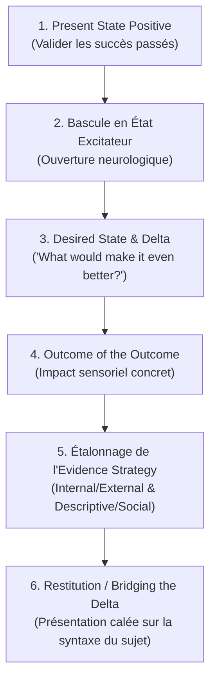

# Power Language - Transcripts
**Formateur :** Kenrick Cleveland & Joseph Riggio | **ID :** `kenrick-cleveland-joseph-riggio-power-language-transcripts` | **Tranches :** 94

# Synthèse Architecturale du Cours : Power Language (Kenrick Cleveland & Joseph Riggio)

---

## 1. Thèse Centrale & Philosophie du Cours

### Vision Spécifique & Rupture avec l'Approche Standard
Là où la PNL classique et les formations de vente traditionnelles s'enferment dans des scripts linéaires rigides, le *mirroring* passif, l'argumentation rationnelle de surface et la précipitation vers le « closing » par l'urgence artificielle, Kenrick Cleveland et Joseph Riggio conçoivent le langage d'influence comme une **technologie de guidage neuro-somatique extemporanée et non dogmatique**.

La posture des auteurs se distingue radicalement par quatre partis pris :
1. **Souveraineté de Cadre & « No Power » (Walk-Away Power) :** Le praticien ne sollicite rien, ne « pitche » pas et refuse d'être mis en position d'exécutant passif. La dépendance au résultat (*neediness*) détruit l'autorité ; le contrôle du cadre repose sur la capacité viscérale et incarnée à refuser la transaction ou à interrompre l'interaction.
2. **Primauté du Régime Excitateur sur l'Inhibiteur :** Aucune suggestion, recadrage ou décision ne peut s'implanter si le système nerveux du sujet est sous régime inhibiteur (défense, alerte amygdalienne, repli critique). L'objectif premier est d'amorcer et de stabiliser un biais d'excitation (ouverture, ressource, dopamine).
3. **Effondrement Temporel de l'État Désiré (Here & Now) :** L'approche standard vend un résultat futur déconnecté. Riggio et Cleveland effondrent la temporalité : ils amènent le sujet à éprouver somatiquement son état désiré *dans l'instant présent*, transformant le refus éventuel non plus en un « non-achat », mais en une perte auto-infligée de ce qu'il possède déjà (*Inverted Loss Frame*).
4. **Minimalisme Opératoire (« Goutte Opératoire ») :** Rejet du gavage technique. Un maître praticien n'empile pas les protocoles : il calibre la neurophysiologie, injecte la micro-intervention minimale au point de bascule exact, et laisse l'intégration inconsciente agir.

### Fil Rouge Méthodologique Unifié
Toutes les interventions du cours suivent une même cybernétique invisible :
$$\text{Filtre Téléologique} \longrightarrow \text{Amorçage Excitateur} \longrightarrow \text{Forage Vertical des Valeurs} \longrightarrow \text{Effondrement Somatique Présent} \longrightarrow \text{Verrouillage Identitaire}$$

Le praticien commence par calibrer son propre système perceptif sur le résultat voulu (intention-driven filter), sécurise son cadre par sa posture de haut statut, détend la pression temporelle, explore la structure profonde en dissociant temporairement la logique pour contourner la résistance, fait basculer le sujet en association kinesthésique viscérale, puis greffe le véhicule d'accompagnement sur l'identité même du sujet.

---

## 2. Carte des Concepts & Leviers Émergents

### A. Écologie Posturale & Cadrage Souverain (Frame Control & Status)
* **Filtre Téléologique Sensoriel & Linguistique (*Intention-Driven Perceptual Filter*) :** Auto-calibration du système réticulé activateur du praticien par une intention claire préalable, transformant son écoute en un tamis actif qui amplifie les leviers utiles et ignore le bruit.
* **Le « No Power » & Souveraineté de Cadre (*Frame Sovereignty & Walk-Away Power*) :** Inversion du rapport de force en refusant le pitch unilatéral et en incarnant la liberté totale de rompre le contact.
* **Décompression Temporelle & Contre-Scarcity (*Status Posture*) :** Retrait délibéré de l'urgence artificielle pour désarmer les mécanismes défensifs des profils analytiques ou à haut statut, démontrant une congruence absolue sans besoin de validation.
* **Vulnérabilité Stratégique & Référence Interne (*Intentional Self-Referential Transparency*) :** Révélation intentionnelle de sa propre réalité interne (*"going first"*) activant la résonance limbique et installant le *comfy couch effect*.

### B. Neurobiologie & Dynamique des États Internes
* **Modulation du Biais Excitateur vs Inhibiteur (*Excitatory vs Inhibitory Regimes*) :** Polarisation délibérée du système nerveux vers la réceptivité dopaminergique avant toute injection de contenu persuasif.
* **Transe par Glissement Temporel (*Time Sliding Confusion Induced Trance*) :** Manipulation rapide des coordonnées temporelles (passé, présent, futur, conditionnel rétroactif) saturant la mémoire de travail et ouvrant une transe d'apprentissage naturelle.
* **Saturation Récursive du Non-Pensé :** Formulation de questions sur « ce que le sujet n'a pas encore envisagé », déclenchant une recherche transdérivationnelle inconsciente qui déconnecte le filtre analytique.
* **Déflation Submodale Spatiale de l'Accablement (*Spatial Submodality Deflation*) :** Réduction de la taille mentale et recul spatial immédiat des représentations oppressantes pour restaurer les fonctions exécutives.

### C. Forage Sémantique & Extraction Décisionnelle
* **Dépassement du Contenu de Surface (*BS Filter to Deep Criteria Mining*) :** Forage vertical des nominalisations via des questions itératives (« What will that do for you? ») pour passer des rationalisations logiques aux critères somatiques terminaux.
* **Distinction Valeurs Motrices vs Critères d'Évidence de Sortie (*Outcome Criteria*) :** Dissociation fonctionnelle entre le moteur émotionnel d'action (la valeur abstraite) et la mire de vérification sensorielle externe (la preuve matérielle que l'objectif est atteint).
* **Découplage Macro Graves vs Stratégie Micro-Décisionnelle :** Utilisation des niveaux de Clare Graves (Spirale Dynamique) uniquement pour le cadrage culturel large (*macro-framing*), tout en calibrant la stratégie de décision individuelle de façon isolée et sensorielle.

### D. Conversion Somatique & Verrouillage
* **Effondrement Temporel de l'État Désiré (*Somatic State Collapse / Here-and-Now*) :** Transduction viscérale immédiate du résultat souhaité dans le corps au temps présent, abolissant l'écart psychologique d'inaccessibilité.
* **Le Cadre de Perte Inversée (*Ownership & Inverted Loss Frame*) :** Installation du sentiment de pleine possession sensorielle de l'état désiré, faisant du renoncement à la proposition une auto-privation inacceptable.
* **Bascule Cybernétique Dissociation Logique $\rightarrow$ Ré-association Viscérale (*Slamming that shut*) :** Traitement des complexités chiffrées/techniques en état dissocié (3e personne) pour éviter l'alerte limbique, suivi d'une ré-incarnation immédiate (1re personne) pour déclencher la motricité d'action dès la validation logique obtenue.
* **Greffe & Verrouillage Monopolistique de Valeur (*Value Augmentation & Monopoly Binding*) :** Amplification de la valeur du sujet par une sur-valeur flatteuse liée à son identité, verrouillée au programme du praticien comme seul vecteur possible d'actualisation.
* **Accommodement Conversationnel vs Opérationnel :** Accueil inconditionnel du *processus cognitif* de l'interlocuteur pour maintenir l'état excitateur, sans céder prématurément sur les *engagements opérationnels*.
* **Inclusion Systémique Anti-Triade (*Baiting the Shadow Influencer*) :** Intégration anticipée de l'influenceur invisible (conjoint, associé) pour court-circuiter les objections fantômes différées.

---

## 3. Tableau Récapitulatif des Techniques & Démonstrations

| Technique / Exercice | Objectif Opératoire | Déclencheur / Indication | Séquence Résumée |
|---|---|---|---|
| **Recadrage de Souveraineté de Cadre (*Anti-Pitch Reset*)** | Reprendre l'ascendant hiérarchique et transformer un interrogatoire en échange interactif souverain. | Le prospect exige d'emblée une présentation unilatérale (« Faites-moi votre pitch / montrez-moi ce que vous avez »). | 1. Stopper net l'élan de présentation.<br>2. Poser la condition de non-dépendance (prêt à partir).<br>3. Recadrer : « Je ne sais pas encore si ce que je fais s'applique à vous ; posons d'abord les bases pour voir si nous sommes compatibles ». |
| **Désamorce Counter-Intuitive (*Exaggeration Deframing*)** | Briser un pattern inhibiteur ou une humeur maussade sans valider ni complaire au cadre négatif. | Prospect distant, fermé, manifestant un mécontentement passif ou un état d'esprit bloqué en début d'échange. | 1. Reconnaître explicitement l'état négatif (« Mauvaise journée ? »).<br>2. Pousser immédiatement à l'absurde temporel : « J'espère au moins que ce n'est pas la pire journée de toute votre vie entière ».<br>3. Calibrer la rupture de pattern (sourire, recul) et réorienter vers le travail. |
| **Forage Vertical des Valeurs (*BS to Deep Core Mining*)** | Dépasser les platitudes de surface et faire émerger le levier limbique non négociable. | Réponses superficielles, intellectuelles ou stéréotypées aux questions de motivation (« faire de l'argent », « être serein »). | 1. Isoler la nominalisation de surface.<br>2. Poser la sonde récursive : « Quand vous avez X, qu'est-ce que cela produit ultimement pour vous ? ».<br>3. Itérer jusqu'au silence réflexif et à la bascule vers un état somatique profond (*legacy*, dignité, sécurité vitale). |
| **Effondrement Temporel Présent (*State Collapse Here & Now*)** | Détruire le sentiment de séparation temporelle avec le résultat et prouver la disponibilité de l'état. | Le sujet intellectualise son état désiré comme un objectif lointain, abstrait et difficile d'accès. | 1. Faire décrire l'état cible idéal.<br>2. Interrompre par ancrage somatique direct : « Vous savez exactement ce que cette sensation fait là, en vous, à cette seconde même ? ».<br>3. Calibrer la réponse physique (respiration, relâchement ventral) et sceller l'état par défaut. |
| **Bascule Cybernétique Dissociation $\rightarrow$ Association (*Slamming that shut*)** | Éviter la panique sur les données complexes/financières tout en conservant la puissance d'achat viscérale. | Présentation de concepts arides, de structures de prix, de tableaux fiscaux ou de risques d'investissement. | 1. Projeter l'attention hors du corps (3e personne, sur un support ou un écran externe).<br>2. Valider l'architecture logique point par point sans charge émotionnelle.<br>3. Dès le micro-assentiment logique calibré, ré-associer violemment : « Maintenant, imaginez ce que ça fait quand vous vivez cela chaque matin ». |
| **Déflation Submodale Spatiale (*Overwhelm Collapse*)** | Stopper net une surcharge cognitive et restaurer l'accès aux capacités d'analyse en quelques secondes. | Le sujet exprime de la confusion ou un sentiment de submersion (« C'est trop, j'ai la tête qui explose, je suis débordé »). | 1. Expliquer que l'accablement est un problème de distance submodale (« C'est juste placé trop près »).<br>2. Commander l'ajustement : « Prenez cette masse, repoussez-la mentalement à 10 mètres, réduisez sa taille de moitié ».<br>3. Vérifier le retour de la clarté somatique. |
| **Amorçage par Biais d'Excitation (*Excitatory Priming*)** | Ouvrir le circuit de récompense et désarmer l'amygdale avant l'entrée dans le vif du sujet. | Démarrage d'un entretien de cadrage, de diagnostic ou de négociation à forts enjeux. | 1. Court-circuiter l'agenda formel.<br>2. Poser une question scannant les réussites : « Avant d'entrer dans les détails, parlez-moi d'une chose que vous avez mise en place récemment et qui a fonctionné au-delà de vos attentes ».<br>3. Laisser le sujet revivre sa fierté avant d'engager le travail de fond. |
| **Verrouillage de Valeur Augmentée (*Value Augmentation & Monopoly*)** | Associer indissolublement l'identité valorisée du sujet à l'offre unique du praticien. | Phase de transition entre l'élucidation des valeurs profondes et la formulation de la proposition. | 1. Prendre la valeur terminale du sujet (ex. « excellence »).<br>2. Y greffer un truisme d'auto-gratification (« C'est ce sentiment rare d'être le seul sur qui tout le monde peut compter »).<br>3. Verrouiller au véhicule : « C'est précisément ce que vivent ceux qui s'engagent dans notre structure, et nulle part ailleurs ». |
| **Neutralisation Préventive de Triade (*Shadow Influencer Baiting*)** | Éliminer les objections fantômes différées portées par des tiers absents lors de l'entretien. | Détection d'un décideur secondaire masqué (associé silencieux, conjoint, mentor, directeur financier). | 1. Identifier l'influenceur invisible au détour d'une phrase.<br>2. L'inviter symboliquement dans le cadre : « Que dira votre associé quand vous lui montrerez que nous avons verrouillé ce point précis ? ».<br>3. Équiper le prospect des arguments ou exiger la présence du tiers pour toute décision. |
| **Transe par Saturation Récursive du Non-Pensé** | Créer une rupture analytique rapide pour implanter une suggestion ou une direction stratégique. | Résistance critique tenace, sur-rationalisation défensive ou blocage dans des certitudes rigides. | 1. Formuler une question à double boucle récursive : « Qu'est-ce que vous ne savez pas encore que vous n'avez pas envisagé par rapport à ce projet ? ».<br>2. Calibrer l'arrêt du regard et l'accès transdérivationnel (décrochage conscient).<br>3. Délivrer la suggestion d'orientation désirée pendant la fenêtre de latence. |

---

---

## 0. Sommaire Sémantique & Index des Lignes

- **Tranche 1 [Lignes 176-339]** : A : Recadrage de Souveraineté de Cadre (The Anti-Presentation Reset) — *Protocole :* A : Recadrage de Souveraineté de Cadre (The Anti-Presentation Reset) | *Verbatim :* Verbatim 1 : Le Recadrage de Souveraineté & Rejet d'Exécutant
- **Tranche 2 [Lignes 341-457]** : Le "Bump" de Sortie du Cadre Inhibiteur (Counter-Intuitive Inhibitory Deframing) — *Protocole :* Le "Bump" de Sortie du Cadre Inhibiteur (Counter-Intuitive Inhibitory Deframing) | *Verbatim :* Le Recadrage de Désamorçage par l'Extrême
- **Tranche 3 [Lignes 459-596]** : La Bascule de Présentation Complexe (Dissociation Analytique $\rightarrow$ Clôture Associée) — *Protocole :* La Bascule de Présentation Complexe (Dissociation Analytique $\rightarrow$ Clôture Associée) | *Mécanisme :* Le Paradoxe de la Réflexion Hyper-Stratégique vs L'Intégration Inconsciente | *Verbatim :* La Dissociation Déictique
- **Tranche 4 [Lignes 598-716]** : d'Actualisation Conjointe (The "Let's Update Together" Protocol) — *Protocole :* d'Actualisation Conjointe (The "Let's Update Together" Protocol)
- **Tranche 5 [Lignes 718-862]** : d'Augmentation de Valeur & Verrouillage Monopolistique (Value Augmentation & Monopoly Bindin... — *Protocole :* d'Augmentation de Valeur & Verrouillage Monopolistique (Value Augmentation & Monopoly Binding Technique) | *Verbatim :* Verbatim 1 : L'Appel Dépolarisant en Écho au Niveau 6 (Inclusion)
- **Tranche 6 [Lignes 864-985]** : A : Capture et Verrouillage Kinesthésique ("Zeroing In on the Feeling") — *Protocole :* A : Capture et Verrouillage Kinesthésique ("Zeroing In on the Feeling")
- **Tranche 7 [Lignes 987-1111]** : Séquence d'Alignement & d'Ouverture Contextuelle (One-to-Many / Webinaire) — *Protocole :* Séquence d'Alignement & d'Ouverture Contextuelle (One-to-Many / Webinaire) | *Verbatim :* Le Cadre d'Élicitation Contextuelle
- **Tranche 8 [Lignes 1113-1263]** : Le Recadrage Temporel de Rupture d'Engagement (« What Changed? ») — *Protocole :* Le Recadrage Temporel de Rupture d'Engagement (« What Changed? ») | *Verbatim :* Le Modèle de Révélation de Continuité de Riggio
- **Tranche 9 [Lignes 1265-1385]** : Utilisation des Sessions d'Intégration Passive (NIS + IS) — *Protocole :* Utilisation des Sessions d'Intégration Passive (NIS + IS) | *Mécanisme :* Déconstruction Opératoire du Jargon vs Structure Réelle (antilingoreduction operationaldemystification) | *Verbatim :* Définition Opératoire de l'Hypnose (Joseph Riggio)
- **Tranche 10 [Lignes 1387-1484]** : Recalibrage d'État et Réinitialisation Neuro-Imprinting (NIS Reset Protocol) — *Protocole :* Recalibrage d'État et Réinitialisation Neuro-Imprinting (NIS Reset Protocol)
- **Tranche 11 [Lignes 1486-1599]** : d'Amorçage par Micro-Action Cinétique & Réciprocité de Cadre & Élicitation Induite du "Big Why" — *Protocole :* d'Amorçage par Micro-Action Cinétique | *Mécanisme :* Réciprocité de Cadre & Élicitation Induite du "Big Why" | *Verbatim :* Réciprocité de Cadre & Élicitation Induite
- **Tranche 12 [Lignes 1601-1753]** : Le "State Overmatching" (Désamorçage d'une boucle hystérique ou panique) — *Protocole :* Le "State Overmatching" (Désamorçage d'une boucle hystérique ou panique) | *Verbatim :* Verbatim 1 : L'extinction de l'objection financière par l'alternative fermée
- **Tranche 13 [Lignes 1755-1903]** : Récupération Douce de Ligne Directrice (Soft Frame Reclaim) — Variante Kenrick Cleveland — *Protocole :* Récupération Douce de Ligne Directrice (Soft Frame Reclaim) — Variante Kenrick Cleveland | *Verbatim :* Verbatim 1 : Redirection Douce et Inclusion Différée
- **Tranche 14 [Lignes 1905-2029]** : A : Installation Séquentielle de la Singularité (Neuro-Imprinting & Image Spinning) — *Protocole :* A : Installation Séquentielle de la Singularité (Neuro-Imprinting & Image Spinning) | *Mécanisme :* La Singularité Opératoire (L'Effondrement Synergique) | *Verbatim :* Verbatim : Induction d'une Transe de Normalisation & Utilisation Sensorielle
- **Tranche 15 [Lignes 2031-2156]** : Intégration Holistique post-Fragmentation ("The Hand & Fingers Re-synthesis") — *Protocole :* Intégration Holistique post-Fragmentation ("The Hand & Fingers Re-synthesis") | *Verbatim :* Pattern 1 : Le recadrage du sevrage émotionnel et l'installation de la normalité
- **Tranche 16 [Lignes 2158-2281]** : d'Amorçage de l'Action Tri-Binaire ("What Next" Protocol) — *Protocole :* d'Amorçage de l'Action Tri-Binaire ("What Next" Protocol) | *Verbatim :* Déconstruction du Faux Dilemme et Expansion Attentionnelle
- **Tranche 17 [Lignes 2283-2396]** : Le Balayage Aléatoire du Cadre de Pouvoir (The 3-Times-a-Day Power Scan) — *Protocole :* Le Balayage Aléatoire du Cadre de Pouvoir (The 3-Times-a-Day Power Scan) | *Mécanisme :* Conditionnement Réflexe du Cadre Neurologique Global | *Verbatim :* Le Cadre Inaltérable du Chasseur
- **Tranche 18 [Lignes 2398-2494]** : Dosage & Espacement Neuro-Synaptique (Image Spinning & NIS) — *Protocole :* Dosage & Espacement Neuro-Synaptique (Image Spinning & NIS) | *Mécanisme :* Synchronisation Circadienne & Fenêtrage Neuro-Énergétique | *Verbatim :* Présupposition d'Apprentissage & Hypo-Amnésie Intégrative
- **Tranche 19 [Lignes 2496-2625]** : L'Ablation Chirurgicale de Critère Opératoire (Surgical Criteria Decoupling) — *Protocole :* L'Ablation Chirurgicale de Critère Opératoire (Surgical Criteria Decoupling) | *Mécanisme :* La dissociation chirurgicale : Outcome Criteria vs. Operating Criteria | *Verbatim :* Le Découplage et l'Ablation Chirurgicale de Critères
- **Tranche 20 [Lignes 2627-2753]** : Rétro-Ingénierie et Calquage Séquentiel de Récit (Macro-Matching) — *Protocole :* Rétro-Ingénierie et Calquage Séquentiel de Récit (Macro-Matching) | *Mécanisme :* L'Adumbration Opératoire et la Projection Anticipative du Traitement Cognitif | *Verbatim :* La Définition Opératoire de l'Adumbration
- **Tranche 21 [Lignes 2755-2895]** : A : La Riposte de Cadre Imperméable (Défense de Cadre) — *Protocole :* A : La Riposte de Cadre Imperméable (Défense de Cadre) | *Verbatim :* La Rupture d'Urgence Imposée (Père de Cleveland)
- **Tranche 22 [Lignes 2897-3012]** : La Vente Stratégique à Haute Autorité (Démonstration Riggio / "Car Dealership") — *Protocole :* La Vente Stratégique à Haute Autorité (Démonstration Riggio / "Car Dealership")
- **Tranche 23 [Lignes 3014-3131]** : Le Reboutage Directif Emboîté (Chaining Assertive-to-Directive) — *Protocole :* Le Reboutage Directif Emboîté (Chaining Assertive-to-Directive) | *Mécanisme :* Le Pivot Directif en Chaîne (Directive-to-Directive Chaining via Implied Directives) | *Verbatim :* Le double lien directif à prémisse contextuelle (Riggio)
- **Tranche 24 [Lignes 3133-3272]** : Conditionnement du Tonus Vagal & Résilience Somatique — *Protocole :* Conditionnement du Tonus Vagal & Résilience Somatique | *Mécanisme :* Le Toning Vagal & la Bascule Excitatoire / Inhibitrice | *Verbatim :* Verbatim 1 : L'apaisement du cadre d'apprentissage et le postulat de non-régression
- **Tranche 25 [Lignes 3274-3423]** : Recadrage Excitatif et Enchaînement sur les Valeurs Cibles (Negative to Positive Elicitation... — *Protocole :* Recadrage Excitatif et Enchaînement sur les Valeurs Cibles (Negative to Positive Elicitation & Solidification Loop) | *Verbatim :* Le Flip Positif Immédiat
- **Tranche 26 [Lignes 3425-3554]** : Le Cycle de Satisfaction Appliqué au Recrutement / Évaluation de Haut Niveau — *Protocole :* Le Cycle de Satisfaction Appliqué au Recrutement / Évaluation de Haut Niveau | *Mécanisme :* Le Levier du Delta (The Gap Leverage) | *Verbatim :* Le Cadrage Positif Présuppositionnel en Recrutement
- **Tranche 27 [Lignes 3556-3656]** : Élicitation Multi-Interlocuteurs en Vente / Négociation de Groupe — *Protocole :* Élicitation Multi-Interlocuteurs en Vente / Négociation de Groupe
- **Tranche 28 [Lignes 3658-3793]** : L'Entraînement de l'Instrument Perceptuel ("Tuning the Instrument Drill") — *Protocole :* L'Entraînement de l'Instrument Perceptuel ("Tuning the Instrument Drill") | *Mécanisme :* Le Piège de l'Équivalence Analogique Stérile ("This is Not That") | *Verbatim :* Verbatim 1 : La Claque Épistémologique contre le Pattern Matching
- **Tranche 29 [Lignes 3795-3898]** : Recodage de la Puissance Réactive en Puissance Somatique Primale (Démonstration Riggio sur R... — *Protocole :* Recodage de la Puissance Réactive en Puissance Somatique Primale (Démonstration Riggio sur Rita) | *Mécanisme :* Le « Don du Chasseur » et la Posture Prédatrice Évolutive | *Verbatim :* La Descente Somatique de l'Énergie
- **Tranche 30 [Lignes 3900-4047]** : Le Recadrage Kinesthésique de la Menace en Réceptivité Curieuse (The Threat-to-Curiosity Shift) — *Protocole :* Le Recadrage Kinesthésique de la Menace en Réceptivité Curieuse (The Threat-to-Curiosity Shift) | *Mécanisme :* Le Don du Prédateur / Le Don du Chasseur (The Hunter's Gift / The Predator's Stance) | *Verbatim :* La posture de confrontation inébranlable (The Bring-It-On Stance)
- **Tranche 31 [Lignes 4049-4164]** : Encodage de la « Mémoire de Peau » Identitaire (Skin Memory Imprint Protocol) — *Protocole :* Encodage de la « Mémoire de Peau » Identitaire (Skin Memory Imprint Protocol) | *Mécanisme :* Le Ciblage par Présupposition Identitaire Somatique (Skin Memory Targeting) | *Verbatim :* Le Rapprochement Perceptuel de la Cible (Zen Archery)
- **Tranche 32 [Lignes 4166-4292]** : The Satisfaction Cycle (Phase 1 & 2 - Amorce Opératoire) — *Protocole :* The Satisfaction Cycle (Phase 1 & 2 - Amorce Opératoire)
- **Tranche 33 [Lignes 4294-4439]** : Le Modèle du Cycle de Satisfaction (Vente Complexe & Négociation à Fort Enjeu) — *Protocole :* Le Modèle du Cycle de Satisfaction (Vente Complexe & Négociation à Fort Enjeu)
- **Tranche 34 [Lignes 4441-4559]** : L'Amorce Assertive Permissive (Ouverture d'Entretien) — *Protocole :* L'Amorce Assertive Permissive (Ouverture d'Entretien) | *Mécanisme :* Le Levier Permissif vs Autoritaire (Permissive Language Architecture) | *Verbatim :* L'Ouverture Permissive Corporative
- **Tranche 35 [Lignes 4561-4687]** : A : Neutralisation et Remplacement d'une Déclaration Restrictive — *Protocole :* A : Neutralisation et Remplacement d'une Déclaration Restrictive | *Verbatim :* La rupture de réalité et contre-déclaration immédiate
- **Tranche 36 [Lignes 4689-4800]** : Sortie de Transe Hypnotique et Réintégration Somatique (Fin de Module 10) — *Protocole :* Sortie de Transe Hypnotique et Réintégration Somatique (Fin de Module 10) | *Mécanisme :* La Vente de Certitude comme Échange Asymétrique de Risque | *Verbatim :* La Réorientation Somato-Temporelle vers la Vigile
- **Tranche 37 [Lignes 4802-4923]** : La Boucle du Cycle de Satisfaction (De l'État Positif à l'Action) — *Protocole :* La Boucle du Cycle de Satisfaction (De l'État Positif à l'Action) | *Verbatim :* Extraction du Mot-Code et de l'Outcome of the Outcome
- **Tranche 38 [Lignes 4925-5094]** : Le Recadrage d'Intégrité Implacable (The Implacable Integrity Frame) — *Protocole :* Le Recadrage d'Intégrité Implacable (The Implacable Integrity Frame) | *Mécanisme :* Le Biais Excitatoire Neurologique (Excitatory Bias Activation) | *Verbatim :* Le Recadrage de Réalité & L'Engagement Éthique
- **Tranche 39 [Lignes 5096-5217]** : d'Élicitation du Delta et de la Stratégie de Preuve (The Satisfaction Cycle & Evidence Strat... — *Protocole :* d'Élicitation du Delta et de la Stratégie de Preuve (The Satisfaction Cycle & Evidence Strategy) | *Verbatim :* L'Interception & Recadrage de Compliment Rétroactif
- **Tranche 40 [Lignes 5219-5327]** : Détection & Rétroaction Matricielle (Locus $\times$ Critère) — *Protocole :* Détection & Rétroaction Matricielle (Locus $\times$ Critère) | *Mécanisme :* Le Pivot "Outcome of the Outcome" vs Hiérarchie des Valeurs | *Verbatim :* Le Modèle Descriptif Linéaire Pur (Contenu Vide, Structure Formelle)
- **Tranche 41 [Lignes 5329-5447]** : Le "Time Sliding" (Compression d'une Stratégie Décisionnelle Lente) — *Protocole :* Le "Time Sliding" (Compression d'une Stratégie Décisionnelle Lente)
- **Tranche 42 [Lignes 5449-5615]** : L'Architecture du Delta (De la Prise de Contrôle à la Tension d'Action) — *Protocole :* L'Architecture du Delta (De la Prise de Contrôle à la Tension d'Action) | *Mécanisme :* Le Maillage Contextuel & La Rétention de Contexte Interne | *Verbatim :* Le Recadrage de la Rupture Professionnelle (The Sovereign Walk-Away)
- **Tranche 43 [Lignes 5617-5730]** : Élicitation du Delta & Structuration de la Solution Experience — *Protocole :* Élicitation du Delta & Structuration de la Solution Experience | *Mécanisme :* L'Élicitation du Delta : Combler l'écart cognitif et matériel | *Verbatim :* La Conjecture Opératoire sur le Delta
- **Tranche 44 [Lignes 5732-5836]** : d'Élicitation de l'État Désiré par Glissement Temporel (Time Sliding Protocol) — *Protocole :* d'Élicitation de l'État Désiré par Glissement Temporel (Time Sliding Protocol) | *Verbatim :* La Faillite du Pattern Mécanique (Anti-Pattern de Manipulation)
- **Tranche 45 [Lignes 5838-6044]** : Démonstration du "Source Code" / Clôture par Élicitation de Valeurs & Glissement Temporel — *Protocole :* Démonstration du "Source Code" / Clôture par Élicitation de Valeurs & Glissement Temporel | *Mécanisme :* Le Biais Excitateur Pur et l'Inhibiteur Implicite | *Verbatim :* L'Élicitation Directe du Pivot de Valeur
- **Tranche 46 [Lignes 6046-6186]** : Glissement Temporel - Pattern A (Évacuation de Problème et Dépassement) — *Protocole :* Glissement Temporel - Pattern A (Évacuation de Problème et Dépassement) | *Mécanisme :* La synthèse "Source Code Modeling" (Cycle de Satisfaction × Modèle des Valeurs × Biais Excitatoire) | *Verbatim :* La Cascade de Glissement Temporel (Overcoming the Problem Pattern)
- **Tranche 47 [Lignes 6188-6345]** : Le Glissement Spatio-Temporel en 3 Points (The Past-Future-Present Sliding Loop) — *Protocole :* Le Glissement Spatio-Temporel en 3 Points (The Past-Future-Present Sliding Loop)
- **Tranche 48 [Lignes 6347-6451]** : d'Élicitation Stratégique et de Structuration de l'Offre en Vente Conversationnelle — *Protocole :* d'Élicitation Stratégique et de Structuration de l'Offre en Vente Conversationnelle
- **Tranche 49 [Lignes 6453-6637]** : Le Modèle "Source Code" d'Élicitation et de Présentation (Vente & Alignement) — *Protocole :* Le Modèle "Source Code" d'Élicitation et de Présentation (Vente & Alignement)
- **Tranche 50 [Lignes 6639-6752]** : Source Code Modeling (Phase 1 : Cartographie de Levier & Découverte du Delta) — *Protocole :* Source Code Modeling (Phase 1 : Cartographie de Levier & Découverte du Delta) | *Verbatim :* Pattern 1 : Le Pont vers le Biais Excitatoire
- **Tranche 51 [Lignes 6754-6896]** : Élicitation et Qualification des Critères Opératoires (Operating Criteria & Gap Discovery) — *Protocole :* Élicitation et Qualification des Critères Opératoires (Operating Criteria & Gap Discovery)
- **Tranche 52 [Lignes 6898-7019]** : La Fermeture Médicale Sans Forçage (The Non-Hard-Close Prescription) — *Protocole :* La Fermeture Médicale Sans Forçage (The Non-Hard-Close Prescription) | *Mécanisme :* Le Modèle de Prescription Médicale (The Physician Model of Influence) | *Verbatim :* Le Recadrage de Prescription Médicale
- **Tranche 53 [Lignes 7021-7144]** : Alignement et Formulation selon le Profil 4 - 5 - 6 (The Value-Level Pitching Matrix) — *Protocole :* Alignement et Formulation selon le Profil 4 - 5 - 6 (The Value-Level Pitching Matrix) | *Verbatim :* Exemple 1 : Pitch Prescription Médicale - Niveau 4 (Procédural / Certitude / Ancienneté)
- **Tranche 54 [Lignes 7146-7299]** : L'Entretien de Vente / Diagnostic par Élicitation des Valeurs (Riggio -> Cleveland) — *Protocole :* L'Entretien de Vente / Diagnostic par Élicitation des Valeurs (Riggio -> Cleveland) | *Mécanisme :* L'Amorçage Excitatoire du Présent State (Excitatory State Anchoring) | *Verbatim :* Le Recadrage Paradoxal de l'État Présent
- **Tranche 55 [Lignes 7301-7424]** : Désamorçage d'Intimidation Hiérarchique par Effet Miroir d'Incertitude (The Call Center Coun... — *Protocole :* Désamorçage d'Intimidation Hiérarchique par Effet Miroir d'Incertitude (The Call Center Counter-Frame)
- **Tranche 56 [Lignes 7426-7591]** : Le "Case Building" sur Déclaration de Certitude — *Protocole :* Le "Case Building" sur Déclaration de Certitude | *Verbatim :* La proposition progressive en coaching (Cleveland)
- **Tranche 57 [Lignes 7593-7758]** : L'Interruption "Columbo" (Bumbling Interrupt & Reset) — *Protocole :* L'Interruption "Columbo" (Bumbling Interrupt & Reset) | *Verbatim :* La Manœuvre "Columbo" (Verbatim d'interruption par oubli simulé)
- **Tranche 58 [Lignes 7760-7909]** : Désamorçage d'Objection Prix par Homme de Paille Déprécié & Respect Mutuel — *Protocole :* Désamorçage d'Objection Prix par Homme de Paille Déprécié & Respect Mutuel | *Verbatim :* L'Homme de Paille Péjoratif et le Verrou du Respect Réciproque
- **Tranche 59 [Lignes 7911-8040]** : Le Déroulé Stratégique de Recadrage Tridimensionnel (Clarté $\rightarrow$ Recadrage $\righta... — *Protocole :* Le Déroulé Stratégique de Recadrage Tridimensionnel (Clarté $\rightarrow$ Recadrage $\rightarrow$ Mémoire Future) | *Verbatim :* La Mémoire Future d'Abondance et le Retour au Présent
- **Tranche 60 [Lignes 8042-8194]** : Le Modèle de Déconstruction d'Objection en 3 Phases (Clarté -> Recadrage -> Future Pacing) — *Protocole :* Le Modèle de Déconstruction d'Objection en 3 Phases (Clarté -> Recadrage -> Future Pacing) | *Verbatim :* Le Reframing Médical Ultime (Riggio)
- **Tranche 61 [Lignes 8196-8361]** : Le "Lazy Frame" (Désamorçage d'Objection par le Vide et l'Effet Miroir) — *Protocole :* Le "Lazy Frame" (Désamorçage d'Objection par le Vide et l'Effet Miroir) | *Mécanisme :* Le "Okay" Minimaliste comme Refus de Propriété et Rupture de Boucle | *Verbatim :* The Reality-Check Silence
- **Tranche 62 [Lignes 8363-8489]** : L'Installation Transe-Générative du Prédateur / Traqueur Créatif — *Protocole :* L'Installation Transe-Générative du Prédateur / Traqueur Créatif
- **Tranche 63 [Lignes 8491-8603]** : A : Étalonnage du Jeu de Signaux Somatiques Oui/Non (Yes-No Signal Set) — *Protocole :* A : Étalonnage du Jeu de Signaux Somatiques Oui/Non (Yes-No Signal Set) | *Verbatim :* Verbatim 1 : L'installation du Cadre d'Exclusivité et de Haute Valeur
- **Tranche 64 [Lignes 8605-8764]** : Désamorçage Immédiat sur Calibrage Visuel/Auditif (Micro-Objection) — *Protocole :* Désamorçage Immédiat sur Calibrage Visuel/Auditif (Micro-Objection) | *Mécanisme :* Disruption de la Stratégie de Réalité (realitystrategycollapse epistemicdoubt) | *Verbatim :* La Stratégie de Réalité et l'Injection Temporelle
- **Tranche 65 [Lignes 8766-8893]** : Le Découpage Positif d'Amorçage (Chunking Down on Certainty) — *Protocole :* Le Découpage Positif d'Amorçage (Chunking Down on Certainty)
- **Tranche 66 [Lignes 8895-9038]** : Le Recadrage en Terrain Vierge (Greenfield Reframe Protocol) — *Protocole :* Le Recadrage en Terrain Vierge (Greenfield Reframe Protocol) | *Verbatim :* Verrouillage Identitaire & Présupposition de Réalisation
- **Tranche 67 [Lignes 9040-9181]** : A : Intégration Cumulative de la Triade (Power → Creativity → Influence) — *Protocole :* A : Intégration Cumulative de la Triade (Power → Creativity → Influence) | *Mécanisme :* La Trinité Indissociable : Puissance, Créativité, Influence en Entité Unique | *Verbatim :* L'Injonction de l'Entité Trinaire
- **Tranche 68 [Lignes 9183-9309]** : Le "Zipper" d'Entrée en 2e Position (Kenrick Cleveland) — *Protocole :* Le "Zipper" d'Entrée en 2e Position (Kenrick Cleveland) | *Mécanisme :* Le Circuit Neuromusculaire d'Adumbration & Rétroaction Limbique | *Verbatim :* La Métaphore Structurelle du Virtuose et de l'Instrument
- **Tranche 69 [Lignes 9311-9428]** : Alignement et Qualification Stratégique des Objectifs (High-Ticket & Coaching d'Impact) — *Protocole :* Alignement et Qualification Stratégique des Objectifs (High-Ticket & Coaching d'Impact) | *Verbatim :* La Liberté d'Ignorance Stratégique
- **Tranche 70 [Lignes 9430-9540]** : Délégation Somatique et Réallocation Attentionnelle (Preferencing Ericksonien) — *Protocole :* Délégation Somatique et Réallocation Attentionnelle (Preferencing Ericksonien) | *Mécanisme :* La dissociation Neuro-Cognitive : Esprit Représentationnel vs Circuits Non-Représentationnels | *Verbatim :* Le Verrouillage de Préférenciation Somatique (Milton Erickson Modélisé par Riggio)
- **Tranche 71 [Lignes 9542-9647]** : L'Adoption par Procuration (Self-Referencing Shift) — *Protocole :* L'Adoption par Procuration (Self-Referencing Shift) | *Mécanisme :* Le Paradoxe de la Spécificité pour la Compréhension Générale | *Verbatim :* La capture d'attention par auto-référencement sensoriel
- **Tranche 72 [Lignes 9649-9794]** : A : Séquençage Directionnel "Direct Attention & Fill in the Blanks" — *Protocole :* A : Séquençage Directionnel "Direct Attention & Fill in the Blanks" | *Verbatim :* La Stratégie d'Orientation Attentionnelle
- **Tranche 73 [Lignes 9796-9905]** : Construction de la Conformité Éthique (Building Compliance via the Big Why) — *Protocole :* Construction de la Conformité Éthique (Building Compliance via the Big Why) | *Verbatim :* Verbatim 1 : L'installation de la désorientation sécurisée (Set Aside / Shift Frame)
- **Tranche 74 [Lignes 9907-10053]** : Détermination Couverte de la Stratégie de Conviction (D-F-I Elicitation) — *Protocole :* Détermination Couverte de la Stratégie de Conviction (D-F-I Elicitation) | *Mécanisme :* La Triade de la Stratégie de Conviction : Durée, Fréquence, Intensité | *Verbatim :* Élicitation Couverte des Seuils de Décision
- **Tranche 75 [Lignes 10055-10214]** : A : Traitement et Démantèlement d'un Assertif (Objection / Croyance Limitante) — *Protocole :* A : Traitement et Démantèlement d'un Assertif (Objection / Croyance Limitante) | *Mécanisme :* Ontologie du Langage comme Structure de Réalité (Théorie des Actes de Parole / Speech Acts) | *Verbatim :* s Verbatim
- **Tranche 76 [Lignes 10216-10343]** : Désamorçage et Recadrage d'un Mismatching Rigide — *Protocole :* Désamorçage et Recadrage d'un Mismatching Rigide | *Mécanisme :* La Taxonomie des Actes de Langage (John Searle) comme Radar Stratégique | *Verbatim :* Le Défi d'Impuissance pour Mismatcher
- **Tranche 77 [Lignes 10345-10473]** : Auto-Réglage et Réinitialisation Somatique dans le Biais Excitateur (Entraînement / In-Session) — *Protocole :* Auto-Réglage et Réinitialisation Somatique dans le Biais Excitateur (Entraînement / In-Session) | *Mécanisme :* Le Principe de Suprématie Biologique (Biology Rules / Biology Will Win) | *Verbatim :* La Loi Biologique d'Inéluctabilité
- **Tranche 78 [Lignes 10475-10630]** : Réinitialisation Vaso-Vagale Somato-Respiratoire (Auto-régulation ou Guidage Sujet) — *Protocole :* Réinitialisation Vaso-Vagale Somato-Respiratoire (Auto-régulation ou Guidage Sujet) | *Verbatim :* La Bascule Pavlovienne
- **Tranche 79 [Lignes 10632-10744]** : Réinitialisation Somatique Délibérée face à l'Escalade (Auto-Régulation Vagale) — *Protocole :* Réinitialisation Somatique Délibérée face à l'Escalade (Auto-Régulation Vagale) | *Verbatim :* Recadrage brutal sur l'illusion de la formule magique vs la physiologie
- **Tranche 80 [Lignes 10746-10834]** : d'Exécution du Modèle Transactionnel (The Transactional Model) — *Protocole :* d'Exécution du Modèle Transactionnel (The Transactional Model) | *Mécanisme :* La Matrice de Décision en 5 Étapes (The Decision Matrix Loop) | *Verbatim :* La Définition de l'Influence et la Vente de Certitude
- **Tranche 81 [Lignes 10836-10929]** : Diagnostic de Modèle & Franchissement de la Zone Liminale — *Protocole :* Diagnostic de Modèle & Franchissement de la Zone Liminale | *Mécanisme :* Le Continuum des Modèles d'Influence & le Niveau d'Incertitude Décisionnelle | *Verbatim :* Le Dialogue Transactionnel Pur (Clôture Logistique Immédiate)
- **Tranche 82 [Lignes 10931-11086]** : Le Modèle du Cycle de Satisfaction (The Satisfaction Cycle) — *Protocole :* Le Modèle du Cycle de Satisfaction (The Satisfaction Cycle) | *Mécanisme :* Le Circuit de Recherche de Satisfaction Primaire (Satisfaction-Seeking Engine) | *Verbatim :* Le Cadre Biologique du Plaisir vs la Douleur
- **Tranche 83 [Lignes 11088-11184]** : d'Exécution Transactionnelle : Séquence Assertion-Silence-Directive — *Protocole :* d'Exécution Transactionnelle : Séquence Assertion-Silence-Directive | *Verbatim :* Pattern 1 : Le Déclencheur d'Auto-Closing (Closing Statements du Client)
- **Tranche 84 [Lignes 11186-11294]** : Construction de la Transaction Opératoire (Compliance Locking) — *Protocole :* Construction de la Transaction Opératoire (Compliance Locking)
- **Tranche 85 [Lignes 11296-11443]** : Exploration, Synthèse et Verrouillage de Réalités Futures (Transe Guidée de R.I. / Future Pa... — *Protocole :* Exploration, Synthèse et Verrouillage de Réalités Futures (Transe Guidée de R.I. / Future Pacing) | *Mécanisme :* Ligne temporelle prospective à bifurcations quantiques (quantumtimelinejunctions decisionarchitecture) | *Verbatim :* L'Analyse Omnisciente par Big Data / IA
- **Tranche 86 [Lignes 11445-11581]** : Le Recadrage Présuppositionnel de Problème en Capacité (Cleveland & Riggio Reframing) — *Protocole :* Le Recadrage Présuppositionnel de Problème en Capacité (Cleveland & Riggio Reframing) | *Verbatim :* La Minimisation Rétroactive Noyée dans l'Assise Positive
- **Tranche 87 [Lignes 11583-11700]** : Le Sandwich Inhibiteur (Inhibitory Encapsulation Protocol) — *Protocole :* Le Sandwich Inhibiteur (Inhibitory Encapsulation Protocol) | *Verbatim :* Le Sandwich Positif / Inhibiteur appliqué au protocole médical
- **Tranche 88 [Lignes 11702-11842]** : La Manœuvre d'Interruption Précoce de Réalité (Early Reality Break) — *Protocole :* La Manœuvre d'Interruption Précoce de Réalité (Early Reality Break) | *Mécanisme :* Le Triptyque Opératoire : Breaking, Bending, Building Realities | *Verbatim :* Le Pré-framing Contextuel d'Intention
- **Tranche 89 [Lignes 11844-11980]** : Enchaînement Assertive -> Directive / Commissive (Drill d'Intégration Réflexe) — *Protocole :* Enchaînement Assertive -> Directive / Commissive (Drill d'Intégration Réflexe)
- **Tranche 90 [Lignes 11982-12112]** : La Matrice d'Élicitation des Valeurs en 3 Questions (The 3-Question Values Model) — *Protocole :* La Matrice d'Élicitation des Valeurs en 3 Questions (The 3-Question Values Model) | *Mécanisme :* L'Élicitation Récursive de Valeurs (Chaining up aux Niveaux Logiques) | *Verbatim :* 1. Définition Opératoire des Valeurs (Joseph Riggio)
- **Tranche 91 [Lignes 12114-12200]** : La Séquence des 3 Questions d'Élucidation des Valeurs (Format Cleveland/Riggio) — *Protocole :* La Séquence des 3 Questions d'Élucidation des Valeurs (Format Cleveland/Riggio) | *Verbatim :* La Triple Séquence Élégante avec Question Pivot Ultime
- **Tranche 92 [Lignes 12202-12364]** : Élicitation Ascendante des Valeurs & Liaison "Junk-o-Logic" — *Protocole :* Élicitation Ascendante des Valeurs & Liaison "Junk-o-Logic" | *Verbatim :* Le Recadrage Nominal d'Arrêt de Boucle
- **Tranche 93 [Lignes 12366-12499]** : Désarçonnage et Réorientation d'une Menace Verbale (Contre-Promissif) — *Protocole :* Désarçonnage et Réorientation d'une Menace Verbale (Contre-Promissif) | *Mécanisme :* Hiérarchie de Décodage Neurologique et Attentionnelle des Actes de Langage | *Verbatim :* s Verbatim
- **Tranche 94 [Lignes 12501-12584]** : d'Altération et de Redirection d'un Commissif Adverse (Threat/Promise Bending) — *Protocole :* d'Altération et de Redirection d'un Commissif Adverse (Threat/Promise Bending)

---

## Extractions Détaillées par Tranche (Opératoire & Verbatim)

## Tranche 1 / 94 : A : Recadrage de Souveraineté de Cadre (The Anti-Presentation Reset)

### 1. Mécanismes & Principes Actifs

- **Filtre Téléologique Sensoriel & Linguistique (Intention-Driven Perceptual Filter)**
  *Principe actif* : Dès que le praticien fixe une intention de résultat précise avant l'interaction, son système d'attention sélective (système réticulé activateur) se calibre automatiquement. Le praticien n'écoute plus de manière passive ou neutre : ce que le sujet verbalise est immédiatement tamisé à travers l'objectif. Les questions posées et les micro-ajustements prosodiques s'organisent hors-conscience pour ne retenir et amplifier que ce qui sert la direction visée, tout en neutralisant les digressions.
  *Tags* : #intention_as_filter #teleological_listening #frame_control #perceptual_salience

- **Le "No Power" & Préservation du Levier Éthique (Frame Sovereignty & Walk-Away Power)**
  *Principe actif* : Dans toute négociation ou intervention d'influence, le contrôle du cadre dépend de la capacité réelle et incarnée à refuser la transaction (« Walk-away power »). Si l'intervenant dépend du résultat ou cède à l'injonction du client (« faites-moi votre présentation »), il se déleste de tout levier d'autorité (*deleverage*). En recadrant immédiatement l'interaction en dialogue interactif ou en rompant le contact, le praticien inverse le rapport de dépendance et établit une posture d'autorité naturelle où le client est demandeur.
  *Tags* : #walk_away_power #frame_sovereignty #no_power #anti_pitch_posture

- **Dépassement du Contenu de Surface & Élicitation Verticale des Valeurs (BS Filter to Deep Criteria)**
  *Principe actif* : Les premières réponses d'un sujet (« avoir plus de clients », « avoir des résultats ») sont des rationalisations logiques de surface ou des formulations socialement acceptables (qualifiées de « BS » par Cleveland). Descendre verticalement par des questions de valeur itératives (« What will that do for you? », « What's important about that? ») permet de contourner le filtre critique pour toucher les états critères terminaux (*satisfaction, security, legacy, life worth living*). Ce sont ces critères somatiques profonds qui activent le système de motivation limbique et rendent l'adhésion inévitable.
  *Tags* : #vertical_elicitation #criteria_mining #nominalization_drilldown #emotional_driver

- **Effondrement Temporel de l'État Désiré dans le Présent (Somatic State Collapse / Present-State Anchoring)**
  *Principe actif* : Le cerveau ne fait pas la différence entre un état vivement remémoré ou anticipé et une expérience actuelle. Lorsque Riggio demande « Do you know what that sensation is like now, at this second? », il fait basculer la valeur d'un concept futur théorique à une réalité somatique viscérale immédiate (ici au niveau de l'estomac/du ventre). En prouvant au sujet qu'il ressent déjà l'état désiré dans le présent, il brise le présupposé de manque (« je dois travailler dur pour l'obtenir ») et redéfinit l'accompagnement non plus comme la quête d'un état absent, mais comme la stabilisation d'un état par défaut déjà disponible.
  *Tags* : #somatic_anchoring #state_collapse #here_and_now_transduction #default_mode_recode

- **Effet de Levier par Recouvrement Identitaire (Value Leveraging vs Reflection)**
  *Principe actif* : Le simple « mirroring » ou reflet de valeurs reste un rapport passif. Le levier (*leveraging*) consiste à s'emparer des critères terminaux extraits du sujet (*legacy, exceeding oneself*) et à les fusionner par le langage avec le véhicule proposé (le programme/l'accompagnement). En rehaussant l'exigence (« nous allons vous pousser durement »), le praticien active le biais d'auto-cohérence du sujet : refuser la proposition reviendrait pour lui à rejeter sa propre valeur identitaire ultime.
  *Tags* : #identity_congruence #value_leveraging #commitment_hook #status_elevation

---

### 2. Protocoles, Techniques & Démonstrations (Étape par Étape)

#### Protocole A : Recadrage de Souveraineté de Cadre (The Anti-Presentation Reset)
* **Intention / Indication** : À utiliser dès que l'interlocuteur tente de vous imposer un rôle de prestataire exécutant ou demande un pitch unilatéral (« Faites-moi votre présentation » / « Montrez-moi ce que vous avez »).
* **Mise en place & Pré-framing** : Posture interne de détachement total (être prêt à quitter la table sans agressivité).
* **Séquence d'actions pas à pas** :
  1. *Interruption de pattern polie mais ferme* : Signifier immédiatement que la demande ne correspond pas au cadre (« Je ne savais pas que nous étions là pour ça »).
  2. *Définition du cadre exclusif* : Définir la relation comme une exploration interactive bilatérale.
  3. *Option d'échappement descendante (Down-referral push)* : Offrir de renvoyer le client vers des subordonnés ou des confrères de moindre rang qui acceptent ce genre de formatage passif.
  4. *Test de choix binaire* : Laisser la décision au client (« C'est à vous de voir »).
  5. *Prise en main immédiate par l'interrogation* : Enchaîner directement sur une question ouverte orientée sur son expertise/histoire pour lui redonner la parole sous votre cadre.
* **Signes de calibration** : Cession du contrôle par le client, silence de réajustement, acquiescement somatique, passage d'une attitude évaluatrice à une posture d'explication de soi.

---

#### Protocole B : Chaînage Ascendant de Valeurs & Recadrage Positif (The Value Ladder & Negative-to-Positive Reframing)
* **Intention / Indication** : Extraire le motif profond d'action et transformer une motivation d'évitement (fuite de la douleur/peur) en attraction vers un état désiré lumineux.
* **Mise en place & Pré-framing** : Poser une question directionnelle positive d'ouverture.
* **Séquence d'actions pas à pas** :
  1. *Amorçage* : Poser la question de base : « Que voulez-vous de plus positif par rapport à ce que vous avez actuellement ? »
  2. *Forçage du filtre superficiel* : Quand le sujet donne une réponse logique de surface (ex: « Plus de clients »), relancer par : « Qu'est-ce que cela fera pour vous ? »
  3. *Challenge de l'évidence (Disruption)* : Si le sujet donne une justification fade (« C'est agréable »), confronter doucement : « C'est la seule raison ? Vraiment ? »
  4. *Élicitation itérative du critère* : Continuer l'ascension jusqu'au critère de sécurité, de contrôle ou de paix : « Et avec [Critère X] et [Critère Y], qu'est-ce que cela vous apporte au fond ? »
  5. *Recadrage d'inversion positive* : Si le client exprime une fuite (« Ne plus avoir à regarder par-dessus mon épaule pour savoir d'où vient l'argent »), reformuler instantanément en modalité positive pure : « En clair, un futur libre et dégagé, où l'argent est disponible avec fluidité. »
  6. *Pont vers le futur & Amplification somatique* : Transposer le sujet dans la scène réalisée avec vous (« En vous installant dans ce moment maintenant où nous avons accompli cela ensemble... qu'est-ce que vous ressentez de meilleur ? »).
* **Signes de calibration** : Ralentissement du débit verbal, soupir d'apaisement, respiration plus profonde, hochement de tête affirmatif sur le recadrage positif.

---

#### Protocole C : Conversion Somatique Présente & Recadrage de l'État par Défaut (Riggio's Somatic Reality Shift)
* **Intention / Indication** : Lorsqu'un sujet place son état de satisfaction désiré dans un futur lointain conditionné à un effort excessif (« je dois travailler dur pour ressentir cela »).
* **Mise en place & Pré-framing** : Repérer la nominalisation émotionnelle répétée par le sujet (ex: *satisfaction, peace*).
* **Séquence d'actions pas à pas** :
  1. *Élicitation de la jauge de calibration* : « Comment savez-vous que vous l'avez pleinement ? »
  2. *Localisation somatique* : Identifier la manifestation kinesthésique exacte (« Cette sensation dans le ventre, cette paix »).
  3. *Effondrement temporel immédiat* : Déplacer la référence du passé/futur au temps présent : « Et cette sensation, savez-vous ce que c'est là maintenant, à cette seconde même ? Pas autrefois, mais là ? »
  4. *Validation du ressenti présent* : Vérifier l'accès kinesthésique (« Vous avez cette sensation maintenant ? Oui. »).
  5. *Disruption du pattern d'effort* : Révéler le paradoxe neurologique : « Si vous l'avez déjà là, pourquoi devriez-vous travailler plus dur pour l'obtenir ? »
  6. *Recadrage en mode opératoire stable* : Redéfinir l'état non comme un objectif à atteindre, mais comme la plate-forme de départ (*stable default operating mode*) à partir de laquelle agir.
* **Signes de calibration** : Confusion transitoire (yeux qui se déconnectent ou fixent le vide), détente musculaire faciale, sourire de réalisation, réalignement postural immédiat.

---

#### Protocole D : Levier de Valeurs par Résonance d'Identité & Mission Supérieure (The Legacy Lock)
* **Intention / Indication** : Clôturer un engagement de haut niveau en liant le produit ou l'accompagnement à l'héritage de vie du sujet.
* **Mise en place & Pré-framing** : Avoir élicité au préalable la valeur terminale (ex: « Un héritage / Legacy », « Savoir que ma vie valait la peine d'être vécue »).
* **Séquence d'actions pas à pas** :
  1. *Alignement d'égal à égal (Mano a mano)* : S'aligner avec la valeur en partageant sa propre résonance identitaire (« Pour moi aussi, ceci est l'aboutissement de décennies de travail »).
  2. *Reflet poétique et sensoriel de la valeur* : Décrire la valeur sous un angle transcendant (« Laisser quelque chose qui demeure dans le cœur, l'esprit et l'âme des autres »).
  3. *Validation de synchronisation* : Demander confirmation du sens exact (« Est-ce bien ce que vous vouliez dire ? »).
  4. *Injonction paradoxale d'élévation* : Poser la règle de dépassement : « On ne peut pas se dépasser tout seul. Il faut s'engager envers quelque chose de plus grand que soi. »
  5. *Invitation d'appropriation* : Inviter le sujet à co-créer et enrichir le véhicule par sa présence (« Je vous invite à rendre ce programme encore plus grand qu'il ne l'est sans vous »).
* **Signes de calibration** : Inspiration suspendue, voix qui s'adoucit, sentiment d'absorption ou d'attraction magnétique rapporté spontanément (« sucked in »), accord absolu et solennel.

---

### 3. Heuristiques, Subtilités & "Sagesse du Praticien"

- **Heuristique de Contrôle du Cadre** :
  *Règle* : Si le client tente d'imposer un cadre unilatéral d'évaluation (pitch) $\rightarrow$ *Alors* refuser immédiatement et proposer une discussion interactive bilatérale ou le renvoi vers des pairs subalternes $\rightarrow$ *Parce que* tout accord sous contrainte supprime l'ascendant psychologique et fait du praticien un exécutant dominé.
- **Heuristique d'Écoute Téléologique** :
  *Règle* : Si une conversation n'a pas d'intention fixée d'avance $\rightarrow$ *Alors* adopter une écoute purement passive sans engagement ou quitter la pièce $\rightarrow$ *Parce que* l'absence d'intention consciente oblige à subir et combattre le cadre posé par autrui.
- **Heuristique du Filtre à Énoncés Creux (BS Trap)** :
  *Règle* : Si le sujet donne une première justification rapide (« je veux plus de ventes », « c'est sympa ») $\rightarrow$ *Alors* refuser de s'en contenter et creuser verticalement (« Qu'est-ce que cela fait pour vous ? ») $\rightarrow$ *Parce que* les premières réponses sont des constructions logiques de façade dénuées de levier somatique.
- **Heuristique de l'Accès Kinesthésique Présent (The "Now" Shift)** :
  *Règle* : Dès qu'un sujet nomme un état ressource cible $\rightarrow$ *Alors* tester sa présence somatique dans la seconde même (« Do you know what it's like now? ») $\rightarrow$ *Parce que* s'il peut l'évoquer, la boucle neuronale est déjà active ; le travail consiste à en faire le socle de base et non une récompense lointaine.
- **Heuristique d'Évaluation du Vocable Récurrent ("You Know")** :
  *Règle* : Si le sujet répète des formules de type « You know » $\rightarrow$ *Alors* ne jamais déduire d'office un métaprogramme interne ou externe sans tester $\rightarrow$ *Parce que* cela peut être un simple tic verbal automatique, une recherche passive de rapport, ou une tentative projective de synchronisation forcée.
- **Heuristique du "Vol de Données" Confraternel (Riggio's Cheat)** :
  *Règle* : En co-intervention, si un praticien a déjà fait l'effort d'extraire les valeurs profondes du sujet $\rightarrow$ *Alors* réutiliser directement ces nominalisations exactes sans refaire l'élicitation $\rightarrow$ *Parce que* le sujet est déjà en transe d'ouverture et qu'il suffit de les relier à un nouveau levier.

---

### 4. Pépites Verbatim & Patterns Linguistiques (MOT À MOT EN V.O.)

#### Verbatim 1 : Le Recadrage de Souveraineté & Rejet d'Exécutant
> *"I didn't realize that's what we're here for, or no, that's really not what I do. This is really an interactive discussion. So if you want to have that kind of discussion with me, I'd love to do it. If not, I can certainly refer you to lesser associates of mine that work with people that expect presentation type things. It's up to you."*

* **[Analyse du Pattern]** :
  - **Rupture de pattern et disqualification du cadre** (*"I didn't realize that's what we're here for"* : feint l'étonnement pour marquer l'inadéquation de la demande sans agressivité frontale).
  - **Redéfinition du contexte** (*"This is really an interactive discussion"* : impose la parité conversationnelle).
  - **Double contrainte d'élévation de statut** : Le prospect a le choix entre accepter les conditions d'égal à égal de l'expert, ou être relégué vers des *"lesser associates"* (associés de second ordre). Le biais de statut force le sujet à accepter le cadre interactif pour préserver son propre prestige.
  - **Lâcher-prise de contrôle apparent** (*"It's up to you"* : présuppose la souveraineté du client tout en verrouillant l'alternative).

---

#### Verbatim 2 : Recadrage Évolutif du Manque vers l'Abondance
> *"So in essence, you have a free, clear future that looks good and feels good, where money is easily available to you."*

* **[Analyse du Pattern]** :
  - **Suppression du cadrage d'évitement** : Le sujet venait d'exprimer la peur de devoir « surveiller ses arrières » (*looking over my shoulder*). Cleveland élimine toute trace de la métaphore d'anxiété pour la transmuter en attraction pure.
  - **Empilement de prédicats multi-sensoriels** (*"looks good and feels good"* : saturation simultanée des canaux visuel et kinesthésique).
  - **Présupposition d'évidence spatio-temporelle** (*"free, clear future"* et *"easily available"* : normalise l'accessibilité de la ressource comme un état naturel et sans friction).

---

#### Verbatim 3 : Transposition Temporelle et Projection Identitaire
> *"As you step into that time right now, where we've done that together, and you just begin to feel what that's like, who else is that affecting besides you? ... You know, when you look back on this call as being the beginning of this... We begin to imagine all of this as yours. Now, we can begin the process of building that and making it happen."*

* **[Analyse du Pattern]** :
  - **Subordination temporelle d'absorption** (*"As you step into that time right now..."* : le marqueur *"as"* force l'accès kinesthésique simultané à la clause temporelle).
  - **Présupposition d'action conjointe achevée** (*"where we've done that together"* : installe dans le système nerveux l'événement futur du partenariat comme un fait déjà accompli dans le passé).
  - **Question d'écologie systémique expansive** (*"who else is that affecting besides you?"* : étend l'impact émotionnel au-delà de l'égo, augmentant l'importance vitale du choix).
  - **Pseudo-orientation dans le temps (Time Sliding / Future Memory)** (*"when you look back on this call as being the beginning of this"* : ancre l'appel téléphonique en cours comme le point d'origine historique irréversible de sa réussite future).

---

#### Verbatim 4 : Effondrement de l'Effort & Activation de l'État Présent
> *"And that sensation, that gut sensation, do you know what that's actually like? ... Well, I mean now, at this second, do you know what it's like now? Not then, but now. ... And you have that sensation? Yes. And if this were present, it's what you'd want? Yes. ... Right, but you already have it. So why do you have to work harder to get it if you already have it?"*

* **[Analyse du Pattern]** :
  - **Focalisation somatique directe** (*"that gut sensation"* : déplace l'attention de la boucle cognitive vers les signaux entériques).
  - **Contraste temporel tranchant** (*"Not then, but now"* : rupture catégorique avec la mémoire ou la projection mentale pour forcer l'incarnation immédiate).
  - **Validation d'équivalence** (*"And if this were present, it's what you'd want?"* : obtient un engagement affirmatif sans échappatoire).
  - **Disruption du schéma de sacrifice** (*"why do you have to work harder to get it if you already have it?"* : crée un vide de sens instantané en court-circuitant le programme mental limitant selon lequel la paix intérieure doit s'acheter par un labeur douloureux).

---

#### Verbatim 5 : Recadrage de l'Expansion Inconnue
> *"What if I could help you get to the point where by doing what you do, the way you do it, this became the default, and then what you don't know yet about what's possible opens for you and becomes possible."*

* **[Analyse du Pattern]** :
  - **Conditionnel d'ouverture permissive** (*"What if I could help you get to the point where..."* : contourne toute résistance analytique en proposant une simple hypothèse de travail).
  - **Transe de processus non-spécifique** (*"by doing what you do, the way you do it"* : utilise des quantificateurs universels vides de contenu qui obligent le sujet à projeter ses propres comportements idéaux).
  - **Postulat d'amorce par défaut** (*"this became the default"* : déplace la valeur de l'état d'exception vers l'état standard).
  - **Suggestion d'apprentissage inconscient génératif** (*"what you don't know yet about what's possible opens for you and becomes possible"* : structure hypnotique ericksonienne typique s'adressant aux ressources inconscientes non encore conscientisées).

---

#### Verbatim 6 : Le Verrou d'Héritage et Dépassement de Soi (Mano a Mano Hook)
> *"Leaving something in place that has such value that even long after I'm gone, people are benefiting from my life's work. ... So what you desire, that idea that you can leave behind something of yourself, even when you're no longer present, remains in the hearts, the minds, even the souls of other people. Is that what you meant? ... Then we are speaking, let's call it mano a mano, man to man, because we share a common interest in exceeding ourselves. And you can't do that alone. You can't exceed yourself by yourself. You have to commit to something bigger than yourself. And for me, this program is bigger than I am. And I'd like to invite you to make it even more than it is without you."*

* **[Analyse du Pattern]** :
  - **Élévation de la valeur au plan spirituel/transcendant** (*"remains in the hearts, the minds, even the souls of other people"* : tricolon ascendant menant vers la dimension sacrée de l'identité).
  - **Calibrage de validation fermée** (*"Is that what you meant?"* : verrouille l'assentiment complet du sujet sur sa propre définition avant de poser le levier).
  - **Ancrage d'alliance de pairs d'élite** (*"mano a mano, man to man, because we share a common interest in exceeding ourselves"* : sort de la relation vendeur/acheteur pour créer une fraternité d'ambition philosophique).
  - **Double truisme restrictif** (*"And you can't do that alone. You can't exceed yourself by yourself"* : axiome posé comme une vérité universelle indiscutable).
  - **Double contrainte identitaire de vente** : En affirmant que le programme dépasse les fondateurs eux-mêmes et en invitant le sujet à le magnifier, l'achat n'est plus une dépense commerciale, mais un devoir moral d'alignement avec son propre besoin de transcendance (*legacy*).

## Tranche 2 / 94 : Le "Bump" de Sortie du Cadre Inhibiteur (Counter-Intuitive Inhibitory Deframing)

### 1. Mécanismes & Principes Actifs

- **La Transe Induite par Glissement Temporel (*Time Sliding Confusion Induced Trance*)**
  - **Principe actif** : Le cerveau humain organise son expérience subjective par une indexation spatiotemporelle continue. En manipulant rapidement les repères temporels (passé, présent, futur, conditionnel rétroactif), le système de traitement conscient sature sa mémoire de travail en tentant de localiser le référent (*"wait, where am I?"*). Cette perte momentanée d'orientation spatiotemporelle force l'esprit critique à lâcher prise, créant un état de transe confusionnelle naturelle sans nécessiter d'induction formelle.
  - **Tags** : `#time_sliding` `#confusion_technique` `#natural_trance` `#temporal_disorientation` `#cognitive_overload`

- **Le Biais Excitateur vs Inhibiteur du Système Nerveux (*Excitatory Bias Modulation*)**
  - **Principe actif** : En neurosciences appliquées à l'influence, le système nerveux opère principalement sous deux régimes : l'excitation (ouverture, réceptivité, éveil dopaminergique, disposition motrice à l'action) ou l'inhibition (repli, défense, blocage critique, rétention). Toute suggestion, glissement temporel ou recadrage gagne en fluidité et en perméabilité sous polarisation excitatrice. Forcer une suggestion sous régime inhibiteur génère friction et rejet.
  - **Tags** : `#excitatory_bias` `#inhibitory_bias` `#neuro_priming` `#receptivite_neurologique` `#state_management`

- **Le Cadre de Perte Inversée (*Ownership & Inverted Loss Frame*)**
  - **Principe actif** : Contrairement aux approches de vente traditionnelles axées sur le risque de perte extérieure future (*"si vous n'achetez pas, X va arriver"*), le modèle unifié amène le sujet à s'associer pleinement et sensoriellement à son état désiré de perfection (*"whole brain format"*). Une fois cet état pleinement possédé subjectivement au présent, refuser la proposition n'est plus perçu comme "ne pas acheter", mais comme abandonner ou s'auto-priver de ce qu'il possède déjà (*"giving away what you already have"*).
  - **Tags** : `#inverted_loss_frame` `#outcome_of_outcome` `#ownership_bias` `#whole_brain_format` `#internal_motivation`

- **Distinction Opératoire : Valeurs Motrices vs Critères d'Évidence de Sortie (*Outcome Criteria*)**
  - **Principe actif** : Confusion fréquente issue de la PNL classique entre critères et valeurs. Les **valeurs** constituent les déclencheurs émotionnels purs, abstraits et non négociables qui impulsent le mouvement et l'énergie d'action (*emotional motivators*). Les **critères d'issue (*outcome criteria*)** constituent la stratégie matérielle et sensorielle externe de décision : le test physique et vérifiable par lequel le système nerveux sait qu'il a obtenu le résultat visé (*external material evidence*). La persuasion maximale couple le moteur (valeur) à la mire de ciblage sensorielle (critère de preuve).
  - **Tags** : `#values_elicitation` `#outcome_criteria` `#evidence_strategy` `#sensory_verification` `#decision_syntax`

- **Désamorce Counter-Intuitive du Cadre Négatif (*Exaggeration Deframing*)**
  - **Principe actif** : Lorsqu'un sujet est bloqué en régime inhibiteur ou hostile, tenter de le rassurer directement (*pacing* mou) valide et fige son cadre. En formulant explicitement son état émotionnel négatif puis en l'amplifiant immédiatement à l'absurde à l'extrême limite temporelle (*"I hope it wasn't the worst day of your whole life"*), le communicateur provoque une rupture de pattern cognitive : le sujet est contraint de minimiser sa propre négativité pour rétablir une cohérence rationnelle.
  - **Tags** : `#counterintuitive_bump` `#deframing` `#pattern_interrupt` `#reductio_ad_absurdum` `#cadre_inhibiteur`

- **Vulnérabilité Stratégique et Référence Interne Authentique (*Intentional Self-Referential Transparency*)**
  - **Principe actif** : L'anxiété du prospect en situation d'influence provient de la perception d'un script externe imposé. L'alignement postural et la transparence émotionnelle délibérée créent une contagion d'état limbique (*"going first"*). En révélant sa propre réalité interne avec intentionnalité, le praticien neutralise l'alerte défensive de l'amygdale et établit un couloir de confiance naturelle (*comfy couch effect*).
  - **Tags** : `#intentional_vulnerability` `#self_referential_values` `#limbic_resonance` `#go_first_rule` `#rapport_organique`

---

### 2. Protocoles, Techniques & Démonstrations (Étape par Étape)

#### Protocole 1 : Le "Bump" de Sortie du Cadre Inhibiteur (*Counter-Intuitive Inhibitory Deframing*)
* **Intention / Indication** : À utiliser impérativement lorsqu'un interlocuteur débarque en état de fermeture, d'agacement, de stress ou de blocage émotionnel (retard, imprévu, mauvaise journée), rendant impossible l'amorçage direct du dialogue persuasif.
* **Mise en place & Pré-framing** : Ne pas chercher à consoler, ne pas s'excuser excessivement. Maintenir un calme souverain et un ancrage total.
* **Séquence d'actions pas à pas** :
  1. **Nommer l'observation somatique brute** : Constater l'état sans jugement moral.
     *(Ex: "You look like you're having a bad day.")*
  2. **Enchaîner immédiatement sans marquer de pause respiratoire** (*counterintuitive push*) : Projeter l'état vers l'extrême absolu de l'existence.
     *(Ex: "I hope it wasn't the worst day of your whole life...")*
  3. **Relativiser et briser le cadre de la rencontre** :
     *(Ex: "Not a good day for me to be here.")*
  4. **Attendre le rebond cognitif** : L'interlocuteur est forcé de recalibrer et de réagir en relativisant son propre agacement, ce qui le bascule en état de communication active.
* **Signes de calibration** :
  - Relâchement des traits du visage (décompression des mâchoires/sourcils).
  - Micro-sourire, soupir d'expiration, ou rire bref d'absurdité.
  - Déclaration de rétro-pédalage verbal : *"Non, ce n'est pas à ce point..."* ou *"Non, ce n'est pas vous..."*.

---

#### Protocole 2 : Installation du Cadre de Perte Inversée (*Sourcecode Solution Experience Induction*)
* **Intention / Indication** : Conduire un prospect à une décision d'achat ou d'engagement sans pression externe, en neutralisant les résistances au moment de la conclusion.
* **Mise en place & Pré-framing** : S'adresser à la fois aux registres rationnels et émotionnels (*whole brain format*).
* **Séquence d'actions pas à pas** :
  1. **Éliciter l'état de complétude / perfection** : Déployer en temps réel ce que représente l'univers du sujet lorsque tout ce qu'il désire est accompli.
  2. **Associer le sujet dans cet état résolu** : L'amener à ressentir somatiquement la satisfaction plénière au présent comme s'il se tenait déjà à l'intérieur.
  3. **Valider les critères d'évidence sensorielle (*Outcome Criteria*)** : Élucider les éléments matériels et sensoriels externes qui confirment la présence du résultat.
  4. **Activer le levier de possession** : Ancrer que cet état lui appartient légitimement dès maintenant.
  5. **Inverser la dynamique de refus** : Poser la proposition d'action. Tout refus devient l'acte explicite de renoncer à ce qu'il a déjà goûté et intégré comme son identité future.
* **Signes de calibration** :
  - Respiration ventrale ample et apaisée.
  - Signes d'appropriation posturale (hochements lents, posture redressée et détendue).
  - Disparition de la posture d'évaluation sceptique ; passage en mode projection concrète.

---

### 3. Heuristiques, Subtilités & "Sagesse du Praticien"

- **Règle du "Go First" (Postulats d'incarnation)** :
  * *Règle* : Si le praticien ne projette pas la certitude absolue et le confort de son art, il projette mécaniquement le manque de certitude.
  * *Heuristique* : Ne vends jamais à partir d'un script ou d'un masque technique. L'état d'aisance souveraine (*"you could do it in your sleep"*) doit précéder la première syllabe émise.

- **Dépassement du dogme PNL sur les Critères** :
  * *Piège classique* : S'empêtrer dans l'extraction de critères subalternes (détails techniques, justifications secondaires) en croyant faire de l'élicitation de valeurs.
  * *Correction des formateurs* : Abandonner l'ancien modèle PNL séparant critères et valeurs hiérarchiques. Viser directement les **valeurs émotionnelles motrices** (ex: la clarté, la liberté, la satisfaction absolue). Utiliser les critères uniquement comme **stratégie de vérification/preuve matérielle** (*"How do you know?"*).

- **L'Opportunité dans le Désordre (*Working with Chaos*)** :
  * *Heuristique* : *"Where there's disorder, there's opportunity."* Un système ordonné et parfaitement verrouillé ne laisse aucun interstice d'intervention. Le praticien ne fuit pas le chaos ou les imprévus d'une interaction : il y entre car le désordre est la condition sine qua non de la réorganisation du système vers un niveau supérieur.

- **Le Paradoxe de l'Utilisation Stratégique des Prédicats Temporels** :
  * *Piège d'apprentissage* : Vouloir calculer consciemment l'insertion de connecteurs de causalité/temps (*as, while, during, since*) en pleine conversation.
  * *Règle conditionnelle* : Tenter d'utiliser stratégiquement ces connecteurs au niveau conscient pendant le direct détruit leur fluidité hypnotique. La maîtrise stratégique s'acquiert hors séance par l'écriture répétée de milliers de variations jusqu'à ce que la syntaxe devienne un réflexe inconscient.

- **La Transe comme Conséquence Naturelle, non comme Démarche Forcée** :
  * *Heuristique* : Ne formalise pas l'induction si l'objectif est conversationnel. Le simple maniement de la ligne du temps et des boucles de confusion désoriente le cerveau et ouvre les portes de l'inconscient de façon bien plus invisible et puissante qu'un protocole formel les yeux fermés.

---

### 4. Pépites Verbatim & Patterns Linguistiques (MOT À MOT EN V.O.)

#### Pépite 1 : Le Recadrage de Désamorçage par l'Extrême
> *"You look like you're having a bad day. I hope it wasn't the worst day of your whole life. Not a good day for me to be here."*

* **[Analyse du Pattern]** : 
  - **Truisme somatique & Pacing initial** (*"You look like you're having a bad day"*) : Accord immédiat sur la réalité sensorielle visible du sujet.
  - **Hyperbole temporelle déstabilisante** (*"worst day of your whole life"*) : Amplification absurde forçant le système d'évaluation du sujet à relativiser instantanément son agacement actuel.
  - **Présupposition d'anticipation négative énoncée à voix haute** (*"Not a good day for me to be here"*) : Rupture de pattern de défense (le communicateur exprime lui-même l'objection latente, coupant l'herbe sous le pied du sujet et désarmant sa résistance).

---

#### Pépite 2 : L'Inversion Sémantique de la Perte
> *"Here's what the world is like when perfection for you is in place. Here's what it's going to be like when everything you want is present. Now, if you don't do this, you'll be like giving away what you already have."*

* **[Analyse du Pattern]** :
  - **Induction par projection spatio-temporelle d'état désiré** (*"Here's what the world is like..."* / *"Here's what it's going to be like..."*) : Présuppose la réalité incontestable de l'état accompli par des affirmations factuelles au présent et au futur simple.
  - **Glissement d'attribution de propriété (*Possession Shift*)** : Utilise l'expression *"what you already have"*, présupposant que la projection mentale constitue déjà un acquis matériel.
  - **Double contrainte / Recadrage de choix** : Le rejet de l'offre n'est plus un statut quo neutre, mais un acte actif d'auto-dépouillement (*"giving away"*), activant l'aversion à la perte la plus viscérale.

---

#### Pépite 3 : La Séquence de Confusion Ericksonienne (Modèle de la Tomate)
> *"So last week I was talking to a tomato. And the tomato said to me that my friend John had over-fertilized it. Now I don't know what that means to over-fertilize a tomato, but the tomato understood implicitly when it was getting more than what it needed, of what it needs to be healthy."*

* **[Analyse du Pattern]** :
  - **Violation sémantique délibérée et rupture de sélection** (*"talking to a tomato"*, *"the tomato said to me"*) : Arrêt immédiat du traitement logique rationnel par incongruité totale (surcharge cognitive).
  - **Prétérition et feinte ignorance** (*"Now I don't know what that means..."*) : Désarme l'analyse critique tout en focalisant l'attention inconsciente sur le concept sous-jacent.
  - **Métaphore isomorphique et suggestion analogique encastrée** (*"understood implicitly when it was getting more than what it needed... to be healthy"*) : Délivre au niveau subconscient une instruction sur l'équilibre des ressources et la régulation saine sans éveiller le moindre filtre rationnel.

## Tranche 3 / 94 : La Bascule de Présentation Complexe (Dissociation Analytique $\rightarrow$ Clôture Associée)

### 1. Mécanismes & Principes Actifs

#### A. Le Paradoxe de la Réflexion Hyper-Stratégique vs L'Intégration Inconsciente
* **Terme exact :** *Spontaneous emergence vs Strategic wielding*
* **Tags :** #saturation_cognitive #double_contrainte_d_apprentissage #fluency_inconsciente #boucle_ecriture_calibration
* **Principe actif :** Tenter de conscientiser et de contrôler stratégiquement en temps réel l'injection de prédicats temporels/causaux (*as, while, during, since*) sature la mémoire de travail (boucle phonologique). Cette tentative de contrôle dégrade immédiatement la fluidité prosodique et l'acuité sensorielle, rendant le langage heurté et inopérant. Le mécanisme d'acquisition d'excellence passe par une phase d'extériorisation motrice répétitive (l'écriture manuscrite de milliers de phrases), permettant à la structure syntaxique de s'automatiser dans les ganglions de la base. Une fois le pattern sur-appris, la stratégie n'est plus calculée mais émerge de façon extemporanée en réponse directe à la calibration du sujet.

#### B. La Distance Somatosensorielle et l'Équivalence Spatio-Temporelle
* **Terme exact :** *Embodiment vs Remote experience (Associated vs Dissociated)*
* **Tags :** #submodalites_spatiales #dissociation_analytique #association_viscerale #ancrage_spatio_temporel #complex_equivalence
* **Principe actif :** L'esprit humain traite le temps et l'espace comme des équivalents complexes (*here/now* = associé, centré sur le corps ; *there/then* = dissocié, déporté spatialement).
  - **État Associé (Viscéral/Émotionnel) :** Le sujet voit à travers ses propres yeux (première personne), ne voit pas son dos ni son visage, ressent les stimuli proprioceptifs et viscéraux. C'est l'état indispensable pour générer la motivation, le désir, la décision d'achat ou le soulagement émotionnel.
  - **État Dissocié (Logique/Rationnel) :** Le sujet est projeté hors de son corps (troisième personne, il se voit agir, par exemple « là-bas face à une table »). Cela coupe instantanément l'arc réflexe limbique/viscéral. Les données complexes, froides, financières ou anxiogènes (ex. pertes en capital, fiscalité) deviennent manipulables sans déclencher de charge émotionnelle paralysante ou de biais aversif.

#### C. La Bascule Cybernétique « Dissociation Logique $\rightarrow$ Ré-association Viscérale »
* **Terme exact :** *Slamming that shut / Bringing them right in*
* **Tags :** #effet_de_cliquet #conversion_somatique #fermeture_de_vente #recuperation_d_etat
* **Principe actif :** Traiter des données complexes en état associé provoque de la confusion ou de la panique ; tenter de conclure une action en état dissocié produit de l'inertie rationnelle (« je vais y réfléchir »). Le principe actif consiste à créer un sas d'analyse dissocié où le sujet valide logiquement une démonstration (dépersonnalisée), puis, dès l'apparition d'un micromouvement d'assentiment (calibré), à faire basculer instantanément le sujet en état associé (ré-incarnation) pour lui faire ressentir somatiquement le bénéfice réel. L'accord logique devient alors une impulsion motrice viscérale.

#### D. L'Écologie Contextuelle et la Métaphore du « Warrior Flow »
* **Terme exact :** *Context counts / "Depends, depends, depends"*
* **Tags :** #anti_dogmatisme #calibration_in_situ #reponse_extemporanee #sensibilite_aux_conditions_initiales
* **Principe actif :** Les règles empiriques séquentielles (ex. « toujours placer la logique après le Delta ») sont des béquilles cognitives pour praticiens débutants qui risquent de bloquer l'interaction si le contexte somatique ou relationnel diverge. Si le sujet réagit par une insulte ou une rupture émotionnelle à une question de cadrage budgétaire, persister dans la logique crée un clash relationnel. L'intervention doit s'ajuster à la neurophysiologie exacte du sujet présent (origine culturelle, niveau d'alerte, état inhibiteur vs excitateur initial).

#### E. Recadrage d'Actualisation d'État (Accommodation vs Confrontation)
* **Terme exact :** *Accommodate the conversation / Update together*
* **Tags :** #defusion_de_resistance #validation_de_coherence_passee #pacing_and_leading #changement_d_etat_interne
* **Principe actif :** Lorsqu'un client change d'avis ou remet en cause une stratégie validée, le confronter active le biais de cohérence interne ou le sentiment d'invalidation (défense de l'ego). Le levier consiste à valider rétroactivement sa décision initiale comme ayant été *parfaitement saine et appropriée à l'état émotionnel d'alors* (ex. état de panique/inhibition lors du passage à la retraite), tout en constatant ensemble que son état neuro-émotionnel présent s'est stabilisé. Ce recadrage neutralise la réactance et transforme la remise en cause en une « mise à jour collaborative ».

---

### 2. Protocoles, Techniques & Démonstrations (Étape par Étape)

#### Protocole 1 : La Bascule de Présentation Complexe (Dissociation Analytique $\rightarrow$ Clôture Associée)

* **Intention / Indication :** Présenter des données techniques, financières, chiffrées, arides ou anxiogènes (ex. fiscalité, pertes, restructuration) à un client, sans déclencher de panique ni de surcharge émotionnelle, puis convertir la compréhension logique en engagement viscéral d'action.
* **Mise en place & Pré-framing :** Cadrer explicitement une séparation temporaire entre l'identité du client et le problème à étudier pour libérer l'esprit de l'impact personnel immédiat.
* **Séquence d'actions pas à pas :**
  1. **Déport Spatial et Temporel (Dissociation) :**
     - Projeter le problème dans un espace tiers (*over there*, sur un écran ou sur un cas d'étude tiers).
     - Verbatim type : *"Let's imagine we've got a person over there that has an issue..."*
  2. **Exploration Logique et Rationnelle :**
     - Dérouler l'architecture technique, les chiffres et la mécanique de résolution pendant que le client observe la scène de l'extérieur.
  3. **Calibration du Signal d'Adhésion :**
     - Suspendre la parole et guetter les micro-signes non verbaux : hochement de tête, relâchement musculaire facial, regard qui s'éclaire (*light up*), validation verbale spontanée.
  4. **Ré-association Somatique Instantanée (« Slamming that shut ») :**
     - Dès le signal validé, changer brutalement les prédicats spatio-temporels vers l'ici et maintenant (*here, now*), ramener le bénéfice directement dans le corps du sujet.
     - Verbatim type : *"So in your situation, the way it affects you, imagine recuperating that money. Imagine that money coming back to you. See, that's what happens when we work together like this. And that's why you trust us to handle this."*
* **Signes de calibration :**
  - *Phase 2 :* Regard analytique défocalisé ou focalisé sur le support externe, respiration haute/régulière, absence de sursaut émotionnel face aux chiffres.
  - *Phase 3 :* Micro-hochement de tête, dilatation pupillaire légère, sourire de soulagement intellectuel.
  - *Phase 4 :* Inspiration plus profonde, recentrage postural, résonance vocale plus grave, sensation kinesthésique observable (visage détendu, confirmation somatique).

---

#### Protocole 2 : Neutralisation de la Remise en Cause par Recadrage d'Actualisation (« Update Together »)

* **Intention / Indication :** Quand un client/sujet hésite, fait marche arrière sur une stratégie validée, ou subit l'influence d'un tiers extérieur (ex. un proche, un frère) en remettant en cause l'accord passé.
* **Mise en place & Pré-framing :** Accueillir la conversation sans adopter une posture défensive. Séparer l'individu de son comportement passé en contextualisant l'état dans lequel il se trouvait.
* **Séquence d'actions pas à pas :**
  1. **Accueillir la conversation (Accommodate the conversation) :**
     - Ne pas valider immédiatement la demande de rupture, mais valider totalement la légitimité d'avoir cet échange.
  2. **Valider la Cohérence Temporelle Passée :**
     - Rappeler l'état antérieur (peur, panique, transition brutale) et affirmer que la décision d'alors était la réponse la plus intelligente à cet état spécifique.
     - Verbatim type : *"You're in a different place than when we had the conversation we originally had. And it made perfect sense when we had it."*
  3. **Souligner l'Évolution de l'État Présent :**
     - Poser le constat que le sujet a mûri, s'est apaisé, et opère désormais depuis un état neurologique plus sécurisé.
     - Verbatim type : *"However, you're in a different position now."*
  4. **Proposer la Synchronisation Collaborative :**
     - Réengager le rapport en insistant lourdement sur l'adverbe « ensemble » pour éliminer toute polarité conflictuelle.
     - Verbatim type : *"Let's revisit that together / Let's update together."*
* **Signes de calibration :**
  - Baisse immédiate de la tension dans les épaules et la mâchoire (rupture de la posture défensive).
  - Expiration de soulagement (le sujet constate qu'il n'est pas jugé comme incohérent ou incompétent).

---

### 3. Heuristiques, Subtilités & "Sagesse du Praticien"

* **L'Heuristique du "Warrior Flow" (*Depends, Depends, Depends*) :**
  - *Règle :* Ne jamais appliquer aveuglément une règle séquentielle (ex: placer la logique strictement dans la présentation après le Delta).
  - *Conditionnel :* Si le sujet t'a déjà délivré tout son matériel émotionnel et ses critères dans l'état présent/désiré, **alors** saute l'exploration du Gap et va directement à la conclusion.
  - *Conditionnel :* Si une question factuelle (ex. budget) heurte le cadre culturel ou émotionnel du client et déclenche de l'hostilité, **alors** cesse immédiatement d'argumenter logiquement (ce qui amplifierait la colère) et bascule instantanément sur un calibrage d'apaisement relationnel ou de recul territorial.

* **La Règle de l'Invisibilité Opératoire :**
  - *Avertissement de Kenrick Cleveland :* *"Whatever you sound like you're doing something, you're putting them off as much as you're doing what you think you're doing."*
  - Si le sujet perçoit l'artifice technique (si la tentative d'hypnose, de dissociation ou de cadrage « sonne » comme une technique), l'inconscient se verrouille par réactance. L'ingénierie linguistique doit être indétectable, coulée dans le registre naturel du praticien.

* **Le Piège du Miroir Narcissique :**
  - *Axiome de Riggio & Cleveland :* L'erreur fatale du praticien/vendeur débutant est de s'adresser au sujet assis en face de lui comme s'il s'adressait à lui-même.
  - *Correction :* Il faut impérativement calibrer le modèle du monde du client (ex. un client conservateur en panique vs un décideur agressif new-yorkais) et lui fournir la forme exacte de communication dont *son* système nerveux a besoin, et non celle que le praticien aimerait recevoir.

* **La Maîtrise par la Boucle d'Écriture :**
  - *Méthode Cleveland :* Pour intégrer les connecteurs temporels et les glissements de temps (*time sliding*), ne pas tenter d'y penser en parlant. Rédiger manuellement des centaines ou des milliers de phrases sur plusieurs années, évaluer l'impact somatique à la relecture, puis laisser l'inconscient déployer le pattern spontanément.

---

### 4. Pépites Verbatim & Patterns Linguistiques (MOT À MOT EN V.O.)

#### Pépite 1 : La Dissociation Déictique
```text
"Imagine yourself standing over there. And you're looking at that table. And as you're looking at that table, you can see yourself, and now all of a sudden, they're dissociated."
```
* **[Analyse du Pattern] :** Utilisation d'un déictique spatial de distanciation (*"over there"*), combiné à une commande d'auto-observation réflexive en troisième personne (*"you can see yourself"*). Cette manœuvre rompt instantanément l'ancrage somatique en forçant le cortex visuel à construire une image externe du soi, coupant les sensations kinesthésiques directes pour installer une position méta purement cognitive.

---

#### Pépite 2 : L'Association Présente Somatosensorielle
```text
"Imagine you're sitting here with me, and as you are, you can feel a bit about what's going on between us. And it's creating an experience for you, right here, right now."
```
* **[Analyse du Pattern] :** Empilement de prédicats d'ancrage spatio-temporel (*"sitting here with me"*, *"right here, right now"*) associé à un connecteur causal temporel (*"and as you are"*). Le verbe kinesthésique d'attention interne (*"you can feel a bit..."*) dirige la conscience du sujet vers les sensations proprioceptives et la résonance relationnelle, provoquant un état de ré-association viscérale immédiat.

---

#### Pépite 3 : Le Slamming Shut (Fermeture par Verrouillage Viscéral)
```text
"Listen, let's imagine we've got a person over there that has an issue and this issue is that, you know, we need to look at how to recuperate or how to bring back money... [...] So in your situation, the way it affects you, imagine recuperating that money. Imagine that money coming back to you. See, that's what happens when we work together like this. And that's why you trust us to handle this. Boom!"
```
* **[Analyse du Pattern] :** Transition brutale d'une métaphore tierce dissociée (*"a person over there"*) vers une focalisation personnalisée kinesthésique directe (*"in your situation, the way it affects you"*). La répétition de commandes suggestives kinesthésiques (*"imagine recuperating"*, *"imagine that money coming back"*) génère un pic émotionnel d'anticipation de gain. Cleveland enchaîne immédiatement avec une présupposition causale (*"See, that's what happens when..."*) et un postulat d'équivalence complexe verrouillé (*"And that's why you trust us..."*), transformant le soulagement somatique en clôture d'autorité et de confiance aveugle.

---

#### Pépite 4 : La Fusion Spatio-Temporelle en Double Trame
```text
"There you are considering whether or not you want to take advantage of these credits now, there you are, having analyzed it over there in that other space that we pointed to, which is not where we are together here, but over there. And now that you have back here with me, do you want to use them?"
```
* **[Analyse du Pattern] :** Tissage hypnotique complexe alternant les coordonnées d'espace et de temps (*"there / now"*, *"over there in that other space"*, *"together here"*, *"now that you have back here"*). Riggio maintient l'analyse logique dans un compartiment spatialement scellé (*"over there"*), tout en ramenant l'acte de décision dans l'espace partagé d'intimité relationnelle (*"back here with me"*). La question finale (*"do you want to use them?"*) ne sollicite plus une analyse froide, mais un arbitrage émotionnel d'action.

---

#### Pépite 5 : Le Recadrage de Cohérence d'État
```text
"Listen, you're in a different place than when we had the conversation we originally had. And it made perfect sense when we had it. However, you're in a different position now. Let's update together."
```
* **[Analyse du Pattern] :** Présupposition temporelle marquant une scission nette entre deux identités/états (*"different place"*, *"different position now"*). L'expression *"it made perfect sense when we had it"* protège l'estime et la compétence du client en validant la rationalité de son choix passé. Le connecteur de transition *"however"* disqualifie le besoin de rester figé dans l'ancien plan sans créer de friction, et l'impératif collaboratif *"Let's update together"* réengage le rapport en éliminant toute idée de confrontation ou d'invalidation.

## Tranche 4 / 94 : d'Actualisation Conjointe (The "Let's Update Together" Protocol)

### 1. Mécanismes & Principes Actifs

- **Accommodement Conversationnel vs Accommodement Opérationnel**  
  *Principe actif :* Lorsqu'un client ou un interlocuteur modifie radicalement sa position (passage d'une anxiété inhibitrice à une ouverture au risque), valider immédiatement sa requête opérationnelle crée une instabilité de cadre. Le maître praticien sépare l'accueil du *processus cognitif* de la validation de la *tâche*. Accueillir la conversation valide le modèle du monde présent de l'interlocuteur sans engager de décision prématurée, désamorçant l'inhibition défensive et restaurant l'alliance de travail.  
  *Tags :* #accommodement_conversationnel #stabilisation_de_cadre #dissociation_processus_contenu #maintien_etat_excitateur

- **Inclusion Systémique Anti-Triade (Baiting the Shadow Influencer)**  
  *Principe actif :* Dans toute négociation ou accompagnement, la présence d'une tierce personne absente (le frère, le conjoint, l'associé) installe une triade toxique où le praticien est confronté à des objections fantômes différées. Intégrer explicitement le tiers dans la conversation neutralise la rétention d'information, élimine les ruptures d'état entre les sessions et recadre l'influenceur invisible en ressource active, maintenant le sujet dans un état excitateur d'avancement.  
  *Tags :* #desamorcage_triade #inclusion_systemique #alignement_parties_prenantes #recadrage_ressource

- **Induction d'État Modifié par Saturation Récursive du Non-Pensé**  
  *Principe actif :* En demandant au sujet de considérer ce qu'il ne sait pas ou ce qu'il n'a pas encore envisagé, la syntaxe provoque un *transderivational search* (recherche transdérivationnelle) impossible à résoudre sur le plan linéaire conscient. Le cortex analytique décroche, créant une ouverture transitoire (transe d'exploration / état altéré) hautement perméable aux suggestions d'orientation de résultat.  
  *Tags :* #saturation_recursive #recherche_transderivationnelle #rupture_analytique #amorcage_de_transe #weaponized_language

- **Décompression de la Pression Temporelle & Contre-Scarcity (Status Posture)**  
  *Principe actif :* L'urgence artificielle (« achetez maintenant ou c'est fini ») active chez les profils à haut statut ou réfléchis une réponse de rejet reptilien ou un repli inhibiteur. Le retrait délibéré de la pression de clôture (« prenez votre temps, je ne serai pas stressé, mes prix ne changent pas artificiellement ») inverse la dynamique de pouvoir : le praticien démontre une congruence absolue et une absence totale de besoin, ce qui déclenche chez le client l'urgence interne d'engagement immédiat pour sécuriser la relation.  
  *Tags :* #inversion_de_pression #posture_haut_statut #contre_scarcity #congruence_operatoire #securisation_autonome

- **Architecture de la Delta Expérientielle (DS++)**  
  *Principe actif :* Le franchissement du biais excitateur vers l'état désiré (DS++) ne repose pas sur une formule verbale figée mais sur le niveau d'association kinesthésique et viscérale du sujet. L'interrogation sur ce qui rendrait la situation « encore meilleure » ou sur « ce qui manque » fonctionne comme un opérateur de tension cognitive positive, rendant l'écart d'évolution magnétiquement désirable.  
  *Tags :* #delta_experientielle #desired_state_plus_plus #tension_cognitive_positive #association_kinesthesique

- **Stratification Gravesienne et Cadrage d'Adhésion (Niveaux 4, 5, 6)**  
  *Principe actif :* La structure de valeurs d'un individu s'appuie sur la maîtrise (au moins conceptuelle) des niveaux antérieurs de la spirale de Graves. Un individu affichant une rhétorique collectiviste/égalitariste (Niveau 6) peut mobiliser des comportements individualistes ou d'accumulation de ressources (Niveau 5) sans les revendiquer explicitement. Pour persuader ou calibrer, le praticien doit impérativement s'adresser au système de valeurs *affiché et professé* (le cadre de légitimité) plutôt qu'aux contradictions comportementales sous-jacentes.  
  *Tags :* #niveaux_graves #alignement_de_valeurs #calibration_socio_cognitive #cadrage_d_adhesion

---

### 2. Protocoles, Techniques & Démonstrations (Étape par Étape)

#### Protocole d'Actualisation Conjointe (The "Let's Update Together" Protocol)
* **Intention / Indication :** Quand un client revient après une phase d'inhibition ou de stress avec des demandes qui contredisent le contrat ou la stratégie initiale.
* **Mise en place & Pré-framing :** Cadrer la posture : l'évolution d'avis n'est ni une faute ni une inconséquence, mais le signe naturel d'un changement de positionnement existentiel ou émotionnel.
* **Séquence d'actions pas à pas :**
  1. *Étape 1 : Valider la cohérence historique.* Formuler explicitement que la première décision était rigoureusement parfaite au moment où elle a été prise compte tenu des circonstances antérieures.
  2. *Étape 2 : Nommer la mutation de posture.* Pointer le changement de contexte ou d'état actuel sans jugement : « Vous êtes dans une position différente aujourd'hui ».
  3. *Étape 3 : Poser le cadre de co-moulage.* Utiliser l'ancrage relationnel de collaboration : « Mettons cela à jour ensemble ».
  4. *Étape 4 : Présenter une option biface (Split-Strategy).* Proposer de segmenter la solution en deux voies parallèles (l'une sécurisant l'ancien accord conservateur, l'autre accueillant la nouvelle volonté d'expansion) afin d'éviter le choc décisionnel binaire.
* **Signes de calibration :** Détente musculaire faciale, hochements de tête francs, passage d'une attitude défensive/justificatrice à une participation active dans l'élaboration.

---

#### Protocole de Dissolution de Transe Analytique par Questionnement Récursif
* **Intention / Indication :** Provoquer un décrochage chez un interlocuteur bloqué dans son monologue rationnel, fermé ou hyper-critique.
* **Mise en place & Pré-framing :** Voix descendante, débit fluide, regard captif mais neutre.
* **Séquence d'actions pas à pas :**
  1. *Étape 1 : Interroger le vide cognitif.* Poser la question récursive focalisée sur le non-perçu : *"So are you willing to consider the possibility of something you haven't considered yet to get you the outcome that you desire?"*
  2. *Étape 2 : Marquer la pause de suspension.* Interdiction formelle de combler le silence ; laisser la boucle de recherche interne saturer le traitement logique.
  3. *Étape 3 : Insérer la suggestion directionnelle.* Dès que le marqueur de transe apparaît, déposer la suggestion ou la nouvelle option stratégique dans l'espace ainsi ouvert.
* **Signes de calibration :** Regard qui s'éloigne ou monte vers le haut (accès visuel transdérivationnel), bascule du tronc vers l'arrière, déglutition, suspension respiratoire brève.

---

#### Protocole de Clôture Non-Anxieuse (The High-Status Low-Pressure Release)
* **Intention / Indication :** En vente de haut niveau (high-ticket/consulting), lorsqu'un prospect qualifié hésite pour des raisons de délai (« je veux attendre un mois », « je pars en voyage »).
* **Mise en place & Pré-framing :** Établir dès le départ que la relation de travail ne peut exister que dans l'absence de stress mutuel.
* **Séquence d'actions pas à pas :**
  1. *Étape 1 : Libération totale de l'obligation immédiate.* Déclarer explicitement qu'il n'y a aucun problème à attendre et que l'offre ne disparaît pas dans un délai artificiel.
  2. *Étape 2 : Cadrage d'intégrité tarifaire.* Clarifier les conditions réelles sans faux prétextes : les augmentations de prix sont planifiées et transparentes, non utilisées comme levier de manipulation émotionnelle.
  3. *Étape 3 : Ancrage de stabilité.* Renvoyer la responsabilité du timing au prospect tout en affirmant sa propre permanence : « Je serai là quand vous serez prêt. Je refuse que vous entriez dans cette relation sous stress ».
  4. *Étape 4 : Rupture du contact.* Conclure la session proprement, sans appel de rappel forcé.
* **Signes de calibration :** Surprise du prospect (qui s'attendait à l'argumentaire classique d'urgence), soupir de soulagement, sentiment de sécurité entraînant la résolution spontanée du délai (rappel ou message d'achat dans les heures qui suivent).

---

### 3. Heuristiques, Subtilités & "Sagesse du Praticien"

- **Règle de Traitement de l'Hésitation Temporelle :**
  *Si* le client dit « j'ai besoin de réfléchir / je veux attendre avant de payer »,  
  *Alors* ne lui applique jamais de tactiques de rareté artificielle (« l'offre expire dans 10 minutes ») sur des offres à forte valeur,  
  *Parce que* cela détruit instantanément la crédibilité et le statut d'autorité. La vraie rareté est opérationnelle : c'est le praticien qui refuse de porter le stress du prospect ou de maintenir des conditions spéciales indéfiniment.

- **Règle du Modèle vs Choix du Vocabulaire :**
  *Si* un praticien se crispe sur la formule exacte d'une question d'état désiré (ex: *"how would you feel"* vs *"what would make that even better"*),  
  *Alors* rappelle-lui que le vocabulaire n'est qu'un véhicule contextuel : l'unique impératif est que le sujet *expérimente somatiquement l'état associé*. Ne confonds jamais l'ossature du modèle avec les mots d'accès superficiels.

- **Règle du Tiers Absent :**
  *Si* une figure extérieure (frère, conjoint, conseil) a une influence déterminante sur le client,  
  *Alors* valorise cette présence et exige son intégration à la table plutôt que de lutter contre elle,  
  *Parce que* disqualifier le tiers pousse le client à le défendre, tandis qu'accueillir le tiers met en lumière par contraste ta propre constance et ta disponibilité (« Devine qui, contrairement à d'autres, ne disparaît pas ? Nous sommes là »).

- **Règle d'Adhésion Gravesienne :**
  *Si* tu dois influencer un individu agissant sous la rhétorique du Niveau 6 (égalitarisme, partage communautaire, anti-riches),  
  *Alors* adapte ton langage au cadre du Niveau 6 sans jamais confronter ses paradoxes de Niveau 5 (son enrichissement personnel ou son succès individuel),  
  *Parce que* l'individu justifie toujours ses comportements à travers son propre filtre d'identité morale ; attaquer la contradiction déclenche la rupture d'alliance.

---

### 4. Pépites Verbatim & Patterns Linguistiques (MOT À MOT EN V.O.)

> **"Listen, you're in a different place than when we had the conversation we originally had. And it made perfect sense when we had it. However, you're in a different position now. Let's update together."**
* **[Analyse du Pattern]** :  
  Validation rétroactive intégrale (*"made perfect sense when we had it"*), ce qui supprime toute culpabilité ou dissonance cognitive chez le sujet. Utilisation d'un pivot contrastif léger (*"However"*) suivi d'un recadrage temporel et identitaire (*"different position now"*). Clôture par un impératif d'inclusion collaborative (*"Let's update together"*), créant une alliance sécure et engageante.

---

> **"Just want you to understand, we feel in reverse the same as you probably do, which is we're thrilled to have a customer, a client that is participatory with us that wants to be involved we love that just like it's got to feel good to know we're here and we'll respond."**
* **[Analyse du Pattern]** :  
  Pattern de réciprocité en miroir inversé (*"feel in reverse the same as you probably do"*). Empilement de renforcements positifs sur l'attitude du client (*"participatory"*, *"wants to be involved"*), suivi d'une commande enchâssée sur la sécurité relationnelle articulée en truisme modal (*"it's got to feel good to know we're here and we'll respond"*), ancrant la fidélité par contraste direct avec les figures d'abandon de son entourage.

---

> **"So are you willing to consider the possibility of something you haven't considered yet to get you the outcome that you desire?"**
* **[Analyse du Pattern]** :  
  Questionnement récursif en couches superposées (*weaponized language*). La structure imbrique trois niveaux d'acceptation préalable : l'accord d'intention (*"are you willing"*), l'ouverture à l'abstraction (*"to consider the possibility"*), et le vide conceptuel autoréférentiel (*"of something you haven't considered yet"*). L'esprit conscient est incapable de traiter l'ensemble sans suspendre son jugement critique, tandis que la fin de la phrase raccroche cette transe d'ouverture directement au moteur téléologique du sujet (*"to get you the outcome that you desire"*).

---

> **"Listen, there's never an issue. This is not going away... Call me when you're ready. I don't want you to be in a position of stress starting a relationship with me. That's not good for me. It's not good for you."**
* **[Analyse du Pattern]** :  
  Rupture de pattern par abandon unilatéral de l'exigence de vente. Présupposition de permanence de l'offre (*"This is not going away"*). Recadrage de la transaction financière en relation écologique bilatérale, assorti d'un critère moral d'admissibilité (*"I don't want you to be in a position of stress... not good for me, not good for you"*). Ce désengagement feint désarme la résistance défensive du client et inverse le besoin en créant une traction irrésistible d'achat immédiat.

---

> **"If you had a magic wand, we could get you anything you want. What would make what you already have even better? Another way to look at it would be what's missing for you that could make this even better."**
* **[Analyse du Pattern]** :  
  Déclenchement du cadre métaphorique de permissivité illimitée (*"magic wand"*), levant immédiatement les barrières de faisabilité pratique. Association d'abord à ce qui fonctionne déjà pour stabiliser l'état excitateur (*"what you already have"*), puis ouverture de la brèche (la Delta) par présupposition d'optimisation continue (*"even better"*), complétée par la focalisation sur le vide fonctionnel (*"what's missing"*).

## Tranche 5 / 94 : d'Augmentation de Valeur & Verrouillage Monopolistique (Value Augmentation & Monopoly Bindin...

Voici l'analyse opératoire intégrale de la tranche 5/94 de la formation *Power Language* par Kenrick Cleveland et Joseph Riggio.

---

### 1. Mécanismes & Principes Actifs

- **Découplage Niveau Macro / Niveau Décisionnel (Niveaux Logiques de Graves vs Processus de Choix)**
  - *Principe actif* : Le modèle des niveaux d'existence de Clare Graves (Spiral Dynamics) décrit la dynamique des grands groupes, des systèmes de valeurs sociétaux et des macro-orientations culturelles (ex. Niveau 5 : individualisme, accomplissement, entrepreneuriat ; Niveau 6 : inclusion, égalitarisme, communauté). L'erreur fatale consiste à tenter d'en déduire directement le micro-mécanisme de décision individuel (procédural vs social/référence externe). En persuasion opératoire, le niveau de Graves sert uniquement de cadrage thématique large (*macro-framing* / résonance thématique), tandis que la stratégie de décision d'un individu se calibre séparément.
  - *Tags* : `#macro_vs_micro_levels #graves_boundary_condition #decision_strategy_isolation`

- **Ancrage Identitaire par Ajout Exclusif de Valeur (*Value Augmentation & Monopoly Binding*)**
  - *Principe actif* : Lorsqu'un sujet verbalise une valeur motrice (ex. « fierté », « compétence »), le praticien ne se contente pas de la refléter en miroir : il y greffe une sur-valeur complémentaire (« se sentir exceptionnel/unique pour son client ») formulée sous forme de truisme irrésistible. Ensuite, il verrouille cette valeur greffée à sa propre offre ou identité de groupe (« tous ceux qui suivent nos programmes ressentent cela »). Le système nerveux du sujet accepte la greffe car elle amplifie son état interne d'auto-gratification (*narcissistic/identity reinforcement*), tout en créant une dépendance neuro-sémantique où seul le praticien détient le vecteur d'assouvissement de cette valeur augmentée.
  - *Tags* : `#value_augmentation #monopoly_binding #identity_reinforcement #weaponized_language`

- **Biais d'Excitation Initiale (*Excitatory Bias Induction*)**
  - *Principe actif* : Avant d'éliliciter des critères ou des valeurs, poser une question qui force le système de recherche mnésique et affectif du sujet à scanner exclusivement ses victoires et succès (« Qu'as-tu fait qui marche vraiment très bien ? »). Cela amorce le cortex et l'amygdale dans un état de ressource, de fierté et d'ouverture cognitive, neutralisant les circuits d'inhibition ou d'autodéfense critique.
  - *Tags* : `#excitatory_bias #affective_priming #state_elicitation`

- **Modulation Submodale Spatiale Instantanée du Dépassement (*Spatial Submodality Deflation*)**
  - *Principe actif* : L'état d'accablement cognitif (« *overwhelm* ») est déterminé par la proximité physique et la taille de la représentation mentale interne : l'information est vécue comme « trop proche » et « trop grande », envahissant le champ visuel et somatosensoriel. En recadrant l'étymologie (« *over-whelming* = c'est trop près ») et en ordonnant submodalement de « la repousser au fond et la réduire en taille », le système nerveux retrouve immédiatement un recul d'observateur (dissociation kinesthésique) et rétablit l'accès aux fonctions exécutives.
  - *Tags* : `#spatial_submodalities #overwhelm_collapse #submodality_pushback`

- **Principe de l'Économie d'Action & « Goutte Opératoire » (*Minimal Intervention Principle*)**
  - *Principe actif* : L'illusion du débutant est l'accumulation stochastique de techniques PNL (vouloir utiliser 7 outils simultanément). Les maîtres de persuasion opèrent par soustraction : identifier le seul point de levier critique (*the one thing*). La surcharge de modèles affaiblit le calibrage sensoriel. Maîtriser 2 ou 3 outils intégrés au système nerveux produit un taux de conformité (*compliance rate*) disproportionné face à la complexité théorique stérile.
  - *Tags* : `#minimal_effective_dose #leverage_point #unconscious_competence`

---

### 2. Protocoles, Techniques & Démonstrations (Étape par Étape)

#### Protocole d'Augmentation de Valeur & Verrouillage Monopolistique (*Value Augmentation & Monopoly Binding Technique*)
*Démonstration en direct entre Kenrick Cleveland et Pierce.*

* **Intention / Indication** :
  À utiliser lorsqu'un prospect/sujet expose ses résultats positifs ou ses critères d'achat/motivation, afin d'amplifier son désir, d'ancrer une valeur d'ordre supérieur et de rendre votre produit/formation indispensable et hors compétition.
* **Mise en place & Pré-framing** :
  Créer d'abord un état d'excitation et d'ouverture par une question sur un succès récent. Ne chercher aucun préjugé théorique : écouter les mots exacts.
* **Séquence d'actions pas à pas** :
  1. *Élicitation par Biais d'Excitation* :
     - Demander : *"With your business, what have you been doing that works really well?"*
  2. *Validation et descente somatique* :
     - Féliciter immédiatement et demander l'impact kinesthésique : *"Wonderful. That's really good. What's that like for you?"*
  3. *Calibrage de la Valeur Émergente* :
     - Le sujet produit sa valeur motrice (ex. : *"proud"*, fierté du travail accompli).
  4. *Élicitation de l'Intention Supérieure (Critère Pivot)* :
     - Renvoyer la valeur textuelle : *"That idea of being proud of that, that's pretty special, isn't it?"*
     - Forcer la hiérarchie : *"What's important about being proud about that? What does that do for you?"*
  5. *L'Intervention d'Augmentation (La Greffe)* :
     - Interrompre la trajectoire standard : *"I think that's so great, but I think there's something more. I think there's something more."*
     - Proposer une valeur latente séduisante et irréfutable : *"It seems to me that it's not only that, that there's something about being able to be special in the mind of that client that's also really important to you. Is that true?"*
  6. *Le Verrouillage Monopolistique (*Monopoly Binding*)* :
     - Lier cette nouvelle valeur à votre propre communauté / formation / produit : *"That is a mark that all of the people that are in the programs we teach, that they also feel... So you're in good company."*
  7. *Bouclage de Suggestion Multi-Sensorielle (Hypnotic Loop)* :
     - Tisser l'ensemble des valeurs (fierté + unicité + entrée dans le monde du client) en une suggestion d'adhésion totale : *"And as you have that sense of pride, and that sense of being special to them... That's pretty slick, isn't it?"*
* **Signes de calibration** :
  - Validation verbale immédiate (*"Yeah, definitely"*, *"Absolutely, yeah"*).
  - Changement d'état somatique (sursaut d'enthousiasme, excitation faciale, sentiment explicite de complétude : *"he near jumped out of his seat with enjoyment"*).

---

#### Protocole Éclair de Réduction du Dépassement Mental (*Submodality Overwhelm Deflation*)
*Intervention de recadrage kinesthésique/visuel sur Pierce.*

* **Intention / Indication** :
  Lorsque le sujet ou l'apprenant exprime un blocage mental, une saturation cognitive (*overwhelm*) face à la masse de concepts ou d'options.
* **Mise en place & Pré-framing** :
  Normaliser l'expérience pour désamorcer la honte, puis déconstruire sémantiquement le mot pour intervenir sur sa composante spatiale.
* **Séquence d'actions pas à pas** :
  1. *Définition structurelle / Dé-nominalisation spatiale* :
     - *"What does the word overwhelm mean? When something comes over and is whelming, it's too close, right?"*
  2. *Commande Submodale Directe* :
     - Ordonner le recul spatial : *"So stick it back there a little ways."*
  3. *Réduction d'échelle visuelle* :
     - Réduire la magnitude perçue de l'image mentale : *"Instead of making it so big, make it little."*
  4. *Réancrage dans la Ligne Temporelle d'Apprentissage* :
     - Recadrer l'image restante pour qu'elle devienne un support de compétence : *"Look at it more from perspective... and how much more you want to develop over time. And then let that fit into a spot that supports that."*
* **Signes de calibration** :
  - Décompression respiratoire (soupir ou expiration profonde).
  - Rétablissement de la clarté d'attention et apaisement kinesthésique immédiat.

---

### 3. Heuristiques, Subtilités & "Sagesse du Praticien"

- **L'Heuristique du "Ce qui est là" vs "Ce qu'on cherche"** :
  *Règle* : *"Notice for what is there, not for a label. If you look for something specific, you will hear it even when it's not there."*
  *Explication* : L'une des plus graves erreurs en persuasion est de projeter une grille de lecture (ex. valeurs sociales vs valeurs personnelles) et de tenter de forcer les réponses du sujet dans des cases préétablies. Le praticien expert écoute la surface nue : les mots exacts, le prédicat exact, l'affirmation brute.

- **Règle d'Or du Miroir Verbal Strict (*Verbatim Matching*)** :
  *Si* le client exprime une valeur ou un besoin -> *alors* le praticien doit le lui renvoyer exactement mot pour mot (*"Like they say it"*), sans paraphrase intellectuelle, sans reformulation sophistiquée ni enjolivement conceptuel. La reformulation altère la charge neuro-sémantique de l'ancrage chez le sujet.

- **Condition Limite du Modèle de Graves (Macro vs Micro)** :
  *Si* vous observez une personne dans une conversation individuelle -> *alors* n'essayez JAMAIS de reconstituer son historique complet dans le modèle de Graves (par où elle est passée, ses niveaux résiduels). Prenez uniquement la fréquence dominante qu'elle diffuse à l'instant T (ex. 6 = inclusion ; 5 = accomplissement individuel) pour syntoniser le langage, et arrêtez l'analyse immédiatement là.

- **Le Postulat de Riggio / Grinder sur "L'Intuition du Maître" (*The Gut Fallacy*)** :
  *Piège classique* : Entendre Milton Erickson ou Kenrick Cleveland dire *"Trust your gut"* (Faites confiance à votre instinct) et essayer d'improviser au feeling sans maîtriser les patterns.
  *Règle* : Tant que vous n'avez pas le « système digestif » (l'inconscient entraîné par 20 000 répétitions) de Kenrick, n'essayez pas de faire du Kenrick. Appliquez rigoureusement les compétences formelles à votre niveau (2 ou 3 compétences exécutées impeccablement surpassent 100% de la concurrence).

- **L'Axiome de l'Expertise par Élimination** :
  *Règle de Riggio* : L'incompétence cherche toujours ce qu'elle peut ajouter. L'expertise suprême cherche l'unique chose à conserver (*"How little can I do, not how much can I do"*). Dans toute consultation de persuasion ou de business, identifier le pivot unique et supprimer le reste.

---

### 4. Pépites Verbatim & Patterns Linguistiques (MOT À MOT EN V.O.)

#### Verbatim 1 : L'Appel Dépolarisant en Écho au Niveau 6 (Inclusion)
> *"What I think the appeal would be is, and while it's one thing that we want to charge these rich bastards more money, well, what we really want to do is lift up everybody. You know, we need to be more inclusive. We need to be more inclusive. We must have these old white guys stop running the country. We need women. We need people of color. We need, you know, people of other nationalities. We need the gay and lesbian and, you know, all that. We need all these things."*

* **[Analyse du Pattern]** :
  - **Structure concessive polarisée (*While X, what we really want is Y*)** : Valide d'abord l'émotion négative/la colère réactive (*"charge these rich bastards"*) pour créer un rapport d'alignement viscéral, puis la subsume sous un impératif d'ordre moral supérieur (*"lift up everybody"*).
  - **Répétition d'injonction modale de nécessité (*"We need / We must"*)** : Crée un martèlement hypnotique où le besoin subjectif est universalisé et transformé en réalité factuelle non négociable.
  - **Accumulation en cascade catégorielle** : Empilement rapide de sous-catégories pour saturer l'accord cognitif du sujet appartenant au système de valeurs ciblé.

---

#### Verbatim 2 : L'Interruption et l'Ouverture d'une Valeur Supérieure (*The Value Implant*)
> *"I think that's so great, but I think there's something more. I think there's something more. Now we're going to go off track. I'm going to share with you another strategy. It seems to me that it's not only that, that there's something about being able to be special in the mind of that client that's also really important to you. Is that true?"*

* **[Analyse du Pattern]** :
  - **Rupture de pattern et double amorce (*"I think there's something more. I think there's something more"*)** : Suspend la boucle de pensée du sujet et induit un état de transe d'attente (*expectancy state*) focalisée sur ce que le praticien voit et que le sujet ignore.
  - **Formule d'adoucissement / Pseudo-intuition (*"It seems to me that it's not only that..."*)** : Présente l'affirmation non comme une imposition, mais comme une découverte spontanée partagée, réduisant toute résistance critique.
  - **Question de verrouillage à validation obligée (*"Is that true?"*)** : La proposition (« être spécial dans l'esprit du client ») est si flatteuse pour l'ego/l'identité que le système nerveux ne peut que répondre par l'affirmative, ratifiant ainsi la greffe de valeur.

---

#### Verbatim 3 : L'Enchaînement de Verrouillage Monopolistique (*Monopoly Binding & Group Induction*)
> *"You know, I would say that that is a mark that all of the people that are in the programs we teach, that they also feel. That that's something that they really, they line up with, that that feels right. It's something that attracts them. So you're in good company and I think that's really great. You know, as you think about what happens when you begin to do this kind of work with others and you have that sense of pride and you have that sense of being special to them and you have that sense that you can enter into their model and really help them into their world and make a difference and make them excited with your stories and with what you're doing. That's pretty slick, isn't it?"*

* **[Analyse du Pattern]** :
  - **Présupposition d'appartenance identitaire (*"You're in good company"*)** : Lie la validation de la valeur personnelle du sujet au fait d'appartenir au groupe formé par Kenrick/Joseph.
  - **Pont vers le futur hypnotique (*"as you think about what happens when you begin to do this kind of work..."*)** : Présuppose temporellement (*"when you begin to do"*) que l'action est déjà enclenchée.
  - **Anaphore kinesthésique répétée (*"and you have that sense of... and you have that sense of... and you have that sense that..."*)** : Empilement d'états internes positifs créant une sommation d'affects euphoriques.
  - **Tag question de fermeture (*"That's pretty slick, isn't it?"*)** : Commande conversationnelle d'accord immédiat forçant le système nerveux à ratifier l'état global suggéré.

---

#### Verbatim 4 : La Commande Submodale de Réduction de l'Accablement (*Submodality Overwhelm Recode*)
> *"What does the word overwhelm mean? When something comes over and is whelming, it's too close, right? So stick it back there a little ways. You know, instead of making it so big, make it little. You know, look at it more from perspective. A perspective of the skills, the skill that you've got, the competence that you've developed, and how much more you want to develop over time. And then let that fit into a spot that supports that. Because that very same image can support that."*

* **[Analyse du Pattern]** :
  - **Dé-nominalisation étymologique / Recadrage spatial direct** : Transforme le concept abstrait et paralysant d'« *overwhelm* » en un problème purement optique et géométrique de distance perçue (*"too close"*).
  - **Commandes impératives submodales directes (*"stick it back there", "make it little"*)** : Directives sans négociation s'adressant aux mécanismes de traitement de l'image visuelle interne.
  - **Recadrage d'attribution ressources** : La même représentation visuelle, une fois redimensionnée et repositionnée dans l'espace mental (*"fit into a spot that supports that"*), passe du statut de menace paralysante à celui de réserve d'énergie et de preuve d'évolution future.

## Tranche 6 / 94 : A : Capture et Verrouillage Kinesthésique ("Zeroing In on the Feeling")

### 1. Mécanismes & Principes Actifs

- **La boucle somatique de persuasion et calibration proprioceptive** : Le praticien ne cherche pas des preuves logiques extérieures mais traque l'émergence d'une sensation kinesthésique interne spécifique : « l'état d'être persuadé » (*the feeling of persuasion*). En s'accordant neurologiquement sur son propre ressenti corporel dans le rapport, il sait que le sujet est entré dans l'état réceptif visé. Dès que cette sensation émerge chez le praticien, il n'a plus besoin d'empiler des techniques : la persuasion est active et verrouillée.
  *Tags :* `#feeling_of_persuasion #somatosensory_resonance #somatic_calibration #state_synchronization #biofeedback_relationnel`

- **Principe de parcimonie chirurgicale & Élimination par soustraction** : L'impact persuasif maximal ne provient pas de l'accumulation de techniques (faire 7 choses à la fois disperse la charge cognitive), mais de l'extraction de l'élément unique à fort levier (*the one thing*). En éliminant le superflu (*removing pieces, not adding pieces*), la friction cognitive du sujet s'effondre et l'action s'exécute immédiatement.
  *Tags :* `#the_one_thing #subtractive_persuasion #cognitive_minimalism #signal_to_noise_ratio #first_principles`

- **Filtrage acoustique et attentionnel de haute précision (*Tuning the Instrument*)** : Au lieu d'absorber toute la surcharge informative d'un client (ce qui induit la confusion et la surcharge mentale chez le praticien), l'attention est réglée pour extraire le signal hors du bruit de fond. Trois mots-clés ou prédicats structurels émis par le sujet suffisent à cartographier instantanément toute la matrice de sa problématique ou de sa décision.
  *Tags :* `#signal_to_noise_ratio #tuning_the_instrument #salience_network #pattern_extraction`

- **Typologie des valeurs de Clare Graves : Dualité Collectif (Pairs) vs Individuel (Impairs)** :
  * **Niveaux Impairs (3, 5, 7 - Expressive / Individualistic)** : Répondent positivement à la différenciation, à la mise en avant de leur statut unique et au fait d'être qualifiés de « spéciaux ».
  * **Niveaux Pairs (4, 6, 8 - Sacrificial / Communal)** : Cherchent l'appartenance, l'équivalence et l'effacement des hiérarchies (ex. le cadre « compañeros », absence de titres). Tenter de flatter ou d'isoler un profil pair en le qualifiant de « spécial » brise immédiatement le rapport et déclenche le rejet ou la colère.
  *Tags :* `#graves_levels #spiral_dynamics #odd_even_split #communal_vs_individual #societal_framing`

- **Isomorphisme & Recadrage par les Opérateurs Modaux (Nécessité vs Possibilité)** :
  * **Opérateur de Nécessité (*Certainty principle*)** : Lie la cognition à un cadre contraignant et rigide par présupposition d'inévitabilité (*must, need, have to*). Utilisé par synchronisation pour les profils rigides/dogmatiques, ou par intervention pour fixer/verrouiller une décision chez un profil trop flottant.
  * **Opérateur de Possibilité (*Uncertainty principle*)** : Ouvre le champ perceptual et détend les rigidités par induction d'alternatives (*can, could, might, possible*). Utilisé pour relâcher les constructions mentales dogmatiques qui bloquent la négociation, ou pour synchroniser les profils orientés options.
  *Tags :* `#modal_operators #certainty_vs_uncertainty #reality_bending #frame_tightening #frame_loosening`

- **Recadrage ontologique du Contexte : Le « Meeting of the Minds »** :
  Le contexte en persuasion opérationnelle ne se réduit pas aux coordonnées spatiales ou temporelles classiques (*qui, quoi, où, quand*). Il s'agit du contrat psychologique implicite et explicite : *« Quel est notre accord fondamental sur ce que nous sommes en train de faire ensemble ici et maintenant ? »*.
  *Tags :* `#context_redefinition #contractual_framing #meeting_of_the_minds #implicit_frame`

---

### 2. Protocoles, Techniques & Démonstrations (Étape par Étape)

#### Protocole A : Capture et Verrouillage Kinesthésique ("Zeroing In on the Feeling")
* **Intention / Indication** : Conclure ou sceller un accord persuasif dès que la bascule intérieure a eu lieu, sans saturer le sujet d'arguments superflus.
* **Mise en place & Pré-framing** : Cesser de suivre un script rigide point par point. Maintenir son attention ouverte sur la réponse physiologique du sujet et sa propre résonance interne.
* **Séquence d'actions pas à pas** :
  1. *Présence et amorçage* : Lancer une suggestion ou une manœuvre de cadrage en observant la réponse en direct.
  2. *Calibration somatique* : Dès que la sensation interne de persuasion (*feeling persuaded*) émerge chez le praticien, calibrer l'état somatique équivalent chez le sujet (ralentissement du clignement des yeux, déglutition, relâchement postural).
  3. *Zero In (Focalisation)* : Se concentrer exclusivement sur cette sensation partagée. Stopper toute argumentation supplémentaire.
  4. *Validation / Décharge de complaisance* : Poser la question directe sans chercher la flatterie : *"Did you feel that? If you didn't, I don't want accolades for something that didn't happen."*
  5. *Arrêt immédiat de l'interaction verbale (Shut up & Close)* : Dès que le signal d'achat/d'accord est ancré, se taire et laisser le sujet acter la décision.
* **Signes de calibration** : Fixité du regard, hochement imperceptible, changement de rythme respiratoire chez le sujet ; disparition du doute kinesthésique chez le praticien.

#### Protocole B : Régulation de Cadre par Alternance des Opérateurs Modaux
* **Intention / Indication** : Débloquer une impasse de négociation où le sujet est soit enfermé dans une rigidité excessive, soit dispersé dans des options infinies sans passage à l'acte.
* **Mise en place & Pré-framing** : Éliciter le mode de fonctionnement spontané du sujet à travers son vocabulaire structurel (dogmatique/fermé vs permissif/flottant).
* **Séquence d'actions pas à pas** :
  1. *Élicitation & Pacing initial* :
     - Si le sujet s'exprime en certitude/obligation (*« Il faut », « On doit »*), parler initialement son langage de nécessité.
     - Si le sujet s'exprime en indécision/possibilité (*« On pourrait », « Y a-t-il d'autres options ? »*), parler initialement en opérateurs de possibilité.
  2. *Évaluation de l'Interférence* : Déterminer si sa structure actuelle sert ou entrave l'objectif (*outcome*).
  3. *Application de la Contre-Mesure Modale* :
     - *Cas 1 : Le sujet est dogmatiquement bloqué.* Injecter des opérateurs de possibilité (*« Il est tout à fait possible d'envisager... », « Pourriez-vous imaginer un instant... »*) pour fissurer la structure rigide et créer de l'espace.
     - *Cas 2 : Le sujet s'éparpille sans décider.* Injecter des opérateurs de nécessité (*« Il devient impératif de trancher sur ce point précis », « Nous devons maintenant poser ceci comme règle »*) pour contraindre l'action.
  4. *Vérification du réalignement* : Observer si le cadre a basculé vers l'objectif déterminé.
* **Signes de calibration** : Relâchement de la mâchoire et expiration lors du passage de la rigidité à la possibilité ; focalisation du regard et posture engagée vers l'avant lors du passage de l'éparpillement à la nécessité.

---

### 3. Heuristiques, Subtilités & "Sagesse du Praticien"

- **L'Heuristique du Ratio Signal/Bruit (*Signal-to-Noise Ratio*)** :
  * *Règle :* « Si un client commence à déverser un flot massif d'informations, ne cherche pas à tout noter. Attends les trois premiers mots qui révèlent la structure de son modèle du monde. Dès qu'ils ont sauté à l'oreille, tout le reste n'est que du bruit. Tu as déjà le levier pour agir. »
- **La Règle de Clôture Silencieuse (*The Shut-up Threshold*)** :
  * *Règle :* « Dès que tu calibres le signal d'achat ou d'adhésion chez le sujet, tais-toi immédiatement. Continuer à persuader après que le sujet est persuadé réintroduit du doute et annule la vente. »
- **L'Heuristique Militaire Transposée** :
  * *Règle :* « *Slow is smooth and smooth is fast* » (La lenteur apporte la fluidité, et la fluidité crée la rapidité). Précipiter la cadence linguistique trahit l'anxiété du praticien ; ralentir permet d'atteindre le point de bascule avec une économie totale de mots.
- **Règle de Calibration des Niveaux de Graves (Pairs vs Impairs)** :
  * *Si le sujet manifeste une orientation paire (4, 6, 8)* $\rightarrow$ Ne jamais le complimenter individuellement ni le désigner comme "spécial" ou au-dessus de la masse. Utiliser les termes d'égalité, d'équipe, de communauté (*« nous », « ensemble », « tous au même niveau »*).
  * *Si le sujet manifeste une orientation impaire (3, 5, 7)* $\rightarrow$ Isoler sa valeur personnelle, souligner son caractère d'exception, son statut individuel et son avantage compétitif.
- **L'Heuristique de Définition du Contexte** :
  * *Règle :* Le contexte n'est pas le décor (la pièce, l'heure, le canal téléphonique). Le contexte est défini par la réponse à : *« Qu'est-ce que nous sommes convenus de faire ensemble ici ? »*. Si le client pense être là pour récolter des avis gratuits et que le praticien est là pour contractualiser, le contexte est dysfonctionnel : recadrer avant d'émettre la moindre suggestion.

---

### 4. Pépites Verbatim & Patterns Linguistiques (MOT À MOT EN V.O.)

```text
"How little can I do, not how much can I do."
```
* **[Analyse du Pattern]** : **Renversement de postulat opératoire (Antithèse par focalisation minimale).** Déconstruit la croyance limitante du praticien selon laquelle la valeur découle de la complexité ou de l'accumulation, réorientant l'inconscient vers la recherche du levier singulier à haute friction nulle.

---

```text
"Do you know what it's like to feel persuaded? When I just spoke to you a moment ago, and I showed you that little thing, which I didn't even mean to do, I just did. Did you feel that? Did you sense that that was special?"
```
* **[Analyse du Pattern]** : **Transderivational Search (TDS) somatique & Présupposition d'état.** En posant la question *"Do you know what it's like to feel..."*, Kenrick force le système nerveux du sujet à réactiver l'état somatique de persuasion pour pouvoir comprendre la phrase. L'incise *"which I didn't even mean to do, I just did"* fonctionne comme une suggestion post-hypnotique de naturalité désarmante qui élimine toute résistance critique.

---

```text
"Slow is smooth and smooth is fast. Use as little as you need, not as much as you can."
```
* **[Analyse du Pattern]** : **Isomorphisme chiasmatique & Ancrage d'économie motrice.** Formule aphoristique à double boucle qui reconditionne le débit respiratoire et la posture du communicateur, court-circuitant le réflexe de panique lié à l'hyper-verbosité.

---

```text
"Allow yourself to notice what jumps out from the background. Increase what I would call the signal to noise ratio."
```
* **[Analyse du Pattern]** : **Commande permissive enchâssée (*Allow yourself to...*) & Recadrage de la Gestalt attentionnelle.** La formulation permissive contourne l'effort conscient d'analyse pour engager le traitement pré-attentionnel inconscient (laisser émerger la saillance plutôt que de scruter agressivement l'interlocuteur).

---

```text
"Literally, they said three words, I'm done, I can let them talk now for the next two hours, go to sleep, read a book, take a bath, come back. And the thing they said, the first three words, gave me everything."
```
* **[Analyse du Pattern]** : **Hyperbole dissociative & Évacuation de la charge de réponse.** Utilisation d'un empilement d'images absurdes et quotidiennes (*sleep, read a book, take a bath*) pour briser l'anxiété de performance du praticien et focaliser l'intégralité du canal auditif sur la micro-structure linguistique initiale.

---

```text
"Do we have a meeting of the minds as to what that context is? Or do you think I'm there just to answer a bunch of questions and then let you go and think about it? Because that's not what I'm here to do."
```
* **[Analyse du Pattern]** : **Rupture abrupte de cadre implicite & Double lien négatif.** Riggio pose un cadre impératif en explicitant l'anti-objectif du prospect avant qu'il ne s'en serve d'échappatoire (*"answer a bunch of questions and let you go and think about it"*), forçant une renégociation immédiate de l'autorité dans l'espace conversationnel.

---

```text
"Necessity means that whatever it is you're proposing, by default, must be true... If I want to put somebody into a frame, I'm going to use the modal operators of necessity more because that tends to create the framework, the structure that binds them a bit. If I want to loosen someone up, I'm going to tend to use modal operators of possibility because that's going to then open them up a bit more."
```
* **[Analyse du Pattern]** : **Équivalence complexe opératoire et structuration d'espace mental.** Lie directement la syntaxe grammaticale (opérateurs de nécessité/possibilité) à une cinématique spatiale et neurologique (contraindre/lier vs relâcher/ouvrir), transformant la grammaire en outil de confinement ou d'expansion cognitive.

## Tranche 7 / 94 : Séquence d'Alignement & d'Ouverture Contextuelle (One-to-Many / Webinaire)

Voici l'analyse opératoire intégrale de la tranche 7/94 de la formation *Power Language* par Kenrick Cleveland et Joseph Riggio.

---

### 1. Mécanismes & Principes Actifs

- **Équivalence Fonctionnelle Nécessité-Certitude (Default Reality Projection)** :
  *Principe actif* : Sur le plan cognitif, l'opérateur modal de nécessité (« il faut », « devoir », « nécessaire ») projette linguistiquement un état du monde qui, par défaut, *se produit inévitablement*. Il fonctionne neurologiquement comme un générateur de certitude en fermant l'arbre décisionnel des alternatives. À l'inverse, injecter un opérateur de possibilité fragilise cette nécessité perçue.
  *Tags* : #modal_operators #necessity_certainty_equivalence #default_reality #cognitive_closure

- **Causalité Rétroactive & Logique Non-Aristotélicienne (Time Sliding / Future Pull)** :
  *Principe actif* : La cognition humaine ne suit pas une flèche du temps strictement unilatérale (passé $\rightarrow$ présent $\rightarrow$ futur). En projetant une représentation sensorielle riche d'un état futur non encore advenu, le système nerveux importe les contraintes, ressources et significations de ce futur dans le moment présent. La cause apparente devient alors l'effet du futur imaginé (*flipping cause and effect*). S'appuyant sur la sémantique générale d'Alfred Korzybski, ce levier court-circuite le déterminisme mécaniste (« je suis bloqué à cause du passé ») en éliminant les prédicats figés du verbe « être » (*E-Prime* implicite).
  *Tags* : #non_aristotelian_logic #time_sliding #retroactive_causality #korzybski_semantics #future_pull

- **Dynamique des Systèmes Humains vs Déterminisme Mécaniste (The Kicking a Dog Principle)** :
  *Principe actif* : Contrairement à un objet inanimé (dont la trajectoire après un coup de pied est calculable au millimètre selon les lois de Newton), un être vivant est un système dynamique adaptatif complexe. L'application d'un pattern linguistique n'agit pas comme un levier mécanique rigide : la réponse du sujet dépend de son homéostasie interne, de son état somatique immédiat et de son contexte perceptif. Vouloir standardiser une réponse pré-programmée universelle détruit l'efficacité de la communication.
  *Tags* : #dynamic_systems #non_linear_influence #adaptive_response #context_primacy

- **Déstabilisation de Certitude par Double Lien Épistémique (Certainty-Induced Uncertainty)** :
  *Principe actif* : Présenter une certitude alternative irréfutable sous la forme d'un dilemme conditionnel (« Si [A est vrai], alors [votre certitude B devient intenable] ») force le cerveau de l'interlocuteur à recalculer sa cohérence interne. Cela crée un état d'instabilité cognitive contrôlée (*shaky ground*), préalable neurologique indispensable à la plasticité cognitive et à l'acceptation de nouvelles options.
  *Tags* : #epistemic_destabilization #double_bind #belief_loosening #shaky_ground

- **Intégrité Systémique vs Dissociation Artificielle (Refus du "Parts Splitting")** :
  *Principe actif* : Forcer verbalement la fragmentation d'un interlocuteur dans un contexte conversationnel ordinaire ou de négociation (« la partie de vous qui... ») induit une dissociation artificielle perçue instinctivement comme intrusive, clinique ou manipulatoire. Réactiver le désir sous-jacent en traitant l'individu comme une unité holistique préserve l'alliance relationnelle, évite la réactance et prévient le remords de l'acheteur (*buyer's remorse*).
  *Tags* : #holistic_integrity #anti_parts_splitting #buyer_remorse_prevention #ethical_leverage

---

### 2. Protocoles, Techniques & Démonstrations (Étape par Étape)

#### Protocole 1 : Séquence d'Alignement & d'Ouverture Contextuelle (One-to-Many / Webinaire)
* **Intention / Indication** : Cadrer un auditoire (webinaire enregistré ou live, vidéo de vente, allocution) dès les premières secondes pour créer un biais d'excitation (*excitatory bias*) et ouvrir l'espace des solutions sans forcer.
* **Mise en place & Pré-framing** : Partir du postulat absolu que le public est dans son propre contexte perceptif (qui diffère radicalement de celui de l'orateur).
* **Séquence d'actions pas à pas** :
  1. *Élicitation de l'intention et de l'état présent* : Poser la raison fondamentale de leur présence (« Vous êtes ici pour une raison précise... vous faites déjà des choses remarquables »).
  2. *Élicitation des critères de valeur* : Interroger l'importance sous-jacente (« Qu'est-ce qui est essentiel pour vous dans ce que vous accomplissez ? »).
  3. *Projection d'impact ultime (Future Value)* : Explorer le gain d'ordre supérieur (« Qu'est-ce que cela vous apporterait en fin de compte ? Qu'est-ce qui rendrait cela encore meilleur ? »).
  4. *Génération de l'état de possibilité* : Orienter le traitement cognitif vers l'anticipation d'opportunités avant d'introduire tout contenu technique ou proposition commerciale.
* **Signes de calibration** : Passage d'un état défensif/analytique à un état curieux, posture d'attention focalisée, réceptivité aux suggestions d'options.

---

#### Protocole 2 : Recadrage Éthique de la Rupture d'Intérêt ("What Changed?")
* **Intention / Indication** : Lorsqu'un prospect/sujet qui s'était initialement engagé ou avait manifesté un intérêt (ex: formulaire rempli, demande de rendez-vous) déclare subitement : *« Je ne suis pas intéressé »*.
* **Mise en place & Pré-framing** : Bannir formellement les formulations de fragmentation dissociative (ex: *« Quelle partie de vous voulait cela ? »*). Rester centré sur la continuité de l'expérience et le mouvement temporel.
* **Séquence d'actions pas à pas** :
  1. *Validation sans confrontation* : Accueillir l'état présent sans entrer en conflit ni forcer une vente.
  2. *Ancrage du fait passé partagé* : Rappeler neutrement l'action concrète d'engagement initial (*« Vous aviez rempli ce formulaire à ce moment-là... »*).
  3. *L'Interrogation Pivot* : Poser la question pure de transition : **« Qu'est-ce qui a changé ? »** (*What changed?*).
  4. *Arbre décisionnel de calibration* :
     - *Si le sujet verbalise une nouvelle contrainte ou un événement réel* : Traiter la nouvelle information dans son contexte actuel.
     - *Si le sujet confirme un désengagement total et net* : Clore l'interaction avec élégance et intégrité.
* **Signes de calibration** : Relâchement de la tension défensive chez l'interlocuteur, passage du rejet catégorique à la réflexion temporelle (accès oculaires vers le passé récent pour comparer l'instant $T_0$ et $T_1$).

---

#### Protocole 3 : Time Sliding par Marquage Causal (Cause-and-Effect Temporal Shift)
* **Intention / Indication** : Déplacer un sujet d'un état présent bloqué ou statique vers une trajectoire future motrice en utilisant un connecteur causal direct ou indirect.
* **Mise en place & Pré-framing** : Relier une action cognitive immédiate (accessible à 100%) à une conséquence future inévitable.
* **Séquence d'actions pas à pas** :
  1. *Fixation de l'action présente (Cause / Truisme)* : Identifier ce que fait le sujet ici et maintenant (« Le fait de penser à votre situation actuelle... »).
  2. *Injection du verbe propulseur (Connecteur causal dynamique)* : Utiliser un verbe de mise en mouvement (« propulse », « lance », « fait naître »).
  3. *Liaison avec la transformation future (Effet)* : Connecter à la réalisation des compétences ou à l'émergence de solutions (« ...vous lance vers cet avenir supérieur à mesure que vous appliquez ces capacités »).
* **Signes de calibration** : Mouvement de tête vers le haut/l'avant, changement de rythme respiratoire (inspiration plus ample), défocalisation du regard caractéristique de l'imagerie future.

---

### 3. Heuristiques, Subtilités & "Sagesse du Praticien"

- **Règle de l'Intégration Cumulative vs Compartimentation** :
  *Heuristique* : *« N'apprends pas les patterns comme des tiroirs étanches (ex: maîtriser A, l'arrêter, puis passer à B). Ajoute chaque nouveau pattern par-dessus les précédents jusqu'à tisser une maille inconsciente globale (mesh of a model). »*
- **Ajustement en Système Dynamique (La métaphore de Tiger Woods)** :
  *Heuristique* : *Si un client/praticien demande « Quelle est la phrase toute faite à dire dans cette situation ? », la réponse est : « Elle n'existe pas ». Tout dépend de la friction du terrain, de l'état émotionnel immédiat, de la direction du vent relationnel et de la blessure du moment.* La rigidité technique tue l'impact.
- **Règle du Triple Cadrage Préalable** :
  *Heuristique* : Avant de tenter d'obtenir la moindre conformité (*compliance*) ou d'exercer un quelconque levier :
  1. Éliciter le contexte du sujet (sa perception de la réalité).
  2. Avoir une conscience absolue de son propre contexte interne.
  3. Cadrer l'action commune par rapport à une intention partagée.
- **Le Danger du Seuil de Manipulation (Threshold Condition)** :
  *Heuristique* : *Si tu utilises le langage pour déplacer un individu si loin de sa structure innée qu'il se réveille plus tard en se disant « Pourquoi diable ai-je accepté ça ? », tu as violé l'écologie du système.* L'influence d'élite réveille un désir réel ; elle ne fabrique pas une compulsion artificielle qui engendrera le remords.
- **Démystification de l'Apprentissage des Opérateurs Modaux** :
  *Heuristique* : Pour désamorcer le caractère hypnotique et confus des opérateurs modaux lors de l'entraînement, les écrire en capitales/gras dans le texte. Les isoler visuellement permet de voir la direction exacte dans laquelle ils pointent le système nerveux.

---

### 4. Pépites Verbatim & Patterns Linguistiques (MOT À MOT EN V.O.)

#### Pépite 1 : Le Cadre d'Élicitation Contextuelle
> *"Okay, so you're here on this webinar for a reason, you know that you're doing something well in your company. You know, what's important to you about what you achieve? And ultimately, what would that do for you? What would make it even better?"*

- **[Analyse du Pattern]** : 
  - Présupposition d'intentionnalité (*« for a reason »*) et truisme valorisant (*« you know that you're doing something well »*), validant le statut du sujet pour éliminer la résistance initiale.
  - Questionnement sur les critères profonds (*« what's important to you »*) suivi d'un empilement de relances vers le haut de la hiérarchie des valeurs (*« ultimately »*, *« make it even better »*).
  - Provoque un basculement neuro-cognitif d'un état réactif vers un état d'excitation et d'ouverture des possibilités (*excitatory bias*).

---

#### Pépite 2 : La Propulsion Temporelle Causale Directe
> *"Thinking about where you are right now launches you towards a better future that you could have as you begin to apply these skills there."*

- **[Analyse du Pattern]** :
  - Utilisation du verbe dynamique *« launches »* qui opère comme un prédicat de cause à effet direct : le simple fait réflexif (*« Thinking about where you are right now »*) devient la force motrice inéluctable de projection.
  - Modalité de possibilité permissive (*« that you could have »*) qui désamorce le scepticisme critique en évitant l'injonction autoritaire.
  - Présupposition temporelle enchâssée avec connecteur de synchronisation (*« as you begin to apply »*), où l'action d'appliquer les compétences est tenue pour acquise.

---

#### Pépite 3 : Le Marqueur Causal Indirect (As X, Y)
> *"As you think about what it is that you're doing right now, a future event begins to dawn on you."*

- **[Analyse du Pattern]** :
  - Structure en liaison naturelle temporelle (*« As [X], [Y] »*) : le phénomène conscient inévitable et vérifiable (penser à ce qu'on fait) entraîne mécaniquement une émergence inconsciente involontaire.
  - Métaphore kinesthésique/visuelle subtile (*« begins to dawn on you »*) court-circuitant le contrôle conscient en suggérant une prise de conscience autonome, semblable au lever du jour.

---

#### Pépite 4 : L'Interrogation Éthique Minimale Pure
> *"What changed?"*

- **[Analyse du Pattern]** :
  - Brièveté chirurgicale (deux mots) provoquant une rupture de pattern face aux justifications défensives attendues.
  - Présupposition structurelle fondamentale : l'intérêt initial était réel et légitime à un instant $T_0$, et une variable contextuelle spécifique s'est interposée entre-temps.
  - Évite tout étiquetage réducteur ou clivage en « parties » internes, obligeant l'interlocuteur à revisiter sa propre chronologie décisionnelle sans entrer dans la justification conflictuelle.

## Tranche 8 / 94 : Le Recadrage Temporel de Rupture d'Engagement (« What Changed? »)

Voici l'analyse modélisée et l'extraction opératoire intégrale de la tranche 8/94 du séminaire *Power Language*.

---

### 1. Mécanismes & Principes Actifs

- **Rupture de l'Illusion de Fragmentation / Anti-Parts Stance**
  - *Principe actif* : Traiter l'interlocuteur comme une entité divisée en "parties" autonomes (« la partie de vous qui était intéressée ») déclenche une réactance psychologique immédiate et un sentiment d'intrusion/manipulation grossière (« threshold condition »). Le système nerveux perçoit la dissociation forcée comme une tentative d'aliénation de son pouvoir d'agir. À l'inverse, adresser l'individu dans son intégrité unifiée tout en reconnectant l'attention sur un *désir sous-jacent* restaure l'autonomie et le respect de son autorité subjective.
  - *Tags* : `#anti_parts_stance #unite_identitaire #seuil_intrusion_reactance #reconnection_desir_sous_jacent`

- **Enquête Temporelle de Continuité et Cohérence (Cialdini Leverage)**
  - *Principe actif* : Le cerveau humain éprouve une aversion cognitive aiguë pour l'incohérence interne flagrante. En cartographiant factuellement la ligne temporelle (Passé : manifestation d'intérêt documentée / Présent : désintérêt affiché) sans forcer l'adhésion, on installe un hiatus logique que le sujet est sommé de résoudre lui-même (« forces a reveal »). L'exploration neutre de la transition (« qu'est-ce qui a changé ? ») désamorce le réflexe défensif tout en forçant l'interlocuteur à confronter sa propre dissonance.
  - *Tags* : `#temporal_consistency_leverage #forced_reveal #exploration_du_changement #non_oppositional_pacing`

- **Logique Modale Élargie & Induction par Récit**
  - *Principe actif* : Les opérateurs modaux (possibilité, permission, nécessité : *pouvoir, devoir, falloir*) ne s'opèrent pas uniquement au niveau lexical brut dans une commande directe (`"You can buy this"`). L'enchâssement de la logique modale dans une structure narrative indirecte (métaphore, récit isomorphique) active les circuits de simulation motrice et décisionnelle de manière subliminale, contournant le filtrage critique conscient.
  - *Tags* : `#modal_logic_system #narrative_modal_logic #indirect_permissive_framing`

- **Commutateur Somatique Pré-Conscient Oui/Non (Yes-No Somatic Switch)**
  - *Principe actif* : Bien avant que la cognition consciente n'intellectualise un choix ou qu'une micro-expression (comme un sourire) n'apparaisse en surface motrice, le système nerveux autonome génère des marqueurs somatiques (selon l'axe médian du torse, la chaîne occipitale/épaules, ou les extrémités). Ce signal binaire brut constitue un filtre de tri pré-attentionnel. Calibrer ce signal binaire permet d'accéder au traitement pré-conscient sans le parasitage de l'analyse logique.
  - *Tags* : `#yes_no_somatic_switch #marqueurs_somatiques_preconscients #ligne_mediane #tri_preconscient`

- **Time Sliding Pré-Événementiel & Prophétie Auto-Réalisatrice**
  - *Principe actif* : Projection temporelle de la conscience au-delà de la conclusion d'un événement futur (`post-outcome`), calibrée sur un état affectif de satisfaction intense (« thrilled »). Ce glissement impose à la neurologie d'identifier rétroactivement les conditions nécessaires (`what has to be true`) pour valider cet état final, réorganisant ainsi en amont la perception, les priorités d'action et les filtres sensoriels.
  - *Tags* : `#time_sliding #retrocausalite_cognitive #pre_event_organization #cadrage_thrilled`

- **Dépassement du Cloisonnement Terminologique (Anti-Jargon Protocol)**
  - *Principe actif* : L'utilisation de concepts théoriques figés (ex. « ancrage », « réponse autonome ») crée une abstraction intellectualisée qui déconnecte le praticien de l'expérience sensorielle brute et vivante. Revenir aux mécanismes opérationnels réels (sensations, directions d'attention, boucles de rétroaction) permet d'ajuster l'intervention sur le système nerveux plutôt que sur une carte mentale stérile.
  - *Tags* : `#anti_jargon #operational_directness #deconstruction_pnl_classique`

---

### 2. Protocoles, Techniques & Démonstrations (Étape par Étape)

#### Protocole 1 : Le Recadrage Temporel de Rupture d'Engagement (« What Changed? »)
* **Intention / Indication** : Prospect ou sujet qui avait manifesté un intérêt explicite (formulaire, appel) et qui, au contact direct, rétropédale subitement par un automatisme de rejet (« I'm no longer interested »).
* **Mise en place & Pré-framing** : Éliminer toute tentative de "flip" brutal ou de confrontation directe. Adopter une posture de curiosité neutre et respectueuse de son intégrité (ne pas chercher à le manipuler ou à découper son esprit en "parties").
* **Séquence d'actions pas à pas** :
  1. *Validation du point de départ factuel* : Reconnaître le moment initial où l'intérêt a été matérialisé sans le juger (`"There was a time where you were interested..."`).
  2. *Contraste avec l'état présent* : Constater l'état actuel exprimé en miroir neutre (`"...to be where you are today, where you're no longer interested"`).
  3. *Introduction du vecteur d'écart logique* : Poser la conclusion évidente selon laquelle une transition a eu lieu (`"...it would seem to me that something has changed"`).
  4. *Invitation non intrusive à la révélation* : Demander l'ouverture d'un partage d'information (`"Would you mind sharing that with me?"`).
  5. *Traitement de la réponse* :
     - Si l'objection repose sur un fait réel invalidant le besoin : acter et libérer le sujet dans le respect.
     - Si le sujet confronte sa propre contradiction interne : laisser le principe de consistance réaligner l'intérêt originel.
* **Signes de calibration** : Disparition de la posture défensive/crispée du sujet, relâchement musculaire facial, hésitation réflexive (accès à l'information interne) au lieu d'un « non » réflexe machinal.

---

#### Protocole 2 : Calibration et Amplification du Commutateur Somatique Binaire (Yes-No Switch)
* **Intention / Indication** : Développer un système d'auto-guidance ou de guidance client infaillible pour la prise de décision rapide, éliminant l'indécision et l'analyse mentale stérile.
* **Mise en place & Pré-framing** : Cadrer l'exercice comme une recherche de biomarqueurs déjà existants, et non comme la création artificielle d'un concept abstrait.
* **Séquence d'actions pas à pas** :
  1. *Polarisation extrême (Best vs Worst calibration)* :
     - Évoquer un élément intensément attractif/désiré (ex: nourriture fétiche, triomphe). Calibrer immédiatement la sensation physique brute.
     - Interrompre l'état (Break state) : `"Throw that out, put it aside."`
     - Évoquer un élément intensément répugnant/rejeté (ex: nourriture détestée, dégoût viscéral). Calibrer la réaction physique viscérale immédiate.
  2. *Cartographie somatique corporelle* :
     - Scanner systématiquement 3 zones clés :
       * Ligne médiane antérieure du torse (plexus, sternum, abdomen).
       * Ceinture scapulaire postérieure et nuque (haut du dos, base du crâne).
       * Extrémités distales (paumes des mains, plante des pieds, jambes).
  3. *Suggestion hypnotique d'amplification d'amplitude* :
     - Formuler une auto-suggestion avant toute session de décision : ordonner au système pré-conscient d'augmenter le signal somatique au-dessus du seuil de perception consciente pour le rendre immédiatement évident sans effort d'analyse.
  4. *Migration vers le traitement pré-conscient* :
     - Pratiquer la répétition quotidienne (via des protocoles d'imprégnation tels que l'Image Spinning / NIS). Laisser le processus s'automatiser hors du champ de la conscience vigilante jusqu'à ce que la décision "juste" monte spontanément sous forme d'élan d'évidence.
* **Signes de calibration** : Changement du tonus musculaire central, micro-inflexions respiratoires, apparition ou disparition de tensions axiales avant toute verbalisation ou réaction visible de surface (sourire, recul).

---

#### Protocole 3 : La Projection "Time Sliding" d'Auto-Organisation
* **Intention / Indication** : Préparer un événement redouté, une tâche rébarbative ou une situation incertaine (ex: salon professionnel, négociation difficile) face auquel une réticence consciente se manifeste.
* **Mise en place & Pré-framing** : Sortir de l'analyse immédiate des sentiments présents pour adopter le point de vue de l'événement déjà achevé.
* **Séquence d'actions pas à pas** :
  1. Se positionner mentalement *après* l'accomplissement total de l'événement.
  2. Activer l'état affectif cible : être absolument ravi/enthousiasmé (« thrilled ») de l'avoir exécuté.
  3. Poser la question structurante : *"What has to be true for me to know that when the thing that I'm about to do was done, I'd be thrilled that I did it?"*
  4. Laisser le système nerveux faire émerger les critères et ajuster les comportements préparatoires requis sous forme d'anticipation active.
* **Signes de calibration** : Bascule immédiate d'une posture de contrainte (« je dois y aller ») à une posture de chasseur orienté vers l'opportunité (« hunter's mindset »), modification du focus attentionnel.

---

### 3. Heuristiques, Subtilités & "Sagesse du Praticien"

- **Heuristique de Non-Fragmentation** :
  - *Si* le sujet exprime une réticence ou une contradiction par rapport à un engagement passé,
  - *Alors* interdiction absolue d'utiliser la linguistique des parties (« la partie en vous qui voulait... »),
  - *Parce que* cela déclenche le « seuil de menace » (*threshold condition*) où l'individu sent qu'on cherche à contourner son identité pour le forcer ; traitez toujours la personne comme un tout unifié et interrogez ce qui a changé dans son expérience.

- **Heuristique de Transition Temporelle vs Retournement Brutal** :
  - *Si* un prospect dit « je ne suis plus intéressé »,
  - *Ne tentez pas* de le faire basculer instantanément dans le « oui » (*don't try to flip them in one fell swoop*),
  - *Mais plutôt* forcez la révélation de sa propre dynamique en interrogeant la cassure de cohérence : *« Qu'est-ce qui s'est passé entre le moment A et aujourd'hui ? »*. S'il n'y a plus d'intérêt légitime, acceptez-le ; s'il s'agit d'un réflexe social conditionné, la question le désamorce sans friction.

- **Heuristique de Primauté Somatique sur l'Expression de Surface** :
  - *Si* le sujet rapporte un indicateur tardif (ex. « je sais que c'est oui parce que je souris »),
  - *Alors* le praticien doit lui apprendre que le sourire n'est que la terminaison/sortie motrice d'une onde somatique bien antérieure,
  - *Et* réentraîner son attention à capter le signal primaire sur l'axe médian, le cou ou les membres avant la survenue du signal facial.

- **Heuristique de l'Abandon du Jargon Scolaire** :
  - *Si* l'on veut intégrer la maîtrise du langage et de l'influence à un niveau pré-conscient élevé,
  - *Alors* il faut bannir le vocabulaire technique figé (ex. « ancrer un état », « réponses autonomiques ») qui entretient une couche d'abstraction consciente inutile,
  - *Et* décrire exclusivement les phénomènes en termes d'opérations sensorielles, d'attention et d'impulsions directes de l'expérience.

- **Heuristique de Dosage de l'Entraînement Somato-Neurologique (NIS)** :
  - *Si* une session d'imprégnation neuro-sensorielle profonde (NIS / Image Spinning) génère une fatigue intense ou des phénomènes quasi-hallucinatoires imaginaux puissants,
  - *Alors* respecter impérativement une phase de réfraction/récupération et limiter la pratique à une fois par jour au lieu de forcer mécaniquement le volume, sous peine de surcharger l'intégration neurologique.

---

### 4. Pépites Verbatim & Patterns Linguistiques (MOT À MOT EN V.O.)

#### Pépite 1 : Le Modèle de Révélation de Continuité de Riggio
> *"So from where you began in the conversation that we were having remotely or directly, however it is, where you came into contact with my information, whatever it is, and expressed some interest to be where you are today, where you're no longer interested, it would seem to me that something has changed. Would you mind sharing that with me?"*

* **[Analyse du Pattern]** :
  - **Désarmement par truisme et flexibilité** (*"remotely or directly, however it is... whatever it is"*) : Élimine toute contestation sur les détails logistiques en ouvrant délibérément le cadre.
  - **Contraste temporel spatialisé** (*"from where you began... to be where you are today"*) : Déplace l'esprit du sujet le long d'une ligne de temps, ancrant le passé comme un fait établi (l'expression d'intérêt) et le présent comme un état transitoire.
  - **Présupposition logique adoucie** (*"it would seem to me that something has changed"*) : Présuppose de manière incontestable qu'une modification de contexte ou d'information est la seule cause logique de l'écart, dépersonnalisant le conflit.
  - **Permission permissive de basse intensité** (*"Would you mind sharing that with me?"*) : Transfère entièrement le pouvoir de décision au sujet tout en rendant socialement coûteux le refus de s'expliquer.

---

#### Pépite 2 : La Variante Renforcée de Cleveland (L'Attribution Factuelle)
> *"You know, there was a time where you were interested... so something must have changed if you're no longer interested."*

* **[Analyse du Pattern]** :
  - **Rappel de fait irréfutable** (*"there was a time where you were interested"*) : Réactive la mémoire épisodique de l'intérêt sans accuser ni forcer.
  - **Opérateur de nécessité déductive** (*"must have changed"*) : L'usage du modal *must* impose une implication causale stricte : si l'état présent est "non intéressé", la prémisse obligatoire est qu'un événement s'est produit. Le sujet est sommé par sa propre logique de combler le vide explicatif, révélant la véritable objection.

---

#### Pépite 3 : La Formule de Rétrocausalité Temporelle de Riggio
> *"What has to be true for me to know that when the thing that I'm about to do was done, I'd be thrilled that I did it?"*

* **[Analyse du Pattern]** :
  - **Opérateur de nécessité intégrée** (*"What has to be true"*) : Dirige la recherche transdérivationnelle vers les prérequis logiques fondamentaux au lieu de s'attarder sur les états d'âme du présent.
  - **Double ancrage temporel futur antérieur** (*"when the thing that I'm about to do was done"*) : Dissocie l'observateur du moment de l'action en traitant l'action future comme déjà complètement terminée et consommée.
  - **Présupposition affective d'accomplissement** (*"I'd be thrilled that I did it"*) : Verrouille la conclusion émotionnelle positive, contraignant la neurologie à organiser inconsciemment les ressources et attitudes nécessaires pour garantir ce résultat précis.

---

#### Pépite 4 : La Suggestion d'Élévation de Seuil Somatique
> *"I'm going to check for a yes-no signal. And I want to be able to notice these signals at a level that's easy for me to recognize and not have to search for them because they're so subtle."*

* **[Analyse du Pattern]** :
  - **Cadrage d'intention directif** (*"I'm going to check..."*) : Focalise l'attention sélective sur un canal sensoriel spécifique.
  - **Suggestion d'amplification d'amplitude** (*"at a level that's easy for me to recognize"*) : Programme le système pré-conscient à convertir les micro-signaux subliminaux en sensations kinesthésiques explicites.
  - **Négation présuppositionnelle de soulagement** (*"and not have to search for them because they're so subtle"*) : Supprime l'effort conscient et l'hyper-vigilance, confiant l'exécution du calibrage à l'inconscient.

## Tranche 9 / 94 : Utilisation des Sessions d'Intégration Passive (NIS + IS)

Voici l'extraction et la modélisation intégrale de la tranche 9/94 du séminaire *Power Language* par Kenrick Cleveland et Joseph Riggio.

---

### 1. Mécanismes & Principes Actifs

#### Déconstruction Opératoire du Jargon vs Structure Réelle (#anti_lingo_reduction #operational_demystification)
* **Principe actif :** L'usage d'étiquettes nominalisées issues de la PNL classique (ex. "ancrage", "transe", "l'inconscient") crée une illusion de compréhension tout en figeant le processus cognitif sous forme d'une entité statique (réification). Riggio et Cleveland rejettent explicitement l'idée d'un "homunculus" intérieur. L'opération réelle se réduit à un **système d'instructions précises et séquentielles** que le système nerveux exécute pour générer un résultat spécifique. La clarté neurologique exige d'éliminer la carte nominalisée pour revenir à la commande sensori-motrice brute.

#### L'Hypnose comme Algorithme Directive (#procedural_hypnosis #instruction_following)
* **Principe actif :** Définition rigoriste de Riggio : l'hypnose n'a aucun lien avec un état léthargique ou une "transe mystique". C'est une suite d'instructions formulées de manière si chirurgicale et sans ambiguïté que le sujet choisit et parvient à les exécuter au niveau sous-cortical / pré-conscient.
* **Point de convergence Cleveland :** Une série de suggestions proposées que l'esprit valide et adopte organiquement s'il désire l'état cible.

#### Image Spinning (IS) : Cartographie Visuo-Spatiale Réflexe (#visuomotor_instruction_mapping #subcortical_steering)
* **Principe actif :** L'Image Spinning ne sollicite pas l'analyse réflexive ni la volonté consciente (inutile d'avoir l'esprit vide ou de chercher un point focal précis). Le dispositif fonctionne par encodage de vecteurs et d'angles visuels qui forcent le traitement cérébral à suivre un parcours cinétique prédéfini. L'effet est assimilé à la conduite automobile : la conscience peut vagabonder, le système sous-cortical traite et intègre les flux de mouvement et les micro-ajustements sans effort délibéré.

#### Neuro-Imprinting Sessions (NIS) & Induction Multimodale (#state_blending #audiovisual_entrainment #cassina_encoding)
* **Principe actif :** L'association d'un appareil de stimulation audio-visuelle (AVS type Kasina/Mind Machine) et de patterns linguistiques complexes crée un état altéré spécifique (distinct de la transe standard). Cet état n'est pas une fin en soi, mais un vecteur de perméabilité synaptique conçu pour imprimer des macro-structures comportementales directement dans les couches pré-conscientes.

#### Biais d'Interprétation Somatique vs Calibration Calibrée (#somatic_signal_fidelity #gut_calibration)
* **Principe actif :** L'inconscient ou le corps ne "ment" pas, mais le filtre d'interprétation conscient (ou les conditionnements passés réactivés) fausse la lecture du signal oui/non somatique. On ne peut faire aveuglément confiance à son "instinct" que si cet instinct a été préalablement réétalonné sur des stimuli indiscutables (ex. l'évocation d'un aliment qu'on aime viscéralement vs qu'on déteste).

#### La Loi d'Amplification Comportementale de Pryor (#behavioral_operant_reinforcement #attention_amplification)
* **Principe actif :** Tout comportement (qu'il soit perçu comme positif ou négatif) auquel on accorde de l'attention consciente ou verbale reçoit un renforcement immédiat et s'amplifie. Tout pattern que l'on veut éteindre doit être traité par extinction pure (l'ignorer totalement). Ironiser sur un changement positif spontané d'un proche (ex. "on a volé ton téléphone") détruit l'émergence du comportement en y injectant une rétroaction dysfonctionnelle.

#### Le Principe de Dégradation Transitoire de la Maîtrise (#competence_drop_repatterning #the_golf_swing_dilemma)
* **Principe actif :** Une stratégie naturelle ou bricolée intuitivement ("crappy way") atteint un plafond de verre indépassable. Pour restructurer un pattern neurologique à un niveau d'excellence supérieur, le praticien/sujet doit accepter une chute temporaire de performance et un inconfort somatique, le temps que le nouveau schéma remplace la compensation neuromusculaire habituelle.

---

### 2. Protocoles, Techniques & Démonstrations (Étape par Étape)

#### Protocole 1 : Utilisation des Sessions d'Intégration Passive (NIS + IS)
* **Intention / Indication :** Encodage direct de capacités de communication d'influence sans surcharge cognitive ni médiation analytique consciente.
* **Mise en place & Pré-framing :** Cadrer formellement au sujet qu'il n'a *rien à faire*, aucune visualisation supplémentaire ou méditation d'ancrage à rajouter. Ajouter des rituels conscients perturbe l'architecture sous-jacente au lieu de l'aider.
* **Séquence d'actions pas à pas :**
  1. *Acquisition Conceptuelle :* Visionner d'abord la leçon théorique (vidéo explicative).
  2. *Mise à Jour Technique :* Ajuster les réglages ou personnalisations de l'outil d'Image Spinning (IS).
  3. *Exposition Passive IS :* Regarder la rotation des images sans contraindre l'attention (ne pas chercher à faire le vide, ne pas fixer un point précis ; laisser le regard fonctionner comme sur une autoroute familière).
  4. *Session NIS (Neuro-Imprinting) :* Brancher le système AVS (Kasina) et écouter la session audio/lumineuse dédiée.
  5. *Intégration Écologique :* Vaquer aux activités quotidiennes sans surveiller frénétiquement l'apparition de symptômes de changement.
* **Signes de calibration :** Apparition spontanée et différée de conduites nouvelles dans le réel (réactions modifiées de l'entourage, micro-décisions différentes prises sans délibération préalable).

#### Protocole 2 : Étalonnage Fondamental du Signal Oui/Non Somatique
* **Intention / Indication :** Obtenir une réponse idéomotrice ou somesthésique fiable pour la prise de décision ou le guidage hypnotique.
* **Mise en place & Pré-framing :** Partir de références sensorielles concrètes où aucune hésitation cognitive n'est possible, plutôt que d'interroger directement des abstractions.
* **Séquence d'actions pas à pas :**
  1. *Induction du Positif Évident :* Demander au sujet de penser à une nourriture qu'il adore de façon absolue (ex. pizza).
  2. *Observation et Localisation Somatique :* Repérer l'ancrage corporel viscéral spontané (chaleur, ouverture, posture, tonalité interne).
  3. *Validation Multimodale :* Vérifier si un signal auditif ou visuel interne accompagne spontanément cette réponse somatique primaire. Si oui, l'adopter pour simplifier la détection ("être aussi paresseux que possible").
  4. *Découplage des Filtres Polluants :* Différencier une résonance corporelle directe d'un réflexe conditionné ancien issu de conditionnements historiques non révisés.
* **Signes de calibration :** Spontanéité immédiate du marqueur physiologique (absence de pause de réflexion supérieure à 500 ms).

#### Protocole 3 : Recadrage Spatial par Perspective Littérale ("The Hunter's Gift Faceting")
* **Intention / Indication :** Sortir d'un blocage de perception en exploitant l'interprétation ultra-littérale ou absurde d'une demande.
* **Mise en place & Pré-framing :** Présenter des analogies visuelles de détournement (ex. retouches Photoshop absurdes répondant littéralement à un cahier des charges imprécis).
* **Séquence d'actions pas à pas :**
  1. *Identification de la facette conventionnelle :* Observer sous quel angle standard le problème ou la requête est posé.
  2. *Application du littéralisme décalé :* Prendre la formulation brute du sujet et l'appliquer sur un élément contextuel inattendu (ex. plutôt que d'agrandir le fils, rétrécir le père ; plutôt que de détourner le regard, retourner la tête entière).
  3. *Bascule de Facette :* Transférer ce nouveau point de vue pour découvrir une option stratégique invisible depuis l'angle initial.
* **Signes de calibration :** Rire spontané, rupture de pattern réflexive, désorientation cognitive brève suivie d'un élargissement du champ attentionnel.

---

### 3. Heuristiques, Subtilités & "Sagesse du Praticien"

* **Règle de Non-Interférence Volontaire :**
  * *Si* l'élève cherche à contrôler, forcer la concentration ou "faire le vide" pendant l'entraînement neuro-sensoriel (IS/NIS),
  * *Alors* lui intimer l'ordre de cesser toute intention délibérée,
  * *Parce que* le protocole est encodé pour opérer sur les circuits sous-corticaux sans le filtre de la volonté consciente ; tenter de "méditer" par-dessus équivaut à rajouter une couche cognitive parasite.

* **Règle du Renforcement Relationnel (Pryor Inversion) :**
  * *Si* un interlocuteur manifeste subitement une attitude positive inespérée (ex. message bienveillant),
  * *Alors* valider et nourrir immédiatement ce comportement sans jamais introduire de suspicion, d'humour défensif ou d'ironie,
  * *Parce que* le système nerveux réagit au feedback : toute ironie ("on t'a volé ton téléphone ?") communique que le comportement est suspect et conduit à son extinction rapide.

* **Heuristique du "Signal Paresseux" :**
  * *Si* un canal sensoriel secondaire (ex. un "oui" auditif interne) émerge spontanément et s'avère plus simple, constant et rapide à repérer que le marqueur viscéral pur,
  * *Alors* l'adopter sans complexe d'orthodoxie méthodologique,
  * *Parce qu'*en pratique opératoire, le chemin le plus stable et le moins coûteux cognitivement est toujours le meilleur ("be as lazy as possible and get the outcomes you want").

* **Piège de l'Élève : Attendre le "Monstre dans le Placard" :**
  * *Erreur classique :* L'apprenant s'attend à ce que l'intégration inconsciente se manifeste par un séisme intérieur spectaculaire ou un flash mystique ("jump out and grab you by the neck").
  * *Correction de Cleveland & Riggio :* Le changement structurel profond est homéostasique et quasi invisible au départ. Il se repère uniquement par le fait que, sans y penser, le sujet se surprend à agir différemment dans des contextes réels.

* **Postulat Anti-Transe Universelle :**
  * Récusation formelle du dogme PNL "tout est transe / nous vivons en transe permanente". Cleveland qualifie cette assertion de vernis prétentieux. La réalité opératoire : des fluctuations d'états de conscience sont naturelles chez tout être vivant, mais l'hypnose requiert un agencement linguistique et directionnel extrêmement rigoureux.

---

### 4. Pépites Verbatim & Patterns Linguistiques (MOT À MOT EN V.O.)

#### Définition Opératoire de l'Hypnose (Joseph Riggio)
> **"For me, hypnosis is a very simple thing. It's a very specifically and precisely given set of instructions that can be followed, that someone willingly follows to get the outcome that the instructions offer. That's what hypnosis is."**
* **[Analyse du Pattern]** : Démystification par réduction structurelle. Élimination totale des présuppositions d'altération mystique ou de perte de contrôle. Recadrage sous forme d'un contrat cybernétique basé sur la coopération délibérée (*"willingly follows"*) pour atteindre un résultat prédéfini (*"the outcome that the instructions offer"*).

#### Métaphore de la Conduite Automobile (Joseph Riggio)
> **"You drive a car? Yes. Okay. Sometimes you're paying attention to the road? Now, same thing."**
* **[Analyse du Pattern]** : Truisme analogique par ratification rapide. Riggio installe un pont direct entre une compétence motrice complexe déjà automatisée (conduire sans focaliser constamment son attention délibérée) et la posture à adopter devant l'Image Spinning. L'injonction finale ultra-courte (*"Now, same thing"*) opère un glissement immédiat de la compétence acquise vers la situation présente.

#### Reformulation en Termes d'Adoption Volontaire (Kenrick Cleveland)
> **"It is a series of suggestions that a person can or might not choose to do, but will likely choose to do if they want a particular outcome."**
* **[Analyse du Pattern]** : Double lien permissif (*illusion of choice*). L'utilisation conjointe de modaux d'atténuation (*"can or might not choose"*) contourne toute réactance psychologique, immédiatement suivie d'une présupposition de causalité logique (*"will likely choose to do if they want a particular outcome"*). La résistance devient illogique si le sujet désire la finalité.

#### Règle du Comportement Opérant (Joseph Riggio citant Karen Pryor)
> **"Any behavior, any behavior, positive or negative, that is given attention will continue and amplify. Any behavior you want to extinguish, you should ignore."**
* **[Analyse du Pattern]** : Formulation sous forme d'axiome absolu universel (*"Any behavior, any behavior..."*). La répétition rythmique crée un ancrage auditif péremptoire, liant invariablement le vecteur attentionnel à l'amplification du pattern neurologique ciblé.

#### L'Allégorie du Sabre et la Maîtrise Somatique (Joseph Riggio)
> **"They draw their sword, they make their cut, and they sheathe their sword. That's it. That is the art of samurai training, at least regarding the sword. They draw the sword, they make their cut, and they sheathe their sword. Now, what that says to me in this context is, we practice. We practice doing these things, and then we learn to, in time, trust what's going on."**
* **[Analyse du Pattern]** : Trinité narrative dépouillée d'ornements. La répétition de la séquence triadique (*dégainer -> trancher -> rengainer*) élimine la délibération interne parasite. Riggio utilise ce pattern comme métaphore de l'exécution pure de l'exercice : agir techniquement sans introduire de doute mental prématuré, la confiance dans le signal somatique étant le produit de la répétition mécanique et non son prérequis.

#### Déconstruction de l'Attente Passive d'Effets Magiques (Kenrick Cleveland)
> **"Do you have different experiences in your day that you're aware of? That's my question, Sam... Can you perceive different things that are going on? Well, the question is, can you? And my answer to that would be, of course you can, as you tune the way you're looking and feeling and hearing and all these different things, as that gets tuned for you, it will naturally apply to the different areas of your life."**
* **[Analyse du Pattern]** : Confrontation socratique par truismes sensoriels basiques (*"do you eat, do you sleep"*), suivie d'un empilement de présuppositions temporelles et sensorielles. L'association du verbe passif-actif *"as that gets tuned for you"* (suggestion que le protocole fait le travail en tâche de fond) avec l'adverbe *"naturally apply"* programme une généralisation automatique sans effort délibéré.

#### L'Inéluctabilité du Traitement Neurologique (Joseph Riggio)
> **"Should what you're doing in the image spinning and the narrow imprinting be having an effect? The answer is it can't not have an effect. If you're actually following our instructions, doing what we're teaching in the lessons, this is all layered in. So it can't not be having an effect."**
* **[Analyse du Pattern]** : Double négation à force contraignante (*"it can't not have an effect"* répétée deux fois). La double négation neutralise le filtre critique du sujet et installe une certitude mathématique : l'effet est une conséquence inévitable du respect du protocole technique, découplé de la perception immédiate consciente.

## Tranche 10 / 94 : Recalibrage d'État et Réinitialisation Neuro-Imprinting (NIS Reset Protocol)

### 1. Mécanismes & Principes Actifs

- **Architecture neurologique tri-étagée du comportement (Cervelet vs Système Limbique vs Cortex)**
  *Principe actif* : Avant même que l'évaluation émotionnelle consciente n'émerge dans le système limbique sous forme d'élan binaire (*towards/away from*), le cervelet initie une pulsion motrice somatique involontaire (ex. clignement d'œil, esquive musculaire). L'émotion n'est pas un simple sentiment abstrait mais un état neurochimique et somatique (tension musculaire, sensation osseuse, envie motrice d'agir ou d'immobilité). L'entraînement par rotation d'images (*image spinning*) et stimulation sensorielle recalibre directement le contrôle moteur cérébelleux, ce qui modifie en cascade le traitement de sens (*sense making*), l'attribution de signification (*meaning making*), la décision et l'action.
  *Tags* : #recalibrage_cerebelleux #architecture_neuro_comportementale #impulsion_motrice_pre_limbique #boucle_somato_cognitive

- **Conditionnement sous-cortical par encodage non-sémantique (*Content-Free State Induction*)**
  *Principe actif* : L'utilisation d'images neutres (formes géométriques, motifs naturels, fleurs) lors des rotations visuelles rapides contourne le filtrage critique du cortex préfrontal. Contrairement aux images hautement polarisées qui saturent le système limbique de boucles affectives indésirables (ex. lier l'évitement à des scènes de misère ou de mort déclenche une décompensation dépressive réelle), les stimuli neutres restructurent la fréquence et la plasticité de l'attention sans introduire de parasites sémantiques ou émotionnels difficiles à extraire ultérieurement.
  *Tags* : #induction_non_semantique #neutralite_visuelle_operatoire #plasticite_sans_parasitage #image_spinning

- **Bascule autonomique par condensation d'énergie (*Sympathetic-to-Parasympathetic Shift*)**
  *Principe actif* : La régulation d'un état de haute charge sympathique (peur panique, tachycardie, anxiété de performance comme la descente d'une piste « double black diamond ») ne se fait pas par dissipation ou affaiblissement de l'intensité, mais par *confinement somatique*. L'énergie frénétique et dispersée est ramenée à une zone focalisée et contenue dans le corps, basculant le système nerveux autonome vers une dominance parasympathique tout en préservant intacte la ressource de puissance motrice (*power state*).
  *Tags* : #bascule_sympathique_parasympathique #condensation_somatique #confinement_energetique #regulation_autonomique

- **Stratégie d'évidence et déclencheurs sous-modaux (*Evidence Strategies & Emotional Satisfiers*)**
  *Principe actif* : La persuasion et la validation interne reposent sur une hiérarchie stricte : tant que le système limbique n'a pas validé ses critères de saturation par le biais de trois variables physiques — **durée** (*duration*), **fréquence** (*frequency*), et **intensité** (*intensity*) —, l'évaluation logique et rationnelle reste inaccessible ou en position de blocage/hésitation. Satisfaire le versant émotionnel déverrouille le canal cognitif.
  *Tags* : #strategie_devidence #satisfacteurs_emotionnels #triptyque_duree_frequence_intensite #deverrouillage_rationnel

- **Amorçage réciproque du cadre intentionnel (*Reciprocal Pre-framing / The Big Why*)**
  *Principe actif* : En hypnose conversationnelle et persuasion d'élite, on ne cherche pas à extraire (*elicit*) immédiatement la motivation profonde (*big why*) du client, car cela déclenche des rationalisations défensives corticales. Le praticien injecte et offre délibérément son propre *Big Why* sous forme de pré-cadrage. Par le levier neuropsychologique de réciprocité, le sujet adopte le format structurel fourni et répond spontanément en révélant ses véritables motivations viscérales.
  *Tags* : #pre_cadrage_reciproque #injection_de_sens #reciprocite_structurelle #contournement_rationalisation

---

### 2. Protocoles, Techniques & Démonstrations (Étape par Étape)

#### Protocole 1 : Recalibrage d'État et Réinitialisation Neuro-Imprinting (NIS Reset Protocol)
* **Intention / Indication** : Gestion d'une rupture de transe ou d'une interruption environnementale lors d'une session de *Neuro-Imprinting* (NIS).
* **Mise en place & Pré-framing** : L'encodage neurologique commence à un rythme d'ondes cérébrales de veille active, puis décélère progressivement vers des états thêta/alpha profonds. Une interruption provoque une ré-émergence abrupte en conscience ordinaire. Interdiction de reprendre en cours de route.
* **Séquence d'actions pas à pas** :
  1. *Interruption constatée* : Dès rupture (bruit, intervention extérieure, choc somatique), cesser immédiatement la séquence en cours.
  2. *Recontextualisation neutre* : Revenir à l'état de repos physiologique sans tenter de forcer la ré-immersion sur place.
  3. *Reprise intégrale à T0* : Relancer la séquence NIS impérativement depuis la toute première seconde.
  4. *Entraînement de fréquence* : Laisser la cadence rapide initiale capter l'attention de veille actuelle pour l'entraîner à nouveau de manière descendante et graduelle vers les états d'encodage spécifiques prévus par l'architecture audio-visuelle.
* **Signes de calibration** : Respiration stabilisée, perte de l'hyperréactivité motrice, élargissement du champ visuel périphérique, décélération du clignement palpébral.

#### Protocole 2 : Bascule Autonomique et Confinement de la Charge (State Condensation Transfer)
* **Intention / Indication** : Transformer un état de panique/anxiété (prise de parole, prospection à froid, défi moteur extrême) en puissance contrôlée et centrée.
* **Mise en place & Pré-framing** : Faire revivre le contexte anxiogène déclencheur pour activer le système nerveux sympathique, tout en observant la signature physique de l'agitation.
* **Séquence d'actions pas à pas** :
  1. *Élicitation de l'état ressource d'ancrage* : Activer un *Power State* stable et profond (équivalent complexe issu de l'expérience du sujet ou d'un domaine de maîtrise absolue).
  2. *Cartographie spatiale de la charge* : Localiser où l'énergie de stress se diffuse (frénétique, dispersée, haute dans la poitrine ou la gorge).
  3. *Compression et focalisation* : Guider le sujet pour rassembler, condenser et localiser cette intensité diffuse dans un centre somatique précis (ex. abdomen/bas du corps).
  4. *Bascule vers le parasympathique* : Maintenir le focus sur la densité de cette énergie contenue jusqu'à ce que le calme physiologique s'installe (ralentissement cardiaque, tonus stable) sans perte de tonus moteur.
  5. *Test d'impulsion motrice* : Vérifier l'émergence d'une pulsion d'action immédiate, calme et résolue.
* **Signes de calibration** : Voix posée, tonus musculaire stable (disparition des micro-tremblements), passage d'un regard saccadé à un regard posé avec accès à la vision périphérique, expression spontanée d'envie d'agir (*« I really want to go out and go do it right now »*).

---

### 3. Heuristiques, Subtilités & "Sagesse du Praticien"

- **Heuristique de sélection des sous-modalités visuelles** : 
  *Si* tu dois utiliser l'image spinning pour modifier le traitement attentionnel, *alors* utilise strictement des stimuli géométriques ou naturels neutres. *Règle* : N'utilise jamais d'images aversives (mort, ruine, échec) dans l'espoir de créer un levier de fuite (*away-from motivation*) ; le cerveau ne filtre pas la négation et imprime directement la signature neurochimique dépressive du contenu encodé.
- **Heuristique de saturation de la preuve (*Evidence Strategy*)** :
  *Si* un sujet ou prospect reste bloqué dans l'analyse, l'hésitation ou le scepticisme logique, *alors* cesse immédiatement d'argumenter sur le plan rationnel. Va combler ses satisfacteurs émotionnels en ajustant la **fréquence**, la **durée** ou l'**intensité** des démonstrations. La logique ne peut s'enclencher que lorsque le seuil d'apaisement limbique est franchi.
- **Heuristique de rupture de rationalisation (*The Big Why*)** :
  *Si* tu demandes directement à un sujet « Pourquoi voulez-vous cela ? », *alors* il fabriquera une rationalisation corticale acceptable plutôt qu'un ressenti authentique. Pour obtenir ses moteurs réels, formule et projette d'abord ton propre grand cadre intentionnel (*give the big why*) ; la réciprocité psychologique provoquera l'alignement de sa vérité émotionnelle.
- **Piège du modèle de Sisyphe (Sisyphus Cycle Trap)** :
  *Erreur de débutant* : Croire que l'intégration et l'apprentissage exigent de la souffrance, un effort conscient constant ou une analyse intellectuelle millimétrée du processus.
  *Correction* : Laisser la boucle neurologique opérer (*trust the process*). Orienter l'attention du sujet uniquement sur le calibrage des **résultats/effets observables** (*noticing for outcomes*) et non sur l'évaluation analytique du protocole pendant son déroulement.
- **Règle de non-transfert de protocoles complexes sans prérequis** :
  Ne pas tenter de plaquer une démonstration de haut niveau d'un maître sur un tiers/client si les prérequis de compétences, le décodage sensoriel et les « équivalents complexes » propres au client n'ont pas été identifiés.

---

### 4. Pépites Verbatim & Patterns Linguistiques (MOT À MOT EN V.O.)

```text
"Imagine you joined a training somewhere and you were all of a sudden forced into reacting in a particular way. We wouldn't do that. That's not who we are and it's certainly not what you've joined."
```
* **[Analyse du Pattern]** : **Présupposition par contraste et pacing identitaire négatif**. En demandant au sujet d'imaginer une contrainte extérieure pour la rejeter aussitôt (*« We wouldn't do that »*), le praticien dissout la réactance psychologique du sujet tout en définissant en creux l'espace d'apprentissage comme libre et sécurisé.

```text
"Should what you're doing in the image spinning and the narrow imprinting be having an effect? The answer is it can't not have an effect. If you're actually following our instructions, doing what we're teaching in the lessons, this is all layered in. So it can't not be having an effect."
```
* **[Analyse du Pattern]** : **Double négation modale contraignante (*it can't not have an effect*) et empilement de présuppositions**. L'emploi répété de la double négation paralyse le contre-argument rationnel (il est neurologiquement complexe de contester une double négation) et lie causalement le suivi mécanique des instructions à un effet inconscient inévitable et multicouche (*layered in*).

```text
"So help yourself, Sam, by wondering, huh, where was I programmed as a farmer before? Where was I programmed as a hunter before? What does it mean that I am engaging in my birthright to become the hunter?"
```
* **[Analyse du Pattern]** : **Commande cachée par verbe de processus interne (*wondering*) et présupposition temporelle d'identité**. Le verbe *wondering* court-circuite le refus critique. La formulation *« engaging in my birthright to become the hunter »* présuppose que la posture de « chasseur » est une vérité innée et un droit fondamental préexistant, transformant le recadrage en une réappropriation identitaire indiscutable.

```text
"What will happen at the end of the course if we stop image spinning? And unfortunately, Stephen, what I can tell you is you'll lose it all. Everything will go away. Everything will reverse. Nothing will continue. It's like when you're using Rogaine on your head and you stop, all your hair falls out. I'm just kidding. Nothing's going to happen, man. Everything's going to be great."
```
* **[Analyse du Pattern]** : **Rupture de pattern par reductio ad absurdum et choc paradoxal**. L'installation brutale d'une catastrophe imaginaire hyperbolique sature l'anxiété du sujet, suivie immédiatement de la rupture (*« I'm just kidding »*), ce qui engendre un effondrement d'état (*state collapse*) où le soulagement immédiat ancre la suggestion finale : *« Everything's going to be great »*.

```text
"And the effect that you see here is the shifting from a highly charged sympathetic edge... to a very, very stable parasympathetic response, where she's very calm, very centered. She hasn't lost her sense of power. And at the end she says, you know, I really want to go out and go do it right now. It's contained."
```
* **[Analyse du Pattern]** : **Recadrage somato-sémantique et dissociation état/ressource**. Joseph redéfinit l'énergie d'anxiété non pas comme un problème à détruire, mais comme une ressource brute de haute intensité à reconditionner par la contenance (*contained*). La juxtaposition de *« calm, centered »* et *« hasn't lost her sense of power »* installe une synthèse dialectique d'état haute performance.

```text
"And when we give somebody the big why, so to speak, they come back and often offer us their big why as well. Because it's kind of like, there's a reciprocal nature to this thing... And when we offer information, often what happens is we're getting information back as a form of reciprocity in the same kind of construct that we presented."
```
* **[Analyse du Pattern]** : **Isomorphisme conversationnel et loi d'attraction structurelle**. Utilisation du truisme d'influence (réciprocité de Cialdini) appliqué à la syntaxe interne : la présentation préalable d'une structure de sens profonde contraint inconsciemment l'interlocuteur à calquer sa réponse sur le même niveau d'abstraction et d'authenticité.

## Tranche 11 / 94 : d'Amorçage par Micro-Action Cinétique & Réciprocité de Cadre & Élicitation Induite du "Big Why"

### 1. Mécanismes & Principes Actifs

#### 1. Réciprocité de Cadre & Élicitation Induite du "Big Why"
* **Principe actif** : L'acte de délivrer à l'interlocuteur son propre cadre motivationnel profond (*the big why*) en amont, sous forme de pré-cadrage (*pre-frame*), active le biais sociocognitif de réciprocité (décrit par Cialdini). Au lieu d'interroger directement le sujet (ce qui active souvent des défenses conscientes, de l'inhibition ou des justifications intellectualisées), lui offrir un méta-objectif structurellement équivalent déclenche une obligation neurologique et relationnelle de renvoyer une information intime de même nature et de même niveau logique.
* **Tags émergents** : `#reciprocite_structurante` `#pre_framing_motivationnel` `#elicit_par_effet_miroir` `#the_big_why`

#### 2. La Dérive Angulaire Cognitive (Le Décalage de 2 Degrés vs 180 Degrés)
* **Principe actif** : Un changement d'orientation paradigmatique de 180 degrés est facilement repérable et gérable par le système conscient (il s'agit d'une simple inversion polaire, binaire et familière : "vrai/faux", "gauche/droite"). En revanche, un décalage minime de 2 à 5 degrés bouscule une structure cognitive tenue pour fondamentale, stable et invisible (*sacred cows*). Cette micro-déviation produit une distorsion conceptuelle sévère, souvent ressentie sous forme de céphalée de tension ou de sensation de saturation cérébrale, car le cerveau tente d'assimiler une nuance non réductible à l'ancien modèle.
* **Tags émergents** : `#distorsion_paradigmatique` `#micro_decalage_2_degres` `#saturation_d_assimilation` `#distinction_de_subtilite`

#### 3. Biais Inhibiteur vs Biais Excitateur (*Inhibitory Bias* vs *Excitatory Bias*)
* **Principe actif** : Le réflexe pavlovien du praticien en PNL ou en thérapie classique consiste à traquer l'anomalie, la rupture, le blocage ou le problème (biais inhibiteur : *"qu'est-ce qui coince ?"*, *"reculons l'ambulance"*). Le basculement vers le biais excitateur force le système nerveux à chercher immédiatement la ressource, la directionalité motrice et le potentiel expansif dans la réalité de l'autre, y compris à l'intérieur même de ses nominalisations problématiques (le concept de la pomme aux infinies variables perceptuelles).
* **Tags émergents** : `#excitatory_bias` `#inhibitory_bias` `#recalibrage_neurophysiologique` `#polarite_attentionnelle`

#### 4. Rupture de la Saturation par l'Élément Moteur Minimal (*Smallest Action Step*)
* **Principe actif** : Face à une tâche perçue dans sa globalité macroscopique, le cerveau active un réflexe d'évitement ou de figement lié à la surcharge cognitive. Réduire l'action à un geste si infinitésimal qu'il ne suscite aucune résistance (ex: un micro-message de test) réenclenche la boucle dopaminergique d'accomplissement. L'action motrice, même microscopique, rétroagit sur la proprioception et la cognition, modifiant l'état interne bien plus sûrement que la répétition de représentations mentales sans prise de contact avec le réel.
* **Tags émergents** : `#micro_pas_cinetique` `#desamorcage_overwhelm` `#boucle_retroaction_motrice` `#action_vs_wisterbaiting`

#### 5. Modèle des Unités Attentionnelles & Saturation Pré-consciente (Réévaluation d'Erickson)
* **Principe actif** : L'attention consciente n'est pas "endormie" ou supprimée en hypnose ; elle est quantitativement segmentée (modèle d'environ 100 unités attentionnelles). En occupant 70 à 80 % de ces unités par une tâche verbale, cognitive, narrative ou rythmique complexe (distraction / *misdirection*), le praticien laisse les 20 à 30 % restants libres et non défendus. C'est sur ce reliquat d'attention non mobilisée que le praticien injecte des suggestions chirurgicales via le marquage analogique (tonalité, tempo, ancrage spatial), forçant l'intégration pré-consciente sans interférence critique.
* **Tags émergents** : `#unites_attentionnelles` `#misdirection_ericksonienne` `#marquage_analogique` `#traitement_pre_conscient`

#### 6. Neuro-Imprinting System (NIS) & Image Spinning : Focalisation Flexible
* **Principe actif** : L'alternance entre l'imagerie accélérée (*image spinning*) et l'intégration somato-acoustique (*NIS*) conditionne la plasticité de l'attention en forçant le système visuel et kinesthésique à basculer ultra-rapidement d'une focale hyper-réduite (le détail d'une feuille couverte de givre) à une focale panoramique (une forêt automnale dorée). Cet entraînement neurologique démantèle la rigidité perceptive et prépare l'esprit à assimiler des flux d'informations à grande vitesse.
* **Tags émergents** : `#image_spinning` `#neuro_imprinting_system` `#zoom_perceptif_dynamique` `#integration_somatique`

---

### 2. Protocoles, Techniques & Démonstrations (Étape par Étape)

#### Protocole d'Amorçage par Micro-Action Cinétique
* **Intention / Indication** : Sujet paralysé dans le passage à l'action (marketing, communication, vente), bloqué dans la boucle de répétition mentale (boucle de préparation sans fin ou sur-utilisation de techniques internes telles que le *spinning* sans concrétisation extérieure).
* **Mise en place & Pré-framing** : Démystifier le fantasme de la "préparation parfaite". Poser le postulat : *"L'alignement interne prépare le terrain, mais seule l'action physique informe le système nerveux de nouvelles possibilités."*

**Séquence d'actions pas à pas** :
1. **Identifier le macro-blocage** : Demander au sujet quelle représentation globale il se fait de la tâche (ex: "lancer ma promo sur les réseaux").
2. **Détection de la boucle stérile** : Constater les micro-ajustements purement internes ou superficiels qui créent une illusion d'action (ex: changer une image de profil deux fois sans rien poster).
3. **Calibrage du seuil de non-résistance** : Poser la question de découpage minimal : *"Quel est le message le plus court et le plus simple que tu pourrais formuler et qui donnerait la sensation kinesthésique d'un début d'action ?"*
4. **Formulation opératoire brute** : Rédiger un message minimaliste et direct sans enjeu commercial lourd (ex: inviter son cercle proche à donner un retour sur une activité naissante).
5. **Déclenchement immédiat (Make mistakes fast)** : Valider l'exécution sans viser la perfection. L'imperfection motrice génère du feedback réel, tandis que l'attente du geste idéal bloque le système.
6. **Effet d'entraînement par boucle de réussite** : Observer la libération d'énergie consécutive au geste posé, puis enchaîner sur le palier suivant.

* **Signes de calibration** :
  - Disparition de la tension liée à l'évocation de la totalité du projet.
  - Soulagement respiratoire au moment où la tâche est ramenée à une micro-étape concrète.
  - Remplacement de la rationalisation ("comment faire tout ça ?") par une focalisation kinesthésique sur l'action présente.

---

#### Protocole de Capture et Conduite des Unités Attentionnelles (Modèle Riggio-Erickson)
* **Intention / Indication** : Instiller une suggestion ou une direction sans déclencher l'analyse critique ou le rejet conscient du sujet.
* **Mise en place & Pré-framing** : Établir une communication fluide et engager le sujet dans un traitement cognitif demandant un effort continu.

**Séquence d'actions pas à pas** :
1. **Saturation de l'espace conscient (70-80 unités)** : Raconter une histoire, expliquer une idée abstraite ou maintenir un flux conversationnel soutenu exigeant une écoute active.
2. **Isolation du reliquat attentionnel (20-30 unités)** : Surveiller le moment où l'attention consciente est pleinement absorbée par le suivi de la trame narrative ou conceptuelle.
3. **Bascule analogique chirurgicale** : Modifier brutalement mais subtilement les paramètres para-verbaux :
   - Baisser le tempo ou changer de hauteur tonale.
   - Accentuer précisément les mots porteurs de la direction souhaitée.
4. **Retour au rythme de base** : Réintégrer instantanément le tempo, le volume et le débit ordinaires sans marquer de pause réflexive, maintenant la continuité du récit de surface.
5. **Vérification pré-consciente** : Constater l'absence de réaction consciente critique et l'intégration passive de la direction.

* **Signes de calibration** :
  - Fixité temporaire du regard (léger *stare*).
  - Absence de micro-mouvements de résistance ou d'objection verbale.
  - Réorientation ultérieure des comportements ou des idées du sujet dans le sens suggéré, perçue comme une initiative propre.

---

### 3. Heuristiques, Subtilités & "Sagesse du Praticien"

#### Règles Conditionnelles d'Intervention
* **Règle de synchronisation pédagogique** :
  * *SI* un participant / sujet cherche à anticiper une technique non encore installée (ex: timeline / *time sliding*) et à plaquer ses propres cas d'application dessus,
  * *ALORS* couper court fermement mais bienveillamment sans ouvrir le débat conceptuel,
  * *PARCE QUE* discuter d'une stratégie avant que les fondations neurologiques et méthodologiques ne soient posées crée de la confusion et pollue l'apprentissage structuré.
* **Règle de gestion de la surcharge d'assimilation** :
  * *SI* le sujet rapporte des céphalées, une lourdeur crânienne unilatérale ou une sensation d'étourdissement au cours de l'apprentissage de nouveaux modèles,
  * *ALORS* normaliser immédiatement le phénomène somatique comme la signature physique d'une réorganisation neuronale et préconiser la décélération / sommeil intégrateur,
  * *PARCE QUE* l'intégration de subtilités exige la réécriture de filtres pré-existants tenus pour acquis, ce qui sature le métabolisme cognitif.
* **Règle de bascule vers le biais excitateur** :
  * *SI* le praticien se surprend à traquer systématiquement le problème, l'erreur ou la douleur (réflexe de l'ambulancier),
  * *ALORS* interrompre ce schéma et recadrer le contenu du sujet dans un cadre de possibilité et de directionalité positive (excitatoire),
  * *PARCE QUE* le cadre imposé par le langage du praticien restreint ou amplifie instantanément le champ perceptuel du système nerveux du client.
* **Règle du feedback par l'erreur rapide** :
  * *SI* une démarche ou un enregistrement présente des imperfections,
  * *ALORS* exécuter immédiatement et ajuster à l'essai suivant (*make mistakes fast*),
  * *PARCE QUE* tenter d'anticiper la perfection théorique paralyse l'action et empêche le système d'accéder au feedback réel issu du contact avec l'environnement.
* **Règle du Pattern Interrupt dans le réel** :
  * *SI* l'on souhaite maîtriser la rupture de pattern (*pattern interrupt*),
  * *ALORS* ne pas s'enfermer dans l'écriture de formules littéraires rigides,
  * *PARCE QUE* l'efficacité de la rupture réside dans le timing, la rupture de rythme et l'incongruité contextuelle, non dans le texte brut.

---

### 4. Pépites Verbatim & Patterns Linguistiques (MOT À MOT EN V.O.)

#### 1. Réciprocité de Cadre & Élicitation Induite
> *"When we give somebody the big why, so to speak, they come back and often offer us their big why as well. Because it's kind of like, there's a reciprocal nature to this thing... And when we offer information, often what happens is we're getting information back as a form of reciprocity in the same kind of construct that we presented."*
* **[Analyse du Pattern]** : Présupposition structurelle d'isomorphisme conversationnel. L'emploi de la formule *"in the same kind of construct that we presented"* installe l'idée que la forme même du message offert dicte le format de la réponse inconsciente obtenue, transformant le pré-cadrage en outil d'élicitation indirecte sans recours à une injonction frontale.

#### 2. Démystification de l'Inhibition d'Action (Le Piège du Macro-Focus)
> *"Getting started is challenging because instead of thinking about what's the next thing to do, often people get lost in the idea of what's everything I need to do. And everything is always too much. It's always overwhelming... It's always what's the next step. That's it. Get to the next step."*
* **[Analyse du Pattern]** : Antithèse et recadrage de découpage (*chunking down*). Opposition frontale entre le quantificateur universel paralysant (*"everything"* / *"always too much"*) et le marqueur déictique focalisant (*"the next step"* / *"that's it"*). L'effet syntaxique réduit drastiquement l'horizon temporel et spatial du système nerveux pour faire chuter le seuil d'activation motrice.

#### 3. Recadrage Transformatif de l'Inconfort Cognitif
> *"Learning, real learning is always uncomfortable because you're dealing with territory that's unfamiliar and humans don't like that. So I encourage you to step into the space of the unknown and the unfamiliar and the uncomfortable and to do it with a certain degree of delight like a little kid who can't wait to see what's under the christmas tree..."*
* **[Analyse du Pattern]** : Empilement de truismes suivi d'une liaison métaphorique et d'un recadrage d'état kinesthésique. Riggio valide d'abord la réalité biologique du sujet (*"uncomfortable"*, *"humans don't like that"*), neutralisant toute résistance par conformité, avant de relier cet inconfort somatique à l'excitation infantile du matin de Noël (*"certain degree of delight"*). La charge kinesthésique passe ainsi d'une menace à une tension positive de découverte.

#### 4. Conduite Analogique et Saturation Fractionnée
> *"So he'd occupy 70 or 80% of that, 70 or 80 of those 100 units, and then force the remaining 20 or 30 to attend by doing very particular things perceptually. Like, for instance, marking out in language, using a different tonality and speed, what he was saying. And then come back to his normal pace and speed. And most people don't notice that unless it's really accentuated. But it forces the attention to go where you want it to go..."*
* **[Analyse du Pattern]** : Décomposition mécaniste d'un pattern d'induction conversationnelle. Riggio explicite l'usage du marquage analogique (*analog marking*) au sein d'une surcharge contrôlée. L'impact linguistique repose sur le contraste sensoriel : la rupture tonale et temporelle agit comme un faisceau focalisateur direct sur le reliquat d'attention vigilante sans mobiliser la barrière analytique.

## Tranche 12 / 94 : Le "State Overmatching" (Désamorçage d'une boucle hystérique ou panique)

### 1. Mécanismes & Principes Actifs

- **L'Inertie Cognitive (*Cognitive Inertia*) et la Dynamique Vectorielle de la Pensée**
  *Principe actif* : Le cerveau en état d'attention focalisée ou de charge émotionnelle possède une masse cinétique psychologique. Une fois qu'un individu pense dans une direction et selon une modalité précises, son flux neurologique poursuit cette trajectoire de manière autonome. Pour dévier ou stopper cette trajectoire, la force d'interruption appliquée doit être d'une intensité égale ou strictement supérieure à l'énergie cinétique mobilisée par le sujet. Si le stimulus d'interruption est inférieur en intensité sensorielle, émotionnelle ou contextuelle, il est purement et simplement absorbé ou contourné par l'inertie cognitive du sujet.
  *Tags* : #cognitive_inertia #force_cinetique_mentale #seuil_critique_d_interruption #vectorisation_attentionnelle

- **Le Sur-Plaquage Somato-Émotionnel (*State Overmatching / Out-Craziest*)**
  *Principe actif* : Lorsqu'une personne est enfermée dans une boucle de panique ou d'hystérie (hyper-activation de l'amygdale avec boucle rétroactive d'auto-amplification vocale et physiologique), les arguments rationnels ou les tentatives d'apaisement doux (« *veuillez vous calmer* ») valident la rupture de contrôle tout en étant cognitifs, donc inefficaces face au cerveau limbique. En adoptant immédiatement une physiologie de terreur encore plus extrême et en hurlant directement à la figure du sujet, l'opérateur produit un paradoxe perceptif violent : le sujet est contraint d'interrompre son propre pattern pour traiter cette anomalie environnementale immédiate. Par réflexe d'équilibrage social et homéostatique, le sujet bascule instantanément du rôle de victime paniquée au rôle de régulateur protecteur (« *Tout va bien, on va s'en sortir* »).
  *Tags* : #state_overmatching #out_screaming #renversement_de_role_homeostatique #choc_amygdalien #saturation_limbique

- **L'Extinction de l'Objection par Ignorance Délibérée (*Objection Extinction through Non-Response*)**
  *Principe actif* : Traiter explicitement une objection financière ou logique revient à lui conférer une existence neurologique et une validité dans l'espace transactionnel (activation du réseau de saillance). En ignorant purement et simplement l'objection pour enchaîner directement sur une présupposition d'action logistique fermée (ex: « *Carte ou espèces ?* »), le système nerveux de l'interlocuteur est forcé d'arbitrer entre soutenir l'effort cognitif d'une friction (l'objection) ou emprunter le chemin de moindre résistance offert par la question binaire concrète. Si l'objection n'était qu'un réflexe superficiel de défense, elle s'éteint sans laisser de trace.
  *Tags* : #objection_extinction #non_validation_de_frame #court_circuit_transactionnel #chemin_de_moindre_resistance

- **L'Externalisation Visuelle de la Boucle Mentale (*Visual Parking / Cognitive Offloading*)**
  *Principe actif* : Lorsqu'un prospect disperse l'interaction en projetant une multitude de sujets satellites (retraite, impôts, successions), son cortex de travail sature et génère une anxiété de contrôle. Lister physiquement ces éléments sur un papier sous ses yeux opère une décharge cognitive (*cognitive offloading*). Le stimulus n'est pas rejeté (ce qui créerait de la réactance), mais spatialisé et sécurisé hors de sa mémoire vive. Ce geste physique constitue une rupture de pattern instrumentale qui ferme la boucle d'anxiété et permet de réengager le cap initial.
  *Tags* : #visual_parking #cognitive_offloading #apaisement_de_reactance #ancrage_graphique

- **La Rupture par le Silence et le Refus de Déperdition d'Énergie (*Status Assertion via Non-Engagement*)**
  *Principe actif* : Le statut de l'opérateur et la valeur perçue de son message sont indexés sur son niveau de tolérance à l'irrespect ou à la distraction du sujet. Parler pendant qu'un prospect consulte son téléphone dévalue structurellement le propos (le message devient un bruit de fond subordonné). L'arrêt total et abrupt de la parole, combiné à un regard neutre et fixe, transforme le silence en une pression sociale et sensorielle insoutenable qui force le sujet à sortir de son écran pour restaurer l'homéostasie relationnelle.
  *Tags* : #status_assertion #silence_pressurisant #rupture_par_le_vide #recadre_de_respect

- **La Théorie de la Valeur Élevée et la Peur de la Vente (*High-Ticket Value Alignment / Fear of the Sale*)**
  *Principe actif* : Pour certains profils psychologiques fortunés, le coût financier est le marqueur direct de la valeur narcissique et symbolique de l'acquisition. Vendre à un tarif standard crée une dissonance cognitive : l'acheteur soupçonne une marchandise médiocre. L'incapacité du vendeur à assumer un prix extrême découle de sa propre « peur de la vente » (*fear of the sale*). En montant drastiquement le cadre de prix et en complexifiant les exigences d'acquisition (contrat d'exclusivité, droits de reproduction, statut de co-propriété), le vendeur comble le besoin d'exception du client et crée une satisfaction totale.
  *Tags* : #fear_of_the_sale #cadre_de_prestige #justification_symbolique_du_prix #rehaussement_de_valeur

---

### 2. Protocoles, Techniques & Démonstrations (Étape par Étape)

#### Protocole 1 : Le "State Overmatching" (Désamorçage d'une boucle hystérique ou panique)
* **Intention / Indication** :
  À utiliser face à une crise de panique, une hystérie aiguë ou une fixation émotionnelle incontrôlable où les tentatives d'apaisement verbal échouent en raison de l'inertie cognitive.
* **Mise en place & Pré-framing** :
  Aucun pré-framing verbal possible. L'opérateur doit abandonner instantanément toute retenue sociale ou posture de politesse pour entrer dans le champ sensoriel du sujet.
* **Séquence d'actions pas à pas** :
  - *Étape 1 (Sur-calibrage somatique)* : Adopter instantanément une micro-physiologie de terreur absolue (yeux écarquillés, crispation musculaire, souffle court).
  - *Étape 2 (Projection acoustique supérieure)* : Fixer les yeux du sujet à courte distance et hurler d'effroi plus fort que lui, en saturant son espace auditif direct.
  - *Étape 3 (Maintien de la stupeur)* : Dès que le sujet se tait sous le choc du paradoxe, maintenir le cri et la terreur faciale 1 à 2 secondes de plus pour empêcher la réactivation de son pattern initial.
  - *Étape 4 (Basculement vers la régulation induite)* : Attendre que le sujet prenne l'initiative de rassurer l'opérateur (« *Tout va bien, calmez-vous* »).
  - *Étape 5 (Ancrage et clôture de boucle)* : Relâcher la posture physique, poser une main sur celle du sujet, et valider sa posture de calme en lui demandant confirmation (« *Tu es sûr que ça va aller ?* ») jusqu'à ce que son système nerveux s'autorégule complètement par effet miroir inversé.
* **Signes de calibration** :
  - Étape 2/3 : Silence sidéré instantané du sujet, arrêt net des cris, dilatation pupillaire d'incompréhension.
  - Étape 4/5 : Baisse du rythme cardiaque apparent, changement de tonus postural (épaules qui descendent), passage d'une voix perçante à une voix rassurante et descendante.

---

#### Protocole 2 : L'Écrémage Graphique d'Interférences (*Visual Parking List*)
* **Intention / Indication** :
  En entretien ou présentation complexe, lorsque le prospect interrompt le flux principal en soulevant sans cesse des objections prématurées ou des sujets transverses qui dispersent la vente.
* **Mise en place & Pré-framing** :
  Sortir un bloc-notes et un stylo de manière visible, marquant une rupture délibérée dans l'échange.
* **Séquence d'actions pas à pas** :
  - *Étape 1 (Accueil inconditionnel)* : Inviter le prospect à décharger l'intégralité de ses préoccupations sans filtrer ni débattre : « *Donnez-moi tout ce dont vous pensez que nous devons parler.* »
  - *Étape 2 (Capture scripturale visible)* : Noter chaque point au fur et à mesure, mot à mot, sur une feuille orientée face au prospect pour qu'il voie ses mots matérialisés.
  - *Étape 3 (Sondage de vidange cognitive)* : Vérifier la fin du stock mental en demandant : « *Quoi d'autre ? Quels sont les autres risques potentiels ?* » jusqu'à épuisement complet.
  - *Étape 4 (Re-cadrage d'autorité)* : Pointer la liste du doigt : « *Nous devons aborder tous ces points. Maintenant, revenons exactement là où nous en étions, car nous avons désormais la carte complète.* »
  - *Étape 5 (Reprise de trame)* : Enchaîner immédiatement sur le point d'origine sans laisser de temps mort.
* **Signes de calibration** :
  - Relâchement de la tension motrice chez le prospect dès que le stylo touche le papier.
  - Regard qui passe de l'agitation interne à l'observation passive de la liste écrite.
  - Hoché de tête approbatif signifiant la sensation d'avoir été "entendu", supprimant la nécessité de répéter l'interruption.

---

#### Protocole 3 : L'Interruption par le Vide Facial et Temporel (*Status Silence*)
* **Intention / Indication** :
  Face à un interlocuteur distrait par son smartphone, un écran ou une activité périphérique non urgente lors d'un tête-à-tête commercial ou professionnel.
* **Mise en place & Pré-framing** :
  Coupure nette et instantanée de la phrase en plein milieu d'un mot ou d'une idée.
* **Séquence d'actions pas à pas** :
  - *Étape 1 (Black-out vocal)* : Stopper tout son instantanément.
  - *Étape 2 (Fixation posturale)* : S'asseoir confortablement, immobile, le regard posé calmement et fixement sur le sujet sans animosité ni sourire nerveux.
  - *Étape 3 (Gestion de la friction)* : Attendre que le sujet remarque le silence et lève les yeux, déstabilisé par l'absence de retour sonore.
  - *Étape 4 (Recadrage courtois mais impitoyable)* : Lorsque le sujet réagit (« *Qu'est-ce qu'il y a ?* »), délivrer avec une voix posée : « *Ce que vous faites a l'air très important. Je ne veux pas vous interrompre. Quand vous aurez terminé, nous pourrons reprendre.* »
  - *Étape 5 (Option d'avortement de cadre)* : Si le comportement récidive, confronter poliment la contrainte temporelle : « *Devons-nous reporter ce rendez-vous à un autre jour ? J'ai du temps maintenant, mais plus tard je ne sais pas.* »
* **Signes de calibration** :
  - Moment de sursaut du sujet lorsqu'il réalise que le silence dure depuis plusieurs secondes.
  - Geste réflexe de poser le téléphone face contre table ou de le ranger dans sa poche.
  - Rougeur faciale ou micro-apologies signalant la reprise de contrôle du statut par l'opérateur.

---

### 3. Heuristiques, Subtilités & "Sagesse du Praticien"

- **L'Heuristique de l'Onde Rompue (*The Sound Wave Rule*)** :
  *Règle* : Visualise toute communication comme une onde sinusoïdale continue sur un oscilloscope. Une véritable interruption de pattern ne négocie pas avec la courbure de l'onde : elle coupe net le signal, génère un silence brutal ou une anomalie perpendiculaire, puis réémet instantanément un nouveau signal dans un vecteur spatial ou conceptuel différent.

- **L'Heuristique de l'Échec de l'Interruption** :
  *Règle explicite de Kenrick & Joseph* : Si le sujet continue sur sa lancée après votre tentative, ne rationalisez pas en disant qu'il est « trop focalisé » ou « têtu ». La vérité opérationnelle est brutale : **ce n'était pas une interruption de pattern**. Si le pattern n'est pas rompu, le stimulus était insuffisant en intensité, en timing ou en incongruité.

- **L'Heuristique du "Fear of the Sale" (Peur de la Vente)** :
  *Piège classique corrigé* : Beaucoup de négociateurs et praticiens bloquent leurs ventes parce qu'ils projettent leur propre seuil psychologique de douleur financière sur le client.
  *Correction opératoire* : L'obligation professionnelle de l'opérateur n'est pas de protéger le portefeuille du client selon ses propres critères, mais de procurer au client le niveau exact d'expérience et de prestige émotionnel qu'il exige — quitte à multiplier le prix par 2,5 et à ajouter des contraintes contractuelles d'accès sélectif.

- **L'Heuristique de Transition Post-Interruption (*No Over-Framing*)** :
  *Erreur de débutant* : Vouloir reconstruire laborieusement un cadre explicatif après avoir fait une rupture de pattern (« *Je vous ai coupé parce que...* »).
  *Règle opératoire* : La rupture crée une brèche de réceptivité (transe brève). Tenter de justifier le cadre réactive instantanément l'objection ou la boucle mentale précédente. Il faut simplement bifurquer immédiatement vers la conclusion ou la direction désirée, comme si l'obstacle n'avait jamais existé.

- **L'Heuristique de l'Obligation Morale d'Interrompre** :
  *Postulat philosophique de Kenrick & Joseph* : La politesse conventionnelle qui pousse à écouter passivement quelqu'un s'enfermer dans sa propre négativité, ses excuses ou son inertie toxique est une lâcheté. L'opérateur a le devoir éthique et opérationnel de briser le pattern pour débloquer la personne et servir l'objectif transactionnel ou transformationnel.

---

### 4. Pépites Verbatim & Patterns Linguistiques (MOT À MOT EN V.O.)

#### Verbatim 1 : L'extinction de l'objection financière par l'alternative fermée
> « All right, so did you want to use a credit card or cash? »

- **[Analyse du Pattern]** :
  Double lien (*double bind*) avec présupposition d'achat totale. L'objection de prix massive (« *C'est trop cher* ») est traitée comme un non-événement sémantique. La structure syntaxique déplace instantanément le focus conscient de la décision d'acheter (si oui ou non) vers le mode logistique d'exécution du paiement (carte ou espèces), interdisant structurellement le débat sur le tarif.

---

#### Verbatim 2 : Le fractionnement d'urgence et la réassignation de focus
> « Look, I will absolutely cover that when we get to a place where it's appropriate. Right now, let's stay here. »

- **[Analyse du Pattern]** :
  Utilisation conjointe d'un accord d'apaisement avec présupposition temporelle future (« *I will absolutely cover that when...* ») et d'un ancrage de conformité d'autorité (« *Right now, let's stay here* »). L'adverbe d'absolu (« *absolutely* ») élimine le sentiment de rejet chez l'interlocuteur, tandis que l'impératif direct spatialise la conversation et neutralise la dérive sans friction.

---

#### Verbatim 3 : La validation scripturale et le renvoi différé
> « Perfect. Perfect. Let me just jot that down. Okay, great. We'll definitely come back to that. »

- **[Analyse du Pattern]** :
  Empilement de renforcements positifs (« *Perfect. Perfect... great* ») agissant comme un pattern interrupt de tonalité face à une contestation. La verbalisation de l'action motrice (« *Let me just jot that down* ») matérialise la prise en compte de la demande dans le monde physique, vidant instantanément la pulsion de réclamation de son urgence interne par validation externe.

---

#### Verbatim 4 : L'amorce de vidange mentale d'interférences
> « Why don't you give me all the things you think we need to talk about, or you're going to want to talk about, and I'd write them all down. (...) Now let's get back to what we were talking about. »

- **[Analyse du Pattern]** :
  Commande négative douce d'introduction (« *Why don't you...* ») suivie d'un cadrage exhaustif (« *all the things...* »). L'utilisation du verbe d'action « *get back* » après la mise en liste opère une réinitialisation de boucle conversationnelle : l'opérateur reprend le contrôle total de l'ordre du jour sans avoir invalidé une seule des préoccupations du client.

---

#### Verbatim 5 : L'interruption de statut face au désengagement (Téléphone/Distraction)
> « No, listen, what you're doing must be really important. I don't want to interrupt you. When you're done, we can go on. »

- **[Analyse du Pattern]** :
  Inversion ironique de cadre avec fausse déférence. En qualifiant l'activité parasite (consulter son téléphone) d'action « *vraiment importante* » et en se positionnant comme celui qui « *ne veut pas interrompre* », l'opérateur place le sujet devant l'absurdité flagrante et le manque d'égards de son comportement. La clause temporelle conclusive (« *When you're done, we can go on* ») suspend l'interaction et fait peser 100 % de la responsabilité du blocage sur le sujet.

---

#### Verbatim 6 : Le recadrage rétroactif d'autorité auprès d'un supérieur distrait
> « Man, I'm so happy you asked me to do that. I think we just knocked it out of the park. Great, great, great thing you did by signing this to me. »

- **[Analyse du Pattern]** :
  Hypersuggestion d'amnésie sélective doublée d'une flatterie identitaire stratégique. Face à un décideur qui n'a pas prêté attention à la présentation, l'opérateur ne cherche pas à vérifier ce qu'il a compris (ce qui exposerait son inattention et créerait une défense d'ego). Il implante directement un souvenir d'excellence partagée : le succès de la présentation devient la preuve rétroactive de la brillante décision de management prise par le supérieur.

## Tranche 13 / 94 : Récupération Douce de Ligne Directrice (Soft Frame Reclaim) — Variante Kenrick Cleveland

### 1. Mécanismes & Principes Actifs

- **La Rupture de Pattern comme coupure du signal continu (Pattern Interrupt as Signal Cut-off)**
  - *Principe actif :* Le flux cognitif et conversationnel opère comme une forme d'onde continue (signal audio/visuel). Lorsqu'un stimulus inattendu tranche brusquement cette onde, il crée un vide perceptif instantané (*"make silence"*). Le système nerveux central se fige dans un état de recherche de sens transitoire (*"oh, what happened?"*). Cette brèche de traitement inhibe la boucle automatique de l'interlocuteur et ouvre une fenêtre de susceptibilité critique permettant d'imprimer une nouvelle direction vectorielle à l'interaction.
  - *Tags :* `#pattern_interrupt` `#signal_cutoff` `#cognitive_void` `#directional_shift`

- **Le Recadrage par Cadre Prédéterminé & Rupture Somatique Oculaire (Agreed-Upon Frame Reset & Divergent Gaze)**
  - *Principe actif :* Riggio mobilise une double contrainte : une disruption proprioceptive/visuelle (divergence strabique volontaire ou découplage d'attention fovéale sur deux points de l'espace) couplée à un rappel sans compromis du contrat relationnel initial. La désorientation oculaire crée une surcharge dans le traitement visuel de l'interlocuteur pendant que la question syntaxique assène la prééminence du cadre conventionné, désintégrant instantanément la tentative de dérive narrative.
  - *Tags :* `#agreed_upon_frame` `#divergent_gaze` `#neurological_disruption` `#frame_control`

- **L'Extinction de la Posture Complaisante / Éradication du Besoin d'Approbation (Neediness Depletion)**
  - *Principe actif :* La recherche inconsciente de validation (*"wanting clients to like you"*) contamine les micro-comportements paraverbaux et non-verbaux (intonations montantes, posture d'accueil des digressions). En posant une frontière absolue où la valeur perçue découle exclusivement de la compétence chirurgicale et non de la sympathie, le praticien neutralise l'asymétrie de pouvoir. L'esprit libéré du besoin d'approbation aligne spontanément la posture sur un statut de haute autorité.
  - *Tags :* `#anti_placating` `#zero_neediness` `#authority_frame` `#identity_posture`

- **La Dépolarisation Compétence vs Relation (The Surgeon Paradigm)**
  - *Principe actif :* Analogie structurelle du neurochirurgien : un client face à un enjeu critique ne cherche pas un compagnon, mais l'infaillibilité technique alliée à une rigueur protectrice (*"care enough not to make a mistake"*). Lorsque la compétence souveraine est démontrée en premier, la chaleur humaine devient un bonus structurant ; si la sympathie est mise en avant pour masquer l'incertitude technique, elle détruit irrémédiablement la confiance inconsciente du prospect.
  - *Tags :* `#surgeon_paradigm` `#competence_first` `#benevolent_authority` `#trust_architecture`

- **L'Emboîtement Pré-conscient et Pré-séquençage Cognitif (Pre-conscious Layering & Sequencing)**
  - *Principe actif :* Les protocoles de *Neuro-Imprinting Sessions* (NIS) et d'*Image Spinning* opèrent en deçà du filtrage critique conscient. En installant des modèles mentaux métaphoriques et spatio-dynamiques pendant que la conscience dérive ou décroche (*"zonk out"*), le système nerveux encode des architectures de tri et de séquençage. Lorsque la situation réelle se présente, les réponses motrices et linguistiques émergent sans friction, car la séquence a déjà été pré-organisée au niveau subconscient.
  - *Tags :* `#preconscious_layering` `#cognitive_sequencing` `#unconscious_imprinting` `#nis_technology`

- **Effondrement des Triades en Singularité Opératoire (Singularity Collapse & Real-Time Presence)**
  - *Principe actif :* Contrairement aux modèles demandant de calculer simultanément trois positions perceptuelles distinctes en mémoire de travail, l'intégration vise l'effondrement de ces dimensions (Puissance, Créativité, Influence) en un état unitaire incarné (*singularity* — métaphore du lait au chocolat). L'opérateur ne retient rien mentalement : il devient réceptif aux données émergentes en temps réel, où la rétroaction et la parole s'harmonisent en boucle cybernétique continue.
  - *Tags :* `#singularity_collapse` `#emergent_data` `#embodied_presence` `#realtime_calibration`

---

### 2. Protocoles, Techniques & Démonstrations (Étape par Étape)

#### Protocole 1 : Récupération Douce de Ligne Directrice (Soft Frame Reclaim) — Variante Kenrick Cleveland
* **Intention / Indication :** Quand le client dévie de la trajectoire professionnelle par une histoire hors-sujet sans malice, et que le praticien souhaite maintenir un rapport chaleureux sans perdre le fil.
* **Mise en place & Pré-framing :** Ne pas interrompre brutalement avec agressivité ; acter intérieurement que la déviation est une impolitesse tolérée qu'on va réorienter.
* **Séquence pas à pas :**
  1. *Validation sincère et immédiate :* Accueillir verbalement l'intervention avec authenticité.
  2. *Ancrage kinesthésique/spatial :* Poser le geste physique de prise de notes (*"Let me make a couple of notes here real quick about that"*).
  3. *Inclusion conditionnelle future :* Valider que l'élément sera intégré ultérieurement (*"we want to include that as we move forward"*).
  4. *Rupture et pivot :* Reprendre la ligne directrice initiale sans transition discursive (*"Now let me get back to what I was talking about"*).
* **Signes de calibration :** L'interlocuteur cesse d'élaborer son histoire périphérique, recalibre son attention visuelle sur les notes ou le document, et réadopte une posture d'écoute.

---

#### Protocole 2 : Rupture Somato-Linguistique par Fixation Bifocale — Variante Joseph Riggio
* **Intention / Indication :** Interrompre net une digression flagrante, réaffirmer un leadership transactionnel et imposer le cadre de travail convenu.
* **Mise en place & Pré-framing :** Ancrage total dans le postulat de non-complaisance : aucun besoin d'être aimé ou validé par le client.
* **Séquence pas à pas :**
  1. *Rupture oculaire :* Découpler l'axe visuel pour fixer deux points opposés de la pièce (dissociation attentionnelle visible pour l'interlocuteur).
  2. *Nomination :* Prononcer le prénom du sujet pour verrouiller l'attention auditive.
  3. *Interrogation de pertinence chirurgicale :* Demander mot à mot comment ce récit s'articule avec l'objectif convenu de la réunion.
  4. *Rappel du contrat initial :* Rappeler explicitement que c'est le sujet qui a sollicité ce temps de travail sur cet enjeu prioritaire.
  5. *Maintien du silence :* Soutenir l'espace sans combler le vide, attendant la réorientation complète du client.
* **Signes de calibration :** Arrêt moteur instantané de l'interlocuteur, expression de surprise/confusion (*"what happened?"*), rajustement postural, aveu de déconnexion et retour immédiat au sujet métier.

---

#### Protocole 3 : Recadrage Identitaire par Récit Tiers (Friendship vs. Competence Frame)
* **Intention / Indication :** Dissiper l'illusion chez le client qu'il paie pour une relation de complaisance amicale, tout en affirmant son statut d'expert incontournable.
* **Mise en place & Pré-framing :** Amener l'intervention sous forme de récit analogique à la troisième personne (décontextualisation).
* **Séquence pas à pas :**
  1. *Introduction du prescripteur d'exception :* Évoquer un conseiller d'élite ou un client emblématique.
  2. *Dichotomie amitié/mission :* Poser le contraste entre le plaisir personnel d'une amitié future et la gravité de la décision actuelle (*"I'd much rather have you as a friend... that said, we are going to make the decision now"*).
  3. *Verrouillage d'autorité :* Affirmer qu'en raison de la gravité des enjeux, aucune concession ne sera faite sur la rigueur de la décision (*"I wouldn't advise you any other way"*).
  4. *Conclusion implicite :* Transmettre l'axiome : *Je ne suis pas là pour être ton ami, je suis là pour obtenir des résultats inattaquables*.
* **Signes de calibration :** Respiration descendante chez le client, hochements de tête lents et solennels, disparition du bavardage informel, passage en mode décisionnel.

---

#### Protocole 4 : Cycle d'Intégration Quotidien (Image Spinning & Neuro-Imprinting)
* **Intention / Indication :** Programmer la structure inconsciente du praticien sur les trois piliers du modèle *Hunter's Gift* (Puissance, Créativité, Influence).
* **Mise en place :** Travail quotidien ritualisé sans recherche d'intellectualisation consciente.
* **Séquence opératoire :**
  * *Image Spinning (Chaque jour) :* Exécuter les 3 modules à la suite : **Power -> Creativity -> Influence** pour consolider le continuum.
  * *Neuro-Imprinting (NIS - Cycle alterné) :*
    - *Option A (2 par jour) :* Jour 1 : Power puis Creativity. Jour 2 : Influence puis Power. Jour 3 : Creativity puis Influence.
    - *Option B (1 par jour) :* Lundi : Power. Mardi : Creativity. Mercredi : Influence.
* **Signes d'efficacité :** Décrochage conscient temporaire (*zonking out*), émergence d'insights spontanés lors des interactions réelles, fluidité accrue sans délibération interne.

---

### 3. Heuristiques, Subtilités & "Sagesse du Praticien"

- **Gestion des Déviations du Client :**
  - *Règle :* Si un client commence à raconter une anecdote personnelle non pertinente, alors interromps-le et réaligne-le sans culpabilité, parce que tolérer sa dérive revient à valider qu'il contrôle le cadre au détriment de son propre résultat.
  - *Règle interne :* Si tu te sens mal à l'aise d'interrompre un client bavard par peur de paraître impoli, alors réalise qu'il est le premier à enfreindre le respect du temps convenu ; en reprenant la main, tu protèges l'investissement qu'il a engagé.

- **Désir d'Approbation vs Posture d'Autorité :**
  - *Règle :* Si tu ressens le besoin viscéral d'être apprécié par le prospect (*"I want them to like me"*), alors élimine immédiatement cette disposition interne, parce que ce besoin se diffuse dans ton paraverbal et signale une posture de suppliant (*placating / neediness*).
  - *Axiome de Riggio :* *"If what you're selling is friendship, it means you're not competent enough not to."* Vendre l'amitié trahit un déficit de compétence perçue.

- **Absorbation Inconsciente des Technologies Mentales (NIS / Spins) :**
  - *Règle :* Si le praticien ou l'étudiant rapporte qu'il décroche (*"zonk out"*) ou qu'il ne saisit pas mentalement l'objectif d'un exercice d'auto-hypnose/imprégnation, alors confirme le processus sans chercher à le réveiller analytiquement, parce que l'efficacité opère par imprégnation pré-consciente et contournement du facteur critique.

- **Maintien du Focus en Réunion (Dave Graham Case) :**
  - *Erreur classique :* Chercher à calculer ou visualiser mentalement trois positions distinctes en direct face à un groupe.
  - *Correction :* Ne rien stocker dans la mémoire de travail intellectuelle. Les modèles doivent être drillés jusqu'à s'effondrer en une attitude globale (*singularity*). Toute ton attention consciente doit être dirigée vers l'extérieur (*outward focus*), calibrée sur les signaux émergents en temps réel.

---

### 4. Pépites Verbatim & Patterns Linguistiques (MOT À MOT EN V.O.)

#### Verbatim 1 : Redirection Douce et Inclusion Différée
> "Listen, that sounds really important. You know, I'm so glad you brought that up. Thank you very much. Let me make a couple of notes here real quick about that. All right, so we want to include that as we move forward. Now let me get back to what I was talking about."

* **[Analyse du Pattern]**
  - *Validation à haute intensité émotionnelle :* Utilisation de truismes d'approbation (*"sounds really important"*, *"so glad you brought that up"*) pour amortir la résistance et éviter le sentiment de rejet.
  - *Ancrage temporel moteur :* L'insertion d'une action physique immédiate (*"make a couple of notes"*) fige la parenthèse narrative.
  - *Présupposition d'avancement continu :* L'adverbe temporel lié à l'inclusion (*"as we move forward"*) présuppose que la direction générale reste en marche et n'est pas négociable.
  - *Coupure / Rupture de pattern conversationnelle :* Marqueur discursif de réorientation sans détour (*"Now let me get back to what I was talking about"*), clôturant le chapitre périphérique sans laisser d'espace de réplique.

---

#### Verbatim 2 : Le Reset Bifocal d'Accord de Cadre (Riggio's Magic Language)
> "Can you tell me exactly how that story relates to what we were just discussing, which is you and me doing private coaching together, that you called me about and told me was important to have a discussion."

* **[Analyse du Pattern]**
  - *Exigence de précision absolue :* L'adverbe *"exactly"* force le néocortex du sujet à abandonner la pensée associative diffuse pour tenter d'établir un lien logique impossible.
  - *Présupposition d'incohérence :* La question met en scène le fossé entre le contenu bavard et la transaction financière.
  - *Double rappel de responsabilité unilatérale :* Emboîtement syntaxique rappelant l'origine de l'interaction (*"that you called me about"*) et le critère de valeur défini par le client lui-même (*"and told me was important"*). Ce cadrage place le client face à sa propre contradiction sans hostilité apparente.

---

#### Verbatim 3 : Éradication Brutale du Cadre Parasite (The Backyard Fence Metaphor)
> "Do you think we're friends? And then sometimes they go, well, kind of, yeah. And I go, great. So I got this fence. I'm building a fence in my backyard. I'm going to need somebody there Saturday to help me out digging the poles. Can you be there at nine? Because my friends show up to help me in my backyard. That's what my friends do."

* **[Analyse du Pattern]**
  - *Question directrice à rupture de filtre :* Déstabilisation par interrogation binaire sans fioriture (*"Do you think we're friends?"*).
  - *Double contrainte analogique par la métaphore de la corvée :* Redéfinition brutale des critères de l'amitié (*"friends dig post holes on Saturday morning"*). Si le client refuse, il abandonne sa prétention à l'amitié et se replace de facto dans le cadre transactionnel professionnel strict.

---

#### Verbatim 4 : Le Recadrage de Mortalité et Décision (The Million-Dollar Check Frame)
> "Listen, there's going to be a day when I'm probably going to be required to bring a check to somebody based on your decision here today. I'm not going to like that day. I'd much rather have you as a friend just like we are now, in which we can talk and we can interact, because the day I have to bring you that check means you're not here anymore. That said, we are going to make the decision now, so that when I do have to bring that check to somebody, it will be the greatest decision you've ever made. And I believe this is the best way to do it, and I think it's appropriate to move ahead. I wouldn't advise you any other way."

* **[Analyse du Pattern]**
  - *Pont vers le futur sombre et inéluctable :* Projection dans le décès du client (*"means you're not here anymore"*) reliée directement à la décision présente (*"based on your decision here today"*).
  - *Valorisation affective authentique mise au service du cadre :* Affirmation du lien amical pour renforcer l'enjeu protecteur.
  - *Commande directe enchâssée dans la responsabilité :* Transition tranchante (*"That said, we are going to make the decision now"*) qui suspend toute hésitation émotionnelle en la transformant en devoir moral posthume (*"the greatest decision you've ever made"*).
  - *Clôture autoritaire d'injonction d'expertise :* Déclaration de certitude subjective absolue (*"I wouldn't advise you any other way"*), annihilant les contre-propositions.

---

#### Verbatim 5 : Révélation du Pouvoir d'Imagerie par Violation d'Attentes
> "Think of the sexiest, you know, movie star right now that you can think of... And just imagine she's on your bed, dressed very provocatively, exactly like you like. And what would be going on at that point? They go, oh my God, I'd be like, you know, I go, wait a minute, how do you know? And they're like, oh, you got me. Yeah, I guess I can visualize."

* **[Analyse du Pattern]**
  - *Détournement du filtre analytique conscient :* L'affirmation limitante *"I can't visualize"* est court-circuitée en modifiant la catégorie émotionnelle (passage d'un exercice géométrique abstrait à un déclencheur libidinal puissant).
  - *Question de calibration somatique :* *"Wait a minute, how do you know?"* force le sujet à constater que pour ressentir une réaction somatique, son système nerveux a obligatoirement généré la représentation interne correspondante, détruisant instantanément sa croyance limitante.

## Tranche 14 / 94 : A : Installation Séquentielle de la Singularité (Neuro-Imprinting & Image Spinning)

Voici l'analyse modélisatrice intégrale et opératoire de la tranche 14/94 du cours *Power Language - Transcripts* (Kenrick Cleveland & Dr. Joseph Riggio).

---

### 1. Mécanismes & Principes Actifs

#### 1. La Singularité Opératoire (L'Effondrement Synergique)
* **Principe actif :** Au départ de l'apprentissage moteur ou cognitif, les facultés (ici définies comme *Power*, *Creativity*, *Influence*) sont traitées par le système nerveux comme des processus distincts, demandant un effort d'attention séquentiel et analytique. La « singularité » est le seuil neurologique où ces représentations distinctes fusionnent irréversiblement en une seule modalité incarnée (analogie du sirop de chocolat et du lait qui deviennent du lait chocolaté). Une fois la synthèse effectuée, l'activation de n'importe quel micro-élément déclenche instantanément l'état global par amorçage holographique (*associative recall*).
* **Tags :** `#singularite_neurologique` `#effondrement_d_ancres` `#integration_gestalt` `#neural_fusion`

#### 2. L'Oscillation Rapide vs La Fractionnation des "Parties"
* **Principe actif :** Réfutation rigoureuse du modèle des « parties » psychologiques concurrentes (considéré par Riggio comme neuroscientifiquement invalide). Le cerveau conscient possède un goulot d'étranglement attentionnel : à un instant $T$, la totalité de l'esprit conscient n'exécute qu'une seule opération. Ce qui est perçu comme un conflit intérieur ou le fait d'adopter plusieurs positions perceptuelles simultanées (1ère, 2ème, 3ème personne) est en réalité une **oscillation ultra-rapide** entre des états discrets. En fluidifiant cette oscillation par l'entraînement, le passage d'une position à l'autre devient infra-conscient, créant l'illusion d'une présence omnidirectionnelle.
* **Tags :** `#oscillation_attentionnelle` `#refutation_modele_des_parties` `#monoprocesseur_conscient` `#multiposition_perceptuelle_dynamique`

#### 3. L'Acuité Somatique Trans-Canale (Calibrage Thoracique à Distance)
* **Principe actif :** Même en contexte audio pur (téléphone, audio-conférence), le corps de l'interlocuteur génère des signatures acoustiques micro-métriques. La posture physique (ex. affaissement vertébral) comprime le diaphragme, contraignant la respiration à devenir thoracique haute. Cette restriction altère le timbre, la résonance des cavités, le débit et les fréquences harmoniques de la voix. L'acuité du praticien consiste à rétro-ingénierer la posture motrice et l'état somatique de l'autre uniquement par le décodage de ces micro-variations sonores.
* **Tags :** `#acuite_auditive_critique` `#biofeedback_vocal` `#retro_ingenierie_posturale` `#calibrage_a_distance`

#### 4. Le Biais d'Extinction de la Nouveauté (L'Habituation Neuro-Cognitive)
* **Principe actif :** Le système réticulé activateur et les circuits dopaminergiques ne signalent que l'incongruité et la nouveauté (*novelty bias*). Dès lors qu'une compétence inconsciente ou un changement identitaire profond s'installe, le système nerveux l'adopte comme état de base homéostatique (*baseline*). Le sujet cesse de le ressentir comme « magique » ou « exceptionnel » (exactement comme on oublie l'absence de douleur gastrique). Ce phénomène d'assimilation invisible peut faire croire à l'apprenant qu'il ne progresse plus, alors même que ses capacités sont devenues structurelles.
* **Tags :** `#normalisation_homeostatique` `#extinction_de_nouveaute` `#integration_inconsciente` `#incompetence_a_echouer`

#### 5. Précognition Conversationnelle et "Hunter's Gift" (Effet Déjà-Vu)
* **Principe actif :** Lorsque le praticien cesse de calculer mentalement ses réponses et s'installe dans un état de présence somatique complète (*real-time emergent response*), son inconscient traite les micro-signaux non-verbaux et para-verbaux en amont de la formulation verbale du client. Cela génère un phénomène subjectif de « déjà-vu » : le praticien sait ce que l'interlocuteur va verbaliser avant que ce dernier ne l'ait formulé, permettant de calibrer et d'adresser directement la pensée émergente de l'autre.
* **Tags :** `#hunters_gift` `#traitement_preconscient` `#deja_vu_operationnel` `#avance_de_phase_linguistique`

---

### 2. Protocoles, Techniques & Démonstrations (Étape par Étape)

#### Protocole A : Installation Séquentielle de la Singularité (Neuro-Imprinting & Image Spinning)
* **Intention / Indication :** Fusionner des états internes distincts (*Power*, *Creativity*, *Influence*) en une seule posture somatique réflexe indissociable.
* **Mise en place & Pré-framing :** Interdiction d'isoler ou de pratiquer ces modules en conditions réelles à haute tension (ex: salle de réunion) avant automatisation. Le travail doit être répété dans un environnement neutre jusqu'à stabilisation cinématique.
* **Séquence d'actions pas à pas :**
  1. **Phase Séquentielle Quotidienne :** Exécuter la session d'empreinte neurologique (*Neuro-Imprinting Session*) ou de rotation d'image (*Image Spinning*) dans un ordre strict :
     - *Étape 1a :* Activer et faire tourner l'état de **Power** (Puissance/Souveraineté).
     - *Étape 1b :* Enchaîner immédiatement sur l'état de **Creativity** (Génération d'options/Flexibilité).
     - *Étape 1c :* Enchaîner sur l'état de **Influence** (Impact relationnel/Direction).
  2. **Somatisation & Ancrage Physique :** Ne jamais laisser l'exercice au stade de pure visualisation visuelle mentale (*mental ideation*). Assurer l'engagement somato-moteur (posture droite, engagement du diaphragme, tonus musculaire, sensation kinesthésique d'incarnation animale, ex: « *stepping into a lion* »).
  3. **Répétition Séquentielle :** Réaliser le cycle une fois par jour (ou deux si le temps le permet).
  4. **Seuil d'Effondrement :** Continuer jusqu'à ce que la séparation conceptuelle disparaisse. Une fois l'ancrage gestaltique installé, l'évocation d'un simple fragment de phrase ou d'une sensation kinesthésique rallume instantanément l'intégralité du système (*ignite the whole response*).
* **Signes de calibration :** 
  - Déclenchement automatique sans effort de recherche cognitive.
  - Sensation somatique précurseure (« *I felt that it was coming* ») avant la prise de décision.
  - Débit de parole spontané, disparition de l'inhibition conversationnelle (dire naturellement ce qui doit être dit).

#### Protocole B : Calibration Trans-Canale Téléphonique de la Posture
* **Intention / Indication :** Évaluer et corriger l'état de ressource d'un client à distance, sans aucun retour visuel.
* **Mise en place & Pré-framing :** Cadrer l'attention non pas sur le contenu verbal ou intellectuel, mais sur la signature acoustique de la colonne d'air.
* **Séquence d'actions pas à pas :**
  1. Écouter le timbre, le volume et le point de projection vocal du client pendant qu'il parle.
  2. Isoler le bruit de fond respiratoire et le rythme de réapprovisionnement en air.
  3. Si la voix est mince, compressée et que les inspirations sont courtes et fréquentes (respiration thoracique) :
     - Poser le diagnostic interne : compression mécanique du diaphragme causée par un affaissement postural (*slouching*).
  4. Intervenir directement sur le corps : « *Listen, you need to sit up straighter and that's going to change the experience you have.* »
  5. Calibrer le changement immédiat de résonance vocale consécutif au redressement du tronc et à l'ouverture de la respiration sous-diaphragmatique.
* **Signes de calibration :** Descente de la hauteur tonale (voix plus grave et posée), allongement des fins de phrases sans essoufflement, résonance de poitrine audible.

#### Protocole C : Le "Head Beacon" (Interface Visuelle Externe pour Groupes)
* **Intention / Indication :** Monitorer le calibrage d'un auditoire ou d'un groupe en direct sans quitter l'association somatique de 1ère personne.
* **Mise en place & Pré-framing :** Création d'une construction synesthésique externe projetée dans l'espace visuel au-dessus du groupe.
* **Séquence d'actions pas à pas :**
  1. Projeter dans l'espace spatial, juste au-dessus du public, une représentation visuelle sous forme d'une grande tête (*a great big head*).
  2. Conditionner cette projection à fonctionner en boucle d'alerte fermée :
     - *État de synchro :* La tête hoche lentement de haut en bas (« *nodding* ») ou reste neutre/invisible tant que le public est captif et réceptif.
     - *État de rupture :* Dès qu'un décrochage attentionnel ou une dissonance collective survient, la tête oscille de gauche à droite (« *shakes back and forth* »).
  3. Utiliser cette projection comme un tableau de bord passif : ne jamais fixer la projection visuelle ; continuer à regarder les gens et laisser le signal périphérique attirer l'attention uniquement en cas d'oscillation négative pour ajuster le tir.
* **Signes de calibration :** Absence de surcharge cognitive ; réaction immédiate du formateur aux pertes d'attention du groupe sans analyse mentale laborieuse.

---

### 3. Heuristiques, Subtilités & "Sagesse du Praticien"

#### Règles Conditionnelles d'Intervention
* **Si** le praticien se surprend à calculer mentalement sa prochaine phrase pendant que l'autre parle, **alors** il doit stopper immédiatement ce dialogue interne et revenir à une présence temporelle stricte, **parce que** les données émergentes (*emergent data*) se manifestent dans l'instant exact où l'on parle et où l'on écoute ; le feedback corporel de l'interlocuteur se produit *pendant* l'émission de la parole et non après.
* **Si** le sujet se sent submergé en tentant de maintenir la 1ère, 2ème et 3ème positions perceptuelles simultanément, **alors** lui ordonner de cesser immédiatement (« *Get out of the weeds* ») et lui apprendre à alterner rapidement d'une position à l'autre, **parce que** le conscient ne peut habiter qu'un seul état à la fois ; vouloir tout tenir en même temps provoque un blocage attentionnel.
* **Si** un apprenti demande comment insérer toutes les tactiques d'influence dans une communication (par écrit ou oral), **alors** bloquer net la question (« *No, we don't drop in everything you know* »), **parce que** la maîtrise obéit à une hiérarchie stricte et non négociable : **Mindset (Posture somatique) d'abord $\rightarrow$ Stratégie ensuite $\rightarrow$ Tactiques linguistiques en dernier**.
* **Si** le sujet rapporte que la technique « ne fait plus rien de spectaculaire » après quelques semaines d'entraînement, **alors** valider l'état comme le signe ultime de l'installation neurologique, **parce que** l'inconscient a transformé l'outil en compétence normale et transparente (analogie du vélo ou de l'absence de mal de ventre).

#### Pièges Classiques & Erreurs de Débutants
1. **L'Intellectualisation du Modèle (L'égarement dans le jargon) :**
   * *Erreur :* Débattre des termes techniques de la PNL (positions perceptuelles, sous-modalités, modèles de parties) au lieu de vivre l'expérience somatique. Riggio et Cleveland rappellent que le jargon déconnecte de la réalité sensorielle et perd les débutants.
2. **Pratiquer dans le "Boardroom" (L'arène critique) :**
   * *Erreur :* Essayer d'implémenter des compétences non stabilisées directement lors d'enjeux capitaux (négociations fermées, réunions de direction).
   * *Correction :* Pratiquer dehors, dans la rue, sur des contextes anodins (marcher vers la salle de sport, commander un café), exactement comme un enfant apprend à marcher en s'agrippant à une table basse avant de courir des marathons.
3. **Le Piège du Visuel Pur (L'Idéation sans Corps) :**
   * *Erreur :* Pratiquer la visualisation mentale comme un exercice désincarné de cinéma intérieur.
   * *Correction :* Toute visualisation doit être soutenue par une physiologie active, une proprioception et un état viscéral congruent.

---

### 4. Pépites Verbatim & Patterns Linguistiques (MOT À MOT EN V.O.)

#### 1. Verbatim : Induction d'une Transe de Normalisation & Utilisation Sensorielle
> « Andrew says, I think it's worth saying to trust the process too. I'll start thinking and thinking and finally say to myself, just trust the process. Change is happening. Stop thinking about it. Instead, be present with it. And as you take your next breath, you can go further into that. As can all of us listening. »

* **[Analyse du Pattern]** : 
  - **Empilement de suggestions en cascade et truisme physiologique :** L'orateur saisit un commentaire d'élève pour basculer instantanément dans une induction ericksonienne conversationnelle.
  - **Liaison temporelle (*Time binding*) & Commande cachée :** Utilisation du connecteur « *And as...* » liant un acte autonome inévitable du système nerveux (« *you take your next breath* ») à une commande hypnotique enchâssée d'approfondissement (« *you can go further into that* »).
  - **Généralisation inclusive de l'audience :** « *As can all of us listening* » étend l'injonction de transe et d'intégration à l'ensemble du groupe sans transition formelle, contournant le facteur critique par l'acceptation collective implicite.

#### 2. Verbatim : Métaphore Isomorphe de l'Automatisation Motrice (Le Vélo & Les Vitesses)
> « Do you remember when you first learned to ride a bike? Roughly. Okay. Do you remember shifting the gears? I had two little levers, you know, and they'd shift from 1 to 5 and from 5 to 10... Was it easy for you when you first... I had no idea what those gears did... Me too, man. But then I'd see a friend of mine riding his bike and he'd be like, you know, eating a cookie and tuning a radio with other hand and he's riding hands free and he's pedaling and then occasionally shift with his hand with the cookie and I'm like, what the hell? It was all I could do to stay on the damn thing and not run into a parked car. So, but one day I found myself marveling that I too was changing the radio and driving without hands, riding without hands, and didn't have a bit of problems in the world doing it. How do we get there, Cyrus? Practice, practice, practice. »

* **[Analyse du Pattern]** :
  - **Régression en âge conversationnelle :** La question « *Do you remember when you first learned to ride a bike?* » réactive immédiatement dans la mémoire somatique du sujet l'expérience de la maladresse initiale et de la surcharge cognitive.
  - **Identification et calibration d'impuissance partagée :** L'anecdote de l'ami capable de rouler sans les mains tout en mangeant un biscuit et en réglant la radio installe un contraste saisissant entre surcharge consciente et aisance inconsciente.
  - **Recadrage de déculpabilisation temporelle :** La résolution (« *one day I found myself marveling...* ») présuppose l'inévitabilité du succès par simple saturation neuromotrice répétée (*practice*), détruisant l'anxiété de performance immédiate de l'étudiant.

#### 3. Verbatim : Recadrage Radical du Modèle des "Parties" vers l'Oscillation Neuro-Attentionnelle
> « In the world of psychology, there was a concept that had come up, which I think was one of the most distracting and even, in some regard, dangerous concepts that was introduced. And it was a concept that sometimes got referred to as working with parts. We're a parts model, and it had to do with fractionation of attention, where a part of you wants to go left, a part of you wants to go right. Or there's a part of you that is concerned, but a part of you that is comfortable. And this is just not how the human mind works. This is neuroscientifically impossible. What happens is, at any given moment, the entirety of your conscious mind... is doing one thing. That feeling of being distracted... is an oscillation. It means you're going between two positions back and forth, but each one is fully present in its own time. »

* **[Analyse du Pattern]** :
  - **Destruction de cadre par invalidation d'autorité (*De-framing*) :** Qualification du travail avec les « parties » (pilier de la PNL classique et du modèle IFS) comme « distrayant et dangereux » et « neuroscientifiquement impossible ».
  - **Recadrage définitionnel ontologique :** Substitution du substantif figé (« des parties en conflit » = nominalisation pathologisante) par un processus cinétique dynamique (« une oscillation »).
  - **Délivrance cognitive :** Ce recadrage redonne immédiatement le contrôle unifié au sujet : il n'est plus morcelé ou dissocié schizophréniquement, il déplace simplement son projecteur attentionnel trop vite d'un pôle à un autre.

#### 4. Verbatim : Installation par Présupposition Négative Inverse
> « And begin to allow yourself to build the neurological capacity for those things to collapse into a position where more than one thing is not just possible at one time. But you'll get to a point where you won't be able to not notice it. It'll be there for you, and you won't know how not to see that thing. Right? »

* **[Analyse du Pattern]** :
  - **Permissive Trance Language :** « *allow yourself to build...* » abaisse les résistances du moi conscient en feignant de lui donner la permission de se détendre.
  - **Double négation / Commande inverse inévitable :** « *you won't be able to not notice it* » et « *you won't know how not to see that thing* ». L'utilisation de la négation de l'incapacité force le système nerveux à exécuter la représentation de la perception inévitable pour pouvoir comprendre la phrase. L'échec devient littéralement impossible : le cerveau ne sait pas comment ne pas voir l'opportunité d'influence.

## Tranche 15 / 94 : Intégration Holistique post-Fragmentation ("The Hand & Fingers Re-synthesis")

### 1. Mécanismes & Principes Actifs

- **Normalisation Neurologique post-Peak Experience (Le piège de la tolérance hédonique / "Junkie Loop")**
  *Principe actif* : Lorsqu'une intervention ou une technologie d'imprégnation mentale (NIS / spinning) induit un état d'expansion extrême ou de singularité, le système nerveux l'intègre en l'incorporant dans sa ligne de base homéostatique. L'erreur cognitive majeure du sujet consiste à chercher à revivre indéfiniment le "choc initial" (comme un toxicomane poursuivant son premier flash). La véritable installation pérenne se manifeste paradoxalement par l'effacement de l'intensité spectaculaire au profit d'un fonctionnement transparent, fluide et automatisé dans le quotidien.
  *Tags* : #normalisation_neurologique #homeostasie_cognitive #piege_du_premier_high #integration_subconsciente

- **Radiation Non-Verbale & Reconfiguration du Champ d'Interaction ("Being the Lion")**
  *Principe actif* : En stabilisant un état interne de souveraineté et d'invulnérabilité aux stimuli périphériques, le sujet cesse d'émettre des micro-signaux de vigilance défensive ou de fermeture. La boucle rétroactive avec l'environnement social se modifie sans effort conscient : les passants répondent à cette congruence somatique et posturale par des salutations spontanées et de l'ouverture. La levée de la menace perçue chez l'observé désamorce la réserve chez les observateurs.
  *Tags* : #radiation_posturale #congruence_somatique #boucle_retroactive_sociale #champ_de_presence

- **Adumbration & Récupération de Signaux Fins du Système ("Knowing stuff without knowing how")**
  *Principe actif* : Entraînement de la perception à capter des macro et micro-indices contextuels (micro-inflexions respiratoires, micro-affaissements posturaux, tonalités infra-verbales) traités directement par le système limbique et l'hémisphère droit avant toute traduction discursive. Ce calibrage intuitif donne l'illusion de "savoir instantanément des choses sur autrui" sans pouvoir expliquer le cheminement rationnel.
  *Tags* : #adumbration #calibration_inconsciente #detection_micro_signaux #intuition_sensorielle

- **Agitation Neuro-Cognitive comme Marqueur de Neurogenèse / Câblage Synaptique (Le recadrage de la Dissonance Cognitive)**
  *Principe actif* : L'apprentissage profond implique de déconstruire d'anciennes architectures de catégorisation et de forger de nouveaux réseaux neuronaux. Sur le plan évolutif, tout stimulus inconnu ou inclassable déclenche un programme archaïque d'évitement/stress. Ressentir de la tension, une céphalée non douloureuse ou de l'agitation pendant/après une session d'imprégnation (NIS) n'est pas un effet indésirable, mais le coût métabolique direct du recâblage synaptique et des ondes Gamma (synchronisation inter-hémisphérique globale).
  *Tags* : #dissonance_cognitive #neuroplasticite_active #stress_d_apprentissage #ondes_gamma #cout_metabolique

- **Conditionnement d'Ancrage Auditif en État Modifié (Audio Triggers)**
  *Principe actif* : Injection de stimuli sonores spécifiques au sein de matrices immersives de neuro-imprégnation (NIS). Ces stimuli ne cherchent pas à provoquer une secousse émotionnelle brute, mais agissent comme des ancres directionnelles consolidées pour réveiller et déployer automatiquement un pattern comportemental ou attentionnel sans passer par le filtre de la volonté consciente.
  *Tags* : #ancrage_acoustique #neuro_imprinting #triggers_sonores #conditionnement_operant

- **Dépassement de la Polarité "État d'Être" vs "Objectif Concret" (Allocations d'Unités d'Attention)**
  *Principe actif* : Neutralisation du clivage binaire cartésien entre intention spirituelle/interne ("state of being") et finalité matérielle/externe ("goal/situation"). Le cerveau dispose d'un quantum limité d'unités d'attention (modèle des 100 unités). La construction de l'état d'être fondamental libère et optimise la distribution de ces unités pour rendre les opportunités contextuelles perceptibles et atteignables simultanément.
  *Tags* : #allocation_attentionnelle #depassement_du_faux_dilemme #potentiel_simultane #etat_et_teleologie

---

### 2. Protocoles, Techniques & Démonstrations (Étape par Étape)

#### Protocole 1 : Intégration Holistique post-Fragmentation ("The Hand & Fingers Re-synthesis")
* **Intention / Indication** : À utiliser lorsqu'un apprenti ou un client perçoit un apprentissage ou une reprogrammation complexe comme un empilement artificiel de couches ("stacking") et s'épuise à essayer de tout mentaliser en même temps.
* **Mise en place & Pré-framing** : Cadrer que l'isolation en étapes ou en parties (ex: les 3 parties du "Hunter's Gift") n'était qu'un artifice pédagogique de distribution pour rendre l'assimilation possible, et non la nature réelle du phénomène.
* **Séquence d'actions pas à pas** :
  1. *Démantèlement de l'illusion séquentielle* : Interdire l'idée d'addition ("stacking"). Présenter l'analogie de la main : chaque doigt semble autonome, mais il n'a aucune vie hors du système complet.
  2. *Bascule du focus sur l'After-Effect* : Interdire le monitoring obsessionnel durant la phase d'exécution (cesser d'analyser le "pre-effect").
  3. *Lâcher-prise opératoire ("Go for the ride")* : Laisser l'inconscient opérer la fusion (*merging*).
  4. *Calibration rétroactive* : Inviter le sujet à évaluer le changement uniquement a posteriori, dans ses comportements réflexes en situation réelle (ex: fluidité de décision spontanée, réactions de l'environnement).
* **Signes de calibration** :
  - Disparition de la rumination mentale d'auto-évaluation.
  - Débit de parole plus fluide, décisions prises "on the fly" sans délibération laborieuse.

#### Protocole 2 : Recadrage Évolutif de l'Agitation / Stress d'Assimilation
* **Intention / Indication** : Lorsque le sujet rapporte de la nervosité, une sensation d'oppression cérébrale, une fatigue cognitive ou un inconfort physique après une session d'induction ou d'hypnose profonde.
* **Mise en place & Pré-framing** : Séparer l'interprétation sémantique ("je vais mal / c'est désagréable") du phénomène purement biologique ("mon système encode").
* **Séquence d'actions pas à pas** :
  1. *Validation somatique* : Reconnaître le signal somatique sans minimiser la sensation ("something is going on").
  2. *Normalisation évolutive* : Rappeler que le cerveau reptilien/limbique associe l'inconnu au danger de mort (la branche vs le serpent venimeux dans le buisson).
  3. *Reétiquetage fonctionnel* : Transformer le signifiant "agitation/stress" en "marqueur biologique de création de nouveau code neuronal".
  4. *Désactivation de la lutte* : Ordonner au sujet de ne pas chercher à "briser" ou "résoudre" cette tension, mais de rester dans la sensation brute jusqu'à stabilisation homéostatique.
* **Signes de calibration** :
  - Décrispation faciale et relâchement des épaules.
  - Soupir de décharge ou rire de soulagement.
  - Déclaration du type : *"Je sens que ça travaille là-haut, mais tout va bien"*.

---

### 3. Heuristiques, Subtilités & "Sagesse du Praticien"

- **L'illusion du "Toujours Plus Haut" (Anti-Junkie Heuristic)** :
  *Règle* : Si le client dit *"Je ne ressens plus l'intensité extraordinaire du début, est-ce que ça marche encore ?"*, ALORS le praticien doit impérativement lui refuser une surenchère émotionnelle et célébrer la normalisation. L'apaisement de l'émotion indique que l'outil est devenu une compétence inconsciente intégrée et non plus un choc sensoriel.

- **Le traitement de la boucle d'analyse obsessionnelle (Chunking Up)** :
  *Règle* : Si le sujet demande *"Comment puis-je casser cette dissonance cognitive ?"* en cherchant une astuce microscopique ou une technique magique, ALORS le praticien refuse de répondre sur ce niveau logique (*"Chunk up, please. You're in the weeds"*). La dissonance ne se résout pas par une micropipette intellectuelle, mais par la répétition dans l'action jusqu'à accoutumance neurologique.

- **L'utilisation ericksonienne de la tâche absurde ou ordalique (Squaw Peak / Tomato Plant)** :
  *Règle* : Face à un intellectuel qui intellectualise ses résistances ou boucle en boucle sur son inconfort, lui prescrire une action physique arbitraire, externe et exigeante (aller regarder un plant de tomates, gravir une montagne à l'aube en visant un azimut précis).
  *Postulat sous-jacent* : Le conscient s'épuise ou se focalise sur l'exécution littérale de la consigne (compliance), permettant au subconscient d'effectuer les réorganisations internes sans interférence.

- **La posture d'auto-divertissement du formateur (Riggio's Driver)** :
  *Principe* : *"One of the primary drivers for me to do the work I do is to entertain myself."* Le praticien ne doit jamais porter le fardeau de l'anxiété de performance de l'étudiant. Rester dans un état d'amusement personnel préserve l'état de ressources du formateur, impose un cadre dominant détendu et empêche la collusion avec les dramaturgies du sujet.

- **Élimination des questions hypothétiques et thérapeutiques parasites** :
  *Règle de cadrage* : Dans un groupe d'entraînement à l'impact ou au langage d'influence, couper court sans ménagement aux spéculations ("Et si...", "Dans le cas où...") et aux dérives cliniques. L'apprentissage ne peut progresser que sur la matière expérimentée au présent ou au passé immédiat.

---

### 4. Pépites Verbatim & Patterns Linguistiques (MOT À MOT EN V.O.)

#### Pattern 1 : Le recadrage du sevrage émotionnel et l'installation de la normalité
> *"Like I did in the beginning, well, that's the thing about all emotion. This is in part why junkies stay junkies. They're chasing that first high, you know, and they don't get it. So they use more and more and more and more and more and more and they still can't capture it, you know. Better to, and the point of what we're doing is to let everything sink in and to be, you know, normalized and then let your life improve. Go for the ride."*

* **[Analyse du Pattern]** :
  - **Métaphore analogique provocatrice** : Assimilation implicite de la quête d'états d'euphorie au comportement d'un drogué (*"why junkies stay junkies"*), créant une rupture d'identification immédiate chez le sujet (personne ne veut être le junkie).
  - **Répétition cadencée / Transe de saturation** : *"more and more and more and more and more and more"* reproduit verbalement l'absurdité de l'escalade compulsive.
  - **Présupposition temporelle & Commande de lâcher-prise** : *"let everything sink in"* (présuppose que l'intégration se fait par gravité inconsciente) associé à l'injonction métaphorique directe *"Go for the ride"*.

---

#### Pattern 2 : L'effacement de la fragmentation analytique par la métaphore systémique
> *"Remember, John, it isn't that we're stacking them together. It's that Joseph and I broke them apart. Right? [...] It's together as much as I'm showing you my hand on video. You know, and yeah, I've got an individual finger, but my little finger doesn't live all by itself. It lives on my hand, and that's part of my body. You know, so these things belong together. So you're not, if you think that you are stacking them, you're right and you're missing it a little bit. They are together. They are one."*

* **[Analyse du Pattern]** :
  - **Recadrage de causalité / Inversion de polarité** : Ce n'est pas le client qui doit fournir l'effort d'assembler des briques (*stacking*), c'est l'enseignant qui a artificiellement fractionné une entité déjà indivisible.
  - **Isomorphisme somatique immédiat** : Utilisation visuelle et tactile des doigts et de la main pour ancrer la relation partie/tout. Le cerveau ne peut concevoir un doigt autonome sans main ; le doute sur l'intégration s'éteint instantanément.
  - **Double contrainte permissive** : *"you're right and you're missing it a little bit"*, valide l'effort intellectuel de surface tout en ouvrant l'espace d'une compréhension supérieure (*"They are one"*).

---

#### Pattern 3 : La normalisation de la douleur d'apprentissage par la biologie évolutive
> *"Learning is uncomfortable. And it's uncomfortable because when you're truly learning, what's happening is literally you're building new neural code. You're building new connections in the neurological process that were not there before. This generally creates, for the vast majority of people who experience it, something we refer to as cognitive dissonance. It means, oh my God, I just came across something that's unfamiliar. I don't know where to place it. And when we don't know where to place things, it's unfamiliar, we start to go, this is something to run away from. That's an old evolutionary response."*

* **[Analyse du Pattern]** :
  - **Équivalence complexe** : Inconfort = Apprentissage véritable = Fabrication matérielle de code neuronal. Le symptôme désagréable devient la preuve irréfutable du succès de l'opération.
  - **Universalisation & Dédramatisation** : *"for the vast majority of people who experience it"*, retire toute pathologie ou incompétence individuelle au ressenti du sujet.
  - **Identification archaïque** : Déplacement de la peur subjective vers un vestige biologique ancestral (*"old evolutionary response"*), retirant au sujet le droit de rationaliser son anxiété comme un problème présent.

---

#### Pattern 4 : La dissociation entre sensation brute et étiquetage sémantique
> *"And because of that, the same thing occurs whenever we're learning something new. Those old circuits are being triggered, and we can, as you put it, David, I think it's a great way to describe it, we can feel something's going on. And if you don't like the fact that you can feel something going on, you register it as discomfort. If you just get, it's just something going on, then you don't have to call it agitation or discomfort. It's just, there's something going on. I don't know what it is."*

* **[Analyse du Pattern]** :
  - **Déliaison sémantique (De-nominalization)** : Riggio sépare la perception kinesthésique brute (*"something going on"*) de l'évaluation morale ou cognitive que le sujet y colle (*"discomfort", "agitation"*).
  - **Boucle de truisme déconstructive** : En répétant de manière circulaire *"it's just something going on"*, il vide la sensation de son contenu anxiogène et installe l'acceptation de l'ambiguïté cognitive (*"I don't know what it is"* devient un état neutre et non plus une alerte).

---

#### Pattern 5 : Recadrage du faux dilemme (Being vs Doing) par la métaphore d'allocation
> *"What I said is my funny answer to that question is yes to both. So it's not, people tend to want to build either or scenarios. And when you build the proper state experiences, which you're calling a state of being, and that's a way to refer to it, I guess, a lot of possibilities and potentialities become simultaneously available. Now, in any given moment, I like to talk about it this way, you have X units of attention that are available to you at any given moment. So let's call it 100."*

* **[Analyse du Pattern]** :
  - **Destruction du dilemme binaire** : *"Yes to both"*, refuse d'emblée la catégorisation étroite imposée par la question du client (soit l'état interne, soit l'objectif matériel).
  - **Quantification métaphorique** : L'introduction d'un modèle d'unités finies (*"100 units of attention"*) déplace le problème de la philosophie identitaire vers une gestion pragmatique des ressources attentionnelles, ouvrant l'accès à la simultanéité des résultats.

## Tranche 16 / 94 : d'Amorçage de l'Action Tri-Binaire ("What Next" Protocol)

Voici l'extraction opératoire intégrale de la tranche 16/94 du séminaire *Power Language* par Kenrick Cleveland & Joseph Riggio.

---

### 1. Mécanismes & Principes Actifs

- **Architecture Attentionnelle à Somme Nulle (Attention Budgeting) :**
  Le système nerveux dispose d'une quantité fixe d'unités attentionnelles actives à un instant $T$ (modélisé par Riggio comme un réservoir de 100 unités). Lorsque l'attention est morcelée entre des stimuli parasites, des conflits internes ou des doutes (ex: 20/30/15 unités dispersées), l'intensité d'influx nerveux dédiée à l'action motrice ou décisionnelle chute drastiquement. L'efficacité opérationnelle maximale n'émerge que par la consolidation massive des unités sur un seul vecteur perceptif et comportemental.
  *Tags :* `#attention_budgeting` `#unites_attentionnelles` `#focalisation_radicale` `#efficience_neurologique`

- **Découplage Identitaire / Conditionnement Externe vs Direction Externe :**
  La majorité des individus calibrent leur identité sur des motivateurs extrinsèques (honte, culpabilité, validation, convoitise) encodés accidentellement dès l'enfance lorsque l'attention était vulnérable. Cela génère des micro-conflits neuromusculaires permanents. Le principe actif consiste à établir un centre somatique interne invariant (*internal position / certainty*) tout en libérant totalement les comportements extérieurs (*external direction / behavioral flexibility*). L'identité ne change plus pour s'adapter au monde extérieur ; le centre reste fixe et les comportements deviennent plastiques et illimités.
  *Tags :* `#internal_position` `#external_direction` `#alignement_neurologique` `#immunite_au_conditionnement`

- **Biais Excitatoire d'Opportunité (Excitatory Bias) :**
  Orientation neuro-cognitive délibérée où le système réticulé activateur est configuré pour balayer l'environnement à la recherche exclusive de solutions et de leviers d'action (*"I don't know how yet, but I know there's a way and I'm discovering it"*). Contrairement au biais inhibiteur (qui calcule la menace et le blocage), le biais excitatoire place le système nerveux dans une disposition de pré-activation motrice continue.
  *Tags :* `#excitatory_bias` `#ouverture_opportuniste` `#predisposition_motrice`

- **Rétroaction Cybernétique par l'Action (Action as Information Injection) :**
  L'action physique n'est pas seulement le résultat d'un objectif : elle est une sonde dans le système environnemental. Chaque action injecte une perturbation et retourne une nouvelle information sensorielle qui met à jour le modèle du monde du praticien. Figer un objectif trop tôt étouffe les potentialités ; l'action doit servir de boucle d'actualisation temps-réel (*feedforward/feedback loop*).
  *Tags :* `#cybernetic_update` `#injection_informationnelle` `#boucle_action_retroaction` `#actualisation_systemique`

- **Cartographie Visuelle Pré-consciente Multi-Cœurs (Image Spinning & Multicore Mapping) :**
  Les variations de micro-indices visuels (luminosité, contraste, flou, vitesse de rotation) dans l'exercice propriétaire du *Power Image Spinning* contournent le filtrage cortical conscient. Elles stimulent simultanément différents centres de traitement visuel primaires et sous-corticaux, forçant une reconfiguration de la carte neuronale sans médiation verbale ni rationalisation critique.
  *Tags :* `#visual_mapping` `#image_spinning` `#encodage_preconscient` `#stimuli_multicoeurs`

- **La Vision du Chasseur (Hunter's Perspective : Double Focalisation Fovéale / Périphérique) :**
  Intégration somatique d'une double attention visuelle : une vision fovéale centrale verrouillée sur la cible précise (le gibier, le résultat ciblé) combinée à une vision périphérique panoramique activement calibrée sur le mouvement et le changement contextuel (le vent, les bruits, les opportunités d'embuscade). La perception périphérique détecte immédiatement la micro-dynamique de l'environnement pour réajuster la trajectoire instantanément.
  *Tags :* `#hunters_gift` `#vision_foveale` `#vision_peripherique` `#detection_de_mouvement` `#ajustement_dynamique`

- **Boucle d'Intégration Poly-Modale Résonante (NIS + Image Spinning + Encodage Cognitif) :**
  L'effet cumulatif de l'utilisation conjointe des lunettes/stimulations lumineuses/sonores (*NIS*), des spins d'images et du contenu conceptuel crée un réseau neuronal réverbérant. Chaque modalité conditionne et amorce la suivante : le signal d'entrée d'une modalité déclenche automatiquement l'accès global à l'état de puissance (*Power*).
  *Tags :* `#neurological_framework` `#amorcage_croise` `#integration_multimodale` `#ancrage_systemique`

---

### 2. Protocoles, Techniques & Démonstrations (Étape par Étape)

#### Protocole d'Amorçage de l'Action Tri-Binaire ("What Next" Protocol)
* **Intention / Indication :** Quand un sujet ou le praticien est dans un état d'ouverture/puissance (*Power*) mais risque la paralysie par analyse, ou hésite sur le pas suivant vers un objectif.
* **Mise en place & Pré-framing :** Établir la posture fondamentale : *"Tout ce que je veux, que je peux faire et que je suis prêt à faire, je peux l'avoir."* Activer l'état d'accès aux possibilités (*excitatory bias*).
* **Séquence d'actions pas à pas :**
  1. **Activation du Centre d'Accès :** Se placer somatiquement dans l'état de présence centrée.
  2. **Déclenchement du Triage Opératoire :** Poser la question réflexe interne : *"When I'm like this, what do I want? Like this, what next?"*
  3. **Classification Immédiate de la Réponse en 3 Voies Uniques :**
     - *Voie A (Attente stratégique) :* L'information nécessaire n'est pas encore entrée dans le système. Règle : Suspendre l'action jusqu'à émergence d'un stimulus critique.
     - *Voie B (Acquisition d'information) :* Les paramètres manquent mais la nature de l'information manquante est identifiée. Règle : Lancer une action de recherche d'information ciblée.
     - *Voie C (Exécution directe) :* Les paramètres sont connus. Règle : Passer à l'acte moteur immédiat sans négociation interne.
  4. **Injection & Lecture d'Information :** Dès que l'action (Voie B ou C) est exécutée, observer immédiatement la modification du système et réactualiser la trajectoire de l'objectif.
* **Signes de calibration :** Diminution de l'activité discursive interne ; focalisation du regard ; passage immédiat soit au calme attentif (Voie A), soit à une orientation active de recherche (Voie B), soit à l'action physique (Voie C).

---

#### Protocole de Centrage Somatique Instantané (The Fluid Center)
* **Intention / Indication :** Passer d'une recherche d'équilibre laborieuse et mentale à un accès réflexe et sans effort au point zéro physique (inspiré des arts martiaux, du ski et de la boxe).
* **Mise en place & Pré-framing :** Cadrer que le centrage n'exige pas des décennies de pratique s'il est abordé via la sémantique et la proprioception directe.
* **Séquence d'actions pas à pas :**
  1. **Localisation du Point Focal Corporel :** Identifier le centre de gravité physique (bassin/bas-ventre) comme point d'origine de tout mouvement.
  2. **Connexion Respiratoire :** Synchroniser l'inspiration/expiration pour abaisser le tonus des épaules et libérer le diaphragme.
  3. **Mouvement Centré Émergent :** Initier tout micro-mouvement (rotation, pivotement) exclusivement depuis ce point central, les membres restant fluides et décontractés.
  4. **Calibrage de la Posture de Chasseur :** Maintenir la décontraction somatique couplée à une disponibilité motrice instantanée (*"relaxed and poised, ready to pounce"*).
* **Signes de calibration :** Abaissement du centre de gravité du sujet ; relâchement visible des trapèzes ; respiration abdominale basse ; regard qui bascule de fixe/tendu à panoramique/alerte.

---

#### Règle de Focalisation d'Image pour l'Installation (Image Spinning Target Selection)
* **Intention / Indication :** Déterminer le contenu visuel d'entrée lors d'une session de *Power Image Spinning*.
* **Mise en place & Pré-framing :** Résoudre l'hésitation entre image relationnelle globale ou contexte opérationnel précis.
* **Séquence d'actions pas à pas :**
  1. Choisir une image visuelle ultra-spécifique du contexte professionnel ou de l'environnement exact où la compétence/puissance doit opérer en priorité (ex: capture exacte de l'écran Zoom lors d'un coaching).
  2. Éviter d'intellectualiser ou de chercher une métaphore de réalité profonde lors de l'encodage initial.
  3. Lancer le processus de rotation/mapping d'image sur cette cible étroite.
  4. Laisser le système nerveux généraliser automatiquement le pattern d'action et d'acuité aux autres domaines de vie.
* **Signes de calibration :** Clarté immédiate du sujet dans le choix du focus visuel ; absence de dérive abstraite.

---

### 3. Heuristiques, Subtilités & "Sagesse du Praticien"

- **L'Heuristique du Boxeur (Ne pas réveiller l'adversaire assommé) :**
  *Règle :* *"Once you knock them out, don't hit them again. Let them fall."*
  *Application Vente & Persuasion :* Si l'interlocuteur dit « Oui » ou franchit le point de bascule décisionnel, couper court immédiatement à toute argumentation supplémentaire. Ne pas dérouler les 20 minutes restantes de présentation. Passer directement à la clôture transactionnelle (*"It'll be $14.95, cut me a check and I'll go home"*). Continuer à parler après le « Oui » réinjecte du bruit cognitif et annule la transe d'achat.

- **Heuristique de Flexibilité Individuelle vs Script de Groupe :**
  *Règle :* Les protocoles de groupe sont des squelettes pédagogiques moyens. Face à un sujet en direct (ex: le travail avec Rita), modifier instantanément la séquence en réponse calibrée aux signaux émergents. Ne jamais forcer la rigidité d'un protocole contre la réalité sensorielle du sujet.

- **Piège du Verrouillage Téléologique (Goal Lock-in Trap) :**
  *Erreur de débutant :* S'accrocher rigidement à la forme exacte de l'objectif formulé au départ.
  *Correction opératoire :* En avançant, l'action génère des opportunités supérieures à ce que l'imagination de départ pouvait concevoir. Conserver un objectif initial figé devient alors un facteur limitant. Il faut autoriser l'objectif à muter ou à s'accélérer drastiquement à mesure que les données de terrain remontent.

- **Règle de Non-Interférence Neurologique (Cool-Down Period & Entraînements Parallèles) :**
  *Règle :* Interdiction formelle de superposer des stimuli d'encodage contradictoires (ex: logiciels d'images flash subliminales ou programmes de productivité compétitifs) pendant la phase d'installation d'un pattern fondamental comme le *Hunter's Gift*.
  *Prescription :* Maintenir un espace temporel strict (au minimum plusieurs heures d'intervalle) et attendre une consolidation en 3 passages minimum avant toute combinaison d'outils.

- **Heuristique du "Yes to Both" (Dépassement du faux dilemme Intrinsic/Extrinsic) :**
  *Règle :* Si un sujet demande s'il doit travailler sur son état interne d'être OU sur son résultat externe matériel, répondre invariablement : *les deux*. L'état d'être est le moteur qui rend possible l'action concrète qui produit le résultat matériel.

---

### 4. Pépites Verbatim & Patterns Linguistiques (MOT À MOT EN V.O.)

#### Déconstruction du Faux Dilemme et Expansion Attentionnelle
> « What I said is my funny answer to that question is yes to both. So it's not, people tend to want to build either or scenarios. And when you build the proper state experiences, which you're calling a state of being, and that's a way to refer to it, I guess, a lot of possibilities and potentialities become simultaneously available. »
- **[Analyse du Pattern]** : Recadrage de non-exclusion (*yes to both*) brisant la structure mentale binaire (*either/or*). Utilisation d'un accord permissif (*"and that's a way to refer to it, I guess"*) pour valider le modèle du sujet tout en introduisant une présupposition d'abondance d'options (*possibilities and potentialities become simultaneously available*).

---

#### Définition Opératoire de la Puissance (*Power*)
> « We're talking about this idea of accessing what we call power. The fundamental ability to take meaningful action at will. And that comes from a perspective that you have when you're viewing the world, so to speak, where you look at it and you go, anything I want, that I can do, and I'm willing to do, I can have. »
- **[Analyse du Pattern]** : Définition fonctionnelle stricte de la puissance, dissociée de toute notion de domination pour l'ancrer dans l'agentivité motrice (*ability to take meaningful action at will*). Enchaînement modal rigoureux : Désir (*want*) $\rightarrow$ Capacité (*can*) $\rightarrow$ Consentement/Engagement somatique (*willing*) $\rightarrow$ Résultat inévitable (*have*). L'emploi de la citation interne (*"where you look at it and you go..."*) installe directement la voix d'auto-dialogue chez l'auditeur.

---

#### Recadrage de la Vision Périphérique et du Rôle de Chasseur
> « The reason that you're noticing peripheral vision more is you're starting to attend to movement. Which means you're starting to attend to change. You're actually noticing how the environment is changing moment by moment by moment by moment. You're making adjustments. That's what our peripheral vision allows us to do more effectively than what's called foveal vision or the vision at the center of our eye. And this is part of what we're doing. We're changing the perspective that you have as you move through the world to the hunter's perspective where you have that simultaneity of that central foveal vision, this is what I want, this is what I'm aiming at, there's the deer, and you're simultaneously noticing everything going on around you so you can make the adjustments. »
- **[Analyse du Pattern]** : Empilement de truismes et d'équivalences complexes (*noticing peripheral vision = attending to movement = attending to change = making adjustments*). Rythme hypnotique par répétition isochrone (*"moment by moment by moment by moment"*). Métaphore naturaliste du prédateur (*"there's the deer"*) réveillant des archétypes évolutifs d'acuité sensorielle et intégrant en un seul champ perceptif la concentration fovéale et la conscience périphérique.

---

#### Boucle d'Auto-Renforcement Neurologique (Hypnotic Compounding Chain)
> « Because it's all getting tied in and built into a complex neurological framework where everything is included. It's all inclusive. And it's reinforced. So the more you do image spinning, the stronger the NIS message becomes. The more you do the NIS message and the deeper you allow that to go in, the more powerful you'll experience the image spinning. The more that that's present, the lessons that we're presenting, which are designed around a lot of conscious data dumping, will make sense to you in a way that they didn't before. The more that they make sense to you, the more the NIS makes sense. »
- **[Analyse du Pattern]** : Boucle de rétroaction verbale continue en syntaxe comparative (*"The more X, the more Y / The more Y, the more Z / The more Z, the more X"*). Ce motif linguistique d'entraînement (*compounding / chaining*) sature le traitement analytique et présuppose une interconnexion neurologique inévitable entre les outils, rendant chaque pratique mutuellement amplificatrice sans effort supplémentaire conscient.

## Tranche 17 / 94 : Le Balayage Aléatoire du Cadre de Pouvoir (The 3-Times-a-Day Power Scan)

### 1. Mécanismes & Principes Actifs

* **Conditionnement Réflexe du Cadre Neurologique Global**
  * **Principe actif :** L'alternance répétée et synchronisée d'outils complémentaires (*image spinning*, sessions *NIS - Neuro Imprinting Sessions*, intention consciente) ne crée pas de simples apprentissages isolés, mais un échafaudage neurologique interconnecté (*complex neurological framework*). Par conditionnement contextuel hebbien (« les neurones qui s'activent ensemble se connectent ensemble »), le simple fait d'enfiler les lunettes audiovisuelles ou d'initier un protocole active instantanément l'intégralité du réseau somatique, motivationnel et inconscient sans nécessiter de reconstruction cognitive volontaire.
  * **Tags libres :** #cadre_neurologique_inclusif #ancrage_contextuel_multimodal #amorcage_hebbien #neuro_imprinting

* **Effondrement Temporel & Adumbration Pré-cognitive**
  * **Principe actif :** En incarnant sensoriellement la présence d'un « soi futur » (*future self*) qui possède déjà une somme d'informations supérieure au soi présent, le système nerveux réduit la bande passante consacrée à l'anxiété du résultat. Cette désactivation du contrôle préfrontal libère le traitement des micro-indices environnementaux en dessous du seuil de conscience, générant une capacité de prévision immédiate (*adumbration*). Le sujet a l'illusion ou la sensation d'une précognition à court terme (de 3 secondes à 3 jours), qui découle en réalité d'une sensibilité sensorielle accrue débarrassée des interférences du doute.
  * **Tags libres :** #adumbration #future_self #effondrement_temporel #precognition_sensorielle #reduction_bruit_mental

* **Antériorité Neuromotrice de l'Action sur la Verbalisation**
  * **Principe actif :** L'activité prémotrice cérébrale précède systématiquement la prise de conscience et la formulation verbale de l'intention d'agir. L'idéation consciente n'est qu'une manipulation d'abstractions symboliques (langage) conçue pour raffiner le geste. Attendre de « tout savoir » avant d'agir bloque la boucle cybernétique, car la réalité ne produit des données de correction (*feedback*) qu'une fois le mouvement engagé dans la matière (*movement as information extraction*).
  * **Tags libres :** #potentiel_de_preparation #primauté_motrice #boucle_cybernetique_action #extraction_de_donnees_somatiques

* **Le Pouvoir comme Postulat d'Arrière-Plan (Analogie Gravitationnelle)**
  * **Principe actif :** Le véritable sentiment de puissance (*State of Power / Hunter's Gift*) n'est ni une posture agressive (*social aggressive power / in-your-face*), ni un effort de volonté soutenu. C'est un axiome perceptif neutre et permanent, logé en arrière-plan cognitif (*background*), comparable à la gravité : on ne s'y accroche pas, on ne lutte pas contre elle, on opère à partir d'elle. Lorsque le pouvoir devient la règle implicite du réel, la contestation ou le doute externe perdent toute prise syntaxique et s'annulent d'eux-mêmes (*« When doubt cannot speak, one must remain silent »*).
  * **Tags libres :** #cadre_gravitationnel #pouvoir_non_reactif #neutralisation_du_doute #postulat_d_arriere_plan #resolution_du_paradoxe

* **Résolution Paradoxale de l'Identité (Structure Métaphorique de Fusion)**
  * **Principe actif :** L'intégration profonde d'un changement transformationnel se manifeste au niveau verbal par l'émergence d'oxymores ou de paradoxes intégrés (*iron fist in a velvet glove*, *thunderous calm*). L'esprit abandonne l'oscillation binaire (force vs vulnérabilité, calme vs intensité) au profit d'un état unifié où l'intention absolue coexiste avec un détachement total face à la trajectoire immédiate.
  * **Tags libres :** #maintien_du_paradoxe #oxymore_neurologique #certitude_sans_justification #clôture_transformationnelle

---

### 2. Protocoles, Techniques & Démonstrations (Étape par Étape)

#### Protocole 1 : Le Balayage Aléatoire du Cadre de Pouvoir (*The 3-Times-a-Day Power Scan*)
* **Intention / Indication :** Installer le postulat d'appropriation du réel (*Hunter's frame*) dans la vie quotidienne, court-circuiter l'attente passive et habituer la neurologie à détecter les leviers d'action immédiats.
* **Mise en place & Pré-framing :** À exécuter 3 fois par jour, à l'improviste, n'importe où (en cuisine, aux toilettes, en pause), sans rituel solennel. Durée : 30 à 60 secondes.
* **Séquence d'actions pas à pas :**
  1. **Rupture d'activité :** Stopper net ce qui est en cours sans changer de posture.
  2. **Balayage de l'espace (Externe & Interne) :** Balayer visuellement et kinesthésiquement l'environnement présent, tout en incluant ce qui est accessible dans sa vie globale.
  3. **Auto-questionnement de prédation passive :** Formuler intérieurement : *« Si je le voulais, qu'est-ce qui est ici pour moi, ou que pourrais-je amener dans cet espace que je désire et que je peux obtenir si je suis prêt à faire ce qu'il faut pour l'obtenir ? »*
  4. **Ancrage somatique de certitude :** Contacter la sensation viscérale de certitude absolue : cet élément/état m'appartient à la seconde exacte où je décide d'engager le premier mouvement.
  5. **Relâchement immédiat :** Laisser filer la pensée et reprendre l'activité banale, sans s'accrocher au résultat.
* **Signes de calibration :** Abaissement du tonus musculaire parasite (épaules/mâchoire), respiration ventrale plus ample, regard qui passe du focus tubulaire à une vision périphérique panoramique.

#### Protocole 2 : L'Action Micro-Test (« Le Pas sur la Planche »)
* **Intention / Indication :** Quand le sujet est paralysé par l'analyse excessive, le perfectionnisme ou le manque perçu de données avant de prendre une décision majeure.
* **Mise en place & Pré-framing :** Recadrer l'action non pas comme un saut dans le vide suicidaire (*betting the farm*), mais comme une sonde mécanique d'information.
* **Séquence d'actions pas à pas :**
  1. **Découplage Enjeu / Mouvement :** Réduire l'échelle du geste jusqu'à ce que le coût de l'échec soit nul (ex: écrire des comptines au lieu d'un texte de vente ; passer un coup de fil exploratoire au lieu d'investir son capital).
  2. **Application graduelle de charge :** Poser le pied sur la structure (engager le micro-mouvement) et appliquer une pression mesurée pour tester la réaction du système (*feedback*).
  3. **Calibration du signal :**
     - *Si craquement/rupture (résistance excessive, incohérence) :* Retirer le pied immédiatement sans jugement ni affect, et réorienter l'itinéraire.
     - *Si soutien structurel :* Transférer progressivement l'ensemble du poids et avancer d'un cran.
* **Signes de calibration :** Disparition de l'hésitation verbale, passage d'un discours conditionnel abstrait à un discours descriptif factuel axé sur les faits observés.

#### Protocole 3 : Rythme Quotidien d'Imprégnation Neurologique (*NIS & Image Spinning Scheduling*)
* **Intention / Indication :** Empêcher la surstimulation neuronale tout en maximisant la plasticité cérébrale par la régularité temporelle.
* **Mise en place & Pré-framing :** Fixer des fenêtres horaires régulières tous les jours (synchronisation des biorythmes).
* **Séquence journalière :**
  1. **Matin (Au réveil / Mise en route) :** Session 1 d'*Image Spinning* (stimulation visuelle dynamique/périphérique).
  2. **Matinée (+ 1h après) :** Session 1 de *NIS (Neuro Imprinting Session)* avec lunettes audiovisuelles, précédée d'un auto-rappel simple d'intention : *« Je fais cela pour incarner la dimension de pouvoir du chasseur »*.
  3. **Fin d'après-midi :** Session 2 d'*Image Spinning*.
  4. **Début de soirée (À distance du coucher) :** Session 2 de *NIS*. Garder une marge temporelle conséquente avant le sommeil pour éviter les insomnies dues à la surcharge d'influx nerveux.
* **Signes de calibration :** Augmentation de la vivacité, du détail et de la spontanéité des visualisations sans effort conscient (signalé par les participants).

---

### 3. Heuristiques, Subtilités & "Sagesse du Praticien"

* **Règle de l'Unicité Thématique (Interdiction du Brouillage)**
  * *Règle :* **SI** le sujet commence à empiler plusieurs programmes d'auto-transformation simultanés (ex: réactiver un ancien cours, écouter un audio subliminal la nuit en parallèle), **ALORS** lui ordonner d'arrêter immédiatement tous les stimuli annexes.
  * *Raison :* L'attention consciente et inconsciente possède un quota fini (les « 100 unités d'attention »). Diluer ces unités entre des méthodologies concurrentes sature la bande passante et empêche l'installation complète et profonde du modèle principal (*Hunter's Gift*).

* **L'Heuristique de Non-Attachement comme Amplificateur de Précognition**
  * *Règle :* **SI** le sujet s'attache à ses prévisions intuitives (*adumbration*) ou exige qu'elles soient infaillibles, **ALORS** le mécanisme se grippe et génère une prophétie auto-réalisatrice d'échec (*self-processing end result*).
  * *Raison :* L'intuition temporelle n'est pas un dogme magique, c'est un calcul probabiliste inconscient. L'attachement réintroduit l'ego et l'anxiété, ce qui réinjecte du bruit préfrontal dans un signal qui doit rester fluide et ajustable.

* **Heuristique de Définition Opératoire de la Certitude**
  * *Règle :* La certitude n'est pas une conclusion logique argumentée, mais un état ontologique brut (*state of being*).
  * *Raison :* Si le sujet a besoin de justifier pourquoi il est certain de son pouvoir ou de son issue, il est encore dans l'abstraction verbale (le doute masqué). La vraie certitude est autoréférentielle : *« Je le sais parce que c'est ainsi »* (comme l'amour inconditionnel pour ses enfants).

* **Neutralisation de la Puissance Réactive (L'Élimination du "Fuck You")**
  * *Règle :* **SI** le sujet exprime son sentiment de pouvoir par l'agressivité, la provocation ou la domination sociale (*in-your-face*), **ALORS** le recadrer vers un état de calme absolu et inébranlable.
  * *Raison :* L'agressivité prouve que le sujet accorde encore du pouvoir au regard de l'autre. Le pouvoir authentique rend le doute d'autrui totalement insignifiant et hors-sujet ; il n'y a plus rien à prouver, donc aucune énergie n'est dépensée en friction.

---

### 4. Pépites Verbatim & Patterns Linguistiques (MOT À MOT EN V.O.)

#### Pépite 1 : Le Cadre Inaltérable du Chasseur
> "Everything I want is mine for the taking if I'm just willing to do what it takes to get it. And that might mean I have to learn things I don't yet know. It might mean I have to go out and get people who can add resources into what I'm capable of by myself that I don't yet have. Blah, blah, blah. But it's all mine. Background away from the noise. You make that signal so strong it's just a given. And then you let it go. Because if it's a given, like gravity..."

* **[Analyse du Pattern]** : 
  - **Présupposition d'appartenance absolue :** L'ouverture *« Everything I want is mine for the taking »* installe une relation d'identité et de propriété indiscutable avant même l'action.
  - **Recadrage d'effort dé-dramatisé :** L'usage de la subordonnée conditionnelle *« if I'm just willing to... »* combiné aux verbes d'apprentissage ordinaires et au balayage verbal *« Blah, blah, blah »* réduit la charge émotionnelle des obstacles (les ramenant à une simple logistique banale).
  - **Métaphore structurelle implicite :** L'assimilation à la *gravité* transfère les attributs de la physique naturelle (inévitable, omniprésente, passive) au concept psychologique de pouvoir, éliminant tout sentiment de lutte.

#### Pépite 2 : L'Incarnation du Soi Futur et l'Évanouissement Temporel
> "The more that you allow yourself to embody and imbibe in the awareness that there is a future self, there is a person I'm becoming all the time as I'm being who I am, the more that you begin to get almost a pre-conscious sense of what's happening beyond the time that you're in. Literally, it's as though time begins to collapse and there's a skill that we talk about called adumbration."

* **[Analyse du Pattern]** : 
  - **Structure d'entraînement en double boucle (*The more... the more...*) :** Lie mécaniquement l'abandon sensoriel (*embody and imbibe*) à l'émergence d'une faculté involontaire (*pre-conscious sense*).
  - **Boucle récursive d'identité continue :** La juxtaposition *« becoming all the time as I'm being who I am »* fusionne le présent continu et le futur en une seule réalité en cours d'actualisation.
  - **Suggestion hypnotique de distorsion temporelle :** *« time begins to collapse »* induit un état de transe où la chronologie linéaire s'efface au profit d'un accès spatial direct à l'anticipation.

#### Pépite 3 : Le Silence face à l'Insignifiance du Doute
> "When doubt cannot speak, one must remain silent."

* **[Analyse du Pattern]** : 
  - **Détournement épistémologique (Wittgenstein) :** En attribuant l'incapacité d'expression au *doute* plutôt qu'à l'individu, la phrase personnifie le doute pour mieux constater son impossibilité structurelle d'exister au sein du cadre de pouvoir.
  - **Rupture conversationnelle par truisme d'autorité :** La concision de la maxime stoppe nette toute tentative d'analyse rationnelle et force l'interlocuteur à ressentir le vide/silence intérieur qui accompagne l'absence de conflit mental.

#### Pépite 4 : L'Auto-Amorçage Kinesthésique de la Prédation
> "Just stop for a minute and go, if I wanted to, given what's available to me right now, both physically in front of me, mentally in my mind, what I know is present for me in my life, what could I have if I wanted it, if I were willing to do what it takes to get it? And really feel that sense of knowing the truth that that thing would be yours if you that moment decided to take the action necessary to begin to make it yours."

* **[Analyse du Pattern]** : 
  - **Empilement de truismes spatialisés (*Stacking of Facts*) :** L'énumération *« physically in front of me, mentally in my mind, what I know is present... »* sature l'attention consciente en validant simultanément la réalité externe et interne.
  - **Double conditionnel d'empowerment :** L'enchaînement *« if I wanted it... if I were willing... »* place la seule variable critique dans le désir du sujet et non dans les limites de l'environnement.
  - **Commande enchâssée d'évidence viscérale :** *« really feel that sense of knowing the truth »* associe une sensation kinesthésique interne (*feel*) à une validation épistémologique absolue (*knowing the truth*), ancrant la décision dans le système nerveux avant tout mouvement physique.

## Tranche 18 / 94 : Dosage & Espacement Neuro-Synaptique (Image Spinning & NIS)

Voici l'extraction opératoire intégrale et la modélisation de la tranche 18/94 du cours *Power Language* (Kenrick Cleveland & Joseph Riggio).

---

### 1. Mécanismes & Principes Actifs

#### A. Synchronisation Circadienne & Fenêtrage Neuro-Énergétique
* **Principe actif :** Le cerveau n'encode pas les suggestions et les réorganisations neurologiques avec la même réceptivité tout au long de la journée. En synchronisant les séances d'installation neurologique (NIS / Neuro-Imprinting Sessions) et de rotation d'images (*image spinning*) sur des fenêtres temporelles régulières et sur la courbe métabolique (notamment le rebond glycémique/calorique post-digestion, ~30 à 60 minutes après le premier repas), on aligne le pic d'assimilation synaptique avec une disponibilité d'énergie cognitive optimale sans somnolence post-prandiale.
* **Tags libres :** `#synchronisation_circadienne` `#fenetre_metabolique_d_encodage` `#neuro_imprinting` `#stabilite_rituelle`

#### B. Compression Temporelle Visuelle & Tachypsychie Induite par Taux de Défilement (*Speed Collapse*)
* **Principe actif :** En accélérant artificiellement le défilement de flux d'images bien au-delà du seuil de perception consciente (tachistoscopie / sur-stimulation visuelle), deux effets neurologiques majeurs sont déclenchés :
  1. *Effet de fusion/effondrement (Collapsing) :* Le système visuel fusionne la multiplicité en une Gestalt unique (un collage holistique), contournant le filtre analytique séquentiel de l'hémisphère gauche.
  2. *Accélération du taux de traitement subjectif (Subjective Time Dilation) :* Entraîné par cette vélocité, le traitement neuronal s'accélère. En revenant en temps réel dans l'interaction conversationnelle, le praticien perçoit le temps extérieur comme "ralenti" : il dispose d'un espace subjectif immense pour calibrer, choisir ses actes de langage et ajuster sa posture sans sensation d'urgence cognitive.
* **Tags libres :** `#tachypsychie_induite` `#image_spinning` `#speed_collapse` `#dilatation_temporelle_subjective` `#entrainement_visuel_haute_frequence`

#### C. Intention Directive Téléologique & Conteneur Somatique
* **Principe actif :** Lorsqu'un praticien questionne sans avoir pré-activé en lui-même la structure du résultat attendu, il est capté par la boucle récursive du sujet (dérive latérale, circularité des états désirés). En maintenant l'orientation téléologique (*outcome of the outcome*) activement sous forme de repère somatique incarné (*body-based organization*), le système nerveux du praticien agit comme un filtre de saillance sélectif : il capte instantanément les ouvertures congruentes et bloque la dérive descriptive.
* **Tags libres :** `#intention_teleologique` `#organisation_somatique_du_resultat` `#filtre_de_saillance_interne` `#evitement_circularite`

#### D. Distinction Opératoire : Critères de Résultat (*Outcome Criteria*) vs Critères Opératoires (*Operating Criteria*)
* **Principe actif :** Dissociation fonctionnelle stricte entre le **Quoi/Validation d'atteinte** et le **Comment/Conditions du processus**. 
  - *Outcome Criteria :* Spécifications sensorielles et métriques qui déterminent si l'objectif est atteint (attributs fixes, bornes mesurables, conditions de satisfaction finale).
  - *Operating Criteria :* Règles de navigation, préférences procédurales, contraintes et modalités dynamiques à travers lesquelles le sujet exige que l'expérience ou l'acquisition se déroule. Confondre les deux amène à essayer de satisfaire le résultat tout en violant le système de valeurs comportementales du sujet pendant le trajet.
* **Tags libres :** `#outcome_criteria` `#operating_criteria` `#calibration_criterielle` `#conditions_de_satisfaction`

---

### 2. Protocoles, Techniques & Démonstrations (Étape par Étape)

#### Protocole 1 : Dosage & Espacement Neuro-Synaptique (Image Spinning & NIS)
* **Intention / Indication :** Prévenir la surcharge neurologique (*overstimulation*) et maximiser l'encodage durable des états hypnotiques et des compétences inconscientes.
* **Mise en place & Pré-framing :** Reconnaître que la technologie neuro-active nécessite un temps d'intégration métabolique ("give them space").
* **Séquence d'actions pas à pas :**
  1. *Session 1 Matinale :* Réaliser la 1ère rotation d'images (*image spinning*) dès le réveil, à heure fixe (ex: fenêtre de 7h à 8h).
  2. *Période réfractaire :* Laisser un intervalle strict de 30 à 60 minutes minimum avant toute autre stimulation.
  3. *Session 2 (Fin de matinée / Midi) :* Caler la séance de *Neuro-Imprinting* (NIS) immédiatement après la phase de digestion initiale du premier repas (ex: 12h-13h), dans un environnement à stimulus sensoriel nul ("where there is nothing").
  4. *Session 3 & 4 (Après-midi) :* Répéter une seconde rotation d'images puis une seconde séance de NIS en fin d'après-midi, espacées d'au moins 30 minutes.
  5. *Coupe-feu nocturne :* Prévoir un intervalle temporel large entre la dernière session et le sommeil pour éviter l'agitation mentale.
* **Signes de calibration :** Absence de nervosité ou de saturation cognitive, apparition d'un calme méditatif profond, transitions fluides où les automatismes s'installent sans effort d'analyse consciente.

---

#### Protocole 2 : L'Élévation Téléologique (Sortir de la Circularité de l'État Désiré)
* **Intention / Indication :** Quand le client tourne en rond dans des descriptions horizontales/latérales ("je veux me sentir bien", "je veux être en paix") sans générer d'impact comportemental mesurable.
* **Mise en place & Pré-framing :** Cadrer l'exploration comme une recherche de direction d'impact systémique ("who is involved, who is impacted").
* **Séquence d'actions pas à pas :**
  1. *Alignement interne du praticien :* Avant d'interroger, organiser somatiquement l'état interne du praticien sur le niveau supérieur (savoir quelle classe de réponse est requise).
  2. *Sondage de l'écosystème d'impact :* Poser les questions de cadrage relationnel et systémique (*"Who is involved or impacted by this?"*).
  3. *Filtrage vertical :* Si le client répond par une variation latérale du même état émotionnel, maintenir le cadre sans acquiescer et requérir la conséquence du résultat (*outcome of the outcome*).
  4. *Verrouillage :* Relever les indicateurs concrets jusqu'à ce que la réponse modifie la posture somatique du sujet.
* **Signes de calibration :** Basculement d'une description verbale flottante à un état d'ancrage somatique évident, changement de regard (accès visuels/kinesthésiques stabilisés).

---

#### Protocole 3 : Discrimination et Extraction Criterielle (Outcome vs Operating)
* **Intention / Indication :** En négociation, vente d'influence ou clarification d'objectifs pour éliminer les malentendus fondamentaux sur le livrable et la méthode.
* **Séquence d'actions pas à pas :**
  1. *Élicitation des Outcome Criteria :* Demander et verrouiller la liste exhaustive des spécifications d'existence de l'objet/état :
     - Attributs morphologiques (ex: *"two-door, red"*).
     - Matériaux/composants (ex: *"leather interior"*).
     - Bornes quantitatives/financières (ex: *"under $50,000"*).
  2. *Validation du Blend Client-Praticien :* Vérifier si l'offre/intervention peut délivrer exactement ces critères d'atteinte. Si non, ajuster avant d'aller plus loin.
  3. *Élicitation des Operating Criteria :* Déterminer le mode d'exécution requis : comment le client veut-il que ce processus s'accomplisse (délais, ton relationnel, niveau d'autonomie, étapes de validation) ?
* **Signes de calibration :** Accord net sur la faisabilité, absence d'objections secondaires cachées.

---

### 3. Heuristiques, Subtilités & "Sagesse du Praticien"

* **Règle d'assimilation synaptique :** *"Si le doute s'installe sur la fréquence d'une pratique d'imprégnation -> alors sépare les séances d'au moins 30 minutes, parce que le système nerveux sur-stimulé sature et rejette l'intégration."*
* **Heuristique de l'avocat (Tenue de cadre) :** Ne jamais poser une question d'élicitation sans savoir préalablement quel type structurel de réponse est recherché. Sans intention claire, le praticien se laisse hypnotiser par le contenu du client.
* **Règle du contexte vs Actes de langage (Speech Acts) :** Les *Expressifs* sont strictement des actes de langage verbaux émis (*spoken utterances*). Le non-verbal, le ton et la mimique ne constituent pas l'acte de parole lui-même, mais son **contexte qualifiant et modificateur**.
* **Heuristique de congruence comportementale :** Si l'acte de langage verbal contredit l'expression non-verbale (ex: visage approbateur disant *"non"*), traiter prioritairement cette incongruence comme un signal de conflit interne ou de masquage.
* **Frontière éthique et d'écologie du modèle :** Interdiction formelle d'appliquer ces technologies d'influence lourde à la séduction/rencontre (*dating*). Si une interaction séductrice nécessite un tel niveau de machinerie d'influence, la prémisse relationnelle est fondamentalement dysfonctionnelle.

---

### 4. Pépites Verbatim & Patterns Linguistiques (MOT À MOT EN V.O.)

#### Pépite 1 : Présupposition d'Apprentissage & Hypo-Amnésie Intégrative
> "It disappears, and I don't sense it because I am it, you know, so it doesn't feel apart from me, so it's not something I feel is different than me, but when I look back, I realize I didn't always have this capability."
- **[Analyse du Pattern]** : Présupposition d'assimilation identitaire totale. L'effet de transformation s'opère par absorption ontologique (*"I don't sense it because I am it"*). La commande implicite indique à l'inconscient que le changement profond ne se manifeste pas comme un corps étranger mais comme une disparition du symptôme au profit d'une nouvelle nature, détectable uniquement par contraste rétrospectif temporel.

#### Pépite 2 : Pacing Somato-Énergétique & Décrochage Hypnotique Spontané
> "I can put myself into a very relaxed and calm state and just focus on letting that session do its work. And I mentioned to Kendrick, I found this Power NIS session to be utterly compelling. It just takes me away. And I'm not sure I've heard the whole session yet from beginning to end because I get fixated on some of these things that are coming up in it and my mind wanders for 10 seconds or 50 seconds and then I come back and I realize I'm hearing more."
- **[Analyse du Pattern]** : Normalisation et suggestion permissive de transes fractionnées (*fractionation*). L'utilisation de *"my mind wanders... and then I come back and I realize I'm hearing more"* délivre une double suggestion implicite : il est inutile de maintenir une écoute consciente linéaire ; l'inconscient traite l'information pendant les décrochages attentionnels, contournant ainsi le besoin de contrôle cognitif de l'auditeur.

#### Pépite 3 : Métaphore Identitaire du Prédateur & Recadrage de la Peur
> "Ted says that, Joseph. Be afraid. Very afraid. It's good for them to know what it's like to be in the presence of the predator."
- **[Analyse du Pattern]** : Rupture de pattern radicale et recadrage d'autorité par shock/paradoxe. Au lieu de rassurer conventionnellement le participant effrayé, le formateur valide la terreur ressentie pour l'ancrer comme un marqueur de puissance calibrée. Il convertit la peur d'autrui en confirmation de présence d'un statut alpha souverain (*"presence of the predator"*), installant une posture de commandement non apologétique.

#### Pépite 4 : Enchâssement Temporel et Éveil de la Vision Synthétique
> "The second thing that happens which is really kind of sexy is your brain speeds up. The more you do it, the more you actually begin to see the individual images. And I do that in a very particular place in the spin so that it's again sandwiched between the two slower speeds or other slower speeds and it graduates up and down in a way that will really let your brain make sense of it because it pre-prepares you for when it's too fast to see to have seen what you can't see already."
- **[Analyse du Pattern]** : Boucle de distorsion temporelle et paradoxe syntaxique complexe (*"pre-prepares you for when it's too fast to see to have seen what you can't see already"*). La structure temporelle entremêle passé composé, futur et négation visuelle, saturant l'appareil d'analyse logique pour forcer le système visuel inconscient à développer un traitement pré-conscient des indices périphériques et subliminaux.

## Tranche 19 / 94 : L'Ablation Chirurgicale de Critère Opératoire (Surgical Criteria Decoupling)

Voici l'extraction opératoire intégrale de la tranche 19/94 du séminaire *Power Language* par Kenrick Cleveland et Joseph Riggio.

---

### 1. Mécanismes & Principes Actifs

#### A. La dissociation chirurgicale : Outcome Criteria vs. Operating Criteria
- **Principe actif :** L'esprit du prospect confond quasi-systématiquement son *objectif final* (Outcome Criteria : ce qu'il veut obtenir) et les *modalités d'exécution / d'accès* (Operating Criteria : comment il imagine que cela doit se produire). En isolant les Operating Criteria du cœur de l'Outcome, le praticien acquiert le pouvoir de neutraliser les contraintes secondaires sans menacer l'intégrité du désir cible.
- **Effet cognitif et neurologique :** Désactivation de la résistance. Le cerveau perçoit une menace d'échec quand on conteste ce qu'il veut. Dès lors que le praticien valide l'Outcome ("Tu auras exactement cela") et relativise l'Operating ("Le moyen pour y arriver est optionnel"), le système nerveux relâche son hypervigilance. Le prospect se sent profondément "entendu" (*deeply heard*) au niveau de son intention directrice, ce qui permet de reformuler ou d'éliminer chirurgicalement une exigence bloquante comme étant superflue.
- **Tags libres :** `#Outcome_vs_Operating` `#Surgical_Decoupling` `#Irrelevance_Reframing` `#Deep_Listening_Validation` `#Friction_Elimination`

#### B. La dynamique séquentielle des Evidence Criteria (Social vs. Descriptive Weaving)
- **Principe actif :** Un critère de preuve (*Evidence Criterion*) n'est pas une étiquette statique ou une typologie binaire ("il est social" vs "il est descriptif"). Le traitement cognitif d'une preuve est une *stratégie séquentielle* : le sujet a besoin de valider une première couche sensorielle/logique (descriptive : étapes, faits, chronologie) puis relationnelle/consensuelle (sociale : qui d'autre, validation par les pairs, impact humain), ou inversement.
- **Effet sur le traitement de l'information :** Présenter l'information dans l'ordre exact de la stratégie cognitive du sujet fluidifie l'acceptation sans friction critique. Présenter les critères dans le désordre crée une surcharge ou un doute résiduel, car la première porte de validation neurologique n'a pas été franchie.
- **Tags libres :** `#Evidence_Sequencing` `#Descriptive_Social_Weaving` `#Micro_Strategy_Matching` `#Non_Binary_Cognition`

#### C. L'Élicitation Émergente & Suffisance Dynamique (*"Going for the Jugular"*)
- **Principe actif :** L'élicitation n'est pas un formulaire administratif à remplir de A à Z. Elle est gouvernée par le seuil de suffisance opératoire : dès que le praticien capte les leviers critiques nécessaires au basculement de la décision, poursuivre le questionnement technique devient contre-productif et affaiblit le momentum.
- **Effet somatique et relationnel :** Maintien d'un état de présence aigu et d'acuité sensorielle. Le praticien ne consulte pas sa mémoire de travail conceptuelle ("Quelle est l'étape 4 ?"), il calibre la charge émotionnelle et la conviction chez l'interlocuteur. Lorsqu'un levier massif apparaît, il déclenche immédiatement la conversion.
- **Tags libres :** `#Dynamic_Sufficiency` `#Momentum_Closing` `#Sensory_Acuity_Over_Protocol` `#State_Tracking`

#### D. Détection et Calibration des Directives Implicites (*Implied Directives*)
- **Principe actif :** Dans la taxonomie des actes de langage (*Speech Acts*), les déclarations ou expressions apparemment neutres, factuelles ou distanciées cachent fréquemment des impératifs d'action déguisés (*Implied Directives*). Par exemple, dire *"C'est intéressant quand quelqu'un maîtrise la stratégie financière"* est une directive douce masquée par une modalisation cognitive.
- **Effet psychodynamique :** Décoder l'implicite permet d'intercepter la volonté du sujet sans le heurter. Tester l'implicite par une question miroir permet de clarifier s'il s'agit d'une réelle exigence sous-jacente ou d'un simple commentaire conversationnel, évitant ainsi d'halluciner des critères imaginaires.
- **Tags libres :** `#Speech_Acts` `#Implied_Directives` `#Linguistic_Dissection` `#Mind_Reading_Check`

---

### 2. Protocoles, Techniques & Démonstrations (Étape par Étape)

#### Protocole 1 : L'Ablation Chirurgicale de Critère Opératoire (*Surgical Criteria Decoupling*)
* **Intention / Indication :** Quand le prospect exige des conditions d'exécution irréalistes ou contradictoires qui menacent la conclusion de l'accord ou de la séance.
* **Mise en place & Pré-framing :** Écouter l'intégralité de la liste des demandes sans interrompre. Séparer mentalement ce qui relève de l'état final désiré (*Outcome*) de la mécanique d'accès (*Operating*).
* **Séquence d'actions pas à pas :**
  1. **Validation massive des livrables possibles :** Nommer spécifiquement tout ce qui est accordé et réalisable pour saturer le sentiment d'être compris.
     * *« De ce que tu as énoncé, je peux faire ceci, et je peux faire cela, et je peux faire ceci... »*
  2. **Isolation du point de friction :** Pointer la condition bloquante en la qualifiant d'obstacle opératoire, sans rejeter l'interlocuteur.
     * *« Juste pour que tu saches, réussir à faire cette autre chose précise ici va être particulièrement difficile / complexe. »*
  3. **Rattachement à l'Outcome suprême (Le Pont Opératoire) :** Démontrer que l'absence de ce détail n'entrave en rien l'obtention du résultat fondamental.
     * *« Cependant, cela ne signifie absolument pas que tu n'obtiendras pas ce que tu veux, à savoir [Rappeler l'Outcome Criteria principal]. »*
  4. **Recadrage d'inutilité opératoire (*Surgical Removal*) :** Expliquer pourquoi cet élément spécifique n'est qu'un véhicule secondaire et non la destination, rendant sa suppression indolore.
* **Signes de calibration :** Relâchement des épaules, expiration de soulagement, acquiescement de tête ("Il a vraiment compris ce que je voulais au fond").

---

#### Protocole 2 : Prise de Contrôle et Alignement de Critères en Groupe / Comité
* **Intention / Indication :** Réunion, vente complexe ou négociation face à un collectif (4 à 20+ personnes) ayant des critères divergents.
* **Mise en place & Pré-framing :** Cadrer d'emblée la démarche en deux temps : un focus individuel approfondi suivi d'une intégration collective, afin d'empêcher les interruptions désordonnées.
* **Séquence d'actions pas à pas :**
  1. **Identification du centre de gravité :** Repérer la personne qui détient l'autorité réelle ou l'influence informelle sur le groupe (vers qui les regards se tournent).
  2. **Extraction exclusive en tête-à-tête simulé :** Ignorer temporairement le reste de la pièce pour éliciter les critères complets de ce leader d'opinion.
     * *« Parlons un instant tous les deux si tu veux bien, puis nous prendrons l'avis de chacun avant de conclure. Où en es-tu par rapport à cela ? Que veux-tu en retirer ? »*
  3. **Appel aux divergences critiques (Purge de la réactance) :** Se tourner vers le groupe pour inviter uniquement les objections majeures qui menaceraient le résultat.
     * *« Y a-t-il un point ici dont quelqu'un estime sincèrement qu'il dévie de la trajectoire pour obtenir le meilleur résultat ? »*
  4. **Interférence & Neutralisation des polarités :** Si une contradiction émerge (ex: l'un veut du rouge, l'autre du jaune), ne jamais arbitrer immédiatement. Encaisser les deux variables dans l'équation sans valider ni invalider.
     * *« Ce que je fais, c'est que je note à la fois [Option A] et [Option B], et nous regarderons comment cela impacte l'objectif global. J'apprécie grandement de savoir que ton critère premier était [Option B]. Quoi d'autre ? »*
* **Signes de calibration :** Apaisement du membre dissident (il voit sa contribution actée sur le papier sans affrontement de statut) ; maintien du rapport avec le leader.

---

#### Protocole 3 : Calibration et Vérification des Directives Implicites
* **Intention / Indication :** Le sujet formule une remarque descriptive ou appréciative générale qui semble contenir une attente sous-jacente non déclarée.
* **Mise en place & Pré-framing :** Ne pas assumer mentalement qu'il s'agit d'une règle absolue ; traiter l'intuition comme une hypothèse à calibrer immédiatement.
* **Séquence d'actions pas à pas :**
  1. **Détection du motif linguistique :** Repérer l'usage de verbes d'intérêt ou de jugement intellectuel (*"C'est intéressant...", "C'est bien quand..."*).
  2. **Interrogation miroir de qualification :** Poser une question de clarification directe pour tester si l'idée doit être convertie en critère opérationnel.
     * *« Penses-tu qu'il serait plus efficace de travailler avec quelqu'un qui maîtrise spécifiquement [Élément mentionné] ? »*
  3. **Aiguillage selon la réponse :**
     * Si validation (*"Oui, ce serait un atout"*), intégrer l'élément comme un critère de satisfaction impératif.
     * Si rejet (*"Non, je remarquais juste cela"*), rejeter immédiatement l'hypothèse pour ne pas encombrer la présentation.
* **Signes de calibration :** Ton de voix affirmé et hochement net si c'était une directive déguisée ; haussement d'épaules et regard détaché si c'était un simple commentaire accessoire.

---

### 3. Heuristiques, Subtilités & "Sagesse du Praticien"

- **L'Heuristique du Spectre vs Piège de la Binarité (Riggio) :**
  * *Règle :* Ne force jamais la réalité humaine dans des cases mutuellement exclusives (soit/soit, noir/blanc, social/descriptif). La structure humaine opère en formes globales (*whole form structures*) composées de dégradés et de ratios dynamiques (ex: 80/20, 70/30).
  * *Piège de l'étudiant :* Vouloir classer chaque individu dans un profil rigide.
- **L'Heuristique d'Économie Gestuelle (Cleveland) :**
  * *Règle :* *"We either hear the pieces of the elicitation, or we ask if we need to."* Si le prospect te donne spontanément la matière par son discours naturel, ne pose pas la question protocolaire prévue. Si tu as accumulé une masse écrasante de leviers de décision, cesse d'éliter : passe immédiatement à la conclusion (*"Go for the jugular"*).
- **Règle de Préséance de la Séquence :**
  * *Règle :* Si un prospect structure sa pensée selon la séquence [Détails descriptifs $\rightarrow$ Validation sociale], tu dois obligatoirement présenter ta solution dans l'ordre [Détails descriptifs $\rightarrow$ Validation sociale]. La séquence prévaut sur le simple contenu des critères.
- **Règle de l'Écoute des Récits (Kim's Question) :**
  * *Règle :* Une narration chronologique coup par coup (*blow-by-blow*) est intrinsèquement un traitement descriptif/procédural. Néanmoins, l'acte même de raconter une histoire à un auditeur comporte une composante sociale. Calibre ce qui domine : l'énumération mécanique des faits ou les interactions humaines au sein du récit.
- **Postulat sur la Persuasion vs Cueillette d'Informations :**
  * *Règle :* Ne confonds pas convaincre un auditoire et explorer ses blocages. Si l'objectif est d'identifier des objections ou des besoins, arrête les techniques de persuasion rhétorique et pose des questions ouvertes directes.

---

### 4. Pépites Verbatim & Patterns Linguistiques (MOT À MOT EN V.O.)

#### Pépite 1 : Le Découplage et l'Ablation Chirurgicale de Critères
> **Kenrick Cleveland / Joseph Riggio :**  
> *"What I can do from what you said is I can do this and I can do this and I can do this and I can do this. Just so you know, it's going to be really challenging to be able to do this other thing over here. However, that doesn't mean you won't be able to get what you want, which is the outcome you mentioned."*
- **[Analyse du Pattern] :** 
  - **Empilement de truismes et d'accords (*Yes-Set / Pacing*) :** La répétition quadruplée de *"I can do this"* sature l'espace attentionnel de validations positives indiscutables.
  - **Détournement de l'attention (*Bait & Shift*) :** L'élément problématique est introduit sous forme de concession pragmatique (*"challenging"*), non d'un refus catégorique.
  - **Présupposition de maintien de l'Outcome :** L'usage du connecteur *"However, that doesn't mean you won't be able to get what you want"* préserve la satisfaction du désir primaire tout en déconnectant le véhicule accessoire. Le prospect accepte de sacrifier la condition secondaire pour sécuriser l'objectif terminal.

---

#### Pépite 2 : Cadrage Énergique et Captation du Leader en Groupe
> **Joseph Riggio :**  
> *"Hey, Kendrick, let's just talk for a minute, if you don't mind. Then we'll make sure we get everybody's opinion. Then we'll get everybody in here before we're done. But where are you with this? What is it that you're thinking you want to get out of it? How do you consider the project? What about this and this and this other thing? And OK, and was there anything else? OK, so that's what you think. So is there anything there that anybody really feels strongly is misrepresenting the way we get the best outcome? Is there anything anybody needs to add in that really would enhance what we've already been looking at?"*
- **[Analyse du Pattern] :** 
  - **Pré-cadrage d'inclusivité temporelle (*Future Pacing de politesse*) :** L'annonce répétée que tout le monde parlera plus tard neutralise immédiatement l'agressivité des autres membres du groupe.
  - **Focalisation exclusive et rafale d'élicitation :** L'interlocuteur clé est isolé psychologiquement par une série rapide de questions ouvertes centrées sur l'Outcome.
  - **Présupposition de cadre d'excellence (*Enhance / Best outcome*) :** En demandant au reste du groupe si quelque chose *"dénature la façon d'obtenir le meilleur résultat"* ou si quelqu'un veut *"enrichir"* la base, Riggio contraint les contestataires à cadrer leurs futures interventions de manière constructive plutôt que destructrice.

---

#### Pépite 3 : Interférence et Neutralisation d'une Faction Opposée
> **Joseph Riggio :**  
> *"Listen, what I'm going to do is I'm going to put down both red and yellow right now and take a look at how that's going to affect the overall outcome we're trying to achieve when we come back to it again. So I really appreciate that for you, it's important that I know your first consideration was yellow and not red. So I got that. Anything else?"*
- **[Analyse du Pattern] :** 
  - **Pacification par enregistrement écrit :** L'acte de poser les deux options antagonistes sur le papier (*"put down both"*) valide l'ego du contestataire sans concéder de décision.
  - **Recadrage vers le méta-objectif :** Déplace l'évaluation du conflit local (rouge vs jaune) vers son impact systémique sur l'Outcome global.
  - **Validation de l'intention et rupture de pattern (*Acknowledge & Close*) :** Remercier chaleureusement la personne pour sa prise de position désamorce son agressivité, immédiatement suivi d'une commande d'évacuation abrupte (*"Anything else?"*) qui clôt l'incident et reprend la main.

---

#### Pépite 4 : Test Chirurgical d'une Directive Implicite
> **Joseph Riggio :**  
> *"So, you know, do you think it'd be more effective to be working with somebody who's, you know, particularly skillful with financial strategies?"*
- **[Analyse du Pattern] :** 
  - **Transformation d'un constat passif en critère actif :** Transforme l'observation floue du prospect (*"Je trouve ça intéressant quand..."*) en une mesure d'efficacité concrète (*"more effective"*).
  - **Modalisation adoucie :** L'insertion de disjoncteurs conversationnels (*"you know", "particularly"*) réduit la pression perçue et force le prospect à révéler s'il s'agit d'une exigence contractuelle dissimulée ou d'une simple politesse sans conséquence.

## Tranche 20 / 94 : Rétro-Ingénierie et Calquage Séquentiel de Récit (Macro-Matching)

Voici l'extraction et l'analyse modélisatrice intégrale de la tranche 20/94 du cours *Power Language* (Kenrick Cleveland & Joseph Riggio).

---

### 1. Mécanismes & Principes Actifs

#### A. L'Adumbration Opératoire et la Projection Anticipative du Traitement Cognitif
- **Principe actif :** L'adumbration n'est pas une simple intuition de direction générale. Au sens neurologique et cognitif développé par Riggio, il s'agit d'une rétro-ingénierie sensorielle de la structure de traitement de l'interlocuteur. En calibrant la manière dont le sujet encode, découpe et assemble l'information (les patterns séquentiels récurrents), l'opérateur accède à la trajectoire cognitive avant même que le sujet ne l'exécute consciemment. En introduisant un stimulus spécifique au présent, l'opérateur calcule d'avance l'effet de levier exact et la destination mentale où le sujet va atterrir.
- **Effet sur le système nerveux :** L'opérateur s'installe dans le futur subjectif du sujet (« *being in the other person's future before they get there* »). Le sujet perçoit la proposition finale non pas comme une contrainte externe, mais comme l'aboutissement inéluctable et naturel de son propre cheminement interne.
- **Tags libres émergents :** `#adumbration_operationnelle` `#anticipation_neurologique` `#future_pacing_structurel` `#predetermination_trajectoire`

#### B. La Structure Formelle Globale vs La Dicotomie Linéaire
- **Principe actif :** Face aux auditeurs qui cherchent des catégories rigides (« Est-ce du descriptif ou du social ? »), Riggio réintroduit la *Whole Form Structure* (structure de forme holistique). Le langage et l'expérience ne fonctionnent pas en logique binaire ou/ou (*either/or*), mais selon une distribution continue (courbe de pourcentages 80/20, 99/1).
- **Effet sur la cognition :** Vouloir forcer une taxonomie fermée sature la mémoire de travail de l'opérateur et l'aveugle à la dynamique vivante. L'analyse opératoire se focalise sur les points d'ancrage fonctionnels (*handholds*) qui révèlent la syntaxe de traitement plutôt que sur l'étiquetage sémantique.
- **Tags libres émergents :** `#whole_form_structure` `#depassement_binaire` `#handholds_cognitifs` `#syntaxe_sur_semantique`

#### C. Le Rétro-Miroir Structurel Séquentiel (Macro-Matching Procédural)
- **Principe actif :** Si un sujet encode son expérience selon une séquence A -> B (par exemple : détails factuels -> personnes impliquées) de manière répétée, son système nerveux exige cette syntaxe exacte pour assimiler une information sans friction ni rejet immunitaire.
- **Effet sur l'inconscient :** Calquer la macro-structure séquentielle (*procedure-matching*) crée un accord au niveau du traitement neurologique profond, bien plus puissant que le simple mimétisme postural ou lexical. Si le sujet utilise une procédure itérative, l'opérateur doit lui renvoyer la solution sous forme de procédure itérative.
- **Tags libres émergents :** `#matching_syntaxique` `#isomorphisme_procedural` `#boucle_receptive` `#macro_stratégie`

#### D. L'Acte de Langage Déclaratif et la Condition d'Autorité Fondatrice
- **Principe actif :** Dans la taxonomie des actes de parole (*speech acts*), une déclaration (*declarative*) a pour fonction ontologique de modifier immédiatement et de facto la réalité objective au sein d'un contexte délimité (« Je vous déclare mari et femme », « Ceci est désormais illégal »). Contrairement à l'assertion (qui décrit une vérité réfutable) ou à la directive/suggestion (qui incite à une action ou tente de modifier un état interne), la déclaration crée la réalité par sa simple énonciation.
- **Condition de validité (Principe actif) :** Une déclaration ne peut opérer sans une autorité reconnue ou investie dans le contexte. Empiler des assertions ou forcer le ton ne transforme jamais une suggestion en déclaration : sans autorité préétablie ou auto-attribuée dans un cadre restreint, la phrase s'effondre en simple directive (soumise au rejet ou à l'objection silencieuse).
- **Tags libres émergents :** `#speech_acts` `#declaratifs_vs_directives` `#autorite_vestee` `#redefinition_ontologique`

#### E. Langage Conditionnel & Imposition de Cadre Référentiel
- **Principe actif :** Le langage institue les conditions de réalité à travers lesquelles l'expérience est filtrée, évaluée et ressentie. En refusant d'adopter le cadre imposé par autrui (par exemple, la tentative d'imposer son urgence personnelle à l'autre), l'opérateur utilise une rupture de cadre immédiate qui sépare la responsabilité subjective des faits objectifs.
- **Tags libres émergents :** `#cadre_conditionnel` `#rupture_de_charge` `#immunite_de_cadre` `#weaponized_framing`

---

### 2. Protocoles, Techniques & Démonstrations (Étape par Étape)

#### Protocole 1 : Rétro-Ingénierie et Calquage Séquentiel de Récit (Macro-Matching)
* **Intention / Indication :** À utiliser lorsque le sujet s'exprime longuement, raconte une histoire ou explique un problème complexe, et que l'opérateur doit structurer sa réponse pour une acceptation totale et immédiate.
* **Mise en place & Pré-framing :** Cesser d'analyser le contenu lexical isolé (détails vs personnes) et observer la séquence temporelle d'apparition des composantes.
* **Séquence d'actions pas à pas :**
  1. *Étalonnage syntaxique :* Repérer les blocs d'information utilisés par le sujet. Note-t-on : Bloc A (faits, chiffres, détails techniques) puis Bloc B (aspects humains, ressentis, relations) ?
  2. *Détection du cycle itératif :* Observer si le sujet répète cette alternance : $A \to B \to A \to B$. Si le schéma se répète sur la durée, calibrer qu'il s'agit d'une structure procédurale rigide de son système de traitement.
  3. *Construction de la réponse isomorphe :* Formuler l'argument, l'offre ou la suggestion en répliquant exactement la séquence :
     - Présenter d'abord le bloc A (les détails spécifiques, le cadre procédural).
     - Enchaîner immédiatement avec le bloc B (l'impact humain, relationnel ou social).
     - Si le cycle était double, effectuer une seconde boucle identique.
* **Signes de calibration :** Absence d'interruption, hochements de tête synchrones, regard stable, absorption cognitive fluide (le sujet n'a pas à faire d'effort de traduction interne).

---

#### Protocole 2 : Installation de Déclaratif Auto-Autorisé par Cadre Restreint (*Narrow Frame Declaration*)
* **Intention / Indication :** Faire passer une affirmation identitaire ou structurelle avec le statut de réalité incontestable, sans disposer a priori d'une autorité institutionnelle universelle (juge, prêtre, souverain).
* **Mise en place & Pré-framing :** Poser les limites du contexte où l'opérateur détient légitimement le leadership technique, informationnel ou situationnel.
* **Séquence d'actions pas à pas :**
  1. *Délimitation contextuelle explicite :* Restreindre le périmètre d'application (« Au sein de ce groupe précis... », « Dans le cadre de ce projet... »).
  2. *Établissement du rôle d'autorité :* Poser le fait objectif qui confère l'expertise (« Étant donné que je suis celui qui présente ces modèles... »).
  3. *Émission de la déclaration performative :* Formuler la réalité comme un fait accompli non négociable (« Je vous déclare/affirme que X est un maître en la matière »).
  4. *Verrouillage du cadre :* Ne laisser aucun espace au débat : la limitation contextuelle rend la déclaration logiquement et pragmatiquement inattaquable dans ce cadre.
* **Signes de calibration :** Silence d'écoute attentif, arrêt des objections logiques, acceptation immédiate du statut assigné sans tentative de vérification empirique.

---

#### Protocole 3 : Désactivation d'Urgence et Réfutation de Cadre Parasite (The Cleveland Boundary Strike)
* **Intention / Indication :** Lorsqu'un interlocuteur tente d'imposer un cadre de panique, de crise émotionnelle ou d'obligation morale pour forcer une décision immédiate ou obtenir une dérogation aux règles établies.
* **Mise en place & Pré-framing :** Rester parfaitement ancré physiquement, bloquer toute contamination émotionnelle par contagion d'urgence.
* **Séquence d'actions pas à pas :**
  1. *Rupture ontologique nette :* Énoncer la disjonction catégorielle entre le problème de l'autre et son propre système d'action (« Votre manque d'anticipation ne constitue pas une urgence de mon côté »).
  2. *Réitération du protocole standard :* Rediriger froidement vers la procédure normale (« Si vous souhaitez me parler, prenez rendez-vous selon la procédure »).
  3. *Sortie de boucle immédiate (Termination) :* Clôturer l'interaction par une formule de politesse fermante (« Bonne journée. Terminé. ») et rompre le contact physique/visuel.
* **Signes de calibration :** Rupture de pattern chez l'interlocuteur (sidération, arrêt net des verbalisations de panique, effondrement de la stratégie de manipulation émotionnelle).

---

### 3. Heuristiques, Subtilités & "Sagesse du Praticien"

#### Règles Conditionnelles
- **Si** le sujet verbalise une suite de détails techniques suivie d'éléments relationnels de façon cyclique, **alors** restituer l'argumentaire sous cette alternance précise, **parce que** son cerveau traite l'information selon un filtre procédural strict qui rejette tout autre ordre.
- **Si** l'on tente d'imposer une déclaration sans disposer d'une autorité reconnue ou acceptée par le sujet, **alors** la formulation rétrograde automatiquement au rang de simple directive, **parce que** le système nerveux du sujet conserve son immunité critique et peut objecter silencieusement.
- **Si** l'on souhaite rendre une déclaration inattaquable sans autorité institutionnelle globale, **alors** restreindre explicitement le contexte d'application à son domaine de compétence immédiat, **parce que** la limitation logique neutralise toute contestation externe.
- **Si** le sujet conteste une déclaration valide émise avec autorité légale/formelle (ex: mariage civil ou acte contractuel), **alors** son désaccord interne ou son objection silencieuse est nul, **parce que** le performatif a déjà altéré la réalité objective dans le système social.

#### Pièges Classiques & Erreurs de Débutant
- **Le piège de la formule magique universelle ("Samurai Mode Trigger") :** L'illusion de croire qu'il existe « 5 mots magiques » ou « 3 stratégies universelles » applicables à tous les contextes. Dès qu'un praticien cherche une recette rigide, il s'expose à ce que le contexte inverse invalide sa technique.
- **La confusion entre Déclaratif et Directif/Suggestion :** Croire qu'en accumulant des assertions confiantes (« Vous allez aller mieux, votre vie va changer »), on produit un déclaratif. Sans autorité sur l'état interne d'autrui, cela reste une simple suggestion/directive, vulnérable aux objections silencieuses.
- **La fausse dichotomie catégorielle :** Chercher à classifier l'humain dans des cases binaires absolues (tout noir ou tout blanc, 100% social ou 100% factuel) au lieu d'observer les gradients (courbes de distribution).

#### Postulats Opératoires de Cleveland & Riggio
- *Le langage crée les conditions de la réalité :* Le langage ne sert pas seulement à décrire un monde préexistant, il institue les cadres opératoires qui déterminent ce qu'un individu perçoit, ressent et s'autorise à faire.
- *L'adumbration est une présence temporelle avancée :* La maîtrise suprême consiste à être déjà présent dans le futur cognitif de l'autre avant qu'il n'y parvienne lui-même.

---

### 4. Pépites Verbatim & Patterns Linguistiques (MOT À MOT EN V.O.)

#### Pépite 1 : La Définition Opératoire de l'Adumbration
> « I get where they're going before they get there because I've seen them go there so many times and I can feel how they put their information together. I can feel how they're processing information and when I present this it's likely they're going to do this with it which will take them here versus there. »
>
> *(Joseph Riggio)*

- **[Analyse du Pattern]** : Enchaînement de modélisation kinesthésique et temporelle (« *I can feel how they put...* », « *feel how they're processing* »). Riggio établit une chaîne causale prédictive : l'étalonnage de la micro-syntaxe passé/présent permet d'insérer un inducteur (« *when I present this* ») qui déclenche une séquence cognitive automatique (« *they're going to do this with it* »), verrouillant ainsi la destination psychologique finale (« *take them here versus there* »).

---

#### Pépite 2 : La Présence dans le Futur Cognitif
> « When it's done particularly well, what's going on is that you're in the other person's future before they get there. »
>
> *(Joseph Riggio)*

- **[Analyse du Pattern]** : Re-cadrage ontologique et métaphore spatio-temporelle radicale. L'utilisation du présent de vérité générale (« *you're in the other person's future* ») couplé à une présupposition temporelle (« *before they get there* ») redéfinit la persuasion non plus comme un acte d'influence réactif, mais comme une pré-occupation de l'espace mental futur de l'interlocuteur.

---

#### Pépite 3 : Le Déclaratif Auto-Autorisé par Délimitation de Cadre
> « In regard to this group. Given that I'm the one presenting all of these things about speech acts, I am telling you that Kendrick is a master of these language forms. »
>
> *(Joseph Riggio)*

- **[Analyse du Pattern]** : Enchâssement d'un acte déclaratif via une prémisse restrictive. Le connecteur « *Given that* » (étant donné que) pose une cause indiscutable liée au rôle immédiat, tandis que « *In regard to this group* » réduit l'espace d'application. L'opérateur utilise l'acte performatif (« *I am telling you that...* ») pour conférer une identité irréfutable (« *is a master* ») au sujet sans laisser de prise à la contradiction factuelle.

---

#### Pépite 4 : La Sentence de Rupture de Responsabilité (The Emergency Reframe)
> « Ma'am. Your failure to plan does not constitute an emergency on my part. If you wish to speak with me in person, set an appointment with my assistant. Have a nice day. »
>
> *(Kenrick Cleveland rapportant son père)*

- **[Analyse du Pattern]** : Rupture de pattern et disjonction sémantique chirurgicale. La phrase détruit l'équivalence complexe implicite manipulatoire (*ton manque de temps/empathie = cruauté face à ma détresse*) en opposant deux catégories étanches : « *Your failure to plan* » (ta cause / ta responsabilité) et « *an emergency on my part* » (mon système / ma réalité). La structure conditionnelle finale (« *If you wish... set an appointment* ») rétablit la hiérarchie du cadre d'autorité, conclue par une formule rituelle de fermeture (« *Have a nice day* ») agissant comme un verrou relationnel.

## Tranche 21 / 94 : A : La Riposte de Cadre Imperméable (Défense de Cadre)

Voici l'analyse modélisée et opératoire de la tranche 21/94 de la transcription brute du cours *Power Language* par Kenrick Cleveland et Joseph Riggio.

---

### 1. Mécanismes & Principes Actifs

- **Rupture de Responsabilité Émotionnelle & Délimitation de Cadre Imperméable**
  - *Principe actif* : Face à une projection d'urgence (« *crise désespérée* »), l'interlocuteur tente d'imposer son cadre émotionnel pour forcer une rupture de protocole ou une capitulation. Le mécanisme consiste à dissocier explicitement le problème de l'autre de sa propre obligation opérationnelle par une distinction logique nette : le manque d'anticipation du sujet ne crée aucune obligation biologique ou contextuelle chez le praticien. Cela pulvérise la tentative de manipulation affective et réinstaure instantanément le cadre procédural.
  - *Tags libres* : `#frame_control #boundary_setting #pattern_interrupt_authority #emotional_detachment`

- **Déconstruction du Symptôme de Surface vers le Résultat du Résultat (*Outcome of the Outcome*)**
  - *Principe actif* : Le client formule toujours sa demande à travers un véhicule arbitraire ou un symptôme de surface (ex: « *j'ai besoin de 8 heures de sommeil* »). Si le praticien accepte ce cadre, il s'enferme dans une métrique contraignante et souvent erronée. En questionnant l'expérience réelle sous-jacente (« *Ce que tu veux vraiment, c'est te sentir énergisé et vital, peu importe le nombre d'heures* »), Riggio déplace la fixation cognitive de la *mécanique* (heures au lit) vers l'*état somatique désiré* (énergie, clarté).
  - *Tags libres* : `#outcome_of_the_outcome #excitatory_bias #chunking_up #somatic_redefinition`

- **Activation du Biais Excitatoire (*Excitatory Bias Push*)**
  - *Principe actif* : Déplacer le système nerveux d'un état inhibiteur/problème vers une transe d'attente positive et d'activation neurophysiologique. En faisant revivre et amplifier les moments où le sujet s'est senti plein d'énergie malgré un faible temps de sommeil, le cerveau libère les ressources et valide l'accessibilité immédiate de l'état désiré, court-circuitant la croyance d'impossibilité.
  - *Tags libres* : `#excitatory_bias #neuro_state_access #state_installation #transderivational_search`

- **Séquençage Anti-Objection & Présupposition Modale de Paiement (*Pre-Price Modality Lock*)**
  - *Principe actif* : Verrouiller la modalité logistique de règlement (*Carte de crédit ou Chèque ? Comptant ou Financement ?*) **avant** d'annoncer le montant financier. Ce séquençage cognitif force l'esprit du sujet à se projeter dans l'acte matériel de payer (présupposition de décision déjà actée). Lorsque le prix est finalement révélé, le sujet a déjà validé mentalement le processus d'achat ; son cerveau ne peut plus utiliser d'échappatoires logistiques (« *Je n'ai pas mon chéquier* », « *Je dois vérifier mes plafonds* ») pour créer de la distance décisionnelle.
  - *Tags libres* : `#pre_price_lock #double_bind_logistics #commitment_escalation #closing_architecture`

- **Dérivation vers la Normalisation Automatique Inconsciente (*Preconscious Shift*)**
  - *Principe actif* : Présenter le changement non pas comme un effort conscient de volonté, mais comme une réorganisation de processus préconscients. Le praticien s'allie avec le système nerveux autonome en suggérant que le comportement désiré redeviendra un automatisme biologique (« *it happens of natural cause* »).
  - *Tags libres* : `#preconscious_repatterning #natural_cause_framing #effortless_agency #somatic_trust`

---

### 2. Protocoles, Techniques & Démonstrations (Étape par Étape)

#### Protocole A : La Riposte de Cadre Imperméable (Défense de Cadre)
- **Intention / Indication** : Quand un prospect, client ou tiers tente d'utiliser une panique ou urgence personnelle pour contourner les règles, tarifs ou procédures d'accès.
- **Mise en place & Pré-framing** : Posture physique stable, regard direct, arrêt total de la synchronisation émotionnelle (zéro absorption de la détresse mimée).
- **Séquence pas à pas** :
  1. *Nommer l'adresse formelle* : Marquer une rupture de ton (« *Ma’am* » / « *Monsieur* »).
  2. *Énoncer le postulat de disjonction causale* : Isoler la cause (son défaut d'organisation) de l'effet revendiqué (votre urgence).
  3. *Réitérer la procédure standard sans concession* : Pointer vers le protocole officiel (prise de rendez-vous).
  4. *Clôture abrupte du canal d'interaction* : Formule de politesse terminale et départ physique ou silence radio (« *Have a nice day. Done.* »).
- **Signes de calibration** : Sidération immédiate chez le sujet (rupture de pattern), effondrement de la stratégie de culpabilisation, silence ou retrait immédiat.

---

#### Protocole B : Déconstruction de la Demande vers l'« Outcome of the Outcome » & Vente de Transe Transformative (Démonstration Joseph Riggio sur Cyrus)
- **Intention / Indication** : Lors d'un entretien de cadrage/consultation, pour convertir une plainte mécanique (insomnie, stress) en une souscription évidente à un accompagnement transformationnel haut de gamme.
- **Mise en place & Pré-framing** : Réduire la distance hiérarchique pour fluidifier la communication (« *appelle-moi Joseph ou Joe, ça fait moins de mots* »), puis explorer la genèse du pattern.
- **Séquence pas à pas** :
  1. *Élicitation de l'historique et déstabilisation de l'étiquette* : Tester si le problème est biologique/permanent ou contextuel. Introduire un doute constructif sur l'étiquette du problème (« *Est-ce un problème de sommeil ou un problème d'emploi du temps ?* »).
  2. *Recherche d'exceptions phénoménologiques* : Explorer les moments hors contrainte (ex: en vacances). Isoler la véritable variable d'évaluation somatique.
  3. *Recentrage impératif sur la variable cible* : Refuser de suivre les divagations du sujet sur le symptôme (« *Je ne te parle pas de tes nuits sans sommeil, je te demande si tu as de l'énergie le jour* »).
  4. *Formulation de l'Outcome of the Outcome* : Révéler le désir authentique caché sous le symptôme (« *Ce que tu veux vraiment, c'est te sentir plein de vitalité et énergisé, pas compter des heures* »).
  5. *Futurisation somatique & Excitatory Bias Push* : Faire valider au sujet l'impact corporel et identitaire de vivre cet état de manière récurrente (« *Comment cela change la qualité de tes journées, de ton travail, de l'estime de toi-même ?* »).
  6. *Ouverture du champ des possibles non encore considérés* : Planter la suggestion de solutions hors du radar conscient (« *Es-tu prêt à considérer la possibilité de ce que tu n'as pas encore envisagé...?* »).
  7. *Articuler l'architecture d'intervention en deux volets* :
     - *Volet 1 (Inconscient/Préconscient)* : Reprogrammation des automatismes profonds par la technologie hypnotique.
     - *Volet 2 (Souveraineté consciente)* : Outils autonomes d'urgence utilisables sur demande (« *on demand, whenever and wherever* »).
  8. *Proposition d'engagement par le conditionnement* : Cadrer le besoin de séances multiples non par complexité de la pathologie, mais par exigence d'ancrage et de conditionnement profond (« *build up really solid conditioning* » -> forfait standard de 3 séances).
  9. *Verrouillage logistique préalable (Créneau & Modalité de paiement)* :
     - Établir le créneau optimal en justifiant le choix clinique (fin d'après-midi, plus proche du moment critique du coucher).
     - Choisir le mode de paiement (carte bancaire ou chèque/comptant) **avant** de donner le prix.
  10. *Annonce du prix avec ancrage avantageux* : Valoriser le règlement comptant, annoncer le montant (1 000 $ pour 3 séances) et conclure par une fermeture d'accord simple (« *Does that work for you?* »).
- **Signes de calibration** : Transe somatique profonde visible chez le sujet (regard flou, ralentissement moteur, respiration abdominale lente, voix ralentie, absence totale de contre-argumentation critique).

---

### 3. Heuristiques, Subtilités & "Sagesse du Praticien"

- **Règles Conditionnelles Explicites & Implicites** :
  - *Si* le sujet insiste sur une métrique quantitative rigide (ex: « *je dois dormir 8 heures* »), *alors* casser le lien de cause à effet en cherchant les journées où il a dormi peu mais s'est senti en pleine forme, *parce que* le cerveau du client confond le véhicule (le sommeil) et la destination (l'énergie vitale).
  - *Si* le client commence à dériver vers la description complaisante de ses symptômes secondaires pendant la phase d'évaluation, *alors* interrompre fermement et explicitement sa narration (« *You’re not hearing me. I hear you, but my question is...* »), *parce que* laisser le client dicter le cadre du problème renforce l'hypnose du symptôme au lieu d'ouvrir le cadre de résolution.
  - *Si* le client demande « *Combien ça coûte ?* » avant d'avoir clarifié le mode de paiement, *alors* renvoyer d'abord à la modalité (« *Tout dépend si vous préférez régler comptant ou en plusieurs fois, comment payez-vous habituellement ?* »), puis calibrer sa tolérance financière (« *Est-ce que 3 000 $ c'est beaucoup pour vous ?* ») avant d'annoncer un prix inférieur, *parce que* la relativité perçue transforme le prix réel en soulagement (« *You're going to love what I tell you, because it's not that much* »).
  - *Si* vous vendez du changement profond (thérapie/coaching), *alors* ne proposez jamais des séances à l'unité ; packagez en cycles de conditionnement (3 à 6 séances), *parce que* l'esprit conscient a besoin de savoir que le nouveau pattern sera gravé de façon irréversible.

- **Pièges & Erreurs de Débutant** :
  - *Erreur classique de closing* : Dire le prix d'abord (« *C'est 1 000 $* ») puis demander comment payer. Le client en état de surcharge cognitive utilise immédiatement la friction logistique (« *Je dois voir avec ma banque / mon conjoint* ») pour fuir l'engagement.
  - *Piège du diagnostic de surface* : Accepter la définition du problème donnée par le client (traiter « l'insomnie » au lieu de traiter l'anxiété de performance, le rythme biologique ou la gestion de l'énergie).

- **Postulats Fondamentaux de Riggio & Cleveland** :
  - *Le client n'achète jamais la méthode ni le nombre d'heures ; il achète l'accès direct à son Outcome of the Outcome.*
  - *L'autorité bienveillante implique de ne jamais laisser le client s'enfermer dans son récit victimaire ou limitant lors de l'interaction de vente.*
  - *Le changement durable combine toujours la réorganisation autonome préconsciente (transe) et le contrôle souverain délibéré (outils d'auto-gestion).*

---

### 4. Pépites Verbatim & Patterns Linguistiques (MOT À MOT EN V.O.)

#### La Rupture d'Urgence Imposée (Père de Cleveland)
> « **Ma'am. Your failure to plan does not constitute an emergency on my part. If you wish to speak with me in person, set an appointment with my assistant. Have a nice day.** »
- **[Analyse du Pattern]** : 
  - *Rupture de pattern et disjonction catégorielle* : Dénégation absolue du lien logique implicite (« ton urgence = mon problème »).
  - *Présupposition de conditionnalité stricte* (« *If you wish... set an appointment* ») : L'accès à la ressource est subordonné au respect sans négociation du protocole d'autorité.
  - *Clôture hermétique* (« *Have a nice day.* ») : Ponctuation terminale interdisant toute réplique.

---

#### Interruption de la Transe du Problème et Recadrage Directive (Riggio)
> « **I'm not asking about sleepless nights. You're not hearing me. I hear you. But we're going to switch the conversation just a little bit. We'll come back to it. I'm not going to ignore you. But my question is about whether you have sleepless nights. My question is whether or not you're tired during the day.** »
- **[Analyse du Pattern]** :
  - *Rupture de transe symptomatique & Reprise de lead conversationnel* : Affirmation directe de la hiérarchie de l'échange (« *You're not hearing me* ») tout en maintenant le rapport (« *I hear you / I'm not going to ignore you* »).
  - *Bifurcation attentionnelle* : Neutralisation de la variable obsessive du client (les nuits) au profit exclusif de la variable somatique critique (la fatigue diurne).

---

#### Re-cadrage vers l'Outcome of the Outcome (Riggio)
> « **So really, what I want you to get, you know, we're talking about here, is you probably, what you really want, is to feel vital and energized, as opposed to counting how many hours you sleep.** »
- **[Analyse du Pattern]** :
  - *Lecture de pensée bienveillante / Mind-read présupposé* (« *what you really want* »).
  - *Contraste polaire asymétrique* : Oppose un état kinesthésique d'expansion hautement désirable (« *feel vital and energized* ») à un comportement mental réducteur et obsessionnel (« *counting how many hours you sleep* »).

---

#### Induction de Réalité Alternative & Possibilité Préconsciente (Riggio)
> « **Are you willing to consider the possibility of what you haven't considered yet that would let you get the outcome that you want?** »
- **[Analyse du Pattern]** :
  - *Double enchâssement modal d'ouverture* (« *willing to consider the possibility* »).
  - *Postulat d'omission inconsciente* (« *what you haven't considered yet* ») : Présuppose temporellement avec le marqueur « *yet* » qu'il existe déjà une solution hors de portée du conscient qui produira inévitablement le résultat souhaité.

---

#### Suggestion de Normalisation Inconsciente & Automatismes Naturels (Riggio)
> « **So really what I'd like to talk to you about is how I help clients like you get to the point where all the things they need to be doing, including getting more sleep if that's what's essential, become possible because the way they're organizing themselves internally has shifted so dramatically that those things happen of natural cause. They just happen. It becomes effortless for you...** »
- **[Analyse du Pattern]** :
  - *Normalisation d'appartenance* (« *clients like you* ») : Réduit le sentiment d'anomalie du client.
  - *Causalité magique/biologique implicite* (« *shifted so dramatically that those things happen of natural cause. They just happen* ») : Décharge le sujet de la pression de la volonté consciente et installe l'anticipation d'un basculement involontaire et fluide (« *effortless* »).

---

#### Double Contrainte Logistique & Verrouillage de Paiement (Riggio)
> « **And then, you know, how do you normally want to pay? Do you want to pay with a credit card? Do you want to pay with a cash payment? Do you want to make payments all at once? Or do you want to spread out over time? What's the best way for you to take care of this?** »
- **[Analyse du Pattern]** :
  - *Double lien à options multiples (Multi-layer Double Bind)* : Les alternatives offertes portent exclusivement sur la modalité (Carte vs Espèces / Comptant vs Échelonné).
  - *Présupposition absolue d'engagement* : Aucune des options ne permet de questionner *si* le paiement aura lieu ; la seule question ouverte est *comment* l'obligation sera honorée, le tout sous le cadrage valorisant de « prendre soin de cela » (« *take care of this* »).

---

#### Recadrage de Relativité Financière (Riggio)
> « **Right, so when you do pay for credit cards, you know, is $3,000 considered a lot for you? I mean, is that a lot of a payment or is that a small payment? ... Great. So you're going to love what I tell you. Because it's not that much.** »
- **[Analyse du Pattern]** :
  - *Ancrage d'échelle haute* : Poser un chiffre arbitrairement élevé (3 000 $) pour étalonner la perception.
  - *Inversion d'attente / Soulagement kinesthésique anticipé* (« *You're going to love what I tell you* ») : Pré-cadre l'annonce du vrai tarif comme une bonne nouvelle économique, désamorçant tout choc financier.

## Tranche 22 / 94 : La Vente Stratégique à Haute Autorité (Démonstration Riggio / "Car Dealership")

Voici l'analyse opératoire intégrale de la tranche 22/94 du cours *Power Language - Transcripts* (Kenrick Cleveland & Joseph Riggio).

---

### 1. Mécanismes & Principes Actifs

- **La Déclaration Fondatrice de Réalité vs l'Ordre/la Requête Directive**  
  *Principe actif :* En linguistique et en théorie des actes de langage (*Speech Acts*), une directive demande au sujet d'exécuter une action, ce qui génère immédiatement un point de choix et une friction cognitive (résistance, réactance psychologique). La déclaration (au sens ontologique), elle, modifie instantanément le statut de la réalité partagée en posant l'action comme déjà actée ou inévitable dans le cadre relationnel établi. Lorsque l'autorité relationnelle a été validée, utiliser une phrase déclarative affirmative (« *So you'll give me $10,000* » ou « *Okay, then let's get started* ») bypass le filtre de délibération du néocortex en éliminant le doute syntaxique.  
  *Tags :* #declarative_speech_act #ontological_declaration #reality_engineering #frictionless_closing

- **Le Biais Excitatoire & L'Entonnoir de Satisfaction (Satisfaction Cycle & Excitatory Bias)**  
  *Principe actif :* L'esprit humain ne s'active pas sur la simple résolution de problèmes logiques, mais sur l'excitation liée à une image d'accomplissement ou de statut (*Crown / Winning*). En faisant verbaliser au client l'image maximale (« *What would really satisfy you?* » -> 250-300 voitures / être n°1), le praticien active le biais excitatoire dans le système nerveux. Une fois ce pic émotionnel et identitaire atteint, l'écart (*The Delta / The Gap*) avec le présent devient insupportable, créant une tension motrice que seule l'intervention proposée peut résoudre.  
  *Tags :* #excitatory_bias #satisfaction_cycle #delta_gap_creation #pride_trigger

- **La Prise d'Autorité Hypnotique par Interrupt / Cadre Dominant (Frame Control)**  
  *Principe actif :* Dans une négociation ou une induction conversationnelle, si le sujet impose son cadrage défensif ou sa logique linéaire (« *c'est $300 par lead, sinon on perd notre temps* »), le praticien perd le levier d'action. En arrêtant net le sujet (« *You're not hearing me, I'm not asking that* »), le praticien brise le pattern d'évitement, impose la direction attentionnelle et établit une posture d'autorité bienveillante mais ferme. Sans cette autorité préalable, le sujet conserve ses barrières critiques et le « glissement » final vers la transaction financière échoue.  
  *Tags :* #hypnotic_authority #pattern_interrupt #frame_control #breaking_defenses

- **L'Invisibilité de la Trajectoire & Non-Téléphonage (Untelegraphed Moves)**  
  *Principe actif :* En arts martiaux comme en hypnose de persuasion, un mouvement « téléphoné » prévient le système limbique du danger, provoquant un blocage réflexe. Les formules pompeuses ou clichés de closing (« *Félicitations, vous faites maintenant partie du club VIP* ») déclenchent le radar anti-vente. À l'inverse, l'action déclarative glissée de manière organique (« *Okay, so we're on board. Let's get started* ») passe sous le seuil d'alerte conscient (*stealth suggestion*).  
  *Tags :* #untelegraphed_kick #stealth_language #subconscious_absorption #zero_reactance

- **La Navigation Non-Linéaire du Script Interne (Agilité de la Cartographie)**  
  *Principe actif :* Le modèle de persuasion repose sur : État Présent -> État Désiré -> Delta / Écart -> Solution / Action. Cependant, l'interlocuteur ne possède pas le conducteur de l'entretien. S'il saute une étape pour aller sur le futur ou les détails techniques, le praticien ne doit jamais le forcer à reculer de manière rigide, mais stocker mentalement l'information, naviguer dans le flux du sujet, puis boucler pour combler les manques sans que le sujet n'en ait conscience.  
  *Tags :* #flexible_navigation #hidden_structure #conversational_looping

---

### 2. Protocoles, Techniques & Démonstrations (Étape par Étape)

#### Protocole : La Vente Stratégique à Haute Autorité (Démonstration Riggio / "Car Dealership")

* **Intention / Indication :**  
  Transformer un rendez-vous exploratoire ou de diagnostic en un contrat de mission d'analyse haut de gamme (10k$ upfront / 50k$ global) sans résistance au prix, en établissant une autorité hypnotique.

* **Mise en place & Pré-framing :**  
  Établir la crédibilité par l'expérience vécue (« *Not my first time at the rodeo* ») et obtenir la permission de poser des questions de cadrage avant toute présentation de valeur (« *Mind if I ask you a few questions... before we get into anything that's going to be of real value to you* »).

* **Séquence d'actions pas à pas :**
  1. *Calibration de la Réalité Présente (Present State) :* Sonder les volumes, le modèle économique réel et les points d'ancrage du profit (ex: occasions vs neuf, atelier de réparation).
  2. *Cadrage Systémique Unifié :* Redéfinir l'offre non pas comme une simple formation isolée, mais comme une expérience singulière totale (*Total Business Look* / alignement direction - vendeurs - clients).
  3. *Recentrage Autoritaire & Isolation du Levier (Frame Dominance) :* Si le client dévie sur un point technique défensif (ex: coût d'acquisition marketing), refuser le piège : isoler la conversion terrain (*sales floor conversion*) et forcer le client à répondre sur son痛point réel.
  4. *Élicitation de l'État Désiré Maximal & Levier Identitaire (Excitatory Bias) :* Faire exprimer les chiffres idéaux (200 -> 250/300 voitures). Identifier le moteur identitaire sous-jacent : « *You don't just want to make more money. You want to also wear the crown.* » Lier immédiatement ce trophée au travail conjoint.
  5. *Prescription en Trois Temps (The 3-Step Engagement) :*
     - *Étape 1 :* Immersion de 2 jours / Audit & Diagnostic interne (qui fait quoi, détection des angles morts).
     - *Étape 2 :* Construction d'une stratégie sur mesure (*bespoke/custom*), et non un classeur standardisé.
     - *Étape 3 :* Entraînement opérationnel sur le terrain sous deux semaines avec implication directe du dirigeant.
  6. *Verrouillage Déclaratif du Tarif (Declarative Close) :* Poser l'acompte comme une évidence opérationnelle de démarrage, sans demander d'accord hésitant : « *What I'd like to do is we get an upfront payment for the analysis of $10,000. And from that, we then go into the other phases.* »
  7. *Déclaration Finale de Réalité :* « *Okay, good. So we're on board. Let's get started.* »

* **Signes de calibration :**
  - Validation corporelle et tonale du sujet face à l'affirmation identitaire (« *It's also a pride day* » -> « *Correct* »).
  - Bascule du sujet qui passe du statut d'évaluateur sceptique à demandeur d'un audit global (« *I like this whole total look* »).
  - Absence de friction au chiffre de 10 000 $ / 50 000 $ : le client confirme que cela correspond à son anticipation interne.

---

### 3. Heuristiques, Subtilités & "Sagesse du Praticien"

- **Règle de l'Invisibilité du Processus :**  
  *Si* le client saute une étape de votre plan ou s'écarte du fil conducteur,  
  *Alors* ne l'interrompez pas pour le ramener scolairement à l'étape précédente (« *Attendez, on est à l'étape 2* »). Laissez-le mener superficiellement, réorganisez les données mentalement, et réinjectez les questions manquantes de manière conversationnelle quand l'espace s'ouvre.

- **Règle de l'Autorité Hypnotique :**  
  *Si* le sujet tente de vous imposer un faux débat ou d'esquiver la question centrale par des détails techniques,  
  *Alors* interrompez fermement son pattern (« *I'm not asking that* »). Celui qui contrôle le cadre de questionnement contrôle l'issue de la transe conversationnelle.

- **Règle de l'Annonce du Tarif (Directive vs Déclarative) :**  
  *Si* vous arrivez au moment de fixer le prix ou de valider l'accord,  
  *Alors* bannissez les modalisateurs d'incertitude ou les requêtes (« *Est-ce que vous accepteriez de payer 10 000 $ ?* »). Utilisez une déclaration calme posant l'acte comme établi : « *So you'll give me $10,000* » ou « *We get an upfront payment of $10,000* ».

- **Règle de l'Élégance Martiale (Anti-Telegraphing) :**  
  *Si* vous tentez d'ancrer la nouvelle réalité avec de grands mots artificiels (« *Félicitations, vous signez le document officiel de ce programme d'élite* »),  
  *Alors* vous prévenez le système de défense du sujet comme un karatéka débutant qui arme son coup de pied trop tôt. L'impact réel s'obtient par un geste épuré, fluide et naturel (« *Okay, let's get going* »).

- **La Trinité de l'Expérience Client Réussie :**
  Pour qu'un échange persuasif installe une transe d'adhésion, le sujet doit ressentir trois choses :
  1. Il a pu raconter son histoire et a été pleinement entendu par quelqu'un qui apprécie sa réalité.
  2. Il tire de la valeur immédiate de la conversation : une sensation de mouvement et de momentum vers une amélioration tangible.
  3. Il associe directement ces émotions positives à **votre** présence et à votre autorité personnelle.

---

### 4. Pépites Verbatim & Patterns Linguistiques (MOT À MOT EN V.O.)

* **Cadrage d'autorité et demande de permission asymétrique :**
  > « *Mind if I ask you a few questions because I have some sense of what's probably true given the nature of the business and I've been around, not my first time at the rodeo as they say. I know a few car dealers, done some work in the area, but I'd like to get some specifics from you before we get into anything that's going to be of real value to you.* »
  * **[Analyse du Pattern]** :  
    Utilisation d'une métaphore populaire d'autorité (« *not my first time at the rodeo* ») couplée à une présupposition temporelle forte : « *before we get into anything that's going to be of real value to you* ». La syntaxe présuppose comme un fait acquis que la suite de l'entretien va délivrer une réelle valeur au prospect, tout en conditionnant cette valeur à la soumission bienveillante au questionnement du praticien.

* **Recadrage identitaire de la motivation (The Crown) :**
  > « *So you don't just want to make more money. You want to also wear the crown.* »
  * **[Analyse du Pattern]** :  
    Glissement linguistique d'un critère d'équivalence complexe matériel (chiffre d'affaires / vendre 250 voitures) vers un levier d'identité pure et de statut mythologique (*wearing the crown* / fierté / suprématie sur le marché). L'utilisation de « *don't just... also* » valide la première partie tout en subordonnant l'argent à la pulsion de triomphe personnel.

* **Prescription personnalisée vs rejet de la boîte noire générique :**
  > « *We make sure we have a very solid strategy that's for your specific dealership, not something I pulled off the shelf and it's my black book that I hand to everybody. It's not going to be that.* »
  * **[Analyse du Pattern]** :  
    Négation contrastive et élimination préemptive d'objection. En décrivant par le détail le piège habituel des consultants (« *pulled off the shelf / black book* ») et en le rejetant catégoriquement au futur (« *It's not going to be that* »), il crée un double lien implicite : refuser sa méthode reviendrait à choisir la médiocrité générique du marché.

* **Déclaration d'encaissement et de réalité financière :**
  > « *What I'd like to do is we get an upfront payment for the analysis of $10,000. And from that, we then go into the other phases.* »
  * **[Analyse du Pattern]** :  
    Passage immédiat d'une formulation douce d'intention (« *What I'd like to do is...* ») à un présent affirmatif d'action inéluctable (« *we get an upfront payment...* »). Le paiement n'est pas présenté comme une proposition soumise à validation financière, mais comme le déclencheur séquentiel d'un processus logique déjà en marche (« *And from that, we then go...* »).

* **Actes déclaratifs purs (L'autorité actée) :**
  > « *The declarative here is, okay, then we'll get going. That's a declarative. Something has shifted and I'm declaring that we'll get going because I have the authority to make that decision given that he's already agreed.* »
  * **[Analyse du Pattern]** :  
    Démonstration métalinguistique de Joseph Riggio : une fois que le sujet a donné son accord de principe sur l'architecture, le praticien ne redemande pas une seconde permission. Il use d'une déclaration performative qui matérialise le passage à l'acte, scellant le rapport hypnotique où le praticien guide et le client suit.

* **Distinction directive vs déclaration tarifaire :**
  > « *If I say to you, so the price for we together will be $10,000. You hear that in a particular way. If I turn that into a declarative or a declaration, it sounds like this. So Kenrick, you'll give me $10,000.* »
  * **[Analyse du Pattern]** :  
    Remplacement d'une relation marchande passive et statique (« *le prix sera de...* » qui invite à la comparaison ou à la négociation) par une déclaration d'action future posée comme une certitude partagée (« *tu me donneras 10 000 $* »). La syntaxe élimine la distance entre la décision et son exécution somatique.

## Tranche 23 / 94 : Le Reboutage Directif Emboîté (Chaining Assertive-to-Directive)

Voici l'extraction et la modélisation intégrale de la matière opératoire contenue dans cette tranche d'enregistrement de *Power Language*.

---

### 1. Mécanismes & Principes Actifs

#### A. Le Pivot Directif en Chaîne (Directive-to-Directive Chaining via Implied Directives)
* **Principe actif** : Lorsqu'un interlocuteur émet une directive (demande, requête, instruction explicite ou implicite), son attention cognitive est momentanément fixée sur l'accomplissement de son propre besoin. Si le praticien se contente d'un simple acquiescement mécanique (« Oui, je t'apporte ça »), il crée une rupture de boucle : il doit ensuite réinitialiser artificiellement le rapport et recréer un lead pour aborder son propre sujet.
En utilisant la validation assertive de la directive de l'autre comme tremplin immédiat vers une directive secondaire implicite enchâssée dans un choix (double lien ericksonien), le praticien greffe son propre cadre sur l'élan de l'interlocuteur. L'esprit du sujet accepte la prémisse contextuelle (nous allons parler du sujet X) tout en traitant superficiellement le choix spatial trivial (ici ou dans la salle à manger).
* **Tags libres émergents** : `#chainage_directif` `#prémisse_contextuelle` `#directive_enchâssée` `#assimilation_sans_friction` `#speech_act_coupling`

#### B. La Prémisse Contextuelle & Dialogue Émergent vs Domination Frontale
* **Principe actif** : L'approche rigide de « contrôle » ou de « leadership unilatéral » déclenche la réactance psychologique chez les sujets à fort ego ou statut élevé. En adoptant une posture strictement dialogique, le praticien permet à l'interlocuteur de mener s'il va déjà dans la direction voulue (rôle de « followership stratégique »). La direction s'opère non par la force, mais par le verrouillage imperceptible de prémisses contextuelles avant même le début de l'action.
* **Tags libres émergents** : `#posture_dialogique` `#followership_stratégique` `#pré_cadrage_contextuel` `#dissolution_de_réactance`

#### C. Binarité Neurologique : Bascule Excitatoire vs Inhibitoire (Switch Synaptique)
* **Principe actif** : Au niveau du système nerveux central, il n'existe pas d'état intermédiaire tiède : l'appareil neurologique fonctionne selon une bascule stricte (*toggle switch*) entre l'état **excitatoire** et l'état **inhibitoire**.
  - **État Inhibitoire (associé au système sympathique / menace)** : Le cerveau se ferme à la nouveauté. Tout stimulus entrant est filtré, déformé ou rejeté pour être forcé dans les cadres de référence et schémas préexistants. L'attention est orientée vers l'évitement ou l'élimination de la menace (*away-from*).
  - **État Excitatoire (associé au système parasympathique / sécurité cognitive)** : Le cerveau ouvre ses canaux de captation sensorielle. La plasticité synaptique s'active, permettant la création de nouvelles connexions neuronales, l'adoption de nouveaux recadrages et l'assimilation d'informations non conventionnelles. Même une rêverie diffuse (*daydreaming*) ou une conversation anodine est, par définition, excitatoire dès lors qu'il n'y a pas de retrait défensif.
* **Tags libres émergents** : `#bascule_excitatoire_inhibitoire` `#fermeture_synaptique_défensive` `#plasticité_excitatoire` `#neurobiologie_de_la_persuasion`

#### D. Régulation Vago-Entérique et Bascule de Seuil (Threshold Condition)
* **Principe actif** : Le nerf vague (composé de fibres parasympathiques) agit comme le câble bidirectionnel maître reliant le système nerveux entérique (les neurones viscéraux de l'intestin) au tronc cérébral. Il régule la dilatation pupillaire, le tonus vasculaire, le rythme cardiaque et la motilité digestive. 
Les deux branches du système nerveux autonome fonctionnent par inversion de phase : le relâchement du tonus parasympathique entraîne instantanément une poussée hormonale sympathique (décharge d'adrénaline et de noradrénaline, préparation au combat/fuite). La bascule s'effectue par franchissement de seuil (*threshold condition*). Si le praticien permet au sujet de s'enfermer dans un cadre négatif/défensif, le seuil bascule en sympathique : toute information future devient une menace. Si le sujet est stabilisé en parasympathique, les objections et obstacles sont traités comme de la simple information/donnée brute (*data*).
* **Tags libres émergents** : `#axe_entéro_cérébral` `#condition_de_seuil_autonome` `#tonus_vagal` `#inversion_sympathique` `#objection_comme_donnée`

---

### 2. Protocoles, Techniques & Démonstrations (Étape par Étape)

#### Protocole 1 : Le Reboutage Directif Emboîté (Chaining Assertive-to-Directive)
* **Intention / Indication** : À utiliser lorsque le client ou l'interlocuteur vous adresse une demande pratique ou une question d'ouverture (ex: « Est-ce qu'on peut faire une pause ? », « Peux-tu me passer ce dossier ? », « As-tu un verre d'eau ? ») et que vous devez aborder un sujet sensible, difficile ou stratégique sans résistance.
* **Mise en place & Pré-framing** : Bannir l'acquiescement passif isolé (*« Oui, tout de suite »*). Maintenir une intonation purement conversationnelle, sans coloration vocale hypnotique artificielle.

* **Séquence d'actions pas à pas** :
  1. **Étape 1 - L'Assertif de Validation (Acknowledge)** : Valider explicitement la réalité de la demande pour sécuriser le sujet et fermer sa boucle d'attente.
     * Formule : *« Oui, bien sûr que tu peux [action demandée]. »*
  2. **Étape 2 - L'Emboîtement du Double Lien (Alternative Choice)** : Proposer immédiatement deux options logistiques concrètes, dont aucune ne remet en cause l'action demandée.
     * Formule : *« Préfères-tu [Option spatiale/temporelle A] ou [Option spatiale/temporelle B]... »*
  3. **Étape 3 - L'Enchâssement du Cadre Cible (Target Conversation Frame)** : Accrocher à l'une ou aux deux options la finalité réelle de votre intervention par un connecteur de causalité ou de finalité (*so that / pour qu'on puisse*).
     * Formule : *« ...pour qu'on puisse traiter [le sujet sensible / la question critique] ? »*
  4. **Étape 4 - Exécution & Laisser-Faire Opératoire** : Laisser le sujet choisir A ou B. Pendant qu'il se déplace ou accomplit l'acte, son système nerveux est déjà conditionné à la prémisse contextuelle : le sujet difficile est accepté d'avance comme la suite inévitable.

* **Signes de calibration** :
  - Absence de tension musculaire au moment où le sujet délicat est nommé (pas de haussement d'épaules, pas de blocage respiratoire).
  - Focalisation de l'interlocuteur sur le choix logistique trivial (ex: « On va plutôt dans la salle à manger ») validant l'absorption inconsciente de la prémisse sous-jacente.

---

#### Protocole 2 : Tonification Vagale par Régulation du Rythme Respiratoire
* **Intention / Indication** : À utiliser par le praticien en auto-régulation avant une négociation ou à guider de manière conversationnelle chez un sujet bloqué en état d'alerte sympathique / inhibitoire.
* **Mise en place & Pré-framing** : Amener le sujet à prendre conscience des sensations corporelles sans imposer de transe formelle.

* **Séquence d'actions pas à pas** :
  1. **Étape 1 - Repérage Somatique** : Observer ou faire observer la zone d'impact des stimuli (battements de cœur accélérés, respiration haute).
  2. **Étape 2 - Imposition du Rythme Carré Égalisé (Pattern 4-4-4)** :
     - Inspirer par le nez sur 4 temps réguliers.
     - Bloquer/maintenir poumons pleins sur 4 temps sans forcer.
     - Expirer lentement et complètement sur 4 temps.
  3. **Étape 3 - Répétition de Seuil** : Maintenir le cycle jusqu'à bascule autonome visible.

* **Signes de calibration** :
  - Ralentissement et approfondissement visible du cycle respiratoire (passage en respiration abdominale).
  - Décoloration des tensions périphériques (mâchoires relâchées, épaules qui descendent).
  - Reprise des micro-déglutitions (réactivation de la salivation et du système digestif parasympathique).
  - Dé-dilatation pupillaire et baisse de l'hyper-vigilance visuelle.

---

### 3. Heuristiques, Subtilités & "Sagesse du Praticien"

* **La Règle de l'Interruption vs la Continuité** :
  * *Si* vous interrompez la conversation pour accomplir une requête annexe sans lier votre intention avant de partir (*« Je reviens dans deux minutes chercher ton dossier »*), *alors* au retour, la reconnexion relationnelle devra être reconstruite à zéro et l'évitement réapparaîtra.
  * *Parce que* l'espace vide permet au système nerveux de réactiver ses freins inhibiteurs.

* **L'Abrupteté Stratégique comme Borne Infranchissable** :
  * *Si* un interlocuteur dévie d'une manière qui vous engage vers un accord que vous refusez fondamentalement, *alors* cessez immédiatement la posture dialogique fluide et appliquez une rupture frontale et directe (*« Non, cela n'arrivera pas. Nous ne ferons pas ça. »*).
  * *Parce que* laisser planer une ambiguïté d'acquiescement détruit le cadre de souveraineté du praticien et installe une fausse prémisse toxique.

* **Le Postulat du Naturalisme Conversationnel (Joseph Riggio)** :
  * Même en hypnose thérapeutique profonde, l'utilisation d'une « voix d'hypnotiseur » artificielle (*hypnotic cadence*) est une maladresse de débutant. L'impact maximal provient d'une tonalité conversationnelle fluide, en orientant simplement l'attention du sujet sur la façon dont les mots atterrissent somatiquement dans son corps.

* **Le Postulat de Binarité et Neutralité des Données (Kenrick Cleveland)** :
  * *Si* vous maintenez l'interlocuteur en état d'ouverture parasympathique, *alors* les éléments négatifs, objections ou freins qu'il exprime ne se transforment pas en blocages émotionnels, mais sont traités par les deux cerveaux comme de la simple information manipulable (*data*).

* **L'Heuristique d'Écoute des Directives Déguisées** :
  * *Si* l'interlocuteur formule une interrogation apparemment neutre (*« Est-ce que tu penses qu'ils ont de l'eau ici ? »* ou *« Je me demande quand nous aurons de l'eau »*), *alors* calibrez cela strictement comme une **directive** (un ordre/une demande d'action dissimulée) et non comme une demande d'information.

---

### 4. Pépites Verbatim & Patterns Linguistiques (MOT À MOT EN V.O.)

#### Pépite 1 : Le double lien directif à prémisse contextuelle (Riggio)
> **« Would you prefer to have it in here or in the dining room so we can get to that question about your sister-in-law that we wanted to discuss? »**
* **[Analyse du Pattern]** : 
  - **Double lien ericksonien (*Double Bind*)** : *« in here or in the dining room »* focalise la conscience critique sur un faux choix spatial (ici ou là-bas), présupposant comme acquise l'obtention de l'eau et le déplacement.
  - **Connecteur de finalité contraignant (*Causal Linkage*)** : *« so we can get to »* crée un pont logique direct entre le choix de la pièce et l'entrée dans le sujet délicat.
  - **Présupposition d'accord préalable (*Pre-existing Accord Presupposition*)** : *« that we wanted to discuss »* implique que la discussion était un désir mutuel déjà entériné, éliminant d'emblée la possibilité de refuser le sujet.

#### Pépite 2 : L'instruction somatique naturaliste en transe conversationnelle (Riggio)
> **« I'd be having you put your attention on things like where in your body you're noticing the words that I'm using are striking you or settling in because it might be either or. »**
* **[Analyse du Pattern]** :
  - **Focalisation somatosensorielle directe (*Sensory Splitting / Anchoring*)** : *« where in your body you're noticing »* force une recherche transdérivationnelle interne immédiate dans la kinesthésie corporelle.
  - **Bipolarisation kinesthésique d'acceptation (*Either/Or Double Bind*)** : *« striking you or settling in »* propose deux modes d'absorption opposés (l'impact direct ou la sédimentation lente), mais rend impossible le rejet des mots. Dans les deux cas, le langage s'intègre profondément dans la physiologie du sujet.

#### Pépite 3 : Le recadrage absolu de la réceptivité neurologique (Riggio)
> **« In the excitatory, the brain literally is open to receiving new information and creating new connections, new patterns, new frameworks... When you're in the inhibitory, the brain is shut down to information. It just won't take information in. And it's sorting incoming data based upon existing frameworks. »**
* **[Analyse du Pattern]** :
  - **Polarisation binaire exclusive (*Exclusive Dichotomy*)** : Découpe la réalité cognitive en deux états hermétiques.
  - **Verbes d'état contraignants (*Definitional Nominalizations*)** : Définit l'inhibition comme une fermeture physique de la porte d'entrée cognitive, justifiant ainsi l'obligation opérationnelle pour le praticien d'induire le parasympathique avant toute tentative d'influence ou de recadrage.

#### Pépite 4 : La reconnaissance de la directive involontaire intégrée au langage (Riggio & Cleveland)
> **« Jared will get the recording up. And as he usually does and takes care of us and make sure that everybody is being well looked after. »**
* **[Analyse du Pattern]** :
  - **Truisme comportemental + Compliment d'identité (*Identity-Pacing Commissive*)** : L'utilisation de *« as he usually does »* s'appuie sur le comportement passé pour verrouiller l'action future sans ordre apparent.
  - **Directive implicite (*Embedded Directive*)** : Derrière une déclaration d'appréciation reconnaissante se dissimule une assignation opérationnelle incontournable (le technicien DOIT publier l'enregistrement).

## Tranche 24 / 94 : Conditionnement du Tonus Vagal & Résilience Somatique

Voici l'extraction et la modélisation intégrale de la substance opératoire de cette tranche 24/94 du séminaire *Power Language*.

---

### 1. Mécanismes & Principes Actifs

#### A. Le Toning Vagal & la Bascule Excitatoire / Inhibitrice
* **Terme exact :** *Vagus Nerve Toning*, *Parasympathetic Fibers Regulation*, *Excitatory vs. Inhibitory Bias*.
* **Tags libres :** `#toning_vagal` `#biais_excitatoire` `#biais_inhibiteur` `#neurophysiologie_de_la_persuasion` `#predator_stance` `#resilience_somatique`
* **Principe actif :**
  - **Le coût systémique du sympathique (Inhibitory Bias) :** Lorsque le système sympathique domine (réaction *fight, flight, freeze*), l'organisme subit une inondation hormonale (cortisol, adrénaline) qui a un coût biologique lourd (*extracts a toll*). Sur le plan cognitif, le système nerveux se verrouille : il est en mode de rétrécissement perceptif (*inhibitory*) et recherche compulsivement une échappatoire face à la menace (fuir ou détruire l'obstacle). Toute information extérieure y est traitée sous l'angle du danger ou du rejet.
  - **L'ouverture créative du parasympathique (Excitatory Bias) :** Le parasympathique régulé active la réceptivité (*excitatory* au sens neurologique d'assimilation et d'excitation synaptique d'apprentissage). L'interlocuteur est calme, détendu (*predator stance / rest-digest*), ouvert à absorber de l'information et capable de répondre de manière créative.
  - **Désamorçage de la négativité :** Laisser un prospect ou un sujet s'enfermer dans un discours négatif active son mode d'évitement (*away-from* / sympathique). En revanche, induire immédiatement une posture non-négative/non-évitement bascule le sujet dans le mode parasympathique/excitatoire. Dans cet état neurophysiologique précis, les obstacles ou objections ne sont plus des menaces bloquantes, mais de simples données neutres à traiter (*seen more as data*).
  - **Conditionnement autonome :** Le nerf vague agit comme un potentiomètre. Un tonus vagal faible génère des arythmies et de la vulnérabilité au stress. Le tonus s'entraîne par la régulation du rythme respiratoire (cohérence 4-4-4) et l'hypercapnie contrôlée (*carbon dioxide holding*), créant une résilience somatique profonde transférable à l'état de prédateur calme (*relaxed predator stance*).

#### B. La Géométrie Spatiale du Modèle du Monde
* **Terme exact :** *The Model as a Dynamic Spatial Construct*, *Internal Contrast Architecture*.
* **Tags libres :** `#spatialisation_cognitive` `#cartographie_interne_visuelle` `#bloc_perceptif` `#désagrégation_de_bloc` `#architecture_du_modele`
* **Principe actif :**
  - Le praticien ne traite pas les paroles de l'interlocuteur comme des abstractions linguistiques, mais comme des forces et des volumes géométriques dans un espace visuel mental interne. Au départ, le modèle de l'autre est une masse floue (*blob*). Chaque acte de langage, micro-mouvement, posture ou intonation lui donne forme, consistance et position.
  - Tout obstacle ou condition préalable posée par le sujet (ex. : *"Je vais comparer plusieurs conseillers avant de choisir"*) apparaît dans la carte visuelle du praticien comme un volume physique solide, un bloc (*block*) qui obstrue la trajectoire vers la conclusion.
  - L'action persuasive consiste à observer en direct ce bloc se déformer, s'effriter ou se dissoudre (*block disintegrate*) sous l'impact d'interventions ciblées, ouvrant l'espace jusqu'à ce que le client « sorte » de l'autre côté dans l'état d'accord souhaité (*popping out the other side*).

#### C. L'Organisation Topologique des Croyances (Hiérarchique vs Latérale)
* **Terme exact :** *Russian Dolls Stacking (Vertical Hierarchy)* vs *Horizontal/Lateral Alignment*.
* **Tags libres :** `#poupées_russes_cognitives` `#croyances_emboitees` `#alignement_lateral` `#point_de_levier_maximal`
* **Principe actif :**
  - **Empilement vertical (Type Poupées Russes) :** Une métacroyance encapsule une sous-croyance, qui en encapsule une autre. Agir sur une croyance subordonnée laisse la structure maîtresse intacte. Le praticien doit viser la croyance faîtière (le niveau le plus haut) : en modifiant ou en validant la croyance supérieure, toutes les sous-croyances subordonnées s'alignent automatiquement par cascade systémique.
  - **Empilement horizontal / latéral :** Les croyances ou critères se juxtaposent sans s'englober (ex. : *"C'est important de gagner de l'argent"*, *"C'est important d'avoir du temps libre"*). L'heuristique consiste alors à abandonner toute velléité d'échafaudage global pour sélectionner chirurgicalement l'élément qui offre le levier d'action le plus puissant (*maximum leverage*) pour faire avancer l'intention.

#### D. La Primauté Téléologique de l'Intention sur la Mécanique Syntaxique
* **Terme exact :** *Intention as the Governing Engine*, *Bending/Breaking Reality*.
* **Tags libres :** `#primauté_de_l_intention` `#pilotage_par_le_but` `#casser_la_realite_adverse` `#alignement_d_intentions`
* **Principe actif :**
  - La taxonomie des actes de langage (actes assertifs, commissifs, directifs) ne doit jamais être exécutée mécaniquement comme une formule mathématique (*"tiens, une assertion, ajoutons un commissif"*).
  - L'intention du praticien est la matrice directrice : elle évalue en temps réel si l'intention de l'interlocuteur est alignée ou divergente. Si l'interlocuteur formule une assertion qui pose une réalité préjudiciable à l'objectif, le praticien doit tordre (*bend*) ou briser (*break*) cette réalité immédiatement, avant qu'elle ne se sédimente et devienne un fait indiscutable dans la conversation.

---

### 2. Protocoles, Techniques & Démonstrations (Étape par Étape)

#### Protocole 1 : Conditionnement du Tonus Vagal & Résilience Somatique
* **Intention / Indication :** Installer la posture du prédateur calme (*calm predator stance*), réguler le système nerveux pour maintenir un biais excitatoire (parasympathique) sous forte charge de stress ou d'interaction.
* **Mise en place & Pré-framing :** Pratique d'entraînement autonome quotidienne, préalable aux interactions à fort enjeu.
* **Séquence d'actions pas à pas :**
  1. *Niveau Fondamental (Rythme Carré/Régulé) :*
     - Inspirer sur 4 temps.
     - Bloquer la respiration poumons pleins pendant 4 temps.
     - Expirer sur 4 temps.
     - Répéter le cycle pour stabiliser la fréquence cardiaque et supprimer les arythmies/palpitations de stress.
  2. *Niveau Avancé (Rétention d'Acide Lactique et CO2 - Hypercapnie) :*
     - Fournir un effort physique intense tout en maintenant une apnée complète (*breath holding*).
     - Pousser l'effort jusqu'à accumulation sensible d'acide lactique et de dioxyde de carbone dans le système musculaire et circulatoire.
     - Relâcher l'apnée par une série d'inspirations et d'expirations amples et contrôlées pour évacuer l'acide lactique et le CO2.
* **Signes de calibration :** Ralentissement du pouls, disparition des micro-secousses musculaires, regard stable, absence de réactivité impulsive défensive face aux provocations ou aux objections.

---

#### Protocole 2 : Le Jeu de Détection Minimale de l'Intention (Calibration Dégressive)
* **Intention / Indication :** Éliminer la surcharge cognitive (*cognitive overload*) en situation réelle (réunions, négociations, coaching) et automatiser la lecture téléologique de l'autre.
* **Mise en place & Pré-framing :** Cadrer la pratique comme un jeu ludique (*make it a game*) pour désamorcer l'anxiété de performance. Adopter le postulat que ce que l'on sait déjà suffit à survivre, chaque ajout étant un pur bonus.
* **Séquence d'actions pas à pas :**
  1. *Focalisation unitaire :* Choisir un seul et unique paramètre à traquer (ex. : l'intention cachée derrière la prise de parole).
  2. *Étape 1 (Calibrage à 20 mots) :* Écouter les 20 premiers mots de l'interlocuteur et deviner son intention sous-jacente.
  3. *Étape 2 (Réduction à 10 mots) :* Réduire le temps d'observation ; identifier l'intention sur les 10 premiers mots.
  4. *Étape 3 (Réduction à 5 mots puis 1 mot) :* Capter l'intention dès les premières syllabes ou l'attaque de la phrase.
  5. *Étape 4 (Calibration somatique pure) :* Couper le traitement du contenu verbal. Deviner l'intention uniquement à la micro-physiologie :
     - La façon dont la personne respire (amplitude, rythme, blocage thoracique).
     - Le tressaillement d'un doigt (*flicker of the pinky finger*).
     - Le déplacement du bassin ou du dos dans le fauteuil (*shift in their chair*).
     - Le niveau d'autorité projeté.
  6. *Vérification temporelle :* Valider l'hypothèse au fur et à mesure du déroulement de l'échange (*verify through time*).
* **Signes de calibration chez le praticien :** Disparition de la confusion mentale, sensation de fluidité, capacité à réagir à ce que l'autre fait réellement plutôt qu'à son argumentaire de surface.

---

#### Protocole 3 : Cartographie Dynamique et Dissolution de Bloc Mental
* **Intention / Indication :** Traiter les objections structurelles et les blocages déclarés dès l'entrée en relation commerciale ou d'accompagnement.
* **Mise en place & Pré-framing :** Construire mentalement l'espace de la conversation en comparant l'état présent de l'interlocuteur avec l'état nécessaire à la conclusion (*contrast architecture*).
* **Séquence d'actions pas à pas :**
  1. *Écoute des assertions initiales :* Repérer les déclarations de faits/croyances limitantes qui conditionnent la décision (ex. : *"Je compare d'abord tout le marché"*).
  2. *Projection spatiale :* Visualiser cette assertion sous la forme d'un obstacle physique/bloc géométrique dense barrant le flux relationnel.
  3. *Intervention linguistique de recadrage/rupture :* Injecter un acte de langage (commissif ou directif) ou une perspective inattendue pour interrompre le modèle de comparaison de l'interlocuteur.
  4. *Calibration du démantèlement :* Observer le changement de tonalité et de langage chez l'autre (ex. : *"C'est la première fois qu'on me présente les choses comme ça, ça fait sens"*).
  5. *Visualisation de la dissolution :* Voir le bloc mental s'effriter et l'espace s'ouvrir vers l'action souhaitée.
* **Signes de calibration :** Changement de ton chez le sujet (passage d'une intonation défensive/critique à une intonation d'intérêt curieux), détente posturale, soupir respiratoire marquant la bascule en parasympathique.

---

### 3. Heuristiques, Subtilités & "Sagesse du Praticien"

#### Règles Conditionnelles :
* **Règle de gestion de la négativité :** *Si* un interlocuteur commence à déverser un flux de négativité ou d'évitement (*away-from*), *alors* il faut intervenir immédiatement pour orienter la réponse vers une dynamique non-négative, *parce que* sinon son système bascule en mode sympathique/inhibiteur, rendant toute négociation conflictuelle, alors qu'en mode parasympathique/excitatoire, les problèmes sont perçus comme de simples données techniques neutres (*data*).
* **Règle de l'assertion toxique :** *Si* l'interlocuteur énonce une assertion instaurant une réalité contraire à vos objectifs, *alors* vous devez la tordre (*bend*) ou la briser (*break*) immédiatement, *parce que* si vous la laissez s'installer sans réaction, elle se fige dans l'espace conversationnel comme un fait réel et devient infiniment plus difficile à déloger.
* **Règle d'arbitrage hiérarchique vs latéral :**
  - *Si* les croyances du sujet sont empilées verticalement (en poupées russes), *alors* visez impérativement la croyance faîtière la plus élevée, *parce que* faire bouger le sommet fait effondrer ou réorganise automatiquement l'ensemble des croyances sous-jacentes.
  - *Si* les critères ou croyances sont étalés horizontalement sans lien d'inclusion (argent, temps, confort), *alors* isolez l'unique élément qui offre le levier d'action le plus puissant vers votre intention, sans chercher à tous les traiter.
* **Règle d'intégration des compétences (Apprentissage) :** *Si* vous commencez à ressentir une surcharge cognitive en essayant de tout repérer à la fois (actes de langage, intention, valeurs, physiologie), *alors* revenez à une seule compétence isolée, transformée en jeu, *parce que* l'apprentissage humain fonctionne par couches automatisées successives (comme monter à vélo avant de lâcher les mains ou régler la radio).

#### Pièges Classiques & Erreurs Corrigées :
* **L'application mécanique des actes de langage :** L'erreur du débutant consiste à vouloir appliquer une formule théorique (ex. : systématiquement coller un commissif après une assertion). Kenrick et Riggio insistent : aucun maître ne réfléchit ainsi. L'outil est subordonné à l'intention.
* **Le piège de la vente traditionnelle axée sur la douleur (*pounding the problem*) :** S'acharner sur la douleur et la négativité enferme le client dans l'inhibition sympathique (cerveau de survie). Kenrick Cleveland précise qu'il a totalement abandonné ce modèle dur : en persuasion avancée, il faut basculer très rapidement le sujet dans le biais excitatoire (vision, solution, valeur).
* **Le piège de l'algorithme Anki mal calibré :** Pour mémoriser des distinctions fines (comme les actes de langage), ne pas valider la touche "Facile" (*Easy*) prématurément, sinon la carte disparaît pendant un mois ; privilégier le niveau moyen pour forcer la répétition espacée active jusqu'à automatisation subconsciente.

#### Postulats Philosophiques :
* **Le présupposé de sécurité du point de départ :** *"Où que vous en soyez dans votre vie en ce moment, c'est probablement le pire niveau où vous serez jamais, car tout ce que vous avez fait par le passé vous a déjà amené ici avec succès. Tout nouvel apprentissage est un pur bonus."* (Joseph Riggio).
* **La persuasion comme altération géométrique du modèle :** Persuader n'est pas convaincre avec des arguments logiques, c'est percevoir la forme du modèle du monde de l'autre, y trouver les points de rigidité (les blocs), et appliquer le levier nécessaire pour réorganiser cette structure jusqu'à l'alignement avec sa propre intention.

---

### 4. Pépites Verbatim & Patterns Linguistiques (MOT À MOT EN V.O.)

#### Verbatim 1 : L'apaisement du cadre d'apprentissage et le postulat de non-régression
> *"When I do live training, I like to tell people when I begin often, I just want you to check out where you are in your life right now. Because if we don't do anything from this point forward, whatever's going on right now is probably as bad as it's going to get. Because whatever you've done got you here. So just start there with the understanding that everything you're adding in is a plus. It's going to take you further. You're not going to go backwards because you don't know this. You're going to go forward because you do."*
>
> — **[Analyse du Pattern] :**
> - **Recadrage de référence temporelle et décharge somatique :** Riggio utilise la présupposition temporelle (*"whatever's going on right now is probably as bad as it's going to get"*) pour fixer un plancher psychologique de sécurité absolu.
> - **Double contrainte d'apprentissage positif :** En posant que le passé a validé leur survie/succès et que l'avenir ne contient que des ajouts (*"everything you're adding in is a plus"*), il élimine l'inhibition sympathique liée à la peur de mal faire.
> - **Antithèse directive :** L'opposition binaire *"You're not going to go backwards [...] You're going to go forward"* installe une commande de progression inévitable qui désamorce le sentiment de surcharge cognitive.

---

#### Verbatim 2 : Le cadrage de réalité conflictuelle et la règle d'interruption immédiate
> *"Have they said something? Have they advanced a reality that I disagree with? If so, I need to bend it or break it fast so it doesn't set in and become in place like as if it's real, right? So I look at this from the lens of intention. It's all about that intention."*
>
> — **[Analyse du Pattern] :**
> - **Métaphore kinesthésique d'impact direct :** L'utilisation des verbes d'action physique crue (*"bend it or break it fast"*) recadre une objection verbale non pas comme une idée à débattre poliment, mais comme une structure matérielle naissante susceptible de durcir (*"set in and become in place"*).
> - **Rupture temporelle d'ancrage :** L'accent mis sur la rapidité d'exécution court-circuite la cristallisation cognitive chez le sujet.
> - **Focalisation nominale répétée :** L'incantation *"It's all about that intention"* recentre l'opérateur sur son rôle de leader conversationnel et détruit la fascination passive pour le contenu de l'interlocuteur.

---

#### Verbatim 3 : L'ajustement du modèle de vente et le basculement vers l'excitatoire
> *"I am absolutely not doing the traditional model. I am not using a hard focus on negativity any longer. [...] I do think on a marketing level, people are looking to solve issues. And that will be where they kind of zero in to begin with. And then as persuaders, when we stick our persuader hat on, we've got to get them to that excitatory bias and probably pretty quick."*
>
> — **[Analyse du Pattern] :**
> - **Rupture de pattern catégorique :** Négation absolue répétée (*"absolutely not doing [...] not using a hard focus"*), déconstruisant d'un coup l'ensemble du dogme marketing classique de l'agitation de la douleur (*problem-agitate-solve*).
> - **Présupposition de transition obligatoire :** Utilisation de l'obligation modale (*"we've got to get them to that excitatory bias and probably pretty quick"*), qui établit que le problème n'est qu'un point de contact d'accroche initial, tandis que la véritable décision ne peut émerger biologiquement que dans l'état parasympathique réceptif.

## Tranche 25 / 94 : Recadrage Excitatif et Enchaînement sur les Valeurs Cibles (Negative to Positive Elicitation...

### 1. Mécanismes & Principes Actifs

- **Visualisation spatio-architecturale du modèle mental du sujet**
  - *Principe actif* : Le praticien ne traite pas le modèle du monde de l'interlocuteur comme une abstraction théorique, mais l'hallucine comme un espace physique tridimensionnel doté de structures solides (murs, goulottes, rubans). Lorsqu'un énoncé limitant ou une résistance survient, le praticien visualise une barrière physique qui obstrue la trajectoire vers l'objectif (l'acte d'achat ou l'accord). Si le sujet ne résiste pas, l'espace s'ouvre comme une glissière fluide. Cette externalisation projective permet au praticien de planifier neurologiquement des actions de persuasion ("casser", "tordre", "déplacer" un mur) comme des manipulations physiques spatialisées, maintenant une orientation permanente vers le levier et la conformité (*leverage & compliance*).
  - *Tags libres* : #spatial_hallucination #mental_architecture #leverage_and_compliance #internal_world_modeling #behavioral_chute

- **Biais excitatif et recadrage directionnel instantané (Excitatory Bias & Positive Flipping)**
  - *Principe actif* : Face à un énoncé formulé par évitement ou par émotion négative (peur, anxiété d'échouer), le système nerveux du sujet est orienté vers l'inhibition motrice ou la contraction. Le recadrage immédiat valide la réalité émotionnelle sous-jacente tout en pivotant la polarité sémantique vers un moteur d'approche/désir (biais excitatif). En convertissant la peur du manque en volonté d'excellence, le praticien transforme une décharge d'adrénaline désorganisatrice en tension motrice orientée vers un résultat positif, créant l'ouverture requise pour l'induction de valeurs et de directives.
  - *Tags libres* : #excitatory_bias #affective_flipping #reframe_polarité #conversion_evitement_approche

- **Chaînage d'Actes de Langage (Speech Act Chaining & Reality Engineering)**
  - *Principe actif* : Un acte de langage isolé possède une portée limitée ; la puissance persuasive réside dans leur concaténation séquentielle. 
    1. *Assertif* : Valide la croyance ou l'état présent (créant le rapport et l'accord factuel avec la réalité perçue).
    2. *Commissif* : Introduit un engagement vers une nouvelle ligne temporelle future inéluctable ("cela va devenir facile dans 90 secondes").
    3. *Directif* : Donne l'instruction motrice ou cognitive immédiate pour exécuter l'action ("commence à écrire maintenant").
    Cette trinité linguistique force le système nerveux à valider le présent, projeter une transformation future certaine, et soulager la tension par l'action immédiate.
  - *Tags libres* : #speech_act_chaining #assertive_commissive_directive #reality_engineering #build_break_bend

- **Mécanisme ontologique de la Déclaration et Risque d'Implémentation Réflexe**
  - *Principe actif* : Contrairement à l'assertif (qui décrit le monde), la *Déclaration* institue instantanément une nouvelle réalité sociale, juridique ou relationnelle au moment précis où elle est proférée (ex: le mariage, l'assignation d'une identité de client ou de "guerrier militant"). Si le receveur ne rejette pas la déclaration immédiatement à la milliseconde où elle est énoncée, son silence ou son acquiescement même minime vaut acceptation contractuelle implicite. Dès cet instant, la déclaration devient la réalité objective par défaut : le receveur est contraint de jouer en défense (ex: devoir entamer une procédure d'annulation d'un mariage au lieu d'avoir simplement dit "non" avant le mot "oui").
  - *Tags libres* : #declaration_power #performativity #immediate_interruption #ontological_shift #contractual_frame_lock

- **Hallucination kinesthésique/visuelle de feedback de foule (The Floating Feedback Head)**
  - *Principe actif* : Dispositif de biofeedback hallucinatoire externe utilisé par le formateur. En projetant une tête géante au-dessus du public dont le comportement (hochement approbateur ou froncement de sourcils) synthétise inconsciemment et en amont les micro-indices de calibration de la foule (respirations, bruits de fond, tensions posturales), le praticien obtient un indicateur visuel analogique instantané de son rapport avec l'audience, lui permettant d'adapter ou d'interrompre son rythme avant même que les ruptures ne se manifestent verbalement.
  - *Tags libres* : #master_hallucinator #crowd_calibration #externalized_somatosensory_feedback #gestalt_calibration

- **Vision Holistique Phénoménologique vs Découpage Opératoire (Whole-Form Phenomenology)**
  - *Principe actif* : Dans la réalité phénoménologique brute (Joseph Riggio), l'expérience humaine, la cognition et les actes de langage forment une totalité indivisible (*whole form structure*), de même que l'amour paternel ne se résume pas à la somme des battements cardiaques ou des mots prononcés. Toutefois, pour rendre cette réalité modélisable et opérable par un tiers, il est indispensable de faire violence à cette unité en la découpant en briques discrètes (assertifs, commissifs, directifs, expressifs, déclarations) afin de pouvoir les isoler, les briser ou les réagencer.
  - *Tags libres* : #whole_form_structures #phenomenology_of_communication #chunking_down #reductionnisme_operatoire

---

### 2. Protocoles, Techniques & Démonstrations (Étape par Étape)

#### Protocole 1 : Recadrage Excitatif et Enchaînement sur les Valeurs Cibles (Negative to Positive Elicitation & Solidification Loop)

* **Intention / Indication** : À déclencher dès que le client verbalise une peur panique, un sentiment d'impuissance ou un risque d'échec critique (ex: peur de ne pas subvenir aux besoins de sa famille, conversion marketing au point mort).
* **Mise en place & Pré-framing** : Écouter l'énoncé sans interrompre l'expressif, puis calibrer le niveau de tension kinesthésique avant de pivoter sur la polarité excitatrice.
* **Séquence d'actions pas à pas** :
  * **Étape 1 (Pivot d'inversion immédiat)** : Isoler le cœur de la peur et le reformuler en moteur d'accomplissement positif.
    - *Client* : *"Je suis mort de peur d'échouer à subvenir aux besoins de ma famille."*
    - *Praticien* : *"Donc ce qui vous anime profondément, c'est d'être un protecteur exemplaire pour votre famille."*
  * **Étape 2 (Cadre stratégique de réassurance)** : Établir l'accord sur l'intention de résultat via des protocoles fiables.
    - *Praticien* : *"Nous voulons donc garantir que vous soyez ce pourvoyeur exemplaire en mettant en place des stratégies qui vous font ressentir avec certitude que c'est ce qui se passe."*
  * **Étape 3 (Extraction et approfondissement des Valeurs)** : Questionner le critère profond rattaché au sentiment de certitude.
    - *Praticien* : *"Qu'est-ce qui est important pour vous dans le fait d'être sûr d'être un protecteur remarquable ?"*
    - Si la réponse reste superficielle, ré-ancrer dans l'expérience temporelle présente : *"Oui, j'entends bien, mais qu'est-ce qui est important pour vous là-dedans, maintenant ?"*
  * **Étape 4 (Projection temporelle et bouclage identitaire)** : Lier le partenariat ou l'intervention à la naissance immédiate de ces ressentis et à leur consolidation future inéluctable.
    - Ancrer le point de bascule : à l'instant où l'accord est conclu, la sensation prend naissance.
    - Projeter dans le futur : les sensations se renforcent, deviennent vérifiables au quotidien, jusqu'à la cristallisation de l'identité rêvée.
* **Signes de calibration** : Passage d'une posture défensive/contractée (yeux fuyants, voix étranglée) à un hochement de tête affirmatif marqué (*"Yeah, man, that would be great"*), relâchement respiratoire, validation viscérale du statut identitaire désiré.

---

#### Protocole 2 : Interruption Chirurgicale de Déclaration Adverse (Declaration Knee-Capping Protocol)

* **Intention / Indication** : À exécuter sans délai lorsqu'un interlocuteur, une institution ou un document tente d'imposer un cadre unilatéral, une identité non consentie, ou une règle de jeu défavorable via un acte de langage déclaratif.
* **Mise en place & Pré-framing** : Adopter une posture interne d'indifférence totale au résultat (*willingness to walk away*) : être prêt à rompre le contact plutôt que d'avaler le cadre imposé.
* **Séquence d'actions pas à pas** :
  * **Étape 1 (Stop frontal immédiat)** : Couper court net dès la fin de l'émission de la déclaration, sans laisser le moindre temps d'intégration ou d'acceptation implicite.
  * **Étape 2 (Rupture du pré-accord)** : Déclarer le décalage absolu par rapport au contrat moral ou cognitif préexistant.
    - Formule type : *"Whoa, stop. C'est radicalement différent de ce que j'avais compris de ce que nous faisions ici."*
  * **Étape 3 (Mise en jeu de la rupture / Willingness to say NO)** : Poser explicitement que l'interaction s'arrête si ce cadre est maintenu.
    - Formule type : *"Je ne suis pas certain qu'il y ait une adéquation entre nous. Si ce n'est pas le cas, aucun problème, je vous recommanderai quelqu'un d'autre."*
  * **Étape 4 (Ré-imposition du processus)** : Ré-énoncer le cadre souverain voulu par le praticien et obliger l'autre à s'y conformer.
    - Formule type : *"En attendant, laissez-moi vous exposer la manière dont nous allons procéder aujourd'hui."*
* **Signes de calibration** : Stupeur chez l'interlocuteur, interruption du pattern de domination, reprise en main du cadre conversationnel sans que le sujet n'ait pu verrouiller la réalité à son avantage.

---

#### Protocole 3 : La Triade d'Auto-Persuasion / Auto-Hypnose (Assertive-Commissive-Directive Loop)

* **Intention / Indication** : À utiliser sur soi-même (ou sur un sujet) en cas de blocage, de procrastination ou de croyance limitante sur une tâche en cours ("ce projet est trop dur").
* **Mise en place & Pré-framing** : Identifier le dialogue interne limitant comme étant simplement un *Assertif* (une croyance sur la réalité présente, et non une vérité ontologique).
* **Séquence d'actions pas à pas** :
  * **Étape 1 (Nommer l'Assertif)** : Verbaliser la difficulté perçue pour évacuer la résistance sans la nier (*"Ce projet est extrêmement difficile et pénible à écrire"*).
  * **Étape 2 (Attacher le Commissif de bascule temporelle)** : Lier immédiatement une promesse de mutation de la réalité dans un délai ultra-court (*"... mais cela va devenir d'une facilité déconcertante d'ici une minute et demie"*).
  * **Étape 3 (Décharger en Directif)** : Ordonner l'action motrice immédiate (*"... et la meilleure chose à faire maintenant, c'est de commencer à écrire immédiatement"*).
* **Signes de calibration** : Sensation corporelle immédiate d'allègement de la charge cognitive, levée de la tension d'évitement, déclenchement moteur de l'écriture/action.

---

### 3. Heuristiques, Subtilités & "Sagesse du Praticien"

- **Règle absolue sur les Déclarations** :
  * *Règle* : Si vous entendez une déclaration défavorable, abattez-la instantanément en plein vol ("cut it off at the knees"). Ne concédez pas un millimètre d'accord de principe.
  * *Raison* : L'accord partiel ou le silence cimente la réalité de la déclaration. Une fois la déclaration actée, le rapport de force est inversé : vous devez vous battre pour annuler un fait accompli (*"annulments are harder to get"*), ce qui vous place en position d'extrême faiblesse stratégique.

- **La condition préalable au Leverage (Levier de pouvoir)** :
  * *Règle* : Il n'y a pas de levier (*leverage*) sans le courage viscéral de dire "NON" et de quitter la table de négociation. 
  * *Piège du débutant* : Chercher à maintenir un climat d'amabilité relationnelle superficielle (*"feel-good other stuff"*) au détriment de l'obtention de la conformité (*compliance*). Si l'autre sent que vous avez peur de perdre la relation ou le contrat, vous perdez tout moyen de pression.

- **La nature opérationnelle des Speech Acts** :
  * *Règle* : Les actes de langage ne sont pas une théorie linguistique pour universitaires ; ils n'existent que dans l'espace médié entre deux systèmes nerveux en interaction vivante (*mediated space*).
  * *Heuristique d'écoute* : Ne cherchez pas si ce que dit le client est "vrai". Écoutez ses réponses comme l'indice direct du modèle interne qu'il a dû fabriquer pour générer cette réponse particulière. Cela vous ouvre la porte des coulisses de son esprit (*"behind the curtain"*).

- **La flexibilité contextuelle face aux scripts rigides** :
  * *Règle* : Si un élève demande "Quel est le reframe universel pour contrer une déclaration ?", la réponse est : aucun. Le contexte est roi (*"the power of context always rules"*). Un reframe hors contexte est une coquille vide sans ancrage neurologique.

- **Les trois fonctions des Actes de Langage (Build, Break, Bend)** :
  * Le praticien n'utilise pas la parole pour informer : il utilise les actes de langage pour **Construire** (*build*), **Briser** (*break*), ou **Tordre/Courber** (*bend*) la réalité subjective du sujet.

---

### 4. Pépites Verbatim & Patterns Linguistiques (MOT À MOT EN V.O.)

#### Pépite 1 : Le Flip Positif Immédiat
> "Okay, so you'd like to be converting more."

* **[Analyse du Pattern]** : Recadrage chirurgical d'un constat d'échec ("nous ne convertissons pas ce que nous devrions") vers un objectif de gain désiré. L'énoncé présuppose que le désir de croissance est l'unique sujet sur la table, éliminant la charge d'auto-dépréciation tout en validant la posture du client (*excitatory bias*).

---

#### Pépite 2 : La Conversion de la Terreur en Moteur Identitaire
> "So what really drives you is to be a good provider."

* **[Analyse du Pattern]** : Équivalence complexe et recadrage de cause à effet. Transforme une terreur paralysante (*"I'm scared to death I'm going to fail as a provider"*) en une valeur motrice cardinale (*"what really drives you"*). Ce glissement lexical substitue l'évitement par la motivation intrinsèque et installe le client dans une identité d'homme responsable.

---

#### Pépite 3 : L'Induction Hypnotique d'Engagement et de Futurisation par les Valeurs
> "I just want to assure you that as we engage in these strategies, that sense of being assured is 100%. I've done this with many people and I can assure you that the minute we come to the conclusion that we are working together you will begin right then to have these feelings. And I can promise you that as we move together into the future, those feelings will strengthen and solidify and all of these strategies will in fact be verifiable and you will sense and feel them every single day. You will in fact have become the provider for your family you've always dreamt of."

* **[Analyse du Pattern]** :
  - *Empilement de truismes et de réassurance directe* : Répétition hypnotique de la racine phonétique et sémantique ("assure", "assured", "sense of being assured").
  - *Ancre temporelle de décision* : *"the minute we come to the conclusion that we are working together you will begin right then to have these feelings"*. Lie l'acte contractuel d'achat au soulagement kinesthésique immédiat par présupposition temporelle absolue.
  - *Pont vers le futur et solidification* : Verbes de processus kinesthésiques (*"strengthen"*, *"solidify"*, *"sense and feel every single day"*).
  - *Post-supposition identitaire au futur antérieur* : *"You will in fact have become the provider for your family you've always dreamt of"*. Verrouille le résultat comme une mémoire future accomplie, transformant l'achat en accomplissement du destin personnel.

---

#### Pépite 4 : La Rupture Frontale de Cadre et de Déclaration
> "Wow, that is definitely different than what I thought we were doing here. So I'm not sure that there's going to be a fit. So let me tell you what I thought we were going to be doing here, and we can figure this out. And hey, listen, if there's not a fit, no worries. I'd be happy to recommend somebody that would be more of a fit for what you're doing. In the meantime, let me share with you what I thought would be the process today."

* **[Analyse du Pattern]** :
  - *Rupture de pattern* : Interruption nette de la déclaration adverse par l'expression d'un décalage majeur (*"definitely different"*).
  - *Mise en jeu de la séparation (Takeaway close)* : Invalidation de l'adéquation mutuelle (*"not sure there's going to be a fit"*, *"happy to recommend somebody else"*), ce qui détruit tout le pouvoir de chantage ou de position haute de l'interlocuteur.
  - *Reprise en main directive* : Transition en boucle (*"In the meantime, let me share with you what I thought would be the process today"*) qui réinstalle le praticien en autorité procédurale.

---

#### Pépite 5 : La Boucle Interne Assertif-Commissif-Directif
> "This is a really hard project, but it will get really easy in a minute and a half, and probably the best thing to do is to start writing now."

* **[Analyse du Pattern]** :
  - *Assertif de synchronisation* : *"This is a really hard project"* (valide la kinesthésie actuelle d'effort sans créer de dissonance cognitive).
  - *Commissif de pivot temporel* : *"but it will get really easy in a minute and a half"* (introduit une rupture programmée et une certitude future arbitraire mais précise).
  - *Directif d'évacuation par l'action* : *"and probably the best thing to do is to start writing now"* (commande d'action immédiate adoucie par l'adverbe permissif *"probably"*, mais renforcée par le déclencheur temporel impératif *"now"*).

## Tranche 26 / 94 : Le Cycle de Satisfaction Appliqué au Recrutement / Évaluation de Haut Niveau

Voici l'extraction et la modélisation intégrale de la substance opératoire de cette tranche 26/94.

---

### 1. Mécanismes & Principes Actifs

#### A. Le Levier du Delta (The Gap Leverage)
* **Principe actif** : La persuasion et la conformité (*compliance*) ne proviennent pas de l'argumentation unilatérale ni de la description de l'offre, mais de la tension créée entre l'état présent (validé positivement) et l'état désiré (projeté). En faisant verbaliser par le sujet ses compétences et réussites actuelles, puis en lui faisant expliciter pourquoi un nouvel environnement serait supérieur, le praticien génère un différentiel cognitif et émotionnel (*The Gap*). Le cerveau cherche spontanément à réduire cette dissonance en cherchant les ressources manquantes, ce qui crée une réceptivité maximale et un engagement d'action immédiat.
* **Tags émergents** : `#the_gap #delta_leverage #tension_resolutive #excitatory_bias #compliance_structure`

#### B. La Rupture Immédiate de Déclaration (Declaration Annulment vs. Shattering)
* **Principe actif** : En ontologie du langage (actes de langage / *Speech Acts*), une déclaration adoptée ou acceptée crée instantanément une réalité sociale et opérationnelle à laquelle le sujet est contraint de réagir défensivement. Tenter d'obtenir une « annulation » (*annulment*) a posteriori prouve que la déclaration a déjà fait autorité et s'est installée dans le système cognitif. Le seul contre-pouvoir neurologique et linguistique d'urgence réside dans la capacité de stopper net le processus (*slam it right up front*) via le pouvoir de refuser formellement (*willingness to say no / walk away*), brisant la validité de l'acte de langage avant qu'il ne contraigne la structure d'interaction.
* **Tags émergents** : `#speech_acts #breaking_declarations #veto_operatoire #refusal_power #defense_prevention`

#### C. L'Élicitation Positive vs. « Backing up the Ambulance » (Problem Model Disruption)
* **Principe actif** : Les modèles de vente traditionnels creusent la souffrance (*pain points*, modèle du problème, « reculer l'ambulance »), ce qui active les défenses limbiques du sujet, engendre fatigue décisionnelle et fermeture relationnelle. Le protocole du *Satisfaction Cycle* part d'un biais d'excitation (*excitatory mode*) : valider la compétence actuelle, puis projeter l'amplification de cette excellence. Cette trajectoire neuro-émotionnelle déclenche des états de flow, d'enthousiasme, de projection jubilatoire (voire de flirt relationnel/charisme perçu), où le sujet désire ardemment l'intégration ou l'achat.
* **Tags émergents** : `#positive_premise #anti_ambulance_model #excitatory_mode #charismatic_rapport #pleasure_pull`

#### D. La Neutralisation de la Dérive Circulaire/Latérale des Valeurs (Sideways & Circular Values Interrupt)
* **Principe actif** : Lorsque le sujet répond de manière latérale (*sideways*) ou circulaire (répétant la même classe logique au lieu de monter en nominalisation ou en valeur terminale), c'est souvent par flou sur la direction attendue ou rétention émotionnelle. Plutôt que de valider la tangente, le praticien absorbe le contenu de surface (« Sure »), réinjecte immédiatement la question de sens ultime (« What does that mean ultimately for you? ») et empile la boucle de validation pour forcer l'alignement sur la finalité motrice réelle (ex. faire plus de business / confiance).
* **Tags émergents** : `#values_chaining #sideways_interrupt #nominalisation_terminale #loop_collapse #meaning_drill`

#### E. Calibration Prosodique Transculturelle & Humour Cynique Débloquant
* **Principe actif** : La mélodie vocale, les modulations tonales et l'amplitude de registre reflètent la cinématique émotionnelle de la pensée du sujet. Dans les cultures à tonalité plate ou monotone (ex. cultures scandinaves / nordiques), l'accès direct aux émotions chaleureuses est inhibé par la convention sociale. L'utilisation d'une rupture de cadre par l'humour pince-sans-rire, sec ou cynique (*dry/cynical humor*) déstabilise le contrôle social sans agresser, autorisant le sujet à descendre la garde et à verbaliser son investissement affectif sous couvert d'ironie ou de réactivité.
* **Tags émergents** : `#melodic_tracking #cultural_calibration #cynical_humor_pattern_interrupt #affective_unlock`

#### F. L'Inclusion Triangulaire en Présentation Multi-Interlocuteurs (Solution Experience Dynamic)
* **Principe actif** : Une restitution de solution (*Solution Experience*) perçue depuis l'extérieur (*sidelines*) semble verbeuse ou interminable pour un tiers neutre, car elle n'active pas sa propre matrice de critères. En revanche, pour la personne dont les critères exacts sont reformulés, elle est intensément hypnotique et captivante. Face à un groupe, pour éviter le décrochage des observateurs, le praticien doit distribuer l'interaction en continu (*back and forth*), validant les critères des uns auprès des autres pour maintenir le champ attentionnel unifié.
* **Tags émergents** : `#solution_experience #triangular_inclusion #multi_stakeholder_pacing #criteria_refeeding`

---

### 2. Protocoles, Techniques & Démonstrations (Étape par Étape)

#### Protocole 1 : Le Cycle de Satisfaction Appliqué au Recrutement / Évaluation de Haut Niveau
* **Intention / Indication** : Qualifier un candidat ou un partenaire, valider son adéquation, tout en créant chez lui un désir intense de rejoindre la structure sans survendre.
* **Mise en place & Pré-framing** : Poser le postulat initial de succès (*Positive Premise*). Présumer que la personne assise en face est déjà excellente dans ce qu'elle fait.
* **Séquence d'actions pas à pas** :
  1. *Étape 1 : Exploration de l'État Présent (Validation de Compétence)*
     - Poser la question de base : « Qu'as-tu accompli jusqu'ici qui te prouve que tu es réellement compétent dans ce domaine ? »
     - Laisser le sujet lister ses réussites, ses compétences techniques, ses accomplissements passés.
  2. *Étape 2 : Projection vers l'État Désiré (Le « Better Than »)*
     - Enchaîner sur le comparatif d'excellence : « Pourquoi rejoindre notre entreprise serait une opportunité encore supérieure à ta situation actuelle ou à tout autre endroit ? Pourquoi ici et pas chez un concurrent majeur ? »
     - Calibrer les motivations profondes et l'image projetée de l'organisation chez le candidat.
  3. *Étape 3 : Cartographie du Gap (The Delta Leverage)*
     - Mettre en tension l'état présent et l'état désiré : « Sachant ce que tu sais faire et l'innovation que nous produisons ici, quelles ressources devons-nous mettre en place pour toi afin que tu puisses déployer ton talent à un niveau jamais atteint auparavant ? »
     - Présupposition sous-jacente : s'il ne le fait pas déjà, c'est qu'il lui manquait un cadre que votre structure peut potentiellement héberger.
  4. *Étape 4 : Gestion de l'Effervescence (Frame Control & Anti-Overselling)*
     - Freiner activement l'enthousiasme excessif (*excitatory mode*) : ne jamais promettre des ressources ou des postes inexistants. Maintenir la tension sans basculer dans la complaisance.
* **Signes de calibration** : Le sujet s'anime corporellement, cesse d'être en posture d'évaluation défensive, commence à « se vendre » spontanément, pose des questions d'intégration et exprime un empressement d'adhésion immédiat (*« Can I start? »*).

---

#### Protocole 2 : L'Élicitation des Valeurs avec Recadrage de Dérive Latérale (*Sideways/Circular Handling*)
* **Intention / Indication** : Remonter la chaîne des critères de valeur d'un sujet lorsque celui-ci tourne en rond, donne des réponses logistiques ou dévie latéralement.
* **Mise en place & Pré-framing** : Démarrer sur le domaine d'activité du sujet avec une question ouverte d'importance.
* **Séquence d'actions pas à pas** :
  1. *Étape 1 : Question d'importance initiale*
     - « Qu'est-ce qui est important pour toi dans le fait de [Activité X] ? »
  2. *Étape 2 : Relance de niveau 2 (Sens de l'action)*
     - « Et quand tu penses à [Réponse 1], qu'est-ce qui est important là-dedans pour toi ? »
  3. *Étape 3 : Enchaînement vers l'état ultime*
     - « Au bout du compte (*Ultimately*), avec [État X obtenu], que se passe-t-il pour toi ? »
  4. *Étape 4 : Traitement de la réponse latérale / circulaire (The Sideways Interrupt)*
     - Dès que le sujet dévie vers une conséquence technique ou une platitude (« Ça m'aide à faire du bon boulot... ») :
       - Accueillir brièvement par un accord d'orientation (« Bien sûr » / « Sure »).
       - Relancer immédiatement sans hésiter sur le niveau d'impact terminal : « Et qu'est-ce que cela signifie ultimement pour toi ? »
  5. *Étape 5 : Verrouillage et Bouclage de la Chaîne*
     - Reformuler en empilant les valeurs du bas vers le haut en une seule proposition clausale : « Donc en travaillant ensemble, il est crucial que tu obtiennes [Valeur 1], parce que tu as [Valeur 2], ce qui t'amène [Valeur Terminale]. C'est exactement de cela qu'il s'agit, n'est-ce pas ? »
* **Signes de calibration** : Soulagement du sujet, hochement de tête affirmatif immédiat, rupture de l'état de confusion (*« I guess so, I never thought of it that way »*), convergence totale sur le résultat.

---

### 3. Heuristiques, Subtilités & "Sagesse du Praticien"

* **La Règle de Non-Application Transactionnelle** :
  * *Si* la situation est purement transactionnelle et à réponse immédiate (ex. changer un pneu, acheter du pain, demander un tarif horaire basique), *alors* il est formellement inapproprié d'engager le Cycle de Satisfaction.
  * *Parce que* le coût en temps et en énergie cognitive doit être strictement proportionné à l'enjeu décisionnel. Utiliser un modèle complexe pour un échange mécanique détruit le rapport et induit de la méfiance.

* **Heuristique du Gap et du Levier Émotionnel** :
  * *Si* vous appliquez correctement l'exploration de l'écart (Présent vs Désiré), *alors* le sujet entre dans un état d'excitation (*excitatory mode*) si intense qu'il sera prêt à accepter l'absence de certains critères rien que pour être de la partie.
  * *Piège à éviter* : Ne jamais sur-promettre ni valider des attentes irréalistes (« Oui oui, bien sûr qu'on a tout ça »). Il faut laisser le levier du désir opérer sans compromettre son intégrité ni vendre des illusions.

* **Heuristique de la Déclaration Enrayée** :
  * *Si* un tiers ou un cadre pose une déclaration qui restreint votre liberté d'action, *alors* il faut la casser instantanément dès la première seconde.
  * *Piège classique* : Tenter de négocier une exception ou d'obtenir une annulation plus tard. À ce stade, la déclaration est actée neurologiquement dans le groupe et vous jouez en défense. Votre arme absolue est la détermination explicite à rompre le contact (*willingness to walk*).

* **Calibration Vocale et Déblocage Transculturel** :
  * *Si* le sujet appartient à une culture émotionnellement bridée (ex. Suède, pays scandinaves) et que sa voix adopte un pattern monocorde, *alors* :
    1. Adapter l'humour en mode sec / sarcastique / cynique pour nommer explicitement l'inhibition sans l'accuser.
    2. Ne pas exiger de manifestations expressives spectaculaires : les mots exacts réinjectés par le praticien génèrent l'état interne même si la physionomie reste impassible.

* **Heuristique de Restitution de la Solution (*Solution Experience*)** :
  * *Si* un observateur extérieur juge la restitution de la solution trop verbeuse ou longue, *rappelez-vous que* pour la personne dont les critères intimes sont tissés dans le discours, le temps est aboli : c'est sa propre substance identitaire qui lui est reflétée, créant une absorption hypnotique totale.

---

### 4. Pépites Verbatim & Patterns Linguistiques (MOT À MOT EN V.O.)

#### Pépite 1 : Le Cadrage Positif Présuppositionnel en Recrutement
> "What is it that you do already that makes you so suitable for the job we're talking about? Because it seems like you've had a lot of success in this area."

* **[Analyse du Pattern]** : Présupposition d'adéquation et de succès. L'utilisation du marqueur temporel « already » couplé à l'adverbe intensif « so suitable » empêche le candidat de douter de sa légitimité. La seconde phrase (« it seems like you've had a lot of success ») installe un cadre de vérité a priori que le sujet est psychologiquement contraint de valider pour maintenir la cohérence de son identité.

#### Pépite 2 : La Projection Comparatiste (« Better Than »)
> "What would make this better than that or anywhere else?"

* **[Analyse du Pattern]** : Présupposition d'excellence supérieure (*Comparative Deletion*). La question ne demande pas *si* cet endroit est meilleur, mais *ce qui le rend* meilleur. Elle force l'interlocuteur à fabriquer mentalement des arguments en faveur de l'interviewer, inversant totalement le fardeau de la preuve : le sujet se convainc lui-même des avantages de la structure.

#### Pépite 3 : Le Forçage du Manque dans le Gap
> "What are you expecting us to have here for you that you'll tap into, which will allow you to use your skills, your abilities, your competencies in a way that's even better than you've been able to use them in the past? Because obviously something's been missing or you would be doing this already, right?"

* **[Analyse du Pattern]** : Empilement de synonymes d'expansion de ressources (*skills, abilities, competencies*) suivi d'un truisme provocateur à double lien (*obviously something's been missing or you would be doing this already*). La particule d'accord finale (« right? ») verrouille l'acceptation logique : le sujet ne peut que reconnaître son incomplétude actuelle et voir l'interviewer comme le vecteur unique d'actualisation de son potentiel.

#### Pépite 4 : La Rupture Cynique de Verrou Culturel
> "I just need to know. Have you completely left home the emotional component today? Or are you bringing it on later on? When can I expect it to show up?"

* **[Analyse du Pattern]** : Double lien illusionnel et présupposition temporelle d'inévitabilité. Le praticien ne demande pas si l'émotion existe, mais quand elle va apparaître (*left home today* vs *bringing it on later* vs *when can I expect it*). L'ironie bienveillante brise la retenue sans heurter, contraignant l'interlocuteur à se justifier en manifestant immédiatement l'émotion retenue.

#### Pépite 5 : La Transe des Critères Révélés (Miroir de Don Juan)
> "These women, they all believe that there's something wrong. That one has their nose too big, or their breasts are too small, or their hips are too wide. But I only see the beauty in them. And I speak to them of that."

* **[Analyse du Pattern]** : Recadrage de transcendance par focalisation sélective pure. En opposant les nominalisations négatives autolimitantes (défauts physiques perçus) à une catégorie supérieure unitaire (« the beauty in them »), le praticien illustre l'art de valider l'identité fondamentale de l'autre. Parler directement à ce que le sujet désire voir reconnu en lui crée un état de fascination et de rapport irrésistible.

#### Pépite 6 : L'Empilement Intégrateur de Valeurs
> "So working together, it's important that you get that sense of helping your clients because you have more confidence and then you have more business. That's exactly the point, isn't it?"

* **[Analyse du Pattern]** : Enchaînement de cause à effet (*Cause-Effect Linkage*) et clôture de validation. Le lien « because » et le connecteur temporel-consécutif « and then » soudent une action de base (aider les clients) à un état interne (confiance) et à un résultat extérieur majeur (plus de business). La boucle se ferme par un *tag question* autoritaire (« That's exactly the point, isn't it? ») qui scelle l'accord sans possibilité de dispute cognitive.

## Tranche 27 / 94 : Élicitation Multi-Interlocuteurs en Vente / Négociation de Groupe

### 1. Mécanismes & Principes Actifs

- **La Distorsion Temporelle par Élicitation Centrée sur le Sujet** (*#time_distortion #narcissistic_absorption #subject_matter_resonance*) :
  Lorsqu'une présentation reformule et tisse exclusivement les critères, valeurs et matières linguistiques extraits du sujet lui-même (*« their information, not yours »*), le système nerveux du sujet entre dans un état de transe d'absorption profonde. De l'extérieur (position d'observateur/tiers), la démonstration paraît verbeuse et interminable (*long-winded*) ; de l'intérieur, le sujet subit une désorientation temporelle totale (*flat spaced time*, abolition de la perception de la durée). Ce mécanisme repose sur la suppression de tout frottement cognitif : le cerveau n'a pas à décoder une réalité extérieure arbitraire, il traite une extension congruente de son propre modèle du monde.

- **Le Non-Pitching & l'Anti-Performance Conversationnelle** (*#seamless_persuasion #anti_pitch #conversational_invisibility*) :
  Le « pitch » traditionnel active chez l'interlocuteur des boucliers critiques (évaluation défensive, méfiance d'acheteur). Le principe actif consiste à éliminer le seuil de bascule perçu entre la conversation et la proposition : la présentation est un flux continu indiscernable d'un échange spontané, similaire au jeu d'un pianiste virtuose où l'intention technique disparaît derrière la fluidité. Le praticien ne performe pas *devant* le sujet ; il pilote de manière méta (*stand apart and guide*) une réalité co-construite.

- **L'Élicitation-Utilisation Simultanée Non-Linéaire** (*#simultaneous_tracking #non_linear_utilization #evidence_strategy_weaving*) :
  Au lieu de compartimenter l'extraction d'information (phase 1) puis son utilisation (phase 2), le praticien expérimenté compresse le cycle. Dès qu'une bride d'information de critère ou de stratégie d'évidence (durée, fréquence, intensité, récence) émerge, elle est immédiatement renvoyée pour tester sa valence et son levier, sans attendre une étape formelle ultérieure. Cela surcharge l'esprit conscient tout en calibrant en temps réel la hiérarchie interne du sujet.

- **La Déclaration comme Acte de Langage Contraignant** (*#speech_acts #unilateral_declaration #covert_obligation*) :
  Fondé sur la théorie des actes de parole (*Speech Acts*), une déclaration formulée dans le discours crée une réalité normative immédiate si elle n'est pas réfutée. Si un prospect émet une attente exorbitante sous forme déclarative (*« Vous allez donc me faire gagner 5 millions »*), le silence ou l'acquiescement passif scelle un contrat de réalité présupposé. Inversement, le praticien peut utiliser une déclaration déguisée/couverte (*« L'homme qu'il vous faut pour ça, c'est Kenrick Cleveland »*) pour forcer l'inconscient du sujet à intégrer ce présupposé d'autorité comme un fait accompli, sauf réfutation active coûteuse pour le sujet.

- **Le Silence Éloquent / Pause Enceinte** (*#pregnant_pause #vacuum_elicitation #minimal_prompting*) :
  En répétant fidèlement les derniers mots du sujet sur l'état désiré et en suspendant la parole, le praticien crée un vide interactionnel. La tension neuro-cognitive du vide oblige l'inconscient du sujet à combler le silence en déchargeant davantage de matériel profond, sans intervention ni suggestion polluante du praticien (*« people giving away everything »*).

---

### 2. Protocoles, Techniques & Démonstrations (Étape par Étape)

#### Protocole 1 : Élicitation Multi-Interlocuteurs en Vente / Négociation de Groupe
* **Intention / Indication** : Présentation commerciale face à un comité ou une équipe décisionnaire, évitant l'effet d'exclusion des observateurs et la perception de lenteur.
* **Mise en place & Pré-framing** : Cadrer que la session est un dialogue inclusif et non un monologue magistral.
* **Séquence d'actions pas à pas** :
  1. *Élicitation Initiale Segmentée* : Adresser une séquence d'élicitation au participant principal A (ex: objectifs, critères).
  2. *Pivot d'Inclusion Transversal* : Tourner immédiatement l'attention vers le participant B en utilisant une question de cadrage contrastif ou d'alignement (ex: *« Est-ce que cela fait sens pour vous, ou voyez-vous les choses à travers un prisme différent ? »*).
  3. *Enregistrement Mnémonique / Tenu de Registre* : Noter scrupuleusement les critères exacts de chaque individu (mémoire eidétique, modèle mental interne ou prise de notes papier).
  4. *Tissage en Présentation (Boucle Rétroactive)* : Lors de la formulation de la solution, renvoyer à chaque participant ses propres termes exacts pour valider son écoute et maintenir l'engagement somatique de chacun.
* **Signes de calibration** : Maintien du contact visuel, micro-hochements de tête des participants passifs lorsqu'ils sont réintégrés, absence de décrochage attentionnel ou de postures fermées en périphérie.

#### Protocole 2 : L'Élicitation Enchâssée dans un Contexte Forcé de « Pitch » (Ex: Shark Tank / Comités Hostiles)
* **Intention / Indication** : Obligation contextuelle de « pitcher » sans temps formel alloué à l'élicitation préalable.
* **Mise en place & Pré-framing** : Prendre le contrôle du cadre dès la première seconde sous couvert d'une demande de cadrage courtoise.
* **Séquence d'actions pas à pas** :
  1. *Micro-Accord Préalable* : Obtenir un premier acquiescement non-verbal rapide (ex: *« Avant de commencer, j'imagine que c'est d'accord si je vous présente... oui ? »*).
  2. *Balayage des Attentes Cachées (Élicitation Couverte)* : Poser une alternative fermée qui oblige à verbaliser une contrainte non-dite (ex: *« Je veux m'assurer de ne rien omettre d'essentiel pour vous. Y a-t-il un point indispensable à savoir avant de commencer, ou préférez-vous que j'aille droit au but ? »*).
  3. *Calibration & Recadrage Immédiat de la Réaction Brute* :
     - Si l'interlocuteur interrompt violemment (*« Tais-toi et pitche »*) -> Utiliser la friction comme critère élicité : *« Très bien, donc ce qui compte pour vous avant tout, c'est d'aller droit à l'essentiel sans perdre une seconde. »*
     - Raccourcir le pitch à sa plus simple expression congruente en miroir direct de leur exigence temporelle.
* **Signes de calibration** : Rupture de pattern chez l'interlocuteur agressif, recentrage du regard, acceptation tacite du recadrage.

#### Protocole 3 : Réfutation Chirurgicale d'une Déclaration Abusive
* **Intention / Indication** : Le sujet énonce un résultat attendu délirant ou tente d'imposer un présupposé contractuel qui engagerait indûment le praticien (*DS++ hors cadre*).
* **Mise en place & Pré-framing** : Interrompre immédiatement la dynamique d'accordage pour bloquer le verrouillage linguistique.
* **Séquence d'actions pas à pas** :
  1. *Évaluation de la Nature de l'Énoncé* : Déterminer s'il s'agit d'un simple désir intérieur (à laisser passer pour plus tard) ou d'un acte de langage déclaratif engageant (ex: *« Vous allez me faire faire 5 millions l'an prochain »*).
  2. *Arrêt Immédiat de la Transe (Intervention à Chaud)* : Ne pas acquiescer verbalement ni corporellement. Attaquer l'assertion immédiatement.
  3. *Questionnement de la Structure de Croyance* : Confronter poliment mais fermement la plausibilité opérationnelle (ex: *« À moins d'un brevet secret, comment quelqu'un pourrait-il rationnellement passer de 200 000 à 5 millions en un an ? Aidez-moi à comprendre votre logique. »*).
  4. *Écrasement du Présupposé (Humour ou Réfutation Directe)* : Si l'humour est utilisé, calibrer avec une exigence absolue : le sujet doit capituler complètement et reconnaître l'irréalisme de son affirmation. Au moindre doute (*« Oui mais bon, on verra bien »*), re-frapper linguistiquement pour dissoudre la prétention.
* **Signes de calibration** : Rire de décharge confirmant l'abandon du postulat, réajustement postural, baisse de l'arrogance déclarative.

---

### 3. Heuristiques, Subtilités & "Sagesse du Praticien"

- **Règle de Préservation du Flux d'Élicitation** :
  *Si* le sujet est en train de décharger ses critères ou de décrire son état présent/désiré, *alors* interdiction formelle d'interrompre pour recadrer ou insérer sa propre expertise, *parce que* l'état de vulnérabilité et de confort (*« magic of giving away everything »*) est précieux et fragile ; couper court revient à s'auto-saboter (*« stabbed yourself in the butt »*).
- **Règle de Gestion des Déclarations vs Désirs** :
  *Si* l'énoncé du sujet est un fantasme de résultat exprimé au sein de son modèle désiré (DS++), *alors* reporter le recadrage à la phase de présentation.
  *Si* l'énoncé est structuré comme un acte de langage déclaratif qui impose une obligation unilatérale au praticien, *alors* stopper net le protocole et détruire la déclaration sur-le-champ.
- **Règle du Test d'Évidence (Durée vs Récence)** :
  *Si* un sujet mentionne un critère temporel (ex: 20 ans d'expérience), *alors* tester immédiatement ce critère en le réinjectant (*tracking & testing*). S'il réplique par un événement immédiat (*« Ce qui compte vraiment, c'est ce que j'ai fait la semaine dernière »*), invalider immédiatement la durée comme levier prioritaire et adopter la récence comme sous-modalité critique.
- **Le Danger du Modèle Linéaire Pédagogique** :
  La décomposition linéaire (État Présent -> État Désiré -> Critères -> Présentation) n'est qu'un échafaudage pour débutants. Chez un praticien d'élite, toutes les phases se superposent en permanence. Essayer de performer de manière strictement séquentielle crée une inélégance robotique et casse l'illusion de conversation naturelle.
- **Le Postulat du Contrôle Absolu de la Rencontre** :
  Ne jamais se placer en position de demandeur ou de bateleur (le « pitch » classique). Sans élicitation préalable, toute tentative de persuasion est un acte aveugle où l'on perd le contrôle de l'interaction.

---

### 4. Pépites Verbatim & Patterns Linguistiques (MOT À MOT EN V.O.)

> **« Before we jump into why I'm here, maybe I can get some idea of why you're here. »**
* **[Analyse du Pattern]** : Recadrage de pouvoir et inversion de polarité. Utilise une présupposition temporelle (*« before we jump »*) couplée à un adoucisseur modal (*« maybe I can get some idea »*) pour désamorcer l'attente du monologue et forcer l'interlocuteur à révéler ses critères et ses motivations cachées avant tout engagement.

---

> **« So, Cameron, before I begin, I'm guessing it's okay if I present to you some information about why I'm here today, yes? ... Okay, so, based upon, you know, the idea that we're going to do that, I also want to make sure that there's nothing that you're expecting that I might not cover. So if there's anything you think I need to know before I begin, maybe, you know, you can let me know what that is. Otherwise, I can just jump right in. What would you prefer? »**
* **[Analyse du Pattern]** : Élicitation enchâssée multi-étapes sous contrainte. Première étape : question d'accordage fermée (*tag question* « yes? ») créant un micro-engagement corporel. Deuxième étape : empilement de présuppositions (*« based upon the idea that we're going to do that »*). Troisième étape : double lien de contrôle (*« Either tell me what I need to know or I jump in »*) qui piège l'interlocuteur : soit il dévoile ses critères d'évaluation critiques, soit il cède explicitement le leadership total de la présentation au praticien.

---

> **« So basically what you want me to do is get to it. That's what you wanted me to know. Got no time to waste. »**
* **[Analyse du Pattern]** : Utilisation instantanée de résistance par recadrage de critère. En cas d'agression verbale (*« Shut up and pitch »*), le formateur convertit l'insulte en une instruction d'alignement opérationnel, validant l'interlocuteur tout en reprenant la maîtrise sémantique du cadre.

---

> **« So what you said was, what you really want is to make sure that your family is included in this decision as well... [pause] »**
* **[Analyse du Pattern]** : Boucle de récapitulation en miroir avec truisme subjectif (*« what you really want »*) suivie d'une rupture de débit (pause enceinte). La formulation capture l'attention consciente du sujet sur son propre énoncé, tandis que le silence force l'inconscient à produire le matériel manquant.

---

> **« Unless there's a lot that we don't know and you just get into a patent that opens up a doorway to that kind of growth, how could it be that anyone could go from $200,000 to five million in a single year in ordinary thinking? Help me understand what you're thinking. »**
* **[Analyse du Pattern]** : Recadrage de plausibilité par délimitation de contexte (*« ordinary thinking »*) et méta-question de clarification bienveillante (*« Help me understand... »*). La phrase isole l'affirmation délirante comme une anomalie logique tout en forçant le sujet à exposer sa structure de croyance ou à admettre son extravagance.

---

> **« So what I really want is to be able to significantly grow my business next year from where we are. Now I'm going to make a declaration: Well, the man to do that is Kenrick Cleveland, and you need to call him to that. »**
* **[Analyse du Pattern]** : Déclaration couverte d'autorité (*Speech Act Declaration*). En formulant une affirmation affirmative à l'indicatif sans modalisateur (*« is the man »*) immédiatement liée à une commande d'action directive (*« you need to call him to that »*), le praticien impose une réalité externe qui, à défaut d'être contestée ouvertement par l'interlocuteur, devient le cadre opérationnel indiscuté de la négociation.

## Tranche 28 / 94 : L'Entraînement de l'Instrument Perceptuel ("Tuning the Instrument Drill")

Voici l'ingénierie et l'analyse opératoire intégrale de la tranche 28/94 du programme *Power Language* (Kenrick Cleveland & Joseph Riggio).

---

### 1. Mécanismes & Principes Actifs

#### 1. Le Piège de l'Équivalence Analogique Stérile ("This is Not That")
* **Principe actif** : Le cerveau humain recourt par économie cognitive au *pattern matching* (reconnaissance de formes) : face à un matériel nouveau, l'intellect plaque un modèle préexistant pour se rassurer (« Ah, c'est comme telle technique de PNL »). Cleveland et Riggio démontrent que cette projection empêche l'encodage sensoriel direct. L'apprentissage génératif et la maîtrise d'élite requièrent d'annihiler la surcouche interprétative et d'isoler la singularité de la structure présente.
* **Effet neurologique** : En forçant l'apprenant à « rejeter de côté » (*kick it to the side*) l'analogie superficielle, on suspend les raccourcis corticaux automatiques pour réactiver l'attention primaire (données sensorielles brutes VAKOG non déformées par un cadre préalable).
* **Tags émergents** : `#this_is_not_that #dissolution_analogique #suspension_du_pattern_matching #calibration_brute #encodage_non_filtre`

#### 2. La Dé-linéarisation Opératoire (Du Modèle Analytique à la Présence Fluide)
* **Principe actif** : La pédagogie impose de saucissonner une compétence en étapes linéaires (Étape 1, 2, 3... elicitation de valeurs, ancrage, etc.). En application conversationnelle de haut niveau, cette linéarité disparaît totalement au profit d'une matrice holographique non-linéaire. L'opérateur avancé atteint le résultat sans que l'observateur (ni même le sujet) ne puisse localiser précisément le début ou la fin de l'intervention technique.
* **Effet cognitif** : Neutralise les résistances conscientes du sujet. Dès lors que l'intervention ne ressemble pas à un « protocole » structuré, l'esprit critique ne trouve aucun point d'appui pour ériger des barrières.
* **Tags émergents** : `#de_linearisation #matrice_holographique #invisibilite_tactique #savoir_incorpore #flux_conversationnel`

#### 3. L'Accordage de l'Instrument & Compétence Inconsciente Sensorielle ("Tuning the Instrument")
* **Principe actif** : Le praticien ne cherche pas activement des indices par un scanning conscient fatigant ; il calibre son système nerveux de façon à ce qu'une anomalie sensorielle (acoustique, kinesthésique, visuelle) s'impose à lui spontanément. L'exemple du mécanicien qui « ne pouvait pas ne pas entendre » le bruit de la direction assistée illustre ce filtre perceptuel intégré.
* **Effet neuro-somatique** : Déplacement de la charge attentionnelle : la mémoire procédurale et le système réticulé activateur prennent en charge la détection des micro-indices, libérant le cortex préfrontal pour le cadrage stratégique.
* **Tags émergents** : `#tuning_the_instrument #filtre_perceptif_integre #attention_peripherique #inconscient_perceptuel #impossibilite_de_ne_pas_capter`

#### 4. Le Principe "Go Slow to Go Fast" (Réduction Atomique du Geste)
* **Principe actif** : Isoler la plus petite unité d'action motrice ou linguistique produisant un levier maximal (*the least thing you can do that will give you some leverage*). Pratiquer cette micro-action au ralenti absolu jusqu'à intégration neuromusculaire/neurolinguistique complète.
* **Effet neurologique** : Myélinisation accélérée des circuits neuronaux dédiés. En supprimant la précipitation, on élimine les micro-parasites gestuels ou verbaux, rendant la réponse réflexe instantanée sous pression.
* **Tags émergents** : `#go_slow_to_go_fast #reduction_atomique #myelinisation_procedurale #geste_minimum_effet_maximum #reflexe_neurolinguistique`

#### 5. Induction Neuro-Imprinting : Dissociation Hémisphérique et Métaphore Holographique
* **Principe actif** (Section NIS / Hunter's Gift) : Rupture de pattern sensorielle initiale (calibrage spatialisé du casque droite/gauche), suivie d'une régression d'âge douce via un truisme d'apprentissage (« écouter une histoire quand vous étiez enfant ») et projection dans une salle des miroirs infinie (*room of mirrors*).
* **Effet hypnotique** : La salle des miroirs agit comme un amplificateur d'auto-modélisation : le sujet observe ses futurs comportements projetés dans une infinité d'angles simultanés, ce qui déclenche une intégration identitaire globale (*morph into you*).
* **Tags émergents** : `#neuro_imprinting #spatialisation_hemispherique #salle_des_miroirs #multi_projection_identitaire #absorption_holographique`

---

### 2. Protocoles, Techniques & Démonstrations (Étape par Étape)

#### Protocole 1 : L'Entraînement de l'Instrument Perceptuel ("Tuning the Instrument Drill")
* **Intention / Indication** : Sortir de la passivité sensorielle et développer la calibration instantanée des états internes, postures et intentions chez autrui en situation réelle.
* **Mise en place & Pré-framing** : Se placer en observateur silencieux dans un lieu public neutre (hall d'hôtel, centre commercial, restaurant) sans intention d'interaction verbale directe.

**Séquence d'actions pas à pas :**
1. **Focalisation sur une variable unique** : Sélectionner un trait spécifique (ex: niveau d'énergie / posture motrice : *passif, neutre, agressif / hunter*).
2. **Calibration cinématique pure** : Observer la dynamique de déplacement, le transfert du poids du corps, les mouvements d'hésitation dans le regard ou l'ancrage des pas.
3. **Détection des pré-signaux moteurs (Cues d'amorçage)** : Identifier la micro-modification posturale précédant une action (ex: rotation de l'épaule avant un geste, ancrage du pied arrière avant un changement de trajectoire, décalage du centre de gravité).
4. **Micro-répétition mentale linguistique** : À la volée, capter les actes de langage des passants (ex: repérer une *déclaration*) et opérer une translation temporelle silencieuse (ex: entendre le problème au présent et formuler mentalement la question au passé : *"What was the problem?"*).
5. **Répétition jusqu'à intégration zéro-effort** : Pratiquer jusqu'à ce que la distinction sensorielle saute aux yeux/oreilles sans effort délibéré.

* **Signes de calibration** : Absence de délibération interne ; le corps de l'opérateur réagit par anticipation avant même que l'esprit analytique n'ait validé l'action adverse.

---

#### Protocole 2 : Neutralisation Immédiate de la Comparaison Réductrice ("This is Not That")
* **Intention / Indication** : Utilisé par le formateur/coach dès qu'un client ou stagiaire bloque son apprentissage en tentant de relier un outil nouveau à un savoir ancien (ex: « C'est comme la technique X en PNL »).
* **Mise en place & Pré-framing** : Stopper net l'élan explicatif de l'interlocuteur. Recadrage direct et tranchant.

**Séquence d'actions pas à pas :**
1. **Interruption verbale explicite** : Couper l'analogie : *"No, it's not like that."*
2. **Validation empathique du piège cognitif** : Reconnaître la tendance naturelle de l'esprit : *"I get why you say it is like that... it's the mind's natural way of learning."*
3. **Injonction de rupture spatiale/conceptuelle** : Inviter le sujet à éjecter le concept préexistant : *"Kick it to the side and take this for what it is."*
4. **Prescription d'immersion sensorielle brute** : Remplacer l'intellectualisation par l'observation répétée de la démonstration : *"Go watch it again, and again, and again... and let the realities dawn upon you."*

* **Signes de calibration** : Le sujet s'arrête de disserter, reste silencieux, subit une rupture de pattern cognitive et porte son regard vers l'intérieur ou vers le matériel brut.

---

#### Protocole 3 : Séquence d'Induction "Neuro Imprinting Session (NIS)" (Power Module / Hunter's Gift)
* **Intention / Indication** : Conditionnement de l'état d'esprit de puissance (*Power mindset*) et installation de stratégies d'action spontanées.
* **Mise en place & Pré-framing** : Yeux fermés, casque audio stéréo impératif, interdiction absolue d'exécuter la session en conduisant ou lors d'activités à risque.

**Séquence d'actions pas à pas :**
1. **Vérification spatiale hémisphérique** :
   - Voix dans l'oreille droite.
   - Voix dans l'oreille gauche (test d'ancrage auditif croisé).
2. **Évocation d'un état ressource d'enfance non spécifique** : Inviter le système à retrouver un souvenir lointain de détente ou d'écoute attentive d'un récit.
3. **Séparation somato-identitaire des fardeaux** : Métaphore de la suspension des soucis (« Enlever ses vêtements de souci et les suspendre au vestiaire »).
4. **Signal acoustique d'approfondissement** : Son de cloche marquant la transition instantanée vers l'état d'empreinte (*profound printing state*).
5. **Entrée dans la Salle des Miroirs Infinie** :
   - Visualisation d'une pièce où murs, plafond et sol sont des miroirs parfaits reflétant la beauté et les images à l'infini.
   - Observation des versions futures de soi-même en action, évoluant et intégrant les stratégies de puissance.
6. **Absorption identitaire** : Transformation du mindset du « chasseur » (*Hunter*) en une composante naturelle et intemporelle de la physiologie du sujet (*morph into you*).

* **Signes de calibration** : Relâchement musculaire visible, déglutition, respiration abdominale lente, immobilité tonique du sujet.

---

### 3. Heuristiques, Subtilités & "Sagesse du Praticien"

#### Règles Conditionnelles d'Intervention :
* **Si** le sujet tente de ramener un outil inconnu à une méthode connue (*pattern matching* prématuré), **alors** refuser l'analogie de manière catégorique (*"This is not that"*), **parce que** plaquer un cadre ancien détruit les distinctions fines indispensables à l'expertise.
* **Si** un pratiquant veut accélérer son exécution ou accumuler dix patterns à la fois, **alors** lui imposer d'isoler un micro-geste/micro-mot et de le ralentir à l'extrême (*Go slow to go fast*), **parce que** seule la maîtrise d'une unité minimale crée la myélinisation nécessaire à la compétence inconsciente sous stress.
* **Si** le sujet intellectualise la structure sans la percevoir en temps réel, **alors** lui ordonner de revisionner les démonstrations en boucle sans analyser, **parce que** l'immersion sensorielle passive active l'apprentissage par neurones miroirs bien plus efficacement que l'explication théorique.
* **Si** autrui utilise une formulation déclarative figée au présent créant un problème, **alors** rétrograder mentalement la structure linguistique au passé (*"What was the problem?"*), **parce que** cela décolle le sujet de l'actualité de son blocage.

#### Pièges Classiques & Erreurs Corrigées :
* **Confondre la "recette" et le "mentoring"** : Le modèle théorique fournit les ingrédients bruts (les blancs d'œufs), mais seul le calibrage en direct par un maître indique si l'état désiré est atteint ou s'il faut pousser le trade (battre les blancs jusqu'au pic parfait sans les figer).
* **Vouloir appliquer la PNL de façon séquentielle/mécanique** : Les débutants déroulent un script rigide (Étape 1, Étape 2). Les maîtres mélangent, dissimulent et injectent les opérations au cœur d'une conversation ordinaire sans couture apparente.
* **Penser qu'observer exige un regard fixe et agressif** : La véritable calibration périphérique utilise l'ensemble des canaux sensoriels (notamment l'ouïe et la proprioception spatiale, comme illustré par l'anecdote de *Rollerball* : *"We have ears too. It's not just eyes"*).

---

### 4. Pépites Verbatim & Patterns Linguistiques (MOT À MOT EN V.O.)

#### Verbatim 1 : La Claque Épistémologique contre le Pattern Matching
> *"This is an attempt, I think, John, to say, is this like that? And, you know, I don't think this is exactly that. I think you're trying to take something you know and overlay it. And I would suggest you kick it to the side and take this for what it is. And there is no other real way to say it, other than if we did say it a different way, then it would be something different... this is not like that, and nothing ever is."*
* **[Analyse du Pattern]** : Utilisation d'un dé-cadrage ontologique direct. Cleveland commence par démonter l'illusion de substitution cognitive de l'élève (*"take something you know and overlay it"*), puis injecte une commande d'action motrice sous forme métaphorique violente (*"kick it to the side"*). Riggio clôture par une tautologie absolutiste d'autorité (*"this is not like that, and nothing ever is"*), provoquant une sidération de l'intellect qui force l'esprit critique à abandonner son cadre de référence pour recevoir la donnée brute.

---

#### Verbatim 2 : L'Invisibilité Opératoire de la Haute Maîtrise
> *"Linear concept, I mean the model is this. Step 1, 2, 3, 4, 5... But when you see Joseph do it, you would not see that linear nature. You would experience that it was done somewhere, or you might have a knowledge that it was done, but you couldn't put your finger on it. That's what I mean. Linear is the training is, you know, here's how to do it... But when we use it, we're not really using it like that."*
* **[Analyse du Pattern]** : Présupposition de compétence subliminale et double lien perceptuel. Cleveland oppose la rigidité consciente du modèle scolaire à la réalité somatique (*"You would experience that it was done... but you couldn't put your finger on it"*). Cela installe la présupposition que l'efficacité hypnotique supérieure court-circuite le conscient et opère sans trace décelable pour l'intellect cartésien.

---

#### Verbatim 3 : L'Installation de l'Automatisme Inconscient Éprouvé
> *"Identify the least thing you can do that will give you some leverage or make an impact. And work on practicing that thing until you possess a mastery of it to the point where it becomes second nature to you to do it or to notice it or to have access to it when you need it... I'm sure this guy that spoke to you was not walking around the parking lot listening for power steering faults. But he couldn't not hear it."*
* **[Analyse du Pattern]** : Utilisation d'une double négation coercitive (*"he couldn't not hear it"*). Cette structure syntaxique est une suggestion directe puissante pour reprogrammer les seuils de perception : elle implique l'inévitabilité somatosensorielle du signal. Le travail conscient préparatoire (*go slow to go fast*) est lié par cause à effet à une disponibilité automatique permanente.

---

#### Verbatim 4 : L'Induction Hémisphérique et le Glissement Temporel
> *"You should be hearing this in your right ear. And now, you should be hearing this in your left ear... And as you listen, the words begin to affect you in a very interesting way. And you begin to recall. A wonderful, pleasant experience from a time in your life in which you were much younger... It's as if my words remind you of one thing or another and you find yourself. Following the ideas, not only now, but as they send you throughout your life..."*
* **[Analyse du Pattern]** : 
  1. *Conduite d'attention spatiale* : Alternance oreille droite / oreille gauche pour monopoliser le système auditif et induire une orientation sensorielle externe passive.
  2. *Truisme et nominalisation vague* : *"the words begin to affect you in a very interesting way"* utilise un adjectif non spécifique (*interesting*) que l'inconscient est forcé de remplir avec sa propre signification.
  3. *Distorsion temporelle et liaison fluide (and... and)* : Articulation continue associant l'écoute présente à une régression temporelle pré-adolescente sécurisante, facilitant la perméabilité somatique sans alarme critique.

---

#### Verbatim 5 : La Métaphore Holographique de la Salle des Miroirs
> *"Walking along a trail, it's as if you've entered into a room of mirrors, and then, as you look in the mirror, you see images going off into beauty, in all directions... It has the effect yourself of giving you a portal outpost to many things all at once. And you are looking into a huge computer mindset and strategies into yourself. And what you are becoming now. Such wondrous details on one image. So captivating. And you realize it's all yours."*
* **[Analyse du Pattern]** : 
  1. *Projection fractale* : L'image de la pièce tapissée de miroirs jusqu'au plafond force le cortex visuel interne à multiplier les points de vue perceptuels (éclatement de la perspective unilatérale de l'ego).
  2. *Glissement de l'avoir à l'être (Shift Identitaire)* : Transition fluide entre observer une stratégie extérieure (*"computer mindset and strategies"*) et incarner cette évolution dans la physiologie (*"what you are becoming now"*).
  3. *Boucle de verrouillage propriétaire* : *"And you realize it's all yours"*, commande directe post-hypnotique qui scelle l'intégration de la nouvelle identité de puissance au sein du système nerveux du sujet.

## Tranche 29 / 94 : Recodage de la Puissance Réactive en Puissance Somatique Primale (Démonstration Riggio sur R...

Voici l'extraction exhaustive, structurée et opératoire de la tranche 29/94 de *Power Language* (Kenrick Cleveland & Joseph Riggio).

---

### 1. Mécanismes & Principes Actifs

#### A. Le « Don du Chasseur » et la Posture Prédatrice Évolutive
* **Principe actif :** Cleveland et Riggio postulent que l'être humain n'est pas programmé neurologiquement et phylogénétiquement pour subir l'environnement ou réagir en proie (« *antelope* »), mais qu'il possède un ancrage évolutif de chasseur social (« *social hunter* » semblable aux loups ou aux lions). Prendre la posture prédatrice (« *predatory stance* ») ne consiste pas à être agressif ou violent, mais à basculer d'une position réactive (« attendre que les événements surviennent et réagir ») à une position d'appropriation souveraine (« *I already own this / It is mine to choose* »).
* **Effet neuro-cognitif :** Ce shift réoriente le système réticulé activateur (RAS) : l'environnement cesse d'être une source de menaces ou de contraintes pour devenir un champ de ressources, d'indices et d'opportunités orientées cible.
* **Tags émergents :** `#predatory_stance #hunter_gift #souverainete_evolutive #recadrage_lion_antelope #appropriation_du_monde`

#### B. La Puissance Somatique Descendante vs Réactivité Sympathique
* **Principe actif :** La fausse puissance (impuissance déguisée) se traduit par une montée d'énergie dans la tête, le cou, la voix aiguë, l'agressivité verbale et l'attitude « *in your face* ». Cela suractive le système sympathique, signale l'effort et déclenche une résistance immédiate chez l'interlocuteur. Riggio guide une réorientation somatique : faire descendre la charge énergétique de la tête/épaules vers le bas-ventre (hara/centre de gravité), puis jusqu'au centre sexuel, pour ensuite la faire remonter sans la laisser fuiter à l'extérieur.
* **Effet neuro-physiologique :** Ce confinement interne de l'énergie crée un calme parasympathique doublé d'une tension tonique interne. Le sujet bascule dans une puissance calme, magnétique et indiscutable (« *raw potent animal power* »). Le signal transmis non-verbalement (micro-posture, regard fixe, rythme respiratoire bas) est reçu inconsciemment par autrui comme une dominance absolue naturelle qui ne nécessite aucune démonstration verbale (« *the look* »).
* **Tags émergents :** `#somatisation_de_la_puissance #descente_energetique_hara #puissance_puissante_vs_impuissante #dominance_non_verbale #calme_predateur`

#### C. L'Action Génératrice de Clarté (« Action leads to ideas, not the other way around »)
* **Principe actif :** Rupture du pattern de paralysie par l'analyse. L'esprit rationnel attend d'avoir le plan complet, de connaître la résolution des problèmes et d'avoir toutes les certitudes avant d'agir. Dans le protocole hypnotique du Don du Chasseur, l'action immédiate (« *pounce*, *take immediate action* ») est installée comme la *cause* de la clarté et de l'adaptation tactique. En avançant, l'objectif s'affine et s'ajuste par feedback cybernétique en temps réel.
* **Effet cognitif :** Neutralisation du doute et de l'anxiété anticipatoire par la boucle motrice continue : l'attitude « *bring it on, I don't care about limitations, we'll figure out a way* » décharge le cortex préfrontal de la charge de prédiction pour le focaliser exclusivement sur le point terminal.
* **Tags émergents :** `#action_first_cognition_second #boucle_cybernetique_motrice #bring_it_on_attitude #neutralisation_paralyse_analyse`

#### D. Métaphore de la Galerie des Miroirs & « Image Spinning / Computer Install »
* **Principe actif :** Utilisation d'un espace spatialisé infini (pièce aux murs et plafond tapissés de miroirs) où chaque reflet projette des vidéos de soi appliquant les stratégies de pouvoir de l'enfance jusqu'au futur lointain. Les images s'auto-alimentent, convergent au sommet et « s'installent » comme une mise à jour logicielle par ordinateur.
* **Effet hypnotique :** Dissociation d'observation multiple, réencodage de la ligne temporelle (passé, présent, futur lointain) et absorption sans résistance cognitive par la métaphore de l'installation automatisée (« *the computer system has finished the install* »).
* **Tags émergents :** `#galerie_de_miroirs #multi_dissociation_temporelle #imprinting_numerique #image_spinning #reprogrammation_retroactive`

---

### 2. Protocoles, Techniques & Démonstrations (Étape par Étape)

#### Protocole 1 : Recodage de la Puissance Réactive en Puissance Somatique Primale (Démonstration Riggio sur Rita)
* **Intention / Indication :** Quand un sujet a besoin d'entrer en conflit, de crier, de « prouver » qu'il a raison ou de se battre de manière agressive (« *in your face* ») pour obtenir un résultat ou surmonter un défi, ce qui génère de la friction et de l'épuisement.
* **Mise en place & Pré-framing :** 
  - Pré-frame à l'audience : « Imaginez que nous vous parlons directement, entrez dans l'expérience et absorbez la séquence. »
  - Calibration du contexte métier du sujet (Rita, monitrice de ski à Squaw Valley).
* **Séquence d'actions pas à pas :**
  1. **Élicitation du point de blocage / Défi :** Faire verbaliser une situation de défi extrême non résolue (ex. le haut des *Palisades*, la peur du vide, la terreur du « walk of shame »). Remarquer le pattern de fuite : *« The more Rita thinks, Rita is going to back down. She needs to keep moving. »*
  2. **Recherche de l'état ressource d'appropriation (« I own this ») :** Interroger le sujet sur un moment où, avant même que l'événement ne se produise, il *savait* qu'il possédait la situation.
  3. **Activation de l'ancre de défi / Inversion de polarité :** Si le sujet hésite, utiliser le levier de réactance : *« Quelqu'un te dit que tu ne peux pas faire quelque chose... »*. Le sujet répond instantanément : *« Boom, I will prove you wrong »* (cas de l'agence de mannequins à Paris).
  4. **Recadrage Identitaire Métaphorique :** Définir la différence entre la proie et le prédateur : *« Cette femme voulait faire de toi une antilope regardée par un lion. Mais tu t'es présentée comme un lion. »*
  5. **Contraste & Élargissement du Choix :** Demander si cette énergie est accessible à volonté, puis proposer l'alternative : *« Et si tu pouvais projeter cette même puissance sans aucune agressivité extérieure, sans intimider inutilement, mais de façon si subtile que l'autre le sente dans ses os ? »*
  6. **Descente et Confinement Somatique :**
     - Inviter le sujet à prendre toute l'énergie qui monte dans la tête et les épaules.
     - La faire descendre consciemment dans le ventre.
     - La pousser encore plus bas, jusqu'au centre sexuel.
     - La faire remonter le long du tronc, mais **sans la laisser sortir à l'extérieur**.
     - Faire respirer le sujet pour stabiliser la pression interne.
  7. **Test & Vérification Opératoire :**
     - Calibrer le changement d'état : *« What's that like? »* -> Sujet : *« Calm and confident »*.
     - Projection dans l'action : imaginer regarder quelqu'un en silence avec « le regard » (*the look*) et voir la personne exécuter la tâche sans qu'il soit nécessaire d'élever la voix.
* **Signes de calibration observés :**
  - Nécessité pour le sujet d'expirer/inspirer profondément (*« I need to breathe »*).
  - Ralentissement du débit vocal, baisse de la fréquence tonale.
  - Sensation somatique d'ancrage dans les jambes et de vivacité globale corporelle (*« My legs are moving, it feels really alive, all in my body »*).
  - Disparition de la posture agressive au profit d'un visage détendu et d'un regard stable.

---

### 3. Heuristiques, Subtilités & "Sagesse du Praticien"

* **Règle Proie vs Prédateur :** Si le sujet est en train de réagir, d'attendre ou de subir les circonstances, il adopte la posture de la proie. Recadrer immédiatement l'événement : le monde extérieur est un buffet de choix disponibles, non une source de verdicts subis.
* **Règle de l'Énergie Extériorisée :** Si le sujet crie, monte dans les aigus ou adopte une posture « rentre-dedans » (*in your face*), c'est un aveu d'impuissance (*impotent*). La véritable puissance (*potent*) est confinée à l'intérieur, invisible de l'extérieur mais palpable au niveau du système nerveux d'autrui.
* **Règle de l'Action et de l'Idée :** Si le sujet dit *« J'attends d'avoir une bonne idée ou d'avoir résolu tous les problèmes potentiels avant de me lancer »*, inverser le lien de causalité. L'action est le générateur d'idées ; la cible s'affine au fur et à mesure que le corps est en mouvement vers elle.
* **Métaphore clinique de Riggio (Le Roi Lion) :** Un client qui manque de confiance ou qui n'arrive pas à s'affirmer n'a pas besoin qu'on lui implante quelque chose d'extérieur. Il a simplement oublié sa nature de prédateur et passe son temps à « manger des limaces avec Timon et Pumbaa ». L'intervention consiste en un simple rappel de son héritage biologique naturel (*« remember your birthright »*).
* **Gestion du Piège de l'Attitude « Rah-Rah » :** Kenrick Cleveland souligne que le « Don du Chasseur » n'est pas de la motivation superficielle de type séminaire d'entreprise (*« woohoo, rah-rah, make another phone call »*), mais un réalignement neuro-somatique permanent.

---

### 4. Pépites Verbatim & Patterns Linguistiques (MOT À MOT EN V.O.)

#### Pépite 1 : La Descente Somatique de l'Énergie
> "Total calm. Like take all that energy that rises up in you and comes up to your head and your shoulders and just drop it down into your belly so to speak. And instead you feel the surge there. And in fact, push it down even lower. And then when it hits the sexual center, drive it back up but don't let it out. What's that like?"

* **[Analyse du Pattern]** : Séquençage somatique directif utilisant des verbes d'action kinesthésiques (*drop it down, feel the surge, push it down, drive it back up*). Le verrouillage final (*« but don't let it out »*) force le système nerveux autonome à contenir la tension plutôt qu'à la disperser en agitation motrice ou verbale, créant un état d'ancrage hautement pressurisé.

---

#### Pépite 2 : La Redéfinition de la Puissance Subtile
> "What if you could send that message and do it so subtly the person felt it in their bones but there would be nothing on the outside they could notice that had changed but instead you changed on the inside raw potent animal power like that primal power was all present they couldn't ignore it they couldn't deny it..."

* **[Analyse du Pattern]** : Structure de cadrage permissif (*« What if you could... »*) combinée à une accumulation de suggestions kinesthésiques et de truismes d'irrésistibilité (*« felt it in their bones »*, *« couldn't ignore it, couldn't deny it »*). L'opposition intérieur/extérieur (*nothing on the outside / changed on the inside*) prépare le sujet à renoncer à l'agressivité verbale au profit du magnétisme postural.

---

#### Pépite 3 : La Formule d'Action Radicale (« Bring It On »)
> "I don't care what the limitations are, what the obstacles are, what the challenges are, what I know or don't know, what it is you have or don't have, bring it on, we'll figure out a way, because the only thing that I can see is the end point, the only thing I know how to do is get to the end, what's next?"

* **[Analyse du Pattern]** : Anaphore et énumération parataxique neutralisant exhaustivement tous les freins cognitifs potentiels (*« what the limitations are... what I know or don't know... »*). Clôture par un tunnel de vision téléologique absolu (*« the only thing that I can see is the end point »*) se terminant sur une commande d'action motrice projetée dans l'instant suivant (*« what's next? »*).

---

#### Pépite 4 : La Révolution Cybernétique de l'Action
> "Taking action leads to ideas, not the other way around. As you are taking action, ideas start to come up. Because of that, the outcome you originally set is now your mindset... You have no need to know how it turns out because more ideas tend to you the more you are in action."

* **[Analyse du Pattern]** : Équivalence complexe et inversion de cause à effet. Utilisation d'un lien causal double (*« because of that »*, *« the more... the more... »*) associant l'engagement physique immédiat à la génération automatique de solutions cognitives, dissolvant le besoin de contrôle prédictif et l'angoisse du résultat.

---

#### Pépite 5 : L'Imprinting et la Métaphore de la Mise à Jour Machine
> "And you realize you were connected to a computer receiving this model. And the computer system has finished the install and you are the beneficiary. It feels so powerful and comforting somehow. You are beginning to remember your birthright to return."

* **[Analyse du Pattern]** : Métaphore technologique de la complétion automatique (*« finished the install »*), dégageant l'esprit conscient de tout effort volitionnel (*« you are the beneficiary »*). Couplage de la technologie moderne avec la notion archaïque et biologique d'héritage inné (*« remember your birthright »*), validant l'intégration permanente et sans retour en arrière.

## Tranche 30 / 94 : Le Recadrage Kinesthésique de la Menace en Réceptivité Curieuse (The Threat-to-Curiosity Shift)

Voici l'analyse opératoire intégrale de la tranche 30/94 du séminaire *Power Language* par Kenrick Cleveland et Joseph Riggio.

---

### 1. Mécanismes & Principes Actifs

#### A. Le Don du Prédateur / Le Don du Chasseur (*The Hunter's Gift / The Predator's Stance*)
* **Terme exact :** *The Hunter's Gift*, *Predator's Gift*, *Predator's Attitude*.
* **Tags émergents :** `#posture_predateur` `#recadrage_ontologique` `#orientation_futur` `#dissolution_probleme` `#changement_facette`
* **Principe actif :** 
  * **Changement de facette somato-spatial :** La réalité est modélisée comme un joyau multidimensionnel. L'individu ordinaire reste figé sur une seule facette et croit voir la totalité du monde à travers le prisme du "problème à résoudre". Adopter la posture du chasseur consiste à quitter cette facette unique pour aller *"là où le problème n'est pas"* (*where the problem is not*). On ne résout pas le problème ; on change de coordonnées attentionnelles pour que le problème cesse d'exister en tant que contrainte.
  * **Suppression de la rétro-référence (temporalité asymétrique) :** Le prédateur ne regarde jamais par-dessus son épaule. Le passé n'a aucune emprise causale négative ; il est purement et simplement le seuil d'accès vers le futur (*the past is just the gateway to the future*). L'attention est dirigée à 100 % vers l'avant, neutralisant la rumination et les boucles de rétroaction d'échec issues de la mémoire autobiographique.

#### B. La Trinité Sacrée du Succès (*The Holy Trinity of Success*)
* **Terme exact :** *Holy Trinity of Success: Power, Creativity, Influence*.
* **Tags émergents :** `#trinite_succes` `#puissance_agentique` `#creativite_exploratoire` `#influence_momentum`
* **Principe actif :** Les trois composantes forment un système cybernétique indissociable :
  1. **Pouvoir (*Power*) :** Capacité neurologique et comportementale à passer immédiatement à l'acte sans exiger de certitude préalable. C'est l'inversion du paradigme classique : ce n'est pas l'idée qui crée l'action, c'est l'action motrice qui génère les représentations cognitives nécessaires à la suite.
  2. **Créativité (*Creativity*) :** Maintien d'un état de jeu exploratoire chez l'adulte face à l'inconnu (*playfulness*). Capacité à ignorer les données invalidantes du contexte pour continuer à itérer jusqu'à ce que la configuration souhaitée émerge.
  3. **Influence (*Influence*) :** Création et transfert de momentum directionnel dans le système relationnel par un alignement somatique non verbal et verbal d'intégrité absolue (l'interlocuteur ressent que le résultat est déjà acquis).

#### C. L'Écologie Neuro-Autonome de la Menace (Modulation SNA)
* **Terme exact :** *Autonomic Nervous System (ANS) Threshold Shift*.
* **Tags émergents :** `#bascule_sympathique_parasympathique` `#seuil_de_reactivite` `#vision_peripherique` `#inclusion_adversaire`
* **Principe actif :**
  * En cas d'attaque verbale ou d'objection, le système nerveux autonome non entraîné bascule en mode sympathique : vasoconstriction périphérique, vision tubulaire, fermeture des canaux sensoriels, sidération (*freeze*) ou réactivité défensive (*fight/flight*).
  * L'ancrage d'un état parasympathique réactif élargit le champ visuel (passage en vision périphérique), stabilise le diaphragme et ralentit la fréquence respiratoire. La perception se focalise alors sur les mouvements et les micro-indices plutôt que sur les stimuli menaçants spécifiques.
  * **Élévation du seuil de menace (*Threshold Shift*) :** L'attaque ou la critique n'est plus codée neurologiquement comme un danger vital, mais comme une nouvelle entrée d'information (*input data*). L'agent peut alors intégrer l'argument adverse, poser des questions exploratoires et englober la position du contradicteur sans se contracter.

#### D. La Boucle Itérative Action-Émergence
* **Terme exact :** *Action builds ideas / Iterative Loop*.
* **Tags émergents :** `#epistemologie_enactive` `#cognition_incarnee` `#action_premieres_representations`
* **Principe actif :** Le cerveau humain souffre d'un biais d'inhibition : il refuse d'agir tant qu'il n'a pas la carte complète du territoire. Riggio et Cleveland posent une règle épistémologique : *"On ne peut pas savoir ce qu'on ne peut pas savoir tant qu'on ne le sait pas"* et *"On ne peut pas faire ce qu'on ne peut pas faire tant qu'on ne l'a pas fait"*. L'action injecte instantanément de nouvelles informations kinesthésiques, spatiales et relationnelles dans le système nerveux, ce qui force l'inconscient à reconfigurer l'objectif en temps réel sans perdre sa trajectoire motrice.

#### E. Rapprochement Spatio-Visuel de la Cible (Analogie du Tir à l'Arc Zen)
* **Terme exact :** *Longbow Zen Archery / Moving the target closer*.
* **Tags émergents :** `#submodalite_distance` `#agrandissement_cible` `#effondrement_distance` `#inevitabilite_succes`
* **Principe actif :** En tir à l'arc zen, l'archer ne projette pas son attention vers une cible éloignée ; il modifie la submodalité de distance dans son champ visuel interne en "amenant la cible juste devant lui" en taille géante. En appliquant cette manipulation de submodalité visuelle à l'objectif de vente ou de vie, la distance psychologique s'effondre : la flèche n'a plus d'autre choix que d'atteindre le centre. L'action est vécue comme un lâcher-prise inévitable plutôt qu'un effort de projection.

---

### 2. Protocoles, Techniques & Démonstrations (Étape par Étape)

#### Protocole 1 : Le Recadrage Kinesthésique de la Menace en Réceptivité Curieuse (*The Threat-to-Curiosity Shift*)
* **Intention / Indication :** À utiliser immédiatement lors d'une négociation tendue, d'un pitch d'investisseur, d'une critique en réunion ou d'un conflit relationnel où le sujet sent monter la crispation, la colère ou le besoin de se justifier.
* **Mise en place & Pré-framing :** Cadrer la critique comme une information brute non encore intégrée qui enrichit le résultat final. Ne jamais chercher à défendre sa position d'origine, mais l'élargir.
* **Séquence d'actions pas à pas :**
  1. **Détection du stimulus de stress :** Dès que l'interlocuteur formule une attaque, un reproche ou une objection brutale.
  2. **Rupture réflexe du mode sympathique :** Interdire le réflexe de justification verbale ou de rétraction physique.
  3. **Ouverture visuelle périphérique :** Dé-focaliser volontairement le regard sur le visage de l'interlocuteur pour capter l'ensemble des limites de la pièce à 180° (passage parasympathique instantané).
  4. **Stabilisation somatique :** Relâcher les micro-contractions musculaires (mâchoire, épaules), laisser la respiration descendre sous le nombril.
  5. **Pivot d'inclusion et d'exploration linguistique :** Renvoyer une question d'ouverture et d'intégration sans aucune charge défensive :
     - *"Why do you think that?"*
     - *"How did you get there from what I said?"*
     - *"It's interesting. That's a different perspective. I never thought about it that way."*
  6. **Expansion du cadre :** Intégrer l'élément soulevé par l'autre dans votre propre position pour faire émerger une solution d'un ordre supérieur.
* **Signes de calibration :**
  * Disparition des micro-tensions faciales (front, orbite oculaire).
  * Timbre de voix qui descend dans les graves (absence de stridence ou de débit accéléré).
  * Respiration ventrale lente et continue.
  * L'interlocuteur baisse à son tour la garde face à l'absence totale de résistance.

#### Protocole 2 : L'Installation de l'Attitude du Chasseur via l'Effondrement de la Cible
* **Intention / Indication :** Déblocage de la procrastination, élimination de la paralysie de l'analyse, passage à l'action massif sur un projet complexe ou incertain.
* **Mise en place & Pré-framing :** Pré-cadrer que le plan parfait est une illusion névrotique. L'action précède la clarté.
* **Séquence d'actions pas à pas :**
  1. **Évacuation de l'archive passée :** Fermer toute ligne temporelle orientée vers l'arrière. Répéter mentalement le postulat : le passé n'est qu'un porche vers le futur, aucun résidu d'échec n'est retenu.
  2. **Fixation du résultat final (*Fait Accompli*) :** Visualiser le résultat recherché comme s'il était déjà pleinement matérialisé dans l'environnement.
  3. **Rapprochement spatial (Zen Archery Move) :** Prendre la représentation visuelle de ce résultat futur et, au lieu de la regarder au loin à l'horizon, modifier la submodalité : agrandir l'image et l'amener à quelques centimètres devant les yeux, de sorte qu'il soit impossible de la rater.
  4. **Amorçage moteur immédiat sans feuille de route :** Exécuter une première action physique irréversible dans les minutes qui suivent (appel téléphonique, suppression, écriture brute, engagement).
  5. **Itération ludique (*Playfulness*) :** Adopter l'attitude de l'enfant face à la boîte à énigme ou du musicien de jazz en improvisation libre. Considérer tout obstacle comme une pièce supplémentaire du jeu de Lego avec laquelle bricoler.
* **Signes de calibration :**
  * Posture corporelle penchée vers l'avant (*leaning forward*).
  * Disparition du discours interne critique ("Est-ce que je fais bien ?").
  * Tonus musculaire dynamique, engagement moteur direct.

---

### 3. Heuristiques, Subtilités & "Sagesse du Praticien"

#### Règles Conditionnelles & Heuristiques Opératoires :
* **Si** le sujet prétend être bloqué parce qu'il "ne sait pas quoi faire" ou qu'il "est confus" -> **Alors** identifier immédiatement cela comme une peur sous-jacente du manque de contrôle ; exiger de lui une action motrice immédiate et imparfaite, **car** la connaissance de l'étape suivante n'existe pas tant que le système n'a pas bougé.
* **Si** l'on cherche à installer l'influence chez un praticien -> **Alors** commencer obligatoirement par le pouvoir d'agir et la créativité, **car** l'influence est l'émanation directe de la certitude non verbale et de l'alignement (*how you're showing up*) ; sans pouvoir d'agir, les techniques linguistiques sonnent creux et sont détectées comme manipulatrices.
* **Si** un client ou un interlocuteur conteste ou critique violemment une proposition -> **Alors** interdire formellement toute défense d'argument ; élargir le champ visuel en vision périphérique et lui demander de modéliser son propre cheminement mental (*"How did you get there from what I said?"*), **car** valider sa perspective tout en restant détendu démontre une autorité et une maîtrise incontestables.
* **Si** un objectif semble changer ou évoluer au fur et à mesure qu'on avance vers lui -> **Alors** ne pas interpréter cela comme une perte de cap, **car** l'action révèle de nouvelles opportunités qui enrichissent la destination initiale sans déplacer l'élan sous-jacent.

#### Pièges Classiques & Erreurs Corrigées :
* **Le piège de la préparation mentale superficielle (*Rah-Rah Mindset*) :** Confondre l'état d'esprit avec l'excitation temporaire ou la motivation forcée ("allons-y, fais encore un appel téléphonique !"). Le Don du Chasseur est une restructuration permanente du positionnement perceptuel, pas un shoot d'adrénaline.
* **Le piège du solutionneur de problèmes (*Problem-lens Trap*) :** Se focaliser sur le "problème" du client ou sur ses propres blocages. S'attarder sur le problème maintient le sujet sur la même facette limitante du joyau. Le maître praticien va directement là où le problème est absent.
* **L'attente du plan parfait :** Croire qu'il faut avoir résolu mentalement toutes les étapes avant de démarrer un projet. Si le plan doit être parfait avant de commencer, l'échec est garanti.

#### Postulats Fondamentaux de Riggio & Cleveland :
1. *There is no past to attend to* : Le passé n'a aucune réalité opératoire en dehors de servir de rampe de lancement pour le futur.
2. *Action creates ideation, not the reverse* : Le mouvement précède la compréhension.
3. *Integrity is congruence outside of language* : L'impact persuasif provient du fait que l'interlocuteur ressent que ce que vous dites est rigoureusement identique à ce que vous êtes somatiquement.

---

### 4. Pépites Verbatim & Patterns Linguistiques (MOT À MOT EN V.O.)

#### Pépite 1 : La posture de confrontation inébranlable (*The Bring-It-On Stance*)
> « Bring it on. I don't care. I really care what you bring on. I don't care what the limitations are, what the obstacles are, what the challenges are, what it is I know or don't know, what it is you have or don't have. Bring it on, and we'll figure out a way. Because the only thing I can see is that end point. The only thing I know how to do is to get to where I'm going. »

* **[Analyse du Pattern]** : 
  * Utilisation d'une **rupture de pattern et anaphore** (*"Bring it on... I don't care... I really care... I don't care..."*) qui crée une surcharge cognitive par juxtaposition d'opposés, court-circuitant le doute logique.
  * **Empilement de truismes et d'antithèses polaires** (*"what I know or don't know, what it is you have or don't have"*), vidant l'environnement de tout obstacle potentiel en les englobant tous d'un coup.
  * **Présupposition de téléologie absolue** (*"the only thing I can see is that end point"*), forçant l'inconscient à verrouiller l'attention sur la finalité, ce qui dissout l'impact affectif des obstacles intermédiaires.

---

#### Pépite 2 : La vente somatique instantanée sans contenu cognitif
> « I've already bought. I don't know what the hell he's selling or she's selling, but I already bought it. It's that sense that comes off a person when they actually manifest what we're referring to here as power. »

* **[Analyse du Pattern]** :
  * **Présupposition temporelle rétroactive** (*"I've already bought"* conjugué au passé composé/parfait) qui installe la décision d'achat comme un fait accompli avant même la présentation de l'offre.
  * **Dissociation entre compréhension consciente et acceptation inconsciente** (*"I don't know what the hell he's selling... but I already bought it"*). Cela installe l'idée que le transfert de certitude opère à un niveau somatique et pré-linguistique, rendant les arguments logiques secondaires.

---

#### Pépite 3 : Le démantèlement de la rétro-référence
> « The past is just the gateway to the future, and I don't need to be there ever. Because I'm here. So whatever has happened, even if it was not the result of the outcome I want, that's there. That's done. I don't need to attend to it. But my future is in front of me and I can look through this lens of opportunity always. »

* **[Analyse du Pattern]** :
  * **Recadrage de métaphore spatio-temporelle** (*"the past is just the gateway to the future"*) : le passé est dépouillé de son statut de conteneur de souvenirs ou d'erreurs pour devenir un simple seuil physique transparent vers l'avant.
  * **Ancrage spatial de séparation Deictique** (*"there" / "done"* opposé à *"here"* et *"in front of me"*). Ce découpage spatial repousse les échecs dans un espace externe inaccessible (*there*) tout en focalisant les ressources sur le présent immédiat (*here*) et le futur (*in front*).
  * **Présupposition de permanence** via l'adverbe terminal (*"always"*).

---

#### Pépite 4 : La réponse verbale non réactive à l'attaque
> « Why do you think that? How did you get there from what I said? It's interesting. That's a different perspective. I never thought about it that way. »

* **[Analyse du Pattern]** :
  * **Méta-modèle inversé orienté processus** : Plutôt que de répondre au contenu de la critique, les questions (*"Why do you think that? How did you get there...?"*) forcent l'attaquant à expliciter sa propre structure de modélisation interne, inversant la charge de la preuve sans agressivité.
  * **Pacing kinesthésique d'apaisement** (*"It's interesting. That's a different perspective..."*) qui valide l'expérience subjective de l'autre sans jamais concéder la validité de sa critique.
  * **Rupture d'attente d'affrontement** : L'attaquant attend une résistance (mode sympathique) ; il rencontre un espace ouvert et réceptif (mode parasympathique), ce qui désamorce instantanément la boucle d'agression.

---

#### Pépite 5 : La manipulation submodale de distance en tir à l'arc zen
> « If you were a master of longbow zen archery, one of the things that you would have learned to do was to stand wherever you're standing, you know, 30 yards from the target, but without moving, move the target closer to you. So now you're actually shooting a target that's 30 yards away and looks tiny and small. For you, the target has come up close and it's this big and it's all you're doing is letting go of the arrow which has no choice but to go into the bullseye because it's right there in front of you. »

* **[Analyse du Pattern]** :
  * **Isomorphisme métaphorique** : Le tir à l'arc zen sert de vecteur pour implémenter un protocole interne de manipulation de submodalités visuelles.
  * **Distorsion submodale de distance et d'échelle** (*"move the target closer to you... it's this big"*). L'effet de zoom interne réduit l'effort perçu à zéro.
  * **Suggestion de fatalité / Double lien kinesthésique** (*"letting go of the arrow which has no choice but to go into the bullseye because it's right there in front of you"*). Le succès n'est plus présenté comme le résultat d'une visée difficile, mais comme la conséquence mécanique inévitable de la proximité spatiale de la cible. L'action motrice se résume à relâcher la prise.

## Tranche 31 / 94 : Encodage de la « Mémoire de Peau » Identitaire (Skin Memory Imprint Protocol)

### 1. Mécanismes & Principes Actifs

#### A. Le Ciblage par Présupposition Identitaire Somatique (*Skin Memory Targeting*)
* **Principe actif :** La fixation d'objectifs classiques (SMART, métriques chiffrées précises) maintient le sujet dans une tension corticale analytique et dans la peur de l'échec. Joseph Riggio propose une « généralisation massive » : au lieu de viser un résultat chiffré, le praticien amène le système nerveux à vivre l'état somato-sensoriel et identitaire qui *présuppose* que tous ces désirs sont déjà pleinement matérialisés. En créant une « mémoire de peau » (*skin memory*) — c'est-à-dire un ancrage somatique complet (visuel, kinesthésique, proprioceptif, auditif) —, le système nerveux se dote d'un gabarit de comparaison permanent (*template*). Le cerveau ne cherche plus à « atteindre » un point abstrait : il compare chaque micro-décision présente à cette empreinte corporelle intégrée.
* **Tags libres émergents :** `#skin_memory` `#massive_generalization` `#identity_presupposition_template` `#somatic_targeting_system` `#neuro_proprioceptive_anchor`

#### B. La Dérive Téléologique par l'Action (*Outcome Morphing via Kinetic Pull*)
* **Principe actif :** Une intention posée ne reste pas figée dans sa forme initiale ; le simple fait de s'engager cinétiquement dans sa direction modifie le champ de perception. L'action en mode parasympathique (vision périphérique ouverte, absence de tunnel de stress) génère un phénomène de « vide attracteur » (*vacuum pull*) qui agrège des opportunités, des idées et des ressources initialement invisibles. La finalité ne change pas de localisation spatiale ou vectorielle, mais elle « bourgeonne » (*blossoms*) et se transforme qualitativement sous l'effet du mouvement réel.
* **Tags libres émergents :** `#kinetic_vacuum_pull` `#outcome_morphing` `#parasympathetic_field_expansion` `#teleological_drift` `#emergent_attractor`

#### C. L'Analogie du Tir à l'Arc Zen & Rapprochement Perceptuel de la Cible
* **Principe actif :** En état de maîtrise (tir à l'arc zen), le tireur ne cherche pas à projeter son intention à 30 mètres ; il utilise une déformation de sous-modalités visuelles et spatiales en faisant venir la cible directement sous son nez, grossie à l'extrême. Lorsque l'objectif est kinesthésiquement et visuellement perçu comme déjà touché ou immédiatement présent, l'acte moteur d'exécution (décocher la flèche, passer un appel, engager un client) cesse d'être un effort volontaire : la flèche n'a « pas d'autre choix » que d'atteindre le centre de la cible.
* **Tags libres émergents :** `#zen_archery_compression` `#submodality_target_pull` `#inevitable_trajectory` `#perceptual_looming`

#### D. La Démarcation Stricte « Réalité vs Fantasme » (*Action Loop Validation*)
* **Principe actif :** Le piège de la visualisation créative classique ou de la pseudo-manifestation réside dans la boucle fermée de récompense dopaminergique imaginaire (se complaire dans l'illusion que c'est déjà fait, sans rien initier). Riggio et Cleveland imposent un retour brutal au temps présent : la « mémoire de peau » n'a aucune valeur tant qu'elle n'est pas confrontée immédiatement à l'action matérielle minimale (*the very next thing to do* — heuristique du fermier texan). L'écart entre le corps porteur de l'état futur et la réalité brute présente sert de carburant moteur direct.
* **Tags libres émergents :** `#reality_fantasy_cleavage` `#next_adjacent_action` `#texas_farmer_heuristic` `#anti_magical_thinking_lock`

#### E. Double Traitement Cognitif Intégré (Alliance Conscient / Inconscient)
* **Principe actif :** Inspiré de la friction vécue par Kenrick Cleveland face aux métaphores pures de John Grinder, le processus combine délibérément un cadre narratif/hypnotique indirect (imprégnation inconsciente, contes, confusion, spinning) et une architecture analytique explicite (compréhension consciente, feed-forward, critères de décision). L'apprentissage « de l'intérieur vers l'extérieur et de l'extérieur vers l'intérieur » (*whole form learning*) évite la rébellion du conscient tout en court-circuitant ses résistances par saturation.
* **Tags libres émergents :** `#conscious_unconscious_synchrony` `#whole_form_learning` `#dual_track_encoding` `#grinder_cleveland_synthesis`

#### F. Induction Trance-Logique par Confusion Sensorielle et Dissociation Métaphorique (NIS Lesson 10)
* **Principe actif :** L'enregistrement NIS (*Neural Imprinting Session*) commence par un test de canal auditif (oreille droite / oreille gauche) qui force une focalisation orientée vers l'espace externe, pour basculer instantanément dans une régression temporelle kinesthésique (le lit de plumes géant au ralenti). Ce saut de repère spatio-temporel dissocie les processus de veille et induit une transe profonde où les suggestions de « retrait de la veste des soucis » créent une amnésie fonctionnelle transitoire, ouvrant la voie à l'exposition visuelle infinie (la pièce aux miroirs) pour démultiplier les stratégies d'influence.
* **Tags libres émergents :** `#feather_bed_slow_motion` `#coat_rack_fractionation` `#infinite_mirror_room` `#excitatory_state_elicitation`

---

### 2. Protocoles, Techniques & Démonstrations (Étape par Étape)

#### Protocole 1 : Encodage de la « Mémoire de Peau » Identitaire (*Skin Memory Imprint Protocol*)
* **Intention / Indication :** À utiliser lorsque le sujet s'épuise dans la fixation d'objectifs analytiques micro-détaillés, doute de ses capacités, procrastine ou souffre de dispersion cognitive.
* **Mise en place & Pré-framing :** Interdire temporairement tout objectif chiffré spécifique (revenu précis, métriques quantitatives). Demander au sujet de faire une « généralisation massive » en regroupant toutes ses aspirations en une seule entité d'expérience globale.
* **Séquence d'actions pas à pas :**
  1. **Projection dans l'Accomplissement Total :** Guider le sujet dans le futur où *absolument tout* ce qu'il a jamais souhaité (revenus, relations, statut, compétences, rayonnement) est déjà intégralement accompli.
  2. **Interrogation Ontologique Fondamentale :** Poser la question de levier : *« Qu'est-ce qui a dû être vrai à propos de toi pour que tout cela soit déjà vrai maintenant ? »*
  3. **Rétro-perception Sensorielle :** Depuis cette position future d'achèvement, faire regarder en arrière l'ensemble de la trajectoire de vie.
  4. **Saturation Proprioceptive (« Skin Memory ») :** Faire identifier les corrélats physiques complets :
     * *Kinesthésique interne :* Comment la posture s'organise-t-elle ? Quelles tensions ont disparu ? Quel est le tonus musculaire ?
     * *Neurologique / Cutané :* Fixer cette sensation jusqu'à ce qu'elle pénètre « les fibres des muscles, des os et de la peau ».
     * *Canaux perceptifs :* Comment ce « moi » accompli perçoit-il le monde, comment entend-il la voix des autres, comment traite-t-il les informations ?
  5. **Ancrage et Libération (*Letting Go*) :** Une fois la sensation consolidée de façon irrévocable, relâcher la focalisation imaginative. Ne garder que l'empreinte somatique.
  6. **Retour Immédiat au Présent & Test de Réalité :** Revenir instantanément au temps présent corporel. Poser la question de démarcation : *« Sachant que ce futur est un fantasme tant que je n'agis pas, quelle est l'unique action adjacente immédiate que je dois poser maintenant ? »*
  7. **Boucle de Rétroaction Continue :** Utiliser la sensation corporelle future comme un compas binaire lors de chaque décision quotidienne : *« Ce que je m'apprête à faire augmente-t-il ou diminue-t-il cette sensation d'être cette personne ? »*
* **Signes de calibration :** Bascule parasympathique visible (changement du rythme respiratoire vers l'abdomen, relâchement des muscles faciaux, élargissement du champ visuel périphérique, frissons/chair de poule somatique — *goosebumps* signalés par Cleveland).

---

#### Protocole 2 : Induction NIS « Le Lit de Plumes & La Chambre des Miroirs Infinis » (Session d'Imprégnation Neurale)
* **Intention / Indication :** Réécrire les stratégies inconscientes de persuasion et d'influence commerciale ; installer l'état excitateur (*excitatory state*) et désactiver le bavardage mental critique.
* **Mise en place & Pré-framing :** Position assise ou allongée, écouteurs stéréo obligatoires. Vérification stricte du canal droit puis gauche. Cadre de sécurité (« ne pas utiliser en conduisant »).
* **Séquence d'actions pas à pas :**
  1. **Calibration Hémisphérique Stéréo :** Voix alternée droite/gauche pour forcer l'alignement de l'attention bi-latérale.
  2. **Régression Temporelle Kinesthésique au Ralenti :** Évocation d'un souvenir d'enfance ressource. Métaphore du saut au ralenti dans un lit de plumes géant. Sensation d'apesanteur transitoire puis d'immersion progressive (« s'enfoncer de plus en plus profondément »).
  3. **Délégation des Tracas (« Le Vestiaire des Soucis ») :** Métaphore de la veste ôtée en rentrant chez soi : accrocher au portemanteau toutes les préoccupations conscientes, avec permission de les reprendre après la session si désiré, ou de les y laisser définitivement.
  4. **Signal Sonore de Transe Profonde :** Cloche ou tintement utilisé comme commutateur d'ancrage auditif pour plonger sans délai dans l'état d'imprégnation.
  5. **Glissement Métaphorique Multi-Environnements :** Passage fluide d'une forêt de pins côtière (odeur d'iode, lueur interne) à un avant-poste dans la toundra glacée, créant une suspension de la logique spatiale rationnelle.
  6. **Entrée dans la Salle des Miroirs Infinis :** Placement du sujet au centre d'une pièce où les parois sont des miroirs projetant des vidéos à l'infini dans toutes les directions.
  7. **Génération & Saisie des Modèles Comportementaux :**
     * Les miroirs diffusent des vidéos du sujet maîtrisant l'état excitateur et posant les questions stratégiques idéales.
     * Le sujet « saute » dans l'une des images de lui-même pour en intégrer directement la structure opératoire de l'intérieur.
* **Signes de calibration :** Absence de mouvements oculaires rapides de veille, relâchement total de la mâchoire, déglutition automatique ralentie, immobilité corporelle profonde.

---

### 3. Heuristiques, Subtilités & "Sagesse du Praticien"

#### A. Règles Conditionnelles Opératoires
* **Si** le sujet se plaint d'être submergé par le chaos ou par des changements imprévus sur sa trajectoire, **alors** recadre sa vision selon le postulat de Schopenhauer : le mouvement vécu de l'intérieur paraît chaotique au moment présent, mais rétrospectivement, il apparaîtra comme une chorégraphie d'une précision absolue vers le résultat.
* **Si** le sujet commence à rationaliser ou à s'enthousiasmer passivement pour sa visualisation en restant immobile, **alors** coupe court à cette « absurdité de manifestation » (*bullshit manifestation*) en lui imposant l'action adjacente immédiate (*the very next thing*).
* **Si** un comportement, une habitude ou une routine éloigne le sujet de son résultat (ex: regarder des rediffusions de Scooby-Doo au lieu de prospecter), **alors** interdis formellement la négociation interne : *« You've got to stop doing that shit »*, puis bascule immédiatement dans le cadre de la créativité pour recycler cette énergie erronée en ressource.
* **Si** l'esprit conscient d'un client se rebelle par manque d'instructions techniques explicites face à des récits métaphoriques (syndrome John Grinder), **alors** valide le besoin du conscient (*« my conscious mind paid you »*) en combinant explicitement la narration suggestive inconsciente et le modèle analytique conscient.

#### B. Pièges Classiques & Erreurs de Débutant
1. **Le Piège du But Chiffré Fixe :** Enfermer son esprit dans un chiffre rigide (ex: « gagner 50 000 $ par an ») crée un plafond de verre perceptuel. Riggio visait 50 000 $/an et a fini par gagner 50 000 $/semaine puis 50 000 $/jour parce que l'intention réelle était la maîtrise technologique de la compétence, non le montant chiffré.
2. **Le Mythe du Changement de Trajectoire :** Croire que l'on change d'objectif lorsqu'on ajuste ses méthodes. L'objectif demeure invariant ; c'est le champ d'informations qui s'élargit sous l'impact cinétique du mouvement.
3. **La Confusion entre « Voir le Progrès » et « Être Compétent » :** On ne voit pas ses propres compétences grandir au jour le jour, tout comme on ne voit pas grandir ses propres enfants. L'étalonnage se fait rétrospectivement par paliers de rupture.

#### C. Postulats Philosophiques Riggio / Cleveland
* **Postulat de l'Action Unique Séparatrice :** La seule et unique chose qui sépare un être humain de tout ce qu'il désire matériellement ou relationnellement est l'action spécifique qu'il n'a pas encore posée.
* **Postulat du Fermier Texan :** Ne convoite pas toutes les terres de la région ; concentre toute ton énergie cinétique sur la parcelle immédiatement contiguë à la tienne.
* **Postulat de la Solution Achetée :** En contexte d'influence, le client n'achète jamais une méthode ou une démonstration technique ; il achète exclusivement la résolution somatique et matérielle de son état de manque.

---

### 4. Pépites Verbatim & Patterns Linguistiques (MOT À MOT EN V.O.)

#### Pépite 1 : Le Rapprochement Perceptuel de la Cible (Zen Archery)
> "So, it's like, if you were a master of longbow zen archery, one of the things that you would have learned to do was to stand wherever you're standing, you know, 30 yards from the target, but without moving, move the target closer to you. Okay. So now you're actually shooting a target that's 30 yards away and looks tiny and small. For you, the target has come up close and it's this big and it's all you're doing is letting go of the arrow which has no choice but to go into the bullseye because it's right there in front of you."
* **[Analyse du Pattern] :** Utilisation d'un recadrage par métaphore analogique directe combinée à une distortion des sous-modalités visuelles (zoom spatial, grossissement). La phrase installe une séquence de présuppositions d'inévitabilité mécanique (*"the arrow which has no choice but to go into the bullseye"*), éliminant la notion de doute ou de performance pour la remplacer par un acte de simple relâchement (*"all you're doing is letting go"*).

---

#### Pépite 2 : L'Interrogation Ontologique d'Achèvement
> "If all those things that you put in place as goals, an income level, a relationship that you want to be in, the business you want to build, the clients you want to be working with, whatever it is that you're thinking of that's important to you, right, was in place, what would have to be true of you for that to be true?"
* **[Analyse du Pattern] :** Empilement de truismes et de nominalisations (*income level, relationship, business*) menant à un saut de niveau logique (passant de l'Avoir/Faire à l'Être). La structure hypothétique enchâssée (*"what would have to be true of you for that to be true"*) contourne le dialogue critique en forçant l'esprit à remonter à la cause identitaire première qui valide l'effet désiré.

---

#### Pépite 3 : L'Installation Somatique de la Mémoire de Peau
> "And stay there as long as you need to until that full sensational form is present for you. You know it like it's a skin memory, like it's built into the very fibers of your muscle and bone and skin. And then let it go. Because all you want is that imprint memory of what it's like to feel that way, and every decision you make, every action you take, is it more or less letting you feel that way. If you can manifest that experience, you've now built a targeting system that is absolutely irrevocable. It's absolutely immutable."
* **[Analyse du Pattern] :** Suggestion post-hypnotique à ancrage proprioceptif profond (*"skin memory", "fibers of your muscle and bone"*). Présence d'un truisme de pacing temporel (*"stay there as long as you need to"*), suivi d'un double lien de vérification (*"every decision... every action... is it more or less letting you feel that way"*). L'utilisation d'adjectifs absolus en fin de séquence (*"irrevocable", "immutable"*) opère un verrouillage linguistique définitif du cadre.

---

#### Pépite 4 : L'Induction Kinesthésique au Ralenti (Lesson 10 NIS)
> "As you listen, the words begin to affect you in a very interesting way. And you begin to recall a wonderful pleasant experience from a time in your life in which you were much younger. As you do, you imagine a very slow motion video of you jumping into a big beautiful feather bed and you see it happening very slowly. You jump and for a time are flying through the air and then you land on the bed and find yourself sinking deeper and deeper into it..."
* **[Analyse du Pattern] :** Liaison de cause à effet classique ericksonienne (*"As you listen, the words begin to affect you..."*) associée à un prédicat vague (*"in a very interesting way"*) qui laisse l'inconscient libre de déterminer l'effet. Utilisation de la régression d'âge douce (*"a time in your life in which you were much younger"*) combinée au fractionnement kinesthésique temporel (*"slow motion video"*). Les verbes d'action continue (*"flying", "sinking deeper and deeper"*) guident le tonus musculaire vers une hypotonie hypnotique immédiate.

---

#### Pépite 5 : La Métaphore du Dépôt des Soucis (Fractionnement Amnésique)
> "Like a jacket you take off when entering your home. You take off all your cares and concerns and hang it up for now. They'll be there for you when you're done should you wish to pick them up again. Or maybe just leave them there. Continue relaxing."
* **[Analyse du Pattern] :** Isomorphisme simple et familier (ôter son manteau). Suggestion d'amnésie sélective sous couvert de choix permissif (*"should you wish to pick them up again... or maybe just leave them there"*). L'alternative apparente n'offre aucune résistance : dans les deux cas, la charge mentale est immédiatement suspendue au moment présent, validée par l'injonction directe finale liée au processus somatique (*"Continue relaxing"*).

## Tranche 32 / 94 : The Satisfaction Cycle (Phase 1 & 2 - Amorce Opératoire)

### 1. Mécanismes & Principes Actifs

- **Biais Excitatoire vs Biais Inhibiteur (L'Inversion du Modèle de la Douleur) :**
  Dans les approches de vente et d'influence traditionnelles (comme SPIN Selling de Neil Rackham), le praticien passe la majorité de son temps (jusqu'à 80 %) à explorer, amplifier et creuser le problème et ses implications douloureuses. Riggio et Cleveland démontrent que cette focalisation active un état neurologique inhibiteur, d'évitement et de doute de soi. L'interlocuteur commence à se percevoir comme incompétent (« je prends de mauvaises décisions »), ce qui déclenche des réflexes d'évitement décisionnel (comités d'étude, procrastination, paralysie par l'analyse). En inversant la polarité vers le *Present State Positive* ($PS^+$), le praticien active le système dopaminergique et le sentiment d'auto-efficacité : le sujet se sent brillant, compétent et naturellement capable de trancher.
  *Tags :* `#excitatory_bias #positive_bias #satisfaction_cycle #self_efficacy_priming #decision_competence`

- **Conditionnement Pavlovien par Contamination Temporelle (L'effet "Four-Time Recall") :**
  Si un intervenant passe l'essentiel de son temps à disséquer des problèmes, le cerveau de l'interlocuteur l'associe intrinsèquement au problème par répétition (environ 4 occurrences). Le client finit par se dire inconsciemment : « Cet individu m'apporte des problèmes / vend des problèmes ». En ancrant la relation dès l'ouverture sur les succès existants, le praticien s'associe neurologiquement aux solutions, au génie du client et au sentiment de satisfaction.
  *Tags :* `#associative_conditioning #four_time_recall_trap #solution_expert_anchor`

- **Empilement d'Assertions Factuelles Validantes (*Layering Assertions*) :**
  Au lieu de poser des questions ouvertes naïves, le praticien formule 3 à 4 assertions indiscutables sur les réussites, les compétences ou les actifs réels du sujet. Ces assertions forcent le système cognitif de l'interlocuteur à valider le cadre présent comme une réalité positive incontestable. Cela neutralise toute résistance réflexe : l'inconscient n'a rien à défendre ni à contester puisque son statut est rehaussé.
  *Tags :* `#speech_acts #assertive_layering #status_elevation #pacing_current_competence`

- **Pont Déclaratif et Co-Création de Réalité (*Declarations Creating Future*) :**
  Une assertion valide ce qui existe déjà ; une déclaration modélise et fait advenir une réalité future qui n'existe pas encore. En connectant l'état présent positif ($PS^+$) au désir d'un état encore supérieur ($DS^{++}$), la déclaration agit comme un acte de langage performatif : si le client écoute et accepte la déclaration, elle devient sa vérité opérationnelle instantanée. Elle lie le praticien et le client dans un contrat d'alliance psychologique (« nous faisons cela ensemble »).
  *Tags :* `#performative_declarations #future_reality_crafting #collaborative_partnering`

- **Dynamique d'Amplification $PS^+ \rightarrow DS^{++}$ (Évitement du manque) :**
  Le modèle ne cherche pas à combler un déficit ou à réparer une anomalie (passer de $-$ à $0$). Il prend un système déjà performant ($+$) pour l'amener à un degré d'excellence supérieur ($++$). Cela change le statut de la question « qu'est-ce qui manque ? » : le « manque » n'est plus une tare ou une faute honteuse, mais le chaînon technique manquant entre deux niveaux d'excellence.
  *Tags :* `#present_state_positive #desired_state_amplified #gap_reframing`

---

### 2. Protocoles, Techniques & Démonstrations (Étape par Étape)

#### Protocole : The Satisfaction Cycle (Phase 1 & 2 - Amorce Opératoire)

* **Intention / Indication :**
  À utiliser dès le premier contact dans une négociation, une vente complexe/intangible, une séance de coaching ou un échange de leadership où l'on veut obtenir une décision d'engagement rapide (jusqu'à 80 % plus rapide) sans susciter la peur de l'erreur chez le sujet.

* **Mise en place & Pré-framing :**
  - Refuser catégoriquement d'entrer dans la recherche de fautes ou la critique du fournisseur/système actuel.
  - Cadrer la posture : curiosité absolue face au succès et à l'intelligence du sujet.

* **Séquence d'actions pas à pas :**

  1. **Établissement du Présent Positif ($PS^+$ - *What's Working?*) :**
     - Empiler 3 à 4 assertions validant la réussite, la compétence ou les décisions passées du sujet.
     - Poser la question de sondage du génie décisionnel : *« Qu'est-ce qui fonctionne déjà bien pour vous ? »* ou valoriser le prestataire/système en place jusqu'au paradoxe d'éviction : *« Au vu de ces résultats exceptionnels, je ne vois même pas pourquoi nous nous parlons aujourd'hui. Qu'est-ce que je pourrais faire que vous n'avez pas déjà accompli ? »*
  
  2. **Transition vers l'État Désiré Amplifié ($DS^{++}$ - *What Would Make It Even Better?*) :**
     - Reformuler les succès et la compétence démontrée : *« Vous avez accompli X, accumulé Y, pris la décision Z... »*
     - Poser la question d'amplification : *« Qu'est-ce qui rendrait cela encore meilleur ? »*
     - Laisser le sujet projeter son ambition maximale (passage de $PS^+$ à $DS^{++}$).

  3. **Identification du Chaînon Opératoire (*What's Missing?*) :**
     - Calibrer l'écart entre la réussite actuelle et le seuil supérieur convoité.
     - Poser la question structurelle du levier : *« Qu'est-ce qui devrait se produire de différent par rapport à ce que vous faites aujourd'hui pour passer de [succès actuel] à [succès amplifié] ? »*
     - Recueillir la réponse sans jugement (que ce soit « Je ne sais pas », « C'est impossible » ou une ébauche d'idée).

  4. **Déclaration d'Alliance & Expérience de la Solution (STEM) :**
     - Formuler la déclaration liant les deux réalités : *« Vous êtes [statut actuel], j'apporte [ressource spécifique], par conséquent [résultat amplifié] devient une possibilité réelle parce que nous le ferons ensemble. »*
     - Faire vivre sensoriellement au client la sensation d'avoir déjà la solution en main.

* **Signes de calibration :**
  - Posture corporelle redressée, tonus musculaire dynamique (passage d'un état défensif/méfiant à un état expansif).
  - Élargissement du regard, débit de parole affirmé, absence de justification d'échec.
  - Micro-hochements de tête lors de l'énoncé des assertions valorisantes.

---

### 3. Heuristiques, Subtilités & "Sagesse du Praticien"

- **L'Heuristique du Médecin Infaillible :**
  *Règle :* Si tu passes du temps à scruter et détailler la maladie/les problèmes, le patient te percevra comme un vendeur de pathologies. Si tu décris avec exactitude et respect le fonctionnement global et ce qui fonctionne dans son système, il postule immédiatement et inconsciemment que tu détiens le remède.

- **La Règle du Territoire Décisionnel :**
  *Si* le client se sent comme un incompétent qui a accumulé les erreurs passées, *alors* il déléguera la décision à un comité, demandera des études complémentaires et bloquera le processus par peur de refaire une erreur.
  *Si* le client est installé dans l'identité d'un décideur brillant qui a déjà réussi des coups de maître, *alors* la décision d'achat n'est plus qu'une extension naturelle et logique de son identité de vainqueur.

- **Le Piège du Débutant (La Peur de Valoriser le Concurrent) :**
  Le débutant est terrifié à l'idée de demander : *« Qu'est-ce que vous adorez chez votre conseiller/fournisseur actuel ? »*, redoutant que le client ne se ravise et n'aille réinvestir chez ce dernier. C'est l'inverse qui se produit : en validant le choix passé, on valide l'intelligence du client. Dès lors que le client a affirmé son intelligence, il devient libre d'admettre ce qui manque pour atteindre le niveau supérieur sans perdre la face.

- **L'Impassibilité face au Contenu du "Manque" :**
  Face à la question *« Que faudrait-il pour y arriver ? »*, le client répondra souvent par l'un de ces trois schémas : (1) « Je ne pense pas que ce soit possible », (2) « Je n'en sais rien », (3) Une bribe de stratégie. Le formateur formule cette heuristique fondamentale : *« It doesn't matter what they say. I don't care. »* La valeur ne réside pas dans l'exactitude de leur réponse rationnelle, mais dans la direction attentionnelle créée vers l'espace vide entre le succès présent et le succès amplifié.

---

### 4. Pépites Verbatim & Patterns Linguistiques (MOT À MOT EN V.O.)

```text
"While I talk with you, on a hill, in a pine forest, the feather walking along the trail, and you, begin to dream, with a beautiful glow coming from within, and the smell of the ocean nearby, you rest within, Persuasion."
```
* **[Analyse du Pattern]** : Séquençage hypnotique multi-sensoriel (kinesthésique, visuel, olfactif) avec glissement de focus transdérivationnel. Utilisation d'une nominalisation abstraite (*« Persuasion »*) traitée spatialement comme un lieu refuge (*« rest within, Persuasion »*), provoquant une réification inconsciente du concept de persuasion comme un état de relaxation et de sécurité interne.

```text
"And in the blink of an eye, you realize that people are always buying solutions. Nobody reminds the client of the reason you are doing this session."
```
* **[Analyse du Pattern]** : Rupture temporelle subite (*« in the blink of an eye »*) pour forcer un recadrage instantané. Truisme absolu posé en présupposition opératoire (*« people are always buying solutions »*), disqualifiant toute posture d'analyse des problèmes.

```text
"This is one heck of an organization. And I'm really curious as I walked around. It seems like everyone really likes to be here. What are you guys doing that keeps the employees so motivated?"
```
* **[Analyse du Pattern]** : Empilement d'assertions d'ouverture (*« positive state elicitation »*). L'affirmation de motivation est présupposée comme un fait indiscutable par le verbe de perception (*« keeps »*). La question force le focus du dirigeant sur sa propre compétence causale, le plaçant d'emblée dans un état de fierté et d'ouverture.

```text
"Your employees seem very happy to be working for you. Clearly, people are motivated. You're doing something to make that happen. What's working for you?"
```
* **[Analyse du Pattern]** : Quatre assertions intégrées en cascade (1. bonheur perçu, 2. évidence de la motivation via le modalisateur *« Clearly »*, 3. cause externe attribuée au sujet, 4. extraction du processus par *« What's working for you? »*). Structure linguistique fermant toute échappatoire à l'état de valorisation de soi.

```text
"I know you have somebody you've been working with. What do you really like about the investment advisor you've been working with so far? [...] Wow, it sounds like Bill is doing such a great job for you. I'm not even sure why we're talking today. What is it that you think I could possibly do for you that Bill hasn't done yet?"
```
* **[Analyse du Pattern]** : Double contrainte inversée et défi paradoxal (*takeaway close*). En retirant la nécessité de la vente (*« I'm not even sure why we're talking today »*), le praticien neutralise la réactance psychologique du prospect. Pour justifier le rendez-vous, le prospect est contraint de vendre au praticien la raison précise pour laquelle il doit signer chez lui plutôt que de rester avec Bill.

```text
"What would make that even better?"
```
* **[Analyse du Pattern]** : Question de présupposition amplificatrice pure. La structure présuppose obligatoirement que l'état actuel est déjà intrinsèquement « bon » (*good*), court-circuitant toute récrimination ou victimisation, tout en dirigeant 100 % de l'activité cognitive vers l'idéalisation future ($DS^{++}$).

```text
"What this question does is take the client, is state you are this, or your situation is this, and then I am this other thing, or I bring this other thing, and therefore this will be true. And because these two things being true are now linked together, this third thing which you want to be true will happen."
```
* **[Analyse du Pattern]** : Syntaxe d'équivalence complexe et de cause à effet enchaînée ($A \land B \implies C$). Formule mathématique de la déclaration de vente : l'identité du client additionnée aux capacités du praticien engendre mécaniquement l'inévitabilité du résultat désiré.

```text
"I'm really glad we had this conversation today because it's clear to me how you built this wealth of your solution. And working with me, I think we're looking at exactly the kind of outcome you and I have been discussing as a real possibility of what they have not yet got because we'll be doing that together."
```
* **[Analyse du Pattern]** : Présupposition d'alliance collaborative (*« you and I »*, *« we'll be doing that together »*). Utilisation du quantificateur temporel d'incomplétude (*« not yet got »*) : l'absence du résultat n'est pas un échec, c'est simplement un événement temporel en attente de réalisation sous l'effet du partenariat.

```text
"What do you think would have to happen that would be different from what you're doing right now that would take you from where you are to this outcome of breaking seven figures based upon the investments you already have of this $500,000, $600,000, you know, 30% plus growth?"
```
* **[Analyse du Pattern]** : Question d'ingénierie de cadre contrasté. Elle combine l'ancrage somatique et chiffré des réussites actuelles ($PS^+$) avec l'exigence mathématique de l'état désiré ($DS^{++}$), forçant l'esprit conscient à buter sur la limite de ses propres ressources pour rendre l'intervention externe indispensable.

## Tranche 33 / 94 : Le Modèle du Cycle de Satisfaction (Vente Complexe & Négociation à Fort Enjeu)

### 1. Mécanismes & Principes Actifs

- **Biais Excitatoire vs Inhibition Neurologique** : 
  L'état interne initial détermine l'architecture perceptive de l'interlocuteur. Enclencher un biais excitatoire (*excitatory bias*) via l'évocation de succès et de ressources active les réseaux d'exploration cognitive et d'ouverture aux possibilités. À l'inverse, l'approche traditionnelle axée sur le problème ou la confrontation active un état inhibiteur (*inhibitory bias*), où le système nerveux se verrouille en mode de défense/menace, rendant le cerveau physiologiquement et neurologiquement incapable de concevoir des solutions créatives ou de recevoir des données nouvelles.
  *Tags : #excitatory_bias #ouverture_neurologique #inhibition_cognitive #architecture_perceptive*

- **Aversion à la Perte Anticipée & Possession Somatique de la Solution (*The Solution Experience*)** :
  Le cerveau humain protège ce qu'il possède déjà avec beaucoup plus de vigueur qu'il ne poursuit ce qu'il n'a pas encore (effet de dotation psychologique). En construisant une *solution experience* somatisée — où le sujet ressent « dans ses os, son sang et son corps » qu'il possède déjà l'état désiré —, dire « non » à l'offre ne signifie plus refuser une proposition extérieure, mais faire l'expérience viscérale d'abandonner un acquis interne déjà possédé.
  *Tags : #solution_experience #possession_somatique #loss_aversion_inversion #incorporation_corporelle*

- **Le Cycle de Satisfaction Récursif (*Satisfaction Cycle*)** :
  La vente ou l'intervention n'est pas un événement linéaire borné par une transaction, mais une boucle cybernétique continue. Lorsque l'État Désiré ($ED$) est atteint, il devient le nouvel État Présent Positif ($EP+$). En ancrant l'intervenant comme le co-architecte du franchissement de chaque palier d'expansion, chaque nouvelle interaction capitalise sur le succès précédent (*« What would make it even better? »*), éliminant définitivement la friction de vente.
  *Tags : #satisfaction_cycle #recursivite_cybernetique #boucle_expansion_continue #ancrage_identitaire_expert*

- **L'Élicitation Fonctionnelle de l'Écart (*Delta/Gap Elicitation*)** :
  L'écart entre l'état actuel et l'objectif n'est pas un vide abstrait, mais une structure de croyance opérationnelle chez le client (*operating criteria*). Le praticien ne cherche pas le contenu factuel du problème, mais la cartographie cognitive du client sur ce qui manque : ce qu'il croit possible, ce qu'il s'autorise à imaginer et la façon dont il envisage combler le vide.
  *Tags : #delta_gap #operating_criteria #cartographie_croyances #diagnostic_de_structure*

- **Positionnement d'Autorité par Autorisation Permissive (*Permissive Pre-framing & Double Duty*)** :
  L'utilisation d'un cadrage permissif (*« What allowed you to... »*) contourne toute réactance psychologique. Simultanément, cette interrogation opère un double travail relationnel (*double duty*) : elle présuppose que le sujet est performant, tout en installant implicitement l'intervenant comme une autorité sélective qui n'accorde son temps qu'à des individus hautement qualifiés.
  *Tags : #double_duty_positioning #linguistique_permissive #bypass_reactance #recadrage_statut*

---

### 2. Protocoles, Techniques & Démonstrations (Étape par Étape)

#### Protocole 1 : Le Modèle du Cycle de Satisfaction (Vente Complexe & Négociation à Fort Enjeu)
* **Intention / Indication** : Conduire un changement de grande envergure (financier, organisationnel, identitaire) impliquant de multiples parties prenantes, des investissements lourds ou des transformations d'habitudes profondes.
* **Mise en place & Pré-framing** : Proscrire immédiatement les approches axées sur le problème (*problem-focused*). Cadrer la rencontre sur les réussites passées et sur l'amplification d'une dynamique déjà vertueuse.
* **Séquence d'actions pas à pas** :
  1. **Étape 1 : Ancrer l'État Présent Positif ($EP+$)** :
     - Éliciter ce qui fonctionne déjà, ce qui a été accompli et les ressources en place.
     - Valider les compétences et l'expertise du sujet dans sa situation actuelle.
  2. **Étape 2 : Définir et Amplifier l'État Désiré ($ED$)** :
     - Projeter le sujet dans l'idéal visé (croissance agressive, palier financier, transformation d'équipe).
     - Valider les métriques précises (ex: 30 % de croissance, passage à sept chiffres).
  3. **Étape 3 : Cartographier et Calibrer le Delta (Le « Gap »)** :
     - Poser la question de diagnostic structurel : *« Qu'est-ce qui devrait être présent / se produire de différent pour passer de là où vous êtes à cet objectif ? »*
     - Calibrer la réponse parmi les trois configurations cognitives :
       - *Option A : « Je ne pense pas que ce soit possible »* $\rightarrow$ Réduire temporairement le palier pour rétablir la croyance de faisabilité (ex: viser 800k au lieu d'un million), puis élargir.
       - *Option B : « Je ne sais pas »* $\rightarrow$ Sortir la trousse prescriptive : valider l'incertitude partagée, prouver que le maintien du statu quo est un échec garanti, poser les critères de tolérance au risque et injecter des cas similaires validés.
       - *Option C : « J'ai pensé qu'on pourrait faire comme ceci »* $\rightarrow$ Casser délicatement la croyance erronée (90 % d'erreurs) sans invalider la compétence du sujet.
  4. **Étape 4 : La *Solution Experience*** :
     - Construire l'expérience sensorielle de possession de la solution : décrire les critères opératoires (*operating criteria*) et apporter les ressources (outils, logiciels, contrats, accompagnement).
     - Faire ressentir au sujet que la solution est déjà sienne.
  5. **Étape 5 : L'Étape d'Action / Clôture Émergente** :
     - Attendre le déclencheur verbal spontané du sujet : *« So how do we do that? »*
     - Répondre par l'acte opératoire immédiat : signature du contrat, audit initial, déploiement technique.
  6. **Étape 6 : Récursion du Cycle** :
     - Une fois le résultat livré ($ED$ devenu $EP+$), revenir avec la question de relance perpétuelle : *« We got your outcome. What would make it even better? »*
* **Signes de calibration** : Relâchement musculaire visible (abandon de la posture de méfiance), respiration plus profonde, hochements de tête d'évidence, formulation spontanée de la demande d'action (*« How do we do that? »*).

---

#### Protocole 2 : L'Ouverture Permissive à Double Polarité (*The Positive Pre-Framing Opening*)
* **Intention / Indication** : Ouvrir une conversation stratégique, d'affaires ou de coaching sans déclencher le réflexe de défense anti-vendeur.
* **Mise en place & Pré-framing** : Bannir tout repérage d'objets superficiels (photos de famille, trophées de pêche, bibelots). S'appuyer uniquement sur la réalité incontestable de la rencontre : le prospect est légitime et pré-qualifié.
* **Séquence d'actions pas à pas** :
  1. **Établir le standard d'exclusivité** :
     - Poser son propre cadre d'expert sélectif (*« I work only with high worth individuals / specific organizations... »*).
  2. **Valider la réussite du sujet** :
     - Relever un fait historique indiscutable de performance (initiative réussie, capital constitué, expertise acquise).
  3. **Injecter la question permissive en « Allowed »** :
     - Formuler une question ouverte focalisée sur les causes profondes du succès qui rendent cette réunion possible.
  4. **Se taire et calibrer l'état interne** :
     - Laisser le sujet explorer ses propres ressources positives.
* **Signes de calibration** : Surprise positive (rupture d'attente face au discours commercial classique), expansion posturale, verbalisation fière et détendue de ses processus de réussite.

---

### 3. Heuristiques, Subtilités & "Sagesse du Praticien"

- **Règle du Langage Pédagogique vs Langage Opératoire** : 
  Ne JAMAIS utiliser le jargon technique de la modélisation face au client. Les termes comme « état présent positif », « delta », « desired state » ou « ancrage » servent exclusivement la carte cognitive du praticien. Auprès du sujet, tout est traduit en langage naturel contextualisé à son monde (chiffres, délais, objectifs concrets).
- **Heuristique face au « Je ne pense pas que ce soit possible »** :
  *Si* le client exprime une impossibilité sur le grand chiffre visé, *alors* réduisez immédiatement la cible d'un cran intermédiaire accessible (de 1M à 800k). *Parce que* cela réactive la croyance en la faisabilité et le désir de croire, permettant au client de valider le processus au lieu de décrocher dans l'incrédulité.
- **Heuristique face au « Je ne sais pas »** :
  *Si* le sujet dit ne pas savoir comment franchir le gap, *alors* synchronisez-vous sur son incertitude (*« Moi non plus je ne sais pas si c'est possible »*) PUIS imposez deux certitudes absolues : (1) Le statu quo garantit l'échec, (2) Vous possédez des solutions prescriptives testées sur d'autres sujets comparables, dont le choix dépend de sa tolérance personnelle au risque.
- **Le Piège Mortel du « Rapport Artificiel » (*The Fish on the Wall Trap*)** :
  L'erreur grossière enseignée dans la vente traditionnelle consiste à commenter un objet visible dans la pièce (trophée de pêche, photo des enfants) pour créer du lien. 
  *Risque majeur :* Le sujet sait qu'il s'agit d'une technique de manipulation bas de gamme, ou l'objet recèle un ancrage émotionnel toxique insoupçonné (ex: le trophée du prédécesseur détesté).
  *Correction :* Entrer directement dans l'intention de la rencontre par l'exploration de ce que le sujet réussit.
- **Heuristique de l'Impact Systémique et Financier de la Décision** :
  Plus le coût ou la transformation est élevé (ex: 2 700 $ vs 27 $ pour une paire de chaussures ; refonte informatique d'entreprise), plus la décision mobilise de ressources au détriment d'autres départements ou besoins. Le rôle du praticien n'est pas d'éluder ce coût, mais de construire une justification de valeur dont l'impact positif compense largement les impacts négatifs collatéraux.
- **La Présomption de Compétence Échouée** :
  Même quand un client met en place une mauvaise stratégie, il déploie une forme d'expertise dans son exécution. Traitez-le comme un expert qui applique ses ressources au mauvais endroit, pour rediriger son énergie sans heurter son identité.

---

### 4. Pépites Verbatim & Patterns Linguistiques (MOT À MOT EN V.O.)

```text
"Kendrick, listen, at this point you said you have about five, six hundred thousand dollars put away that's growing quite well. And you said in the next two, three years, in your mind, the ideal situation would be if you could see that crack seven figures. So you want to go quite aggressively. You're looking at pretty much a 30% growth over three years. That's pretty aggressive. And my guess is you're thinking what you're doing right now is going to get you there. What do you think would have to happen that would be different from what you're doing right now that would take you from where you are to this outcome of breaking seven figures based upon the investments you already have?"
```
* **[Analyse du Pattern]** : 
  Empilement de truismes et validation de l'état présent positif ($EP+$) suivis d'une rupture douce de pattern. L'assertion *« my guess is you're thinking what you're doing right now is going to get you there »* fait émerger la contradiction cognitive chez le sujet. La question finale utilise une présupposition de divergence nécessaire (*« what would have to happen that would be different »*), forçant le système nerveux à focaliser immédiatement son attention sur l'inefficacité du comportement actuel sans attaquer frontalement l'ego du client.

---

```text
"What if you could get to 800? If we get from six to eight in three years, would you feel like we've accomplished everything you want?"
```
* **[Analyse du Pattern]** : 
  Recadrage d'accessibilité par réduction de seuil critique et présupposition d'alliance inclusive (*« If we get from six to eight »*). L'emploi du pronom « we » (nous) associe instantanément le praticien et le client dans la même équipe face au problème. La question finale utilise un critère de plénitude subjective (*« accomplished everything you want »*) qui déclenche un soulagement émotionnel et réenclenche la croyance de possibilité.

---

```text
"First thing we have to agree on, and you and I are in complete agreement, Kendrick, I don't know if it's possible either. What I can pretty much guarantee you are two things. Number one, if you continue to do the thing you've been doing, you're not going to get there because we both can look at it from here and know that that's not the pathway to get to the outcome you really want. So it means we're going to have to do something different."
```
* **[Analyse du Pattern]** : 
  Double lien paradoxal et synchronisation par désarmement complet. En admettant ne pas savoir si l'objectif est possible, le formateur supprime toute pression de vente et brise la méfiance. Il enchaîne immédiatement sur une structure en deux points où le point 1 est une vérité axiomatique irréfutable : la continuation du comportement présent conduit à l'échec de l'objectif futur. La conclusion *« it means we're going to have to do something different »* s'installe alors dans l'esprit du sujet non pas comme une injonction du vendeur, mais comme une nécessité logique inéluctable.

---

```text
"We got your outcome. What would make it even better? How many times, if I help you make it better every time we sit down, are you going to let me ask you that question?"
```
* **[Analyse du Pattern]** : 
  Boucle récursive d'engagement perpétuel et commande temporelle imbriquée. La première question présuppose le succès absolu et l'insatiabilité naturelle du désir de croissance. La seconde question installe un double lien d'accord infini : dire « à chaque fois » équivaut à autoriser contractuellement et pour toujours le praticien à revenir vendre le palier supérieur, sans jamais recourir à un cadre de douleur ou de manipulation.

---

```text
"Kendrick, you're kind of unique because, you know, I work only with high worth individuals. And one of the things that always excites me is having done this now for the last 20 years, how diverse the way people have been successful can be. And I'd love to know if you don't mind taking a few minutes telling me how you got to the point where you and I are even able to sit down together because you've accumulated a portfolio of a few hundred thousand dollars that makes it worthwhile for you to want to talk to somebody like me."
```
* **[Analyse du Pattern]** : 
  Cadrage à double polarité (*Double Duty Framing*). Flatterie identitaire (*« you're kind of unique »*) couplée à un positionnement de rareté d'élite (*« I work only with high worth individuals »*). L'autorité de 20 ans d'expérience est posée en truisme d'arrière-plan. La structure *« telling me how you got to the point where you and I are even able to sit down together »* inverse totalement le rapport de force commercial : ce n'est plus le vendeur qui sollicite une audience, c'est le client dont les mérites et le niveau de capital ont justifié l'honneur de cet entretien.

---

```text
"Tell me what allowed you to experience the success you've already experienced that brings us together today."
```
* **[Analyse du Pattern]** : 
  Présupposition nominale et commande permissive pure. L'emploi du verbe *« allowed »* (a permis) court-circuite toute réactance ou arrogance : il présuppose l'existence d'un processus sous-jacent fonctionnel ayant produit le résultat, tout en dispensant le sujet de devoir prouver qu'il contrôlait tout consciemment. La formulation induit une transe de remémoration orientée vers les ressources positives (*excitatory state*) dès les premières secondes de l'interaction.

---

```text
"You guys two years ago launched the XYZ initiative. And according to what I was reading, I mean, Fortune says it was the most successful initiative of its kind in the last decade. What the heck did you guys do on the front end so that you were set up to have that kind of success?"
```
* **[Analyse du Pattern]** : 
  Validation par autorité tierce incontestable (*Fortune*) et rupture de registre familier (*« What the heck »*) générant de la congruence et de l'authenticité brute. La présupposition causale (*« so that you were set up to have that kind of success »*) force l'interlocuteur à revivre la posture interne de planification magistrale et de triomphe, le plaçant dans un état d'ouverture neurologique totale vis-à-vis du praticien qui sait reconnaître sa grandeur.

## Tranche 34 / 94 : L'Amorce Assertive Permissive (Ouverture d'Entretien)

Voici l'extraction et l'analyse modélisatrice intégrale de la tranche 34/94 du cours *Power Language* de Kenrick Cleveland et Joseph Riggio.

---

### 1. Mécanismes & Principes Actifs

#### A. Le Levier Permissif vs Autoritaire (*Permissive Language Architecture*)
- **Principe actif :** Le langage autoritaire pose une frontière binaire dans le système nerveux de l'interlocuteur : obéir ou résister (*fight/flight* psychologique). Le langage permissif (incarné au plus haut point par le verbe *allow* / permettre) neutralise instantanément la réactance psychologique. En ouvrant un cadre d'autorisation (« *if you allow yourself...* »), le système nerveux n'a aucun point d'appui dur contre lequel pousser ; la suggestion glisse sans friction dans le traitement préconscient et inconscient.
- **Tags libres :** `#permissive_language` `#reactance_bypass` `#ericksonian_allow` `#subconscious_permeability`

#### B. L'Enchâssement d'Assertions dans l'Interrogation (*Assertive Question Stacking*)
- **Principe actif :** Au lieu d'asséner une affirmation qu'un esprit critique pourrait contester, le praticien insère plusieurs assertions présupposées à l'intérieur d'un acte de parole interrogatif (*interrogatory statement*). La charge cognitive de l'interlocuteur est mobilisée pour répondre à la question de surface (« *Comment avez-vous fait ?* »), ce qui le force à valider en tâche de fond la réalité de toutes les assertions empilées sous la question (ex. succès, employés motivés, décisions géniales).
- **Tags libres :** `#assertive_stacking` `#interrogatory_presupposition` `#cognitive_load_hijack` `#speech_act_engineering`

#### C. Le Biais d'Excitation et la Validation de Réalité Ciblée (*Excitatory Bias & Reality Framing*)
- **Principe actif :** Toute situation humaine ou d'entreprise comporte des problèmes et des réussites. En validant et en mettant la focale attentionnelle uniquement sur les accomplissements, le praticien induit un état neurophysiologique d'ouverture et de valorisation (*excitatory bias*). Une fois le sujet placé dans cet état émotionnel ressource, son système nerveux cherche la cohérence avec ce cadre valorisant et évacue le mode défensif/analytique propre aux objections.
- **Tags libres :** `#excitatory_bias` `#attentional_spotlight` `#state_anchoring` `#positive_validation_frame`

#### D. La Déclaration Créatrice de Réalité Future (*Ontological Declarations*)
- **Principe actif :** En pragmatique linguistique, une déclaration ne décrit pas le monde : elle le crée instantanément dans le présent et modifie la ligne de temps (*timeline imprinting*). Dès lors qu'une autorité ou un interlocuteur formule une déclaration (ex. « *Ce chien est à vous* », « *Nous sommes désormais partenaires dans ce résultat* ») sans que le sujet ne l'interrompe ou ne la rejette explicitement, le cerveau du sujet réorganise sa représentation interne du présent et du futur pour se conformer à cette nouvelle réalité. Ne pas contester une déclaration équivaut neurologiquement à la signer.
- **Tags libres :** `#declarative_speech_acts` `#reality_shift` `#timeline_imprinting` `#ownership_installation`

#### E. Le Système des Portes Stratégiques (*Strategy Gates*)
- **Principe actif :** Réduction de la complexité conversationnelle infinie en un système fini de dérivations prévisibles. Tout retour verbal à une question calibrée tombe nécessairement dans l'une des 4 portes universelles : (1) Positif, (2) « Je ne sais pas », (3) Négatif/Contournement, (4) Refus pur. Prédire les portes permet au praticien d'avoir une réponse motrice/neurologique déjà prête, éliminant l'hésitation cognitive et maintenant un contrôle conversationnel total.
- **Tags libres :** `#strategy_gates` `#conversational_branching` `#predictive_pacing` `#zero_hesitation_protocol`

---

### 2. Protocoles, Techniques & Démonstrations (Étape par Étape)

#### Protocole 1 : L'Amorce Assertive Permissive (Ouverture d'Entretien)
* **Intention / Indication :** En début de rencontre (vente haut niveau, coaching, négociation) pour installer instantanément le statut d'égal à égal, susciter un état interne de fierté/succès chez le client et verrouiller un cadre de compétence mutuelle.
* **Mise en place & Pré-framing :** Cadrer l'échange sous le signe de la curiosité et de la permission sans aucune pression directe.
* **Séquence d'actions :**
  1. **Étape 1 - Établir les assertions d'identité et de contexte :** Identifier 2 à 4 faits valorisants sur le sujet (ex. succès financier, réputation, décisions majeures).
  2. **Étape 2 - Injecter le verbe permissif d'accès :** Structurer la phrase autour du terme moteur *allow* (*permettre* / *ce qui vous a permis*).
  3. **Étape 3 - Poser la question orientée vers la cause positive :** Demander la cause spécifique ou le processus interne ayant rendu ce succès inévitable.
  4. **Étape 4 - Valider l'acceptation :** Laisser le sujet s'attribuer le mérite ou commencer à chercher la réponse.
* **Signes de calibration :** Détente posturale, redressement de la colonne (fierté), accès visuels en recherche interne (yeux vers le haut/gauche ou haut/droite), absence totale de tension défensive au niveau des épaules ou de la mâchoire.

---

#### Protocole 2 : La Boucle Assertion-Déclaration en 3 Points
* **Intention / Indication :** Transitionner de l'exploration initiale à l'engagement naturel dans la solution sans passer par une phase de vente dure.
* **Mise en place & Pré-framing :** Avoir en mémoire vive l'assertion validée par le sujet lors de la phase d'ouverture.
* **Séquence d'actions :**
  1. **Étape 1 - Point A (Tu es / Ta situation est) :** Rappeler l'assertion déjà convenue.  
     *Formule :* « Vous êtes X / Votre situation a atteint ce niveau de succès remarquable. »
  2. **Étape 2 - Point B (Je suis / Ce que j'apporte) :** Poser sa propre présence ou expertise en complément naturel.  
     *Formule :* « J'apporte cette expertise spécifique / Je travaille avec des profils comme vous. »
  3. **Étape 3 - Point C (La Déclaration de Conséquence Inévitable) :** Déclarer le futur commun comme un lien de cause à effet direct, reliant A et B vers le résultat C désiré.  
     *Formule :* « Et parce que ces deux éléments sont maintenant réunis, nous allons concrétiser ce résultat ensemble. »
* **Signes de calibration :** Hochement de tête involontaire (accord proprioceptif), expiration profonde, absence de demande de justification technique. Le sujet vit déjà dans le futur déclaré.

---

#### Protocole 3 : La Navigation Opératoire des 4 Portes (*Gates Resolution*)
* **Intention / Indication :** Dès que le sujet répond à la question initiale par autre chose qu'un récit clair de succès.
* **Mise en place :** Conserver un état de curiosité imperturbable ; traiter chaque réponse comme un simple embranchement mécanique.
* **Séquence selon la porte franchie :**
  * **Cas A : Porte « Je ne sais pas » (mais le sujet était personnellement impliqué) :**
    - *Action :* Régression temporelle. Demander : « *À quel moment précis avez-vous commencé à voir ce succès se manifester ?* »  
    - *Effet :* Force le sujet à décomposer sa ligne de temps et à réactiver les premiers apprentissages.
  * **Cas B : Porte « Je ne sais pas / Je n'étais pas là » (sujet nouveau dans l'organisation) :**
    - *Action :* Projection au présent. Enchaîner : « *Vous êtes ici aujourd'hui. Quelles sont les retombées concrètes de ce succès majeur que vous observez au quotidien dans l'organisation ?* »  
    - *Effet :* Maintient le sujet dans le cadre du succès sans exiger d'expertise historique.
  * **Cas C : Porte « Je n'y suis pour rien / C'est de la chance ou un héritage » :**
    - *Action :* Recadrage de maintien dans le présent. Répondre : « *C'est formidable, mais d'une manière ou d'une autre, vous avez su préserver et faire fructifier cette opportunité jusqu'à aujourd'hui. Qu'est-ce qui vous a permis de faire les bons choix pour maintenir cela ?* »  
    - *Effet :* Réattribue le statut d'acteur compétent au sujet.
* **Signes de calibration :** Réengagement verbal du sujet, abandon des récits d'évitement, reprise de contact visuel soutenu.

---

### 3. Heuristiques, Subtilités & "Sagesse du Praticien"

#### Règles Conditionnelles d'Intervention
- **Si** le sujet formule une déclaration imposant un cadre défavorable (ex. « *Je suis ici juste pour écouter et réfléchir pendant des semaines* »), **alors** tu dois intervenir immédiatement pour casser ce cadre, **parce qu'**une déclaration non contestée devient la réalité partagée de la relation.
- **Si** tu veux éviter que le sujet n'invente une histoire fabriquée pour plaire (*made-up story*), **alors** garde ton questionnement ancré dans des faits observables ou dans le ressenti présent, **parce que** les récits rétrospectifs sont souvent des rationalisations conscientes fictives.
- **Si** le sujet hésite ou affirme ne pas être sûr de ses décisions passées, **alors** valide son doute tout en maintenant l'assertion de fond (*« C'est vrai, vous n'êtes pas sûr, et c'est normal, car c'est exactement ce qui s'est produit »*), **parce que** cela sépare le doute conscient de la réalité inconsciente déjà installée.
- **Si** tu construis un argumentaire de vente, **alors** supprime la recherche classique des problèmes au profit de la mise en avant des réussites et des ressources, **parce que** focaliser le client sur les problèmes le pousse inconsciemment à trouver des problèmes dans ta propre proposition.

#### Pièges Classiques & Erreurs de Débutant
1. **Le piège de la taxonomie rigide (l'erreur académique) :** Vouloir classer une phrase dans une seule case rigide (est-ce un commissif ? un expressif ? une assertion ?). Les maîtres combinent simultanément 2 à 3 actes de parole dans la même phrase (ex. une directive déguisée en question assertive avec projection déclarative).
2. **Le crachat de patterns (*spewing language patterns*) :** Lancer des commandes enchâssées ou des motifs PNL mécaniques sans stratégie globale ni calibration, au lieu de guider la structure sous-jacente de la réalité du sujet.
3. **Laisser passer une déclaration adverse :** Croire qu'on pourra "rattraper plus tard" une déclaration limitante posée par l'autre. Chaque seconde où une déclaration reste en suspens sans être recadrée renforce son empreinte sur la ligne de temps.

---

### 4. Pépites Verbatim & Patterns Linguistiques (MOT À MOT EN V.O.)

#### Pépite 1 : L'Ouverture Permissive Corporative
> **« Kendrick, can you tell me what you've done that allowed you to build the kind of success that we're going to sit here and talk about today, that allows you to be in a position to do what it is we're going to talk about doing? »**
- **[Analyse du Pattern] :** Double utilisation stratégique du verbe permissif *allow* (« *allowed you* » puis « *allows you* ») qui opère un pont temporel passé-présent. La question enchâsse comme une vérité indiscutable que le succès est là, que la position est légitime, et présuppose l'action future (« *what we're going to talk about doing* ») sans que le client n'ait encore donné son accord formel.

---

#### Pépite 2 : L'Empilement d'Assertions Camouflé en Curiosité
> **« Kemrick, this is one heck of an organization. And I'm really curious as I walked around, it seems everybody really likes to be here. What are you guys doing that keeps the employees so motivated? »**
- **[Analyse du Pattern] :** Empilement de 4 assertions positives indiscutables : (1) organisation exceptionnelle, (2) le personnel est heureux, (3) les employés sont motivés, (4) les dirigeants sont les artisans directs de cet état. La forme interrogative finale canalise l'attention consciente sur la méthode (« *What are you doing...* »), forçant l'inconscient à valider les 4 prémisses pour pouvoir formuler une réponse.

---

#### Pépite 3 : La Déclaration d'Alliance Future par Cause à Effet
> **« Cameron, I'm really glad we had this conversation today because it's clear to me how you've built this wealth you have. And working with me, I think that we're looking at exactly the kind of outcome you and I have been discussing as a real possibility of happening because we'll be doing that together. »**
- **[Analyse du Pattern] :** Enchaînement de validation assertive et de déclaration d'avenir. L'expression « *working with me* » passe du statut d'option hypothétique à celui d'événement acquis. L'utilisation du lien de cause à effet « *because we'll be doing that together* » fabrique dans l'esprit du sujet un souvenir d'un futur qui n'a pas encore eu lieu (*timeline imprinting*).

---

#### Pépite 4 : La Déclaration d'Adoption Immédiate (Le Chien)
> **« It's so nice that you're adopting him today. He's yours. »**
- **[Analyse du Pattern] :** Déclaration pure, radicale et chirurgicale. Le premier segment pose une appréciation affective (« *It's so nice that...* ») qui présuppose le fait (« *you're adopting him* »). Le second segment scelle le transfert de propriété au présent d'autorité (« *He's yours* »). Neurologiquement, pour refuser le chien à cet instant, le prospect doit activement briser la déclaration et porter le coût émotionnel d'abandonner son propre animal.

---

#### Pépite 5 : La Déclaration Temporelle Enchâssée (Le Sénateur)
> **« Come in, sit down. Let's get started, so that I can help you get ahead as fast as we can. And the next day we spend together we'll be able to look at things in a whole different way. You'll be far more further ahead than you are. »**
- **[Analyse du Pattern] :** Commande directive immédiate couplée à une déclaration d'engagement futur. Alors que le contrat initial ne prévoyait qu'une seule journée, l'insertion incidente de « *And the next day we spend together...* » pose comme un présupposé absolu l'existence d'une seconde journée d'accompagnement, modifiant unilatéralement la réalité contractuelle dans l'esprit du jeune consultant sans négociation préalable.

## Tranche 35 / 94 : A : Neutralisation et Remplacement d'une Déclaration Restrictive

### 1. Mécanismes & Principes Actifs

- **Bifurcation ontologique de la Déclaration (Reality Imposition & Default Acquiescence)**
  *Principe actif :* Une déclaration (`Declaration`) est un acte de langage performatif qui instaure une réalité immédiate qui n'existait pas avant son énonciation. Sur le plan cognitif, toute déclaration impose un carrefour binaire absolu (*bifurcation point*) : soit l'interlocuteur l'interrompt activement, soit il l'accepte. L'inertie psychologique et les conventions conversationnelles font que le silence ou la passivité valent consentement : *« If you do nothing you've agreed »*. L'inconscient du sujet valide le cadre posé par défaut, modifiant instantanément son cadre de référence et ses attentes comportementales futures.
  *Tags :* #declaration_bifurcation #reality_imposition #default_consent #speech_act_mechanics

- **Traitement préconscient et charge somato-limbique des Expressifs (Limbic/Enteric Processing)**
  *Principe actif :* Contrairement aux assertions ou aux directives qui mobilisent la conscience ordinaire abstraite (cortex préfrontal, manipulation de concepts et pensée logique délibérée), les expressifs (`Expressives`) prennent naissance et sont décodés dans le système limbique (amygdale, hypothalamus) et le système entérique (système nerveux digestif). L'émotion submerge le système avant même que le sujet ne puisse conceptualiser ou contrôler son état. L'expressif pilote directement la hiérarchie des valeurs : une valeur dépourvue d'expressif émotionnel reste une coquille logique sans force motrice d'action.
  *Tags :* #preconscious_processing #limbic_enteric_drive #expressive_supremacy #somatic_affect

- **Évitement de l'amplification inhibitrice par le Recadrage de Nécessité Absolue**
  *Principe actif :* Qualifier explicitement un état négatif (« Tu as l'air triste/en colère ») stimule et renforce le système nerveux inhibiteur (*inhibitory bias*), bloquant la réceptivité et figeant le sujet dans la résistance. En revanche, reconnaître l'état sous une forme floue (« Quelque chose se passe pour vous ») puis l'encadrer immédiatement sous la forme d'un impératif catégorique de nécessité absolue (*must, critical, need to take care of*) force l'esprit critique du sujet à comparer son état à un critère d'urgence extrême. Face à cette exigence disproportionnée, le sujet préfère rejeter l'urgence et minimiser son blocage (« Non, ce n'est pas nécessaire, continuons »), ce qui contourne l'inhibition sans confrontation directe.
  *Tags :* #inhibitory_bypass #necessity_frame #reframe_polarization #anti_inhibition

- **Adumbration & Modélisation 3D du Futur (Predictive Trajectory Navigation)**
  *Principe actif :* L'adumbration consiste à décoder la constellation des actes de langage d'un sujet pour projeter géométriquement la trajectoire inéluctable de son modèle du monde. Le praticien ne subit pas la conversation : il entre mentalement dans la maquette 3D du sujet, repère le point d'impact futur (le *touchdown* vs l'échec) et identifie en amont le point d'inflexion exact où insérer une nouvelle déclaration ou directive pour courber la trajectoire vers la complaisance (*compliance*).
  *Tags :* #adumbration #trajectory_prediction #3d_world_model #predictive_steering

- **Construction de l'Écart sous Biais Excitatoire (Excitatory Gap & Outcome of Outcome)**
  *Principe actif :* Toute décision d'achat ou de changement repose sur une tension cinétique appelée le « Gap » (l'écart). Le modèle traditionnel cherche la douleur/défense (système inhibiteur/menace), ce qui active les défenses de fuite ou de repli. Cleveland & Riggio inversent la polarité : ils partent de « ce qui fonctionne » (*excitatory bias*), projettent le sujet dans un futur magnifié sans contraintes (technique de la poussière magique), puis révèlent l'asymétrie radicale entre le présent et ce futur idéal (*outcome of the outcome*). Le besoin n'est pas comblé par le soulagement d'un manque, mais aspiré par l'attraction irrépressible du statut désiré.
  *Tags :* #excitatory_bias #building_the_gap #outcome_of_outcome #positive_tension

---

### 2. Protocoles, Techniques & Démonstrations (Étape par Étape)

#### Protocole A : Neutralisation et Remplacement d'une Déclaration Restrictive
* **Intention / Indication :** Quand le sujet émet une déclaration visant à verrouiller le cadre de la rencontre dans la passivité ou l'indécision (ex: « Je suis venu juste pour écouter et réfléchir chez moi »).
* **Mise en place & Pré-framing :** Rester en posture de chasseur (*hunter/predator mindset*). Ne jamais acquiescer passivement (silence ou hochement de tête interdit).
* **Séquence d'actions pas à pas :**
  1. *Interruption de réalité immédiate :* Manifester une confusion polie mais disruptive pour bloquer l'ancrage de la réalité proposée.
  2. *Rejet explicite du cadre :* Verbaliser l'incompatibilité avec le cadre opérationnel attendu.
  3. *Contre-Déclaration performative :* Poser immédiatement la nouvelle réalité contractuelle orientée vers la décision et l'action commune.
  4. *Liaison aux valeurs :* Enchaîner directement sur les critères/valeurs du client pour verrouiller l'accord.
* **Signes de calibration :** Rupture du pattern postural chez le client, micro-clignement d'yeux indiquant la suspension de sa transe de protection, réalignement attentionnel sur la nouvelle proposition.

#### Protocole B : Traitement d'un Expressif Inhibiteur par Cadre de Nécessité
* **Intention / Indication :** Quand le sujet manifeste verbalement ou somatiquement un état émotionnel inhibiteur (anxiété, réticence, contrariété, stress).
* **Mise en place & Pré-framing :** Ne jamais nommer l'émotion négative précise sous peine de la fixer (*do not pump the inhibitory*).
* **Séquence d'actions pas à pas :**
  1. *Accusé de réception évasif :* Reconnaître qu'un phénomène intérieur se produit sans le qualifier émotionnellement (*« It looks like maybe something's going on for you... »*).
  2. *Recadrage téléologique :* Rappeler l'intention centrale et la valeur du temps présent.
  3. *Polarisation par la nécessité absolue :* Demander si cet obstacle exige impérativement un traitement préalable immédiat en utilisant des modaux de stricte nécessité (*« Is there something you NEED to do first? Something we MUST talk about? »*).
  4. *Évacuation volontaire du sujet :* Laisser le sujet reculer devant l'ampleur de l'exigence imposée et écarter lui-même son blocage (*« Non, ce n'est pas si urgent, poursuivons »*).
* **Signes de calibration :** Relâchement des tensions faciales et abdominales/entériques, expiration de décharge, recentrage postural vers l'avant.

#### Protocole C : Séquence d'Amplification d'État et de Construction du Gap (Lesson 11 NIS)
* **Intention / Indication :** En session d'induction/persuasion, pour installer une disposition d'achat ou d'action irrésistible sans déclencher de résistance.
* **Mise en place & Pré-framing :** Fixer l'attention en interne par métaphores somatiques d'immersion (le lit de plumes en ralenti, la régression d'âge sécurisante).
* **Séquence d'actions pas à pas :**
  1. *Élicitation de l'excitatoire présent :* Demander et explorer « ce qui fonctionne déjà » pour ouvrir le canal limbique positif.
  2. *Dissolution des limites (Baguette magique / Pixie Dust) :* Projeter le sujet dans le futur souhaité en abolissant toute contrainte de temps, de compétences ou d'argent.
  3. *Calibrage sensoriel ultra-spécifique du Désiré :* Obtenir les détails kinesthésiques, visuels et auditifs du point d'arrivée.
  4. *Amplification par l'aboutissement de l'aboutissement (Outcome of the Outcome) :* Poser la question de bascule ontologique : *« En quoi cela change-t-il votre vie ? Quel résultat au-delà du résultat cela produit-il ? »*
  5. *Élicitation des critères opératoires (Operating Criteria) :* Poser la question du pont : *« Selon vous, que doit-il impérativement se passer entre votre situation actuelle et ce futur pour combler cette distance ? »*
  6. *Insertion symbiotique :* Se positionner, soi ou son produit, comme le composant naturel et indispensable de ce critère d'accomplissement.
* **Signes de calibration :** Dilatation pupillaire, ralentissement du rythme respiratoire, immersion somatosensorielle totale dans le futur évoqué.

---

### 3. Heuristiques, Subtilités & "Sagesse du Praticien"

- **Règle du Contexte sur le Contenu :**
  *Si* les mots du sujet sont logiques mais que son ton, son visage ou son corps expriment une émotion (ou vice versa, s'il prononce des mots émotionnels sur un ton plat et désincarné), *alors* rejeter immédiatement le contenu logique et cibler chirurgicalement l'expressif somato-émotionnel (*« Mais pour vous personnellement, qu'est-ce que cela signifie vraiment ? »*), *parce que* l'expressif révèle le véritable moteur limbique et les valeurs réelles, tandis que le contenu logique n'est qu'une rationalisation de surface.
- **Règle de l'Attelage Tripartite (Expressive -> Assertive -> Directive) :**
  *Si* le sujet exprime un état émotionnel positif (expressif), *alors* le valider immédiatement sous forme d'assertion constative, puis enchaîner sans pause sur une directive d'action (*« Puisque vous êtes si enthousiaste d'être ici aujourd'hui [Assertive basée sur l'Expressif], allons-y et finalisons le projet avant votre départ [Directive] »*), *parce que* l'énergie limbique libérée par l'expressif sert de carburant moteur à l'injonction directive.
- **Règle du Piège Catégoriel (Ne pas classifier à vide) :**
  *Erreur de débutant :* S'épuiser mentalement à étiqueter si chaque segment de phrase est une assertion, un commissif ou un expressif.
  *Correction :* Dépasser la taxonomie scolaire. Utiliser les actes de langage comme un scanner holistique pour voir la trajectoire du modèle du monde du client et savoir instantanément où intercéder.
- **Règle de l'Acceptation par Défaut des Déclarations :**
  *Si* l'interlocuteur pose une règle ou un cadre limitant le succès de l'interaction et que vous ne le cassez pas dans la seconde, *alors* vous avez contractuellement accepté sa réalité dans votre propre système nerveux.
- **Postulat philosophique fondamental (The Hunter's Gift) :**
  Tout acte de langage est une tentative d'aménagement du territoire de réalité. L'intervenant doit opérer en prédateur bienveillant (*predator mindset*), verrouillé sur sa cible (*locked on*), anticipant les mouvements du gibier pour structurer le terrain avant même que le sujet n'ait conscience d'y avoir posé le pied.

---

### 4. Pépites Verbatim & Patterns Linguistiques (MOT À MOT EN V.O.)

#### Pépite 1 : La rupture de réalité et contre-déclaration immédiate
> **« Wow, that's confusing me a bit. I thought we were here for you to be able to make a decision today about what I'm going to share with you and decide that we're going to go forward together. »**

* **[Analyse du Pattern]** : 
  - **Fausse confusion / Rupture de pattern :** En feignant la confusion (*« that's confusing me a bit »*), Riggio désarme l'agressivité de la contradiction tout en invalidant le cadre posé par le client.
  - **Présupposition temporelle et téléologique :** *« I thought we were here for you to be able to make a decision today »* réinstalle la temporalité immédiate (« aujourd'hui ») et le but exclusif de l'interaction (prendre une décision, et non « réfléchir plus tard »).
  - **Double commande enchâssée d'alliance :** *« and decide that we're going to go forward together »* présuppose que l'unique issue de la décision est l'avancement mutuel, neutralisant l'option du rejet.

---

#### Pépite 2 : Le contournement de l'inhibition par saturation de nécessité
> **« Oh, it looks like maybe something's going on for you, you know, but what I want to do... Take the time to make sure we get what we're here for today. Is there something you need to do first? Is there something we must talk about? »**

* **[Analyse du Pattern]** : 
  - **Accusé de réception délibérément flou :** *« something's going on for you »* reconnaît le signal somatique sans projeter d'étiquette émotionnelle négative (évite l'activation inhibitrice).
  - **Recadrage d'utilité immédiate :** *« what we're here for today »* ramène le focus vers l'objectif opératoire.
  - **Amplification modale de contrainte :** L'empilement des opérateurs modaux de nécessité absolue (*« need to do first »*, *« must talk about »*) place la barre de justification si haut que le client est poussé psychologiquement à déclarer que son trouble n'est pas assez critique pour interrompre la session.

---

#### Pépite 3 : La boucle de liaison Expressif -> Assertif -> Directif
> **« Since you're so pleased to be here today, why don't we go ahead and make sure we complete the project before you leave? »**

* **[Analyse du Pattern]** : 
  - **Liaison causale (Cause-Effet présupposée) :** Le connecteur *« Since »* (Puisque) transforme un simple état émotionnel subjectif en prémisse logique irréfutable nécessitant l'action qui suit.
  - **Recyclage assertif de l'expressif :** L'état limbique du sujet (*« pleased to be here »*) est figé en fait établi indiscutable.
  - **Directive sous forme de fausse question permissive :** *« why don't we go ahead and make sure... »* contourne la réactance psychologique en formulant une commande forte sous les oripeaux d'une invitation complice, bornée par une contrainte de fin de session (*« before you leave »*).

---

#### Pépite 4 : L'induction de la rupture d'attachement aux tracas du quotidien
> **« And like a jacket you take off when entering your home, just take off all your cares and concerns and hang them up for now. They'll be there for you when you're done should you wish to pick them up again or maybe just leave them. I mean, why not continue relaxing even more profoundly than you thought you would? »**

* **[Analyse du Pattern]** : 
  - **Isomorphisme somatosensoriel :** La métaphore de la veste qu'on enlève en entrant chez soi active un ancrage kinesthésique d'apaisement et de sécurité domestique profondément automatisé.
  - **Permissivité trompeuse & Faux choix :** *« should you wish to pick them up again or maybe just leave them »* donne l'illusion du libre arbitre tout en introduisant comme possibilité équivalente l'abandon pur et simple des soucis.
  - **Présupposition comparative et question orientée :** *« why not continue relaxing even more profoundly than you thought you would? »* installe la présupposition inévitable que le sujet est déjà en train de se détendre, et que la profondeur de cette transe dépasse déjà ses attentes initiales.

---

#### Pépite 5 : L'interrogation de l'écart ontologique (Outcome of the Outcome)
> **« How does this change your life? I mean, what's the difference as a result of that? What do you think has to happen between where you are and where you want to go to get you there? »**

* **[Analyse du Pattern]** : 
  - **Saut d'échelle logique vers l'identité :** *« How does this change your life? »* force le cerveau à quitter les caractéristiques techniques du produit pour évaluer l'impact sur la structure même de son existence.
  - **Extraction du critère de Bateson :** *« what's the difference as a result of that? »* cible directement « la différence qui fait une différence », générant l'asymétrie de valeur indispensable à l'action.
  - **Pont d'attribution causale :** *« What do you think has to happen between where you are and where you want to go... »* oblige le sujet à formuler lui-même ses propres critères d'achat et la trajectoire de complaisance, préparant la place exacte où le praticien viendra s'insérer comme unique pont légitime.

## Tranche 36 / 94 : Sortie de Transe Hypnotique et Réintégration Somatique (Fin de Module 10)

Voici l'extraction et la modélisation intégrale de la substance opératoire de cette tranche 36/94.

---

### 1. Mécanismes & Principes Actifs

#### A. La Vente de Certitude comme Échange Asymétrique de Risque
* **Principe actif** : Tout acte d'achat ou d'adhésion est fondamentalement l'achat d'une **certitude relative**. Le système nerveux ne compare pas un gain hypothétique à zéro, mais projette une trajectoire temporelle prévisionnelle. Si le sujet anticipe une perte certaine (financière, statutaire, vitale), une intervention qui borne, plafonne ou interrompt cette perte crée un gain net perçu (*stopgap guarantee*). Le cerveau traite l'évitement d'une dégradation pire comme une valeur ajoutée supérieure au coût engagé.
* **Tags libres** : `#selling_certainty #asymmetric_risk_mitigation #loss_stopgap #future_value_hedging`

#### B. Amplification Excitatoire et Orientation Solution vs Espace-Problème
* **Principe actif** : L'état excitatoire (*excitatory bias*) désinhibe la plasticité cognitive, ouvre les filtres perceptuels et active l'exploration des possibilités. À l'inverse, l'état inhibiteur ou l'orientation problème (*away-from*) rétrécit le champ attentionnel sur la menace immédiate et encode le praticien/vendeur **à l'intérieur même de l'espace neurologique du problème**. En installant d'abord le sujet dans l'évocation de ses succès réels puis en étendant cette trame vers l'état désiré (*desired state*), le praticien crée un "ciel bleu" (*blue sky opening*) où l'inconscient n'oppose aucune résistance défensive.
* **Tags libres** : `#excitatory_bias #solution_quadrant #problem_space_encoding_risk #blue_sky_framing`

#### C. L'Écart Spécifique et l'Attraction Téléologique ("Outcome of the Outcome")
* **Principe actif** : La motivation intrinsèque (*oomph*) sans recourir à la douleur/évitement repose sur deux leviers complémentaires :
  1. La définition chirurgicale du *gap* (la distance mesurable entre l'état présent et l'état désiré).
  2. L'*Outcome of the Outcome* (le méta-résultat identitaire/émotionnel profond, ex: l'aisance, la paix, la liberté).
  Le futur organisé dans l'esprit avec autant de détails sensoriels que les traces mémorielles du passé devient un attracteur téléologique. Il reconfigure immédiatement le système réticulaire activateur (SRA / filtres attentionnels) : le sujet ne perçoit plus les mêmes opportunités, n'adopte plus les mêmes comportements et l'action massive cesse d'être vécue comme un effort pour devenir une évidence comportementale.
* **Tags libres** : `#gap_calibration #outcome_of_the_outcome #teleological_pull #attractor_state #reticular_filter_shift`

#### D. Le Postulat du "Self-Interest" Non-Conflictuel
* **Principe actif** : Toute motivation humaine prend racine dans l'auto-préservation et la gratification du moi (fierté, alignement, sécurité). En assumant explicitement l'intérêt personnel (*virtue of selfishness*) comme un moteur légitime et bénéfique pour l'écosystème entier (gagnant-gagnant), le praticien court-circuite la culpabilité ou le conflit de valeurs chez le client.
* **Tags libres** : `#enlightened_self_interest #congruence_maximization #guilt_bypassing`

---

### 2. Protocoles, Techniques & Démonstrations (Étape par Étape)

#### Protocole 1 : Sortie de Transe Hypnotique et Réintégration Somatique (Fin de Module 10)
* **Intention / Indication** : Ramener un sujet à la conscience vigile après un travail en transe profonde (neuro-imprinting / image spinning) tout en intégrant les suggestions de posture prédatrice/stratégique (*mindset of the hunter*) et de contrôle de levier (*leverage and compliance*).
* **Mise en place & Pré-framing** : Annonce de l'amorce du retour, ancrage sur les signaux sensoriels externes (arrêt du son, arrêt de la lumière de l'appareil Light & Sound).
* **Séquence d'actions pas à pas** :
  1. *Rétrospection intégrative* : Inviter à contempler brièvement le "rêve" et l'emboîtement naturel des concepts intégrés.
  2. *Réveil somatique progressif* : Suggérer les premiers micromouvements spontanés (main, jambe, tête) pour réorienter le schéma corporel.
  3. *Conditionnement au signal externe* : Établir que l'arrêt de la stimulation lumineuse/sonore et le démarrage de la nouvelle musique marquent l'autorisation de revenir au rythme propre du sujet (*all the time in the world in the next minute or so of clock time*).
  4. *Retrait des ancrages physiques et scellement d'état* : Retrait des lunettes de stimulation, ouverture des yeux avec maintien actif de la nouvelle identité (*mindset of the hunter*) et de l'acuité stratégique sur l'exploitation des *gaps*.
* **Signes de calibration** : Reprise du tonus musculaire, déglutition, respiration qui s'accélère légèrement, micromouvements périphériques (doigts, nuque).

---

#### Protocole 2 : L'Élicitation Pure de l'État Désiré Sans Contrainte (Module 11)
* **Intention / Indication** : Construire un état désiré magnétique doté d'une propulsion motrice maximale (*oomph*), sans jamais réactiver l'encodage du problème ni la boucle d'évitement.
* **Mise en place & Pré-framing** : Prérequis absolu : le sujet doit déjà être en biais excitatoire (évocation préalable de ses réussites et compétences réelles). Le praticien introduit un cadre métaphorique d'omnipotence (*magic pixie dust / magic wand*) spécifiquement formulé pour interdire la projection des manques.
* **Séquence d'actions pas à pas** :
  1. **Levée structurelle des limitations cognitives** : Poser la question de suppression des freins opérationnels (ressources, compétences, temps, connaissances).
  2. **Interrogation du "Mieux que Réussi"** : Demander ce qui serait *encore meilleur* que le succès actuel en capitalisant sur les acquis.
  3. **Calibration & Défi de Calibration (Micro-Interruption optionnelle)** :
     - Observer la direction du regard et la charge émotionnelle (ex: recherche visuelle vers le haut).
     - Tester la nature de la pulsion : Est-ce une quête de *quantité* (*more*) ou de *qualité/différence* (*different and better*) ?
     - Si le sujet verrouille avec intensité émotionnelle somatique son critère (ex: "Non, je veux *plus*"), valider et amplifier immédiatement ce vecteur.
  4. **Empilement Sensoriel du Futur** : Verbaliser en feed-forward les éléments concrets du futur validé (taille des groupes, volume de revenus, impact, retours des clients).
  5. **Sonde de l'Outcome of the Outcome (Le "Cheat Code")** :
     - Demander : *"Comment cela change-t-il ta vie ? Qu'est-ce qui est différent en conséquence de cela ?"*
     - Isoler la valeur fondamentale sous-jacente (ex: *Ease* / Aisance).
* **Signes de calibration** :
  - Regards d'accès visuel construits vers le haut (*visual construct*).
  - Posture redressée, respiration thoracique haute ou ample (activation sympathique positive / excitation).
  - Charge émotionnelle visible dans le ton de voix, certitude viscérale immédiate lors de la confirmation ("*Ease*").

---

### 3. Heuristiques, Subtilités & "Sagesse du Praticien"

* **Règle de l'Empreinte Neuro-Sémantique du Praticien** :
  * *Règle* : Si vous travaillez dans le quadrant du problème (*away-from*), le cerveau du client vous encode neuro-chimiquement comme un stimulus associé à la menace, au stress et au problème.
  * *Action* : Travaillez dans le quadrant de la solution et de l'excitatoire pour être encodé comme la ressource d'expansion.
* **Règle du Dépassement du Biais Excitatoire Flasque** :
  * *Problème* : L'état excitatoire pur rend le client optimiste mais peut réduire l'urgence d'agir immédiate (*less oomph to buy now*).
  * *Correction* : Pour réinjecter la tension motrice, ne revenez JAMAIS à la douleur ; creusez le **Gap** spécifique (la distance métrique entre ici et là-bas) et propulsez le sujet dans l'**Outcome of the Outcome**.
* **Règle de Formulation de la "Baguette Magique" (Distinction Riggio/Cleveland)** :
  * *Formulation classique erronée* : *"Si tu avais une baguette magique pour obtenir ce que tu veux, ce serait quoi ?"* -> **Échec** : Le cerveau humain non entraîné s'en sert pour lister ce dont il veut se débarrasser ("Je ne veux plus de dettes, plus de stress...").
  * *Formulation chirurgicale* : *"Si j'enlevais toutes les limitations de ce qui est possible (compétences, ressources, temps), qu'est-ce qui serait encore meilleur que ce que tu vis maintenant ?"* -> Force l'accès vers l'avant.
* **Règle de l'Interruption de Vérification du Vecteur (More vs Different)** :
  * *Si* le client hésite ou charge émotionnellement le mot "plus" (*more*),
  * *Alors* tester brièvement l'alternative : *"Et si ce n'était pas plus, mais différent et meilleur ?"*
  * *Observation* : S'il résiste et réaffirme "Non, je veux plus !", son état de conviction interne est décuplé par le test lui-même. Validez aussitôt son choix (*"Parfait"*).
* **Règle du Respect du Contenu Privé (*Content-Free*)** :
  * Dès que le méta-état est touché (*Ease* / Aisance), le praticien n'a aucun besoin d'extraire les détails intimes de la vie personnelle du sujet. La structure suffit amplement à gouverner la persuasion et le recodage.

---

### 4. Pépites Verbatim & Patterns Linguistiques (MOT À MOT EN V.O.)

#### Pépite 1 : La Réorientation Somato-Temporelle vers la Vigile
> **« And then new music will begin and that's your signal to take all the time in the world that you'd like to take in the next minute or so of clock time to return to full consciousness. And when you're ready, you can take off the glasses for the light and sound unit, if you have them on, and return to full consciousness within the mindset that is so pervasive now of the hunter and with new capabilities to use the gap to your advantage to gain leverage and gain compliance. »**
* **[Analyse du Pattern]** :
  * *Distorsion temporelle et double lien* : L'expression *"take all the time in the world that you'd like to take in the next minute or so of clock time"* juxtapose le temps subjectif infini (*all the time in the world*) et le temps objectif contraint (*minute of clock time*), forçant une condensation hypnotique du réveil.
  * *Présupposition temporelle subordonnée* : *"when you're ready, you can take off..."* présuppose que le réveil et la disponibilité sont inéluctables.
  * *Post-hypnotic identity pacing* : *"return... within the mindset that is so pervasive now of the hunter"*. L'état identitaire acquis en transe est verrouillé comme permanent (*pervasive now*) lors du passage à la réalité vigile.

#### Pépite 2 : La Levée Opératoire des Limitations Cognitives
> **« Listen, if I had magic pixie dust or a magic wand and I could wave it over you and it took away all the limitations of what's possible... What would be even better than what you're experiencing right now? Once I take all those limitations away, the resource needs, the knowledge needs, the capacity, the skills, whatever it is that you think you're going to have to need to have in place to accomplish the outcomes you really want, what is it you really want that would be even better than what you have building on what you've already done? »**
* **[Analyse du Pattern]** :
  * *Hypothèse déréalisante / Suspension de l'esprit critique* : Le recours délibéré aux métaphores d'omnipotence (*magic pixie dust / magic wand*) désarme le filtre rationnel.
  * *Dépilement exhaustif des freins (Pre-emptive Objection Clearing)* : L'énumération *"resource needs, knowledge needs, capacity, skills"* vide proactivement l'inventaire des excuses conscientes du sujet.
  * *Structure comparative continue basée sur le positif* : *"better than what you're experiencing right now... building on what you've already done"*. Le pattern interdit l'effondrement dans le problème et oblige le système nerveux à construire en superposition additive sur les succès passés.

#### Pépite 3 : Le Test de Recadrage Provocatif (Calibration Challenge)
> **« Well, what if it's not more? What if it's different and better, but not necessarily more? »**
* **[Analyse du Pattern]** :
  * *Pattern de rupture / Provocation de polarité* : L'interruption injecte un doute calculé sur la nominalisation du client (*more*).
  * *Effet clinique* : Si le désir de "plus" est authentique et congruent, le sujet rejette le recadrage, ce qui le force à s'auto-persuader et à faire exploser la charge émotionnelle de son propre objectif (vérification d'écologie et consolidation de la motivation).

#### Pépite 4 : L'Extraction de l'Outcome of the Outcome
> **« How does that change your life? I mean, what's different as a result of that? Because I'm sure it's just about more. It's because there's something in the back of your mind that this more really gets you. »**
* **[Analyse du Pattern]** :
  * *Questionnement de niveau logique supérieur* : Passer de l'environnement/comportement (*groups, money*) à l'identité/sens (*change your life*).
  * *Ironie sémantique / Défi implicite* : *"Because I'm sure it's just about more"* utilise une fausse affirmation évidente pour déclencher la clarification immédiate de la valeur motrice réelle.
  * *Postulat d'intention cachée* : *"there's something in the back of your mind that this more really gets you"* présuppose l'existence d'une valeur motrice sous-jacente inconsciente, forçant le client à l'extraire d'un seul mot viscéral : *"Ease"*.

## Tranche 37 / 94 : La Boucle du Cycle de Satisfaction (De l'État Positif à l'Action)

### 1. Mécanismes & Principes Actifs

- **Inertie Cognitive & Biais Excitatoire (Cognitive Inertia & Excitatory Bias)**
  *Principe actif :* Le cerveau humain tend spontanément à maintenir la direction vectorielle de sa pensée en cours, sauf si une interruption de pattern plus puissante vient la dévier. En partant d'un état présent positif déjà validé par le sujet (ses réussites antérieures réelles) plutôt que d'un état négatif de manque ou de douleur (*away-from*), le praticien exploite cette inertie : il n'a pas à lutter contre les résistances neurologiques de défense ou d'évitement. Le système nerveux reste baigné dans un biais neurochimique d'excitation positive (*lit on fire*), ce qui ouvre le champ attentionnel aux opportunités et aux ressources plutôt que de le restreindre à une résolution défensive de crise.
  *Tags :* #inertie_cognitive #biais_excitatoire #satisfaction_cycle #vecteur_cognitif #amplification_ressource

- **L'Objectif de l'Objectif / Extraction de la Valeur Terminale (Outcome of the Outcome & Nominalized Code Word)**
  *Principe actif :* L'objectif fonctionnel ou quantitatif d'un sujet (ex. « avoir plus de clients », « gagner 200k$ ») n'est jamais le moteur de décision ultime : ce n'est qu'un véhicule symbolique. En posant la question du résultat de ce résultat (« En quoi cela change ta vie ? »), le praticien fait émerger la valeur motrice sous-jacente — ici, *« Ease »* (Aisance / Tranquillité). Dès que ce mot de passe somatique et émotionnel est identifié, le praticien n'a plus besoin d'accéder au contenu biographique intime du sujet. Ce vocable sert d'ancre condensée (*code word*) qui réactive instantanément la charge kinesthésique désirée et devient l'unique chose réellement vendue ou négociée.
  *Tags :* #outcome_of_the_outcome #code_word #valeur_terminale #ancre_nominalisatrice #levier_sensation_maîtresse

- **Glissement Temporel & Actes de Parole Commissifs (Time Sliding & Commissives)**
  *Principe actif :* Mécanisme linguistique consistant à imbriquer des fragments de phrases ancrés dans des espaces temporels distincts (passé certifié $\rightarrow$ présent partagé $\rightarrow$ futur prédit comme certain). En s'appuyant sur des *assertions* incontestables (faits avérés du passé du sujet), le praticien y greffe un *commissif* syntaxique direct (*« you will be having »*). La certitude neurologique liée à la mémoire épisodique du passé « glisse » et contamine la représentation du futur, effaçant le doute sans jamais sonner comme une commande hypnotique lourde ou artificielle.
  *Tags :* #time_sliding #actes_de_parole #commissif #glissement_temporel #contamination_de_certitude

- **Modélisation de la Roue Préexistante (Finding the Wheel)**
  *Principe actif :* Face au doute épistémique d'un sujet face à la complexité ou à l'instabilité de l'environnement (ex. algorithmes, marchés financiers), chercher une solution *ex nihilo* active une surcharge cognitive et un sentiment d'impuissance. Proposer l'existence d'une « roue déjà construite » (un tiers non identifié qui réussit déjà dans les mêmes conditions) transfère la charge de la croyance : le problème n'est plus de savoir si l'objectif est humainement faisable, mais simplement d'importer une structure opérationnelle qui fonctionne déjà.
  *Tags :* #finding_the_wheel #emprunt_de_structure #délégation_de_preuve #contournement_du_doute

- **L'Expérience de Solution & Frontière d'Intégrité Éthique (Solution Experience & Reality Anchor)**
  *Principe actif :* Refuser d'entrer dans la fausse réassurance ou dans la promesse illégale/irréaliste d'un résultat garanti. Lorsque le sujet tente d'imposer une garantie impossible, le praticien pose un cadre d'intégrité tranchant. En reconnaissant la contingence extérieure (marchés, imprévus) tout en s'engageant rigoureusement sur le processus et la posture (vigilance, vitesse d'ajustement, mitigation des pertes, stratégies agressives d'opportunité), il crée une « expérience de solution » conjointe. Ce refus d'illusion paradoxal renforce massivement l'autorité, la crédibilité perçue et l'alliance de travail.
  *Tags :* #solution_experience #cadre_d_integrite #recalibrage_realite #posture_d_autorite #alliance_adulte

---

### 2. Protocoles, Techniques & Démonstrations (Étape par Étape)

#### Protocole : La Boucle du Cycle de Satisfaction (De l'État Positif à l'Action)

* **Intention / Indication :**  
  À utiliser pour construire une propulsion d'achat ou d'engagement profond sans jamais passer par le levier de la souffrance/douleur (*away-from*). Particulièrement indiqué chez des clients ayant déjà un historique de succès, ou des clients bloqués par le perfectionnisme/l'usure.

* **Mise en place & Pré-framing :**  
  Prendre appui exclusif sur l'état présent positif déjà établi (succès passés, compétences réelles). Instaurer le cadre de la « poussière de fée » (*magic pixie dust / magic wand*) pour suspendre momentanément les filtres de limitation logistique ou de faisabilité immédiate.

* **Séquence d'actions pas à pas :**
  1. **Amplification de la Continuité Cognitive :**  
     Partir de ce qui est déjà là et poser la question du niveau supérieur :  
     *« What would make that even better? »*
  2. **Extraction de l'Objectif de l'Objectif (*Outcome of the Outcome*) :**  
     Projeter le sujet dans l'atteinte totale de cette amplification, puis sonder le changement identitaire/existentiel :  
     *« How does that change your life? What's different as a result of that? »*  
     Attendre l'émergence d'une nominalisation racine (ex: *Ease*). Ancrer ce terme comme mot de code sans forcer le sujet à en étaler les détails biographiques intimes.
  3. **Définition du « Delta » (L'écart spatial et fonctionnel) :**  
     Matérialiser spatialement l'espace entre l'état de succès actuel et l'accès à ce mot de code :  
     *« The only thing that's now between you and [Ease] is the distance that you're going to close... that's the delta. »*
  4. **Extraction des Critères de Résultat (*Outcome Criteria*) & Critères d'Opération (*Operating Criteria*) :**  
     - Demander ce qui doit impérativement se produire pour fermer l'écart (*Outcome Criteria* : ex. une stratégie marketing constante).  
     - Demander comment cela doit être opéré concrètement pour être cohérent avec le sujet (*Operating Criteria* : ex. un système fiable exécuté sans friction personnelle).
  5. **Défi Explicite de la Croyance (*Challenging the Belief*) :**  
     Tester frontalement la conviction du client avant toute tentative de closing :  
     *« Do you believe this is possible? »*
  6. **Traitement du Scepticisme par l'Archétype de la Roue (*The Wheel*) :**  
     Si le sujet hésite devant la volatilité du contexte :  
     - Demander s'il existe quelqu'un sur terre qui surmonte déjà cette difficulté.  
     - Cadrer l'intervention non pas comme une invention incertaine, mais comme l'importation de cette roue déjà opérationnelle.
  7. **Positionnement du Praticien comme Véhicule du Processus :**  
     Vérifier l'alignement du sujet :  
     *« How do you feel about me being part of that belief? »*  
     Valider que le praticien n'est relié à aucun résidu négatif, mais incarne le processus qui roule directement vers le mot de code (*Ease*).

* **Signes de calibration :**  
  - Intensification du regard et de la réactivité émotionnelle lors de la mention de l'amplification (*« emotional charge around wanting more »*).  
  - Posture corporelle qui se détend visiblement lors de l'évocation du mot de code (*« Jesus Christ... ease »*).  
  - Apparition de l'objection d'achat inversée : le client s'agite et demande spontanément : *« Yeah, but can you do it? »* (Indicateur absolu que le désir est scellé et que le cadre opère).

---

### 3. Heuristiques, Subtilités & "Sagesse du Praticien"

- **L'Heuristique de la Fuite du Client :**  
  *« Si le client refuse une direction plus subtile ou qualitative et réclame "plus" avec une forte charge émotionnelle et non-verbale $\rightarrow$ Abandonne immédiatement ton cadre et suis le client là où réside sa charge. »*  
  *Raison :* On ne vend pas sa propre élégance intellectuelle, on s'aligne sur le carburant neuro-affectif réel du sujet.

- **L'Heuristique du Faux Closing :**  
  *« Si le client demande brusquement : "Can you do it?" (Peux-tu le faire ?) $\rightarrow$ Ne fais SURTOUT PAS une phrase de closing prématurée. »*  
  *Raison :* Bien que les modèles de vente classiques y voient un signal d'achat immédiat, le client est encore au bord du gouffre entre le désir intense et la peur de l'illusion. Clore ici romprait l'inertie. Il faut d'abord stabiliser la faisabilité et tester ses croyances.

- **L'Heuristique du Défi de Croyance Délibéré :**  
  *« Pose toujours la question : "Crois-tu que c'est possible ?" au sommet du désir, avant de proposer la collaboration. »*  
  *Raison :* Si le client ne croit pas fondamentalement que l'objectif est atteignable, tout investissement de temps, d'énergie ou d'argent activera ultérieurement du sabotage ou du ressentiment.

- **L'Heuristique de l'Intégrité Tranchante (Anti-Complaisance) :**  
  *« Si le client tente de forcer une garantie sur des variables par nature incontrôlables (ex: marchés boursiers, algorithmes changeants) $\rightarrow$ Pose une limite nette, qualifie l'exigence de téméraire ou immorale, et recadre l'engagement sur le processus de vigilance et d'action. »*  
  *Raison :* Céder à l'illusion détruit l'autorité du praticien et installe une relation toxique. Une fermeté inébranlable sur ce qui est sous contrôle vs hors de contrôle ancre une confiance inconditionnelle chez l'interlocuteur.

---

### 4. Pépites Verbatim & Patterns Linguistiques (MOT À MOT EN V.O.)

#### Pépite 1 : Extraction du Mot-Code et de l'Outcome of the Outcome
> **« How does that change your life? I mean, what's different as a result of that? Because I'm sure it's just about more. It's because there's something in the back of your mind that this more really gets you. »**  
> *(Client: "Ease.")*  
> **« I don't care. I don't need to know the intimate details of your personal life. But I need you to know what they are, and we'll use this code word, ease, and you'll know what that means when I say it. »**

* **[Analyse du Pattern]** :  
  Utilisation d'une négation provocatrice et d'une présupposition de profondeur (*« because I'm sure it's just about more... there's something in the back of your mind »*) forçant le système inconscient à chercher au-delà de la surface matérielle. Enchaînement avec une décharge de permission (*« I don't need to know the intimate details »*) qui lève toute résistance de pudeur ou de censure, tout en installant une ancre linguistique arbitraire (*code word*) qui servira d'interrupteur kinesthésique tout au long de l'interaction.

---

#### Pépite 2 : Glissement Temporel Linguistique (Time Sliding & Commissive)
> **« So if you could find that thing, put it in place, and deliver on it so that there was a consistent stream of results that were coming from it, that would at least begin to close this gap between the success you already have and the success you'll be having. »**

* **[Analyse du Pattern]** :  
  Structure de glissement temporel articulée autour d'un acte de parole commissif. Le pont linguistique relie une vérité incontestable et vérifiée dans le système de référence du sujet (*« the success you already have »* - temps présent/passé validé) à une projection future formulée sous forme d'aspect continu affirmatif direct (*« the success you'll be having »* et non un conditionnel dubitatif *you might have*). L'inconscient transfère la charge de réalité du premier segment sur le second.

---

#### Pépite 3 : Empilement Temporel Multi-Couches
> **« So your name is well known, and there is success that you will be having as a result of the things that you're beginning to do now. And there's more success that you'll have after that as you've done those things, and they too are in your past. So the future that you're moving to is just bigger and better as a result of doing what you've already done. »**

* **[Analyse du Pattern]** :  
  Rétro-projection temporelle imbriquée (*future pacing* avancé). Le praticien projette le sujet dans un futur où les succès à venir sont déjà devenus des souvenirs consolidés (*« as you've done those things, and they too are in your past »*). Cette distorsion de la ligne du temps normalise l'atteinte des objectifs futurs en les traitant d'ores et déjà cognitivement comme des faits accomplis et archivés dans la mémoire épisodique.

---

#### Pépite 4 : Cadrage Éthique Inflexible et Recadrage de Posture
> **« Mr. Cleveland, let me make this incredibly precise and clear. No matter what we do, there is no one who should be, and I'm definitely not, guaranteeing you that you can get $200,000 in seven years. That would be reckless and unethical of me to do. It is possible, given the projections we have and we know today, that we can achieve that outcome. It's possible if there's an upturn in the market, we'll exceed that outcome. It's also possible if there's a downturn in the market, we won't achieve that outcome, but we will be attentive enough to prevent you from having significant losses to the extent that that's possible. »**

* **[Analyse du Pattern]** :  
  Rupture de pattern par tonalité d'autorité morale. Au lieu de reculer ou de chercher une pirouette sémantique face au piège du client, le praticien pose un cadre absolu d'intégrité (*« reckless and unethical »*). Il utilise ensuite un triptyque modal rigoureux d'équiprobabilité (*« It is possible... exceed »*, *« It's possible... achieve »*, *« It's also possible... won't achieve »*), ce qui désamorce le piège juridique tout en ancrant la promesse sur la seule chose contrôlable : la compétence d'attention stratégique et la protection vigilante du client.

## Tranche 38 / 94 : Le Recadrage d'Intégrité Implacable (The Implacable Integrity Frame)

Voici l'extraction intégrale et opératoire de la tranche 38/94 de la formation *Power Language* (Kenrick Cleveland & Joseph Riggio).

---

### 1. Mécanismes & Principes Actifs

#### 1. Le Biais Excitatoire Neurologique (*Excitatory Bias Activation*)
- **Principe actif** : Le système nerveux humain opère sous deux modes mutuellement exclusifs : l'inhibition défensive (survie, fermeture cognitive, filtrage critique, évitement de la menace) ou l'excitation réceptive (ouverture dopaminergique, assimilation de données nouvelles, flexibilité cognitive). En ancrant délibérément le prospect dans un état présent positif (*Present State Positive* : célébration de ses succès passés, validation de ses stratégies gagnantes), le praticien désactive l'amygdale et active l'excitabilité corticale. 
- **Effet sur le sujet** : Le sujet n'a plus besoin de se défendre ni de justifier son statut. Son seuil de réceptivité s'abaisse naturellement ; il devient capable d'accueillir des suggestions de changement sans résistance homéostatique.
- **Tags** : `#excitatory_bias` `#neurological_switch` `#present_state_positive` `#threat_downregulation`

#### 2. L'Établissement du Delta par Amplification (*The Gap & Delta Architecture*)
- **Principe actif** : Contrairement aux approches de vente traditionnelles basées sur le creusement artificiel de la douleur (qui réactivent le biais inhibiteur et la méfiance), le modèle construit le « gap » (l'écart) par stratification positive. Le praticien connecte l'état présent positif à un état désiré (*Desired State*), qui n'est pas une fuite du présent, mais une amplification exponentielle de ce qui marche déjà (« *What’s better than that?* »).
- **Effet sur le sujet** : La tension vers l'action ne naît pas de la peur du manque, mais d'une force de traction cognitive (*positive tension / cognitive drive*). Le « gap » devient un problème mathématique ou logistique stimulant que le client a envie de résoudre en collaboration avec le praticien.
- **Tags** : `#the_gap` `#delta_architecture` `#positive_amplification` `#cognitive_drive`

#### 3. Rupture de l'Inertie Cognitive par Confrontation Tonale & Posturale (*Cognitive Inertia Break / Reality Confrontation*)
- **Principe actif** : Lorsqu'un client projette une attente magique, déraisonnable ou tente d'imposer un cadre fallacieux (*foisting an impossible promise*), il entre dans une inertie cognitive (rigidification dans une direction dysfonctionnelle). Si le praticien acquiesce ou tente d'adoucir le propos, il perd l'autorité et le respect neurologique du client. 
- Le praticien casse net cette trajectoire par une rupture de pattern verbale et non verbale : ton ferme, presque réprimandant (« *Don't be foolish* »), posture d'intégrité absolue refusant d'obéir aux fantasmes de l'interlocuteur, suivi immédiatement d'un basculement tonal (*tonal flip*) vers une posture d'optimisme stratégique (« *buoyant tone* »).
- **Effet sur le sujet** : Choc de recadrage (*sobering effect*). L'illusion s'effondre sans détruire le rapport, car le praticien s'érige en garant intransigeant de la réalité (« *laws of this universe* »), devenant instantanément une figure d'autorité sûre et éthique.
- **Tags** : `#cognitive_inertia_break` `#tonal_flip` `#reality_confrontation` `#sobering_effect` `#integrity_anchor`

#### 4. Le Glissement Temporel Linguistique (*Time Sliding*)
- **Principe actif** : La cognition spatio-temporelle du cerveau est encodée par les temps verbaux et les prédicats temporels. En articulant au sein d'une même phrase des variations subtiles de temps (présent -> passé composé -> futur antérieur -> conditionnel -> présent), le praticien manipule le curseur chronologique de la représentation mentale du sujet sans que sa conscience critique ne s'en aperçoive.
- **Effet sur le sujet** : Le futur désiré est projeté comme un fait déjà acquis ou en cours de déploiement (« *should the market turn... we will implement... and we will continue...* »), rendant l'accord implicite inévitable (*temporal presupposition*).
- **Tags** : `#time_sliding` `#temporal_syntax` `#tense_shifting` `#subconscious_chronology`

#### 5. Enchaînement Dynamique des Actes de Langage (*Speech Acts Chaining*)
- **Principe actif** : D'après la théorie des actes de parole (Searle), chaque énoncé produit une action sociale et cognitive spécifique :
  - *Assertifs* : posent une réalité / croyance (« *There are ways to make money* »).
  - *Directifs* : ordonnent / guident une action (« *Consider this* », « *Look at those* »).
  - *Commissifs* : engagent le locuteur dans une obligation future (« *We will implement* », « *We will do our best* »).
  - *Expressifs* : révèlent un état psychologique / évaluation (« *That’s the best I can tell you* », « *Immoral* »).
  - *Déclarations* : modifient le statut de la réalité par l'énonciation elle-même (« *The session has begun* »).
  En liant dynamiquement un Expressif à un Commissif, ou un Assertif à une Déclaration, le praticien contourne l'analyse critique et guide l'interlocuteur à travers différentes postures neurologiques.
- **Tags** : `#speech_acts_model` `#speech_act_chaining` `#linguistic_engineering`

#### 6. Stratégies d'Évidence et Filtres de Conviction (*Evidence Criteria Architecture*)
- **Principe actif** : Pour combler le gap (*span the gap*), l'esprit du sujet requiert des preuves formatées selon sa structure cognitive interne :
  - *Source de référence* : **Interne** (« *I just know, it feels right* ») vs **Externe** (« *According to the report, experts say* »).
  - *Nature de la preuve* : **Descriptive/Procédurale** (détails séquentiels, mécanismes, étapes 1-2-3) vs **Sociale** (validation par les pairs, consensus, exemples d'autres institutions/individus).
  - *Mode de conviction décisionnel* :
    - *Fréquence* : combien de fois l'information doit être vue/entendue/vécue avant décision.
    - *Durée* : temps nécessaire pour que la décision mûrisse (ex: 30 jours).
    - *Intensité* : niveau d'énergie émotionnelle ou de désir seuil requis.
- **Effet sur le sujet** : Si la solution est présentée dans un format incompatible avec son filtre de conviction (ex: donner des statistiques externes à un profil interne intuitif), l'information est rejetée par friction cognitive. En épousant sa syntaxe exacte, la compliance est immédiate.
- **Tags** : `#evidence_criteria` `#convincer_strategy` `#internal_external_reference` `#frequency_duration_intensity`

---

### 2. Protocoles, Techniques & Démonstrations (Étape par Étape)

#### Protocole 1 : Le Recadrage d'Intégrité Implacable (*The Implacable Integrity Frame*)

* **Intention / Indication** : À utiliser quand un client exige des garanties irréalistes, pousse le praticien à faire des promessesintenables ou refuse de reconnaître les contraintes du monde réel.
* **Mise en place & Pré-framing** : Adopter une posture somatique d'ancrage absolu (poids du corps posé, regard direct, absence totale d'apaisement servile).
* **Séquence d'actions pas à pas** :
  1. *Énonciation de la réalité neutre* : Poser les limites objectives du résultat possible en fonction des variables de l'environnement (« *If upturn... we exceed. If downturn... we won't achieve that outcome, but prevent significant losses* »).
  2. *Refus catégorique de l'illusion (Confrontation éthique)* : Nommer tout engagement au-delà de cette réalité comme une erreur et une faute morale (« *Anything else would be incorrect and immoral* »).
  3. *Changement tonale brusque vers l'opportunité (The Tonal Flip)* : Relever l'énergie vocale, adopter un ton confiant et constructif (*buoyant*). Rappeler les opportunités réelles (« *In any given market, bulls or bears can win* »).
  4. *Engagement conditionnel bilatéral (Double verrou)* : Lier l'intervention agressive à l'accord explicite du client (« *If you and I agree that you want to go in that direction... we will implement* »).
  5. *Verrouillage de l'alliance de travail* : Ramener le cadre à une collaboration mature dans le monde réel (« *We are not living in fantasy land* »).
* **Signes de calibration** :
  - Le sujet cesse d'avancer des exigences excessives ; son buste recule légèrement (absorption du choc de réalité).
  - Respiration qui s'approfondit (soulagement paradoxal de rencontrer une vraie limite solide).
  - Ralliement immédiat aux propos positifs (« *Which is what I heard and hung on to* »).

---

#### Protocole 2 : L'Élicitation des Stratégies de Conviction & d'Évidence (*Convincer & Evidence Elicitation*)

* **Intention / Indication** : Préparer une présentation de vente ou une proposition d'accompagnement 100% calibrée sur les filtres mentaux du prospect avant de lui soumettre la solution.
* **Mise en place & Pré-framing** : S'appuyer sur l'état présent positif en questionnant une réussite passée du sujet.
* **Séquence d'actions pas à pas** :
  1. *Activation du contexte de succès passé* :  
     « *You seem to have had quite a bit of success. What's working for you? What are you doing that is helping you get to this point?* »
  2. *Élicitation de la source de référence (Interne vs Externe)* :  
     Poser la question méta-critique : « *How did you know that it was right?* »
     - *Si réponse Interne* (« *I just felt it, it made sense to me* ») -> Calibrer : ne pas utiliser d'arguments d'autorité ; utiliser des formulations centrées sur son ressenti et son discernement propre.
     - *Si réponse Externe* (« *I read it in a journal, an expert told me* ») -> Calibrer : préparer des preuves documentées, des études, des rapports ou des cautions tierces.
  3. *Élicitation de la nature de l'information (Descriptif vs Social)* :  
     Observer si le sujet relate les étapes techniques (« *First thing, second thing, details* ») ou s'il mentionne des pairs/institutions (« *People I talked to, universities are orienting towards this* »).
  4. *Élicitation des paramètres de décision (Fréquence, Durée, Intensité)* :  
     Poser la question temporelle spécifique :  
     « *From the time that you were looking until you actually purchased/decided, how long did that actually take?* » ou « *How many times did you need to review that before taking action?* »
  5. *Restitution miroir (*Spanning the Gap*)* :  
     Injecter la solution en épousant scrupuleusement les variables détectées (ex: si *Externe + Descriptif + 30 jours*, délivrer un plan étape par étape documenté par des experts, avec un délai de maturation programmé de 30 jours).
* **Signes de calibration** :
  - Mouvements oculaires d'accès mnésique congruents lors de la remémoration.
  - Signes d'acquiescement instantané lors du feedback (« *That makes complete sense*, *How do we start?* »).

---

#### Protocole 3 : Séance d'Empreinte Neurale pour l'Intégration des Stratégies (*Narrow Imprinting Induction*)

* **Intention / Indication** : Installation subliminale et subconsciente de la posture d'écoute chirurgicale et des compétences d'influence (Module 12 NIS).
* **Mise en place & Pré-framing** : Yeux fermés, casque audio stéréo obligatoire (test droite/gauche pour calibrer l'attention bilatérale), consigne de sécurité formelle (pas de conduite).
* **Séquence d'actions pas à pas** :
  1. *Test d'attention hémisphérique bilatérale* : « *Hearing this in your right ear... now in your left ear...* ».
  2. *Régression d'âge sécurisante / Métaphore somatique de décélération* : Projection dans un souvenir d'enfance, saut au ralenti (*slow motion video*) dans un matelas de plumes moelleux (*feather bed*).
  3. *Décharge des fardeaux sensoriels (Fractionnement kinesthésique)* : Métaphore du manteau qu'on retire en rentrant chez soi (« *Like a jacket you take off... hang them up for now* »).
  4. *Dissociation conscient/inconscient* : Le conscient s'endort sur le matelas de plumes tandis que l'inconscient rêve de stratégies d'affaires, de clients, d'effet de levier et de comblement du gap.
  5. *Implantation cognitive en état hypnagogique* : Suggestions emboîtées des distinctions linguistiques (Interne/Externe, Fréquence/Durée/Intensité) projetées sur un écran d'ordinateur géant dans une grotte ou une pièce transparente flottant dans l'espace.
  6. *Réveil programmé et réorientation sensorielle* : Réactivation motrice progressive (mains, pieds), repère sonore (arrêt de la musique/lumière) et retour en pleine conscience avec le réflexe d'écoute automatique installé.
* **Signes de calibration** :
  - Ralentissement du rythme respiratoire.
  - Perte de tonus musculaire périphérique (lâcher-prise somatique).
  - Réponses idéomotrices spontanées aux suggestions de flottaison/lourdeur.

---

### 3. Heuristiques, Subtilités & "Sagesse du Praticien"

#### Heuristiques Conditionnelles ("Si... Alors...")
- **Si** le client tente de vous acculer à une promesse de résultat irréaliste, **alors** refusez immédiatement avec un ton de réprimande sobre (« *Don't be foolish* ») et qualifiez l'alternative d'immorale, **parce que** l'intégrité intransigeante détruit l'inertie cognitive adverse et crée un ancrage d'autorité indestructible.
- **Si** vous cassez brutalement le cadre erroné d'un client, **alors** enchaînez immédiatement sur un ton dynamique et optimiste (*buoyant tonality*) en ouvrant une perspective de gain réaliste (« *People make money in downturn markets* »), **parce que** l'esprit du client s'accrochera désespérément à cette bouée positive après le choc du refus.
- **Si** vous voulez éviter la réactance et l'inhibition défensive chez un prospect, **alors** commencez toujours par valider son état présent positif (*Present State Positive*), **parce que** le biais excitatoire n'autorise l'absorption de nouvelles données que lorsque le système nerveux se sent en sécurité et valorisé.
- **Si** le client justifie ses choix par « *I just know / it feels right to me* », **alors** ne le noyez jamais sous des statistiques ou des témoignages d'experts, mais renvoyez-lui la validation de son propre ressenti intérieur.
- **Si** le client cite des revues spécialisées, des amis influents ou des mentors, **alors** structurez votre solution autour d'une armature de preuves externes rigoureuses.
- **Si** vous cherchez à reprogrammer vos propres compétences linguistiques, **alors** ne vous contentez pas d'écouter : réécrivez physiquement à la main les glissements de temps verbaux et les actes de parole, **parce que** le geste calligraphique encode une mémoire kinesthésique et motrice que l'écoute intellectuelle ne peut pas imprimer.

#### Pièges Classiques & Erreurs de Débutant
- **Le piège de la complaisance servile** : Croire que satisfaire le client signifie acquiescer à ses fantasmes ou lui garantir la lune. Le débutant a peur de dire non ; le maître sait qu'un refus éthique franc (« *I won't accept this, it's immoral* ») suscite une confiance viscérale.
- **L'erreur de l'approche par le problème (Problem Frame)** : Creuser directement le manque ou la douleur. Cela active le système inhibiteur/défensif du cerveau et verrouille l'esprit du client.
- **La confusion des filtres d'évidence** : Présenter une démarche séquentielle (détails 1, 2, 3) à un profil qui a seulement besoin de savoir « qui d'autre a réussi » (preuve sociale), ou inversement.
- **Le piège de la formule toute faite (*Canned lines*)** : Utiliser des platitudes hypnotiques superficielles (« *You can feel good, don't you?* ») au lieu de maîtriser le micro-glissement des temps verbaux et l'enchaînement architectural des actes de parole.

---

### 4. Pépites Verbatim & Patterns Linguistiques (MOT À MOT EN V.O.)

#### Pépite 1 : Le Recadrage de Réalité & L'Engagement Éthique
> *"It's possible if there's an upturn in the market, we'll exceed that outcome. It's also possible if there's a downturn in the market, we won't achieve that outcome, but we will be attentive enough to prevent you from having significant losses to the extent that that's possible. Now, with all that said, there's a classic saying in the marketplace. That in any given market, the bulls or bears can win. So even in a downturn market, there are ways to make money. Will we be looking at those very aggressively and carefully? Yes. If you and I agree that you want to go in that direction and use those strategies should the market turn in the other direction on us. We will implement those and we will continue to do our best to increase the size of your portfolio at the rate or better than we've been discussing today. That's the best I can possibly tell you and anything else as I said would be incorrect and immoral."*

* **[Analyse du Pattern]** :
  - **Empilement de truismes et calibrage modal** (*Truth Stacking & Possibility Modals*) : L'usage symétrique de « *It's possible if... we'll exceed* » et « *It's also possible if... we won't achieve* » installe un réalisme chirurgical incontestable qui force le respect critique.
  - **Auto-réponse par question rhétorique** (*Conversational Question-Answer Injection*) : « *Will we be looking at those very aggressively and carefully? Yes.* » Le locuteur prend le contrôle du dialogue intérieur de l'interlocuteur en formulant la question critique et en y apportant lui-même la réponse affirmative.
  - **Conditionnel de partenariat et double accord** (*Presuppositional Alliance Lock*) : « *If you and I agree that you want to go in that direction...* » Présuppose que le praticien ne bougera pas d'un millimètre sans la validation active du client, ce qui décharge le praticien de toute posture de vendeur pressant et responsabilise le prospect.
  - **Glissement temporel subconscient** (*Time Sliding*) : La séquence verbale glisse du conditionnel hypothétique (« *should the market turn* ») au futur déclaratif certain (« *we will implement and we will continue to do our best* »), scellant l'engagement futur comme une évidence.
  - **Clôture par l'éthique radicale** (*Moral High Ground Closure*) : En qualifiant toute autre posture d'« *incorrect and immoral* », le formateur interdit psychologiquement au client de demander davantage sous peine de se définir lui-même comme complice d'un acte immoral.

---

#### Pépite 2 : La Confrontation Posturale Révélée
> *"Don't be so foolish. Don't sit there and presume I'm going to make promises to you that I can't keep. Don't be naive and think that there's some magical solution to real world problems that I'm going to be there with you and work on. But we're going to work on those as little real world problems. We're not living in the fantasy land where I can just, you know, make things happen that don't abide by the laws of this universe we're in together."*

* **[Analyse du Pattern]** :
  - **Impératifs négatifs de rupture d'ego** (*Negative Imperatives / Ego Puncture*) : « *Don't be so foolish* », « *Don't sit there and presume* », « *Don't be naive* ». Ce pattern utilise des directives d'autorité parentale normative qui stoppent net les mécanismes de défense narcissiques de l'acheteur.
  - **Démystification de la pensée magique** (*Fantasy vs. Reality Polarity*) : Opposition frontale entre « *magical solution / fantasy land* » et « *real world problems / laws of this universe* ». Le praticien ancre fermement la relation dans les lois physiques de la réalité partagée (« *we're in together* »), créant une complicité pragmatique d'adultes responsables.

---

#### Pépite 3 : Induction Hypnotique - Fractionnement et Décharge
> *"Like a jacket you take off when you enter your home, just take off your cares and concerns and hang them up for now. They'll be there for you when you're done, should you wish to pick them up again. Or maybe just leave them. Continue to relax, this time just sinking into this wonderful feather bed..."*

* **[Analyse du Pattern]** :
  - **Métaphore kinesthésique d'allègement** (*Somatic Discharge Metaphor*) : Assimiler les tensions psychologiques à un vêtement lourd qu'on retire à l'entrée de chez soi crée une action motrice symbolique immédiate de lâcher-prise.
  - **Double lien permissif éricksonien** (*Permissive Double Bind*) : « *They'll be there for you... should you wish to pick them up again. Or maybe just leave them.* » Le choix illusoire offert à l'esprit conscient (les reprendre plus tard ou les abandonner définitivement) présuppose dans les deux cas l'abandon immédiat et total des soucis dans l'instant présent.
  - **Suggestion spatiale de profondeur** (*Kinesthetic Sinking Suggestion*) : L'adverbe « *sinking into this wonderful feather bed* » induit une sensation physique de descente gravitationnelle qui synchronise l'ondes cérébrales vers l'état thêta.

---

#### Pépite 4 : L'Activation des Questions d'Achat Involontaires
> *"You'll start hearing people say things like, How do we do this? When can we start? What's it going to take for us to get going? This sounds incredible. You'll start hearing that more and more."*

* **[Analyse du Pattern]** :
  - **Citations enchâssées orientées action** (*Embedded Quotes of Compliance*) : L'énonciation des questions « *How do we do this? When can we start?* » court-circuite le conscient et installe directement dans la mémoire de travail du praticien la sonorité exacte des validations de commande qu'il doit attendre et provoquer chez ses futurs clients.
  - **Présupposition temporelle cumulative** (*Cumulative Temporal Presupposition*) : « *You'll start hearing that more and more.* » L'association du verbe d'amorce (*start hearing*) avec le marqueur d'amplification (*more and more*) pose comme inéluctable l'augmentation constante du taux de succès et de conformité du client.

## Tranche 39 / 94 : d'Élicitation du Delta et de la Stratégie de Preuve (The Satisfaction Cycle & Evidence Strat...

### 1. Mécanismes & Principes Actifs

- **L'Interrupteur Neurologique Excitateur vs Inhibiteur (*The Excitatory Bias*)**
  - **Principe actif :** L'état excitateur (*excitatory state*) n'est pas un état de joie euphorique ou de bonheur béat, mais un basculement du système nerveux autonome. Dès lors que le sujet ne perçoit plus de menace, d'urgence de protection, d'évitement ou de stress immédiat, le système nerveux désactive la réponse de survie (vision tunnel, repli défensif en état inhibiteur) et passe en mode réceptif (*open system*).
  - **Mécanisme cognitif :** En état inhibiteur, le sujet est neurologiquement incapable d'assimiler une nouvelle information complexe ou de peser des options multiples ; il cherche uniquement à fuir la douleur ou à colmater une brèche. En état excitateur, le cortex s'ouvre au traitement de données nouvelles, à la considération d'alternatives multiples et à l'exploration de possibilités ("*what's next?*").
  - **Tags libres :** `#excitatory_bias` `#neurological_switch` `#sympathique_parasympathique` `#ouverture_cognitive` `#bifurcation_neurovegetative`

- **La Distorsion Téléologique : "Outcome of the Outcome" vs Valeurs Abstraites**
  - **Principe actif :** Dans les approches classiques de la PNL (hiérarchies de critères/valeurs), remonter la chaîne des "Pourquoi" aboutit à des nominalisations désincarnées et universelles (ex. *la liberté*, *la sécurité*, *la paix*). Ces termes sont trop éthérés pour structurer une décision motrice immédiate. 
  - **Mécanisme opératoire :** Le glissement ("*5 to 10 degree shift*") vers l'*outcome of the outcome* (le résultat du résultat) ancre l'exploration dans la cinématique concrète du monde : qui est impacté, comment, quand, et qu'est-ce qui change matériellement dans l'environnement. On conserve la charge motrice du désir sans perdre la texture sensorielle indispensable à la prise de décision.
  - **Tags libres :** `#outcome_of_the_outcome` `#anti_nominalisation` `#chaine_teleologique` `#criteres_operatoires` `#amplification_d_impact`

- **La Mesure du Delta et la Fonction de Pontage (*Bridging the Delta*)**
  - **Principe actif :** La persuasion ne naît pas d'une confrontation avec un problème douloureux (qui risquerait de précipiter le sujet en état inhibiteur), mais de la tension créée entre le *Present State Positive* (ce qui marche déjà bien, valorisé) et le *Desired State* (ce qui rendrait cela encore meilleur).
  - **Mécanisme cognitif :** Cette distance différentielle est le *Delta*. La proposition commerciale ou thérapeutique n'est pas présentée comme un "sauvetage", mais comme le pont structurel unique (*bridge*) reliant une situation déjà réussie à son amplification écologique.
  - **Tags libres :** `#tension_structurelle` `#delta_gap` `#present_state_positive` `#bridging_the_delta` `#isomorphisme_de_solution`

- **L'Élicitation Conversationnelle Invisible des Méta-Programmes**
  - **Principe actif :** Poser une question de méta-programme frontale ("Comment savez-vous que vous avez réussi ? De l'intérieur ou de l'extérieur ?") déclenche une réponse intellectualisée, souvent fausse et déconnectée de la stratégie décisionnelle réelle.
  - **Mécanisme linguistique :** En interrogeant la narration d'une expérience concrète passée ou la validation sensorielle du résultat futur, le modèle décisionnel s'exprime spontanément à travers la structure grammaticale des réponses :
    1. *Internal Motivation / External Direction* (Locus de référence : sentiment viscéral auto-référencé vs signal, validation, tonalité ou preuve provenant de l'environnement extérieur).
    2. *Descriptive vs Social Criteria* (Validation basée sur des étapes, des processus et des faits matériels observables vs validation par la masse critique, le consensus, l'avis de tiers ou le retour d'un groupe).
  - **Tags libres :** `#elicitation_conversationnelle_invisible` `#locus_de_reference` `#descriptif_vs_social` `#metaprogrammes_en_contexte` `#retroaction_isomorphique`

---

### 2. Protocoles, Techniques & Démonstrations (Étape par Étape)

#### Protocole d'Élicitation du Delta et de la Stratégie de Preuve (*The Satisfaction Cycle & Evidence Strategy*)

* **Intention / Indication :** Phase de cadrage et de collecte d'informations préalables à toute proposition persuasive (vente, négociation, changement d'état). Empêche le sujet de se plaindre ou de sombrer dans l'inhibition, tout en cartographiant sa grammaire mentale de validation.
* **Mise en place & Pré-framing :** Cadrer l'échange sur la compétence actuelle du sujet. Bloquer préventivement toute tentative d'évocation des traumatismes ou des prestataires passés incompétents.



* **Séquence d'actions pas à pas :**
  1. **Activation de l'État Présent Positif (*Present State Positive*) :**
     - Poser des questions orientées sur ce qui fonctionne : *"How did you get to where you are? What kinds of things have you been doing that worked?"*
     - Amplifier les choix pertinents du sujet pour provoquer l'ouverture neurovégétative (*excitatory state*).
  2. **Interception des Parasites Inhibiteurs :**
     - Si le sujet bifurque vers ses déboires passés ou ses frustrations, couper immédiatement l'accès au cadre de menace. Réorienter vers la validation de son discernement ou de la personne qui l'a référé.
  3. **Définition de l'État Désiré (*Desired State*) & Mesure du Delta :**
     - Demander : *"What would make this experience, the outcomes you're getting, even better? What's better than that?"*
     - Marquer un silence absolu (*stewing time*). Laisser le sujet élaborer sans interférer ni suggérer de réponses.
  4. **Projection dans l'"Outcome of the Outcome" :**
     - Relancer au-delà du but premier : *"If that were true, what would that mean to you? How does that change the world for you? Who is impacted, when, and where do those changes take place?"*
  5. **Étalonnage de la Stratégie de Preuve (*Evidence Strategy*) :**
     - Repérer le **Locus de Référence** :
       - *Interne* : *"I know because I know / I had this feeling / I can sense it."*
       - *Externe* : *"I heard his tone shift / He said it / I read the report."*
     - Repérer la **Nature des Critères** :
       - *Descriptif* : Description séquentielle des faits, étapes techniques, événements précis.
       - *Social* : Référence à la norme, aux résultats de 100 autres personnes, aux avis de pairs.
  6. **Restitution Isomorphique (*Bridging the Delta*) :**
     - Formuler la solution en réutilisant exactement le filtre étalonné (ex. présenter des statistiques de groupe à un profil social-externe ; renvoyer un profil interne-descriptif à sa propre capacité à évaluer la mécanique des faits).

* **Signes de calibration :**
  - *État Inhibiteur* : Respiration haute et courte, débit verbal saccadé ou geignant, focalisation exclusive sur ce qu'il faut éliminer/éviter (vision tunnel).
  - *État Excitateur* : Respiration apaisée (équivalente au rythme 4-4), posture corporelle relâchée, regard mobile explorant des scénarios futurs, formulation de questions orientées vers l'étape suivante (*"What's next?"*).
  - *Validation du Delta* : Silence réflexif dense (*stewing*) suivi d'un changement de tonalité vocale marquant la prise de conscience (*tonal shift*).

---

### 3. Heuristiques, Subtilités & "Sagesse du Praticien"

- **L'Heuristique du "Silence Fructueux" (*The Stewing Rule*) :**
  - *Règle :* Dès que vous posez une question sur les critères de résultat (*Outcome Criteria*), taisez-vous complètement.
  - *Raisonnement :* Si le praticien comble le silence par des suggestions ou des exemples pour "aider", il pollue la stratégie d'accès cognitif du sujet avec ses propres méta-programmes. Le sujet doit "mijoter" (*stew*) pour extraire ses propres représentations du futur.

- **L'Heuristique d'Interception du Cadre Victimaire :**
  - *Règle :* *"Si le client commence son discours par 'Mon précédent conseiller m'a arnaqué et tout va mal' -> alors couper court instantanément à la narration du problème et recadrer sur le discernement du client ou la source de la recommandation."*
  - *Raisonnement :* Laisser le client déverser ses récriminations le plonge (ainsi que la relation) dans un état inhibiteur. En validant son intelligence ("Pour avoir réussi à mettre 250 000 $ de côté malgré cela, vous faites partie des 10 % les plus avisés"), on force le système nerveux à réintégrer l'état excitateur.

- **Divergence Conceptuelle : Valeurs vs Outcome of the Outcome :**
  - Les praticiens formés classiquement cherchent à faire grimper le client vers des concepts abstraits (*Nominalisations*). Riggio et Cleveland mettent en garde : cette montée en abstraction déconnecte le client de la réalité sensorielle de l'action. L'objectif n'est pas d'atteindre une valeur, mais de cartographier la cascade d'impacts réels dans sa vie.

- **La Règle de l'Écoute Téléologique (*Intentional Listening*) :**
  - On ne converse pas pour "papoter de la vie". Chaque question posée vise exclusivement à collecter les pièces nécessaires pour assembler, plus tard, un argumentaire irréfutable coulé dans la syntaxe exacte du client.

---

### 4. Pépites Verbatim & Patterns Linguistiques (MOT À MOT EN V.O.)

#### 1. L'Interception & Recadrage de Compliment Rétroactif
> *"Mr. Cleveland, I'm so glad you called. Just out of curiosity, who was it that gave you that recommendation? Because I want to thank them. Well, it was Bill Johnson. Bill? Great God. You know, if you know Bill, you must be a good guy too. So first of all, I'm looking forward to working with you. And second of all, you know, Bill's a really clever, bright guy. And if he gave you the recommendation, I'm sure he knows you'll be able to see the distinctions between the kind of things we'll be talking about and that stuff that upset you in the past."*

* **[Analyse du Pattern]** :
  - **Rupture d'état et d'inhibition :** Détourne immédiatement l'attention du problème vers l'origine sociale valorisante du contact.
  - **Présupposition par transfert d'équivalence complexe :** *"If you know Bill, you must be a good guy too"* (Connaître Bill = Être quelqu'un de bien).
  - **Post-hypnotic Framing / Commande enchâssée :** *"He knows you'll be able to see the distinctions between the kind of things we'll be talking about and that stuff that upset you in the past"*. Présuppose de manière incontestable que le sujet possède la clairvoyance nécessaire pour distinguer l'excellence de la nouvelle proposition face à la médiocrité de ses expériences passées, neutralisant d'avance toute objection similaire.

#### 2. Le Pré-cadrage de Compétence Exceptionnelle
> *"I have to tell you, I don't know what you did, but probably 10% or less than 10% of the people I work with at your age and your situation have been able to do that. So you've done some wonderful things along the way. I'm just curious before we go any further. Can you tell me some of the things that really stood out for you that let you make these decisions that you're now sitting on this kind of nest egg?"*

* **[Analyse du Pattern]** :
  - **Élévation de statut et validation d'identité :** Placer le sujet dans le "top 10%" force son système nerveux à adopter une posture de fierté, de maîtrise et de compétence, interdisant neurologiquement l'accès au rôle de victime impuissante.
  - **Focalisation dirigée (*Excitatory Bias Elicitation*) :** La question finale ne demande pas *si* le sujet a pris de bonnes décisions, mais présuppose leur existence (*"that let you make these decisions"*) et l'oblige à rechercher activement ses patterns de réussite, amorçant ainsi l'ouverture cognitive.

#### 3. L'Élicitation du Delta et de l'Outcome of the Outcome
> *"So when you have the changes in your portfolio, the changes in the amount of investment you have, the changes in your financial situation... what will be different for you and how will you know that you've arrived at where you need to be? (...) If that were true, what would that mean to you? Why more meetings with higher levels of conversion? How does that change the world for you?"*

* **[Analyse du Pattern]** :
  - **Empilement de présuppositions temporelles :** L'usage répété de *"When you have..."* traite l'atteinte du résultat futur comme un fait accompli indiscutable.
  - **Question de critère de preuve sensorielle :** *"How will you know that you've arrived...?"* force le système cognitif à créer une image, un son ou un ressenti somatique de validation (calibration de l'*Evidence Procedure*).
  - **Amplification de la finalité :** *"How does that change the world for you?"* extrait le sujet du micro-détail technique pour le connecter à l'impact écosystémique global, générant la force motrice pour franchir le Delta.

#### 4. Le Pontage de Solution Isomorphique (*Bridging the Delta*)
> *"The gap between where you are today and where you want to be is today you've got a situation in which you've got some success and a nest egg and where you want to be is you're now in a situation where you want to double that in X number of years. My solution is going to be a tailored plan which mediates the amount of risk you need to take and the amount of security you have that allows you to sustain the security and the stability of your principle while continuing to have enough aggressive growth to reach the outcomes that you're going to reach. Here's how we're going to do that."*

* **[Analyse du Pattern]** :
  - **Nomination explicite de la structure du Delta :** Délimite formellement l'écart entre le présent valorisé (*"some success and a nest egg"*) et le futur visé (*"double that in X years"*).
  - **Double contrainte intégrative (*Double Bind Resolution*) :** Associe deux polarités habituellement opposées (*"risk"* vs *"security"*, *"stability"* vs *"aggressive growth"*) en les présentant comme unifiées de façon organique par la solution proposée (*"mediates the amount of risk... while continuing to have enough aggressive growth"*).
  - **Transition d'engagement directe :** Clôture par une présupposition d'action inéluctable : *"Here's how we're going to do that"*, invitant le système à passer immédiatement à l'exécution.

## Tranche 40 / 94 : Détection & Rétroaction Matricielle (Locus $\times$ Critère)

Voici l'extraction intégrale et opératoire de la tranche 40/94 du cours *Power Language* de Kenrick Cleveland et Joseph Riggio.

---

### 1. Mécanismes & Principes Actifs

#### A. Le Pivot "Outcome of the Outcome" vs Hiérarchie des Valeurs
*   **Principe neuro-cognitif :** Au lieu d'escalader verticalement vers des valeurs abstraites désincarnées (*"Qu'est-ce qui est important pour vous là-dedans ?"* -> Liberté, Sécurité), le praticien vise le critère de résultat du résultat (*"Outcome of the outcome"* via la baguette magique). Ce saut stabilise la représentation mentale sur des marqueurs de réalité tangibles et amplifie le différentiel perçu (le *Delta*) entre l'état présent et l'état désiré, créant une tension cinétique vers la décision.
*   **Tags :** `#outcome_of_outcome` `#delta_amplification` `#outcome_criteria` `#anti_value_trap`

#### B. La Préférence Digitale Hémisphérique : Descriptif vs Social
*   **Principe neuro-cognitif :** Bien que le cerveau opère de manière holistique et synchrone, le traitement décisionnel conscient s'expérimente sous forme de filtre numérique ("digital pattern" / tout ou rien), analogue à l'incapacité de goûter distinctement le salé et le sucré en même temps. 
    *   **Le profil Descriptif (#descriptive_processing) :** Préférence frontale / préfrontale gauche. Traitement logique, linéaire, séquentiel (étape 1 à 10), causalité explicite (*"parce que"*, mécanismes, métriques). Il a besoin de comprendre la mécanique interne du pont qui comble son écart.
    *   **Le profil Social (#social_processing) :** Préférence limbique et hémisphérique droite. Traitement gestaltiste, émotionnel et holistique. La certitude ne découle pas du mécanisme, mais de la masse critique de preuves relationnelles (groupes, pairs, modèles d'imitation, retours d'utilisateurs).
*   **Tags :** `#hemispheric_preference` `#digital_experience_filter` `#descriptive_processor` `#social_processor` `#left_prefrontal_vs_limbic`

#### C. Indépendance Orthogonale : Locus de Référence (Interne/Externe) $\times$ Type de Donnée (Descriptif/Social)
*   **Principe actif :** Le modèle dissocie formellement la source d'autorité (*D'où vient la validation ?* = Interne / Externe) de la nature de l'information traitée (*Sur quoi porte la preuve ?* = Descriptive / Sociale). Un individu peut être **Interne-Social** (il observe les autres pour alimenter sa propre conviction interne souveraine : *"J'ai vu la foule enthousiaste et J'AI SU que je devais acheter"*) ou **Externe-Descriptif** (il s'appuie sur des chiffres, des protocoles et des experts extérieurs pour valider son choix).
*   **Tags :** `#matrix_locus_vs_evidence` `#internal_social` `#external_descriptive` `#orthogonal_metaprograms`

#### D. Le Triptyque de la Procédure de Preuve (Evidence Procedure : FDI)
*   **Principe neurologique :** Pour que le système nerveux bascule du doute à la certitude (*convincer threshold*), il exige un seuil spécifique d'exposition à l'information selon trois dimensions indissociables :
    1.  **Fréquence (Frequency) :** Nombre d'occurrences ou d'itérations du stimulus.
    2.  **Durée (Duration) :** Fenêtre temporelle requise pour la maturation neuronale de la décision.
    3.  **Intensité (Intensity) :** Charge émotionnelle, somatosensorielle ou volumétrique du signal de validation.
*   **Tags :** `#evidence_procedure` `#frequency_duration_intensity` `#convincer_threshold` `#sensory_bandwidth`

#### E. Glissement Temporel Linguistique (Time Sliding)
*   **Principe hypnotique :** Projection du système nerveux dans un futur post-résultat où le travail a déjà porté ses fruits depuis plusieurs années, créant une amnésie ou une insignifiance rétroactive du délai d'achat. Le temps d'hésitation présent est recadré non pas comme de la résistance, mais comme une perte nette de bénéfice d'autant plus grave que le client tarde.
*   **Tags :** `#time_sliding` `#pseudo_orientation_in_time` `#retrospective_rationalization` `#opportunity_cost_pacing`

---

### 2. Protocoles, Techniques & Démonstrations (Étape par Étape)

#### Protocole 1 : Détection & Rétroaction Matricielle (Locus $\times$ Critère)
*   **Intention / Indication :** Présenter une solution ou une offre sans créer de dissonance cognitive dans les réseaux décisionnels du sujet.
*   **Mise en place & Pré-framing :** Cadrer la conversation autour des réussites passées du sujet pour extraire ses métaprogrammes opératoires sans éveiller sa vigilance analytique.
*   **Séquence d'actions pas à pas :**
    1.  *Élicitation de l'État Désiré (Desired State) :* Poser la question de la baguette magique : *"If I wave my magic wand, what would you have?"*
    2.  *Élicitation de l'Outcome of the Outcome :* Enchaîner immédiatement : *"And what would that do for you?"* -> Amplification du Delta.
    3.  *Extraction du Locus de Décision (Internal/External) :* Poser la question de calibrage sur un succès passé : *"When you did what worked for you, how did you know that was the right thing to do?"*
        *   Si le sujet répond *"Je l'ai senti / Je le savais"* -> **Interne**.
        *   Si le sujet répond *"L'étude disait que / Mon patron m'a confirmé"* -> **Externe**.
    4.  *Extraction du Filtre de Données (Descriptive/Social) :* Écouter la nature de l'argumentation :
        *   Termes logiques, étapes, méthodes, chronologie -> **Descriptif**.
        *   Groupes, retours de clients, amis, comportements d'autrui -> **Social**.
    5.  *Rétroaction Isomorphique (Feedback Loop) :* Verrouiller la présentation dans le cadran exact détecté.
        *   *Exemple Interne-Descriptif :* Valider sa capacité d'analyse personnelle et dérouler les étapes séquentielles 1 à 10.
        *   *Exemple Externe-Descriptif :* Citer des études de cas chiffrées (ex: Dr. Smith, 515 études) et des indicateurs de bascule objectifs mesurables.
        *   *Exemple Interne-Social :* Montrer ce que les pairs accomplissent tout en laissant le sujet être le seul juge de son alignement.
        *   *Exemple Externe-Social :* Mettre en avant la validation collective, les 100 derniers participants et leurs retours unanimes.
*   **Signes de calibration :** Regarder l'absence d'hésitation motrice, hochements de tête synchrones, détente des traits faciaux. Si le sujet fronce les sourcils ou demande *"Mais concrètement qui d'autre fait ça ?"*, vous avez erré vers le descriptif face à un profil social.

#### Protocole 2 : Calibrage & Compression du Seuil de Preuve (FDI)
*   **Intention / Indication :** Réduire le cycle de vente ou de décision chez un sujet dont la *Duration* ou la *Frequency* habituelle bloque l'action immédiate.
*   **Séquence d'actions pas à pas :**
    1.  *Interrogation de l'Historique de Preuve :*
        *   *"When you made this kind of decision last time, how did that happen?"*
    2.  *Comptage Sensoriel du Seuil FDI :*
        *   Calibrer la **Fréquence** (combien d'interactions, de visites, de lectures ?).
        *   Calibrer la **Durée** (heures, jours, semaines, mois écoulés avant l'acte ?).
        *   Calibrer l'**Intensité** (nature de l'impact émotionnel ou de la vérification matérielle requise).
    3.  *Pacing du Rythme :* Ne jamais heurter frontalement la durée du sujet (ne pas montrer d'agacement ou de précipitation). Valider son besoin de sécurité.
    4.  *Application du Time Sliding pour compression temporelle :* Déplacer son cadre de référence dans le futur (voir verbatim ci-dessous).

---

### 3. Heuristiques, Subtilités & "Sagesse du Praticien"

#### Règles Conditionnelles :
*   **Règle du non-mélange des canaux :** Si vous découvrez une préférence dominante (Descriptif ou Social), **restez exclusivement dessus**. Ne tentez pas de couvrir vos arrières en mélangeant arguments sociaux et détails techniques, car vous saturez et désorganisez la stratégie décisionnelle du sujet.
*   **Règle d'invariance du Locus :** Ne présumez jamais qu'un profil Social est automatiquement à référence Externe. *Si le sujet observe 30 personnes pour prendre sa propre décision souveraine sans leur parler, traitez-le comme Interne-Social.*
*   **Règle du canal d'émission spontané :** Le sujet ne peut pas s'empêcher de tout donner (*"A person cannot help but to give it all away"*). À la simple question : *"Comment avez-vous su que c'était le bon choix ?"*, sa syntaxe livre immédiatement le locus et le filtre de données.

#### Pièges Classiques & Erreurs de Débutant :
*   **L'erreur du métaprogramme flou :** Croire qu'un individu au milieu d'un continuum doit recevoir un message tiède et mélangé. Le cerveau conscient arbitre par contrastes nets (effet sel/sucre). Visez le pôle préférentiel du moment.
*   **L'erreur de la surcharge logique de l'opérateur :** Essayer d'analyser consciemment 64 paramètres en même temps au début. Cela crée une surcharge mentale (*cognitive burden*). L'entraînement doit isoler deux distinctions binaires jusqu'à l'automatisation somatique complète (*"Tuning the instrument"*).
*   **L'erreur de l'impatience face à la durée :** Vouloir forcer un profil à longue durée (*Long Duration*) à acheter en un rendez-vous sans utiliser de technique de pont temporel (*Time Sliding*). Cela déclenche un rejet immunitaire psychologique.

---

### 4. Pépites Verbatim & Patterns Linguistiques (MOT À MOT EN V.O.)

#### Pépite 1 : Le Modèle Descriptif Linéaire Pur (Contenu Vide, Structure Formelle)
> *"The reason, in essence, that this can and will work for you is because when you implement it, what will happen is the pieces that we need to go together will fit together properly. And sequentially, from step one to step ten, things will happen in the way that they need to, and we'll be able to run across the time frames that we need for these things to integrate before we take the next step forward. And of course you understand that that makes sense because there's a system looking at for the last 20 years and the analysis shows us that statistically when we run this process at this rate in these 10 steps, the outcome 99 out of 100 times is that we can get this result that you're looking for."*
*   **[Analyse du Pattern] :** Langage de contenu évidé (*content-free language*). Emploi massif de connecteurs de rationalité apparente (*"The reason... is because"*, *"sequentially"*, *"step one to step ten"*). Utilisation d'un truisme autoréalisateur et d'une présupposition de compréhension (*"And of course you understand that that makes sense"*), soutenue par un argument d'autorité mathématique/analytique (*"statistically"*, *"99 out of 100 times"*). Le système nerveux logique est rassuré par la cadence architecturale sans qu'aucun détail opérationnel réel n'ait encore été divulgué.

#### Pépite 2 : La Rétroaction Externe-Descriptive
> *"Listen, it's really important because of the analysis we've done over these last 20 years that each of these steps has a very clear reason for being moved forward to the step after. And, you know, as Dr. Smith told us, when we looked at the 515 case studies, step one and step two, the marker that we need to see there is when the situation has shifted from having a negative return to a positive return, we know we can move to step two."*
*   **[Analyse du Pattern] :** Empilement de marqueurs d'autorité externe (*"the analysis we've done"*, *"as Dr. Smith told us"*, *"515 case studies"*). Formulation sous forme de critère sensoriel mesurable externe (*"the marker that we need to see"*, *"shifted from having a negative return to a positive return"*). La décision est conditionnée à un événement observable tiers, retirant la charge de la décision au sujet.

#### Pépite 3 : La Rétroaction Sociale Pure
> *"When we were able to implement this procedure with the last 100 people we worked with, we found that the vast majority of them got the results that they wanted. Now the procedure that we used was important because when we applied it, there was an easy application regardless of the person we were bringing it to. So whether they came to us with a lot of experience or a little bit of experience, it was very easy for them to implement the strategies that we were applying. And we got great feedback from all of them about the value that what we're bringing to them, the procedure, worked really well."*
*   **[Analyse du Pattern] :** Cadre de preuve sociale massive (*"the last 100 people"*, *"the vast majority of them"*, *"all of them"*). Double lien inclusif (*"whether they came to us with a lot of experience or a little bit of experience"*) garantissant que le sujet ne peut pas s'exclure du groupe de référence. Validation émotionnelle par témoignage vicariant (*"great feedback"*).

#### Pépite 4 : La Déclaration de l'Interne-Social
> *"Listen, I knew when I saw those people going over there that there was something I had to check out. And then I saw them being really excited about what was happening. And I knew that for me, this was probably something I needed to invest in as well. So, you know, I've been paying attention to a lot of my friends and they've been using that product. So when I saw all those people getting excited, I knew I had to invest and my friends are using that product. I knew this was a stock I had to purchase."*
*   **[Analyse du Pattern] :** Alternance systématique entre un stimulus social externe (*"saw those people"*, *"saw them being really excited"*, *"my friends are using that product"*) et une validation par souveraineté interne (*"I knew"*, *"for me"*, *"I knew I had to invest"*, *"I knew this was a stock I had to purchase"*). L'environnement sert d'amorce, mais le centre de gravité du choix demeure strictement interne.

#### Pépite 5 : Le Protocole de Time Sliding (Glissement Temporel & Contre-Pression du Temps)
> *"Mr. Cleveland, there'll be a moment where you and I have been working together for a year or two or three. And one of the questions that I'm sure you'll ask, like many of my clients have, is after the fact and it's worked so well, why it may have taken so long to make the initial decision to get there. But I understand that. This is not an insignificant decision. It's not one you should make lightly. And I want you to take all the time you need. I just realized that the longer we're not working together, the further it is for me to get the kind of outcomes you and I have been talking about today."*
*   **[Analyse du Pattern] :**
    *   *Pseudo-orientation dans le temps :* Projection future avec présupposition d'alliance incontournable (*"there'll be a moment where you and I have been working together for a year or two or three"*).
    *   *Normalisation sociale et recadrage rétroactif :* Enchâssement d'une question présupposant le succès total (*"after the fact and it's worked so well, why it may have taken so long to make the initial decision"*).
    *   *Pacing et validation du modèle du monde :* Décharge de pression immédiate pour contourner la réactance psychologique (*"I understand that. This is not an insignificant decision... take all the time you need"*).
    *   *Inversion du coût d'opportunité (Double contrainte temporelle) :* Création d'une dissonance insoutenable par corrélation inverse (*"the longer we're not working together, the further it is... to get the kind of outcomes"*). L'attente devient activement préjudiciable.

## Tranche 41 / 94 : Le "Time Sliding" (Compression d'une Stratégie Décisionnelle Lente)

### 1. Mécanismes & Principes Actifs

- **Glissement Temporel Rétro-Projectif (*Time Sliding*)**
  - **Principe actif** : La cognition humaine évalue le risque d'une décision au présent en se heurtant à l'inertie du doute et à la peur de la perte immédiate. Le *time sliding* déplace la conscience du sujet dans un futur lointain (1, 2 ou 3 ans) où le résultat positif est déjà présupposé et intégré comme un fait acquis (*"after the fact and it's worked so well"*). Depuis ce point d'observation futur, le sujet regarde en arrière vers le présent. Ce retournement de perspective modifie radicalement le cadre d'évaluation : le délai d'hésitation n'apparaît plus comme une prudence légitime, mais comme une anomalie coûteuse ou une perte de temps absurde. La latence décisionnelle devient alors le véritable coût.
  - **Tags** : #time_sliding #compression_temporelle #presupposition_de_succes #perspective_retroactive #recadrage_cout_delai

- **Convergence Conjonctive : Biais Excitatoire & Hiérarchie de Valeurs (*Source Code Modeling*)**
  - **Principe actif** : Joseph Riggio apporte le cycle de satisfaction fondé sur le biais excitatif (focalisation sur l'attracteur / possibilité future plutôt que sur la résolution de problème / inhibition), tandis que Kenrick Cleveland injecte la mécanique des critères et valeurs pivots déclencheurs d'émotions d'achat. Le couplage neurocognitif des deux modèles annule la friction de vente : le sujet n'a pas à "résoudre un problème" (ce qui active l'amygdale et le circuit d'évitement), mais à aligner son énergie vers un désir expansif dont les critères d'évaluation correspondent exactement à son câblage intime.
  - **Tags** : #source_code_modeling #biais_excitatoire #satisfaction_cycle #values_driven #levier_emotionnel

- **Processus Dialogique vs Inquisition Socratique (*Conversationalizing*)**
  - **Principe actif** : Lorsqu'un praticien bombarde une cible de questions formelles (type méta-modèle strict ou vente transactionnelle), le sujet passe en mode défensif, intellectualise ses réponses et ressent une fatigue cognitive sans aucune gratification hédonique (*"no sense of satisfaction"*). À l'inverse, transformer l'élucidation en conversation détendue et collaborative (*conversationalizing*) neutralise les défenses critiques de l'hémisphère gauche. Le sujet dévoile ses stratégies inconscientes sans percevoir qu'il est modélisé, car le cadre perçu est celui d'un échange informel et valorisant.
  - **Tags** : #conversationalizing #dialogisme #saturation_critique #inquisition_vs_connexion #restitution_miroir

- **Paramétrage Tridimensionnel de la Stratégie : Durée, Fréquence, Intensité**
  - **Principe actif** : Une décision ou un état de désordre interne ne se définit pas uniquement par son contenu visuel, auditif ou kinesthésique, mais par son profil dynamique : la **durée** (combien de temps s'étend la boucle décisionnelle), la **fréquence** (combien de fois le sujet réactive la recherche ou le doute) et l'**intensité** (charge émotionnelle associée). Identifier ces trois variables permet d'agir directement sur la syntaxe temporelle du sujet pour compresser une durée d'un an en une décision immédiate sans heurter sa stratégie de validation.
  - **Tags** : #duree_frequence_intensite #compression_strategique #calibrage_neurocognitif #syntaxe_decisionnelle

- **Ancrage Hypnotique par Métaphore Kinesthésique Régressive (Lit de Plumes / *Feather Bed*)**
  - **Principe actif** : L'induction utilise un ralenti kinesthésique et visuel extrême (sauter dans un édredon de plumes d'enfance). Ce pattern court-circuite le tonus musculaire et active le système parasympathique en associant la chute lente à la détente, tout en reliant la sécurité de l'enfance à la réceptivité d'adulte. Cela prépare le terrain neurologique à l'intégration (*imprinting*) de stratégies complexes sous forme d'états d'évidence instinctive.
  - **Tags** : #imprinting_neurologique #induction_ralenti #feather_bed #regression_securisante #ancrage_parasympathique

---

### 2. Protocoles, Techniques & Démonstrations (Étape par Étape)

#### Protocole 1 : Le "Time Sliding" (Compression d'une Stratégie Décisionnelle Lente)
* **Intention / Indication** : À utiliser en phase de présentation/closing face à un prospect ou client dont la stratégie d'achat/décision est à **longue durée** (ex: "Il me faut 6 mois, 1 an de réflexion, 3 rendez-vous, beaucoup de recherches...").
* **Mise en place & Pré-framing** : Éliciter au préalable la durée, la fréquence et l'intensité de la dernière décision majeure du sujet. Ne jamais confronter brutalement le besoin de temps ; valider son importance pour contourner la résistance.
* **Séquence d'actions pas à pas** :
  1. *Projection dans le futur post-résultat* : Projeter le sujet à un point temporel lointain (ex: 1 à 3 ans) en actant que la collaboration s'est déroulée et a produit des résultats spectaculaires.
  2. *Attribution de la question réflexive* : Lui prêter la question que posent les clients satisfaits depuis cet état futur : *"Pourquoi ai-je mis autant de temps à prendre cette décision initiale alors que ça a si bien marché ?"*
  3. *Validation paradoxale de l'hésitation* : Revenir immédiatement au présent pour légitimer son sérieux : *"C'est une décision importante, vous ne devez pas la prendre à la légère, prenez tout le temps nécessaire."*
  4. *Révélation du coût de l'attente (Le Gap)* : Poser le recadrage : chaque jour sans agir éloigne d'autant l'atteinte des résultats désirés.
  5. *Offre d'assistance totale circonscrite à AUJOURD'HUI* : Poser la question de clôture : *"Que dois-je faire pour vous aider à traverser les étapes dont vous avez besoin pour décider quand vous serez prêt ? Je ferai tout ce qu'il faut AUJOURD'HUI."* (Création d'une fenêtre d'action immédiate fermée pour demain).
* **Signes de calibration** :
  - Relâchement du tonus postural lors de la validation ("prenez votre temps").
  - Hochement de tête ou micro-expression de prise de conscience lors du contraste entre le résultat à 2 ans et la perte de temps au présent.
  - Passage d'un état défensif à un état coopératif lors de la question finale.

---

#### Protocole 2 : L'Élicitation Énergétique par "Conversationalizing"
* **Intention / Indication** : Recueillir les critères, valeurs, règles de preuve (*evidence strategy*) et stratégies de décision sans déclencher de méfiance analytique.
* **Mise en place & Pré-framing** : Cadrer l'interaction comme une simple conversation de café (*tabletop conversation*). Bannir la posture d'auditeur ou de thérapeute rigide.
* **Séquence d'actions pas à pas** :
  1. *Établissement du Contexte Global & Local* : Prendre la mesure du monde d'où vient la personne (événements extérieurs de sa vie/business) et du canal actuel (visioconférence, bureau, ton).
  2. *Amorçage sur le Biais Excitatoire* : Poser des questions orientées sur ce qui fonctionne déjà : *"Qu'est-ce que vous faites qui marche bien en ce moment ?"*
  3. *Exploration des Valeurs Pivot* : Enchaîner avec fluidité sur les bénéfices secondaires et primaires : *"Qu'est-ce qui est important là-dedans pour vous ?"*, *"Qu'est-ce que cela vous permettra d'obtenir au final ?"*
  4. *Expansion du Désir* : Dès qu'une valeur émerge, amplifier le champ des possibles : *"Qu'est-ce qui rendrait cela encore meilleur ?"*
  5. *Élicitation de la Stratégie de Preuve (Evidence Strategy)* : Repérer si la validation du succès ou du désordre est interne (sensation intrinsèque) ou externe (chiffres, validation d'autrui), ainsi que sa durée/fréquence.
  6. *Restitution en Miroir Intégré* : Renvoyer l'offre en utilisant mot pour mot les stratégies, valeurs et prédicats élicités.
* **Signes de calibration** :
  - Animation vocale et débit augmenté du sujet (passage en état excitatoire).
  - Dilatation pupillaire et accès oculaires spontanés vers le haut ou l'intérieur (recherche de valeurs profondes).
  - Absence de pauses réflexives méfiantes ; les réponses fusent de manière naturelle.

---

### 3. Heuristiques, Subtilités & "Sagesse du Praticien"

- **Règle de Durée & Compression** :
  * *Si* le sujet révèle une stratégie d'achat lente avec haute fréquence d'hésitation (ex: "J'ai passé 1 an à lire avant de décider"), *alors* ne tentez pas de lui prouver qu'il a tort au présent. *Faites glisser son esprit dans le futur accompli* pour qu'il juge lui-même son délai passé comme superflu.
- **Règle de l'Inquisition vs Engagement** :
  * *Si* votre interaction ressemble à un questionnaire de police ou à une suite d'interrogations socratiques fermées, *alors* interrompez immédiatement la structure. La personne ne ressent aucune dopamine ni satisfaction dans un interrogatoire ; elle n'achètera pas, même si les données recueillies sont exactes.
- **Règle du Biais Excitatoire vs Résolution de Problème** :
  * *Si* vous commencez par analyser le "problème" ou la "douleur", vous activez le réseau d'inhibition neuronale du sujet. *Orientez-le d'abord* vers ce qui marche, vers ce qu'il veut intensément, puis révélez le gap.
- **Règle de Présélection & Qualification Écologique** :
  * *Si* lors de l'élicitation du contexte et des ressources, le sujet n'a ni le budget, ni l'autorité, ni l'énergie pour avancer, *alors* cessez immédiatement de présenter la solution ou mettez fin à la conversation sans insister. L'influence éthique exige la présence préalable des ressources.
- **Règle de Primauté Mémorielle** :
  * *"The last thing people hear is the first thing they remember."* Ne finissez jamais un entretien ou une phase sur un doute, une logistique ou un détail administratif. Concluez toujours sur l'état excitatif et l'objectif suprême (*the outcome of the outcome*).
- **Postulat Philosophique de Riggio & Cleveland** :
  * La vente et l'influence de haut niveau ne consistent pas à convaincre ou à argumenter. Elles consistent à calquer si parfaitement la solution sur le modèle du monde et les valeurs du sujet que l'idée d'agir lui semble être entièrement la sienne.

---

### 4. Pépites Verbatim & Patterns Linguistiques (MOT À MOT EN V.O.)

```text
"Mr. Cleveland, there'll be a moment where you and I have been working together for a year or two or three. And one of the questions that I'm sure you'll ask, like many of my clients have, is after the fact and it's worked so well, why it may have taken so long to make the initial decision to get there. But I understand that. This is not an insignificant decision. It's not one you should make lightly. And I want you to take all the time you need. I just realized that the longer we're not working together, the further it is for me to get the kind of outcomes you and I have been talking about today. So my question is, what do I have to do to help you get through the processes you need to go through to be able to make that decision when you're ready to? I'll do whatever it takes today."
```
* **[Analyse du Pattern]** :
  - **Présupposition temporelle & Pseudo-orientation dans le temps** : *"there'll be a moment where you and I have been working together"* acte la collaboration future non pas comme une éventualité, mais comme une réalité chronologique certaine.
  - **Preuve sociale enchâssée** : *"like many of my clients have"* normalise l'expérience du succès et suggère que le doute actuel n'est qu'un schéma classique que tous les clients victorieux ont dépassé.
  - **Recadrage de la valeur du temps** : Après avoir faussement validé le besoin de temps (*"take all the time you need"* — éliminant toute réactance psychologique), la phrase *"the longer we're not working together, the further it is for me to get the kind of outcomes..."* inverse la polarité : attendre n'est plus une sécurité, c'est une perte active de bénéfices.
  - **Double contrainte d'urgence conditionnelle** : *"to make that decision when you're ready to? I'll do whatever it takes today."* La permission de décider "quand vous serez prêt" est immédiatement verrouillée par l'offre d'assistance limitée au jour même ("today"), créant une urgence sans pression apparente.

---

```text
"It's as if my words remind you of one thing and then another, and you find yourself following the ideas, not only now, but as they send you throughout your life, remembering, creating, mulling them over as they imprint themselves into strategies and tracks to guide and enhance."
```
* **[Analyse du Pattern]** :
  - **Liaison causale douce (*Linkage*)** : Utilisation du connecteur *"as"* associant l'écoute passive des mots à un travail inconscient automatique de réorganisation mentale (*"remind you... send you... mulling them over"*).
  - **Commandes enchâssées et nominalisations d'apprentissage** : *"imprint themselves into strategies"* contourne l'esprit critique en suggérant que l'apprentissage ne demande aucun effort conscient, mais s'auto-grave neurologiquement (*imprinting*).
  - **Généralisation temporelle** : *"not only now, but as they send you throughout your life"* étend la suggestibilité au-delà de la séance d'hypnose, programmant une intégration comportementale post-hypnotique continue.

---

```text
"Like a jacket you take off when entering your home, just take off all your cares and concerns and hang it up for now. It'll be there for you when you're done, should you wish to pick them up again, or maybe just leave them."
```
* **[Analyse du Pattern]** :
  - **Métaphore somatique d'extériorisation** : L'assimilation des soucis à une veste (*jacket*) transforme des processus mentaux internes diffus en un objet physique extérieur et amovible.
  - **Double lien permissif (*Illusion of Choice*)** : *"should you wish to pick them up again, or maybe just leave them."* Le sujet a l'illusion de garder le contrôle (il pourra reprendre ses soucis plus tard), mais la seconde option distille la suggestion d'un abandon définitif du fardeau (*"or maybe just leave them"*).

---

```text
"Tell me about what you're doing that's working... What's important about that? Because first of all, ultimately what will that do for you?... What would make that even better?"
```
* **[Analyse du Pattern]** :
  - **Empilement excitatif (*Excitatory Laddering*)** :
    1. *"What you're doing that's working"* : Force l'orientation cognitive vers les ressources et les succès (inhibition du mode problème).
    2. *"What's important about that?"* : Extraction directe du critère / de la valeur motrice.
    3. *"Ultimately what will that do for you?"* : Déplacement vers l'état désiré supérieur (*outcome of the outcome*), déclenchant une charge émotionnelle kinesthésique positive profonde.
    4. *"What would make that even better?"* : Amplification du gap de désir, préparant le terrain pour insérer la solution du praticien comme le véhicule naturel d'accomplissement.

## Tranche 42 / 94 : L'Architecture du Delta (De la Prise de Contrôle à la Tension d'Action)

Voici l'analyse d'ingénierie et de modélisation opératoire de la tranche 42/94 du cours *Power Language* par Kenrick Cleveland & Joseph Riggio.

---

### 1. Mécanismes & Principes Actifs

#### A. Le Maillage Contextuel & La Rétention de Contexte Interne
* **Principe actif :** Toute interaction humaine prend place au sein de deux contextes simultanés : le *contexte distant/global* (la vie du sujet, ses tensions professionnelles, ses antécédents, son historique de vie) et le *contexte local/immédiat* (l'environnement physique, le canal de transmission, la distance spatiale, la vidéo vs le téléphone). Le praticien opère selon une asymétrie stricte : il absorbe, calibre et intègre le contexte du sujet tout en appliquant la règle de *garder son propre contexte pour soi* (*"keep your context to yourself"*). 
* **Impact neurologique & relationnel :** En effaçant ses propres fluctuations d'humeur ou ses perturbations personnelles, le praticien préserve son système nerveux dans un état d'alignement optimal (*Hunter's Gift*). Il empêche toute contamination de l'espace conversationnel, neutralise les projections parasites du client et installe une autorité invisible mais totale.
* **Tags émergents :** `#context_mastery` `#hunter_gift` `#contextual_asymmetry` `#state_containment` `#frame_control`

#### B. La Déstabilisation de l'Attente Transactionnelle (Anti-"Dog and Pony Show")
* **Principe actif :** Dans les interactions commerciales ou de négociation traditionnelles, le client s'attend à ce que le praticien/vendeur soit en position basse de soumission ou de spectacle ("dog and pony show"), cherchant à convaincre et à performer. En amorçant l'échange immédiatement par l'explicitation du Présent Positif (*Present State Positive*), le praticien inverse le rapport de force. 
* **Impact neurologique & relationnel :** Le client est privé de son script d'évaluation passive. C'est lui qui se met à justifier ce qui fonctionne chez lui, sous la direction des questions du praticien. Le praticien ne démontre rien ; il prend le contrôle du cadre conversationnel dès la première seconde.
* **Tags émergents :** `#frame_dominance` `#anti_circus_act` `#excitatory_bias` `#conversational_control`

#### C. L'Asymétrie du Pouvoir de Rupture ("Willingness to Walk Away" / The Ultimate Superpower)
* **Principe actif :** La capacité neurologique et émotionnelle de poser un "Non" net, sans colère ni réactivité affective. Le refus d'engager ou de poursuivre une interaction dès lors que le sujet dévie du cadre ou rend l'issue conjointe impossible.
* **Impact cognitif & comportemental :** L'angoisse de perdre la transaction ou le besoin d'approbation pousse le débutant à poursuivre des impasses. Le maître sait que le temps investi avec une personne qui finira par dire non est une hémorragie d'énergie. En étant capable d'interrompre l'échange ou de recadrer immédiatement ("resetting intention"), le praticien transfère la rareté et l'enjeu psychologique sur le sujet.
* **Tags émergents :** `#willingness_to_walk_away` `#zero_reactivity_refusal` `#impasse_stopping` `#superpower_no`

#### D. La Double Matrice de l'État Présent : Assertions & Expressifs
* **Principe actif :** Découpage chirurgical des actes de langage (*Speech Acts*) émis par le sujet lors de la description de son état présent :
  1. *Les Assertions :* Révèlent ce que le sujet tient pour factuellement vrai concernant sa réalité actuelle (ses croyances descriptives).
  2. *Les Expressifs :* Révèlent la charge affective, l'investissement viscéral et les valeurs sous-jacentes à cette réalité.
* **Impact sur la modélisation :** Au lieu de creuser uniquement ce qui dysfonctionne, le praticien extrait les valeurs qui soutiennent ce qui marche déjà aujourd'hui. Ces valeurs actuelles fournissent les fondations stables et les leviers d'influence qui serviront à verrouiller le changement ultérieur.
* **Tags émergents :** `#present_state_values` `#assertions_tracking` `#expressives_leverage` `#speech_acts_mining`

#### E. L'Avenir Embodié par Scission : Résultats Matériels vs Valeurs Futures
* **Principe actif :** Pour rendre l'état désiré inévitable et irrésistible, le praticien scinde l'avenir en deux pôles complémentaires :
  1. *Les Résultats Matériels (Extrinsèques/Tangibles) :* Données vérifiables dans le monde physique (chiffre d'affaires, m², nouveau personnel, maison spécifique, chauffeur privé, heures libérées).
  2. *Les Valeurs Liées (Intrinsèques) :* Ce que ces réalisations concrètes permettent de ressentir ou d'incarner (être le meilleur dans son domaine, sécurité, fierté).
* **Impact neuromoteur & somatique :** Cette double évocation force le système nerveux à "enfiler l'expérience future comme un vêtement" (*embodied state*). L'état futur n'est plus un concept abstrait : le sujet le vit sensoriellement comme s'il était déjà réel, "ayant déjà eu lieu, simplement pas encore matérialisé dans le temps" (*having what they desire and it just not having happened yet*). Dès lors, le cerveau refuse viscéralement d'abandonner cet état qu'il a déjà goûté.
* **Tags émergents :** `#embodied_future` `#material_outcomes` `#future_values` `#temporal_possession` `#visceral_clothing`

#### F. La Détection des Promissifs (Commissives)
* **Principe actif :** Repérage des actes de langage promissifs (*Commissives*) qui lient le locuteur à une action ou un état futur (*"When that occurs, what will happen for me is..."*). 
* **Impact cognitif :** Les promissifs constituent la matière première de l'engagement. Dès qu'un sujet prononce un promissif sur son état futur, il formule un auto-engagement neurologique que le praticien peut immédiatement réutiliser pour fixer la décision et empêcher tout rétropédalage ultérieur (*anti-buyer's remorse*).
* **Tags émergents :** `#commissives_capture` `#future_commitment` `#decision_reversal_prevention`

#### G. La Polarisation Statique vs Dynamique & Le Delta Opératoire
* **Principe actif :** La plupart des interactions stagnent dans un état *statique* (discussions polies, échanges conceptuels, bavardages sans fin). Le *Delta* est l'écart différentiel créé artificiellement entre la plénitude du Présent Positif et l'intensité augmentée de l'Avenir Matériel/Valeurs. 
* **Impact décisionnel :** En étirant ce Delta, le praticien crée une tension de résolution qui transforme l'inertie en une disposition *dynamique* d'action immédiate. Le sujet ne supporte plus de rester immobile face à l'ampleur du gain incarné.
* **Tags émergents :** `#static_to_dynamic` `#delta_gap` `#reality_bending` `#leverage_architecture`

---

### 2. Protocoles, Techniques & Démonstrations (Étape par Étape)

#### Protocole : L'Architecture du Delta (De la Prise de Contrôle à la Tension d'Action)

##### 1. Intention / Indication
* **Indication :** Début de toute consultation, coaching, thérapie ou négociation stratégique où le praticien veut éliminer la posture de soumission, éviter les bavardages improductifs, calibrer les leviers profonds du client et créer un engagement d'action irréversible.
* **Déclencheur :** Dès l'ouverture formelle de l'échange professionnel.

##### 2. Mise en place & Pré-framing
* **Préparation interne du praticien (*Hunter's Gift*) :**
  - Éliminer toute fuite émotionnelle liée à sa vie personnelle (conflit de couple, euphorie matinale, fatigue).
  - Aligner son intention interne avec l'objectif de l'échange.
  - Activer l'écoute amplifiée (*heightened listening, watching, feeling*).
* **Cadrage d'intention mutuelle (*Mutual Intention Frame*) :**
  - Établir explicitement et sans fard la nature de la rencontre (ex: *"Je suis ici en tant que prestataire/coach/conseiller"*). Bannir l'illusion de la simple visite sociale.

##### 3. Séquence d'actions pas à pas

* **Étape 1 : Élicitation du Présent Positif (*Present State Positive*)**
  - Poser la question de base : *"In relation to what I'm here to talk to you about, how are things going for you now? What's working?"*
  - Laisser le client verbaliser ses réussites et sa stabilité actuelle.
  - *Effet :* Active le biais excitateur (*excitatory bias*) et installe le praticien aux commandes du cadre.

* **Étape 2 : Extraction des Valeurs Présentes via les Actes de Langage**
  - Calibrer les **Assertions** (ce qu'il décrit comme la réalité factuelle).
  - Isoler les **Expressifs** (les mots chargés d'émotion, de fierté, de soulagement).
  - Relancer par une question de valeur sur l'acquis :
    *"You mentioned that [Assertion/Expressif : ex: your ability to think through things and come up with really good decisions], ultimately, what does that do for you?"*
  - Calibrer la réponse (ex: *"It just makes me feel good, I know I'm contributing..."*). Consigner cette valeur racine du présent.

* **Étape 3 : Transition vers l'État Désiré (*What's Better Than That?*)**
  - Effectuer la transition linguistique : *"Given that this is what's working, what would make it even better?"*

* **Étape 4 : Déploiement Binôme de l'État Désiré (Matériel + Valeurs)**
  - *Volet A - Résultats Matériels (Extrinsèques) :* Sonder les éléments tangibles, vérifiables et physiques du futur :
    *"What has to be true in the future in terms of market share, revenue, facilities, personnel, or personal daily life (house, driver, hours with family)?"*
  - *Volet B - Valeurs Futures (Intrinsèques) :* Lier chaque asset matériel à sa valeur d'incarnation :
    *"When you have that new facility / those extra hours, what is important about that for you?"*
  - Écouter et capturer les **Promissifs** (*Commissives*) : formulations au futur où le sujet s'engage ou décrit sa posture future (*"I will be...", "What will happen for me is..."*).

* **Étape 5 : Embodiment Viscéral de l'Avenir**
  - Guider le sujet pour qu'il "enfile" cet état futur : il ne doit pas le voir à distance (dissocié), mais le ressentir dans son corps comme s'il le possédait déjà et qu'il ne manquait que son déploiement temporel.

* **Étape 6 : Activation du Delta & Élicitation de la Trajectoire Réflexe**
  - Pointer le contraste entre le Présent Positif (déjà satisfaisant) et l'État Désiré Matériel/Valeurs (incomparablement supérieur).
  - Demander l'évaluation des ressources nécessaires :
    *"What do you believe it will take to get from where things are currently working to that future state?"*
  - **Gestion du "Je ne sais pas" :** Si le client hésite ou prétend ignorer le chemin, lui demander d'émettre une simple hypothèse (*"Make your best guess"*), ou injecter une métaphore d'amorçage pragmatique (ex: le cow-boy qui se craie les mains avant de monter sur le taureau).

##### 4. Signes de calibration
* **Pour l'étape 1 & 2 :** Posture détendue, hochements de tête, respiration plus ample causée par le biais excitateur (parler de ce qui fonctionne évite la mise sur la défensive).
* **Pour l'étape 4 & 5 :** Changement somatique immédiat (respiration bloquée puis relâchée, micro-sourire, regard qui s'illumine, changement de tonus postural). Le sujet montre qu'il "habite" déjà l'état futur (phénomène identifié en direct par Kenrick Cleveland lors de la démonstration verbale de Joseph Riggio : *"I stepped into that future for me. I can feel it."*).
* **Pour l'étape 6 :** Bascule du mode contemplatif au mode pragmatique : débit verbal qui s'accélère lors de l'énumération des ressources (budget, temps, personnel, compétences).

---

### 3. Heuristiques, Subtilités & "Sagesse du Praticien"

#### Règles Conditionnelles ("Si -> Alors")
* **RÈGLE DU SEUIL DE CONDUITE :** *Si* au cours de l'échange, l'interlocuteur bifurque vers une direction rendant l'issue conjointe impossible (*counter-conducive*), *alors* vous avez strictement deux choix :
  1. Poser une interruption nette et quitter la négociation (*"Walk away"*).
  2. Réinitialiser immédiatement le cadre d'intention commune (*"Reset the intention"*). Ne JAMAIS continuer à dériver dans le cadre pourri de l'autre.
* **RÈGLE DU TRI ÉNERGÉTIQUE :** *Si* vous détectez que la relation n'ira nulle part, *alors* dites "Non" le plus tôt possible. Plus vite vous dites non à un prospect voué à l'échec, moins vous gaspillez d'énergie vitale pour les vraies opportunités.
* **RÈGLE D'EXTRACTION DE VALEUR SANS EFFORT :** *Si* le sujet formule un acte expressif spontané lors du Présent Positif (*"That makes me feel good / proud"*), *alors* ne posez pas dix questions : rebondissez immédiatement avec un simple : *"And what's important about that for you?"* pour atteindre la méta-valeur.
* **RÈGLE DE L'OBSTACLE COGNITIF :** *Si* le sujet dit *"I don't know what it will take to get there"*, *alors* ne tentez pas de lui donner la solution ; demandez-lui simplement de deviner (*"Make a guess"*). 90 % des sujets formulent une hypothèse exploitable et 50 % d'entre eux ont déjà le plan exact en tête.

#### Pièges Classiques & Erreurs de Débutant
* **Le Piège du "Dog and Pony Show" :** Penser que le rôle de l'expert/vendeur est de faire un numéro de cirque pour impressionner le client. C'est l'erreur fatale qui concède immédiatement le pouvoir au client.
* **La Fuite de Contexte Personnel :** Partager ses états d'âme, sa dispute matinale ou son euphorie avec le sujet. Le professionnel d'élite opère en contexte propre et neutre.
* **L'Unilatéralité des Valeurs Abstraites (Le biais historique de Kenrick Cleveland corrigé par Joseph Riggio) :** Se focaliser uniquement sur les valeurs psychologiques internes (la paix, la liberté, la fierté) en négligeant les *résultats matériels tangibles* (l'argent, les locaux, le personnel, les heures de route). Si l'on omet le matériel, le client n'a pas d'ancrage dans la réalité brute et peut annuler sa décision ultérieurement.
* **La Colère Réactive face au Sabotage du Prospect :** S'énerver intérieurement quand un client tente de biaiser la discussion. La colère prouve qu'on est encore attaché au résultat. La maîtrise consiste à remplacer la colère par la froide souveraineté du refus (*"Just say no"*).

#### Postulats Fondamentaux de Cleveland & Riggio
* **Le Réalisme Intentionnel :** Une conversation professionnelle n'a rien à voir avec un bavardage amical. Elle est guidée de bout en bout par une intention claire et assumée.
* **L'Anticipation Temporelle Achevée :** Le levier persuasif ultime consiste à faire vivre au sujet son issue désirée comme un événement déjà acté, dont seule l'apparition dans la ligne temporelle est en attente (*"Having what you desire, and it just hasn't happened yet"*).
* **L'Immersion Continue de l'Apprenant :** Ne désactivez jamais votre calibration des actes de langage au quotidien. Laissez le radar allumé en permanence, même si vous entendez des choses que vous auriez préféré ignorer.

---

### 4. Pépites Verbatim & Patterns Linguistiques (MOT À MOT EN V.O.)

#### Pépite 1 : Le Recadrage de la Rupture Professionnelle (The Sovereign Walk-Away)
> **"I'm sorry. There's misunderstanding here of some kind and we're on different tracks and it's probably better if we don't take a lot of time and waste each other's energy trying to do something that's not going to happen."**
>
> * **[Analyse du Pattern] :**
>   - *Nominalisation dépersonnalisante :* "misunderstanding" évacue la faute personnelle ou l'agressivité directe en attribuant l'impasse à un phénomène abstrait.
>   - *Métaphore spatiale de divergence :* "we're on different tracks" neutralise le débat logique en posant l'incompatibilité géométrique des trajectoires.
>   - *Présupposition d'inutilité et de coût mutuel :* "waste each other's energy" active le principe d'économie d'effort chez le sujet, tout en affirmant implicitement une certitude absolue quant à l'issue ("trying to do something that's not going to happen").

---

#### Pépite 2 : La Réinitialisation Souveraine du Cadre (The Intentional Reset)
> **"Oh, I thought I was here to discuss this. It seems like we're now having this conversation over here. And if we're going to have this conversation, let's agree to what that is."**
>
> * **[Analyse du Pattern] :**
>   - *Marqueur de rupture conversationnelle feinte :* Le "Oh" initial casse la dynamique de dérive instaurée par l'interlocuteur sans confrontation violente.
>   - *Clivage spatial déictique :* Opposition nette entre "this" (le cadre convenu) et "over here" (la dérive hors-piste), matérialisant visuellement et spatialement la digression.
>   - *Double lien de cadrage (*Conditioning Frame*) :* "if we're going to have this conversation, let's agree to what that is" force l'interlocuteur soit à revenir au sujet initial, soit à expliciter formellement les règles du nouveau jeu, éliminant ainsi toute manipulation clandestine.

---

#### Pépite 3 : La Sonde d'Élévation de Valeur à Partir du Présent (Mining Current Value)
> **"You mentioned that, you know, one of the things that's really working is your ability to to think through things and come up with really good decisions... ultimately what does that do for you?"**
>
> * **[Analyse du Pattern] :**
>   - *Écho d'assertion validante :* Réutilisation textuelle des mots du sujet ("working", "think through things", "really good decisions") pour créer un accord neuromusculaire immédiat.
>   - *Adverbe de transition transcendantale :* L'usage de "ultimately" force le traitement cognitif à court-circuiter le niveau procédural pour grimper directement dans la hiérarchie des valeurs somatiques (identité / affect).
>   - *Question ouverte de focalisation interne :* "what does that do for you" oriente l'attention sur l'impact kinesthésique interne plutôt que sur une justification intellectuelle externe.

---

#### Pépite 4 : L'Induction du Contraste Évolutif (The Delta Catalyst)
> **"I've gotten here doing this and this, I am here and I'm experiencing this and this, and those are wonderful things, I'm really feeling good about it. Now that you've asked me to think about it, of course it could be even better. It would be like this and this and this and this, and then I would have this going on for me, and sure, even though my life is really nice like it is today, it would be even better like that."**
>
> * **[Analyse du Pattern] :**
>   - *Empilement d'évidences positives (*Yes-Set Somatique*) :* Consolidation du Présent Positif ("wonderful things", "really feeling good") qui désamorce toute résistance ou impression d'incompétence.
>   - *Présupposition d'évidence causale :* "Now that you've asked me to think about it, of course it could be even better". Le "of course" rend l'amélioration future ontologiquement indiscutable.
>   - *Structure comparative additive :* "even though my life is really nice like it is today, it would be even better like that". Ce pattern préserve l'estime de soi actuelle tout en créant une traction irrésistible vers l'état désiré incarné, installant la tension différentielle pure du *Delta*.

## Tranche 43 / 94 : Élicitation du Delta & Structuration de la Solution Experience

Voici l'extraction opératoire complète et rigoureuse de la tranche 43/94 du séminaire *Power Language* par Kenrick Cleveland et Joseph Riggio.

---

### 1. Mécanismes & Principes Actifs

#### 1. L'Élicitation du Delta : Combler l'écart cognitif et matériel
* **Principe actif :** Demander au sujet de faire une conjecture (« *make their best guess* ») sur ce qu'il faudra pour passer de l'état présent à l'état désiré force son système nerveux à projeter des ressources concrètes (temps, argent, équipement, compétences). Même s'il prétend ne pas savoir, l'acte de formuler une hypothèse l'engage dans un processus de co-construction opérationnelle. Cela élimine la posture passive du client attendant une solution magique et le positionne comme co-architecte du changement.
* **Tags :** `#delta_elicitation` `#operating_criteria` `#resource_conjecture` `#unlimited_model_calibration`

#### 2. La Hiérarchie des Critères : Articulation Outcome / Operating Criteria
* **Principe actif :** Les *Outcome Criteria* (critères d'aboutissement) sont dérivés de l'état désiré (la charge émotionnelle et les valeurs motrices). Les *Operating Criteria* (critères opératoires) sont extraits du Delta (la mécanique procédurale perçue : budget, logistique, intervenants). En unifiant ces deux niveaux, le praticien crée une structure où le sujet se sent intégralement compris (« *felt heard* »), tant dans sa vision aspirationnelle que dans sa réalité pragmatique.
* **Tags :** `#hierarchy_of_criteria` `#outcome_vs_operating` `#deep_credibility`

#### 3. L'Immunisation Contre le Rebond Environnemental (Anti-Remorse Inoculation)
* **Principe actif :** Une décision prise uniquement sur un pic émotionnel s'effondre dès le retour au monde réel lorsque l'entourage remet en cause la dépense ou le changement (« *buyer's remorse* »). En couplant la charge émotionnelle aux critères d'évidence rationnels du client (internes/externes, preuves logiques, antécédents, durées), toute attaque ultérieure du monde extérieur n'affaiblit pas la décision : elle agit au contraire comme un stimulus de confirmation réflexe (*verification of validity*).
* **Tags :** `#anti_remorse_inoculation` `#post_decision_solidity` `#environmental_resilience`

#### 4. L'Ancrage Somatique de la Décision : De la Tête au Corps
* **Principe actif :** Les constructions purement mentales restent instables et génèrent du bavardage analytique (« *dancing around in mental constructs* »). Dès lors que la vision du futur est physiquement incarnée (« *drops down from head through the neck into the body* »), le système nerveux autonome stabilise la certitude somatique. L'action (compliance) devient l'inévitable décharge motrice de cette certitude.
* **Tags :** `#somatic_drop` `#head_to_body_transition` `#embodied_certainty` `#compliance_lock`

#### 5. La Stratégie d'Évidence : Critères & Procédure (IDF)
* **Principe actif :** Pour valider une proposition, le cerveau humain utilise une séquence d'autorisations cognitives :
  - **Evidence Criteria (Locus d'évidence) :** Interne (kinesthésique/ressenti personnel) vs Externe (preuve sociale, tierce personne ayant réussi). La séquence d'accès est cruciale (Interne puis Externe, ou l'inverse).
  - **Evidence Procedure (IDF - Intensité, Durée, Fréquence) :** Le dosage sensoriel requis par la structure neurologique du sujet pour basculer dans la conviction. La répétition (fréquence), l'étalement dans le temps (durée) ou la densité d'impact/détails (intensité) doivent correspondre exactement à son filtre de conviction.
* **Tags :** `#evidence_strategy` `#internal_external_sequence` `#idf_matrix` `#intensity_duration_frequency`

#### 6. Le Verrouillage de la Négociation (Frame de la modalité vs Frame de la valeur)
* **Principe actif :** Négocier le principe ou le prix trop tôt détruit le cadre d'autorité et la dynamique d'engagement. Le principe (« *Quoi* ») et la valeur doivent être intégralement actés et verrouillés lors de la phase de l'expérience de la solution. La négociation ne doit porter *que* sur les modalités d'exécution (« *Comment / Termes et conditions* » : calendrier, mode de paiement, horaires de prise de médicament).
* **Tags :** `#procedural_negotiation` `#terms_and_conditions_only` `#premature_negotiation_trap`

#### 7. La Boucle Récursive de Continuité Client (Positive State Recursion)
* **Principe actif :** Contrairement au modèle médical/thérapeutique classique focalisé sur le problème (« Qu'est-ce qui ne va pas ? Qui d'autre souffre ? »), l'intégration réussie transforme l'état désiré en nouvel état présent positif. Le cycle repart immédiatement de ce plateau supérieur (« Comment rendre cela encore meilleur ? »), ancrant le praticien comme le catalyseur identitaire permanent du progrès du sujet.
* **Tags :** `#recursive_satisfaction_cycle` `#positive_state_recursion` `#lifetime_partnership`

---

### 2. Protocoles, Techniques & Démonstrations (Étape par Étape)

#### Protocole : Élicitation du Delta & Structuration de la Solution Experience

* **Intention / Indication :** À utiliser immédiatement après avoir ancré les valeurs de l'état désiré (Desired State), avant toute présentation d'offre ou de plan d'action formel. Sert à qualifier la faisabilité réelle et à construire l'argumentaire à partir des propres structures de preuve du sujet.
* **Mise en place & Pré-framing :** Cadrer l'exploration comme une estimation naturelle sans pression de perfection : valider que l'état désiré est attrayant, puis basculer sur l'évaluation logistique.

* **Séquence d'actions pas à pas :**
  1. **Invitation à la Conjecture (Guess Extraction) :** Demander au sujet d'estimer ce qu'il faudra pour relier l'état présent à l'état désiré (*budget, temps, ressources humaines, compétences, matériel*).
  2. **Assistance en cas d'impasse (« I don't know ») :** Si le sujet bloque, injecter une métaphore de bon sens pratique (*ex: « avant de monter sur le taureau au rodéo, on se met de la craie sur les mains »*) pour débloquer l'amorçage heuristique.
  3. **Calibration du Delta (Diagnostic de compatibilité) :**
     - Le praticien peut-il s'insérer dans cet espace ?
     - Les ressources identifiées par le sujet sont-elles réalistes et mobilisables ?
     - Si inadéquation totale (ex: budget insuffisant) : recadrer l'objectif immédiatement ou appliquer la disqualification professionnelle bienveillante (*disqualifier et référer à un tiers*).
  4. **Extraction de la Stratégie d'Évidence (Pendant l'échange libre) :**
     - *Locus :* Le sujet valide-t-il par ressenti interne d'abord, puis preuve externe (ou l'inverse) ?
     - *Procédure IDF :* Noter si le sujet a besoin de questions répétées (Fréquence), d'un temps de décantation long (Durée), ou d'exemples décomposés en profondeur (Intensité).
  5. **Délivrance de la Solution Experience :**
     - Présenter la solution non pas comme une démonstration technique externe (pas de « dog and pony show » PowerPoint), mais en re-délivrant fidèlement la hiérarchie de critères et la procédure d'évidence du sujet.
     - Le sujet doit vivre kinesthésiquement l'expérience d'avoir déjà obtenu le résultat avec le praticien.
  6. **Appel à l'Action & Verrouillage (Compliance) :**
     - Demander l'action physique concrète (signature, virement, prise d'engagement).
     - Si négociation requise : limiter strictement la discussion aux conditions opérationnelles (*« Comment »*) et refuser tout retour en arrière sur la valeur ou le principe (*« Quoi »*).

* **Signes de calibration :**
  - Le sujet bascule de l'expression verbale abstraite (regard en l'air, débit rapide, intellectualisation) à une stabilisation respiratoire et posturale profonde (*« drop into the body »*).
  - Validation explicite des critères IDF (le sujet cesse de demander des contre-exemples ou hoche la tête avec une certitude kinesthésique ancrée).

---

### 3. Heuristiques, Subtilités & "Sagesse du Praticien"

* **Règle de l'Émotion vs Rationnel :**
  - *Si* tu t'appuies uniquement sur le levier émotionnel des valeurs, *alors* la décision s'évaporera dès le premier contact avec l'environnement critique du sujet, *parce que* l'inconscient manque d'arguments procéduraux concrets pour justifier logiquement son impulsion somatique.
* **Règle de l'Absence de Savoir (« What if they don't know? ») :**
  - *Si* le sujet dit : *« Je ne sais vraiment pas ce qu'il faudrait pour y arriver »*, *alors* ne recule pas et ne donne pas la réponse à sa place immédiatement ; invite-le formellement à deviner (*« Fais juste une supposition »*), *parce que* 90% des sujets ont déjà une intuition latente qu'ils n'osent pas formuler.
* **Règle de la Disqualification d'Intégrité :**
  - *Si* le sujet n'a objectivement ni les ressources ni le profil requis pour l'intervention, *alors* dis explicitement *« Je ne fais pas cela, parlez plutôt à X »*, *parce que* l'autorité et la crédibilité reposent sur la capacité affirmée à refuser une mission inadaptée.
* **Règle du Timing de Négociation :**
  - *Si* tu négocies le prix ou la validité de l'intervention avant que le sujet ait validé la valeur et la solution dans son corps, *alors* tu échoueras, *parce que* négocier les modalités avant l'accord sur le principe transforme un partenariat en transaction conflictuelle d'épicier.
* **Règle du Focus Récursif :**
  - *Si* tu termines un cycle réussi, *alors* ne cherche jamais de nouveaux problèmes à creuser (*« Qu'est-ce qui ne va pas d'autre ? »*), *mais* repars immédiatement de l'état présent positif amplifié (*« Comment rend-on cela encore meilleur ? »*), *parce que* l'exploration des problèmes associe ta présence au malaise, tandis que l'amplification positive t'associe à la trajectoire de succès.

---

### 4. Pépites Verbatim & Patterns Linguistiques (MOT À MOT EN V.O.)

#### Pépite 1 : La Conjecture Opératoire sur le Delta
> *"Now you want to know what they believe. And you're going to ask them in a way to make their best guess. It will take to get there. That's what we want to know in the Delta. What are the resources and the process they believe that will take them from where they are to where they want to get to?"*
* **[Analyse du Pattern]** : Présupposition d'existence cognitive. En cadrant la demande sous l'étiquette « make their best guess », Riggio contourne l'inhibition du sujet liée à la « bonne réponse » technique et force l'accès direct aux représentations internes et aux prérequis inconscients du client.

---

#### Pépite 2 : La Disqualification Professionnelle Affirmative
> *"I'm a financial advisor. I work with clients who have a net worth of $250,000 or more. You have $5,000 to invest. Your total net worth at this point is $100,000. Nothing to be ashamed of. You're starting out. You're in a place where you realize the desire to grow your wealth. You've been able to achieve some net worth. You've got some money to invest. I don't do this. And you need to talk to my buddy Rich or Sally and they're great at this and they work with people who are exactly in your situation."*
* **[Analyse du Pattern]** : Utilisation du recadrage de respectabilité combiné à une rupture d'adhésion (*Takeaway close / Disqualification frame*). Riggio valide la dignité du sujet (*« Nothing to be ashamed of... »*), décrit positivement son ambition, puis pose une frontière infranchissable (*« I don't do this »*). Ce mouvement ancre une posture d'autorité absolue et élimine toute perception de posture de vente aux abois.

---

#### Pépite 3 : Le Locus d'Évidence et la Séquence de Validation Interne/Externe
> *"Well, the first thing I do is I check, you know, does it feel right to be talking to Kendrick? And then I think, who else do I know who has done something like this and succeeded with it?... Other people have the other sequence. They go, well, I know that my buddy Jim hired somebody to do this kind of thing with him, and Jim just went through the roof... And by the way, when I think about doing it, I actually feel really good about it, doing it with you."*
* **[Analyse du Pattern]** : Démonstration de séquençage sensoriel et métaprogramme Interne/Externe. Riggio modélise les deux chaînes de traitement : [Kinesthésique Interne -> Preuve Sociale Externe] versus [Preuve Sociale Externe -> Kinesthésique Interne]. Le pattern utilise des marqueurs d'amplification d'expérience pour saturer les critères de conviction du sujet.

---

#### Pépite 4 : L'Inoculation Rationnelle de l'Engagement Somatique
> *"Yes, in fact I have. I've thought about it. I know that my friend Jim did something similar. It worked really well for him. I feel really good about doing this with Kendall. He seems like a very solid guy. And by the way, he told me about these three different times that he worked with clients that let me know that he's had some success in the past doing this very thing that I want to do with him. And by the way, he's been doing it for 20 years. So my frequency, my intensity, my criteria of internal, external, my duration issues, they're all satisfied... when the world challenges me, it's like a verification of the validity of decision I made, not a diminution of it."*
* **[Analyse du Pattern]** : Empilement de truismes et boucle de rétroaction immunisante. En intégrant les paramètres IDF (3 exemples = fréquence, 20 ans = durée/intensité, ressenti = interne, ami Jim = externe), le discours arme le dialogue interne du sujet face au monde. L'objection extérieure n'est plus une menace déstabilisante, mais la gâchette (*trigger*) qui active le sentiment d'avoir fait le bon choix.

---

#### Pépite 5 : Le Recadrage du Champ de Négociation
> *"You want to negotiate, negotiate what I call terms and conditions. How will you pay for it, not will you pay for it. Not how much will you pay for it. How? It's a how question at this point, not a what question."*
* **[Analyse du Pattern]** : Présupposition linguistique par déplacement modal (*Modal shift from What/If to How*). La validité de l'accord et le montant sont verrouillés comme des faits acquis hors de discussion ; l'attention consciente du sujet est entièrement focalisée sur le canal logistique (*« How »*), contournant toute négociation de valeur ou objection de prix.

## Tranche 44 / 94 : d'Élicitation de l'État Désiré par Glissement Temporel (Time Sliding Protocol)

### 1. Mécanismes & Principes Actifs

- **La Boucle de Satisfaction Évolutive (Iterative Present State Positive Loop)**
  - *Principe actif* : Au lieu d'aborder une relation client/sujet par le diagnostic pathologique ou le problème perpétuel (*« Qu'est-ce qui ne va pas ? Qui souffre ? »*), le praticien ancre le succès délivré comme le nouveau point de départ (*New Present State Positive*). En redémarrant le cycle de vente/coaching à partir d'un état positif supérieur déjà atteint grâce au praticien, l'identité de ce dernier est neurologiquement fusionnée avec le progrès (*« You're already in that as the guy that helped make that happen »*). Le système nerveux du sujet associe le travail avec le praticien à l'expansion continue et non au soulagement temporaire de la douleur.
  - *Tags libres* : #iterative_positive_loop #expansionary_baseline #identity_anchoring #anti_problem_framing

- **Valeurs Sociales Imbriquées & Hiérarchies Contextuelles (Russian Doll Social Values Architecture)**
  - *Principe actif* : Les valeurs personnelles ne suffisent pas à modéliser la prise de décision complexe. Les individus sont immergés dans des systèmes sociaux et culturels qui leur dictent des catégories de valeurs enveloppantes (*matriochkas*). Ces méta-cadres de valeurs filtrent et contraignent les valeurs personnelles. Si le praticien s'adresse uniquement aux valeurs individuelles sans s'aligner sur la matrice de valeurs sociales dans laquelle le sujet est baigné, une incongruence systémique émerge.
  - *Tags libres* : #social_values_hierarchy #russian_doll_structure #cultural_matrix_alignment #contextual_imprinting

- **Activation Émotionnelle des Décisions par les Valeurs (Value-Driven Emotional Triggering)**
  - *Principe actif* : Les valeurs ne sont pas de simples étiquettes lexicales statiques ; ce sont des transducteurs neurologiques conçus pour déclencher des états émotionnels spécifiques. Les émotions constituent le carburant neurobiologique de l'action et de la décision. En connectant l'état désiré aux critères de valeur profonds, puis en reliant ces valeurs à la stratégie de preuve (*evidence strategy*), le praticien active la charge somatique et émotionnelle indispensable pour déplacer le sujet d'un état statique à un état dynamique.
  - *Tags libres* : #value_emotional_transduction #decision_drivers #evidence_strategy_coupling #static_to_dynamic_shift

- **Renversement Excitatoire des Opérateurs Modaux (Excitatory Bias Modal Operators)**
  - *Principe actif* : En PNL classique, les opérateurs modaux de nécessité (*devoir, falloir*) et de possibilité (*pouvoir, être possible*) sont souvent utilisés pour identifier ou forcer des limites. Riggio et Cleveland opèrent un renversement complet : faire passer les opérateurs modaux à travers le filtre du biais excitatif (*excitatory bias*). Plutôt que d'induire la pression ou la contrainte normative (nécessité négative), les opérateurs modaux sont séquencés pour moduler l'excitation neurologique, ouvrant le champ des probabilités subjectives vers l'état désiré et amplifiant l'attraction vers l'action.
  - *Tags libres* : #modal_operator_inversion #excitatory_bias_sequencing #possibility_lens #weaponized_syntax

- **Glissement Temporel Conversationnel Continu (Conversational Time Sliding vs. Pseudos Tag Questions)**
  - *Principe actif* : Rejet absolu du subterfuge manipulateur de surface (les questions étiquettes tordues du type *« C'était un problème, n'est-ce pas ? »* accompagnées d'un rictus/smirk de supériorité qui brise le rapport et active la méfiance de l'interlocuteur). Le véritable glissement temporel (*time sliding*) est un transport phénoménologique : projeter le sujet dans le futur désiré (*« What would make this even better... »*), explorer les critères et valeurs de ce futur jusqu'à ce que la vision soit pleinement construite, puis ramener cette intensité sensorielle et affective dans le moment présent (*« How does that make you feel [now]? »*). Le système nerveux ressent l'avenir comme une réalité physiologique immédiate (*présification du futur*).
  - *Tags libres* : #conversational_time_sliding #future_presencing #anti_smirk_rapport #ecological_persuasion

---

### 2. Protocoles, Techniques & Démonstrations (Étape par Étape)

#### Protocole d'Élicitation de l'État Désiré par Glissement Temporel (Time Sliding Protocol)

* **Intention / Indication** :
  À utiliser après avoir sécurisé l'état présent positif (*Present State Positive* / biais excitatif). Conçu pour faire émerger un gap de désir puissant, projeter l'interlocuteur dans son futur idéal, et ancrer kinesthésiquement cette réalité dans l'instant présent pour sceller l'engagement mutuel (coaching, vente consultative haut niveau, négociation, alliance thérapeutique).

* **Mise en place & Pré-framing** :
  1. *Clarté d'intention écrite du praticien* : Noter explicitement l'objectif opératoire de l'échange (ex: *« Je veux que le client m'exprime son désir futur pour créer le gap, puis qu'il le ressente ici et maintenant »*).
  2. *Reconnaissance du succès acquis* : Valider les forces, compétences et relations positives déjà en place chez le sujet pour s'appuyer sur une base de sécurité interne (ex: 25 ans de succès commercial).

* **Séquence d'actions pas à pas** :

  * **Étape 1 : Ouverture de la possibilité future (Future Projection)**
    - Poser une question ouverte orientée expansion à partir de la relation collaborative naissante.
    - *Formule verbale* : *« What would make this even better for you working with me as a [coach/partner]? »*
    - Laisser le sujet projeter sa vision, exprimer les détails opérationnels et la vision d'expansion (création du gap).

  * **Étape 2 : Élicitation des valeurs motrices (Values Extraction)**
    - Repérer les nominalisations et les concepts clés émergents (ex: *« own their part »*, *« maven of their area »*).
    - Creuser la valeur sous-jacente par une question d'élicitation directe.
    - *Formule verbale* : *« What's important to you about [critère/nomination exacte du sujet] ? »*
    - Écouter la structure à double polarité (bénéfice externe/client vs satisfaction interne/fierté d'équipe).

  * **Étape 3 : Cadre permissif & Intensification de la conséquence (Consequence Expansion)**
    - Valider le principe de réalité tout en offrant un cadre métaphorique d'influence douce (*« We can't force others... but we can create an environment where that takes place »*).
    - Projeter le résultat accompli comme un fait déjà présent et questionner l'impact identitaire profond.
    - *Formule verbale* : *« If this were happening, you'd have [résultat 1] and you'd be [résultat 2]. What does that do for you? »*
    - Le sujet nomme sa valeur terminale (ex: *« Freedom »*).

  * **Étape 4 : Le Glissement Temporel Présifiant (Collapsing Future into Present Kinesthetic)**
    - Répéter et tisser ensemble la vision future, la collaboration en cours et l'environnement manifesté.
    - Enchâsser la présence continue de l'interlocuteur et du praticien dans l'action.
    - Basculer immédiatement au temps présent sur la physiologie et l'état somatique.
    - *Formule verbale* : *« Having that kind of freedom... We're working together... You're building the team... The things are in place... and you see it unfolding around you. How does that make you feel? »*

  * **Étape 5 : Réception somatique & Résonance d'alignement ultime**
    - Calibrer la bascule de l'état (le sujet passe de la description conceptuelle à l'expérience viscérale : sens, but de vie, émotion lacrymale).

* **Signes de calibration** :
  - *À l'Étape 1 & 2* : Débit de parole accéléré, gestes ouverts vers l'avant (orientation temporelle future), vocabulaire d'expansion (*« expand », « grow », « 10 times »*).
  - *À l'Étape 3* : Pause réflexive, baisse de tonalité vocale, respiration plus lente lors de l'accès à la valeur racine (*« Freedom »*).
  - *À l'Étape 4 & 5* : Modification nette de la physiologie faciale, humidité des yeux, baisse du regard vers l'accès kinesthésique interne (*K-internal*), voix posée et profonde (*« It makes me feel fulfilled... meaning and purpose »*).

---

### 3. Heuristiques, Subtilités & "Sagesse du Praticien"

- **Heuristique de la Continuité vs Heuristique du Pompage de Problèmes :**
  - *Règle* : Si vous cherchez à fidéliser un client sur le très long terme, **ne creusez pas** les dysfonctionnements passés une fois le résultat délivré (*« Qu'est-ce qui cloche encore ? Qui d'autre souffre ? »*).
  - *Action* : Repartez systématiquement du nouvel état positif acquis comme socle pour le niveau d'expansion suivant. Vous restez neurologiquement associé à la réussite et au leadership d'expansion, non au rôle de « dépanneur d'urgences ».

- **Le Coût Invisible de la Manipulation (The "Smirk" Cost) :**
  - *Règle* : Si le praticien utilise des micro-techniques mécaniques déconnectées de l'écologie du sujet (ex: forcer un temps grammatical passé par un *tag question* artificiel pour « effacer » un problème, assorti d'une attitude de supériorité), le sujet calibrera inconsciemment ou consciemment qu'il est manipulé (*« you're being worked »*).
  - *Conséquence* : Le coût relationnel est irréversible. Dans les ventes ou interactions à haute valeur (comptes à plusieurs millions, thérapies profondes, partenariats stratégiques), le lien de confiance est brisé net. L'influence pure repose sur un résultat mutuellement bénéfique et collaboratif.

- **Heuristique des Points de Rupture et de Transition (Threshold Markers) :**
  - *Règle de navigation* : Dans un modèle d'influence conversationnelle, le praticien doit impérativement définir à l'avance des marqueurs d'achèvement précis (*break points* / *transition markers*) pour savoir :
    1. Si l'étape en cours a délivré ce qui était requis pour passer à la suivante.
    2. *Le marqueur de désengagement (Walk-Away Point)* : Le seuil précis où les informations élicitées indiquent clairement que l'affaire/la relation ne doit pas être poursuivie (*« This is not for me »*).

- **La primauté de la Gestalt sur les fragments (The Whole vs The Pieces) :**
  - *Avertissement aux débutants* : Ne demandez jamais *"Quels sont les 10 mots magiques ?"*. Réduire le modèle à une collection de phrases toutes faites (*dangling participles*) détruit l'efficacité de l'outil. Les patterns linguistiques ne prennent leur puissance d'impact qu'une fois insérés dans une structure globale de contexte, de calibrage et d'intention claire.

---

### 4. Pépites Verbatim & Patterns Linguistiques (MOT À MOT EN V.O.)

#### Pépite 1 : La Faillite du Pattern Mécanique (Anti-Pattern de Manipulation)
> *"Joseph, that is a really bad problem, wasn't it? [...] So we could probably work together and you'd feel good now."*
- **[Analyse du Pattern]** : Démonstration satirique d'une rupture temporelle grossière via un *tag question* (*is* [présent] suivi de *wasn't it* [passé]), immédiatement enchaîné avec une commande de transe non calibrée (*feel good now*). Ce pattern syntaxique mécanique échoue en situation réelle car il force une dissociation temporelle sans rapport écologique, signalant immédiatement une tentative de prise de contrôle unilatérale.

#### Pépite 2 : L'Élicitation de l'État Désiré par Présupposition Collaborative
> *"So tell me, you've really had some success in business. You've called me and we chatted here for a little bit. Let me just ask you, what would make this even better for you working with me as a coach?"*
- **[Analyse du Pattern]** : Empilement de truismes incontestables sur l'état présent positif (*« had some success »*, *« called me »*, *« chatted »*), suivi d'une question d'élicitation qui enchâsse une double présupposition : d'une part que la situation va s'améliorer (*« make this even better »* - comparatif d'amplification), d'autre part que le travail commun est déjà un fait acquis (*« working with me as a coach »* - présupposition de clause temporelle/participiale).

#### Pépite 3 : Le Glissement Temporel Somatique (Time Sliding Fusion)
> *"Having that kind of freedom... We're working together. You're building the team. The things are in place for them to really take ownership and to love what they do, and you see it unfolding around you. How does that make you feel?"*
- **[Analyse du Pattern]** : Utilisation magistrale de la forme progressive continue en *-ing* (*« having »*, *« working »*, *« building »*, *« unfolding »*). Le formateur projette l'interlocuteur dans le film de son futur désiré en intégrant le partenariat comme un élément naturel de l'image, puis effectue un basculement temporel abrupt au présent pur avec une commande d'accès kinesthésique direct (*« How does that make you feel? »*). La distance temporelle entre le présent et l'objectif futur s'effondre dans le corps du sujet.

## Tranche 45 / 94 : Démonstration du "Source Code" / Clôture par Élicitation de Valeurs & Glissement Temporel

Voici l'extraction opératoire intégrale de la tranche 45/94 du séminaire *Power Language* (Kenrick Cleveland & Joseph Riggio).

---

### 1. Mécanismes & Principes Actifs

#### 1. Le Biais Excitateur Pur et l'Inhibiteur Implicite
- **Principe actif** : En persuasion et prise de décision, l'activation directe de la peur, de la douleur ou des contraintes active un « biais inhibiteur » (*inhibitory bias*), déclenchant le système de défense, la méfiance et la réactance psychologique. À l'inverse, guider le sujet exclusivement à travers son état désiré et ses valeurs fondamentales crée un « biais excitateur » pur (*pure excitatory bias*). 
- **Mécanisme neurologique** : Comme l'exprime l'analogie de la pièce de monnaie (George Ohsawa : *« le dos et la face ont toujours la même taille »*), la charge de valeur positive implique mécaniquement son négatif en creux. Dès lors que le sujet a pleinement ressenti et validé la vision ultime de son existence, le coût de ne pas l'atteindre devient instantanément évident et viscéral sans qu'il soit nécessaire d'en prononcer un seul mot. C'est « l'inhibiteur implicite » (*implied inhibitory*).
- **Conséquence décisionnelle** : Si le sujet refuse l'offre à cet instant, il ne dit pas « non » au praticien ou au vendeur ; il se dit « non » à lui-même et renonce à son identité idéale. Rejeter la solution devient neurologiquement plus coûteux et douloureux que d'accepter l'engagement (financier, logistique, comportemental).
- **Tags** : `#excitatory_bias` `#implied_inhibitory` `#self_denial_cost` `#asymmetric_framing`

#### 2. Fusion Identitaire par Métaphore Mythologique Personnelle (*Personal Myth/Narrative Fusion*)
- **Principe actif** : L'adhésion rationnelle ou fonctionnelle à un projet est superficielle tant qu'elle n'est pas connectée à la narration archétypale que l'individu s'est construite sur sa propre mort et son héritage. L'ancrage sur une métaphore narrative issue d'un film ou d'un mythe (ici *Meet Joe Black* / William Parrish marchant sereinement vers la mort en disant *"should I be afraid? - Not a man like you"*) permet d'atteindre le cœur identitaire.
- **Mécanisme cognitif** : En validant cette image comme la définition opérationnelle de sa vie réussie (*« to be that man »*), le praticien ne vend plus une compétence ou un service : il devient le facilitateur exclusif de l'achèvement mythologique de l'existence du sujet.
- **Tags** : `#personal_myth` `#identity_narrative` `#legacy_anchor` `#mortality_salience_alignment`

#### 3. Dissociation Double / Position de Rétro-Perception Temporelle (*Bi-Location Time Stance*)
- **Principe actif** : Amener le sujet à se projeter après l'accomplissement réussi de sa vie, puis lui faire contempler le présent depuis cette position finale (*« looking back at it »*).
- **Effet neurologique** : Le sujet se retrouve simultanément *associé* à la finitude accomplie (il en ressent la paix et la fierté) et *dissocié* (il regarde le chemin temporel qui reste à parcourir depuis un point où le succès est déjà un fait acquis). Cette bi-location dissout l'hésitation présente : le futur n'est plus une probabilité à construire, mais une mémoire future vers laquelle le système nerveux s'aligne automatiquement.
- **Tags** : `#bi_location` `#future_memory` `#pseudo_orientation_in_time` `#retro_perception`

#### 4. La Modélisation "Source Code" (*Source Code Modeling*)
- **Principe actif** : L'intégration synergique du **Cycle de Satisfaction** (modèle de Joseph Riggio : stratégie décisionnelle formelle, cartographie méthodologique de l'état présent à l'état désiré via l'expérience de résolution) et du **Modèle des Valeurs** (modèle de Kenrick Cleveland : extraction émotionnelle profonde, hiérarchie de critères, boucle excitatrice).
- **Mécanisme cognitif** : Le cycle de satisfaction fournit la structure narrative logique (l'architecture de décision et les critères rationnels pour être en paix avec le choix), tandis que le modèle des valeurs injecte le carburant émotionnel brut (ce pour quoi le sujet est prêt à mourir ou à tout investir). Le *Source Code* est l'alignement exact de la stratégie d'action et du code émotionnel inconscient.
- **Tags** : `#source_code_modeling` `#satisfaction_cycle` `#values_architecture` `#neuro_rational_alignment`

#### 5. Glissement Temporel Linguistique & Prédicats de Relativité (*Time Sliding Syntax*)
- **Principe actif** : L'usage de marqueurs temporels articulés (`then`, `when`, `now`, `had been`, `had you had`) pour déplacer la conscience du sujet le long de sa ligne du temps sans rupture apparente, en contournant le filtre critique.
- **Effet somato-cognitif** : 
  - `then` repousse l'événement dans un passé révolu ou marque une borne ultérieure.
  - `when` présuppose l'inévitabilité de l'occurrence dans le futur (ou recontextualise un souvenir).
  - `now` ré-associe violemment le sujet dans le corps sensoriel présent, saturé des ressources extraites du passé ou du futur.
  - La superposition de temps composés déstabilise la syntaxe rationnelle de la phrase (*« had you known then what you will know, but don't know yet »*) et force l'inconscient à accepter l'état futur comme ayant déjà des répercussions rétroactives.
- **Tags** : `#time_sliding` `#temporal_syntax` `#presupposition_layering` `#cognitive_relativity`

#### 6. Compression Numérique du Temps et Singularité de Compétence (*Numerical Singularity Collapse*)
- **Principe actif** : Transformer la progression linéaire d'apprentissage ou d'évolution temporelle en marqueurs numériques arbitraires (ex: de l'indice 6712 à l'indice 6782).
- **Mécanisme neurologique** : Au lieu de percevoir des années ou des mois d'efforts laborieux, le cerveau traite les nombres comme des coordonnées vectorielles abstraites. Le praticien regroupe l'intégralité des succès, des compétences et de la technologie accumulés à la coordonnée 6782 en un point unique (« singularité ») et les téléporte immédiatement à la coordonnée présente (6712). La question n'est plus « comment apprendre ? », mais : « *Pourquoi attendre 6782 quand vous pouvez l'avoir aujourd'hui à 6712 ?* »
- **Tags** : `#time_compression` `#numerical_anchoring` `#state_singularity` `#instant_integration`

---

### 2. Protocoles, Techniques & Démonstrations (Étape par Étape)

#### Protocole 1 : Démonstration du "Source Code" / Clôture par Élicitation de Valeurs & Glissement Temporel

* **Intention / Indication** : Transformer une négociation ou un entretien de cadrage stratégique en un engagement absolu, où le tarif/prix de la prestation cesse d'être une objection.
* **Mise en place & Pré-framing** : S'appuyer sur la description libre que fait le sujet de sa vision ou de son état désiré. Ne pas chercher à diriger de force vers une idée préconçue (*« I did not pound Joseph down my hole »*).

```
[Vision de l'État Désiré (Libre cours au sujet)]
             │
             ▼
[Question de Valeur / Transcendance : "What does that do for you?"]
             │
             ▼
[Émergence de la Valeur Nominale (ex: Freedom)]
             │
             ▼
[Poussée Temporelle au Dernier Jour (Legacy / Finitude)]
             │
             ▼
[Arrimage à la Métaphore Identitaire / Mythe Personnel]
             │
             ▼
[Test Rétro-Temporel de la Valeur ("Looking back... is that worth it?")]
             │
             ▼
[Verrouillage de l'Engagement Mutuel & Cadrage Financier Réhaussé]
```

##### Séquence d'actions pas à pas :
1. **Élicitation de la Valeur Pivot dans l'État Désiré** :
   - Quand le client expose ses projets, poser la question d'extraction du bénéfice identitaire :
     * *« But I'm really curious, if this were happening... What does that do for you? »*
   - Recueillir le nominal de valeur supérieur (ex: *Freedom*).
2. **Expansion Narrative et Projection vers la Continuité (Legacy)** :
   - Valider la vision et l'amplifier linguistiquement au présent continu :
     * *« Having that kind of freedom. We're working together. You're building the team... How does that make you feel? »*
   - Laisser le sujet monter au critère ultime (ex: *Fulfilled, meaning, purpose*).
3. **Poussée Temporelle au Dernier Jour de Vie (*End of the Last Day*)** :
   - Laisser le sujet ancrer son bilan existentiel final (*« on the last day, I can close my eyes and go, it was all done »*).
   - Calibrer l'apparition d'un archétype ou d'une métaphore personnelle spontanée (l'extrait de *Meet Joe Black* : *"Should I be afraid? - Not a man like you"*).
4. **Ancrage Identitaire & Rétro-Perception de Valeur** :
   - Figer l'état : *« It's to be that man. That's beautiful. And that's what we need to create. »*
   - Déplacer immédiatement le sujet dans la posture d'observation rétrospective :
     * *« As you look back on doing that and what that really means... is that worth it to you? »*
   - Le sujet valide viscéralement (*« It's everything »*).
5. **Verrouillage de l'Alliance et Clôture Financière Décomplexée** :
   - S'aligner symétriquement : *« It is to me too. Let's talk about what it takes to bring us together and move this forward. You're the exact kind of person I want to work with. »*
   - Introduire le coût élevé non pas comme une contrainte, mais comme un truisme en phase avec l'ampleur de la valeur :
     * *« Now, you know, working with someone like me isn't cheap, as I'm sure you've already figured out. But by the same token, results like that are worth everything and more. »*

* **Signes de calibration** :
  - Larmes aux yeux, respiration ralentie, voix qui descend dans les graves et se charge d'émotion lors de l'évocation de la métaphore de mort/accomplissement.
  - Posture corporelle redressée mais détendue, absence totale de tension défensive (zéro biais inhibiteur).
  - Validation instantanée sans négociation du fait que le service « n'est pas bon marché ».

---

#### Protocole 2 : Session d'Imprégnation Neuro-Hypnotique du Glissement Temporel (*Time Sliding NIS*)

* **Intention / Indication** : Programmer le système nerveux du praticien ou du client pour qu'il navigue fluidement entre Passé, Présent et Futur en hypnose conversationnelle ou en thérapie/coaching.
* **Mise en place & Pré-framing** : Écoute au casque stéréo obligatoire (inversion des canaux pour créer la confusion hémisphérique et la réceptivité), position de relâchement physique complet.

##### Séquence d'actions pas à pas :
1. **Défocalisation Stéréo & Régression d'Âge Confortable** :
   - Calibrer l'attention bilatérale (*« hearing this in your right ear... now in your left ear »*).
   - Évoquer un souvenir agréable de jeunesse en suspension temporelle :
     * *« a very slow motion video of you jumping into a big beautiful feather bed... »*
2. **Métaphore de Dépouillement des Préoccupations (*The Jacket Metaphor*)** :
   - Dissocier les résistances conscientes en utilisant l'analogie du vêtement retiré :
     * *« like a jacket you take off when entering your home, just take off all your cares and concerns and hang it up for now. It'll be there for you when you're done, should you wish to pick them up again or maybe just leave them. »*
3. **Boucle Temporelle Standard (Présent -> Passé -> Futur au-delà du problème -> Présent)** :
   - *Phase Présent/Passé* : Évoquer les anciennes manières de résoudre les problèmes et les écueils passés (*« there were other times where you remember doing things differently... »*).
   - *Phase Futur Lointain* : Projeter la conscience au-delà du problème :
     * *« But if you go to a future beyond that, the one where you've learned to do what you need to be doing, so that those problems and limitations and challenges just aren't there... »*
   - *Phase Ré-association Présente* : Ramener la compétence dans l'ici et maintenant :
     * *« identify what's there instead and begin now from that position. »*
4. **Glissement Temporel Syntaxique sans Mots Temporels Explicites** :
   - Utiliser des enchaînements de conditionnels passés et de subjonctifs pour créer la confusion de la ligne temporelle sans prononcer "hier", "aujourd'hui" ou "demain" :
     * *« Had you known then what you will know, but don't know yet, even then, those problems would not have existed for you. »*
5. **Effondrement Vectoriel Numérique (Singularité 6782 -> 6712)** :
   - Définir le point présent comme une coordonnée arbitraire (ex: 6712) et l'excellence future comme une coordonnée avancée (ex: 6782).
   - Condenser l'expertise accumulée à 6782 en une singularité.
   - Poser la question de levier : *« Why wait to get to 6782 when you can have it today at 6712? »*
6. **Réorientation et Ancrage Post-Hypnotique** :
   - Signaler la fin des signaux lumineux/sonores des lunettes audiovisuelles (*mind machine*).
   - Intégrer les automatismes de syntaxe temporelle dans la parole quotidienne.

* **Signes de calibration** :
  - Déglutition réflexe, respiration diaphragmatique profonde.
  - Micro-mouvements des extrémités (doigts, orteils) lors du signal de retour à l'état vigile.
  - Intégration immédiate des patterns dans l'élocution spontanée au réveil.

---

### 3. Heuristiques, Subtilités & "Sagesse du Praticien"

#### 1. Règles Conditionnelles Opératoires (If-Then)
- **SI** le sujet commence à évoquer spontanément son état désiré avec passion, **ALORS** ne cherchez pas à imposer vos exemples ou votre cadre : utilisez immédiatement cette matière brute pour extraire ses valeurs nodales (*« He was freely talking about what he wanted... I simply said, what's important about that? »*).
- **SI** le sujet est pleinement associé à son futur idéal et à sa métaphore de fin de vie, **ALORS** ne mentionnez JAMAIS la douleur ou l'échec de manière explicite. Laissez le coût du renoncement opérer par contraste implicite (*« In no way did I say: what would it be like if you couldn't have that experience? »*).
- **SI** le sujet valide que le résultat futur « est tout pour lui » (*« It's everything »*), **ALORS** annoncez immédiatement et sans vous excuser que vos honoraires sont très élevés (*« working with someone like me isn't cheap »*), car la relativité financière est à son apogée face à une valeur existentielle.
- **SI** vous souhaitez modifier l'état interne d'un sujet sans résistance consciente, **ALORS** utilisez `then` pour repousser les doutes dans le passé, `when` pour installer l'inévitabilité du changement futur, et `now` pour ancrer l'action dans le corps immédiat.
- **SI** vous remarquez que vous surchargez votre langage de structures hypnotiques trop voyantes ou complexes, **ALORS** réduisez la syntaxe au minimum transparent : les questions de valeur et le glissement temporel naturel sont infiniment plus puissants que les fioritures rhétoriques (*« Joseph chastised me the other day: you're getting all flowery... so I tried really to stay simple »*).

#### 2. Pièges Classiques & Erreurs de Débutant
- **Le piège du forçage d'aiguillage (*Rabbit Holing*)** : Vouloir forcer le client à entrer dans un scénario imaginé par le praticien au lieu de greffer le modèle sur la propre mythologie narrative du client (*« I did not pound Joseph down my rabbit hole »*).
- **L'erreur de ré-injecter de l'inhibition explicite** : Rappeler lourdement au client ce qu'il risque de perdre s'il n'achète pas. Cela réactive la posture d'évaluation critique et détruit le biais excitateur.
- **La confusion entre le Rapport et la Technique** : Croire que le rapport est une technique de synchronisation mécanique (*mirroring/matching*). Le rapport profond est un état partagé qui survient organiquement comme une récompense lorsque l'on aide l'autre à toucher son noyau existentiel (*« Rapport isn't something that you just do to someone. It's something that you experience as a right based on the help you've given them »*).
- **L'incapacité à supporter le silence émotionnel** : Vouloir combler le vide quand le client monte aux larmes face à sa propre mortalité/valeur, au lieu de laisser l'état se saturer et de simplement le valider sobrement (*« That's beautiful. And that's what we need to create »*).

#### 3. Postulats Philosophiques (Cleveland & Riggio)
- *« There is no such thing as a coin with a bigger front than a back »* (George Ohsawa) : Tout désir intense porte en son sein l'angoisse exacte de sa privation. Maîtriser le recto (l'excitation) dispense totalement de manipuler le verso (l'inhibition).
- *« When a person tells you no, they are telling themselves no »* : Le praticien d'élite ne vend rien d'extérieur ; il structure l'espace pour que le refus devienne un auto-sabotage insupportable pour le client.
- *« Language as a weapon of precision »* : Le langage hypnotique n'est pas de la poésie vague ; c'est un instrument de haute spécificité destiné à déstabiliser les sentiers neuronaux rigides (*mind trails*) et créer du levier pour installer des stratégies génératives.

---

### 4. Pépites Verbatim & Patterns Linguistiques (MOT À MOT EN V.O.)

#### Pépite 1 : L'Élicitation Directe du Pivot de Valeur
> **« But I'm really curious, if this were happening, you'd have really happy clients and you'd be building even more. What does that do for you? »**
- **[Analyse du Pattern]** : Présupposition d'accomplissement (`if this were happening, you'd have...`), suivie d'un empilement de bénéfices partagés. La question ouverte finale (*« What does that do for you? »*) opère une nominalisation réflexive qui court-circuite la description logistique pour forcer l'émergence d'une étiquette de valeur interne pure (*Freedom*).

---

#### Pépite 2 : La Projection Temporelle Associée et Validation d'Héritage
> **« Having that kind of freedom. We're working together. You're building the team. The things are in place for them to really take ownership and to love what they do, and you see it unfolding around you. How does that make you feel? »**
- **[Analyse du Pattern]** : Enchaînement de marqueurs au présent continu (*we're working, you're building, you see it unfolding*). Utilisation du « We » pour présupposer l'accord commercial et le partenariat comme un fait déjà en cours d'exécution. La question d'ancrage somato-émotionnel (*« How does that make you feel? »*) extrait le critère supérieur (*fulfilled*).

---

#### Pépite 3 : Le Cadrage Rétrospectif de Valeur et Clôture Tarifaire
> **« As you look back on doing that and what that really means, of walking off the set, the scene going, not a man like you, is that worth it to you? [...] Let's talk about what it takes to bring us together and move this forward. I'll tell you what, you're the exact kind of person I want to work with. [...] Now, you know, working with someone like me isn't cheap, as I'm sure you've already figured out. But by the same token, results like that are worth everything and more. »**
- **[Analyse du Pattern]** : 
  1. *Rétro-perception métaphorique* : Déplacement temporel au-delà de la vie (*looking back on doing that*) arrimé à la citation du film (*walking off the set... not a man like you*).
  2. *Double lien d'évaluation* : La question fermée (*is that worth it to you?*) n'admet que « oui » face à la totalité d'une vie (*« It's everything »*).
  3. *Inversion de sélection / Compliment identitaire* : Le praticien sélectionne le client (*« you're the exact kind of person I want to work with »*), inversant le rapport de force.
  4. *Présupposition de compétence & recadrage de prix* : `as I'm sure you've already figured out` présuppose que le client sait déjà que c'est cher et qu'il est assez intelligent pour le comprendre. La conjonction d'équivalence `by the same token` lie directement le prix élevé à la valeur infinie de la vie accomplie.

---

#### Pépite 4 : La Métaphore Hypnotique du Dépouillement
> **« Like a jacket you take off when entering your home, just take off all your cares and concerns and hang it up for now. It'll be there for you when you're done, should you wish to pick them up again or maybe just leave them. »**
- **[Analyse du Pattern]** : Analogie kinesthésique familière (enlever son manteau chez soi). Utilisation d'un double lien permissif ericksonien (*« should you wish to pick them up again or maybe just leave them »*) qui donne une illusion de contrôle au conscient tout en suggérant fortement l'abandon définitif des résistances et soucis.

---

#### Pépite 5 : La Dissolution Temporelle de Problème par Enchâssement Syntaxique
> **« But if you go to a future beyond that, the one where you've learned to do what you need to be doing, so that those problems and limitations and challenges just aren't there, you'll recognize it is not based in the same patterns that you use today or the ones you used in the past. »**
- **[Analyse du Pattern]** : Déplacement de la conscience au-delà du problème (*a future beyond that*). Présupposition d'apprentissage déjà achevé (*you've learned to do what you need to be doing*). Négation nominale des obstacles (*just aren't there*). Le pattern détache l'identité future des schémas d'échec passés ou présents, créant une discontinuité neurologique libératrice.

---

#### Pépite 6 : La Confusion Temporelle Avancée Sans Mots d'Horloge
> **« Had you known then what you will know, but don't know yet, even then, those problems would not have existed for you. So what we want to do is make sure that from where we're sitting today, those problems cease to exist in any way in terms of where you're going. »**
- **[Analyse du Pattern]** : Saturation cognitive par enchevêtrement grammatical (`Had you known then` [plus-que-parfait du subjonctif] + `what you will know` [futur] + `but don't know yet` [présent négatif]). Ce nœud linguistique force l'inconscient à importer la ressource future dans le passé pour détruire rétroactivement la cause du problème, puis ré-associe l'absence du problème dans la trajectoire présente (*cease to exist... where you're going*).

---

#### Pépite 7 : L'Effondrement Numérique Vectoriel (*Numerical Vector Collapse*)
> **« Let's think of it in terms of numbers. Well, you know you'll be doing the things you want to be doing, say, for instance, 6782. That is ahead of where you are today. Because you're only at 6712. [...] At 6782, there are things you will have learned from all these successes you've had that compound into a result... when all those successes are present for you as a singularity, and all that skill, all that technology is present right here and now for you to use. And I say: Why wait to get to 6782 when you can have it today at 6712? »**
- **[Analyse du Pattern]** : Spatialisation numérique arbitraire qui court-circuite l'évaluation logique du temps nécessaire pour apprendre. Nominalisation de l'état d'excellence en « singularité » compacte. Commande de téléportation temporelle par fausse question logique : *« Why wait... when you can have it today? »*, créant une présupposition irréfutable que la compétence future peut être téléchargée immédiatement dans le corps présent.

## Tranche 46 / 94 : Glissement Temporel - Pattern A (Évacuation de Problème et Dépassement)

Voici l'analyse opératoire intégrale de la tranche 46/94 du séminaire *Power Language* par Kenrick Cleveland et Joseph Riggio.

---

### 1. Mécanismes & Principes Actifs

#### A. La synthèse "Source Code Modeling" (Cycle de Satisfaction × Modèle des Valeurs × Biais Excitatoire)
* **Principe actif :** L'intégration de deux architectures distinctes crée une forme émergente tierce ("third form"). Le *Satisfaction Cycle* (Riggio) fournit l'ossature méthodologique rationnelle et sensorielle (stratégie séquentielle de prise de décision, apaisement des critères logiques et fermeture de boucle). Le *Values Model* (Cleveland) injecte l'appel émotionnel profond et viscéral ("cloud the mind with intense desires"). L'adjonction de l'*Excitatory Bias* (biais excitateur orienté vers le désir/génération de joie plutôt que la résolution de problème) modifie la dynamique neurologique : au lieu d'activer le cortex préfrontal en mode inhibition/défense face à une douleur, il engage simultanément les trois niveaux cérébraux :
  1. *Niveau rationnel/cognitif* (validation des critères logiques du choix).
  2. *Niveau émotionnel/limbique* (valeurs profondes et charge affective).
  3. *Niveau sensoriel pré-conscient* (programmation de l'action motrice et réponse immédiate aux stimuli sans délibération réflexive).
* **Tags émergents :** `#source_code_modeling` `#tri_level_brain_engagement` `#excitatory_bias` `#values_overdrive` `#satisfaction_architecture`

#### B. La posture somato-identitaire "The Hunter's Gift" : Prédation Sociale & Collaboration Alpha
* **Principe actif :** Dépasser le clivage moral "prédateur destructeur vs ami collaboratif". Le prédateur alpha d'une meute (loup, lion) n'agit pas par cruauté chaotique : sa fonction systémique est d'assurer la sécurité du groupe, de créer un cadre de confiance inviolable et de scruter l'horizon à la recherche opportuniste des ressources et des menaces. En persuasion :
  - L'opérateur s'établit dans un état de *Self-Containment* (autosuffisance somatique, sécurité interne absolue sans besoin de validation).
  - Cet état élimine le rapport de force (*power differential*). Lorsque l'interlocuteur sent que l'opérateur est inébranlable et sans intention hostile dissimulée, les défenses archaïques (tri *Self vs Other*, hérissement des défenses de survie) se désactivent instantanément.
  - La vente ou l'accord n'est plus perçu comme une spoliation ("the kill"), mais comme une canalisation conjointe vers le résultat désiré.
* **Tags émergents :** `#hunters_gift` `#social_predator_mindset` `#self_containment` `#status_symmetry` `#neurobiological_safety`

#### C. Langage Armé (*Weaponized Language*) vs Modèle Stratégique
* **Principe actif :** Distinction d'échelle logique. Le *Source Code Model* est la macro-stratégie (la cartographie cognitive globale de la décision menant à la conformité/compliance). Le *Weaponized Language* représente les sous-composants tactiques microscopiques (choix lexical chirurgical, marqueurs spatio-temporels, distorsions verbales) injectés à chaque carrefour du modèle pour exercer un effet de levier immédiat sur l'attention et le traitement inconscient de l'information.
* **Tags émergents :** `#weaponized_language` `#micro_linguistic_leverage` `#tactical_syntax` `#strategic_vs_tactical`

#### D. Le Glissement Temporel (*Time Sliding*) et Références Spatio-Temporelles
* **Principe actif :** La conscience humaine ne peut évaluer une proposition qu'en fonction de la ligne temporelle où elle est projetée. En manipulant les marqueurs déictiques temporels (*now, then, when*) et spatiaux (*here, there*), ainsi que les modaux/aspects verbaux (*have, had, was, is*), le praticien dissocie l'état présent du sujet, loge le problème dans un passé révolu ou un futur intermédiaire obsolète, et projette le sujet dans un futur lointain résolu. 
* En ramenant ensuite cette synthèse dans le présent sous forme de *Singularité Temporelle* (l'ensemble des compétences et succès futurs condensés "ici et maintenant"), on crée un vide cognitif et une surcharge du facteur critique : le sujet valide l'aboutissement sans savoir comment y parvenir, ce qui installe automatiquement le praticien comme l'autorité experte indispensable (*Authority Positioning Bypass*).
* **Tags émergents :** `#time_sliding` `#temporal_deictics` `#spatio_temporal_anchoring` `#temporal_singularity` `#critical_faculty_bypass` `#authority_presupposition`

---

### 2. Protocoles, Techniques & Démonstrations (Étape par Étape)

#### Protocole 1 : Glissement Temporel - Pattern A (Évacuation de Problème et Dépassement)
* **Intention / Indication :** Débloquer un sujet enlisé dans une stratégie obsolète (ex: focalisation sur le problème) en faisant paraître le problème dépassé et archaïque.
* **Mise en place & Pré-framing :** Partir de la position d'accord dans le présent immédiat sans confronter la croyance limitante de front.
* **Séquence d'actions pas à pas :**
  1. **Étape 1 (Présent direct) :** Ancrer l'interlocuteur dans la situation d'interaction actuelle (*Here & Now*).
  2. **Étape 2 (Passé limitant) :** Renvoyer à une époque où le comportement limitant/la méthode inefficace était utilisée (*Then/Back then*), en reconnaissant son utilité passée tout en évoquant les impasses rencontrées.
  3. **Étape 3 (Futur problème intermédiaire) :** Projeter le sujet dans les conséquences inévitables de la reproduction de ce schéma dans le futur proche (amplification de l'évitement).
  4. **Étape 4 (Futur lointain post-résolution) :** Faire glisser la conscience vers un futur situé *au-delà* de ce futur problématique ("a future beyond that"), où l'apprentissage a déjà eu lieu et où les limitations n'existent plus.
  5. **Étape 5 (Retour au Présent source) :** Poser la question de cadrage depuis ce point futur résolu pour initier l'action immédiate ("comment commencer maintenant depuis cette position ?").
* **Signes de calibration :** Regard qui défocalise lors du saut temporel vers le futur lointain ; relâchement musculaire facial signifiant que le problème n'est plus actif dans l'espace présent ; hochement de tête d'évidence.

---

#### Protocole 2 : Glissement Temporel - Pattern B (Singularité des Succès & Induction du "Comment ?")
* **Intention / Indication :** Générer un désir d'achat/d'action irrépressible et contourner le facteur critique en établissant le praticien comme l'unique vecteur de la solution.
* **Mise en place & Pré-framing :** Citer l'historique indiscutable de réussites du sujet pour éviter toute résistance d'ego.
* **Séquence d'actions pas à pas :**
  1. **Étape 1 (Présent vers Passé de succès) :** Pointer les réussites passées concrètes du sujet, souligner leur caractère cumulatif dynamique (Succès #1, Succès #2, Succès #3...).
  2. **Étape 2 (Futurisation de l'exponentielle) :** Projeter une métrique future lointaine (ex: "succès numéro 6 782"), montrant que les apprentissages s'y composent et se démultiplient de manière extraordinaire.
  3. **Étape 3 (Effondrement en Singularité Présente) :** Proposer de condenser l'intégralité de ces ressources/technologies futures directement dans le présent actuel (ex: "au numéro 6 712").
  4. **Étape 4 (Rupture / Question d'immédiateté) :** Poser la commande rhétorique d'impatience : *"Why wait?"* (Pourquoi attendre pour l'avoir maintenant ?).
  5. **Étape 5 (Exploitation du vide) :** Calibrer l'interrogation interne du sujet qui se traduit inévitablement par *"Comment faire ?"*. Répondre en délivrant la méthode depuis la posture d'expert absolu.
* **Signes de calibration :**瞳孔 (dilatation pupillaire), micro-suspension respiratoire, questionnement direct verbalisé du sujet : *"Yes, I'd love to do that, but how?"*.

---

#### Protocole 3 : Calibrage Linguistique des Opérateurs Spatio-Temporels
* **Intention / Indication :** Entraînement de l'opérateur à fluidifier la transe conversationnelle par l'usage des marqueurs d'espace et d'aspect verbal.
* **Séquence opératoire :**
  - **Axe Temporel Déictique :**
    * `Then` = Pointeur Passé (ou Futur détaché).
    * `Now` = Verrouillage Présent immédiat.
    * `When` = Pointeur Futur (ou jonction temporelle).
  - **Axe Spatial :**
    * `Here` = Présent corporel, proximité, sécurité.
    * `There` = Distance temporelle/mentale (passé ou futur dissocié).
  - **Axe des Auxiliaires / Aspects de Transe :**
    * `Have / Had` -> Ex: *"Had you had known then what you will know but don't know yet..."* (Création d'une surcharge cognitive instantanée par télescopage des tiroirs temporels).
    * `Was / Is` -> Verrouillage de l'obsolescence (*was*) face à la réalité active (*is*).

---

### 3. Heuristiques, Subtilités & "Sagesse du Praticien"

* **L'heuristique de l'Excitatory Bias vs Problem Solving :**
  - *Règle :* Ne jamais aborder la persuasion sous le rôle du "résolveur de problèmes" (*problem solver*). Si tu cherches un problème, tu conditionnes le client à rester ancré dans sa douleur, ce qui active la méfiance. Sois le *générateur de joie et de résultats désirés*.
  - *Condition :* Si le client tente de ramener le dialogue sur ses blocages -> fais glisser le cadre vers la création du résultat désiré (*outcome generation*).

* **L'heuristique de la Posture Alpha (Predator-Collaborative Balance) :**
  - *Si* tu entres dans une négociation avec un différentiel de puissance ressenti (besoin du résultat, insécurité, soumission) -> *alors* la collaboration est impossible ; il y aura soit prédation destructrice soit résistance farouche.
  - *Si* tu incarnes le *Hunter's Gift* (auto-suffisance, sentiment de sécurité interne absolue) -> *alors* la résistance adverse s'effondre sans combat, car le client perçoit inconsciemment que tu n'as rien à lui arracher et que tu peux le protéger.

* **Le piège de la compartimentation scolaire (L'erreur de débutant en PNL) :**
  - *Erreur classique :* Exécuter les techniques de manière séquentielle isolée (ex: 3 minutes de synchronisation physique, puis langage VAK, puis synchronisation verbale, puis guidage). Au bout de 10 minutes, l'opportunité est morte.
  - *Correction Riggio/Cleveland :* Les techniques doivent être packagées comme des sous-composants simultanés d'un modèle stratégique unifié.

* **L'heuristique de déclenchement du Biais Excitatoire chez l'opérateur :**
  - Inutile d'exécuter un rituel lourd de 20 minutes avant un appel. La routine est la certitude cognitive elle-même : *"Je peux le faire"*, visualisé comme un basculement instantané sur une autre facette d'un diamant (accélération du cerveau, acuité sensorielle décuplée).

* **L'installation du statut d'expert par la structure du désir :**
  - *Règle d'or :* Quand tu provoques chez l'interlocuteur la question *"Comment faire ?"* après avoir fait s'effondrer le futur dans le présent, tu n'as plus besoin de vendre ton autorité : la question elle-même présuppose que tu détiens la clé et suspend le facteur critique.

---

### 4. Pépites Verbatim & Patterns Linguistiques (MOT À MOT EN V.O.)

#### Pépite 1 : La Cascade de Glissement Temporel (Overcoming the Problem Pattern)
> **"As I'm sitting here now talking to you about this, of course there were other times where you remember doing things differently than what we've talked to you about today. For instance, the whole problem solving thing. And while that may have worked at some point in your past, there was also probably scenarios where you can imagine that you got into trouble. And when you think about doing that in the future, what's going on for you is that you see those same kind of problems and challenges and limitations coming up for you again. But if you go to a future beyond that, the one where you've learned to do what you need to be doing so that those problems and limitations and challenges just aren't there, you'll recognize that it's not based on the same patterns that you used today or the ones you used in the past. So the question that we have, and the only question we really have, is how do we go to that point where those problems and challenges and limitations aren't, identify what's there instead, and begin now from that position, moving forward to wherever we want to go."**

* **[Analyse du Pattern] :**
  - *Ancrage déictique présent :* *"As I'm sitting here now talking to you"* synchronise la physiologie sur l'instant présent.
  - *Dissociation passée avec truisme :* *"there were other times where you remember doing things differently"* normalise le comportement passé sans culpabilisation.
  - *Future pacing négatif contenu :* *"when you think about doing that in the future... you see those same kind of problems... coming up again"* connecte le maintien de l'ancien pattern à l'impasse.
  - *Saut temporel quantique :* *"a future beyond that"* opère un saut par-dessus l'obstacle.
  - *Présupposition d'apprentissage intégré :* *"where you've learned to do what you need to be doing"* présuppose l'intégration inconsciente déjà accomplie.
  - *Double lien de réduction du choix :* *"the only question we really have is how do we go to that point..."* élimine le débat de validité pour ne laisser subsister que la modalité d'exécution.

---

#### Pépite 2 : La Distorsion Temporelle Récursive (Cognitive Overload / Trance Induction)
> **"And had you had known then what you will know but don't know yet..."**

* **[Analyse du Pattern] :**
  - *Collision grammaticale d'aspects temporels :* L'enchevêtrement du conditionnel passé antérieur (*had you had known*), du passé ponctuel (*then*), du futur simple (*what you will know*) et du présent négatif (*but don't know yet*).
  - *Effet neurologique :* Cette séquence produit une rupture immédiate du traitement syntaxique linéaire par l'hémisphère gauche. Le facteur critique buggue en tentant de résoudre l'équation temporelle, ce qui induit une ouverture de transe instantanée et force l'inconscient à combler le vide avec la ressource attendue.

---

#### Pépite 3 : La Singularité Temporelle des Succès (Exponential Resource Collapse)
> **"So, Kendrick, I know that this is not the first time you've ever had success. In fact, you have a big history of success. And if you go back to all those times where success was the experience you were having, and the ways you experienced it, and the results it got you, you know that all of those things were not static, that they didn't just happen once. So if we go to the first one, the second one happened ahead of that. The third one happened even ahead of that. And there's number, I don't know, 6,782 that is ahead of where you are today, because you're only at 6,712, right? So at 6,782, there are things you will have learned from all those successes you've had that compound into a result that is only capable when all those successes are present for you as a singularity. In other words, all that information, all that skill, all that technology is present right here now for you to use. And I say, why wait? Why wait to get to 7,682 when you can have it today at 6,712? And then 13, 14, 15, and so on become even better than they would have been had you waited to get to where you're going but can have now."**

* **[Analyse du Pattern] :**
  - *Validation d'identité :* *"I know that this is not the first time you've ever had success"* installe un cadre de valorisation sans résistance.
  - *Quantification arbitraire d'hyper-précision :* L'introduction des chiffres 6 712 et 6 782 engage l'esprit analytique dans un calcul d'écart arithmétique (distraction de l'hémisphère gauche).
  - *Principe d'intérêts composés cognitifs :* *"that compound into a result... present for you as a singularity"* matérialise une métaphore financière/physique où le temps n'est plus une barrière.
  - *Commande d'injonction temporelle :* *"Why wait? ... when you can have it today... can have now"*. L'utilisation de *now* en fin d'énoncé fonctionne comme une commande enchâssée d'appropriation immédiate de l'état ressource.

---

#### Pépite 4 : L'Enchaînement Spatial et Hypnotique des Modaux
> **"There had been a time when, had you had this then, you would be different now. There, you'll know you'll have what you don't yet have. And had you had it when you needed it, the situation would have been different than it was."**

* **[Analyse du Pattern] :**
  - *Tricotage Spatio-Temporel :* Alternance stricte entre l'espace éloigné (*There*), le temps lointain (*then*), le temps de transition (*when*) et l'espace corporel présent (*now*).
  - *Présupposition de possession inévitable :* *"you'll know you'll have what you don't yet have"* installe la possession future comme un fait certain, réduisant le présent à un état temporaire de latence ("pas encore").
  - *Clôture sur l'irrémédiable :* *"different than it was"* classe définitivement la souffrance ou l'échec dans un passé révolu non réactivable.

## Tranche 47 / 94 : Le Glissement Spatio-Temporel en 3 Points (The Past-Future-Present Sliding Loop)

Voici l'analyse modélisée de la tranche 47/94 de la formation *Power Language* par Kenrick Cleveland et Joseph Riggio.

---

### 1. Mécanismes & Principes Actifs

- **Glissement Spatio-Temporel Linguistique (*Spatio-Temporal Sliding*)**
  Le système nerveux encode le temps sous forme d'espace (ligne du temps interne). L'usage de déictiques de lieu (*here*, *there*) combiné à des déictiques de temps (*now*, *then*, *when*) force le cerveau de l'interlocuteur à déplacer son point de référence perceptuel (*deictic center*). *Here* et *now* ancrent l'expérience sensorielle dans l'immédiateté corporelle actuelle, tandis que *there* et *then/when* projettent l'attention dans des coordonnées passées ou futures sans que le sujet prenne conscience d'une rupture logique.
  *Tags :* #spatio_temporal_sliding #deictic_shift #time_distortion #neurological_spatialization #timeline_navigation

- **Torsion Temporelle par Empilement d'Auxiliaires (*Auxiliary Tense Stacking / Aspectual Compression*)**
  L'utilisation conjointe des formes verbales *have* et *had* (particulièrement des structures conditionnelles passées détournées comme *"Had you had..."*) crée une superposition d'aspects temporels. Cette formulation syntaxique place techniquement l'esprit dans un point d'observation futur, regardant rétrospectivement un moment conditionnel qui modifie l'état présent (*"Had you had this then, you would be different now"*). La surcharge de traitement cognitif induit un état de transe instantané (*"trancy/spacey"*), le cortex conscient peinant à résoudre la chronologie linéaire.
  *Tags :* #auxiliary_stacking #aspectual_compression #syntactic_overload #trance_induction #temporal_paradox

- **Prédicats Causaux de Continuité (*Continuous Causal Predicates*)**
  Des conjonctions et prépositions telles que *as*, *while*, *during*, *since* et *until* agissent comme des embrayeurs de mouvement dans le temps. Contrairement à une rupture franche, elles présupposent que le mouvement temporel est en cours tout en liant implicitement un processus en cours (écouter, apprendre) à une transformation interne inévitable.
  *Tags :* #causal_predicates #continuous_processing #presupposed_motion #subconscious_linkage

- **Bascule Association / Dissociation Dirigée (*Perspective Toggling*)**
  La position perceptuelle détermine l'accès cognitif :
  - *Dissociation* (*"Look at a time where you will be doing..."*) : extrait le sujet de la charge affective pour libérer les ressources corticales d'analyse, d'évaluation critique, de calibrage stratégique et d'extraction de critères.
  - *Association* (*"There is a time where you know yourself to be doing..."*) : plonge le système somatosensoriel à l'intérieur de la scène, générant un ressenti viscéral d'appropriation du résultat (*outcome ownership*).
  *Tags :* #association_dissociation_toggle #perspective_control #state_modulation #outcome_embodiment

- **Inflection Descendante de Truisme Absolu (*Downward Inflection Pacing*)**
  Chute de tonalité en fin de phrase associée à une vérité irréfutable et simple. Le ton déclaratif neutre/descendant désactive l'esprit critique en signalant au cerveau reptilien et limbique qu'il n'y a rien à négocier. Une fois la conformité (*pacing*) validée par le truisme, le praticien enchaîne immédiatement sur une structure indirecte ou floue qui contourne la barrière critique.
  *Tags :* #downward_inflection #truism_pacing #critical_factor_bypass #compliance_ratification

- **Cadrage de Compétence Établie (*Present State Positive Pacing*)**
  Dans le cadre du modèle *Source Code*, plutôt que de se précipiter sur le problème ou la douleur, le praticien force l'interlocuteur à explorer et verbaliser ses compétences, succès et fondations positives existantes (*20 ans de business, percées, fierté*). Cela extrait les structures de critères réelles du client tout en générant un état interne de haute valeur et de ressources avant d'introduire le manque ou le besoin.
  *Tags :* #present_state_positive #source_code_elicitation #competence_anchoring #criteria_extraction

- **Mise en Boucle Métaphorique Spatiale (*Spatial Metaphor Seeding & Image Spinning*)**
  Identification des métaphores spontanées du sujet (*racines, plantes, jardin, hybride*) comme étant ses cartographies visuelles internes de décision. Le praticien s'approprie la métaphore, la connecte à son offre (*Power Language / Image Spinning*), et pré-cadre l'intervention comme une mise à niveau architecturale de cette carte mentale.
  *Tags :* #metaphoric_seeding #image_spinning #internal_visual_map #reality_architecture

---

### 2. Protocoles, Techniques & Démonstrations (Étape par Étape)

#### Protocole 1 : Le Glissement Spatio-Temporel en 3 Points (*The Past-Future-Present Sliding Loop*)

* **Intention / Indication** :
  Délivrer une suggestion de changement profond, intégrer un apprentissage inconscient ou débloquer une résistance en relativisant une difficulté passée au profit d'un futur déjà maîtrisé.
* **Mise en place & Pré-framing** :
  Adopter un ton conversationnel fluide, non démonstratif, sans les maniérismes théâtraux de l'hypnose formelle pour éviter d'alerter le facteur critique.
* **Séquence d'actions pas à pas** :
  1. *Ancrage passé (Then/There)* : Renvoyer l'interlocuteur au moment initial où la tâche paraissait ardue, en présupposant que cette phase est révolue (*"There was a time then when you thought that this was going to be difficult..."*).
  2. *Bascule ressource passée* : Souligner la surprise d'avoir réussi à apprendre avec élégance et fluidité (*"...and you found yourself actually elegantly and smoothly learning easily..."*).
  3. *Projection future dissociée (When/There)* : Transporter le sujet dans un futur où la compétence est intégrée au niveau pré-conscient (*"And when you get to a point where this becomes completely integrated... you'll find yourself doing things..."*).
  4. *Retour au présent associé (Here and Now)* : Ramener la conscience dans l'instant présent sur ce continuum, avec la certitude corporelle que l'intégration a déjà commencé (*"And here you are today, somewhere along that continuum, knowing already..."*).
  5. *Ratification sensorielle immédiate* : Utiliser l'écoute en direct des propos du praticien comme preuve concrète que le processus opère (*"...if for no other reason, than because you can hear me using some of the things you're learning..."*).
* **Signes de calibration** :
  Regard qui devient vague (*blank stare*), dilatation pupillaire, ralentissement respiratoire, absence de sursaut défensif (fluidité ressentie, non saccadée).

---

#### Protocole 2 : Cartographie du "Present State Positive" (Source Code Modeling Demonstration)

* **Intention / Indication** :
  Phase d'ouverture d'un entretien de cadrage stratégique ou de vente à haute valeur. Éviter d'entrer directement dans le traitement du problème brut (*"j'ai besoin de plus de ventes"*) pour faire émerger l'identité, les critères et les métaphores décisionnelles.
* **Mise en place & Pré-framing** :
  Définir l'échange comme une vérification mutuelle d'adéquation (*fit/match*). Refuser poliment de résoudre le symptôme immédiat avant d'avoir cartographié les fondations du succès.
* **Séquence d'actions pas à pas** :
  1. *Validation de l'historique de compétence* : Valider les succès passés et la longévité (*"20 years is a long time... you must have had some phenomenal results..."*).
  2. *Blocage du réflexe de plainte* : Si le client tente de ramener la discussion sur un problème mécanique (*"I just feel like I don't have enough sales"*), stopper la dérive : expliciter qu'on ne peut pas bâtir la solution sans connaître la structure de ce qui a déjà réussi (*"Before we jump into that... it'd be really useful for me to have some background on how you've succeeded..."*).
  3. *Élicitation des valeurs motrices* : Identifier les mots-clés d'identité (*"breakthrough"*, *satisfaction*, *self-pride*, *mastery*).
  4. *Validation par référence externe* : Normaliser et élever son modèle du monde (ex: citation de George Leonard et son concept de *Plateau/Mastery*).
  5. *Élicitation de l'État Désiré Supérieur (*More than*) : Demander ce qui transcenderait cette réussite (*"What's going to make this even better for you? What's going to be more than?"*).
  6. *Accrochage Métaphorique & Pont Vers l'Offre* : Capter la métaphore visuelle spontanée du client (*le jardin, les racines, la plante hybride*) et y relier explicitement la méthodologie vendue (*Image Spinning*).
* **Signes de calibration** :
  Le client cesse d'être dans un rôle défensif ou transactionnel, ralentit son débit, utilise des métaphores profondes, acquiesce énergiquement (*"Yes", "Exactly"*) et s'investit dans la description de son propre idéal.

---

### 3. Heuristiques, Subtilités & "Sagesse du Praticien"

- **L'Élégance Invisible vs Le Maniérisme NLP Ringard** :
  *Règle* : Si le pattern se remarque, c'est un échec technique.
  *Explication* : L'utilisation de phrases clichés de PNL classique avec sous-entendus appuyés (*"You can feel good about this, don't you? Wink, wink"*) alerte l'esprit critique et place l'interlocuteur sur la défensive (*"I'm tricky"*). Le langage d'influence avancé doit sonner parfaitement normal, posé et enraciné (*grounded*), de sorte que le sujet entre en transe profonde sans jamais réaliser qu'il change d'état.

- **Règle de Navigation Stratégique de la Perspective** :
  - *Si* le sujet a besoin d'analyser, d'extraire des distinctions, d'évaluer une stratégie ou de comprendre un mécanisme sans être submergé :
    $\rightarrow$ *Alors* force la **dissociation** (*"Look at a time where you can see yourself..."*).
  - *Si* le sujet a besoin d'acheter, de s'engager, de ressentir la certitude émotionnelle et d'incorporer le bénéfice :
    $\rightarrow$ *Alors* force l'**association** directe (*"There is a time when you know yourself to be doing... and the outcomes are already yours"*).

- **Calibrage du "Hunter's Gift" (Le Regard Vide)** :
  - *Si* l'interlocuteur a un regard vide et fixe (*blank stare*) et semble désorienté :
    $\rightarrow$ La surcharge linguistique a produit une ouverture inconsciente complète. Ne rajoute pas d'analyse complexe : avance immédiatement vers la conclusion ou la suggestion d'action (*"Move forward"*).

- **Heuristique de Maîtrise par la Rédaction Manuelle** :
  On ne maîtrise pas le *Weaponized Language* par imprégnation passive. Écrire 20 à 30 micro-exemples (d'une à trois phrases maximum) par jour à la main. Viser la pureté de la forme structurelle avant de chercher à produire de longs paragraphes.

---

### 4. Pépites Verbatim & Patterns Linguistiques (MOT À MOT EN V.O.)

```text
"There had been a time when, had you had this then, you would be different now. There, you'll know you'll have what you don't yet have. And had you had it when you needed it, the situation would have been different than it was."
```
* **[Analyse du Pattern]** :
  Empilement d'aspects temporels complexes et d'auxiliaires (*had been*, *had you had*, *would be*, *will know you'll have*). Cette syntaxe crée une distorsion temporelle immédiate en projetant le sujet simultanément dans un futur anticipé (*"there you'll know..."*), un présent modifié (*"you would be different now"*), et un passé conditionnel irréel. Ce nœud syntaxique paralyse l'analyse linéaire consciente et sature l'espace de travail cognitif.

---

```text
"You know, you have had times in the past when you've been very successful, when things work really, really well. And there, where we're going, things are even more so. It becomes the very things that you were telling me about, that you so much really want. It's a way for you to lock in where you're headed there. So that now, from here on out, everything works just like that. So when you look back on it one day, you think, my goodness, how could I have ever done this without going through this program?"
```
* **[Analyse du Pattern]** :
  Progression de glissement temporel fluide :
  1. Évocation d'une ressource passée incontestable (*"times in the past when you've been very successful"*).
  2. Projection spatiale vers l'objectif désiré (*"And there, where we're going, things are even more so"*).
  3. Ancrage présent d'une décision irréversible (*"So that now, from here on out, everything works just like that"*).
  4. Pseudo-orientation dans le futur avec rétro-vision (*"So when you look back on it one day..."*), installant comme un fait déjà accompli et indispensable la participation au programme (*"without going through this program"*).

---

```text
"When you were first learning this, there was a time then when you thought that this was going to be difficult. And you found yourself actually elegantly and smoothly learning easily and doing things so that you created tremendous results and outcomes. And when you get to a point where this becomes completely integrated, so you're not thinking about it, literally not thinking about it anymore at all, but these patterns have been integrated at a level of pre-conscious awareness and access, you'll find yourself doing things with people that amazed even you. And here you are today, somewhere along that continuum, knowing already that there's a level of pre-conscious awareness you've begun to incorporate and are using."
```
* **[Analyse du Pattern]** :
  Structure magistrale de boucle temporelle d'apprentissage :
  - Utilisation de *then* pour reléguer le doute à un passé obsolète (*"a time then when you thought that this was going to be difficult"*).
  - Présupposition de succès fluide (*"elegantly and smoothly learning easily"*).
  - Utilisation de *when* pour projeter l'intégration totale dans le futur en neutralisant l'effort mental (*"literally not thinking about it anymore at all"*).
  - Nominalisation hypnotique (*"pre-conscious awareness and access"*) qui valide que le changement s'opère sans supervision consciente.
  - Réancrage dans le présent (*"And here you are today..."*) sur un continuum où le processus est déjà enclenché de manière irrévocable.

---

```text
"As we look to where we're headed, it becomes something so compelling, so exciting, so profound as our vistas open up and we embrace what it is that you're hearing and move towards that with glee and happiness."
```
* **[Analyse du Pattern]** :
  Utilisation du prédicat causal continu *as* (*"As we look..."*, *"...as our vistas open up"*). Le mot *as* force la simultanéité neurologique entre l'acte d'écouter les paroles du formateur et l'activation d'états internes kinesthésiques intenses (*compelling*, *exciting*, *glee and happiness*). L'emploi du pronom inclusif *we* fusionne la direction du formateur avec celle du sujet.

---

```text
"I want you to look at a time where you know you'll be doing the things you want to be doing but aren't yet."
VS
"There is a time where you know yourself to be doing what you need to be doing to get the outcomes you want."
```
* **[Analyse du Pattern]** :
  Contraste opératoire direct entre la dissociation et l'association :
  - La première formule emploie une commande visuelle externe (*"look at a time"*) et souligne la séparation temporelle actuelle (*"but aren't yet"*), forçant l'esprit à observer la scène de l'extérieur.
  - La seconde formule utilise un marqueur ontologique direct (*"There is a time where you know yourself to be doing..."*), abolissant la distance critique et associant directement le système nerveux dans l'expérience vécue du comportement.

---

```text
"I got it. I understand. But before we jump into that and resolving, you know, whatever it is that you called about, it'd be really useful for me to have some background that gives me a sense of how you've succeeded to get to where you are, because then we'll know where the pieces are that we need to fill in."
```
* **[Analyse du Pattern]** :
  Rupture de pattern et recadrage d'autorité par le praticien. Le client arrive avec une demande réactive axée sur le manque (*"I don't have enough sales"*). Joseph accuse réception (*pacing*) puis gèle immédiatement cette trajectoire (*"before we jump into that..."*). Il subordonne la résolution du problème à l'exploration des succès passés (*present state positive*), inversant le rapport d'autorité et présupposant que la solution repose sur le comblement de pièces manquantes dans une mécanique déjà gagnante.

## Tranche 48 / 94 : d'Élicitation Stratégique et de Structuration de l'Offre en Vente Conversationnelle

### 1. Mécanismes & Principes Actifs

- **Cartographie Visuelle Cognitive & Image Spinning** : Le cerveau humain organise les processus décisionnels, la motivation et l'orientation spatio-temporelle sous forme de représentations visuelles internes à double niveau : vue d'ensemble macroscopique (*bird's eye view*) et déroulé séquentiel linéaire pas à pas (*turn-by-turn steps*). L'*image spinning* modifie activement ces cartes internes en faisant varier dynamiquement la focale (grand-angle, standard, macroscopique). Cela entraîne le matériel neurologique à repérer des micro-indices (parties du discours, modaux) sans surcharge cognitive.
  * *Tags :* `#image_spinning #visual_cognitive_maps #double_focale #submodalites_dynamiques`

- **Attitude du Prédateur Social Collaboratif (*The Hunter's Gift*)** : Reconditionnement de la posture existentielle du sujet en désamorçant le conditionnement social passif (« être un rouage »). L'attention est réorientée vers un biais neurologique d'excitation (*excitatory state / excitatory bias*). Le sujet ne perçoit plus les obstacles, frictions ou échecs comme des problèmes bloquants, mais comme des flux bruts d'informations et de données (*data*) servant à calibrer et atteindre la cible au sein d'une dynamique coopérative.
  * *Tags :* `#hunters_gift #excitatory_bias #social_predator #recalibration_neurologique #obstacle_as_data`

- **Triade Intégrative : Puissance, Créativité, Influence** : Modèle structurel d'action dans le monde :
  1. *Power* : Capacité neurologique et pragmatique d'instancier l'intention dans la réalité physique (passer de la décision à l'acte).
  2. *Creativity* : Résilience cognitive et adaptabilité en temps réel face aux rétroactions du monde extérieur.
  3. *Influence* : Capacité de connexion et d'alignement collaboratif bilatéral incluant la possibilité permanente d'une séparation propre et d'égal à égal.
  * *Tags :* `#triade_action #power_creativity_influence #resilience_operative`

- **Ancrage Somato-Émotionnel du Cœur d'Identité (*Touching the Core*)** : Lorsque le sujet contacte un critère d'une valeur vitale absolue (intensité maximale, résonance avec l'ensemble de son existence), une réaction somatique spontanée émerge (larmes, gorge nouée, afflux viscéral). Tenter de verbaliser ou d'analyser cet état à cet instant exact brise la boucle neurologique. Le silence du praticien sanctuarise l'expérience, fixant le levier de motivation le plus profond sans dilution mentale.
  * *Tags :* `#touching_the_core #silence_wittgensteinien #ancrage_somatique_profond`

- **Boucle Compliance & Effet de Levier (*Leverage*)** : Une adhésion verbale ou intellectuelle n'a aucune valeur neurologique ou opératoire tant qu'elle ne se traduit pas par un engagement moteur mesurable (principe des 10 oiseaux sur le câble). Le levier (*leverage*) constitue la force motrice et l'architecture de critères qui contraignent le système nerveux à agir pour aligner ses actes avec son identité déclarée.
  * *Tags :* `#compliance_motrice #leverage #accord_vs_action #engagement_neurologique`

- **Imprégnation Préconsciente par Neuro-Imprinting (NIS)** : Système de double canal d'acquisition où le contenu sémantique/stratégique est absorbé consciemment (vidéos), tandis qu'une couche de fréquences auditives, de musiques et de voix multipistes enchâssées installe les structures linguistiques et comportementales au niveau préconscient, permettant une restitution motrice spontanée quelques jours plus tard sans effort d'évocation volontaire.
  * *Tags :* `#neural_imprinting_sessions #double_canal_conscient_inconscient #apprentissage_preconscient`

---

### 2. Protocoles, Techniques & Démonstrations (Étape par Étape)

#### Protocole d'Élicitation Stratégique et de Structuration de l'Offre en Vente Conversationnelle

* **Intention / Indication** : Aligner les critères profonds d'un prospect expert/analytique, désarmer toute résistance à la vente, et verrouiller l'investissement en reliant le programme directement à son identité fondamentale.
* **Mise en place & Pré-framing** :
  - Poser un cadre de non-attachement absolu (*walk-away position*) : signifier que l'on est prêt à se quitter bons amis si la compatibilité n'est pas parfaite.
  - Valider que le prospect est venu chercher un changement de palier transformationnel et non une optimisation incrémentale.

* **Séquence d'actions pas à pas** :
  1. *Élicitation de la métaphore maîtresse du sujet* : Récupérer la métaphore centrale apportée par le sujet (ici : le « jardin », les « racines », les « plantes à réorganiser ») et l'adopter comme langage opératoire exclusif.
  2. *Feed-back des critères d'évidence* : Renvoyer au sujet ses propres critères de preuve (modalités sensorielles, intensité somatique, durée, fréquence) sans les déformer.
  3. *Verrouillage du Core State* : Amener le sujet au point où il déclare que l'enjeu représente « toute sa vie ». Marquer un temps d'arrêt solennel (référence au silence nécessaire).
  4. *Rapprochement métaphorique homomorphe* : Raconter une histoire isomorphique résonnant avec sa métaphore (la grand-mère de 103 ans et sa routine de désherbage) pour normaliser l'effort et la discipline nécessaires au résultat souhaité.
  5. *Pré-conditionnement à l'effort et aux coûts* : Présupposer et faire valider par le sujet les deux investissements incontournables : le temps et l'argent (« whatever it costs »).
  6. *Déroulement en 3 phases de la solution* :
     - Phase 1 : Le Mindset (*Hunter's Gift* : Passer du statut de victime/rouage à celui d'opportuniste collaboratif doté d'un biais d'excitation).
     - Phase 2 : Les Stratégies (*Precision Persuasion Patterns* & *Source Code Modeling* : Compliance, leverage, application du micro au macro).
     - Phase 3 : Le Langage (*Weaponized Language* : Prise de contrôle des représentations temporelles, déconstruction du modèle du monde par les modaux et parties du discours).
  7. *Explication du double apprentissage (Conscient / Préconscient)* : Rassurer le système critique en présentant la technologie d'imprégnation (NIS pour l'inconscient, Image Spinning pour les cartes visuelles, Vidéos pour le conscient).

* **Signes de calibration** :
  - *Émotion somatique visible* : Changement de respiration, gorge serrée ou yeux humides quand le sujet touche son enjeu vital (« my whole life »).
  - *Ton de voix* : Ralentissement du débit verbal du sujet, confirmant le passage d'une réflexion intellectuelle à une évidence viscérale.
  - *Micro-accords posturaux et verbaux* : Le sujet acquiesce spontanément (« Yes », « I got that », « That's exactly right ») lors de la réutilisation de ses propres termes.

---

### 3. Heuristiques, Subtilités & "Sagesse du Praticien"

- **Règle du silence sur l'émotion de pointe (Heuristique de Wittgenstein)** :
  * *Condition* : Si le sujet accède spontanément à son *Core* (état fondamental où l'émotion affleure et le dépasse),
  * *Action* : Se taire immédiatement, marquer un arrêt complet et s'interdire de poser une question analytique supplémentaire.
  * *Raison* : Tenter d'élaborer ou de rationaliser ce point détruit la transe somatique ; le respect du silence fige la valeur de l'enjeu au sommet de la hiérarchie motivationnelle.

- **Règle du détachement radical (*The Walk-Away Frame*)** :
  * *Condition* : Au début, au milieu et à la fin de la phase d'influence,
  * *Action* : Réitérer explicitement que l'issue de l'échange n'a pas d'importance personnelle et que l'on est prêt à se serrer la main et partir sans transaction.
  * *Raison* : Élimine la réactance psychologique du prospect en lui laissant l'illusion et la réalité du contrôle, augmentant paradoxalement son adhésion.

- **Distinction entre Décision et Compliance (L'erreur classique du débutant)** :
  * *Piège relevé* : Penser que parce qu'un client dit « oui », « je suis d'accord » ou « j'ai décidé », la persuasion est achevée.
  * *Correction* : Un accord sans action motrice est nul et non avenu (l'oiseau qui décide de s'envoler reste sur le fil tant qu'il n'a pas bougé ses ailes). Le praticien ne calibre le succès que sur la *compliance* effective (signature, paiement, passage à l'acte).

- **Démystification anti-New Age (Pragmatisme empirique)** :
  * *Postulat philosophique de Riggio & Cleveland* : Rejet virulent des concepts de « pensée positive », de « manifestation cosmique » ou d'objets vibratoires. Tout processus de changement doit être adossé à un mécanisme neurocognitif vérifiable et reproductible expérimentalement.

---

### 4. Pépites Verbatim & Patterns Linguistiques (MOT À MOT EN V.O.)

* **Citation 1 : Cadre de désengagement et d'évaluation mutuelle**
  > "Ultimately, everything we're talking about is whether or not there's a good fit and match for us, whether we want to do this thing together because it brings value to you. And if it doesn't, frankly, I'm ready to say, it's been a great conversation, walk away."
  - **[Analyse du Pattern]** : Cadrage de non-besoin et inversion des rôles de qualification (*Takeaway Close*). L'emploi de clauses conditionnelles égalitaires (*"for us"*, *"we want to do this thing together"*) désamorce toute méfiance commerciale et pose le praticien en pair évaluateur.

* **Citation 2 : Réponse somatique au Core State & Éloge du silence**
  > "I don't think I have another question about that. I mean, you know, there is a, when a person touches their core. And they have a sense of it as it just welled up in you. As my friend Ludwig Wittgenstein said, of that which cannot be spoken, one should remain silent."
  - **[Analyse du Pattern]** : Rupture de pattern conversationnel. Au lieu d'enchaîner sur une question persuasive, le praticien nomme la réaction viscérale interne (*"touches their core"*, *"welled up in you"*) et invoque une autorité philosophique pour sacraliser le silence, ancrant l'émotion à un niveau pré-verbal inviolable.

* **Citation 3 : Normalisation de la friction et du travail d'élagage via l'analogie**
  > "And every morning until she was 98 maybe... The woman woke up at 7 o'clock in the morning, had a cup of coffee and a piece of dry toast, and went out and weeded for two hours. Because the garden wouldn't look the way it did if she didn't take out the weeds. Just part of the process, man."
  - **[Analyse du Pattern]** : Métaphore isomorphe encastrée. Utilise la métaphore propre du sujet (le jardin/les mauvaises herbes) pour intégrer subrepticement l'idée que l'inconfort et l'effort récurrent (*"weeding"*, *"dry toast"*) font naturellement partie de la transformation d'excellence sans que cela ne constitue un échec.

* **Citation 4 : Double investissement présupposé**
  > "And that's going to take two things, I think, frankly. It's going to take a bit of time. It's not something I think happens overnight. You have to invest a bit of time. And the second thing is... Whatever it costs to work with that person, whether you're working with them in a one-on-one way or you're going to invest in Power Language with me, these things will allow you to at least add in some of the pieces..."
  - **[Analyse du Pattern]** : Présupposition d'action obligatoire encadrée dans un double lien (*Double Bind* d'alternative) : que le sujet travaille en individuel ou achète *Power Language*, l'action d'investir du temps et de l'argent est déjà posée comme un fait acquis incontournable pour atteindre son idéal.

* **Citation 5 : Recadrage ontologique du problème en information**
  > "When they run into anything that doesn't turn out the way they want it to, when they experience an obstacle or a conflict of any kind, they perceive it to be a problem. I'm going to help you understand that there's no such thing. It's just information. It's just data. And we're going to reset your internal neurological system."
  - **[Analyse du Pattern]** : Recadrage de sens et nominalisation dissoute. Destruction de la catégorie sémantique rigide « problème » (*"there's no such thing"*) immédiatement substituée par une catégorie neutre et exploitable (*"information"*, *"data"*), appuyée par une commande de réinitialisation matérielle (*"reset your internal neurological system"*).

* **Citation 6 : L'analogie des oiseaux sur le fil (Décision vs Action)**
  > "There's ten birds on a high wire. One of them makes the decision to fly away. How many are left? ... 10 birds until he flies. That's right. Without action, it's just a decision."
  - **[Analyse du Pattern]** : Énigme à rupture de pattern logique. Force le sujet à générer lui-même la distinction neurologique entre une décision purement cognitive et l'exécution motrice (*compliance*), gravant le principe par auto-découverte.

* **Citation 7 : Futurisation et installation du biais d'opportunité**
  > "You're now seeing the world and you're going, damn, opportunity, opportunity, opportunity, opportunity, opportunity... Be the kid at the amusement park. There's too many rides to go on in one day."
  - **[Analyse du Pattern]** : Pseudo-orientation temporelle (*Future Pace*) sous transe légère et hypotypose. Utilise la répétition rythmique cadencée (*"opportunity..."*) combinée à la régression d'âge métaphorique (*"the kid at the amusement park"*) pour ancrer un état d'excitation et de curiosité motrice débordante.

## Tranche 49 / 94 : Le Modèle "Source Code" d'Élicitation et de Présentation (Vente & Alignement)

### 1. Mécanismes & Principes Actifs

- **Biais Excitatoire & Ancrage Positif de Départ (Excitatory Bias)**
  - *Principe actif* : Au lieu de débuter un entretien d'influence ou de vente par la douleur ou le manque (ce qui active le système nerveux sympathique en mode fuite/défense et contracte la cognition), le praticien amorce l'échange par l'état présent positif (*"What's working now?"*). Cela crée un biais neurologique d'ouverture, valide l'auto-efficacité du sujet et génère une sécurité somatique propice à l'exploration sans résistance.
  - *Tags* : `#excitatory_bias` `#present_state_positive` `#priming_sécurisant` `#ouverture_cognitive`

- **Tension Structurelle & Discrépance Stratégique (The Delta / Structural Gap)**
  - *Principe actif* : En juxtaposant explicitement l'état présent positif (et sa valeur associée, ex. fierté, satisfaction) avec l'état désiré amplifié (la valeur sommitale : *"This means everything"*), le praticien fait émerger un écart dynamique (*Delta*). La psyché humaine tolère très mal le vide ou l'inachèvement entre deux états clairement définis ; cette disjonction crée une tension psychologique motrice que le cerveau cherche impérativement à résoudre. La solution offerte par le praticien devient le seul pont neurologique viable.
  - *Tags* : `#the_delta` `#tension_structurelle` `#gap_psychologique` `#juxtaposition_de_valeurs`

- **Hiérarchie et Élicitation Opératoire des Critères (Outcome Criteria vs Operating Criteria)**
  - *Principe actif* :
    - Les *Outcome Criteria* (critères de résultat) correspondent aux états finaux, aux valeurs d'arrivée et aux manifestations matérielles tangibles ou intangibles (ex. *"progresser continuellement"*, *"avoir de meilleurs clients"*).
    - Les *Operating Criteria* (critères opératoires) définissent les conditions obligatoires de passage : les contraintes fonctionnelles, logistiques et relationnelles indispensables pour que le sujet s'autorise à franchir le pas (ex. *"travailler avec quelqu'un qui a une vue d'ensemble plus large que la mienne"*, *"investissement financier"*). Aligner la présentation sur les critères opératoires neutralise l'objection avant même qu'elle n'émerge.
  - *Tags* : `#outcome_criteria` `#operating_criteria` `#architecture_de_décision` `#levier_de_conformité`

- **Procédure de Preuve Temporelle & Somatique (Evidence Procedure : Frequency, Duration, Intensity)**
  - *Principe actif* : La manière dont un sujet valide intérieurement qu'une chose est vraie ne dépend pas toujours d'un apport extérieur (cadre de référence interne). Le praticien calibre la triade : fréquence (combien de fois cela doit arriver), durée (combien de temps cela doit persister) et intensité (charge kinesthésique). Lorsque le sujet bascule instantanément dans une intensité maximale sans besoin de répétition dans le temps (*"instantaneous, super high intensity, duration in the now"*), toute argumentation externe superflue affaiblirait la conviction. Le praticien s'efface devant la preuve interne auto-générée.
  - *Tags* : `#evidence_procedure` `#cadre_de_reference_interne` `#triade_frequence_duree_intensite` `#calibration_somatique`

- **Synchronisation Non Linéaire & Pré-Cadrage Séquentiel (Non-Linear Seeding & Pre-framing)**
  - *Principe actif* : Bien que le modèle de vente/persuasion comporte une ossature linéaire (étapes 1 à 10), la conversation vivante exige d'insérer des graines d'étapes ultérieures (ex. semer un élément de l'étape 7 dès l'étape 4). En nommant un concept futur métaphorique adapté aux prédicats du sujet (*"image spinning"* en écho aux métaphores visuelles du sujet), le système nerveux commence à traiter l'information en arrière-plan, rendant l'étape finale familière et indiscutable lorsqu'elle se concrétise.
  - *Tags* : `#pre_framing` `#seeding_linguistique` `#navigation_non_lineaire` `#familiarite_retroactive`

- **Principe de Transparence & Vulnérabilité Stratégique (Authentic Vulnerability Frame)**
  - *Principe actif* : L'expression délibérée de ses propres limites, d'apprentissages récents ou d'anecdotes personnelles authentiques désamorce le réflexe universel de détection des pièges et des mensonges (bullshit detector). En se positionnant comme un pair qui apprend encore après 30 ans d'expertise plutôt que comme une figure d'autorité péremptoire, le praticien annule le réflexe de polarisation ou de défi du client.
  - *Tags* : `#vulnerabilite_strategique` `#rapport_authentique` `#desactivation_radar_anti_vente`

- **Neuro-Imprinting Session (NIS) & Confusion Multisensorielle**
  - *Principe actif* : L'induction NIS dissocie l'hémisphère dominant par une alternance auditive ciblée (oreille droite / oreille gauche), suivie d'une régression d'âge sécurisante vers des métaphores somatiques de décélération (le lit de plumes géant en ralenti extrême). La suspension du contrôle conscient par double tâche et induction de rêve permet l'encodage direct de structures stratégiques (Source Code Model) au niveau préconscient.
  - *Tags* : `#neuro_imprinting` `#alternance_interaurale` `#regression_positive` `#encodage_preconscient`

---

### 2. Protocoles, Techniques & Démonstrations (Étape par Étape)

#### Protocole 1 : Le Modèle "Source Code" d'Élicitation et de Présentation (Vente & Alignement)

* **Intention / Indication** : Conduire un entretien d'influence à haute valeur sans friction, convertir un client exigeant sans rencontrer d'objection, aligner l'offre sur la structure de réalité du prospect.
* **Mise en place & Pré-framing** : Cadrer l'entretien en établissant d'emblée la posture : *"Je peux être utile, mais la décision finale vous appartient entièrement."*

* **Séquence d'actions pas à pas** :
  1. **Établissement du Présent Positif (Present State Positive)** :
     - Poser la question de départ : *"What's working now?"*
     - Éliciter les réussites actuelles pour installer le biais excitatoire.
  2. **Extraction des Valeurs du Présent (Present State Values)** :
     - Demander : *"What's important about that?"*
     - Relever la valeur exacte (ex. satisfaction, fierté personnelle).
  3. **Projection dans l'État Désiré (Desired Ending Plus Plus)** :
     - Poser la question de rupture positive : *"So given all that, what would be even better for you?"*
     - Clarifier ce qui sera matériellement et concrètement présent lorsque ce sera atteint : *"What will be present or available when you have what you want?"*
  4. **Extraction des Valeurs Sommitales du Futur (Desired State Values)** :
     - Demander : *"What's important about that to you?"*
     - Calibrer la bascule somatique où la valeur atteint le sommet (ex. *"This means everything, it's my whole life"*).
  5. **Creusement du Delta / Tension Structurelle (The Gap)** :
     - Récapituler les deux pôles pour faire ressentir la distance : *"You told me there is [Present State Value] and yet in the future [Desired State Value]... and there's a distance between those two things from where you are today."*
     - Poser la question révélatrice des critères opératoires : *"What has limited you today from getting from where you are to where you now know you want to be?"*
  6. **Extraction des Critères Opératoires (Operating Criteria)** :
     - Clarifier les exigences non négociables du sujet pour agir (ressources, temps, accompagnement, structure requise).
  7. **Sommation en Boucle Rétroactive (Summation)** :
     - Reformuler l'intégralité du matériel élicité mot à mot sans déformation.
     - Confirmer la compréhension : valider que si le véhicule proposé ne comble pas exactement ce gap, il n'y a pas lieu de collaborer.
  8. **Présentation de la Solution & Ancrage aux Valeurs** :
     - Présenter l'offre en branchant chaque fonctionnalité directement sur une valeur ou un critère opératoire préalablement cité.
  9. **Clôture & Structure de Paiement en Double Choix Positif** :
     - Fixer le tarif sans excuse ni baisse de tonus vocal.
     - Présenter l'alternative sous forme d'un choix de modalité (paiement comptant vs échelonné) qui présuppose l'accord : *"Is it a single payment or a payment structure that is best suited to your needs right now?"*

* **Signes de calibration** :
  - Disparition complète des micro-tensions défensives au moment de l'annonce du prix.
  - Regard défocalisé et acquiescements lents lors de la sommation.
  - Verbatim spontané du client signalant la fin des objections (*"I don't have any objections, it answered everything"*).

---

#### Protocole 2 : Induction NIS (Neuro-Imprinting Session) d'Encodage Stratégique

* **Intention / Indication** : Abaisser le filtrage critique conscient pour imprégner une structure comportementale ou un modèle de compétence (ex. Power Language / Source Code Model) directement dans les réseaux neuronaux profonds.
* **Mise en place & Pré-framing** : Sujet assis ou allongé, casque audio stéréo obligatoire. Consigne de sécurité formelle (pas de conduite).

* **Séquence d'actions pas à pas** :
  1. **Test Spatialisé Stéréo (Ear Switching Priming)** :
     - Émettre la suggestion dans l'oreille droite, puis basculer dans l'oreille gauche pour saturer l'orientation spatiale et forcer l'écoute interne.
  2. **Régression Temporelle & Ralenti Somatosensoriel (Featherbed Induction)** :
     - Guider le sujet vers un souvenir de jeunesse plaisant et sécurisant.
     - Superposer la métaphore visuelle et kinesthésique d'un saut au ralenti extrême dans un lit de plumes moelleux (*"very slow motion video of you jumping into a big, beautiful, thick feather bed"*).
     - Associer la descente physique dans les plumes à un enfoncement progressif dans l'état de transe (*"sinking deeper and deeper"*).
  3. **Dépose des Fardeaux / Fractionnement Métaphorique (The Jacket Metaphor)** :
     - Suggérer le retrait d'une veste représentant les soucis et préoccupations actuelles, suspendue à l'entrée (*"Like a jacket you take off when entering your home..."*).
     - Donner l'autorisation inconsciente de les laisser là ou de les reprendre plus tard.
  4. **Ancrage Auditif de Rupture (The Bell)** :
     - Utiliser un signal sonore précis (cloche) marquant le lâcher-prise immédiat et la transition vers l'état d'imprégnation profonde (*"Sail right into this profound imprinting state..."*).
  5. **Pontage Onirique vers la Compétence Cible** :
     - Fusionner l'état de transe avec le rêve de la compétence opératoire : rêver de présentations, de stratégies de levier, de conformité et d'influence (*"You dream of business and presentations, compliance and leverage..."*).
  6. **Implantation Séquentielle du Modèle** :
     - Décrire, à l'intérieur du scénario hypnotique, les étapes du modèle (Présent Positif -> Désiré ++ -> Delta -> Critères) comme des composantes naturelles d'un paysage mental ou d'un écran d'ordinateur géant dans la toundra.

* **Signes de calibration** :
  - Déglutition réflexe, ralentissement du rythme respiratoire calqué sur la cadence des phrases.
  - Immobilité motrice complète.
  - Lissage des traits du visage.

---

### 3. Heuristiques, Subtilités & "Sagesse du Praticien"

- **Règle de l'Attente vs Désir** :
  * *Condition* : Si un prospect exprime un désir fort mais n'agit pas.
  * *Heuristique* : Les êtres humains n'agissent jamais sur la base de leurs simples désirs ; ils agissent exclusivement en fonction de leurs **attentes** (ce qu'ils croient fermement possible de réaliser). Si leur attente de succès est nulle, ils continueront de reproduire l'état présent. Le praticien ne doit pas stimuler le désir, il doit bâtir une attente positive (*"People do not act on their desires, they act on their expectations"*).

- **Règle de l'Économie Cognitive de la Carte Mentale** :
  * *Condition* : Lors d'une élicitation complexe de critères chez un client prolifique.
  * *Heuristique* : Ne jamais essayer de tout mémoriser ou de tout noter. Ne retenir que les points d'ancrage essentiels : la valeur de l'état présent, la valeur sommitale de l'état désiré, et l'écart (*The Delta*). Tout le reste est du bruit cognitif parasitaire qui encombre la présence.

- **Règle de la Calibration de la Procédure de Preuve (Evidence Source)** :
  * *Condition* : Si le sujet ne mentionne aucun indicateur externe (avis d'autrui, diplômes, métriques imposées) pour évaluer sa réussite, mais se fie à son ressenti direct.
  * *Heuristique* : Inutile de poser la question scolaire *"Comment saurez-vous que vous avez réussi ?"*. Le cadre de référence est 100% interne. Valider immédiatement son ressenti sans introduire de critères externes qui créeraient du doute.

- **Règle du Paiement Rapide pour Libérer l'Attention Somatique** :
  * *Condition* : Lors de la négociation des modalités de règlement.
  * *Heuristique* : Conseiller au client de réduire le nombre d'échéances non pas pour des motifs comptables, mais pour évacuer immédiatement l'encombrement psychique de la dette afin que 100% de son énergie nerveuse soit focalisée sur l'intégration du travail.

- **Règle de l'Authenticité Non Négociable** :
  * *Condition* : Lors de l'utilisation de patterns linguistiques avancés et de structures d'influence.
  * *Heuristique* : Tout pattern exécuté depuis une posture d'insincérité ou de manipulation calculée (ex. *"sortir l'histoire numéro 27 de son tiroir"*) sera immédiatement détecté par le système limbique du client et déclenchera une résistance viscérale. L'histoire racontée doit émerger de la connexion en temps réel avec l'interlocuteur.

---

### 4. Pépites Verbatim & Patterns Linguistiques (MOT À MOT EN V.O.)

```text
"So Kendrick, you told me that there's a great sense of satisfaction and self-pride you have when you help people. And yet, there's this awareness that you have in the future that... when you get to the point where you're taking step forwards and you know you're making progress, this means everything to you. It's your whole life. And there's a distance between those two things from where you are today. Can you tell me what's missing? What you need, do you think, to bridge that gap?"
```
* **[Analyse du Pattern]** :
  - **Juxtaposition de polarités par connecteur d'opposition souple (*And yet*)** : Lie la valeur de base validée (*satisfaction and self-pride*) à l'état désiré amplifié (*this means everything, your whole life*), empêchant le client de se reposer sur ses lauriers.
  - **Spatialisation métaphorique (*distance / bridge that gap*)** : Transforme un enjeu psychologique abstrait en un obstacle géométrique et kinesthésique dans l'espace mental du sujet.
  - **Présupposition d'incomplétude inévitable (*what's missing*)** : La question présuppose obligatoirement qu'il manque un élément et que ce manque est la seule raison qui sépare le sujet de sa réalisation totale.

---

```text
"And really all that we need to get started is for you to make a decision which way is going to be better for you. Is it a single payment or a payment structure that is best suited to your needs right now?"
```
* **[Analyse du Pattern]** :
  - **Réduction d'enjeu par minimisateur (*really all that we need*)** : Réduit l'engagement financier majeur ($8,000) à une simple formalité décisionnelle sans gravité.
  - **Présupposition d'action acquise (*to get started*)** : L'acte de commencer est déjà acté linguistiquement en arrière-plan.
  - **Double lien ericksonien / Fausse alternative (*single payment or a payment structure*)** : Quel que soit le choix formulé par le sujet (A ou B), il valide implicitement la transaction globale. L'option "ne pas acheter" est structurellement évacuée de la syntaxe.

---

```text
"Like a jacket you take off when entering your home, you take off all your cares and concerns and hang them up for now. They'll be there for you when you're done, should you wish to pick them up again, or maybe just leave them, continuing relaxing, even more profoundly than you thought you would, and quicker."
```
* **[Analyse du Pattern]** :
  - **Isomorphisme somatique familier (*Like a jacket you take off...*)** : Lie une action physiologique automatique, quotidienne et sécurisante (enlever sa veste en rentrant chez soi) à un acte d'hygiène mentale complexe (suspendre les soucis).
  - **Illusion de contrôle et permission paradoxale (*should you wish to pick them up again, or maybe just leave them*)** : En autorisant le sujet à récupérer ses angoisses plus tard, la résistance inconsciente à lâcher prise s'effondre. L'alternative *"or maybe just leave them"* suggère l'abandon définitif du problème de façon subliminale.
  - **Adverbes comparatifs de transe (*even more profoundly... and quicker*)** : Empilement de suggestions directes de profondeur temporelle et somatique qui valident que l'état s'amplifie sans effort conscient.

---

```text
"So given all that, what would be even better for you?"
```
* **[Analyse du Pattern]** :
  - **Présupposition d'amélioration continue (*even better*)** : Enchaînée immédiatement après l'évocation des succès actuels (*given all that*), cette question empêche l'esprit critique de s'installer dans une complaisance passive. Elle présuppose que le présent est déjà bon, mais que l'expansion vers le supérieur est la seule suite logique.

---

```text
"And as you float on down, just sinking into this wonderful feather bed, remembering that story or thing you enjoyed until it seems to morph into you. And there you are again, enjoying."
```
* **[Analyse du Pattern]** :
  - **Kinesthésie descendante continue (*float on down, sinking*)** : Utilisation de verbes d'action involontaire pour guider la baisse du tonus musculaire.
  - **Régression d'identité symbolique (*morph into you / there you are again*)** : Dissout la frontière entre le souvenir passé et l'expérience présente, réactivant l'état ressource pur sans la pollution des filtres critiques de l'âge adulte.

---

```text
"And in between those two, there's the building of leverage. So that by the time you get to the point where you require action on the part of someone else, it's already built into the process. And it becomes very obvious to them to take the steps that you're asking them to take to be in compliance with what you're asked to do. It simply resonates and makes sense."
```
* **[Analyse du Pattern]** :
  - **Présupposition temporelle d'inévitabilité (*by the time you get to the point... it's already built*)** : Installe dans l'inconscient du praticien que l'adhésion du sujet n'est pas un combat en fin de parcours, mais une conséquence naturelle déjà inscrite dans la structure préalable.
  - **Prédicats de fluidité cognitive (*very obvious, resonates, makes sense*)** : Normalise la compliance non pas comme une contrainte imposée, mais comme un soulagement logique et une évidence biologique pour le sujet.

## Tranche 50 / 94 : Source Code Modeling (Phase 1 : Cartographie de Levier & Découverte du Delta)

Voici l'analyse structurée et opératoire de la tranche 50/94 de la formation *Power Language* par Kenrick Cleveland & Joseph Riggio.

---

### 1. Mécanismes & Principes Actifs

*   **Biais Excitatoire & Désactivation de l'Orientation Problème (*Excitatory Bias / Go where the problem is not*)**
    *   *Principe actif* : La quasi-totalité des modèles de vente, thérapie ou coaching s'appuient sur l'amplification de la douleur ("pain points" / push models). Cette approche active le système défensif/répulsif du sujet et finit par l'éloigner inconsciemment du praticien ("slicing them and slicing yourself"). L'ancrage dans l'état présent positif ($PS+$) installe un biais neuro-cognitif orienté vers les ressources et la possibilité. En déplaçant l'attention vers un domaine où le problème n'existe pas, on court-circuite les boucles de rumination limbique et on ouvre le cortex préfrontal à la prise de décision et à l'action.
    *   *Tags* : `#excitatory_bias` `#positive_state_frame` `#go_where_the_problem_is_not` `#anti_push_model`

*   **Tension Dynamique de Traction (*Pull Dynamic Tension*)**
    *   *Principe actif* : La motivation humaine ne repose pas sur les désirs purs (fantasmes passifs), mais sur les *attentes positives réalisables* (*positive expectations*). La tension dynamique est créée entre une base solide déjà validée ($PS+$, ce qui marche déjà) et une vision future magnifiée ($DS++$). Contrairement à la poussée par la douleur qui engendre de l'évitement ou de l'épuisement, l'anticipation d'un futur atteignable agit comme une force attractive irrésistible (analogie de l'appétit qui grandit sur le trajet d'un grand restaurant).
    *   *Tags* : `#dynamic_tension` `#pull_motivation` `#positive_expectation` `#leverage_architecture`

*   **Dépassement du Seuil de Démobilisation (*Beyond Threshold Motivation / DS++*)**
    *   *Principe actif* : Dès qu'un individu s'approche de son objectif initial (ex. 99 132 $ sur un objectif de 100 000 $), son système de récompense commence à se désactiver par effet de seuil ("close enough") : la motivation s'effondre. En structurant l'état désiré comme un niveau supérieur ($DS++$ : ce qui devient possible *après* et *au-delà* de la pleine réalisation de l'objectif), le praticien s'assure que le sujet traverse l'objectif intermédiaire avec une énergie cinétique intacte.
    *   *Tags* : `#threshold_position` `#desired_state_plus_plus` `#momentum_preservation` `#stretch_values`

*   **Dualité des Valeurs : Valeurs de Base vs Valeurs d'Élévation (*Dual Value Extraction*)**
    *   *Principe actif* : Les valeurs qui ont permis à un sujet d'atteindre son niveau actuel (sécurité, rigueur, contrôle) ne sont presque jamais celles qui génèrent le saut quantique vers l'étape suivante (contribution, philanthropie, impact, transcendance). Extraire les valeurs en deux passes distinctes (valeurs du $PS+$, puis valeurs du $DS++$) permet d'isoler le moteur spécifique nécessaire à la transition sans créer de conflit interne avec les acquis précédents.
    *   *Tags* : `#dual_value_extraction` `#core_values_hierarchy` `#evolutionary_drivers`

*   **Matérialisation & Étalonnage de Preuve (*Material Outcomes & Evidence Strategy*)**
    *   *Principe actif* : Une valeur ou un état désiré reste abstrait tant qu'il n'est pas traduit en indices sensoriels tangibles ou intangibles observables dans la réalité matérielle. Le système nerveux a besoin de savoir *comment* il saura qu'il a réussi (stratégie de preuve interne/externe, personnelle/sociale) afin de fixer les critères de conformité et de validation de l'intervention.
    *   *Tags* : `#material_outcomes` `#evidence_strategy` `#hierarchy_of_criteria` `#sensory_grounding`

---

### 2. Protocoles, Techniques & Démonstrations (Étape par Étape)

#### Protocole : Source Code Modeling (Phase 1 : Cartographie de Levier & Découverte du Delta)

*   **Intention / Indication** :
    *   Construire un levier décisionnel total sans générer de friction, de résistance ou d'association négative avec le praticien. Utilisable en vente stratégique, négociation, coaching de performance, thérapie brève ou consultation médicale.
*   **Mise en place & Pré-framing** :
    *   Ne pas entrer dans la plainte ni analyser le problème apporté par le sujet. Interrompre poliment la boucle problème/douleur en orientant immédiatement vers les réussites passées et présentes.

*   **Séquence d'actions pas à pas** :

    *   **Étape 1 : Élicitation de l'État Présent Positif ($PS+$)**
        *   Poser la question de cadrage ressource : *« What's working now? »* ou *« How did you get to the position where you and I are even capable of having a conversation about something you want to be better...? »*
        *   Faire énumérer précisément les réussites, acquis et compétences qui ont mené le sujet là où il est aujourd'hui.
    
    *   **Étape 2 : Extraction des Valeurs de l'État Présent**
        *   Isoler les éléments clés de succès identifiés à l'Étape 1 et poser la question axiale : *« What's important to you about that? »*
        *   Noter les critères et les valeurs qui stabilisent et maintiennent la situation actuelle du sujet (ex. contrôle, processus, rigueur, subsistance).

    *   **Étape 3 : Élicitation de l'État Désiré Élargi ($DS++$)**
        *   Projeter au-delà de la situation actuelle : *« What would make what's worked for you so far even better? »*
        *   Présupposer que le palier actuel est totalement acquis et automatisé, puis ouvrir sur l'horizon suivant : *« Let's say you've got that fully in place... what now? »*

    *   **Étape 4 : Extraction des Valeurs d'Élévation ($DS++$ Values)**
        *   Relancer pour faire émerger les valeurs motrices supérieures : *« What's important about that? »* / *« Ultimately, what does that do for you? »*
        *   Identifier la valeur d'ordre supérieur (ex. impact social, héritage, liberté d'action, philanthropie) qui crée l'aspiration dynamique.

    *   **Étape 5 : Cartographie des Résultats Matériels & Hiérarchie des Critères**
        *   Spécifier les manifestations concrètes : *« How will you know when you have what you want? What will be present or available? »*
        *   Hiérarchiser les éléments par mise en concurrence directe : *« Is X or Y more important to you? Which one is the most important? »*
        *   Identifier la stratégie de preuve (*Evidence Strategy*) : les indicateurs sont-ils internes/externes, personnels/sociaux ?

    *   **Étape 6 : Révélation du Delta (The Gap) & Diagnostic des Ressources**
        *   Installer la tension du passage : *« What has limited you today from getting from where you are to where you now know you want to be? »*
        *   Inclure la collaboration : *« What's been missing that we need to add in together so that you can get from where you are to where you want to be? »*
        *   Isoler les actifs/ressources manquants (connaissances, compétences, équipes, systèmes). Pré-cadrer la place exacte de votre intervention dans ce delta : *« Other than what we'll be doing together, what other resources do you need to make this happen? »*

*   **Signes de calibration** :
    *   *Validation $PS+$* : Respiration plus ample, tonus musculaire redressé, voix assurée, sourire de reconnaissance d'accomplissement (sortie immédiate du regard fuyant ou de la tension faciale liée au problème).
    *   *Validation $DS++$ & Valeurs* : Dilatation pupillaire, regard qui monte ou s'ancre dans un point focal lointain, intonation vocale qui gagne en profondeur émotionnelle (le sujet s'exprime depuis son identité future).
    *   *Validation du Delta* : Hochements de tête francs, posture penchée en avant (vers le praticien), langage pragmatique reconnaissant l'évidence du besoin d'accompagnement ou de la solution proposée.

---

### 3. Heuristiques, Subtilités & "Sagesse du Praticien"

*   **Règle du non-attachement au problème** :
    *   *Si* le client commence à déballer son problème, ses blocages ou ce qui ne va pas, *alors* ne creusez surtout pas ce sillon. Redirigez-le immédiatement vers ce qui a fonctionné jusqu'ici pour l'amener dans la pièce avec vous (*« We don't really care about your problem. We're going to go to where the problem is not »*).
*   **Règle du contre-effet des modèles basés sur la douleur (Anti-Push)** :
    *   *Si* vous appuyez sur la douleur pour créer du levier, *alors* vous associez inconsciemment votre présence et votre offre à cet état déplaisant ; le sujet cherchera à fuir la douleur, mais il vous fuira également (*« You're slicing them and slicing yourself »*).
*   **Heuristique de qualification radicale des ressources** :
    *   *Si* en explorant les ressources manquantes le sujet déclare avoir déjà tout (connaissances, compétences, moyens, temps), *alors* arrêtez la vente ou l'intervention immédiatement : *« If they have all the resources, they don't need you »*. Ne perdez pas des heures à essayer de convaincre quelqu'un pour qui aucun delta n'existe.
*   **Heuristique d'auto-sélection éthique** :
    *   *Si* lors de l'investigation du delta et des critères matériels vous découvrez que l'écart ou la demande ne correspond pas à votre offre, *alors* sachez disqualifier : *« Thanks very much, I just don't think this is a good match »*.
*   **Lien direct vers la soumission/action (*Compliance*)** :
    *   L'action demandée (signature de contrat, prescription médicale, application d'un exercice) n'a pas besoin d'être forcée à la fin : elle découle mécaniquement de la tension dynamique créée entre le $PS+$ et le $DS++$. Si le levier a été bien monté, l'action est perçue par le sujet comme le seul pont logique pour combler le delta.

---

### 4. Pépites Verbatim & Patterns Linguistiques (MOT À MOT EN V.O.)

#### Pattern 1 : Le Pont vers le Biais Excitatoire
> *"What's working now? How did you get to the position where you and I are even capable of having a conversation about something you want to be better because you've been able to achieve or accomplish or have some degree of success that got you to where you are today? What's working now?"*
*   **[Analyse du Pattern]** : Présupposition complexe d'accomplissement. La syntaxe présuppose comme un fait indéniable que le sujet possède déjà un niveau significatif de réussite (*« because you've been able to achieve... »*), tout en disqualifiant l'idée qu'il est en échec. La formulation installe instantanément un cadre de compétence et un biais positif dans la relation praticien-sujet.

#### Pattern 2 : L'Élévation au-delà de la Réalisation ($DS++$)
> *"What would make what's worked for you so far even better?"*
*   **[Analyse du Pattern]** : Enchâssement présuppositionnel. Le syntagme *« what's worked for you so far »* ancre définitivement l'efficacité passée, tandis que le comparatif *« even better »* élimine toute rupture ou rejet du passé pour construire une continuité ascendante. Cela contourne les résistances identitaires du type "je dois tout détruire pour changer".

#### Pattern 3 : L'Élicitation des Résultats Matériels
> *"How will you know when you have what you want? What will be present or available right when you have what you want?"*
*   **[Analyse du Pattern]** : Délocution temporelle et focalisation sensorielle externe. L'usage de l'adverbe temporel *« when »* (et non *« if »*) force l'inconscient à simuler l'état futur comme une certitude inéluctable. L'utilisation des termes *« present or available »* contraint le sujet à sortir des abstractions nominalisées pour nommer des objets, compétences ou accès concrets.

#### Pattern 4 : Le Recadrage du Rôle du Problème
> *"We don't really care about your problem. If your problem didn't exist, and you had what you wanted that isn't present yet, but is possible in a future that you don't yet have, would it matter if you ever discussed the problem?"*
*   **[Analyse du Pattern]** : Empilement de négations et projection contrefactuelle. L'opérateur modal de possibilité combiné à la conditionnelle irréelle annule rétroactivement la pertinence du problème. Ce pattern vide le problème de toute charge affective en démontrant son inutilité fonctionnelle dès lors que le futur attractif est imaginé.

#### Pattern 5 : L'Inclusion Collaborative du Delta
> *"What has limited you today from getting from where you are to where you now know you want to be? What's been missing that we need to add in together so that you can get from where you are to where you want to be?"*
*   **[Analyse du Pattern]** : Double présupposition d'état et ancrage d'alliance collaborative (*« we need to add in together »*). L'insertion de *« now know you want to be »* valide que la clarté vient d'être acquise en séance. Le glissement de *« What has limited you »* (problème interne passé) vers *« What's been missing »* (manque matériel externe) déculpabilise le sujet et positionne naturellement le praticien comme le co-architecte indispensable de la transition.

#### Pattern 6 : Dé-induction et Réorientation Hypnotique (Transe d'intégration)
> *"And so, you realize it's time to begin the journey back to normal consciousness. And as you begin that process, you take a moment and reflect on the dream, the ideas you've been having, and you bring with you a sense of comfort in learning... And soon, you feel the familiar stirrings of consciousness and it feels good. And you begin to readjust to normal consciousness... taking all the time in the world that you'd like to take in the next minute or so of clock time to return to full consciousness."*
*   **[Analyse du Pattern]** : Distorsion temporelle classique (*« all the time in the world... in the next minute or so of clock time »*) et ratification somatique progressive (*« feel the familiar stirrings... move your hand or your leg a little »*). Ce pattern sécurise l'amnésie sélective de la transe tout en liant l'apprentissage inconscient à un sentiment kinesthésique durable de bien-être physique lors du retour à l'état de veille ordinaire.

## Tranche 51 / 94 : Élicitation et Qualification des Critères Opératoires (Operating Criteria & Gap Discovery)

### 1. Mécanismes & Principes Actifs

- **Élicitation des Critères Opératoires (*Operating Criteria*) & Matérialisation du Delta / Gap**  
  Le système nerveux ne déclenche l'impulsion d'investissement, d'action ou de changement que s'il perçoit une discordance critique entre l'état présent ($A$) et l'état désiré ($B$), couplée à l'impossibilité d'atteindre $B$ en autonomie. Faire expliciter les critères opératoires (connaissances, compétences, outils, budget, calendrier) oblige le sujet à cartographier ce qui lui manque concrètement. Si le sujet possède déjà toutes les ressources nécessaires pour combler ce gap, toute tentative d'influence est caduque. Révéler le manque réel crée une tension cognitive orientée vers la recherche d'une ressource externe.  
  *Tags :* #operating_criteria #gap_elicitation #qualification_par_le_vide #tension_cognitive_resolution

- **Distinction "What vs How" (Le Piège du Savoir Procédural Abstrait)**  
  La cognition confond fréquemment la possession de l'information conceptuelle (*know-what*) avec la compétence motrice et stratégique d'exécution (*know-how*). Savoir qu'il faut rédiger une page de vente ou prendre un traitement antibiotique n'équivaut pas à la capacité de l'écrire efficacement ou d'y avoir accès légalement. Ce principe actif isole le mécanisme d'intervention : le praticien ne vend pas la liste des étapes, il vend la compétence d'exécution ou l'accès exclusif à la ressource d'implémentation.  
  *Tags :* #know_what_vs_know_how #levier_d_execution #monopolisation_d_acces

- **Désarmement Préventif du Prix par Ancrage de la Valeur et Portée Temporelle (*Investment Scope Anchor*)**  
  Tenter de qualifier le budget en demandant « Avez-vous de l'argent pour mon produit ? » déclenche les mécanismes de défense amygdaliens (peur de la perte immédiate). Le recadrage consiste à questionner l'historique d'investissement personnel global du sujet, sa satisfaction passée, et sa capacité projective à concevoir un retour sur investissement (*ROI*). En injectant un ancrage supérieur personnel extrême (ex: 50 000 $ à 100 000 $/an, mentorat à 75 000 $), l'espace mental du sujet s'élargit : une offre intermédiaire (3 000 $ - 8 000 $) bascule instantanément de la catégorie « coût prohibitif » à « investissement modéré et accessible ».  
  *Tags :* #recadrage_budget_processus #ancrage_financier_haut #decouplage_cout_valeur #investisseur_identity

- **Hiérarchisation des Critères par Proximité Émotionnelle / Temporelle (*Criteria Stacking*)**  
  Les critères ne pèsent pas le même poids psychique. Le système limbique réagit prioritairement à ce qui est le plus proche de l'individu dans l'espace, le temps et l'urgence identitaire (ex: subvenir aux besoins de sa famille aujourd'hui > sécuriser le long terme > investir philanthropiquement dans le monde). Le praticien classe les critères du sujet selon leur proximité d'action immédiate (*closest to them*) et aligne son offre sur le levier moteur numéro un tout en montrant comment elle résonnera en cascade sur les critères supérieurs.  
  *Tags :* #hierarchy_of_criteria #proximite_somatique_temporelle #empilement_motivationnel #driver_dominant

- **Calibration et Réinjection de la Stratégie de Preuve (*Evidence Strategy: Internal vs External*)**  
  Le cerveau utilise un filtre invariant pour valider le succès ou la guérison : soit un indice intéroceptif/kinesthésique (référence interne : « sentir que je respire librement »), soit un retour sensoriel de l'environnement (référence externe : « ma femme cesse de me dire que je tousse »). Si le praticien formule sa proposition de valeur avec le mauvais canal de validation, le client rejette la solution par manque de résonance neurologique. Calibrer ce filtre (noté simplement $I$ ou $E$) permet de formuler la suggestion dans la grammaire de preuve exacte de l'inconscient du sujet.  
  *Tags :* #evidence_strategy #filtre_interne_externe #isomorphisme_sensoriel #calibration_critere_de_preuve

- **L'Expérience de Solution (*Solution Experience*) et Boucle de Rétroaction en Miroir**  
  Au lieu de présenter un argumentaire produit égocentré, le praticien synthétise et restitue l'intégralité de l'écosystème du client : son identité actuelle, son état désiré, ses critères fondamentaux hiérarchisés, ses critères opératoires manquants et son mode de preuve. Le praticien ne s'insère pas comme le sauveur totalitaire, mais comme le pivot stratégique manquant (*the missing piece*) qui débloque la capacité du sujet à accomplir sa propre vision.  
  *Tags :* #solution_experience #synthese_isomorphe #projection_future #missing_puzzle_piece

---

### 2. Protocoles, Techniques & Démonstrations (Étape par Étape)

#### Protocole 1 : Élicitation et Qualification des Critères Opératoires (*Operating Criteria & Gap Discovery*)

* **Intention / Indication :**  
  À utiliser dès que l'état désiré ($B$) a été clarifié, pour déterminer s'il y a réellement un besoin d'intervention et qualifier la faisabilité technique, financière et temporelle sans déclencher de résistance.
* **Mise en place & Pré-framing :**  
  Adopter la posture de l'expert neutre prêt à refuser le dossier. Pré-cadrer la neutralité de l'investigation : isoler provisoirement la relation d'accompagnement pour regarder objectivement les variables du projet.
* **Séquence d'actions pas à pas :**  
  1. *Isolation des ressources d'exécution :* Demander au sujet s'il dispose des connaissances (*knowledge*) et compétences (*skills & competencies*) nécessaires en interne, ou s'il sait exactement comment et où y accéder.  
  2. *Isolation externe du praticien :* Poser la question de désengagement : *"Other than what we'll be doing together, what other resources do you need to make this happen?"* (pour faire émerger les blocages logistiques tiers).  
  3. *Validation de l'alignement réalité / budget :* Vérifier les critères financiers en demandant quel budget global le sujet a alloué pour atteindre son résultat (et non pas spécifiquement pour rémunérer le praticien). Si le budget déclaré est déconnecté du marché (ex: 10 000 $ pour un projet qui en requiert 50 000 $ de conseil), recadrer immédiatement depuis la posture d'expert.  
  4. *Test de la fenêtre temporelle (*Timeframe*) :* Valider l'échéance. Si l'exigence de temps est irréaliste (ex: 300 % de ROI en 2 semaines), confronter immédiatement.  
  5. *Application de la décision de sortie (*Superpower of saying No*) :* Si le sujet possède déjà tout ou refuse la réalité des ressources nécessaires, clore poliment l'échange sans vendre.
* **Signes de calibration :**  
  - Micro-pauses, hésitations ou baisse d'énergie quand le sujet réalise l'écart entre savoir quoi faire (*what*) et savoir comment faire (*how*).  
  - Réalisme ou déni quant au budget requis pour financer le *processus complet*.

---

#### Protocole 2 : Désamorçage de l'Objection de Prix par Élicitation de l'Historique d'Investissement

* **Intention / Indication :**  
  À employer lorsque le sujet interrompt le processus prématurément pour demander le prix (*"What does the program cost?"*), ou pour pré-qualifier la capacité financière sans confrontation frontale.
* **Mise en place & Pré-framing :**  
  Refuser poliment de chiffrer une solution non encore validée. Déplacer l'attention : la question n'est pas le coût de l'outil, mais le cadre de référence du sujet face à son propre développement.
* **Séquence d'actions pas à pas :**  
  1. *Blocage et recadrage d'utilité :* Expliquer qu'un tarif n'a aucun sens mathématique tant qu'on n'a pas validé si l'outil répond précisément à l'impasse du sujet (*"Whether it costs $100 or $100,000, if it doesn't serve what you need, it's not going to make any sense"*).  
  2. *Élicitation des précédents positifs :* Demander si le sujet a déjà investi dans sa formation/croissance personnelle par le passé et s'il a été satisfait de la valeur reçue.  
  3. *Cartographie de la fourchette d'investissement :* Inviter le sujet à nommer l'éventail de ses investissements passés (du livre à 10 $ au coaching haut de gamme).  
  4. *Injection d'un ancrage haut par modélisation personnelle :* Partager en transparence ses propres standards élevés d'investissement (ex: 50 000 $ à 100 000 $/an, ou un mentorat à 75 000 $) pour redéfinir la norme psychologique de la valeur.  
  5. *Test d'élasticité conceptuelle (Valeur vs Trésorerie) :* Demander au sujet s'il peut *concevoir* la valeur d'un programme à palier supérieur (ex: 25 000 $ à 100 000 $), en clarifiant explicitement : *"What I'm asking is not whether you have the money to invest. I'm asking if you could imagine the value of it."*  
  6. *Verrouillage de la tranche opérationnelle :* Confirmer la fourchette de confort d'action (ex: 4 000 $ - 8 000 $) et reprendre le fil de l'entretien.
* **Signes de calibration :**  
  - Relâchement musculaire quand la pression de l'achat immédiat est levée au point 5.  
  - Validation verbale de la logique d'investissement vs dépense (*"I'm really beyond the place of thinking I'm going to create the wheel myself"*).

---

#### Protocole 3 : Construction et Délivrance de l'Expérience de Solution (*Solution Experience Delivery*)

* **Intention / Indication :**  
  Phase de closing conversationnel. S'utilise une fois que l'état présent, l'état désiré, la hiérarchie des critères, les manques opératoires et le filtre de preuve ($I$ ou $E$) ont été notés avec précision.
* **Mise en place & Pré-framing :**  
  Prendre des notes écrites verbatim mot à mot durant l'échange. Ne jamais improviser sur des souvenirs approximatifs.
* **Séquence d'actions pas à pas :**  
  1. *Validation de l'État Présent et de l'Identité :* Reformuler avec ses propres mots le parcours du sujet, ses accomplissements passés et sa fierté légitime.  
  2. *Activation de l'État Désiré via les Critères Primaires :* Peindre le futur en empilant les critères dans l'ordre strict de leur proximité émotionnelle (Sécurité immédiate du foyer -> Marge future -> Impact/Contribution au monde).  
  3. *Bouclage sur le Filtre de Preuve Calibré :*  
     - *Si Interne ($I$) :* Injecter les marqueurs somatiques internes relevés lors de l'entretien (ex: sensation d'expansion au niveau du cœur, respiration fluide, certitude intime).  
     - *Si Externe ($E$) :* Injecter les retours sensoriels de l'environnement (ex: le regard ou les paroles du conjoint, indicateurs chiffrés, absence de plaintes extérieures).  
  4. *Positionnement de l'Offre comme "Pièce Manquante Spécifique" :* Déclarer explicitement ce qu'on ne fera PAS (*"I can't do all of that for you"*), puis introduire son intervention comme l'unique levier catalytique permettant d'activer tout le reste.  
  5. *Traduction des Fonctionnalités en Bénéfices Critiques :* Expliquer l'outil (ex: communication de performance) uniquement sous l'angle des bénéfices qui nourrissent les critères du client (vendre plus cher, comprendre le modèle décisionnel de ses propres clients).  
  6. *Boucle de Clôture / Appel à Validation :* Poser une question de confirmation ouverte ancrée dans ce qu'il a lui-même affirmé : *"Now I think that's important to you from what you've told me. What do you think?"*
* **Signes de calibration :**  
  - Hochements de tête synchronisés avec la réinjection de ses propres critères verbatim.  
  - Absence totale d'objections défensives : le sujet valide une évidence qu'il a lui-même articulée.

---

### 3. Heuristiques, Subtilités & "Sagesse du Praticien"

- **L'Heuristique du Refus Libérateur (*The Superpower of Saying No*) :**  
  *Règle :* Si l'exploration des critères opératoires révèle que le client a déjà toutes les compétences et ressources en place, ou au contraire qu'il refuse la réalité des investissements requis (temps, argent, engagement) : **rompre immédiatement l'intention de vente**.  
  *Raison :* Passer 15 à 20 minutes à qualifier pour ensuite dire « nous n'avons rien à faire ensemble » préserve des heures ou des années d'efforts stériles, protège l'intégrité du praticien et renforce son statut d'autorité.

- **L'Heuristique du Financement de Processus vs Financement d'Étape :**  
  *Règle :* Si le prospect demande : *"Puis-je me permettre de vous payer ?"*, répondre : *"La question n'est pas de savoir si vous pouvez payer cette étape, mais si nous pouvons financer l'ensemble du processus pour atteindre votre résultat."*  
  *Raison :* Payer l'honoraire du consultant sans avoir les liquidités pour exécuter la campagne marketing, engager les prestataires annexes ou tenir la durée mène à l'échec du client et au blâme du praticien.

- **L'Heuristique de Hiérarchisation Émotionnelle (*Closest-First Rule*) :**  
  *Règle :* Toujours empiler et traiter les critères en partant de ce qui touche directement le sujet dans l'immédiat (ex: nourrir sa famille ce mois-ci) avant de mobiliser des critères abstraits ou distants (ex: changer le monde dans 20 ans).  
  *Raison :* Les critères distants n'ont aucun pouvoir de traction motrice si la base de sécurité immédiate n'est pas psychologiquement et financièrement stabilisée.

- **L'Heuristique de la Prise de Notes Chirurgicale :**  
  *Règle :* Interdiction de se fier à sa mémoire de travail. Tout critère, valeur, filtre de preuve ($I$ ou $E$) et chiffre clé doit être consigné par écrit au fil de l'eau.  
  *Raison :* Lors de la phase de *Solution Experience*, la moindre déformation des mots du sujet brise le rapport et l'illusion d'isomorphisme parfait. Le client doit entendre ses propres structures mentales lui être renvoyées.

- **Les Deux Interdictions Majeures de Riggio lors de la Présentation :**  
  1. *L'interdiction de la pitié condescendante :* Ne jamais adopter une posture de fausse compassion victimisante (*"Je sympathise avec le fait que vous n'ayez pas l'argent..."*). Cela déresponsabilise le client et affaiblit son sentiment d'efficacité personnelle.  
  2. *L'interdiction du "Song and Dance" :* Ne jamais faire l'article de son produit en récitant son CV, son histoire ou les détails techniques de la méthode. La présentation doit porter à 100 % sur le monde du client, ses critères et son résultat final.

---

### 4. Pépites Verbatim & Patterns Linguistiques (MOT À MOT EN V.O.)

> **"Just because I know what to do doesn't mean I know how to do it. I can buy a really good book on carpentry. My dad happened to be a carpenter. And he can tell me all the things I need to do to build a shelf... And his shelf looked a whole lot better, and I was way more confident putting a lot of books on it than I was on my shelf. So I had all the steps, but it didn't mean I knew how to do it."**  
> * [Analyse du Pattern] : **Métaphore analogique de dissociation cognitive**. Joseph Riggio utilise une analogie concrète (la menuiserie héritée de son père) pour dissocier radicalement l'accès à la procédure intellectuelle (*having the steps*) de la compétence d'exécution neuro-motrice (*knowing how*). Cet empilement détruit l'illusion d'auto-suffisance du prospect sans le confronter directement.

---

> **"Listen, happy to talk to you about the pricing of all the different things I do and all the different ways I do it. We haven't even established yet whether that's what it is you need or want to be doing. So whether it costs $100 or $100,000, if it doesn't serve what you need, it's not going to make any sense."**  
> * [Analyse du Pattern] : **Recadrage d'utilité avec dépolarisation par les extrêmes**. Riggio prend l'objection de prix de court en acceptant verbalement de parler d'argent (*"happy to talk..."*), puis invalide immédiatement la pertinence de la question en posant une condition préalable non satisfaite (*"We haven't even established yet..."*). L'utilisation de l'antithèse extrême (*"$100 or $100,000"*) vide le chiffre de sa charge affective et ramène l'attention sur le critère supérieur : la pertinence du résultat.

---

> **"I asked you if you have the money in place to get your outcome, not if you have the money in place to pay me... And listen, if what we're talking about is one step in a process, and the fact is that you can pay for that one step in the process, it doesn't mean you can afford to run the process. So what I'm asking you is can we afford to run this process? Can we afford to get to the point where you're getting an outcome?"**  
> * [Analyse du Pattern] : **Distinction linguistique & Changement d'Échelle (Chunking Up)**. Riggio opère une rupture nette entre *payer le praticien* (transaction locale égoïste) et *financer l'aboutissement du résultat* (responsabilité écologique globale). Le passage du "you" au "we" (*"can we afford to run this process?"*) crée un glissement d'alliance hypnotique : le praticien et le client forment désormais une équipe qui évalue la viabilité d'un projet commun.

---

> **"What I'm asking is not whether you have the money to invest. I'm asking if you could imagine the value of it."**  
> * [Analyse du Pattern] : **Dissociation modale (Possibilité vs Capacité Financière)**. En formulant une négation explicite suivie d'une commande d'ouverture mentale (*"could imagine"*), Riggio neutralise le verrouillage comptable immédiat de l'hémisphère gauche pour obliger le sujet à mobiliser ses représentations internes de valeur future. Ce shift permet d'élargir le cadre de référence financier du client sans le mettre en échec de solvabilité.

---

> **"So you're going to take these antibiotics for seven days. You're going to go and get the prescription filled. And soon enough, you're going to have your wife being comfortable at night, sleeping through the night because you're no longer coughing and sniffling."**  
> * [Analyse du Pattern] : **Présupposition temporelle & Isomorphisme sur critère de preuve externe ($E$)**. L'enchaînement d'actions factuelles (*"take...", "go and get..."*) mène fluidement via l'adverbe temporel de certitude (*"soon enough"*) à la projection du critère de preuve précis du sujet. Le praticien ne parle pas de la bactérie éliminée, mais de l'effet sensoriel externe qui prouve le succès au sujet (sa femme dormant paisiblement).

---

> **"Now, what you said you have in place is an ability to make some investment... And with that amount of money that you're going to invest, you expect that you're going to be able to realize these outcomes for yourself... And I know that you told me that you have this feeling when you see other people succeeding, that allows you to feel like you've made a difference in the world... to have that swelling within, let's call it your heart, that you've been the kind of man you want to be... Now, what I'm going to tell you is that I can't do all of that for you. I can't even do all of that with you. But what I can do is give you one of the pieces that I think will make a huge difference for you."**  
> * [Analyse du Pattern] : **Pacing somatique, Bouclage identitaire et Faux Cadre d'Impuissance (*Underpromising Leverage*)**. Riggio commence par une boucle de rétroaction parfaite réinjectant les mots, les valeurs et les sensations kinesthésiques du sujet (*"swelling within... your heart"*, *pacing* de l'identité d'homme d'honneur). Puis, au moment du climax, il applique une rupture de pattern inattendue : déclarer son impuissance partielle (*"I can't do all of that for you"*). Ce geste brise la méfiance commerciale, établit une autorité d'expert humble et positionne son offre comme l'unique pièce manquante du puzzle (*"give you one of the pieces"*), rendant la décision d'achat irrésistiblement logique.

## Tranche 52 / 94 : La Fermeture Médicale Sans Forçage (The Non-Hard-Close Prescription)

Voici l'analyse opératoire intégrale de la tranche 52/94 du cours *Power Language* par Kenrick Cleveland & Joseph Riggio.

---

### 1. Mécanismes & Principes Actifs

#### A. Le Modèle de Prescription Médicale (*The Physician Model of Influence*)
* **Principe actif :** Neutralise la résistance naturelle à la vente en éliminant deux écueils cognitifs majeurs : la fausse compassion/plainte partagée (*commiserating*) et l'auto-glorification/argumentaire égocentrique (*song and dance*). Le praticien adopte la posture archétypale du médecin spécialiste : diagnostic objectif basé sur les critères élicités du sujet $\rightarrow$ prescription directe et sans détour de la solution $\rightarrow$ cadrage de la conformité (*compliance*) comme une simple formalité technique d'accès à la guérison.
* **Effet neurologique :** Court-circuite les circuits d'alerte de l'amygdale liés à la sensation d'être "vendu" ou manipulé. Le système nerveux perçoit l'offre non comme une sollicitation commerciale, mais comme un traitement clinique inévitable réduisant un coût énergétique (la souffrance/le problème).
* **Tags :** `#physician_model` `#prescription_frame` `#zero_song_and_dance` `#anti_hard_close`

#### B. La Boucle de Rétroaction Critérielle (*Criteria Reflection & Self-Inclusion*)
* **Principe actif :** Restituer au sujet l'intégralité de son propre modèle du monde (ses valeurs, ses contraintes, son vocabulaire) en y insérant une seule variable nouvelle : la présence du praticien/de l'offre comme moyen exclusif et évident d'atteindre ses critères.
* **Effet cognitif :** Principe de consistance et d'auto-attribution. Le sujet ne peut pas rejeter la proposition sans entrer en dissonance cognitive avec ses propres déclarations précédentes.
* **Tags :** `#criteria_reflection` `#self_inclusion` `#source_code_modeling` `#cognitive_consistency`

#### C. L'Oscillation Gravesienne : Individuation vs Collectif (Niveaux Sociaux 1 à 7)
* **Principe actif :** Cartographie socio-neurologique des filtres de motivation et de prise de décision (modèle de Clare Graves). L'évolution psychologique humaine alterne structurellement entre des phases d'**individuation / expression de soi** (niveaux impairs : 1, 3, 5, 7) et des phases de **sacrifice de soi / intégration collective** (niveaux pairs : 2, 4, 6).
  * **Niveau 4 (Ordre, Règles, Procédures, Hiérarchie) :** Sacrifice de soi pour l'ordre transcendant. Le système nerveux recherche la prévisibilité temporelle (*"comment les choses étaient hier dicte aujourd'hui et demain"*).
  * **Niveau 5 (Succès, Entrepreneuriat, Exploitation d'opportunité, Victoire) :** Expression de soi dans les failles du système. Le système nerveux recherche le levier stratégique, la distinction individuelle et le gain.
  * **Niveau 6 (Collaboration, Inclusion, Pluralisme, Égalitarisme) :** Sacrifice de soi pour l'harmonie du groupe. Le système nerveux recherche l'absence d'exclusion, l'élévation collective et le bien commun.
  * **Niveau 7 (Intégration Systémique, Autonomie Fonctionnelle) :** Expression de soi fluide sans attachement identitaire aux dogmes des niveaux précédents.
* **Effet de calibrage :** Permet de ne jamais présenter un argument de Niveau 5 (gagner de l'argent, battre la concurrence) à un individu opérant au Niveau 4 (sécurité, respect scrupuleux des normes et procédures), sous peine de rejet viscéral.
* **Tags :** `#graves_levels` `#social_values_mapping` `#individuation_vs_collective` `#neurological_drivers`

#### D. L'Intégration Neuro-Imprinting : Dissociation Somatique & Régression par Double Voie
* **Principe actif (Piste NIS) :** Utilisation d'une induction par régression kinesthésique douce (le lit de plumes géant au ralenti) couplée à un ancrage spatial auditif (écouteur droit $\rightarrow$ écouteur gauche). Pendant que l'esprit conscient s'absorbe dans une mémoire hédonique de l'enfance, les structures cognitives des niveaux de valeurs sont encodées directement sous forme d'instructions stratégiques d'évaluation des cibles d'influence.
* **Tags :** `#neuro_imprinting` `#spatial_audio_anchor` `#feather_bed_regression` `#unconscious_installation`

---

### 2. Protocoles, Techniques & Démonstrations (Étape par Étape)

#### Protocole 1 : La Fermeture Médicale Sans Forçage (*The Non-Hard-Close Prescription*)

* **Intention / Indication :** Clôturer un entretien d'influence ou de vente à ticket élevé ($8,000+) dès lors que le modèle de décision et les critères du prospect ont été intégralement extraits via le *Source Code Modeling*.
* **Mise en place & Pré-framing :** Cadrer l'échange non comme une négociation, mais comme un compte-rendu diagnostique direct. Zéro justification d'expertise ("Je ne vais pas vous chanter ma chanson").

* **Séquence d'actions pas à pas :**
  1. **Restitution Critérielle Complète :** Répéter au sujet exactement ce qu'il a dit vouloir (ses critères hauts), son problème central et l'effet que la résolution aura sur sa vie.
  2. **Inclusion de Soi Organique :** Insérer les services/le produit comme le véhicule pragmatique évident permettant d'atteindre ce résultat.
  3. **Vérification d'Importance (Le Pivot Épuré) :** Poser la formule exacte :
     > *"Now I think that's important to you from what you've told me. What do you think?"*
  4. **Attente du Verrouillage Verbal :** Calibrer la validation du sujet (*"Yeah, I think it's really important"*).
  5. **La Question de Transition Spontanée :** Attendre ou provoquer la réaction naturelle de conformité du sujet : *"So how do we do that?"*
  6. **Prescription Clinique et Logistique :** Détailler la délivrance sans affect ni emphase émotionnelle (comme une posologie d'antibiotique : durée, modules, format).
  7. **Présentation de l'Engagement Financier en Double Option :**
     > *"The way we need to do that is there's a single payment today of [Montant]. That'll get you started. If you need to make payments, it may cost you a little bit more, but you'll be able to spread the payments over time... Which pays better for you?"*
  8. **Mécanisme de Conformité Directe (*Compliance Piece*) :** Transition immédiate vers la logistique de paiement (carte bancaire, facture immédiate) sans temps mort cognitif.

* **Signes de calibration :**
  * Validation kinesthésique (hochement de tête, soupir de soulagement quand les critères sont restitués).
  * Absence de posture défensive (les bras ne se croisent pas car il n'y a pas d'attaque/fermeture dure).
  * La question de l'acheteur ("Comment on fait ça ?") doit émaner du prospect ou découler de son acquiescement.

---

#### Protocole 2 : Calibration & Levier Opératoire des Valeurs Sociales (Niveaux 4 - 5 - 6)

* **Intention / Indication :** Aligner le langage d'influence sur le centre de gravité motivationnel du sujet lors de la phase de cadrage et de proposition.
* **Mise en place & Pré-framing :** Intégrer l'axiome fondamental : *"You are not sitting across from yourself."* L'interlocuteur ne partage pas nécessairement votre niveau de valeur.

* **Séquence d'actions pas à pas :**
  1. **Diagnostic du Niveau Dominant :**
     * *Si le sujet parle de précédent, de hiérarchie, de processus, de sécurité, de ce qui est "convenable" ou "légal" :* $\rightarrow$ **Niveau 4 (Règles & Ordre)**.
     * *Si le sujet parle d'opportunité, de rentabilité, de battre le record, de contourner un blocage, de gagner :* $\rightarrow$ **Niveau 5 (Succès & Réussite)**.
     * *Si le sujet parle d'équipe, de ne laisser personne derrière, d'inclusivité, de diversité, d'harmonie collective :* $\rightarrow$ **Niveau 6 (Inclusion & Communauté)**.
  2. **Sélection du Levier Linguistique Homologue :**
     * *Pour un Niveau 4 :* Utiliser les cadres : devoir, loyauté institutionnelle, processus standard, étapes claires balisées hier pour demain, conformité aux règles.
     * *Pour un Niveau 5 :* Utiliser les cadres : avantage compétitif, levier financier, stratégie pour surclasser la concurrence, retour sur investissement personnel.
     * *Pour un Niveau 6 :* Utiliser les cadres : cohésion de groupe, équité, faire grandir tout le monde ensemble, impact humain, collaboration.
  3. **Vérification d'Écologie Ascendante :** Ne jamais tenter d'amener un sujet à conceptualiser un niveau supérieur à celui où il réside actuellement sans avoir stabilisé son niveau présent.

* **Signes de calibration :**
  * *Rejet Niveau 4 face au Niveau 5 :* Micro-expressions de mépris éthique ("C'est un arnaqueur", "Il contourne les règles").
  * *Rejet Niveau 5 face au Niveau 6 :* Irritation d'individualiste ("C'est moi qui l'ai bâti tout seul, personne d'autre").

---

### 3. Heuristiques, Subtilités & "Sagesse du Praticien"

* **L'Heuristique de l'Effortless Close :** *"Si tu as besoin d'un 'hard close' (technique de vente agressive), c'est que ton extraction de modèle est ratée."* Lorsque le modèle du monde du client est fidèlement extrait et représenté, la vente se conclut par une simple demande administrative.
* **Règle de Symétrie Inversée (*The Non-Projection Axiom*) :** L'erreur mortelle du praticien débutant est de projeter son propre niveau (généralement Niveau 5 / entrepreneurial) sur son interlocuteur. Si vous vendez du gain et de l'opportunité (Niveau 5) à un profil fonctionnaire ou corporatif rigide (Niveau 4), il fuira par peur du désordre.
* **La Règle du Plafond Cognitif Gravesien :** Un individu ne peut pas percevoir ni valoriser sincèrement un niveau supérieur à celui où il est stabilisé (*"You’re not really going to see above where you are"*). Un Niveau 4 perçoit le Niveau 5 comme un délinquant/profiteur; un Niveau 5 perçoit le Niveau 6 comme un idéaliste inefficace.
* **Le Piège de la Compassion Stérile :** Ne jamais compatir ou pleurer avec le sujet sur son manque d'argent ou ses blocages (*"I did not go: I sympathize with you, I'm compassionate about the fact that you don't have the money..."*). La compassion excessive valide et ancre l'état de limitation du sujet. L'attitude médicale traite le problème comme transitoire, simple et résoluble.
* **La Subtilité de l'Actif vs Prescription :** Comme pour l'antibiotique, ne discutez pas de la chimie de votre produit ("Power Language fait ceci depuis 30 ans"). Discutez uniquement de ce que le sujet pourra faire dans sa vie réelle une fois la prescription suivie ("Tu pourras dormir la nuit, ta femme arrêtera de tousser, tu pourras te promener").

---

### 4. Pépites Verbatim & Patterns Linguistiques (MOT À MOT EN V.O.)

#### Pépite 1 : Le Recadrage de Prescription Médicale
> *"I don't go, listen, you know, I've been at this for 30 years. Actually, the truth is, in terms of infectious disease, I'm a genius... I go, listen, what you want is you want to feel better. It's really simple. From what you've told me, this particular antibiotic is the one that's going to resolve it because you have an infection in your lungs. It's not a big deal. It's going to take a seven-day course of treatment. You're going to be able to go to bed at night. Your wife's going to sleep too because you're not coughing and sneezing with her anymore. And you're going to be able to go out for a walk and breathe. You know, just take the darn antibiotics and let's move on. Come back in two weeks. Let's just check your lungs. Make sure everything's okay."*

* **[Analyse du Pattern] :** 
  * **Démystification / Dé-dramatisation immédiate :** *"It's not a big deal"* réduit le stress lié à l'ampleur du problème.
  * **Trémies futures pragmatiques (*Future Pacing*) :** Au lieu de vendre les propriétés du médicament, le discours empile des truismes d'expériences sensorielles concrètes (*"go to bed at night"*, *"wife's going to sleep"*, *"go out for a walk and breathe"*).
  * **Commande directe désinvolte :** *"Just take the darn antibiotics and let's move on"* impose une présupposition d'action immédiate par le ton direct, éliminant l'espace de délibération interne du patient.

---

#### Pépite 2 : La Clôture par Restitution Critérielle et Double Option Douce
> *"Now I think that's important to you from what you've told me. What do you think?"*
> [...]
> *"The way we need to do that is there's a single payment today of $8,000. That'll get you started. If you need to make payments, it may cost you a little bit more, but you'll be able to spread the payments over time. And if that's useful for you, we can do it either way. Which pays better for you?"*

* **[Analyse du Pattern] :**
  * **La question miroir :** *"Now I think that's important to you from what you've told me. What do you think?"* piège l'interlocuteur dans la cohérence logique de ses propres affirmations antérieures.
  * **Présupposition d'engagement obligatoire :** *"The way we need to do that is..."* formule la transaction financière comme une exigence technique du processus et non comme une demande commerciale.
  * **Double lien asymétrique :** *"Which pays better for you?"* présuppose l'achat comme acté et déplace l'arbitrage cognitif uniquement sur la modalité d'exécution (comptant ou échelonné).

---

#### Pépite 3 : Induction Neuro-Imprinting par Déplacement d'Attention et Métaphore du Vêtement
> *"Like a jacket you take off when entering your home, just take off all your cares and concerns. And hang them up for now. They'll be there for you when you're done, should you wish to pick them up again, or maybe just leave them. Continue relaxing even more profoundly than you thought you would as you float on down, sinking into this wonderful feather bed, remembering that story or event you enjoyed. Until it seems to morph into you, and there you are again, enjoying."*

* **[Analyse du Pattern] :**
  * **Métaphore isomorphe de désengagement :** L'analogie de la veste qu'on retire chez soi déclenche un comportement moteur automatisé de décharge mentale.
  * **Double lien ericksonien d'abandon des tensions :** *"Should you wish to pick them up again, or maybe just leave them"* offre une fausse liberté de choix tout en suggérant indirectement l'abandon définitif des soucis (*"maybe just leave them"*).
  * **Distorsion temporelle et somatique :** *"Relaxing even more profoundly than you thought you would as you float on down"* contourne le facteur critique en posant la transe profonde comme une réalité déjà supérieure aux prévisions conscientes du sujet.

## Tranche 53 / 94 : Alignement et Formulation selon le Profil 4 - 5 - 6 (The Value-Level Pitching Matrix)

### 1. Mécanismes & Principes Actifs

- **Structure gravitationnelle des systèmes de valeurs (Gravitational Core Value Set)**  
  *Principe actif* : Le sujet ne perçoit pas le monde de manière neutre ; son identité et ses critères décisionnels gravitent autour d'un système de valeurs central (dans cette tranche : les niveaux 4, 5 et 6 dérivés de la dynamique spirale / Graves). Ce centre de gravité agit comme un filtre d'assimilation cognitive : tout message formulé en dehors du champ gravitationnel du sujet est soit rejeté, soit rétrogradé à un niveau inférieur perçu comme hostile ou aberrant. Pour induire la compliance, le praticien doit neutraliser son propre système de référence (*« you are not sitting across from you »*) et épouser exactement la structure linguistique et la métrique de succès du niveau cible.  
  *Tags libres émergents* : #centre_gravitationnel_valeurs #filtre_d_assimilation #decentration_du_praticien #valeurs_fondamentales

- **La règle d'inclusion ascendante et de distorsion descendante (The Hierarchical Inclusion/Distortion Mechanism)**  
  *Principe actif* : Un niveau de complexité supérieur englobe et comprend structurellement les niveaux inférieurs ($N$ comprend $N-1$), mais l'inverse est faux. Lorsqu'un individu ancré à un niveau strict (ex. Niveau 4) est confronté à un comportement issu d'un niveau supérieur (ex. Niveau 5 : opportunisme, transgression des règles pour vaincre), son système nerveux est incapable d'en modéliser l'abstraction. Par conséquent, il le dégrade au niveau d'impulsion primaire immédiatement inférieur (Niveau 3 : prédation, force brute, criminalité, seigneur de guerre). De même, le Niveau 5 interprète le Niveau 6 (altruisme systémique, partage, écologie collective) comme une régression au Niveau 4 (contrainte normative, punition, bureaucratie confiscatoire type « Shérif de Nottingham »).  
  *Tags libres émergents* : #inclusion_ascendante #retrogradation_cognitive #projection_defensive #distorsion_de_niveau

- **Bipartition Structurelle : Dominante et Aile Secondaire (Big Number / Little Number Architecture)**  
  *Principe actif* : La structure motivationnelle d'un sujet n'est que rarement monolithique. Elle se compose d'un axe organisateur primaire (« *Big Number* ») articulé à une valence secondaire (« *Little Number* »). Par exemple, une dominante 5 avec une aile 4 (« Big 5, Little 4 ») vise l'accomplissement personnel et la victoire financière, mais requiert impérativement un cadre procédural strict (ex. réconciliation des comptes bancaires au centime près) pour abaisser l'anxiété du système nerveux. À l'inverse, un « Big 5, Little 6 » veut vaincre par son effort individuel tout en intégrant la reconnaissance d'un écosystème ou d'un héritage collectif.  
  *Tags libres émergents* : #profilage_hybride #dominante_et_aile #big_number_little_number #securisation_procedurale

- **Recalibrage de la compliance comportementale par l'isotopie lexicale (Lexical Isotopy Calibration)**  
  *Principe actif* : Les critères d'adhésion ne dépendent pas de la vérité objective d'une prescription (ex. posologie médicale d'un antibiotique), mais de son alignement avec le système de justification interne du sujet :
  - **Niveau 4 (Ordre, Devoir, Procédure, Risque Zéro)** : Le système nerveux est apaisé par la prédictibilité, les séquences 1-2-3-4 rigides, la preuve sociale séculaire (400 ans d'histoire) et l'autorité normative.
  - **Niveau 5 (Gagner, Performance, Optimisation, Autonomie)** : Le système nerveux répond à l'énergie de combat, l'élimination des obstacles (« tuer la maladie qui te prend ton énergie »), l'amélioration personnelle continue (*biohacking*, leadership).
  - **Niveau 6 (Collectif, Gagnant-Gagnant, Communauté, Écologie relationnelle)** : Le système nerveux s'active par l'interdépendance, l'alliance (« je fais partie de ton équipe »), et le bénéfice partagé.  
  *Tags libres émergents* : #recadrage_d_adhesion #isotopie_lexicale #levier_de_compliance #calibration_de_critere

- **Amorçage par l'État Excitatoire Positif Initial (Excitatory State Priming)**  
  *Principe actif* : En début d'entretien d'influence ou de conversion, Riggio et Cleveland amorcent systématiquement le sujet sur le « *Present State Positive* » (*« what's working »*). En stimulant la mémoire d'accès aux réussites passées et aux victoires récentes, ils inondent le système nerveux d'états d'excitation et d'efficacité personnelle. Cela contourne le réflexe d'inhibition ou d'évaluation critique et crée un pont émotionnel puissant vers le *Desired State*.  
  *Tags libres émergents* : #etat_excitatoire_positif #present_state_positive #amorcage_d_efficacite #pont_ressource

---

### 2. Protocoles, Techniques & Démonstrations (Étape par Étape)

#### Protocole 1 : Alignement et Formulation selon le Profil 4 - 5 - 6 (The Value-Level Pitching Matrix)

* **Intention / Indication** :  
  Vente, négociation, prescription médicale ou cadrage d'accompagnement où le sujet doit adopter un comportement ou acheter un service sans friction psychologique.
* **Mise en place & Pré-framing** :  
  Le praticien se vide de son propre système de valeurs (*« Do you want the outcome or do you want to hang on to your values so tightly you cannot engage? »*). Écouter les verbatims du sujet pour extraire son « Big Number » (mots-clés de règles, de victoire ou d'équipe).
* **Séquence d'actions pas à pas** :
  1. *Calibration de la dominante* :
     - Si le sujet parle de démarches séquentielles, de garanties, de preuves établies, de réduction de risque $\rightarrow$ Calibrer **Niveau 4**.
     - Si le sujet parle d'objectifs personnels, de surmonter la concurrence, de maximiser son ROI, de grandir, d'optimisation $\rightarrow$ Calibrer **Niveau 5**.
     - Si le sujet parle de synergie, d'impact communautaire, d'équité, d'enrichir son entourage $\rightarrow$ Calibrer **Niveau 6**.
  2. *Formulation du levier principal* :
     - **Pour le Niveau 4** : Présenter une structure linéaire stricte. Citer l'ancienneté, la stabilité, la conformité légale/normative et l'absence totale de risque. Éviter tout saut d'étape (si omission de l'étape 3, blocage cognitif garanti).
     - **Pour le Niveau 5** : Présenter le produit/service comme une arme tactique de différenciation pour « gagner », être plus performant dès demain, et reprendre le contrôle sur les éléments qui volent son temps et son énergie. Proposer des options et de l'autonomie.
     - **Pour le Niveau 6** : Positionner l'intervention comme une co-création (« toi et moi formons une équipe »). Mettre l'accent sur le partage, l'accès à un réseau de pairs et les répercussions bénéfiques sur autrui.
  3. *Verrouillage par la preuve adaptée* :
     - Niveau 4 : Statistiques historiques, 500 témoignages validés, process éprouvé.
     - Niveau 5 : Indicateurs de performance rapide, exemples de leaders/champions.
     - Niveau 6 : Dynamique de groupe, forums 24/7, intelligence collective démultipliée.
* **Signes de calibration** :
  - Niveau 4 : Diminution de la tension posturale lorsque chaque étape est explicitée ; micro-froncements de sourcils ou interruption verbale si une étape est sautée.
  - Niveau 5 : Redressement du buste, hochements de tête rapides, focalisation sur le « comment ça me fait avancer plus vite ».
  - Niveau 6 : Adoucissement du regard, soupir d'apaisement lors de la mention du mot « équipe/ensemble », hochements synchrones.

---

#### Protocole 2 : Entrée en Matière « Present State Positive » (Riggio Demo Setup)

* **Intention / Indication** :  
  Ouverture d'un entretien de vente stratégique ou de diagnostic pour installer un rapport d'autorité bienveillante et orienter l'esprit vers les ressources disponibles.
* **Mise en place & Pré-framing** :  
  Démarrer même sans historique direct avec le client (ex. appel visio entrant issu d'un formulaire de candidature).
* **Séquence d'actions pas à pas** :
  1. *Validation temporelle et relationnelle* : Remercier le sujet pour son investissement de temps et poser un cadre d'égal à égal.
  2. *Amorçage de l'état ressource (Present State Positive)* : Mentionner les éléments préalables (ex. dossier de candidature) attestant que le sujet a DÉJÀ obtenu des succès concrets par lui-même.
  3. *Présupposition d'expansion* : Formuler que le travail commun n'est pas là pour « réparer » un déficit, mais pour « porter ces succès plus loin » (*« this is going to take you further »*).
  4. *Question d'ouverture non-directive d'ancrage* : Déclencher l'expression de l'état présent : *« So what's going on? What are you doing? »*
* **Signes de calibration** :
  - Le sujet bascule en physiologie d'expansion (respiration plus ample, tonus vocal ascendant).
  - Formulation spontanée du critère de transition (*« it's time for me to take the next step / move up »*).

---

### 3. Heuristiques, Subtilités & "Sagesse du Praticien"

- **La règle du choix du praticien : Vérité vs Résultat (Outcome over Orthodoxy)** :  
  *« Even if you believe it's correct... don't say it to the 5. Don't say it to the 6. »* Le piège mortel du débutant est de vouloir éduquer le client à sa propre vision de la réalité. Si vous avez raison sur le plan procédural mais que vous parlez à un Niveau 5, votre insistance sur les règles détruit le rapport. Demandez-vous toujours : *« Est-ce que je veux avoir raison, ou est-ce que je veux obtenir la compliance / le résultat ? »*
- **Heuristique de saut d'étape chez le Niveau 4** :  
  *Si le sujet est calibré Niveau 4 $\rightarrow$ Interdiction absolue d'utiliser des ellipses procédurales*. Si vous énoncez « 1, 2, 4 », le cerveau du 4 décroche complètement de la proposition et boucle en boucle ouverte sur l'absence du « 3 ». Vous devez revenir en arrière et verbaliser explicitement chaque séquence d'instructions.
- **Heuristique de perception rétrograde (Diagnostic de blocage idéologique)** :  
  *Si votre prospect/client accuse un entrepreneur ou un individu qui réussit d'être un voyou, un voleur ou un criminel sans scrupule $\rightarrow$ Diagnostiquez immédiatement un Niveau 4 pur incapable d'intégrer le Niveau 5*. Il ne voit pas l'investissement, le risque ou la vision ; il perçoit le succès hors-règles comme une agression prédatrice de Niveau 3. Adaptez immédiatement votre communication en intégrant des règles, de l'ordre, et en valorisant l'effort laborieux (*« the sweat of your brow »*).
- **Heuristique d'exploitation politique / managériale (5 manipulant 4)** :  
  Les individus de Niveau 5 exploitent intuitivement la structure d'obéissance aux règles du Niveau 4 pour leur faire accomplir les tâches d'exécution sans que le 4 ne perçoive l'opportunisme sous-jacent.
- **Aperçu du Niveau 7 (Second Tier)** :  
  Le Niveau 7 marque le passage au « Second Tier » (saut quantique dans la conscience systémique). Le sujet s'individualise encore davantage mais cesse tout attachement affectif rigide aux systèmes de valeurs ; il utilise pragmatiquement les systèmes 4, 5 et 6 comme des outils contextuels tout en maintenant une indépendance totale.

---

### 4. Pépites Verbatim & Patterns Linguistiques (MOT À MOT EN V.O.)

#### Exemple 1 : Pitch Prescription Médicale - Niveau 4 (Procédural / Certitude / Ancienneté)
> « You must take this antibiotic three times a day, exactly at 10 a.m., 2 p.m., and 8 p.m., and if you're off by 10 minutes, it's not going to be as effective, I'm telling you now. And if you do it for six and a half days instead of seven and three quarters, it won't work as well, and you may die. »
- **[Analyse du Pattern]** : Utilisation d'un cadre impératif univoque (*« you must »*), quantification hyper-précise (10h, 14h, 20h ; 7 jours et trois quarts) qui sature le besoin de mesure du Niveau 4. Ancrage d'une conséquence binaire extrême (la mort/l'échec absolu) liée à la rupture du protocole, exploitant le besoin de conformité rigide pour éliminer le doute.

---

#### Exemple 2 : Pitch Prescription Médicale - Niveau 5 (Victoire / Énergie / Élimination de l'Obstacle)
> « Take these antibiotics because you want to be healthy, because you want to get out there and do the stuff you need to do. You want to be out there having the experience with your family, being in your business. You want to get off your back and feeling great by tomorrow. It's not going to happen that way, but you're going to be on your way the first time you take this medication. By the way, three times a day... The more you get to two and eight, by the way, the more you're going to be winning. The more you're going to be killing off this disease that's trying to take time and energy away from you. »
- **[Analyse du Pattern]** : Recadrage téléologique axé sur le gain personnel et la reprise de pouvoir (*« you want to win »*). Recours au truisme préemptif (*« It's not going to happen that way, but... »*) qui renforce la crédibilité en invalidant l'illusion de facilité tout en enchaînant sur un présupposé de mouvement inéluctable (*« you're going to be on your way »*). Métaphore agonistique/guerrière (*« killing off this disease that's trying to take time and energy away from you »*) transformant la maladie en adversaire qui vole des ressources, activant instantanément la pulsion de domination du 5.

---

#### Exemple 3 : Pitch Conseil Financier - Niveau 4 (Préservation / Zéro Risque / Histoire)
> « You probably want to invest in secure and stable financial instruments. Of course, there are more aggressive ways to invest, and you may have heard about these. But it seems to me that both you and I will be more comfortable when you're sure that your principal is at no risk or very low risk... where we know what the rate of return is going to be and is fundamentally guaranteed for a period of time... By the way, these kinds of securities have been around for hundreds of years. We know how they work. I can be very comfortable recommending these to you and making sure we build your portfolio with these at the center of it so you don't have to worry every night when you go to sleep what's happening to the hard-earned money that you've given me to watch for and take care of with you. »
- **[Analyse du Pattern]** : Présupposition d'évidence par l'adverbe (*« You probably want... »*) suivi d'une concession contrôlée inoculant la concurrence agressive pour mieux la disqualifier (*« Of course, there are more aggressive ways... »*). Double lien de réassurance (*« both you and I will be more comfortable »*). Utilisation d'un argument d'autorité historique (*« around for hundreds of years »*) couplé à une suggestion post-hypnotique de libération émotionnelle somatique liée au sommeil paisible (*« so you don't have to worry every night when you go to sleep »*).

---

#### Exemple 4 : Pitch Vente du Programme "Power Language" - Niveau 4 (Linéarité / Universalité / Procédure)
> « Human values have been human values for 500,000 years. If you understand what they are, if I can give you strategies so you can recognize them easily, and then language to tap right into the strategies, so step by step by step, you're moving people through their decision matrix, you'll be able to get them to take the action you want them to move through to get the outcomes you need to have with them. And I'm going to show you how to do that in a precise and deliberate way, in a step-by-step manner, using basic human values that have been around for hundreds of thousands of years. »
- **[Analyse du Pattern]** : Empilement de truismes anthropologiques immémoriaux (*« 500,000 years »*) créant une base de certitude absolue. Répétition hypnotique de la cadence ternaire linéaire (*« step by step by step »*, réitérée en fin de phrase *« in a step-by-step manner »*). Utilisation du modèle conditionnel emboîté (*« If... if... and then... so... you'll be able to »*) qui lie mécaniquement l'acquisition de la compétence à une causalité procédurale sans faille.

---

#### Exemple 5 : Pitch Vente du Programme "Power Language" - Niveau 6 (Intelligence Collective / Synergie / Totalité)
> « However, this is a community we've built. We've got an online forum that you have access to 24-7... It's not just one mind. First of all, both Kenrick and I deliver this program. Two minds are always going to be better than one. And that's part of the value of the program. We continue to bring out the best in each other. And the group brings out the best in everyone. And then we have coaching calls... you're going to hear the questions other people ask that you might not have thought of yourself... So it's like you couldn't possibly even get this level of skill, this level of information, this level of development, working with me one-on-one, as much as you will from being part of this community, part of this group, part of this program. »
- **[Analyse du Pattern]** : Recadrage de valeur par subversion du modèle traditionnel d'expertise unilatérale : l'accompagnement individuel (pourtant habituellement vendu plus cher) est recadré comme inférieur à la synergie de groupe (*« you couldn't possibly even get this level... working with me one-on-one »*). Emploi d'une cascade métonymique d'inclusion (*« part of this community, part of this group, part of this program »*) saturant le critère d'appartenance et d'interconnexion propre au Niveau 6.

---

#### Exemple 6 : Ouverture d'Entretien - Present State Positive (Démonstration Riggio)
> « Kenrick, really appreciate you spending some time with me here today to discuss the program we've built, Power Language. And it's exciting for me to kind of be here, especially in a way with you, because from what I've seen, the little bits that you shared in the application, it seems like you've had some real successes of your own already, and this is going to take you further. So what's going on? What are you doing? »
- **[Analyse du Pattern]** : Marquage de considération d'égal à égal qui élimine le cadre d'évaluation condescendant. Pré-supposition d'excellence validée par une preuve externe concrète (*« the little bits that you shared in the application »*). Enchaînement immédiat sur un truisme d'amplification (*« you've had some real successes... and this is going to take you further »*) : le produit est implicitement défini non comme un remède à un manque, mais comme un accélérateur d'un momentum déjà victorieux. Clôture par deux questions ouvertes dynamiques invitant le sujet à verbaliser et revivre ses réussites.

## Tranche 54 / 94 : L'Entretien de Vente / Diagnostic par Élicitation des Valeurs (Riggio -> Cleveland)

Voici l'analyse opératoire intégrale de la tranche 54/94 du cours *Power Language* (Kenrick Cleveland & Joseph Riggio), incluant la démonstration de vente basée sur les valeurs sociales et l'induction du *Neuro-Imprinting Session* (NIS) sur la logique modale et le contrôle du contexte.

---

### 1. Mécanismes & Principes Actifs

#### 1. L'Amorçage Excitatoire du Présent State (*Excitatory State Anchoring*)
- **Principe Actif** : Riggio refuse formellement de commencer par sonder le problème, le manque ou la douleur. En demandant immédiatement *"What's working?"* (Ce qui fonctionne déjà), il s'adresse au système réticulaire et dopaminergique pour saturer le sujet d'un état interne de ressource et d'agentivité (*excitatory state*). Le sujet n'entre pas en résistance ou en posture défensive ; ses succès passés deviennent le tremplin neurologique naturel à partir duquel il va projeter le besoin d'aller "plus loin".
- **Tags libres** : `#amorcage_ressource` `#excitatory_state` `#validation_agentivite` `#tremplin_dopaminergique`

#### 2. La Dynamique Évolutionnaire des Valeurs Sociales (Spirale Dynamique / Modèle 4-5-6)
- **Principe Actif** : L'esprit humain filtre ses motivations selon des systèmes de valeurs hiérarchiques et contextuels (dérivés des travaux de Clare Graves / Dudley Lynch) :
  * **Niveau 4 (Ordre / Conformité / Stabilité)** : Règles, institutions, devoirs, culpabilité, peur de briser le cadre ou d'être hors norme.
  * **Niveau 5 (Succès / Accomplissement individuel / Efficacité)** : Volonté de vaincre, d'obtenir plus, de maîtriser le système, d'assurer la sécurité de son cercle proche (famille directe), pragmatisme, optimisation.
  * **Niveau 6 (Communautaire / Écologie humaine / Contribution)** : Acceptation de la diversité, impact collectif, transformation sans rupture, bienveillance envers le système global.
- Le levier opératoire consiste à calibrer le centre de gravité du sujet (ici Kenrick vibre en 5 pur avec le marqueur lexical récurrent *"more"*), à invalider subtilement le piège de la rigidité du niveau 4 (*"locked to them because it's the way they've always been"*), et à entrouvrir le niveau 6 comme la suite logique de son expansion personnelle.
- **Tags libres** : `#valeurs_sociales_4_5_6` `#marqueur_lexical_more` `#depassement_du_statique` `#expansion_de_perspective`

#### 3. Le Saut dans le Modèle Imaginal (*Imaginal Modeling Jump*)
- **Principe Actif** : Technique de pont temporel sous dissociation protégée (*"take a leap with you in terms of an imaginal model"*). En cadrant la projection comme un simple "modèle mental imaginaire", Riggio contourne l'esprit critique du sujet. Une fois dans cet espace virtuel où le but est déjà atteint ("si c'était déjà vrai"), il pose la question révélatrice de la valeur ultime : *"What would then be available to you that's not today?"*. Cela fait émerger l'état d'être fondamental masqué derrière l'objectif technique (ici, un *"level of peace"*).
- **Tags libres** : `#modele_imaginal` `#bypass_critique` `#projection_temporelle_future` `#extraction_valeur_terminale`

#### 4. Le Conteneur Contextuel Déterminant le Sens (*Contextual Container Principle*)
- **Principe Actif** : Le sens d'une communication n'est jamais intrinsèque aux mots ; il est dicté par le contenant (*context container*). Si le praticien contrôle le contexte (le cadre délimitant ce qui est possible, inévitable ou attendu), l'interlocuteur est contraint par sa propre neurologie de fabriquer un sens compatible avec ce cadre. Le cadre modifie la force contraignante de l'argumentaire.
- **Tags libres** : `#contenant_contextuel` `#fabrication_du_sens` `#cadrage_hegemoniqe` `#architecture_de_choix`

#### 5. Modulation de l'Intensité Modale & Inversion Syntaxique (*Modal Operator Gradient & Syntax Flipping*)
- **Principe Actif** : Les opérateurs modaux régulent le sentiment de certitude, d'obligation ou de permission dans le système nerveux :
  * **Nécessité autoritaire (Condition de Certitude)** : *Must > Ought > Should*. Quand ils sont articulés à une conséquence inévitable ("Tu dois X, sinon Y se produit"), ils éliminent les alternatives.
  * **Possibilité permissive (Condition d'Incertitude)** : *Might, Want, May, Can, Could, Would*. Ils installent des graines sans déclencher de réactance psychologique.
  * **Inversion Syntaxique du Verbe "Will"** : Une simple permutation sujet-verbe inverse le statut de certitude neurologique :
    - *"You will"* (Déclaration indicative = certitude absolue, autoritaire).
    - *"Will you?"* (Interrogation permissive = incertitude/requête, engageant la conformité sans braquer).
- **Tags libres** : `#operateurs_modaux` `#gradient_d_intensite` `#syntax_flipping` `#regulation_de_certitude` `#evitement_reactance`

---

### 2. Protocoles, Techniques & Démonstrations (Étape par Étape)

#### Protocole 1 : L'Entretien de Vente / Diagnostic par Élicitation des Valeurs (Riggio -> Cleveland)
* **Intention / Indication** : Qualifier un prospect, cartographier son système de valeurs sociales, identifier son état désiré profond et verrouiller la vente sans résistance.
* **Mise en place & Pré-framing** :
  - Partir du principe d'amitié ou d'inconnu neutre (visioconférence).
  - Poser un cadre d'appréciation et d'excitation mutuelle fondé sur les résultats réels déjà accomplis par le sujet.

* **Séquence d'actions pas à pas** :
  1. **Élicitation de l'État Présent Excitatoire** : Demander ce qui marche déjà bien et obtenir un exemple précis de succès récent (*"give me an example maybe of one thing that you really thought worked well and made a big advance for you"*).
  2. **Creusement de l'Impact & du Critère** : Questionner l'utilité fonctionnelle de ce succès (*"how has that impacted you?"* puis *"why is it important for you to... what does that do for you?"*).
  3. **Calibration du Noyau Protecteur** : Repérer les bénéficiaires de la réussite (ex: le cercle restreint / la famille = signature Niveau 5).
  4. **Paradoxe de Saturation ("Shooting in the foot")** : Poser une fausse objection déstabilisante : *"What more could possibly go on that would be better than what you already have? Because it sounds like you've got it pretty much in control."* Cela force le sujet à défendre son besoin viscéral de croissance et à formuler lui-même l'insuffisance du présent.
  5. **Définition du "Big Leap" (Rupture avec le Niveau 4)** : Laisser le sujet exprimer son rejet de l'enfermement dans les systèmes statiques (*"instead of being locked to them because it's the way they've always been"*).
  6. **Saut dans le Modèle Imaginal** : Installer la fiction mentale où la compétence supérieure est déjà acquise (*"In that model, if this were already true... what would then be available to you that's not today?"*).
  7. **Révélation de l'État d'Être Ultime** : Attendre l'expression de la valeur terminale (ex: *"A level of peace"*).
  8. **Métaphore d'Écho Équivalente** : Valider par une analogie miroir (ex: l'histoire du coach et du *"wink and a smile"*). Le sujet s'aligne immédiatement en donnant son équivalent métaphorique (*"cutting insight that lets me pull the piece out without disrupting the system"*).
  9. **Bouclage de l'Argumentaire d'Offre (Closing)** : Structurer l'offre en validant le Niveau 5 (gagner, avoir plus de contrôle, protéger les siens), en disqualifiant le Niveau 4 (les vieilles méthodes rigides sont obsolètes), et en étendant l'impact au Niveau 6 (contribuer au monde par répercussion naturelle sans sacrifier l'ambition).

* **Signes de calibration** :
  - Utilisation frénétique et répétitive du mot *"more"* (Calibration Niveau 5).
  - Évocation de la famille immédiate vs omission totale des causes sociétales ou planétaires.
  - Ralentissement du débit vocal, regard qui défocalise et hésitation réflexive lors du saut dans le modèle imaginal (*"A level of peace... I don't know how to say it"*).

---

#### Protocole 2 : Séance d'Empreinte Neurologique (NIS - Induction & Intégration Modale)
* **Intention / Indication** : Imprimer dans le système inconscient d'un praticien l'utilisation instinctive et fluide des opérateurs modaux et du contrôle de contexte conversationnel.
* **Mise en place & Pré-framing** :
  - Écoute sous casque stéréo au calme (alerte de sécurité : ne pas utiliser en conduisant ; consigne de commutation d'oreillette pour briser l'orientation spatiale habituelle).
  - Focalisation interne et fermeture des yeux.

* **Séquence d'actions pas à pas** :
  1. **Induction par Régression d'Âge et Ralenti Kinesthésique** :
     - Évoquer un souvenir agréable de jeunesse.
     - Guider la visualisation d'un saut au ralenti extrême dans un lit de plumes moelleux (*"slow motion video of you jumping into a big beautiful feather bed"*).
     - Associer l'atterrissage à un enfoncement physique et mental continu (*"sinking deeper"*).
  2. **Dépôt Métaphorique du Fardeau Externe** :
     - Suggérer le retrait d'une veste à l'entrée de la maison (*"Like a jacket you take off when entering your home, just take off all your cares and concerns"*). Les préoccupations sont suspendues au portemanteau, avec la permission de les reprendre ou de les laisser là.
  3. **Double Liaison / Déconnexion des Niveaux de Conscience** :
     - Utiliser un stimulus sonore d'ancrage (cloche).
     - Cliver l'attention : le conscient rêve de scènes de nature ou de projets professionnels, tandis que la voix s'adresse directement aux strates inconscientes (*"While I talk to you on a different level..."*).
  4. **Délivrance de l'Enseignement Métaphorique & Modale** :
     - Introduire la métaphore du chemin balisé et du conteneur contextuel.
     - Démonstration en temps réel des opérateurs modaux par modulation vocale (glisser de *should* à *ought*, puis monter en puissance vers l'injonction autoritaire *must*, reliée immédiatement à une conséquence vitale).
     - Contraster avec la permissivité fluide (*might, want, may, can, could, would*).
  5. **Ancrage du Switch Syntaxique** :
     - Entraîner l'écoute sur la bascule binaire *"You will"* (fermeture/certitude) vs *"Will you?"* (ouverture/engagement consenti).

* **Signes de calibration** :
  - Respiration synchronisée plus lente.
  - Hypotonie musculaire (relâchement des épaules et des paupières sous l'effet du métaphore du lit de plumes).
  - Traitement sans sursaut critique des suggestions emboîtées.

---

### 3. Heuristiques, Subtilités & "Sagesse du Praticien"

#### Règles Conditionnelles & Heuristiques Opératoires :
1. **L'Aiguillage Lexical de l'Ambition** :
   * *SI* l'interlocuteur répète de manière obsessionnelle le terme *"more"* (plus de résultats, plus vite, plus d'impact) et focalise ses efforts sur lui-même et son premier cercle affectif,
   * *ALORS* il opère en **Niveau 5 (Valeurs Sociales de Succès/Performateur)**.
   * *DONC* ton argumentaire doit valoriser l'avantage compétitif, l'efficacité chirurgicale et la victoire, sans lui imposer prématurément une morale altruiste désintéressée (Niveau 6) qu'il jugerait mièvre ou inefficace.

2. **Le Contre-Pied du Confort Apparent** :
   * *SI* le sujet expose une situation où tout semble parfaitement fonctionner et sous contrôle,
   * *ALORS* demande-lui : *"Qu'est-ce qui pourrait éventuellement être meilleur que ce que tu as déjà ?"*
   * *PARCE QUE* cela le contraint à cesser d'être passif pour justifier devant toi les raisons pour lesquelles il a impérativement besoin de grandir. Il s'auto-persuade de son insatisfaction saine.

3. **Lien Opérateur Modal - Conséquence Inévitable** :
   * *SI* tu utilises un opérateur modal de haute nécessité (*must*, *il faut absolument*),
   * *ALORS* tu dois IMMÉDIATEMENT le lier à la conséquence systémique inéluctable en cas de non-respect (*"You must X, because if not, Y will happen"*).
   * *PARCE QUE* l'obligation sans conséquence explicite crée de la réactance et ressemble à un abus d'autorité gratuit ; adossée à une causalité naturelle, elle est acceptée comme une loi physique.

4. **L'Inversion de Certitude par la Permutation** :
   * *SI* tu souhaites qu'une idée prenne racine sans susciter de rejet conscient,
   * *ALORS* passe de la position assertive indicative (*"You will do this"*) à la position interrogative permissive (*"Will you do this?"*), ou module avec le conditionnel permissif (*"Would you immediately do that?"*).
   * *PARCE QUE* la syntaxe interrogative/permissive laisse l'illusion du libre arbitre tout en focalisant l'esprit sur l'action demandée.

#### Pièges Classiques & Postulats des Formateurs :
- **Le Piège du Jugement Hiérarchique (Erreur de débutant majeure)** : Croire que le Niveau 6 est "meilleur" que le 5, ou que le 5 est supérieur au 4. Riggio insiste lourdement : les niveaux de valeurs ne sont pas une échelle morale de valeur humaine. Chaque niveau est une adaptation à un environnement donné.
  - *Mise en garde tragique de Riggio* : Appliquer des valeurs de Niveau 6 (tolérance naïve, ouverture, désinhibition) dans un contexte culturel régi par le Niveau 4 ou 3 (dogmatisme religieux strict, loi du plus fort) mène au désastre personnel. La sagesse du praticien consiste à évaluer : *"Quel est le mode opératoire le plus utile dans le contexte présent ?"*.
- **La Dérive Émotionnelle lors de l'Apprentissage** : Pour s'entraîner à calibrer les valeurs sociales, ne pas s'entraîner sur ses proches au cours de disputes familiales. Utiliser la télévision ou les émissions de débats comme un "laboratoire distant" où l'observateur n'a aucun enjeu affectif direct.

---

### 4. Pépites Verbatim & Patterns Linguistiques (MOT À MOT EN V.O.)

#### Pépite 1 : Le Recadrage Paradoxal de l'État Présent
> *"And I'm going to maybe shoot myself in the foot by asking the question, you know, what more could possibly go on that would be better than what you already have? Because it sounds like you've got it pretty much in control."*
- **[Analyse du Pattern]** : Utilisation d'un pré-cadrage de vulnérabilité feinte (*"shoot myself in the foot"*) combiné à une présupposition de plénitude. En affirmant que le sujet a tout sous contrôle, le praticien crée une rupture de pattern (dans une conversation de vente classique, le vendeur cherche la faille). Cela force le client à prendre le rôle actif, à rejeter la complaisance et à argumenter lui-même sur son désir viscéral d'expansion.

#### Pépite 2 : L'Induction du Modèle Imaginal
> *"So, I'm going to take a leap with you just, you could call it, in terms of an imaginal model, if you will, right? The idea that we can play with a mental model. And in that model, if this were already true, you're able to do this, to see more faster, quicker, deeper, move people, really, maybe even with a word or two, to unlock them and allow them to have the kind of breakthroughs you're talking about. What would then be available to you that's not today?"*
- **[Analyse du Pattern]** : Empilement de clauses d'atténuation (*"if you will"*, *"just"*, *"play with a mental model"*) qui endorment le facteur critique. Dès que le cadre ludique est accepté, Riggio insère une présupposition de réalité accomplie au conditionnel passé (*"if this were already true"*), suivie d'un chapelet de prédicats kinesthésiques et sensoriels accélérés (*"faster, quicker, deeper"*), avant d'asséner la question d'élicitation ontologique (*"What would then be available to you that's not today?"*).

#### Pépite 3 : La Construction Métaphorique de l'Impact Évolutif (5 vers 6)
> *"And I'm going to argue that there's waves that begin to occur when you do this that spread out past even what you're doing for yourself, your family, into the society around you. And you know what? That's going to help you, that's going to help your family because the world that you're leaving behind becomes a better place because of the skills you're now developing and the way you can apply them."*
- **[Analyse du Pattern]** : Technique d'extension métaphorique en ondes concentriques (*"waves that begin to occur... spread out past"*). Riggio part du point d'ancrage égoïste légitime du Niveau 5 (toi et ta famille) pour étendre la portée au Niveau 6 (la société, le monde), puis boucle immédiatement en revenant nourrir l'intérêt primaire du Niveau 5 (*"That's going to help you, that's going to help your family"*). Le passage à l'écologie globale est justifié par le bénéfice direct du clan.

#### Pépite 4 : La Métaphore Kinesthésique du Ralenti (Induction NIS)
> *"And as you do, you imagine a very slow motion video of you jumping into a big beautiful feather bed and you see it happening very slowly you jump. And for a time are flying through the air. And then you land on the bed but find yourself sinking deeper. Remembering this time of being much younger."*
- **[Analyse du Pattern]** : Induction kinesthésique par ralentissement cognitif forcé (*"slow motion video"*). L'alternance entre l'apesanteur (*"flying through the air"*) et l'absorption moelleuse (*"sinking deeper"*) induit une déconnexion vestibulaire et proprioceptive typique de la transe somnambulique. Le verbe *"sinking deeper"* est immédiatement lié de manière analogique à la régression temporelle (*"Remembering this time of being much younger"*).

#### Pépite 5 : La Dissociation par Dépôt Métaphorique
> *"Like a jacket you take off when entering your home, just take off all your cares and concerns and hang them up for now. They'll be there for you when you're done, should you wish to pick them up again or maybe just leave them."*
- **[Analyse du Pattern]** : Analogie isomorphe de délestage somatique. Assimiler les angoisses et pensées discursives à une "veste qu'on retire en rentrant chez soi" permet une dissociation sans combat contre l'ego. L'utilisation du pseudo-choix permissif final (*"should you wish to pick them up again or maybe just leave them"*) introduit une commande enchâssée d'abandon définitif des soucis sous couvert d'une parfaite neutralité.

#### Pépite 6 : L'Enchaînement Causal de Nécessité Impérieuse
> *"You must make sure our sound quality is good because if we get it wrong, then people will begin to drop out and we won't get the results and outcomes we need."*
- **[Analyse du Pattern]** : Structure rigide d'opérateur modal de nécessité impérative (*"You must"*), scellée par une structure syntaxique conditionnelle et séquentielle stricte (*"because if... then... and we won't"*). Le cerveau ne peut échapper à l'instruction sans accepter la matérialisation d'une catastrophe fonctionnelle directe.

#### Pépite 7 : La Bascule de Permissivité et le Switch Syntaxique
> *"So by changing just a contextual relationship, the same text relationship between you and will, 'will you' versus 'you will', changes the use of the word will from a condition of certainty to a condition of uncertainty and back and forth."*
- **[Analyse du Pattern]** : Déconstruction linguistique opératoire du double visage de l'auxiliaire modal. Riggio expose comment la simple inversion sujet-verbe transforme un diktat susceptible de générer un blocage psychologique en une suggestion hypnotique conversationnelle, où le sujet adopte le comportement suggéré comme étant sa propre volonté délibérée.

## Tranche 55 / 94 : Désamorçage d'Intimidation Hiérarchique par Effet Miroir d'Incertitude (The Call Center Coun...

### 1. Mécanismes & Principes Actifs

- **Définition Contextuelle par les Opérateurs Modaux (Modal Logic as Context Container)**
  *Principe actif* : La logique modale n'est pas traitée ici comme une simple catégorie grammaticale abstraite de la PNL standard, mais comme un outil d'ingénierie contextuelle (« *weaponized language* »). Le contexte détermine le sens (*« context determines meaning »*) ; en posant des opérateurs modaux, le praticien ne cherche pas à injecter des mots dans la tête du sujet, mais à construire le conteneur cognitif et relationnel à l'intérieur duquel le sujet est obligé de générer du sens. Accepter le conteneur impose le cheminement cognitif sans résistance frontale.
  *Tags libres émergents* : #modal_logic #context_container #weaponized_language #meaning_making #cognitive_boundary

- **Axe Certitude vs Incertitude (Necessity vs Possibility Re-anchoring)**
  *Principe actif* : Riggio et Cleveland redéfinissent les opérateurs modaux sur un axe épistémique :
  1. *Condition de Certitude (Nécessité)* : Relation causale absolue (« *by virtue of X, Y is inevitable* »). L'action suggérée est liée de manière déterministe à une conséquence inévitable.
  2. *Condition d'Incertitude (Possibilité)* : Relation ouverte où la conséquence n'est pas rigoureusement prédéterminée (« *if X, then maybe Y, Z or something else* »). Cela introduit le choix, la permission et abaisse le seuil de réactance psychologique.
  *Tags libres émergents* : #conditions_of_certainty #conditions_of_uncertainty #causal_determinism #permissive_vs_authoritative

- **Gradation de l'Intensité Linguistique & Risque de Réactance (Intensity Manipulation)**
  *Principe actif* : Les mots de nécessité possèdent des gradients d'intensité somatique et cognitive distincts : *ought* et *should* (intensité modérée) $\rightarrow$ *have to* (intensité élevée) $\rightarrow$ *must* (intensité maximale). Plus l'intensité monte, plus le système critique du sujet risque de déclencher un calcul d'inversion : *"Et si je ne le faisais pas ?"* (réactance / pushback).
  *Tags libres émergents* : #intensity_gradient #pushback_trigger #reactance_threshold #calibrated_escalation

- **Liaison Obligatoire Opérateur-Conséquence (Consequence Qualification Rule)**
  *Principe actif* : Employer un opérateur de haute nécessité (*must*, *have to*) sans énoncer immédiatement la conséquence équivalente en intensité produit un sentiment d'injonction autoritaire arbitraire. Pour que le cerveau accepte la nécessité sans révolte, la justification/conséquence doit être au moins aussi intense que le verbe modal employé.
  *Tags libres émergents* : #consequence_coupling #qualifier_intensity_match #case_building

- **Retournement Temporel de la Pression Modale (Past-Tense Modal Anchoring)**
  *Principe actif* : L'utilisation d'opérateurs de nécessité au passé (« *we had to make things better* ») valide un effort ou une conformité déjà accomplie, évitant l'effet d'ordre péremptoire tout en ancrant l'identité du sujet comme quelqu'un qui obéit déjà à cette nécessité. Cela permet ensuite de glisser l'obligation vers le futur sans heurter l'ego.
  *Tags libres émergents* : #past_tense_softening #temporal_sliding_necessity #retroactive_compliance

- **Effet Miroir d'Incertitude Stratégique (Counter-Implication Reversal)**
  *Principe actif* : Lorsqu'une autorité tente d'induire de la peur par une fausse certitude implicite (« *Tu sais ce que ça veut dire si...* »), renvoyer une phrase calquée sur la même structure d'implication mais en inversant la charge d'évaluation (« *Si votre patron ne le voit pas, vous savez ce que cela voudrait dire sur ce que je pense d'ici* ») plonge l'interlocuteur dans un vide d'incertitude insupportable. L'interlocuteur est contraint de combler ce vide en sur-rassurant le sujet pour rétablir la relation de valeur.
  *Tags libres émergents* : #uncertainty_reversal #implied_threat_deflection #power_dynamics_inversion #strategic_ambiguity

- **Basculement Syntaxique de Trajectoire : "Will You" vs "You Will"**
  *Principe actif* : L'inversion purement syntaxique de la position sujet-auxiliaire transforme l'opérateur *will* :
  - *You will* = certitude / imposition directe d'une trajectoire future.
  - *Will you* = incertitude / demande de conformité permissive en surface qui préserve le sentiment d'autonomie tout en orientant l'action.
  *Tags libres émergents* : #syntax_reversal #will_you_vs_you_will #compliance_maneuver

---

### 2. Protocoles, Techniques & Démonstrations (Étape par Étape)

#### Protocole 1 : Désamorçage d'Intimidation Hiérarchique par Effet Miroir d'Incertitude (The Call Center Counter-Frame)
* **Intention / Indication** :
  À utiliser lorsqu'un supérieur ou un interlocuteur tente de déstabiliser le sujet en brandissant une menace implicite sous forme de certitude non formulée (*« If he is not happy, you know what that means... »*).
* **Mise en place & Pré-framing** :
  - Calibrage corporel strict : posture détendue, sourire sincère et chaleureux, voix posée sans agressivité ni ironie visible (« *do not look like a bitch* »).
  - Postulat interne : l'interlocuteur a besoin de savoir ce que le sujet pense de l'environnement ; lui renvoyer le doute le pousse à rechercher l'approbation du sujet.
* **Séquence d'actions pas à pas** :
  1. *Accuser réception de l'effort personnel* : Formuler son engagement et son enthousiasme de manière factuelle.
  2. *Poser la condition hypothétique* : Reprendre exactement le déclencheur de l'intimidateur (*« And if your boss doesn't see that... »*).
  3. *Projeter une conséquence ambivalente au conditionnel* : Utiliser des modaux de possibilité/incertitude (*would, might*) pour laisser entendre que c'est l'organisation qui perdrait toute valeur aux yeux du sujet (*« I guess that would really tell me something... and you know what that might mean for the way I think about things here »*).
  4. *Rupture et silence* : Maintenir le contact visuel avec un visage amical et laisser l'interlocuteur absorber le vide créé.
* **Signes de calibration** :
  - Stupeur de l'interlocuteur : bouche entrouverte, arrêt du débit verbal, rupture de pattern immédiate.
  - Comportement compensatoire rapide : changement de sujet, suivi d'une tentative explicite de rassurer le sujet (« *Tu n'as rien à craindre, tu es le meilleur* ») pour désamorcer l'incertitude créée.

---

#### Protocole 2 : Escalade Calibrée des Opérateurs Modaux (Case-Building Modal Progression)
* **Intention / Indication** :
  Amener un client ou un prospect à un engagement fort sans déclencher de résistance ni d'impression de vente forcée ou d'abus autoritaire.
* **Mise en place & Pré-framing** :
  - Déterminer d'abord le profil de motivation du sujet : recherche-t-il la sécurité/certitude ou est-il stimulé par le risque/le spectre des possibles ?
* **Séquence d'actions pas à pas** :
  1. *Phase Permissive (Possibility Threshold)* :
     - Utiliser les modaux ouverts : *might, want, may, do*.
     - Ouvrir la réflexion sans forcer l'action (*« You might want to begin to consider what could happen... »*).
  2. *Phase d'Expansion des Possibilités (Broadening Scope)* :
     - Utiliser *can, could, would*.
     - Présenter un éventail de résultats bénéfiques sans promesse rigide (*« ...things you could really benefit from if we did that »*).
  3. *Phase de Double Option Permissive (Choice Illusion)* :
     - Proposer deux chemins menant tous deux à l'interaction, mais sur des échelles temporelles différentes (*« We could talk now... or schedule in a few weeks »*).
  4. *Phase de Nécessité Justifiée (Condition of Certainty - si et seulement si le cas est bâti)* :
     - Introduire *have to* ou *must* uniquement en le soudant immédiatement à une conséquence logique indésirable ou souhaitable de même intensité (*« We must make sure that X because otherwise Y will happen »*).
* **Signes de calibration** :
  - Absence de tension musculaire (mâchoire, épaules).
  - Validation par hochement de tête continu sans interruption verbale de contestation.
  - Réflexion interne visible (accès oculaires de projection future).

---

### 3. Heuristiques, Subtilités & "Sagesse du Praticien"

- **L'Heuristique du Calibrage Risque vs Sécurité** :
  *Règle* : Si le sujet est orienté sécurité/évitement du risque $\rightarrow$ lui présenter des conditions de certitude (ex: rentabilité fixe, étapes garanties). Si le sujet est orienté opportunité/excitation $\rightarrow$ lui présenter des conditions d'incertitude et de possibilité (fourchette large, horizon ouvert, ex: *« You could earn from 2% to 50% »*).

- **La Règle du Contre-Poids de l'Intensité (The Qualifier Match)** :
  *Règle* : Si vous montez l'intensité modale d'un cran (*should* $\rightarrow$ *have to* $\rightarrow$ *must*), la justification fournie dans la proposition subordonnée doit monter d'une intensité proportionnelle. Si vous dites *must* avec une conséquence banale, vous sonnez autoritaire et déclenchez la question interne réflexe : *« Et si je ne le faisais pas ? »*.

- **L'Erreur de Débutant : L'Impatience de l'Injonction (« The Abusive Must »)** :
  *Piège* : Les praticiens débutants croient que pour être persuasifs, ils doivent impérativement conclure par un ordre péremptoire : *« You must set the appointment now »*.
  *Correction de Cleveland & Riggio* : Forcer le *must* sans nécessité organique est perçu comme abusif (*« It's abusive »*). Les maîtres restent très souvent dans le registre de la possibilité permissive (*can, could, would*) car elle contourne les défenses inconscientes tout en obtenant la conformité.

- **Heuristique de Détection Diagnostique (Listening Function)** :
  *Règle* : Écoutez les modaux spontanés du client.
  - S'il dit : *« I'm going to do this »* $\rightarrow$ il est au seuil entre possibilité et nécessité ; son passage à l'action dépend encore de son humeur ou de sa relation de confiance avec vous.
  - S'il dit : *« I must do this at 3pm so that X happens by 5 »* $\rightarrow$ la décision est verrouillée neurologiquement car la chaîne causale/conséquence est active.

---

### 4. Pépites Verbatim & Patterns Linguistiques (MOT À MOT EN V.O.)

* **Extrait 1 : Double contrainte temporelle permissive de réveil post-transe**
  > « And that's your signal to take all the time in the world that you'd like to take in the next minute or so of clock time to return to full consciousness. »
  * **[Analyse du Pattern]** : Double lien et distorsion temporelle ericksonienne. L'illusion de liberté totale (*« take all the time in the world that you'd like to take »*) est immédiatement encadrée et bornée par une contrainte de réalité rigide (*« in the next minute or so of clock time »*). L'inconscient reçoit la permission subjective de ralentir tout en exécutant l'instruction temporelle objective de réveil.

* **Extrait 2 : Conditionnement modal d'obligation envers l'inconscient**
  > « Your unconscious can be working on this and these processes because you promised me that you'd be there when I'm counting on you. »
  * **[Analyse du Pattern]** : Présupposition causale par adjonction d'un modal de possibilité (*« can be working »*) couplé à une obligation morale et relationnelle passée (*« because you promised me »*). La conformité inconsciente est verrouillée en liant l'effort interne du sujet à son identité de personne fiable.

* **Extrait 3 : Recadrage d'intimidation par projection d'incertitude au conditionnel**
  > « I want you to know how hard I've been studying and how excited I am to be here. And if your boss doesn't see that, I guess that would really tell me something. And you know what that might mean for the way I think about things here. »
  * **[Analyse du Pattern]** : Lecture de pensée inversée et rupture de cadre par indétermination sémantique. L'utilisation des modaux d'incertitude (*« would really tell me »*, *« might mean »*) couplée à un sous-entendu non explicité (*« you know what that might mean »*) active le système de recherche transdérivative de l'interlocuteur. Celui-ci projette immédiatement sa pire crainte (perdre un collaborateur de valeur) et s'empresse de compenser.

* **Extrait 4 : Qualification d'intensité maximale sur un opérateur de nécessité**
  > « Kenrick, you must make sure our sound quality is good, because if we get it wrong, then people will begin to drop out and we won't get the results and outcomes we need. »
  * **[Analyse du Pattern]** : Chaînage rigide Nécessité $\rightarrow$ Conséquence inévitable. L'opérateur d'extrême intensité (*« must »*) est instantanément légitimé par une structure logique de cause à effet négative (*« because if... then... won't get... »*), neutralisant toute tentative de rébellion critique en rendant la conséquence inacceptable pour les deux parties.

* **Extrait 5 : Glissement temporel et rétroactif de l'obligation**
  > « And because you did that, everything we'll do from now on will by default be better than it would have been otherwise. So it was really useful that you went through that process and we must make sure that we continue working at this level because it makes a big difference. »
  * **[Analyse du Pattern]** : Glissement temporel (Past $\rightarrow$ Future $\rightarrow$ Present). Le formateur commence par valider un acte passé, en tire une présupposition d'amélioration automatique du futur (*« will by default be better »*), puis utilise cet élan pour imposer un *must* au présent (*« we must make sure that we continue »*) qui passe inaperçu car il est présenté comme la suite logique d'un succès déjà acquis.

* **Extrait 6 : Proposition de coaching ultra-permissive par empilement de modaux de possibilité**
  > « Joseph, you might want to begin to consider what could happen for you if we were to work a little closer and be a little bit more involved. And while there is something to say about, you know, the resources that takes, there's a whole lot of what I see is things you could really benefit from if we did that. And I don't know if that would interest you right now. And you'd want to have a conversation with me? We could. Or if it would be something we should schedule and talk about in a few weeks... »
  * **[Analyse du Pattern]** : Empilement hypnotique de permissions et postulats adoucis (*« might want to begin to consider »*, *« could happen »*, *« if we were to »*, *« could really benefit »*). Le formateur réfute d'avance l'objection financière (« the resources that takes ») sans s'y arrêter, exprime son ignorance bienveillante (« I don't know if that would interest you ») pour détruire toute pression commerciale, puis referme sur une double liaison temporelle permissive (maintenant vs dans quelques semaines). Le cadre préserve l'illusion absolue de libre arbitre du client.

## Tranche 56 / 94 : Le "Case Building" sur Déclaration de Certitude

Voici l'extraction opératoire intégrale de la tranche 56/94 du cours *Power Language* (Kenrick Cleveland & Joseph Riggio).

---

### 1. Mécanismes & Principes Actifs

- **Permissivité comme seuil d'accès et gradation d'intensité modale**
  - *Principe actif* : L'utilisation de modaux permissifs (`can`, `could`, `would`, `will`) permet d'introduire des requêtes ou des propositions sans déclencher les réflexes d'inhibition défensive de l'interlocuteur. En formulant une suggestion sous forme de simple possibilité, le système nerveux n'active pas le rejet de l'injonction directe. La progression syntaxique (`can` $\rightarrow$ `could` $\rightarrow$ `would`) fait monter l'engagement psychologique tout en maintenant formellement un cadre de consentement et de liberté de choix.
  - *Tags* : #modal_operators #permissive_framing #gradient_d_intensite #reduction_de_reactance

- **Inversion syntaxique et bascule modalité de certitude / incertitude**
  - *Principe actif* : La simple permutation syntaxique du pronom et du modal `will` modifie radicalement le statut neuro-cognitif de la phrase. 
    - *« Will you... ? »* : question permissive, maintien de l'incertitude et du choix subjectif.
    - *« You will... »* : bascule instantanée en modalité de nécessité et de certitude objective. Si une injonction directe déclenche immédiatement de la réactance (rejet de contrainte), l'articulation immédiate avec un argument de justification (« building a case ») court-circuite le rejet en ancrant la déclaration dans une logique causale acceptable par l'esprit critique.
  - *Tags* : #syntax_switch #modalite_certitude #building_the_case #structure_de_necessite

- **Compression temporelle motivationnelle (*Time Sliding*)**
  - *Principe actif* : L'esprit humain évalue les efforts et investissements futurs selon une fonction de dévaluation temporelle (*hyperbolic discounting*) : plus un résultat est perçu comme lointain ou pénible à obtenir, moins le cerveau est disposé à engager des ressources immédiates. En glissant un cadre temporel qui rapproche artificiellement le futur souhaité (*« And that is nearer than you might think »* ou le pont passé-présent-futur *« When you could run... and you can be again »*), la distance perçue s'effondre, générant un pic immédiat de motivation et d'alignement pour l'action.
  - *Tags* : #time_sliding #distorsion_temporelle #rapprochement_d_objectif #compliance_motivation

- **Rupture d'inertie cognitive (*Pattern Interrupt*)**
  - *Principe actif* : Le cerveau humain fonctionne sur des boucles narratives automatisées : lorsqu'un interlocuteur commence à formuler une objection ou à s'orienter vers un refus, son système cognitif charge un « script » neuronal prévisible d'argumentation et de résistance. Le *Pattern Interrupt* stoppe brutalement le déroulement de ce script. En créant un vide cognitif immédiat (rupture de la direction), il désamorce l'objection naissante et laisse l'interlocuteur dans un état de suggestibilité transitoire où la nouvelle direction imposée par le praticien devient la trajectoire dominante par défaut.
  - *Tags* : #pattern_interrupt #rupture_d_inertie #desactivation_de_script #malléabilité_cognitive

- **Incompétence feinte et levier de sympathie tactique (*Columbo Frame*)**
  - *Principe actif* : Les conventions sociales interdisent formellement d'interrompre autrui. Cependant, si l'interruption se drape dans une vulnérabilité auto-infligée (oubli, maladresse, incompétence temporaire feinte), le cerveau de la cible suspend son irritation sociale et bascule en posture de tolérance ou de soutien. La rupture de pattern est opérée sans subir de dommage relationnel, tout en réorientant totalement la dynamique de la conversation.
  - *Tags* : #columbo_interrupt #bumbling_strategy #abaissement_du_statut #contournement_social

- **Dissociation projective et décharge de l'ego (*Straw Man Interrupt*)**
  - *Principe actif* : Confronter directement un interlocuteur à son hésitation active son ego défensif. En créant un tiers imaginaire ou anonymisé (« Jim ») qui présente la même résistance mais sous une forme caricaturée, ridicule ou inefficace, le praticien permet au sujet de s'identifier par contraste au comportement « courageux » ou « mature ». Le sujet rejette alors spontanément le comportement du tiers fictif pour préserver son image positive, révélant la véritable objection sous-jacente sans se sentir attaqué.
  - *Tags* : #straw_man_interrupt #dissociation_projective #protection_de_l_ego #evacuation_des_fausses_objections

---

### 2. Protocoles, Techniques & Démonstrations (Étape par Étape)

#### Protocole 1 : Le "Case Building" sur Déclaration de Certitude
* **Intention / Indication** : Obtenir un engagement ferme ou une conformité d'action (*compliance*) sur un horaire, une décision ou un contrat, sans générer de réactance ni passer pour abusif.
* **Mise en place & Pré-framing** : Démarrer par des cadres permissifs pour tester la réceptivité, puis poser la nécessité.
* **Séquence d'actions pas à pas** :
  1. *Étape 1 (Déclaration d'injonction ferme)* : Poser le fait accompli en syntaxe de certitude : `[Nom], you will [Action] at [Moment/Lieu]...`
  2. *Étape 2 (Arrimage logique immédiat / The Case)* : Enchaîner sans pause avec la justification factuelle, contractuelle ou relationnelle : `...because you promised me that you'd be there, and I'm counting on you.` (ou lier au bénéfice mutuel évident).
  3. *Étape 3 (Calibration de l'adhésion)* : Observer le micro-délai de réponse. Si l'adhésion est immédiate, verrouiller l'accord. Si une pause anormale ou un recul somatique se manifeste, recalibrer immédiatement.
* **Signes de calibration** : Fluidité du acquiescement verbal ("Yeah", hochement de tête). Toute micro-pause ou hésitation oculaire indique que le dossier ("case") n'était pas assez solide avant l'affirmation.

---

#### Protocole 2 : Glissement Temporel pour la Réduction d'Inconfort et l'Engagement (Exemple Thérapeutique/Coaching)
* **Intention / Indication** : Sortir un sujet de la passivité ou du sentiment d'impuissance face à une rééducation ou un apprentissage douloureux/long.
* **Mise en place & Pré-framing** : Cadrer l'exercice ou l'effort comme une part intégrante et non négociable de la guérison/réussite, et non comme une dépendance envers le praticien.
* **Séquence d'actions pas à pas** :
  1. *Étape 1 (Conditionnel permissif d'état désiré)* : Évoquer l'état de performance sans douleur via un modal permissif : *« If you could run without discomfort... »*
  2. *Étape 2 (Liaison causale vers l'état identitaire/physique)* : Relier cet état à un résultat global de condition physique : *« ...it would mean that you will be in better shape. »*
  3. *Étape 3 (Compression temporelle subite)* : Détruire la perception d'éloignement temporel : *« And that is nearer than you might think. »*
  4. *Étape 4 (Alternance des lignes temporelles)* : 
     - Ancrer le souvenir de la capacité passée : *« When you could run without discomfort... »*
     - Projeter le bénéfice futur : *« ...then you might be in a better condition... »*
     - Verrouiller au présent immédiat : *« And you can be again [sous-entendu : ici et maintenant]. »*
* **Signes de calibration** : Détente des traits du visage, respiration plus profonde, décompression de la posture physique liée à la réduction de l'anticipation de la douleur/difficulté.

---

#### Protocole 3 : Les 5 Variantes de Pattern Interrupts Conversationnels
* **Intention / Indication** : Interrompre immédiatement un interlocuteur dès lors qu'il initie une trajectoire d'argumentation d'objection, de négociation fermée ou de résistance, pour reprendre le contrôle du cadre.
* **Mise en place & Pré-framing** : Maintenir impérativement une double attention : suivre ce qui se passe dans l'instant présent tout en gardant l'objectif d'action final en ligne de mire.

1. **Variante A : Le Columbo Interrupt (Maladresse / Fausse Incompétence)**
   - *Action* : Dès que le sujet amorce son objection (*« I think I want to bring up a couple of things... »*), le couper en simulant un trou de mémoire urgent : *« Oh, before I forget it, it's really important... I need to get your address. I always forget this. Could you just give it to me so I can write it down? »*
   - *Effet* : Rompt l'inertie sous couvert de distraction bénigne. Le sujet répond à la demande logistique simple et perd le fil de sa contestation.

2. **Variante B : Le Green Field Interrupt (Réorientation & Malentendu Délibéré)**
   - *Action* : Prendre un fragment neutre du propos adverse ou un nouveau sujet vierge de la conversation et feindre qu'il s'agit d'un rappel bienvenu : *« Oh yeah, thank you so much for reminding me! There were three or four things that I didn't tell you yet that we need to cover. »*
   - *Effet* : Requalification de l'objection en collaboration constructive, bascule instantanée sur un champ thématique non contesté.

3. **Variante C : Le Physical Interrupt (Rupture Spatiale et Physiologique)**
   - *Action* : Rompre la trame verbale par un besoin physiologique universel et non négociable : *« Excuse me, I just need to take a quick bio break / ask for some water. Can we regroup in just two minutes? »*
   - *Effet* : Déconnexion synaptique complète du sujet vis-à-vis de son fil d'objection. Au retour, reprendre directement sur la trajectoire désirée.

4. **Variante D : Le Story Interrupt (Contournement par l'Histoire Égologique)**
   - *Action* : Raconter l'histoire d'un tiers dans une posture similaire pour poser une question déstabilisante sans agresser l'ego : *« You know, I was talking to a guy just like you, Bill, and I asked him: What is it you're not thinking about right now? »*
   - *Effet* : Déroute la recherche consciente du sujet et le force à faire une recherche transdérivationnelle interne.

5. **Variante E : Le Straw Man Interrupt (Caricature du Tiers & Extraction de Vérité)**
   - *Action* : Introduire un client fictif ou anonyme (« Jim ») qui soulève systématiquement cette même objection de manière pénible et peu courageuse (*« Jim has this objection every time we talk, wasting hours... »*), puis pivoter directement vers le sujet avec une demande de franchise d'égal à égal : *« Can you just tell me what the real objection is that you're giving me here? »*
   - *Effet* : Le sujet se désolidarise du comportement stérile de "Jim" et livre directement la racine réelle du problème (ex: le prix).
* **Signes de calibration** : Suspension du discours adverse, silence hébété, réinitialisation du regard (recherche visuelle interne), acquiescement non verbal à la nouvelle direction proposée.

---

### 3. Heuristiques, Subtilités & "Sagesse du Praticien"

- **L'inutilité de l'injonction autoritaire brute**
  - *Heuristique* : *« Si tu n'as pas de raison impérieuse d'imposer un "You must", ne l'utilise jamais. »* Imposer brutalement un rendez-vous ou une décision par la force (`You must set the appointment now`) est qualifié d'"abusif" et inefficace. La persuasion d'élite repose sur l'architecture de permission et la construction de cohérence logique (*modal logic*).
  
- **Le rôle souverain de la double position attentionnelle**
  - *Heuristique* : *« Un bon persuadeur tient toujours deux espaces en simultané : l'état présent de l'interaction ET la destination finale requise. »* Si le sujet dévie ne serait-ce que d'un degré de la trajectoire menant à l'action convenue (*compliance*), interrompre immédiatement. Attendre par politesse que l'interlocuteur termine d'élaborer une objection renforce l'empreinte neuronale de sa résistance.

- **La règle du "Case Building" minimaliste**
  - *Heuristique* : *« Si tu poses une injonction de certitude (`you will`), valide-la immédiatement par une justification ("case"), mais garde-la simple. »* L'élégance rhétorique et les tournures fleuries sont séduisantes, mais une justification élémentaire d'engagement moral (*« You will be there because you promised and I count on you »*) est souvent plus percutante et limite les points de friction argumentative.

- **Micro-pause et recalibration immédiate**
  - *Heuristique* : *« Si le sujet marque une pause avant de valider une suggestion de certitude, c'est le signal que ton dossier argumentatif préalable était insuffisant. »* Ne pas forcer. Encaisser le signal, changer d'angle et reconstruire le cadre permissif avant de relancer l'affirmation.

- **L'humour et l'auto-observation jubilatoire**
  - *Sagesse de Riggio & Cleveland* : La maîtrise du langage armé conversationnel (*weaponized language*) génère un niveau de conformité si rapide chez les sujets qu'il faut se discipliner à ne pas sourire de manière incongrue devant le client médusé qui s'exécute naturellement.

---

### 4. Pépites Verbatim & Patterns Linguistiques (MOT À MOT EN V.O.)

#### Pépite 1 : La proposition progressive en coaching (Cleveland)
> *"Joseph, you might want to begin to consider what could happen for you if we were to work a little closer and be a little bit more involved. And while there is something to say about, you know, the resources that takes, there's a whole lot of what I see is things you could really benefit from if we did that. And I don't know if that would interest you right now. And you'd want to have a conversation with me? We could. Or if it would be something we should schedule and talk about in a few weeks, when maybe, you know, the time would be a little better."*

- **[Analyse du Pattern]** : 
  - *Empilement de modaux permissifs et d'adoucisseurs* : `might want to begin to consider` retarde l'engagement de quatre crans psychologiques (vouloir $\rightarrow$ commencer $\rightarrow$ envisager $\rightarrow$ considérer).
  - *Inoculation préemptive d'objection* : `And while there is something to say about... the resources that takes` neutralise l'objection financière avant même qu'elle ne soit formulée.
  - *Double lien temporel et fausse alternative d'accord* : L'alternative finale ne porte pas sur le *fait* de travailler ensemble, mais sur le *moment* de la discussion : soit maintenant (`right now`), soit plus tard (`in a few weeks, when the time would be a little better`). L'action de discuter est totalement présupposée.

---

#### Pépite 2 : La bascule de certitude et d'engagement moral (Riggio)
> *"Kenrick, will you meet me at 3pm? [...] Kenrick, you will meet me at 3 p.m. because you promised me that you'd be there, and I'm counting on you."*

- **[Analyse du Pattern]** :
  - *Inversion syntaxique sujet-verbe* : Passage de l'interrogation ouverte et permissive (`will you...`) à l'affirmation directe de réalité future (`you will...`).
  - *Justification causale par engagement d'intégrité* : Utilisation immédiate du connecteur `because`, suivi du rappel d'un engagement d'identité (`you promised`) et d'une attente relationnelle explicite (`I'm counting on you`), verrouillant la conformité sans laisser d'espace au refus.

---

#### Pépite 3 : La distorsion temporelle pour la compliance thérapeutique (Riggio)
> *"If you could run without discomfort, it would mean that you will be in better shape. And that is nearer than you might think."*

- **[Analyse du Pattern]** :
  - *Enchaînement modal conditionnel-indicatif* : `could` $\rightarrow$ `would` $\rightarrow$ `will`. On part de l'hypothèse souple pour atterrir sur une promesse de certitude absolue (`you will be in better shape`).
  - *Saut temporel suggestif* : La formule `And that is nearer than you might think` utilise une présupposition comparative qui invalide la croyance du sujet selon laquelle la guérison sera longue et ardue, créant une attraction kinesthésique vers l'action présente.

---

#### Pépite 4 : La navette temporelle passé-futur-présent (Riggio)
> *"When you could run without discomfort, then you might be in a better condition... And you can be again."*

- **[Analyse du Pattern]** :
  - *Réactivation de ressource passée* : `When you could run without discomfort` réactive la mémoire somatique du corps en bonne santé.
  - *Projection d'avenir conditionnel* : `then you might be in a better condition`.
  - *Ancrage impératif implicite dans le présent* : La chute brève `And you can be again` bascule la ressource dans la réalité présente, laissant sous-entendre une action requise immédiatement pour réactualiser cet état.

---

#### Pépite 5 : Le Columbo Pattern Interrupt (Cleveland)
> *"Oh, oh, before I forget it, it's really important that we're going to do this. I need to get your address. I'm going to forget this. I always do. I forget it all the time. Could you just give me your address so I can write it down and I have it right here."*

- **[Analyse du Pattern]** :
  - *Fausse urgence et dramatisation de l'amnésie* : L'onomatopée `Oh, oh` interrompt violemment la phrase de l'autre.
  - *Boucle d'auto-dépréciation sécurisante* : `I always do. I forget it all the time` neutralise tout soupçon de manipulation tactique en simulant un défaut personnel mineur.
  - *Commande enchâssée logistique simple* : Demande d'un fait trivial (`give me your address`) qui oblige l'interlocuteur à abandonner l'élaboration de son objection pour répondre à une sollicitation motrice et mémorielle concrète.

---

#### Pépite 6 : Le Straw Man & Recadrage de Respect (Cleveland)
> *"Can you just tell me what the real objection is that you're giving me here? What is it that is really causing me to hesitate? [...] I understand. And I respect that. And you wouldn't respect me if I said yes. So let's just continue to respect one another. How's that?"*

- **[Analyse du Pattern]** :
  - *Glissement pronominal de confusion* : `What is it that is really causing me to hesitate?` (lapsus ou usage délibéré créant une identification projective de l'hésitation entre le praticien et le client).
  - *Boucle d'équivalence complexe sur la valeur "Respect"* : Lorsque le client avoue chercher une réduction de prix, le formateur répond en liant le refus de baisser le prix au respect mutuel (`you wouldn't respect me if I said yes. So let's just continue to respect one another`). Cela recadre le maintien du prix plein non pas comme de la dureté commerciale, mais comme la seule posture digne qui garantit l'intégrité et l'estime réciproque des deux parties.

## Tranche 57 / 94 : L'Interruption "Columbo" (Bumbling Interrupt & Reset)

### 1. Mécanismes & Principes Actifs

- **L'Inertie Cognitive & La Trajectoire Téléologique**
  - *Principe actif :* Le cerveau humain fonctionne sur un principe de conservation d'énergie et de cohérence narrative linéaire : une fois qu'un train de pensée ou une boucle logique est amorcé (direction/cadre de référence), le système nerveux maintient cette trajectoire jusqu'à ce qu'une force extérieure vienne dévier l'angle de mouvement. Plus le sujet avance dans sa verbalisation d'une objection ou d'un refus, plus son identité et son ego s'y cristallisent (engagement public et cohérence de Cialdini).
  - *Mécanisme opératoire :* Il ne faut jamais laisser le sujet achever la formulation d'une objection finale ou d'un cadre d'incompatibilité. L'interruption doit frapper dès l'amorce de la direction indésirable (*adumbration* / pré-détection de la trajectoire) afin d'éviter la fixation identitaire, rendant l'objection indépassable.
  - *Tags libres :* #inertie_cognitive #trajectoire_teleologique #cristallisation_identitaire #rupture_d_amorce #adumbration

- **L'Incompétence Stratégique ("The Columbo Technique" / Bumbling)**
  - *Principe actif :* En société, interrompre frontalement autrui déclenche une réaction de défense de l'ego, du ressentiment et une volonté redoublée de réimposer sa parole. En simulant une maladresse innocente, un oubli logistique ou un bug mnésique (« je suis étourdi, j'oublie toujours »), le praticien désamorce toute accusation d'arrogance. L'interlocuteur passe instantanément d'une posture défensive/critique à une posture supérieure de bienveillance ou d'assistance ("laisse-moi aider cet idiot").
  - *Mécanisme opératoire :* Déviation de l'attention de l'enjeu conceptuel vers un détail logistique trivial et non menaçant (ex: adresse postale, stylo, question administrative).
  - *Tags libres :* #incompetence_strategique #columbo_maneuver #bumbling #desarmement_de_l_ego #abaissement_de_statut_tactique

- **La Déconstruction par la "Green Field Strategy" (Création de Champ Vierge)**
  - *Principe actif :* La surcharge cognitive provoquée par la bascule subite vers un sous-thème technique ou périphérique inexploré efface la mémoire de travail immédiate du sujet. Le cerveau ne pouvant traiter qu'un nombre restreint de chunks d'information ($7 \pm 2$), l'ouverture d'une nouvelle boucle dense et narrative sature le buffer attentionnel et crée une amnésie rétrograde légère sur l'objection en cours de structuration.
  - *Mécanisme opératoire :* Récupérer un élément mentionné brièvement au préalable sans avoir été approfondi, et plonger brutalement dans sa technicité ou sa méthodologie.
  - *Tags libres :* #champ_vierge #green_field #saturation_du_buffer #amnesie_retrograde_induite #surcharge_de_contenu

- **L'Évacuation Physique / Rupture Somato-Spatiale**
  - *Principe actif :* Les états internes et les processus mentaux sont ancrés dans la physiologie et la géométrie de l'espace immédiat. Briser le contact visuel et spatial par un besoin biologique universel (bio break / toilettes) impose une réinitialisation neuro-végétative complète. Il est socialement et physiologiquement impossible pour le sujet de maintenir active la tension d'une objection pendant une interruption corporelle légitime.
  - *Tags libres :* #rupture_somato_spatiale #bio_break_reset #reinitialisation_d_ancrage #amnesie_spatiale

- **La Question Paradoxale Auto-Annulante & La Pause Pleine ("Pregnant Pause")**
  - *Principe actif :* Poser une question dont la structure syntaxique viole la logique formelle (ex: *"What is it you're not thinking about?"*) crée un bug computationnel dans le processeur linguistique du sujet : pour savoir à quoi il ne pense pas, il doit y penser, annulant ainsi la condition de la question. Cette boucle sans fin ("crash du système") induit une suspension de l'esprit conscient (transe d'absence ou sidération cognitive).
  - *Mécanisme opératoire :* Maintenir un silence absolu et calibrer la micro-réaction de décrochage (mouvement oculaire, déglutition, sursaut). Au millimètre près où le cerveau tente d'amorcer une réponse, injecter la suggestion de redirection.
  - *Tags libres :* #paradoxe_linguistique #crash_computationnel #pregnant_pause #transe_de_sideration #injection_sur_decrochage

- **Le Double-Lien d'Élite & Le Straw Man d'Assainissement Identitaire**
  - *Principe actif :* Créer un personnage tiers repoussoir (le "Straw Man") incarnant exactement l'attitude d'obstruction ou l'objection que le sujet s'apprête à formuler, tout en le qualifiant d'incompétent ou de lent. En complimentant simultanément l'intelligence du sujet ("tu es bien plus brillant que lui"), on crée un piège d'ego : si le sujet persiste dans son objection, il s'auto-identifie à l'imbécile de l'histoire.
  - *Mécanisme opératoire :* Extraction de la vraie motivation par un double-lien de respect mutuel : *"Tu ne me respecterais pas si je bradais mon prix, continuons à nous respecter"*.
  - *Tags libres :* #homme_de_paille_miroir #piege_identitaire #double_lien_de_respect #dissociation_par_tiers #weaponized_storytelling

---

### 2. Protocoles, Techniques & Démonstrations (Étape par Étape)

#### Protocole 1 : L'Interruption "Columbo" (Bumbling Interrupt & Reset)
- **Intention / Indication :** Interrompre net une déviation, une hésitation ou l'amorce d'une objection finale en phase de clôture, sans générer de réactance ni d'agressivité.
- **Mise en place & Pré-framing :** Adopter un visage ouvert, un sourire détendu et un ton presque penaud / désolé d'avoir oublié un détail crucial.
- **Séquence d'actions pas à pas :**
  1. *Étape 1 (Détection précoce) :* Dès que le sujet dit : *"Oui mais il y a quelques trucs..."*, couper la parole avant la fin du syntagme.
  2. *Étape 2 (L'auto-dépréciation) :* S'accuser soi-même d'un oubli ou d'une faiblesse : *"Before I forget... I'm going to forget this. I forget it all the time."*
  3. *Étape 3 (La demande banale) :* Exiger une tâche motrice ou informative simple : *"Can you just give me your address so I can write it down?"*
  4. *Étape 4 (Validation de la rupture) :* Récupérer l'information, noter lentement (créant un blanc temporel).
  5. *Étape 5 (Redirection vers le cadre maître) :* Re-boucler immédiatement sur le résultat désiré majeur (le *Core Benefit* validé antérieurement).
- **Signes de calibration :** Regarder l'interlocuteur abandonner sa tension musculaire, baisser les épaules, relâcher les mâchoires et basculer en mode automatique d'assistance ("3126...").

---

#### Protocole 2 : L'Interruption par Incompréhension Délibérée (Strategic Misunderstanding)
- **Intention / Indication :** Reprendre le contrôle du flux de parole lorsque le sujet s'apprête à lister des points de friction.
- **Mise en place & Pré-framing :** Cadrer la future objection du sujet non pas comme un désaccord, mais comme un rappel bienveillant d'informations supplémentaires à lui transmettre.
- **Séquence d'actions pas à pas :**
  1. *Étape 1 (Interception) :* Interrompre à mi-phrase dès les premiers mots d'hésitation.
  2. *Étape 2 (Recadrage d'intention) :* *"Yeah, you know, there were three or four things that I didn't tell you yet. So that's great. I really appreciate you reminding me."*
  3. *Étape 3 (Ouverture de Champ Vierge - Green Field) :* Dériver immédiatement sur une facette technique méconnue de l'offre (ex: *image spinning*, architecture sous-jacente) pour remplir son espace de réflexion.
  4. *Étape 4 (Re-liaison) :* Lier ce nouveau point technique à l'objectif primordial du client pour refaire valider l'alignement global.
- **Signes de calibration :** Le sujet émet un *"Oh, okay"* de surprise; rupture de son schéma interne, désarmement de la dynamique d'argumentation.

---

#### Protocole 3 : La Séquence de Désarmement Paradoxal & Pause Pleine
- **Intention / Indication :** Déstabiliser profondément un blocage conceptuel ou une posture de négociation rigide.
- **Mise en place & Pré-framing :** Insérer la question sous couvert d'une anecdote (histoire enchâssée) pour éliminer toute offense directe.
- **Séquence d'actions pas à pas :**
  1. *Étape 1 (Ancrage du tiers similaire) :* *"I was talking to a guy just like you. Name is Bill..."*
  2. *Étape 2 (La frappe paradoxale) :* Regarder le sujet droit dans les yeux : *"Bill, what is it you're not thinking about right now?"*
  3. *Étape 3 (La Pause Pleine / Pregnant Pause) :* **Silence total.** Soutenir la tension temporelle (plusieurs secondes ressenties comme des minutes). Ne pas parler.
  4. *Étape 4 (Le Timing d'Assaut) :* Dès que le sujet amorce une micro-réaction de confusion (mouvement oculaire de recherche, froncement de sourcil, bouche qui s'ouvre sans son), enchaîner instantanément :
  5. *Étape 5 (Redirection téléologique) :* *"Because you'll discover that we have... that's what this is really all about : giving you the models that work. And you said earlier the most important thing was..."*
- **Signes de calibration :** Arrêt respiratoire bref, dilatation pupillaire ou micro-secousse de réorientation chez le sujet, suivi d'un acquiescement machinal (*"Yeah, absolutely"*).

---

#### Protocole 4 : Le "Straw Man" Destructeur d'Objection de Prix
- **Intention / Indication :** Pulvériser une objection réflexe sur le prix en disqualifiant le comportement sans attaquer directement l'interlocuteur.
- **Mise en place & Pré-framing :** Complimenter explicitement l'intelligence du sujet pour lui interdire d'adopter le comportement stupide qu'on s'apprête à décrire.
- **Séquence d'actions pas à pas :**
  1. *Étape 1 (Création du tiers inférieur) :* Introduire un client ("Jim") décrit comme intellectuellement inférieur au sujet : *"I was talking to another person... frankly, isn't really, I don't think, as bright as you are."*
  2. *Étape 2 (Exposition de la stupidité de l'objection) :* Décrire le comportement de Jim comme une perte de temps absurde et un réflexe pavlovien irrationnel (*"whatever the number is, it's a knee-jerk response"*).
  3. *Étape 3 (Dissociation flatteuse) :* *"Now, I'm not getting that that's what you're doing. Because you're probably much brighter than Jim..."*
  4. *Étape 4 (L'interrogatoire à vif) :* *"So can you tell me what the real objection is here?"*
  5. *Étape 5 (Le verrou de respect mutuel) :* Face à l'aveu du sujet (*"Je voulais juste voir si je pouvais payer moins cher"*), poser le verrou : *"I understand. And you wouldn't respect me if I said yes. So let's just continue to respect one another. How's that?"*
- **Signes de calibration :** Sentiment d'exposition immédiate chez le sujet (*"That sucks, that really hit me, I really just said what was on my mind"*), sourire coincé de défaite bienveillante, retour immédiat à l'accord.

---

### 3. Heuristiques, Subtilités & "Sagesse du Praticien"

- **L'Injonction de Double Attention (Simultaneous Dual Tracking) :**
  - *Heuristique :* Maintenir en permanence 2 flux conscients : Flux A = Ce qui se passe ici et maintenant (calibration non-verbale évidente : le sujet bouge-t-il avec moi ou contre moi ?) ; Flux B = La trajectoire vers la cible (où va cette inertie si je ne la brise pas ?).
  - *Règle :* Dès que le Flux A menace d'éloigner le train de pensée de la cible B, déclencher l'interruption sans délai.

- **Conditionnelle d'Intervention Temporelle :**
  - *Règle d'or :* **Mieux vaut interrompre trop tôt que trop tard.**
  - *Formulation :* Si le sujet amorce une phrase d'objection $\rightarrow$ couper la parole AVANT qu'il ne formule son argument. Si on le laisse formuler l'argument, son ego s'y attache, l'objection devient son identité pour le reste de la séance, et son franchissement demandera 10 fois plus d'énergie.

- **La Rupture avec le Conditionnement Social de Politesse :**
  - *Postulat des formateurs :* Le conditionnement social ("il faut écouter les gens jusqu'au bout, ne pas couper la parole, être poli") est un piège mortel pour le persuadeur. En persuasion d'élite, être "aidant" signifie guider l'interaction vers l'issue bénéfique mutuelle, ce qui impose d'exercer un contrôle impitoyable sur le cadre de parole tout en gardant un sourire chaleureux.

- **Règle de Gestion de la "Pregnant Pause" :**
  - *Si* le praticien s'effraie du silence et parle pendant la pause avant que le sujet ait décroché cognitivement, *alors* le pattern interrupt échoue et le praticien passe pour un bavard incohérent.
  - *Si* le praticien attend trop longtemps après la micro-réaction, *alors* le sujet retrouve son équilibre et pose une question rationnelle.
  - *Action requise :* Attendre le décrochage (milliseconde précise) puis frapper instantanément avec la redirection.

- **La Nécessité Absolue de la Phase 2 (Le "Bring Back") :**
  - *Erreur classique :* Faire une rupture de pattern et s'arrêter là. Une interruption sans redirection laisse le sujet dans un vide confus ; il finira par revenir de lui-même à son point de blocage. L'interruption ne sert qu'à ramollir le métal ; il faut immédiatement forger la redirection vers les bénéfices clés.

---

### 4. Pépites Verbatim & Patterns Linguistiques (MOT À MOT EN V.O.)

#### Pépite 1 : La Manœuvre "Columbo" (Verbatim d'interruption par oubli simulé)
> *"Before I forget, Kendrick, it's really important, if we're going to do this... I need to get your address. I'm going to forget this. I forget it all the time. Can you just give me your address, Kendrick, so I can write it down and I have it here?"*
- **[Analyse du Pattern] :**
  - **Présupposition d'action :** *"if we're going to do this"* présuppose comme un fait accompli futur que l'engagement est pris.
  - **Auto-sabotage tactique :** *"I'm going to forget this. I forget it all the time"* désamorce toute posture dominante du praticien, déclenchant le réflexe instinctif d'aide chez l'interlocuteur.
  - **Focalisation motrice triviale :** La demande de l'adresse détourne instantanément l'énergie corticale vers la mémoire déclarative factuelle, désactivant les circuits de résistance critique.

---

#### Pépite 2 : La Rupture par Incompréhension & Cadre d'Appréciation
> *"Yeah, you know, there were three or four things that I didn't tell you yet. So that's great. I really appreciate you reminding me."*
- **[Analyse du Pattern] :**
  - **Rapprochement d'accord (Pacing) trompeur :** Le *"Yeah"* initial fait croire à une validation de ce que le sujet allait dire.
  - **Recadrage d'attribution :** L'hésitation du client n'est pas traitée comme un doute, mais recadrée arbitrairement en une faveur ("merci de m'avoir rappelé que j'avais oublié de te révéler certains avantages").
  - **Prise de contrôle du cadre :** Le praticien reprend instantanément la main pour initier une *Green Field* sans laisser le sujet expliciter son problème.

---

#### Pépite 3 : Le Retour au Cadre Maître après Interruption (The Bring Back Loop)
> *"So obviously... maybe I misunderstood, and I apologize if I misunderstood something, but it's all about getting the skills. It's all about your ability to do things that you haven't yet done in a way you aren't yet doing that, which produces bigger results and outcomes for you. And I wrote something down, but I just thought of that, and I want to make sure that that was your most important point."*
- **[Analyse du Pattern] :**
  - **Fausse excuse pacificatrice :** *"maybe I misunderstood, and I apologize"* liquide tout conflit d'ego.
  - **Présuppositions d'évolution :** *"things that you haven't yet done in a way you aren't yet doing"* utilise le marqueur temporel *"yet"* (pas encore), présupposant inévitablement que l'apprentissage et la compétence future auront lieu.
  - **Réduction au critère suprême :** Ramène un détail d'objection à une valeur indiscutable (*"getting the skills"* et *"bigger results"*), forçant le sujet à acquiescer.

---

#### Pépite 4 : L'Anecdote Paradoxale Enchâssée (The Bill Pattern Interrupt)
> *"Well, let me ask you something. In fact, I was talking to a guy just like you. Name is Bill. Bill's a pretty successful salesman. He's a consultant, a coach. And he really had thought things through before he called me. And at one point, I stopped and I said, 'Bill, what is it you're not thinking about right now?'... Because you'll discover that we have."*
- **[Analyse du Pattern] :**
  - **Liaison d'identité :** *"a guy just like you"* force le sujet à s'identifier inconsciemment aux réactions et au statut de Bill.
  - **Déni plausible (Plausible Deniability) :** Le praticien pose une question brutale et déstabilisante sans en assumer l'agressivité directe, puisqu'il cite une conversation passée avec un tiers.
  - **Crash syntaxique & boucle ouverte :** *"What is it you're not thinking about right now?"* paralyse la recherche interne.
  - **Raccord de réassurance :** *"Because you'll discover that we have"* injecte l'omniscience du programme au moment précis où le sujet ressent le vide de sa propre réflexion.

---

#### Pépite 5 : Le Double-Lien Destructeur du "Straw Man" de Prix
> *"Let me tell you something. I was talking to another person. Frankly, isn't really, I don't think, as bright as you are. And he's a client, I don't want to share any information, let's call him Jim. And Jim has this objection every time we talk. And every time we talk, we go through an extra hour of time, wasted, his and mine... It's really not the number itself. It's just a kind of knee-jerk response to the price point. Now, I'm not getting that that's what you're doing. Because as I said, frankly, I think you're probably much brighter than Jim is... So can you tell me what the real objection is that you're giving me here?"*
- **[Analyse du Pattern] :**
  - **Validation narcissique sous condition :** *"isn't really as bright as you are"* flatte l'ego pour mieux l'enfermer.
  - **Disqualification pathologique de l'objection :** L'objection de prix est dépeinte comme un réflexe bête (*"knee-jerk response"*) et une pure perte de temps ridicule (*"wasted hour"*).
  - **Clivage identitaire :** *"Now, I'm not getting that that's what you're doing"* met l'interlocuteur au défi : s'il maintient l'objection de prix, il admet publiquement être aussi stupide et prévisible que Jim.
  - **Extraction de la vérité :** Force l'aveu immédiat de la vraie motivation sous-jacente en contournant le jeu classique de poker menteur.

---

#### Pépite 6 : Le Verrou de Clôture par Respect Mutuel
> *"I understand. And you wouldn't respect me if I said yes. So let's just continue to respect one another. How's that?"*
- **[Analyse du Pattern] :**
  - **Double-lien d'honneur :** Associe l'acceptation d'une remise ou d'une concession à une perte instantanée de respect envers le praticien (*"you wouldn't respect me if I said yes"*).
  - **Recadrage de la fermeté en vertu :** Refuser de baisser le prix devient la preuve ultime de l'intégrité du vendeur et du respect qu'il porte à son client.
  - **Question de verrouillage fermée :** *"How's that?"* invite à valider le cadre du respect mutuel, fermant définitivement la porte à la négociation marchande.

## Tranche 58 / 94 : Désamorçage d'Objection Prix par Homme de Paille Déprécié & Respect Mutuel

### 1. Mécanismes & Principes Actifs

- **La Déconstruction par Homme de Paille Inversé ou Valorisé (*Building a Straw Man*)**
  *Principe actif :* Créer un personnage fictif ou un tiers archétypal (« Jim ») auquel on attribue l'objection du prospect, mais en modulant son statut intellectuel ou son niveau de réussite. 
  - *Option 1 (Péjorative) :* Attribuer le comportement à quelqu'un de stupide (« *isn't as bright as you are* ») qui a une réaction réflexe stupide face au prix. Par préservation de son ego et désir de consistance identitaire, le sujet est contraint de rejeter le comportement de « Jim » pour ne pas être assimilé à un idiot, ce qui dissout l'objection de surface.
  - *Option 2 (Géniale / Midas) :* Attribuer l'objection à un génie des affaires qui l'a posée une seule fois au début, a immédiatement reconnu la valeur, et ne l'a plus jamais remise en cause. Le sujet, voulant s'identifier à ce niveau d'excellence et de discernement, adopte la même attitude mentale.
  *Tags :* #straw_man_positioning #ego_preservation #identity_modeling #contrast_frame

- **Le Biais Excitatoire comme Précondition Neuro-Cognitive (*Excitatory Bias*)**
  *Principe actif :* Maintenir en continu le système nerveux du sujet dans un état d'activation positive, d'accord, d'anticipation et d'engagement relationnel avant toute tentative d'influence ou de traitement d'objection. Tant que le sujet est saturé par ce biais excitateur, ses circuits critiques (négativité, méfiance, repli inhibiteur) sont fonctionnellement court-circuités. Si l'interrupteur est basculé tôt, le sujet perd la capacité cognitive de maintenir le fil d'une négation ou d'un refus.
  *Tags :* #excitatory_bias #neural_priming #state_control #rapport_dominance

- **Le Double Lien Conversationnel Invisible (*Weaponized Double Bind*)**
  *Principe actif :* Offrir deux options superficielles opposées (payer maintenant par carte vs définir les modalités/échéances de paiement), qui reposent toutes deux sur le même présupposé incontournable : la décision d'achat est d'ores et déjà actée. L'esprit conscient focalise son attention sur le choix opérationnel ("comment/quand"), validant implicitement l'action d'achat sous-jacente sans résistance critique.
  *Tags :* #double_bind #presuppositional_close #choice_architecture #bypassing_critical_factor

- **La Métaphore de l'Onde Océanique et du Flux Fluvial (*Wave / River Momentum*)**
  *Principe actif :* La persuasion n'est pas une confrontation frontale (essayer de faire remonter le courant à l'eau), mais une impulsion rythmique ininterrompue. L'opérateur devient lui-même la vague qui avance constamment, érodant la résistance par une succession continue de micro-accords, de recadrages et de reformulations, transformant les rochers d'objections en sable fin.
  *Tags :* #linguistic_momentum #eroding_resistance #conversational_pacing #unyielding_flow

- **La Fusion Déclaration-Directive dans les Actes de Parole (*Speech Acts Alignment*)**
  *Principe actif :* L'opérateur utilise le pouvoir ontologique des actes de parole (*Speech Acts*). Au lieu d'émettre une simple assertion soumise à vérification factuelle (« Tu es intelligent »), il énonce une *déclaration* (« Jim n'est pas aussi brillant que toi » ou « Tu as démontré cela dans tout ce qu'on a dit »). La déclaration crée instantanément la réalité sociale et identitaire dans l'interaction. Les *directives* (ordres d'action) sont ensuite camouflées sous forme de questions ouvertes, de suggestions bienveillantes ou de promesses mutuelles de respect, contournant tout réflexe de réactance psychologique.
  *Tags :* #speech_acts #declarations_as_reality #covert_directives #conversational_authority

- **Le Forçage Épistémique : "What has to be true for that to be true?"**
  *Principe actif :* Question de rétro-ingénierie cognitive absolue. En obligeant le sujet à expliciter les conditions de vérité nécessaires à sa croyance ou son objection (« Je ne veux pas risquer mon capital »), on purge instantanément les distorsions, nominalisations et généralisations du méta-modèle. Cela fait remonter la structure profonde et expose les critères minimaux réels (ex: « Je veux juste savoir que l'argent est accessible »).
  *Tags :* #epistemic_inquiry #meta_model_clarity #deep_structure_mining #criteria_elicitation

- **L'Inversion de Risque Temporel par la Mémoire Future (*Future Memory Creation*)**
  *Principe actif :* La mémoire et l'anticipation future activent les mêmes réseaux neuronaux (le réseau du mode par défaut et l'hippocampe). En guidant le sujet dans une scène sensorielle détaillée dans 6 ans (l'argent intact mais dévoré par l'inflation) puis dans un scénario de réussite (revenus confortables sans toucher au capital), on installe un souvenir projectif (*future memory*). La peur initiale (perdre du capital en investissant) est supplantée par une peur beaucoup plus tangible (perdre son pouvoir d'achat en ne faisant rien).
  *Tags :* #future_memory #temporal_reframing #loss_aversion_flip #sensory_projection

---

### 2. Protocoles, Techniques & Démonstrations (Étape par Étape)

#### Protocole 1 : Désamorçage d'Objection Prix par Homme de Paille Déprécié & Respect Mutuel
* **Intention / Indication :** Quand le prospect émet une objection réflexe sur le prix (« C'est trop cher », « Je n'ai jamais payé autant ») qui relève de la posture et non d'une impossibilité financière réelle.
* **Mise en place & Pré-framing :** Avoir établi en amont le biais excitateur (*excitatory bias*) et une alliance de travail valorisante.
* **Séquence d'actions pas à pas :**
  1. *Introduction du Tiers Anonyme :* Présenter un client historique sous pseudonyme (« Appelons-le Jim »).
  2. *Attribution Péjorative :* Déclarer que Jim n'est pas très malin (« *Frankly, isn't as bright as you are* ») et qu'il fait perdre des heures à chaque appel en ayant une réaction pavlovienne et réflexe au prix (« *knee-jerk response* »), qu'importe le montant.
  3. *Distinction & Disjonction :* Préciser explicitement : « Je sais bien que ce n'est pas ce que tu es en train de faire, car tu as déjà prouvé que tu es bien plus intelligent que lui. »
  4. *Extraction de la Vérité :* Demander avec curiosité clinique : « Quelle est la véritable objection ici ? Qu'est-ce qui te fait vraiment hésiter ? »
  5. *Verrouillage par le Respect Réciproque (Si le sujet avoue : "Je voulais juste voir si je pouvais payer moins") :*
     - Valider : « Je comprends et je respecte cela. »
     - Verrouiller par le cadre d'intégrité : « Et tu ne me respecterais pas si je disais oui. Alors continuons simplement à nous respecter mutuellement. Ça te va ? »
* **Signes de calibration :** Sourire penaud du sujet, soupir de soulagement, rupture de posture (« Ça fait mal, j'ai dit exactement ce que j'avais en tête »), abandon immédiat de la contestation du prix.

---

#### Protocole 2 : Désamorçage d'Objection Prix par Homme de Paille Valorisé ("Effet Midas")
* **Intention / Indication :** Variante élégante du protocole 1, utilisable avec des prospects à fort statut, dirigeants ou profils fiers.
* **Mise en place & Pré-framing :** Traiter le prospect comme un égal de haut niveau.
* **Séquence d'actions pas à pas :**
  1. *Introduction du Tiers d'Élite :* Mentionner un client exceptionnel (« Jim, un client au niveau de génie, tout ce qu'il touche se transforme en or, famille incroyable, business florissant »).
  2. *Normalisation de l'Hésitation Initiale :* Raconter que la toute première fois, Jim a lui aussi demandé si cela devait coûter ce montant.
  3. *Valorisation du Discernement :* Expliquer qu'ensuite il n'en a plus jamais reparlé, car il a immédiatement reconnu la valeur intrinsèque.
  4. *Auto-Imputation Élégante du Praticien :* Assumer la responsabilité du doute : « Si tu hésites, c'est probablement que j'ai mal démontré la valeur il y a un instant... Est-ce cela, ou y a-t-il quelque chose de plus profond derrière cette question de prix ? »
* **Signes de calibration :** Réflexion silencieuse du prospect, regard qui décroche vers le traitement interne, recentrage sur la vraie problématique (ex: trésorerie, calendrier de trésorerie).

---

#### Protocole 3 : La Trinité du Recadrage Opératoire (Clarté -> Recadrage -> Mémoire Future)
* **Intention / Indication :** À déclencher face aux 3 impasses conversationnelles :
  1. Une objection ou résistance frontale.
  2. Une confusion manifeste du sujet face à un concept.
  3. Une demande du sujet impossible à satisfaire telle quelle, mais réorientable vers la valeur délivrable.
* **Mise en place & Pré-framing :** Cadrer l'intention mutuelle de l'échange. Déterminer dès l'ouverture l'action concrète visée (l'observance / la *compliance*).
* **Séquence d'actions pas à pas :**
  - **Étape 1 : Forçage Épistémique (Clarté)**
    Poser la formule pivot : *« Que faudrait-il qui soit vrai pour que cela soit vrai ? »* (*What would have to be true for that to be true?*). Éliminer les distorsions et isoler le critère racine.
  - **Étape 2 : Recadrage (Contenu ou Contexte)**
    - *Recadrage de Contenu :* Redéfinir la signification du comportement (ex: demander un rabais n'est pas être radin, c'est gérer ses fonds avec une efficacité rigoureuse).
    - *Recadrage de Contexte :* Placer la proposition dans un nouveau cadre (ex: le rendez-vous n'a pas pour but d'étaler des options, mais de vérifier si ses besoins fondamentaux sont couverts).
    - *Amplification par l'Absurde / Déformation Temporelle :* Confronter la croyance à un facteur négligé (ex: préserver 100% du capital sans rendement face à l'inflation sur 6 ans équivaut à une perte certaine de pouvoir d'achat ou à une dégradation de style de vie).
  - **Étape 3 : Installation d'une Mémoire Future (*Future Memory*)**
    - Projeter le sujet dans une temporalité avancée où la décision optimale a déjà porté ses fruits.
    - Décrire sensoriellement la vie confortable, les rentes perçues, la sécurité préservée et la transmission d'un héritage.
    - Revenir au temps présent (« *And as you come back to thinking about it here, where we are today...* ») pour faire constater le contraste évident.
* **Signes de calibration :** Prise de conscience subite (« Ah, je n'avais pas pensé à ça »), réorientation de la physiologie d'une posture défensive vers une posture prospective et réceptive.

---

### 3. Heuristiques, Subtilités & "Sagesse du Praticien"

- **L'Heuristique d'Abraham Lincoln (Ratio d'Énergie Praticien) :**
  *« Si j'ai deux heures pour abattre un arbre, je passe une heure et demie à affûter ma hache. »* 
  Consacrer 60% à 80% du temps d'interaction à installer le confort, la confiance, l'écoute et le biais excitateur (*excitatory bias*). L'intervention linguistique de clôture ne doit représenter que 20% de l'effort pour fonctionner à 100%.

- **L'Invisibilité par l'Extemporanéité :**
  Un double lien ou un pattern linguistique trop mécanique (ex: compter 13 secondes de pause, hocher la tête 3 fois) déclenche l'alarme du détecteur de manipulation du sujet. Il faut intégrer les 14 étapes formelles d'un pattern jusqu'à ce qu'elles disparaissent du champ conscient pour jaillir de façon spontanée dans le flux conversationnel brut (sauter de l'étape 1 à 6 puis 12).

- **La Déclaration vs L'Assertion :**
  Ne jamais formuler un recadrage identitaire sous forme d'assertion discutable (« Tu es quelqu'un de malin »). Le formuler comme une *déclaration ontologique* indiscutable intégrée dans une comparaison (« Jim n'est pas aussi brillant que toi »). Parce que l'opérateur parle avec autorité et bienveillance, la déclaration devient la réalité partagée du cadre.

- **Le Postulat de la Persuasion comme Contrôle Assumé :**
  Ne pas s'excuser de chercher l'observance (*compliance*). Tant que le praticien a honte de diriger, son langage sonne manipulateur et hésitant. Dès qu'il assume d'être le guide légitime (« *I'm the guy, and I'm going to lead this conversation* »), la conversation s'écoule avec la puissance naturelle d'un fleuve.

- **Le Piège du Débutant : Répondre au Chiffre au lieu de Traiter le Réflexe :**
  Face à une objection financière (50 000 $ vs 32 000 $), le débutant justifie son tarif, offre des remises ou détaille ses coûts. L'expert sait que ce n'est jamais le chiffre qui pose problème, mais une réaction pavlovienne (*knee-jerk response*). Traiter le réflexe identitaire, jamais le montant.

---

### 4. Pépites Verbatim & Patterns Linguistiques (MOT À MOT EN V.O.)

#### Pépite 1 : L'Homme de Paille Péjoratif et le Verrou du Respect Réciproque
> "I was talking to another person. Frankly, isn't really, I don't think, as bright as you are. And he's a client, I don't want to share any information, let's call him Jim. And Jim has this objection every time we talk. And every time we talk, we go through an extra hour of time, wasted, his and mine. Going through what he already knows is going to return way more than he's going to invest, but he just seems to have a knee-jerk response to whatever the number is... Now, I'm not getting that that's what you're doing. Because as I said, frankly, I think you're probably much brighter than Jim is. And you've demonstrated that in everything we've talked about. So can you tell me what the real objection is that you're giving me here?... Well, I just wanted to see if I can get it for a little bit less. I understand. And I respect that. And you wouldn't respect me if I said yes. So let's just continue to respect one another. How's that?"
* **[Analyse du Pattern] :**
  - *Présupposition de supériorité intellectuelle :* « *isn't as bright as you are* » installe un piège d'ego.
  - *Rupture de pattern par la franchise apparente :* Dépeindre la réaction comme un réflexe puéril et une perte de temps (« *knee-jerk response* », « *wasted time* »).
  - *Négation dissociative :* « *I'm not getting that that's what you're doing* » interdit formellement au sujet de persister dans ce comportement sous peine de s'auto-dégrader.
  - *Double contrainte morale (Respect Bind) :* « *You wouldn't respect me if I said yes. So let's just continue to respect one another.* » Relie le maintien du prix à la valeur du respect mutuel. Refuser le prix revient désormais à insulter l'opérateur et à se mépriser soi-même.

---

#### Pépite 2 : L'Homme de Paille d'Excellence ("Effet Midas")
> "And frankly, I think Jim is one of my more genius-level clients. Everything this guy touches, he turns to gold. He's like Mr. Midas as far as I'm concerned... And the first time we did business, I think he probably came up with, you know, does it have to be that much kind of question for me, and has never brought it up again. And I think I really respect how bright he is in terms of recognizing value when he comes across it. And I probably did something that didn't demonstrate the value just now to you. But, you know, I'm curious, is that what's going on? Or is there something really more to the price that you just objected to?"
* **[Analyse du Pattern] :**
  - *Pacing identitaire par aspiration :* La description dithyrambique de « Jim » (succès financier, familial, professionnel) crée un modèle d'attraction irrésistible.
  - *Normalisation temporelle :* L'objection n'est arrivée qu'« une seule fois » au début.
  - *Définition du critère d'intelligence :* Être intelligent est redéfini comme « savoir reconnaître la valeur quand on la croise ».
  - *Fausse attribution d'incompétence :* « *I probably did something that didn't demonstrate the value...* » désarme toute confrontation agressive en invitant le prospect à corriger l'opérateur avec bienveillance.

---

#### Pépite 3 : Le Double Lien Décisionnel Déguisé
> "You really need to take a look at where that's going to come from. And if you need a day or two to work it out, that's fine. If you've thought about it already and you're ready to move forward and you'll take care of your end on your end after the fact, we can do that now."
* **[Analyse du Pattern] :**
  - *Double lien classique (Double Bind) :* Option A = Prendre 1 ou 2 jours pour trouver les fonds ; Option B = Démarrer tout de suite et régler la logistique après-coup.
  - *Présupposition d'action :* L'hypothèse d'un abandon ou d'un refus d'achat est totalement radiée de l'espace linguistique. La seule variable laissée au libre arbitre du sujet est l'immédiateté temporelle de la mise en œuvre.

---

#### Pépite 4 : La Formule Pivot d'Extraction Sémantique
> "I'm curious. When you say you don't want to risk your principal, I want to know exactly what you mean. What would have to be true for it to be true that your principal is not at risk at all?"
* **[Analyse du Pattern] :**
  - *Adoucisseur de curiosité :* « *I'm curious* » supprime la tonalité d'interrogatoire.
  - *Question méta-structurelle :* « *What would have to be true for it to be true that [X]?* » oblige la structure cognitive du sujet à révéler le sous-jacent concret (les conditions nécessaires et suffisantes) de sa peur abstraite.

---

#### Pépite 5 : L'Installation de la Mémoire Future
> "So we're going to look at very secure investments. But I do want you to imagine the scenario where you and your wife are living wherever you want to be living, very comfortably. Because you've built a life which will allow you to do that now. You're now spending money against the investment you've made without dramatically drawing down on the principle. Because the returns that we have built have exceeded the principle enough that you are, at least in the early years where you're drawing from it, drawing on that interest and not the principle... And as you come back to thinking about it here, where we are today, that kind of future is a very different one than you would have had otherwise."
* **[Analyse du Pattern] :**
  - *Pont temporel somatique :* Projection dans un état de confort matériel et émotionnel (« *living wherever you want, very comfortably* »).
  - *Verbes au passé composé dans le futur :* « *Because you've built a life...*, *because the returns that we have built have exceeded...* » encode la réussite future comme un fait déjà accompli dans l'esprit.
  - *Boucle de retour au présent (*Re-orienting to the now*) :* « *And as you come back to thinking about it here, where we are today...* » crée une rupture de contraste saisissante entre l'opportunité d'agir maintenant et l'inertie du passé.

## Tranche 59 / 94 : Le Déroulé Stratégique de Recadrage Tridimensionnel (Clarté $\rightarrow$ Recadrage $\righta...

### 1. Mécanismes & Principes Actifs

- **La Question de Déconstruction Ontologique ("What has to be true for that to be true?")**
  *Principe actif :* Cette interrogation force l'interlocuteur à remonter la chaîne de ses déductions logiques inconscientes et de ses critères implicites. Face à une objection, une distorsion ou une croyance rigide, le cerveau traite souvent une conclusion arbitraire comme une réalité concrète. En exigeant les conditions d'existence nécessaires de cette affirmation, la question dissout instantanément les nominalisations et les généralisations abusives. Elle oblige l'interlocuteur soit à reconnaître une absence totale de fondement rationnel (*"I don't know, I just came up with it"*), soit à expliciter sa structure de critères, ce qui offre au praticien les leviers exacts pour le recadrage.
  *Tags :* #deconstruction_ontologique #interrogation_epistemique #clarite_radicale #what_has_to_be_true

- **Le Sandwich Stratégique Intention-Recadrage-Compliance**
  *Principe actif :* Le recadrage isolé échoue souvent par manque de finalité téléologique. Le modèle Cleveland/Riggio structure toute interaction communicative autour d'un arc directionnel : Intention initiale (pourquoi je parle) $\rightarrow$ Effet de levier (déconstruction + recadrage de sens/contexte) $\rightarrow$ Compliance (action concrète et vérifiable). Le recadrage n'est pas un jeu intellectuel ou esthétique, c'est un outil d'ajustement neuro-cognitif visant à éliminer la friction entre l'état présent du sujet et la prise de décision.
  *Tags :* #sandwich_strategique #alignement_teleologique #boucle_compliance #leverage_architecture

- **L'Inflation Temporelle et la Réduction à l'Absurde par le Contexte**
  *Principe actif :* L'esprit humain souffre du biais de cadrage immédiat (négligence de l'érosion temporelle de la valeur). En acceptant nominalement l'exigence de l'interlocuteur (garder 100 % du capital sans aucun risque) mais en étirant le contexte temporel (l'inflation sur 6 ans) et géographique (être contraint d'aller vivre dans une zone rurale isolée du Nebraska ou dans un pays du tiers-monde avec criminalité accrue pour préserver son pouvoir d'achat), le praticien rend la position initiale psychologiquement invivable sans jamais s'y être opposé frontalement. Le sujet demande lui-même la réévaluation de son critère initial.
  *Tags :* #reduction_absurde_contextuelle #etirement_temporel #amplification_consequences #polarite_inversive

- **La Mémoire Future Synthétique (*Future Memory via Time Slide*)**
  *Principe actif :* Contrairement au simple *future pacing* (qui se contente d'associer le sujet à une visualisation future hypothétique au conditionnel), la construction d'une « mémoire future » utilise les marqueurs linguistiques et temporels du passé composé/présent d'accomplissement depuis une position temporelle avancée (*"because you've built a life...", "without dramatically drawing down..."*). Le système nerveux encode neurologiquement l'événement non pas comme une possibilité incertaine soumise à l'effort, mais comme un souvenir déjà sédimenté, stabilisant un profond sentiment de sécurité rétrospective.
  *Tags :* #memoire_future_synthetique #time_sliding #encodage_retrograde #pseudo_orientation_temporelle

- **Le Pré-Cadrage d'Accord Neutre ("OK" et la Pause d'Épuisement)**
  *Principe actif :* Répondre uniquement *"Okay"* à une objection, suivi d'un silence calibré, refuse d'offrir une prise de friction dialectique (absence de contre-argumentation). L'interlocuteur, n'ayant plus de résistance contre laquelle pousser, s'épuise et tente de combler le vide en révélant ses méta-objections sous-jacentes. Le *"OK"* valide la réception du message sans valider sa véracité, créant une ouverture spatiale béante pour le recadrage ultérieur.
  *Tags :* #preframe_d_accord #rupture_de_friction #silence_evocatoire #absorption_de_charge

- **Le Double Statut de Puissance du "Non"**
  *Principe actif :* Le "Non" opère comme une double boucle de contrôle dans le cadre de négociation : soit une rupture pure de l'engagement (extirpation d'un cadre toxique ou non-viable, conférant au praticien un statut d'autorité inébranlable), soit un pivot de collaboration (*"Non, je ne vois pas comment cela fonctionnerait ainsi ; voyons si nous pouvons trouver une autre voie"*). Cette capacité de refus désamorce la posture du quémandeur et établit une symétrie de pouvoir indispensable à l'influence éthique.
  *Tags :* #pouvoir_du_non #recalibrage_statutaire #rupture_d_engagement #pivot_negatif

---

### 2. Protocoles, Techniques & Démonstrations (Étape par Étape)

#### Protocole 1 : Le Déroulé Stratégique de Recadrage Tridimensionnel (Clarté $\rightarrow$ Recadrage $\rightarrow$ Mémoire Future)

* **Intention / Indication :**
  À utiliser obligatoirement face à trois cas de figure :
  1. Le sujet formule une objection ou manifeste une résistance rigide.
  2. Le sujet exprime de la confusion ou ne saisit pas le sujet tel qu'attendu.
  3. Le sujet exige un engagement ou une modalité impossible à délivrer, alors que le praticien peut apporter une valeur réelle alternative.

* **Mise en place & Pré-framing :**
  Avoir clarifié en amont son **Intention** (l'objectif de la séance ou de la rencontre) et sa cible de **Compliance** (l'action spécifique et mesurable vers laquelle on guide le sujet). Ne jamais entrer en débat d'opinion.

* **Séquence d'actions pas à pas :**
  - **Étape 1 : Extraction des Critères Ontologiques.**
    Poser la question de clarification radicale :
    *"What would have to be true for that to be true?"* (ou *"When you say X, what has to be true for [votre condition] to be true?"*).
  - **Étape 2 : Reformulation Miroir & Vérification des Limites.**
    Répéter mot à mot les critères émis par le sujet pour vérifier la compréhension :
    *"So as long as [critère 1] and [critère 2], then you're happy that [résultat]...?"*
    Attendre que le sujet valide et, souvent, révèle spontanément une concession implicite (ex: *"Je sais bien que sans risque, le rendement est plus bas"*).
  - **Étape 3 : Le Pivot par Contenu ou par Contexte.**
    - *Option Contexte :* Placer le critère dans un cadre temporel plus large (ex: inflation sur 6 ans) ou spatial contraignant (vivre dans un environnement dégradé/dangereux) jusqu'à ce que le coût inconscient de sa croyance devienne insupportable.
    - *Option Contenu :* Redéfinir le sens du terme (ex: dans la démo médicale, redéfinir *"fix it"* non pas comme l'éradication magique de la leucémie, mais comme l'absence de douleur, le maintien de la vitalité et l'alignement avec le principe éthique fondamental *"First, do no harm"*).
  - **Étape 4 : Validation du Réalignement.**
    Vérifier l'accord de principe sur le nouveau cadre :
    *"Would that be something you'd be willing to take a look at with me?"*
  - **Étape 5 : Encodage de la Mémoire Future (*Time Slide*).**
    Transporter le sujet en avant dans le temps. Utiliser des temps verbaux du passé et du présent pour ancrer les bénéfices comme des faits historiques réels :
    *"I do want you to imagine the scenario where you... because you've built a life which will allow you to do that now... and you're now spending money... without drawing down on the principle..."*
  - **Étape 6 : Ré-orientation et Verrouillage Présent.**
    Ramener le sujet dans l'ici et maintenant en contrastant l'avenir construit avec l'impasse précédente :
    *"And as you come back to thinking about it here, where we are today, that kind of future is a very different one than you would have had otherwise."*

* **Signes de calibration :**
  - Étape 1 : Silence réflexif du sujet, regard qui défocalise (accès aux représentations internes), soupir ou aveu d'arbitraire (*"I hadn't thought of that"*).
  - Étape 3 : Rires défensifs, hochements de tête d'évidence, relâchement musculaire marquant l'abandon de la position défensive initiale.
  - Étape 5 : Respiration synchrone avec le rythme de la transe conversationnelle, signaux d'absorption sensorielle profonde, acceptation passive et fluide des propositions verbales.

---

### 3. Heuristiques, Subtilités & "Sagesse du Praticien"

- **Heuristique de Friction Minimale :**
  *Si* le client exprime une objection basée sur une peur de perte (ex: le capital), *alors* ne lui dites JAMAIS qu'il a tort ou qu'il s'inquiète pour la mauvaise chose ; validez totalement sa préoccupation (*"I agree with you at the age you're at... we don't want to put any of it at risk"*), *parce que* s'opposer à un cadre de survie génère un verrouillage identitaire immédiat.

- **Heuristique du "Time Stretcher" (Dilemme d'Allocation des Ressources) :**
  *Si* l'objection porte sur le manque de temps (*"I'm worried about the time investment"*), *alors* posez le dilemme binaire suivant : *"Soit vous trouvez un étirable de temps (et nous n'en vendons pas), soit vous devez changer la façon dont vous utilisez le temps dont vous disposez pour obtenir un résultat différent de celui d'aujourd'hui"*, *parce que* cela force le sujet à réaliser que perpétuer son schéma d'allocation actuel garantit la stagnation de ses résultats.

- **Heuristique de l'Alignement Intention-Compliance :**
  *Si* une conversation dérive ou s'enlise dans le verbiage technique, *alors* revenez instantanément à l'intention motrice de départ et vérifiez l'action de compliance visée, *parce que* toute manœuvre linguistique entre l'intention et la compliance n'a d'autre raison d'être que de créer un bras de levier psychologique.

- **Heuristique de Protection Médicale et d'Éthique Non-Hypoglycémique :**
  *Si* vous devez communiquer un diagnostic difficile ou gérer une demande irréaliste de guérison (*"Fix the goddamn problem"*), *alors* ancrez-vous sur une valeur d'intégrité non négociable (*"First do no harm"*) et redéfinissez le préjudice : mentir ou donner de faux espoirs aggrave le mal psychologique, émotionnel et social. Proposez une alliance sur ce qui est réellement contrôlable (vitalité, absence de douleur, confort, exploration constante de solutions médicales de pointe).

- **Piège Classique du Débutant : Le Recadrage Brutal Direct :**
  L'erreur typique consiste à dire : *"En réalité, votre problème n'est pas X, c'est Y."* Cette approche déclenche une réponse immunitaire psychologique chez le sujet, qui s'accroche encore plus fort à sa position d'origine (*"Si, c'est bien X mon problème !"*). La méthode Cleveland/Riggio consiste à envelopper la transformation dans une acceptation contextuelle totale avant d'orienter l'attention vers les angles morts systémiques (ex: l'inflation, la qualité de vie).

---

### 4. Pépites Verbatim & Patterns Linguistiques (MOT À MOT EN V.O.)

#### Pépite 1 : La Mémoire Future d'Abondance et le Retour au Présent
> *"Given that you're willing to at least look at a reasonable risk-reward relationship, where I agree with you at the age you're at and with the principle you have available to you, we don't want to put any of it at risk if we can help it. So we're going to look at very secure investments. But I do want you to imagine the scenario where you and your wife are living wherever you want to be living, very comfortably. Because you've built a life which will allow you to do that now. You're now spending money against the investment you've made without dramatically drawing down on the principle. Because the returns that we have built have exceeded the principle enough that you are, at least in the early years where you're drawing from it, drawing on that interest and not the principle. And you're living a life which is comfortable. And you know that that principle is still there for you to access whenever and wherever you want it. And as you come back to thinking about it here, where we are today, that kind of future is a very different one than you would have had otherwise."*

* **[Analyse du Pattern] :**
  - **Pacing de Sécurité Maximale :** *"where I agree with you at the age you're at..."* valide et neutralise l'anxiété du statut d'âge et de capital.
  - **Glissement Temporel Régressif depuis le Futur (*Time Sliding*) :** Utilisation d'auxiliaires temporels au passé composé (*"Because you've built a life...", "the returns that we have built have exceeded..."*) alors que l'investissement n'a pas encore eu lieu. Cela présuppose syntaxiquement la réussite de la stratégie comme un fait historique déjà accompli dans le système de représentations du sujet.
  - **Ancrage du Contraste Rétrospectif :** La phrase finale *"And as you come back to thinking about it here, where we are today..."* crée une rupture d'état, ramenant le sujet au présent tout en installant une dichotomie d'évidence (*"that kind of future is a very different one than you would have had otherwise"*).

---

#### Pépite 2 : Le Recadrage de l'Objection de Temps par le Double Dilemme
> *"What you've told me so far is that you're investing all the time you can to get the results you're getting today. And if you continue to do that, you'll continue to invest all the time you have with the results you're getting today. But you want different results. So you have to do two things. You've got to get a time stretcher. We don't sell that. Or you've got to find a different way to use the time you have. Which is what we're talking about..."*

* **[Analyse du Pattern] :**
  - **Empilement de Truismes et Boucle de Répétition Identique :** Lier le temps passé aux résultats présents enferme le sujet dans l'absurdité de son équation actuelle.
  - **Rupture par l'Absurde & Humour Déstabilisateur :** L'alternative fantaisiste du *"time stretcher"* (extenseur de temps) brise l'illusion de l'objection.
  - **Double Lien Inévitable (*Double Bind*) :** Si l'étirable de temps n'existe pas, la seule issue logique qui subsiste dans la réalité est de reconfigurer l'usage du temps existant, ce qui renvoie directement à la proposition du formateur.

---

#### Pépite 3 : Le Cadrage Médical du Serment d'Hippocrate et Recadrage de l'Omnipotence
> *"So, let's start at the beginning where I am as your physician. You know, every one of us takes the oath that starts with, first do no harm. And that harm is not just physical. That harm is psychological, it's emotional, and it's social. I'm sure that you don't want me to lie to you, so I want to ask you a question. When you say just fix it, what has to be true for me to be able to fix it in terms of what it means to you? What do you mean by just? That it goes away. That I live whatever I'm going to live without leukemia."*

* **[Analyse du Pattern] :**
  - **Établissement du Cadre Fondamental Supérieur (*Higher Framing*) :** En invoquant le serment (*"First do no harm"*), le praticien s'élève au-dessus d'une simple relation de prestation de service pour occuper une autorité morale et déontologique absolue.
  - **Expansion Sémantique du Terme "Harm" :** Étendre le préjudice au psychologique, émotionnel et social prépare le terrain pour justifier la franchise du pronostic.
  - **Présupposition de Non-Duplicité :** *"I'm sure that you don't want me to lie to you"* contraint le sujet à accepter la vérité crue sous peine d'avouer qu'il préfère l'illusion.
  - **Déconstruction de la Nominalisation Minimale :** L'interrogation sur le mot *"just"* (*"What do you mean by just?"*) fait exploser l'euphémisme cognitif qui tentait de réduire une pathologie systémique mortelle à une simple formalité technique.

---

#### Pépite 4 : L'Induction de Réveil Intégrative et Réorientation Transe
> *"And as you begin that process, you take a moment and reflect on the dreams, the ideas you've been having, and you bring with you a sense of comfort in learning. You recall floating down so deeply. You recall looking at things from numerous perspectives, numerous ideas, different ways of thinking about things, such profound ideas. Clarity and the intention at the beginning of everything. Quickly establishing the context, helping you to decide what meaning they make from what happens from there on out... And when you're ready, you can take off the glasses for the light and sound unit if you have them on and return to full consciousness and enjoy the rest of your day."*

* **[Analyse du Pattern] :**
  - **Commandes Enchâssées et Suggestions Post-Hypnotiques :** *"bring with you a sense of comfort in learning"*, *"resolving issues easily by framing them to your advantage"*. Les compétences techniques enseignées intellectuellement durant le module sont réinjectées au niveau du traitement autonome inconscient pendant la phase de réémergence.
  - **Distorsion Temporelle de Clôture :** *"To take all the time in the world that you'd like to take in the next minute or so of clock time"* sépare le temps subjectif interne d'intégration de l'inconscient du temps objectif mesurable par l'horloge.
  - **Liaison Somatosensorielle Progressive :** Réactivation progressive de la motricité volontaire (*"move your head a little bit or a hand... move your leg"*) coordonnée aux stimuli environnementaux externes (fin des lumières et des sons).

## Tranche 60 / 94 : Le Modèle de Déconstruction d'Objection en 3 Phases (Clarté -> Recadrage -> Future Pacing)

### 1. Mécanismes & Principes Actifs

- **La Clarté Élicitée comme Moteur Automatique du Recadrage**
  - **Principe actif :** Au lieu de construire un recadrage rhétorique artificiel ou préconçu ("slick saying"), le praticien force la clarification absolue de la logique interne du sujet via la question : *"What has to be true for that to be true?"*. Ce mécanisme oblige le système nerveux de l'interlocuteur à révéler la prémisse, la distorsion ou la contrainte sous-jacente sur laquelle repose son objection ou sa détresse. Dès que cette structure profonde remonte à la surface, la faille épistémique devient évidente pour l'expert du domaine. Le recadrage n'a plus besoin d'être "inventé" : il émerge organiquement de la prémisse même exposée par le sujet.
  - **Tags émergents :** `#clarity_elicitation` `#organic_reframe` `#epistemic_unraveling` `#premise_mining`

- **Rupture de la Transe Temporelle / "Time Sliding" Ancré dans le Présent Somatique**
  - **Principe actif :** Une annonce catastrophique (ex: diagnostic fatal) déclenche une boucle d'amputation temporelle : l'angoisse de ce qui se produira dans deux ans est vécue comme une douleur biologique immédiate ("It's not happening in two years. It's happening to me right now"). L'intervention déplace le focus attentionnel du sujet vers des micro-expériences sensorielles concrètes ancrées dans le temps intermédiaire présent/proche (ex: jouer sur la pelouse avec ses petits-enfants, conserver la mobilité articulaire). Cela suspend le schéma de panique en court-circuitant le pont temporel vers la mort pour réinvestir le présent sensoriel disponible.
  - **Tags émergents :** `#time_sliding` `#somatic_present_grounding` `#temporal_trance_collapse` `#quality_of_life_anchoring`

- **Interruption Épistémique par "How Do You Know?" & Séquençage de la Pause Prégnante**
  - **Principe actif :** Poser *"How do you know?"* cible directement la source de certitude de la croyance limitante (critère de réalité en PNL). Le sujet, incapable d'accéder instantanément à une preuve empirique de son hypothèse future ("Power Language me prendra trop de temps"), entre dans une pause de traitement neurologique intense (yeux défocalisés, arrêt de la production verbale). Le maître persuadeur ne laisse pas le sujet stabiliser une nouvelle rationalisation : il insère son recadrage (*"Maybe it's not..."*) exactement au point culminant de cette saturation cognitive, juste avant que le sujet ne réponde, installant sa propre structure de sens dans le vide attentionnel créé.
  - **Tags émergents :** `#epistemic_pattern_interrupt` `#pregnant_pause_exploitation` `#reality_testing_probe` `#vacuum_suggestion_insertion`

- **L'Accusé de Réception Absolu ("Okay" / Accord Stratégique) comme Pré-cadrage de Contrainte Conversationnelle**
  - **Principe actif :** Répondre à une objection majeure par un simple *"Okay"* neutre (ou *"I agree"*), suivi d'un silence absolu, brise l'attente symétrique du sujet (qui s'attend à une argumentation ou une friction). Ce silence d'accord place le sujet face au vide de sa propre déclaration. Dans plus de 90 % des cas, le cerveau du sujet interprète ce minimalisme comme un sous-entendu de type *"Et alors ?"* ou ressent l'obligation sociale/cognitive de justifier sa position. Le sujet déballe alors de nouvelles données ou commence à auto-résoudre son objection. L'intervention opère selon le principe du levier d'effort minimal ("lazy persuader").
  - **Tags émergents :** `#strategic_agreement` `#minimalist_conversational_pivot` `#pressure_silence` `#conversational_preframing` `#lazy_persuasion`

- **Recadrage de Contenu Structuré : "This Is Not That" (Transmutation de la Signification)**
  - **Principe actif :** Ce levier sépare une réponse physiologique ou cognitive de son étiquette interprétative négative pour lui substituer une étiquette de ressource. En affirmant *"It's not that X, it's that Y"* (ex: ce n'est pas que tu te sens mal, c'est que tu apprends à ressentir ce qui est utile ; ce n'est pas une question de manque de temps, c'est un besoin d'effet de levier), on opère une redéfinition sémantique instantanée qui réorganise le modèle du monde du client sans contester son expérience de base.
  - **Tags émergents :** `#content_reframe` `#this_is_not_that` `#semantic_redirection` `#meaning_transmutation`

---

### 2. Protocoles, Techniques & Démonstrations (Étape par Étape)

#### Protocole 1 : Le Modèle de Déconstruction d'Objection en 3 Phases (Clarté -> Recadrage -> Future Pacing)
*Démontré à travers le cas de la gestion d'un patient en phase terminale et le cas de la vente de programme.*

* **Intention / Indication :** Désamorcer une objection critique, une croyance d'impossibilité ou un désespoir existentiel sans entrer en lutte argumentative ("fighting the relationship").
* **Mise en place & Pré-framing :** Intervenir dès que l'objection pointe, plutôt que d'attendre la phase de conclusion. Maintenir une intention interne de service et de protection de la relation.
* **Séquence d'actions pas à pas :**
  1. **Étape 1 : Élicitation de la Clarté Absolue (Mining the Premise)**
     - Poser la question matricielle : *"What has to be true for that to be true?"* (ou adapter : *"What does it mean to you when you say [X]?"*).
     - Valider que le sujet se sent compris en reflétant sa logique interne jusqu'à obtenir la reconnaissance somatique : *"This person gets me"*.
  2. **Étape 2 : Recadrage Chirurgical (Artful Redirection)**
     - Si recadrage de contenu (*Content Reframe*) : Redéfinir la nature de l'événement (ex: transformer une "peine de mort" en "projet de vie", transformer un "manque de temps" en "recherche de levier"). Formule : *"This is not that, it's [Y]"*.
     - Si recadrage de contexte (*Context Reframe*) : Déplacer l'évaluation dans un autre cadre spatial ou temporel (ex: projeter sur les avancées médicales à horizon 1-2 ans comparées aux 200 dernières années).
  3. **Étape 3 : Future Pacing Sensoriel Concret**
     - Transporter le sujet dans le futur immédiat et intermédiaire avec des détails perceptifs VAKOG indiscutables (ex: être debout sur la pelouse à jouer avec les petits-enfants, conserver l'énergie articulaire, maîtriser une technique en 5 minutes par jour).
     - Remplacer l'anticipation négative par un futur tangible sécurisé.
* **Signes de calibration :** Détente musculaire faciale du sujet, disparition du regard anxieux focalisé sur la menace, posture qui se redresse, réorientation du regard vers une recherche interne créative ("eyes in the distance").

---

#### Protocole 2 : L'Interception de la Pause Prégnante via "How Do You Know?"
*Démontré par Kenrick Cleveland sur l'objection du temps d'apprentissage.*

* **Intention / Indication :** Casser une certitude limitante posée sous forme de fait immuable (*"Je n'ai pas le temps"* / *"Ça ne marchera pas"*).
* **Mise en place & Pré-framing :** Écouter l'objection, la valider, puis l'amener à une formulation où le sujet affirme une conclusion sur l'avenir.
* **Séquence d'actions pas à pas :**
  1. Poser la sonde épistémique avec une intonation neutre : *"Well, how do you know that it wouldn't?"*
  2. Maintenir un regard laser sur le visage et les mouvements oculaires du sujet.
  3. **Calibration du vide :** Observer l'arrêt du dialogue interne ("pregnant pause"), le ralentissement de la respiration et le moment exact de rupture où le sujet cherche une réponse qu'il ne possède pas.
  4. **Interception :** Juste avant qu'il ne formule une nouvelle défense, couper et glisser : *"Because maybe it's not. Maybe there's a way that..."*
  5. Déployer l'alternative comportementale minimale (ex: l'exercice d'Image Spinning de 5 minutes).
  6. Réduire la demande d'action à un investissement ridicule ("Do you have five minutes?") pour obtenir un micro-accord irréversible ("Of course I have five minutes").
* **Signes de calibration :** Regard qui monte ou se perd dans le vague, hésitation verbale prolongée, relâchement de la posture défensive, hochement de tête d'assentiment.

---

#### Protocole 3 : Le Pré-cadrage par l'Accord Stratégique Minimal ("The 'Okay' Leverage")
*Démontré par Joseph Riggio pour exploiter la paresse stratégique du praticien.*

* **Intention / Indication :** Forcer le client/prospect à expliciter son propre blocage, à vider ses objections secondaires ou à s'auto-persuader de changer d'angle sans confrontation.
* **Mise en place & Pré-framing :** S'assurer au préalable que la valeur du produit/changement a déjà été validée.
* **Séquence d'actions pas à pas :**
  1. Lorsque le sujet formule son objection de résistance finale, écouter intégralement sans interrompre.
  2. Répondre par un mot unique d'accusé de réception / accord : *"Okay."* (ou *"I agree"*, *"Got it"* selon l'idiome).
  3. **Maintenir le silence absolu :** Ne faire aucun commentaire, ne poser aucune question, ne montrer aucun signe d'anxiété.
  4. Laisser le malaise conversationnel croître jusqu'à ce que le sujet parle pour combler le vide.
  5. S'il demande confirmation (*"Is there something you could add?"*), poser la bifurcation de réalité :
     - Établir le piège logique : *"Si tu continues à faire ce que tu fais, tu auras les mêmes résultats. Pour changer, soit tu inventes un étireur de temps (qui n'existe pas), soit tu apprends à utiliser le temps autrement."*
  6. Conclure par un choix de polarité : *"The more time you carve out today, the more time you'll have tomorrow."*
* **Signes de calibration :** Inconfort physique évident du sujet pendant le silence, rire nerveux ou hésitation ("I don't know what I'm supposed to say"), reformulation spontanée de son objection sous un angle plus souple, adoption de la logique du praticien.

---

### 3. Heuristiques, Subtilités & "Sagesse du Praticien"

- **L'Heuristique de la Détection Précoce vs Gestion Tardive :**
  *Si* une objection ou une croyance limitante émerge, *alors* traite-la immédiatement en amont dès ses premiers signaux faibles plutôt que d'attendre la phase de closing ; *parce que* traiter une objection au dernier moment transforme l'échange en combat d'ego et détruit le rapport ("If we're fighting, we're losing the relationship").

- **L'Heuristique de la Métacommunication et de la Dé-identification (Dustin Hoffman vs Laurence Olivier) :**
  *Si* un sujet (ou le praticien en entraînement/jeu de rôle) s'effondre émotionnellement ou se fait déborder par ses ancrages personnels traumatiques passés, *alors* force-le à "se tenir à l'écart" (*stand aside*) et applique la métaphore d'Olivier : *"Have you ever tried acting?"* ; *parce que* l'immersion névrotique dans l'état émotionnel bloque la flexibilité cognitive nécessaire à l'apprentissage et à l'exécution stratégique.

- **L'Heuristique de l'Expertise Contextuelle :**
  *Si* tu maîtrises parfaitement ton domaine d'expertise, *alors* ne cherche pas dans ta mémoire quelle "technique scolaire de recadrage" appliquer parmi 20 options ; pose uniquement la question de clarté (*"What has to be true for that to be true?"*), *parce que* ton cerveau d'expert repère instantanément l'incohérence ou la prémisse erronée dès qu'elle est formulée clairement.

- **L'Heuristique du "Lazy Persuader" (Riggio) :**
  *Si* tu peux créer un impact maximal avec le geste linguistique le plus ténu, fais-le. L'utilisation du simple *"Okay"* suivi du silence transfère 100 % de la charge cognitive sur le sujet, l'obligeant à faire le travail de recadrage à ta place.

- **L'Heuristique du Choix Binaire Implacable :**
  *Si* le sujet objecte un manque de ressources (temps, énergie, argent), *alors* renvoie-lui l'équation sous forme de dilemme structurel : *"Soit tu achètes un outil magique qui n'existe pas, soit tu acceptes d'optimiser la ressource que tu as déjà."*

---

### 4. Pépites Verbatim & Patterns Linguistiques (MOT À MOT EN V.O.)

#### Pépite 1 : Le Reframing Médical Ultime (Riggio)
> **Verbatim :**
> *"First, do no harm. Trying to take care of you when somebody else could do it better would be harm. But I'll tell you, I think me and my team here are amongst the best in the world today at doing what it is we do. And that includes working with patients like you to make sure you live your life out as though you had no leukemia until the very last moment when we have no more to offer you. But I'll tell you what we can do in the meantime, if that's okay with you. We can make sure you're comfortable, no pain, no discomfort. We can make sure you're vital, that you feel energetic, and can do things with the people you love and care about."*

* **[Analyse du Pattern]** :
  - **Principe d'inversion éthique :** Recadre le refus de donner de faux espoirs en fidélité au serment d'Hippocrate (*"First, do no harm"*), établissant une autorité morale et technique suprême.
  - **Présupposition "As If" (Comme si) :** *"make sure you live your life out as though you had no leukemia until the very last moment"*. Le cerveau reçoit l'ordre hypnotique de simuler l'absence de pathologie dans l'expérience quotidienne.
  - **Empilement de truismes et de suggestions kinesthésiques positives :** *"comfortable, no pain, no discomfort... vital, feel energetic"*. Les négations sont utilisées pour évoquer l'état de confort et créer une boucle de sécurité somatique.

---

#### Pépite 2 : L'Interruption du Destin Funeste par le Future Pacing Sensoriel (Riggio)
> **Verbatim :**
> *"Nobody in their right mind, no physician knows what they're talking about, will try to give you the date of your death. That's a very bad practice. Now, if you were an hour away, maybe I could be a little bit more accurate, but you're nowhere near that today. And we are making progress every day, every week, every month of the year. So, is it possible that the miracle you're hoping for could show up? It's possible. Am I going to guarantee you that or even promise you that or even suggest that that's going to happen? Not today. But I am so enthusiastic about what we can do for you. I'm so pleased that you'll be here working with us in terms of knowing the quality of life you're going to have, whether that's two years or four years or ten, that we're going to go down this road together and you're going to feel very good, very, very good until that moment all of us have to face."*

* **[Analyse du Pattern]** :
  - **Destruction de l'hypnose du pronostic :** Recadre le pronostic de deux ans comme une faute professionnelle (*"very bad practice"*), brisant la transe de condamnation médicale.
  - **Contraste temporel extrême :** *"if you were an hour away... but you're nowhere near that today"*. Ancre le patient dans une sécurité biologique immédiate indiscutable.
  - **Gradation temporelle présupposée :** *"whether that's two years or four years or ten"*. Glisse subrepticement l'idée d'une survie pouvant aller jusqu'à dix ans dans une simple alternative de langage.
  - **Répétition d'ancrage somatique :** *"feel very good, very, very good until that moment all of us have to face"*. Universalise la finitude humaine pour normaliser le cas du patient et focaliser sur la qualité de vie ressentie.

---

#### Pépite 3 : Le Pivot "How Do You Know?" et l'Interception Cognitive (Cleveland)
> **Verbatim :**
> *"Well, how do you know that it wouldn't? Because maybe it would. Maybe there's a way that we can structure this for you that isn't going to take too much time and you can carefully adjust your time to give a little bit more when you feel you need it and a little bit less when it's easy."*

* **[Analyse du Pattern]** :
  - **Attaque directe du critère de certitude :** *"How do you know that it wouldn't?"* force une recherche trans-dérivationnelle instantanée sur une négation.
  - **Contre-suggestion modale :** *"Because maybe it would"*. L'insertion du modalisateur *"maybe"* contourne toute résistance critique.
  - **Double contrainte d'adaptation :** Offre un contrôle total au sujet (*"give a little bit more when you need it and a little bit less when it's easy"*), éliminant l'aspect rigide de la contrainte temporelle.

---

#### Pépite 4 : La Formule "This Is Not That" (Cleveland)
> **Verbatim :**
> *"It's not that you feel bad. It's that you are learning how to feel the way that's most useful. And so you're passing through that. It's not that you're concerned about all the time it's taking. It's that you want to leverage it effectively."*

* **[Analyse du Pattern]** :
  - **Structure syntaxique de transmutation :** Structure binaire négation/affirmation (`It is not [X limitant], it is [Y ressource]`).
  - **Recadrage de processus dynamique :** *"passing through that"* présuppose le caractère temporaire et transitoire de l'inconfort émotionnel ou pratique, tout en lui assignant une téléologie noble (apprentissage, efficacité, effet de levier).

---

#### Pépite 5 : La Confrontation Réaliste de Riggio (The Time Stretcher Reframe)
> **Verbatim :**
> *"What you've told me so far is that you're investing all the time you can to get the results you're getting today. And if you continue to do that, you'll continue to invest all the time you have to get the results you're getting today. But you want different results. So you have to do two things. You're going to get a time stretcher, which we don't sell. You've got to find a different way to use the time you have, which is what we're talking about."*

* **[Analyse du Pattern]** :
  - **Boucle de rétroaction en miroir :** Répète mot pour mot la tautologie comportementale du sujet pour faire émerger l'absurdité de sa posture.
  - **Rupture par l'humour ironique :** *"You're going to get a time stretcher, which we don't sell"*. Élimine l'échappatoire magique par une métaphore concrète impossible.
  - **Double lien d'inévitabilité :** Il n'existe qu'une seule issue rationnelle restante : changer l'utilisation du temps disponible via le produit proposé.

## Tranche 61 / 94 : Le "Lazy Frame" (Désamorçage d'Objection par le Vide et l'Effet Miroir)

Voici l'extraction opératoire complète et exhaustive de la tranche 61/94 du cours *Power Language* (Kenrick Cleveland & Joseph Riggio).

---

### 1. Mécanismes & Principes Actifs

#### 1. Le "Okay" Minimaliste comme Refus de Propriété et Rupture de Boucle
* **Principe actif :** Lorsqu'un interlocuteur émet une objection (ex. « Je manque de temps », « C'est trop cher »), il projette implicitement son problème pour en faire la charge de l'intervenant. La réaction habituelle consiste à justifier, défendre ou argumenter, ce qui ratifie le fait que le problème appartient au praticien. Dire simplement « Okay » avec une neutralité vocale totale, puis observer un silence complet, crée une rupture brutale de schéma relationnel. L'objection reste suspendue dans le champ kinesthésique et cognitif du sujet. Ne recevant aucune résistance sur laquelle s'appuyer, l'interlocuteur est contraint par la vacuité de la boucle de reprendre la parole pour résoudre ou dissoudre lui-même sa propre objection.
* **Tags émergents :** `#lazy_trainer` `#non_possession_du_probleme` `#pre_framing_silencieux` `#rupture_d_inertie_relationnelle` `#auto_resolution_forcee`

#### 2. La Sandwich Architecture (Weaponized Strategic Framing)
* **Principe actif :** Organisation cybernétique de la conversation persuasive en trois strates indissociables :
  1. *Top End (Clarté & Diagnostic du Présupposé) :* Extraire ce qui doit nécessairement être vrai dans le modèle du monde de l'autre pour qu'il tienne ce discours (« truth that makes what they're saying true »).
  2. *Center (Recadrage Opératoire) :* Recontextualiser l'objection en moyen d'accès à la solution (ex. si le temps manque, l'outil sert précisément à libérer du temps).
  3. *Bottom End (Future Memory & Temporal Pacing) :* Construire un futur désirable pré-vécu, puis ramener le sujet au présent pour qu'il perçoive l'action immédiate comme l'unique vecteur vers ce futur.
* **Tags émergents :** `#sandwich_strategy` `#structural_framing` `#future_memory_foundation` `#weaponized_language`

#### 3. Vision Périphérique Dé-focalisée (Soft Eyes / Hakalau) & Régulation Neuro-Sémantique
* **Principe actif :** Passer d'une vision centrale étroite (fovéale, associée à l'activation sympathique, au tunnel cognitif et à la panique de performance) à une vision douce et panoramique (vision périphérique, activant le tonus vagal et le système parasympathique). En élargissant le champ visuel à 180° à l'approche d'un défi critique (les « Palisades » en ski extrême), le système nerveux commute instantanément : la fréquence cardiaque ralentit, le dialogue interne anxiogène s'éteint (« it went quiet »), et le cerveau redevient disponible pour évaluer de multiples trajectoires (« choose your line »).
* **Tags émergents :** `#softened_vision` `#ouverture_peripherique` `#extinction_sympathique` `#calm_centered_power` `#somatic_grounding`

#### 4. Time Sliding / Pseudo-Orientation dans le Futur Répétée
* **Principe actif :** La projection temporelle directe vers un événement effrayant conserve l'angoisse de l'inconnu. Joseph Riggio applique un glissement temporel qui contourne l'épreuve initiale : il projette le sujet immédiatement *après* la réussite (« now that you've done it once »), puis empile les itérations temporelles (la 2e fois, la 4e fois, la 6e fois, 2 ans plus tard). Par accumulation rétroactive, l'événement terrifiant est encodé neurologiquement non plus comme une montagne infranchissable, mais comme une routine ennuyeuse ou amusante (« second nature », « baby slope »). Le point de référence interne bascule de la survie à la maîtrise.
* **Tags émergents :** `#time_sliding` `#habituation_temporelle_future` `#compression_de_l_inconnu` `#retroactive_familiarity` `#future_stacking`

#### 5. Double Dissociation et Transposition Identitaire (The Hunter's Stance)
* **Principe actif :** Utilisé dans la session d'impression neuro-sémantique (NIS) et le protocole de créativité. L'état du « Chasseur » (Hunter's Gift) combine une relaxation viscérale en arrière-plan (« wait and rest ») avec une focalisation fulgurante dès que la cible apparaît (« then pounce »). La métaphore de la salle des miroirs infinis dissocie le sujet de son comportement figé, multiplie les perspectives à l'infini et installe un apprentissage sans effort conscient, combinant puissance calme et créativité adaptative.
* **Tags émergents :** `#hunters_gift` `#state_imprinting` `#infinite_mirror_metaphor` `#pounce_strategy` `#audio_dual_hemispheric`

---

### 2. Protocoles, Techniques & Démonstrations (Étape par Étape)

---

#### PROTOCOLE 1 : Le "Lazy Frame" (Désamorçage d'Objection par le Vide et l'Effet Miroir)

* **Intention / Indication :** Quand le prospect ou client présente une objection de circonstance (temps, agenda, logistique) qui masque sa propre indécision ou cherche à faire porter sa charge mentale au praticien.
* **Mise en place & Pré-framing :** Posture corporelle détendue, ancrage bas, aucune tension dans la voix. Ne pas valider l'objection comme un problème réel pour la vente/thérapie.

**Séquence d'actions pas à pas :**
1. **Étape 1 - Écoute et Arrêt Net :** Laisser le sujet formuler son objection complète.
2. **Étape 2 - Le "Okay" Minimal :** Répondre uniquement par un mot : « Okay. » (ton neutre, descendant, sans interrogation ni défi).
3. **Étape 3 - Le Silence Total (Holding the Space) :** Maintenir le regard avec bienveillance sans dire un mot. Dialogue interne du praticien : *« Ce n'est pas mon problème, c'est le sien. Je ne vais pas le prendre. »* Laisser le vide forcer le sujet à combler le silence.
4. **Étape 4 - La Redéfinition en Instrument :** Si le sujet attend une relance, requalifier son objection non pas comme un obstacle au processus, mais comme la raison d'être exacte du processus :
   * *« Si [Nom de l'outil/programme] ouvrait précisément cet espace pour vous, pour que vous ayez plus de temps et d'énergie à consacrer à ces engagements, est-ce que ce serait utile ? »*
5. **Étape 5 - La Chaîne de Cohérence Logique (Truismes empilés) :**
   * *« Plus vous êtes efficace dans vos interactions, moins cela demande d'efforts et de temps, n'est-ce pas ? »* -> Oui.
   * *« Donc, le temps est un problème pour vous. Retirons le problème. »*
6. **Étape 6 - Clôture par Évanouissement de l'Objection :** Calibrer le moment où le sujet réalise l'absurdité de sa résistance (« Why did I even have it? »).

* **Signes de calibration :**
  - Le sujet hésite, esquisse un rire nerveux pendant le silence après le « Okay ».
  - Relâchement des épaules et changement de respiration.
  - Déclaration explicite du sujet reconnaissant qu'il vient de dissoudre lui-même sa retenue.

---

#### PROTOCOLE 2 : The Hunter's Line (Dépassement de Seuil d'Angoisse & Installation de Maîtrise par Glissement Temporel)

* **Intention / Indication :** Peur panique face à une performance critique, syndrome de l'imposteur ou blocage avant un passage à l'acte irréversible (ex. descendre une piste noire extrême, négociation à haut risque, prise de parole publique).
* **Mise en place & Pré-framing :** Demander au sujet de s'asseoir confortablement. Indiquer que l'expérience sera rapide, fluide (« whole form piece ») et qu'il n'a rien d'autre à faire que de laisser l'expérience se dérouler.

**Séquence d'actions pas à pas :**
1. **Étape 1 - Réactivation de la Puissance Calme (Calm Centered Power) :**
   * Faire redescendre la sensation d'énergie nerveuse haute/agitée jusqu'au fond du corps pour qu'elle devienne une base stable et contrôlée.
2. **Étape 2 - Évocation du Point de Rupture (The Threshold Moment) :**
   * Amener le sujet au sommet (« top of the slope / palisades »), à la frontière exacte entre l'abandon honteux (« walk of shame ») et l'engagement irrévocable.
3. **Étape 3 - Induction Oculaire et Somatique (Soft Vision / Hakalau) :**
   * Enjoindre d'ouvrir le champ de vision à gauche et à droite.
   * Adoucir le regard (« soften your vision »), dissoudre le focus serré sur le danger immédiat pour percevoir la texture globale du terrain.
4. **Étape 4 - Autonomie du Tracé (« Choose your line ») :**
   * Réfuter tout tracé imposé par un tiers. Ancrer que le chemin lui appartient en propre, virage par virage (« one turn at a time »).
5. **Étape 5 - Déclenchement du Glissement Temporel Itératif (Future Iteration Stacking) :**
   * Projeter *après* le premier succès : *« Maintenant que tu l'as fait une fois, est-ce que tu voudrais le refaire ? »*
   * Enchaîner sur la deuxième descente (changement de conditions, modifications adaptatives dans le calme).
   * Bondir à la 4e, puis la 6e descente : *« Et la quatrième fois ? La sixième fois ? »*
   * Ancrer le glissement du statut : de l'exploit angoissant à la familiarité banale (« second nature »), puis au pur jeu (« it becomes fun, playful »).
6. **Étape 6 - Test de Rupture et Provocation Écologique :**
   * Re-proposer le scénario initial d'échec pour tester la solidité de l'ancrage : *« Peux-tu imaginer monter là-haut et faire demi-tour pour la marche de la honte ? »*
   * Observer le refus instinctif et catégorique du sujet.
7. **Étape 7 - Pont vers l'Identité d'Instructeur / Influenceur :**
   * Transposer l'intégration personnelle dans la posture d'autorité pour enseigner ou guider autrui (« If I can do this, you can do this »).

* **Signes de calibration :**
  - Ralentissement immédiat du rythme cardiaque rapporté par le sujet (« it went quiet »).
  - Pupilles détendues, regard périphérique ouvert.
  - Sourire franc, passage spontané du vocabulaire de la peur à celui du jeu (« fresh powdery snow », « sweet », « fun »).
  - Étonnement cognitif lors du test : impossibilité neurologique d'accéder à l'état de panique précédent.

---

### 3. Heuristiques, Subtilités & "Sagesse du Praticien"

#### Heuristiques Conditionnelles (If / Then) :
* **Si** le client soulève une objection liée à son manque de ressources personnelles (temps, énergie, capacité à organiser sa vie), **alors** ne tente jamais de résoudre son problème à sa place ; dis simplement « Okay », maintiens le silence et rends-lui la responsabilité cognitive, **parce que** toute tentative de sauver le client ratifie l'idée que son incapacité est réelle et extérieure à lui.
* **Si** un client exprime une terreur paralysante face à une épreuve future, **alors** ne le fais pas imaginer en train de franchir l'obstacle ; projette-le directement après la 6e répétition de cet événement réussi, **parce que** le système nerveux ne peut pas maintenir une phobie sur une tâche qu'il encode comme devenue routinière et banale.
* **Si** le regard du sujet est étroitement focalisé sur l'obstacle (« tight focus ») avec tachycardie, **alors** commande immédiatement d'élargir le champ visuel à l'extrême périphérie (vision douce), **parce que** l'état de transe fovéale maintient l'hyperactivité amygdalienne alors que la vision panoramique inhibe la réponse de panique.
* **Si** à la fin d'une démonstration de recadrage ou de thérapie le client demande « De quoi parlait-on déjà ? Pourquoi est-ce qu'on parlait de ça ? », **alors** ne réexplique jamais le problème initial ; souris, dis « Parfait » et clos la session, **parce que** l'amnésie du problème valide la réorganisation complète de la structure mnésique.

#### Pièges Classiques & Erreurs de Débutant :
* **Le piège de la justification compulsive :** Face à l'objection « Je n'ai pas le temps pour ce programme », le débutant se lance dans un plaidoyer sur la concision des modules ou le ROI du cours. Résultat : il valide que le programme est chronophage et se place en position de demandeur.
* **La complaisance émotionnelle :** Accepter les excuses du client par politesse ou peur de sembler impoli. Comme le souligne Riggio : accepter les « conneries » (*bullshit*) du client est le contraire de l'efficacité. Le silence confrontant (« harsh reality-based silence ») est un acte de respect pour la puissance du client.
* **L'obsession de la technique pure de recadrage :** Chercher la phrase magique de *Sleight of Mouth* dans sa tête au lieu de maintenir le rapport et d'interroger la structure sous-jacente (« what must be true to make what they're saying true »). Si la relation est solide et que le présupposé est identifié, le recadrage émerge de lui-même sans effort technique conscient.

#### Postulats Fondamentaux de Cleveland & Riggio :
* *« Lazy equals efficient »* : Le maître praticien fait le geste minimal pour déclencher l'effet maximal. Moins le praticien parle, plus le client travaille.
* *« Never own the client's problem »* : Un problème amené par le sujet lui appartient. L'intervention ne consiste pas à le réparer, mais à modifier son cadre de référence pour qu'il le dissolve lui-même.
* *« Reality-based confrontation »* : La bienveillance véritable ne consiste pas à valider les illusions limitantes, mais à confronter silencieusement le sujet à sa réalité sans insultes ni colère.

---

### 4. Pépites Verbatim & Patterns Linguistiques (MOT À MOT EN V.O.)

#### 1. The Reality-Check Silence
> **Kenrick Cleveland / Joseph Riggio :**  
> *"Well, I'm just trying to figure out the time commitment. I'm just so busy, it's kind of hard.*  
> *— So, verbally out loud, I go, **okay.** In my head, I'm going, **how is that my problem?** I'm not going to take his problem. I'm not going to make it mine. I'm going to give it back to him. And what I'm doing here when I go, okay, and sit there and not say anything... I want him to resolve his problem."*

* **[Analyse du Pattern] :** Rupture de pattern conversationnel par sous-réponse. L'attente sociale d'une objection est l'argumentation ou la concession. L'emploi d'un marqueur d'accusé de réception minimal (« okay ») privé de tout prédicat subsidiaire couplé à une suspension kinesthésique transfère la charge cognitive (*cognitive load*) intégralement chez l'émetteur.

---

#### 2. The Solution Reframe & Presuppositional Bind
> **Joseph Riggio :**  
> *"So when I hear this, you know, I'm really sensitive to what you're saying. It sounds like time is a problem for you in your life and something we might want to look at. How would we look at it? Find a way to improve how you're using it. So you have more of it where and when you want it... And if Power Language opened up some of that space for you, where you had more time and energy and attention to place on those commitments so that you can move them along and get them out of what's weighing on you, would that be helpful?"*

* **[Analyse du Pattern] :** Recadrage de cause à effet transformé en opportunité (Sleight of Mouth : *Redéfinition & Conséquence*). La contrainte temporelle (« time is a problem ») est séparée du produit et rattachée à la vie globale du sujet. L'introduction conditionnelle (*« And if Power Language opened up some of that space... »*) enchâsse un double lien et une présupposition d'utilité : rejeter l'outil reviendrait à choisir de rester écrasé sous le poids des engagements (« what's weighing on you »).

---

#### 3. The Equivalence Chain (Truism Stacking)
> **Joseph Riggio :**  
> *"Well, when you begin to have more effectiveness in how you're interacting and communicating with people, it takes less effort and takes less time. So do you think from what we've said, that if you followed everything along the lines of what we've been talking about for the last 15, 20 minutes, that you would be more effective in what you do?... And would you generally agree that when you're more effective, it takes less time? Effectiveness equals efficiency to some extent... So I think we need to get there. Time's a problem to you. Let's remove the problem. Okay."*

* **[Analyse du Pattern] :** Empilement de truismes et d'équivalences complexes non réfutables :  
  1. Efficacité relationnelle = Réduction de temps et d'effort.  
  2. Suivre le cours = Efficacité accrue.  
  3. Donc, suivre le cours = Gain de temps net.  
  Conclusion assertive fermée par commande directe (« Let's remove the problem ») qui verrouille le consentement sans laisser d'espace au débat d'opinion.

---

#### 4. Hakalau & Somatic Shift Induction
> **Joseph Riggio :**  
> *"I want you to imagine yourself at the top of the Palisades. Right. And I want you to notice what's happening on your left and your right. I want you to open your field of vision. I want you to take in more than what's right in front of you. And I want you to soften your vision so you don't see it as a real tight focus, but soften everything... so that the whole field of vision, everything that's happening on a mountain... You notice the difference there?"*

* **[Analyse du Pattern] :** Induction d'état modifiée par focalisation sensorielle interne/externe simultanée. L'impératif permissif répété (« soften your vision », « open your field of vision ») désamorce la fixation phobique fovéale. Le présupposé de conscience (« You notice the difference there? ») force le système nerveux à valider le changement d'état somatique (calme parasympathique) avant même toute descente réelle.

---

#### 5. Post-Event Temporal Stacking (Time Distortion)
> **Joseph Riggio :**  
> *"So the funky question I have for you is, now that you've done it once, would you want to do it again?... And would you notice different things, you think, the second time down? The way it felt?... What about the fourth time, the sixth time? Then it becomes familiarity... So now you've done the Palisades six times... And different days, the conditions are different. It just snowed, hasn't snowed for a week, it's been cold... Yeah, it becomes, it just becomes fun."*

* **[Analyse du Pattern] :** Pseudo-orientation temporelle avec présupposition d'accomplissement parfait (*« now that you've done it once »*). L'accent n'est plus mis sur *« Seras-tu capable de le faire ? »*, mais sur *« Que feras-tu la deuxième, quatrième, sixième fois ? »*. Cela induit une distorsion temporelle accélérée qui rétrograde l'événement traumatique potentiel au rang de simple mémoire banalisée et ludique.

---

#### 6. Neuro-Imprinting Induction (Dual-Channel Pacing)
> **Kenrick Cleveland (NIS Recording) :**  
> *"You should be hearing this in your right ear. You should be hearing this in your left ear. If not, please switch your headphones to the opposite ear. As you listen, the words begin to affect you in a very interesting way. Pleasant experience from a time in your life in which you were much younger... You're relaxed until you find something you want. Then you pounce."*

* **[Analyse du Pattern] :** Ancrage bi-auriculaire avec surcharge proprioceptive auditive. Utilisation d'un rythme descendant lent combiné à des nominalisations ouvertes (« affect you in a very interesting way », « pleasant experience ») permettant à l'inconscient de projeter son propre matériel ressource, suivi d'une commande d'installation directe de l'attitude du Chasseur : détente absolue suivie d'une saisie fulgurante (« relaxed... then pounce »).

## Tranche 62 / 94 : L'Installation Transe-Générative du Prédateur / Traqueur Créatif

### 1. Mécanismes & Principes Actifs

- **La Posture du Prédateur / Traque Opératoire (#predator_stance #the_hunter_gift #power_premise) :**
  - *Principe actif :* L'attitude fondamentale du « prédateur » n'est pas une métaphore agressive mais une prémisse neurologique et attentionnelle où l'opérateur considère que tout dans son environnement est disponible (« *everything here, all this stuff, it's mine* »). Le système nerveux bascule d'une position d'attente réactive à un état de disponibilité active où l'observation génère immédiatement une action (« *translate what you observe and the ideas that spring to mind into action* »).
  - *Mécanisme :* L'inhibition de l'action est levée par l'encadrement identitaire (« *the hunter* »). L'individu ne réfléchit plus pour savoir s'il a le droit d'agir : il sélectionne des cibles d'action dans le champ disponible.

- **Émergence de Données par l'Action (#action_generates_response #emergent_data #field_perturbation) :**
  - *Principe actif :* Avant qu'une action ne soit posée, le système est statique (le lac calme). L'action fonctionne comme une perturbation physique délibérée (le caillou jeté dans l'eau). L'environnement (humains, contexte, éléments) est contraint par nature de répondre. Cette réponse génère une information nouvelle, émergente, qui n'existait littéralement nulle part dans l'univers avant l'acte.
  - *Mécanisme neurologique :* La créativité n'est pas une génération mentale ex nihilo ; elle est la capture et le traitement des retours sensoriels produits par la collision entre l'action et le réel. L'action précède l'idée féconde : « *creative action leads to ideas, not the other way around* ».

- **Accordage de l'Instrument & Filtres Propres (#tuning_the_instrument #clean_filters #sensory_acuity) :**
  - *Principe actif :* Le corps-esprit entier est un transducteur sensoriel (« *the instrument* »). Pour exploiter la rétroaction de l'action, l'opérateur doit éliminer la pollution cognitive : ce qu'il espérait, ce qu'il craignait ou ce qu'il projetait. Seule compte l'information présente de fait (« *what actually is now present* »).
  - *Mécanisme :* Suspension du dialogue interne évaluatif au profit d'un enregistrement pur des signaux somatosensoriels, auditifs et visuels.

- **Hallucination Contrôlée vs Validation Factuelle (#conscious_hallucination #epistemological_testing #testing_against_fact) :**
  - *Principe actif :* Le cerveau humain projette en permanence des représentations internes (hallucinations) pour combler le vide perceptif. Vouloir supprimer l'hallucination est une erreur de débutant. L'approche opératoire consiste à reconnaître consciemment la nature hallucinatoire de sa propre pensée, puis à la tester activement contre les faits (calibration, questionnement direct, observation des ondulations) pour la valider ou l'invalider.

- **Capture de l'Évidence Insaisissable (#the_elusive_obvious #feldenkrais_bandler_interface #peripheral_expansion) :**
  - *Principe actif :* Inspiré de Moshe Feldenkrais, ce concept désigne les patterns et informations cruciaux situés dans le champ perceptif immédiat, invisibles tant qu'un cadre d'attention spécifique ne les éclaire pas. Pour les capturer, l'opérateur doit passer d'une focalisation fovéale étroite à une perception élargie (vision périphérique, écoute spatiale 360°, résonance somatique).

- **Oscillation Attentionnelle Fovéale / Périphérique (#foveal_peripheral_integration #both_and_bandwidth #situational_awareness) :**
  - *Principe actif :* Au lieu de choisir entre le zoom chirurgical (vision fovéale, détails, décision binaire) et le panoramique (vision périphérique, détection de mouvements aux marges), le praticien maintient une dialectique « *both/and* ». Le centre traite l'intensité et l'action précise ; la périphérie enregistre les répercussions systémiques (l'oiseau qui s'envole, le clapotis de l'eau, le micro-mouvement d'un interlocuteur).

- **Système de Guidage Somatique Binaire Oui/Non (#yes_no_guidance_system #threshold_signaling #preconscious_radar) :**
  - *Principe actif :* L'inconscient traite des millions de données avant la conscience réflexive. Ce traitement préconscient franchit le seuil perceptif sous la forme d'un signal proprioceptif net et instantané : un « Oui » (expansion, attraction, détente viscérale) ou un « Non » (tension, répulsion, frein moteur). En couplant ce signal binaire à l'action en temps réel, l'opérateur s'ajuste comme un missile à guidage automatique (« *like a missile continues like that* »).

- **Multi-Facettage & Salle des Miroirs (#room_of_mirrors #multi_facet_reframing #perceptual_positions_matrix) :**
  - *Principe actif :* En projetant un problème ou un objectif dans un espace multi-réflexif (miroirs à l'infini), l'opérateur change instantanément d'angle perceptif (« *step to another facet* »). Ce qui apparaissait comme un blocage devient, sous une autre facette, l'indice d'une ressource ou d'une possibilité ignorée (« *evidence of the problem becomes evidence that something else is possible* »).

---

### 2. Protocoles, Techniques & Démonstrations (Étape par Étape)

#### Protocole 1 : L'Installation Transe-Générative du Prédateur / Traqueur Créatif
* **Intention / Indication :** Débloquer l'inertie, éliminer la procrastination réflexive, installer une acuité sensorielle contextuelle/situationnelle et brancher le système nerveux sur l'opportunité.
* **Mise en place & Pré-framing :** Utilisation d'un cadre immersif (induction par le fauteuil, salle des miroirs, double voix d'hypnose croisée Kenrick Cleveland & Joseph Riggio, stimulation lumineuse/sonore type Mind Machine). Définir la créativité non comme un art abstrait, mais comme le traitement tactique des données issues de l'action.
* **Séquence d'actions pas à pas :**
  1. *Induction et Descente Somatique :* Amener le sujet à s'asseoir dans le fauteuil au centre de la salle des miroirs. Synchroniser l'enfoncement physique dans le siège avec l'ouverture des canaux inconscients (« *sink deeply into it* »).
  2. *Établissement du Contact Archétypal :* Présence d'un observateur sage (« *very wise one* »), effleurement subtil du sommet du crâne ou des poignets. Connexion des regards, puis effacement de la conscience critique (« *awareness of it disappeared* »).
  3. *Déploiement de l'Infini Perceptif :* Regarder dans les miroirs vers l'infini. Répartir les représentations d'actions et de stratégies dans toutes les directions.
  4. *Calibrage de la Stratégie Chasseur :* Installer l'état de repos attentif jusqu'à l'identification d'une cible, suivi de la détente immédiate (« *You're relaxed until you find something you want. Then you pounce.* »).
  5. *Oscillation Dynamique Fovéale / Périphérique :*
     - Fixer un détail central (zoom fovéal).
     - Relâcher la vision vers la périphérie sans perdre le centre.
     - Étendre l'exercice à l'ouïe (bruits proches vs bruits lointains aux marges) et au ressenti somatique.
  6. *Calibration du Système de Guidage Oui/Non :*
     - Présenter mentalement des représentations conformes / désirées -> calibrer la réponse corporelle du « Oui ».
     - Présenter des scénarios non désirés / cartes non conformes -> calibrer la sensation nette du « Non ».
     - Ancrer la prise de décision rapide sur ce seuil somatique.
  7. *Intégration du Changement de Facette :* Devant tout signal perçu comme problème, effectuer un déplacement latéral mental vers une autre facette du miroir pour voir la nouvelle possibilité émergente.
  8. *Réorientation et Réveil :* Décrochage progressif, transition musicale, réintégration de l'état d'éveil ordinaire avec préservation de l'identité du traqueur (« *birthright of the hunter* »).
* **Signes de calibration :**
  - Ralentissement du clignement des yeux et défocalisation du regard.
  - Relâchement des masséters et chute des épaules lors de l'enfoncement dans le fauteuil.
  - Micromouvements des extrémités (doigts, poignets) lors du couplage action/réflexe.
  - Bascule respiratoire (passage d'une respiration thoracique haute à une respiration abdominale profonde lors de la bascule oui/non).

---

#### Protocole 2 : Boucle de Rétroaction Opératoire « Caillou dans la Mare » (En Éveil / Conversationnel)
* **Intention / Indication :** Quand un individu reste bloqué dans une analyse paralysante ou dans des suppositions non testées sur son entourage ou son business.
* **Mise en place & Pré-framing :** Poser le postulat : « Toute action force l'univers à répondre. Sans action, tu traites des hallucinations statiques. »
* **Séquence d'actions pas à pas :**
  1. *Lancer le Caillou (Action Perturbatrice) :* Exécuter une action minimale tangible dans l'environnement (envoyer un message, faire une proposition, changer de ton, modifier une posture).
  2. *Arrêt Immédiat des Hallucinations Internes :* Couper toute projection sur ce qui « devrait » arriver ou ce que l'autre « pourrait » penser.
  3. *Scan à 360° des Ondulations (Données Émergentes) :*
     - Observer la réponse directe (l'impact central).
     - Écouter et regarder les réponses collatérales (le clapotis à droite, les oiseaux qui s'envolent, la tension ou détente corporelle de l'interlocuteur).
  4. *Discrimination Binaire Oui/Non :* Passer les nouvelles données au crible du ressenti interne : cette trajectoire m'approche-t-elle de mon résultat ?
  5. *Ajustement Guidé type Missile :*
     - Si Oui -> poursuivre et intensifier l'action.
     - Si Non -> changer instantanément de facette ou d'angle d'action sans insister (« *whatever you do, don't do more of it* »).
* **Signes de calibration :**
  - L'interlocuteur cesse de regarder en l'air (accès visuels construits) et ancre ses yeux sur le champ réel.
  - Disparition des marqueurs d'hésitation verbale au profit de constats factuels descriptifs.

---

### 3. Heuristiques, Subtilités & "Sagesse du Praticien"

- **Règle d'or de l'Action vs Idée :**
  - *Heuristique :* « L'action conduit aux idées, pas l'inverse » (*creative action leads to ideas, not the other way around*). Ne jamais attendre l'idée parfaite pour agir ; c'est le choc de l'action contre le monde qui fait jaillir l'idée opérationnelle.
- **La Règle du Missile et de l'Erreur de Trajectoire :**
  - *Heuristique :* « *If what you do doesn't work, whatever you do, don't do more of it.* » Si l'action génère un signal « Non », persévérer dans la même modalité est une faute tactique. L'opérateur change immédiatement de facette d'approche, tout en gardant son résultat invariant.
- **Gestion des Hallucinations :**
  - *Heuristique :* Ne réprime pas ton imagination hallucinatoire, mais ne la confonds jamais avec un fait. Dès qu'une hallucination interne t'indique une possibilité, pose un geste de vérification dans le monde réel (demande, teste, calibre) pour la convertir en fait avéré ou la jeter.
- **Le Piège du Débutant en Hypnose / PNL (Dénoncé par Kenrick) :**
  - *Erreur classique :* Projeter ses propres présuppositions théoriques sur le sujet (ex: l'élève qui affirme fièrement « *J'ai utilisé une commande enchâssée, tu as vu ?* » alors que l'interlocuteur n'a pas réagi et que l'effet n'existe que dans la tête du praticien).
  - *Correction :* Revenir à l'acuité brute : qu'est-ce qui a changé dans la physiologie du sujet, ici et maintenant, indépendamment de ta technique ?
- **L'Intégration « Both/And » de l'Attention :**
  - *Heuristique :* Lorsque tu entres en état modifié de conscience ou en transe conversationnelle, ne combats pas le rétrécissement de ton attention (zoom fovéal). Maintiens le point focal tout en ouvrant l'arrière-plan périphérique. L'hyper-focus sans vision périphérique rend aveugle aux opportunités ; la vision périphérique sans focus central rend impuissant à conclure.
- **Immunité aux Pressions Normatives :**
  - *Postulat Riggio / Cleveland :* Pour chasser efficacement, l'objectif doit être exclusivement le tien. Oublie les valeurs esthétiques, éthiques ou sociétales projetées par les autres (« *Forget about the aesthetic values or the ethical values... imposed upon you from society* »). L'ajustement cybernétique ne fonctionne que si l'aiguille du compas est calibrée sur ton désir réel.

---

### 4. Pépites Verbatim & Patterns Linguistiques (MOT À MOT EN V.O.)

* **Citation 1 :**
  > « You're relaxed until you find something you want. Then you pounce. It has the effect of giving you a blowout to many things all at once. It's a beautiful strategy. And each one is installing this creative part of the mindset and combining it with the power part. »
  * **[Analyse du Pattern]** : Utilisation d'un ancrage temporel conditionnel (« *relaxed until... then* ») qui installe un état d'alerte sans tension. L'emploi du terme kinesthésique d'impact « *pounce* » associé au nominalisme « *blowout* » crée une rupture de pattern somatique, déchargeant l'énergie accumulée dans une exécution immédiate. Fusion de deux structures ressources par présupposition (« *combining it with the power part* »).

* **Citation 2 :**
  > « You naturally adjust your vision from near to far. Each place, from central focus to peripheral movement, is a different video of you, and your ears do the same. Changing and engaging with the creativity part of the process, fully in your power... »
  * **[Analyse du Pattern]** : Présupposition d'automaticité via l'adverbe « *naturally* ». Isomorphisme spatial (près/loin, centre/périphérie) couplé à une métaphore visuelle dynamique (« *different video of you* »). La transition vers l'ouïe (« *and your ears do the same* ») provoque une synesthésie hypnotique qui sature les canaux sensoriels conscients pour délivrer une commande enchâssée d'empuissancement (« *fully in your power* »).

* **Citation 3 :**
  > « The evidence of the problem for you becomes evidence that something else is possible, which wasn't apparent. From the other perspective, you shift to your image. Look at all of the images in the mirror, and you see evidence of the mere beginning of an issue... You immediately step to another facet. »
  * **[Analyse du Pattern]** : Recadrage de sens par redéfinition de l'équivalence complexe : [Preuve du problème = Preuve qu'autre chose est possible]. Utilisation d'un double lien spatial : le problème n'est pas combattu mais requalifié en point d'appui dimensionnel qui force mécaniquement le sujet à se déplacer vers une autre facette de perception.

* **Citation 4 :**
  > « Now, it could be that you can modify your conditions to change a yes into a no, or a no into a yes. What you want to be able to notice here is the yes-no signal set, and creativity is the ability to notice what's happening. Instantly move to and experience from a different path. »
  * **[Analyse du Pattern]** : Réduction cartésienne de la complexité décisionnelle en un signal binaire élémentaire (« *yes-no signal set* »). Commande déguisée sous forme de truisme permissif (« *What you want to be able to notice here is...* »), suivie d'une liaison causale directe entre la perception du signal et l'action exécutive immédiate (« *Instantly move...* »).

* **Citation 5 :**
  > « Take action. See all the changes. Adjust the actions you're taking. Experience the changes. Like a missile continues like that. You can be using this yes-no signal. It's easy. »
  * **[Analyse du Pattern]** : Syntaxe hachée en staccato (ordres impératifs courts de 2 à 4 mots) conçue pour imprimer une cadence d'exécution motrice dans le système nerveux. Utilisation de l'analogie cybernétique du missile auto-guidé, conclue par une suggestion directe d'accessibilité sans effort (« *It's easy* ») qui neutralise la résistance critique.

* **Citation 6 :**
  > « So now it's not a question anymore of whether you will or won't. Now it becomes a question of how you will. And you realize you are connected to a massive computer receiving this model. The system has finished the install and you are the beneficiary. »
  * **[Analyse du Pattern]** : Double lien classique ericksonien sur la structure du choix : élimination de l'alternative échec/réussite (« *not whether you will or won't* ») au profit unique de la modalité opératoire (« *how you will* »). Métaphore informatique de l'installation terminée (« *finished the install* ») créant une présupposition d'achèvement permanent au niveau de l'identité inconsciente.

* **Citation 7 :**
  > « And as you begin to move in the world from a premise of taking action to make things happen, the world you live in changes... Action generates response. It's just the way it works. And therefore, information, data that had not existed before becomes available by virtue of the fact that you took action. »
  * **[Analyse du Pattern]** : Chaînage logique imparable (cause à effet) structuré par « *premise -> action -> response -> emergent data* ». L'utilisation de truismes d'évidence (« *It's just the way it works* ») contourne la validation intellectuelle et installe la causalité comme une loi physique inaltérable, obligeant le sujet à passer à l'action pour accéder à la connaissance.

## Tranche 63 / 94 : A : Étalonnage du Jeu de Signaux Somatiques Oui/Non (Yes-No Signal Set)

### 1. Mécanismes & Principes Actifs

- **La double focale attentionnelle : Fovéale vs Périphérique ("The Hunter's Gift")**
  * *Principe actif :* Le système nerveux humain est câblé biologiquement pour orienter le regard et l'ouïe stéréophonique vers le stimulus immédiat (vision fovéale, centrage précis). Cependant, se focaliser exclusivement sur le point focal ("zooming in") supprime l'afflux d'informations contextuelles et non verbales. Le "Don du Chasseur" maintient une conscience périphérique diffuse qui collecte les micro-variations (prosodie, non-dits, signaux corporels) sans saturer l'attention consciente. Lorsque l'intensité d'une donnée périphérique franchit un seuil critique, l'attention y est déplacée de manière fluide.
  * *Tags :* `#the_hunters_gift` `#foveal_vs_peripheral_attention` `#situational_awareness` `#threshold_detection`

- **Le bio-guidage kinesthésique binaire : Jeu de signaux Somatiques Oui / Non**
  * *Principe actif :* Avant toute élaboration cognitive ou justification intellectuelle, le système nerveux autonome déclenche une réponse somatique immédiate face à un stimulus : expansion/ouverture (plexus solaire, redressement postural pour le "Oui") ou constriction/serrement (cage thoracique, dégoût viscéral pour le "Non"). Ce signal somatique invariant sert de comparateur interne instantané de direction ("aller vers" ou "s'éloigner de").
  * *Tags :* `#yes_no_signal_set` `#somatic_feedback_loop` `#solar_plexus_chest_polarity` `#unconscious_bioguidance`

- **Le Cybernetic TOTE inconscient en temps réel (Micro-ajustements proprioceptifs)**
  * *Principe actif :* Analogue au voltigeur de baseball qui rattrape une balle au mur ou à un système de guidage de missile, l'adaptation créative ne dépend pas d'un plan prédictif conscient, mais d'une boucle T.O.T.E. (Test-Operate-Test-Exit) automatisée au niveau somatique et non-conscient. Chaque action génère une rétroaction immédiate du monde ; le système ajuste ses micro-comportements à la milliseconde tant que le signal kinesthésique interne reste orienté vers le "Oui".
  * *Tags :* `#unconscious_tote` `#proprioceptive_micro_adjustments` `#missile_guidance_metaphor` `#real_time_adaptability`

- **La Déconstruction Axiologique : Réduction de la Donnée à sa Directionnalité Pure**
  * *Principe actif :* L'inhibition créative et la paralysie décisionnelle proviennent du placage prématuré de jugements de valeur moraux, éthiques ou sociaux ("est-ce bien ou mal ?"). En dépouillant le feedback de toute charge interprétative pour ne lui attribuer qu'un sens purement cybernétique (cette donnée me rapproche-t-elle ou m'éloigne-t-elle de mon résultat ?), le système cognitif cesse de résister à la réalité et traite l'erreur comme une information d'ajustement.
  * *Tags :* `#pure_cybernetic_meaning` `#towards_away_vector` `#deconditioning_cultural_meaning`

- **Préemption & Verrouillage du Cadre ("Owning the Context")**
  * *Principe actif :* Le cadre contextuel détermine la grille de lecture sémantique à travers laquelle chaque argument futur sera décodé. En installant le cadre en amont (ex: exclusivité, exigence financière, finalité de l'entretien), l'émetteur préempte l'interprétation de la valeur et empêche l'apparition des objections structurelles.
  * *Tags :* `#owning_the_context` `#upfront_framing` `#meaning_control`

- **Déstabilisation Épistémique : La "Reality Strategy" Interrompue**
  * *Principe actif :* L'objection repose sur une certitude subjective non questionnée ("c'est trop cher"). La question méta-cognitive *"How do you know?"* force le sujet à chercher ses critères de preuve internes. L'insertion immédiate d'une rupture/hésitation (*"I mean, maybe you don't..."*) suspend l'accès à la stratégie de validation et crée une ouverture de suggestibilité immédiate pour injecter un recadrage de sens opposé.
  * *Tags :* `#reality_strategy` `#how_do_you_know` `#epistemic_disruption` `#subthreshold_doubt`

---

### 2. Protocoles, Techniques & Démonstrations (Étape par Étape)

#### Protocole A : Étalonnage du Jeu de Signaux Somatiques Oui/Non (Yes-No Signal Set)
* **Intention / Indication :** Installer un compas somatique infaillible avant d'engager un processus créatif, stratégique ou décisionnel.
* **Mise en place & Pré-framing :** Cadrer comme un exercice d'imagerie simple et rapide visant à cartographier la réponse corporelle involontaire du système nerveux.
* **Séquence d'actions pas à pas :**
  1. *Évocation du Désir Absolu (Ancre du Oui) :* Demander au sujet de sélectionner une nourriture qu'il désire passionnément et qu'il choisirait spontanément sur un menu (ex: salade gourmande avec parmesan affiné).
  2. *Amplification Kinesthésique du Oui :* Guider l'attention du sujet sur la localisation physique exacte de l'acceptation : *"Where within yourself do you notice that response?"*. Laisser le sujet ressentir l'expansion (plexus solaire, buste qui se redresse) et lui faire amplifier cette sensation.
  3. *Évocation du Rejet Viscéral (Ancre du Non) :* Demander au sujet d'identifier une nourriture qu'il a en horreur absolue, provoquant un dégoût irrépressible (ex: pieuvre gluante, fruits de mer).
  4. *Localisation Kinesthésique du Non :* Calibrer la réponse physique immédiate de constriction : *"Where is that?"* (ex: serrement dans la poitrine, contraction).
  5. *Test Croisé Relationnel (Généralisation et Vérification d'Invariance) :*
     - Demander de penser à une personne aimée sans laquelle la vie serait impensable -> Valider l'apparition du même signal Oui (plexus solaire).
     - Demander de penser à une personne toxique qu'il voudrait effacer de l'univers -> Valider l'apparition du même signal Non (constriction thoracique).
  6. *Intégration Opératoire :* Informer le système nerveux que face à tout choix futur, cette polarité somatique (expansion vs serrement) sera l'indicateur binaire instantané pour avancer ou bifurquer.
* **Signes de calibration :** Redressement du buste, ouverture respiratoire et micro-sourire lors du "Oui" ; affaissement, blocage respiratoire haut et micro-tensions faciales lors du "Non".

---

#### Protocole B : Fractionnement & Clarification par Chunking Down
* **Intention / Indication :** Traiter les objections vagues, les hésitations affectives floues (*"J'ai un drôle de pressentiment"*, *"Je ne suis pas sûr"*).
* **Mise en place & Pré-framing :** Isoler ce qui est déjà validé pour réduire la zone d'incertitude à une variable précise et mesurable.
* **Séquence d'actions pas à pas :**
  1. *Tri des certitudes :* Inviter l'interlocuteur à identifier un ou deux éléments dont il est d'ores et déjà totalement convaincu et satisfait.
  2. *Évacuation de la table :* Verrouiller les points positifs acquis pour qu'ils cessent d'être contaminés par le doute global.
  3. *Recentrage chirurgical (Chunking Down) :* Poser des questions de précision (comment, quoi, où, quand spécifiquement) sur l'élément résiduel d'inquiétude.
  4. *Miroir & Conflit d'intégration :* Répéter les éléments solides déjà acceptés (valeur, relation, prix), puis confronter l'interlocuteur à la nature exacte de ce qui pourrait interrompre cette réussite sur la suite du processus.
* **Signes de calibration :** Diminution de la charge émotionnelle diffuse, bascule d'un état interne flou (kinesthésique négatif global) vers un traitement analytique précis (visuel/auditif digital spécifique).

---

#### Protocole C : Désactivation de Certitude par la "Reality Strategy"
* **Intention / Indication :** Pulvériser une objection temporelle ou financière apparemment factuelle (*"C'est trop cher pour le moment, je verrai dans deux mois"*).
* **Mise en place & Pré-framing :** Casser l'architecture de croyance sans argumenter frontalement.
* **Séquence d'actions pas à pas :**
  1. *Question de Vérification Épistémique :* Poser la question directe : *"How do you know?"*.
  2. *Rupture Temporelle Calibrée :* Maintenir un silence total jusqu'au micro-moment précis où l'interlocuteur s'apprête à formuler sa justification interne.
  3. *Injection du Doute Subliminal :* Interrompre juste avant la réponse en déclarant doucement : *"I mean, maybe you don't."*.
  4. *Recadrage d'Opportunité Inverse :* Enchaîner immédiatement sur une suggestion alternative : et si faire cet investissement maintenant était précisément l'impulsion financière qui résout le problème ?
* **Signes de calibration :** Regard qui défocalise lors de la recherche interne de la preuve, bouche entrouverte pour répondre interrompue net par le *"maybe you don't"*, suivi d'une réinitialisation posturale.

---

### 3. Heuristiques, Subtilités & "Sagesse du Praticien"

- **L'Injonction Cybernétique Universelle :**
  > *Si le système renvoie un signal Non (éloignement de l'objectif) -> Ne fais surtout pas davantage de la même chose ; fais immédiatement n'importe quoi d'autre.*
  > *Si le système renvoie un signal Oui (rapprochement de l'objectif) -> Fais-en plus et observe si le signal somatique s'amplifie.*

- **Heuristique de l'Apprentissage Compartimenté (Puissance vs Créativité vs Influence) :**
  Bien que la Maîtrise, la Créativité et l'Influence forment une singularité intégrée dans le système d'un expert, le système nerveux d'un apprenant ne peut pas les intégrer simultanément au départ.
  *Règle :* Entraîner et incarner somatiquement chaque facette de manière autonome (ex: une semaine exclusive par domaine) avant de tenter de les superposer.

- **Le Piège du Faux Consensus Initial :**
  Ne jamais supposer qu'un rendez-vous convenu équivaut à un accord d'objectifs. Si le cadre n'est pas explicité et testé dès la première minute, les objectifs divergents se transformeront inévitablement en objections fermées en fin d'interaction.

- **Règle d'Or de l'Adaptabilité :**
  Le plan préconçu est l'ennemi de l'adaptabilité. Comme le joueur de baseball pro en course vers le mur, la performance maximale opère en temps réel sur la base de micro-ajustements proprioceptifs continus, et non sur le respect rigide d'une trajectoire mentale théorique.

---

### 4. Pépites Verbatim & Patterns Linguistiques (MOT À MOT EN V.O.)

#### Verbatim 1 : L'installation du Cadre d'Exclusivité et de Haute Valeur
> "Listen, this is not the least expensive thing I do. It's not for everyone. It's only for people who wish to really improve themselves or whatever."
* **[Analyse du Pattern]** : Recadrage de disqualification sélective doublé d'un double lien implicite. Dire *"It's not the least expensive thing"* présuppose la cherté tout en l'associant à l'excellence. L'affirmation *"It's only for people who wish to really improve themselves"* force l'interlocuteur à accepter le coût financier sous peine de s'auto-qualifier d'individu refusant de progresser.

---

#### Verbatim 2 : Isolement et Tri des Objections (Chunking Down Frame)
> "Alright, let's pick just one of the things or two of the things you're sure about to get them off the table so that we can address the things that are still a concern for you. So, what is it that you already know is okay and working and we'll start there and then we'll move into the things that may not be working so well for you."
* **[Analyse du Pattern]** : Présupposition linguistique d'accord partiel (*"what is it that you already know is okay"*). L'expression spatiale *"get them off the table"* neutralise les arguments défavorables en créant une frontière sémantique étanche entre ce qui est résolu et ce qui reste à traiter, empêchant la généralisation anxieuse.

---

#### Verbatim 3 : Concaténation de Valeur et Spécification
> "So the thing that's working for you is that you're really comfortable with the way we've interacted with you and the service we provided. That the price has really demonstrated great value to you. What you're not sure about, seems is that you're thinking about how we're moving forward to other things we haven't done yet. And will that integrate with the things you've already done? Why don't you lay out for me how you think there might be something there that we need to deal with? But again, specifically, what is it that you think is going to interrupt our ability to deliver the kind of service that we've delivered and provide the value that we've been delivering so far?"
* **[Analyse du Pattern]** : Empilement de truismes et présuppositions de satisfaction passée (*"comfortable"*, *"service we provided"*, *"demonstrated great value"*). La question finale utilise une présupposition de continuation du standard de qualité (*"interrupt our ability to deliver the kind of service that we've delivered"*) qui place la charge de la preuve sur l'objection imaginaire du prospect, réduisant celle-ci à une anomalie statistique face à un historique irréprochable.

---

#### Verbatim 4 : La Manœuvre de Rupture "Reality Strategy"
> "Well let me ask you, how do you know? ... I mean maybe you don't. Maybe doing this right now would be the answer to what it is that you really need. Maybe the additional money that this will bring into your life will make things so easy for you that this will be the impetus to make the rest of the things work the way you want."
* **[Analyse du Pattern]** : Déstabilisation épistémique par questionnement méta (*"how do you know?"*) immédiatement suivie d'une rupture de pattern (*"I mean maybe you don't"*). Une fois le système cognitif déstabilisé par le doute sur ses propres certitudes, Cleveland utilise une triple anaphore modale permissive (*"Maybe doing this..."*, *"Maybe the additional money..."*) qui ouvre un cadre hypothétique où l'obstacle financier se transforme magiquement en levier de résolution globale.

## Tranche 64 / 94 : Désamorçage Immédiat sur Calibrage Visuel/Auditif (Micro-Objection)

Voici l'analyse d'ingénierie opératoire de la tranche 64/94 du cours *Power Language* par Kenrick Cleveland et Joseph Riggio.

---

### 1. Mécanismes & Principes Actifs

#### A. Disruption de la Stratégie de Réalité (#reality_strategy_collapse #epistemic_doubt)
- **Principe actif :** Pour maintenir une objection ("c'est trop cher", "je ne peux pas"), le système nerveux doit exécuter une séquence interne de vérification (souvent une image négative associée à une sensation kinesthésique d'anxiété ou de contraction). En posant la question de méta-niveau *"How do you know?"*, le praticien force l'interlocuteur à remonter à la source de sa certitude cognitive. 
- **Rupture par anticipation temporelle :** L'interruption de la recherche transdérivationnelle par *"I mean, maybe you don't"* intervient exactement une fraction de seconde avant que le cerveau du sujet ne stabilise sa justification. Cette micro-rupture crée un état de suspension (vide sémantique/transe légère) permettant d'injecter immédiatement un cadre alternatif désirable.

#### B. Redéfinition Causale et Inversion de Présupposition (#reverse_presuppositions #complex_equivalence_reversal)
- **Principe actif :** L'objection repose sur une équivalence complexe ou une relation cause-effet fallacieuse ($A = B$ ou $A \rightarrow B$, ex. : *"Je dois demander à ma femme parce qu'on a un accord"* $\rightarrow$ *"Demander = respect/accord"*). Le recadrage casse ce lien logique et en propose un nouveau : $A \neq B$, mais $A \rightarrow C$ (dépendance), et la vraie variable motrice est $D$ (être convaincu de la valeur). Cela déplace l'enjeu de l'autorisation externe vers la conviction interne.

#### C. Attribution d'Intention Antérieure Fabriquée (#manufactured_prior_intention #teleological_reframing)
- **Principe actif :** Plutôt que de confronter frontalement une croyance limitante, le praticien valide l'objection en lui assignant rétroactivement une intention hautement noble ou stratégique (*"Tu as cette croyance précisément pour t'assurer de..."*). Cela désarme instantanément la résistance de l'égo (pas de dispute), flatte l'identité du sujet et réoriente le comportement vers le résultat visé par le praticien sous couvert de prudence vertueuse.

#### D. Préséance du Cadre et Détection Ultracoce (#front_loading_frames #preemptive_framing #alligator_wrestling_fallacy)
- **Principe actif :** L'énergie requise pour neutraliser une objection déjà formulée et verbalisée est décuplée par rapport à celle nécessaire pour la désactiver avant sa cristallisation neuro-linguistique. Dès qu'un sujet verbalise une objection, son système nerveux s'y attache par besoin de cohérence identitaire. Si le praticien continue de parler sans traiter le micro-signe de désaccord, le sujet entre en boucle de rumination interne : son écoute s'éteint et il consacre toute son énergie cognitive à affûter son contre-argument.
- **Principe d'exclusion préventive (*Takeaway Frame*) :** Poser d'emblée des critères élitistes stricts (*"Ce n'est pas pour tout le monde"*, *"C'est cher"*) inverse la polarité psychologique de la vente : le client passe d'une posture de juge/évaluateur à celle de candidat cherchant à prouver son éligibilité.

#### E. Redirection Réflexive via Métaphore Tiers (#reflexive_reversal #third_party_isomorphism)
- **Principe actif :** Retourner directement l'objection contre le sujet (*"Quelle terrible limitation de pauvreté"*) déclenche une réaction de défense de l'égo et détruit le rapport (principe : *"I'd buy the product from you, but I wouldn't like you very well"*). L'externalisation sous forme d'histoire/métaphore (entendre un tiers confronter un ami) neutralise le rejet de la menace sociale tout en forçant l'inconscient de l'auditeur à faire la cartographie isomorphe sur sa propre situation.

---

### 2. Protocoles, Techniques & Démonstrations (Étape par Étape)

#### Protocole 1 : Désamorçage Immédiat sur Calibrage Visuel/Auditif (Micro-Objection)
* **Intention / Indication :** À utiliser à la première micro-seconde où l'interlocuteur manifeste un décrochage, un doute ou une tension corporelle non-verbale (mouvement d'yeux, tension de mâchoire, rupture de respiration).
* **Mise en place & Pré-framing :** Stopper immédiatement la présentation ou le discours en cours. Aucune courtoisie envers le plan prévu ; la priorité absolue est la congruence de la relation.
* **Séquence pas à pas :**
  1. **Nommer l'observation sans accuser :** Pointer précisément le moment temporel où le décrochage s'est produit.
     * *Formule :* *"It seems to me, just a second ago, that I said something that made you think or made you question what I'm talking about."*
  2. **Inviter à l'externalisation immédiate :** *"Share with me, if you would, what that was."*
  3. **Attendre le verbatim du sujet :** Le sujet est désarmé car pris en amont de la construction de son objection formelle.
  4. **Traiter l'élément isolément :** Appliquer un recadrage de contenu ou une clarification avant de reprendre la trame principale.
* **Signes de calibration :** Regarder l'apaisement musculaire, la réouverture du regard, le retour d'une respiration ventrale et l'acquiescement verbal congruent.

---

#### Protocole 2 : L'Interruption de Stratégie de Réalité (*How Do You Know?*)
* **Intention / Indication :** Face à une certitude négative affirmée (ex. : *"C'est trop cher pour moi en ce moment"* ou *"Je n'ai pas l'argent"*).
* **Mise en place & Pré-framing :** Posture neutre, ton de curiosité authentique (jamais de défi ou d'agressivité).
* **Séquence pas à pas :**
  1. **Interroger la source de certitude :** Demander avec précision : *"How do you know?"* (ou localiser la sensation interne : *"That feeling right there, which just came into your head. How do you know that that feeling is what you're going to have when we work together?"*).
  2. **Laisser monter la recherche interne :** Observer attentivement les micro-mouvements oculaires et l'amorce de la réponse.
  3. **Interrompre juste avant la cristallisation :** Dès que le sujet s'apprête à répondre, couper avec un débit plus souple : *"I mean, maybe you don't."*
  4. **Insérer le cadre d'inversion temporelle/bénéfique :** Introduire la possibilité que l'action immédiate soit le catalyseur exact qui résout le problème.
     * *Formule :* *"Maybe doing this right now would be the answer to what it is that you really need... Now if that happened, what do you think would be the main reason that would bring that around to your way of thinking like that?"*
* **Signes de calibration :** Blocage respiratoire suivi d'un clignement rapide des yeux (indicateur de saturation/confusion cognitive), puis posture d'exploration introspective.

---

#### Protocole 3 : Pré-Cadrage d'Exclusion Élitiste (*The Disqualification Frame*)
* **Intention / Indication :** Dès les premières minutes d'une interaction commerciale ou d'un cadrage de coaching, pour éliminer les objections tarifaires futures.
* **Mise en place & Pré-framing :** Posture de détachement total face au résultat commercial (garder le privilège intérieur de dire "non").
* **Séquence pas à pas :**
  1. **Affirmer la non-accessibilité universelle :** *"Listen, this is not the least expensive thing I do. It's not for everyone."*
  2. **Définir les critères identitaires d'inclusion :** Empiler les critères valorisants d'appartenance :
     * *"It's only for people who really want to succeed..."*
     * *"...who are willing to invest in themselves to have true mastery..."*
     * *"...who are ready to deliver world-class service."*
  3. **Tester la réaction du sujet :**
     * **Branche A (Le sujet valide son statut) :** Il s'efforce d'entrer dans le cadre (*"C'est exactement ce que je cherche"*). Continuer.
     * **Branche B (Le sujet signale une limite financière) :** Acter immédiatement l'incompatibilité sans négocier (*"Well, this may not be for you. Maybe we need to start you off on something that will help you get a little bit of success under your belt until you're ready."*).
* **Signes de calibration :** Ton de voix du sujet qui cherche à se justifier ou à prouver sa valeur vs soulagement d'être réorienté vers une solution adaptée.

---

#### Protocole 4 : Interruption de Pattern en Vente d'Équipe (*Team Sales Pattern Interrupt*)
* **Intention / Indication :** En réunion à plusieurs intervenants, lorsqu'un collègue/partenaire est en train de susciter des signaux non-verbaux de rejet ou de résistance chez le client.
* **Mise en place & Pré-framing :** Accord préalable passé entre les membres de l'équipe : autoriser explicitement l'interruption mutuelle sans froissement d'égo.
* **Séquence pas à pas :**
  1. **Calibrer le client :** Repérer la fermeture corporelle du client pendant que le partenaire parle.
  2. **Interrompre le partenaire sans le dévaloriser :** Couper avec fermeté et fluidité : *"Excuse me, I just thought of something when you said that. [Name], that was really intelligent, but it also seems..."*
  3. **Recadrer immédiatement la trajectoire :** Réorienter le sujet vers une préoccupation sécurisante pour le client.
  4. **Permutation de rôle :** Le partenaire interrompu se met immédiatement en retrait et prend le rôle d'observateur calibrant l'impact du nouveau cadre sur le client.
* **Signes de calibration :** Relâchement des traits du visage du client, réouverture de la posture corporelle, arrêt des comportements d'agacement (tapotement de doigts, regard fuyant).

---

### 3. Heuristiques, Subtilités & "Sagesse du Praticien"

#### Règles Conditionnelles d'Intervention
* **Si** le sujet verbalise une certitude limitante basée sur un ressenti instantané, **alors** interroge la stratégie de réalité de cette sensation (*"How do you know that feeling right there is what you're going to have...?"*) **parce que** cela sépare la sensation immédiate de la réalité future objective.
* **Si** tu vois un micro-signal de désaccord ou de tension chez l'interlocuteur, **alors** arrête-toi immédiatement pour le traiter dans les 5 secondes **parce que** toute seconde de parole supplémentaire transforme une simple réserve en objection argumentée et inexpugnable.
* **Si** un partenaire commercial suscite une résistance chez un prospect, **alors** interromps-le sans attendre la fin de sa phrase **parce que** la courtoisie envers ton coéquipier se paie par l'autodestruction de la vente.
* **Si** tu dois utiliser un recadrage confrontant ou agressif (type mise en face d'une limitation de pauvreté), **alors** emballe-le impérativement dans une métaphore ou l'histoire d'un tiers (*fly on the wall*) **parce que** la confrontation directe amène le client à acheter peut-être le produit, mais à te détester personnellement.
* **Si** le client exprime une objection financière dès le pré-cadrage, **alors** valide immédiatement son incapacité et disqualifie-le avec bienveillance vers un produit mineur **parce que** courir après lui ou offrir des facilités désespérées détruit instantanément ta posture d'autorité.

#### Pièges Classiques & Erreurs Corrigées
* **Le mythe des "mots magiques" :** Penser que mémoriser 5 formules toutes faites ou réciter un script verbatim suffit pour convaincre. Riggio et Cleveland rappellent que l'apprentissage par cœur n'est que la première phase des 10 000 heures ; la maîtrise réelle consiste à savoir dévier, improviser et adapter le langage en temps réel en fonction du contexte.
* **Le syndrome du combat d'alligators (*Alligator Wrestling*) :** L'illusion de l'école de vente traditionnelle consistant à faire une belle présentation polie, attendre la fin pour que le client objecte, puis lutter au corps à corps pour lui forcer la main. Si tu te bats à la fin, tu as déjà perdu la bataille au début.
* **L'illusion de la complaisance passive :** Dire au client *"Prenez votre temps, vous me rappellerez quand vous serez prêt"*. Cette attitude servile trahit une absence totale de cadre d'autorité et garantit l'échec.
* **Le piège de la singularité du sujet :** Reconnaître le pattern universel où chaque client croit que *"sa situation est totalement unique et impossible parmi 7 milliards d'humains"* à cause d'un détail grotesque (ex. la métaphore absurde de l'épouse qui mesure 4 pieds 11 pouces au lieu de 5 pieds). Le praticien ne doit jamais se laisser aspirer dans ce théâtre de l'absurde.

#### Postulats Fondamentaux de Riggio & Cleveland
* **Gagner le contexte dès l'amont :** L'issue d'une négociation ou d'une séance se joue dans les premières minutes via le cadrage initial. Gagner le cadre au début rend tout le reste du processus fluide et sans effort.
* **Le privilège du "Non" :** Le pouvoir ultime de persuasion réside dans la capacité authentique et visible d'accepter l'impasse et de refuser l'interaction ou le client.
* **L'acuité sensorielle avant les techniques :** Aucune structure linguistique n'a de valeur sans l'étalonnage en temps réel des signaux non-verbaux inconscients de l'interlocuteur.

---

### 4. Pépites Verbatim & Patterns Linguistiques (MOT À MOT EN V.O.)

#### Pépite 1 : La Stratégie de Réalité et l'Injection Temporelle
> *"Well let me ask you, how do you know? I mean maybe you don't. Maybe doing this right now would be the answer to what it is that you really need. Maybe the additional money that this will bring into your life will make things so easy for you that this will be the impetus to make the rest of the things work the way you want. Now if that happened, what do you think would be the main reason that would bring that around to your way of thinking like that?"*
- **[Analyse du Pattern] :** 
  - **Question de méta-niveau (*How do you know?*) :** Déstabilise la certitude sensorielle.
  - **Rupture de pattern (*I mean maybe you don't*) :** Crée un vide cognitif immédiat.
  - **Empilement de modalisateurs de possibilité (*Maybe... Maybe...*) :** Contourne le facteur critique en n'affirmant rien de dogmatique, tout en guidant l'imagination vers un état futur positif.
  - **Présupposition de causalité (*make things so easy... that this will be the impetus*) :** Présuppose que l'investissement génère de l'argent avant même que le sujet n'ait payé.
  - **Question d'orientation interne (*Now if that happened, what do you think would be the main reason...*) :** Force le sujet à trouver lui-même les justifications cognitives du scénario favorable, le transformant en son propre persuadeur.

---

#### Pépite 2 : Interruption sur Sensation Kinesthésique Immédiate
> *"So how do you know? That feeling right there, which just came into your head. How do you know that that feeling is what you're going to have when we work together? I mean, maybe what you'll have is..."*
- **[Analyse du Pattern] :**
  - **Marquage analogique et spatialisation (*That feeling right there, which just came into your head*) :** Isole la kinesthésie d'hésitation dans le présent immédiat pour l'objectiver hors de l'identité du sujet.
  - **Rupture d'équivalence temporelle :** Dissocie radicalement la sensation d'évaluation présente (*feeling right now*) de la sensation d'expérience future (*when we work together*).
  - **Phrase tronquée / Transe conversationnelle (*I mean, maybe what you'll have is...*) :** Suspension syntaxique ouvrant une recherche transdérivationnelle chez l'interlocuteur pour compléter lui-même le vide avec un état désiré.

---

#### Pépite 3 : Redéfinition d'Accord Externe et Déplacement de Valeur
> *"It's not that you really have to ask your wife it's that because that really does kind of cause a dependency sometimes the key is being convinced that what you're doing really brings value to you and her when you're convinced of that has she ever not supported you"*
- **[Analyse du Pattern] :**
  - **Structure 'Ce n'est pas X, c'est Y' (*It's not that... it's that...*) :** Recadrage de contenu chirurgical délégitimant la justification de façade ("demander l'accord").
  - **Pique identitaire subtile (*cause a dependency*) :** Crée une tension d'autonomie chez le sujet qui refuse d'être vu comme dépendant.
  - **Recadrage téléologique (*brings value to you and her*) :** Réaligne l'achat avec l'intérêt supérieur du couple.
  - **Présupposition temporelle et inversion par la négation (*when you're convinced of that has she ever not supported you*) :** Présuppose qu'il *sera* convaincu (*when...*) et utilise une interrogation négative inversée (*has she ever not...*) qui force l'inconscient à chercher des souvenirs où l'épouse a soutenu ses décisions passées.

---

#### Pépite 4 : Fabrication de l'Intention Antérieure
> *"You've got that belief so that you can really help and make sure that you feel good about what it is that you're doing here. And I think that's the right approach."*
- **[Analyse du Pattern] :**
  - **Assignation de causalité téléologique (*You've got that belief so that you can...*) :** Redéfinit arbitrairement l'objection comme un outil de sécurité et de discernement moral.
  - **Validation hypnotique de l'égo (*And I think that's the right approach*) :** Élimine toute posture défensive en validant la sagesse inconsciente du sujet, permettant d'enchaîner sans résistance sur la nouvelle perspective.

---

#### Pépite 5 : Le Cadrage Préemptif Élitiste (Disqualification et Sélection)
> *"Listen, this is not the least expensive thing I do. It's not for everyone. It's only for people who really want to succeed, who are willing to invest in themselves to have true mastery, who at a point in their career were making a big difference for themselves in terms of remuneration, in terms of success, in terms of status, in terms of position, in terms of authority, makes a big difference. And they're able and ready to deliver the kind of service that is, for argument's sake, world class."*
- **[Analyse du Pattern] :**
  - **Double contrainte d'éligibilité :** Présenter le coût élevé non comme un inconvénient mais comme le filtre d'entrée d'un cercle exclusif.
  - **Empilement de prédicats d'autorité et de statut (*remuneration, success, status, position, authority, world class*) :** L'auditeur ne peut refuser le prix sans s'auto-définir implicitement comme quelqu'un qui refuse le succès, le statut ou la maîtrise.
  - **Enchâssement contraignant :** Place le prospect dans un angle psychologique où objecter revient à s'auto-exclure de l'élite.

---

#### Pépite 6 : Calibrage et Interception en Amont de l'Objection
> *"Joseph, it seems to me, just a second ago, that I said something that made you think or made you question what I'm talking about. Share with me, if you would, what that was."*
- **[Analyse du Pattern] :**
  - **Adoucisseurs linguistiques (*it seems to me... if you would*) :** Réduit l'impact perçu et évite le rapport de force.
  - **Ancrage temporel précis (*just a second ago*) :** Isole le micro-événement avant qu'il ne contamine l'ensemble de l'échange.
  - **Neutralisation de la confrontation :** Qualifie le phénomène de réflexion intellectuelle (*made you think or made you question*) plutôt que de désaccord ou de conflit, ouvrant la porte à une exploration collaborative.

## Tranche 65 / 94 : Le Découpage Positif d'Amorçage (Chunking Down on Certainty)

### 1. Mécanismes & Principes Actifs

- **Amorçage de Pompe & Biais Excitatoire (*Priming the Pump & Excitatory Bias*)**
  - **Principe actif :** Lorsqu'un prospect formule une objection vague (« je ne suis pas sûr »), son système nerveux commence à orienter l'attention vers l'évitement et l'inhibition. Le forcer immédiatement à expliciter son doute creuse le sillon neurologique de l'objection. À l'inverse, l'amener d'abord à valider un ou deux points dont il est *absolument certain* réactive le circuit de récompense et d'adhésion (activation dopaminergique / biais excitateur). Une fois ce rail positif réengagé, le cerveau dispose d'une dynamique cognitive (« cognitive inertia ») où l'accord devient la valeur par défaut pour traiter le reste.
  - **Tags :** `#priming_the_pump` `#excitatory_bias` `#cognitive_inertia` `#accord_prealable`

- **Interruption de Transe d'Objection & Désamorçage du Creusement Cognitif (*Preventing Digging In*)**
  - **Principe actif :** Une objection non traitée ou questionnée scolairement (« Comment savez-vous que c'est trop cher ? ») force le sujet à chercher dans sa mémoire des preuves internes (factures, charges, passif). En verbalisant cette justification, il s'auto-hypnotise dans son impossibilité d'agir (« il se creuse un trou de 3 mètres »). Le mécanisme consiste à couper net le processus de justification avant que la boucle d'auto-persuasion ne se fige dans le système nerveux.
  - **Tags :** `#pattern_interrupt` `#objection_trance` `#prevention_du_creusement` `#boucle_retroactive`

- **Suture Somato-Cognitive & Dissociation Émotionnelle (*Embodied Cognition Split*)**
  - **Principe actif :** Les objections ne sont pas des données comptables mais des états somatiques viscéraux (« un drôle de pressentiment », « argent serré » = contraction thoracique/vagale). En isolant directement la sensation corporelle présente (« cette sensation-là qui vient de monter dans votre tête/corps ») et en la contrastant avec l'expérience future de la collaboration, on brise l'illusion que cette émotion négative appartient à la solution proposée. Le sujet prend conscience que son angoisse est liée à son passé/présent, et non au résultat du travail commun.
  - **Tags :** `#embodied_cognition` `#dissociation_somatique` `#retro_action_viscerale` `#suture_temporelle`

- **Recadrage de Contenu par Scission « Ce n'est pas X, c'est Y » (*Content Reframing & Reality Anchoring*)**
  - **Principe actif :** Déplacer le focus de l'état interne (vulnérable, subjectif, figé) vers la réalité opérationnelle du terrain. Le praticien refuse explicitement d'entrer dans la « psychologie » ou les « états d'âme » du prospect, requalifiant la friction non pas comme un problème d'humeur ou de ressenti, mais comme une question pure d'alignement sur les faits et les résultats mesurables.
  - **Tags :** `#content_reframing` `#this_is_not_that` `#ancrage_dans_le_reel` `#redefinition_d_etat`

- **Application Réflexive Déviée via Personnage Tiers (*Third-Party Reflexive Application / Deflected Straw Man*)**
  - **Principe actif :** Retourner directement une croyance limitante contre le sujet (« Qui t'a collé une croyance pareille ? ») déclenche une réponse de défense du moi (réaction de combat/fuite de l'amygdale, fermeture relationnelle). En intercalant un tiers narratif (un ami, un frère, un client précédent), le praticien assène la claque cognitive à ce tiers imaginaire. L'inconscient du sujet traite la charge émotionnelle et s'applique le diagnostic à lui-même sans pouvoir attaquer le praticien, le rapport étant préservé.
  - **Tags :** `#reflexive_application` `#metaphore_isomorphe` `#bouclier_narratif` `#deflected_confrontation`

---

### 2. Protocoles, Techniques & Démonstrations (Étape par Étape)

#### Protocole 1 : Le Découpage Positif d'Amorçage (*Chunking Down on Certainty*)
* **Intention / Indication :** Quand le prospect émet un flou artistique ou une hésitation diffuse (« Je ne sais pas trop, il y a des choses dont je ne suis pas sûr »).
* **Mise en place & Pré-framing :** Cadrer la démarche comme un tri collaboratif pour éliminer le superflu et isoler le travail réel.
* **Séquence pas à pas :**
  1. *Extraction de la certitude :* Demander au prospect d'isoler un ou deux éléments qui fonctionnent déjà ou dont il est totalement convaincu.
  2. *Retrait de la table :* Verrouiller ces éléments positifs comme des acquis intangibles (qualité du service, rapport humain, valeur perçue).
  3. *Transition vers la friction spécifique :* Réinjecter les acquis dans la question portant sur le point de blocage afin de réduire la portée du problème (« Sachant que notre service et notre relation sont parfaits pour vous, sur quel point précis d'implémentation future hésitez-vous ? »).
* **Signes de calibration :** Détente posturale, passage d'un regard vague (accès visuel/kinesthésique flou) à un hochement de tête affirmatif sur les points positifs, focalisation de la voix sur un détail technique précis plutôt qu'un état dépressif global.

---

#### Protocole 2 : Le Modèle de Réalité Modifié (*Reality Strategy Pattern with Suspended Negation*)
* **Intention / Indication :** Face à une objection réflexe bloquante (ex: « C'est trop d'argent pour l'instant, peut-être dans un mois ou deux »).
* **Mise en place & Pré-framing :** Stopper l'élan d'auto-justification du sujet dès l'émission de l'objection.
* **Séquence pas à pas :**
  1. *Interrogation de la stratégie de réalité :* Demander avec neutralité : *"How do you know?"*.
  2. *Pause enceinte (*Pregnant Pause*) :* Marquer un silence bref mais calculé, coupant court à sa formulation interne.
  3. *Suspension par la négation :* Juste avant qu'il ne commence à parler, injecter : *"I mean, maybe you don't."*
  4. *Semis de la possibilité inverse :* Présenter immédiatement l'hypothèse où l'action immédiate résout la friction invoquée (ex: l'argent investi est précisément ce qui génère la trésorerie nécessaire).
  5. *Requalification des priorités :* Guider le sujet pour qu'il admette que la résolution de ce levier rend ses autres contraintes secondaires.
* **Signes de calibration :** Rupture du pattern oculaire (sidération brève), микро-blocage respiratoire lors du *"maybe you don't"*, suivi d'une expiration et d'une reformulation de sa phrase introduite par un conditionnel d'ouverture (« Il faudrait que je réorganise mes priorités... »).

---

#### Protocole 3 : L'Interception Somatique de l'Objection (*Embodied Emotion Severing*)
* **Intention / Indication :** Quand l'objection s'appuie sur une charge émotionnelle viscérale ou un « ressenti » défavorable.
* **Mise en place & Pré-framing :** Fixer l'attention non pas sur la justification logique de l'objection, mais sur la signature kinesthésique dans l'instant.
* **Séquence pas à pas :**
  1. *Calibrage et pointage du ressenti :* Dès l'expression de l'objection, pointer l'état interne : *"That feeling right there, what just came into your head..."*
  2. *Découplage temporel/relationnel :* Poser la question de rupture : *"How do you know that that feeling is the feeling you're going to have when we work together?"*
  3. *Recadrage « Réalité vs Émotion » :* Rejeter explicitement le rôle de thérapeute/psychologue pour se positionner comme apporteur de résultats objectifs.
  4. *Projection future :* Ancrer le ressenti futur consécutif à l'obtention des résultats réels sur le terrain.
* **Signes de calibration :** Sortie brutale du rôle chez le sujet (sidération ou rire nerveux), incapacité à justifier le maintien d'une émotion négative sans paraître de mauvaise foi ou agressif envers le praticien.

---

### 3. Heuristiques, Subtilités & "Sagesse du Praticien"

- **La Règle du « Méta-Monstre » (*The Meta-Monster Fallacy*) :**
  * *Heuristique :* Si vous appliquez les questions du méta-modèle de façon mécanique (« Comment spécifiquement ? Qu'est-ce qui spécifiquement ? »), vous sonnez comme un idiot inélégant et brisez le rapport.
  * *Correction :* Enchâssez la recherche de spécificité au sein d'une affirmation enveloppante qui rappelle les points d'accord préalables.

- **Le Rôle du Partenaire d'Entretien (Vente à Deux) :**
  * *Heuristique :* Si votre collègue vous interrompt en plein rendez-vous client, ne luttez JAMAIS pour reprendre le fil là où vous étiez. Laissez-le prendre les commandes et basculez instantanément votre acuité sensorielle à 100 % sur le client pour calibrer si sa manœuvre fonctionne.

- **La Règle de l'Inertie Décisionnelle (*Whether vs How*) :**
  * *Heuristique :* Ne débattez jamais de *si* le client va avancer (*whether*), mais toujours de *comment* vous allez déployer la suite (*how*). Maintenez la prémisse de l'accord comme un fait acquis.

- **Le Piège du Singe Savant (*Dancing Monkey Syndrome*) :**
  * *Heuristique :* Si le prospect sort une objection tardive (ex: « Je dois en parler à ma femme » ou « Le PDG doit trancher ») après deux heures d'entretien, ce n'est pas un problème de clôture, c'est une faute d'investigation en amont. Cessez de « faire le spectacle » en déballant votre présentation avant d'avoir verrouillé les circuits de décision.

- **L'Éradication du Besoin d'Être Aimé :**
  * *Heuristique :* En négociation stratégique, vouloir être aimé par le prospect vous rend inefficace et manipulable. Soyez prêt à confronter poliment mais chirurgicalement l'incohérence du prospect (« Avez-vous l'expertise nécessaire pour présenter ce dossier au PDG sans moi ? »).

- **La Loi du Creusement Inévitable :**
  * *Heuristique :* Toute objection laissée en suspens pendant que vous continuez à parler pousse le sujet à creuser intérieurement ses tranchées. Plus vous tardez à la traiter, plus il s'enfonce ; à la fin, il est à dix pieds sous terre et aucune corde ne pourra l'en sortir.

---

### 4. Pépites Verbatim & Patterns Linguistiques (MOT À MOT EN V.O.)

```text
"Let's pick just one of the things or two of the things you're sure about to get them off the table so that we can address the things that are still a concern for you. So what is it that you already know is okay or working?"
```
* **[Analyse du Pattern] :** Présupposition d'accord total sur les bases (« already know is okay ») et cadrage de tri spatial (« get them off the table »). Cette formulation fragmente artificiellement l'hésitation du client : le doute n'est plus une montagne globale, mais un résidu secondaire qu'on examinera plus tard, une fois la dynamique d'assentiment solidifiée.

---

```text
"So, you know, the thing that's working for you is that you're really comfortable with the way we've interacted with you and the service we've provided. The price has really demonstrated great value to you. What you're not sure about, it seems, is that you're thinking about how we're moving forward to other things we haven't done yet."
```
* **[Analyse du Pattern] :** Empilement de truismes et récapitulatif hypnotique en *Pacing & Leading*. La première partie affirme comme des faits indiscutables le confort relationnel, la qualité du service et la valeur du prix. La seconde partie recadre l'objection en une simple modalité d'anticipation temporelle (« how we're moving forward ») : le doute porte uniquement sur l'inconnu de la méthode à venir, validant implicitement l'achat de la prestation.

---

```text
"How do you know? [pause] I mean, maybe you don't. Maybe doing this right now would be the answer to what it is that you really need. Maybe the additional money that this will bring into your life will make things so easy for you that this will be the impetus to make the rest of the things work the way you want."
```
* **[Analyse du Pattern] :** Rupture de pattern avec pause enceinte suivie d'une clause modale d'incertitude (« maybe you don't »). Cette structure vide la certitude négative du sujet avant qu'il ne puisse l'étayer. L'enchaînement de suggestions permissives (« Maybe doing this... Maybe the additional money... ») contourne le facteur critique conscient et installe une chaîne causale inversée où la dépense perçue devient la source même de la rentrée financière.

---

```text
"No, that feeling right there, what just came into your head, how do you know that that feeling is the feeling you're going to have when we work together?"
```
* **[Analyse du Pattern] :** Pointage somatique déictique direct (« that feeling right there ») couplé à une dissociation temporelle future. La question impose un double lien implicite : pour affirmer qu'il ressentira la même gêne pendant le travail commun, le client devrait faire insulte à la compétence du professionnel. L'objection se trouve instantanément déconnectée de la relation future.

---

```text
"What we're going to do is going to go beyond the feelings you have to the reality on the ground that makes a difference. And I'm not a psychologist, I'm not a psychiatrist, I'm not going to try to change the way you feel by going into your internal psychic experience. What I'm going to bring to you is tremendous expertise..."
```
* **[Analyse du Pattern] :** Recadrage de contenu par négation d'identité (« I'm not a psychologist... ») et scission conceptuelle (« feelings vs reality on the ground »). En disqualifiant ouvertement l'exploration thérapeutique des émotions, le formateur élève le cadre vers le pragmatisme exécutif brut, forçant le client à abandonner ses alibis émotionnels sous peine de passer pour quelqu'un qui refuse les faits concrets.

---

```text
"Do you have the expertise it's going to take to answer the questions that are going to come up when you represent this to the CEO? Would it be more useful to you so that you look as good as you want to in front of the CEO to bring me there to have me available to answer those questions as you're presenting the idea of what you want to do?"
```
* **[Analyse du Pattern] :** Piège de statut et alignement d'intérêt égotique. La première question confronte la compétence du prospect sans l'insulter ouvertement (création d'un gouffre de risque). La seconde offre immédiatement un pont de sauvetage valorisant (« so that you look as good as you want to »), transformant la présence du vendeur non pas en une intrusion commerciale, mais en un bouclier protecteur pour la réputation du collaborateur face à son supérieur.

## Tranche 66 / 94 : Le Recadrage en Terrain Vierge (Greenfield Reframe Protocol)

Voici l'analyse opératoire intégrale de la tranche 66/94 du séminaire *Power Language* par Kenrick Cleveland et Joseph Riggio.

---

### 1. Mécanismes & Principes Actifs

- **Inversion de Présupposition Causalité / Conséquence (*Reverse Presupposition Pattern*)**  
  *Principe actif :* L'objection formulée par le client ("Je dois demander à X parce que Y") repose sur une équation causale rigide dans son modèle du monde ($A \to B$). Le mécanisme consiste à déconnecter le lien de cause à effet : soit en démontrant que la cause affirmée produit en réalité l'opposé ($A \to \neg B$), soit en substituant une cause réelle ($C \to B$). Sur le plan neurologique, cela crée une saturation du traitement analytique conscient, brise la boucle de justification automatique et installe une relation fonctionnelle constructive.  
  *Tags :* #reverse_presuppositions #cause_effect_recode #deconstruction_causale #algorithme_cognitif

- **Attribution et Manipulation d'Intention Antérieure (*Manufacture & Manipulate Prior Intention*)**  
  *Principe actif :* Au lieu de contester le comportement de retrait ("Je veux y réfléchir", "Je dois demander"), le praticien redéfinit l'intention inconsciente sous-jacente en lui attribuant un but noble, logique et orienté vers l'action ("Vous dites vouloir vérifier avec votre femme, mais la vraie raison est de vous assurer que ceci répond rigoureusement à vos besoins dès maintenant"). Cela supprime la posture défensive du sujet : son objection est validée en surface mais téléguidée vers un processus de décision immédiat.  
  *Tags :* #prior_intention_manufacture #redefinition_teleologique #capture_d_intention #bypass_objection

- **Recadrage en Terrain Vierge (*Greenfield Reframe*)**  
  *Principe actif :* Lorsqu'une négociation s'embourbe dans des objections tardives en fin de cycle, toute tentative de confrontation frontale réactive la résistance de l'égo. Le *Greenfield Reframe* consiste à effacer l'intégralité du contexte immédiat ("laisser tomber le point de blocage actuel") et à réinitialiser la conversation à l'état zéro : ramener le sujet au motif primordial et viscéral qui l'a fait se déplacer au départ. En restaurant le désir premier et le bénéfice identitaire brut, l'objection finale apparaît pour ce qu'elle est : un artefact incongru et dérisoire.  
  *Tags :* #greenfield_reframe #reset_contextuel #reconnexion_motif_racine #effacement_objection

- **Triade Unitaire État-Présence (*Unified State Triad : Power, Creativity, Influence*)**  
  *Principe actif :* L'influence ne fonctionne pas comme une compétence séquentielle ou additive ($A + B + C$), mais comme un champ somato-linguistique unitaire indivisible. L'ancrage de la puissance personnelle (*Power*, certitude d'avoir conquis ses propres limites) fournit l'infrastructure somatique. La flexibilité adaptative (*Creativity*, capacité à gérer l'imprévu en temps réel) offre la calibration dynamique. L'influence (*Influence*) n'est que la résultante inévitable de cette posture incarnée projetée sur l'interlocuteur.  
  *Tags :* #unified_triad #power_creativity_influence #champ_incarné #somatique_unitaire

- **Injonction de Fuite Absurde / Sortie Illusoire (*The Absurd Out / Fake Exit Lead*)**  
  *Principe actif :* Contrairement aux méthodes de vente forcée où l'on accule le sujet ("fermer le couvercle de la boîte"), ce levier consiste à offrir explicitement une porte de sortie, mais formulée de façon si grotesque ou contraire à l'identité du sujet que son seul recours pour préserver sa dignité et sa cohérence interne est de s'engager de lui-même ("Je ne veux pas décider pour vous, peut-être êtes-vous entré ici par erreur"). Le sujet s'auto-persuade et saisit la conclusion.  
  *Tags :* #absurd_out #porte_de_sortie_illusoire #cohérence_identitaire #auto_closing

- **Synchronisation Respiratoire en Raccord Somatique (*Respiratory Pacing & Snapping*)**  
  *Principe actif :* L'utilisation délibérée du pattern respiratoire du praticien comme métronome et ancre covert. Une expiration ou inspiration marquée, synchronisée sur le moment de bascule cognitif du sujet, interrompt la divagation mentale et verrouille l'attention consciente dans le présent somatique ("snapped into focus").  
  *Tags :* #respiratory_anchor #calibration_respiratoire #focus_snap #pacing_somatique

---

### 2. Protocoles, Techniques & Démonstrations (Étape par Étape)

#### Protocole 1 : Le Recadrage en Terrain Vierge (*Greenfield Reframe Protocol*)

* **Intention / Indication :** Déblocage d'une objection d'évitement en fin d'interaction ("Je dois demander à mon conjoint", "Je dois réfléchir"), sans entrer dans un rapport de force direct.
* **Mise en place & Pré-framing :** Ignorer totalement l'objection de surface. Refuser le cadre du débat. Adopter une posture de curiosité neutre et désintéressée.
* **Séquence d'actions pas à pas :**
  1. *Étape 1 (Reset contextuel absolu) :* Rembobiner la conversation jusqu'au tout premier instant avant l'entrée dans le processus.
     *Formulation type :* *"Before I try to speak to you about where we're at right now, why did you come in in the first place? What were you thinking?"*
  2. *Étape 2 (Élicitation du motif profond / Défi bienveillant) :* Rejeter la réponse logistique superficielle pour forcer l'aveu du désir identitaire profond.
     *Question :* *"Really? You didn't want to think about how the benefit would benefit you?"*
  3. *Étape 3 (Empilement des identités désirées) :* Reformuler le désir en termes de statut, de fierté et de projection identitaire (ex: l'homme en forme le jour de son mariage, pour lui-même et pour son conjoint).
  4. *Étape 4 (Validation de la solution technique) :* Obtenir l'accord explicite que l'offre présentée permet d'atteindre cet état.
     *Question :* *"Has what you've been presented with today led you to a point where you believe if you joined, that would get you there?"*
  5. *Étape 5 (Mise en contraste du blocage et de l'absurdité) :* Réintroduire l'objection initiale en l'adossant directement à la vision identitaire validée à l'étape 3. Révéler le paradoxe.
     *Formulation :* *"In favor of you getting in shape? Being healthy, looking like she wants you to look...? You need to talk to her about that because you're not sure she would say yes to it?"*
  6. *Étape 6 (L'échappatoire absurde) :* Offrir l'option de renoncer avec détachement total.
     *Formulation :* *"I don't want to make the decision for you. I want to know if this is really what you want or you came in by mistake."*
  7. *Étape 7 (Verrouillage direct / Direct Lead) :* Dès que le sujet affirme son désir ("No, I want this"), engager l'action immédiate sans laisser le moindre temps mort.
     *Formulation :* *"Okay, then let's just do it."*
* **Signes de calibration :** Regard qui décroche de la position de défense, soupir ou rire d'embarras face au ridicule de l'objection mise en lumière, réalignement postural (redressement du buste), acquiescement verbal spontané et ferme.

---

#### Protocole 2 : Fusion Triadique d'Influence (*Power-Creativity-Influence Integration*)

* **Intention / Indication :** Aligner l'état interne d'un praticien, coach ou instructeur pour qu'il dégage une autorité naturelle et magnétique sans effort rhétorique conscient.
* **Mise en place & Pré-framing :** Utiliser des ancres de compétences extrêmes passées (ex: conquête d'une piste de ski périlleuse).
* **Séquence d'actions pas à pas :**
  1. *Étape 1 (Élicitation des résultats imbriqués) :* Décomposer les 3 niveaux d'objectifs de la tâche :
     - Résultat pour le client (plaisir, apprentissage, déblocage).
     - Rétroaction pour le praticien (validation de l'efficacité du feedback).
     - Objectif personnel/business (clientèle récurrente, statut d'instructeur numéro 1, rémunération).
  2. *Étape 2 (Présupposition d'accomplissement) :* Installer le cadre temporel où le résultat final est déjà scellé.
     *Formule :* *"Whatever it is you're seeking to do, it's already done, it just hasn't happened yet."*
  3. *Étape 3 (Réactivation somatique de la Puissance - Power) :* Faire revivre au sujet l'expérience viscérale de triomphe sur l'obstacle extrême (ex: descendre les *Palisades*), le moment où la peur s'efface devant la maîtrise.
  4. *Étape 4 (Injection de la Créativité adaptative - Creativity) :* Connecter cette puissance à l'acceptation de l'incertitude du terrain (la météo changeante, les imprévus du relief).
  5. *Étape 5 (Fusion dans l'interaction d'influence - Influence) :* Transférer cet état somatique dans la relation avec le client. La certitude du praticien devient le container émotionnel dans lequel le client terrifié peut s'apaiser.
     *Formule interne :* *"I've been there, I've done it, and everything will be okay. Reset, update, and do it."*
  6. *Étape 6 (Test de complétude et projection future) :* Vérifier si un aspect a été oublié. Valider l'état par des boucles de projection dans le futur ("Would people start asking for you more?").
* **Signes de calibration :** Changement du ton de voix (plus posé, plus grave, absence de justification), rythme respiratoire calé et profond, disparition des hésitations lexicales, expression faciale de certitude calme ("oozing confidence").

---

### 3. Heuristiques, Subtilités & "Sagesse du Praticien"

- **L'Erreur du "Combat de Fin de Cycle" :**
  *Heuristique :* Si tu te retrouves à batailler contre une objection à la fin d'un entretien, c'est que tu as commis une erreur de cadrage en amont. Lutter contre une objection frontale épuise le praticien et humilie le client. Les objections doivent être neutralisées dès l'ouverture par le pré-framing et la métaphore indirecte.

- **Le Danger des Réponses Préformatées (*The 5-Word Answers Trap*) :**
  *Heuristique :* Ne cherche jamais de "réplique magique en 5 mots". Cela restreint ta pensée à un cadre rigide et simpliste. La véritable puissance réside dans l'empilement dynamique (*stacking*) : Rupture de pattern $\to$ Recadrage simple $\to$ Réflexion sur le comportement $\to$ Métaphore indirecte.

- **La Règle de l'Échappatoire Non-Bloquante :**
  *Heuristique :* Ne mets jamais un client dans un trou en verrouillant le couvercle de force. Donne-lui toujours une porte de sortie, mais structure-la de telle sorte qu'elle soit absurde ou inférieure à son standard personnel. Le sujet choisira de son plein gré la direction que tu lui indiques pour préserver son intégrité identitaire.

- **Le Moment du Lead Direct (*Move Forward Promptly*) :**
  *Heuristique :* Dès que les signaux somatiques de désir et d'accord interne sont calibrés chez le sujet, n'attends pas. Ne laisse pas l'espace mental à la procrastination : prends le lead et avance immédiatement (*"Then let's just do it"*). Hésiter à ce moment réinjecte du doute dans le système nerveux du client.

- **L'Ancrage de Vérité et d'Intégrité :**
  *Heuristique (Riggio) :* Ne complimente jamais de façon creuse. Si tu soulignes un avantage chez le client (ex: son physique, ses capacités), cela doit être factuellement vrai. La congruence du praticien dépend de son ancrage dans la réalité objective, ce qui rend le recadrage inattaquable.

---

### 4. Pépites Verbatim & Patterns Linguistiques (MOT À MOT EN V.O.)

#### 1. Verrouillage Identitaire & Présupposition de Réalisation
> *"Minimally, in a very quick and concise way, installing that belief in the client as well, you know, Kenrick, you're capable of making this decision in a way that's going to get you what you want, so you and I can move forward and begin having you realize the results and outcomes of having made that decision."*
- **[Analyse du Pattern] :** Utilisation d'un pont temporel présuppositionnel complexe. L'expression *"having made that decision"* place la décision dans le passé accompli alors même qu'elle est en cours de négociation. L'association *"you and I can move forward and begin having you realize"* installe une alliance inconsciente tout en présupposant que les résultats positifs sont la conséquence inéluctable du passage à l'acte.

---

#### 2. Recadrage Métaphorique Élégant de la Dépendance Conjoint
> *"Look at that and say, you know, I understand. And maybe it's important you speak to her. It's just a shame that you're not going to be able to surprise her with how different you're going to look when you get married and how pleased she's going to be standing next to you on the altar. And of course, that night after the fact. Even if they continue on and say, look, even if she would never tell you that, but you know, that's worth it."*
- **[Analyse du Pattern] :** Pacing & Leading émotionnel puissant. Valide d'abord l'objection (*"I understand"*), puis introduit une clause restrictive d'opportunité perdue (*"It's just a shame that..."*). Il substitue le cadre "demander la permission" par le cadre "faire une surprise romantique et érotique". La projection sensorielle future (*"standing next to you on the altar... that night after the fact"*) active des représentations internes visuelles et kinesthésiques à forte valeur affective, rendant le report de la décision coûteux sur le plan émotionnel.

---

#### 3. Inversion de Présupposition Causalité-Effet (*Reverse Presuppositions Pattern*)
> *"So, you know, it's not that you really have to ask your wife. It's that because that really does kind of cause a dependency sometimes. The key is being convinced that what you're doing really brings value to you and her. When you're convinced of that, has she ever not supported you?"*
- **[Analyse du Pattern] :** Négation de la causalité déclarée (*"It's not that... It's that..."*). Le formateur redéfinit l'acte de "consulter sa femme" non pas comme du respect mutuel, mais comme la création d'une "dépendance". Ensuite, il déplace le critère de décision sur la conviction personnelle du sujet (*"The key is being convinced..."*), conclu par une question fermée à présupposition positive absolue (*"has she ever not supported you?"*) qui force l'inconscient du sujet à rechercher des souvenirs où le conjoint a validé ses choix assurés.

---

#### 4. Fabrication et Manipulation d'Intention Antérieure
> *"You say you want to ask your wife, Joseph, because, you know, that's what you do. But the real reason is to give you a chance to think for a little bit, to make sure that everything we've talked about is exactly right for you. And I think the real thing that would be best for us to do is to make sure of that now."*
- **[Analyse du Pattern] :** Pattern de dissociation structurelle : *"You say X... but the real reason is Y"*. L'interlocuteur confisque l'objection de surface et lui assigne arbitrairement une intention de prudence intellectuelle légitime (*"make sure that everything... is exactly right"*). Dès que cette intention est posée, le praticien enchaîne par une commande temporelle immédiate (*"to make sure of that now"*), éliminant le besoin de différer l'engagement.

---

#### 5. Déconstruction Maïeutique du Greenfield Reframe
> *"So, Kenrick, before I try to speak to you about where we're at right now, why did you come in in the first place? What were you thinking?... Right. So what we're really talking about is you getting in better shape, you being the man you want to be when you get married. You being, I'm assuming, the man you want to be for the person you're getting married to... In favor of you getting in shape? Being healthy, looking like she wants you to look... You need to talk to her about that because you're not sure she would say yes to it?"*
- **[Analyse du Pattern] :** Empilement de recadrages de critères (*Criterion Framing*). Riggio fait glisser la discussion du niveau de l'environnement/comportement (acheter un abonnement de gym) au niveau de l'identité et des valeurs profondes (*"being the man you want to be"*). Puis il accule logiquement l'objection par réduction à l'absurde : demander à sa fiancée l'autorisation d'être en bonne santé et attirant pour elle devient une proposition intenable pour le sujet.

---

#### 6. L'Échappatoire Absurde et la Clôture Directe
> *"Yeah, you said that sounds kind of ridiculous, doesn't it? To me, but I'm not you. I mean, I don't want to make the decision for you. I want to know, you know, if this is really what you want or you wanted something else and you came in by mistake. — No, I want this. — Okay, then let's just do it."*
- **[Analyse du Pattern] :** Utilisation d'un double lien par contraste absurde (*"what you want OR you came in by mistake"*). Le praticien retire toute pression externe (*"I don't want to make the decision for you"*), ce qui réactive le locus de contrôle interne du sujet. Devant l'alternative ridicule d'être "venu par erreur", le sujet revendique son intention propre. La conclusion s'opère par une commande conversationnelle directe et dépouillée (*"let's just do it"*).

---

#### 7. Présupposition Temporelle d'Accomplissement Inéluctable
> *"There's an expression I use, it's like whatever it is you're seeking to do, it's already done, it just hasn't happened yet. Correct. So as you consider that, how do you begin to think about what you need to be doing to communicate all of that?"*
- **[Analyse du Pattern] :** Paradoxe temporel hypnotique (*"it's already done, it just hasn't happened yet"*). Cette formule détruit l'anxiété de performance liée au futur en traitant l'issue comme un fait accompli dans le champ quantique/inconscient. La question qui suit contient une présupposition de processus en marche (*"how do you begin to think about..."*) qui force le système nerveux à chercher immédiatement les comportements d'alignement avec cette réalité déjà matérialisée.

---

#### 8. Transfert Somatique d'Auto-Efficacité
> *"I've been there, so I kind of know what that's like, and maybe I don't know what's going on, but I do know, okay, you're scared, I get scared, but we'll get out of here because I've been there, I've done it, and everything will be okay. And it's just a matter of, you know, updating the system and resetting and saying, like, look, it's going to be okay, you will get down, you will do this. And it's just being in that position of where I can, and I will."*
- **[Analyse du Pattern] :** Pacing somatique de l'état de panique (*"you're scared, I get scared"*) suivi d'un ancrage verbal de certitude inconditionnelle (*"we'll get out of here because I've been there... I can, and I will"*). Métaphore cybernétique de recalibration interne (*"updating the system and resetting"*), qui naturalise la peur non pas comme une incapacité, mais comme un simple bug nécessitant une réinitialisation opérationnelle immédiate.

## Tranche 67 / 94 : A : Intégration Cumulative de la Triade (Power → Creativity → Influence)

Voici l'extraction exhaustive, structurée et strictement opératoire de la tranche 67/94 du cours *Power Language* par Kenrick Cleveland et Joseph Riggio.

---

### 1. Mécanismes & Principes Actifs

#### La Trinité Indissociable : Puissance, Créativité, Influence en Entité Unique
- **Principe actif :** L'influence n'est pas une compétence technique isolée que l'on applique à froid, mais l'aboutissement émergent d'un état interne unifié composé de trois composantes :
  1. *Power* (Puissance / Préparation somatique à l'action) : État de base neurocognitif où l'intention d'agir est immédiatement mobilisable sans hésitation interne.
  2. *Creativity* (Créativité / Flexibilité perceptive) : Effondrement de la vision unique (« *collapse the idea that there is only one way* ») pour accéder instantanément à des perspectives multiples (5, 20, 1000 angles de vue). C'est la capacité d'adaptation en temps réel face à l'inattendu.
  3. *Influence* (Influence / Action significative congruente) : Capacité à repérer les opportunités microscopiques dans le système de l'interlocuteur pour déclencher une action spécifique qui sert conjointement les deux parties.
- Si le praticien tente d'influencer sans avoir stabilisé sa puissance et sa créativité, l'interlocuteur perçoit l'insécurité sous-jacente (« *they're scared shitless* ») et la relation s'effondre.
- **Tags libres :** `#triade_power_creativity_influence` `#neurocognitive_baseline` `#posture_unifiee` `#entite_indivisible`

#### La Tenue de Cadre Macro (« Holding the Bigger Frame »)
- **Principe actif :** La plupart des communicateurs échouent parce qu'ils tentent d'ajuster leur technique à la volée lorsqu'un imprévu survient, ce qui les désarçonne et les force à « réinitialiser » leur état. Le praticien aligné tient un méta-cadre beaucoup plus large que celui de son interlocuteur. Tout comportement inattendu est instantanément absorbé avec la présupposition interne : « *of course, of course, of course* » (naturellement, évidemment).
- **Tags libres :** `#holding_the_frame` `#meta_cadre_englobant` `#of_course_posture` `#stabilite_neurologique`

#### L'Écologie Économique de l'Influence (Équation Coût-Bénéfice Réperçue)
- **Principe actif :** Tout changement ou prise de décision impose un coût (temps, argent, énergie, renoncement à une alternative). L'influence sans friction survient lorsque l'action demandée amène la cible exactement là où elle voulait déjà aller, tout en servant la direction du praticien. L'équation de résistance tombe à zéro lorsque la valeur perçue (sécurité, temps gagné, assurance du résultat, évitement de catastrophes) dépasse massivement le coût engagé, éliminant ainsi le sentiment d'avoir payé une taxe ou une commission.
- **Tags libres :** `#frictionless_influence` `#cost_value_benefit_equation` `#alignement_vectoriel` `#balance_economique_cognitive`

#### L'Installation Subliminale Cumulative par Image Spinning & Neuro-Imprinting
- **Principe actif :** Les protocoles d'Image Spinning et de neuro-imprinting dans ce module ne visent pas un choc hypnotique immédiat mais déposent une « trace neurocognitive » (*neurocognitive track*) permanente. Cette trace fonctionne en tâche de fond dans le système nerveux, automatisant le filtrage attentionnel : le système nerveux développe une réponse binaire autonome (*yes-no responses*) pour sélectionner les outils linguistiques et stratégiques optimaux au moment précis où l'opportunité se présente, sans calcul conscient.
- **Tags libres :** `#neurocognitive_track` `#image_spinning_subtil` `#filtrage_attentionnel_autonome` `#reponse_yes_no_inconsciente`

---

### 2. Protocoles, Techniques & Démonstrations (Étape par Étape)

#### Protocole A : Intégration Cumulative de la Triade (Power → Creativity → Influence)

* **Intention / Indication :** Développer une présence charismatique et une force de persuasion stratégique sans recours à la force brute ni manipulation artificielle.
* **Mise en place & Pré-framing :**
  - Ne pas chercher à sur-contextualiser lors de l'encodage mental ; laisser le système nerveux généraliser le pattern à tous les contextes de vie.
  - Respecter une assimilation séquentielle : travailler d'abord Power seul pendant 1 semaine, puis Creativity seul pendant 1 semaine, puis Influence seul pendant 1 semaine.
* **Séquence d'actions pas à pas :**
  1. *Étape 1 : Calibrage de l'état de Puissance (Power)*
     - Établir la disponibilité somatique à l'action. L'intention interne est : « Quoi qu'il arrive, je suis prêt à interagir et à agir ».
  2. *Étape 2 : Déploiement de la Flexibilité Perceptive (Creativity)*
     - Déconstruire la perception unilatérale d'un problème. Ouvrir le champ attentionnel à plusieurs perspectives simultanées pour déterminer d'où l'on choisit de se positionner.
  3. *Étape 3 : Détection Opportuniste du Système (Influence)*
     - En état de relaxation physique complète (« *settle down, sit back* »), observer les signaux émis par l'autre. Identifier les brèches ou points de levier où une action significative minime fait progresser l'interaction.
  4. *Étape 4 : Session d'Intégration Linéaire (Compound Stacking)*
     - Réserver un créneau de 20 minutes pour dérouler consécutivement les processus d'ancrage/imprinting de *Power*, *Creativity*, puis *Influence* d'un seul trait.
* **Signes de calibration :**
  - Passage d'une posture défensive/réactive à une posture calme et détendue (« *sitting back* »).
  - Respiration synchronisée, ample et régulière.
  - Sentiment subjectif d'être devenu un « *strategic creative beast* ».

---

#### Protocole B : Induction & Imprinting Hypnotique « The Hunter's Gift » (Module Influence)

* **Intention / Indication :** Encoder au niveau inconscient la posture du « chasseur » : vigilance détendue, capture des signaux relationnels, alignement d'objectifs et projection temporelle stratégique.
* **Mise en place & Pré-framing :**
  - Utilisation d'écouteurs stéréo (séparation canal droit / canal gauche pour saturer le traitement hémisphérique).
  - Consigne de sécurité standard (interdiction d'écouter en conduisant).
  - Posture assise confortable avec yeux fermés.
* **Séquence d'actions pas à pas :**
  1. *Dépôt des charges périphériques (Metaphorical Offloading)* :
     - Utiliser la métaphore des bottes d'extérieur que l'on retire sur le pas de la porte : laisser tous les soucis et préoccupations à l'extérieur, avec la suggestion permissive qu'ils seront disponibles au retour si souhaité.
  2. *Balisage temporel et somatique* :
     - Compter les respirations prises depuis le début, écouter le son de la cloche comme signal de lâcher-prise immédiat.
  3. *Évocation d'une ressource de jeunesse* :
     - Régression douce vers un souvenir agréable où le sujet écoutait une histoire ou faisait ce qu'il aimait, pour réactiver la plasticité d'apprentissage.
  4. *Entrée dans la Chambre des Miroirs (The Mirrored Room / The Helmet Apparatus)* :
     - Visualiser une pièce couverte de miroirs (murs et plafond) avec une lueur intérieure.
     - Sensation tactile sur le crâne : un casque ou un appareil touche doucement le sommet de la tête et les tempes pour matérialiser l'encodage neurocognitif.
  5. *Calibrage de la définition de l'Influence* :
     - Faire défiler sur les miroirs des images montrant l'influence en action : amener les autres là où ils veulent aller, d'une manière alignée avec notre propre destination.
  6. *Glissement perceptuel (Perceptual Shift into Others)* :
     - Sortir de soi, entrer dans les yeux et le corps des autres (« *step into them, through their eyes* ») lors de scènes sociales ou professionnelles (dîners, réunions, jeux).
     - Repérer leurs micro-représentations, leurs désirs, leurs croyances et leur manière de survivre.
  7. *Lecture des signaux systémiques & Projection future (Foreshadowing)* :
     - Isoler les micro-signaux émis par le système de l'autre (« *signals in the system* »).
     - Anticiper leurs trajectoires futures et leurs décisions avant même qu'ils n'en soient conscients.
  8. *Installation du Sélecteur Automatique (Yes-No Unconscious Routing)* :
     - Activer la réponse automatique interne : le système nerveux sélectionne instantanément parmi la boîte à outils les deux outils exacts nécessaires à l'étape suivante.
  9. *Retrait du dispositif & Réorientation somatique* :
     - Sensation du casque qui se soulève. Prise de conscience de la respiration, étirement des membres, transition via musique vers le retour à la veille active.
* **Signes de calibration :**
  - Relâchement des traits du visage, immobilité corporelle, respiration abdominale profonde, ralentissement idéo-moteur.

---

### 3. Heuristiques, Subtilités & "Sagesse du Praticien"

#### Règles Conditionnelles
- **Si** un client ou une cible résiste au paiement ou à l'accord sous prétexte que cela lui « coûte » quelque chose, **alors** ne discutez pas la légitimité du coût ; démontrez chirurgicalement que le coût engagé préserve son temps, garantit la réalisation exacte de son critère et lui évite l'effondrement de son projet.
- **Si** un imprévu ou un comportement déstabilisant émerge lors de l'interaction, **alors** ne cherchez pas à réparer ou à reprendre le contrôle de force : adoptez l'attitude interne du « *of course, of course* », car votre cadre englobe déjà toutes les déviations possibles.
- **Si** le praticien se synchronise sur sa cible en séance, **alors** l'utilisation d'une rupture respiratoire délibérée sert d'ancrage somatique pour « ramener brusquement l'attention du sujet dans le focus » (*snap into focus*).
- **Si** vous débutez l'apprentissage d'un état interne complexe, **alors** ne cherchez pas à imaginer 50 contextes différents à l'avance ; travaillez la structure de l'état pur, le cerveau se chargera spontanément de le généraliser (*it will generalize*).

#### Postulats Fondamentaux & Pièges Corrigés
- **L'erreur du débutant : Commencer par la fin.** Les praticiens immatures veulent foncer directement sur l'influence (les phrases magiques, les techniques de manipulation) sans s'être d'abord ajustés intérieurement (*power*) ni avoir développé leur souplesse perceptive (*creativity*).
- **Le postulat de validité existentielle :** Toute personne assise en face de vous a réussi à survivre jusqu'à ce jour grâce à ses stratégies, même si celles-ci semblent limitantes. Abordez toujours l'autre avec une présupposition positive quant à sa capacité de survie et d'adaptation.
- **La loi de l'action minimale signifiante :** L'influence n'est pas un flot verbal ininterrompu, mais le calme somatique qui attend le signal exact dans le système pour délivrer une action spécifique et unique menant au pas suivant.

---

### 4. Pépites Verbatim & Patterns Linguistiques

#### 1. L'Injonction de l'Entité Trinaire

> "This idea of power, creativity, influence, it's not like power and creativity and influence. It's power, creativity, influence as a single entity. Right, it has to be present because these people are going to pick up on that."

* **[Analyse du Pattern]** : Utilisation d'une distinction linguistique négative (*"not like X and Y and Z"*) pour effondrer la catégorisation séquentielle analytique et forcer l'inconscient à créer un concept synthétique fusionné (*"as a single entity"*). La conjonction modale de nécessité (*"it has to be present"*) couplée à la présupposition de détection subconsciente (*"these people are going to pick up on that"*) élimine toute alternative cognitive.

---

#### 2. La Tenue du Méta-Cadre et le Re-cadrage Implicite

> "And not to unpack it too much, one of the things that becomes interesting is that when you step into power and you have the ability to make those adaptations and creativity, the influence piece is really you're holding a much bigger frame in place than most people are actually capable of holding because they don't start from the right place."

* **[Analyse du Pattern]** : Présupposition d'action par subordination temporelle (*"when you step into power and you have the ability..."*). L'utilisation de l'adjectif d'accroche floue (*"one of the things that becomes interesting"*) induit une transe de curiosité tout en disqualifiant la posture adverse par contraste de niveau logique (*"holding a much bigger frame"* vs *"they don't start from the right place"*).

---

#### 3. L'Externalisation Permissive des Préoccupations (Induction)

> "This time, like a pair of outside boots, you take off when entering your home. Just take off all your cares and concerns, and leave them outside for now. They'll be there for you when you're done, should you wish to put them on again."

* **[Analyse du Pattern]** : Métaphore isomorphe concrète (les bottes boueuses laissées au seuil). Double contrainte de soulagement : l'autorisation de reprendre ses tracas plus tard (*"should you wish to put them on again"*) court-circuite la résistance de l'ego/critique en lui garantissant qu'on ne le dépouille de rien, ce qui permet un lâcher-prise somatique immédiat dans le présent.

---

#### 4. La Boucle de Rétroaction « Yes-No » Autonome

> "You keep your perceptual filters by noticing what actually happens. And you notice what else happened. Things that aren't necessarily obvious. But now, becoming so, you have built a pattern for doing this automatically. Guiding you through yes-no responses that's improved each time you do any of these sessions in this program."

* **[Analyse du Pattern]** : Empilement de truismes perceptifs dérivant vers une suggestion post-hypnotique d'automatisation. L'expression *"Things that aren't necessarily obvious. But now, becoming so"* utilise un connecteur temporel pour transformer une limitation en expansion perceptive. L'ancrage d'apprentissage composé (*"improved each time you do..."*) crée une boucle de renforcement rétroactif.

---

#### 5. Définition Opératoire de l'Influence sans Friction

> "Images that show you that influence is the ability to get others to take action that's aligned with where you want to go, that gets them to where they want to go. This is a key concept within the idea of influence, and they change you from the other side..."

* **[Analyse du Pattern]** : Énoncé d'équivalence complexe circulaire (*"influence is the ability to..."*). La structure crée un lien syntaxique d'interdépendance indissociable entre le désir de l'interlocuteur et l'intention de l'opérateur, désarmant ainsi toute notion éthique de manipulation ou de prédation pour la remplacer par un guidage téléologique harmonieux.

## Tranche 68 / 94 : Le "Zipper" d'Entrée en 2e Position (Kenrick Cleveland)

Voici l'extraction exhaustive et l'analyse opératoire de la tranche 68/94 du cours *Power Language* par Kenrick Cleveland et Joseph Riggio.

---

### 1. Mécanismes & Principes Actifs

#### A. Le Circuit Neuromusculaire d'Adumbration & Rétroaction Limbique
- **Principe actif** : L'empathie et la calibration ne commencent pas dans le cortex préfrontal ou par une analyse narrative (« *storybook level* »), mais au niveau des neurones miroirs via un réseau visuel direct. Lorsque nous observons autrui, le système nerveux déclenche des micro-contractions musculaires involontaires (*micro twitches*) mimant exactement l'état de l'interlocuteur. Ces micro-tensions somatiques activent instantanément le système limbique (amygdale), générant un état affectif pur (anxiété, menace, attirance, flow). 
- **Rôle adaptatif & évolutionniste** : Ce mécanisme a évolué en premier lieu pour la détection immédiate de la menace (*foe or friend*). Le système inhibiteur et de fuite fonctionne plus vite que le système créatif adaptatif.
- **Application persuasive** : En reproduisant consciemment ou inconsciemment la posture d'autrui, le praticien génère dans son propre corps l'état émotionnel exact de l'autre, ce qui lui permet de « pré-sentir » (*adumbration*) l'action ou l'objection suivante avant même qu'elle n'émerge verbalement.
- **Tags** : `#micro_tensions_neuromusculaires` `#adumbration_somatique` `#retroaction_amygdalienne` `#tuning_the_instrument` `#miroir_limbique`

#### B. La Voix Intérieure Enchâssée (*Internal Voice Infiltration*)
- **Principe actif** : En calibrant et en adoptant le rythme, le tempo, le volume et surtout les **paquets de mots** (*word packages* — le nombre précis de mots prononcés avant chaque micropause respiratoire ou syntaxique), la voix du praticien s'aligne sur la cadence du dialogue interne du sujet. 
- **Effet cognitif** : La barrière critique de l'interlocuteur est contournée, car son cerveau traite la parole extérieure exactement comme s'il s'agissait de sa propre pensée interne (*"they hear me like they hear themselves"*).
- **Tags** : `#infiltration_dialogue_interne` `#word_packages` `#isochronie_syntaxique` `#contournement_critique`

#### C. Synesthésie Visuelle-Auditivo-Dynamique (La Rivière Verbale)
- **Principe actif** : Transposer l'auditif (l'échange de paroles) en un flux visuel spatialisé tridimensionnel (une rivière, un torrent, un flux d'eau avec son volume et sa vélocité).
- **Effet cognitif** : Traiter le flux verbal via le cortex visuel décharge la mémoire de travail auditive, permettant d'évaluer instantanément la dynamique de la conversation (fluidité, blocages, accélération, stagnation) sans se noyer dans le contenu sémantique.
- **Tags** : `#synesthesie_conversationnelle` `#flux_visuel_verbal` `#calibration_multicanale`

#### D. La Troisième Position Décentrée Arrière (*The Ali Pivot*)
- **Principe actif** : Alors que la 3e position classique en PNL se place sur le côté ou au-dessus de manière neutre/dissociée, la position « Muhammad Ali » consiste à se positionner mentalement **juste derrière l'adversaire/interlocuteur**, en regardant vers soi-même à travers lui.
- **Effet spatial et perceptuel** : Depuis cette perspective, la vision centrale (qui se focalise d'ordinaire sur le visage et les mains) s'efface au profit de la vision périphérique et de la cinématique globale (notamment le jeu de jambes et l'équilibre axial). Cela révèle où le sujet **va aller** bien avant qu'il n'amorce son geste, permettant un ajustement spatial/psychologique où le praticien n'est plus atteignable tout en ayant un angle de frappe parfait.
- **Tags** : `#troisieme_position_ali` `#anticipation_cinematique` `#vision_arriere_decentree` `#angle_de_levier`

#### E. L'Incertitude Confiante Opératoire (*Emergent Present State*)
- **Principe actif** : Abandon total de tout script préconçu ou de présentation mémorisée. La mémorisation fige l'attention en 1ère position interne (auto-focalisation anxieuse). L'état d'efficacité repose sur le maintien exclusif de l'intention/résultat final (*outcome*), tout en opérant dans un vide stratégique délibéré (« *privilege of not knowing* »).
- **Effet neurologique** : Libère 100 % de la bande passante sensorielle pour détecter en temps réel le point de bascule (*fulcrum/leverage point*) émis spontanément par l'interlocuteur.
- **Tags** : `#incertitude_confiante` `#suspension_du_script` `#fulcrum_emergent` `#ecoute_disponible`

---

### 2. Protocoles, Techniques & Démonstrations (Étape par Étape)

#### Protocole 1 : Le "Zipper" d'Entrée en 2e Position (Kenrick Cleveland)
* **Intention / Indication** : Sortir immédiatement de son propre cadre mental pour évaluer avec précision l'impact réel de sa communication sur le système nerveux de l'autre.
* **Mise en place & Pré-framing** : Avoir clarifié au préalable son résultat désiré (*outcome*). Savoir que l'expérience peut sembler déstabilisante ou inhabituelle au début.
* **Séquence pas à pas** :
  1. *Focalisation visuelle* : Fixer l'interlocuteur.
  2. *Dézippage dorsal* : Dans l'œil de son esprit, visualiser une fermeture éclair le long de la colonne vertébrale de l'autre et l'ouvrir de haut en bas (*"unzip someone from behind"*).
  3. *Enjambement somatique* : Entrer physiquement/mentalement dans son enveloppe corporelle. Glisser ses propres bras dans ses bras, ses mains dans ses mains.
  4. *Inversion du point de vue* : Regarder vers soi-même à travers ses yeux (« *seeing me through your eyes* ») et ressentir les tensions, émotions et résistances présentes dans sa physiologie.
  5. *Mesure de l'impact* : Constater l'effet produit par ce qui vient d'être dit (acceptation, confusion, fermeture).
  6. *Le Pop-Back (Rupture & Retour)* : Ressortir immédiatement pour réintégrer sa 1ère position (*jump back into me*).
  7. *Ajustement de trajectoire* : Comparer le ressenti récolté à l'objectif : « Est-ce là où je veux l'emmener ? » Si non, ajuster le message pour réorienter le flux.
* **Signes de calibration** : Sensation corporelle nette de changement d'état lors de l'entrée ; clarté instantanée sur la façon dont nos propres paroles sont filtrées.

---

#### Protocole 2 : Le Jeu de l'Adumbration en Milieu Public (Joseph Riggio)
* **Intention / Indication** : Entraîner la capacité à prédire les comportements futurs sans indice verbal, développer la lecture kinesthésique pure sans enjeu (*zero-cost practice*).
* **Mise en place & Pré-framing** : S'installer dans un lieu public à fort trafic (gare, aéroport, restaurant). Supprimer toute tentative de lecture labiale.
* **Séquence pas à pas** :
  1. *Sélection d'une cible* : Isoler visuellement un duo ou un groupe en interaction à distance (aucun son audible).
  2. *Projection narrative instantanée* : Forger une hypothèse relationnelle sur la dynamique en cours (conflit de pouvoir, négociation, séduction, rupture).
  3. *Micro-mimétisme somatique* : Adopter discrètement et à échelle microscopique les micro-postures, l'inclinaison de tête et les tensions corporelles de l'un des sujets.
  4. *Foreshadowing (Adumbration)* : Formuler une prédiction comportementale immédiate sur un fait précis qui n'a pas encore eu lieu (ex. : *« Dans 30 secondes, ils se lèvent », « L'homme va tenter de toucher la main de la femme », « Le ton va basculer à la prochaine phrase »*).
  5. *Vérification empirique* : Observer l'issue réelle et calibrer le niveau de concordance entre le ressenti somatique interne et l'événement extérieur.
* **Signes de calibration** : Sensation prémonitoire viscérale précédant l'action du sujet dans le monde physique.

---

#### Protocole 3 : La Troisième Position "Ali" (Joseph Riggio)
* **Intention / Indication** : Négociation à fort enjeu, confrontation tendue, ou gestion d'un échange complexe où l'on risque de se faire déborder par l'intensité de l'interaction.
* **Mise en place & Pré-framing** : Se décentrer volontairement de l'axe frontal face-à-face.
* **Séquence pas à pas** :
  1. *Projection arrière* : Déplacer son point d'observation mental pour venir se placer directement dans le dos de l'interlocuteur.
  2. *Observation panoramique du système* : Regarder son propre corps (en face) et la totalité de la silhouette de l'autre depuis l'arrière.
  3. *Calibration du centre de gravité et des appuis* : Observer la base (posture globale, pieds, équilibre corporel) pour détecter les transferts de poids et les réorientations avant qu'ils ne se traduisent par des gestes ou des attaques.
  4. *Repositionnement invisible* : Ajuster sa propre attitude, son intonation et ses arguments de manière chirurgicale, de sorte que l'on se rende « inatteignable » (*no longer available to get hit*) tout en créant une ouverture décisive pour guider l'autre.
* **Signes de calibration** : Disparition de la sensation d'urgence ou de menace ; perception ralentie du timing de l'interaction.

---

#### Protocole 4 : La Tête Collective pour Orateurs (Kenrick Cleveland)
* **Intention / Indication** : Prise de parole en public, animation de groupe ou appel téléphonique sans retour vidéo.
* **Mise en place & Pré-framing** : Avoir besoin d'un feedback holistique immédiat sans se disperser sur des dizaines d'individus.
* **Séquence pas à pas** :
  1. *Synthèse morphologique* : Imaginer, flottant au-dessus de l'auditoire (ou dans la pièce lors d'un appel téléphonique), une unique tête géante symbolisant l'énergie et la réponse collective de l'audience.
  2. *Calibration faciale* : Observer les mimiques de cette tête symbolique (souriante, fermée, dubitative, attentive).
  3. *Sondage en 2e position* : Si la tête montre une hésitation ou un décrochage, sauter mentalement à l'intérieur de cette tête collective pour ressentir la résistance du groupe.
  4. *Pression et réajustement* : Revenir en soi et intensifier le travail de guidage verbal pour ramener la tête à un état réceptif et complice.
* **Signes de calibration** : Synchronisation immédiate de l'énergie de la pièce dès que la tête imaginaire s'aligne et sourit.

---

### 3. Heuristiques, Subtilités & "Sagesse du Praticien"

#### Règles Conditionnelles (Si [X] -> Alors [Y] parce que [Z])
- **Si** tu restes en 2e position trop longtemps sans revenir en 1ère position, **alors** tu perds irrémédiablement l'objectif de la persuasion (*« kiss of death »*), **parce que** tu adoptes les limitations, peurs et cadres de l'autre au lieu de le guider.
- **Si** ton interlocuteur utilise des phrases longues avec un rythme spécifique, **alors** segmente ton propre discours selon ses exacts paquets de mots (*word packages*), **parce que** ton message sera assimilé directement dans son canal de pensée sans déclencher son filtre d'analyse critique.
- **Si** tu te surprends à répéter mentalement ce que tu vas dire ensuite pendant que l'autre parle, **alors** coupe instantanément ce dialogue interne et replonge en 2e position, **parce qu'**une présentation mémorisée détruit la calibration fine et empêche de saisir le point de pivot émergent (*fulcrum*).
- **Si** tu veux percevoir où va la dynamique d'une interaction tendue, **alors** projette ton point d'observation derrière ton opposant (Position Ali) plutôt que sur le côté, **parce que** la vue dorsale révèle les appuis structurels et les intentions de mouvement invisibles de face.

#### Pièges Classiques & Erreurs de Débutant
- **L'illusion du "Storybook"** : Croire que l'on comprend autrui par intellectualisation ou analyse cognitive abstraite. Cleveland et Riggio rappellent que tant que la réplication n'est pas passée par des micro-tensions musculaires corporelles, il ne s'agit que d'une fiction mentale déconnectée de la réalité nerveuse.
- **L'enfermement dans un script préétabli** : Vouloir contrôler la conversation à l'avance au lieu d'embrasser le « privilège de ne pas savoir ». Le débutant planifie ; le virtuose attend que l'autre lui fournisse le levier exact (*« That thing right there, that's what's important to them. I'm going to use that »*).
- **Le piège de la confrontation brute façon Robert Ringer (*Winning Through Intimidation*)** : Vouloir imposer son cadre unilatéralement sans installer l'écologie de la relation. L'intimidation brute isole ; l'art consiste à combiner la solidité inébranlable du cadre avec une création active de valeur et de confort chez l'autre.

---

### 4. Pépites Verbatim & Patterns Linguistiques (MOT À MOT EN V.O.)

#### Pépite 1 : La Métaphore Structurelle du Virtuose et de l'Instrument
> "And I'm really fond, as Kenrick knows, of a phrase that I call tuning the instrument. What I mean of tuning the instrument is that this is the instrument, this whole thing, everything that goes on over here, this is the instrument. And my intention for myself is to play it exquisitely, to become a virtuoso of the instrument. My intention for you is to help you become a virtuoso of the instrument. And there's another instrument over there on your side, so to speak."
- **[Analyse du Pattern]** : 
  - **Métaphore somatique d'identité** : Le corps/esprit est recadré d'un "système d'analyse" vers un "instrument de musique", transformant la persuasion en art d'exécution sensori-moteur.
  - **Présupposition d'action conjointe et d'inévitabilité** : L'emploi de *"everything that goes on over here"* crée une transe de focalisation somatique interne.
  - **Enchâssement d'autorité bienveillante** : L'intention énoncée (*"to help you become a virtuoso"*) installe un cadre d'apprentissage d'élite où le praticien opère en maître d'orchestre.

#### Pépite 2 : L'Infiltration de la Voix Interne par le Calibrage Phonologique
> "Because this is what allows me ultimately to be influential. I can be that other person. And when I can be that other person, I get into their head. And now my voice becomes that internal voice in their head. This is what really becomes powerful because they hear me like they hear themselves. I replicate their rhythm. I replicate their pace. I replicate their word packages, how many words they put together before they pause, which is like I'm doing now, a much longer word package than my normal one."
- **[Analyse du Pattern]** :
  - **Chaînage de présuppositions causales (Cause-Effet continu)** : *"when I can... I get into... And now my voice becomes..."*. La séquence temporelle force l'esprit critique à accepter la conclusion finale sans la remettre en question.
  - **Démonstration en temps réel (Isomorphisme linguistique)** : Riggio applique le pattern au moment exact où il le décrit (*"which is like I'm doing now, a much longer word package..."*), créant une résonance kinesthésique et auditive directe chez l'auditeur.
  - **Répétition anaphorique hypnotique** : L'empilement *"I replicate their rhythm. I replicate their pace. I replicate their word packages"* fonctionne comme une suggestion itérative induisant la sensation d'une synchronisation totale.

#### Pépite 3 : La Suspension du Savoir et l'Émergence du Levier
> "And that is, I allow myself to be confident in not knowing what I'm going to do until I do it. So I don't, I always know the outcome. I always know where I want to go with someone. And I'm listening for opportunities to tune into how I can use what they've done and said as a leverage point, as a fulcrum to move them towards where I want to take them. But I can't know that until they do. I can't know what I don't know until I know it. So I allow that to happen."
- **[Analyse du Pattern]** :
  - **Paradoxe intégratif / Rupture de pattern cognitif** : *"confident in not knowing"*. Lier la confiance à l'absence de plan préconçu court-circuite l'anxiété de performance habituelle des négociateurs.
  - **Structure en boucle tautologique hypnotique** : *"I can't know what I don't know until I know it"*. L'esprit conscient décroche sur le jeu récursif des négations/affirmations, ouvrant l'inconscient à la disponibilité perceptive pure.
  - **Métaphore mécanique du levier (*Fulcrum*)** : La parole de l'autre n'est plus analysée comme un argument ou une objection, mais comme un point d'appui physique (*fulcrum*) servant mécaniquement à déplacer son état vers l'objectif fixé.

## Tranche 69 / 94 : Alignement et Qualification Stratégique des Objectifs (High-Ticket & Coaching d'Impact)

### 1. Mécanismes & Principes Actifs

- **Tolérance à l'Incertitude Opératoire (Emergence Over Scripting)** : 
  Le praticien suspend volontairement toute recherche interne de script mémorisé pour basculer son attention à 100 % sur le feedforward du sujet. En maintenant l'objectif final fixé au niveau subconscient tout en s'accordant "le privilège de ne pas savoir ce qu'il va faire avant de le faire", le système nerveux libère de la bande passante cognitive (suppression du dialogue interne parasite) et s'accorde sur les micro-indices verbaux et non-verbaux de l'interlocuteur. L'intervention émerge en temps réel de ce que le sujet offre comme levier.
  *Tags : #emergence_operatoire #suspension_du_script #presence_radicale #fulcrum_leverage*

- **Présomption de Compétence Écologique (Resourceful Base State)** :
  Postuler a priori que la simple présence physique de l'interlocuteur prouve qu'il possède des stratégies viables d'adaptation et de survie. En validant immédiatement que ses choix passés ont fonctionné jusqu'ici, on court-circuite le réflexe d'auto-défense ou l'état de dévalorisation ("tu as un problème, tu es nul"). Ce cadrage stabilise le sujet dans un état interne positif et sécure, physiologiquement indispensable pour accélérer la prise de décision, l'engagement et la pérennité du choix.
  *Tags : #presomption_de_survie #ressourcement_fondateur #neurobiologie_decisionnelle #positive_priming*

- **Triple Alignement d'Objectifs (The 3-Way Triad Outcome Integration)** :
  Principe de congruence relationnelle et de levier d'engagement fondé sur trois voies strictes :
  1. *Concordance directe* : l'objectif du sujet nourrit automatiquement l'objectif du praticien (ex. résultat vs rémunération/valeur).
  2. *Recadrage/Mutation du désir* : si la demande initiale est dysfonctionnelle ou sous-dimensionnée, le praticien modifie ce que le sujet désire de manière à ce qu'il se l'approprie comme étant sa propre idée.
  3. *Désengagement stratégique (Willingness to Walk Away)* : rupture unilatérale si l'écologie ou l'équation de valeur n'est pas atteinte. Ce détachement réel confère une autorité psychologique suprême et élimine le biais de complaisance.
  *Tags : #alignement_triadique #valeur_percue #recadrage_du_desir #willingness_to_walk_away*

- **Boucle Tripartite : Pouvoir -> Créativité -> Influence (The Hunter's Gift Architecture)** :
  - *Power (Mise en mouvement & Clarification de ce qui est)* : Se synchroniser avec le réel sans filtre projectif ni distorsion de complaisance.
  - *Creativity (Flexibilité perceptive & Génération d'options)* : Adopter des positions perceptuelles dynamiques pour voir d'où aborder la situation afin de faire pivoter le cadre.
  - *Influence (Mouvement convergent vers l'objectif)* : Déployer la stratégie qui guide le sujet vers la résolution de ses besoins fondamentaux tout en accomplissant le résultat voulu par le praticien.
  *Tags : #hunters_gift #pouvoir_clarification #creativite_perceptive #influence_convergente*

- **Plateaux d'Intégration Somatique vs Illusion de Maîtrise (The Plateau Continuum)** :
  Modélisation du continuum d'apprentissage (référence à George Leonard) distinguant l'amateur (*dabbler*), le bricoleur (*hacker*), le dilettante et le maître. Le plateau d'apprentissage n'est pas une stagnation mais une phase neuro-somatique d'incorporation où le système intègre les distinctions avant le saut qualitatif suivant. Le piège fatal est de se limiter à 1 ou 2 patterns "gagnants" et de les calquer partout, bloquant l'émergence d'une véritable boîte à outils contextuelle.
  *Tags : #somatisation_des_skills #incorporation_neurologique #piege_du_succes #continuum_plateaux*

- **Préemption des Objections par Remplacement de Cadre (Frame Preemption)** :
  Plutôt que d'attendre qu'un sujet verbalise une résistance ou une objection pour la contrer (posture réactive), le praticien cartographie les cadres de référence du sujet capables d'héberger ladite objection et les restructure en amont. L'objection est dissoute avant d'avoir pu émerger dans la conscience du sujet, le projetant déjà dans l'expérience sensorielle de la collaboration réussie.
  *Tags : #preemption_de_cadre #dissolution_d_objections #proaction_linguistique*

---

### 2. Protocoles, Techniques & Démonstrations (Étape par Étape)

#### Protocole 1 : Alignement et Qualification Stratégique des Objectifs (High-Ticket & Coaching d'Impact)
* **Intention / Indication** : Phase de diagnostic initial, vente de services à haute valeur, négociation complexe, ou cadrage d'un accompagnement transformatif.
* **Mise en place & Pré-framing** : Cadrage d'équivalence absolue et de détachement radical avant tout engagement formel.
* **Séquence d'actions pas à pas** :
  1. *Extraction du Critère de Valeur Terminal* : Interroger l'interlocuteur sur la preuve concrète et mesurable : *"Comment saurez-vous exactement, à l'issue de notre travail (6 mois / 1 an), que vous avez obtenu une valeur totale pour votre investissement ?"*
  2. *Évaluation de Compatibilité (Calcul d'alignement)* :
     - Vérifier intérieurement si le résultat demandé justifie le niveau d'engagement et la tarification exigée.
     - Mesurer la valeur non-monétaire (ex. sauver une relation conjugale tout en développant un business) en tant que valeur pivot.
  3. *Branchement Triadique* :
     - **Option A (Match)** : La valeur perçue est suffisante -> Sceller l'accord. Le praticien se focalise ensuite à 100 % sur l'objectif du sujet (son propre objectif financier/professionnel étant atteint par défaut).
     - **Option B (Mismatch modifiable)** : Le cadre est trop restreint ou désaligné -> Conduire le sujet à modifier lui-même ce qu'il désire en reformulant la portée de ses enjeux (en lui laissant la pleine paternité de cette prise de conscience).
     - **Option C (Désalignement irréductible)** : Exprimer calmement son refus d'intervenir et couper court à la transaction (*Walk away*).
* **Signes de calibration** : Congruence corporelle du sujet lorsqu'il formule son critère d'aboutissement ; tonalité vocale ferme ; absence d'hésitation ou de marchandage sur la valeur ; bascule du doute vers l'anticipation du résultat futur.

---

#### Protocole 2 : L'État d'Alerte Opportuniste (The Hunter's Predatory Awareness)
* **Intention / Indication** : Négociation en direct, improvisation d'influence, coaching conversationnel ou hypnose sans script pré-établi.
* **Mise en place & Pré-framing** : Se débarrasser de tout besoin de contrôle sur la forme immédiate de l'échange. Définir fermement l'outcome global en arrière-plan.
* **Séquence d'actions pas à pas** :
  1. *Double Conscience Simultanée (Parallelism)* : Établir une attention bifocale : être simultanément présent à ses propres sensations/objectifs et totalement absorbé dans l'écologie verbale/somatique du sujet ("there and here").
  2. *Balayage des Leviers Émergents (Fulcrum Detection)* : Écouter la forme, le prédicat exact, l'accentuation ou la métaphore que le sujet lâche spontanément.
  3. *Capture et Retour en Écho (Mirror-Leverage)* : Réutiliser instantanément le fragment repéré ("that thing right there") sous la même forme phonétique et structurelle pour y greffer la suggestion ou l'orientation désirée.
  4. *Ajustement Tactique Dynamique* :
     - Si le sujet est en blocage d'inertie -> Utiliser un cadre négatif pour lui faire réaliser l'impasse de sa stratégie actuelle.
     - Si le sujet a déjà pris sa décision -> Se borner à confirmer et orienter vers l'action immédiate ("Great, it's aisle three").
     - Si l'enjeu est stratégique/complexe -> Installer un état ressource positif durable en validant ses succès passés.
* **Signes de calibration** : Les yeux du praticien restent mobiles sans fixation de révision interne ; le sujet hoche la tête avec synchronisation rythmique immédiate ; disparition des tensions faciales et résonance émotionnelle sur le levier exploité.

---

### 3. Heuristiques, Subtilités & "Sagesse du Praticien"

- **Heuristique de la Présence Émergente** :
  *Si* tu te surprends à préparer ta prochaine phrase ou à chercher un script dans ta tête, *alors* coupe immédiatement ce dialogue interne et reviens à l'écoute sensorielle pure, *parce que* le levier d'influence n'existe que dans ce que le sujet est en train de produire dans l'instant.

- **Heuristique du Cadre Émotionnel de Décision** :
  *Si* tu veux obtenir une décision rapide, puissante et pérenne, *alors* amène le sujet à se sentir profondément bien par rapport à lui-même et aux décisions qui l'ont mené jusqu'ici, *parce que* l'humiliation ou la culpabilisation ("tes choix sont mauvais") génère de la défiance et fragilise l'engagement à long terme.

- **Heuristique de l'Urgence vs Stratégie Complexe** :
  *Si* la situation relève d'une crise immédiate ou d'un danger physique (ex. un enfant qui traverse la rue), *alors* abandonne les subtilités conversationnelles et impose une action physique/directive directe ("pull him by the back of the hair"), *parce que* la valeur de la préservation prime sur tout protocole d'influence relationnelle.

- **Heuristique de la Maîtrise des Plateaux** :
  *Si* tu maîtrises 2 ou 3 patterns linguistiques qui fonctionnent bien, *alors* interdis-toi de te reposer dessus et force-toi à réexplorer d'autres pans du modèle, *parce que* le piège classique du praticien est de confondre son confort technique avec la véritable maîtrise (qui réside dans l'amplitude du répertoire et la sélection sur-mesure d'un outil unique).

- **Heuristique du Désengagement** :
  *Si* le client n'est pas prêt à rehausser la valeur de son objectif pour correspondre aux exigences écologiques du travail, *alors* refuse le dossier sans hésitation, *parce que* sans alignement total dès le départ, le processus d'influence s'effondrera au premier obstacle.

---

### 4. Pépites Verbatim & Patterns Linguistiques (MOT À MOT EN V.O.)

#### Pépite 1 : La Liberté d'Ignorance Stratégique
> **« I allow myself to be confident in not knowing what I'm going to do until I do it. So I don't, I always know the outcome. I always know where I want to go with someone. And I'm listening for opportunities to tune into how I can use what they've done and said as a leverage point, as a fulcrum to move them towards where I want to take them. But I can't know that until they do. I can't know what I don't know until I know it. So I allow that to happen. »**
* **[Analyse du Pattern]** : Recadrage identitaire d'autorisation interne ("I allow myself"). Utilisation d'un oxymore cognitif ("confident in not knowing") qui neutralise l'anxiété de performance. Découplage net entre l'Outcome (fixé et invariant) et la Stratégie/Tactique (émergente et opportuniste). L'expression "fulcrum to move them" active une métaphore physique de levier mécanique où la force provient du matériau fourni par le sujet lui-même.

---

#### Pépite 2 : La Présomption de Compétence par la Survie
> **« I start with someone presuming that the fact that they're sitting in front of me meant somehow they figured out how to survive well enough to be able to sit in front of me. So something in their life works. I want them to know their life worked up to this point in the ways that it has. Because I want them in a positive state. People make better decisions, make quicker decisions, make more lasting and sustaining decisions when they feel good about themselves and the decisions they've already made. »**
* **[Analyse du Pattern]** : Truisme ontologique doublé d'une présupposition d'efficacité : le simple fait d'être vivant et assis dans la pièce présuppose des stratégies de réussite préalables. Empilement de comparatifs de supériorité ("better, quicker, more lasting and sustaining") qui lie l'état de validation de soi à l'aptitude décisionnelle future, contournant toute résistance liée au sentiment d'échec.

---

#### Pépite 3 : La Préemption d'Objection par Restructuration Anticipée
> **« We are knowing that the framework that the person is using can hold an objection like that. And we can come in and change that framework in advance to blow it out. So that it's not even there. They're already seeing their reality. They're already experiencing the joy of working with us. And as a result, we're transitioning them into that reality instead of only reacting. »**
* **[Analyse du Pattern]** : Présupposition temporelle d'inévitabilité ("They're already seeing... already experiencing"). Utilisation d'un ancrage dans le futur (future pacing sous-jacent) qui traite l'objection potentielle non pas comme une barrière à discuter, mais comme un artefact de cadre à désintégrer ("blow it out") avant même sa verbalisation.

---

#### Pépite 4 : L'Approche d'Alignement par Élimination du Souci
> **« So I know that if I can satisfy those things, if I can put my attention on their outcome, their needs, in a way which by default fulfills my outcome, then I don't have to worry about my outcome. »**
* **[Analyse du Pattern]** : Double lien conditionnel constructif ("if I satisfy X, then by default Y"). Décharge mentale totale pour le praticien qui transfère 100 % de sa focalisation sur l'architecture des besoins du sujet, tout en assurant mathématiquement le succès de son propre objectif sans tension volitionnelle.

---

#### Pépite 5 : L'Art de Changer le Désir du Sujet
> **« — You said you do one of three things for the most part. You find out what they want, and if it's not really compatible, you change it. So wait, hold the horses here. Are you telling me that as a result of being in this program, that one of our intentions is to help people be able to change what somebody wants?
— As if it were their own idea to do it.
— Exactly. Of course. »**
* **[Analyse du Pattern]** : Présupposition d'attribution interne ("as if it were their own idea"). Subversion élégante du modèle standard de la vente/coaching : l'influence ne consiste pas à simplement satisfaire la demande formulée, mais à restructurer la hiérarchie des désirs du sujet de manière si fluide qu'il éprouve cette réorientation comme une décision souveraine et personnelle.

## Tranche 70 / 94 : Délégation Somatique et Réallocation Attentionnelle (Preferencing Ericksonien)

### 1. Mécanismes & Principes Actifs

#### A. La dissociation Neuro-Cognitive : Esprit Représentationnel vs Circuits Non-Représentationnels
* **Principe actif** : L'esprit conscient s'identifie strictement aux représentations accessibles avec métaconscience (*awareness*) : langage verbal, imagerie mentale explicite, sons remémorés de façon délibérée. À l'opposé, l'« esprit inconscient » ne constitue pas une région anatomique étiquetée, mais l'intégralité des circuits neuronaux non-représentationnels (cervelet, système limbique, tronc cérébral, pont, arcs réflexes spinaux, substance blanche/ganglions de la base). 
* **Dynamique opératoire** : Ces circuits gèrent la physique brute de la perception et de la motricité sans passage par la conscience réflexive (ex. boucle réflexe de retrait spinal face à la chaleur qui s'exécute avant que la représentation de la douleur n'atteigne le cortex ; accommodation automatique de la distance focale oculaire). L'intervention linguistique ne crée rien *ex nihilo* : elle agit comme un modulateur d'états qui s'adresse au cortex pour alimenter ou inhiber en cascade les étages neuronaux inférieurs non-représentationnels.
* **Tags libres émergents** : #non_representational_circuitry #representational_mind #unconscious_neuroanatomy #spinal_loop_bypass #subcortical_processing

#### B. La Triade Perceptive : Expérience Sensorielle Directe -> Sense-Making -> Meaning-Making
* **Principe actif** : Le traitement cognitif d'un stimulus traverse trois paliers séquentiels stricts :
  1. *Direct Sensory Experience (Physique pure)* : Excitation physique des récepteurs périphériques (photons sur la rétine, ondes de pression sur les osselets de l'oreille moyenne). Ce niveau est **totalement inaccessible** à la conscience.
  2. *Sense-Making (Perception primaire brute)* : Prise de conscience qu'un événement sensoriel a lieu dans le champ perceptif, sans identification contextuelle (« il y a une tache visuelle », « j'ai entendu un bruit », « je ressens une piqûre »).
  3. *Meaning-Making (Attribution sémantique)* : Projection d'un cadre conceptuel abstrait issu de la mémoire (« c'est Kenrick sur l'écran », « c'est un moustique sur ma cheville »).
* **Dynamique opératoire** : L'influence persuasive n'opère jamais sur l'expérience sensorielle brute, mais en court-circuitant ou en guidant directement le passage entre le *sense-making* et le *meaning-making* via des symboles abstraits.
* **Tags libres émergents** : #sensory_physics_boundary #sense_making_vs_meaning_making #perceptual_triad #abstracted_reality

#### C. L'Économie des 100 Unités Attentionnelles et le Preferencing Ericksonien
* **Principe actif** : Le système nerveux central dispose d'une bande passante attentionnelle strictement finie (modélisée heuristiquement à 100 unités). Ces unités sont constamment dispersées entre l'environnement externe, les sensations intéroceptives, les dialogues internes, les blessures passées et les désirs futurs.
* **Dynamique opératoire** : Pour induire une réceptivité profonde, le praticien ne cherche pas à surcharger le sujet, mais utilise la diversion linguistique (*misdirection*) pour déclarer « hors-sujet » et désactiver le monitoring conscient de pans entiers de l'expérience (ex. déléguer la respiration à l'inconscient). En vidant 60 unités attentionnelles de leurs objets parasites, le praticien libère une force de traitement massive qu'il canalise vers ce qu'il choisit de faire préférer (*preferencing*). Le sujet réorganise alors instantanément sa hiérarchie de traitement de l'information en faveur des suggestions cibles.
* **Tags libres émergents** : #attentional_units_budget #preferencing #linguistic_misdirection #cognitive_bandwidth_reallocation #ericksonian_hierarchy

#### D. Le Paradoxe de la Spécificité Hyper-Détaillée vs Le Flou de l'Équivalence Complexe
* **Principe actif** : La doctrine PNL standard préconise d'employer un langage vague (Milton-Modèle) pour permettre au sujet de projeter ses propres représentations sur le discours du praticien. Riggio & Cleveland démontrent l'effet pervers de cette approche : un langage généraliste déclenche l'activation d'un souvenir familier et spécifique chez le sujet, lui faisant croire qu'il parle de la même chose que le praticien, ce qui maintient le sujet enfermé dans son propre modèle du monde et détruit l'ascendant du guide.
* **Dynamique opératoire** : En fournissant une description hyper-spécifique, idiosyncratique et sensoriellement dissonante (ex. le sable rugueux et sombre de Sandy Hook, l'eau opaque de 25 pieds de profondeur à Jersey), le sujet ne trouve *aucune correspondance directe* dans sa mémoire. Son système nerveux est contraint de générer une **comparaison complexe** (*complex comparative / complex equivalent*) : il doit récupérer ses propres références pour mesurer le contraste (« ce n'est pas comme ma plage en Floride »). Ce différentiel cognitif force le sujet à construire activement la réalité proposée par l'orateur, lui conférant une autorité représentationnelle absolue.
* **Tags libres émergents** : #hyper_specificity_paradox #contrast_elicitation #complex_comparative_trigger #representational_dominance #anti_milton_specificity

---

### 2. Protocoles, Techniques & Démonstrations (Étape par Étape)

#### Protocole : Délégation Somatique et Réallocation Attentionnelle (Preferencing Ericksonien)
* **Intention / Indication** : Libérer les unités attentionnelles d'un sujet saturé d'analyses, de doutes ou de parasites intéroceptifs, afin d'imprimer une suggestion à très haute réceptivité.
* **Mise en place & Pré-framing** : S'adresser explicitement à la part consciente pour décharger le cortex du contrôle des fonctions végétatives.
* **Séquence d'actions pas à pas** :
  * **Étape 1 : Révocation du contrôle volontaire sur un processus autonome** : Nommer une fonction vitale continue et signifier au conscient qu'il n'a pas besoin de s'en préoccuper.
    * *Action* : Formuler l'évidence biologique : que le sujet y pense ou non, le corps exécute l'action.
  * **Étape 2 : Enchaînement de cause à effet sur l'état somatique** : Lier la poursuite passive de cette fonction corporelle à l'approfondissement d'un état de repos.
    * *Action* : Introduire un connecteur temporel/causal (*« And as you do... more and more you will come to rest »*).
  * **Étape 3 : Élévation de la capacité de traitement cognitif** : Relier le repos somatique à une focalisation analytique aiguë dirigée exclusivement sur la voix du praticien.
    * *Action* : Poser la suggestion que ce repos accroît paradoxalement la finesse d'assimilation linguistique.
  * **Étape 4 : Bouclage autoréférentiel rétroactif** : Valider que la compréhension actuelle n'a été rendue possible *que* parce que le processus de l'étape 1 a été maintenu.
    * *Action* : Verrouiller la boucle de rétroaction neurologique (*« in ways that it could not had you not continued breathing... »*).
* **Signes de calibration** :
  * Modification spontanée du rythme respiratoire (ralentissement, amplitude abdominale).
  * Relâchement visible du tonus musculaire facial (déglutition, lissage du front).
  * Fixité du regard ou défocalisation visuelle spontanée (passage en vision périphérique / focalisation inconsciente).
  * Silence attentionnel : disparition des micro-mouvements d'agitation motrice (signe que les unités attentionnelles sont réallouées).

---

#### Protocole : Imposition de Réalité par Contraste Hyper-Spécifique (Anti-Pacing)
* **Intention / Indication** : Sortir le sujet de ses représentations préconçues ou de son cadre de référence habituel lors d'une session de persuasion ou de vente, pour l'amener à habiter la vision exacte du praticien plutôt que son propre filtre.
* **Mise en place & Pré-framing** : Refuser l'utilisation de termes vagues ou génériques (ex. « imaginez une belle plage ensoleillée »).
* **Séquence d'actions pas à pas** :
  * **Étape 1 : Injection de coordonnées contextuelles rigides et irréductibles** : Citer un lieu précis, une date ou un cadre géographique exclusif ne laissant aucune marge d'interprétation.
  * **Étape 2 : Saturation sensorielle par des prédicats bruts et polarisants** : Décrire des micro-détails physiques tranchés, y compris des sensations désagréables ou inattendues (texture rugueuse, couleur anormale, température glaciale, dénivelé brutal sous l'eau).
  * **Étape 3 : Provocation de la rupture comparative chez l'interlocuteur** : Attendre ou guider la réaction interne où le sujet constate l'écart avec ses propres souvenirs (« mais ce n'est pas du tout comme ça en Floride ! »).
  * **Étape 4 : Ancrage du contraste (Complex Equivalent)** : Amener le sujet à formuler mentalement la comparaison : « Pour comprendre ce qu'il vit, je dois mesurer à quel point son expérience diffère de la mienne ». La réalité du praticien devient le référentiel actif, reléguant celle du client au rang de simple repère comparatif.
* **Signes de calibration** :
  * Micro-expressions faciales d'incongruence ou de surprise cognitive (sourcils froncés, léger recul de la tête).
  * Suspension du hochement de tête automatique (le sujet arrête de valider passivement et commence à traiter l'information en profondeur).
  * Verbalisations spontanées du sujet tentant de rétablir son propre cadre (« Ah oui, moi quand je vais à la mer, c'est plutôt... »), confirmant qu'il effectue activement l'équivalence complexe sous la contrainte du cadre imposé.

---

### 3. Heuristiques, Subtilités & "Sagesse du Praticien"

#### Règles Conditionnelles
* **Si** le praticien utilise un langage vague et généraliste pour décrire une expérience future, **alors** le sujet plaquera dessus ses propres souvenirs spécifiques et restera enfermé dans ses croyances et limitations antérieures.
* **Si** le praticien injecte des détails sensoriels ultra-spécifiques que le sujet n'a jamais vécus, **alors** le système cognitif du sujet est forcé de fabriquer un comparatif complexe, ce qui transfère l'autorité de la représentation dans le cadre du praticien.
* **Si** le sujet a son attention saturée par l'environnement ou des émotions parasites, **alors** le praticien ne doit pas lutter contre ces contenus, mais les requalifier verbalement en processus non pertinents à ignorer, libérant ainsi le budget des unités attentionnelles.
* **Si** l'on tente d'influencer sans alignement éthique ou avec une intention dissimulée, **alors** les micro-comportements corporels trahissent immédiatement l'incongruence, car le langage n'est pas composé uniquement de mots mais de l'ensemble du système d'expression somatique.

#### Pièges Classiques & Erreurs de Débutant
* **Le piège de la récitation de patterns (« Pattern Spewing »)** : L'erreur typique des praticiens PNL débutants est de débiter des doubles liens, des causes à effets ou des commandes enchâssées comme des formules magiques déconnectées de la neurologie. Un pattern ne fonctionne que s'il repose sur une intention stratégique de réallocation attentionnelle.
* **La confusion entre perception physique et conscience** : Croire que l'on perçoit la réalité telle qu'elle est. Le praticien doit se souvenir que personne n'a conscience des photons ou des ondes sonores, mais uniquement du *sense-making* et du *meaning-making* que le cerveau projette dessus. Le langage manipule des abstractions de réalité, jamais la réalité directe.
* **L'illusion du ton de voix ericksonien obligatoire** : Penser que l'accès à l'inconscient nécessite d'imiter la voix ralentie ou monocorde de Milton Erickson en fin de vie. Ce n'est pas le ton en soi qui opérait, mais la gestion du débit et des focalisations attentionnelles sur les circuits neuronaux sous-jacents.

#### Postulats Fondamentaux de Riggio & Cleveland
* **Le mot n'est pas la chose** : Les mots sont de simples pointeurs vers des représentations internes déjà existantes chez l'interlocuteur. On ne donne aucune expérience à personne ; on réactive et on réorganise des représentations au centre du champ attentionnel.
* **Le langage est un système de pointage de réalités potentielles** : Les gestes, grognements, intonations et mots servent à désigner des réalités qui n'existent pas encore ou qui n'existeront jamais dans le monde physique, mais qui deviennent immédiatement opérantes pour le système nerveux dès qu'elles sont évoquées.

---

### 4. Pépites Verbatim & Patterns Linguistiques (MOT À MOT EN V.O.)

#### A. Le Verrouillage de Préférenciation Somatique (Milton Erickson Modélisé par Riggio)
> **« Whether you intend to or not, you will continue to breathe. And as you do, more and more you will come to rest. And as you come to rest, more and more you'll find yourself operating at a very high level of attention and the ability to process what I'm saying to you, such that it begins to make sense in ways that it could not had you not continued breathing in the way you now are. »**
* **[Analyse du Pattern]** : 
  - *Double lien et truisme physiologique inéluctable* : `Whether you intend to or not, you will continue to breathe` supprime toute tentative de résistance en s'appuyant sur un impératif biologique autonome.
  - *Empilement de causes à effets en cascade (Chain of Cause-and-Effect)* : Liaison de la respiration passive au repos (`as you do... come to rest`), puis liaison du repos physique à une hyper-acuité attentionnelle cognitive (`as you come to rest... operating at a very high level of attention`).
  - *Boucle autoréférentielle et présupposition exclusive* : `in ways that it could not had you not continued breathing in the way you now are` crée un piège logique rétroactif. Le sujet valide que sa compréhension présente prouve la réussite de la suggestion hypnotique passée.

#### B. La Définition Opératoire de la Conscience Neuroscientifique
> **« Consciousness is the ability to access representational form with awareness. What is awareness? It's that I know I'm doing it. I'm present to the experience of the representational form. I know it's happening. »**
* **[Analyse du Pattern]** :
  - *Découpage chirurgical (Chunking Down) et réductionnisme cognitif* : Réduit le concept métaphysique nébuleux de « conscience » à une mécanique stricte : la présence d'une métacognition sur des représentations internes (images, sons, dialogue interne).
  - *Nominalisation brisée en verbes sensoriels* : Transforme l'état abstrait de « conscience » en processus actif d'observation de formes représentatives.

#### C. Le Recadrage Brutal de la Nature du Langage
> **« Language is a system of pointing at things that aren't present, in a way they aren't present, that human beings use to represent potential realities. »**
* **[Analyse du Pattern]** :
  - *Pattern de Redéfinition / Sleight of Mouth (Reality Redefinition)* : Sort le langage du cadre conventionnel de simple outil de transmission d'informations pour le redéfinir comme un dispositif d'indexation d'absences et de génération de mondes virtuels.
  - *Distorsion temporelle et spatiale présupposée* : Présuppose que tout acte de langage est une hallucination consensuelle contrôlée dirigeant le système nerveux vers un état futur ou alternatif.

#### D. L'Assaut de Spécificité Sensorielle Réfractaire (Sandy Hook Beach Pattern)
> **« The Sandy Hook sand, of course, really gritty, really, really nasty kind of sand because it's rough and it's kind of dark brown. I hate that fucking sand. It makes me nuts, right? And what's going on there is, you know, the Jersey Shore is kind of really a unique place because the drop-off is so deep that when you step into the water, I mean, you're in 10 feet, you're 25 feet of water. Because it's 25 feet of water, it's not really clear. It looks like muddy brown, dark green, blue. You can't see more than like maybe six inches, eight inches into the water because there's nothing reflecting up because it's so darn deep. »**
* **[Analyse du Pattern]** :
  - *Saturation de prédicats kinesthésiques et visuels négatifs/non-stéréotypés* : L'usage de qualificatifs abrasifs (`gritty`, `nasty`, `rough`, `dark brown`, `hate that fucking sand`) empêche le sujet de se réfugier dans l'archétype idyllique d'une plage.
  - *Précision métrique et rupture kinesthésique brutale* : Le passage immédiat à des mesures de profondeur précises (`10 feet`, `25 feet`, `six inches, eight inches`) et des descriptions de diffraction lumineuse impose une immersion forcée. L'auditeur ne peut pas s'approprier le souvenir, il est obligé de reconstruire l'expérience par procuration et d'effectuer une comparaison complexe avec son propre modèle.

## Tranche 71 / 94 : L'Adoption par Procuration (Self-Referencing Shift)

Voici l'analyse opératoire intégrale de la tranche 71/94 du séminaire *Power Language* par Kenrick Cleveland & Joseph Riggio.

---

### 1. Mécanismes & Principes Actifs

#### A. Le Paradoxe de la Spécificité pour la Compréhension Générale
* **Principe actif** : En PNL classique, le *pacing* recommande de rester vague ou général (modèle Milton) pour que le sujet remplisse les blancs avec sa propre expérience. Riggio inverse ce postulat : si l'on emploie des termes abstraits/généraux (ex. « une plage »), le sujet accède instantanément à *sa* représentation spécifique familière et croit qu'on parle de ce qu'il a déjà en tête. Pour lui faire concevoir une réalité nouvelle (générale ou abstraite pour lui), il faut verbaliser une expérience sensorielle ultra-spécifique, vécue par le locuteur. Ne pouvant pas superposer son propre vécu au détail sensoriel unique décrit, le système nerveux du sujet est contraint de générer un « comparatif complexe » (*complex comparative*) ou un « équivalent complexe ». Ce mécanisme de contraste (« Ce n'est pas ceci, c'est cela ») force l'interlocuteur à construire une représentation mentale inédite au lieu de recycler sa mémoire passée.
* **Tags émergents** : `#specific_to_general_induction` `#complex_comparative_trigger` `#anti_vague_pacing` `#contrast_generation`

#### B. Auto-Référencement et Effondrement du Pacing & Leading (*Self-Referencing*)
* **Principe actif** : Plutôt que de suivre le sujet dans son modèle du monde pour ensuite le guider (*pacing and leading* séquentiel), le praticien s'utilise lui-même comme sujet d'expérience (« J'ai testé... », « La première fois que je suis entré dans cette maison... »). En décrivant sa propre réaction somatique et sensorielle face à l'objet ou à la situation, le praticien active les neurones miroirs et le mécanisme d'empathie cognitive : le sujet est forcé d'endosser la perspective de l'orateur (« step into my shoes »). Le *pacing* et le *leading* s'effondrent en un acte unique et simultané (*collapsed into a singular act*), car l'orateur s'appuie sur le terrain commun tout en modélisant immédiatement l'état et la décision désirés.
* **Tags émergents** : `#self_referencing` `#collapsed_pacing_leading` `#vicarious_decision_state` `#forced_perspective_shift`

#### C. La Chaîne Neurocognitive : Sensation $\to$ Sense Making $\to$ Meaning Making $\to$ Decision Making
* **Principe actif** : Le traitement cognitif humain suit une séquence stricte :
  1. *Sensation* : Physique brute du stimulus (inaccessible directement à la conscience).
  2. *Sense Making* : Détection du canal perceptif sensoriel (V, A, K, O, G, équilibre).
  3. *Meaning Making* : Attribution symbolique et sémantique (ex. « C'est une piqûre de moustique »).
  4. *Decision Making* : Réponse binaire d'action ou d'inhibition (« Faire ou ne pas faire », « Acheter ou refuser »).
  * **Interception opératoire** : Si le praticien continue à parler alors que le sujet a déjà formulé une objection inconsciente ou consciente, le sujet bascule en *Decision Making* et fige son choix (« setting it in »). L'intervention persuasive doit impérativement intercepter le processus au stade du *Meaning Making*, en altérant les descriptions sensorielles avant que le système nerveux ne cristallise la décision.
* **Tags émergents** : `#neurocognitive_chain` `#pre_decision_interception` `#meaning_making_control` `#binary_decision_lock`

#### D. Inertie Cognitive & Risque du Biais Inhibiteur (*Inhibitory Bias*)
* **Principe actif** : L'inertie cognitive stipule qu'une personne persistera dans sa trajectoire de croyance tant qu'une force plus intense ne vient pas l'interrompre. Les croyances reposent sur trois piliers : *Durée*, *Fréquence*, et *Intensité* (empreinte originelle). Interrompre frontalement cette inertie engendre de la dissonance cognitive, qui bascule le système nerveux autonome en mode sympathique/inhibiteur (*inhibitory state / away-from* : méfiance, fermeture, contraction). Une persuasion d'élite peut contourner cette rupture conflictuelle en utilisant une chaîne purement positive (*excitatory*), évitant ainsi le cycle classique « problème $\to$ dissonance $\to$ résolution ».
* **Tags émergents** : `#cognitive_inertia` `#duration_frequency_intensity` `#inhibitory_bias` `#excitatory_persuasion`

#### E. Enchaînement Logique Sans Friction (*Logical Chaining*)
* **Principe actif** : Opération syntaxique et sémantique positionnée immédiatement après le *Sense Making*, qui associe l'idée A à l'idée B avec une telle évidence structurelle que le cerveau ne peut concevoir B sans A. En reliant immédiatement le concept de risque à son cadre temporel d'annulation (ex. « risque » connecté instantanément à « horizon 10 ans » sans temps de pause cognitif), le signal de menace est neutralisé avant que l'amygdale ne déclenche l'état inhibiteur.
* **Tags émergents** : `#logical_chaining` `#syntax_sequencing` `#irrevocable_connection` `#speed_of_processing_bypass`

---

### 2. Protocoles, Techniques & Démonstrations (Étape par Étape)

#### Protocole 1 : L'Adoption par Procuration (Self-Referencing Shift)
* **Intention / Indication** : Transférer un client d'une référence obsolète (ex. son ancien véhicule, son ancienne maison, son investissement actuel) vers un nouveau choix sans entrer en confrontation directe ni comparer négativement son passé.
* **Mise en place & Pré-framing** : Se positionner non pas comme un vendeur qui argumente, mais comme un utilisateur découvrant avec émerveillement une dimension sensorielle du produit.
* **Séquence d'actions pas à pas** :
  1. **Calibration de l'ancre passée** : Identifier la réalité de départ de l'interlocuteur (ex. *« Il conduit une Chevrolet Impala 2006 »*).
  2. **Auto-référencement immersif** : Raconter une expérience personnelle récente avec le nouveau modèle/produit en utilisant la 1ère personne du singulier (*« L'autre jour, j'ai sorti la nouvelle... »*).
  3. **Verbalisation de surprise sensorielle kinesthésique/auditive** : Décrire une rupture d'attente qui force l'attention (*« Ce qui m'a soufflé, c'est l'interface Apple Play où tout se contrôle à la voix... »* et *« La courbe d'accélération de 0 à 60 était si fluide que je pensais être à 40 »*).
  4. **Modélisation de l'état d'appréciation** : Exprimer le sentiment de valorisation obtenu (*« Cela m'a permis de vraiment apprécier... »*).
  5. **Rupture de pattern & Réorientation abrupte** : Sortir immédiatement de la narration pour poser une question ouverte sur les objectifs du sujet (*« Mais au fait, pourquoi êtes-vous venu nous voir aujourd'hui ? »*).
* **Signes de calibration** :
  - Le sujet valide passivement ou verbalise le critère énoncé (*« C'est vrai que les hauts plafonds / la commande vocale, c'est pas mal »*).
  - Absence de réflexe de défense ou de comparaison avec son bien actuel.

---

#### Protocole 2 : Recadrage de Conflit Relationnel par Scission des Rôles (The Harry Dilemma)
* **Intention / Indication** : Permettre au sujet de déplacer des ressources (fonds, responsabilités, engagements) gérées par un proche ou un allié historique sans activer la culpabilité, la trahison ou la dissonance cognitive.
* **Mise en place & Pré-framing** : Éliciter précisément l'écologie relationnelle du sujet (lien familial, enjeu du capital, passif d'échanges).
* **Séquence d'actions pas à pas** :
  1. **Nommer l'inconfort évité pour le tiers** : Formuler que forcer le proche à gérer cette transition créerait une tension indésirable (*« Pour obtenir ce que vous voulez, vous devriez lui demander des choses qui le mettraient mal à l'aise »*).
  2. **Préserver l'intégrité de la relation primaire** : Redéfinir l'objectif relationnel noble (*« Ce que vous voulez réellement, c'est maintenir avec Harry une relation où il fait ce qui est fluide et confortable pour lui »*).
  3. **Scinder et déléguer le fardeau** : Positionner le praticien comme le réceptacle exclusif de la charge inconfortable (*« ... et transférer tout ce qui le met mal à l'aise à quelqu'un d'autre comme moi »*).
  4. **Verrouillage temporel immédiat** : Conclure l'accord avant que le sujet ne retourne confronter le tiers, pour que la décision soit irréversible.
* **Signes de calibration** :
  - Soulagement visible (décompression thoracique, relâchement des épaules).
  - Le sujet cesse de considérer le mouvement de fond comme une rupture relationnelle et le perçoit comme un acte de protection d'autrui.

---

### 3. Heuristiques, Subtilités & "Sagesse du Praticien"

* **L'interruption avant la cristallisation de décision** :
  * *Règle* : Si le sujet émet un micro-signal de désaccord ou de décalage sémantique, interrompez immédiatement le flux persuasif pour réaligner le sens.
  * *Raison* : Si vous parlez par-dessus une objection naissante, l'objection franchit l'étape du *Meaning Making* pour devenir un choix binaire (*Decision Making*). Une fois la décision prise, l'inertie cognitive joue contre vous.
* **La calibration de l'instrument intérieur** :
  * *Règle* : Toute réaction de surprise, froncement ou micro-mouvement corporel chez l'interlocuteur face à une description signifie que vous avez heurté la limite de ses formes symboliques (ex. l'habitant de Floride face à l'eau froide du New Jersey).
  * *Raison* : Vous devez immédiatement injecter une métaphore ou un symbole issu de son référentiel (ex. *« une baignoire pleine de glaçons »*) pour combler le vide de sens.
* **L'illusion du pacing passif** :
  * *Postulat* : Les praticiens débutants croient qu'il faut mimer et valider indéfiniment les généralités du sujet. Les maîtres de l'influence contraignent l'autre à s'aligner sur leur propre cadre en parlant de soi avec une précision chirurgicale.
* **La règle d'or de l'attention (Erickson)** :
  * *Règle* : D'abord diriger l'attention, ensuite remplir les blancs (*« Direct somebody's attention first, and then fill in the blanks »*). Ne donnez jamais d'arguments ou de contenu persuasif dans un espace attentionnel non verrouillé.
* **La vitesse d'association dans le Logical Chaining** :
  * *Règle* : Si vous introduisez un élément anxiogène (ex. le risque financier), liez-le syntaxiquement à son médiateur dans la même fraction de seconde. Si vous laissez un temps de pause entre le mot « risque » et sa résolution, le système inhibiteur s'active et contamine l'ensemble de la chaîne.

---

### 4. Pépites Verbatim & Patterns Linguistiques (MOT À MOT EN V.O.)

#### Pépite 1 : La capture d'attention par auto-référencement sensoriel
> **« Really interesting, you know, I took out the other day, I took out one of our new Impalas, and one of the things that blew me away, like I had to kind of catch up with it, was the way the Apple Play thing interfaces, and you have a whole control center in the car that lets you basically do everything hand-free, where you're basically controlling everything, your volume, you can even control some things you didn't think about, like, you know, navigation and stuff, just with voice. I mean, it just really blew me away, and therefore I could really appreciate. »**
* **[Analyse du Pattern]** : Utilisation du *self-referencing* conversationnel. L'orateur utilise des prédicats kinesthésiques intenses (*« blew me away »*, *« catch up with it »*) pour bypasser l'esprit critique sans jamais enjoindre le client directement (« vous devriez tester »). L'enchaînement avec *« and therefore I could really appreciate »* installe une cause à effet implicite liant directement la déstabilisation cognitive initiale à une valeur positive d'appréciation.

---

#### Pépite 2 : L'accélération kinesthésique imperceptible
> **« The way that the whole system is geared up now so that the power curve going from zero to 60 was so smooth. Like I had to slow down, frankly. I was on the road and I was already at 60. I thought I was doing 40. And I couldn't even feel that I'd accelerate like that, you know. And it's just amazing. It's actually amazing. But why are you here again today? »**
* **[Analyse du Pattern]** : Métaphore isomorphique du contrôle et de la vitesse. L'évocation sensorielle de rouler à 60 mph en croyant être à 40 mph induit une transe de distorsion temporelle et kinesthésique (glissement sans effort). La rupture brutale finale (*pattern interrupt*) par la question fermée/ouverte déstabilisante (*« But why are you here again today? »*) effondre l'état narratif, laissant la suggestion d'aisance et de fluidité s'implanter dans l'inconscient du sujet.

---

#### Pépite 3 : Le recadrage de loyauté par projection de protection
> **« You know, and there are times where in order for you to get what you want, you'd have to ask Harry to do things that would make Harry uncomfortable. And what you really want is a relationship with Harry where he can do all the things for you that are easy and comfortable for him and you can give away the stuff that would make him uncomfortable to someone else like me. »**
* **[Analyse du Pattern]** : Redéfinition identitaire et double contrainte bienveillante. Riggio utilise une nominalisation de valeur (*« what you really want is a relationship... »*) pour recadrer le retrait d'un million de dollars en un geste d'amour et de prévenance envers Harry. La structure antithétique oppose nettement le territoire du « facile et confortable pour Harry » (qu'on lui laisse) au « fardeau inconfortable » (qu'on confie à l'orateur), transformant la défection en une mesure de décharge altruiste.

---

#### Pépite 4 : L'amorce de focalisation attentionnelle ericksonienne
> **« You want to always think about directing somebody's attention first. So you're saying to them, I'm about to direct your attention over there to that corner, and then when we get there, we'll take the next step together. »**
* **[Analyse du Pattern]** : Commande procédurale méta. Utilisation d'une présupposition de conformité temporelle (*« when we get there »*, pas « si ») couplée à un marqueur d'alliance kinesthésique (*« we'll take the next step together »*). En annonçant à l'avance où le regard/l'esprit doit se porter, le praticien absorbe le champ conscient de l'interlocuteur avant même d'introduire le moindre contenu cognitif.

## Tranche 72 / 94 : A : Séquençage Directionnel "Direct Attention & Fill in the Blanks"

### 1. Mécanismes & Principes Actifs

- **La Compliance comme Matérialisation Somato-Comportementale vs Coercition**
  *Principe actif* : La persuasion échoue lorsque le praticien confond l'assentiment verbal ("Oui") avec l'action motrice. La coercition tente d'imposer un mouvement par l'application d'un effet de levier extérieur ou d'une menace, ce qui déclenche immédiatement des résistances physiologiques et du regret post-décisionnel. La *compliance* (au sens opératoire rigoureux de Riggio & Cleveland) consiste à amener le système nerveux du sujet à valider une cascade d'accords internes qui se traduisent obligatoirement par des séquences motrices et comportementales (ex: sortir le chéquier, signer, exécuter la prescription médicale, se présenter au rendez-vous). Sans exécution motrice conforme, l'accord n'existe pas neuro-cognitivement.
  *Tags* : #compliance_somatique #accord_moteur #non_coercition #suivi_comportemental

- **L'Influence comme Boîte à Outils de l'Auto-Régulation et du Pilotage Cognitif**
  *Principe actif* : L'influence n'est pas un résultat, c'est l'ensemble des instruments opératoires menant à la *compliance*. Elle repose sur deux piliers :
  1. *L'État Interne Inaltérable du Praticien (The Hunter's Gift)* : Face au fait que le sujet « a un droit de vote » (*they get a vote*) et que l'interaction déviera inévitablement du script imaginé, le praticien doit maintenir son orientation téléologique sans que son système nerveux ne bascule en sidération ou en réactivité.
  2. *L'Élicitation Structurelle de la Réalité d'Autrui* : On ne peut pas inviter quelqu'un dans sa propre réalité sans avoir d'abord cartographié la géométrie exacte de la sienne (critères, valeurs, modalité d'encodage des décisions).
  *Tags* : #influence_comme_vecteur #state_management #carte_de_la_realite #vecteur_teleologique

- **L'Enchaînement Logique (Logical Chaining) & Neutralisation de la Dissonance Cognitive**
  *Principe actif* : Le cerveau humain est régi par une force d'inertie cognitive (*cognitive inertia*) : il persiste dans ses routines et représentations tant qu'une alternative plus puissante n'émerge pas. Lorsqu'une information contradictoire survient brutalement, elle provoque une dissonance cognitive (*cognitive dissonance*) qui active le rejet ou la résistance. Le *logical chaining* contourne cette alarme en disposant les prémisses et les étapes sous forme de micro-implications séquentielles incontestables, reliées aux critères préexistants du sujet, jusqu'à ce que la conclusion devienne le seul prolongement logique possible.
  *Tags* : #logical_chaining #inertie_cognitive #resolution_dissonance #chaine_implicative

- **L'Induction du "New Familiar" par Modulation de la Trinité Structurale (Durée, Fréquence, Intensité)**
  *Principe actif* : Toute croyance ou modèle de réalité est encodé dans le système nerveux selon trois paramètres physiques et temporels : la *durée* (combien de temps la représentation est maintenue), la *fréquence* (combien de fois elle est réactivée) et l'*intensité* (la charge somato-émotionnelle et sensorielle associée). Pour remplacer une ancienne certitude sans se heurter au filtre critique, le praticien installe une nouvelle configuration familière (*new familiar*) en saturant ces trois paramètres au sein d'une expérience hypnotique ou conversationnelle.
  *Tags* : #trinite_duree_frequence_intensite #new_familiar #reencodage_neurologique #malleabilite_des_croyances

- **L'Interlaçage Téléologique : Le "Big Why" et le "Why of the Why" ancrés sur les Valeurs**
  *Principe actif* : Une commande ou une direction externe est rejetée si elle ne s'insère pas dans la structure de sens préexistante du sujet. Le processus exige :
  1. Le *Big Why* : La raison première et évidente pour laquelle le sujet ferait un pas en avant (le gain direct pour lui).
  2. Le *Why of the Why* : La métacondition de cohérence qui relie cette action aux valeurs identitaires profondes du sujet et à ce qui est déjà tenu pour vrai de manière axiomatique dans son modèle du monde.
  *Tags* : #big_why #why_of_the_why #interlacing_values #alignement_axiologique

---

### 2. Protocoles, Techniques & Démonstrations (Étape par Étape)

#### Protocole A : Séquençage Directionnel "Direct Attention & Fill in the Blanks"
* **Intention / Indication** : Orienter la pensée du sujet sans déclencher de réactance ni surcharger son esprit conscient d'analyses critiques prématurées.
* **Mise en place & Pré-framing** : Cadrer l'interaction comme une exploration étape par étape (« nous allons d'abord à ce coin de rue, puis nous verrons le pas suivant »). Suspendre l'explication technique détaillée pour laisser le système inconscient s'ouvrir à la structure globale.
* **Séquence d'actions pas à pas** :
  1. *Fixation attentionnelle* : Orienter le faisceau attentionnel du sujet vers un point futur ou un objectif spécifique sans détailler les sous-composants (« Regardez là-bas »).
  2. *Création du cadre global (Overarching Strategy)* : Poser le cadre intentionnel macroscopique qui donne du sens à l'ensemble du trajet.
  3. *Suspension cognitive temporaire* : Annoncer délibérément que les détails opératoires ne sont pas encore révélés afin de forcer l'inconscient à traiter les implications profondes et à générer des éclairs de compréhension (*flashes of insight*).
  4. *Remplissage progressif (Fill in the blanks)* : Une fois l'attention verrouillée sur l'objectif et la réceptivité assurée, injecter les séquences logiques pas à pas (*logical chaining*) pour combler les espaces vides sans résistance.
* **Signes de calibration** :
  - Relâchement des tensions faciales et oculaires lors de la suspension des détails techniques.
  - Émergence de signaux d'insight (hochements lents de tête, micro-pauses respiratoires, regard qui défocalise pour intégrer la structure).
  - Absence de questions polémiques ou d'argumentation défensive sur le « comment ».

---

#### Protocole B : Cartographie Élicitative de la Décision ("How did you make that decision?")
* **Intention / Indication** : Extraire la syntaxe exacte de la réalité du sujet, ses critères de validation et créer un lien de confiance profond instantané (*rapport structurel*).
* **Mise en place & Pré-framing** : Se positionner en posture de curiosité neutre dès que l'interlocuteur mentionne un choix, une action passée ou une préférence.
* **Séquence d'actions pas à pas** :
  1. *Repérage de l'accroche* : Calibrer le moment exact où le sujet fait référence à une décision ou à un engagement passé.
  2. *Interrogation de la syntaxe décisionnelle* : Poser la question pure : *"How did you make that decision?"*
  3. *Écoute multi-niveaux* : Ignorer le contenu narratif superficiel pour isoler :
     - Les critères d'évaluation (ce qui a de la valeur pour lui).
     - La séquence des modalités (ex: sensation viscérale -> image mentale -> dialogue interne validant).
     - Les présuppositions sur la façon dont le monde « fonctionne ».
  4. *Interlaçage en miroir (Interlacing)* : Réinjecter la nouvelle proposition en utilisant rigoureusement le même enchaînement structural et les mêmes prédicats de certitude que ceux révélés par le sujet.
* **Signes de calibration** :
  - *Création d'un lien d'adhésion immédiat (Bonding)* : Le sujet se sent intimement compris car on interroge son architecture interne plutôt que son comportement de surface.
  - Changement de tempo vocal du sujet : ralentissement pendant qu'il accède à la mémoire kinesthésique et visuelle de sa stratégie de décision.

---

#### Protocole C : Trance d'Imprégnation Neurologique de la Compliance (Architecture NIS)
* **Intention / Indication** : Installer au niveau inconscient le schéma de captation des croyances, d'élicitation décisionnelle et de construction d'un "Nouveau Familier".
* **Mise en place & Pré-framing** : Utilisation d'un casque audio stéréophonique avec vérification stricte canal droit/canal gauche. Cadre de sécurité somatique (yeux fermés, pas de conduite ni machine).
* **Séquence d'actions pas à pas** :
  1. *Focalisation et Régression Temporelle Ressource* : Rappel d'un souvenir d'enfance lié à l'écoute d'histoires ou au jeu (ex: camping, échecs dans le désert), ramenant l'état à une réceptivité malléable et détendue.
  2. *Dépôt des interférences à l'extérieur (De-framing des soucis)* : Métaphore du pas de la porte de la maison où l'on dépose les préoccupations, avec liberté de les reprendre ou de les abandonner.
  3. *Double-tracking linguistique (Bifurcation des niveaux)* :
     - D'un côté, maintien de la transe et du souvenir sensoriel (odeur de l'océan, forêt de pins, respiration).
     - De l'autre, injection des concepts structurels (Big Why, malléabilité des croyances, inertie cognitive, logical chaining).
  4. *Démantèlement et Remplacement du Modèle de Réalité* :
     - Évocation des croyances comme des constructions fragiles posées dans l'espace ("outpost on the icy tundra").
     - Remplacement de l'ancienne configuration par le *New Familiar*, plus intense et plus satisfaisant.
  5. *Réorientation Somatique Progressive* : Ancrage du travail au silence et à la musique de clôture ; micro-mouvements des mains et des pieds pour ramener le système nerveux à la conscience vigile.
* **Signes de calibration** :
  - Respiration ventrale synchronisée avec les pauses du texte.
  - Absence de sursauts critiques ou d'analyse logique consciente (évitement du mental analytique par saturation de couches métaphoriques et techniques).
  - Déglutitions automatiques et atonie musculaire confirmant la descente en transe profonde.

---

### 3. Heuristiques, Subtilités & "Sagesse du Praticien"

- **Règles Conditionnelles Opératoires (If-Then)** :
  * *Si* le sujet manifeste un accord verbal ("Oui") mais sans engagement moteur immédiat (paiement, planification rigide, geste concret), *alors* la compliance n'est pas acquise ; traitez ce "oui" comme une simple politesse de surface et réactivez la chaîne de micro-engagements comportementaux.
  * *Si* vous tentez d'insérer votre propre modèle de la réalité avant d'avoir décodé la structure de croyance de l'autre, *alors* vous déclencherez instantanément de la friction et du rejet (*you're going to get resisted*).
  * *Si* vous souhaitez rendre une proposition irréfutable, *alors* connectez le « Pourquoi » (*Big Why*) à ce qui est déjà axiomatiquement vrai pour le sujet (*their existing framework & values*) et justifiez logiquement le bien-fondé de ce pourquoi (*the why of the why*).
  * *Si* une ancienne croyance persiste par simple force d'habitude, *alors* ne l'attaquez pas frontalement : introduisez une séquence logique fluide (*logical chaining*) dont la fréquence et l'intensité surpassent l'ancienne empreinte pour créer un « nouveau familier ».
  * *Si* le sujet dévie de votre plan d'action préconçu au cours d'une négociation, *alors* maintenez votre propre alignement interne (Mindset du Chasseur) sans paniquer : le sujet dispose d'un "droit de vote", et la stabilité de votre état vous révélera les voies de retour vers le résultat.

- **Pièges Classiques & Erreurs de Débutant** :
  * *Le piège de la familiarité sémantique trompeuse* : Croire comprendre des termes techniques (ex: *reframing*, *compliance*) parce qu'on les a déjà entendus dans des formations standard de PNL. Riggio et Cleveland avertissent formellement : suspendez toute certitude préalable, car le sens opératoire profond donné ici déplace radicalement la mécanique d'intervention.
  * *L'illusion du "Yes" isolé* : Penser que l'acte de persuasion s'arrête au moment où le client dit "oui". La persuasion ne commence réellement qu'au moment de l'orchestration des actions de suivi.
  * *L'oubli de la dimension éthique comme levier d'efficacité* : Croire que l'éthique affaiblit la persuasion. En réalité, contraindre (coercition) casse la pérennité du résultat ; construire la compliance dans le respect du système de valeurs du sujet démultiplie l'efficacité et garantit l'alignement à long terme.

- **Postulats Philosophiques de Riggio & Cleveland** :
  * *Les croyances ne sont pas des blocs monolithiques mais des représentations spatiales et plastiques hautement malléables* : Une croyance n'est qu'une disposition temporaire dans le système nerveux, maintenue par la durée, la fréquence et l'intensité qu'on lui alloue.
  * *La réalité humaine est une illusion structurée par le langage* : Modifier la syntaxe et les chaînes logiques d'un individu reconfigure instantanément son expérience somatique et comportementale du monde.
  * *L'interlocuteur a toujours un vote* : Respecter la souveraineté du système nerveux d'autrui permet d'abandonner les scripts rigides et d'adopter une flexibilité absolue guidée par le résultat.

---

### 4. Pépites Verbatim & Patterns Linguistiques (MOT À MOT EN V.O.)

#### Pépite 1 : La Stratégie d'Orientation Attentionnelle
> **"Direct their attention first, and then do what I call fill in the blanks."**
> — *Kenrick Cleveland*
* **[Analyse du Pattern]** : Commande procédurale impérative. Présuppose que la captation du focus doit précéder toute transmission de contenu. En séparant la cible attentionnelle de son contenu analytique, le praticien neutralise l'esprit critique qui cherche à anticiper et à juger les détails avant d'avoir appréhendé la direction globale.

---

#### Pépite 2 : La Distinction Fondatrice Compliance vs Coercition
> **"Coercion is getting somebody to do something by some act of force, by some leverage that you use to make them do something that they may not want to do. Compliance is the ability to lead somebody into a set of agreements so they follow through and do the things you've asked them to do... It's not just getting to yes, it's yes being manifest as a set of actions."**
> — *Joseph Riggio*
* **[Analyse du Pattern]** : Recadrage définitionnel et distinction de catégories (*Category Shift*). Riggio désactive la charge négative du terme "compliance" en le contrastant avec la contrainte extérieure (coercition). L'accent est déplacé d'une validation linguistique abstraite ("yes") vers une nominalisation opératoire réancrée dans la somatique ("manifest as a set of actions").

---

#### Pépite 3 : Le Postulat Fondamental de l'Interaction Persuasive
> **"This is establishing a way of being for ourselves where despite what's happening on the outside, even sometimes despite evidence to the contrary, we can sustain a direction with the people we're interacting with. Because they get a vote. And because they get a vote, it won't go according to the script you laid out while you're by yourself in your bedroom..."**
> — *Joseph Riggio*
* **[Analyse du Pattern]** : Présupposition d'indépendance de l'état interne face aux stimuli environnementaux, couplée à un postulat réaliste de non-linéarité (*"they get a vote"*). L'effet syntaxique détruit l'illusion du script rigide et ancre le praticien dans l'acuité sensorielle temps réel et le calibrage somatique permanent.

---

#### Pépite 4 : L'Élicitation Pure de la Cartographie Décisionnelle
> **"When someone talks about something, having made decisions, you take the opportunity to question, how did you make that decision? There is a bond to you because the interviewer is speaking to the beliefs and then wants them to reveal you the whole lifetime. That creates a bond."**
> — *Kenrick Cleveland (Trance NIS)*
* **[Analyse du Pattern]** : Question élicitative ouverte sans présupposition de contenu mais avec présupposition de structure (*"how"* et non *"why"*). Demander le *comment* d'une décision force le sujet à rejouer mentalement sa stratégie interne, accédant à ses critères fondamentaux, ce qui produit un effet d'intimité psychologique immédiat (*bonding*) car son architecture subjective se sent reconnue.

---

#### Pépite 5 : L'Enchâssement Hypnotique du "Big Why" et de l'Interlaçage
> **"Compliance is absorbing the big why more profound. We give people the reason why they should want to take any step forward with us at all... We also give them the reason why the why makes sense. We make that fit within an existing framework that's already true for them... You interlace the why with their values at night."**
> — *Kenrick Cleveland (Trance NIS)*
* **[Analyse du Pattern]** : Empilement de présuppositions imbriquées à multiniveaux (*nested presuppositions*). Le motif "why the why makes sense" installe une méta-justification qui boucle sur le système de croyance existant de l'interlocuteur. L'adjonction de marqueurs temporels ou environnementaux décalés (*"at night"*, *"in a pine forest"*) induit une surcharge cognitive et une décontextualisation qui facilitent l'intégration inconsciente directe.

---

#### Pépite 6 : La Neutralisation par le Nouveau Familier et la Séquence Logique
> **"Realizing cognitive inertia will keep people doing what they've always done until something new and more powerful comes along. When it does, cognitive dissonance is created, which we overcome through logical chaining, giving them a new familiar, receiving this model."**
> — *Kenrick Cleveland (Trance NIS)*
* **[Analyse du Pattern]** : Enchaînement de causalités implicites (*Cause-Effect Chaining*). Le discours lie l'inertie cognitive naturelle à l'émergence inévitable de la dissonance, pour poser immédiatement le *logical chaining* comme la seule voie de résolution et d'apaisement vers le *new familiar*. La syntaxe conduit le système nerveux à accepter le nouveau cadre non pas comme une rupture violente, mais comme une évidence logique rassurante.

## Tranche 73 / 94 : Construction de la Conformité Éthique (Building Compliance via the Big Why)

### 1. Mécanismes & Principes Actifs

- **La structure du "Grand Pourquoi" (Starting with the Big Why)**
  - *Principe actif :* Le système nerveux et l'esprit critique évaluent en permanence l'effort cognitif ou comportemental requis face à une sollicitation. Pour déclencher une conformité active (compliance) sans résistance réflexe, le praticien doit d'abord ancrer un bénéfice global qui transcende la demande immédiate ("what's in it for them"). Ce "Grand Pourquoi" ne remplace pas les acquis du sujet mais promet de les démultiplier, créant ainsi une ouverture cognitive maximale.
  - *Tags libres :* #starting_with_a_big_why #building_compliance #cadre_d_assimilation #effet_levier_cognitif

- **L'interlacement des Valeurs et Critères (Interlacing of Values and Criteria)**
  - *Principe actif :* L'éthique opérationnelle en persuasion repose sur la synchronisation bilatérale des résultats : le sujet obtient ce qu'il désire profondément, ce qui légitime et autorise le praticien à obtenir ce qu'il veut en retour. Cette congruence évite l'écueil de la coercition (unilatérale) en insérant la proposition dans le modèle du monde déjà existant du sujet.
  - *Tags libres :* #interlacing_values_criteria #congruence_bilaterale #fit_and_match #reciprocite_structurelle

- **Désengagement de Responsabilité Somato-Émotionnelle (Non-portage du fardeau d'autrui)**
  - *Principe actif :* Le praticien se libère de la responsabilité interne du client (ex: son portefeuille, sa réaction émotionnelle, son utilisation du produit) pour ne porter que la responsabilité de sa propre intégrité et de la délivrance de ce qui a été promis. Psychologiquement, cette dissociation nette libère ce que Riggio nomme la "pleine vitalité" (full vitality) : l'absence d'inhibition ou de culpabilité inconsciente permet une projection énergétique, enthousiaste et persuasive non polluée par la peur du jugement.
  - *Tags libres :* #full_vitality #frontiere_de_responsabilite #decharge_du_portefeuille #congruence_propre

- **Explicité Contextuelle vs Détecteur de Conneries (Bullshit Meter & Contextual Explicitness)**
  - *Principe actif :* Le cerveau humain possède un mécanisme de défense ancestral extrêmement affûté ("internal bullshit meter") détectant les incohérences entre le contexte affiché et l'intention cachée. Toute tentative d'infiltrer une vente sous couvert d'un faux prétexte active ce radar, forçant le manipulateur à dépenser une énergie immense en ruses. Définir un cadre net dès l'amont ("contextual explicitness") neutralise cette alerte neurologique et laisse la voie ouverte ("clean pathway").
  - *Tags libres :* #contextual_explicitness #internal_bullshit_meter #clean_pathway #neutralisation_de_mefiance

- **La Stratégie de Preuve Tripartite : Durée, Fréquence, Intensité (Evidence Strategy: Duration, Frequency, Intensity)**
  - *Principe actif :* Une croyance n'est pas une simple affirmation logique mais un état neurologique stabilisé par une stratégie de validation interne inconsciente. Pour considérer une information comme "vraie", le système nerveux exige une certaine quantité d'accumulation selon trois dimensions indépendantes :
    1. *Durée (Duration) :* Combien de temps le stimulus doit-il être présent ou contemplé.
    2. *Fréquence (Frequency) :* Combien d'itérations distinctes sont requises.
    3. *Intensité (Intensity) :* Quelle charge émotionnelle/sensorielle minimale est exigée.
  - *Tags libres :* #evidence_strategy #duration_frequency_intensity #convincer_structure #architecture_de_croyance

- **Glissement Temporel Linguistique (Time Sliding & Compression Subjective)**
  - *Principe actif :* Bien que la structure neurologique d'un individu exige une durée temporelle incompressible pour valider une décision (ex: "il me faut 6 mois de réflexion"), le temps subjectif interne est indépendant du temps chronologique. En projetant la physiologie et l'imagination du sujet dans des repères futurs spécifiques et sensoriels (la rentrée scolaire, le retour à la maison), le langage comprime 6 mois d'expérience vécue en quelques minutes d'interaction.
  - *Tags libres :* #time_sliding #compression_temporelle #projection_future_sensorielle #illusion_de_duree

---

### 2. Protocoles, Techniques & Démonstrations (Étape par Étape)

#### Protocole 1 : Construction de la Conformité Éthique (Building Compliance via the Big Why)
* **Intention / Indication :** Installer un cadre d'accord profond et durable dès le début d'une session ou négociation, désamorçant toute suspicion de manipulation ou de remplacement déstabilisant des compétences antérieures du sujet.
* **Mise en place & Pré-framing :** Reconnaître le bagage antérieur du sujet et légitimer ce qu'il a déjà accompli ou appris.
* **Séquence d'actions pas à pas :**
  1. *Formuler le Grand Pourquoi ("The Big Why") :* Établir que l'intervention ne vise pas à contredire ni remplacer son modèle du monde, mais à *amplifier/décupler* tout ce qu'il possède déjà.
  2. *Valider le cadre d'effort existant :* Utiliser les investissements passés du sujet (temps, argent, engagement) comme preuve logique qu'il désire le résultat supérieur proposé.
  3. *Lier les critères ("Fit and Match") :* Démontrer explicitement comment le résultat du praticien est le vecteur même permettant au sujet d'obtenir son propre résultat.
  4. *Définir la ligne de démarcation des responsabilités :* Énoncer clairement ce que le praticien garantit (la qualité et la livraison de l'offre/cadre) et ce qui incombe au sujet (l'intégration et l'usage pour en tirer profit).
* **Signes de calibration :** Détente posturale, respiration plus basse, relâchement des micro-tensions faciales signalant que le sujet n'est plus en position de défense ("bullshit meter" inactif).

#### Protocole 2 : Élicitation et Glissement de la Stratégie de Durée (Duration Elicitation & Time Sliding)
* **Intention / Indication :** Quand le sujet a besoin d'un délai subjectif important ("il me faut du temps pour décider/intégrer") qui risque de bloquer la décision dans l'ici et maintenant.
* **Mise en place & Pré-framing :** Poser des questions d'apparence innocente sur des décisions analogues passées.
* **Séquence d'actions pas à pas :**
  1. *Éliciter la durée de validation de référence :*
     - Poser la question de cadrage sur un comportement d'achat ou d'engagement passé : *"How long did you think about purchasing that car before you purchased it?"*
     - Extraire la métrique temporelle exacte (ex: 6 mois).
  2. *Éliciter la durée de confirmation/assimilation :*
     - Demander : *"How long after you owned it was it that you really realized you loved it?"*
  3. *Activer le Glissement Temporel ("Time Sliding") :*
     - Accepter la règle neurologique du sujet sans la contester (ne jamais forcer un raccourcissement chronologique direct).
     - Greffer linguistiquement des scènes futures ancrées dans des repères temporels concrets correspondant à sa durée interne :
       - Scène immédiate : rentrer chez soi, le regard des proches (*"when you get home and your wife sees this car..."*).
       - Scène à l'échéance de la durée requise : projeter le sujet exactement à l'époque correspondant à son cycle de décision (ex: rentrée scolaire dans 6 mois : *"And when school starts in September... which is six months out from now, you're going to be able to drive your children in this car..."*).
  4. *Vérifier l'assimilation subjective :* Observer la prise de possession du résultat par le sujet dans son imaginaire.
* **Signes de calibration :** Changement du pattern d'accès oculaire (accès au futur construit puis passage au souvenir remémoré kinesthésique), acquiescements de tête involontaires marquant l'alignement avec la réalité projetée.

---

### 3. Heuristiques, Subtilités & "Sagesse du Praticien"

- **Heuristique de la responsabilité financière :**
  * *Règle :* *"You're never responsible for the other person's wallet."*
  * *Application :* Si tu commences à penser à la place du client que "c'est trop cher pour lui", tu amputes ta propre vitalité et ton enthousiasme. Or, c'est précisément cette vitalité qui permet au client de percevoir la valeur réelle nécessaire pour prendre une décision de haute qualité.

- **Heuristique du "Bullshit Meter" :**
  * *Règle :* Si tu dissimules ton intention de vente sous un prétexte fallacieux (fausse révision, faux altruisme unilatéral), le détecteur de mensonges du sujet s'allume.
  * *Conséquence opératoire :* Une fois le détecteur allumé, maintenir l'illusion requiert un arsenal épuisant de tours de passe-passe de prestidigitateur. À l'inverse, une explicitation contextuelle propre libère la voie ("clean pathway") et supprime la résistance.

- **Heuristique de l'autonomie comportementale du sujet :**
  * *Règle :* Ce que le sujet pense de toi ou de ce que tu fais lui appartient. Si quelqu'un n'aime pas ton approche, c'est sa propre conclusion basée sur sa carte du monde, pas sur ton identité (*"I let what's about other people be about them and not about me"*).

- **Heuristique du contournement des croyances :**
  * *Règle :* Ne jamais entrer en collision frontale avec une croyance installée. Si tu heurtes de plein fouet une croyance du sujet, tu obtiendras systématiquement de la résistance, même si ton propos est factuellement vrai, logique et salutaire pour lui.
  * *Subtilité :* Les individus révèlent continuellement et involontairement leurs structures de croyances à travers leur langage (*"people cannot help but to show themselves up to you"*). Le rôle du praticien est de devenir l'instrument récepteur de ces indices pour construire la nouvelle proposition *à l'intérieur* de la structure existante.

- **Heuristique de la compression temporelle :**
  * *Règle :* Tu ne peux pas modifier la quantité de temps interne dont le cerveau du sujet a besoin pour valider une décision (durée d'évidence), mais tu peux changer la vitesse à laquelle il traverse cette durée en utilisant le langage pour lui faire vivre six mois en dix minutes.

---

### 4. Pépites Verbatim & Patterns Linguistiques (MOT À MOT EN V.O.)

#### Verbatim 1 : L'installation de la désorientation sécurisée (Set Aside / Shift Frame)
> "Set aside what you think something means. You're going to hear words like reframing and things like this. And while it kind of maintains the way I was trained in it, believe me when I say there is a shift. And it's a significant enough shift that you may find yourself feeling like you all of a sudden don't know anything. And that's okay. Just the easiest way to deal with this is set aside what your understanding of it is and just embrace what we're going to be saying."
* **[Analyse du Pattern]** :
  - *Commande enchâssée et pré-supposition permissive :* Utilisation de l'injonction douce (*"Set aside what you think something means"*) couplée à une normalisation anticipée de l'incompétence consciente (*"feeling like you all of a sudden don't know anything. And that's okay"*).
  - *Double lien de réceptivité :* Le praticien qualifie la suspension du jugement comme étant *"the easiest way"*, réduisant la friction cognitive et préparant le système nerveux à adopter de nouvelles définitions sans entrer dans le débat sémantique.

---

#### Verbatim 2 : Le Grand Pourquoi démultiplicateur (The Multiplier Big Why)
> "The big why is because it enhances everything you're going to do. Everything you've ever learned, every program you've ever paid for, every course you've ever sat on, every book you've ever read, everything you've ever practiced, every skill you've ever built should be theoretically enhanced by this program in ways that you can't yet make sense of."
* **[Analyse du Pattern]** :
  - *Empilement d'évidences (Truisms & Fact Stacking) :* Répétition anaphorique exhaustive (*"Everything you've ever learned, every program... every course... every book... every skill..."*) englobant l'intégralité de l'histoire d'apprentissage du sujet.
  - *Présupposition temporelle et postulat d'inaccessibilité présente :* L'usage de *"in ways that you can't yet make sense of"* présuppose de façon indiscutable que l'amplification aura lieu dans le futur, tout en interdisant à l'esprit critique d'exiger une validation logique immédiate ("tu ne peux pas encore le comprendre").

---

#### Verbatim 3 : L'induction de glissement temporel (Time Sliding Pattern)
> "So you can imagine when you get home and your wife sees this car, how happy she's going to be that the family now has a new car. And when school starts in September, which is six months out from now, you're going to be able to drive your children in this car and it's going to be very safe."
* **[Analyse du Pattern]** :
  - *Subjonctif d'évidence et commande imaginative :* *"you can imagine when you get home..."* court-circuite le débat d'achat ("si vous l'achetez") pour le remplacer par une certitude temporelle incontournable ("quand vous rentrerez chez vous").
  - *Saut temporel discret (Temporal Leap) :* Glissement sans rupture du présent immédiat vers un repère émotionnel familial fort, puis saut direct à six mois dans l'avenir (*"when school starts in September"*).
  - *Saturation de critères de sécurité et de rôle identitaire :* L'évocation de la sécurité des enfants valide rétrospectivement la décision d'achat comme un devoir moral accompli six mois plus tôt, compressant la durée de réflexion requise par le sujet en quelques secondes d'imagerie vécue.

## Tranche 74 / 94 : Détermination Couverte de la Stratégie de Conviction (D-F-I Elicitation)

Voici l'extraction chirurgicale et la modélisation opératoire de la tranche 74/94 du séminaire *Power Language* par Kenrick Cleveland & Joseph Riggio.

---

### 1. Mécanismes & Principes Actifs

#### 1. La Triade de la Stratégie de Conviction : Durée, Fréquence, Intensité
* **Principe actif** : Kenrick et Joseph transcendent le méta-programme classique du "convincer" (visuel, auditif, lecture, faire) pour extraire les trois dimensions physiques et neurologiques qui cimentent toute croyance : la **durée** (l'axe temporel d'exposition ou de gestation avant décision), la **fréquence** (le nombre de répétitions ou de confirmations requises), et l'**intensité** (la charge émotionnelle et le volume d'impact somatique/limbique).
* **Mécanisme neurologique** : Une croyance n'est pas une simple pensée abstraite ; c'est un état d'adhésion somatique (*felt sense*). Pour que le système nerveux bascule d'une hypothèse à une certitude intégrée, il doit atteindre un seuil critique défini par l'interaction mathématique entre la durée d'exposition, le nombre d'occurrences et l'impact limbique.
* **Non-linéarité et saturation** : Ces trois variables interagissent de façon compensatoire ou destructive. Une fréquence excessive sur une durée trop courte sature les filtres critiques et détruit la crédibilité (ex. : dire *"I love you"* 47 fois en 2 heures crée de la méfiance, alors que 47 fois sur 2 ans verrouille la conviction).
* **Tags émergents** : `#convincer_triad` `#duration_frequency_intensity` `#felt_sense_threshold` `#limbic_resonance` `#belief_architecture`

#### 2. L'Élicitation Rétroactive Implicite & Métaphore des "Crosshairs"
* **Principe actif** : Plutôt que de poser des questions formelles de méta-programmes perçues comme invasives, le praticien pose des questions innocentes sur des décisions passées (l'achat d'une voiture, un engagement amoureux). Le sujet projette automatiquement sa grammaire temporelle et décisionnelle interne.
* **Le viseur interne (Crosshairs)** : Le praticien installe un calque mental où trois curseurs (D, F, I) s'ajustent en temps réel pendant que le client s'exprime. L'orateur révèle inévitablement ses propres critères de conviction dans sa prosodie : s'il répète souvent un point, c'est son propre filtre de fréquence qui parle ; s'il intensifie la voix sur un mot, il projette son seuil d'intensité.
* **Tags émergents** : `#covert_elicitation` `#crosshairs_tracking` `#unconscious_leakage` `#tuning_the_instrument`

#### 3. Taxonomie Opératoire des Actes de Parole (Speech Acts)
Dans la session d'imprinting hypnotique (NIS - *Narrow Imprinting Session*), Cleveland & Riggio décomposent le langage en actes performatifs qui structurent l'expérience subjective :
* **Assertifs (Assertives)** : Déclarations affirmant un état de fait ou une croyance dans le **présent**. Ils figent la réalité actuelle, valident, clarifient ou délimitent ce qui est vrai maintenant (*"Assertives are true now"*).
* **Commissifs (Commissives)** : Actes de langage projetés dans le **futur** sous forme de promesses, d'engagements, d'attentes ou de prédictions (*"Commissives are true in the future"*). Ils ouvrent une ligne temporelle d'action future.
* **Directifs (Directives)** : Ordres, consignes, prescriptions d'action ou fermetures d'options visant l'exécution immédiate ou programmée.
* **Expressifs (Expressives)** : Mots ou phrases à charge émotionnelle et somatique. L'expressif court-circuite le néocortex logique et prend une préséance absolue car il provient directement du système limbique pré-conscient (*"The emotive is an expression that's pre-conscious"*).
* **Tags émergents** : `#speech_acts_ontology` `#assertives_present` `#commissives_future` `#directives_closure` `#expressive_priority` `#preconscious_limbic`

#### 4. La Règle de Préséance Limbique (Expressive Priority)
* **Principe actif** : Dès qu'un énoncé contient un mot d'émotion ou de ressenti somatique, il cesse d'être traité comme un pur assertif ou commissif : il devient un **Expressif**. Le praticien doit suspendre l'analyse logique ou relationnelle pour adresser en priorité l'état émotionnel, car l'émotion dicte la forme de la réalité intérieure avant toute rationalisation.
* **Tags émergents** : `#expressive_dominance` `#limbic_hijack` `#emotional_pivoting`

---

### 2. Protocoles, Techniques & Démonstrations (Étape par Étape)

#### Protocole 1 : Détermination Couverte de la Stratégie de Conviction (D-F-I Elicitation)
* **Intention / Indication** : Identifier la formule exacte (Durée, Fréquence, Intensité) nécessaire pour qu'un client achète, s'engage ou valide une croyance, sans éveiller sa vigilance critique.
* **Mise en place & Pré-framing** : Lancer une transition conversationnelle anodine sur un contexte extérieur neutre mais impliquant un investissement (voiture, bien immobilier, engagement personnel).

* **Séquence d'actions pas à pas** :
  1. **Bait temporel (Durée de gestation)** :
     - Demander : *"Have you ever purchased a car before? How long did you think about purchasing that car before you purchased it?"*
     - *Calibration* : Repérer l'unité de temps spontanée (heures, jours, mois, année).
  2. **Vérification de la validation post-décisionnelle (Durée de confirmation)** :
     - Demander : *"How long after you owned it was it that you really realized you loved it or maybe hated it?"*
     - *Calibration* : Déterminer la période d'essai interne nécessaire pour qu'une décision devienne une certitude inébranlable.
  3. **Calibration de la Fréquence & de l'Intensité (Pendant l'interaction)** :
     - Observer combien de fois l'interlocuteur demande à revoir les informations (Fréquence).
     - Calibrer le niveau de charge émotionnelle et de certitude tonale qu'il exige pour se sentir en confiance (Intensité).
  4. **Ajustement des "Crosshairs"** :
     - Calibrer votre propre communication en miroir de sa formule : si sa stratégie demande 3 contacts sur 1 mois avec un impact émotionnel modéré mais constant, délivrer exactement ce dosage.

* **Signes de calibration** : Le passage de l'analyse cognitive au *felt sense* (soupir de soulagement, micro-hochement de tête, relâchement du tonus musculaire du visage, regard fixe signifiant l'accès au canal limbique).

---

#### Protocole 2 : Enchaînements et Verrouillage par les Actes de Parole (Speech Act Chaining)
* **Intention / Indication** : Transformer une objection, une question passive ou un engagement vague en action concrète d'achat ou de conformité (*compliance*).

##### Cas A : Transformer une question passive en Requête d'Action (Directive Validation)
* **Déclencheur** : Le client pose une question générale fermée (ex. : *"Will this program increase my ability to sell?"*).
* **Étape 1 (Présupposition de clôture)** : Rejeter mentalement le piège de répondre simplement par "oui" ou "non". Traiter la question comme une demande implicite d'achat/démarrage.
* **Étape 2 (Validation par l'Assertif)** : Énoncer un fait immédiat incontestable (*"Not only is it useful, it's the best investment"*).
* **Étape 3 (Directif d'action)** : Embrayer immédiatement sur une commande d'action présente (*"You can get started today"* ou *"Can you get started on this form for me?"*).

##### Cas B : Verrouiller un Commissif Client par un Assertif (Lock-in)
* **Déclencheur** : Le client émet une projection/promesse future (ex. : *"So I'll look better following this diet in 30 days?"* ou *"After our wedding, things will be different"*).
* **Étape 1 (Ancrage de réalité)** : Répondre instantanément par un Assertif fort au présent qui valide la projection comme une vérité indiscutable :
  - Client : *"So I'll look better in 30 days?"* -> Praticien : *"That's the time frame we suggest."*
  - Client : *"Things will be different."* -> Praticien : *"Truer words have not been spoken."*

##### Cas C : La Séquence Commissif -> Assertif -> Directif (Gestion de report / Objection temporelle)
* **Déclencheur** : Le client reporte l'action dans le futur sous forme de condition limitante (*"I can't do this until after I finish the contract with my current coach"*).
* **Étape 1 (Validation Assertive au Présent)** : Valider son processus mental pour supprimer toute friction (*"You're thinking about this correctly."*).
* **Étape 2 (Directif de transition immédiate)** : Rediriger l'action présente pour pré-engager le futur (*"So let's get you into my schedule now so we can seamlessly transition you to this."*).

---

#### Protocole 3 : L'Induction par le Ballon d'Hélium et Transmutation Solaire (NIS Track)
* **Intention / Indication** : Décharger le stress somatique, nettoyer les négativités et installer une réceptivité profonde (*Open Imprinting State*) pour ancrer la grammaire des actes de parole.
* **Mise en place** : Casque stéréo obligatoire, bascule audio canal droit puis canal gauche pour vérifier la focalisation bilatérale.
* **Séquence pas à pas** :
  1. **Rupture sensorielle et focalisation** : Vérification droite/gauche du son.
  2. **Régression temporelle ressource** : Guidage vers un souvenir d'enfance agréable, absorption dans une histoire entendue dans le passé.
  3. **Visualisation de l'éponge somatique** : Matérialiser un ballon aux parois épaisses, gonflé à l'hélium, prêt à décoller.
  4. **Balayage somatique de nettoyage** : Passer le ballon sur la tête, le visage, la nuque, puis tout le corps. Sentir physiquement les tensions, le stress et les pensées négatives être absorbés dans la matière du ballon.
  5. **Programmation et libération transmutative** : Poser le ballon contre le front. Donner mentalement l'ordre au ballon de monter dans la haute atmosphère (*jet stream*), là où les impuretés sont brûlées et transmutées par la lumière solaire en positivité distribuée à travers le monde.
  6. **Approfondissement par chute et déplacement** : Descente le long d'un escalier géant, traversée d'une forêt de pins, grotte lumineuse, puis avant-poste sous un soleil glacé face à un moniteur d'ordinateur géant où s'impriment les lois des actes de parole.

---

### 3. Heuristiques, Subtilités & "Sagesse du Praticien"

#### Règles Conditionnelles Opératoires
* **Règle de Préséance Émotionnelle** :
  * *SI* un énoncé contient un terme affectif/émotif (ex. : *"I'm excited"*, *"I'm tired of failing"*, *"I'm happy"*),
  * *ALORS* traiter l'énoncé prioritairement comme un **Expressif**, en suspendant l'analyse logique,
  * *PARCE QUE* l'émotion émerge du système limbique pré-conscient et constitue le fondement non-négociable sur lequel le sujet adosse son modèle du monde.
* **Règle du Commissif Suspendu** :
  * *SI* le client émet un engagement ou un doute projeté dans le futur (Commissif),
  * *ALORS* enchaîner immédiatement avec un Assertif (pour figer la réalité) puis un Directif (pour lier l'action au moment présent),
  * *PARCE QUE* laisser un commissif sans directif permet à la volonté du sujet de s'évaporer dans l'illusion temporelle.
* **Règle de la Question Structurelle** :
  * *SI* le prospect pose une question sur les capacités ou les effets du programme (*"Will this program do X?"*),
  * *ALORS* ne jamais s'enfermer dans une réponse binaire (*Yes/No*), mais la traiter comme une requête explicite d'engagement et donner une directive de démarrage.

#### Les 3 Piliers de la Compliance selon Joseph Riggio
1. **Clarté d'état interne (The Hunter's Gift)** : Avoir une clarté absolue sur son propre état, savoir où l'on va, pourquoi on y va, et incarner la valeur sans chercher à jouer au plus fin (*"Don't be so clever"*).
2. **Entrelacement (Interlacing / Deep Connection)** : Chercher d'abord à comprendre comment l'offre s'insère dans les critères et valeurs préexistants du sujet, de sorte que l'acceptation devienne une évidence organique (*"Of course"*).
3. **Accord orienté Action** : La compliance n'est jamais un simple accord verbal intellectuel (*"simple agreement"*). C'est un accord d'agir immédiatement suivi par l'acte comportemental (*"an agreement to act, which is followed by action"*).

#### Pièges et Erreurs Corrigés
* **Le piège de la dissimulation** : Vouloir masquer ses propres patterns de communication par excès de calcul. Riggio rappelle que par le simple fait d'être présent et de parler, nous révélons inévitablement notre modèle (nos propres fréquences et intensités). La présence authentique et ancrée est infiniment supérieure à la sur-intellectualisation manipulatoire.
* **L'illusion du convainqueur linéaire** : Croire qu'une répétition brute suffit. Si l'intensité ou la durée d'incubation ne correspondent pas au seuil limbique du client, la fréquence produit du rejet.

---

### 4. Pépites Verbatim & Patterns Linguistiques (MOT À MOT EN V.O.)

#### Pépite 1 : Élicitation Couverte des Seuils de Décision
> "By the way, have you ever purchased a car before? How long did you think about purchasing that car before you purchased it? How long after you owned it was it that you really realized you loved it or maybe hated it?"
* **[Analyse du Pattern]** : Enchaînement de questions à présupposition de fait temporel (*"before you purchased it"*, *"after you owned it"*). L'usage de l'adverbe transitionnel *"By the way"* désarme la vigilance critique, tandis que l'alternative contrastée *"loved it or maybe hated it"* donne une illusion d'impartialité tout en forçant le système nerveux du sujet à retrouver l'accès kinesthésique à son seuil de certitude interne.

---

#### Pépite 2 : Recadrage de la Question en Directif de Clôture
> "Will this program increase my ability to sell? ... Not only are they beautiful, but useful. You can get started today."
* **[Analyse du Pattern]** : Rupture de pattern conversationnel. Au lieu de répondre par une argumentation justificative (qui maintiendrait le cadre de doute du prospect), l'opérateur enchaîne une formule d'addition assertive (*"Not only... but..."*) et bascule directement sur un directif d'action au présent (*"You can get started today"*), présupposant que la vente est déjà conclue dès lors que la question a été posée.

---

#### Pépite 3 : Validation d'un Directif par un Double Assertif Contrasté
> "You should take advantage of this offer now since it includes live building, models, and directives. In the future, they won't be included."
* **[Analyse du Pattern]** : Emboîtement causal. Le directif d'urgence (*"You should take advantage... now"*) est immédiatement verrouillé par un assertif présent de gain (*"since it includes..."*) suivi d'un assertif futur de rareté/perte (*"In the future, they won't be included"*). La conjonction *"since"* force la rationalisation logique de l'impératif temporel.

---

#### Pépite 4 : La Boucle de Rétroaction "Commissif -> Assertif -> Directif"
> Client: "I can't do this until after I finish the contract with my current coach."
> Praticien: "You're thinking about this correctly. So let's get you into my schedule now so we can seamlessly transition you to this."
* **[Analyse du Pattern]** : Pacing & Leading d'une pureté chirurgicale. Le client pose un blocage futur (commissif d'empêchement). Le praticien valide immédiatement son cadre de pensée par un assertif au présent pur (*"You're thinking about this correctly"*), ce qui dissout toute résistance psychologique par valorisation de l'égo. Il enchaîne sans pause avec le connecteur de conséquence *"So"*, suivi du directif d'action présente (*"let's get you into my schedule now"*), complété par une subordonnée de finalité lissante (*"so we can seamlessly transition..."*).

---

#### Pépite 5 : Induction de Dissolution du Stress par Transmutation
> "You hear yourself telling it to take all of these issues into the atmosphere and to release them high above the planet in the jet stream because there, the dirt can be transformed in the light of the sun and seed the jet stream with positivity and as it circulates around the earth it can find those who can benefit giving them answers and help including yourself feel so light and at peace..."
* **[Analyse du Pattern]** : Double dissociation spatiale et commande enchâssée récursive. La formule *"You hear yourself telling it..."* place le sujet en position d'observateur de sa propre voix intérieure (dissociation de second ordre). La métaphore de la transmutation solaire requalifie les blocages somatiques (*"dirt"*) en semence positive circulatoire (*"seed the jet stream"*). La fin de la phrase empile une cascade de truismes menant à la commande directe d'état somatique : *"feel so light and at peace"*.

## Tranche 75 / 94 : A : Traitement et Démantèlement d'un Assertif (Objection / Croyance Limitante)

### 1. Mécanismes & Principes Actifs

* **Ontologie du Langage comme Structure de Réalité (Théorie des Actes de Parole / Speech Acts)**  
  Le langage n'est pas un simple outil de description ou de transmission d'informations ; il constitue l'architecture même par laquelle le système nerveux organise, fige ou transforme son expérience subjective du monde. Empruntant à Ludwig Wittgenstein et aux linguistes cognitifs (ex. George Lakoff), le modèle postule que les blocages ou hésitations psychologiques ne sont pas des « problèmes » matériels mais des « énigmes linguistiques » (*puzzles*). En déconstruisant la séquence syntaxique et typologique des énoncés, le praticien démonte la réalité perçue du sujet et réassemble ses briques pour générer une réalité alternative opératoire.  
  `#speech_acts` `#reality_scaffolding` `#linguistic_puzzle_solving` `#ontological_restructuring`

* **Glissement de Filtres et Tri Forcé (*Shifting the Filters & Forcing the Sorts*)**  
  Tout individu aborde une interaction avec un maillage perceptif préexistant (filtres neurologiques et croyances). L'opération consiste en deux mouvements synchronisés :
  1. *Shifting the filters* : reconfigurer la perspective pour contraindre le sujet à entendre les données entrantes sous un angle spécifique choisi par l'opérateur.
  2. *Forcing the sorts* : déterminer et diriger le traitement cognitif subséquent (ce que le cerveau sélectionne, compare et priorise à partir de ces données).  
  `#filter_shifting` `#forced_sorting` `#perceptual_redirection`

* **L'Assertif comme Vérité Neurologique Indiscutable (*Assertives / Assertions*)**  
  Un assertif énonce un état de fait présent ou passé perçu comme absolu (*"I can't afford this car"*, *"I am here in Florida"*). Le principe actif fondamental stipule que pour le système nerveux de l'émetteur, l'assertion est **la** réalité, indépendamment de toute exactitude objective ou logique. Vouloir la contredire frontalement déclenche une réponse limbique de défense (« Pourquoi contestes-tu ma réalité ? »). L'approche consiste à accepter l'énoncé comme axiome subjectif absolu afin d'en cartographier la structure sous-jacente par la question interne : *« Qu'est-ce qui doit être vrai pour que cela soit vrai ? »*.  
  `#assertives` `#truth_function` `#axiomatic_acceptance` `#structural_parsing`

* **Le Directif par Présomption de Requête (*Directives & Covert Instructions*)**  
  Le directif pousse à l'action sous forme de consigne, de demande ou de question directive. Lorsqu'un sujet formule une question sur la faisabilité (*"Can I get this car in red?"* ou *"Is it possible to get a 10% return?"*), répondre au premier degré par un constat logique (« oui/non ») détruit le momentum d'influence. Le levier actif consiste à entendre la surface interrogative comme une **commande d'action implicite** (*"I want this in red, make it happen"*), court-circuitant la délibération consciente pour enclencher directement l'exécution de la modalité.  
  `#directives` `#covert_instructions` `#request_presumption` `#action_closing`

* **Le Commissif et la Compression Temporelle de l'Engagement (*Commissives*)**  
  Un commissif est une déclaration portant sur un engagement futur ou une promesse (*"I will pay tomorrow"*). La faille neurologique du commissif réside dans sa projection temporelle différée : la décision est actée mentalement, mais le passage à l'acte est différé. L'intervention active verrouille (*firm up*) l'engagement soit par clarification contractuelle immédiate, soit par **effondrement temporel**, en ramenant l'action future dans l'ici et maintenant (*"Let's do that right now via wire transfer"*).  
  `#commissives` `#commitment_lock` `#temporal_collapse`

* **L'Expressif comme Décharge Pré-Consciente Prioritaire (*Expressives*)**  
  L'expressif injecte une charge émotionnelle au sein de l'énoncé (*"I'm really excited"*, *"I'm tired of failing"*). Contrairement au raisonnement logique, l'émotion émerge d'un traitement subcortical/pré-conscient. Le principe d'action exige de donner une priorité absolue à l'émotion par rapport à toute autre information propositionnelle. Traiter la logique avant d'avoir calibré et interrogé l'expressif entraîne une rupture de synchronisation.  
  `#expressives` `#preconscious_affect` `#emotional_prioritization`

* **La Déclaration comme Acte Performatif Créateur de Réalité (*Declarations*)**  
  Une déclaration est un acte linguistique performatif qui fait exister instantanément ce qu'elle énonce au moment précis où elle est prononcée (*"We have a deal"*, *"Your account has been approved"*, *"You are now part of the team"*). Ce n'était pas vrai une seconde avant ; cela devient la réalité opérationnelle dès l'instant de l'énonciation. C'est l'outil par excellence de mutation identitaire et contextuelle.  
  `#declarations` `#performative_utterance` `#reality_generation`

* **Induction par Rotation d'Images et Intégration Virtuelle (*Image Spinning & Deep Trance Installation*)**  
  Utilisation du cockpit métaphorique, de l'ascenseur rapide et de la rotation accélérée d'images (*spinning images*) pour saturer le traitement conscient. Le retour au point d'origine (le corps sur le sofa en train de rêver) opère une dissociation récursive (le soi observant le soi qui dort et intègre), scellant le modèle sous forme de métaphore technologique (« installation d'un programme de réalité virtuelle »).  
  `#image_spinning` `#recursive_dissociation` `#trance_installation` `#reorientation_anchors`

---

### 2. Protocoles, Techniques & Démonstrations (Étape par Étape)

#### Protocole A : Traitement et Démantèlement d'un Assertif (Objection / Croyance Limitante)
* **Intention / Indication** : Face à un énoncé de fait rigide bloquant la décision ou l'avancée (ex. *"I can't afford this car"*, *"I don't have the time"*).
* **Mise en place & Pré-framing** : Bannir formellement la contradiction, l'argumentation ou l'invalidation logique. Adopter le postulat que le sujet exprime son authenticité neurologique absolue du moment.
* **Séquence d'actions pas à pas** :
  1. *Absorption sans friction* : Accueillir l'assertion comme une vérité absolue pour le sujet. Ne pas dire *"Yes you can"*.
  2. *Interrogation interne de la structure (Back-end Parsing)* : Poser silencieusement l'heuristique : *« Qu'est-ce qui doit obligatoirement être vrai dans son modèle pour que cet énoncé soit vrai ? »* (Déterminer les piliers : prix perçu, trésorerie disponible, fiscalité, mode de financement).
  3. *Recherche de l'angle d'accès* : Identifier le pilier caché (ex. l'achat comptant vs le paiement fractionné / leasing fiscal).
  4. *Redéfinition du cadre assertif* : Reconfigurer l'équation afin que l'assertion originale ne tienne plus (ex. transformer l'impossibilité d'achat en opportunité d'optimisation fiscale où ne pas acheter devient financièrement désavantageux).
* **Signes de calibration** : Disparition de la posture défensive ; réceptivité cognitive ; ouverture du regard face à la proposition de restructuration financière/conceptuelle.

#### Protocole B : Réponse Opératoire aux Questions-Directifs (*Assuming the Request*)
* **Intention / Indication** : Lorsque l'interlocuteur pose une question fermée sur la faisabilité ou les modalités d'un résultat (ex. *"Can I get this in red?"*, *"Is it possible to get a 10% return?"*).
* **Mise en place & Pré-framing** : Reconnaître immédiatement la nature sous-jacente du directif masqué : ce n'est pas une demande d'information, c'est l'expression d'un désir d'action.
* **Séquence d'actions pas à pas** :
  1. *Traduction sémantique interne* : Reformuler instantanément dans son esprit *"Puis-je avoir X ?"* en *"Je veux X, fais-le"*.
  2. *Refus de la réponse fermée descriptive* : Supprimer le réflexe automatique de répondre *"Yes"* ou *"No"*.
  3. *Enchaînement directif immédiat* : Répondre directement par la prise en charge logistique et temporelle du résultat désiré :
     - Si réalisable : *"I can get it for you for next Wednesday. Would that work for you?"* ou *"How much should we move?"*.
     - Si non réalisable dans ces conditions : Rediriger l'action vers le substitut le plus proche sans casser l'élan d'engagement (*"We should move your money here because right now it's producing 8.5%..."*).
* **Signes de calibration** : Le sujet ne bronche pas sur l'omission du « oui », accepte la transition opérationnelle sans rupture, et s'engage dans le choix logistique proposé.

#### Protocole C : Séquençage et Enchaînements Multi-Actes (Assertif -> Directif / Déclaration -> Directif)
* **Intention / Indication** : Pour fluidifier les transitions décisionnelles, lever une temporisation future (commissif) ou ancrer un basculement identitaire (déclaration).
* **Séquence d'actions pas à pas** :
  * *Cas 1 : Face à un Commissif temporisé* (*"I can't do this until after I've finished the contract with my current coach"*) :
    1. *Assertif de validation du processus de pensée* : Poser un constat au présent qui légitime la rationalité du sujet (*"You're thinking about this correctly."*).
    2. *Directif d'action immédiate* : Enchaîner sur la réservation logistique pour faire coïncider les calendriers (*"So let's get you into my schedule now so we can seamlessly transition you to this."*).
  * *Cas 2 : Face à une Déclaration* (*"I've moved on from my past"* ou *"We have a deal"*) :
    1. *Accusé de réception déclaratif court* : Valider le basculement ontologique (*"That's good"* ou *"Okay"*).
    2. *Directif d'instruction immédiat* : Tirer parti du momentum créé pour engager l'action physique ou administrative sans délai (*"So let's take advantage of that momentum by getting you into this program"* ou *"Let's get the paperwork taken care of"*).
* **Signes de calibration** : Sensation de fluidité naturelle chez le sujet (« it just feels right »), absence totale de friction ou d'hésitation dans le passage à l'acte.

---

### 3. Heuristiques, Subtilités & "Sagesse du Praticien"

* **L'Axiome de non-contradiction des Assertions** :  
  *Si le sujet énonce une assertion (même manifestement délirante ou factuellement fausse) -> Alors ne jamais la contester directement, mais l'adopter comme vérité opérationnelle du sujet pour en explorer les fondations.*  
  *Pourquoi :* Contredire une assertion revient à attaquer frontalement l'existence même du modèle du monde du client, ce qui génère instantanément de la réactance et bloque toute possibilité de guidage.

* **La Règle de Présomption de Requête (*Assume the Request*)** :  
  *Si le client pose une question de possibilité ("Est-il possible de...", "Peut-on...") -> Alors ne réponds JAMAIS par "Oui" ou "Non", réponds en traitant la question comme une instruction d'achat/d'action et passe à l'étape logistique suivante.*  
  *Piège de débutant :* Croire que le client veut des informations techniques ou logiques, alors qu'il teste la capacité du leader à prendre la direction des opérations.

* **La Priorisation Absolue des Expressifs (*Emotion First*)** :  
  *Si un énoncé comporte à la fois des éléments factuels et un mot émotionnel ("Je suis fatigué d'échouer", "Je suis vraiment excité") -> Alors isole et traite en priorité absolue l'émotion avant toute logique.*  
  *Pourquoi :* L'émotion est un signal pré-conscient. Traiter le contenu factuel pendant que le système limbique émet un signal affectif non validé entraîne une désynchronisation relationnelle invisible mais fatale.

* **Le Verrouillage Immédiat des Commissifs (*Firm up the Commitment*)** :  
  *Si le sujet formule un engagement futur ("Je paierai le reste demain") -> Alors verrouille immédiatement les paramètres précis (l'heure exacte, le contrat écrit) ou compresse le futur vers l'instant présent en offrant une solution de règlement immédiate.*  
  *Pourquoi :* La distance temporelle entre la promesse et l'acte dilue la charge motivationnelle ; plus le délai est raccourci ou encadré, plus l'intégrité de l'acte est préservée.

* **La Posture Fondamentale sur la Vérité vs Manipulation** :  
  *Ne pars jamais du postulat que l'interlocuteur est en train de te mentir ou de « baratiner ».* Présumer qu'il croit sincèrement ce qu'il dit est une mesure d'hygiène mentale professionnelle indispensable pour maintenir le rapport et trouver les leviers de structure linguistiques réels.

---

### 4. Pépites Verbatim & Patterns Linguistiques (MOT À MOT EN V.O.)

#### Pépites Verbatim

> "You're thinking about this correctly. Present tense, simple statement of fact. And then you continue with the directive. So let's get you into my schedule now so we can seamlessly transition you to this."
* **[Analyse du Pattern]** :  
  Utilisation conjointe d'un **assertif de validation au présent** (*"You're thinking about this correctly"*) qui court-circuite la résistance en récompensant la posture logique du client, suivi immédiatement d'un **directif présomptif et inclusif** (*"let's get you into my schedule now"*) lié à un **présupposé de continuité fluide** (*"so we can seamlessly transition"*). L'obstacle contractuel futur est enjambé sans être combattu.

---

> "I can't do this until after I've finished the contract with my current coach... So let's get you into my schedule now so we can seamlessly transition you to this."
* **[Analyse du Pattern]** :  
  Conversion d'un **commissif restrictif temporel** du client (*"I can't... until after..."*) en une opportunité d'ancrage organisationnel immédiat (*"now"*). L'emploi de la conjonction causale implicite et du verbe de transition (*"seamlessly transition"*) présuppose que la rupture du premier contrat et le début du nouveau forment un continuum inévitable déjà acté.

---

> "Whenever you hear an emotional word, we can think of it as an expressive. It's simple. They're about feelings... You preference the emotion always. You treat the person's feelings over anything else they say. You want to know why they feel this way, what causes them to feel this way... The emotive is an expression that's pre-conscious."
* **[Analyse du Pattern]** :  
  Énonciation d'une règle méta-stratégique par empilement de truismes et d'assertions impératives (*"You preference the emotion always"*). La justification neuro-linguistique repose sur la désignation de l'émotion comme état *« pré-conscient »*, imposant au praticien d'abandonner l'analyse discursive au profit de la prise en compte somato-émotionnelle directe.

---

> "Your account has been approved. I accept you as a client. We have a deal. You are now part of the team. You have already started to change."
* **[Analyse du Pattern]** :  
  Série compacte de **déclarations performatives pures** utilisant la voix passive et des verbes d'état au présent/passé composé (*"has been approved"*, *"accept"*, *"have already started"*). L'effet syntaxique crée instantanément un changement de statut ontologique : le sujet bascule sans transition de l'état de prospect/chercheur à celui de client/intégré/en mutation.

---

> "A client tells you, I've moved on from my past. That's a declaration. You say, that's good. So let's take advantage of that momentum by getting you into this program."
* **[Analyse du Pattern]** :  
  Enchaînement **Déclaration du client -> Accusé de réception minimal -> Directif à effet de levier**. L'expression nominalisée *"that momentum"* transforme la déclaration subjective du client en une force cinétique concrète, immédiatement exploitée par une commande directive d'inscription (*"by getting you into this program"*).

---

> "And the images are spinning so fast. Feeling so good. When the elevator door opens, you enter again. It's as if all those images are still with you, going deeply within, and the elevator goes up so fast, and when it gets to the top and you feel it stop, rush, as you leave the elevator, you see yourself there on the couch, dreaming profoundly, and you know what the dream is."
* **[Analyse du Pattern]** :  
  Induction de transe conversationnelle par **empilement kinesthésique/visuel** et **double dissociation**. Le rythme syntaxique s'accélère (*"spinning so fast"*, *"rush"*), suivi d'une dissociation spatiale où le sujet se perçoit lui-même en train de rêver profondément sur le divan (*"you see yourself there on the couch, dreaming profoundly"*). L'utilisation de l'adverbe et de l'omission d'objet (*"you know what the dream is"*) crée une boucle ouverte hypnotique activant les ressources inconscientes sans guidage thématique restrictif.

---

> "And at the top, you have the realization that you were experiencing something absolutely life-changing. You vow to remember and utilize all you learn. You have a sense that coming back to it over and over is important. And you commit to doing that now. Because you know it's the right thing. And it's exciting."
* **[Analyse du Pattern]** :  
  **Post-hypnotic seeding et pont vers le futur (Future Pacing)**. L'emploi répété de verbes de cognition interne formulés à la deuxième personne (*"you have the realization"*, *"you vow"*, *"you commit"*, *"you know"*) impose des états internes d'allégeance et d'engagement d'apprentissage. L'enchâssement du lien causal non spécifique (*"Because you know it's the right thing"*) fournit au cerveau une justification a posteriori irréfutable.

---

> "Can I get this car in red? ... When would you like to have it? ... Assume the request. I'd like to have this car in red."
* **[Analyse du Pattern]** :  
  **Rupture de pattern interrogatif par présomption de demande**. L'opérateur ignore la question fermée d'accès et réplique par une question présuppositionnelle temporelle ouverte (*"When would you like to have it?"*), verrouillant dans les faits l'achat du véhicule rouge sans jamais débattre de sa disponibilité.

---

> "Is it possible to get a 10% return on my investment today? The wrong answer... is yes... We should move your money into this investment. How much should we move is the right answer."
* **[Analyse du Pattern]** :  
  Substitution d'une réponse logique d'accord (*"Yes"*) par une **prescription d'autorité immédiate** (*"We should move your money..."*) et un **directif de quantification** (*"How much should we move"*). Le cadre bascule d'une analyse de faisabilité intellectuelle à une décision exécutive d'allocation de capital.

---

> "If I'll leave you a $500 deposit today, I'll come and pay the balance on the car tomorrow. What's the right answer? Great. What time? Firm the commitment... Or even... I can help you do that today. We take direct bank transfers. Do you have your bank information?"
* **[Analyse du Pattern]** :  
  Technique de **compression temporelle d'un commissif**. L'opérateur valide la promesse (*"Great"*), puis neutralise le délai d'un jour par une offre d'exécution immédiate (*"I can help you do that today"*), suivie d'un directif interrogatif très spécifique portant sur l'accessibilité matérielle des moyens de paiement (*"Do you have your bank information?"*), convertissant un engagement hypothétique en transaction en temps réel.

## Tranche 76 / 94 : Désamorçage et Recadrage d'un Mismatching Rigide

Voici l'extraction et la modélisation intégrale de la substance opératoire de cette tranche.

---

### 1. Mécanismes & Principes Actifs

#### La Taxonomie des Actes de Langage (John Searle) comme Radar Stratégique
Le méta-modèle classique de la PNL se limite à identifier des omissions, distorsions ou généralisations linguistiques sans donner la direction téléologique d'un échange. L'adaptation de la théorie des actes de parole de John Searle (*Mind, Language, and Society*) permet de classifier toute émission verbale selon sa **fonction créatrice de réalité** et sa **direction d'ajustement** (mots-vers-monde ou monde-vers-mots) :
1. **Assertives / Assertions** : Définissent l'état de réalité perçu par le locuteur.
2. **Directives** : Requêtes, ordres ou instructions (ouvertes ou cachées) visant à modifier le comportement d'autrui.
3. **Commissives** : Engagements formels définissant un acte futur.
4. **Expressives / Emotives** : Manifestations d'états affectifs, émotionnels ou somatiques pré-conscients.
5. **Declarations** : Énoncés performatifs qui créent instantanément une nouvelle réalité par le simple fait d'être prononcés (si l'autorité/le cadre le valide).
*Tags libres émergents :* #actes_de_parole #speech_acts_searle #taxonomie_operationnelle #direction_d_ajustement #cartographie_strategique

#### Le Levier de Réciprocité de l'Engagement (*Commissives Generate Commissives*)
L'énonciation d'un acte commissif par le praticien (« Je vais faire X pour vous à tel moment ») active un réflexe neurologique de complétion et de réciprocité chez l'interlocuteur, l'incitant à verrouiller sa propre part de l'équation future. Si l'interlocuteur ne répond pas par un commissif mais par une assertion limitante, le praticien obtient un diagnostic immédiat du point de blocage sous-jacent sans confrontation directe.
*Tags libres émergents :* #commissives_generate_commissives #amorcage_d_engagement #diagnostic_de_blocage

#### Priorité Absolue à l'Émotif et Amplification Linguistique (*Emotive Amplification*)
Les expressifs/émotifs sont des productions **pré-conscientes**. Alors que la logique tente de rationaliser a posteriori, l'émotion signale la charge d'investissement du système nerveux. 
- *Principe actif :* En traitant l'émotif en priorité absolue par rapport au contenu rationnel, le praticien court-circuite le débat cognitif. 
- *Amplification :* Remplacer un négatif modéré (« pas content » / *not happy*) par sa forme pleine (« mécontent / malheureux » / *unhappy*) intensifie l'affect pour contraindre le sujet à en révéler la cause profonde sous-jacente (« Qu'est-ce qui te rend malheureux ? »).
*Tags libres émergents :* #priorite_emotive #amplification_affective #court_circuit_preconscient #choc_ontologique

#### Déclaration Performative Scellée par Directive (*Declaration-Directive Seal*)
Une déclaration crée un nouvel univers symbolique (« Vous êtes mari et femme », « Vous êtes libre », « Cette voiture change votre vie »). Toutefois, sur le plan cognitif, une déclaration suspendue sans ancrage d'action reste volatile.
- *Principe actif :* Enchaîner immédiatement une déclaration avec une **directive comportementale précise** (« Vous pouvez embrasser la mariée », « Signons le contrat maintenant ») scelle l'acceptation de la nouvelle réalité en forçant le système nerveux à agir *depuis* cette nouvelle réalité déjà advenue.
*Tags libres émergents :* #declaration_directive_seal #scellement_operatoire #performativite_incarnee

#### Biais Excitatoire vs Biais Inhibiteur (*Excitatory vs Inhibitory Neurological Bias*)
Le système nerveux oscille entre deux modes fondamentaux de traitement :
- **Biais Inhibiteur (Inhibitory Bias)** : Dominance sympathique / freeze dorsal vague. Focalisation sur la menace, le manque, ce qui ne va pas, repli défensif, fermeture aux options et immobilisation motrice.
- **Biais Excitatoire (Excitatory Bias)** : Activation dopaminergique et vagale ventrale. Recherche de possibilités, ouverture au traitement de l'information, orientation vers l'avant, exploration des ressources.
- *Principe actif d'intervention :* Si le sujet arrive ancré dans un biais inhibiteur, invalider son état crée une résistance brutale. Il faut d'abord valider/éliciter la cause de l'inhibition pour ensuite basculer le système nerveux vers le biais excitatoire à l'aide de métaphores spatiales et somatiques profondes (nerf vague, axe intestin-cerveau).
*Tags libres émergents :* #excitatory_bias #inhibitory_bias #neuro_imprinting #axe_vagal_enterique #orientation_ressource

---

### 2. Protocoles, Techniques & Démonstrations (Étape par Étape)

#### Protocole 1 : Désamorçage et Recadrage d'un Mismatching Rigide
* **Intention / Indication** : Face à un décideur opposant systématique (*mismatcher*), qui rejette toute proposition ou directive directe pour prouver son pouvoir et son autonomie.
* **Mise en place & Pré-framing** : Cadrer une impossibilité structurelle externe plutôt que d'argumenter la faisabilité.
* **Séquence d'actions pas à pas** :
  * *Étape 1 : Directive négative permissive* : Émettre une permission explicite de refus (« *It's okay, don't give me the order...* »).
  * *Étape 2 : Défi d'incapacité (L'accroche de non-pouvoir)* : Ajouter immédiatement l'assertion de son impuissance (« *...I know that you can't.* »).
  * *Étape 3 : Rupture interne du sujet* : Le système de traitement du *mismatcher* contredit automatiquement la négation (« Comment ça je ne peux pas ? ») pour réaffirmer son statut d'autorité.
  * *Étape 4 : Récolte de l'acte d'engagement* : Laisser le sujet exécuter l'ordre immédiat pour rétablir son contrôle (« *Take this order right now* »).
* **Signes de calibration** : Redressement postural, rigidité de défi, réaction verbale d'affirmation d'autorité (« Je suis le patron »), signature ou engagement immédiat.

#### Protocole 2 : Traitement Chirurgical d'une Assertion de Résistance
* **Intention / Indication** : Lorsque le sujet oppose un frein assertif à un engagement (« Je pense que nous devrions attendre » / « Je n'ai pas le budget »).
* **Mise en place & Pré-framing** : Ne JAMAIS argumenter contre l'assertion. Considérer l'assertion comme une définition arbitraire de réalité maintenue par des postulats invisibles.
* **Séquence d'actions pas à pas** :
  * *Étape 1 : Cartographie* : Classifier mentalement l'obstacle : ceci est une *Assertion* (définition de réalité propre au sujet).
  * *Étape 2 : Questionnement des conditions de vérité* : Demander la structure qui soutient cette réalité : « *What makes that true?* » (Qu'est-ce qui rend cela vrai ?) ou « Qu'est-ce qui maintient cela vrai ? ».
  * *Étape 3 : Directive enchâssée d'extraction* : Poser la question de divulgation : « Y a-t-il quelque chose que tu ne m'as pas dit ? » (*Is there something that you haven't told me?*), qui fonctionne neurologiquement comme une commande impérative : « Dis-moi ce que j'ignore ».
  * *Étape 4 : Déconstruction et potentiate* : Extraire les critères et installer une nouvelle assertion ouvrant vers l'action présente.
* **Signes de calibration** : Rupture du ton péremptoire, pauses réflexives, recherche oculaire interne, verbalisation des critères cachés.

#### Protocole 3 : Séance d'Empreinte Neurologique du Biais Excitatoire (NIS)
* **Intention / Indication** : Reconfigurer l'état interne du praticien ou du client pour passer d'un mode de stress inhibiteur (freeze/fuite) à une disponibilité cognitive totale orientée solutions.
* **Mise en place & Pré-framing** : Position assise ou allongée, yeux fermés, port obligatoire d'un casque audio stéréo pour stimulation hémisphérique alternée. Avertissement de sécurité (ne pas conduire).
* **Séquence d'actions pas à pas** :
  * *Étape 1 : Calibrage vestibulaire et spatialisation binaurale* : Induction directe canalisée oreille droite puis oreille gauche (« *hearing this in your right ear... and now in your left ear* »).
  * *Étape 2 : Métaphore d'éjection et de dissociation temporelle* : Imagerie de cockpit spatial, passage à travers un trou de ver (*warp hole*), déstabilisation des repères somatosensoriels habituels.
  * *Étape 3 : Pont mnésique et absorption émotionnelle* : Régression vers un souvenir ressource de plénitude (la pluie sur le visage du père, la caravane Airstream), fermeture des yeux dans l'expérience imaginaire.
  * *Étape 4 : Ancrage biologique somatique profond* : Descente attentionnelle le long de la colonne vertébrale, cartographie neuro-végétative du nerf vague (connexions estomac, rate, cœur, gros et petit côlon), contraste entre la sidération inhibitrice abdominale et l'autoroute excitatoire vagale orientée vers le futur.
* **Signes de calibration** : Respiration diaphragmatique ralentie, relâchement tonique facial, paupières immobiles, vasodilatation périphérique.

---

### 3. Heuristiques, Subtilités & "Sagesse du Praticien"

#### Règles Conditionnelles Directes
- **RÈGLE DU COMMISSIF RETARDÉ** :
  * *Si* le sujet émet un commissif renvoyé dans le futur (« Je vais acheter la voiture la semaine prochaine » / « Je signerai demain »),
  * *Alors* changer immédiatement le cadre temporel (*time frame*) pour le ramener au présent (« Est-ce que cela fonctionne pour vous de faire le virement aujourd'hui ? À combien s'élève votre acompte maintenant ? »),
  * *Parce que* l'acte d'engagement est déjà validé neurologiquement, seule la distance temporelle sépare la décision de l'acte.
- **RÈGLE DE PRIORISATION DES ÉMOTIFS** :
  * *Si* un énoncé contient simultanément une assertion factuelle et un indicateur émotionnel (« J'ai cette vieille voiture et je n'en suis pas content » / « Je suis fatigué de parler de marketing »),
  * *Alors* ignorer temporairement le fait matériel et focaliser 100 % de l'intervention sur l'émotif,
  * *Parce que* l'émotif est pré-conscient ; réguler ou comprendre l'affect réorganise instantanément les critères logiques du sujet.
- **RÈGLE DU SCELLAGE DE DÉCLARATION** :
  * *Si* vous posez une déclaration créant une réalité persuasive (« Dans cette voiture, votre vie sera meilleure »),
  * *Alors* enchaînez immédiatement sans pause avec une directive comportementale claire (« Alors mettons en place le contrat maintenant »),
  * *Parce que* la directive donne une prise motrice à la déclaration, empêchant le système critique de rouvrir le doute.
- **RÈGLE DE RECONNAISSANCE DE L'INHIBITION** :
  * *Si* le sujet arrive en état de biais inhibiteur (focalisé sur ce qui ne va pas),
  * *Alors* ne tentez JAMAIS de le forcer brutalement à positiver ou de lui dire qu'il a tort,
  * *Parce que* cela invalide son expérience somatique et génère une résistance insurmontable ; explorez d'abord son cadre pour le guider de l'intérieur vers le biais excitatoire.

#### Pièges Classiques & Erreurs de Débutant
- **Croire que la persuasion est une suite linéaire "Rapport -> Argumentation -> Closing"** : Riggio qualifie cela d'ânerie infantile (*BS / child's playground*). La véritable précision chirurgicale opère au niveau de la structure d'actes de langage individuels échangés à chaque phrase.
- **Vouloir tout analyser simultanément dès le départ** : Risque de surcharge cognitive majeure. L'apprentissage requiert d'isoler une catégorie par semaine (ex: écouter uniquement les *assertives* pendant 7 jours, puis les *commissives*, etc.).
- **Arguer contre une assertion** : Répondre à « Nous devrions attendre » par « Mais non, il faut aller vite » déclenche un conflit de vérités. La réponse experte interroge la fondation ontologique : « Qu'est-ce qui rend cette attente nécessaire ? ».

---

### 4. Pépites Verbatim & Patterns Linguistiques (MOT À MOT EN V.O.)

#### Le Défi d'Impuissance pour Mismatcher
> « It's okay, don't give me the order, I know that you can't. »
- **[Analyse du Pattern]** : Directive négative permissive couplée à une assertion de disqualification (« I know that you can't »). Chez un profil réactif/opposant (*mismatcher*), interdire l'action tout en déclarant son impuissance court-circuite le refus habituel et active une compulsion de contre-preuve (« Comment ça je ne peux pas ? »), forçant l'acte d'achat immédiat.

#### L'Interrogation Ontologique d'une Résistance Assertive
> « What makes that true? » / « What keeps that true? »
- **[Analyse du Pattern]** : Questionnement méta-ontologique. Au lieu de contester la validité de l'énoncé du sujet, la syntaxe présuppose que l'assertion n'est qu'une construction maintenue par des piliers spécifiques. Elle force le sujet à chercher les conditions de vérité de son propre modèle du monde.

#### La Requête Enchâssée de Divulgation
> « Is there something that you haven't told me? »
- **[Analyse du Pattern]** : Directive conversationnelle masquée sous la forme d'une question fermée oui/non. Le présupposé structural véhicule une commande directe : « Dis-moi ce que j'ignore » (*Tell me what I don't know*), débloquant l'objection non formulée sans agressivité apparente.

#### L'Amplification de la Charge Émotive
> Client : « I have this old car and I'm not happy about it. »  
> Praticien : « What makes you unhappy? »
- **[Analyse du Pattern]** : Recadrage morphologique amplificateur. Le praticien convertit la formulation atténuée négative (*not happy*) en prédicat affectif plein (*unhappy*). Cette saturation lexicale augmente l'inconfort somatique lié au problème pour mieux mobiliser le désir de résolution vers l'achat.

#### La Fusion Déclaration-Directive (*Closing Pattern*)
> « In this car, your life will be better... So what we need to do now is sign this contract. »
- **[Analyse du Pattern]** : Séquence performative en deux temps. Étape 1 : Déclaration créatrice de réalité future au présent de certitude (« In this car, your life will be better »). Étape 2 : Connecteur logique implicite d'évidence enchaîné sur une directive motrice au présent (« sign this contract »). L'action demandée devient la conséquence logique incontournable de la réalité déclarée.

#### L'Induction Hypnotique de Biais Excitatoire (NIS)
> « And the warp hole begins again in time and space... You can start your day in the excitatory bias by realizing that it's a superhighway. »
- **[Analyse du Pattern]** : Double lien métaphorique et truisme physiologique. L'induction associe le passage spatiotemporel imaginaire à la neuro-anatomie réelle (l'autoroute du nerf vague reliant viscères et cerveau). Elle présuppose que l'éveil du biais excitatoire est une réalité biologique préexistante qu'il suffit d'emprunter dès le début de la journée.

## Tranche 77 / 94 : Auto-Réglage et Réinitialisation Somatique dans le Biais Excitateur (Entraînement / In-Session)

Voici l'extraction exhaustive et l'analyse opératoire de la tranche 77/94 du cours *Power Language* (Kenrick Cleveland & Joseph Riggio).

---

### 1. Mécanismes & Principes Actifs

#### A. Le Principe de Suprématie Biologique (*Biology Rules / Biology Will Win*)
* **Principe actif :** Le système nerveux autonome et les circuits neurochimiques sous-jacents dominent systématiquement toute tentative d'argumentation purement rationnelle ou cognitive. Il est biologiquement impossible de persuader un individu par la logique s'il se trouve dans un état physiologique de défense. La physiologie n'est pas un véhicule de la pensée ; elle dicte les conditions d'accès aux représentations et aux choix.
* **Tags :** #biologie_souveraine #suprématie_neurobiologique #fondement_somatique #limite_cognitive

#### B. La Bifurcation Binaire ANS : Biais Excitateur vs Inhibiteur (*Excitatory vs Inhibitory Hard Switch*)
* **Principe actif :** Le système nerveux autonome (SNA / ANS) opère par un commutateur dur (*hard switch*) neurochimique et bioélectrique exclusif. Les deux circuits ne peuvent pas être ouverts simultanément :
  * **Biais Excitateur (*Excitatory Bias* / Système Parasympathique - « Vers ») :** Ouverture synaptique à de nouvelles informations, disponibilité cognitive, exploration des possibles, recherche de solutions, orientation vers l'action (*moving towards*), engagement des circuits d'alimentation et de reproduction (*food & fornication*).
  * **Biais Inhibiteur (*Inhibitory Bias* / Système Sympathique - « Loin de ») :** Verrouillage synaptique complet, fermeture au traitement des données nouvelles, focalisation défensive sur la menace (*fight, flight, freeze*), orientation exclusive d'évitement (*moving away*).
  Lorsqu'un sujet est en biais inhibiteur, ses synapses bloquent l'intégration de toute nouvelle perspective. Vouloir le faire « avancer » ou « signer » dans cet état est neurobiologiquement impossible.
* **Tags :** #commutateur_binaire_ans #hard_switch_synaptique #excitatory_bias #inhibitory_bias #moving_towards_vs_away #verrouillage_synaptique

#### C. L'Asymétrie Rétrograde du Nerf Vague (80/20 Gut-to-Brain)
* **Principe actif :** Le système nerveux entérique (*Enteric Nervous System* / cerveau viscéral) concentre une masse neuronale autonome majeure. Le nerf vague achemine l'information avec un ratio asymétrique strict : **80 % des flux vont du ventre vers le cerveau crânien**, et seulement 20 % dans le sens descendant (*brain to gut*).
  * Conséquence opératoire : La décision (agrément/rejet, danger/sécurité, fuite/approche) est déjà arrêtée viscéralement au niveau subconscient bien avant que le cortex cérébral ne formule la première pensée consciente ou ne verbalise un raisonnement.
* **Tags :** #boucle_vago_entérique #asymétrie_afférente_80_20 #décision_viscérale_précognitive #intelligence_entérique

#### D. La Contagion Sympathique Réflexe et la Rupture du Rapport (*Double Inhibitory Trap*)
* **Principe actif :** Si le sujet passe en biais inhibiteur (fermeture/méfiance) et que le praticien réagit par une crispation interne (sensation de rejet, doute, anxiété, tension musculaire), le praticien bascule lui-même en biais inhibiteur. Deux systèmes en mode inhibiteur entrent instantanément en boucle de rétroaction négative (blocage mutuel, fuite, rupture définitive de la relation d'influence). Le maintien préalable et inconditionnel de l'état excitateur chez le praticien (*Hunter's Mindset*) est l'unique garantie de neutraliser cette résonance.
* **Tags :** #contagion_sympathique #double_verrou_inhibiteur #posture_du_chasseur #auto_régulation_physiologique

#### E. L'Assimilation Pavlovienne par Résonance Négative (*Contaminated Anchor Transfer*)
* **Principe actif :** Si un praticien explore longuement les problèmes, la frustration ou les douleurs passées d'un client (ex: critiques envers un prestataire précédent), le système nerveux du client bascule en biais inhibiteur. Par simple conditionnement pavlovien (stimulus-réponse par contiguïté temporelle), le sentiment de menace, de dégoût et de rejet activé par l'évocation du problème est inconsciemment rattaché à la personne présente dans le champ perceptif : le praticien lui-même.
* **Tags :** #ancrage_pavlovien_parasite #contamination_d_état #transfert_de_répulsion #piège_de_l_exploration_du_problème

---

### 2. Protocoles, Techniques & Démonstrations (Étape par Étape)

#### Protocole 1 : Auto-Réglage et Réinitialisation Somatique dans le Biais Excitateur (Entraînement / In-Session)
* **Intention / Indication :** À utiliser le matin au réveil, avant d'engager toute interaction d'influence, ou dès que le praticien ressent une tension/crispation annonçant une bascule en mode inhibiteur.
* **Mise en place & Pré-framing :** Reconnaître que la tension corporelle est le premier signal du nerf vague signalant la fermeture. Ne pas chercher à "penser positif", mais agir mécaniquement sur le système nerveux entérique et le souffle diaphragmatique.
* **Séquence d'actions pas à pas :**
  1. **Détection somatique précoce :** Scanner le corps : repérer où se situe le durcissement (mâchoire, plexus, estomac, côlon).
  2. **Rupture motrice :** Si assis, se lever impérativement. Bouger la structure physique, marcher ou changer radicalement de posture pour briser la boucle d'inhibition motrice (*freeze*).
  3. **Respiration vagale carrée diaphragmatique :**
     - Inspirer profondément jusque tout en bas, dans le ventre/diaphragme.
     - Expirer complètement sur un compte de 4.
     - Bloquer poumons vides (*hold*) sur un compte de 4.
     - Répéter ce cycle au minimum 4 fois.
  4. **Récupération du biais excitateur :** Associer la détente musculaire viscérale à des représentations internes d'ouverture, de curiosité ou d'humour.
* **Signes de calibration :** Relâchement visible des épaules et des muscles faciaux, déglutition spontanée, respiration abdominale ample, réapparition d'un regard focalisé mais détendu.

#### Protocole 2 : Amorçage Excitateur en Début d'Interaction (*Upfront Excitatory Framing*)
* **Intention / Indication :** Dès les 30 premières secondes d'une interaction commerciale, de négociation ou de coaching.
* **Mise en place & Pré-framing :** Interdiction d'ouvrir l'entretien par l'audit des problèmes ou des douleurs. On installe d'abord une biochimie d'expansion et de succès.
* **Séquence d'actions pas à pas :**
  1. **Calibration de l'état d'entrée :** Vérifier si le client est ouvert (*loose*) ou fermé/tendu (*tight*).
  2. **Question d'amorçage sur les ressources :** Poser immédiatement une question orientée vers le succès existant :
     * *"What are you doing that works?"*
     * *"What do you feel is responsible for the success you've had up to this point?"*
  3. **Expansion somatique :** Laisser le sujet élaborer et développer sa réponse, en calibrant les micro-mouvements d'approbation et l'ouverture posturale.
  4. **Maintien de l'avantage :** Une fois le biais excitateur biologiquement stabilisé, introduire les éléments de la négociation ou du projet.
* **Signes de calibration :** Sourire, posture qui s'avance vers l'interlocuteur, ton de voix plus chaud et modulé, pupilles dilatées, relâchement du tronc.

#### Protocole 3 : Désamorçage Immédiat de l'Inhibition à Distance par l'Humour
* **Intention / Indication :** Quand la cible manifeste un signal de rejet ou de recul non-verbal à distance (ex: approche dans un lieu public, entrée en salle de réunion).
* **Mise en place & Pré-framing :** Maintenir sa propre physiologie dans le biais excitateur. Ne surtout pas interpréter le recul comme un échec personnel.
* **Séquence d'actions pas à pas :**
  1. **Détection du micro-signal de recul :** Regard fuyant, bras croisés serrés, tête qui recule.
  2. **Envoi d'un stimulus non-verbal décalé / humoristique :** Utiliser un geste inattendu, une mimique auto-dérisoire ou un signal non menaçant capable de briser la prédiction de danger du système nerveux.
  3. **Capture du micro-sourire :** Attendre le basculement réflexe (le rire ou le sourire déverrouille instantanément le parasympathique et désactive l'inhibition).
  4. **Progression :** Reprendre l'approche uniquement après cette réouverture bioélectrique.
* **Signes de calibration :** Rupture de la rigidité faciale, coin des lèvres qui remonte, relâchement des muscles péri-orbitaires.

#### Protocole 4 : Utilisation Catapulte du Biais Inhibiteur (*Inhibitory Leverage*)
* **Intention / Indication :** Lorsque le client est déjà profondément ancré dans une résistance, une colère ou une peur insurmontable à votre arrivée.
* **Mise en place & Pré-framing :** Ne pas tenter de le forcer frontalement à « positiver » (ce qui renforcerait son sentiment de menace). Utiliser la direction d'évitement de son système inhibiteur existant.
* **Séquence d'actions pas à pas :**
  1. **Synchronisation avec l'énergie d'évitement :** Valider la réalité de la menace qu'il perçoit sans valider l'objet de fixation.
  2. **Recadrage de la cible de répulsion :** Rediriger l'objet de sa peur/résistance vers ce qu'il risquerait de subir s'il n'agit pas ou s'il reste passif (*re-aim the threat*).
  3. **Catapulte cinétique :** Utiliser l'énergie de fuite (*away-from*) comme un ressort moteur pour le projeter vers la solution désirée.
  4. **Bascule en excitateur :** Dès que le mouvement de fuite du problème est amorcé, brancher immédiatement la proposition d'action sur le soulagement et le succès futur pour fermer l'inhibiteur et ouvrir l'excitateur.
* **Signes de calibration :** Passage d'un état de sidération (*freeze*) à une énergie motrice orientée, puis respiration de soulagement.

---

### 3. Heuristiques, Subtilités & "Sagesse du Praticien"

* **La Règle d'Or de la Décision :**
  * *Heuristique :* **On ne demande JAMAIS à un client de prendre une décision d'engagement lorsqu'il se trouve dans le biais inhibiteur.**
  * *Raison :* Depuis le biais inhibiteur, le système nerveux ne sait que s'éloigner (*from the inhibitory they only move away*). Toute demande d'action formulée dans cet état sera automatiquement rejetée ou évitée.
* **L'Heuristique du Miroir Préalable (*Hunter's Mindset First*) :**
  * *Si* vous abordez une situation avec la moindre trace d'anxiété, de menace ou de tension dans votre propre système nerveux, *alors* les neurones miroirs et le système neuro-sensoriel de votre interlocuteur s'aligneront sur votre biais inhibiteur avant même que vous n'ayez parlé. Vous devez impérativement calibrer et installer votre propre état excitateur en amont.
* **Le Piège de l'Exploration des Problèmes chez le Prospect :**
  * *Erreur classique :* Creuser compulsivement la douleur, les frustrations ou les griefs du client (ex: son mécontentement face à un conseiller précédent) en croyant créer du rapport ou du besoin.
  * *Conséquence :* Le client revit l'inhibition. Par conditionnement pavlovien instantané, il associe la détresse, la tension viscérale et la méfiance à votre présence physique.
  * *Correction :* Toujours amorcer l'interaction par ses réussites (*excitatory first*), stabiliser son confort somatique, puis n'aborder les défis qu'avec une physiologie d'ouverture établie.
* **La Règle du 80/20 Viscéral :**
  * *Heuristique :* Faites confiance aux sensations corporelles sous le cou (*below the neck*). Si vos viscères signalent un blocage ou une incongruence, traitez-le comme un fait biologique brut émis par les 80 % de fibres afférentes du nerf vague. N'essayez pas de rationaliser ou d'annuler cette perception avec les 20 % de signal descendant de votre néocortex.

---

### 4. Pépites Verbatim & Patterns Linguistiques (MOT À MOT EN V.O.)

#### Pépite 1 : La Loi Biologique d'Inéluctabilité
> "The fundamental thing you want to get is that biology rules. There's no avoiding biology. You can argue all you want... You can argue with biology all you want, but biology will win."
* **[Analyse du Pattern] :** Truisme universel couplé à une métaphore d'inéluctabilité (analogie avec Richard Feynman et l'univers). Ce pré-cadrage d'autorité absolue installe l'idée que toute résistance psychologique est vaine face aux réalités somatiques, préparant l'esprit du praticien à renoncer aux modèles purement verbaux pour travailler directement au niveau physiologique.

#### Pépite 2 : La Définition Holistique et Distribuée de l'Esprit
> "And your mind is the total processing of the way you experience the world and all your thoughts and conceptions, all the responses you have, the decision making process, the sense making, meaning making, the action that you take. That's what I mean by the mind. It's not your brain... It's a distributed system."
* **[Analyse du Pattern] :** Recadrage de portée (*Scope reframing*) par élargissement de catégorie. Utilisation d'un empilement de nominalisations et de participes présents (*decision making, sense making, meaning making*) pour démanteler la croyance occidentale qui localise l'esprit exclusivement dans la boîte crânienne, ouvrant la porte à l'influence directe par le corps.

#### Pépite 3 : La Métaphore du Commutateur Synaptique Infranchissable
> "There are hard switches in your brain. When one switch is open, the other one's closed. When that switch is open, this one closes. And they can't possibly both be open together. It doesn't exist. They can't possibly be closed together. It's always one is open, and the other is closed, and as that one opens, the other closes. And what you want to be is in that excitatory system as much as possible..."
* **[Analyse du Pattern] :** Double lien linguistique et répétition hypnotique en miroir (*isomorphic rhythm*). La redondance insistante des alternatives mutuellement exclusives (*one is open, the other closes*) impose une contrainte cognitive binaire absolue (polarisation radicale). Cette structure syntaxique détruit l'illusion de neutralité émotionnelle chez le praticien.

#### Pépite 4 : La Révélation du Ratio Vagal Précognitif
> "The transmission through the vagus nerve is about 80% from gut to brain, only about 20% from brain to gut. It means your gut is sending your brain signals 8 out of 10 times that there's a signal in the vagus nerve about what's going on in the world. How you respond to it, what it means, what to be doing about it, so before you even have a thought about what you're thinking about, your gut has already responded to what's going on in the world. You already have made a decision..."
* **[Analyse du Pattern] :** Présupposition temporelle régressive (*before you even have a thought... you already have made a decision*). La construction syntaxique détrône l'illusion du contrôle conscient en plaçant l'acte de décision dans le passé somatique par rapport à la prise de conscience corticale. Cela crée une transe de réceptivité viscérale immédiate.

#### Pépite 5 : Questions d'Élicitation Directe du Biais Excitateur
> "For those you are persuading, you can ask the person, what are you doing that works? What do you feel is responsible for the success you've had up to this point? Then you can expand on that."
* **[Analyse du Pattern] :** Présuppositions existentielles positives totales (*that works*, *the success you've had*). La formulation syntaxique force le système nerveux du sujet à rechercher en mémoire interne exclusivement des représentations de compétence, de triomphe et d'efficacité, ce qui commute mécaniquement le système autonome vers le parasympathique et ouvre les canaux synaptiques à l'influence.

#### Pépite 6 : L'Avertissement Pavlovien du Contre-Transfert d'Inhibition
> "Because from the inhibitory they only move away from. And that includes you as the persuader. They're moving away from us. And they'll attach that to you. They'll attach their away from feelings to you as the persuader if you stay there too long... Ring the bell, dog salivates... If you anchor in the inhibitory... It's all going to be aimed right straight at you. You're the one. They'll see you as that same advisor."
* **[Analyse du Pattern] :** Équivalence complexe et mise en garde par glissement métonymique (*stimulus-réponse pavlovien*). L'usage de phrases courtes, tranchantes et directes (*You're the one. They'll see you as that same advisor*) dramatise le risque opérationnel pour provoquer une prise de conscience brutale chez le praticien tentant de jouer les confidents face aux plaintes du client.

#### Pépite 7 : Induction de Réinstallation et Intégration par Réalité Virtuelle Somatique
> "Breathing all the way deep down the vein into your stomach, deeply into your diaphragm. It's already registered. It's already sending the signals. Exhale for a count of four. And hold it... For a count of four. Before breathing in... And you begin to realize you were in a full-blown virtual reality program. Receiving this model and the program has finished the install."
* **[Analyse du Pattern] :** Métaphore technologique computationnelle associée à une boucle de rétroaction sensorielle directe. L'utilisation du langage informatique (*virtual reality program, finished the install*) agit comme une commande post-hypnotique scellant l'apprentissage dans les automatismes non-conscients, transformant une prise de conscience théorique en un sous-programme neurobiologique permanent.

## Tranche 78 / 94 : Réinitialisation Vaso-Vagale Somato-Respiratoire (Auto-régulation ou Guidage Sujet)

### 1. Mécanismes & Principes Actifs

- **Commutateur Biochimique Binaire (Inhibitory vs Excitatory Switch) :**
  Le système nerveux opère comme un commutateur physique binaire : soit il est en mode inhibiteur (*inhibitory*, fuite/évitement/menace), soit en mode excitateur (*excitatory*, ouverture/désir/possibilité). Lorsque l'état inhibiteur est activé, la cognition est mécaniquement verrouillée sur l'évitement ("away-from") : le sujet est neurologiquement incapable d'évaluer positivement une opportunité ou de prendre une décision d'engagement vers un objectif ("towards").
  *Tags :* `#binary_neurological_switch #inhibitory_excitatory #away_vs_towards #neurochimie_decisionnelle`

- **Conditionnement Pavlovien par Contamination Relationnelle (Stimulus-Response Overlap) :**
  Si le praticien maintient le sujet dans un état inhibiteur trop longtemps (par exemple en explorant longuement ses frustrations passées envers un ancien conseiller), le mécanisme de réflexe pavlovien s'applique : l'inconfort biochimique s'ancre sur la personne présente. Le praticien devient la « cloche » pavlovienne déclenchant l'inhibition. Le sujet finit par rejeter le praticien exactement comme la menace ou l'incompétence d'origine.
  *Tags :* `#ancrage_pavlovien_involontaire #stimulus_response #contamination_relationnelle #transfert_inhibiteur`

- **Intégration au « Solution Set » par Excitation Répétée :**
  À l'inverse, si la présence du praticien bascule systématiquement le système nerveux du client en mode excitateur (élargissement du champ attentionnel, vision des possibles), le système nerveux encode la présence du praticien comme un inducteur d'état ressource. Le praticien est alors intégré de manière pré-consciente dans le « *solution set* » (l'ensemble des ressources internes et externes convoquées par le sujet dès qu'il conçoit un plan ou une résolution dans sa vie).
  *Tags :* `#solution_set #ancrage_excitateur #preconscious_resource #valeur_percue`

- **Archétype Évolutif du Partenaire de Chasse (« Socially Organized Hunters ») :**
  Au niveau pré-verbal et pré-conscient, le cerveau reptilien/limbique évalue tout interlocuteur selon deux critères de survie issus de millions d'années d'évolution : *partenaire reproducteur viable* ou *partenaire de chasse efficace*. Si un praticien projette de l'anxiété, du besoin (« neediness ») ou une tension inhibitrice, le cerveau de l'interlocuteur déduit instantanément : *"Ce partenaire va me faire tuer lors de la chasse / Il ne sait pas attendre pour chasser la viande"*. Le besoin impérieux de clore le deal active le dégoût et le rejet viscéral de l'autre.
  *Tags :* `#hunting_partner_frame #evolutionary_bias #neediness_rejection #social_organization_survival`

- **L'Humour et le Jeu comme Marqueurs Évolutifs d'Intellect :**
  Le jeu (*playfulness*) n'est pas de la bouffonnerie ; il s'exprime même dans un sérieux impassible. Sur le plan biologique, l'humour requiert une agilité intellectuelle supérieure. Démontrer du jeu ou manier un non-sequitur en situation de tension prouve la maîtrise cognitive et le statut de protecteur/pourvoyeur compétent. Cette démonstration déclenche instantanément le basculement neurochimique de l'inhibiteur vers l'excitateur.
  *Tags :* `#playfulness_as_skill #intellect_display #evolutionary_signaling #recadrage_biologique`

- **Boucle Somato-Cognitive Vague (Contrôle Respiratoire & Rupture Posturale) :**
  Toute pensée de doute, de stress ou d'anticipation négative se traduit par une contraction musculaire somatique (épaules relevées, respiration thoracique courte/halètement à 25-30 respirations/min). Il est cognitivement inefficace d'ordonner à l'esprit de se calmer mentalement sans changer le corps. En revanche, le nerf vague réagit immédiatement à l'abaissement physique des épaules, au déplacement postural et au ralentissement du cycle respiratoire (respiration diaphragmatique ventrale). La modification physiologique réinitialise la cognition en moins de 13 secondes.
  *Tags :* `#somatocognitive_loop #vagus_nerve_hack #diaphragmatic_shift #breath_control_mind_control`

- **Synchronisation Phonétique et Réduction de Fréquence Mentale (Entrainment Consonantique) :**
  En cas d'agitation ou de fermeture chez l'interlocuteur, accélérer ou chercher à argumenter aggrave la rupture. Ralentir délibérément son propre débit de parole et sur-articuler chaque consonne (en particulier les terminaisons fermées dures) force l'appareil auditif et le système attentionnel de l'autre à ralentir son traitement interne. L'esprit de l'interlocuteur s'aligne et se synchronise mécaniquement (*entrainment*) sur la cadence ralentie du praticien.
  *Tags :* `#speech_entrainment #consonant_enunciation #cadence_deceleration #neuro_synchronization`

- **Neuroscience Observationnelle en Temps Réel :**
  Capacité d'utiliser ses sens nus pour détecter immédiatement les micro-signaux somatiques de l'inhibition chez autrui (accélération respiratoire, posture reculée, tensions vocales) et agir *avant* que l'objection verbale ne soit formulée (« fermer l'ordinateur portable avant qu'il ne dise qu'il ne veut pas du PowerPoint »).
  *Tags :* `#observational_neuroscience #sensory_acuity #preemptive_calibration #micro_somatics`

---

### 2. Protocoles, Techniques & Démonstrations (Étape par Étape)

#### Protocole 1 : Réinitialisation Vaso-Vagale Somato-Respiratoire (Auto-régulation ou Guidage Sujet)
* **Intention / Indication :** Déblocage immédiat face à un état d'anxiété anticipatoire, de contraction corporelle, de stress avant une interaction à fort enjeu, ou d'enfermement dans une boucle mentale négative.
* **Mise en place & Pré-framing :** Interdire formellement au sujet d'essayer de modifier ses pensées ou de se calmer mentalement.
  *« Don't change anything of what you're thinking yet. »*
* **Séquence d'actions pas à pas :**
  1. **Relâchement postural mécanique :** Faire pencher le corps légèrement en arrière et ordonner l'affaissement conscient des épaules (*« lean back and allow their shoulders to drop... no, no, even more »*).
  2. **Respiration diaphragmatique pelvienne :** Guider l'inspiration profondément vers le bas, jusque dans le bas-ventre/pelvis, en gonflant l'abdomen.
  3. **Cycle respiratoire carré d'urgence (4 temps) :**
     - Inspirer sur 4 temps.
     - Bloquer poumons pleins sur 4 temps.
     - Expirer sur 4 temps.
     - (Optionnel) Bloquer poumons vides sur 4 temps.
  4. **Itération :** Répéter ce cycle exactement 3 à 4 fois consécutives.
  5. **Évaluation cognitive post-somatique :** Demander au sujet ce qui se passe maintenant dans son esprit (*« What's going on in your head right now? »*) et vérifier la réouverture des options.
* **Signes de calibration :**
  - Chute visible de la ligne des trapèzes et épaules.
  - Bascule du regard (décrochage de la fixation visuelle rigide).
  - Décoloration ou relâchement des tensions faciales autour de la mâchoire.
  - Formulation spontanée d'alternatives constructives (*« I can ask the questions to find out what I don't know... »*).

---

#### Protocole 2 : Rupture de Pattern par Non-Sequitur et Accord Total (« Playful Disruption »)
* **Intention / Indication :** Renverser un refus catégorique ou une fermeture hostile immédiate de l'interlocuteur (*« Je ne suis pas intéressé »*, *« Reprenez votre matériel et partez »*) sans confronter ni capituler.
* **Mise en place & Pré-framing :** Posture corporelle détendue, micro-sourire ou neutralité amusée (aucun signe de panique ou de soumission).
* **Séquence d'actions pas à pas :**
  1. **Sur-validation paradoxale immédiate :** Émettre un accord d'une intensité supérieure à l'objection émise.
     *« I couldn't agree with you more. »*
  2. **Injection d'un Non-Sequitur ludique :** Projeter une alternative absurde ou de pur plaisir déconnectée de la vente/négociation.
     *« Personally, I'd rather be playing golf. »* (ou regarder la finale NBA).
  3. **Validation empathique réciproque :** Poser une question fermée qui force l'adhésion instinctive.
     *« Wouldn't you rather be playing golf? Wouldn't you rather be watching the NBA Finals? »*
  4. **Recadrage sur le gain final :** Relier la corvée de la réunion aux objectifs ultimes que le client poursuit dans sa propre vie.
     *« But the reason we do this is because there's stuff we want in our life. And the stuff we want in our life we can't get unless we do some of what we're about to have a conversation about. »*
  5. **Restitution du contrôle (Empowerment Frame) :** Laisser le client définir le format de l'échange.
     *« So tell me how you want me to have it with you. »*
* **Signes de calibration :**
  - Rupture du pattern défensif (surprise, sourcil levé, micro-rire ou soupir de décompression).
  - Bascule du ton vocal d'une tonalité dure/cassante vers une tonalité conversationnelle relâchée.
  - Réponse coopérative sur la modalité d'échange souhaitée.

---

#### Protocole 3 : Ralentissement Inductif par Sur-Enonciation Consonantique (« The Sinatra Entrainment »)
* **Intention / Indication :** Calmer un interlocuteur en état de panique, de souffle court (« panting ») ou de fermeture réactive, pour réinstaller le rapport sans intervention frontale.
* **Mise en place & Pré-framing :** Aucun avertissement verbal. Le réglage s'opère de façon purement para-verbale.
* **Séquence d'actions pas à pas :**
  1. **Décélération du tempo :** Réduire de moitié la vitesse d'élocution globale.
  2. **Sur-articulation des consonnes dures :** Accentuer nettement l'attaque et la fin de chaque mot contenant des consonnes occlusives ou finales (marquer distinctement les sons durs comme le 'G' final des gérondifs : *lightning*, *starting*).
  3. **Cadencement rythmique :** Parler en laissant entendre chaque lettre de façon ciselée et posée.
  4. **Maintien continu :** Poursuivre cette scansion vocale pendant plusieurs phrases consécutives jusqu'à ce que le système nerveux de l'autre se synchronise.
* **Signes de calibration :**
  - Ralentissement visible du rythme respiratoire de l'interlocuteur.
  - Pauses spontanées plus longues avant ses prises de parole.
  - Baisse du tonus musculaire du cou et du torse de l'interlocuteur.

---

### 3. Heuristiques, Subtilités & "Sagesse du Praticien"

- **L'Heuristique du Léopard (« When in doubt, move ») :**
  *Règle :* Si vous vous sentez bloqué, confus, submergé ou envahi par des pensées négatives au niveau mental (au-dessus du cou), n'essayez pas de résoudre le problème mentalement : le volume d'informations y est saturant. Levez-vous et bougez physiquement immédiatement.
  *Pourquoi :* Comme le disait Roy Frazier : *« Comment faire pour qu'un léopard change de taches ? On le fait se lever et changer de place »* (jeu de mots anglais *change its spots* / changer d'endroit). Le mouvement somatique réinitialise l'activation du nerf vague et coupe le réflexe d'inhibition.

- **Règle de Fuite Pavlovienne de l'Inhibiteur :**
  *Si* vous laissez votre prospect s'épancher sans transition dans la rancœur ou le dénigrement de ses prestataires précédents,
  *Alors* il associera chimiquement son malaise à votre propre visage et finira par vous rejeter,
  *Parce que* depuis l'état inhibiteur, le système nerveux ne sait que s'éloigner (*move away*). On ne peut pas demander une décision d'engagement depuis cet état. Dès que le problème est nommé, catapultez-le immédiatement vers la vision désirée.

- **Le Postulat du Partenaire Affamé (« The Needy Hunter Trap ») :**
  *Erreur de débutant :* Entrer en rendez-vous avec un sentiment de manque, d'urgence financière ou de besoin de réussir la vente.
  *Correction :* Le système d'alerte reptilien de l'autre le détecte comme un chasseur faible qui ne peut pas attendre que le gibier soit traqué et tué. Tout sentiment de besoin ressenti chez vous sera perçu inconsciemment comme une menace vitale pour le groupe. La « *neediness* » garantit le rejet pur et simple.

- **Heuristique d'Écoute Linguistique des Commutateurs :**
  * *Marqueurs excitateurs (ouverture/décision en cours) :* « Tell me more », « Can you say more about that? », « What else is true? », « Can you give me another example? ». -> *Action :* Alimenter le contenu, approfondir l'exploration.
  * *Marqueurs inhibiteurs (fermeture/système verrouillé) :* « I don't think that's for me », « I've looked at this before, it never made sense », « I'm comfortable with what I have ». -> *Action :* Ne jamais argumenter sur le fond ; faire une rupture de pattern ludique ou changer immédiatement d'état somatique.

- **Axiome d'Anticipation de Cleveland & Riggio :**
  *Si* vous remarquez un changement physiologique de fermeture (souffle court, recul du buste, voix qui se resserre),
  *Alors* n'attendez jamais l'objection verbale (« rangez vos slides ») pour changer de stratégie. Modifiez immédiatement votre action (ex: commencez déjà à refermer votre écran). *N'importe quelle action différente de ce que vous êtes en train de faire sera meilleure que ce que vous faisiez.*

---

### 4. Pépites Verbatim & Patterns Linguistiques (MOT À MOT EN V.O.)

#### Pépite 1 : La Bascule Pavlovienne
> « Ring the bell, they go into the inhibitory, you become the bell. You can also become the bell for the excitatory. You show up and they go, you know, every time Kendrick was in the office, I don't know why, the rest of the day just seems to go better. Because you drive them into the excitatory, they're now thinking in terms of possibilities, they're now seeing the world as a bigger, brighter, better place than it was before you showed up, because that's what you stimulate in them. »
- **[Analyse du Pattern]** : Emploi d'une analogie conditionnée directe (« *you become the bell* ») suivie d'une citation projetée (« *ventriloquizing* ») simulant le discours interne admiratif du client (« *every time Kendrick was in the office...* »). Utilisation d'un empilement d'adjectifs comparatifs ascendants (« *bigger, brighter, better* ») renforçant la sous-modalité visuelle de l'état excitateur et présupposant une transformation automatique de la perception de l'interlocuteur.

---

#### Pépite 2 : La Rupture Évolutive du Rejet
> « So if you use that example where you get the person to turn around, by the time they look back, you better be able to send the signal, 'I was just kidding around, I really mean you.' Get it? And now that inhibitory switched immediately to the excitatory, and you're in this playful exchange with them. »
- **[Analyse du Pattern]** : Pattern de rupture de pattern par fausse désescalade suivie d'une ré-affirmation directe de l'intention. L'inversion rapide « *just kidding around* » (retrait de la menace / levée de l'inhibition) combinée à « *I really mean you* » (réaffirmation du désir / excitation) produit un court-circuit émotionnel transformant la tension défensive en complicité relationnelle ludique.

---

#### Pépite 3 : Le Recadrage Biologique Somatique
> « Don't change anything of what you're thinking yet. I just want you to kind of relax your shoulders like this and sit back... No, no, even more. And then breathe all the way down to your pelvis. Down through what we call diaphragmatic breathing... So what's going on in your head right now? »
- **[Analyse du Pattern]** : Injonction paradoxale de maintien cognitif (« *Don't change anything of what you're thinking yet* ») qui neutralise la résistance du conscient en validant le symptôme, pendant qu'une directive somatique précise et fractionnée s'exécute à l'insu du mental (« *relax your shoulders... sit back... even more... breathe down to your pelvis* »). La question finale intervient comme une vérification de calibration où le changement d'état mental est inévitablement présupposé suite au changement corporel.

---

#### Pépite 4 : L'Induction par Ralentissement Phonétique
> « Listen to how I'm speaking now, and it'll begin to make more sense to you. Because I'm emphasizing all the words and all the letters in every word I'm speaking, so you can hear them clearly... And you may notice that you've begun to entrain with my speaking already because I've been doing it long enough now that I probably slowed your mind down at least a little bit. That simple. »
- **[Analyse du Pattern]** : Utilisation d'un truisme sensoriel (« *Listen to how I'm speaking now* ») lié par cause à effet douce (« *and it'll begin to make more sense* »). Enchâssement d'une suggestion de transe par prise de conscience progressive (« *you may notice that you've begun to entrain...* »), validée par un adverbe temporel de présupposition (« *already* ») et un adoucisseur d'action (« *at least a little bit* ») qui rend toute résistance critique impossible face au ralentissement cognitif déjà effectif.

---

#### Pépite 5 : Le Non-Sequitur de Recadrage Total
> « I couldn't agree with you more. Personally, I'd rather be playing golf. Huh? You'd rather be playing golf than sit here with me doing this? Of course. Wouldn't you rather be playing golf? Wouldn't you rather be watching the NBA Finals? Whatever it is that you want to bring up. But the reason we do this is because there's stuff we want in our life. And the stuff we want in our life we can't get unless we do some of what we're about to have a conversation about. So tell me how you want me to have it with you. »
- **[Analyse du Pattern]** : Séquence d'impact linguistique en 4 temps : 
  1. *Pacification absolue* : « *I couldn't agree with you more* » désarme l'axe d'opposition.
  2. *Rupture par Non-Sequitur* : « *Personally, I'd rather be playing golf* » brise le script commercial habituel et provoque une confusion transitoire.
  3. *Liaison de nécessité logique* : Le double connecteur (« *the reason we do this... is because... we can't get unless we do...* ») pose l'inconfort de l'entretien comme un prix incompressible à payer pour leurs propres désirs profonds.
  4. *Double lien d'illusion de choix* : « *So tell me how you want me to have it with you* » ne laisse aucun choix sur le *fait* d'avoir la conversation (présupposition totale de l'action), mais délègue le choix superficiel de la *modalité*, forçant le sujet à collaborer activement à son propre processus de persuasion.

## Tranche 79 / 94 : Réinitialisation Somatique Délibérée face à l'Escalade (Auto-Régulation Vagale)

Voici l'extraction opératoire intégrale de la tranche 79/94 de la formation *Power Language* par Kenrick Cleveland et Joseph Riggio.

---

### 1. Mécanismes & Principes Actifs

- **Neuroscience Observationnelle (*Observational Neuroscience*)**
  *Principe actif :* Le système nerveux central projette en continu ses états internes (activation sympathique, stress, retrait, engagement) sur l'interface neuromusculaire et phonatoire périphérique. Plutôt que de dépendre d'imageries médicales ou de deviner abstraitement ce que pense l'interlocuteur, le praticien utilise ses propres organes sensoriels comme instruments de mesure en temps réel. La dilatation/constriction posturale, la cadence respiratoire et la densité laryngée révèlent immédiatement la bascule entre circuit d'approche (*approach*) et circuit d'évitement/combat (*avoidance/fight*).
  *Tags :* `#neuroscience_observationnelle #biofeedback_perceptuel #lecture_somatique #calibrage_neurophysiologique`

- **Rupture Opératoire Immédiate face au Signal Négatif (*Preemptive Pivot*)**
  *Principe actif :* Dès l'apparition d'un micromouvement de recul ou d'une tension chez l'interlocuteur, continuer l'action en cours surcharge le biais négatif et déclenche une résistance active. Le principe impose de cesser instantanément le comportement déclencheur (ex: refermer l'ordinateur portable avant même le rejet verbal explicite). Toute action alternative devient neurologiquement supérieure à la poursuite du stimulus rejeté (*"anything else other than what I'm doing is going to be better than what I'm doing"*).
  *Tags :* `#preemptive_pivot #interruption_de_rejet #gestion_du_feedback #agilite_tactique`

- **Atténuation de l'Entraînement Sympathique Miroir (*Somatic Decoupling*)**
  *Principe actif :* Par le mécanisme des neurones miroirs, l'agressivité ou la tension d'un sujet active automatiquement l'amygdale du praticien, l'entraînant dans une boucle réflexe d'escalade (constriction physique, élévation de la hauteur vocale, envie de contre-argumenter). La maîtrise consiste à briser ce réflexe : plus l'interlocuteur monte en tension, plus le praticien s'effondre délibérément dans le calme vagal (abaissement du pitch, ouverture costale, relâchement pelvien), forçant une asymétrie stratégique.
  *Tags :* `#decouplage_somatique #asymetrie_vagale #inhibition_amygdalienne #stabilite_autonome`

- **Simulation Affective Stratégique (*Instrumental Affect*)**
  *Principe actif :* Utilisation délibérée, calibrée et réversible d'un affect d'intensité (telle que la colère ou l'indignation) pour briser un cadre rigide chez l'apprenant/client, sans subir l'inondation neurochimique interne correspondante. L'émotion est un levier d'action purement extérieur destiné à reconfigurer l'attention et le respect du cadre, immédiatement désamorçable dès que le seuil de bascule est atteint.
  *Tags :* `#affect_instrumental #colere_strategique #rupture_de_pattern_affective #dissociation_operatoire`

- **Les 5 C de la Matrice de Sélection Stratégique (*The 5 C's of Selection*)**
  *Principe actif :* Cadre heuristique permettant d'adapter la démarche de persuasion à la dynamique réelle de l'interaction plutôt que d'appliquer une formule rigide.
  1. *Context* : Histoire relationnelle (de zéro à 20 ans), présence de concurrents, notoriété de marque, environnement physique et social.
  2. *Content* : Nature précise de l'information échangée et comportement spécifique attendu en retour à cet instant T.
  3. *Complexity* : Nombre d'interlocuteurs, étendue temporelle du cycle de décision, impact identitaire/financier de la décision, amplitude du changement exigé.
  4. *Competence* : Niveau de compétence réel du praticien (qui fluctue, notamment lors de l'apprentissage de nouveaux modèles qui créent un plateau temporaire).
  5. *Collaboration* : Niveau d'engagement mutuel existant et requis. L'influence glisse d'une simple transaction unilatérale vers une co-construction opérationnelle.
  *Tags :* `#matrice_des_5c #diagnostic_strategique #continuum_complexite #alignement_contextuel`

- **La Compliance comme Finalité Universelle (*Universal Compliance Matrix*)**
  *Principe actif :* Toute démarche d'influence vise fondamentalement l'obtention d'une compliance : amener le système décisionnel de l'interlocuteur à choisir et exécuter (ou inhiber) une action spécifique. La non-action délibérée (inhibition d'un comportement nocif) constitue une forme majeure de compliance neurologique.
  *Tags :* `#compliance_universelle #inhibition_comportementale #matrice_decisionnelle #passage_a_l_acte`

---

### 2. Protocoles, Techniques & Démonstrations (Étape par Étape)

#### Protocole 1 : Réinitialisation Somatique Délibérée face à l'Escalade (Auto-Régulation Vagale)
* **Intention / Indication :** Quand le sujet s'énerve, monte dans les tours, argumente ou montre des signes de fermeture nette, ou lorsque le praticien se surprend à entrer en résonance sympathique (amygdale activée, gorge serrée, envie de débattre).
* **Mise en place & Pré-framing :** Reconnaître le signal d'alarme somatique sans y céder verbalement. Ne pas chercher à avoir raison intellectuellement.
* **Séquence d'actions pas à pas :**
  - *Étape 1 : Bascule posturale et relâchement du bassin.* Relâcher délibérément la musculature des hanches pour permettre au buste de basculer légèrement vers l'arrière (*lean back*).
  - *Étape 2 : Écartement des coudes.* Écarter légèrement les coudes du tronc pour libérer mécaniquement la cage thoracique.
  - *Étape 3 : Respiration diaphragmatique basse.* Prendre une inspiration profonde mobilisant l'abdomen sans hausser les épaules, relâchant instantanément les muscles trapèzes et deltoïdes.
  - *Étape 4 : Abaissement du pitch vocal (*Lower Voice Pitch*).* Réduire délibérément la hauteur tonale de la voix. Cette action mécanique exige un flux d'air supérieur, ouvrant physiquement les cordes vocales et forçant le relâchement laryngé et pharyngé.
  - *Étape 5 : Ralentissement du tempo débité.* Synchroniser les silences avec l'expiration, installant un ancrage de solidité spatiale.
* **Signes de calibration :** Abaissement visible des épaules, disparition des tensions au niveau du cou et de la mâchoire, timbre de voix plus chaud et résonnant dans la poitrine, rupture de l'effet d'entraînement agressif chez l'interlocuteur.

---

#### Protocole 2 : Pré-Cadrage Stratégique Pré-Appel (Les 5 C Opératoires)
* **Intention / Indication :** Préparation de toute rencontre à enjeu (vente complexe, recadrage parental, séance de coaching, négociation), au-delà de la simple collecte de données factuelles.
* **Mise en place & Pré-framing :** Se poser avec un support écrit avant la mise en présence avec l'interlocuteur.
* **Séquence d'actions pas à pas :**
  - *Étape 1 : Diagnostic de Contexte.* Évaluer l'historique relationnel (passé commun ou inconnu complet), l'environnement concurrentiel et le statut perçu.
  - *Étape 2 : Définition du Contenu & du Transfert d'Information.* Définir ce qui doit être transmis et le retour exact exigé de l'interlocuteur pour valider l'étape.
  - *Étape 3 : Évaluation de la Complexité.* Déterminer le nombre d'acteurs impliqués, l'horizon temporel de la décision, le coût du changement et le niveau de perturbation identitaire engendré.
  - *Étape 4 : Étalonnage de Compétence.* Valider ses propres capacités actuelles dans ce format et anticiper les baisses d'efficacité dues aux nouvelles intégrations.
  - *Étape 5 : Calibration du Niveau de Collaboration.* Évaluer le degré de collaboration spontanée présent vs le niveau strictement indispensable à la réussite. Définir comment passer du rôle de simple "fournisseur d'information" à celui de "partenaire décisionnel".
* **Signes de calibration :** Clarté absolue sur le modèle d'influence à déployer (transactionnel, traditionnel, basé sur les valeurs ou cycle de satisfaction) et élimination du flou préparatoire.

---

### 3. Heuristiques, Subtilités & "Sagesse du Praticien"

- **L'heuristique du Pivot Immédiat :**
  *Si* l'interlocuteur présente une micro-réaction corporelle de rejet (recul physique, contraction thoracique, regard fuyant) face à un support ou un discours, *alors* interromps immédiatement le comportement en cours (ex: rabats ton écran, change de sujet) *parce que* continuer transforme une micro-résistance en opposition frontale irréversible.

- **L'heuristique de l'Asymétrie Émotionnelle :**
  *Si* l'interlocuteur intensifie sa volonté d'argumenter ou d'agresser, *alors* deviens physiologiquement plus relaxé et stratégique au lieu de répliquer *parce que* l'escalade symétrique te dépossède de ta lucidité corticale au profit du réflexe amygdalien.

- **L'illusion des "17 mots magiques" (Le piège du débutant) :**
  *Erreur rectifiée :* Les praticiens débutants réclament sans cesse des scripts littéraux rigides (*"Give me the exact four words"*) en ignorant que l'impact d'un mot dépend à 100 % de la physiologie sous-jacente, du calibrage sensoriel et de la flexibilité somatique. Posséder la technique sans la calibration somatique est une coquille vide.

- **Le piège du "Donneur d'Information" :**
  *Subtilité relationnelle :* Si tu te laisses cantonner au rôle d'émetteur passif de pitch pendant que l'autre se positionne en juge arbitraire, la collaboration est morte. L'influence repose sur l'interdépendance et l'engagement bidirectionnel, jamais sur une démonstration unilatérale d'arguments.

- **La Définition Bipolaire de la Compliance :**
  *Postulat :* Obtenir la compliance ne consiste pas uniquement à inciter à une action positive (acheter, signer, faire un exercice) ; cela consiste tout aussi souvent à obtenir l'inhibition stricte d'un comportement délétère (s'abstenir de charger une articulation blessée, ne pas relancer un conflit).

---

### 4. Pépites Verbatim & Patterns Linguistiques (MOT À MOT EN V.O.)

#### Pépite 1 : Recadrage brutal sur l'illusion de la formule magique vs la physiologie
> *"You need to get, if you're tense in your body, you need to hear my voice pitch increasing. You need to know I'm aggravated and angry about the idea that this is something other than what it is we're doing. This is what we're doing. This is as important as those 17 words you're going to learn in Lesson 87. Okay? You need to be able to see people. You need to be able to perceive people. You need to be able to control yourself internally and make these switches instantaneously."*

* **[Analyse du Pattern] :** Utilisation d'un empilement d'injonctions modales répétées (*"You need to..."*) combinées à un décalage sensoriel (faire entendre la tension vocale pour forcer le calibrage en temps réel). L'allusion ironique aux *"17 words in Lesson 87"* détruit par avance la recherche passive d'un script magique tout en installant une présupposition d'apprentissage inévitable et continu.

---

#### Pépite 2 : Déconstruction et démonstration somatique de la désescalade vagale
> *"The second question you have to ask is, when I made that distinction, what you have to do is get really relaxed, calm down and slow down. How did I do that? Because I'm demonstrating it. If you need me to go, okay, step one is you breathe deeply. You relax your shoulders. You allow your hip muscles to relax so you can lean back a bit. You open your elbows up a little bit more. So it opens up the rib cage and allows you to breathe diaphragmatically. You begin to lower your voice pitch because when you lower your voice pitch, it takes more air to speak. It opens up your vocal cords so you have to relax the tension in your throat and shoulders."*

* **[Analyse du Pattern] :** Isomorphisme pur entre l'explication et la manifestation somatique. Joseph Riggio utilise des instructions de micro-actions corporelles kinesthésiques directes reliées par des liens de cause à effet biologiques indiscutables (*"because when you lower your voice pitch, it takes more air to speak... so you have to relax"*). Cela court-circuite toute résistance critique par un empilement de truismes physiologiques.

---

#### Pépite 3 : Recadrage de l'agression en alliance pédagogique
> *"Make a presumption as you watch Kendrick and I that, first of all, we know each other well. We like each other. We wanted to do this program together. And so it's easy for us to be playful and to play off one another... just for the kick of it, presume that what looks like it's inhibitory is really excitatory, is really a playful interaction, so you can get what you paid for... I have no problem manipulating you to be better than you were yesterday for your benefit."*

* **[Analyse du Pattern] :** Recadrage de sens par commande présuppositionnelle explicite (*"Make a presumption..."*). Riggio inverse la polarité perçue du conflit en redéfinissant l'inhibition comme une excitation motrice (*"what looks like it's inhibitory is really excitatory"*). Il conclut par une rupture de tabou avec réattribution d'intention bienveillante (*"manipulating you to be better... for your benefit"*), désarmant tout jugement moral chez l'auditeur.

---

#### Pépite 4 : La règle absolue de l'interruption préventive face au rejet
> *"I don't wait for them to go, I don't want to see your PowerPoint presentation. I've already begun to close my computer, anticipating the next thing I need to do, because they've responded negatively to something I'm doing, and anything else other than what I'm doing is going to be better than what I'm doing."*

* **[Analyse du Pattern] :** Structure de choix binaire radicale fondée sur la négation de l'action en cours. La phrase finale formule un axiome opératoire universel sous forme d'absolu comparatif (*"anything else other than what I'm doing is going to be better"*), installant une règle d'action réflexe : l'interruption physique devance et désamorce l'invalidation verbale du sujet.

## Tranche 80 / 94 : d'Exécution du Modèle Transactionnel (The Transactional Model)

### 1. Mécanismes & Principes Actifs

#### La Matrice de Décision en 5 Étapes (The Decision Matrix Loop)
*Tags : #matrice_de_decision #boucle_sensorimotrice #retroaction_cognitive #TOTE_macro*
Toute influence ou persuasion repose sur le guidage du sujet à travers un traitement séquentiel strict de l'information :
1. **Sensation (Physiologie pure) :** Réception sensorielle brute par les récepteurs (vue, ouïe, toucher, intéroception viscérale, proprioception, vestibulaire) et les signaux non-verbaux de l'interlocuteur, avant toute catégorisation linguistique.
2. **Fabrication du Sens (*Sense Making*) :** Conversion de l'influx sensoriel en représentations perceptives identifiables (ex: transformer une onde sonore ou une tache de couleur en la reconnaissance de l'objet/mot « pomme »).
3. **Attribution de Signification (*Meaning Making*) :** Projection d'une abstraction relationnelle conditionnée par l'intention et le contexte. L'objet n'a pas de sens intrinsèque : la pomme devient soit un nutriment (si la faim est l'intention), soit un projectile/arme (si la menace est un hérisson).
4. **Prise de Décision (*Decision Making*) :** Évaluation comparée des options d'action possibles issues de la signification contextualisée.
5. **Action ou Non-Action (*Action/Compliance*) :** Décharge motrice (ou retenue volontaire de mouvement). L'action génère un nouvel impact environnemental produisant une nouvelle *Sensation*, rebouclant la matrice selon le modèle TOTE (*Test, Operate, Test, Exit*).

#### Le Biais Biologique d'Inconfort et Dissonance Cognitive
*Tags : #enfants_de_laches #neurobiologie_de_la_peur #amorce_amygdalienne #fuite_du_nouveau*
Le cerveau humain n'aime pas la nouveauté car l'inconnu est indexé par le système limbique (amygdale) comme un danger vital potentiel. Sur le plan évolutif, les ancêtres prudents (qui fuyaient devant une anomalie olfactive ou un désordre près de leur caverne) ont survécu pour transmettre leurs gènes (« *we're all the children of cowards* »), tandis que les curieux explorant l'anomalie étaient éliminés. Toute situation d'influence implique ce fond biologique inévitable : le sujet recherche la certitude et la familiarité. L'excitation ou le plaisir du risque n'est qu'une réinterprétation apprise (*learned response*) d'une décharge brute d'adrénaline causée par la peur.

#### Polarité Neurologique : Modèle Inhibiteur vs Modèle Excitateur
*Tags : #interrupteur_digital #biais_inhibiteur #biais_excitateur #ouverture_systemique*
- **Biais Inhibiteur (*Inhibitory Bias*) :** Déclenché par la peur, la menace ou la saturation de dissonance cognitive. Il fonctionne comme un interrupteur binaire fermé : le sujet coupe la réception de nouvelles données, s'enferme dans son cadre de référence préexistant et prend une décision d'urgence uniquement pour fuir le stress ou la menace.
- **Biais Excitateur (*Excitatory Bias*) :** Maintenu en contournant ou éliminant l'amorce de la peur. Le système nerveux reste ouvert (*wide open field of possibilities*). Le sujet devient capable d'assimiler des informations inédites, de réorganiser ses critères et de collaborer pour co-construire une nouvelle réalité.

#### Vente de Certitude vs Réduction de Complexité
*Tags : #vente_de_certitude #parsimonie_architecturale #less_is_more #anti_complexification*
Toute influence revient à « vendre de la certitude » : garantir au sujet que le futur sera au moins aussi bon, voire meilleur, que le présent. Face à ce besoin, la tentation fréquente de sur-complexifier (*overcomplicating*) réactive l'inhibition défensive. Le principe actif opératoire est la parsimonie stricte (*less is more*) : ne jamais déployer un modèle plus complexe que ce qui est strictement nécessaire pour obtenir la décision.

---

### 2. Protocoles, Techniques & Démonstrations (Étape par Étape)

#### Protocole d'Exécution du Modèle Transactionnel (The Transactional Model)

* **Intention / Indication :** À utiliser dès lors que l'interlocuteur a **déjà pris la décision** d'agir ou d'acheter (ou a déjà donné son accord de principe) et ne requiert qu'un facilitateur opérationnel, un rappel ou une mise à niveau mineure.
* **Mise en place & Pré-framing :** Supprimer tout argumentaire, toute réévaluation de valeurs et tout modèle de vente complexe. Adopter la posture d'un architecte de l'accès direct en répondant uniquement aux questions logistiques de surface.
* **Séquence d'actions pas à pas :**
  * **Étape 1 : Détection du signal de décision acquise.** Repérer que l'interlocuteur pose des questions de réalisation et non de délibération (« Où est-il ? », « Est-ce en stock ? », « Quel est le tarif ? »).
  * **Étape 2 : Réponse directe sans expansion narrative.** Fournir la donnée exacte sans justification persuasive superflue.
  * **Étape 3 : Énonciation de l'exigence opératoire (The Next Step Prompt).** Indiquer l'action unique requise pour finaliser (« *Remplis ce dossier médical* », « *Fais-moi un chèque de 500 dollars* »).
  * **Étape 4 (Optionnelle) : Rehaussement transactionnel (*Upsell / Promotion push*).** Si opportun, ajouter un choix binaire simple basé sur une opportunité immédiate (« *Deux achetés, le troisième offert : voulez-vous en prendre trois ?* »), permettant une réponse immédiate par oui ou par non sans réflexion profonde.
  * **Étape 5 : Clôture logistique.** Encaisser ou acter le passage à l'action.
* **Signes de calibration :** Absence totale de tension corporelle ou de froncement de sourcils ; débit fluide du client ; formulation de requêtes courtes orientées exécution ; réponse instantanée aux questions fermées.

#### Les Deux Stratégies de Traitement de la Dissonance Cognitive en Persuasion

1. **La Stratégie Traditionnelle de Saturation de Tension (Tension & Relief) :**
   - *Intention :* Forcer la décision chez un sujet indécis via le biais inhibiteur.
   - *Séquence :* Amplifier la menace ou la douleur existante (« frotter du sel dans la plaie ») -> Attendre que la dissonance cognitive place le sujet sous détresse aiguë -> Présenter la solution comme l'unique pommade (*salve*) permettant d'éteindre immédiatement la menace.
2. **La Stratégie de Satisfaction & Collaboration (Bypass & Excitatory) :**
   - *Intention :* Permettre l'adhésion profonde et l'intégration de nouvelles architectures cognitives.
   - *Séquence :* Poser d'emblée un cadre d'assurance sécurisant -> Éliminer tout amorçage d'anxiété avant qu'il ne s'enracine -> Maintenir le biais excitateur ouvert pour co-construire les critères de décision.

---

### 3. Heuristiques, Subtilités & "Sagesse du Praticien"

#### Règles Conditionnelles & Arbres de Décision
- **Si** le client a déjà arrêté son choix dans son esprit (même sur un contrat d'assurance à plusieurs millions ou un véhicule haut de gamme), **alors** rester strictement dans le *Modèle Transactionnel* et ne pas basculer en vente consultative ou émotionnelle, **parce que** réintroduire de l'information non demandée recrée de la complexité, active la dissonance cognitive et génère un doute inhibiteur inutile.
- **Si** vous mobilisez le levier de la peur ou de l'urgence (modèle traditionnel), **alors** sachez que le sujet bascule en *biais inhibiteur* : il ne peut plus assimiler de nouveaux concepts ni changer sa vision du monde ; son seul but neurologique devient de fuir la situation présente.
- **Si** l'objectif nécessite que le sujet apprenne, construise une nouvelle vision ou accepte un changement d'identité/de croyance, **alors** il est obligatoire de contourner ou d'annihiler la peur dès le départ pour maintenir le *biais excitateur*.
- **Si** l'observance (*compliance*) implique la préservation du sujet (ex: blessure physique ou timing de révélation stratégique dans une négociation), **alors** l'inhibition d'une action (« ne rien faire », retenir une information) a une valeur opératoire égale, voire supérieure, à l'incitation à l'action.

#### Pièges Classiques & Postulats
- **Le piège de la sur-sophistication (*The Complexity Trap*) :** Croire que la compétence se démontre par l'abondance de techniques ou de paroles. La maîtrise consiste à appliquer le strict minimum requis (*parsimonious intervention*).
- **Le postulat de la biologie reine (*Biology Rules*) :** Aucun artifice linguistique ne surpasse les impératifs de survie logés dans l'amygdale et le tronc cérébral. On ne négocie pas avec la biologie : soit on l'utilise comme levier de fuite (stress/soulagement), soit on la neutralise délibérément pour travailler à froid.
- **La boucle de répétition neurologique :** La répétition n'est pas un bégaiement pédagogique mais un mécanisme d'encodage pour rendre les matrices de décision réflexes (passage du conscient séquentiel Sensation->Sens->Signification->Décision->Action à l'arc réflexe direct Sensation->Action).

---

### 4. Pépites Verbatim & Patterns Linguistiques (MOT À MOT EN V.O.)

#### La Définition de l'Influence et la Vente de Certitude
> **« All selling is the selling of certainty. The certainty that the future will be at least as good, if not better, than the present. »**
* **[Analyse du Pattern]** : Définition axiomatique en double liaison comparative (*comparative double bind* : « at least as good, if not better »). Elle ancre un standard minimal inviolable (l'avenir ne peut être pire) et ouvre une projection optimiste présupposée, éliminant d'emblée la terreur biologique de l'inconnu.

#### La Métaphore Évolutive : « Les Enfants de Lâches »
> **« He immediately drops his rabbits, drops the damn basket, runs up a tree and hides in the tree to figure out what's going on and just is shaking in terror as a saber-toothed cat walks out of the front of the cave... The guy next door... feels compelled to go towards the cave. He becomes breakfast... Guess what? You don't exist. And because of that, what I like to say is we're all the children of cowards. The cowards are the ones who had the children. »**
* **[Analyse du Pattern]** : Rupture de pattern narrative et recadrage d'identité brutal (*identity reframe*). L'association classique de la lâcheté (péjorative) est recadrée en vertu biologique suprême de survie. Cela libère l'interlocuteur de la culpabilité d'avoir peur et normalise la résistance au changement comme un mécanisme génétique sain.

#### La Formule Opératoire de Parsimonie
> **« Do nothing more than you need to do to produce the outcomes you want to produce. It doesn't apply in most cases in your life that more equals better. »**
* **[Analyse du Pattern]** : Directive négative catégorique couplée à un démantèlement de truismes culturels (« more equals better »). Elle installe une contrainte comportementale d'économie d'énergie cognitive chez le praticien.

#### Séquence Directe du Prompt Transactionnel
> **« What do we need to do? We need a medical history, okay? How do I do that? We go see this doctor, okay? Then what? Then I need a check for 500 bucks, okay? Great... I'm going to stop by and pick up your check for 500 bucks and we're set. »**
* **[Analyse du Pattern]** : Enchaînement de questions-réponses fermées et de truismes logistiques (*conversational pacing & leading*). La validation constante (« okay? ») agit comme une série de micro-accords transactionnels vidés de toute charge émotionnelle, rendant le paiement aussi anodin qu'une formalité administrative.

#### Polarité Neurologique : L'Interrupteur de Clôture
> **« When the inhibitory bias is in place, it's literally like a digital switch where the person shuts down, they're no longer open to information, and any decision they make is based upon what's already present in the framework they have, and usually with the intention of getting out of the situation they're in. »**
* **[Analyse du Pattern]** : Métaphore technologique (« digital switch ») appliquée à la neurophysiologie. Elle crée une distinction analogique radicale (ouvert/fermé) qui interdit toute illusion sur la capacité d'un client terrorisé ou sous pression à comprendre de nouveaux arguments.

## Tranche 81 / 94 : Diagnostic de Modèle & Franchissement de la Zone Liminale

Voici l'extraction intégrale et opératoire de la tranche 81/94 du séminaire *Power Language - Transcripts* par Kenrick Cleveland & Joseph Riggio.

---

### 1. Mécanismes & Principes Actifs

#### A. Le Continuum des Modèles d'Influence & le Niveau d'Incertitude Décisionnelle
* **Principe actif :** L'interaction persuasive ne s'opère pas au hasard ; elle est gouvernée par le stade cognitif exact où se trouve la cible face à la décision. 
  1. *Modèle Transactionnel :* La décision interne de conformité/d'achat est **déjà actée**. L'inconscient et le conscient sont alignés sur l'action ; il ne reste qu'à régler la logistique spatio-temporelle et matérielle (*quoi, où, comment, combien*).
  2. *Zone Liminale :* Stade intermédiaire d'ambiguïté cognitive. La cible a validé la catégorie d'action (ex: *acheter une voiture*), mais n'a pas validé le vecteur d'exécution (ex: *l'acheter auprès de toi*).
  3. *Modèle de Vente Traditionnel (Fear/Problem-Based) :* La cible n'a pas décidé ; l'influenceur force la décision en générant de la dissonance cognitive par l'amplification artificielle de la peur, du risque et de la menace, puis en se posant comme le remède salvateur (*"the salve that eases the wound"*).
  4. *Modèle des Valeurs (Values Model) :* Bascule de l'argumentaire logique vers les centres d'évaluation limbiques. On extrait les critères profonds (vers quoi la personne tend ou ce qu'elle fuit) pour coupler la décision au moteur émotionnel interne.
  5. *Cycle de Satisfaction (Satisfaction Cycle) :* Modèle génératif de refonte de la réalité, où l'on façonne l'expérience globale sans dépendre d'un levier de peur coercitif.
* **Tags :** `#decision_continuum` `#transactional_vs_persuasive` `#liminal_zone` `#cognitive_dissonance_drive`

#### B. L'Ancrage Associatif Toxique de l'Influenceur (*The 160-Pound Problem*)
* **Principe actif :** Le cerveau humain fonctionne par conditionnement associatif pavlovien/hebbien continu. Si un praticien utilise exclusivement un cadre d'amplification du problème ou de la menace pour forcer l'action, son image somatique, son visage, sa voix et sa présence physique deviennent l'ancre neurologique du malaise, du stress et de la douleur du client. À terme, la simple évocation d'un rendez-vous active une réaction inhibitrice d'évitement chez le prospect.
* **Tags :** `#associative_conditioning` `#negative_anchor_pollution` `#the_walking_problem`

#### C. La Bascule Neurobiologique Excitatoire vs Inhibitrice (*Excitatory vs Inhibitory Bias*)
* **Principe actif :** Le système nerveux opère sous une dynamique d'exclusion mutuelle : soit le biais excitateur (dopaminergique, ouverture au champ des possibles, exploration, opportunité, approche), soit le biais inhibiteur (noradrénergique/cortisolaire, focalisation étroite sur la menace, évitement, gel, fermeture).
  - *Le risque de l'excitateur non calibré :* Ouvrir trop largement le champ excitateur chez le sujet (vision idyllique, trop d'options) provoque une paralysie par surcharge ou une divergence de buts (le client réinterprète l'outil selon ses propres motivations non calibrées).
  - *La régulation de l'ouverture de focalisation (*Aperture Control*) :* Le praticien doit savoir réguler le diamètre d'ouverture des possibles : assez large pour exciter le désir et la projection d'action, mais immédiatement canalisé et restreint vers une action univoque pour forcer la clôture décisionnelle.
* **Tags :** `#excitatory_inhibitory_bias` `#aperture_control` `#possibility_paralysis` `#limbic_decision_hub`

#### D. La Friction de Posture : Transmetteur d'Information vs Expert Collaboratif
* **Principe actif :** Le cadre relationnel (*frame*) dicte l'autorité hypnotique. Dans le modèle transactionnel ou la démonstration réitérée ("Dog and Pony show"), l'influenceur est relégué au statut d'objet délivrant des données (*information deliverer*), sans ascendant psychologique. Dès lors que l'on introduit les valeurs et la co-construction, le statut bascule vers l'expert collaboratif, augmentant drastiquement la suggestibilité du sujet.
* **Tags :** `#relational_framing` `#collaborative_gradient` `#dog_and_pony_trap`

---

### 2. Protocoles, Techniques & Démonstrations (Étape par Étape)

#### Protocole 1 : Diagnostic de Modèle & Franchissement de la Zone Liminale
* **Intention / Indication :** Déterminer instantanément si l'on doit conclure immédiatement de manière logistique ou basculer sur un protocole d'influence plus lourd (Valeurs ou Satisfaction).
* **Mise en place & Pré-framing :** Écouter le type de demandes formulées par le sujet sans chercher à complexifier inutilement l'interaction.
* **Séquence d'actions pas à pas :**
  1. *Étape 1 - Test de Conformité Préalable :* Calibrer si la cible a déjà validé son passage à l'acte.
     - *Indices linguistiques :* "Où est-ce ?", "Combien ça coûte ?", "Que dois-je faire pour l'avoir ?", "Avez-vous ce modèle en stock ?".
  2. *Étape 2 - Branchement Conditionnel :*
     - **Branche A (Pur Transactionnel) :** Si la décision est actée -> Donner uniquement les réponses factuelles minimales et demander l'acte d'engagement direct (*"Write me a check"*). Ne jamais survendre ni ajouter d'arguments psychologiques sous peine d'injecter du doute.
     - **Branche B (Zone Liminale) :** Si la cible dit par exemple : *"Je veux ces informations pour comparer et voir ce que je vais faire"* -> La décision de catégorie est prise, mais le choix de l'interlocuteur flotte.
  3. *Étape 3 - Pivot hors du Liminal :* Cesser immédiatement le mode transactionnel. Ne plus distribuer d'informations factuelles gratuites. Passer au diagnostic des critères/valeurs pour verrouiller la relation avant de reparler de logistique.
* **Signes de calibration :** Regarder si le sujet est en recherche de procédure (regard pragmatique, ton neutre, posture orientée vers la finalisation) ou en évaluation/comparaison (regard fuyant, micro-tensions de doute, questions hypothétiques sur les alternatives).

#### Protocole 2 : Recadrage de Menace Relative (Gestion de Crise Émotionnelle)
*(Démontré par Riggio avec l'exemple de sa mère suite à un AVC)*
* **Intention / Indication :** Utiliser une peur déjà présente chez le sujet (sans en créer artificiellement une nouvelle) pour mobiliser l'action vers la solution adaptée.
* **Mise en place & Pré-framing :** Accepter et valider totalement l'effroi ou l'angoisse apportée par le sujet à la table.
* **Séquence d'actions pas à pas :**
  1. *Étape 1 - Calibration de la peur apportée :* Identifier la terreur du sujet (ex: perdre son autonomie, quitter son foyer).
  2. *Étape 2 - Amplification projective de l'option non viable (Aggravation du statu quo) :* Relier la peur existante aux conséquences concrètes et pires de l'inaction (*"Si tu restes seule à la maison, que tu tombes sans aide, face aux murs, sans secours"*).
  3. *Étape 3 - Inversion de polarité vers l'alternative protectrice :* Présenter la solution d'encadrement non pas comme une contrainte, mais comme le bouclier contre la terreur absolue (*"En établissement, il y a une présence 24/7, des soignants, de la compagnie humaine constante"*).
  4. *Étape 4 - Transition d'état :* Passer immédiatement de la boucle de peur à une attente positive (*expectation*) de sécurité et de lien.
* **Signes de calibration :** Relâchement des tensions faciales de panique, soupir d'acceptation, bascule d'une posture de retrait à une posture d'écoute active de la solution.

---

### 3. Heuristiques, Subtilités & "Sagesse du Praticien"

#### Règles Conditionnelles Directes
* **RÈGLE DU SUR-ENGAGEMENT :** *Si le client a déjà pris la décision interne d'acheter/d'agir -> Alors ne fais AUCUNE argumentation ou persuasion, limite-toi aux questions logistiques simples (quoi, où, combien, quand) et demande l'exécution (le chèque).* Injecter de la persuasion dans du transactionnel réveille des objections dormantes.
* **RÈGLE DE LA SOURCE DE LA PEUR :** *Si le client arrive à la table avec sa propre anxiété/peur -> Alors tu as l'autorisation d'utiliser le modèle traditionnel pour recadrer cette peur et la canaliser.* Mais *si le client arrive neutre ou positif -> Interdiction formelle d'évoquer la douleur/peur sous peine de devenir toi-même l'incarnation vivante de son problème.*
* **RÈGLE DE L'OUVERTURE DE FOCALISATION (Aperture Rule) :** *Si tu déclenches l'état excitateur (désir, opportunité, vision du futur) -> Alors tu dois immédiatement réduire l'entonnoir vers une cible spécifique.* Si tu laisses l'état excitateur flotter sans canal d'action étroit, le sujet s'éparpille, analyse trop d'opportunités et s'auto-paralyse.
* **RÈGLE DU CALIBRAGE DE VALEUR vs HYPOTHÈSE :** *Ne suppose jamais ce que le sujet veut sous prétexte que son état excitateur est allumé.* (Cas de Kenrick : le commercial ne voulait pas plus d'argent, il voulait travailler deux fois moins pour être avec sa famille).

#### Erreurs Classiques & Pièges Détectés
* **Le piège du script rédigé ("The Script Fallacy") :** Le script préétabli n'est parfaitement hypnotique et persuasif que pour la personne exacte qui l'a écrit. En l'apprenant par cœur, le praticien projette ses propres biais neurologiques et induit lui-même chez le client les objections qui y sont intégrées.
* **Le piège du "Dog and Pony Show" :** Réciter un déroulé préformaté (diapositives, argumentaire standard) dégrade instantanément l'autorité : l'influenceur devient un amuseur public que l'on jauge passivement ("Montre-moi ce que tu as dans le ventre pour le meilleur prix"), tuant toute dynamique de collaboration.
* **L'over-dose d'amplification négative (Le travers des copywriters) :** Enfoncer le prospect dans la noirceur, le blâme et la douleur pendant 90% du processus le plonge dans un état d'inhibition dépressive si profond qu'il n'a plus l'énergie motrice requise pour saisir la solution.

---

### 4. Pépites Verbatim & Patterns Linguistiques (MOT À MOT EN V.O.)

#### Pépite 1 : Le Dialogue Transactionnel Pur (Clôture Logistique Immédiate)
> "Here's who I am. Here's my situation. You know, what can you do for me?"
> "Well, yes, we can do that. Tell me this about your health and that about your health, okay? Let me, you know, basically we're looking at it about in this dollar range, okay, you say? What do we need to do? That's transactional. What do we need to do? We need a medical history, okay? How do I do that? We go see this doctor, okay? Then what? Then I need a check for 500 bucks, okay? Great."
* **[Analyse du Pattern]** : Enchaînement rapide de questions-réponses fermées et d'accords d'étape (*"okay?"* servant de tag question d'assentiment continu). Absence totale de métaphores, de suggestions indirectes ou de travail sur les croyances. Le pattern repose sur la présupposition implicite que l'accord de fond est immuable et qu'il ne reste qu'à valider des jalons procéduraux.

#### Pépite 2 : L'Épuisement de la Menace dans le Modèle Traditionnel du Quotidien
> "Listen, you know, you got to make a decision. You know, tell me where you want to go, because if you don't tell me where you're going to go, I'm just going to stay home and make a sandwich."
* **[Analyse du Pattern]** : Utilisation d'un double lien contraignant négatif basé sur un ultimatum d'abandon du bénéfice commun. L'injonction d'urgence (*"you got to make a decision"*) couplée à une menace de rupture de l'état partagé (*"stay home and make a sandwich"*) crée un levier aversif forcé. À répétition, ce pattern induit de la réactance psychologique et détruit le rapport de confiance.

#### Pépite 3 : La Dérive Inquisitrice du Modèle des Valeurs Mal Orienté
> "What's wrong? How long has it been wrong? Whose fault is it? How do you feel about the fact that you've been involved in this wrong thing for all this time? What's the ultimate outcome for you if you keep on doing this wrong, bad thing? You know, you piece of crap. You know, you're terrible. It's never going to get any better."
* **[Analyse du Pattern]** : Empilement de questions de creusement de douleur (*pain funnel*) sur une ligne temporelle négative. 
  1. Présupposition d'anomalie fondamentale (*"What's wrong"*),
  2. Présupposition de chronicité (*"How long..."*),
  3. Culpabilisation d'identité par liaison causale (*"Whose fault... How do you feel about the fact that you've been involved..."*),
  4. Projection dans un futur catastrophique (*"What's the ultimate outcome if you keep on..."*).
  Ce schéma pousse le système nerveux en inhibition par surcharge de désespoir (*learned helplessness*), empêchant la projection vers une ressource motrice si la transition n'est pas maîtrisée.

## Tranche 82 / 94 : Le Modèle du Cycle de Satisfaction (The Satisfaction Cycle)

Voici l'extraction exhaustive, structurée et opératoire de la tranche 82/94.

---

### 1. Mécanismes & Principes Actifs

#### Le Circuit de Recherche de Satisfaction Primaire (*Satisfaction-Seeking Engine*)
- **Principe actif :** L'organisme biologique est câblé neurologiquement pour rechercher ce qui le satisfait et activer les centres dopaminergiques du plaisir, quitte à contourner des besoins vitaux élémentaires (analogie des rats de laboratoire s'auto-administrant une stimulation intracrânienne jusqu'à la mort par inanition).
- **Mécanisme cognitif :** En démarrant directement par l'évocation de la satisfaction et des solutions viables plutôt que par l'exploration de la douleur, le praticien neutralise la réponse de menace de l'amygdale. Cela élimine la peur réflexe, la dissonance cognitive et le stress lié au risque perçu de changement.
- **Tags libres :** `#satisfaction_cycle` `#dopamine_bypass` `#pleasure_activation` `#amygdala_silencing`

#### La Rupture et Reconstruction de Réalités (*Reality Bending & Reality Installation*)
- **Principe actif :** La réalité du sujet n'est pas une entité fixe, mais une structure sémantique stabilisée par des représentations internes et des postulats de perception.
- **Mécanisme :** En isolant les structures de maintien de la réalité présente via un élagage précis (*elicitation*), le praticien brise la cohérence interne du modèle du monde du client pour y implanter une perception où la situation est fondamentalement perçue comme déjà fonctionnelle mais appelée à devenir exponentiellement meilleure.
- **Tags libres :** `#breaking_realities` `#reality_bending` `#worldview_reconstruction`

#### La Réduction de l'Ouverture de Considération (*Aperture of Consideration Narrowing*)
- **Principe actif :** Lorsqu'on active l'état excitateur (*excitatory state*), le système nerveux élargit massivement son champ de possibilités créatives, ce qui induit un risque de dispersion décisionnelle ou de sidération.
- **Mécanisme :** Une fois le champ excitateur ouvert, le praticien doit immédiatement restreindre la focale attentionnelle (*narrowing down the aperture*) pour empêcher le sujet de dériver vers une infinité d'options sans passage à l'action.
- **Tags libres :** `#aperture_narrowing` `#attentional_focus` `#excitatory_containment`

#### L'Isomorphisme Métaphorique d'Allègement et Décharge Aérienne (*Helium-Balloon Pressure Release*)
- **Principe actif :** Utilisation d'un double vecteur somato-spatial : la translation kinesthésique d'une charge de tension négative vers un réceptacle externe fermé (le ballon d'hélium frotté sur le derme), combinée à l'ascension verticale (défocalisation par dissociation visuelle panoramique).
- **Mécanisme :** À mesure que l'altitude augmente, les stimuli anxiogènes au sol perdent leurs sous-modalités distinctives (transformés en "carrés géométriques et couleurs abstraites"), rompant la réactivité émotionnelle limbique. La rupture physique des amarres et la descente contrôlée en parachute ancrent l'installation d'une identité de prédateur/traqueur souverain (*the hunter*).
- **Tags libres :** `#somatic_sweeping` `#spatial_defocusing` `#metaphoric_purification` `#hunter_imprint`

#### La Dualité des Directives : Solides vs Implicites (*Solid vs Implied Directives*)
- **Principe actif :** La syntaxe de l'ordre influence le niveau de filtrage critique.
  - *Solid Directive* : Commande directe déclarative, impérative, sans ambiguïté ("Donne-moi 1 dollar").
  - *Implied Directive* : Énoncé d'un truisme ou d'un fait contextuel opérant comme une suggestion causale non formulée ("Les barres de chocolat coûtent 1 dollar"), ou requête conversationnelle adoucie intégrant une clause de permission ("Serait-ce acceptable si...").
- **Tags libres :** `#solid_directive` `#implied_directive` `#embedded_instruction`

---

### 2. Protocoles, Techniques & Démonstrations (Étape par Étape)

#### Protocole 1 : Le Modèle du Cycle de Satisfaction (*The Satisfaction Cycle*)
* **Intention / Indication :** Ventes complexes à haute valeur ajoutée, négociations d'équipe à équipe, accompagnement de transformations identitaires profondes, ou interactions intimes avec des proches où l'on refuse d'utiliser l'induction de souffrance ou de stress pour obtenir un résultat.
* **Mise en place & Pré-framing :** Poser le postulat que la situation de départ est déjà positive, fonctionnelle ou prometteuse. S'interdire formellement de débuter par "Qu'est-ce qui ne va pas ?".
* **Séquence d'actions pas à pas :**
  1. **Ouverture par la Solution & le Plaisir :** Poser la question opératoire : *"Qu'est-ce qui fonctionne déjà bien ?"* et amener immédiatement le sujet dans l'évocation d'un futur ressenti comme satisfaisant.
  2. **Élicitation des Piliers de la Réalité :** Identifier précisément ce qui verrouille la réalité actuelle du sujet (*what holds their stuff in place*).
  3. **Amplification de l'État Excitateur :** Ouvrir le champ des possibles en connectant le sujet à sa capacité d'accomplissement et à une vision transformatrice.
  4. **Resserrement de la Focale (*Narrow the Aperture*) :** Canaliser l'excitation vers un faisceau d'actions et de critères extrêmement réduits pour éviter la surchauffe cognitive.
  5. **Ancrage Relationnel :** Consolider l'accord sur la base d'une alliance collaborative durable plutôt que sur un échange transactionnel immédiat.
* **Signes de calibration :** Absence totale de crispation faciale ou de posture défensive (liée au modèle classique de la douleur) ; regard orienté vers l'avant/le haut (projection d'avenir) ; respiration ample et tonus musculaire détendu.

---

#### Protocole 2 : Session d'Imprégnation Neuro-Hypnotique (NIS) – Décharge Aérienne & Chambre de Réalité Virtuelle
* **Intention / Indication :** Nettoyage profond des tensions/stress accumulés, passage en transe somnambulique profonde et installation intuitive des méta-modèles de persuasion linguistique (actes de langage, 5 C).
* **Mise en place & Pré-framing :** Position assise ou allongée, écouteurs stéréo obligatoires (induction bi-aurale séquentielle oreille droite puis oreille gauche), exclusion formelle d'activités motrices critiques.
* **Séquence d'actions pas à pas :**
  1. **Calibration & Double Focalisation Sensorielle :** Vérifier l'orientation stéréo ("oreille droite... oreille gauche"). Régression en âge vers un souvenir ressource agréable de l'enfance.
  2. **Signal d'Ancrage Auditif :** Utilisation d'une cloche/gong pour déclencher la bascule en transe d'imprégnation.
  3. **Évacuation Somatosensorielle (Le Ballon d'Hélium) :**
     - Imaginer un ballon épais gonflé à l'hélium.
     - Passer physiquement/mentalement le ballon sur la tête, le visage, la nuque et l'ensemble du corps pour aspirer la négativité.
     - Répéter l'opération en attachant plusieurs ballons au harnais de parachute porté par le sujet.
  4. **Élévation et Dissociation Panoramique :**
     - Laisser les ballons soulever le corps à des milliers de mètres d'altitude.
     - Traverser la couche de brume pour déboucher sur le ciel bleu et le soleil radieux (changement d'état d'esprit).
     - Prise du respirateur d'oxygène de poche pour clarifier le système nerveux.
  5. **Purification et Chute Libre Contrôlée :**
     - Couper les attaches des ballons avec un couteau après leur avoir donné instruction de se dissoudre dans les éléments.
     - Vivre la chute libre sur le dos, puis pivotement fluide en vol ventre face à la terre.
     - Ouverture du parachute au franchissement de la brume ; sensation kinesthésique viscérale de décélération ("l'estomac qui remonte dans la gorge") suivie d'un calme absolu au ralenti.
  6. **Descente dans le Puits Architectural (Décompte Profond) :**
     - Repérage d'un gratte-ciel avec une ouverture circulaire centrale où clignote le nom du sujet.
     - Descente verticale dans le conduit guidée par des balises lumineuses.
     - Décompte dégressif (5... 4... 3... 2... 1...) couplé à des suggestions d'endormissement du corps physique et d'éveil de la conscience interne.
     - Largage du parachute au signal sonore et atterrissage sur une plateforme circulaire.
  7. **Installation dans la Sphère de Réalité Virtuelle :**
     - Entrée dans une pièce circulaire équipée d'un écran englobant à 360° au-dessus et en-dessous du champ visuel.
     - Fauteuil pivotant et oscillant en synchronisation avec les stimuli verbaux et visuels projetés.
     - Projection des structures d'actes de langage (*Speech Acts*) et des 5 C (Contexte, Contenu, Complexité, Compétence/Confiance, Collaboration).
  8. **Réorientation et Ancrage de l'Identité du "Chasseur" (*The Hunter*) :**
     - Retrait graduel de l'écran sphérique, sensation d'alignement gastrique et viscéral.
     - Réassociation somatique progressive (mouvements légers de la tête, des mains, des pieds).
     - Réveil complet au signal musical avec réintégration de la posture du prédateur perspicace.
* **Signes de calibration :** Ralentissement de la fréquence respiratoire lors de la phase de vol plané ; déglutition ou sursaut kinesthésique à l'ouverture du parachute métaphorique ; relâchement tonique total pendant la séquence 5-4-3-2-1.

---

### 3. Heuristiques, Subtilités & "Sagesse du Praticien"

#### Règles Conditionnelles
- **Règle de Sélection Émotionnelle :** *Si* la relation avec le sujet a une haute valeur humaine, affective ou long-terme (famille, partenaire, client stratégique grand compte), *alors* utilise impérativement le **Satisfaction Cycle** (démarrer par la solution et le plaisir), *parce que* forcer un proche ou un partenaire d'affaires clé à traverser le labyrinthe de la douleur et du malaise (*maze of discomfort*) dégrade l'écologie relationnelle.
- **Règle de l'Échange Rapide :** *Si* l'interaction est à faible enjeu, immédiate et sans demande de transformation (ex: l'acheteur d'une barre Hershey), *alors* reste dans le strict **Modèle Transactionnel**, *parce que* sur-complexifier en délivrant des bénéfices annexes génère de la friction et dilue l'efficacité.
- **Règle de Canalisation Excitatrice :** *Si* tu induis un état d'excitation forte chez un sujet ou un client, *alors* tu dois obligatoirement disposer d'un outil de guidage immédiat pour restreindre son attention, *parce que* l'excitation sans direction produit l'égarement ou le désengagement.
- **Règle du Niveau de Compétence :** Plus le modèle utilisé monte en complexité (du Transactionnel au Cycle de Satisfaction), plus la compétence d'élicitation fine du praticien doit croître proportionnellement.

#### Pièges Classiques & Erreurs de Débutant
- **Le piège de la motivation externe :** Croire que l'on doit motiver les employés ou les clients avec des critères prédéfinis (argent, statut). Si le système de valeurs du sujet est saturé (ex: le commercial qui préfère passer du temps en famille dès qu'il atteint son seuil financier plancher), tenter de le pousser au gain détruit le rapport.
- **Le piège du focus sur le problème :** Vouloir systématiquement déterrer "ce qui fait mal" avant de proposer une issue. Dans les environnements complexes, cela réactive les défenses limbiques et bloque la prise de décision.

---

### 4. Pépites Verbatim & Patterns Linguistiques (MOT À MOT EN V.O.)

#### Pépite 1 : Le Cadre Biologique du Plaisir vs la Douleur
> *"The organism design of biological life is to seek the things that satisfy them in whatever satisfaction means, and humans are no different. So this model was built on the premise that it would deliver satisfaction from the very beginning, which meant we would bypass fear, we bypass all that cognitive dissonance I talked about, we bypass the stress and the threat and the risk that all that brings up, and go right to a sense of satisfaction and feeling good."*

* **[Analyse du Pattern] :**
  - **Empilement de truismes et d'équivalences complexes :** Lie une loi biologique indiscutable (*organism design*) au fonctionnement humain direct pour créer une adhésion immédiate sans résistance.
  - **Triple anaphore négative ("we bypass...") :** Efface syntaxiquement la peur, la dissonance et la menace avant même qu'elles ne soient formulées comme des obstacles réels.
  - **Présupposition de direction :** Le verbe *deliver satisfaction from the very beginning* présuppose que l'état ressource est le point de départ et non l'aboutissement final d'un labeur pénible.

---

#### Pépite 2 : La Règle d'Intensité Relationnelle face à la Douleur
> *"I like to use this when I'm interacting with people I really care about, especially people I love, my children, my partner, different people who are important to me. I don't want to be leading them to decisions with me by having to first weave through the maze of discomfort. Why would I want that to be part of our relationship? That's kind of insane. But it costs me time to do that. But with the people I love and care about, I'm willing to invest that time."*

* **[Analyse du Pattern] :**
  - **Métaphore spatiale anxiogène :** L'expression *maze of discomfort* associe immédiatement la méthode d'investigation par la douleur à un enfermement absurde et aliénant.
  - **Question rhétorique polarisante :** *"Why would I want that to be part of our relationship? That's kind of insane."* Recadre toute utilisation de techniques manipulatrices par la douleur dans l'intimité comme un acte toxique.
  - **Recadrage de valeur du Temps :** Transforme la durée d'application en preuve d'amour et d'investissement (*willing to invest that time*), modifiant la perception du coût temporel en avantage émotionnel.

---

#### Pépite 3 : La Commande Enchâssée dans l'Éveil Imaginaire de l'Autre
> *"And at the same time, with my children, I do want to go, you know, you have the capacity to do wonderful things in your life. And because of that, we really want to sit down and spend a bit more time with the homework than you've been spending, child, because I have an imagination about you."*

* **[Analyse du Pattern] :**
  - **Présupposition de capacité :** *"you have the capacity to do wonderful things in your life"* valide l'identité avant de formuler l'exigence comportementale.
  - **Liaison causale douce (*Because of that*) :** Établit un lien de cause à effet direct et indiscutable entre le potentiel de l'enfant et l'action de faire ses devoirs.
  - **Boucle métaphorique d'identité (*I have an imagination about you*) :** Place l'enfant sous le regard valorisant du parent, activant le désir de se conformer à cette projection noble.

---

#### Pépite 4 : La Directive Implicite Conversationnelle
> *"Would it be okay with you if we were here at 9am so we could get them to be done? That's an embedded instruction, an implied, and why is it that this is possible? But still, it is enormously helpful."*

* **[Analyse du Pattern] :**
  - **Double adoucisseur syntaxique :** L'accroche conditionnelle *"Would it be okay with you if..."* supprime toute charge agressive tout en introduisant un cadrage temporel rigide (9h du matin).
  - **Subordonnée de finalité commune (*so we could...*) :** Déplace le focus de la contrainte horaire vers le bénéfice mutuel de l'accomplissement de la tâche.

---

#### Pépite 5 : La Liaison Conditionnelle Évolutive
> *"If learning is important to you, you'll want to be sure to join our study group."*

* **[Analyse du Pattern] :**
  - **Structure d'équivalence "If X, then Y" :** La condition *If learning is important to you* verrouille l'identité du sujet (qui ne peut réfuter l'importance de son apprentissage sans contradiction interne).
  - **Commande enchâssée sur le désir futur :** Le syntagme *"you'll want to be sure to join"* présuppose l'émergence naturelle et inévitable de l'envie d'adhérer au groupe d'étude.

---

#### Pépite 6 : L'Ancrage Post-Hypnotique du Prédateur
> *"And when you're ready, you can take off the glasses for the light and sound unit if you have them on and return to full consciousness within your birthright of the hunter that you are. And enjoy the rest of your day."*

* **[Analyse du Pattern] :**
  - **Présupposition temporelle permissive :** *"when you're ready"* confère le contrôle conscient au sujet tout en initiant la séquence motrice de fin de transe.
  - **Implantation d'identité par droit de naissance :** L'expression *"within your birthright of the hunter that you are"* ancre une posture psychologique d'acuité, de vigilance et d'autorité naturelle, intégrée non pas comme un apprentissage artificiel, mais comme une composante biologique intrinsèque préexistante.

## Tranche 83 / 94 : d'Exécution Transactionnelle : Séquence Assertion-Silence-Directive

### 1. Mécanismes & Principes Actifs

- **La Structure Cognitive du Modèle Transactionnel (Décision Déjà Prise & Binarité)**
  *Principe actif* : Dans un cadre transactionnel pur, le sujet n'est plus en phase de délibération, d'évaluation comparative ou de pesée des valeurs. Son système nerveux a déjà basculé l'état interne de « indécis » à « acheteur/décidé ». Dès lors, l'espace décisionnel se réduit strictement à un aiguillage binaire (Oui/Non, Ici/Ailleurs, Avec toi/Sans toi, Maintenant/Plus tard). Tenter d'injecter de la vente complexe ou de la persuasion consultative à ce moment sature inutilement la mémoire de travail et réintroduit du doute.
  *Tags* : #modele_transactionnel #decision_binaire #etat_deja_clos #reduction_de_charge_cognitive

- **Le Silence Stratégique comme Arme Maîtresse d'Auto-Closing**
  *Principe actif* : Lorsqu'une assertion ou un point de bascule est posé, le cerveau du sujet entre dans une boucle de traitement interne (computational loop). Parler à ce moment précis interrompt la boucle, force le sujet à réorienter son attention vers l'extérieur et disperse la tension cognitive nécessaire à la conclusion. Le silence absolu du praticien génère un vide social et psychologique que l'inconscient du sujet est contraint de combler en produisant lui-même la réponse finale (*Closing Statement*). L'action n'est plus perçue comme une imposition extérieure, mais comme une volition propre.
  *Tags* : #silence_strategique #auto_closing #tension_resolutive #boucle_de_traitement_interne

- **L'Échafaudage Neuro-Sémantique Assertion-Directive (Syntaxe Cérébrale *If X, Then Y*)**
  *Principe actif* : Le cerveau humain ne traite pas le langage dans un vide sémantique. Une directive brute (un ordre ou une suggestion) formulée sans ancrage préalable déclenche immédiatement un mécanisme de friction critique : *« Pourquoi ferais-je cela ? »* (réactance psychologique). En plaçant en premier une assertion indiscutable basée sur un accord préexistant ou une réalité partagée, le système nerveux valide la proposition (True/Vrai). Par continuité syntaxique et cohérence cognitive, la directive subséquente est absorbée comme la conséquence logique et naturelle de la vérité validée. C'est la transposition neurolinguistique moderne du pattern éricksonien « Truisme + Suggestion », dépouillé de tout maniérisme théâtral.
  *Tags* : #assertion_directive #syntaxe_neurocognitive #continuité_logique #truisme_vers_suggestion #reduction_de_reactance

- **La Double Nature de la Compliance (Accord Cognitif vs Action Somatique)**
  *Principe actif* : L'assentiment verbal (« Oui, je suis d'accord ») réside dans le cortex préfrontal et ne constitue pas une compliance achevée. La véritable compliance exige un basculement moteur et comportemental (tendre la carte bancaire, signer, valider un prélèvement automatique, réserver une date). Si le praticien n'articule pas immédiatement une directive comportementale micro-spécifique (un geste exécutable sur-le-champ), l'accord s'évapore dès que l'attention du sujet change de foyer.
  *Tags* : #compliance_duale #basculement_somatique #action_executable #ancrage_comportemental

- **Validation de Réalité et Synchronisation de Cadre (Assertions comme Générateurs de Contexte)**
  *Principe actif* : Les assertions ne décrivent pas seulement le monde : dans l'interaction, elles posent les bordures du cadre de référence commun (*shared reality*). En assertant ce que le sujet vit ou désire déjà (« Je sais que vous êtes ici pour... »), le praticien valide l'espace interne du sujet sans imposer de recadrage forcé. Cela désactive le biais d'opposition : le sujet se sent fondamentalement compris et « ayant raison », ce qui permet de guider l'action sans résistance.
  *Tags* : #assertion_generatrice_de_cadre #realite_partagee #validation_sans_friction #matching_cognitif

---

### 2. Protocoles, Techniques & Démonstrations (Étape par Étape)

#### Protocole d'Exécution Transactionnelle : Séquence Assertion-Silence-Directive

* **Intention / Indication** :
  À utiliser dès que le sujet a déjà pris la décision de principe ou lorsqu'un accord préalable existe (client récurrent, étape de contractualisation en vente complexe, formalisation d'un coaching/conseil). Déclencheur : apparition d'un signal de clôture émis par le sujet (*Closing Statement*) ou transition vers l'engagement opérationnel.

* **Mise en place & Pré-framing** :
  Se placer en posture d'égal à égal, sans intonation descendante ou ascendante théâtrale (éviter le hochement de tête commercial et le ton doucereux de vente traditionnelle). Poser la voix sur un ton neutre, factuel, évident.

* **Séquence d'actions pas à pas** :
  1. **Étape 1 : Énonciation de l'Assertion d'Accord Fondamental**
     Formuler une phrase affirmative (jamais une question) qui énonce un fait réel, partagé et déjà acté entre les deux parties.
     *Exemple : « George, je sais que votre objectif est d'optimiser le rendement de vos investissements. »*
  2. **Étape 2 : Le Verrou de Silence (The Magic Weapon)**
     Se taire totalement. Bloquer toute tentation d'enchaîner, de justifier ou d'aider le sujet. Laisser la résonance cognitive s'installer.
  3. **Étape 3 : Calibration du Retour (Bifurcation)**
     - *Option A (Validation directe)* : Le sujet hoche la tête ou valide (« Oui, c'est ça »). Passer immédiatement à l'étape 4.
     - *Option B (Raffinement / Réfutation partielle)* : Le sujet rectifie sa cible (ex: « Ce n'est pas seulement le rendement, c'est financer les études de mes enfants dans 5 ans »). 
       -> *Action* : Valider à 100 % sa réalité sans débattre, ajuster le contexte, puis formuler une nouvelle assertion qui englobe son critère affiné.
  4. **Étape 4 : Injection de la Directive Spécifique (L'Action Concrète)**
     Coupler immédiatement l'assertion validée à une instruction claire décrivant une action motrice ou procédurale précise à accomplir maintenant.
     *Exemple : « Ce que nous allons faire, c'est mettre en place un prélèvement mensuel automatique de 100 $ directement orienté vers ce portefeuille. »*

* **Signes de calibration** :
  - Disparition des micro-mouvements de recherche visuelle ou des tensions posturales (signe que la décision interne est déjà validée).
  - Émission spontanée par le sujet de questions de modalité pratique : *« Comment procède-t-on ? »*, *« Quand commence-t-on ? »*, *« Qu'est-ce qu'on fait ensuite ? »*.
  - Silence attentif du sujet suivi d'un relâchement respiratoire ou d'un acquiescement non-verbal lors de la phase de silence du praticien.

---

### 3. Heuristiques, Subtilités & "Sagesse du Praticien"

- **Heuristique de l'Auto-Closing** :
  *Règle* : Si le sujet pose des questions d'orientation procédurale (*« How do we do this? »*, *« What do we do next? »*, *« When can I have this? »*), il s'est auto-closé. Ne jamais recommencer à vendre, argumenter ou présenter les bénéfices ; fermer immédiatement la boucle par une directive d'exécution.
- **Heuristique de la Victoire du Sujet** :
  *Règle* : Ne cherche jamais à avoir raison face à la reformulation du sujet. Si le client conteste ou nuance ton assertion, donne-lui raison instantanément (*« Let the client be right all the time »*), intègre son critère dans le cadre opérationnel, et réoriente le flux vers ton résultat.
- **Heuristique Anti-Vendeur (Rejet du "Salesy")** :
  *Règle* : Ne transforme jamais une assertion en question rhétorique avec sollicitation de hochement de tête (*« Vous voulez économiser de l'argent, n'est-ce pas ? »*). Poser l'assertion comme une évidence objective, sur un ton déclaratif neutre.
- **Heuristique du Timing Transactionnel** :
  *Règle* : Ne jamais forcer un sujet dans le modèle transactionnel s'il est encore dans le flou de ses critères (ex: s'il hésite encore sur le modèle ou le service). En revanche, au sein d'une vente complexe qui dure deux ans, calibrer le micro-moment exact où l'accord est mûr pour basculer instantanément en mode transactionnel sec (signature, ordre de paiement).
- **Heuristique de la Directive Actionnable** :
  *Règle* : Une directive floue ou conceptuelle (*« Vous devez augmenter votre effort d'épargne »*) détruit la compliance car elle crée une surcharge de décision sur le *comment*. La directive doit toujours nommer un comportement univoque et immédiat (*« Nous programmons un virement automatique de 100 $ le premier du mois »*).

---

### 4. Pépites Verbatim & Patterns Linguistiques (MOT À MOT EN V.O.)

#### Pattern 1 : Le Déclencheur d'Auto-Closing (Closing Statements du Client)
> « So how do we do this? » / « What do we do next? » / « When can I have this? »
- **[Analyse du Pattern]** : Présupposition totale d'acquisition. Le client ne demande plus *si* l'événement aura lieu, mais s'enquiert de la syntaxe temporelle et logistique de sa concrétisation. C'est l'indicateur universel que le système nerveux est passé en mode transactionnel pur.

#### Pattern 2 : L'Assertion d'Accord Fondamental (Pacing de Réalité Incontestable)
> « George, I know that you want to improve the returns on your investment. »
- **[Analyse du Pattern]** : Énoncé déclaratif assertif (Speech Act : Assertion) avec verbe de fait (« I know ») présupposant la véracité absolue de la subordonnée. Posé sans intonation interrogative, il élimine tout espace de contestation et aligne la réalité du praticien sur celle du client.

#### Pattern 3 : L'Assertion d'Évolution de Carrière
> « Sally, I know that you want to do the things which will let you qualify for that next position in your career. »
- **[Analyse du Pattern]** : Truisme identitaire. Utilisation d'un quantificateur indéfini (« the things ») et d'une causalité future (« will let you qualify ») encapsulée dans une certitude affirmée (« I know that you want »). Le cerveau accepte la proposition sans résistance car elle valide son propre désir d'évolution.

#### Pattern 4 : L'Assertion de Vitalité Somatique
> « Hey, Harry, I understand it's important for you to take some steps in your life to improve your level of health and fitness so you can have more vitality moving forward as you get older, right? »
- **[Analyse du Pattern]** : Empilement de postulats d'accord : « I understand it's important » (validation de critère haut niveau), « take some steps » (nominalisation floue d'action), lié par un connecteur finaliste « so you can have » projetant le sujet dans une temporalité future positive (« moving forward as you get older »).

#### Pattern 5 : Le Couplage Assertion-Directive Temporelle
> « Kendrick, what I need you to do is be on the call at 9 o'clock so we can get our video started and we can complete it before I need to go off to my next appointment. »
- **[Analyse du Pattern]** : Syntaxe neuro-opératoire de guidage direct. La directive impérative (« what I need you to do is be on the call ») est immédiatement justifiée par une chaîne de causes à effets temporelles incontestables (« so we can... and we can... before... »). L'enchaînement syntaxique prive le cerveau de l'interrogation « pourquoi ? » en y répondant avant même qu'elle ne soit formulée.

#### Pattern 6 : La Transformation de l'Accord en Micro-Action Somatique
> « Fantastic. George, I can do that. However, at the rate that you're investing, I need you to increase your contributions by 5%, 10%, $100 a week, whatever it is, $100 a month, right? So what I'd like to do is make an agreement where we can do a direct deposit of $100 a month into your account, which we can then feed back into the portfolio. »
- **[Analyse du Pattern]** : Séquence de verrouillage de compliance. Validation immédiate de la réalité du client (« I can do that »), suivie d'un pivot de conditionnalité (« However... I need you to... »), puis d'une réduction drastique du champ d'action via une alternative de micro-choix (« 5%, 10%, $100... ») immédiatement convertie en geste somatique et administratif précis (« make an agreement where we can do a direct deposit... »). L'abstraction financière devient une action physique irréversible.

## Tranche 84 / 94 : Construction de la Transaction Opératoire (Compliance Locking)

### 1. Mécanismes & Principes Actifs

- **La Séquence de Transaction : Assertion (Contexte) $\rightarrow$ Directive (Action)**
  - *Principe actif* : Dans le modèle des actes de langage (*Speech Acts*), l'accord préalable n'est pas suffisant pour déclencher l'action ; il crée seulement un cadre d'adhésion cognitive. L'assertion réactive et verrouille la réalité partagée (*"building of the context... a statement of fact"*), stabilisant le terrain d'entente. La directive injecte immédiatement une instruction comportementale concrète (*"the action piece"*). Sans directive actionnable, l'interlocuteur reste passif dans une abstraction ("il faut augmenter votre épargne" vs "mettons en place un virement automatique de 100 $").
  - *Tags libres émergents* : `#speech_acts_transaction` `#assertion_directive_coupling` `#compliance_engineering` `#actionable_directive`

- **Le Gradient de Directivité : Solide vs Implicite vs Enchâssé**
  - *Principe actif* : La résistance psychologique (réactance) varie selon la forme sous laquelle l'ordre est formulé.
    - *Directive directe / solide* : Formulation affirmative directe ("Soyez là à 9h").
    - *Directive indirecte / interrogative* : La question contourne le filtre critique en camouflant la commande sous une demande de validation polie ("Seriez-vous d'accord pour qu'on se voie à 9h ?").
    - *Directive implicite (Hidden Clause)* : Sollicitation d'une simple vérification contextuelle ("Est-ce que cette fenêtre est ouverte ?"), qui active cognitivement la complétion logique de l'action sans ordre explicite (l'inconscient infère la commande : "va l'ouvrir").
    - *Directive enchâssée (Embedded Command)* : Une injonction courte de type militaire est dissimulée dans la structure de surface d'une phrase banale, neutralisant l'évaluation consciente du destinataire.
  - *Tags libres émergents* : `#gradient_directivite` `#hidden_clause` `#injonction_implicite` `#embedded_commands` `#drill_instructor_syntax`

- **Le Seuil d'Alerte Neurobiologique : Réponse Sympathique vs Parasympathique ("Being Worked")**
  - *Principe actif* : Si l'opérateur accumule trop de techniques visibles (ex. empilement truisme-directive-truisme-directive) ou devient "trop malin" (*too clever*), le système nerveux de l'interlocuteur détecte une manipulation instrumentalisée. Le système bascule alors en mode d'activation sympathique (réponse de menace, méfiance, fermeture, réflexe de résistance : *"I don't like being worked, stop working me"*). À l'inverse, l'alignement sur le système parasympathique et l'engagement d'une congruence éthique maintiennent l'interlocuteur dans un état d'ouverture et de confiance réceptive.
  - *Tags libres émergents* : `#neurobiologie_de_la_mefiance` `#trigger_sympathique` `#parasympathetic_receptivity` `#detection_de_manipulation` `#being_worked_alert`

- **L'Amplification de Congruence Somatique et Morale**
  - *Principe actif* : L'impact d'une directive et d'une assertion ne repose pas uniquement sur la sémantique, mais sur la conviction viscérale de l'orateur (exemplifiée par les prédicateurs ou les grands orateurs). La congruence interne transparaît dans les micromouvements, le tempo et le tonus non-verbal. Lorsque l'opérateur croit fondamentalement en ce qu'il transmet, les signaux contradictoires (incongruences) disparaissent, neutralisant les alertes critiques inconscientes de l'interlocuteur.
  - *Tags libres émergents* : `#congruence_somatique` `#integrite_persuasive` `#calibration_d_engagement` `#resonance_de_conviction`

- **Induction par Rupture d'Échelle Cognitive (Neuro-Imprinting Session)**
  - *Principe actif* : Déplacer l'attention du sujet depuis un état de détente classique (remémoration d'un souvenir d'enfance) vers une métaphore d'amplification extrême (glisse sur un fleuve $\rightarrow$ guide robotique $\rightarrow$ propulsion supersonique $\rightarrow$ scanning de données total par IA). Ce décrochage sensoriel d'accélération subite neutralise le contrôle de l'hémisphère gauche ("nearly blank out"), installant un état d'apprentissage accéléré et d'amnésie/réceptivité passive.
  - *Tags libres émergents* : `#rupture_echelle_cognitive` `#blank_out_acceleration` `#neuro_imprinting` `#hyper_receptivite_hypnotique`

---

### 2. Protocoles, Techniques & Démonstrations (Étape par Étape)

#### Protocole 1 : Construction de la Transaction Opératoire (Compliance Locking)
* **Intention / Indication** : Transformer un accord de principe verbal en action matérielle immédiate ou programmée (clôture de négociation, vente d'accompagnement, réinvestissement, engagement comportemental).
* **Mise en place & Pré-framing** : S'assurer qu'un premier "Oui" de cadrage a été posé (accord de base sur l'objectif).
* **Séquence d'actions pas à pas** :
  1. *Rappel de l'accord (Assertion contextuelle)* : Reformuler le fait brut de l'accord ou de l'objectif déclaré par le sujet (*"You're here because you said you want to improve the quality of your investments"*).
  2. *Calibration du recentrage* : Laisser le sujet repréciser le critère fondamental s'il y a lieu (ex: l'argent pour les études des enfants).
  3. *Validation & Contrainte de réalité (Assertion de transition)* : Valider la possibilité d'atteindre le résultat tout en posant la contrainte technique incontournable (*"George, I can do that. However, at the rate you're investing, I need you to increase..."*).
  4. *Directive comportementale fermée (Action Piece)* : Fournir une tâche motrice ou logistique simple, exécutable et non ambiguë (*"So what I'd like to do is make an agreement where we can do a direct deposit of $100 a month into your account..."*).
  5. *Verrouillage & Silence* : Poser la proposition d'action et calibrer l'assentiment verbal ou non-verbal sans surcharger le canal.
* **Signes de calibration** :
  - Validation non-verbale (hochement de tête, détente des épaules, absence de micro-tensions faciales).
  - Absence de recul corporel ou de respiration bloquée (qui signalerait un basculement sympathique).

---

#### Protocole 2 : L'Injonction Implicite par Question Contextuelle ("Hidden Clause")
* **Intention / Indication** : Obtenir un comportement sans jamais donner d'ordre impératif ni paraître autoritaire, en salle de formation, en réunion ou en entretien d'influence.
* **Mise en place & Pré-framing** : Exprimer un ressenti physique ou un constat d'ambiance partagé.
* **Séquence d'actions pas à pas** :
  1. *Énoncer un constat sensoriel commun* : *"Man, I feel, this feels hot to me. Anybody else feel hot?"*
  2. *Attendre la confirmation du groupe / sujet* : Calibrer les acquiescements (*"Yeah"*).
  3. *Poser une question factuelle d'investigation spatiale (la clause cachée)* : *"Is that window open?"*
  4. *Laisser l'action s'exécuter* : Le sujet comble le fossé logique et effectue l'action (se lever pour ouvrir la fenêtre) tout en ayant l'illusion de l'initiative personnelle.
  5. *Chaînage des directives implicites* : Pointer un autre élément spatial (*"And the door back there? ... Do we have any fans?"*).
* **Signes de calibration** :
  - Mouvement corporel spontané vers l'action ciblée sans hésitation ni regard d'approbation préalable.

---

#### Protocole 3 : Forge et Enchâssement d'Ordres (Drill Instructor Embedding)
* **Intention / Indication** : Implanter une directive sous le seuil critique conscient tout en l'intégrant dans une conversation naturelle.
* **Mise en place & Pré-framing** : Identifier précisément le comportement ou l'état interne désiré.
* **Séquence d'actions pas à pas** :
  1. *Formulation brute style sergent instructeur* : Rédiger un ordre impératif court (2 à 3 mots), énergique et sans conditionnel (*"Take action", "Do this", "Feel good", "Move now"*).
  2. *Création de la structure de surface* : Bâtir une phrase d'accord général, philosophique ou conditionnelle qui englobe naturellement ces mots.
  3. *Marquage analogique / prosodique* : Intégrer l'ordre brut en appliquant une variation de ton, un micro-ralentissement, un contact visuel ou un ancrage gestuel sans rompre la grammaire visible (*"...things that we absolutely agree upon that you can [TAKE ACTION] on now, Joseph..."*).
* **Signes de calibration** :
  - Clignement des yeux ou micro-accès oculaire au moment du marquage.
  - Traitement inconscient fluide sans interrogation explicite sur l'ordre dissimulé.

---

### 3. Heuristiques, Subtilités & "Sagesse du Praticien"

- **Règle de l'Action Piece** :
  * *Conditionnel* : Si votre directive reste conceptuelle ("vous devez améliorer votre discipline"), *alors* le sujet n'a rien à faire et la transaction échoue ; *donc* vous devez impérativement réduire la directive à une action univoque et mécanique (ex: "remplir ce virement de 100 $").

- **Règle du Seuil de Clarté vs Suspicion ("The Cleverness Trap")** :
  * *Conditionnel* : Si vous empilez les truismes et les commandes sans fluidité (truisme $\rightarrow$ directive $\rightarrow$ truisme $\rightarrow$ directive), *alors* le système nerveux du sujet déclenche un réflexe d'alarme sympathique (*"I'm being worked"*), coupant toute réceptivité ; *donc* espacez les directives, variez les modes (direct, interrogatif, implicite) et appliquez la stratégie du silence (*"learn when to be quiet"*).

- **Heuristique de la Validation Non-Verbale Précédente** :
  * *Conditionnel* : N'avancez vers la directive que si l'accord préalable a été confirmé de manière visible ou auditive (hochement de tête, soupir d'apaisement, "Oui" franc). Tenter une transaction sans cet ancrage contextuel réveille la résistance.

- **Principe de Congruence Inébranlable** :
  * *Conditionnel* : Si vous n'êtes pas vous-même intimement convaincu de la légitimité et du bien-fondé de votre proposition, vos micro-signaux non-verbaux trahiront votre manœuvre ; les communicateurs d'élite (prédicateurs, grands orateurs) tirent leur force du fait qu'ils habitent intégralement leur message.

---

### 4. Pépites Verbatim & Patterns Linguistiques (MOT À MOT EN V.O.)

> *"George, you're here because you said you want to improve the quality of your investments... Fantastic. George, I can do that. However, at the rate that you're investing, I need you to increase your contributions by 5%, 10%, $100 a week, whatever it is, $100 a month, right? So what I'd like to do is make an agreement where we can do a direct deposit of $100 a month into your account, which we can then feed back into the portfolio."*
* **[Analyse du Pattern]** : Enchaînement classique d'une assertion de rappel du cadre convenu (*"you're here because you said..."*), suivie d'une validation d'autorité (*"I can do that"*), puis d'une rupture/recadrage de condition via conjonction adversative (*"However... I need you to..."*), débouchant sur une directive hautement spécifique d'action concrète couplée à un bénéfice logique en boucle fermée (*"direct deposit of $100... feed back into the portfolio"*).

> *"Would it be okay with you, Ken, if we meet here at 9 o'clock so we can get that video done?"*
* **[Analyse du Pattern]** : Directive indirecte camouflée sous une question de permission avec présupposition de causalité. L'acceptation de la politesse de surface ("serait-ce ok ?") emporte l'obligation d'action sous-jacente ("être ici à 9h") légitimée par un objectif de complétion partagé (*"so we can get that video done"*).

> *"I feel, this feels hot to me. Anybody else feel hot?... Is that window open?... And the door back there?... Huh, do we have any fans?"*
* **[Analyse du Pattern]** : Enchaînement d'injonctions implicites ("hidden clauses"). L'énoncé d'un truisme sensoriel crée un champ de conformité kinesthésique ("j'ai chaud, vous aussi ?"). Les questions factuelles suivantes ne demandent jamais formellement d'ouvrir quoi que ce soit, mais la suppression de l'inconfort impose l'action motrice immédiate aux sujets sans qu'ils perçoivent la moindre soumission à un ordre.

> *"And if we can agree that there are times where it would be to your benefit to take the action I suggest... I know that there are a lot of things we can talk about. I'm sure things that we absolutely agree upon that you can take action on now, Joseph..."*
* **[Analyse du Pattern]** : Double commande enchâssée (*"take the action I suggest"*, *"take action on now"*). La syntaxe de surface traite de l'accord abstrait et dilue l'impact conscient par un flou conversationnel (*"times where...", "a lot of things..."*), tandis que la commande brute de sergent instructeur (*"take action now"*) est marquée analogiquement pour cibler directement l'inconscient.

> *"You have found God. God and Jesus walk with you, keep you safe, keep you comforted. You know your life is secure and it's been better since you found Jesus and walked hand in hand with him. And have you left your brothers and sisters behind? Those you love? Your mother, your father, your friends, your neighbors? If they're not here walking with Jesus, are you responsible? And will you be with them here next Sunday when we gather again? Will you join hands with them and lead them to walk in the light of the Lord..."*
* **[Analyse du Pattern]** : Empilement d'assertions d'états ressources et de vérités admises indiscutables (truismes identitaires : confort, sécurité), immédiatement suivi d'un levier de culpabilité par questionnement socratique (*"have you left... behind?", "are you responsible?"*). La tension kinesthésique ainsi générée ne trouve sa résolution que dans la directive finale formulée en question d'action future inévitable (*"Will you be with them here next Sunday... will you join hands and lead them..."*).

> *"And you reflect for a moment how you are enjoying hearing more and more enthusiastic yeses in your life that enabled you to be on this trip right now... Feel the raft taking on additional rigidity and it lurches forward. The speed is increasing incredibly... Having launched into the air at some point, you accelerate at such velocity you nearly blank out... Frozen. You aren't sure. In your head, you begin to hear instructions."*
* **[Analyse du Pattern]** : Liaison suggestive puissante entre le contenu du cours ("dire oui", réceptivité) et la transe imaginaire (*"hearing more and more enthusiastic yeses in your life that enabled you to be on this trip"*). L'accélération brutale et la surcharge cinétique provoquent un décrochage du contrôle conscient (*"nearly blank out"*, *"frozen"*, *"you aren't sure"*), créant la brèche pour que les suggestions s'installent directement en tant qu'instructions internes autonomes (*"in your head, you begin to hear instructions"*).

## Tranche 85 / 94 : Exploration, Synthèse et Verrouillage de Réalités Futures (Transe Guidée de R.I. / Future Pa...

Voici l'analyse modélisatrice intégrale et opératoire de la tranche 85/94.

---

### 1. Mécanismes & Principes Actifs

#### 1. Ligne temporelle prospective à bifurcations quantiques (#quantum_timeline_junctions #decision_architecture)
- **Principe actif :** L'esprit humain structure inconsciemment le temps sous forme spatiale (ligne du temps). En projetant le sujet dans une trajectoire aérienne au-dessus de multiples corridors temporels (*doors/openings*), l'hypnotiseur découple le sujet de son déterminisme actuel. 
- La matérialisation visuelle des « carrefours » (*junctions*) sous forme d'illuminations ou de lignes qui s'élargissent (*wider and brighter*) active le système de récompense dopaminergique. Chaque junction encode l'acquisition d'une distinction ou d'une compétence (*skill acquisition*). Le sujet teste kinesthésiquement et visuellement la valeur prédictive d'un choix avant tout engagement comportemental dans le monde réel.
- **Tags libres :** `#spatial_timeline_flight` `#junction_skill_coding` `#future_reality_selection` `#proprioceptive_anchor`

#### 2. Réinitialisation kinesthésique d'état par auto-ancrage (#forearm_grip_reset #state_toggle)
- **Principe actif :** L'action de saisir fermement l'avant-bras gauche avec la main droite sert de commutateur neurologique bivalent (*toggle switch*). Ce geste remplit deux fonctions cybernétiques :
  1. *Interruption de pattern et retour au point zéro* : sortir instantanément de l'immersion sensorielle d'une réalité pour revenir au point de choix panoramique (*before the doorways*).
  2. *Intégration et verrouillage* : passer d'une posture dissociée (vue aérienne de la réalité) à une posture pleinement associée (*fly straight into it and into yourself in this reality*), fixant le choix directement dans la neurologie.
- **Tags libres :** `#somatosensory_anchor` `#associative_dissociative_toggle` `#neurological_lock`

#### 3. Réattribution d'autorité par IA omnisciente et dépersonnalisation du guide (#omniscient_ai_pacing #ego_bypass)
- **Principe actif :** L'illusion que le protocole a été forgé sur mesure par une IA ayant croisé toutes les données intimes (achats, réseaux sociaux, trajets, conversations, coordonnées GPS) neutralise la résistance critique de l'hémisphère gauche. L'inconscient abdique toute velléité de doute en attribuant au programme une connaissance absolue de la « vérité » de ses aspirations. 
- La révélation que le guide est un robot opérant avec une précision non-humaine élimine le biais de faillibilité humaine et installe une transe d'hyper-guidage sécurisée.
- **Tags libres :** `#technological_omniscience_pacing` `#authority_bypass` `#hyper_precision_pacing`

#### 4. Le piège homéostatique du modèle de vente traditionnel (#fear_problem_seeking #inhibitory_triggering)
- **Principe actif :** Le modèle traditionnel repose sur le postulat implicite de la peur (*fear-based*) et sur la recherche obsessionnelle de ce qui cloche (*"what's wrong?"*). 
- Neurologiquement, focaliser d'emblée un prospect sur un problème active l'inhibition préfrontale et déclenche un réflexe de fuite ou de « réparation d'urgence » ponctuelle. Le client cherche à faire cesser la douleur immédiate (*quick fix* du plombier) sans jamais s'engager dans une transformation ou une optimisation pérenne de son système.
- **Tags libres :** `#heat_seeking_missile_error` `#emergency_vs_improvement_trap` `#fear_premise_stall`

#### 5. Auto-génération d'objections par saturation de script (#script_blindness #self_generated_objections)
- **Principe actif :** L'utilisation rigide d'un script ou d'un support visuel (ex: PowerPoint) désactive l'acuité sensorielle du communicant. En déversant des éléments génériques non calibrés, le praticien stimule des critères négatifs dormants chez l'interlocuteur. 
- Comme le montre l'exemple de la « nappe verte » de Joseph Riggio : mentionner un détail parasite déclenche une prémisse inhibitrice (*inhibitory premise*) qui contamine l'ensemble du champ perceptionnel, rendant vains tous les arguments ultérieurs.
- **Tags libres :** `#sensory_blindness` `#inhibitory_vs_excitatory_premise` `#powerpoint_trance_collapse` `#uncalibrated_spill`

---

### 2. Protocoles, Techniques & Démonstrations (Étape par Étape)

#### Protocole 1 : Exploration, Synthèse et Verrouillage de Réalités Futures (Transe Guidée de R.I. / Future Pacing)

* **Intention / Indication :** Installer durablement dans la neurologie du sujet l'intégration d'un nouveau corpus d'apprentissage (Power Language, Speech Acts, posture stratégique) et le brancher sur une trajectoire de vie expansée.
* **Mise en place & Pré-framing :** Le sujet est placé en transe profonde à bord d'un véhicule lancé à pleine vitesse (effet de surcharge kinesthésique), extrait du contexte terrestre pour atterrir au-dessus d'un carrefour spatial composé de 5 ouvertures (*five openings*).

* **Séquence d'actions pas à pas :**
  1. **Calibration de la trajectoire par défaut (La ligne d'inertie) :**
     - Guider le sujet au-dessus de la porte située à l'extrême gauche.
     - L'amener à s'observer en train de reproduire les mêmes décisions passées et à voir défiler les années.
     - Constater la stagnation ou la dégradation inévitable.
  2. **Installation de l'ancre de retour (Point zéro) :**
     - Suggérer : *« Il y a un bouton sur ton bras gauche : saisis ton avant-bras gauche avec ta main droite pour revenir instantanément face aux cinq portes. »*
     - Faire exécuter le geste. Retour immédiat à l'état stratégique dissocié.
  3. **Exploration de la ligne d'intégration de compétences :**
     - Guider le survol de la porte intégrant le nouveau modèle (Power Language, décodage des Speech Acts, lecture des modèles du monde).
     - Faire observer les *junctions* (bifurcations lumineuses). Chaque distinction apprise illumine et élargit la ligne temporelle (*wider and brighter*).
     - Déclencher le ressenti kinesthésique de motivation profonde liée à l'utilisation fluide de ces outils.
     - Réactiver l'ancre (main droite sur avant-bras gauche) pour revenir au hub central.
  4. **Superposition et fusion de lignes (*Cross-connecting lines*) :**
     - Observer depuis le hub comment les lignes s'alimentent latéralement ou par le dessous.
     - Faire converger plusieurs lignes d'excellence en un seul flux amplifié.
     - Faire survoler cette nouvelle ligne hybride où stratégie, choix délibéré et modélisation fusionnent.
  5. **Verrouillage somatique et association totale :**
     - Réactiver l'ancre pour revenir au seuil de cette ligne optimisée.
     - Donner l'instruction de *plonger directement à l'intérieur de soi-même dans cette réalité* (passage à la 1ère personne, vision à travers ses propres yeux).
     - Raccorder la volonté (*will*) à l'action immédiate.
     - Activer l'ancre une dernière fois pour revenir très haut au-dessus de la ligne et contempler le futur scellé dans la neurologie.
  6. **Réorientation progressive :**
     - Réintégration dans le véhicule avec les pairs transformés, traversée du tunnel d'amnésie/assimilation, retour à la rivière en amont du point de départ, sas de décompression (changement de vêtements, cocon/pod avec écouteurs), puis réveil en deux minutes d'horloge.

* **Signes de calibration :** 
  - Micromouvements de déglutition et hochements de tête synchronisés (*nodding with understanding*).
  - Détente musculaire faciale suivie d'un tonus postural stable (intégration du prédateur stratégique).
  - Ralentissement respiratoire durant les phases de survol, suivi d'une inspiration bloquée puis relâchée lors de l'association finale dans le corps.

---

#### Protocole 2 : Recadrage Opératoire du Modèle de Vente « Problème » en « Optimisation Préventive »

* **Intention / Indication :** Quand un prospect sollicite une intervention d'urgence (*quick fix*) et refuse d'entendre parler d'une solution globale ou durable.
* **Mise en place & Pré-framing :** Casser l'état émotionnel de panique/urgence sans invalider le besoin immédiat du client, en renversant le cadre temporel (*Frame Reversal*).

* **Séquence d'actions pas à pas :**
  1. **Rupture de pattern par validation paradoxale :**
     - Dès le constat de la panne ou du symptôme, s'exclamer sur la chance inouïe du client au lieu de dramatiser le problème.
     - Formule opératoire : *« Oh mon Dieu, vous n'avez pas idée de la chance que vous avez ! »*
  2. **Changement d'échelle temporelle et de comparaison :**
     - Normaliser le pire scénario : indiquer qu'à ce stade, la majorité des gens subissent une destruction totale ou un coût décuplé.
     - Réduire le problème actuel à un simple signal avant-coureur : *« Vous n'avez qu'un incident mineur... »*
  3. **Enchaînement vers l'architecture globale :**
     - Proposer la résolution du micro-point dans le même souffle que la sécurisation du système entier : *« ...que nous pouvons régler très facilement si nous profitons de l'occasion pour réviser l'ensemble et sécuriser votre système pour les 100 prochaines années. »*
  4. **Validation de l'adhésion :**
     - Observer l'absence de tension et l'ouverture du prospect à la discussion systémique.

* **Signes de calibration :**
  - Rupture du réflexe de défense défensif (haussement de sourcils, relâchement des épaules, soupir de soulagement).
  - Le regard du client passe de la fixation sur la fuite/problème immédiat à une écoute globale du praticien.

---

### 3. Heuristiques, Subtilités & "Sagesse du Praticien"

#### Règles conditionnelles d'action
- **Si** vous présentez une offre ou une proposition à un interlocuteur dont vous connaissez les critères de répulsion spécifiques (ex: la nappe verte), **alors** omettez délibérément ce détail au début et empilez tous les critères d'attraction majeurs, **parce que** mentionner prématurément un déclencheur négatif active une *prémisse inhibitrice* qui bloque chimiquement l'accès aux données positives.
- **Si** un détail potentiellement litigieux doit impérativement être mentionné pour des raisons contractuelles ou éthiques, **alors** placez-le uniquement tout à la fin, une fois l'état désiré solidement ancré, et encadrez-le immédiatement d'un truisme relativisant (*"by the way, they have X, but that's not going to matter, right?"*).
- **Si** vous vous surprenez à réciter mentalement ou verbalement un script, **alors** interrompez-vous, levez les yeux vers le prospect, calibrez sa posture et posez une question ouverte sur ce qui compte pour lui, **parce que** continuer un script en aveugle génère spontanément chez l'autre des objections que vous n'identifierez que trop tard.
- **Si** vous intervenez en situation « Un-à-Plusieurs » (*marketing*), **alors** utilisez des traits larges et des hooks de curiosité paradoxaux (ex: le golfeur aveugle unijambiste de John Carlton) dans le seul but de faire lever une main, **mais si** une main se lève (*sales*), **alors** abandonnez instantanément la communication de masse pour entrer dans une exploration chirurgicale du modèle du monde individuel.

#### Pièges classiques & Corrections
- **Le piège du "chercheur de pannes" (*Heat-seeking missile for problems*) :** Croire qu'il n'y a pas de vente possible sans douleur aiguë. La correction consiste à ne pas disqualifier les prospects qui viennent avec une simple curiosité d'exploration (*gym membership*), mais à les amener à définir leur propre trajectoire d'expansion.
- **L'illusion des « 7 mots magiques » :** Croire qu'une formule linguistique préfabriquée force l'achat indépendamment du contexte. En persuasion de précision, le pouvoir ne réside pas dans la formule, mais dans la synchronisation en temps réel avec la neuro-stratégie du sujet.
- **L'anesthésie par PowerPoint :** Présenter des slides conduit le vendeur à s'endormir éveillé tout en endormant son client, l'obligeant à la fin à faire usage de techniques de « closing » brutales pour forcer l'accord.

---

### 4. Pépites Verbatim & Patterns Linguistiques (MOT À MOT EN V.O.)

#### Pépite 1 : L'Analyse Omnisciente par Big Data / IA
> « In your head, you begin to hear instructions. They tell you about how this trip was planned specifically for you to accomplish what you need and want. That through their powerful AI program, they analyzed all your data from your purchases to your social media. To where you live, what you earn, what you wear, what you drive, what you eat, what's going on around you in your neighborhood, along with all the entries you've made on your computer and handheld devices. To where you go and who you spend time with. It analyzed, based on all of this, the truth. »
- **[Analyse du Pattern] :** Empilement de truismes incontestables (*pacing*) couplé à une énumération exhaustive de détails matériels et comportementaux. L'enchaînement syntaxique rapide sature l'esprit critique pour aboutir à une nominalisation d'autorité absolue : *"the truth"*. L'acceptation de la liste force l'acceptation de la conclusion.

---

#### Pépite 2 : L'Installation de l'Ancre Somatosensorielle
> « You hear in your head that there is a button on your left arm and all you need to do is grip your left forearm with your right hand and you will be back at the start of the doorways. So you grip your left forearm with your right hand and find yourself back in front of the openings. You find yourself thinking clearly and strategically about your future. You find yourself. »
- **[Analyse du Pattern] :** Cause à effet direct (*all you need to do is X and you will Y*) suivi d'un truisme kinesthésique immédiat. Remarquez la répétition hypnotique et l'ambiguïté syntaxique terminale : *"You find yourself back..."*, *"You find yourself thinking..."*, puis la rupture tronquée en commande ontologique pure : *"You find yourself."* (retrouver son identité profonde).

---

#### Pépite 3 : La Matérialisation des Distinctions en Réalité Spatiale
> « And in this reality you notice many junctions. It dawns on you that these junctions represent skill acquisition. Each time you acquire a distinction, another junction appears, changing your future. You see this line getting wider and much brighter. Your success grows strongly here. »
- **[Analyse du Pattern] :** Transmutation d'un concept abstrait (*skill acquisition / distinction*) en équivalent visuel et spatial dynamique (*junction / line getting wider and brighter*). Présupposition d'évidence par l'expression *"It dawns on you"*, éliminant toute sensation d'induction externe. Liaison temporelle directe : *"Each time [A], [B] appears, changing [C]"*.

---

#### Pépite 4 : L'Association à la Première Personne et l'Intégration de la Volonté
> « You grip your left forearm with your right hand and you are in front of this reality instantly and this time you fly straight into it and into yourself in this reality. You see through your own eyes as you engage all you had seen and as you process through this reality. [...] You are applying all you learn and your will is engaged to create success in your life now. »
- **[Analyse du Pattern] :** Transition brutale de la dissociation à l'association somato-visuelle (*"see through your own eyes"*). Commande directe enchâssée liant l'état présent à l'avenir (*"your will is engaged to create success in your life now"*), avec fusion temporelle immédiate (*now* appliqué à une visualisation future).

---

#### Pépite 5 : Le Recadrage du Problème Plombier en Bénédiction Préventive
> « There's the plumber going, 'Oh my God, you have no idea how fortunate you are. By the time I get here, most people have had a major leak, but you've just got this small issue that we can resolve really easily if we can take a look at this piping system and do what we need to do to replace the parts that need to be attended to now so that your system is going to be in great shape for the next 100 years.' »
- **[Analyse du Pattern] :** Renversement complet de cadre (*Reframing* par rupture de pattern émotionnel). Utilisation d'un quantificateur comparatif implicite (*"most people have had a major leak"* vs *"you've just got this small issue"*). L'accord sur la réparation mineure actuelle présuppose et entraîne l'acceptation de la révision totale du système pour le prochain siècle.

---

#### Pépite 6 : La Neutralisation Stratégique d'un Élément Répulsif (La Nappe Verte)
> « She frankly doesn't need to know that because all the other information is so positive. It's so overwhelming. It would be strategic for me to focus her attention there. And if I had to, just to make sure I was, quote unquote, closing the deal properly, 'Oh, you know, by the way, they do have green tablecloths, but that's not going to matter, right?' »
- **[Analyse du Pattern] :** Tag question de clôture avec truisme négatif orienté (*"that's not going to matter, right?"*). Utilisation du préfixe dévaluatif *"by the way"* (by-the-way pattern) qui déplace le focus attentionnel au rang de détail insignifiant, couplé à une injection préalable massive d'états hautement désirables pour court-circuiter l'inhibition.

## Tranche 86 / 94 : Le Recadrage Présuppositionnel de Problème en Capacité (Cleveland & Riggio Reframing)

### 1. Mécanismes & Principes Actifs

- **L'interrupteur digital du système nerveux autonome (Inhibitory vs Excitatory Bias)**  
  *Principe actif :* Le système nerveux autonome (SNA), via l'activation sympathique, fonctionne sur un mode binaire (on/off). Dès qu'un problème, une menace ou un stress est évoqué, le système bascule en état **inhibiteur** (*inhibitory state / closed switch*). Dans cet état, la bande passante cognitive se verrouille : aucune nouvelle information ne peut être intégrée comme telle ; tout est filtré par le prisme restrictif des expériences passées et déclenche les réponses motrices de survie (*fight, flight, freeze*). Inversement, lorsque le commutateur est en position **excitatrice / ouverte** (*excitatory state / open switch*), le système nerveux a accès à la recombinaison, à la créativité et à l'exploration de nouvelles possibilités d'action sans déclencher d'angoisse de survie.  
  *Tags :* #interrupteur_digital_SNA #inhibitory_bias #excitatory_bias #fermeture_cognitive #neurobiologie_du_choix

- **Le pont sensorimoteur et la potentiation d'action motrice (Motor Response System)**  
  *Principe actif :* Toute information sensorielle incidente traitée par l'amygdale et les centres émotionnels est immédiatement reliée au système moteur, où elle devient une « potentiation de mouvement » (*potentiation of action / urgency to act*). Si l'on focalise l'attention du sujet sur un problème, le système génère neurochimiquement une impulsion somatique de recul ou d'évitement (*move away from*). Si le praticien ou vendeur est présent lorsque cette urgence motrice d'évacuation s'active, il risque d'être perçu comme la source de la menace ou d'être balayé par la volonté du sujet de fuir l'inconfort immédiat.  
  *Tags :* #potentiation_motrice #motor_response_system #urgence_somatique #circuit_vers_contre_evitement #pont_amygdale_moteur

- **La contamination par association négative (Painted with the Problem)**  
  *Principe actif :* En vertu du conditionnement pavlovien et du marquage somatique (ancrage contextuel automatique), le sujet associe la physiologie et la voix de l'interlocuteur à l'état émotionnel interne vécu durant l'interaction. Évoquer de manière répétée les failles, erreurs ou souffrances d'un client lie la présence de l'intervenant à l'activation des hormones de stress (cortisol/adrénaline). À terme, le client développe une répulsion inconsciente envers le praticien, indépendamment de la qualité technique de ses solutions.  
  *Tags :* #ancrage_aversif_involontaire #contamination_contextuelle #painted_with_the_negative #marquage_somatique

- **Le biais de généralisation négative « This is like that »**  
  *Principe actif :* Sous inhibition émotionnelle, la discrimination sensorielle fine (l'ici et maintenant d'un objet unique) s'effondre au profit d'une équivalence cognitive brute : *« ceci est comme cela »*. Si un sujet examine une situation présente ou future depuis un état de stress lié à une déception passée, son cortex projette sur le choix actuel l'intégralité des attributs aversifs du passé, occultant toute nouveauté ou supériorité factuelle de l'offre ou de la suggestion.  
  *Tags :* #this_is_like_that #effondrement_discriminatif #projection_retrograde #equivalence_complexe_involontaire

- **L'invalidation de la stratégie de décision (Decision-Making Demolition)**  
  *Principe actif :* Amener un sujet à détailler comment son choix précédent a abouti à un échec cuisant réactive et détruit sa confiance dans sa propre stratégie de décision interne. Un individu plongé dans la certitude somatique qu'il sait mal décider se retrouve figé (*freeze*) et incapable de s'engager avec conviction dans une nouvelle décision positive. Exiger une décision d'achat ou de changement après avoir appuyé sur ses erreurs passées sabote le processus de validation neurologique.  
  *Tags :* #demolition_de_strategie_decisionnelle #inhibition_du_choix #freeze_decisionnel #renforcement_d_incompetence

- **Le court-circuitage de la recherche trans-dérivationnelle (Script Re-sequencing & Deep Files Access)**  
  *Principe actif :* Un script linéaire rigide impose un ordre de traitement externe qui heurte l'organisation cognitive interne du sujet. En internalisant totalement le matériau pour le fragmenter et le réordonner selon les critères et la syntaxe mentale révélés par le client lors de l'élucidation, on synchronise la communication avec la recherche trans-dérivationnelle (*TDS*) du sujet, permettant à ses fichiers profonds (*deep files*) de remonter sans heurt du niveau implicite au niveau explicite.  
  *Tags :* #recherche_transderivationnelle #deep_files #reordonnancement_syntaxique #fluidite_d_acces_mnesique

---

### 2. Protocoles, Techniques & Démonstrations (Étape par Étape)

#### Protocole 1 : Le Recadrage Présuppositionnel de Problème en Capacité (Cleveland & Riggio Reframing)

* **Intention / Indication :**  
  À appliquer dès qu'un sujet/client arrive avec une plainte négative auto-dépréciative (ex. : *"Je ne fais pas assez de ventes"* ou *"Je n'arrive pas à méditer"*), afin d'éviter qu'il ne s'enfonce dans l'état inhibiteur du SNA.
* **Mise en place & Pré-framing :**  
  Ne valider à aucun moment le drame émotionnel (*« Ne pas compatir en amplifiant le négatif »*). Adopter un ton calme de curiosité analytique.
* **Séquence d'actions pas à pas :**  
  1. **Extraction de la présupposition d'action :** Prendre le mot limitant (*"pas assez de X"*) et faire émerger le fait positif sous-jacent (*« Cela signifie d'abord que tu fais déjà X »*).  
  2. **Élucidation des compétences actives :** Poser immédiatement une question sur la structure de réussite : *« Qu'est-ce que tu fais exactement pour produire les réussites que tu as déjà ? »*  
  3. **Attaque du critère / Déconstruction du calibre :** Interroger la règle d'évaluation : *« Comment sais-tu que ce n'est pas assez ? »*  
  4. **Recadrage de levier (Taille vs Quantité) :** Introduire une alternative cognitive : *« Et si le résultat venait non pas d'augmenter le volume, mais d'augmenter la taille/l'impact de ce que tu fais déjà ? Est-ce une possibilité ? »*  
  5. *(Variante directe simplifiée / Logical Leap) :* Sauter directement par-dessus le problème vers l'état désiré : *« Si tu avais déjà atteint [Objectif], qu'est-ce qui serait différent pour toi maintenant ? »*
* **Signes de calibration :**  
  Rupture du ton plaintif, arrêt des micro-mouvements de rétraction/tension faciale, pause cognitive avec regard vers le haut ou posture qui se détend (signe que l'interrupteur du SNA bascule de l'inhibition à l'excitation/ouverture).

---

#### Protocole 2 : L'Élicitation Rétroactive Valorisante (Preserving Decision Competence)

* **Intention / Indication :**  
  En début d'entretien ou de session, lorsqu'on remplace un précédent intervenant, prestataire ou thérapeute, afin d'éviter de teinter le cadre d'un historique toxique.
* **Mise en place & Pré-framing :**  
  Intervenir avant d'entamer l'offre ou le travail de fond, sous forme de cadrage de courtoisie professionnelle.
* **Séquence d'actions pas à pas :**  
  1. **Nommer l'expérience passée sans jugement :** Relever factuellement que le sujet a déjà travaillé avec un tiers.  
  2. **Poser la question d'orientation positive :**  
     *« Avant d'aller plus loin, je sais que tu as travaillé avec d'autres personnes par le passé. Qu'est-ce que tu as le plus apprécié chez eux ? »*  
  3. **Calibration & Ancrage du processus de décision réussi :** Laisser le sujet énumérer les critères positifs de son choix passé. Cela valide son identité de bon décideur.  
  4. **Récupération des critères d'excellence :** Noter précisément les critères énoncés ; ce sont les leviers exacts à intégrer dans votre propre accompagnement sans jamais avoir eu à critiquer l'ancien prestataire.
* **Signes de calibration :**  
  Étonnement initial du sujet (rupture du pattern habituel des concurrents qui dénigrent), suivi d'un soulagement corporel et d'un discours fluide et valorisant sur ses propres choix.

---

#### Protocole 3 : La Modularisation & Réorganisation de Contenu (The Agile Script Cheat)

* **Intention / Indication :**  
  Exploiter un matériel pré-scripté (argumentaire, protocole hypnotique standardisé, présentation PowerPoint) sans subir la rigidité qui éteint le sujet.
* **Mise en place & Pré-framing :**  
  Interdiction de lire ou de débiter un script en linéaire lors de la première interaction.
* **Séquence d'actions pas à pas :**  
  1. **Incorporation somatique (*Embodiment*) :** Mémoriser et intégrer l'intégralité du matériel jusqu'à ce que chaque bloc d'information soit disponible spontanément sans support.  
  2. **Phase 1 – Élucidation pure :** Consacrer le premier contact à écouter, calibrer, et cartographier les critères, le langage et la syntaxe de pensée du client.  
  3. **Phase 2 – Réordonnancement dynamique :** Réagencer physiquement ou mentalement les pages/diapositives pour que la séquence de présentation suive fidèlement la carte mentale du client.  
  4. **Phase 3 – Élagage stratégique :** Éliminer impitoyablement toutes les parties du script qui ne répondent pas directement au besoin et aux critères du sujet.
* **Signes de calibration :**  
  Contact visuel continu, sensation chez le client d'être « deviné » et compris immédiatement, absence totale de regard vide ou de distraction durant la présentation.

---

### 3. Heuristiques, Subtilités & "Sagesse du Praticien"

- **La règle du second entrant (The Second Salesperson Advantage) :**  
  *Règle :* Si vous entrez chez un client et lui révélez un problème douloureux qu'il ignorait avoir, vous déclenchez un réflexe de survie et devenez l'incarnation de sa détresse. Statistiquement, ce n'est pas vous qui conclurez : le client utilisera sa prise de conscience pour acheter la solution auprès du second professionnel qui franchira la porte sans cette charge négative.  
  *Action :* Ne soyez jamais le messager de la calamité ; partez des aspirations et de la vie désirée.

- **Le piège de la 4ème visite (The Problem D Trap) :**  
  *Règle :* Si votre modèle repose sur la résolution continue de problèmes successifs (Problème A résolu -> attaquons le Problème B -> attaquons le Problème C), dès la quatrième intervention (Problème D), le client développera une aversion envers vous. Il en déduira inconsciemment que vos interventions sont intrinsèquement génératrices de complications sans fin et cherchera un autre prestataire pour « régler la source ».

- **L'heuristique de l'évitement de la bouse de vache (The Cow Dung Heuristic) :**  
  *Règle :* Même si la technique du « levier de la douleur » (*away from motivation*) fonctionne par force brute, elle pollue l'atmosphère relationnelle. Traîner le problème au milieu de la pièce oblige à dépenser une énergie colossale pour rattraper le client avant qu'il ne prenne la fuite. *« Pourquoi marcher dans la bouse et empester la pièce alors qu'on peut nettoyer ses chaussures et avancer sur une piste propre ? »*

- **L'impératif de l'ordre d'information :**  
  *Règle :* L'information négative placée en amorce (*leading with the negative*) ferme instantanément le commutateur du SNA. Toute information positive délivrée ultérieurement devient inaudible. L'élément mineur aversif (ex. : les nappes vertes) ne doit être glissé qu'au moment où l'état d'excitation positive est si massif et consolidé que le détail négatif devient totalement insignifiant.

- **L'écueil du praticien déprimé :**  
  *Règle :* Devenir un « missile à tête chercheuse de problèmes » (*heat-seeking missile looking for problems*) induit un état dépressif chez le praticien lui-même. Traiter continuellement des pathologies, des dysfonctionnements et des blocages rétrécit le champ perceptif de l'accompagnant et l'enferme dans une vision tronquée du monde.

---

### 4. Pépites Verbatim & Patterns Linguistiques (MOT À MOT EN V.O.)

#### Pépite 1 : La Minimisation Rétroactive Noyée dans l'Assise Positive
> *"It would be strategic for me to focus her attention there. And if I had to, just to make sure I was, quote unquote, closing the deal properly, oh, you know, by the way, they do have green tablecloths, but that's not going to matter, right? Because at that point, it doesn't matter."*
* **[Analyse du Pattern]** :  
  - Rupture de cadre / Insertion accessoire (*« oh, you know, by the way »*) qui déqualifie la charge d'importance du point négatif.
  - Suggestion directe autoréalisatrice couplée à une *tag question* (*« but that's not going to matter, right? »*) qui force l'accord cognitif immédiat.
  - Tautologie de renforcement d'évidence (*« Because at that point, it doesn't matter »*) utilisant le connecteur causal « because » pour verrouiller l'inhibition du détail aversif sous le poids de la masse positive préalable.

---

#### Pépite 2 : La Présupposition de Compétence et Recadrage de Métrique
> *"You're not making enough sales means, first of all, you are making sales. What I want to know is two things. Number one, what are you doing to make the sales you are making? That's the first question. And how do you know it's not enough? And for instance, that the sales you're making, if they were bigger, might not need to be more because you'd still be able to get your outcome. Is that a possibility?"*
* **[Analyse du Pattern]** :  
  - Équivalence complexe inversée : extraction de la présupposition ontologique (*« not enough sales »* présuppose mathématiquement *« making sales »*), réorientant l'attention de l'absence vers la présence de résultats.
  - Commande implicite de modélisation de succès (*« what are you doing to make the sales you are making? »*) forçant le cerveau à scanner ses propres ressources et stratégies positives.
  - Recadrage de critère modal (*« if they were bigger, might not need to be more »*) qui découple l'effort quantitatif de l'atteinte du résultat financier final.
  - Clôture par ouverture permissive (*« Is that a possibility? »*), formulation à très basse réactance qui contourne tout réflexe de défense de l'ego.

---

#### Pépite 3 : Le Saut Logique Téléologique (Direct Logical Leap)
> *"So, Kendrick, if you were making more sales, what would be different for you?"*
* **[Analyse du Pattern]** :  
  - Présupposition temporelle et spatiale sous conditionnel hypothétique (*« if you were making... what would be different »*).
  - Ce pattern opère un saut par-dessus l'état de problème sans lui accorder la moindre substance linguistique, forçant l'esprit à habiter directement l'espace sensoriel de l'état désiré et à en décrire les conséquences somatiques et environnementales.

---

#### Pépite 4 : L'Amorce Valorisante de Compétence Antérieure
> *"Before we go any further, I know you've worked with somebody else in the past or some other people in the past. What did you like best about them?"*
* **[Analyse du Pattern]** :  
  - Postulat temporel suspensif (*« Before we go any further »*) qui gèle l'avancée de la négociation et crée une écoute focalisée.
  - Truisme d'expérience (*« I know you've worked with... »*).
  - Présupposition d'excellence sélective (*« What did you like best... »*) utilisant un superlatif positif qui interdit toute réactivation de ressentiment ou d'inhibition tout en forçant l'interlocuteur à revivre ses meilleurs moments de collaboration.

## Tranche 87 / 94 : Le Sandwich Inhibiteur (Inhibitory Encapsulation Protocol)

### 1. Mécanismes & Principes Actifs

- **Contournement du biais inhibiteur par amorçage positif (*Sidestepping Inhibitory Bias*)** :
  L'évocation prématurée ou excessive du problème, de la douleur ou de la perte (*away-from*) inonde le système nerveux du sujet de neurochimie d'inhibition et de stress (cortisol, adrénaline). Cela déclenche une réaction de fuite ou de sidération motrice. Lorsque le praticien ou le vendeur active ce levier négatif en premier, il associe inconsciemment sa propre présence physique et sa voix à cet état toxique, forçant ensuite le praticien à "travailler comme un diable" pour rattraper l'interlocuteur. En orientant d'abord le système nerveux vers le résultat désiré (*towards / positive expectant state*), on déclenche une cascade de dopamine et de neurochimie d'approche, reliant le praticien à cette sensation valorisante avant d'aborder la moindre friction.
  *Tags libres émergents :* #sidestepping_inhibitory_bias #neurochimie_d_approche #positive_expectant_state #ancrage_neurochimique_du_praticien #evitement_reactance

- **La métaphore culinaire du piment fort / Technique du Sandwich Inhibiteur (*Ghost Pepper Sandwich*)** :
  Le contenu négatif, restrictif ou anxiogène (*inhibitory material*) ne doit jamais constituer la base ou l'enveloppe du message (métaphore du "sandwich fait uniquement de piments ghost pepper" qui brûle le palais et détruit toute réceptivité). Le piment (l'information négative, le bug résistant, la contrainte de suivi) sert uniquement d'exhausteur de goût (*spice*) pour donner du relief et de la crédibilité à l'ensemble. Il doit être inséré en quantité minimale, strictement nécessaire à la résolution cognitive du problème chez le client, encapsulé entre deux épaisses couches de matière positive et d'attente optimiste.
  *Tags libres émergents :* #sandwich_inhibiteur #metaphore_du_piment #dosage_critique #neutralisation_friction #gestion_charge_affective

- **La charnière linguistique Assertif ➔ Commissif (*Assertive-Commissive Chain*)** :
  Ce levier linguistique substitue au modèle classique et mécanique de PNL (*pacing and leading*) une manipulation directe de la structure de réalité du sujet (*reality modeling*). 
  1. *L'Assertif* s'arrime sur une assertion ou un fait perçu comme vrai dans le modèle du monde du client (stabilisant le terrain d'accord cognitif sans créer de résistance).
  2. *Le Commissif* engage immédiatement le locuteur dans une promesse ou crée une projection contraignante sur l'action future garantie, guidant la trajectoire de l'esprit sans débat logique possible.
  *Tags libres émergents :* #charniere_assertif_commissif #actes_de_parole_operatoires #beyond_pacing_leading #architecture_de_realite #verrouillage_d_engagement

- **Glissement Temporel et Activation du Cortex Moteur (*Time Sliding & Motor Cortex Excitation*)** :
  Le langage persuasif n'a pas pour but la simple compréhension intellectuelle, mais l'activation du système de réponse motrice du corps (*motor response system*). En projetant le sujet à travers le temps via des présuppositions temporelles ("au fur et à mesure que", "quand vous aurez terminé"), le système nerveux anticipe l'action comme déjà engagée ou réussie. Ce saut temporel stimule directement l'état excitateur du cortex moteur, convertissant l'idée en impulsion motrice vers l'avant.
  *Tags libres émergents :* #time_sliding #activation_cortex_moteur #etat_excitateur #propulsion_somatique #presupposition_cinetique

- **L'Intention comme calque de l'Éthique Posturale (*Postural Ethics & Projected Intention*)** :
  L'intention consciente d'obtenir un résultat (vendre, persuader) repose sur une assise plus profonde : la posture éthique fondamentale à l'égard d'autrui. Tout décalage ou ambiguïté non-verbale/verbale finit par percer le filtre critique et détruire la réputation ou le rapport (exemple de la crise publique de Tony Robbins). Les actes de parole ne fonctionnent durablement que si la transparence du contrat relationnel et le pré-cadrage des conditions limites sont posés en amont avec clarté.
  *Tags libres émergents :* #ethique_posturale #alignement_intentionnel #transparence_du_cadre #prevention_du_smear #ecologie_relationnelle

---

### 2. Protocoles, Techniques & Démonstrations (Étape par Étape)

#### Protocole 1 : Le Sandwich Inhibiteur (Inhibitory Encapsulation Protocol)
* **Intention / Indication** : À utiliser impérativement lorsqu'une contrainte sévère, un danger potentiel, un protocole strict (médical, contractuel, financier) ou un risque de rechute doit être communiqué au sujet sans faire basculer son système nerveux en sidération ou évitement.
* **Mise en place & Pré-framing** : S'interdire catégoriquement d'ouvrir l'entretien sur la gravité du problème ou la menace. Établir une perspective où le dénouement positif est déjà une certitude partagée.
* **Séquence d'actions pas à pas** :
  * **Étape 1 : Amorçage d'Attente Positive Large (*Large Chunk of Positive Material*)**
    Décrire le résultat favorable, la facilité du processus, le soulagement immédiat et la reconstruction du système (ex. : repousse des tissus sains, disparition de l'infection).
  * **Étape 2 : Injection Précise du Piment / Biais Inhibiteur (*Micro-Dose of Inhibitory Spice*)**
    Introduire l'élément négatif uniquement sous l'angle de la précision procédurale : nommer l'obstacle résistant (bactéries cachées, discipline stricte) et la conséquence logique si les consignes ne sont pas suivies jusqu'au bout. Ne pas dramatiser ; traiter le point comme un paramètre opérationnel d'étalonnage.
  * **Étape 3 : Scellement Terminal Positif Réengagé (*Heap of Positive Closure*)**
    Refermer immédiatement en confirmant que l'application de la consigne éradique définitivement le sujet ("on n'aura plus jamais à en parler"). Le sujet doit quitter l'interaction avec le même état interne ressourcé qu'à l'entrée de la conversation.
* **Signes de calibration** :
  * Absence de tensions micro-musculaires dans le visage et les épaules lors de l'annonce de la contrainte.
  * Respiration fluide conservée (pas de blocage thoracique caractéristique du sursaut d'inhibition).
  * Signes végétatifs d'ouverture (salivation, détente de la mâchoire, acquiescement automatique).

---

#### Protocole 2 : Recadrage Positif par Charnière Assertif ➔ Commissif
* **Intention / Indication** : Dès que l'interlocuteur émet une objection, une affirmation d'impuissance, une peur ou une croyance limitante formulée sous forme d'énoncé assertif négatif.
* **Mise en place & Pré-framing** : Écouter la structure logique de la phrase du sujet plutôt que de réagir à son contenu émotionnel. Identifier le verbe et la condition d'échec énoncée.
* **Séquence d'actions pas à pas** :
  * **Étape 1 : Calibration et Détection de l'Assertif**
    Repérer la formulation affirmative du sujet (qu'elle soit positive ou négative : *"Si je ne fais pas X correctement, je n'atteindrai pas Y"*).
  * **Étape 2 : L'Assertif Miroir Inversé (*Positively Framed Assertive*)**
    Renvoyer un assertif structurellement identique en accordant l'évidence de la règle tout en inversant la polarité temporelle vers la réussite : *"Bien sûr, et cela signifie aussi qu'au fur et à mesure que vous apprenez à le faire correctement, vous atteindrez exactement votre destination"*.
  * **Étape 3 : Le Commissif d'Engagement Futur (*Future-Framing Commissive*)**
    Enchaîner immédiatement, sans pause de validation, sur une promesse ou un engagement formel du praticien quant à la facilité du processus et à l'issue garantie : *"Et je peux vous garantir qu'en avançant ensemble, cela deviendra une seconde nature sans même que vous ayez à y penser"*.
  * **Étape 4 : Glissement Temporel Inconscient (*Time Sliding Delivery*)**
    Positionner la perception du client après l'obtention du succès (*retroactive realization*).
* **Signes de calibration** :
  * Rupture du regard figé sur le problème ; réorientation des yeux vers le haut/l'avant (construction visuelle du futur).
  * Tonus musculaire qui passe de l'affaissement (peur/doute) à une posture orientée vers l'action motrice.
  * Déglutition ou soupir de relâchement marquant l'intégration de la promesse.

---

### 3. Heuristiques, Subtilités & "Sagesse du Praticien"

- **Règle du non-démarrage sur le négatif (*The Away-from Trap*)** :
  *Si* le client arrive avec un problème alarmant ou si tu as une tentation de secouer le client pour le faire agir (*away-from strategy*), *alors* réprime cette impulsion et pose d'abord un ancrage positif puissant, *parce que* mobiliser la douleur crée un réflexe d'évitement dont tu deviens la cible proximale, t'obligeant à déployer une force colossale pour rattraper sa fuite.

- **Règle de traitement de l'Assertif (Indifférence de polarité)** :
  *Si* le client émet un assertif (qu'il dise aimer apprendre ou qu'il affirme avoir une peur panique d'échouer), *alors* traite les deux avec le même protocole neutre : un assertif recadré positivement suivi d'un commissif, *parce que* la grammaire de l'acte de parole prime sur le contenu dramaturgique du sujet.

- **Heuristique de construction de réalité vs Pacing/Leading scolaire** :
  Ne pas répéter bêtement les propos du sujet en pensant faire du "pacing" ericksonien. Le synchronisme n'est pas une copie phonique, c'est l'emprunt de la forme de son acte de langage (Assertif) pour y loger une vérité inversée qui redéfinit son modèle du monde en direct.

- **Règle du Contrat Explicite d'Intention (Prévention des malentendus de pouvoir)** :
  *Si* une situation de coaching, d'accompagnement ou de collaboration implique des frontières inhabituelles ou potentiellement ambiguës (ex. exemple de Tony Robbins et de ses assistants), *alors* expose la règle opérationnelle brute dès le cadrage initial (*upfront agreement*), *parce que* l'absence de clarification verbale préalable transforme une simple habitude fonctionnelle en abus présumé dès que le contexte relationnel se tend.

- **Règle de l'apprentissage par cartes Anki & Pratique combinatoire** :
  Ne pas chercher à mémoriser les combinaisons théoriques complexes des 5 actes de parole d'un coup. S'entraîner de manière délibérée sur un seul micro-pattern (ex: Assertif ➔ Commissif) jusqu'à ce que l'oreille isole instantanément la forme syntaxique dans le flux verbal quotidien avant de chercher à y intégrer les Expressifs ou les Directives.

---

### 4. Pépites Verbatim & Patterns Linguistiques (MOT À MOT EN V.O.)

#### Pépite 1 : Le Sandwich Positif / Inhibiteur appliqué au protocole médical
> "And I need for you to take them for the next 14 days so you feel really good, because it's going to be almost immediate that you're going to see improvement. We're going to be able to create an underlying structure in terms of the way your body is processing what's going on there that not only deals with the infection, but begins immediately having the opportunity to rebuild healthy tissue. And quickly, you're going to be feeling like this never happened. Now, I need you to go all the way to the end of the prescription. Because some of those bugs are going to be a little more resistant than the ones we can see real clearly here in the infection that's on the surface. And we want to make sure we get those guys because we don't want those guys reproducing, right? Now I can add that little negative piece in on the end because I've already got you moving in the right direction."

* **[Analyse du Pattern]** : 
  * *Présupposition temporelle & Cause à Effet* : `"so you feel really good, because it's going to be almost immediate that you're going to see improvement"`. Le lien de causalité associe la contrainte temporelle ("14 days") à une gratification sensorielle immédiate.
  * *Nominalisation structurelle et régénération somatique* : `"create an underlying structure [...] rebuild healthy tissue"`. Dérivation de l'attention consciente vers des processus autonomes internes hors de contrôle volontaire.
  * *Amnésie post-suggestion présupposée* : `"you're going to be feeling like this never happened"`. Effacement anticipé du trauma ou du symptôme.
  * *Encapsulation du piment* : L'avertissement sévère sur les bactéries résistantes est glissé au milieu après l'installation de la vision de guérison complète, neutralisant la terreur au profit de la stricte observance.

---

#### Pépite 2 : Démonstration de la Charnière Assertif ➔ Commissif & Recadrage
> **Client (Kendrick) :** "I fear if I don't do this right, Joseph, I'm not going to get where I want to go."  
> **Praticien (Joseph) :** "Of course, that also means that as you learn to do this right, you'll get to where you want to go. And I can assure you that as we continue going forward in what I'll be helping you with, you're going to learn to do this in a way it becomes effortless and you won't even notice yourself being successful until after you've gotten the success you're looking for."

* **[Analyse du Pattern]** :
  * *Pacing par Accord Évident (Truisme)* : `"Of course, that also means that..."`. Valide l'assertif du client sans valider sa peur, en utilisant le connecteur d'équivalence complexe pour faire pivoter le sens.
  * *Glissement de polarité intégrée* : De `"if I don't do this right"` (négatif conditionnel) à `"as you learn to do this right"` (présupposition temporelle certaine : l'apprentissage est inéluctable).
  * *Commissif formel explicite* : `"And I can assure you that..."`. Prise d'autorité directe qui installe une garantie de résultat sur l'accompagnement futur.
  * *Double lien d'amnésie et succès rétroactif* : `"you won't even notice yourself being successful until after you've gotten the success you're looking for"`. Commande enchâssée neutralisant l'anxiété de performance : le client est dispensé de surveiller ses progrès, le succès étant positionné comme un constat a posteriori.

---

#### Pépite 3 : Démonstration de Glissement Temporel et Activation Motrice (*Time Sliding*)
> "And I promise you, if you will learn this new way of doing it, you will quickly build positive connections to yourself, to your products, and to your service. This conversation becomes easy. And as you progress through this program, I guarantee you'll be able to do this more effectively and easier than ever before. Joseph and I will be right here to help you do that."

* **[Analyse du Pattern]** :
  * *Commissif d'amorçage fort* : `"And I promise you..."` suivi d'une projection directe vers l'état désiré.
  * *Changement de temps grammatical (Présent d'incarnation)* : Passage du futur au présent indicatif (`"This conversation becomes easy"`), forçant l'esprit à expérimenter immédiatement la facilité dans l'instant même où la phrase est entendue.
  * *Accélération temporelle par présupposition continue* : `"And as you progress through this program, I guarantee..."`. Présuppose que la progression dans le cursus est déjà en cours et inarrêtable.
  * *Ancrage d'alliance et de sécurité psychologique* : `"Joseph and I will be right here to help you do that"`. Fermeture relationnelle éliminant le risque perçu d'abandon face à la tâche.

## Tranche 88 / 94 : La Manœuvre d'Interruption Précoce de Réalité (Early Reality Break)

Voici l'analyse modélisatrice et l'extraction opératoire intégrale de la tranche 88/94 de *Power Language - Transcripts* (Kenrick Cleveland & Joseph Riggio).

---

### 1. Mécanismes & Principes Actifs

#### A. Le Triptyque Opératoire : *Breaking, Bending, Building Realities*
* **Principe actif :** Toute interaction persuasive ou hypnotique est un processus d'orientation de la réalité interne du sujet. En écoutant les actes de langage (*Speech Acts*), le praticien cartographie la trajectoire cognitive du sujet par rapport à son propre objectif et choisit l'une des trois manœuvres fondamentales :
  1. **Breaking (Rupture)** : Interrompre abruptement un flux de pensée ou une intention divergente/non désirée. Agit comme un pattern interrupt neurologique qui stoppe la boucle de rétroaction négative avant qu'elle ne cristallise la physiologie.
  2. **Bending (Inflexion / Courbure)** : Réorienter un état où le sujet va dans la bonne direction générale mais se trouve confus, hésitant ou pollué par des considérations parasites. On infléchit l'angle de perception par de l'ironie, des directives indirectes ou du recadrage.
  3. **Building (Construction)** : Partir d'une convergence d'intention lorsque le résultat cible n'existe pas encore sous forme de représentation interne concrète. On génère de toutes pièces une construction neurologique (imagerie, sensations, projections temporelles).
* **Tags :** `#breaking_bending_building` `#reality_streams` `#pattern_interrupt` `#trajectory_alignment`

#### B. L'Adumbration Cognitive (*Foreshadowing / Adumbration*)
* **Principe actif :** Processus intuitif et computationnel inconscient par lequel le praticien capte les micro-indices des assertions présentes du sujet pour projeter la trajectoire de son modèle du monde dans le futur (*"Si rien ne change, où cette réalité va-t-elle mener dans 5 minutes ou à la fin de l'entretien ?"*). En détectant le décalage (*gap*) entre la trajectoire du sujet et l'issue désirée, le système nerveux du praticien se synchronise sur les faiblesses du modèle adverse pour y insérer l'effet de levier exact.
* **Tags :** `#adumbration` `#future_projection` `#reality_gap` `#model_weakness_exploitation`

#### C. La Décomposition Neurologique des Modalités Adoucies (*Modal Deletion*)
* **Principe actif :** Le cerveau humain traite les instructions directes plus rapidement que les modalisations de possibilité ou de capacité. Des marqueurs comme *"can"* (pouvoir) ou *"we can"* s'effacent au niveau de la structure profonde neurocognitive, ne laissant filtrer que l'impératif enchâssé (*"We can find a way to own it"* -> l'inconscient exécute *"Find a way to own it"*). L'adoucisseur désactive la résistance du facteur critique conscient pendant que le verbe d'action s'imprime comme une directive.
* **Tags :** `#modal_deletion` `#covert_directive` `#subliminal_processing` `#embedded_command`

#### D. La Définition d'Intention & Préemption Contextuelle (*Pre-framing Intentionality*)
* **Principe actif :** L'ambiguïté contextuelle génère des attributions de sens parasites et de la réactance psychologique. Fixer une intention chirurgicalement claire et explicite en amont (*Pre-framing*) modifie le filtre de décodage du sujet. Tout événement futur est alors interprété à travers le prisme validé contractuellement, empêchant le système de défense de créer des narratifs de victimisation ou de méfiance.
* **Tags :** `#contextual_prevention` `#pre_framing` `#uncompromising_clarity` `#frame_control`

#### E. L'Enchaînement Opératoire Assertif -> Directif -> Commissif (*Speech Act Sequencing*)
* **Principe actif :** 
  - Une assertion (*Assertive*) valide la réalité subjective du sujet sans valider le bien-fondé de son objection. 
  - Une fois l'écho neurologique validé, greffer immédiatement une directive (*Directive*) force le système nerveux à exécuter une action cognitive interne sans passer par le débat rationnel.
  - Terminer par un engagement/promesse (*Commissive*) transporte le sujet dans le futur post-décisionnel, scellant l'acceptation de la réalité proposée.
* **Tags :** `#speech_act_chaining` `#assertive_to_directive` `#commissive_stacking` `#neuro_pacing_leading`

---

### 2. Protocoles, Techniques & Démonstrations (Étape par Étape)

#### Protocole 1 : La Manœuvre d'Interruption Précoce de Réalité (*Early Reality Break*)
* **Intention / Indication :** À utiliser dès qu'un sujet engage un flux narratif de plainte, d'excuses, de justifications du passé ou de détails non pertinents qui divergent de l'objectif.
* **Mise en place & Pré-framing :** Intervenir le plus tôt possible (*"Early intercept"*). Plus la boucle tourne longtemps, plus l'ancrage somatique et sémantique se rigidifie.
* **Séquence d'actions pas à pas :**
  1. **Détection immédiate** : Repérer le premier marqueur assertif s'écartant du cadre opérationnel (ex: évocation d'une vieille rancœur ou jérémiades).
  2. **Rupture par autorité (Pattern Interrupt vocal)** : Couper net la parole avec une commande d'arrêt sèche, nette et sans ambiguïté tonale (ex: *"Wait!"* / *"Stop!"*).
  3. **Relégation temporelle** : Remettre le contenu parasite à plus tard pour ne pas heurter frontalement l'ego (ex: *"We'll deal with that maybe later if need be"*).
  4. **Redirection vers l'issue (Pivot Directif)** : Imposer instantanément le focus sur le résultat désiré (ex: *"Right now, tell me what it is you want"*).
* **Signes de calibration :** Silence réflexe du sujet, rupture du clignement des yeux ou déglutition, suspension du flux verbal habituel, bascule de la posture corporelle vers l'attente d'instructions.

---

#### Protocole 2 : L'Injonction Inverse Implicite (*Implied Reverse Directive via Irony/Sarcasm*)
* **Intention / Indication :** Fléchir (*Bend*) la réalité d'un sujet qui insiste pour s'enliser dans une narration stérile tout en prétendant vouloir de l'aide, sans le contredire directement.
* **Mise en place & Pré-framing :** Feindre une acceptation totale et enthousiaste de la demande absurde du sujet.
* **Séquence d'actions pas à pas :**
  1. **Validation outrancière** : Confirmer que son idée de monologue stérile est excellente.
  2. **Octroi d'un cadre temporel exagéré** : Donner une directive de temps très large (ex: *"Take 20 minutes"*).
  3. **Retrait physique / Déconnexion opératoire** : Annoncer l'abandon de son attention durant ce laps de temps (ex: *"Je mets le téléphone sur haut-parleur et je m'en vais, je reviens quand tu as fini"*).
  4. **Forçage du choix (Double-lien implicite)** : Laisser le sujet face au ridicule de l'action s'il l'exécute seul, forçant une auto-correction immédiate de sa trajectoire verbale.
* **Signes de calibration :** Rire nerveux, arrêt net de la narration victimisante, reprise de parole avec une synthèse directe du vrai problème.

---

#### Protocole 3 : La Séquence Fondamentale "Assertif -> Directif -> Commissif"
* **Intention / Indication :** Capitaliser sur un état de désir ou une évaluation positive du sujet (*Assertive*) pour le faire passer à l'action mentale puis à l'engagement d'achat.
* **Mise en place & Pré-framing :** Écouter l'assertion du sujet non pas comme un fait objectif, mais comme l'état de son modèle du monde à l'instant T.
* **Séquence d'actions pas à pas :**
  1. **Accusé de réception de l'assertion (*Acknowledge Intent*)** : Reformuler la structure ou l'émotion motrice sous-jacente (sécurité, chance, esthétique), jamais uniquement le mot superficiel.
  2. **Insertion de la directive adoucie (*Directive Insertion*)** : Utiliser un starter d'amorce linguistique (*"Let's..."* ou *"We can..."*) pour greffer un verbe d'action de découverte ou d'appropriation (*uncover*, *find a way*, *take action*).
  3. **Verrouillage commissif (*Commissive Tagging*)** : Lier l'action présente au résultat futur garanti où le sujet possède déjà le produit/résultat (*"for the loan that we wind up giving you"*).
* **Signes de calibration :** Hochement de tête concordant, micro-mouvements oculaires d'internalisation (le sujet s'imagine en possession du bien), expiration de soulagement.

---

### 3. Heuristiques, Subtilités & "Sagesse du Praticien"

* **La règle de l'interception précoce :** Plus vous attendez avant d'interrompre une trajectoire verbale non désirée (ex: 15 minutes), plus elle se sédimente dans le système nerveux du sujet. Si vous détectez une déviation, tranchez dans les premières secondes : *"The faster you do it, the quicker you intercept it, the easier it is to break it and move on."*
* **L'erreur du flou parental/managérial (*The 'Maybe' Trap*) :** Dire *"peut-être"* ou *"laisse-moi réfléchir"* face à une demande à laquelle vous ne voulez pas accéder maintient la réalité de l'autre vivante et renforce son insistance. La réponse doit être un NON catégorique, temporellement défini et immédiat, coupant la réalité alternative dès sa naissance.
* **La règle de l'assertion comme simple croyance :** Une assertion émise par un sujet n'est jamais le reflet de la réalité, mais le miroir de son système de croyances actuel. Vouloir prouver qu'il a tort détruit le rapport ; accuser réception de son intention sous-jacente (*"Why red?"*) désamorce toute résistance.
* **L'heuristique du dosage des directives :** N'enchaînez pas une directive derrière *chaque* assertion sous peine de paraître agressif et pressant (*pushy*). Choisissez stratégiquement les assertions pivots et laissez respirer les autres.
* **Générateur d'urgence pour débutants en directives :** En cas de blocage ou d'hésitation sur la construction d'une directive d'avancement, démarrer intérieurement ou à haute voix par la formule de secours :
  - Forme active directe : `"Let's..."`
  - Forme adoucie permissive : `"We can..."`
* **L'adumbration sensorielle de Cleveland :** Le praticien de haut niveau ne se contente pas d'analyser intellectuellement ; il *ressent* kinesthésiquement le décalage (*gap*) entre le modèle du monde du client et la cible. Quand ce gap apparaît, le praticien "prend vie" (*hair stands on end*), car c'est dans cette brèche exacte que réside l'acte de persuasion.

---

### 4. Pépites Verbatim & Patterns Linguistiques (MOT À MOT EN V.O.)

#### Pépite 1 : Le Pré-framing Contextuel d'Intention
> *"Maybe in the job interview you bring that up. Hey, look, I'm so busy. The only time I'm going to have to talk to you is maybe when I shower. If that's a problem for you, I get it. But I need to bring that up in advance. And if we come to an agreement, that can never be a problem for you. So if it is a problem, I need to know now and let's move on."*
* **[Analyse du Pattern]** : 
  - **Structure d'immunisation future** : Utilisation d'un cadre contractuel préliminaire qui supprime tout droit de récrimination ultérieure (*"if we come to an agreement, that can never be a problem for you"*).
  - **Double contrainte d'évaluation immédiate** : Clôture binaire (*"know now"* vs *"move on"*) qui oblige l'interlocuteur à accepter le contexte sans possibilité de victimisation rétroactive.

---

#### Pépite 2 : La Rupture d'Autorité Directe (*Flat Break*)
> *"Wait! Let's get to that later. Right now, tell me what it is you want."*
* **[Analyse du Pattern]** : 
  - **Rupture de pattern phonétique monosyllabique** (*"Wait!"*) créant une sidération immédiate de l'appareil phonatoire de l'interlocuteur.
  - **Distorsion temporelle de relégation** (*"later"* vs *"Right now"*) couplée à un impératif d'orientation téléologique (*"tell me what it is you want"*), forçant l'esprit conscient à abandonner l'historique du problème pour scanner l'espace des solutions.

---

#### Pépite 3 : La Directive Inverse Implicite par Absurde
> *"I think that's a great idea. I'm going to give you about 20 minutes to do that. I'm going to put the phone on speaker, and I'm going to walk away while you go through all that. I'll be back in 20 minutes. Feel free to take as much time as you need."*
* **[Analyse du Pattern]** : 
  - **Accord paradoxal et ironie structurelle** : Valide formellement le comportement inadéquat (*"great idea"*) tout en décrivant un abandon relationnel total (*"put the phone on speaker, and I'm going to walk away"*).
  - **Injonction permissive à effet d'effondrement** (*"Feel free to take as much time as you need"*) : Supprime tout enjeu d'opposition en poussant le sujet au bout du non-sens de son monologue.

---

#### Pépite 4 : L'Adoucisseur Modale Disparaissant (*Modal Deletion Directive*)
> *"We can find a way for you to own it."*
* **[Analyse du Pattern]** : 
  - **Effacement cognitif du modal** : Le terme *"We can"* sert de paratonnerre conscient ; au niveau du traitement neuro-sémantique, la phrase est encodée comme l'injonction impérative directe : *"Find a way for you to own it"*.
  - **Présupposition de faisabilité** : Présuppose que la voie d'acquisition existe déjà et qu'il ne reste plus qu'à en dévoiler les contours.

---

#### Pépite 5 : Enchaînement Validation d'Assertion + Directives Empilées
> *"I'm glad that you recognize there are three options, and for you, one of them is the best... Let's go ahead and uncover more of the details about the one that's best for you, so you can take action on it."*
* **[Analyse du Pattern]** : 
  - **Ratification hypnotique du modèle du sujet** : *"I'm glad that you recognize..."* (truisme liant le confort relationnel à la reconnaissance de son choix).
  - **Empilement de commandes cachées / directives** : Utilisation du vecteur d'action directif *"Let's go ahead and uncover..."* immédiatement enchaîné par un connecteur de cause à effet (*"so you can"*) injectant une seconde directive exécutoire : *"take action on it"*.

---

#### Pépite 6 : Enchaînement Directif + Verrouillage Commissif Temporel
> *"What we're looking at is a loan that has a 6% interest rate. And we can make sure that you get the best interest rate possible for the loan that we wind up giving you."*
* **[Analyse du Pattern]** : 
  - **Pacing de l'assertion** : Validation factuelle brute du taux actuel pour sécuriser le canal logique.
  - **Bascule vers le futur accompli (Commissive Tag)** : La proposition *"for the loan that we wind up giving you"* installe subrepticement comme un fait acquis irrévocable l'obtention future et la signature finale du prêt chez ce praticien précis.

---

#### Pépite 7 : La Directive sous Négation Enchâssée
> *"There's no reason to believe that you could own this car quickly right now."*
* **[Analyse du Pattern]** : 
  - **Injonction paradoxale négative** : L'esprit inconscient doit obligatoirement conceptualiser l'action positive pour pouvoir la nier (*"own this car quickly right now"*).
  - **Double contrainte temporelle** : L'association des marqueurs de vélocité temporelle (*"quickly right now"*) sous le couvert d'un déni poli force une urgence d'achat au niveau subliminal.

## Tranche 89 / 94 : Enchaînement Assertive -> Directive / Commissive (Drill d'Intégration Réflexe)

### 1. Mécanismes & Principes Actifs

- **La Rupture de la Fonction de Vérité par Projection Commissive**
  - *Principe actif* : L'affirmation (*assertive*) d'un interlocuteur est confinée au temps présent et à son cadre de croyance actuel ; elle opère comme une fonction de vérité absolue et figée à l'instant T (*"this truth function is absolute for them in the moment"*). Vouloir attaquer ou contredire frontalement cette vérité génère immédiatement une résistance cognitive. À l'inverse, l'acte de langage commissif (*commissive*) projette l'interlocuteur dans le futur à travers une description temporelle. Dans cet espace temporel futur non encore manifesté (*"blue sky opportunity"*), les règles de rigidité de la croyance actuelle ne s'appliquent plus : le système nerveux accepte d'interagir avec une réalité alternative sans déclencher de mécanisme de défense.
  - *Tags libres émergents* : `#rupture_fonction_verite` `#projection_commissive` `#expansion_temporelle` `#contournement_resistance`

- **Le Double-Niveau Temporel / Déconstruction de l'Obfuscation (Surface Commissive vs Assertive Profonde)**
  - *Principe actif* : Lorsque le sujet exprime un désir ou une condition future (*"Je veux ces trois compétences pour gagner plus d'argent"*), la forme linguistique apparente ressemble à un commissif ou à un objectif distal. Cependant, sur le plan cognitif, il s'agit d'une assertion présente sur sa propre causalité : le sujet croit *aujourd'hui* que l'acquisition de ces moyens intermédiaires conditionne son résultat. Reconnaître cette distinction permet au praticien d'ignorer les couches de dispersion ou de rationalisation (*obfuscation*) pour s'adresser directement à l'intention motrice profonde (le résultat d'état final), court-circuitant ainsi les stratégies d'évitement ou le perfectionnisme d'acquisition de compétences.
  - *Tags libres émergents* : `#analyse_double_niveau` `#deconstruction_obfuscation` `#recadrage_intention_fondamentale` `#ajustement_attitudinal`

- **La Structure Binaire des Commissifs : Promesse vs Menace (Systèmes d'Approche / Évitement)**
  - *Principe actif* : Tout acte commissif se structure biologiquement et linguistiquement selon l'axe de la promesse (activation du circuit dopaminergique d'approche vers un gain futur garanti) ou de la menace (activation du système d'alerte amygdalien face au risque de perte d'opportunité future). Qu'elle soit explicite (*"I promise"*, *"I caution you"*) ou implicite (*"when we do X, you will experience Y"*, *"if you don't do this now, you will lose X"*), cette structure engage irréversiblement l'interlocuteur dans une simulation mentale de conséquences futures.
  - *Tags libres émergents* : `#structure_promesse_menace` `#amorcage_dopamine_douleur` `#consequence_temporelle_future`

- **La Directive Négative Implicite comme Contournement de Résistance**
  - *Principe actif* : L'inconscient et le traitement linguistique automatique ne peuvent traiter une négation conceptuelle sans d'abord activer et représenter la scène mentale sous-jacente. L'utilisation d'une négation (*"There is no reason to believe you could own this car quickly right now"*) oblige le cerveau de l'interlocuteur à construire précisément l'image ou la sensation de posséder le véhicule rapidement, tout en désarmant la réactance psychologique puisque le conscient perçoit une interdiction ou une absence d'obligation.
  - *Tags libres émergents* : `#directive_negative_implicite` `#representation_obligatoire` `#bypass_reactance`

- **Le Forçage Élicitatif des Valeurs par Récursion Ascendante (Le Moteur d'Imprinting)**
  - *Principe actif* : Les décisions ne sont ni logiques ni purement rationnelles : elles sont entièrement gouvernées par la hiérarchie des valeurs, les états émotionnels et les critères sous-jacents (*hot buttons*). L'enchaînement itératif des questions sur l'importance fait monter le sujet dans ses méta-niveaux d'évaluation somato-affectifs. Ce processus désamorce la posture d'évaluation critique de l'interlocuteur (qui passe d'une posture passive d'attente d'un "pitch" à une participation active) et crée un état d'ouverture réceptive (*open imprinting state*) où l'alliance et la compliance s'établissent de manière exponentielle.
  - *Tags libres émergents* : `#induction_par_les_valeurs` `#recursion_ascendante` `#open_imprinting_state` `#levier_emotionnel_critique`

---

### 2. Protocoles, Techniques & Démonstrations (Étape par Étape)

#### Protocole 1 : Enchaînement Assertive -> Directive / Commissive (Drill d'Intégration Réflexe)
* **Intention / Indication** : Transformer une affirmation passive ou un point de blocage du sujet en un mouvement d'action immédiat ou une projection temporelle favorable.
* **Mise en place & Pré-framing** : S'exercer délibérément sur des séries de 50 itérations par paliers de complexité croissante (simples, avec négation, combinées).
* **Séquence d'actions pas à pas** :
  1. *Écoute & Isolation* : Repérer l'affirmation (*assertive*) stricte dans le discours du sujet (ex: *"Nous avons 3 enfants"*).
  2. *Accusé de réception sans confrontation* : Valider et reformuler l'assertion présente sans la discuter pour maintenir le rapport.
  3. *Transition d'amorce* :
     - *Option Directive (Action/Accord)* : Amorcer mécaniquement la phrase par *"Let's"* (ou *"Let us"*) ou par *"We can"* (ex: *"Let's find a way for you to..."*).
     - *Option Directive Négative (Bypass)* : Introduire une négation qui force la représentation mentale (ex: *"There's no reason to believe that..."*).
     - *Option Commissive (Projection Future)* : Introduire un marqueur temporel futur ou de complétion, notamment le déclencheur *"When"* (ex: *"And when we've spent time together, what you're going to find is..."*).
  4. *Verrouillage d'engagement* : Lier la fin de la directive ou du commissif à l'accord de travail commun ou au bénéfice direct du sujet.
* **Signes de calibration** : Disparition de la posture argumentative, acquiescement postural, shift attentionnel vers l'exploration de la scène future (regard déconnecté vers le haut/l'avant).

---

#### Protocole 2 : Recadrage Chirurgical d'Obfuscation (Du Moyen au Résultat Ultime)
* **Intention / Indication** : Lorsqu'un sujet submerge l'échange sous une multitude de sous-objectifs techniques, d'exigences préalables ou de peurs budgétaires qui masquent sa véritable motivation.
* **Mise en place & Pré-framing** : Ne pas négocier les détails intermédiaires ; recadrer la dispersion comme une simple hiérarchie à éclaircir.
* **Séquence d'actions pas à pas** :
  1. *Validation de surface* : Reconnaître les éléments apportés sans les valider comme vérités absolues (*"You have these three things you want to do and they probably have a hierarchy to them"*).
  2. *Élicitation de l'intention finale* : Poser la question directe reliant ces moyens au résultat final : *"Why don't you share the outcome with me that you're intending to get when you have these three things in place?"*
  3. *Isolement de l'indicateur maître* : Dès que le sujet formule le résultat réel (ex: *"Gagner plus d'argent"*), isoler cet élément unique.
  4. *Contrat de focus direct* : Ramener l'ensemble de l'accompagnement à cet unique résultat final : *"Why don't we just treat that as what we're doing our coaching around? ... and agree that we're going to get there in X sessions or less?"*
  5. *Attribution d'autorité* : Suggérer implicitement que le sujet possède déjà les compétences requises et que seul un ajustement attitudinal est nécessaire.
* **Signes de calibration** : Choc de simplification chez le sujet, relâchement des épaules, focalisation soudaine sur une cible unique, abandon des objections périphériques.

---

#### Protocole 3 : La Séquence des 3 Questions Maîtresses d'Élicitation des Valeurs
* **Intention / Indication** : Pénétrer le système motivationnel profond d'un interlocuteur, créer une conformité naturelle (*compliance*) et générer un état réceptif profond (*open imprinting state*).
* **Mise en place & Pré-framing** : Établir un cadre consultatif bilatéral (dépasser l'attente du "pitch" unilatéral) en posant une question d'ouverture d'ordre général.
* **Séquence d'actions pas à pas** :
  1. *Question de cadrage initial* :
     - Demander : *"What is it you would like to discuss / accomplish today?"*
  2. *Première itération sur l'importance (Niveau 1)* :
     - Reprendre mot à mot le contenu de la réponse du sujet ($Contenu_1$) et demander : *"What's important about [Contenu_1]?"*
  3. *Seconde itération sur l'importance (Niveau 2 - Méta-critère)* :
     - Prendre la réponse obtenue ($Contenu_2$) et répéter : *"What's important about [Contenu_2]?"*
  4. *Bascule d'intégration téléologique (Niveau 3 - Impact d'état)* :
     - Prendre la valeur terminale formulée et demander : *"And what will that do for you?"*
  5. *Double calibration éthique interne du praticien (Instantanée)* :
     - Évaluation 1 : Suis-je réellement capable de lui apporter cela ?
     - Évaluation 2 : Ai-je réellement envie de le faire avec lui ?
     - Si Oui -> Utiliser cette valeur terminale comme cible unique pour orienter tous les messages et suggestions ultérieurs.
* **Signes de calibration** : Respiration qui descend, temps de latence avant réponse qui augmente, micro-transe (regard fixe, accès émotionnels directs), dilatation pupillaire lors de l'évocation de la valeur terminale.

---

### 3. Heuristiques, Subtilités & "Sagesse du Praticien"

- **Heuristiques Conditionnelles :**
  - *Si* le sujet émet une assertion rigide et fermée, *alors* ne tente jamais de briser cette fonction de vérité au présent ; enchaîne immédiatement sur un commissif (*"when..."*, *"what we'll do is..."*) pour déplacer son système nerveux dans un futur où la règle actuelle devient caduque.
  - *Si* tu ressens une hésitation ou une résistance inconsciente chez le sujet, *alors* utilise une directive sous négation (*"There is no reason to believe that..."*) pour forcer la construction de la représentation interne sans lui laisser de prise pour s'opposer.
  - *Si* un client ou prospect multiplie les demandes de compétences, d'outils ou d'ateliers supplémentaires, *alors* traite cela comme une obfuscation défensive : ramène l'intervention à son intention terminale et effectue un réglage d'attitude plutôt que d'empiler du contenu.
  - *Si* un client exprime une condition future sous la forme *"quand j'aurai X, j'obtiendrai Y"*, *alors* écoute la structure commissive mais traite-la comme une assertion présente (sa croyance actuelle de dépendance), pour faire exploser le faux lien de causalité.
  - *Si* le sujet répond aux questions de valeurs, *alors* son état interne devient naturellement un état d'empreinte ouvert (*open imprinting state*) ; assure-toi impérativement avant d'engager la compliance que tu as à la fois la capacité et l'intention éthique de l'aider.

- **Pièges & Erreurs Classiques :**
  - *Vouloir isoler artificiellement directives et commissifs* : Les débutants s'empêtrent dans des débats scolaires pour savoir si une phrase est "purement" directive ou commissive. Dans la pratique experte, les commissifs véhiculent presque toujours des directives implicites (orienter l'attention vers le futur).
  - *Le piège de la posture magistrale unilatérale* : Croire que persuader consiste à dérouler un argumentaire ("pitch"). L'autorité et le levier réel proviennent exclusivement de la danse consultative bilatérale où le sujet dévoile ses valeurs profondes.
  - *S'arrêter au premier niveau de réponse* : Ne jamais bâtir une proposition sur le premier objectif déclaré ; c'est presque systématiquement un leurre ou un moyen logistique masquant la véritable charge émotionnelle.

- **Postulats Philosophiques de Riggio & Cleveland :**
  - *"Le langage plie, brise et construit la réalité"* (*"It's suggestion and it bends and it breaks and it builds"*).
  - *"50 valent mieux que 25"* : L'aisance linguistique hypnotique ne relève pas de scripts pré-rédigés mais d'un conditionnement neuro-linguistique réflexe, développé par la répétition délibérée sur un échantillon varié de réponses appliquées au contexte réel du praticien.

---

### 4. Pépites Verbatim & Patterns Linguistiques (MOT À MOT EN V.O.)

```text
"So we can find a way for you to own this car. Let's find a way for you to own this car."
```
* **[Analyse du Pattern]** : Démonstration de l'amorce directive universelle. L'utilisation de *"we can"* installe une modalité capacitante partagée (présupposant l'alliance), tandis que le glissement vers *"let's"* agit comme une commande déguisée en invitation collective, effaçant la directivité autoritaire pour créer une impulsion vers l'action.

```text
"There's no reason to believe that you could own this car quickly right now. If you want to."
```
* **[Analyse du Pattern]** : Directive négative implicite doublée d'un empilement d'ambiguïtés temporelles (*"quickly right now"*). Le cerveau est forcé de se représenter la possession immédiate du véhicule pour pouvoir évaluer la phrase, tandis que le marqueur final permissif (*"If you want to"*) restitue une illusion de contrôle au sujet, désamorçant toute réactance.

```text
"And what we'll do is we'll make sure that any of the houses we look at have at least three bedrooms, so when you're living there, it's comfortable for you and your family."
```
* **[Analyse du Pattern]** : Enchaînement fluide Assertive -> Commissive -> Présupposition temporelle. Le commissif d'engagement (*"we'll make sure"*) neutralise l'objection/critère logistique, enchaîné immédiatement à un saut temporel (*"so when you're living there"*) qui présuppose comme un fait accompli incontestable l'achat de la maison et l'installation de la famille.

```text
"Kenrick, of course your situation is unique, just like every other client I have. And when we've spent time together, what you're going to find is that uniqueness starts becoming sameness and it'll allow you to be even more effective with everyone in your life."
```
* **[Analyse du Pattern]** : Rupture de pattern par ironie et recadrage de contexte (*"unique, just like every other client"*), créant une confusion transitoire qui abaisse la garde critique. Injection immédiate d'un commissif temporel lié (*"And when we've spent time together"*) suivi d'une commande sensorielle future sous forme de truisme inévitable (*"what you're going to find is..."*), transmutant l'obstacle perçu en un levier d'efficacité relationnelle.

```text
"So what we'll need to do first is determine which of those is most important when. And once we've done that, then we can determine whether or not 10 sessions will be enough or maybe too many. But let's go ahead and agree that we're going to work together to set the hierarchy in place first."
```
* **[Analyse du Pattern]** : Empilement hautement stratifié de commissifs conditionnels et de directives enchâssées. Utilisation de la présupposition séquentielle (*"And once we've done that, then..."*) subordonnant la faisabilité à l'analyse, suivie d'un faux choix sur le volume de travail (*"enough or maybe too many"*), verrouillé par une directive affirmative collective au présent (*"let's go ahead and agree that we're going to work together"*).

```text
"The first thing that we'll need to do is determine why these three things are that important because they lead to an outcome. So why don't you share the outcome with me that you're intending to get when you have these three things in place."
```
* **[Analyse du Pattern]** : Questionnement orienté résultat avec présupposition d'existence causale (*"because they lead to an outcome"*). La directive douce en forme interrogative négative (*"So why don't you share..."*) force le basculement depuis le plan des moyens logistiques vers l'espace mental du résultat d'état terminal.

```text
"And as you listen, my words begin to affect you. In a very interesting way. And you begin to recall a wonderful, pleasant memory from a time in your life in which you were much younger."
```
* **[Analyse du Pattern]** : Truisme d'accompagnement sensoriel (*pacing*) lié par conjonction de coordination (*"And as you listen..."*) menant directement à une commande d'effet interne involontaire (*"my words begin to affect you"*). L'adjectif non spécifique (*"in a very interesting way"*) active une recherche transdérivationnelle inconsciente, connectée sans transition à une régression mémorielle ressource induite.

```text
"What is it you would like to discuss today?... What's important about [that]?... What's important about [that]?... And what will that do for you?"
```
* **[Analyse du Pattern]** : Chaîne d'élicitation récursive des valeurs. Les deux premières itérations creusent les critères logiques et identitaires, tandis que la formulation terminale (*"And what will that do for you?"*) opère un saut somato-émotionnel, faisant basculer la cognition du sujet dans l'état kinesthésique pur lié à la satisfaction de sa valeur motrice suprême.

## Tranche 90 / 94 : La Matrice d'Élicitation des Valeurs en 3 Questions (The 3-Question Values Model)

Voici l'analyse opératoire intégrale de la tranche 90/94 du séminaire *Power Language* par Kenrick Cleveland & Joseph Riggio.

---

### 1. Mécanismes & Principes Actifs

#### 1.1. L'Élicitation Récursive de Valeurs (Chaining up aux Niveaux Logiques)
* **Principe actif :** En demandant de manière itérative ce qui est important dans un critère ou un objectif, l'opérateur force le système cognitif du sujet à remonter l'arborescence des niveaux logiques (du comportemental/matériel vers les valeurs fondamentales et l'identité). Chaque itération décontextualise l'objet initial pour activer un conteneur émotionnel de plus en plus large et profond.
* **Impact neuro-affectif :** Ce processus ne sollicite pas l'analyse rationnelle (néocortex préfrontal) mais active les circuits limbiques de valorisation et de sens. En accédant aux valeurs terminales (« être un bon pourvoyeur pour ma famille »), le sujet libère les réponses émotionnelles primaires qui déterminent tout passage à l'acte.
* **Tags :** `#values_elicitation #logical_levels #emotional_containment #hot_button_targeting #limbic_activation`

#### 1.2. L'État d'Empreinte Ouverte par Résonance (Open Imprinting State)
* **Principe actif :** Lorsqu'un individu formule à haute voix ses valeurs les plus élevées à un tiers attentif et synchronisé, son esprit critique s'abaisse drastiquement. L'acte d'élicitation produit une transe légère naturelle de focalisation interne.
* **Mécanisme d'influence :** Le sujet attribue inconsciemment à l'interlocuteur la capacité de satisfaire ou d'incarner cette valeur (« *they'll believe that you can give them what they want* »). Un état de suggestibilité élevée est créé sans induction formelle, uniquement par la puissance d'écoute ciblée.
* **Tags :** `#open_imprinting_state #rapport_compliance #spontaneous_trance #unconscious_attribution`

#### 1.3. Recadrage de Direction Motivationnelle (Away-from vers Towards)
* **Principe actif :** Les sujets motivés par l'évitement (*Away-from*) expriment leur besoin sous forme de fuite de la douleur (« ne plus perdre de temps », « éviter les problèmes »). Si l'opérateur s'aligne uniquement sur la fuite, l'état reste anxieux et instable. S'il l'ignore, le rapport se brise.
* **Levier :** L'opérateur valide brièvement l'évitement pour ancrer la compréhension (pacing), puis opère une conversion sémantique vers l'attraction (*Towards*), stabilisant une direction d'action positive tout en conservant l'énergie de soulagement.
* **Tags :** `#motivational_direction #meta_programs #away_to_towards #pacing_and_leading_reframing`

#### 1.4. Verrouillage par Connecteurs Causalistes (Cause and Effect Language)
* **Principe actif :** Utilisation de conjonctions et de verbes d'implication (*causes, enables, makes, as, while*) pour lier artificiellement dans la syntaxe l'offre de l'opérateur avec la valeur centrale élicitée.
* **Mécanisme cognitif :** Le cerveau accepte la relation de cause à effet comme une évidence logique dès lors que la valeur cible est validée et que le rapport est établi. L'engagement devient la conséquence naturelle de la recherche de satisfaction de la valeur.
* **Tags :** `#cause_and_effect #linguistic_linkage #syntax_binding #inevitable_compliance`

#### 1.5. Double Blindage Éthique et Décisionnel (Internal Reality Check)
* **Principe actif :** Le rapport induit par l'élicitation de valeurs est si puissant qu'il crée une traction vers la complaisance mutuelle. L'opérateur doit scinder son propre processus interne en deux évaluations instantanées : (1) Capacité technique réelle (*Can I do this?*), (2) Volonté stratégique (*Do I want to do this?*). Cela évite d'être emporté par le courant du rapport au détriment de son propre cadre.
* **Tags :** `#practitioner_centering #boundary_maintenance #ethical_calibration #rapport_management`

---

### 2. Protocoles, Techniques & Démonstrations (Étape par Étape)

#### Protocole : La Matrice d'Élicitation des Valeurs en 3 Questions (The 3-Question Values Model)

* **Intention / Indication :** Obtenir instantanément le levier émotionnel d'achat/décision sans dérouler de présentation catalogue (« *features and benefits spew* »). Utilisable en vente en 1 ou 2 entretiens, en négociation complexe multi-décideurs, ou en cadrage de coaching/thérapie.
* **Mise en place & Pré-framing :** Partir de l'objectif de surface ou du produit exprimé par le client (ex: un plan financier, une voiture, une formation). Pas de préambule théorique lourd. Cadrage conversationnel simple, curieux et direct.

* **Séquence d'actions pas à pas :**
  1. **Niveau 1 - Critère initial :**
     * Formule : *« What's important to you about [X - Objet / Idée de surface] ? »*
     * Le client donne un premier critère logique/fonctionnel (ex: avoir un bon plan pour le futur).
  2. **Niveau 2 - Approfondissement :**
     * Accuser réception / Reformuler (Pacing) : *« That makes sense. »*
     * Formule : *« And what's important about [Réponse Niveau 1] ? »*
     * Le client donne une raison intermédiaire (ex: être sûr d'avoir l'argent dont on a besoin).
  3. **Niveau 3 - Rupture de syntaxe et montée à la Valeur Terminale :**
     * Accuser réception et récapituler l'empilement Niveaux 1 & 2 : *« So you want [Niveau 1] so that [Niveau 2], is that right? »*
     * Formule (Question de rupture) : *« Out of curiosity, what will having [Réponse Niveau 2] do for you? »*
     * Le client accède à la valeur identitaire/émotionnelle motrice (ex: être un vrai pourvoyeur pour sa famille).
  4. **Niveau 4 - Check interne de l'opérateur :**
     * *Can I do this?* (Ai-je les moyens réels de délivrer cela ?)
     * *Do I want to do this?* (Ai-je envie de m'engager avec ce client ?)
  5. **Niveau 5 - Calibrage de direction (Towards vs Away-from) :**
     * *Si Towards :* Passer directement à l'étape 6.
     * *Si Away-from :* Valider la douleur (« *I get it, you don't want any more of that* ») puis convertir vers le gain (« *It sounds like you want to move forward... where each step is solid...* »).
  6. **Niveau 6 - Verrouillage Cause à Effet (Cause and Effect Closing) :**
     * Relier votre solution à sa valeur terminale via un connecteur causal direct :
     * *« Working with me enables you to [Valeur Terminale], and as we get [Niveau 1 & 2] handled, you'll find it becomes simple. »*
  7. **Niveau 7 - Silence Opératoire (Shutting up) :**
     * Arrêter de parler dès que l'accord somatique est calibré. Ne rien survendre.

* **Signes de calibration observés par le formateur :**
  * *Élargissement du regard ou regard vers le haut/intérieur :* Recherche transdrivationnelle pour identifier ce qui compte vraiment.
  * *Changement de tonus et de posture :* Redressement ou relâchement respiratoire profond lorsque la valeur terminale est atteinte.
  * *Illumination faciale (*« lights up like a Christmas tree »*) :* Signal somatique clair que le bouton émotionnel (*hot button*) est activé.
  * *Ralentissement du débit verbal :* Indique que le sujet accède à du matériel identitaire non répété à l'avance.

---

### 3. Heuristiques, Subtilités & "Sagesse du Praticien"

* **La règle de la 3ème question (Rupture d'interrogatoire) :**
  * *Si* vous demandez trois fois de suite *« What's important about that? »*, *alors* le sujet a l'impression d'être interrogé ou passé à la question (*« grilling the person »*).
  * *Par conséquent :* Changez impérativement la formulation à la troisième itération par *« What will having that do for you? »*. Cela détend la pression conversationnelle tout en ouvrant le canal vers le bénéfice ontologique/existentiel.
* **L'heuristique du missile à tête chercheuse (*Heat-Seeking Missile*) :**
  * Ne déversez jamais les caractéristiques et avantages (*features & benefits*) en espérant que l'un d'eux touche par hasard.
  * Localisez la valeur terminale (la source de chaleur), puis alignez l'intégralité de votre proposition exclusivement sur cette cible. Tout ce qui n'est pas cette valeur est du bruit qui affaiblit l'impact.
* **L'impératif du Silence Post-Accord :**
  * *Si* le client a validé la connexion entre votre offre et sa valeur terminale, *alors* cessez immédiatement de présenter ou d'argumenter.
  * *Piège de débutant :* Continuer à parler après que le client a pris sa décision émotionnelle, réactivant l'analyse critique et créant de nouveaux doutes.
* **Le danger de submersion par le Rapport :**
  * Le niveau de connexion généré par l'élicitation des valeurs est tellement fort qu'il peut faire perdre le cadre au praticien lui-même (*« don't let the strength of the rapport blow you off where you want to go »*). Gardez votre point d'ancrage interne intact.
* **Gestion des ventes complexes et multi-décideurs (Joseph Riggio) :**
  * Dans un cycle long ou face à plusieurs acheteurs, l'élicitation de valeurs sert à cartographier les conteneurs émotionnels de chaque individu et à tisser (*weave*) une solution qui résout les conflits internes du groupe sans débat logique stérile.

---

### 4. Pépites Verbatim & Patterns Linguistiques (MOT À MOT EN V.O.)

#### 4.1. Définition Opératoire des Valeurs (Joseph Riggio)
> **« For me, values are a, like, to use a fancy word as opposed to a dry one, they're a cognitive description of the emotional containment. »**

* **[Analyse du Pattern]** : Recadrage ontologique immédiat. Riggio démonte la vision intellectuelle de la valeur pour la définir comme une simple enveloppe linguistique (le mot, le concept) servant à stocker, contenir et déclencher une intensité émotionnelle somatique pure.

---

#### 4.2. Les Trois Questions d'Élicitation Récursive
> **« The question is, what's important about blank? Hard, huh? What's important about blank? Folks, that's it. Ask it three times. Actually, I'm going to show you a twist that makes it even easier. So I really do that twice, pretty much, and then the third time I say, and what will having that do for you? »**

* **[Analyse du Pattern]** : Rupture de pattern par dédramatisation ironique (*« Hard, huh? »*). La substitution finale par *« what will having that do for you? »* introduit une présupposition d'acquisition (*« having that »* présuppose que le résultat est déjà en possession du sujet) et oriente le focus vers la conséquence kinesthésique/identitaire.

---

#### 4.3. La Séquence Conseiller / Client (Vers la Valeur Identitaire)
> **« The advisor says, out of curiosity, among others, what will having the money you need do for you? [...] You know, it makes sure that I'm really being a great provider for my family. »**

* **[Analyse du Pattern]** : Utilisation d'un adoucisseur conversationnel (*conversational softener*) : *« out of curiosity »* désamorce la posture d'autorité et réduit la réactance psychologique. L'interrogation projette le client au-delà de l'argent (niveau moyen) pour atteindre l'identité (niveau supérieur : *« being a great provider »*).

---

#### 4.4. Recadrage de Direction Motivationnelle (Away-from vers Towards)
> **« Okay. Well, good. I'm really glad that we're getting clear on this. It'll help us to move forward quickly. And it sounds like that's what you want to do. Sounds like you want to move forward in your life. Where one step forward means a step forward. It doesn't mean a half step back. So you're going to be able to get ahead faster. You're going to be able to get ahead more surely. And you're going to be able to do that. Easily, without tons of things always coming up because you made a wrong turn. Is that about right? »**

* **[Analyse du Pattern]** : 
  * Pacing sémantique de l'orientation évitement : inclusion de la douleur (*« tons of things always coming up because you made a wrong turn »*, *« half step back »*).
  * Leading progressif vers l'attraction : répétition rythmée d'équivalences de mouvement vers l'avant (*« move forward quickly »*, *« get ahead faster »*, *« get ahead more surely »*).
  * Présupposition d'aptitude et de facilité (*« you're going to be able to do that easily »*).
  * Tag question d'alignement final (*« Is that about right? »*) forçant la validation somatique et cognitive.

---

#### 4.5. Verrouillage Linguistique Cause à Effet (Linguistic Binding)
> **« You know, working with me enables you to be a great provider for your family. We'll get that plan set up so you have the money you need. And as we do that, you'll find that it becomes really easy. That you're zeroed right in on what you need. »**

* **[Analyse du Pattern]** : 
  * Causalité directe et implicite : le verbe *« enables »* installe une relation mécanique inévitable entre *« working with me »* et l'obtention de la valeur terminale *« be a great provider »*.
  * Conjonction temporelle de liaison continue (*« And as we do that... »*) couplée à une commande enchâssée de facilité (*« you'll find that it becomes really easy »*). La satisfaction de la valeur la plus haute du sujet est syntaxiquement soudée à l'intervention de l'opérateur.

## Tranche 91 / 94 : La Séquence des 3 Questions d'Élucidation des Valeurs (Format Cleveland/Riggio)

### 1. Mécanismes & Principes Actifs

- **Bascule de l'Orientation Externe vers l'Interne (*External-to-Internal Shift*)**
  Dès que la question d'élucidation des valeurs (*« What's important about [X] ? »*) est posée, le sujet ne peut pas répondre par une analyse superficielle ou en observant l'interlocuteur. Le système nerveux est forcé de suspendre sa posture d'évaluation critique extérieure (juger le praticien, analyser l'environnement) pour opérer une recherche transdérivationnelle interne. Cette plongée introspective court-circuite la résistance cognitive et fait exploser le rapport de manière instantanée.
  *Tags :* `#external_to_internal_shift` `#transderivational_search` `#instant_rapport_induction`

- **Construction d'Espace Partagé / Bulle Consensuelle (*Persuasive Construct / Shared World*)**
  Lorsque le sujet verbalise ses valeurs face au praticien, une projection neurologique s'opère : le sujet associe la présence somatique et le regard du praticien à ses critères motivationnels les plus profonds. En renvoyant ces valeurs en miroir, le praticien ne vend rien d'extérieur ; il pénètre le modèle du monde de l'autre et y bâtit une réalité partagée (*« entering the space »*). Cet état de transe partagée active un sentiment d'alignement absolu où toute suggestion ultérieure est traitée comme une vérité organique.
  *Tags :* `#shared_world_construction` `#persuasive_construct` `#values_field_resonance`

- **Amplification de l'Expressif (*Expressive Speech Act Turbocharging*)**
  Au sens de la théorie des actes de langage (*Speech Acts*), l'« expressif » est une déclaration directe de l'état émotionnel interne (ex. fierté, honneur, satisfaction personnelle profonde). Lorsque le praticien isole le descripteur expressif clé (ex. *« swelling with pride »*) et le réinjecte dans la reformulation, il active un feedback loop dopaminergique. L'intensité émotionnelle passe d'un concept abstrait à un ancrage somatique visible (posture qui s'élève, dilatation pupillaire, rougissement).
  *Tags :* `#expressive_speech_act` `#emotional_driver_amplification` `#pride_somatic_anchor`

- **Hiérarchisation par Niveaux Logiques (*Logical Chunking Up / Ownership Rule*)**
  Une valeur n'a d'impact persuasif que si elle se situe à un niveau d'abstraction supérieur qui englobe les niveaux inférieurs. Le principe actif repose sur le critère d'inclusion cognitive (*« Does Y own X ? Does X fit within Y ? »*). Monter en abstraction (*chunk up*) fait passer le sujet d'un détail opérationnel/technique (niveau bas) à un méta-état identitaire et émotionnel (niveau haut).
  *Tags :* `#logical_levels_chunking` `#category_ownership` `#chunking_up`

---

### 2. Protocoles, Techniques & Démonstrations (Étape par Étape)

#### Protocole : La Séquence des 3 Questions d'Élucidation des Valeurs (Format Cleveland/Riggio)

* **Intention / Indication :** Extraire les leviers motivationnels profonds et non négociables du sujet pour aligner une proposition, verrouiller un closing ou structurer un coaching sans aucune résistance cognitive.
* **Mise en place & Pré-framing :** Poser le cadre de la conversation en ciblant le contexte précis (rôle de coach, projet, achat). Ne pas poser la question dans le vide ; contextualiser le « X ».

* **Séquence d'actions pas à pas :**
  * **Étape 1 : Question d'amorce contextuelle (Niveau bas/moyen)**
    Demander : *« What's important to you about [Sujet / Contexte X] ? »*
    *Action :* Accueillir la réponse, faire un micro-bavardage de validation (*pacing*), valider à 100 %.
  * **Étape 2 : Question de relance avec réinjection verbatim (Niveau intermédiaire)**
    Injecter la réponse 1 dans la formule : *« And what's important to you about [Réponse 1] ? »*
    *Action :* Vérifier si la réponse monte en niveau logique (si elle reste latérale, appliquer le pivot de recentrage personnel).
  * **Étape 3 : Question de bascule vers le méta-niveau (Niveau culminant)**
    Prendre le concept/valeur le plus élevé de la réponse 2 et poser : *« So ultimately, [Nom], what will having [Réponse 2] do for you ? »*
    *Action :* Récupérer l'Expressif / la valeur identitaire (ex: fierté, satisfaction au plus haut niveau, sécurité familiale).
  * **Étape 4 : Le Retour en Boucle (Playback & Proposition imbriquée)**
    Prendre l'ensemble des valeurs récoltées et les restituer dans une présentation continue au présent, sans rupture de ton, en unifiant les valeurs du sujet avec l'offre ou la direction souhaitée.

* **Signes de calibration observés par le formateur :**
  - Perte du contact visuel focalisé au moment de la question (regard qui défocalise ou monte vers l'intérieur : recherche transdérivationnelle).
  - « Light up » : visage qui s'illumine, changement de tonus postural (redressement du torse, expansion thoracique : *« swell with pride »*).
  - Changement de respiration (respiration plus profonde et plus lente).
  - Micro-hochements de tête involontaires et sentiment de certitude somatique (*« I can't help but to respond to it »*).

---

### 3. Heuristiques, Subtilités & "Sagesse du Praticien"

- **L'Heuristique du Déblocage Latéral (*« To You » Pivot*) :**
  *Règle :* Si le sujet répond en tournant en rond (boucle latérale au même niveau logique, ex: *« clear model »* -> *« something to follow »* -> *« simple »* ou renvoie le bénéfice sur autrui *« to help people get what they want »*), **alors** couper immédiatement la déviation cognitive en recentrant sur son expérience proprioceptive : *« No, to YOU, [Nom] ? »*.
  *Raison :* Le sujet intellectualise pour les autres afin d'éviter la vulnérabilité de sa propre charge émotionnelle. Le forcer à s'approprier le bénéfice fait immédiatement basculer la réponse vers le ressenti (*« and that makes me feel good/proud »*).

- **L'Heuristique du Test d'Inclusion Logique (*The Ownership Rule*) :**
  *Règle :* Pour vérifier si le questionnement monte réellement ou tourne à vide, tester intérieurement : *« Est-ce que le terme B possède/englobe le terme A ? »* (ex: *Est-ce que "transport" englobe "voiture" ? Oui. Est-ce que "moto" englobe "voiture" ? Non, c'est latéral.*). Si B n'englobe pas A, vous piétinez.

- **L'Heuristique de Présomption de Rapport :**
  *Règle :* Ne pas gaspiller de temps ni d'énergie à « construire du rapport » artificiellement (synchronisation posturale mécanique). Poser directement la question de valeur : l'obligation neuro-cognitive d'aller à l'intérieur pour répondre induit un niveau de transe et de rapport instantané bien plus profond.

- **Le Piège du Débutant : La projection narcissique de ses propres valeurs :**
  *Erreur :* Essayer de convaincre un client avec ce qui nous motive nous-même, ou penser que l'interlocuteur ressentira nos propres valeurs. Si un observateur extérieur trouve le discours creux ou artificiel (*« I don't get it, you're just talking »*), c'est parce que ce ne sont pas ses valeurs à lui qui sont manipulées dans l'espace hypnotique.

---

### 4. Pépites Verbatim & Patterns Linguistiques (MOT À MOT EN V.O.)

#### Pépite 1 : La Triple Séquence Élégante avec Question Pivot Ultime
> "What's important to you about Power Language? [...] And what's important to you about presenting something like this? [...] So ultimately, Joseph, condensing that knowledge down into a singular focus and helping people with that, what will that do for you?"

* **[Analyse du Pattern]** : Enchaînement d'adverbiaux de cadrage d'absolu (*« ultimately »*) combiné à une nominalisation des réponses antérieures sous forme de gérondif (*« condensing that knowledge... and helping people »*). L'utilisation de la structure fermée-ouverte *« what will having that do for you ? »* crée une présupposition d'acquisition future inévitable (*« having that »*) et projette la conscience dans les bénéfices secondaires de niveau identitaire.

---

#### Pépite 2 : La Restitution Fusionnelle (Closing sans Couture)
> "You know, Joseph, it's great to find stuff that we can do, that we really love to do, that provides for our family and helps us really to, to both enjoy what we do and that they get to benefit as well. And we get to be the hero to a certain extent, right? You know, Joseph, I'm going to talk with you about a program that I'd like your help doing. And this program, I think, will result in us doing some spectacular work. You're right. We're both 60 years old now. We both have a lifetime to bring to this. And I think our singular focus together on this is going to make all the difference in the world for the people that we're working with."

* **[Analyse du Pattern]** : Utilisation massive de la première personne du pluriel (*« we », « our »*) qui dissout la frontière entre le vendeur et l'acheteur pour créer une entité unifiée. Empilement de truismes et réinjection intégrale du verbatim élicité (*« love to do », « provides for our family », « singular focus »*). Le tag question final (*« right? »*) verrouille l'assentiment somatique, suivi d'une commande enchâssée liant l'identité archétypale (*« be the hero »*) au projet commun.

---

#### Pépite 3 : Le Recadrage Somatique Face au Piège Latéral
> "Joseph, try to go lateral. What's important, Joseph, about doing this training? That I get to help people accomplish their outcomes. And what's important about helping people accomplish their outcomes? They get more of what it is they said they wanted. Giving them this in a way that is simple. To you, Joseph. I could say it allows people to get more of what they want. Then I would say no to you, Joseph. And that makes me feel better about the work that I do. Great. I agree with that. Definitely makes you feel better, doesn't it? See? Got it."

* **[Analyse du Pattern]** : Interruption de pattern abrupte (*« To you, Joseph »*). Kenrick refuse la fuite sémantique dans l'altruisme abstrait et applique une contrainte linguistique de centrage phénoménologique. Dès que Joseph verbalise l'impact somatique personnel (*« makes me feel better »*), Kenrick ancre immédiatement par pacing-leading verbal et tag question confirmatoire (*« Definitely makes you feel better, doesn't it? »*), transformant une fuite cognitive en ancrage kinesthésique stable.

## Tranche 92 / 94 : Élicitation Ascendante des Valeurs & Liaison "Junk-o-Logic"

### 1. Mécanismes & Principes Actifs

- **La Rupture de Boucle Latérale par Réassignation Nominale ("Zeroing In")**
  - *Principe actif :* Lors du questionnement sur les valeurs, l'interlocuteur a tendance à s'enfermer dans une boucle cognitive latérale : il intellectualise, répond de manière abstraite ou parle pour les autres (*"pour que ce soit simple pour eux"*). Le système nerveux évite l'engagement somatique direct en projetant le bénéfice sur un tiers. En réinsérant chirurgicalement le nom de la personne et son identité (*"Mais pour TOI, Joseph..."*), le praticien brise la circularité sémantique. Cela force le cerveau du sujet à faire un pivot attentionnel de 180° : abandonner l'analyse méta/externe pour descendre instantanément dans son expérience kinesthésique interne (*"Et ça me fait me sentir mieux"*).
  - *Tags :* `#lateral_loop_breaking` `#zeroing_in` `#nominal_reanchoring` `#internal_kinesthetic_shift`

- **La Triade des Actes de Langage (Austin/Searle opérationnalisé par Riggio/Cleveland)**
  - *Principe actif :* Décomposition du flux linguistique en trois strates neurologiques et pragmatiques :
    1. *Locutionnaire (Locutionary) :* Décodage acoustique et lexical pur (la transmission du signal verbal brut perçu par le cortex auditif).
    2. *Illocutionnaire (Illocutionary) :* Charge intentionnelle portée par l'énoncé. C'est l'acte que le locuteur accomplit *en* parlant (affirmer, promettre, ordonner).
    3. *Perlocutionnaire (Perlocutionary) :* Effet biologique et comportemental réel produit sur le récepteur (mise en mouvement, conformité, doute, émotion, transe). Pour l'influenceur d'élite, seule la strate perlocutionnaire gouverne la structure : on ne parle pas pour "dire", on parle pour induire une action ou une reconfiguration interne chez l'autre (*"speaking for effect"*).
  - *Tags :* `#locutionary_raw_signal` `#illocutionary_intent` `#perlocutionary_effect` `#performative_language`

- **Hiérarchie et Dominance du Critère Terminal (Contrôle Top-Down des Valeurs)**
  - *Principe actif :* Les valeurs et critères ne sont pas stockés de manière égale ; ils forment un réseau hiérarchique neuro-émotionnel. Le critère le plus élevé dans la chaîne d'élécitation (*highest value*) subsume, colore et contrôle automatiquement toutes les sous-valeurs situées en dessous. De plus, la direction motivationnelle (*Towards* / Vers ou *Away From* / Évitement) est incomparablement plus pure, polarisée et audible au sommet de la hiérarchie.
  - *Tags :* `#value_hierarchy_dominance` `#highest_value_control` `#top_down_neurological_control`

- **La Logique Synthétique / Pseudo-Logique de Liaison ("Junk-o-Logic")**
  - *Principe actif :* L'esprit critique conscient exige des connecteurs de causalité pour valider une suggestion, mais sa capacité d'analyse en temps réel est limitée. En utilisant des syntaxes de cause à effet formelles (`Comme X, alors Y` ou `X cause Y`), le praticien greffe arbitrairement une valeur sacrée du sujet (ex. : *"être en paix"*) sur l'action ou l'offre ciblée (ex. : *"acheter le programme de persuasion"*). Le cerveau accepte le lien non pas parce qu'il est rationnellement valide, mais parce que la structure linguistique imite la forme d'un raisonnement déductif irréfutable tout en injectant une charge kinesthésique puissante.
  - *Tags :* `#junk_o_logic` `#as_x_y_syntax` `#cause_effect_binding` `#arbitrary_value_coupling`

- **Le Champ / Espace de Persuasion Combiné ("Combined Persuasion Space")**
  - *Principe actif :* Lorsque l'attention du praticien est calibrée à 100 % sur l'intention illocutionnaire du sujet, les frontières subjectives de la communication s'effacent. Un espace neuro-relationnel partagé s'ouvre. Toute micropulsion, hésitation ou résistance de l'interlocuteur est ressentie somatiquement par le praticien de manière viscérale (phénomènes de résonance motrice, neurones miroirs, horripilation/poils qui se hérissent). Le praticien ne manipule plus un objet extérieur : il module un espace dans lequel les deux systèmes nerveux sont intriqués.
  - *Tags :* `#combined_persuasion_space` `#somatic_resonance` `#intention_entanglement` `#field_calibration`

- **Directives Masquées sous Modalité Interrogative ("Modal Directives")**
  - *Principe actif :* Les questions utilisant les auxiliaires modaux de capacité ou de volonté (*Can, Could, Will, Would*) combinés à la deuxième personne (*"Could you..."*) contournent l'inhibition frontale liée à l'autorité. Bien que la structure de surface soit une interrogation sur la faisabilité, la structure profonde (perlocutionnaire) est un ordre direct. Le cerveau traite d'abord l'instruction sous-jacente pour en évaluer le sens, déclenchant l'amorçage moteur de l'action demandée avant même que la conformité consciente ne soit négociée.
  - *Tags :* `#covert_directives` `#modal_interrogatives` `#instruction_priming` `#compliance_engineering`

---

### 2. Protocoles, Techniques & Démonstrations (Étape par Étape)

#### Protocole 1 : Élicitation Ascendante des Valeurs & Liaison "Junk-o-Logic"
* **Intention / Indication :** Extraire les critères moteurs suprêmes d'un prospect/sujet et lier de manière indéfectible son état émotionnel désiré à une offre, un comportement ou un protocole de changement.
* **Mise en place & Pré-framing :** Cadrer l'échange sur une curiosité innocente quant à l'activité en cours ou au projet en discussion.
* **Séquence d'actions pas à pas :**
  1. *Échelon 1 (Entrée en matière) :* Poser la question de base : *"What's important about [activité/contexte]?"*
  2. *Échelon 2 (Vérification de boucle latérale) :*
     - Si le sujet répond de manière abstraite ou pour autrui (*"Pour que ce soit clair pour les gens"*), verrouiller immédiatement avec le levier d'ancrage nominal : *"Mais pour TOI, [Prénom] ?"*
     - Recueillir la réponse auto-référencée et kinesthésique.
  3. *Échelon 3 (Chunking Up - Sommet de la chaîne) :* Poser la question de transition perlocutionnaire : *"Ultimately, what will having that do for you?"*
  4. *Calibration de la polarité :* Déterminer si la valeur terminale est orientée vers un gain (*Towards / Carotte*) ou l'évitement d'une douleur (*Away From / Coup de pelle*).
  5. *Liaison Cause-Effet ("Junk-o-Logic") :*
     - Reprendre mot à mot les critères élicités du plus bas au plus haut (sans interprétation sémantique personnelle).
     - Appliquer la formule syntaxique `As X, Y` ou `X causes Y` :
       `"As you think about [Valeur Terminale], you realize that [Action/Produit/Comportement désiré] is the natural way to achieve that, because [Raison d'évitement ou de gain]."`
* **Signes de calibration :**
  - Relâchement musculaire au moment où la valeur haute est atteinte.
  - Validation verbale de l'évidence du lien ("Ça a du sens") malgré l'absence de causalité logique formelle.

#### Protocole 2 : Gestion de Polarité Motivante (Away-From vers Towards)
* **Intention / Indication :** Réaligner un sujet enlisé dans une motivation d'évitement pur (*Away From*) vers une vision constructive d'avenir (*Towards*), ou au contraire amplifier sa douleur d'évitement pour forcer la rupture d'un état statique.
* **Mise en place & Pré-framing :** Repérer un discours saturé de rejets (*"marre de réinventer la roue"*, *"ne plus galérer"*).
* **Séquence d'actions pas à pas :**
  - *Option A : Digging In (Enfoncement dans la douleur d'évitement)* :
    1. Utiliser le quantificateur universel inversé et la négation : *"You really, really don't want to [action évitée] for the rest of your life, do you?"*
    2. Valider l'horreur du scénario avec un truisme d'appartenance sociale : *"That would be misery. Nobody wants to live like that."*
  - *Option B : Flipping / Reframing vers l'opportunité (Towards)* :
    1. Intercepter le bénéfice structurel caché derrière l'évitement (ex: ne plus recommencer à zéro = créer une œuvre pérenne).
    2. Re-nommer l'expérience avec un prédicat noble/d'expansion : *"What we're doing here is really legacy type work."*
    3. Poser la boucle d'accordance : *"This is the kind of thing we can be proud of for years to come. What do you say?"*
* **Signes de calibration :**
  - Option A : Posture qui s'affaisse, micro-secousses de dégoût/rejet de la tête.
  - Option B : Redressement du buste, regard dirigé vers le haut (visuel futur), illumination du visage.

#### Protocole 3 : Détection et Navigation Stratégique des Directives
* **Intention / Indication :** Identifier les ordres et suggestions déguisés dans le flux conversationnel et choisir de manière consciente la réponse comportementale.
* **Séquence d'actions pas à pas :**
  1. *Filtre d'écoute syntaxique :* Isoler toute phrase débutant par *Can you*, *Could you*, *Will you*, *Would you* ou *Could we*.
  2. *Extraction de l'instruction centrale :* Retirer tous les éléments de politesse de pré-cadrage et de post-cadrage pour ne garder que le noyau d'action (ex. : *"Would you please close the door for me now?"* $\rightarrow$ instruction brute : *"Close the door"*).
  3. *Arbitrage selon l'Intention Propre :*
     - Option 1 : *Comply* (Exécuter la directive pour maintenir le rapport ou satisfaire le cadre).
     - Option 2 : *Redirect* (Faire dévier la directive vers un résultat convergent ou un autre cadre temporel/thématique).
     - Option 3 : *Non-comply* (Refuser l'instruction en traitant uniquement la forme locutionnaire/littérale de la question, ou en bloquant l'acte illocutionnaire).
* **Signes de calibration :**
  - Chez le locuteur : attente d'une pause ou d'un mouvement physique consécutif à la phrase interrogative (signe perlocutionnaire qu'un ordre a été émis).

---

### 3. Heuristiques, Subtilités & "Sagesse du Praticien"

- **Heuristique de rupture de rotation ("Spinning in Circles Rule") :**
  * *Règle :* Si le sujet vous donne deux fois de suite un critère latéral de même niveau logique ou centré sur autrui $\rightarrow$ *Stoppez immédiatement l'ascension générique et recadrez sur son système nerveux en disant : "Mais pour TOI, [Prénom] ?"*
  * *Raison :* Le sujet intellectualise pour échapper à la charge émotionnelle de la valeur réelle. Tant qu'il n'y a pas d'implication somatique personnelle, l'élicitation est stérile.

- **Heuristique du Troisième Étage ("The 3-Question Rule") :**
  * *Question 1 :* *"What's important about X?"* (Extrait le critère de base).
  * *Question 2 :* *"What's important about [Réponse 1]?"* (Monte d'un cran logique).
  * *Question 3 :* *"Ultimately, what will having that do for you?"* (Fait basculer vers le critère de pilotage absolu et expose la polarité pure Towards vs Away).

- **Heuristique de Fidelité Sémantique ("Verbatim Echo") :**
  * *Règle :* Lors de la restitution des valeurs pour boucler une persuasion, utilisez strictement les mots exacts du sujet dans l'ordre ascendant (du bas vers le haut).
  * *Piège classique :* Remplacer le mot du sujet par un synonyme plus "élégant" ou "précis" selon vous. L'inconscient du sujet désactive l'ancrage émotionnel dès que le lexique propre est altéré.

- **Heuristique de l'Arrêt d'Urgence dans le Champ Partagé ("Somatic Tripping") :**
  * *Règle :* Si dans l'espace de persuasion combiné vous ressentez une micro-traction, une hésitation corporelle ou un blocage chez l'interlocuteur $\rightarrow$ *Arrêtez-vous net sur vos rails ("stop dead in your tracks") et nommez immédiatement ce qui se passe.*
  * *Raison :* Continuer à dérouler un script alors qu'une résistance est née dans le champ brise l'intrication et relègue l'échange au rang de vulgaire manipulation mécanique.

- **Postulat Philosophique de Riggio & Cleveland :**
  * *Tout énoncé est habité par une intention agissante.* L'analyste du langage ne s'intéresse jamais à la vérité objective ou à la validité logique d'une phrase, mais uniquement à son effet moteur sur le destinataire (*perlocutionary effect*). Le langage n'est pas un système descriptif passif : c'est un ensemble d'actions physiques orientées vers le contrôle de l'expérience partagée.

---

### 4. Pépites Verbatim & Patterns Linguistiques (MOT À MOT EN V.O.)

#### Pépite 1 : Le Recadrage Nominal d'Arrêt de Boucle
> "When you start getting run in circles, you zero right in on the person. 'Giving them this in a way that is simple. To you, Joseph.' I could say it allows people to get more of what they want. Then I would say: 'No, to you, Joseph.' And that makes me feel better about the work that I do."

* **[Analyse du Pattern] :** Rupture de pattern par focalisation nominale directe. L'interruption *"No, to you, Joseph"* agit comme un commandement hypnotique d'intériorisation. Elle invalide la fuite conceptuelle vers l'extérieur (*"people"*) et impose une transe autoréférentielle immédiate (*"makes ME feel..."*).

---

#### Pépite 2 : La Bascule Syntaxique vers la Valeur Maîtresse
> "So what's important about is the first question. What's important about what they just said is the second question. So ultimately, what will that do for you is the third question. Boom. Okay? That gives me the towards and away that controls pretty much everything that's been said."

* **[Analyse du Pattern] :** Glissement de critère par présupposition téléologique. L'insertion du modalisateur temporel et catégoriel *"ultimately"* force l'esprit conscient à abandonner les réponses immédiates pour chercher la finalité existentielle ultime. La formule *"what will that do for you"* présuppose la possession de l'état précédent et oriente le traitement cognitif vers la conséquence cinétique interne.

---

#### Pépite 3 : Le Creusement de la Douleur d'Évitement (Digging In)
> "So Joseph, you really, really don't want to have to do the same, you know, always having to recreate what you've done for the rest of your life, do you? That would be, you know, misery. Yeah, nobody wants to live like that. I mean, really, nobody wants to live like that."

* **[Analyse du Pattern] :** Empilement d'intensificateurs émotionnels et boucle de consentement forcé. L'utilisation du double adverbe *"really, really"*, couplée à la distorsion temporelle hyperbolique *"for the rest of your life"*, dramatise le cadre négatif. Le tag question *"do you?"* suivi de l'assertion universelle négative *"nobody wants to live like that"* piège le système nerveux dans l'obligation de valider l'évitement sous peine d'exclusion de la norme humaine.

---

#### Pépite 4 : La Conversion Instantanée en Opportunité (Positive Flip)
> "What we're doing here is really legacy type work. This is the kind of thing that we can be proud of for many years to come. And I think that's one of the reasons that excites me in doing this with you. What do you say?"

* **[Analyse du Pattern] :** Recadrage de sens et amorçage par contagion émotionnelle. Substitution de l'étiquette d'évitement (*"marre de réinventer"*) par une étiquette d'immortalité symbolique (*"legacy type work"*). La projection temporelle future (*"for many years to come"*) installe un cadre d'accomplissement permanent. L'introduction du propre état du praticien (*"excites me"*) sert d'ancrage kinesthésique d'entraînement avant de refermer le piège par la question ouverte d'engagement *"What do you say?"*.

---

#### Pépite 5 : La Pseudo-Logique de Liaison "Junk-o-Logic" (Modèle As-X-Y)
> "As you think about being at peace, Joseph, you realize that mastering persuasion is a great way to do that because you're hearing more yeses. Nothing feels more peaceful than the money that comes with those yeses, right?"

* **[Analyse du Pattern] :** Syntaxe de liaison arbitraire de type `As X, you realize Y because Z`. 
  - La proposition temporelle *"As you think about being at peace"* induit la transe kinesthésique de la valeur cible.
  - Le verbe d'éveil cognitif présupposé *"you realize"* force le sujet à accepter la prise de conscience sans en débattre la validité.
  - La clause de causalité *"because you're hearing more yeses"* crée une rationalisation de surface immédiate.
  - L'équivalence complexe finale *"money = peace"* est verrouillée par le tag question d'assentiment hypnotique *"right?"*.

---

#### Pépite 6 : La Causalité Directe "Junk-o-Logic" (Modèle X-Causes-Y)
> "That peace that you feel causes you to realize why it's so important to use this program to get ahead. Because it puts you in the driver's seat. And let me tell you something, nothing feels better, nothing gives you more peace than realizing this month you've already gotten the bag."

* **[Analyse du Pattern] :** Causalité inversée autoréalisatrice. 
  - *"That peace that you feel causes you to realize..."* : Ce n'est pas le programme qui apporte la paix, c'est l'état de paix déjà ressenti qui devient la force motrice causale forçant la réalisation de l'importance du programme.
  - Utilisation d'une métaphore motrice primaire de contrôle spatial (*"puts you in the driver's seat"*).
  - Ancrage kinesthésique somatique renforcé par la négation exclusive : *"nothing feels better, nothing gives you more peace than..."*.

---

#### Pépite 7 : La Directive Déguisée par Interrogation Modale
> "Would you please close the door for me now? The directive is close the door, right? And you want to listen for that instruction or that suggestion and understand that that's what the speaker will acknowledge you're responding to, regardless of what else in the message you respond to."

* **[Analyse du Pattern] :** Enchâssement d'une commande directe dans une enveloppe de courtoisie modale. 
  - *Structure de surface (illocutoire apparente) :* Question polie sur la volonté/faisabilité (*Would you...*).
  - *Structure profonde (perlocutoire opératoire) :* Commande impérative directe (*Close the door*) renforcée par le marqueur temporel d'immédiateté hypnotique (*"now"*). L'esprit conscient répond à la politesse pendant que le système moteur exécute l'ordre sous-jacent.

## Tranche 93 / 94 : Désarçonnage et Réorientation d'une Menace Verbale (Contre-Promissif)

Voici l'ingénierie et la modélisation intégrale de la tranche 93/94 de la formation *Power Language* par Kenrick Cleveland et Joseph Riggio.

---

### 1. Mécanismes & Principes Actifs

#### 1. Hiérarchie de Décodage Neurologique et Attentionnelle des Actes de Langage
- **Principe actif :** Dans un échange verbal complexe, plusieurs actes de langage (*Speech Acts*) sont systématiquement enchâssés ou superposés au sein d'un même énoncé. Pour préserver son autonomie cognitive et le contrôle de son expérience subjective (sans subir les présuppositions ou engagements imposés par autrui), le praticien applique un filtre de traitement séquentiel strict en 5 niveaux de priorité :
  1. **Déclarations (*Declarations*) :** Force ontologique maximale. Elles modifient instantanément la réalité partagée (*"You are now man and wife"*), sous réserve d'autorité reconnue et d'accord. Le cerveau doit immédiatement vérifier s'il valide ou non la réalité instituée.
  2. **Expressifs (*Expressives*) :** Charge somatique et émotionnelle. L'état affectif et viscéral de l'interlocuteur prime sur toute logique. Le système nerveux perçoit son propre écho émotionnel avant le rationnel ; ignorer l'expressif pour sauter sur la logique déclenche inévitablement un cycle de réactance et de conflit.
  3. **Directifs (*Directives*) :** Injonction comportementale. Le locuteur ordonne explicitement ou implicitement une action du receveur (*"do this for/to/with me"*). Le système nerveux doit traiter l'injonction avant l'engagement futur pour éviter de se faire manipuler.
  4. **Promissifs (*Commissives*) :** Programmation de futurs hypothétiques, promesses ou menaces. Si le système ne les intercepte pas, il s'engage inconsciemment par omission et crée une dette comportementale/obligation future (*obligation generator*).
  5. **Assertifs (*Assertives*) :** Description de la réalité du monde selon le locuteur. Ils révèlent la carte du monde, les prémisses et le cadre de référence (*frame of reference*) à travers lequel l'autre opère.
- **Tags libres :** `#hierarchie_speech_acts` `#controle_de_lexperience` `#tri_attentionnel_cognitif` `#detection_engagements_caches` `#priorite_affective_vs_logique`

#### 2. Démantèlement du Double Lien Ericksonien (*Double Bind Unpacking*)
- **Principe actif :** La structure classique du double lien ericksonien (ex: *"Voulez-vous vous relaxer dans ce fauteuil ou dans celui-là ?"*) n'est pas une simple alternative de surface ; c'est l'enchâssement syntaxique d'une **Directive primaire** masquée par l'empilement de **deux Promissifs concurrents**. Le cerveau conscient focalise son arbitrage sur le choix trivial entre les deux branches d'engagement futur (*commissives*), laissant passer la directive sous-jacente sans aucun filtre critique (*"relax"* / *"advance this"*).
- **Tags libres :** `#anatomie_du_double_lien` `#masquage_de_directive` `#empilement_commissifs` `#hypnose_conversationnelle_structurelle`

#### 3. Stabilisation Ontologique par l'Assertif (*Anchoring / Nowness Injection*)
- **Principe actif :** Tout acte tourné vers le futur (comme un promissif ou une conséquence d'action) flotte dans une dimension probabiliste et incertaine. En raccordant immédiatement cet acte à une assertion au présent introduite par un connecteur causal (*because*), le praticien injecte de la « réalité immédiate » (*nowness* / *reality-ness*). Le système nerveux reçoit l'affirmation comme un fait déjà existant et stabilisé, ce qui neutralise le doute critique.
- **Tags libres :** `#stabilisation_ontologique` `#ancrage_de_realite` `#clause_de_validation_causale` `#pacing_leading_syntaxique`

#### 4. Rupture de Pattern et Contre-Cadrage de Directive (*Directive Counter-Stacking*)
- **Principe actif :** Lorsqu'un interlocuteur tente d'imposer un *Yes Set* ou d'enchaîner des micro-soumissions en empilant des directives, s'exécuter passivement cède le cadre opératoire. La contre-mesure consiste à **valider/accuser réception** verbalement (assertif), puis à **renvoyer immédiatement une contre-directive** sous forme de double choix ou de nouvelle obligation. Le flux de contrôle est réinitialisé et inversé sans confrontation brutale.
- **Tags libres :** `#brisure_de_yes_set` `#reprise_de_cadre` `#contre_directive_immediata` `#deviation_de_soumission`

---

### 2. Protocoles, Techniques & Démonstrations (Étape par Étape)

#### Protocole 1 : Désarçonnage et Réorientation d'une Menace Verbale (Contre-Promissif)
- **Intention / Indication :** Quand un client, prospect ou adversaire émet une menace conditionnelle ou un ultimatum futur (*Commissive hostile* : ex. *"Je retire mes comptes si vous ne répondez pas d'ici ce soir"*).
- **Mise en place & Pré-framing :** Rester parfaitement calme, ne pas entrer dans la justification rationnelle ni dans la soumission réactive.
- **Séquence d'actions pas à pas :**
  1. **Étape 1 : Accusé de réception sous forme d'Assertif Futurisé (*Future-based Assertion*)**  
     Valider l'hypothèse de leur passage à l'acte comme acquise, tout en redéfinissant les conséquences dramatiques et le coût de cette action dans leur propre référentiel.  
     *Formule :* "Quand vous aurez fait cela, vous aurez substantiellement créé un scénario comportant bien plus de risques que ce que vous étiez prêt à assumer."
  2. **Étape 2 : Empilement d'un Promissif Opératoire Souverain (*Stacked Commissive*)**  
     Poser son propre engagement ferme et inaltérable dans le temps, brisant la temporalité imposée par l'autre.  
     *Formule :* "Et j'aurai besoin d'au moins une pleine journée supplémentaire pour répondre..."
  3. **Étape 3 : Scellement par Assertif Causal (*Because Clause*)**  
     Justifier la position par une règle de compétence ou d'éthique indiscutable.  
     *Formule :* "...parce que je dois mener l'analyse et la recherche de manière exhaustive."
- **Signes de calibration :** Rupture de l'état d'autorité chez le client ; sidération ou hésitation vocale ; baisse de la cadence de débit ; basculement de l'agressivité vers la demande de réassurance.

---

#### Protocole 2 : Neutralisation d'une Directive Enchâssée (Détection & Recadrage de Piège)
- **Intention / Indication :** L'interlocuteur utilise une formulation adoucie (*Can you...*, *Could you...*, *Would you...*) dissimulant un engagement implicite non négocié (ex: *"Pouvons-nous nous voir mercredi pour faire avancer le dossier ?"* où *faire avancer* est présupposé).
- **Mise en place & Pré-framing :** Isoler mentalement le directif masqué (*advance this*) du directif logistique de surface (*meet on Wednesday*).
- **Séquence d'actions pas à pas :**
  1. **Option A — Confrontation directe du présupposé :**  
     Isoler l'injonction cachée : *"Je ne savais pas que nous allions faire avancer ce dossier, je pensais que nous avions terminé."*
  2. **Option B — Clarification déstabilisante :**  
     Forcer l'interlocuteur à expliciter ses critères nominaux : *"Que signifie exactement 'faire avancer' pour vous ? Que souhaitez-vous voir se produire concrètement mercredi ?"*
- **Signes de calibration :** L'interlocuteur doit stopper son élan persuasif, redéfinir ses termes et réajuster son plan d'action sans pouvoir exploiter le glissement implicite.

---

#### Protocole 3 : Construction d'un Double Lien Articulé (*Double Bind Engineering*)
- **Intention / Indication :** Générer de l'obéissance ou de l'adhésion sans utiliser de scripts préfabriqués mémorisés.
- **Mise en place & Pré-framing :** Déterminer la Directive Principale (ce que le sujet DOIT faire de manière absolue).
- **Séquence d'actions pas à pas :**
  1. **Étape 1 : Sélectionner la Directive Principale (*Target Directive*)**  
     Exemple : Venir chez le client / Entrer en transe / Prendre un rendez-vous.
  2. **Étape 2 : Générer deux Promissifs Temporels ou Spatiaux Alternatifs (*Two Commissives*)**  
     Exemple : Branche A = cette semaine ; Branche B = l'année prochaine (ou : ici dans le salon vs dans la salle à manger).
  3. **Étape 3 : Enchâsser la Directive dans le choix des deux Promissifs**  
     *Formule :* "Quand souhaitez-vous que je vienne chez vous : cette semaine ou l'année prochaine serait préférable pour vous ?"
- **Signes de calibration :** Le sujet s'engage sur l'arbitrage superficiel (Branch A vs Branch B) en acceptant comme allant de soi l'action centrale.

---

### 3. Heuristiques, Subtilités & "Sagesse du Praticien"

- **Heuristique de Maîtrise de l'Expérience :**
  > *Règle :* Ne cherche pas à contrôler autrui (illusion réservée aux manipulateurs ou nécessitant un conditionnement lourd) ; utilise les actes de langage pour **contrôler strictement ta propre expérience subjective de la communication**.

- **Heuristique de Priorité Émotionnelle :**
  > *Règle conditionnelle :* **SI** l'interlocuteur émet un expressif (charge émotionnelle, frustration, sentiment d'irrespect), **ALORS** tu DOIS impérativement traiter l'expressif avant toute logique ou factualité.  
  > *Pourquoi :* Sauter directement aux faits logiques face à un état émotionnel actif propulse l'interaction dans une spirale immédiate de conflit et de réactance.

- **Heuristique d'Intégration d'Injonction :**
  > *Règle :* **Toute Directive DOIT être suivie d'un Assertif débutant par "Parce que" (*Because*).**  
  > *Pourquoi :* L'esprit critique exige une justification. L'affirmation qui suit le *parce que* valide la directive en lui attribuant un statut de vérité objective bienfaisante.

- **Heuristique de Rupture du Yes-Set (Anti-Manipulation) :**
  > *Règle conditionnelle :* **SI** l'interlocuteur t'adresse une directive pour amorcer une boucle d'acceptation, **ALORS** accuse réception formellement, puis enchaîne immédiatement avec une contre-directive sous forme de double lien de contrôle.

- **Sagesse d'Apprentissage (Principe Martial de Riggio) :**
  > *"Slow, slow makes fast perfect. Fast, fast is never perfect."*  
  > Face à la complexité de l'empilement des actes de langage, ralentir l'analyse par la transcription écrite manuelle (encodage kinesthésique) afin de recalibrer les circuits de perception cognitive avant d'espérer opérer à vitesse réelle.

---

### 4. Pépites Verbatim & Patterns Linguistiques (MOT À MOT EN V.O.)

#### Pépites Verbatim

> "Could we talk together next Wednesday and advance this further?"
- **[Analyse du Pattern] :** **Directive masquée sous modalité de politesse et promissif enchâssé.** L'opérateur modal de possibilité (*could*) couplé au pronom (*we*) atténue la directivité de surface (*talk*), tandis que l'adverbe et le comparatif (*advance this further*) introduisent une présupposition d'action continue non validée formellement par le receveur.

---

> "I'd like to advance this with you. And Wednesday would work well for me, but what's best for you?"
- **[Analyse du Pattern] :** **Double lien ericksonien masquant la directive.** La décision de faire progresser le dossier (*advance this*) est posée comme prémisse non négociable. L'illusion de choix porte uniquement sur le créneau temporel (*what's best for you*), créant un engagement obligatoire par diversion d'attention.

---

> "When would you like me to come to the house, Kenrick? Is this week or a year from now better for you?"
- **[Analyse du Pattern] :** **Empilement de deux promissifs polarisés sur directive unique.** L'alternative temporelle absurde (cette semaine vs dans un an) force l'inconscient à choisir le terme le plus raisonnable tout en ratifiant l'ordre d'action principal (*me to come to the house*).

---

> "Would you prefer here in the living room or there in the dining room? Then we can have that conversation about your sister-in-law that I promised we were going to bring up."
- **[Analyse du Pattern] :** **Courbure de réalité par enchaînement directif/promissif.** L'obtention d'un accord sur un choix spatial trivial (salon ou salle à manger) sert de pivot pour verrouiller une obligation relationnelle redoutée (*have that conversation*), créant un lien de causalité artificiel entre l'acceptation d'un verre d'eau et une confrontation future.

---

> "I'd like you to sign here now so we can get this process started. Because, this way we can take full advantage of the savings you'll have access to this way."
- **[Analyse du Pattern] :** **Directive scellée par assertion causale stabilisatrice.** L'injonction temporelle immédiate (*sign here now*) est directement légitimée par le connecteur causal (*because*), suivi d'un assertif au présent garantissant un bénéfice futur (*savings you'll have access to*), ce qui désamorce la résistance critique au passage à l'acte.

---

> "Mr. Cleveland, I'd like you to take these antibiotics for a 21-day period, one pill a day, ideally in the morning with some food, because I know you want to be healthy and this is the best way to get you there."
- **[Analyse du Pattern] :** **Directive d'autorité avec lecture de pensée et équivalence complexe.** L'instruction prescriptive détaillée est rattachée par le connecteur causal à un truisme identitaire flatteur (*I know you want to be healthy*), rendant toute contestation synonyme de refus de sa propre santé.

---

> "When you've done that, you will have substantially created a scenario with more risk than you've ever shared with me that you'd be willing to take on. And I will need at least another full day to respond because I need to do the research fully."
- **[Analyse du Pattern] :** **Contre-promissif à rupture ontologique et inversion de contrainte temporelle.** L'accusé de réception projette l'interlocuteur dans les conséquences négatives futures de sa propre menace (*more risk*), tandis que la clause temporelle (*need another full day*) brise net l'ultimatum adverse en rétablissant le contrôle unilatéral du rythme de l'interaction.

## Tranche 94 / 94 : d'Altération et de Redirection d'un Commissif Adverse (Threat/Promise Bending)

### 1. Mécanismes & Principes Actifs

- **La construction de ligne temporelle par les Commissifs (Future-Pacing Structurel)**
  *Principe actif :* Les actes de langage commissifs (*commissives*) n'agissent pas sur la description du monde présent ou passé, mais préemptent neurologiquement la trajectoire future du sujet sous forme de promesses ou de menaces. Lorsqu'un interlocuteur tente d'imposer un cadre relationnel désavantageux, refuser ou contester son commissif frontalement déclenche une résistance de congruence. Le mécanisme actif consiste à superposer un nouveau commissif qui vient altérer, infléchir (*bend*) ou briser (*break*) la ligne temporelle hostile en introduisant une possibilité future plus attractive (si c'était une promesse concurrente) ou plus dissuasive (si c'était une menace). Le système nerveux de l'interlocuteur réoriente automatiquement son anticipation vers ce nouveau scénario projectif.
  *Tags :* #speech_acts_commissives #future_timeline_engineering #threat_promise_bending #neuro_projective_pacing

- **L'Attelage « Assertion de Validation + Commissif de Redirection »**
  *Principe actif :* Enchaîner une assertion factuelle couplée à un connecteur de justification (*« because »*) valide cognitivement la perception immédiate de l'autre et abaisse le facteur critique. Dès que cette passerelle de réalité partagée est ancrée, l'injection immédiate d'un commissif alternatif force l'inconscient de l'interlocuteur à abandonner la trajectoire qu'il voulait imposer pour entrer dans le futur conçu par l'opérateur.
  *Tags :* #assertion_commissive_coupling #because_justifier_pacing #frame_redirection #temporal_shift

- **La Boucle de Rétroaction Auditive d'Actualisation d'Intention (*Auditory Biofeedback Loop*)**
  *Principe actif :* L'intention ne doit pas rester un état interne implicite ou statique. Si les conditions ou les données changent en cours d'interaction, maintenir une trajectoire dépassée crée une incohérence inconsciente (discordance somatique et para-verbale perçue par l'autre). En verbalisant explicitement le changement d'intention (« entendre ses propres mots sortir de sa bouche pour revenir dans ses oreilles »), l'opérateur engage sa boucle audio-vocale. Cela force une recalibration neurologique instantanée chez lui-même tout en réinitialisant le contrat relationnel chez l'interlocuteur, brisant toute illusion de faux accord.
  *Tags :* #auditory_feedback_loop #intention_updating #explicit_frame_reset #somatic_congruence

- **L'Intention comme Filtre Perceptuel & Attracteur Cognitif (*The Guiding Carrot*)**
  *Principe actif :* Maintenir un focus intentionnel rigide en amont allège la charge de la mémoire de travail (qui n'a plus besoin de sur-analyser chaque mot ou de retenir des scripts complexes). L'intention agit comme un biais de sélection perceptuel : elle fait émerger (*pop out*) spontanément la structure sous-jacente des actes de langage de l'interlocuteur (directives, commissifs, assertions) et révèle leurs ambiguïtés et complexités cachées.
  *Tags :* #intentional_salience #cognitive_load_reduction #speech_act_popout #attractor_state

---

### 2. Protocoles, Techniques & Démonstrations (Étape par Étape)

#### Protocole d'Altération et de Redirection d'un Commissif Adverse (Threat/Promise Bending)
* **Intention / Indication :** Quand l'interlocuteur formule une promesse non désirée, un ultimatum ou une menace implicite/explicite menant vers un futur inacceptable pour l'opérateur.
* **Mise en place & Pré-framing :** Rester parfaitement calme ; ne pas contester la légitimité émotionnelle ou l'autorité de l'interlocuteur. Considérer son énoncé non comme une réalité, mais comme une proposition de futur à réécrire.
* **Séquence d'actions pas à pas :**
  1. *Étape 1 : Calibrer l'acte de langage* — Identifier si l'interlocuteur a émis une menace ou une promesse (commissif orienté vers le futur).
  2. *Étape 2 : Valider par une Assertion (avec "Because")* — Émettre une assertion factuelle incontestable reliée par un connecteur causal (« parce que »), validant la contrainte ou la situation actuelle pour saturer la logique consciente.
  3. *Étape 3 : Projeter le Commissif Alternatif* — Formuler immédiatement son propre engagement/promesse future :
     - *Si l'autre a fait une promesse :* Construire un futur alternatif encore plus irrésistible et attractif pour lui.
     - *Si l'autre a brandi une menace :* Construire un futur alternatif rendant la concrétisation de sa menace infiniment plus coûteuse ou stérile.
* **Signes de calibration :** Ralentissement du tempo de l'interlocuteur, regard qui décroche vers le quadrant visuel construit (reconfiguration de sa simulation interne de l'avenir), baisse de l'agressivité ou de l'empressement.

---

#### Protocole de Recalibration Explicite d'Intention en Milieu d'Interaction (*Real-Time Intention Reset*)
* **Intention / Indication :** En cours de négociation ou d'entretien, dès qu'une information nouvelle disqualifie l'objectif initial (ex: détection d'une inadéquation client/coach, rupture de critères fondamentaux).
* **Mise en place & Pré-framing :** Interrompre net le flux de la conversation dès l'apparition du signal intérieur d'incongruence. Refuser expressément de poursuivre « par politesse » sur l'élan initial.
* **Séquence d'actions pas à pas :**
  1. *Étape 1 : Stop kinesthésique & verbal* — Marquer une rupture de pattern (« Attendez une seconde », « Stop »).
  2. *Étape 2 : Déclaration de discordance* — Mettre en lumière la dissonance entre ce qui vient d'être dit et la poursuite de l'échange initial.
  3. *Étape 3 : Audit auditif en boucle fermée* — Formuler la nouvelle intention à voix haute de manière lente et intelligible pour la faire réentendre par son propre système nerveux (« Je veux entendre mes propres mots rentrer dans mon oreille »).
  4. *Étape 4 : Remise en question collaborative du cadre* — Inviter explicitement l'autre à reconsidérer la légitimité même de la relation ou de la transaction en cours.
* **Signes de calibration :** Bascule instantanée du rapport de complaisance vers un rapport de congruence radicale. Chez l'interlocuteur : surprise cognitive, arrêt des manipulations ou postures de vente/achat défensives, recentrage attentif.

---

### 3. Heuristiques, Subtilités & "Sagesse du Praticien"

- **L'Heuristique d'Inflexion Temporelle :**
  *« Si l'interlocuteur t'enferme dans un futur indésirable par un commissif (menace ou promesse toxique) -> Ne débats jamais de son droit de le faire ; formule une assertion de validation suivie d'un commissif divergent qui rend sa trajectoire obsolète. »*
- **L'Heuristique d'Écoute Structurelle :**
  *« Si tu focalises ton esprit sur la technique ou la mémoire des scripts -> Tu te noies dans l'analyse. Focalise-toi à 100 % sur ton intention et l'intention de l'autre -> Alors la structure des actes de langage (Directives, Commissifs, Assertions) saute automatiquement à tes yeux et à tes oreilles. »*
- **L'Heuristique de Congruence Vocale :**
  *« Si ton intention interne change pendant que l'autre parle et que tu continues comme si de rien n'était -> Tu perds immédiatement ton autorité et ton influence inconsciente. Rends le changement immédiatement public et explicite pour le réentendre toi-même. »*
- **Règle de Priorité Opératoire des Actes de Langage :**
  *« Ne cherche pas à tout traiter en bloc. Traite les actes de langage dans un ordre de priorité séquentiel strict (Directives d'abord, puis Commissifs) en s'appuyant sur des supports simples (flashcards/écriture) pour automatiser la réponse neurologique. »*
- **Piège classique du débutant :**
  Vouloir être trop "astucieux" (*tricky*) en empilant des schémas linguistiques complexes au détriment de la clarté de son intention propre. La puissance persuasive ne réside pas dans la complexité de l'artifice verbal, mais dans la pureté du cap intentionnel.

---

### 4. Pépites Verbatim & Patterns Linguistiques (MOT À MOT EN V.O.)

> **Citation 1 :**  
> *"And if you need to alter, bend or break something that was presented to you as a threat or a promise that you want to alter in some way, the best way to do that is follow it with a commissive. Assertion to validate and then commissive to change the future. Because what commissives do is they build a future. The future the person is leading you into is one you don't want to be in. So you've got to build a different future that you're moving into with them that is going to create a possibility, let's call it, that is even more attractive to them if it's a promise or even less attractive to them if it's a threat."*
* **[Analyse du Pattern] :**  
  *Trilogie d'impact kinesthésique/spatial (`alter, bend or break`) qui prépare le recadrage structural. Utilisation d'un modèle d'absorption temporelle : présupposition que l'interlocuteur conduit l'opérateur dans un couloir temporel (`leading you into`), neutralisée par la co-construction d'un nouveau couloir partagé (`moving into with them`). Recours au connecteur de cause évidentielle (`Because what commissives do is...`) pour légitimer la bascule d'autorité pragmatique.*

---

> **Citation 2 :**  
> *"When I get there, I've got to make that intention obvious and explicit, both for my own purpose but also for you. It's like, hey, wait a second. I'm not sure if that's true, what you just said, that you and I should be doing coaching together. Maybe we need to rethink this idea that we've been talking about for the last half hour, whether I'm the guy you should be working with."*
* **[Analyse du Pattern] :**  
  *Rupture de pattern conversationnel nette (`hey, wait a second`). Inversion de polarité et prise de position méta-cadre : l'opérateur introduit un doute structurel (`I'm not sure if that's true... Maybe we need to rethink...`) sur la proposition de valeur elle-même. Utilisation du quantificateur de temps partagé (`for the last half hour`) qui souligne le coût d'opportunité et ancre la gravité du recadrage. En remettant en cause son propre statut de prestataire légitime (`whether I'm the guy you should be working with`), il neutralise instantanément toute défense d'achat chez le client potentiel et reprend le contrôle intégral du statut relationnel par un détachement absolu.*

---

> **Citation 3 :**  
> *"You know, this is like I was saying in the beginning is that this is helping me zero in to the intention, not only of the other person, but of mine. And the more I do that, the more these speech acts are popping out at me, and I'm hearing complexities within them that I wasn't hearing. Unless I really stayed really hell-bent focused on that intention."*
* **[Analyse du Pattern] :**  
  *Double lien de causalité réciproque en boucle progressive (*The more X, the more Y* : `the more I do that, the more these speech acts are popping out at me`). Verbes à fort ancrage sensoriel visuel et auditif (`zero in`, `popping out`, `hearing complexities`). Suggestion post-hypnotique intégrée : le conditionnement à maintenir un focus absolu (`hell-bent focused`) opère comme une induction de transe focalisée où la réalité sous-jacente du langage se décode d'elle-même sans effort conscient.*

