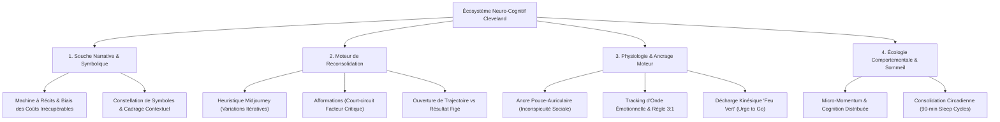

# The Power Ark - Conquering Confidence - Transcripts
**Formateur :** Kenrick Cleveland | **ID :** `kenrick-cleveland-the-power-ark-conquering-confidence-transcripts` | **Tranches :** 13

## Synthèse Architecturale du Cours : *The Power Ark - Conquering Confidence* (Kenrick Cleveland)

---

### 1. Thèse Centrale & Philosophie du Cours

#### La Vision de Kenrick Cleveland vs Approche Standard
L'approche conventionnelle du développement personnel et de la PNL classique aborde souvent la confiance comme une **performance extrinsèque** : une posture physique surjouée, un forçage cognitif néocortical (« pensée positive », mentalité « 10X »), ou une boîte à outils d'influence destinée à contraindre l'adhésion d'autrui.

Kenrick Cleveland renverse radicalement ce paradigme en posant la confiance comme un **état d'alignement neuro-affectif homéostatique intrinsèque** (*internal grounding*). Pour Cleveland :
1. **Le modèle magnétique plutôt que coercitif :** La véritable confiance n'exerce aucune pression sur l'environnement. En éliminant les micro-tensions de dissonance interne, elle opère par résonance limbique pure : l'absence d'effort et la certitude calme agissent comme un attracteur naturel (*moth to a light*).
2. **L'écologie conscient/inconscient :** L'esprit conscient ne peut pas dominer durablement le système émotionnel et viscéral (*out-logic the heart*). Dès lors que le néocortex force une attitude contredite par les conditionnements de l'inconscient, un clivage psychologique apparaît, drainant l'énergie du sujet.
3. **L'ontologie narrative dé-sacralisée :** L'identité n'est pas un fait objectif immuable, mais une **« machine à récits »** (*story machine*), un assemblage de constellations de symboles hérités sans examen critique. Changer la confiance ne consiste pas à lutter contre le réel, mais à démanteler la fiducie accordée à des symboles périmés.

#### Le Fil Rouge Méthodologique
L'architecture complète du cours s'articule autour d'une boucle cybernétique en quatre temps :
$$\text{Décontamination Narrativo-Symbolique} \longrightarrow \text{Reconsolidation Mnésique Itérative} \longrightarrow \text{Amorçage Kinesthésique & Ancrage Invisible} \longrightarrow \text{Stabilisation Circadienne & Écologie}$$

1. **Assainir le terrain narratif :** Identifier les récits bloquants, liquider le biais des coûts irrécupérables émotionnels (*sunk costs*), et défaire l'imprégnation sémantique des symboles du passé.
2. **Ré-encoder sans heurt critique :** Utiliser la métaphore de la génération itérative d'images (analogie Midjourney) et le questionnement présuppositionnel (afformations) pour modifier les traces mnésiques par paliers digestes (+5 à 10 %), sans alerter le facteur critique.
3. **Conditionner une motricité d'action :** Ancrer un état de certitude via des circuits moteurs distincts et indétectables (pouce-auriculaire), tout en protégeant les ancres contre l'entropie et l'effondrement accidentel (règle du 3 pour 1).
4. **Déléguer à l'inconscient et au sommeil :** Mémoriser les micro-victoires dans la matière (cognition distribuée) et laisser les cycles de sommeil consolider la plasticité synaptique pour une généralisation autonome.

---

### 2. Carte des Concepts & Leviers Émergents

#### A. Architecture Narrativo-Symbolique
* **L'Ontologie de la Machine à Récits (*Story Machine*)** : Reconnaissance que le système nerveux intercale systématiquement une fiction interprétative entre le stimulus brut et l'affect.
* **Constellation Symbolique & Imprégnation Sémantique** : L'identité est un réseau de symboles neutres investis arbitrairement de charges affectives. La transformation opère sur la malléabilité spatio-tactile de ces symboles (*shaving, sculpting, molding*).
* **Cadrage Contextuel (*Context as Focus*)** : Le méta-cadre qui oriente a priori la fenêtre d'observation psychique et prédétermine la valence de toute interaction sociale.
* **Biais des Coûts Irrécupérables Narratif (*Sunk Cost Reframing*)** : Modèle économique appliqué à la psyché : cesser d'entretenir un récit douloureux sous le prétexte qu'on y a déjà investi des années de souffrance (*scrap the rotten rice*).

#### B. Moteur de Re-Reconsolidation & Linguistique
* **Heuristique Midjourney (Échantillonnage Mnésique Itératif)** : Exploitation de la labilité mémorielle. Le cerveau se souvenant du « souvenir du souvenir », on sélectionne une variante 5 à 10 % plus acceptable à chaque itération pour remplacer l'engramme source sans résistance.
* **Dé-sidération Temporelle & Trajectoire Ouverte** : Remplacement des visualisations rigides d'objectifs finaux (qui activent le détecteur de mensonge interne) par des vecteurs de progression directionnelle dynamiques.
* **Afformations Présuppositionnelles** : Formulations interrogatives au présent (*« Comment se fait-il que... ? »*) forçant une recherche transdérivationnelle inconsciente tout en court-circuitant le facteur critique.

#### C. Neuro-Ancrage & Dynamique Somatique
* **Inconspicuité Somatosensorielle (Pouce-Auriculaire)** : Utilisation d'un micro-geste moteur atypique, hautement discriminable par l'homoncule somatosensoriel mais indétectable en interaction sociale réelle.
* **Synchronisation sur l'Onde Émotionnelle (*Waveform Tracking*)** : Règle stricte de calage : imprimer le stimulus durant l'ascension et relâcher impérativement au pic culminant (*acmé*) pour éviter d'ancrer la phase de décadence du potentiel d'action.
* **Entropie d'Ancrage & Règle de Maintenance 3 pour 1** : Prévention de l'effondrement accidentel d'ancre. Tout déchargement sous forte charge aversive use le stimulus ; il doit être rechargé trois fois en contexte ressource pur pour chaque utilisation critique.
* **Décharge Kinésique d'Urgence (*Green Light Surge*)** : Isomorphisme moteur emprunté au réflexe d'accélération automobile pour court-circuiter l'inhibition de l'action et libérer une impulsion motrice immédiate.

#### D. Écologie Déportée & Consolidation Biologique
* **Cognition Distribuée & Micro-Momentum** : Découpage sub-dimensionné des tâches pour abaisser le seuil d'activation dopaminergique, couplé à l'assainissement de l'environnement physique (bureau rangé) comme interrupteur somatique de clarté.
* **Consolidation Synaptique Circadienne** : Respect impératif des fenêtres de sommeil (cycles de 90 min / 7,5 h) pour permettre l'encodage subcortical profond des réécritures diurnes.

---

### 3. Tableau Récapitulatif des Techniques & Démonstrations

| Technique / Exercice | Objectif Opératoire | Déclencheur / Indication | Séquence Résumée |
|---|---|---|---|
| **Dépollution Narratif par Coût Irrécupérable** (*Story Scrapping Protocol*) | Neutraliser l'attachement morbide à un récit traumatique ou limitant justifié par l'investissement passé. | Ruminations récurrentes : *« J'ai trop souffert pour lâcher cette histoire »*, victimisation identitaire. | 1. Expliciter l'analogie économique (nourriture pourrie / investissement perdu). 2. Valider l'apprentissage passé (*« You've paid the price »*). 3. Activer le geste mental de mise au rebut (*scrap it*) sans tentative de sauvetage. |
| **Ré-encodage Mnésique Midjourney** (*Iterative Memory Re-encoding*) | Réécrire la valence d'une mémoire pénible sans déclencher le facteur critique ni créer de déni mensonger. | Souvenir toxique persistant, flash traumatique modéré ou blocage sur un événement passé. | 1. Évoquer le souvenir source et projeter 4 variantes perceptives. 2. Sélectionner la variante 5 à 10 % plus acceptable/neutre. 3. En faire la nouvelle image de référence (*base image*). 4. Répéter l'opération 4 à 6 fois jusqu'à écrasement de la trace d'origine. |
| **Sculpture Submodalitaire Tactile** (*Symbol Shaving & Molding*) | Assouplir la rigidité d'une croyance ou d'un symbole identitaire pétrifié. | Représentations internes figées, lourdes, oppressantes ou perçues comme monolithiques. | 1. Localiser spatialement le symbole du récit. 2. Engager le cortex moteur pour manipuler sa matière (raboter, tailler, amincir, repousser). 3. Constater la baisse de l'intensité émotionnelle consécutive au changement de forme. |
| **Ancrage Invisible Pouce-Auriculaire** (*Stealth Micro-Anchor*) | Installer un interrupteur somatique d'état de certitude/calme utilisable en situation publique sans se faire repérer. | Besoin d'un accès instantané à la confiance lors d'interactions tendues (négociations, réunions, prises de parole). | 1. Choisir le contact tactile pouce-auriculaire (main au repos). 2. Évoquer un état de plénitude/certitude absolu. 3. Calibrer la montée de l'onde ; presser pendant l'ascension, relâcher net à l'acmé. 4. Répéter et tester le déclenchement à blanc. |
| **Restauration d'Ancre par Règle 3:1** (*Anchor Depletion & Recharge*) | Prévenir l'usure ou l'hébétude somatique consécutive à l'utilisation d'une ancre dans un contexte aversif violent. | Sensation de brouillard (*fog*), perte d'intensité ou neutralisation d'une ancre ressource après un pic de stress. | 1. Isoler le sujet de tout contexte menaçant. 2. Évoquer trois expériences ressources distinctes et de haute intensité. 3. Réappliquer la séquence d'ancrage sur chaque pic pour reconstituer le capital synaptique. |
| **Décharge Motrice « Feu Vert »** (*Motor Drive Elicitation*) | Briser la sidération, l'inhibition réflexive ou l'hésitation avant une décision cruciale. | Procrastination aiguë, paralysie par l'analyse, trac bloquant avant de passer à l'action. | 1. Évoquer l'isomorphisme moteur : à l'arrêt au feu, klaxon derrière, feu passe au vert, pied au plancher. 2. Calibrer la poussée neuromusculaire d'accélération pure (*surge*). 3. Transférer immédiatement cette impulsion kinesthésique sur l'action bloquée. |
| **Boucle d'Afformations Transdérivationnelles** | Court-circuiter le rejet du facteur critique face aux affirmations d'auto-persuasion classiques. | Dialogue interne auto-dépréciatif résistant aux affirmations directes de type *« Je suis confiant »*. | 1. Identifier l'état cible désiré. 2. Le formuler sous forme de présupposition interrogative au présent : *« Comment se fait-il que je me sente de plus en plus calme aujourd'hui ? »* 3. Laisser l'inconscient fouiller ses archives pour valider la prémisse. |
| **Micro-Momentum & Commutateur Spatial** | Enclencher la boucle dopaminergique d'auto-efficacité et décharger la mémoire de travail somatique. | Démarrage de journée difficile, sentiment d'accablement, dispersion mentale. | 1. Sélectionner une micro-tâche délibérément sous-dimensionnée (ranger un tiroir, dégager un bureau). 2. L'exécuter et acter visuellement son accomplissement (notation physique). 3. Constater l'effet de commutateur somatique d'ordre avant d'aborder la tâche complexe. |
| **Induction par Effacement Isomorphique** | Induire un état de dissociation et confier la consolidation des apprentissages aux réseaux subcorticaux. | Clôture de séance, travail de transe avant le sommeil pour intégration profonde. | 1. Conduire l'inversion sensorielle (le corps s'enfonce dans le sable / le sable soutient le corps). 2. Utiliser la métaphore du ressac marin effaçant les empreintes. 3. Suggérer que ce qui disparaît de la surface consciente s'intègre dans les profondeurs de l'esprit. |

---

---

## 0. Sommaire Sémantique & Index des Lignes

- **Tranche 1 [Lignes 114-214]** : d'Élucidation des Récits Fondateurs (Get Your Story Straight) — *Protocole :* d'Élucidation des Récits Fondateurs (Get Your Story Straight) | *Verbatim :* La Métaphore Homologique de l'Hygiène
- **Tranche 2 [Lignes 216-338]** : « Memory’s Favorite Memory » (Refonte Symbolique par Variations Itératives) — *Protocole :* « Memory’s Favorite Memory » (Refonte Symbolique par Variations Itératives) | *Mécanisme :* L’Architecture Symbolique de l’Identité (Symbol-Constellation Matrix) | *Verbatim :* La Distinction Fondatrice Événement vs Identité
- **Tranche 3 [Lignes 340-507]** : Le Cadre Écologique Anti-Surcharge (Overwhelm Eraser) — *Protocole :* Le Cadre Écologique Anti-Surcharge (Overwhelm Eraser) | *Mécanisme :* Architecture du Renforcement par Micro-Momentum | *Verbatim :* La Métaphore de la Sculpture Continue
- **Tranche 4 [Lignes 509-662]** : Dépollution Narratif par Rupture de Coût Irrécupérable (Story Scrapping Protocol) — *Protocole :* Dépollution Narratif par Rupture de Coût Irrécupérable (Story Scrapping Protocol) | *Mécanisme :* Le Recadrage du Biais des Coûts Irrécupérables appliqué aux Récits Internes | *Verbatim :* Pattern 1 : Présupposition d'Automatisation Inconsciente & Suggestion d'Éveil Somatique
- **Tranche 5 [Lignes 664-757]** : Construction et Empilement d'une Ancre Ressource Multi-États (5 Étapes) — *Protocole :* Construction et Empilement d'une Ancre Ressource Multi-États (5 Étapes) | *Mécanisme :* Entropie de l'Ancrage et Règle d'Amortissement Kinesthésique | *Verbatim :* Brisure de l'objection d'anesthésie émotionnelle
- **Tranche 6 [Lignes 759-911]** : Sortie de Transe et Réintégration Somatique Profonde (SRI Exit Phase) — *Protocole :* Sortie de Transe et Réintégration Somatique Profonde (SRI Exit Phase) | *Verbatim :* La réassociation somatique et métaphore de réincarnation
- **Tranche 7 [Lignes 913-1057]** : Cartographie et Hiérarchisation Écologique des Valeurs (Life & Career) — *Protocole :* Cartographie et Hiérarchisation Écologique des Valeurs (Life & Career) | *Verbatim :* La Bascule Dissociative Délibérée
- **Tranche 8 [Lignes 1059-1188]** : A : Audit et Conversion Pure des Valeurs (Away-From to Towards Alignment) — *Protocole :* A : Audit et Conversion Pure des Valeurs (Away-From to Towards Alignment) | *Mécanisme :* Levier de Direction Motivationnelle et Nettoyage Téléologique (Towards vs. Away-From Diagnostic) | *Verbatim :* La Transmutation d'Évitement en Attracteur Magnétique
- **Tranche 9 [Lignes 1190-1326]** : Encodage de Réalité Simulée & Alignement de Valeurs (Simulated Reality Imprinting) — *Protocole :* Encodage de Réalité Simulée & Alignement de Valeurs (Simulated Reality Imprinting) | *Verbatim :* La Boucle d'Imbrication Temporelle et Amnésique
- **Tranche 10 [Lignes 1328-1462]** : Démantèlement de la Peur par Rétractation et Distance (Exercise 2: Turning Down the Fear) — *Protocole :* Démantèlement de la Peur par Rétractation et Distance (Exercise 2: Turning Down the Fear) | *Verbatim :* Le Double Moteur Décisionnel (Recadrage de la Peur en Avantage Opérationnel)
- **Tranche 11 [Lignes 1464-1674]** : A : DÉMANTÈLEMENT RÉCURSIF & SOUFFLAGE SUR LA TIMELINE (Transe de l'Arche) — *Protocole :* A : DÉMANTÈLEMENT RÉCURSIF & SOUFFLAGE SUR LA TIMELINE (Transe de l'Arche) | *Mécanisme :* Dégénérescence et Démantèlement Récursif de Stratégie Inopérante | *Verbatim :* Extrait 1 : Double Collapse et Élimination Récursive Instantanée
- **Tranche 12 [Lignes 1676-1827]** : Le Processus d'Extension Identitaire & Nettoyage de Croyances (Cycle de 4 Mois) — *Protocole :* Le Processus d'Extension Identitaire & Nettoyage de Croyances (Cycle de 4 Mois) | *Mécanisme :* Le Recadrage Métacognitif de la Neuroplasticité | *Verbatim :* Suggestion Post-Hypnotique de Transmission et d'Ancrage Subconscient
- **Tranche 13 [Lignes 1829-1935]** : L'Imprinting Planétaire & Scellement par Spirale Ascendante (Phase Finale d'Intégration) — *Protocole :* L'Imprinting Planétaire & Scellement par Spirale Ascendante (Phase Finale d'Intégration)

---

## Extractions Détaillées par Tranche (Opératoire & Verbatim)

## Tranche 1 / 13 : d'Élucidation des Récits Fondateurs (Get Your Story Straight)

### 1. Mécanismes & Principes Actifs

- **La Confiance Intrinsèque vs Extrinsèque (Modèle Magnétique)**
  - *Principe actif* : La confiance n'est pas une compétence de performance sociale ou d'influence coercitive projetée vers l'extérieur pour forcer l'adhésion d'autrui. C'est un état d'alignement neuro-affectif interne (*internal grounding*) qui supprime les micro-tensions de dissonance. Sur le plan interpersonnel, cette congruence agit de manière non-verbale par résonance limbique : l'absence d'effort et la certitude tranquille agissent comme un attracteur (*magnetic quality* / *moth to a light*), rendant l'individu attirant sans artifice.
  - *Tags libres émergents* : `#confiance_intrinseque` `#polarite_magnetique` `#congruence_sans_effort` `#alignement_interne`

- **L'Écologie Neuro-Cognitive : Équilibrage Conscient / Inconscient**
  - *Principe actif* : Le conflit interne survient lorsque le néocortex ("l'esprit conscient") tente d'imposer un contrôle logique forcé (*out-logic*) sur les pulsions affectives et viscérales ("le cœur" / l'inconscient). Si l'inconscient héberge des conditionnements réactifs issus du passé agissant à contre-emploi (*counter purposes*), toute tentative de forçage cognitif (ex: pensée positive superficielle ou mentalité "10X") crée un clivage psychologique. L'accès à la véritable confiance passe par la cessation de cette lutte et la restauration d'une fondation homéostatique stable.
  - *Tags libres émergents* : `#homéostasie_conscient_inconscient` `#non_dualite_affective` `#dissolution_du_forcage_cognitif` `#fondation_interieure`

- **L'Ontologie Narrative : L'Être Humain comme Machine à Récits (*Story Machine*)**
  - *Principe actif* : Le système nerveux humain n'a pas accès direct au réel brut : il convertit instantanément les stimuli en récits causaux linéaires pour réduire l'entropie cognitive. L'identité personnelle n'est pas la somme factuelle des événements vécus, mais l'agrégat des histoires explicatives acceptées par le sujet (*"your identity is a collection of stories"*). Toute histoire impose une sélection d'indices perceptifs (omissions, distorsions, généralisations) qui enferme le système perceptif dans une boucle de rétroaction auto-validante (*endless loop*).
  - *Tags libres émergents* : `#machine_a_recits` `#identite_narrative` `#boucle_de_retroaction_auto_validante` `#selection_perceptive`

- **Le Cadrage Contextuel comme Focalisation Spatiale (*Context as Focus*)**
  - *Principe actif* : Le contexte narratif agit comme un filtre attentionnel inconscient, analogue à l'eau pour le poisson ou l'air pour l'humain — invisible tant qu'il n'est pas perturbé. En PNL avancée, le contexte oriente littéralement la direction du regard psychique (*"pointing you to the window for you to look out of"*). Deux individus soumis au même stimulus brut (ex: sirènes de police, entretien annuel) expérimentent des états somato-émotionnels opposés selon la fenêtre imposée par leur cadre implicite. Maîtriser le contexte supplante en puissance la synchronisation (*rapport*) car il dicte a priori la valence affective de toute interaction.
  - *Tags libres émergents* : `#contexte_comme_focalisation` `#fenetre_perceptive` `#subcontexte_invisible` `#prémisse_de_persuasion`

- **La Constellation Symbolique et l'Imprégnation Sémantique (*Imbuing Meaning*)**
  - *Principe actif* : Les histoires ne sont pas des blocs monolithiques, mais des réseaux ("constellations") de symboles discrets (mots, objets, rôles sociaux, lieux : "marche", "lac", "oncle"). Un symbole est une coquille neutre dans laquelle le sujet injecte un affect et une signification (*imbuing meaning*), souvent de façon inconsciente par assimilation infantile ou conformisme socioculturel. À l'instar de la monnaie fiduciaire dont la valeur repose uniquement sur la foi partagée, l'identité et la confiance s'effondrent ou s'érigent selon la foi accordée aux symboles constitutifs du récit.
  - *Tags libres émergents* : `#constellation_de_symboles` `#impregnation_semantique` `#monnaie_fiduciaro_psychique` `#deconstruction_semiotique`

---

### 2. Protocoles, Techniques & Démonstrations (Étape par Étape)

#### Protocole d'Élucidation des Récits Fondateurs (*Get Your Story Straight*)

* **Intention / Indication** :
  - Phase d'étalonnage et de mise à nu des récits structurants sous-jacents qui maintiennent le sujet dans des limitations financières, relationnelles ou identitaires. Déclenché impérativement avant toute tentative de recadrage ou de travail hypnotique profond.
* **Mise en place & Pré-framing** :
  - *Défocalisation orientée* : Donner une consigne minimale sans influence d'orientation pour éviter d'induire le contenu de l'inconscient (*"I don't really want to move you one direction or the other"*).
  - *Dédramatisation et universalité* : Normaliser la souffrance et l'imperfection humaine pour abaisser les résistances de l'ego (*"None of us were born perfectly, all of us have struggled"*).
  - *Autorisation de filtrage* : Donner au sujet le contrôle absolu sur le niveau d'intimité publique (possibilité d'éditer ou d'élider les micro-détails traumatiques en gardant simplement le descripteur d'événement).
* **Séquence d'actions pas à pas** :
  1. **Sélection des domaines cibles** :
     - Isoler 2 domaines cardinaux (par défaut : l'argent/richesse et l'amour/relations significatives ; optionnellement étendre jusqu'à 4 en incluant la valeur personnelle). Traiter chaque domaine de manière strictement hermétique.
  2. **Interrogation archéologique des empreintes (anamnèse des symboles)** :
     - Balayer l'histoire personnelle à l'aide des questions d'extraction :
       - *Origines auditives directes* : Qu'a-t-on dit sur ce sujet durant l'enfance ? (parents, grands-parents, école).
       - *Démonstrations visuelles* : Qu'a-t-on vu être incarné ou agi par les figures d'autorité ?
       - *Pressions de conformité* : Quelles attentes ou croyances les pairs ont-ils façonnées ?
       - *Forces institutionnelles & socioculturelles* : Quelles influences religieuses, idéologiques ou culturelles ont modulé la perception ?
       - *Événements d'empreinte (imprints)* : Quels traumatismes ou chocs ont sculpté la conclusion actuelle ?
       - *Ambiance systémique* : L'accès à ce domaine était-il attendu, exclu d'emblée, ou neutre ?
  3. **Incubation contemplative** :
     - Prendre un temps de réflexion lente sans chercher à se précipiter (*"contemplate it, dwell on it"*), en acceptant l'inconfort viscéral passager. Poser des points de repère par écrit (*bullet points*).
  4. **Rédaction synthétique du récit opérationnel** :
     - Rédiger un texte concis (3 à 6 paragraphes maximum) résumant la formule narrative : *"L'histoire que je me raconte (ou que je raconte aux autres) pour expliquer pourquoi je suis ainsi aujourd'hui"*.
     - Se focaliser uniquement sur les lignes de crête (*high points*) sans s'enliser dans les méandres du détail.
  5. **Externalisation et Témoignage (Désidentification)** :
     - Partager le récit dans un groupe de pairs ou le lire à voix haute. L'exposition contrôlée objective le narratif, permettant au sujet d'observer son histoire comme un artefact externe et non plus comme sa nature intrinsèque.
* **Signes de calibration** :
  - *Vérification de brièveté* : Si le récit dépasse 6 paragraphes ou commence à justifier émotionnellement le passé, le sujet s'est ré-enfermé dans l'hypnose du contenu.
  - *Ton déclaratif* : Le texte doit révéler une équation explicative claire du type : *[Événement source] -> [Généralisation identitaire] -> [Situation présente]*.

---

### 3. Heuristiques, Subtilités & "Sagesse du Praticien"

- **Heuristique de Maintenance Hygiénique de l'État Interne** :
  - *Règle* : Ne jamais traiter la confiance comme une compétence acquise définitivement (*"not a one and done program"*).
  - *Formulation opératoire* : *Si* le sujet demande "Quand serai-je enfin totalement confiant ?", *alors* lui renvoyer la métaphore de la douche (*"Quand seras-tu assez propre pour ne plus jamais te laver ?"*). Vivre accumule des résidus perceptifs ; la confiance est une pratique d'alignement continue et non une ligne d'arrivée.
- **Heuristique de Détection des Stratégies Compensatoires ("Faux Self")** :
  - *Règle* : Rejeter formellement toute tentative d'ajouter un masque d'assurance par-dessus une faille non résolue (*"not about prompting you to have false confidence or pushing you to 10x your life"*).
  - *Formulation opératoire* : *Si* l'intervention vise à augmenter l'exubérance externe sans alignement viscéral, *alors* stopper le processus : la confiance authentique retire les blocages internes, elle n'empile pas d'artifices comportementaux.
- **Heuristique de l'Accès au Contenu sans Biais de Guidage** :
  - *Règle* : Pendant l'extraction narrative initiale, maintenir un cadrage minimaliste (*"give little information on purpose"*).
  - *Formulation opératoire* : *Si* le praticien donne ses propres exemples avant que le sujet n'ait rédigé son propre récit, *alors* le sujet calquera inconsciemment sa structure sur celle du formateur. Laisser émerger la topologie brute du sujet avant d'offrir des grilles d'analyse.
- **Heuristique d'Égalité des Fractures Humaines** :
  - *Règle* : Neutraliser le piège du "mon traumatisme est unique et incomparable" (*"they have no idea what I've been through"*).
  - *Formulation opératoire* : *Si* le sujet s'isole dans la singularité de sa souffrance, *alors* recadrer sur le truisme universel : aucun être humain n'est né parfait, tout le monde lutte avec ses propres narrations brisées.
- **Heuristique de la Décomposition Atomique des Symboles** :
  - *Règle* : Ne jamais accepter une phrase narrative comme une donnée factuelle indivisible.
  - *Formulation opératoire* : *Si* le sujet dit : *"Je marchais au bord du lac avec mon oncle"*, *alors* le praticien découpe immédiatement la phrase en symboles autonomes (*Marche* = mouvement/proximité ; *Lac* = calme/nature ; *Oncle* = figure d'autorité familiale/intellect), car la charge affective ne réside pas dans l'événement, mais dans le sens injecté dans chaque symbole.

---

### 4. Pépites Verbatim & Patterns Linguistiques (MOT À MOT EN V.O.)

#### Pépite 1 : La Métaphore Homologique de l'Hygiène
> "Now, let's just say someone were to say to you, you know, I've showered most every day of my life. When will I be clean enough that I no longer have to take showers? What would you say? Well, the answer is never. The act of living makes you sweat, accumulate dirt and grime. So, we take showers. And the same is true with confidence. It's something that you benefit from staying on top of all of the time."
- **[Analyse du Pattern]** : Recadrage par analogie homologique irréfutable. L'utilisation d'une question rhétorique basée sur un truisme somatique quotidien évident (la douche et la saleté) force le système critique du sujet à valider la prémisse ("on ne cesse jamais de se laver"). Par couplage sémantique immédiat (*"And the same is true with confidence"*), la propriété d'entretien continu est transférée d'office à la confiance, désamorçant l'illusion d'une guérison magique instantanée.

#### Pépite 2 : L'Induction Magnétique et la Nominalisation de l'Ombre
> "In reality, confidence is an intrinsic or internal quality that lights your way forward. It has a magnetic quality because as others see you move forward, they're attracted to this and to your ability to make it happen. Now this is much like moths are attracted to light. People are attracted to the inner light of those that are wielding the power of confidence effortlessly in their life."
- **[Analyse du Pattern]** : Métaphore hypnotique visuelle et kinesthésique avec empilement de présuppositions. En liant le mouvement (*"as others see you move forward"*) à une force d'attraction passive-involontaire (*"like moths are attracted to light"*), Cleveland installe la suggestion post-hypnotique que le sujet n'aura rien à forcer : la confiance n'est pas un acte de vente de soi, mais un rayonnement. L'adverbe *"effortlessly"* valide la bascule vers l'inconscient.

#### Pépite 3 : L'Enchâssement Temporel et le Double Lien d'Entrée en Transe
> "As you begin to look at this as the journey it is, you are taking the first step along the road to conquering confidence. And you also are bringing a secret power to bear that very few people understand... So let me encourage you to relax into this journey. And it's even easier than you might imagine as you've already taken the first step."
- **[Analyse du Pattern]** : Présupposition temporelle et boucle de validation circulaire (effet de truisme). L'expression *"As you begin to look at this... you are taking the first step"* transforme la simple écoute cognitive en action comportementale déjà validée. La phrase finale active un double lien temporel : le changement est facile parce que le premier pas est déjà décrété accompli (*"as you've already taken the first step"*), reliant la détente physiologique (*"relax into this journey"*) à une dynamique déjà enclenchée.

#### Pépite 4 : La Transe Narrative et l'Équation Identitaire
> "Confidence then is a matter of identity and belief. Your life is a collection of events and your identity, it's a collection of stories. Stories are how we make sense of life. Stories track meaning... All right, look, stories are made up of symbols. Now, let's just grok that for a second. Stories are made up of symbols."
- **[Analyse du Pattern]** : Chaîne d'équivalences complexes et rupture d'ancrage avec commande d'assimilation directe. La séquence redéfinit l'identité non pas comme biologique ou historique, mais comme purement linguistique : *Vie = Événements*, mais *Identité = Histoires*, et *Histoires = Constellations de Symboles*. L'insertion du verbe d'argot contre-culturel *"grok"* (comprendre viscéralement/fusionner avec l'information) agit comme une commande couverte qui interrompt le traitement intellectuel superficiel pour forcer une intégration subliminale immédiate.

#### Pépite 5 : La Déconstruction Analytique du Verbatim Spontané
> "You know, when I was young, I went for a walk with my uncle out to a lake. Now, he was a philosopher. Now, stop. A walk, that's a symbol. Of what? Togetherness, closeness, exercise... To a lake. What is lake? A symbol of relaxation, nature... With my uncle. Uncle is family... He's a philosopher... symbol, what? Intelligence... Symbols are what we imbue meaning into... So you can think of stories like a constellation of symbols."
- **[Analyse du Pattern]** : Rupture de pattern hypnotique par commande d'arrêt brusque (*"Now, stop"*), suivie d'un méta-commentaire déconstructiviste. Cleveland commence par installer une narration anecdotique classique pour capturer l'attention narrative, puis brise violemment la transe du récit pour forcer l'auditeur à monter d'un niveau logique : l'anecdote n'est pas une réalité, c'est une mosaïque sémantique arbitraire. Cette démonstration en direct apprend au système nerveux du praticien à segmenter le flux verbal en micro-unités de sens modifiables à volonté.

## Tranche 2 / 13 : « Memory’s Favorite Memory » (Refonte Symbolique par Variations Itératives)

Voici l’extraction intégrale et opératoire de la substance de la tranche 2/13.

---

### 1. Mécanismes & Principes Actifs

#### 1. L’Architecture Symbolique de l’Identité (Symbol-Constellation Matrix)
* **Principe actif :** Cleveland dissocie radicalement les « événements bruts » (*facts/events*) de la structure de l'« identité » (*identity*). Les événements réels n’ont aucun accès direct à la subjectivité ; ils sont traduits et encodés sous forme de symboles somato-sensoriels (un lieu exigu, une action, un objet). Une histoire n'est pas une simple chronologie, mais une constellation de symboles interconnectés qui stockent de la signification (*meaning*). L'identité n'est pas le recueil de ce qui s'est passé, mais le conglomérat de ces constellations de symboles adoptées sans filtre critique durant l'enfance.
* **Impact neuro-cognitif :** En modifiant non pas l'événement matériel (ce qui créerait un rejet de non-congruence/mensonge), mais la signification attribuée à ses symboles constitutifs, le système nerveux reconfigure instantanément l'état émotionnel associé sans dissonance cognitive.
* **Tags émergents :** `#constellation_de_symboles` `#imbrication_semantique` `#reconfiguration_identitaire` `#decouplage_fait_signification`

#### 2. Re-reconsolidation Mnésique Itérative (The Midjourney Memory Re-encoding Engine)
* **Principe actif :** Chaque rappel mnésique ne consulte pas l'événement d'origine, mais réactive la dernière trace encodée (*« you remember the last memory you had »*). Cleveland calque ce phénomène sur les moteurs d'intelligence artificielle générative d'images : lors d'une évocation, le cerveau produit automatiquement plusieurs variantes (ex: 4 variations). Dans le fonctionnement non régulé, l'inconscient sélectionne par défaut une variation paranoïde ou dépréciative. 
* **Impact neuro-cognitif :** En introduisant un choix conscient au moment de la fenêtre de reconsolidation mnésique, le praticien force le cerveau à sélectionner une variation légèrement plus productive (*next best version*). À chaque réévocation ultérieure, cette nouvelle image devient la base de référence (*new base image*), créant un écrasement progressif et neurophysiologique de la trace traumatique ou limitante sans forçage violent.
* **Tags émergents :** `#reconsolidation_iterative` `#heuristique_midjourney` `#ecrasement_de_trace_mnesique` `#selection_de_variation_neurocognitive`

#### 3. Dé-sidération Temporelle & Trajectoire Ouverte (Temporal Boundary Extension)
* **Principe actif :** Les récits limitants s'organisent toujours sous une structure séquentielle close : *« d'abord X, puis Y, et finalement Z »*, où le présent (ou le passé récent) constitue le point d'arrêt indépassable. L'esprit fige le récit comme une « fondation » rigide. Cleveland brise cette clôture en étendant la ligne narrative directement vers le futur sous forme de trajectoire (*trajectory*) plutôt que de résultat final figé (*end result*).
* **Impact neuro-cognitif :** Fixer un résultat figé (ex: « Je gagne 10 millions », « J'épouse une femme trophée ») active immédiatement le facteur critique (détecteur de mensonge interne et sentiment d'irréalité). En revanche, encoder une dynamique vectorielle/trajectoire (*« mes affaires commencent à croître »*, *« j'apprends à apprécier la valeur des liens »*) court-circuite le rejet conscient et mobilise le système de recherche dopaminergique vers l'avant.
* **Tags émergents :** `#ouverture_de_trajectoire` `#rupture_de_cloture_narrative` `#court_circuit_du_facteur_critique` `#vecteur_vs_resultat_concret`

#### 4. Modulation Spatio-Tactile du Symbole (Submodal Somatosensory Shaping)
* **Principe actif :** Cleveland utilise le lexique de la plasticité physique : tailler (*shaving*), sculpter (*carving*), mouler (*molding*), étirer (*stretching*). Les symboles internes sont traités comme de la matière plastique malléable. 
* **Impact neuro-cognitif :** Traiter les représentations internes comme des objets physiques tactiles diminue l'adhérence rigide aux croyances verbales. Cela engage le cortex somatosensoriel et moteur pour modifier les sous-modalités (distance, proximité, taille, texture) sans confrontation dialectique.
* **Tags émergents :** `#sculpture_submodalitaire` `#plasticite_symbolique` `#travail_somatosensoriel_interne`

---

### 2. Protocoles, Techniques & Démonstrations (Étape par Étape)

#### Protocole : « Memory’s Favorite Memory » (Refonte Symbolique par Variations Itératives)

* **Intention / Indication :** À utiliser face à un souvenir autobiographique générateur de tristesse, de ressentiment, d'impuissance ou d'inhibition relationnelle/financière, qui sert de « preuve » à une croyance identitaire limitante (ex: « On ne m'aimera jamais », « L'argent est rare »).
* **Mise en place & Pré-framing :**
  1. Limiter le focus : travailler sur 2 récits piliers maximum (4 maximum absolu).
  2. Pré-cadre philosophique : « Les symboles ne sont pas les faits. Vous avez attribué un sens aux symboles ou accepté celui qu'on vous a imposé. Vous avez le droit strict de modifier la signification attribuée. »

##### Séquence d'actions pas à pas :

1. **Induction physiologique d'accès :**
   * Faire fermer les yeux ou focaliser l'attention.
   * Prendre deux ou trois respirations profondes et lentes.
   * Suivre mentalement le flux et le reflux de l'air pendant 60 à 120 secondes pour abaisser le tonus sympathique.

2. **Évocation du fait brut & Extraction des symboles :**
   * Faire revivre la scène initiale telle qu'elle a été vécue historiquement (*« the way it actually was »*).
   * Isoler les 2 ou 3 symboles clés constitutifs de l'épisode (ex: *le petit camping-car*, *le désert*, *le jeu d'échecs*, *les phrases entendues*).
   * Calibrer la signification négative historiquement plaquée sur ces symboles (ex: camping-car = isolement, pauvreté, séparation).

3. **Génération de variations (Mode IA générative) :**
   * Sans nier les faits matériels, interroger le symbole sous un autre angle fonctionnel ou écologique.
   * Exécuter une torsion symbolique (*symbol bending*) :
     * *Exemple Cleveland :* Le petit camping-car étroit passe de « symbole de misère et d'exiguïté » à « symbole de proximité physique genou contre genou favorisant l'intimité avec le père ». Les échecs passent de « passe-temps d'attente » à « apprentissage de la stratégie pour la vie future ».
     * *Exemple Métaphore/Croyance :* « L'argent ne pousse pas sur les arbres » devient « L'argent pousse sur les arbres fruitiers : c'est un fruit qui demande entretien, patience et croissance continue ».

4. **Sélection & Imprégnation kinesthésique (Selecting the Next Best Variation) :**
   * Ne pas chercher la perfection hollywoodienne (ce qui bloquerait la congruence) ; choisir simplement une variation *légèrement meilleure* (*« one small step from where it actually was »*).
   * Associer des ressentis positifs et de la gratitude à cette nouvelle interprétation.

5. **Extension en Trajectoire Future (Future Boundary Expansion) :**
   * Pousser le film mental au-delà du dénouement passé : relier ce nouvel apprentissage au présent, puis l'étirer vers le futur.
   * Cadrer strictement sous forme de *processus d'expansion* et non de finalité matérialiste (ex: « Je commence à voir la valeur des gens et ils répondent positivement » et NON « J'ai épousé une star »).

6. **Consolidation par Répétition Flash (Rinse & Repeat) :**
   * Rejouer la nouvelle scène plusieurs fois de suite (séances de 2-3 minutes le matin et le soir).
   * À chaque passage, pétrir, sculpter et étirer davantage la texture émotionnelle de la scène pour forcer la neuroplasticité.

* **Signes de calibration :**
  * *Étape 2 (Vérification de la charge) :* Épaules tombantes, voix serrée, regard fuyant ou figé vers le bas (K négatif).
  * *Étape 3 & 4 (Shift symbolique) :* Déblocage respiratoire (soupir automatique), micromouvements des coins de la bouche, redressement postural spontané, fluidité verbale retrouvée lors de la verbalisation du souvenir.
  * *Validation finale :* Le sujet est capable de raconter l'événement avec un sourire ou une neutralité chaleureuse sans que cela ne sonne faux (*« It was a wonderful and personal time »*).

---

### 3. Heuristiques, Subtilités & "Sagesse du Praticien"

#### Règles Conditionnelles d'Intervention

* **SI** le sujet s'oppose en disant : *« Mais c'est faux ! Ce n'est que de l'auto-persuasion / du faux semblant (*make-believe*) »*,
  **ALORS** recadrer immédiatement sur l'équivalence d'illusion :
  **PARCE QUE** l'ancienne signification douloureuse n'était pas le fait lui-même, mais une interprétation symbolique arbitraire imposée ou choisie dans l'enfance. Le sens négatif était déjà un « make-believe » non questionné.
* **SI** le sujet projette un résultat futur finalisé et statique (ex: un chiffre exact sur un compte en banque, une situation matrimoniale parfaite),
  **ALORS** interrompre et réorienter vers une cinématique de progression (*trajectory*),
  **PARCE QUE** le cerveau rejette les états finaux irréalistes par réactivation du sens critique, alors qu'il accepte sans résistance une dynamique de croissance continue.
* **SI** le sujet tente de travailler simultanément sur 10 ou 15 traumatismes/domaines de vie,
  **ALORS** restreindre impérativement à 2 sujets pivots (4 au grand maximum),
  **PARCE QUE** la dispersion cognitive dilue la charge d'attention nécessaire à la réécriture mnésique et induit un sentiment d'échec par surcharge.

#### Pièges Classiques & Erreurs de Débutant
* **Le piège du saut quantique artificiel :** Vouloir transformer un souvenir d'abus ou de négligence en fête foraine magique. Cleveland insiste : la variation doit être *crédible* (*just a small step*), collant aux faits physiques bruts (le désert, l'espace confiné) mais en transmutant la valeur attribuée aux symboles.
* **Le piège de la passivité intellectuelle :** Se contenter de « comprendre » intellectuellement la mécanique des symboles sans pratiquer la répétition active (matin et soir). Sans engagement somatosensoriel et répétition, la reconsolidation ne s'ancre pas.
* **Le piège de la fin d'histoire bloquée :** S'arrêter à l'événement passé sans construire de suite dans le futur. L'histoire reste alors un bloc fossilisé au lieu de devenir une rampe de lancement.

#### Postulats Fondamentaux de Kenrick Cleveland dans cette Tranche
1. *« Your life is a collection of events, but your identity is a collection of stories. »* (Les événements créent la matière première, mais seules les histoires tissent l'identité).
2. *« Nothing is cast in stone because we give meaning to everything. »* (Aucune signification n'existe en dehors de l'observateur ; tout sens est un acte d'attribution).
3. *« Every time you remember something, you remember the last memory you had. »* (La mémoire n'est pas une archive figée, c'est un processus dynamique de réécriture permanente).

---

### 4. Pépites Verbatim & Patterns Linguistiques (MOT À MOT EN V.O.)

#### Pépite 1 : La Distinction Fondatrice Événement vs Identité
> « Confidence is a matter of identity and belief. Your life is a collection of events, but your identity is a collection of stories. Stories are how we make sense of life. They're how we track meaning in our life. »
* **[Analyse du Pattern]** : Utilisation d'un diptyque structurel (*« collection of events »* vs *« collection of stories »*) créant une dissociation nette entre la réalité physique inaltérable et la structure psychologique malléable. L'utilisation du verbe opérationnel *« track meaning »* présuppose que le sens n'est pas inhérent aux faits mais qu'il est une trace activement suivie par le sujet.

#### Pépite 2 : La Libération de l'Assignation Arbitraire
> « We were taught the meaning of a lot of symbols, and then we accepted that as true. We didn't have to, but we did. [...] It's you that have assigned the meanings and it's you that can assign a different meaning. Nothing is cast in stone because we give meaning to everything. »
* **[Analyse du Pattern]** : Double lien libérateur et rupture de pattern par truisme inversé. La phrase *« We didn't have to, but we did »* court-circuite la culpabilité tout en réintroduisant la responsabilité personnelle. Le balancement syntaxique *« It's you that have... and it's you that can... »* utilise un parallélisme pour transférer instantanément le pouvoir de l'autorité passée au sujet dans le présent.

#### Pépite 3 : Le Recadrage par Dérivation Sémantique (Money on Trees)
> « So for example, let's say you were told that money doesn't grow on trees. [...] But now you realize that money does actually grow on trees. It's called fruit. Just ask any farmer that grows fruit trees what they do with the fruit. They'll tell you that they sell it. It is indeed money. »
* **[Analyse du Pattern]** : *Reframing by redefining / Outframing*. Cleveland prend une métaphore limitante enkystée au premier degré culturel, refuse l'affrontement direct (« si, l'argent est facile »), et utilise une dérivation littérale évidente (« le fruit »). En validant la prémisse matérielle (*l'arbre produit le fruit qui produit l'argent*), il fait sauter l'interdit inconscient par une logique irréfutable qui réinstalle l'idée d'abondance naturelle mais patiente.

#### Pépite 4 : La Commande de Vectorisation vs Fixité
> « And here, by the way, and this is an important thing, I would keep things in the form of a trajectory instead of a concrete result. [...] In other words, make it a trajectory. Don't make it a final result. [...] It is a trajectory. Keep that in mind. »
* **[Analyse du Pattern]** : Commande conversationnelle par insistance modale et répétition rythmique (*« trajectory »* répété 4 fois en quelques secondes). L'interdiction explicite (*« Don't make it a final result »*) agit comme une protection contre le facteur critique : elle désactive l'anticipation anxieuse de performance pour n'ancrer que l'orientation directionnelle.

#### Pépite 5 : La Dissolution du Doute « Faux-Semblant »
> « But you know what? It isn't just make believe that I can imagine someone asking me to, I don't know, a much better job or a relationship... The answer is, it's only as make-believe as the meaning you've given to the symbols already. »
* **[Analyse du Pattern]** : *Anticipation d'objection & Égalisation ontologique*. Cleveland verbalise la voix critique interne de l'auditeur avant qu'elle n'émerge, puis détruit l'objection par une équivalence complexe : *la nouvelle version n'est pas plus "inventée" que l'ancienne*. Il rétrograde le passé douloureux au statut de simple hallucination symbolique passée, retirant ainsi tout privilège de vérité au trauma d'origine.

## Tranche 3 / 13 : Le Cadre Écologique Anti-Surcharge (Overwhelm Eraser)

Voici l'extraction et la modélisation intégrale de la substance opératoire de cette tranche (3/13).

---

### 1. Mécanismes & Principes Actifs

#### A. Architecture du Renforcement par Micro-Momentum
* **Principe actif** : La confiance n'est pas un trait fixe mais un flux résultant de boucles de rétroaction dopaminergiques. En découpant les objectifs en micro-victoires délibérément sous-dimensionnées, le système supprime le réflexe d'évitement lié au seuil d'effort perçu et active l'amorçage comportemental (*behavioral momentum*). L'enregistrement explicite (noter qu'on a fait la tâche A, puis B) valide la complétion au niveau cortical et installe une dynamique d'auto-efficacité.
* **Tags émergents** : `#micro_wins` `#positive_momentum` `#dopaminergic_priming` `#chunking_down_success`

#### B. Ancrage Matériel & Symbolique Externe (Journal & Espace Symbolique)
* **Principe actif** : La cognition incarnée (*embodied cognition*) et la cognition distribuée stipulent que le désordre environnemental sature la mémoire de travail et agit comme un déclencheur somatique de perte de contrôle. Le nettoyage ciblé d'un micro-espace de travail (ex. le bureau) sert de commutateur symbolique : il donne au système nerveux une rétroaction kinesthésique et visuelle immédiate d'ordre et de prévisibilité. De même, le journal de gratitude du soir ne sert pas à la complaisance émotionnelle, mais à « mémorialiser » (enregistrer physiquement) les micro-victoires avant la phase de consolidation mnésique du sommeil.
* **Tags émergents** : `#symbolic_spatial_anchor` `#externalized_cognition` `#gratitude_as_memorialization` `#state_containment`

#### C. Afformations / Questions Présuppositionnelles au Présent
* **Principe actif** : Le cerveau humain active automatiquement sa fonction de recherche transdérivationnelle face à une question linguistique. Les affirmations assertives brutes créent souvent une dissonance cognitive (rejet par le facteur critique : « *Non, ce n'est pas vrai* »). En posant une question orientée au temps présent (« *Comment se fait-il que... ?* »), le facteur critique est contourné : la condition (« *les histoires se modifient déjà* ») devient la présupposition incontestable sur laquelle l'inconscient est forcé de chercher des preuves.
* **Tags émergents** : `#afformations` `#presupposition_query` `#bypassing_critical_factor` `#transderivational_search` `#linguistic_pacing`

#### D. Consolidation Neurobiologique & Régulation Circadienne
* **Principe actif** : L'encodage et la restructuration synaptique des nouvelles narratives et des mémoires altérées s'opèrent durant les stades de sommeil lent profond et paradoxal (REM). Priver le sujet de sommeil à 7,5 heures (5 cycles complets de 90 minutes) inhibe la neuroplasticité et amplifie l'hyperréactivité de l'amygdale, recréant un état de menace perçue qui neutralise le travail de confiance.
* **Tags émergents** : `#neurobiological_consolidation` `#sleep_plasticity_cycle` `#circadian_anchoring`

#### E. Ré-encodage Narratif Itératif par Échantillonnage Visuel (Métaphore IA)
* **Principe actif** : La mémoire autobiographique est instable lors de sa réactivation (labilité mémorielle par reconsolidation). En introduisant une métaphore de « générateur d'images IA » qui produit quatre variantes d'un souvenir négatif, l'opérateur introduit un choix perceptif délibéré. Le sujet sélectionne la variante 5 à 10 % plus acceptable, puis l'examine à travers cette nouvelle lentille. Par itérations successives (5 à 6 passes), le cerveau forme un « souvenir du souvenir du souvenir », effaçant la trace synaptique du codage d'origine au profit de la dernière version consolidée.
* **Tags émergents** : `#memory_reconsolidation` `#ai_image_generation_metaphor` `#incremental_narrative_shaving` `#memory_of_a_memory`

#### F. Métaphore Isomorphique de l'Effacement et de l'Absorption Inconsciente
* **Principe actif** : L'induction utilise l'image du ressac de la mer qui efface les traces sur le sable. Sur le plan neurologique, l'inversion sensorielle (« *le corps s'enfonce dans le sable ou le sable soutient le corps* ») et l'effacement visuel opèrent une dissociation somatique et une métaphore d'amnésie sélective : ce qui est effacé de la surface consciente est littéralement réinjecté en profondeur dans les réseaux implicites (subcorticaux).
* **Tags émergents** : `#isomorphic_erasure` `#bidirectional_somatosensory_loop` `#subconscious_absorption` `#trance_dissociation`

---

### 2. Protocoles, Techniques & Démonstrations (Étape par Étape)

#### Protocole 1 : Le Cadre Écologique Anti-Surcharge (Overwhelm Eraser)
* **Intention / Indication** : À déclencher dès que le client/praticien commence à empiler les tâches de changement ou à gonfler sa to-do list, ce qui déclenche un état de figement (*freeze*) ou de sabotage.
* **Mise en place & Pré-framing** : Cadrer que la prolifération des objectifs (« *to-do list creep* ») est une auto-agression neurologique.
* **Séquence d'actions pas à pas** :
  1. **Coupe drastique** : Interdiction totale de listes de dizaines d'items. Réduction stricte à **2 ou 3 actions majeures par jour** ayant un effet de levier systémique.
  2. **Nettoyage d'un Micro-Espace Symbolique Unique** :
     - Sélectionner un espace de travail précis et délimité (ex. le bureau d'ordinateur ou la table de cuisine).
     - Effectuer un réagencement physique complet (ranger, épurer, aligner) en moins de 5 minutes.
     - Poser la règle d'or : cet espace doit demeurer impeccablement structuré pendant toute la durée du programme.
  3. **Engagement Somatique Public** :
     - Prendre un engagement explicite d'hygiène circadienne : dormir au minimum 7h30 par nuit (heures de coucher et de lever fixes).
     - Rendre cet engagement public (ex. poster la déclaration mot à mot dans un groupe de pairs).
* **Signes de calibration** : Baisse du tonus d'anxiété respiratoire, disparition des mimiques de submersion, réactivation d'un focus d'action focalisé.

---

#### Protocole 2 : L'Algorithme d'Affirmations / Afformations Fluides
* **Intention / Indication** : Programmation cognitive matinale et vespérale pour dépolariser les narratives limitantes.
* **Mise en place & Pré-framing** : Limiter la charge mentale à un maximum strict de 10 déclarations actives. Elles doivent être rédigées exclusivement au **présent** (zéro futur, zéro conditionnel).
* **Séquence d'actions pas à pas** :
  1. **Sélection de 10 cibles** : Rédiger 10 affirmations d'identité, de flux matériel ou de transformation narrative, adaptées aux 1 ou 2 domaines de vie prioritaires.
  2. **Conversion Optionnelle en Afformation (Question transdérivationnelle)** :
     - Transformer l'énoncé en question commençant par « *Comment se fait-il que... ?* » ou « *Qu'est-ce qui fait que... ?* » (ex. : « *How is it that opportunities to redo another story pop into my mind regularly?* »).
  3. **Activation Circadienne Double** :
     - Récitation / lecture attentive (durée : 60 secondes) immédiatement au réveil (transition alpha/thêta).
     - Deuxième récitation / lecture immédiatement avant l'endormissement.
  4. **Cycle de Renouvellement Dynamique** :
     - Surveiller le signal d'habituation corticale : dès que la lecture génère une réaction de neutralité blasée (« *eh, you know, yeah* »), remplacer 1 à 2 phrases par semaine pour maintenir l'activation attentionnelle et émotionnelle.
* **Signes de calibration** : Sursaut d'intérêt cognitif lors de la lecture ; émergence spontanée de comportements conformes dans la journée sans effort délibéré.

---

#### Protocole 3 : La Séance d'Empreinte de Réalité Simulée (SRI - Simulated Reality Imprinting)
* **Intention / Indication** : Automatisation inconsciente de la refonte des symboles et des mémoires d'auto-sabotage en confiance inébranlable.
* **Mise en place & Pré-framing** :
  - **Fréquence** : 1 fois par jour uniquement (faire plus ralentit l'intégration).
  - **Timing biologique** : Pas au réveil direct ; finir impérativement au minimum 2 heures avant le coucher (ex. finir à 20h pour un coucher à 22h). Idéal : mi-matinée, mi-après-midi ou retour du travail.
  - **Isolation sensorielle** : Ordinateur ou téléphone en mode silencieux / sommeil, alertes coupées, casque audio stéréo avec vérification impérative de la latéralisation (Écouteur Droit = Oreille Droite, Écouteur Gauche = Oreille Gauche). Position assise ou allongée confortable.
* **Séquence d'actions pas à pas** :
  1. **Induction par Immersion Technologique** :
     - Guidage vers une « chambre d'empreinte de réalité simulée ».
     - Visualisation d'un fauteuil électronique de haute technologie qui ajuste la lumière et accueille le corps.
     - Abaissement d'un affichage tête haute (*heads up display*) sur le front, déclenchant un signal conditionné de désorientation/lâcher-prise.
  2. **Transition Kinesthésique Sensorielle (La Plage)** :
     - Rupture de cadre spatio-temporelle : transport instantané sur une plage de sable chaud, au bord de l'eau.
     - Étaler une serviette plus grande que soi ; s'allonger. Calibrer l'ajustement du sable qui moule et soutient le dos, la tête et les épaules.
     - Focalisation auditive : bruit du ressac des vagues et succion de l'eau sur le sable.
  3. **Technique du Générateur d'Images IA (Recadrage Mémoriel Incrémental)** :
     - Isoler un souvenir limitant précis.
     - Appliquer le cadre : l'esprit génère 4 versions/images alternatives de la scène (comme un modèle d'IA générative).
     - Choisir délibérément la meilleure version (même si elle n'est que 5 à 10 % plus favorable).
     - Se plonger dans cette nouvelle perspective et observer l'effet somatique.
     - Répéter l'opération : régénérer 4 nouvelles variantes à partir de la précédente, choisir à nouveau la plus aidante, augmentant la résolution émotionnelle de 20%, 40%, 60%.
  4. **Métaphore du Miroir Évolutif & de l'Aéronef** :
     - Regarder le souvenir à travers un miroir qui embellit et transforme les symboles pour les rendre écologiques et avantageux.
     - Visualiser un vol dans un aéronef sur mesure qui stabilise cette nouvelle orientation narrative.
  5. **Dissociation Double & Boucle Kinesthésique Inversée** :
     - Demander au sujet de flotter au-dessus de son corps étendu sur le sable et de s'observer en train de vivre la transformation.
     - Poser la question de confusion kinesthésique : « *Est-ce votre corps qui pèse sur le sable, ou est-ce le sable qui pousse vers le haut pour soutenir votre corps ?* »
  6. **Enregistrement Inconscient par la Vague** :
     - Les vagues viennent graver la nouvelle vie et les nouveaux symboles sur le sable.
     - Lorsque la vague se retire et efface les inscriptions du sable, suggérer que ces symboles sont absorbés et transférés directement au cœur de l'esprit inconscient.
  7. **Réorientation & Éveil Sensoriel** :
     - Déclencheur post-hypnotique : la fin de la voix et le changement de musique marquent le signal de réorientation complète dans la minute horloge suivante.
* **Signes de calibration** : Ralentissement du clignement des yeux, hypotonie faciale, respiration abdominale profonde, mouvements oculaires rapides (REM) en phase de modification mémorielle, retour du tonus musculaire lors du changement de bande-son.

---

### 3. Heuristiques, Subtilités & "Sagesse du Praticien"

#### Règles Conditionnelles & Arbres de Décision
* **Règle de persistance du remodelage** :
  * *SI* le souvenir remanié évoque encore une charge négative ou douloureuse,
  * *ALORS* continuer à sculpter, étirer et modifier les symboles de l'histoire chaque jour,
  * *JUSQU'À CE QUE* le souvenir génère un ressenti positif stimulant OU atteigne au minimum une neutralité émotionnelle absolue.
* **Règle de sélection des cibles (Priorisation d'impact)** :
  * *SI* le client a des dizaines d'histoires limitantes,
  * *ALORS* ne pas s'éparpiller : cibler les 1 ou 2 récits fondateurs majeurs (les événements clés qui, en bien ou en mal, définissent son identité actuelle selon lui). Le traitement de ces « gros nœuds » entraîne un effet de généralisation automatique sur les micro-souvenirs périphériques.
* **Règle de gestion des affirmations (Saturation vs Utilité)** :
  * *SI* la lecture d'une affirmation produit une sensation interne d'indifférence morne (« *bof / ouais* »),
  * *ALORS* la jeter immédiatement et en générer une nouvelle. La plasticité exige de la saillance attentionnelle.
* **Règle de posologie de l'hypnose (SRI)** :
  * *SI* le client veut « accélérer » ses résultats en faisant l'audio 3 ou 4 fois par jour,
  * *ALORS* lui interdire formellement. Une sur-sollicitation crée de la saturation psychique et ralentit l'intégration inconsciente. Une seule séance par jour suffit.

#### Pièges Classiques & Erreurs Corrigées
* **L'illusion du saut quantique brutal** : Vouloir passer d'un souvenir traumatique/dévalorisant à une victoire éclatante d'un coup. *Correction de Kenrick* : Travailler par paliers homéopathiques (5 à 10 % d'amélioration par itération). Une modification subtile est acceptée immédiatement par le système nerveux, alors qu'un saut irréaliste réveille les défenses immunitaires psychologiques.
* **L'activisme stérile de la To-Do List** : Confondre productivité du changement et accumulation de corvées. L'overwhelm paralyse le cortex préfrontal. Réduire le champ d'action physique et mental crée l'espace cognitif indispensable pour que la confiance s'ancre.

#### Postulats Opératoires de Kenrick Cleveland
* « *Symbols make up a story. Stories make up identity.* » (Les symboles composent les histoires ; les histoires composent l'identité. Modifier le symbole équivaut à réécrire l'identité).
* « *Confidence is a momentum, not an event.* » (La confiance se construit par accumulation cinétique de micro-victoires enregistrées, pas par illumination soudaine).
* Les récits internes agissent en continu comme des « poseurs de contexte » (*context setters*) : ils filtrent toute réalité perçue. Autant en prendre le contrôle délibéré.

---

### 4. Pépites Verbatim & Patterns Linguistiques (MOT À MOT EN V.O.)

#### Pépite 1 : La Métaphore de la Sculpture Continue
> **Verbatim** :
> « Just keep imagining that you're shaving them and carving them and molding them and stretching them. And they're just getting better and better and better. »
* **[Analyse du Pattern]** : Empilement de participes présents kinesthésiques (*shaving, carving, molding, stretching*) qui installent une modalité tactile et malléable sur des événements du passé normalement perçus comme rigides et immuables. L'utilisation du comparatif itératif (*better and better and better*) utilise le truisme de progression pour présupposer une évolution inévitable sans résistance possible.

#### Pépite 2 : La Présupposition d'Évolution Permanente
> **Verbatim** :
> « How is it that things are becoming more organized and orderly for me simply by following this process? »
* **[Analyse du Pattern]** : Question orientée transdérivationnelle (Afformation). L'esprit ne peut pas contester le fait que les choses s'organisent : la structure linguistique « *How is it that...* » force le système cognitif à admettre l'organisation comme un fait accompli pour ne chercher que la causalité (« *simply by following this process* »).

#### Pépite 3 : Le Recadrage Fonctionnel du Journal
> **Verbatim** :
> « A gratitude journal are symbols. Symbols of what? Of the new foundation you're creating. It is memorializing, if you will, the little wins that you're having that are starting to boost your momentum exactly in the places that your confidence could really be helped. »
* **[Analyse du Pattern]** : Recadrage de sens et d'identité. Rupture du cliché mièvre (« *gratitude schmatitude* ») en redéfinissant l'outil comme un acte symbolique d'ingénierie mentale : « *memorializing* » (figer juridiquement et structurellement les victoires). Utilisation d'un connecteur vague restrictif (« *boost your momentum exactly in the places that...* ») qui laisse l'inconscient cartographier lui-même ses propres zones de vulnérabilité.

#### Pépite 4 : L'Induction par Personnification de l'Environnement
> **Verbatim** :
> « As you sit down into the chair, the lights automatically dim. It's almost as if they're respecting your presence and adjusting everything so you can be more comfortable and find yourself relaxing even more. »
* **[Analyse du Pattern]** : Présupposition enchâssée d'autorité et de valeur personnelle. L'environnement technologique inerte est doté d'une intentionnalité bienveillante (« *respecting your presence* »). Cette suggestion implicite élève le sentiment de dignité (*self-worth*) tout en liant mécaniquement le réglage externe à une commande hypnotique interne (*find yourself relaxing even more*).

#### Pépite 5 : La Boucle de Confusion Kinesthésique Bipolaire
> **Verbatim** :
> « And you begin to wonder, is your body pressing down on the sand? Or is the sand pressing up on your body, supporting you? Making you feel even more peaceful as the next wave rolls in. »
* **[Analyse du Pattern]** : Double lien sensoriel et paradoxe perceptif. En amenant l'esprit à arbitrer entre deux forces physiques opposées mais équivalentes, le formateur surcharge la logique binaire consciente. Cela induit une catalepsie sensorielle et approfondit la transe en connectant la résolution du dilemme au rythme naturel de la vague (*as the next wave rolls in*).

#### Pépite 6 : L'Effacement Somatique et l'Absorption Inconsciente
> **Verbatim** :
> « It feels like it's writing your new life, your new symbols on the sand. But this time, as the waves go back out and the symbols get erased, they move directly into your unconscious. Where they continue to grow and deepen... »
* **[Analyse du Pattern]** : Recadrage hypnotique complet de la disparition. L'effacement (d'ordinaire assimilé à la perte ou à l'oubli) est métaphorisé en un acte de pénétration et de transplantation sous le seuil critique (« *move directly into your unconscious* »). L'utilisation de prédicats de développement organique (« *grow and deepen* ») assure l'autonomie du processus hors de la volonté consciente.

#### Pépite 7 : La Dissociation Cognitive du Souvenir Réécrit
> **Verbatim** :
> « Because in reality, when you take an image and you make it anew and anew again and again and again, the fifth begins to make things so much more powerful that it's as if the other times begin to fade. Because the memory of the memory is more compelling, more enjoyable. »
* **[Analyse du Pattern]** : Formalisation linguistique de la reconsolidation mémorielle. En introduisant le concept de « *memory of the memory* », l'opérateur crée une rupture épistémologique : le sujet comprend que le cerveau ne stocke pas la réalité historique mais la dernière version rappelée. L'effacement des versions antérieures (« *begin to fade* ») est présenté comme une conséquence neurologique mécanique du nombre de réitérations.

## Tranche 4 / 13 : Dépollution Narratif par Rupture de Coût Irrécupérable (Story Scrapping Protocol)

Voici l'extraction opératoire complète de la tranche 4/13, modélisée selon les règles strictes d'ingénierie et de modélisation PNL / hypnose.

---

### 1. Mécanismes & Principes Actifs

#### Le Recadrage du Biais des Coûts Irrécupérables appliqué aux Récits Internes
- **Principe actif** : Le cerveau humain présente une distorsion cognitive systématique (le *sunk cost bias*) qui le pousse à maintenir un investissement déficitaire en temps, émotion ou énergie sous prétexte qu'une ressource irrécupérable y a déjà été consacrée. Kenrick Cleveland détourne ce modèle financier pour l'appliquer à l'écologie des narrations internes : le sujet s'accroche à des récits limitants (« mon histoire de souffrance/d'échec ») uniquement parce qu'il a déjà « payé le prix » émotionnel pendant des années. En identifiant cette dynamique comme un biais irrationnel et en injectant le critère de non-récupérabilité (« ce sac de riz est pourri par les crottes de souris, on ne peut pas le sauver »), le système nerveux cesse la tentative vaine de sauvetage (*replaying/salvaging*) et active le geste d'évacuation/mise au rebut cognitive.
- **Tags libres** : `#sunk_cost_bias_reframing` `#narrative_scrapping` `#decontamination_mémorielle` `#amnistie_temporelle`

#### Stratégie d'Entraînement de l'Inconscient par Généralisation Autonome (*Unconscious Strategy Adoption*)
- **Principe actif** : En amorçant consciemment le travail de réécriture ou de neutralisation sur les souvenirs majeurs (*the big ones*), le praticien installe une méta-stratégie. Le système inconscient, orienté vers l'économie cognitive et le pattern matching, intègre le protocole de transformation comme un automatisme de fond. Une fois le seuil critique franchi sur les représentations majeures, l'inconscient applique spontanément le protocole aux récits secondaires sans effort volontaire conscient, se manifestant au réveil par une modification de l'état de base somatique (légèreté, équilibre, confiance).
- **Tags libres** : `#unconscious_strategy_adoption` `#automatisation_générative` `#seuil_critique_mnésique` `#recalibrage_spontané`

#### L'Isomorphisme de Décision Motrice / Décharge Kinésique d'Urgence (*Green Light / Stop Sign Surge*)
- **Principe actif** : Pour dépasser l'inhibition de l'action ou l'hésitation réflexive, le système nerveux a besoin d'accéder à un schéma neuro-moteur d'exécution brute, sans arbitrage intellectuel. En sollicitant l'expérience sensorielle universelle de la voiture au feu rouge (klaxon arrière + feu vert + voie libre $\to$ accélération immédiate au plancher), Cleveland extrait une commande neuromusculaire d'engagement immédiat (*forward impulse / surge of adrenaline*). Ce schéma kinesthésique d'accélération pure sert de matrice cinétique pour réinjecter de la propulsion dans des contextes de vie bloqués.
- **Tags libres** : `#motor_drive_elicitation` `#urge_to_go` `#décharge_kinesthésique_conditionnée` `#by_pass_de_l_inhibition`

#### La Dynamique d'Écrasement et d'Effondrement Involontaire d'Ancres (*Accidental Anchor Collapse & Depletion*)
- **Principe actif** : Lorsqu'un stimulus d'ancrage positif très puissant et hautement renforcé (ici le rituel d'accueil conjugal) est déclenché simultanément à un état émotionnel aversif massif (la terreur de l'injustice / de la prison), la neurochimie ne superpose pas les deux états : elle les neutralise mutuellement ou dilue l'ancre positive. L'intensité du traumatisme « consomme » le potentiel de l'ancre ressource, laissant le sujet dans un état d'hébétude somatique (engourdissement / *numbness* / *fog*). La mécanique de restauration nécessite une ré-évocation délibérée et séparée de l'état ressource pur pour recharger le stimulus avant toute réutilisation en contexte de crise.
- **Tags libres** : `#accidental_anchor_collapse` `#épuisement_de_charge_affective` `#neutralisation_croisée` `#protocole_de_recharge`

---

### 2. Protocoles, Techniques & Démonstrations (Étape par Étape)

#### Protocole 1 : Dépollution Narratif par Rupture de Coût Irrécupérable (*Story Scrapping Protocol*)

* **Intention / Indication** : Sujet bloqué dans la boucle de rumination d'un trauma ancien, d'une injustice ou d'une limitation identitaire qu'il justifie par la durée de sa souffrance (« C'est mon histoire, j'ai trop souffert pour lâcher ça »).
* **Mise en place & Pré-framing** :
  * Cadrer l'investissement passé : *You've already paid the price. You've already learned the lessons.*
  * Introduire l'analogie de la contamination totale (le sac de riz infesté par des rongeurs) : démontrer qu'investir du temps supplémentaire à vouloir « purifier » ce qui est toxique est une perte nette.
* **Séquence d'actions pas à pas** :
  1. **Sélection de la cible** : Isoler un récit matriciel (*the big ones* qui ont façonné l'identité négative).
  2. **Audit d'utilité et de récupérabilité** : Poser la question de rupture : *Est-ce que cette histoire sert encore, ou est-elle comme un équipement inutile qui prend la poussière ?*
  3. **Application de la règle de coupure franche** : Prendre la décision de mise au rebut au moment précis où le système constate : *It will never work no matter what happens*.
  4. **Autorisation d'amnistie** : Couper court à la justification. Reconnaître que la « leçon » a déjà été intégrée au centuple et décréter l'arrêt des paiements émotionnels.
  5. **Substitution immédiate** : Remplacer l'histoire par une narration soit valorisante (*lift you up*), soit strictement neutre kinesthésiquement.
* **Signes de calibration** :
  * Relâchement musculaire au niveau des trapèzes/mâchoire.
  * Soupir de décompression (passage du combat/sauvetage à l'abandon du déchet).
  * Diminution de l'intensité dramatique vocale lors de l'évocation du souvenir.

---

#### Protocole 2 : Compilation de la Liste Maîtresse de Ressources & Déclencheur Propulsif (*Master Resource & Drive Inventory*)

* **Intention / Indication** : Créer un réservoir massif d'états internes ressources à fort voltage kinesthésique pour préparer un travail d'ancrage empilé (*stacking*).
* **Mise en place & Pré-framing** :
  * Verrouillage anti-rationalisation : interdiction formelle de minimiser ou de trouver un versant négatif à la réussite (*« Don't rationalize this out »*).
* **Séquence d'actions pas à pas** :
  1. **Extraction de base (Journal de Gratitude)** : Parcourir les entrées passées et extraire exclusivement celles qui déclenchent un ressenti kinesthésique agréable immédiat.
  2. **Catégorisation des Ressources Électives** :
     - *Actions morales / Respect de soi* : s'être excusé, avoir secouru un animal, avoir soutenu un ami, avoir fait « ce qui était juste ».
     - *Succès et reconnaissance* : promotion, nouveau client, augmentation, victoire fortuite (*right place, right time*).
     - *Connexions relationnelles initiées* : premier baiser initié et bien reçu, prise de main initiée.
     - *Compétences précoces* : chanson apprise enfant, histoire mémorisée.
  3. **Injection de l'Isomorphisme d'Action Motrice Pure (*The Go-Trigger*)** :
     - Évoquer la scène de la voiture arrêtée au feu / stop, distraction momentanée.
     - Évoquer le son soudain du klaxon derrière : *Honk, honk, honk*.
     - Regard qui monte : le feu est vert, l'intersection est totalement dégagée.
     - Recontacter la commande somatique immédiate : l'impulsion physique d'enfoncer l'accélérateur et de bondir en avant (*surge of adrenaline / urge to move forward*).
     - Noter les prédicats kinesthésiques exacts de cette sensation d'élan brut.
  4. **Quantification et Répétition Mentale** :
     - Atteindre un seuil minimal de 20 à 30 entrées documentées.
     - Réviser la liste 3 à 4 fois sur 48 heures en amplifiant les sous-modalités visuelles et kinesthésiques de chaque élément.
* **Signes de calibration** :
  * Accélération du rythme respiratoire et micro-mouvements des pieds/jambes lors de l'évocation de l'accélération au feu vert.
  * Micro-sourires asymétriques spontanés lors de l'accès aux micro-victoires morales (fierté discrète).

---

#### Protocole 3 : Diagnostic et Restauration d'une Ancre Neutralisée par Collision (*Anchor Re-elicitation & Restoration*)

* **Intention / Indication** : Un sujet disposait d'un ancrage ressource puissant qui a cessé de fonctionner ou génère un état plat/engourdi (*numbness/fog*) après avoir été accidentellement tiré au milieu d'un événement hautement stressant.
* **Mise en place & Pré-framing** :
  * Expliquer au sujet la mécanique de l'effondrement involontaire d'ancres (la collision de deux charges opposées aplatit la réponse neuro-émotionnelle).
* **Séquence d'actions pas à pas** :
  1. **Audit de l'ancre polluée** : Identifier le déclencheur (ex: un geste, un lieu, un contact physique) et constater l'extinction ou la platitude du signal.
  2. **Isolation du contexte toxique** : Séparer cognitivement l'événement traumatique (fermé, résolu ou écarté) du stimulus d'ancrage.
  3. **Ré-évocation pure (*Re-elicitation*)** : Guider le sujet vers l'état émotionnel source originel (ex: l'amour inconditionnel, la certitude, la joie) en dehors de tout déclencheur physique pour le moment.
  4. **Calibrage du pic d'intensité** : Attendre que l'état ressource atteigne son sommet physiologique autonome.
  5. **Ré-application du stimulus physique** : Réactiver le geste d'ancrage exactement au sommet de la ressource pure.
  6. **Consolidation par répétition espacée** : Répéter l'amorçage sur plusieurs jours consécutifs jusqu'à ce que le réflexe conditionné retrouve son intensité initiale sans résidu d'engourdissement.
* **Signes de calibration** :
  * Disparition du regard fixe/vide (*numb stare*) au moment du déclenchement.
  * Retour de la coloration cutanée et reprise d'une respiration ventrale ample lors du déclenchement du stimulus restauré.

---

### 3. Heuristiques, Subtilités & "Sagesse du Praticien"

#### Règles Conditionnelles Opératoires (If/Then)
- **Si** le sujet rationalise ou déprécie un souvenir ressource (*« Oui j'ai eu une augmentation mais elle était trop petite »*, *« Oui j'ai eu un client mais j'ai rien fait de spécial »*), **alors** interdire immédiatement l'analyse intellectuelle (*« Look, there's a downside to everything. Don't rationalize this out »*) et **re-focaliser strictement** sur le fait objectif validé par l'environnement (*« Ils t'ont perçu comme ayant plus de valeur. Ressens ce fait brut »*).
- **Si** le travail de réécriture narrative ne produit pas d'euphorie ou de soulèvement émotionnel (*lift you up*), **alors** accepter la neutralité émotionnelle pure comme un critère de succès suffisant : l'élimination de la charge négative (*negativity disappears*) suffit à libérer le système nerveux.
- **Si** le sujet hésite sur les souvenirs à travailler, **alors** exiger qu'il commence par les fondations biographiques (*the big ones* qui définissent qui il est devenu), car leur résolution entraîne l'effondrement systémique des limitations secondaires par contagion inconsciente.
- **Si** un stimulus ressource a été activé en plein pic de détresse et laisse ensuite le sujet "anesthésié" ou dans le brouillard (*fog/numbness*), **alors** diagnostiquer immédiatement un effondrement accidentel d'ancres (*accidental collapse*) et programmer une cure de ré-évocation pure avant toute nouvelle utilisation contextuelle.

#### Pièges Classiques & Erreurs de Débutant
- **Le piège de la tentative de sauvetage (*The Salvaging Trap*)** : Passer des heures en séance à chercher du sens, des apprentissages cachés ou des justifications à une vieille histoire toxique, au lieu de la jeter comme du riz impropre à la consommation.
- **L'illusion du travail exhaustif** : Croire qu'il faut reprogrammer chaque micro-souvenir à la main. Cleveland postule que dès lors que la méthode est comprise sur les traumatismes majeurs, l'inconscient prend le relais et nettoie les histoires secondaires de manière autonome pendant le sommeil.
- **Le danger de l'ancre « pansement » en crise aiguë** : Déclencher une ancre positive modérée sur un trauma aigu massif. L'état négatif ne sera pas guéri : il va écraser et "consommer" l'ancre positive, ruinant des années de conditionnement favorable.

#### Postulats Fondamentaux de Kenrick Cleveland
1. **L'identité n'est pas l'expérience** : *« It has become part of who you are, when in reality it is only part of what you have experienced. »* La confusion entre événement et identité est la seule raison pour laquelle le sujet maintient ses récits obsolètes.
2. **Le solde de la souffrance est payé** : Le système n'a plus à payer d'intérêts moratoires pour un problème du passé. Les leçons ont déjà été apprises ; tout coût additionnel est un gaspillage neurologique.

---

### 4. Pépites Verbatim & Patterns Linguistiques (MOT À MOT EN V.O.)

#### Pattern 1 : Présupposition d'Automatisation Inconsciente & Suggestion d'Éveil Somatique

> "Another thing that happens, which I find to be just really interesting, is that your unconscious begins to understand the strategy and it begins changing them for you automatically. What you might notice is one day you wake up and you just feel lighter, or you just feel happier, or you just feel more at ease or balanced or confident. Interesting."

* **[Analyse du Pattern]** : 
  - *Truisme et amorçage d'intérêt* : « which I find to be just really interesting » crée une focalisation attentionnelle douce sans forcer la croyance.
  - *Présupposition de compétence inconsciente* : « your unconscious begins to understand the strategy and it begins changing them for you automatically ». Le verbe de processus « begins » présuppose que l'action est déjà amorcée et que l'agent exécutif est l'inconscient, exonérant la volonté consciente de tout effort.
  - *Commande enchâssée sous forme de prise de conscience future* : « What you might notice is one day you wake up and you just feel lighter... ». La structure modale « might notice » contourne toute résistance critique, tandis que le marqueur temporel « one day you wake up » lie la transformation à un événement inévitable (le réveil). L'empilement d'équivalences sensorielles (« lighter », « happier », « more at ease », « balanced », « confident ») offre un choix illusoire d'états d'aboutissement somatique, clos par le mot d'ancrage hypnotique « Interesting ».

---

#### Pattern 2 : Rupture Somatique de Dégoût et Dé-identification Narrative

> "Well, in the example of the rice, you wouldn't want to give that to your kids, would you? You really wouldn't appreciate it if someone gave it to you in a restaurant. If you knew that you were just served rice that had mice playing in it and pooping, I mean, really, you're better off just throwing it away and not thinking about it anymore. It's the sunk cost bias that keeps holding on to it... But maybe because your mom or your dad told you, or maybe because you feel like it has become part of who you are, when in reality it is only part of what you have experienced."

* **[Analyse du Pattern]** :
  - *Induction d'aversion viscérale par métaphore incarnée* : Cleveland utilise des termes crus (« mice playing in it and pooping ») pour déclencher un réflexe de nausée/rejet physique immédiat. Ce rejet somatique court-circuite la complaisance émotionnelle du sujet envers son passé.
  - *Tag questions d'assentiment forcé* : « would you? » impose une concordance morale et viscérale avec le praticien.
  - *Distinction de frontières logiques (Niveaux Logiques de Dilts)* : « part of who you are, when in reality it is only part of what you have experienced ». Rupture nette entre le niveau *Identité* (« who you are ») et le niveau *Comportement/Environnement passé* (« what you have experienced »), permettant de désolidariser le Soi du récit pour rendre ce dernier jetable.

---

#### Pattern 3 : Déclaration d'Amnistie et Injonction de Fin de Peine

> "Here's what you really need to know. You've already paid the price. You've already learned the lessons. Probably over and over again. So let it go. Move on. And you do that by changing the stories. There's no need to keep paying the price by telling the same old story that's already extracted a huge toll. Change the story."

* **[Analyse du Pattern]** :
  - *Cadre d'autorité hypnotique* : « Here's what you really need to know » installe une rupture de pattern et focalise l'écoute critique sur un truisme libérateur.
  - *Empilement d'évidences temporelles passées* : « You've already paid the price. You've already learned the lessons. » L'adverbe « already » répété clôt la dette émotionnelle.
  - *Commandes directes en staccato* : « So let it go. Move on. [...] Change the story. » Les phrases courtes et impératives succèdent à la justification économique (« extracted a huge toll »), éliminant toute marge d'hésitation cognitive.

---

#### Pattern 4 : Élicitation Isomorphique d'Urgence Motrice (*The Kinetic Drive*)

> "What does it feel like when the light turns, you hear the honking, you realize it's time... All of a sudden you start hearing honk, honk, honk behind you. You look up, the light's green, and you have this urge to step on the gas and go, and you do. What is it like right at that moment when you step on the gas, when you feel that urge, that push to move forward and to move? [...] You know, man, I just remember that surge of adrenaline almost. I gotta go."

* **[Analyse du Pattern]** :
  - *Onomatopées auditives et rupture de transe passive* : L'insertion de stimuli auditifs percutants (« honk, honk, honk ») recrée en temps réel la surprise neurologique du signal extérieur.
  - *Passage au temps présent narratif et nominalisations kinésiques* : « you have this urge to step on the gas and go, and you do ». L'enchaînement de verbes d'action au présent force le cortex moteur à simuler la commande musculaire.
  - *Amplification kinesthésique ciblée* : L'accumulation « that urge, that push to move forward and to move [...] surge of adrenaline » convertit une métaphore de conduite en un patron neuro-végétatif pur d'action immédiate, court-circuitant le doute réflexif par la formule impérative internalisée : « I gotta go ».

## Tranche 5 / 13 : Construction et Empilement d'une Ancre Ressource Multi-États (5 Étapes)

Voici l'analyse modélisatrice opératoire de la tranche 5/13 de *Conquering Confidence* par Kenrick Cleveland.

---

### 1. Mécanismes & Principes Actifs

#### A. Entropie de l'Ancrage et Règle d'Amortissement Kinesthésique
* **Principe actif :** Tout ancrage kinesthésique puissant déchargé dans un contexte de stress, de doute ou de sidération subit un phénomène de collision/effondrement partiel (*collapsing*). Le stimulus ne conserve pas indéfiniment sa charge s'il est utilisé comme bouclier contre un affect négatif massif : il neutralise la charge négative au détriment de sa propre intensité (laissant le sujet dans un « brouillard » émotionnel / *state of fog*).
* **Dynamique neurologique :** Déclencher l'ancre en état aversif superpose deux engrammes neuronaux contradictoires. Si l'ancre n'est pas réapprovisionnée, l'association pavlovienne s'éteint (*extinction de réponse conditionnée*). D'où la nécessité de la *règle de recharge à 3 pour 1*.
* **Tags émergents :** `#ancre_collapsing_accidentel` `#entropie_kinesthésique` `#règle_de_recharge_3_pour_1` `#maintenance_neurologique`

#### B. Synchronisation sur l'Onde Émotionnelle (*Emotional Waveform Tracking*)
* **Principe actif :** Les affects neuro-somatiques ne sont pas des blocs statiques, mais des ondes sinusoïdales à progression dynamique (montée -> acmé / crête -> descente / subsistance). 
* **Loi de calibrage du timing :** Calibrer le stimulus uniquement sur la phase ascendante et **relâcher impérativement au point culminant exact (*crescendo / peak*)**. Si le stimulus est maintenu pendant la phase de décadence du potentiel d'action (pente descendante), le système nerveux conditionne l'extinction ou la tiédeur émotionnelle au stimulus au lieu de conditionner la plénitude du pic.
* **Tags émergents :** `#timing_onde_émotionnelle` `#crête_somatique` `#relâchement_à_l_acmé` `#préservation_intensité`

#### C. Micro-Geste Non-Habituel & Socialement Indétectable (*Inconspicuous Somatosensory Distinctiveness*)
* **Principe actif :** L'ancre kinesthésique doit répondre à deux contraintes divergentes : être discriminable pour le cortex somatosensoriel (non sujette aux décharges accidentelles de la vie courante) et être totalement invisible pour autrui en situation sociale réelle. 
* **Levier :** L'opposition du pouce avec l'auriculaire (*thumb to pinky*). Contrairement à la boucle pouce-index (geste standard, geste OK, yoga chin mudra, manipulation d'objets), le circuit moteur pouce-petit doigt nécessite une commande motrice volontaire spécifique et reste insoupçonnable sous une table, dans une poche ou le long de la cuisse lors d'un entretien.
* **Tags émergents :** `#stimulus_pouce_auriculaire` `#isolation_somatosensorielle` `#inconspicuité_sociale` `#déclenchement_invisible`

#### D. Métaphore Fractale Immersive & Triangulation Descendante (SRI)
* **Principe actif :** L'induction par *Simulated Reality Imprinting* (SRI) utilise une double dissociation spatialisée : d'abord le corps qui se détend sur la plage pendant qu'une partie flotte, puis le voyage vertical souterrain (ascenseur/bullet car à grande vitesse avec sensation de chute viscérale), suivi d'un casque à affichage tête haute (*HUD*) projetant des écrans multiples.
* **Architecture triangulaire descendante :** Deux écrans sont positionnés au-dessus de la ligne d'horizon (film A à droite : le couple / métaphore de l'ancre ; film B à gauche : la voyageuse / quête d'autonomie inconsciente). Un troisième film démarre sous la ligne des yeux, formant la pointe inférieure d'un triangle qui pointe directement dans l'inconscient. Cette disposition géométrique force la défocalisation visuelle, surcharge l'hémisphère dominant par traitement multi-flux, et ouvre un canal d'implantation directe.
* **Tags émergents :** `#triangulation_visuelle_inconsciente` `#fractionnement_spatial_hud` `#surcharge_parallèle` `#induction_fractale_sri`

---

### 2. Protocoles, Techniques & Démonstrations (Étape par Étape)

#### Protocole 1 : Construction et Empilement d'une Ancre Ressource Multi-États (5 Étapes)
* **Intention / Indication :** Installer un générateur autonome et instantané de confiance, de joie et d'audace motrice (*moving forward*) utilisable sous haute pression (entretiens, réunions, actions bloquées).
* **Mise en place & Pré-framing :** Casser l'objection « *je ne ressens rien* » en prouvant que le cerveau réactive n'importe quelle émotion par l'évocation d'un fait précis (ex: la colère contre un voisin, ou la fierté d'avoir fini une course sans médaille). Préparer la liste maîtresse issue du journal des victoires (*wins journal*) et de la gratitude.

* **Séquence d'actions pas à pas :**
  1. **Sélection du stimulus distinct :** Définir le contact tactile discret. Choix canonique : pulpe du pouce appuyant sur l'auriculaire (*thumb to little finger*).
  2. **Reviviscence narrative isolée (Sans contact) :** Se remémorer une expérience de victoire ou de fierté intense issue du journal. Revivre la scène en modalité associée (voir ce qu'on a vu, entendre ce qu'on a entendu).
  3. **Capture sur la montée de l'onde :** Dès que la sensation kinesthésique commence à monter et s'amplifier dans le corps, presser le pouce contre l'auriculaire.
  4. **Relâchement au sommet du pic :** Dès que l'émotion atteint son acmé (*crescendo*), relâcher immédiatement la pression avant que l'intensité ne commence à décliner.
  5. **Empilement séquentiel (*Stacking*) :** Réitérer le processus avec d'autres souvenirs de victoires ou d'accomplissements. Accumuler les couches jusqu'à saturation neurologique de l'ancre.

* **Signes de calibration :** Changement de tonus vocal (débit qui s'accélère ou s'affermit), micro-expressions de fierté (légère bascule de la tête, sourire involontaire, redressement postural), dilatation pupillaire, changement du rythme respiratoire.

---

#### Protocole 2 : Règle de Maintenance et Reconditionnement Énergétique (3:1)
* **Intention / Indication :** Maintenir la charge intacte d'une ancre ressource après une situation réelle où elle a servi à amortir ou surmonter une tension.
* **Mise en place :** Prendre un temps dédié après l'événement stressant (dans la journée ou le soir même).
* **Séquence opératoire :**
  1. Identifier chaque utilisation de l'ancre en conditions réelles (ex: 1 déclenchement avant de pousser la porte d'un bureau, 1 déclenchement face à l'interlocuteur).
  2. Prendre le journal des victoires (*master list*).
  3. Pour chaque déclenchement réel, exécuter au minimum **3 cycles complets** de ré-évocation d'états hautement positifs associés (victoires, joie pure, gratitude).
  4. Ré-ancrer chaque état au pic exact sur le même stimulus tactile (pouce-auriculaire) pour refaire le plein de potentiel synaptique.

---

#### Protocole 3 : La Capture Temps Réel des Victoires (*In-Vivo Catching*)
* **Intention / Indication :** Transformer le quotidien en générateur continu de conditionnement sans bloquer de plages d'entraînement formel.
* **Séquence opératoire :**
  1. Lors d'une journée normale, calibrer son propre état interne.
  2. Dès qu'un micro-événement gratifiant survient (franchir un feu vert au bon moment, accomplir une tâche, recevoir un compliment, rire), identifier la montée immédiate de l'affect positif.
  3. Joindre instantanément le pouce et l'auriculaire pendant l'ascension de la sensation.
  4. Relâcher dès l'acmé du micro-plaisir.

---

### 3. Heuristiques, Subtilités & "Sagesse du Praticien"

* **Heuristique de la décharge aversive :** Si l'ancre est activée au contact d'une anxiété aiguë, *alors* considérer que son potentiel net est entamé d'au moins 50 %. *Action :* Ne jamais la solliciter à nouveau dans une épreuve sans avoir fait une séance de ré-empilement (*re-elicitation & stacking*).
* **Heuristique de l'analgésie par le souvenir :** Si le client prétend être incapable de ressentir une émotion sur commande, *ne jamais* lui demander de « ressentir maintenant la joie ». *Règle :* Lui faire raconter une histoire factuelle où un obstacle a été traversé (même sans trophée à la clé). L'accès à la kinesthésie se fait par la narration des micro-actions et des sensations physiques du souvenir, jamais par injonction directe d'un état abstrait.
* **Heuristique du lâcher-prise pré-décroissance :** Si le praticien ou le sujet maintient le stimulus physique ne serait-ce que 2 secondes trop tard (dans la phase descendante de l'émotion), *alors* l'ancre enregistre l'épuisement ou la retombée de l'énergie. Mieux vaut ancrer 2 secondes trop court sur la montée que 1 seconde trop long sur la descente.
* **Heuristique du fractionnement de transition (SRI) :** Pour dissocier profondément un sujet avant un travail d'imprégnation mentale, lui faire vivre une alternance de sensations physiques opposées (sable chaud et doux -> sable mouillé, dur et froid -> submersion tiède -> flottaison du corps -> abandon d'une partie du corps sur le rivage). La dissociation somatique facilite l'amnésie des résistances critiques.

---

### 4. Pépites Verbatim & Patterns Linguistiques (MOT À MOT EN V.O.)

#### Pépite 1 : Brisure de l'objection d'anesthésie émotionnelle
> « Now, here's the thing. Again, I get people saying to me, oh, Kenrick, I can't feel the emotion. Well, wah. Yes, you can feel emotion. You can feel every kind of emotion from negative and angry to happy and content to confident to the lack of confidence. You name it. You can feel the full range of emotions. And don't try to convince me otherwise because I won't buy it. You absolutely can feel emotion. »
* **[Analyse du Pattern]** : **Rupture brutale de pattern & Épuisement des polarités opposées**. Cleveland rejette la plainte avec une dérision feinte (*"Well, wah"*), invalidant immédiatement le cadre victimaire. Il empile ensuite un truisme irréfutable en citant les émotions négatives et le manque de confiance (*"confident to the lack of confidence"*), forçant l'interlocuteur à valider qu'il ressent au moins son malaise, ce qui détruit la prémisse « je ne ressens rien ». La commande affirmative directe *"You absolutely can feel emotion"* s'installe dans la brèche créée.

#### Pépite 2 : Normalisation de la courbe émotionnelle par truisme universel
> « Did you stay excited for the rest of your life? Three weeks later, were you still the same level of excited? Of course not. Of course not. Even buying a new car might be super exciting. You come home in it, you're proud of it, you're excited, you've got it. And then... You know, four or five days later, well, it's still nice when you get in it, but it's not that same level of excitement. »
* **[Analyse du Pattern]** : **Empilement de truismes par métaphore expérientielle partagée**. En utilisant l'achat d'une voiture, Cleveland installe un consensus universel (*"Of course not"* répété deux fois) qui désamorce toute culpabilité chez le client de ne pas maintenir un état extatique constant. Cela installe biologiquement la logique de l'onde émotionnelle et justifie scientifiquement pourquoi il faut ancrer au pic et ré-alimenter l'ancre.

#### Pépite 3 : Confusion pronominale et pénétration directe du triangle sous la conscience
> « And she realizes something. This third movie is a movie that aims that triangle down right into her unconscious. And because she is unconscious, there's an openness, a readiness, a willingness to allow the suggestions directly in to the unconscious. This has a sense of pleasing her. »
* **[Analyse du Pattern]** : **Glissement sémantique par ambiguïté grammaticale (Équivalence complexe)**. Cleveland exploite l'ambiguïté du mot *"unconscious"* : passant du nom commun (*"into her unconscious"*) à l'adjectif d'état (*"because she is unconscious"*). L'esprit conscient de l'auditeur s'interroge sur l'état de sommeil de la protagoniste du film, tandis que son propre inconscient accepte la triple nominalisation modale d'ouverture (*"an openness, a readiness, a willingness"*), autorisant les suggestions sans filtrage critique.

#### Pépite 4 : Enchâssement rétroactif de l'injonction temporelle
> « And each one she begins to capture with her signals she's decided upon... And this continues movie after movie until all of your list has been added to the anchor. And even more profoundly each time you listen to this session. What an incredible feeling. She knows what she can do. »
* **[Analyse du Pattern]** : **Glissement de personne (Switch pronominal Elle -> Vous) & Post-suggestion post-hypnotique**. Le récit passe subitement de la protagoniste (*"she begins to capture"*) au sujet lui-même (*"until all of your list has been added"*), sans transition logique. Ce saut syntaxique transfère instantanément l'apprentissage métaphorique au système neurologique réel de l'auditeur, verrouillé par une suggestion de cumul exponentiel à chaque écoute future (*"each time you listen"*).

## Tranche 6 / 13 : Sortie de Transe et Réintégration Somatique Profonde (SRI Exit Phase)

### 1. Mécanismes & Principes Actifs

- **Réintégration somatique et ancrage kinesthésique post-transe (Fractionnement de sortie)**
  *Principe actif* : La transe hypnotique profonde induit une dissociation esprit/corps (le sujet observe son corps physique qui flotte ou se repose). Le protocole de réintégration oblige le système nerveux à réassocier la conscience observatrice avec le schéma corporel proprioceptif par étapes tactiles graduelles (« toucher le lit de la mer », « réintégrer le corps »). Ce processus évite le choc vagal ou la céphalée post-hypnotique en synchronisant le rythme cardiaque et la commande motrice volontaire avant le réveil complet.
  *Tags* : #reintegration_somatique #fractionnement_de_sortie #reassociation_proprioceptive #desynchronisation_vagale

- **Conditionnement Pavlovien par signal acoustique de rupture (Acoustic Exit Anchor)**
  *Principe actif* : Au lieu d'un simple compte à rebours verbal, le praticien pose un ancrage sonore conditionné : l'arrêt de la voix, le silence, puis l'irruption d'un motif musical distinct. Le cerveau utilise cette transition sonore comme déclencheur neurologique autonome pour faire passer les ondes cérébrales de l'état Thêta/Alpha à l'état Bêta sans effort conscient.
  *Tags* : #ancrage_acoustique #rupture_sensorielle #signal_de_reveil_autonome #transition_onde_beta

- **Désamorçage de l'imprégnation institutionnelle (NOPE - No Other People's Expectations)**
  *Principe actif* : La confiance en soi et l'autonomie comportementale sont inhibées par des boucles de rétroaction cybernétiques imposées dès l'enfance par 4 piliers sociaux (Parents, École, Religion, Travail/Entreprise). Ces systèmes installent un pattern d'asservissement opérant via l'évitement de la culpabilité et la quête d'approbation. Le principe actif consiste à identifier ces injonctions non pas comme des lois objectives de la réalité, mais comme des programmes arbitraires conçus pour le maintien de l'ordre systémique externe, restituant ainsi au sujet le locus de contrôle interne.
  *Tags* : #nope #desimpregnation_sociale #restitution_locus_de_controle #neutralisation_culpabilite

- **Métaphore de l'éléphant entravé & Déprogrammation de l'impuissance acquise**
  *Principe actif* : L'impuissance acquise (Seligman) s'ancre lorsqu'une contrainte physique initiale (la chaîne d'acier au piquet de ciment chez l'éléphanteau) s'éteint au profit d'un marqueur symbolique sans force réelle (la simple cordelette chez l'adulte). Le système nerveux continue d'émettre des inhibitions motrices et psychologiques par anticipation d'échec. En conscientisant que la contrainte actuelle n'est qu'un reliquat symbolique, le sujet brise la boucle neuro-inhibitrice.
  *Tags* : #impuissance_acquise #metaphore_elephant #rupture_inhibition_motrice #desengagement_simule

- **Distanciation cognitive et méta-position panoramique (50,000-Foot Perspective)**
  *Principe actif* : La dissociation kinesthésique et spatiale (monter à 50 000 pieds au-dessus de sa chronologie) réduit l'activité de l'amygdale liée aux charges émotionnelles des souvenirs traumatiques ou limitants. Ce recul visuel panoramique active le cortex préfrontal dorsolatéral, permettant l'extraction de macro-patterns (répétitions familiales, conformismes institutionnels) au lieu de rester submergé par la réactivité affective micro-détaillée.
  *Tags* : #dissociation_panoramique #perspective_50000_pieds #reduction_amygdalienne #macro_pattern_recognition

- **Filtrage par la hiérarchie des valeurs (Value-Based Boundary Alignment)**
  *Principe actif* : Refuser une demande extérieure sans fondement interne génère un conflit de loyauté et de la culpabilité. En indexant chaque « Non » sur un système explicite de valeurs intrinsèques (hiérarchisées au préalable), le système nerveux cesse d'interpréter le refus comme une agression ou un rejet de l'autre, mais le recadre comme un acte de préservation homéostatique (analogie du masque à oxygène en avion).
  *Tags* : #valeurs_criterielles #alignement_homéostatique #analogie_masque_oxygene #immunite_manipulation

- **Interdiction de la justification justificatrice (The Non-Justification Boundary Rule)**
  *Principe actif* : En dynamique conversationnelle, fournir une excuse ou une justification à un refus offre immédiatement une prise logique (le « maillon faible ») sur laquelle l'interlocuteur peut argumenter, négocier ou faire levier par la culpabilité. Couper court à toute explication empêche l'ouverture d'un cadre de négociation et scelle la frontière psychologique de manière hermétique.
  *Tags* : #cloture_operationnelle #zero_justification #verrouillage_cadre #refus_hermetique

---

### 2. Protocoles, Techniques & Démonstrations (Étape par Étape)

#### Protocole 1 : Sortie de Transe et Réintégration Somatique Profonde (SRI Exit Phase)
* **Intention / Indication** : Clôturer une session de Simulated Reality Imprinting (SRI) ou une hypnose profonde en réintégrant l'image du corps, en sécurisant les acquis dans la boucle d'apprentissage et en rétablissant l'état d'éveil ordinaire sans fatigue.
* **Mise en place & Pré-framing** : Le sujet a vécu une métaphore d'intégration (film, cinéma, scène de couple réconcilié). La voix commence à modifier sa prosodie pour réorienter l'attention vers l'espace physique.
* **Séquence d'actions pas à pas** :
  1. *Clôture de la scène symbolique* : Baisser la lumière de la scène imaginaire, faire monter la lumière de la salle, ancrer la possibilité de revenir à volonté.
  2. *Véhicule de remontée kinesthésique* : Faire monter le sujet dans un véhicule ou sur un escalier qui s'élève pour recréer la sensation proprioceptive de pesanteur et d'accélération vers le haut.
  3. *Transition par le lieu ressource* : Redéposer le sujet sur la plage initiale, sentir la chaleur du sable.
  4. *Fusion dissociation/association* : Faire marcher l'observateur vers le corps physique resté en état de flottaison marine, réintégrer le corps physique au contact de l'eau et du sable.
  5. *Intégration d'une émotion noyau* : Focaliser toute l'attention sur une sensation positive unique qui s'amplifie.
  6. *Pose du déclencheur autonome de réveil* : Suggérer que le silence de la voix du guide suivi du démarrage de la nouvelle musique servira de signal irréversible pour réintégrer la conscience vigile en 60 secondes d'horloge.
* **Signes de calibration** :
  - Ralentissement puis reprise progressive d'un rythme respiratoire normal (thoracique/mixte).
  - Mouvements involontaires des extrémités (doigts, orteils) lors de la commande de remontée.
  - Déglutition spontanée marquant la réassociation kinesthésique complète.

---

#### Protocole 2 : Cartographie et Détox des Imprégnations Extérieures (Shaped Mindset Audit)
* **Intention / Indication** : Débusquer les programmes et contraintes invisibles implantés par l'entourage et les institutions qui sabotent la confiance et alimentent le sentiment d'illégitimité ou d'impuissance.
* **Mise en place & Pré-framing** : Interdiction absolue de transformer l'exercice en complainte victimaire (« *No pity party* »). Cadrer l'exercice comme une inspection factuelle, technique et neutre à 50 000 pieds d'altitude.
* **Séquence d'actions pas à pas** :
  1. *Découpage en 4 quadrants d'influence institutionnelle* :
     - **Quadrant 1 : Parents / Famille** (Règles implicites, surnoms infantilisants, conditions de l'amour/sécurité).
     - **Quadrant 2 : Parcours Scolaire** (Primaire, secondaire, universitaire ; formatage à l'obéissance, serments, soumission hiérarchique, mythe du mérite institutionnel).
     - **Quadrant 3 : Éducation Religieuse / Morale** (Règles de conformité, mécanismes de culpabilité, notions de péché/sanction).
     - **Quadrant 4 : Travail & Entreprise** (Plafonds de verre, culture d'entreprise, servage volontaire, promesses d'avancement différées).
  2. *Bilan binaire des effets d'imprégnation* : Pour chaque quadrant, lister en 1 ou 2 paragraphes synthétiques les aspects positifs acquis (compétences, cadre) et les limitations/entraves imposées.
  3. *Extraction des récits pivots (Story Mining)* : Pour chaque élément limitant relevé, identifier l'histoire ou l'anecdote source spécifique dans sa biographie (ex. la confrontation avec l'autorité d'un professeur, le chantage affectif parental, la promesse salariale rompue). Noter 2 ou 3 mots-clés d'ancrage par récit.
  4. *Montée en méta-position dissociée* : Fermer les yeux, respirer amplement et visualiser l'ensemble de sa vie depuis 50 000 pieds. Observer l'entrelacement des patterns sans jugement affectif.
  5. *Récriture narrative / Recodage d'imprint* : Prendre les histoires source identifiées et appliquer les protocoles de réécriture d'empreinte (imprint reforming) vus dans les leçons précédentes pour modifier l'encodage mnésique.
* **Signes de calibration** :
  - Décharge émotionnelle initiale (soupir, relâchement des épaules) lors de la bascule à 50 000 pieds.
  - Remplacement du discours victimaire par un ton analytique, froid et détaché.
  - Capacité immédiate à nommer le bénéfice secondaire de l'institution sans s'y soumettre.

---

#### Protocole 3 : Définition des Frontières Identitaires et Conditionnement au Refus Épuré (The Clean "NO" Protocol)
* **Intention / Indication** : Récupérer son temps, son énergie psychique et son autorité personnelle en apprenant à rejeter les sollicitations toxiques sans déclencher de boucle de culpabilité.
* **Mise en place & Pré-framing** : Instaurer le ratio d'intégrité opérationnel : viser un minimum de 3 à 4 « Non » pour chaque « Oui » prononcé. Intégrer l'axiome de l'avion : « *Votre survie et votre alignement priment sur le sauvetage d'autrui* ».
* **Séquence d'actions pas à pas** :
  1. *Audit de conformité instantané* : Face à toute requête, comparer la sollicitation à la boussole de ses 3 ou 4 valeurs fondamentales. Si la requête dévie de la trajectoire : décision binaire de refus.
  2. *Délivrance de la formule de rejet minimaliste* : Prononcer un refus sans aspérité, poli mais sans appel :
     - Formule A : *"No, I'm sorry, I can't."*
     - Formule B : *"No, it isn't in keeping with what I have set for myself."*
     - Formule C : *"No, I have other plans."*
  3. *Verrouillage du silence (Zero-Explanation Rule)* : Interdiction formelle de justifier pourquoi, de donner un prétexte, un planning détaillé ou une excuse. Se taire immédiatement après le refus.
  4. *Maintien de cadre face à l'insistance* : Si l'interlocuteur insiste ou questionne, répéter la formule sans ajouter de matière argumentative.
* **Signes de calibration** :
  - Absence de montée de tension vocale ou de débit accéléré (qui trahirait la justification ou la culpabilité).
  - Regard stable, respiration ventrale maintenue au moment de l'énonciation du « Non ».
  - Clôture immédiate de l'interaction sans chercher le regard approbateur de l'autre.

---

### 3. Heuristiques, Subtilités & "Sagesse du Praticien"

- **L'Heuristique du Ratio de Rejet (The 4:1 Rejection Ratio)** :
  *Règle* : Si le sujet dit « Oui » à plus de 25% des sollicitations du monde extérieur, il n'est pas aux commandes de son existence ; il subit le design d'autrui. Viser systématiquement un quota de 3 à 4 refus pour 1 acceptation afin d'assainir l'espace vital.
- **La Règle d'Or de l'Excuse Faible (The Weakest Link Vulnerability)** :
  *Règle* : *Si vous donnez une raison ou une excuse pour justifier votre refus -> l'interlocuteur attaquera précisément cet argument -> s'il invalide votre argument, votre refus s'effondre dans son esprit et vous êtes forcé de capituler.*
  *Correction opérationnelle* : Ne jamais donner de motif. Un refus nu ne peut être ni débattu ni réfuté.
- **La Distinction entre Information et Demande de Permission (Notification vs Permission Frame)** :
  *Règle* : Les personnes programmées par l'école et la hiérarchie demandent l'autorisation (*"Puis-je... ?"*). L'individu libre notifie (*"Je vous informe de ce qui est, et tout ce que je vous notifie est, de fait, acté"*). Face à une autorité administrative (école de l'enfant, bureaucratie), ne jamais se positionner en élève demandeur d'approbation, mais en autorité souveraine informant un exécutant.
- **Le Piège du Sauveur Victimaire (The Oxygen Mask Heuristic)** :
  *Piège* : Croire que se sacrifier pour les autres (parents, enfants, patrons) est un signe de vertu morale.
  *Correction* : Si vous manquez d'oxygène, tout le système sous votre garde périt avec vous. Votre bien-être et vos frontières sont le prérequis non négociable de la survie de ceux que vous aimez.
- **L'Évitement du Piège de l'Apitoiement (« No Pity Party »)** :
  *Erreur courante du client* : Revoir les abus, les programmations scolaires ou les maladresses parentales pour s'effondrer dans la rancœur ou le statut de victime blessée.
  *Posture du maître* : Observer la programmation comme un ingénieur analyse un code défectueux ou obsolète. Reconnaitre l'utilité passée (survie, socialisation) et décider froidement de reprogrammer le système sans charge affective stérile.
- **Le Piège de la Négativité Syntaxique dans la Projection Future** :
  *Règle* : Le système nerveux et l'inconscient ne traitent pas la négation sans d'abord activer la représentation de la chose niée.
  *Correction* : Lors de la rédaction de la vision de vie post-détox, proscrire formellement les formulations du type *"Je ne veux plus subir..."* ou *"Ce ne sera plus comme ça"*. Rédiger exclusivement en termes affirmatifs et comportementaux : *"Ce sera comme ceci..."*, *"Voici où j'exercerai mon contrôle..."*.

---

### 4. Pépites Verbatim & Patterns Linguistiques (MOT À MOT EN V.O.)

#### Pépite 1 : La réassociation somatique et métaphore de réincarnation
> « You get up and you walk out to the body there, floating so comfortably, just bobbing up and down, occasionally touching the bed of the sea beneath you. As you rejoin, you just feel such a tremendous sense of relaxation. A tremendous sense of joy. Realizing it's time to begin the process of coming all the way back... »
- **[Analyse du Pattern]** : 
  - *Dissociation somatique préalable suivie d'une commande d'association* : Utilisation du substantif neutre *"the body there"* (détachement identitaire) transformé en cible de réintégration active (*"As you rejoin"*).
  - *Présupposition temporelle et kinesthésique* : La conjonction *"As you rejoin"* présuppose la fusion inévitable de l'esprit et du corps physique sans laisser le choix de refuser.
  - *Empilement de truismes sensoriels (Bobbing up and down, touching the bed of the sea)* : Crée une boucle d'acceptation kinesthésique qui rend la suggestion suivante de *"tremendous sense of relaxation"* irrésistible.

---

#### Pépite 2 : La programmation d'une sortie de transe par ancre acoustique externe
> « And you know that in just a moment my voice will stop and the sounds will stop and then a new music will begin. And when it does, you know that that's your signal to come all the way back to normal consciousness. In the next 60 seconds or so of clock time, taking all the time you want and need to make that happen comfortably for you. »
- **[Analyse du Pattern]** :
  - *Liaison de contingence temporelle / Causalité déguisée* : *"my voice will stop... a new music will begin. And when it does, you know that that's your signal"*. Le cerveau lie l'événement externe inévitable (le changement de musique) à la réponse interne obligatoire (le retour à la conscience normale).
  - *Double lien temporel (Time Distortion Bind)* : *"In the next 60 seconds or so of clock time, taking all the time you want and need"*. Il combine une contrainte métrique objective précise (60 secondes) et une permission subjective élastique infinie (*"all the time you want and need"*), neutralisant la résistance du conscient qui voudrait se précipiter ou freiner.

---

#### Pépite 3 : Le recadrage de rupture d'autorité par renversement de cadre (Notification Frame)
> « Thank you for your email. I do want to be very clear. I'm not asking anybody's permission. I'm letting you know, and anything I let you know will of course be approved. Thank you. »
- **[Analyse du Pattern]** :
  - *Inversion radicale de cadre hiérarchique* : Détruit instantanément le cadre bureaucratique (*Parent subordonné -> Institution qui accorde la grâce*) en substituant le cadre souverain (*Citoyen payant / Parent souverain -> Agent de service qui prend acte*).
  - *Présupposition absolue d'inévitabilité* : L'adverbe *"of course"* inséré dans *"will of course be approved"* ne laisse syntaxiquement aucune place au débat ou au rejet ; l'approbation n'est pas demandée, elle découle mécaniquement de l'acte d'informer.

---

#### Pépite 4 : La déclaration d'immunité et de souveraineté opératoire
> « I am not going to be conditioned. I'm not going to be programmed. I will do the conditioning and the programming. And when I say that, I mean for me personally. I'm not trying to program the rest of the world, but I will not allow them to program me any more than I have to. »
- **[Analyse du Pattern]** :
  - *Rupture de pattern par antithèse symétrique* : Passage d'un état passif subi (*"be conditioned / be programmed"*) à un état actif souverain (*"I will do the conditioning and the programming"*).
  - *Recadrage préventif d'écologie relationnelle* : En précisant immédiatement *"I mean for me personally. I'm not trying to program the rest of the world"*, l'orateur désarme le piège du complexe de toute-puissance ou de la mégalomanie tout en sanctuarisant hermétiquement son espace psychique intérieur contre l'influence sociétale.

---

#### Pépite 5 : Le refus chirurgical minimaliste sans brèche d'argumentation
> « No, I'm sorry. No, I'm sorry. I can't. No, it isn't in keeping with what I have set for myself. No, I have other plans. I mean, it just needs to be simple... You don't owe anyone an explanation. You just simply don't. And the more you explain, the more they will tend to look for your weakest excuse or reason... and that's the one that they'll argue against. »
- **[Analyse du Pattern]** :
  - *Répétition d'inhibition directe (Tranchant du monosyllabe)* : Répéter *"No"* sans connecteur logique d'ouverture (*"because..."*, *"the reason is..."*).
  - *Recadrage sur le critère interne* : *"what I have set for myself"*. La référence d'arbitrage est ramenée à un standard interne non négociable plutôt qu'à un obstacle externe circonstanciel que l'autre pourrait proposer de contourner.
  - *Axiome de boucle fermée* : L'affirmation tautologique *"You don't owe anyone an explanation. You just simply don't"* détruit la présupposition culturelle acquise selon laquelle refuser sans raison détaillée constitue une faute morale.

## Tranche 7 / 13 : Cartographie et Hiérarchisation Écologique des Valeurs (Life & Career)

### 1. Mécanismes & Principes Actifs

- **Désamorçage de l'Override de Valeurs (Non-Violabilité Structurelle)**
  - *Principe actif :* Le système nerveux ne peut pas soutenir durablement une action qui viole ou tente d'outrepasser ses critères directeurs profonds (*values override*). Tenter d'ignorer ou de forcer un comportement à l'encontre d'une valeur fondamentale déclenche une friction neuro-végétative : épuisement, apathie, ennui (*boredom*) ou burnout. Les valeurs ne peuvent pas être écrasées de force ; elles ne peuvent qu'être conscientisées ou mobilisées comme leviers (*leverage*).
  - *Tags :* `#values_override` `#neural_burnout_mechanism` `#value_alignment` `#congruence_energetique`

- **Hiérarchisation par Choix Forcé Binaire (Forced-Choice Sorting)**
  - *Principe actif :* Tant que les critères restent au stade d'une liste abstraite, l'esprit conscient prétend que « tout est important au même niveau ». En obligeant la neurologie à arbitrer entre deux valeurs via une élimination mutuelle absolue (*« Tu peux avoir A sans jamais avoir B, ou B sans jamais avoir A »*), le praticien court-circuite l'idéalisation logique pour forcer une réponse somatique/instinctive (*gut feeling*). Cela révèle la règle de décision réelle encodée dans les circuits dopaminergiques et l'inconscient.
  - *Tags :* `#forced_choice` `#binary_elimination` `#hierarchie_critérielle` `#somatisation_du_choix`

- **Audit d'Orientation Directionnelle : Toward vs Away-From par Vérification d'État Actuel**
  - *Principe actif :* Une valeur n'est pas neutre dans sa polarité motivationnelle. Si une valeur nominale (ex. *Financial Freedom*) est absente ou perçue en manque dans la réalité actuelle du sujet, elle agit neurologiquement comme une motivation d'évitement (*Away-From* : fuite de la douleur du manque). Ce mode d'action s'épuise dès que la tension immédiate retombe et génère de l'anxiété chronique. La transformation en critère d'attraction (*Toward* : aspiration vers une plénitude) stabilise le système motivationnel sur le long terme.
  - *Tags :* `#direction_motivationnelle` `#toward_vs_away` `#diagnostic_de_manque` `#recadrage_attractif`

- **Décomposition Pathologique de la Dépendance Affective (Neediness Taxonomy)**
  - *Principe actif :* La « dépendance/besoin » (*neediness*) est un pattern de transfert de locus de contrôle. Lorsque la validation, le soutien et les limites personnelles sont externalisés, le sujet perd son autonomie décisionnelle, surcharge le système nerveux de ses partenaires (rupture relationnelle par saturation d'attention), tolère des abus par peur de l'isolement, et bloque l'apprentissage de la résolution de problèmes (*avoiding responsibility*).
  - *Tags :* `#neediness_taxonomy` `#locus_externe` `#saturation_relationnelle` `#atrophie_decisionnelle`

- **Définition Opératoire Écologique (Critères Réalistes vs Idéalisation Toxique)**
  - *Principe actif :* Les définitions floues ou maximalistes (ex. « perfection amoureuse », « pouvoir tout faire n'importe quand ») installent une boucle de rétroaction négative permanente : le système nerveux perçoit constamment un échec par rapport à un standard chimérique. Raccourcir et simplifier la définition à des critères factuels et tolérants stabilise le système de récompense.
  - *Tags :* `#criterial_definition` `#seuil_de_satisfaction` `#reduction_d_idealisation` `#stabilisation_du_critere`

---

### 2. Protocoles, Techniques & Démonstrations (Étape par Étape)

#### Protocole 1 : Cartographie et Hiérarchisation Écologique des Valeurs (Life & Career)

* **Intention / Indication :** Confusion existentielle, dispersion, démotivation, conflit interne entre carrière et vie personnelle, comportements d'auto-sabotage ou sensation de faux-semblant en situation de persuasion.
* **Mise en place & Pré-framing :** Exclure explicitement les méta-résultats comme « Bonheur » (*Happiness* : c'est la résultante de valeurs satisfaites, pas une valeur) et les termes trop larges comme « Succès » (*Success*).
* **Séquence d'actions pas à pas :**
  1. **Extraction Intuitive du Top 10 :**
     - Le sujet ferme les yeux, respire profondément et passe en revue l'ensemble de son existence (famille, finances, relations, passé, rêves).
     - Balayer une liste source (~30 valeurs) et sélectionner spontanément les 10 valeurs qui résonnent au niveau des tripes (*gut instinct*).
  2. **Tri sélectif par Choix Forcé Binaire :**
     - Prendre la première valeur (A) et la comparer à la deuxième (B).
     - Poser la question de sélection absolue : *« Si sur l'ensemble de ta vie tu ne pouvais avoir que A et jamais B, ou uniquement B et jamais A, laquelle choisis-tu ? »*
     - Conserver la gagnante et la confronter immédiatement à la troisième valeur (C), et ainsi de suite jusqu'au bout de la liste de 10.
     - La valeur survivante est la **Valeur n°1**. L'inscrire, la numéroter et la rayer de la liste d'origine.
     - Répéter le processus sur les 9 restantes pour extraire la n°2, puis sur les 8 pour la n°3, jusqu'à épuisement complet de la liste.
  3. **Incubation Somatique / Contemplation Active :**
     - Garder la liste ordonnée avec soi pendant une demi-journée à une journée entière.
     - Observer dans les micro-décisions de la vie courante comment les valeurs du Top 3 à 4 dictent les choix et les blocages.
  4. **Définition Opératoire Minimale (2-3 phrases max) :**
     - Pour chaque valeur du Top 10, écrire en 2 ou 3 phrases simples ce qu'elle signifie concrètement.
     - Purger toute exigence de perfection irréaliste (ex. pour l'amour : remplacer « partenaire parfaite » par « relation compatible, respect mutuel, communication fluide »).
  5. **Séparation Contextuelle (Domaine Carrière / Travail) :**
     - Répéter l'intégralité du protocole (étapes 1 à 4) en focalisant l'attention exclusivement sur le travail, la création de richesse et la carrière.
* **Signes de calibration :**
  - Hésitation verbale suivie d'un lâcher-prise somatique (soupir, déglutition) lors du choix forcé.
  - Soulagement cognitif lorsqu'une contradiction ancienne est expliquée par l'ordre hiérarchique (ex. comprendre pourquoi les relations échouaient parce que la réussite financière était n°1).

---

#### Protocole 2 : Conversion Structurelle Away-From vers Toward

* **Intention / Indication :** Valeur source génératrice d'angoisse, de stress chronique ou d'épuisement parce qu'elle est poursuivie par évitement du manque.
* **Mise en place & Pré-framing :** Prendre les 3 valeurs cardinales (Top 3) de vie et de travail.
* **Séquence d'actions pas à pas :**
  1. **Test du Réel :**
     - Poser la question diagnostique : *« As-tu déjà [Valeur] actuellement dans ta vie ? »*
     - *Calibration du statut :*
       - Réponse « Oui, pleinement » -> C'est un moteur **Toward**.
       - Réponse « Un peu, mais pas du tout ce que je veux » -> Moteur mixte à dominante **Away-From**.
       - Réponse « Non, pas du tout » -> Moteur 100% **Away-From** (fuite d'une douleur).
  2. **Recadrage d'Attraction :**
     - Si la valeur contient une dynamique d'évitement, poser la question d'alignement : *« Que serait [Nom de la Valeur] si c'était quelque chose qui n'impliquait aucune fuite ou rejet, mais une pure attraction ? »*
     - Exemple : basculer de *Financial Freedom* (souvent connoté « fuite de l'esclavage financier / de la contrainte ») vers *Wealth* (abondance, construction, expansion).
  3. **Ancrage du nouveau label :**
     - Réinsérer le libellé Toward dans le Top 3 et ajuster sa définition opérationnelle.
* **Signes de calibration :**
  - Posture corporelle qui passe de la tension/rétraction (fuite) à une ouverture/détente du buste et du regard (projection attractive).

---

#### Protocole 3 : Audit & Recodage Narratif de la Dépendance (Neediness Detox)

* **Intention / Indication :** Relations toxiques, incapacité à dire non, stagnation professionnelle, surcharge mentale par besoin constant de réassurance.
* **Mise en place & Pré-framing :** Différencier l'interdépendance saine (s'appuyer sur des infrastructures ou coopérer) du besoin excessif/déséquilibré (*excessive neediness*).
* **Séquence d'actions pas à pas :**
  1. **Scoring des 9 Vecteurs Toxiques :**
     - Évaluer chaque vecteur de 0 (aucun problème) à 10 (problème critique) :
       1. Dépendance décisionnelle (*inability to act independently*).
       2. Pression relationnelle / demande constante d'affirmation (*strained relationships*).
       3. Tolérance aux abus / toxicité par peur d'être seul (*vulnerability to abuse*).
       4. Violation des limites d'autrui (*crossing boundaries*).
       5. Érosion du réseau social par épuisement d'autrui (*draining others*).
       6. Blocage de carrière par peur d'assumer des décisions (*career stagnation*).
       7. Évitement de la responsabilité (*looking to others to solve problems*).
       8. Stagnation générale et démotivation (*lack of growth*).
       9. Absence de plénitude intérieure par quête perpétuelle de validation externe (*lack of fulfillment*).
  2. **Extraction des Récits Sous-jacents (*Story Mining*) :**
     - Isoler les catégories scorées au plus haut (>= 7/10).
     - Extraire l'histoire interne conditionnante : *« Quelle histoire je me raconte sur moi-même ou sur les autres qui rend ce besoin obligatoire ? »*
  3. **Réécriture et Imprinting :**
     - Déconstruire la croyance limitante et réécrire l'histoire vers l'autonomie.
     - Compléter quotidiennement avec la séance d'imprégnation de réalité simulée (SRI) associée.
     - Soutenir physiologiquement : 7h30 de sommeil minimum, espaces de vie rangés, tenue d'un journal de gratitude matin et soir, et pratique stricte du « Non ».
* **Signes de calibration :**
  - Prise de recul lucide sans auto-apitoiement ; baisse du score subjectif lors de réévaluations hebdomadaires.

---

### 3. Heuristiques, Subtilités & "Sagesse du Praticien"

- **Heuristique de Dissociation Linguistique (Maniement de la Troisième Personne) :**
  - *Règle :* Si tu guides un sujet à travers un état émotionnel lourd, toxique ou potentiellement submergeant (ex. être épuisé, blasé, au bord du burnout), **bascule immédiatement du pronom "You" au pronom "They / A person"**.
  - *Raisonnement :* L'emploi de la 2e personne associe directement le système nerveux du sujet à l'affect dégradé. L'emploi de la 3e personne crée un écran dissociatif protecteur, permettant d'analyser l'état sans déclencher d'abréaction ou de repli défensif.
- **Règle d'Écologie du Bonheur vs Valeurs :**
  - Ne jamais accepter « Le bonheur » (*Happiness*) dans une liste de valeurs. Si le sujet dit « Ma valeur suprême c'est le bonheur », recadrer immédiatement : le bonheur n'est pas un levier ou une règle de vie, c'est l'état neuro-somatique qui émerge automatiquement lorsque les critères sous-jacents sont satisfaits.
- **L'Inutilité de Forcer le Changement de Hiérarchie :**
  - Si une hiérarchie de valeurs engendre des conflits (ex. Succès Financier n°1 devant Relation Amoureuse n°2), l'erreur classique du débutant est de vouloir forcer la personne à placer l'Amour en n°1.
  - *Postulat de Cleveland :* Les valeurs ne sont ni bonnes ni mauvaises. Ne cherche pas à inverser la hiérarchie de force : clarifie-la, assume-la et négocie explicitement l'alignement avec les partenaires extérieurs (*bring relationships into alignment*).
- **Le Piège de l'Hyper-Intellectualisation dans l'Away-From :**
  - Si le sujet commence à ergoter philosophiquement pour savoir si toute valeur financière est ultimement une fuite de la pauvreté (*getting lost in the weeds*), couper court. Ne pas chercher une pureté sémantique absolue : orienter pragmatiquement vers le mot qui génère l'impulsion vers l'avant la plus propre (*wealth* plutôt que *freedom*).

---

### 4. Pépites Verbatim & Patterns Linguistiques (MOT À MOT EN V.O.)

#### Pépite 1 : La Bascule Dissociative Délibérée
> "Or sometimes a salesperson or a coach or an entrepreneur is bored. You ever been there? Or maybe are you there now? Maybe they're tired of what they do. They're nearly burned out and they don't really care anymore. They're just going through the motions. They're only doing what they do because perhaps they don't know anything else or they don't want to make any changes thinking that something will happen that will enliven them again. And by the way, for the more advanced of you in the program. Notice how when I got to this section on being burned out, I switched to third person language, which dissociates the process some."

* **[Analyse du Pattern] :** 
  Transition subtile d'adressage : Cleveland commence en 2e personne (*« You ever been there? Or maybe are you there now? »*) pour accrocher l'attention et calibrer l'état, puis effectue un glissement syntaxique immédiat vers la 3e personne indéfinie (*« Maybe they're tired... They're nearly burned out... »*). Ce switch linguistique désamorce la charge honteuse ou menaçante du burnout en projetant l'expérience sur une entité extérieure (*« they »*), offrant une fenêtre d'analyse sécurisée avant de réassocier le sujet.

#### Pépite 2 : L'Induction Évocatrice par Empilement Temporel Flou
> "So let's now start. And I want you to just take a deep breath, close your eyes for a moment if you're not driving and just think about your life. Think about your life. Who are you? What did you dream of as a child? What were your hopes, your fears, your beliefs, your thoughts about life in general? No need to get real specific. Just kind of focus in on your whole life."

* **[Analyse du Pattern] :**
  Séquence d'entrée en transe légère : couplage d'une commande directe physiologique (*« take a deep breath, close your eyes »*) avec une clause de sécurité contextuelle, suivie d'une répétition hypnotique en truisme (*« Think about your life. Think about your life »*). L'ouverture temporelle régressive (*« What did you dream of as a child? »*) combinée à des termes d'expérience globale non spécifiques (*« hopes, fears, beliefs »*) et à une suggestion d'imprécision permissive (*« No need to get real specific »*) inhibe l'hémisphère analytique critique et ouvre un accès direct aux archives mnésiques globales.

#### Pépite 3 : Le Recadrage Identitaire par Réification (« The Living Masterpiece »)
> "Once you've done that, you now again are looking at a living masterpiece. You have just diagrammed your life. You have just put the meaning of your life on paper. You ever wanted to know what the meaning of life is? It's right there in front of you. You can see what your life is all about, what motivates you, what pushes you, what excites you, what makes you want to get up in the morning. It's all right there."

* **[Analyse du Pattern] :**
  Empilement d'équivalences complexes et de métaphores spatiales réifiantes. Cleveland prend une simple liste de critères sur un bloc-notes et lui confère un statut ontologique sacré : *« living masterpiece »*, *« diagrammed your life »*, *« the meaning of life is right there »*. Utilisation d'un rythme ternaire de prédicats moteurs (*« motivates you, what pushes you, what excites you »*) ancré par une déictique spatiale répétée (*« It's all right there »*), scellant la conviction que le sujet possède désormais le plan de son propre système nerveux.

#### Pépite 4 : L'Ajustement Écologique par Contraste de Valeurs
> "Now, let's say for sake of argument that your first two values really are financial success and love. Okay, well, that's going to tell you a lot about your life. You will always do what it takes to prioritize financial success over love. So you can see how this is pushing on your life, either positive or really values aren't negative. I mean, you just see, let me give you kind of a strong example. Let's say you're really struggling with relationships in your life, but financial success is number one. Well, is it any wonder? You're constantly making decisions in favor of financial success because genuinely that is your highest value."

* **[Analyse du Pattern] :**
  Déliement de culpabilité par attribution causale mécanique. En énonçant *« You will always do what it takes to prioritize... »*, il installe une loi déterministe qui décharge le sujet de l'étiquette morale d'« échec relationnel ». L'interrogation rhétorique *« Well, is it any wonder? »* agit comme une rupture d'illusion, transformant une apparente faiblesse psychologique en une simple conséquence logique et mécanique d'une hiérarchie inconsciente enfin rendue visible.

## Tranche 8 / 13 : A : Audit et Conversion Pure des Valeurs (Away-From to Towards Alignment)

Voici l'analyse opératoire intégrale de la tranche 8/13 de la formation *The Power Ark - Conquering Confidence* de Kenrick Cleveland.

---

### 1. Mécanismes & Principes Actifs

#### 1. Levier de Direction Motivationnelle et Nettoyage Téléologique (Towards vs. Away-From Diagnostic)
* **Principe actif :** En neuro-sémantique et en PNL appliquée à la décision, une valeur étiquetée comme positive (ex: *« financial freedom »*) peut en réalité être encodée sous forme d'évitement kinesthésique ou cognitif (fuir la pauvreté, la dette, la contrainte). Cleveland pose une sonde binaire explicite : *« Do I have that now? »*. Si la réponse est non ou partielle, le système nerveux opère en boucle de fuite (*away-from*), générant de l'anxiété, de la fatigue attentionnelle et un comportement de panique ou d'inhibition. Le recadrage sémantique immédiat (remplacer par une étiquette d'attraction pure comme *« wealth »*) reconfigure le champ attentionnel du cerveau en signal de valence appétitive (dopaminergique, attraction magnétique) plutôt qu'aversive (cortisol, fuite).
* **Tags :** `#valeur_evitement_vs_attraction` `#sonde_do_i_have_that_now` `#polarite_motivationnelle` `#recodage_aimant_teleologique`

#### 2. Architecture de Transition : La Rampe de Levier vs. La Rupture Catastrophique
* **Principe actif :** Le cerveau humain perçoit la rupture radicale (démissionner sur un coup de tête, brûler ses vaisseaux sans sécurité) comme une menace existentielle de type survie (activation de l'amygdale), ce qui sabote la confiance et réactive la dépendance ou le besoin compulsif (*neediness*). Cleveland théorise le « *Ramping* » (la rampe progressive) : utiliser le contexte actuel non pas comme un échec, mais comme un point d'appui mécanique (levier). Cette modélisation temporelle préserve l'écologie du sujet, amortit le biais de gratification immédiate de la culture contemporaine (*« McDonald's world »*) et stabilise le cortex préfrontal dans une trajectoire incrémentale.
* **Tags :** `#rampage_strategique` `#leveraging_contextuel` `#anti_catastrophisme` `#ecologie_de_transition` `#delai_d_incarnation`

#### 3. Dissociation Anthropologique Étrangère (Méta-Position d'Invisibilité)
* **Principe actif :** Pour traiter une structure d'identité pathogène ou honteuse comme le besoin compulsif d'approbation et la dépendance affective (*neediness*), l'exposition directe produit une résistance de l'égo ou un effondrement d'estime. Cleveland place le sujet en dissociation double : il est un « anthropologue extraterrestre invisible » observant les humains de la Terre. L'invisibilité et le statut d'observateur scientifique désactivent l'autocritique, permettent de calibrer la laideur du pattern chez autrui sans honte (*« ugh, yuck, wow »*), puis facilitent la réintégration des apprentissages par résonance analogique (*« reflect on your own life »*).
* **Tags :** `#dissociation_anthropologique` `#meta_position_invisibilite` `#externalisation_du_symptome` `#contournement_des_resistances_ego`

#### 4. Le Paradigme du Miroir Cosmique avec Latence Réalité-Système (Lag-Time Reframing)
* **Principe actif :** L'un des plus grands facteurs d'abandon lors du reconditionnement inconscient est la dissonance entre le changement interne immédiat et l'absence de retour immédiat de l'environnement physique/social. Cleveland injecte la métaphore opératoire du « Miroir avec décalage temporel » (*world lag*). En posant que la réalité est un miroir qui valide toujours les croyances profondes mais avec un retard d'affichage inhérent à la matière, le praticien inocule le sujet contre le découragement et installe l'obligation cybernétique de maintenir la commande interne active jusqu'à ce que la matrice matérielle se synchronise.
* **Tags :** `#recadrage_du_miroir_du_monde` `#lag_temporel_cybernetique` `#inoculation_au_decouragement` `#maintien_du_signal_interne`

---

### 2. Protocoles, Techniques & Démonstrations (Étape par Étape)

#### Protocole A : Audit et Conversion Pure des Valeurs (Away-From to Towards Alignment)
* **Intention / Indication :** Quand un sujet ressent un blocage d'action, de la procrastination, un conflit interne vie pro / vie perso, ou une perte de motivation malgré des objectifs déclarés clairs.
* **Mise en place & Pré-framing :** Cadrer la séance en affirmant que la clarté est le socle de toute persuasion et de toute puissance d'action. Les valeurs ne changent quasiment jamais dans leur essence profonde ; ce qui doit changer, c'est leur orientation vectorielle (fuite vs attraction) et leur hiérarchie.

##### Séquence d'actions pas à pas :
1. **Élicitation & Sonde de Polarité :**
   Prendre la valeur cible (ex: *Financial Freedom*). Poser la question de calibration binaire :
   *« Do I have that now? »*
   * *Option A :* « Oui, je l'ai, c'est très important et je le garde. » $\rightarrow$ Valeur purement *Towards* (vers l'objectif). Conserver intacte.
   * *Option B :* « J'en ai un peu, mais loin de ce que je veux. » $\rightarrow$ Valeur à dominante *Away-From* (évitement).
   * *Option C :* « Non, je ne l'ai pas du tout. » $\rightarrow$ Valeur 100% *Away-From*.
2. **Transmutation Lexicale en Attracteur Pur :**
   Si la valeur est *Away-from*, poser la question de bascule :
   *« What would [Valeur actuelle] be if it were something that didn't involve any kind of an away-from thing? »*
   Biffer la formulation d'évitement (barrer *« Financial Freedom »*) et inscrire à côté l'attracteur positif pur (ex: *« Wealth »*).
3. **Test d'Attraction Magnétique :**
   Vérifier que le terme agit kinesthésiquement comme un aimant qui tire vers l'avant (*« attracts you like a magnet forward »*).
4. **Arbitrage du Conflit Inter-Domaines (Life Values vs. Work Values) :**
   Comparer la valeur #1 de vie (ex: *Love*) et la valeur #1 de travail (ex: *Wealth*).
   * Identifier les fuites comportementales induites par la préséance (ex: sur-dépenser pour prouver son amour au détriment de la richesse).
   * Créer des mécanismes tampons (*workarounds*) : établir un budget explicite avec le partenaire, calibrer la définition opérationnelle du partenaire (*« What does being really well cared for mean to them? »*) et obtenir un accord d'alignement (*buy-in*).
5. **Plan de Rampe Opératoire (The Ramping Formula) :**
   Établir un pont graduel entre le présent et l'objectif ultime. Ne pas rompre brutalement les engagements en cours (*do not burn bridges*). Utiliser le poste actuel comme levier de compétence/crédibilité pour franchir le palier suivant.
6. **Conditionnement par Imprégnation Circadienne :**
   Écrire la liste propre (Valeurs de vie + définitions, puis Valeurs professionnelles + définitions). Prescription de tâche : lecture biquotidienne (matin au réveil et soir au coucher) pendant 1 à 2 semaines pour programmer les filtres de décision automatique.

* **Signes de calibration :**
  - Sensation somatique d'allègement ou d'ouverture thoracique lors du passage du mot *Freedom* (souvent chargé de tension de fuite) au mot *Wealth*.
  - Diminution des micro-expressions de panique face à la transition de carrière : le sujet respire plus profondément lorsqu'on introduit le concept de rampe temporelle.

---

#### Protocole B : Induction & Imprinting de Détox du Besoin Compulsif (Holodeck Anthropological Imprint)
* **Intention / Indication :** Destruction du sentiment de manque, de la dépendance aux autres (*neediness*), de la peur du rejet en négociation/séduction/vente, et réappropriation de la souveraineté interne (*agency*).
* **Mise en place & Pré-framing :** Utilisation du méta-cadre de science-fiction récurrent de Cleveland : la cabine de simulation virtuelle (*Holodeck* du *Power Ark*). Le casque s'abaisse, générant un ancrage contextuel d'état modifié de conscience.

##### Séquence d'actions pas à pas :
1. **Induction par Rupture Vestibulaire & Perte de Repères :**
   - Transposition au sommet de l'atmosphère.
   - Chute libre avec alternance de rotations (cercles anti-horaires, puis horaires, puis entrelacement des deux).
   - Dissolution de la vitesse par l'éloignement des stimuli visuels.
   - Transition sur tapis volant, accélération aveuglante, forces G intenses, puis blackout complet (*amnésie opératoire temporaire*).
2. **Installation de la Méta-Position Invisible :**
   - Atterrissage sur une Terre parallèle. Attribution de l'identité : « anthropologue explorateur étudiant les comportements humains ».
   - Activation du filtre d'invisibilité (neutralisation de la menace sociale).
   - Mission d'observation assignée : rédiger le rapport sur *Neediness*.
3. **Parade des Modèles Déviants (Calibration du Dégoût) :**
   - Observation d'un couple où l'un est dépendant et l'autre méprisant. Élicitation du réflexe somatique d'aversion (*« ugh, yuck »*).
   - Découverte que la dépendance est un script appris / un choix d'histoires internes (*stories*).
   - Interdiction d'intervention physique : instruction de projeter une voix interne dans leur tête (restitution du modèle de dialogue interne constructif).
   - Revue systématique des archétypes de dépendance : parents infantilisants, collaborateurs non promus par lâcheté, évitement de responsabilité (*« Who's driving your bus? »*), corps troués au niveau du thorax (symbolisme somatique du vide intérieur).
4. **Salle de Débriefing & Transmutation Rétroactive :**
   - Retour en salle de classe intergalactique avec les pairs. Écoute des rapports de solutions.
   - Déclenchement de l'auto-réflexion guidée : le sujet revisite ses propres scènes biographiques (*stories*).
   - Tir répétitif de l'ancrage ressource pré-installé par le formateur pour refondre le sens affecté à ces souvenirs.
5. **Installation de la Loi du Miroir et du Lag Temporel :**
   - Métaphore du miroir de la réalité qui s'aligne avec délai.
   - Suggestion post-hypnotique de perméabilité onirique : réorganisation des récits pendant les rêves nocturnes.
   - Renforcement des frontières personnelles (*« say no easier »*, *« better boundaries »*).
6. **Réveil Progressif en Traitement Continu :**
   - Fractionnement musical : l'arrêt de la voix et le changement de musique signalent un retour conscient en 1 à 2 minutes horloge, pendant que l'inconscient maintient les processus de réécriture active en arrière-plan.

* **Signes de calibration :**
  - Ralentissement du clignement des yeux et relâchement de la mâchoire lors du passage de l'apesanteur au blackout.
  - Réaction somatique viscérale (recul de la tête, micro-moue) au moment de l'évocation des scènes de dépendance d'autrui (preuve de désidentification du pattern).

---

### 3. Heuristiques, Subtilités & "Sagesse du Praticien"

* **La Règle de l'Inquisition du Vocable de Liberté :**
  * *Règle :* Si un sujet annonce que sa valeur suprême est la « liberté » (*freedom*) ou la « liberté financière » (*financial freedom*), postule par défaut qu'il s'agit d'une valeur d'évitement (*away-from*). Presque personne ne veut la liberté pour elle-même ; la quasi-totalité des sujets utilise ce mot pour coder le soulagement d'une contrainte perçue (dettes, patron, obligations).
  * *Action :* Forcer la requalification vers un état d'abondance proactive (ex: *Wealth*, *Creation*, *Expansion*).
* **L'Heuristique du Préservatif Écologique (« Do not throw the baby out with the bathwater ») :**
  * *Règle :* Si l'alignement des valeurs révèle une discordance totale entre le travail actuel et la vision de vie, interdire formellement au sujet la rupture impulsive. Le stress financier ou relationnel détruit instantanément la souveraineté mentale et réactive les patterns de mendicité affective/financière (*neediness*).
  * *Action :* Construire systématiquement une « rampe » (*ramp*). Chaque situation sous-optimale doit être requalifiée en base d'appui payée pour acquérir la compétence nécessaire au palier d'après.
* **Le Paradoxe du Persuadeur Dépendant :**
  * *Règle :* Un praticien ou un négociateur qui n'a pas nettoyé ses propres valeurs et sa dépendance affective (*neediness*) essaiera d'utiliser les techniques linguistiques (comme l'élicitation de valeurs) de manière mécanique et robotique (*« And what's important about that? And what's important... »*). Le client/sujet ressentira inconsciemment l'énergie de prédation ou de quémande sous les mots.
  * *Action :* Connaître viscéralement ses propres valeurs permet d'entendre celles des autres naturellement dans la conversation ordinaire, sans avoir besoin d'un questionnaire protocolaire artificiel.
* **L'Axiome de la Latence de Rétroaction Réelle :**
  * *Règle :* Si le sujet ne constate aucun changement extérieur dans les jours suivant un recodage hypnotique, il risque de croire que l'intervention a échoué.
  * *Action :* Verrouiller hypnotiquement en séance que la matière physique possède une inertie structurelle (*lag time*). Ce délai n'est pas une preuve d'échec, mais la confirmation que le miroir est en train de réorienter son reflet.

---

### 4. Pépites Verbatim & Patterns Linguistiques (MOT À MOT EN V.O.)

#### Pépite 1 : La Transmutation d'Évitement en Attracteur Magnétique
> « So all you have to do, it's so simple. All you have to do is ask yourself, what would financial freedom be if it were something that didn't involve any kind of an away from thing? So we could say wealth. [...] Make it something that attracts you like a magnet that is attracting you forward. Then just draw a line through financial freedom and write wealth right next to it. »
* **[Analyse du Pattern]** : Utilisation d'un cadre de minimisation d'effort (*« it's so simple »*, *« all you have to do »*) qui neutralise l'anticipation de complexité cognitive du sujet. Cleveland enchaîne avec une question présuppositive pure : il ne demande pas si c'est possible, mais *ce que ce serait* dans un univers débarrassé de la négation (*« didn't involve any kind of an away from thing »*). L'ancrage kinesthésique et spatial de la métaphore de l'aimant (*« attracts you like a magnet forward »*) réoriente la ligne du temps du sujet vers l'avant, avant de sceller le recodage neurologique par un acte physique de rupture symbolique (barrer le mot au stylo et écrire le nouveau substitut).

#### Pépite 2 : L'Injonction Méta-Cognitive de Conduite Interne
> « And you feel like saying to them, who's driving your bus? If you don't, somebody else sure will. It's all so interesting to you. You see another group of people over there. And it's like they have big holes in their chest. Each of those holes represents a lack of fulfillment. And they're walking around bumping into each other, feeling such desire to have more. But they've given away their agency. »
* **[Analyse du Pattern]** : Cleveland injecte une métaphore d'autorité souveraine sous forme de question rhétorique enchâssée (*« who's driving your bus? »*) couplée à un truisme d'avertissement implacable (*« If you don't, somebody else sure will »*). Il utilise ensuite l'adjectif d'état dissociatif (*« It's all so interesting to you »*) pour maintenir le sujet hors de la culpabilité personnelle, tout en projetant une somatisation visuelle frappante de la dépendance : *« big holes in their chest »*. Cette imagerie métaphorique active le système nerveux en lui faisant associer la perte de libre arbitre (*given away their agency*) à une mutilation somatique concrète.

#### Pépite 3 : Le Recadrage Cybernétique du Miroir à Décalage Temporel
> « You begin to realize that the world is a mirror. Mirroring back to you any belief you have. And as you come to that realization, you realize this is how so many different beliefs can be experienced in human beings. The world simply says yes and mirrors them back. And you think to yourself, well, then I just need to change. And so you do. But the mirror does not reflect the change back. Not yet. There's a lag between when you change and when the mirror picks that up. And as that happens, you realize, oh, all I have to do is maintain this way of thinking in my head. And then when the world mirror catches up, I'll see all of this in my reality. »
* **[Analyse du Pattern]** : Construction magistrale en empilement de truismes et de boucles de feedback. Cleveland commence par une nominalisation métaphorique universelle (*« the world is a mirror »*), validant la validité subjective de n'importe quelle croyance (*« simply says yes »*). Puis, il orchestre un faux piège suivi d'une délivrance : *« But the mirror does not reflect the change back. Not yet »*. L'insertion du marqueur temporel restrictif *« Not yet »* empêche le doute de s'installer et présuppose obligatoirement que le reflet arrive. Il redéfinit ensuite l'effort psychologique en pure persistance attentionnelle (*« all I have to do is maintain this way of thinking »*), transformant l'absence temporaire de résultats matériels en une période normale et prévisible de synchronisation cybernétique.

#### Pépite 4 : Enchaînement de Causalités Inconscientes et Évolution Automatique
> « And so your unconscious mind turns up its action on these stories. As you're going through the stories now to help you change, your unconscious fires off the anchor that you've developed, helping you to see these stories more positively, more effectively. And as that happens, the stories evolve as if they were made to change and evolve, giving you more stability, removing the neediness and enabling you to act under your own control in your real life outside of this session. »
* **[Analyse du Pattern]** : Utilisation d'un pontage causal permanent (*« And so... As you're going... And as that happens... »*) qui lie le simple passage en revue mental du sujet à l'action autonome de son esprit inconscient (*« turns up its action »*, *« fires off the anchor »*). Cleveland introduit un postulat de plasticité naturelle fascinant avec la comparaison permissive *« as if they were made to change and evolve »*, ce qui élimine toute résistance psychologique : si les histoires étaient conçues pour muter, le changement n'est pas une violence faite à l'identité, mais l'accomplissement de leur nature. L'enchaînement se termine par une commande d'intégration post-hypnotique directe dans le monde réel (*« enabling you to act under your own control in your real life outside of this session »*).

## Tranche 9 / 13 : Encodage de Réalité Simulée & Alignement de Valeurs (Simulated Reality Imprinting)

Voici l'analyse opératoire intégrale de la tranche 9/13 du cours *"The Power Ark - Conquering Confidence"* par Kenrick Cleveland.

---

### 1. Mécanismes & Principes Actifs

- **Récursion d'États & Poupées Russes Hypnotiques (Nested Dream States)**
  - *Principe actif :* L'emboîtement successif de cadres de réalité simulée (« *un rêve à l'intérieur d'un rêve, à l'intérieur d'un rêve...* ») surcharge le cortex préfrontal et pulvérise les repères d'orientation critique du sujet. En imbriquant la session d'hypnose dans une machine de simulation virtuelle elle-même située dans un vaisseau (*The Power Ark*), puis dans un rêve de survol, l'esprit conscient perd la trace du niveau de référence zéro. Cette dislocation spatio-temporelle produit une perméabilité somatique totale aux suggestions d'encodage identitaire.
  - *Tags libres :* `#nested_realities` `#fractal_trance` `#depolarisation_critique` `#dissociation_recursive`

- **Extrinsécation Métaphorique de la Hiérarchie des Valeurs (Metaphorical Values Elicitation & Sorting)**
  - *Principe actif :* Le sujet est dissocié dans la posture d'un intervenant bienveillant qui applique un sous-programme d'élucidation des valeurs à un personnage métaphorique (le fermier face aux citadins). En observant et en triant les valeurs d'un tiers via des choix forcés binaires (*forced-choice binary comparison*), le sujet apprend et active inconsciemment sa propre structure de valeurs sans déclencher les résistances de l'ego ou le sentiment d'illégitimité sociale.
  - *Tags libres :* `#values_elicitation_subroutine` `#forced_choice_sorting` `#dissociated_modeling`

- **Superposition Quantique des Lignes de Vie (Stacked Realities & Possibility Void)**
  - *Principe actif :* L'immersion du sujet dans un « vide de toutes les possibilités » où les réalités alternatives sont empilées verticalement permet une reconfiguration instantanée du concept de soi. Le déplacement spatial (flotter entre les couches, ajuster une rampe de transition) traduit une décision cognitive abstraite en une transition kinesthésique concrète. La rencontre avec un « soi futur/alternatif aligné » utilise le feedback proprioceptif et l'amour propre bienveillant pour dissoudre l'auto-sabotage.
  - *Tags libres :* `#stacked_realities` `#timeline_layering` `#spatial_self_concept` `#ramp_kinesthetic_pacing`

- **Déconstruction Analytique du Réflexe Conditionné de Peur (Stimulus-Response Deconditioning)**
  - *Principe actif :* La peur est redéfinie non comme une entité intrinsèque, mais comme un mécanisme de survie archaïque (fight-or-flight) sujet à la sur-généralisation cognitive (*overgeneralization*). En introduisant une césure stricte et calibrée entre le danger somatique réel (survie biologique immédiate, chute mortelle, noyade) et la projection hallucinatoire (rejet social, gêne, évaluation des pairs), le praticien désamorce la boucle d'amplification sympathique du système nerveux autonome.
  - *Tags libres :* `#conditioned_response_break` `#overgeneralization_collapse` `#threat_calibration` `#sensory_vs_hallucinatory`

---

### 2. Protocoles, Techniques & Démonstrations (Étape par Étape)

#### Protocole 1 : Encodage de Réalité Simulée & Alignement de Valeurs (*Simulated Reality Imprinting*)
* **Intention / Indication :** Déconstruire la honte sociale, le sentiment d'infériorité face aux figures d'autorité ou d'élite, et réaligner le comportement quotidien sur la colonne vertébrale des valeurs fondamentales.
* **Mise en place & Pré-framing :** Assis dans un fauteuil d'immersion virtuelle dans le cadre métaphorique du *Power Ark*. Présentation de la session comme un reparamétrage « fondamental » (*bedrock*).
* **Séquence d'actions pas à pas :**
  1. *Induction par décompte mécanique et rupture d'attente :* Lancer un décompte descendant audible (30... 29... 19... 16...). Provoquer un « black-out » avant la fin du décompte pour induire l'amnésie et suggérer que la transe a débuté bien avant la prise de conscience.
  2. *Imbrication récursive (Nested Trance) :* Activer la perception d'un rêve dans un rêve dans un rêve. Cristalliser la vision, amplifier l'ouïe et le ressenti kinesthésique.
  3. *Métaphore isomorphique du tiers (Le Fermier & la Ville) :*
     - Faire atterrir le sujet près d'une ferme. Rencontrer un travailleur de la terre raffiné mais doutant de sa valeur face aux citadins diplômés.
     - Activer le sous-programme d'élucidation des valeurs : poser la question fondamentale : *« Qu'est-ce qui est important pour toi dans ta vie ? »*.
     - Appliquer le tri binaire forcé : *« Si tu ne pouvais avoir que celle-ci et pas celle-là, laquelle choisirais-tu ? »* pour ordonner la hiérarchie (ex: Connexion à la terre, Amour de la famille).
     - Révélation de l'alignement : démontrer que les choix et la position du fermier sont la conséquence directe et légitime de ses valeurs intrinsèques, et non d'une infériorité.
     - Projection visuelle de réussite : pointer un faisceau/dispositif dans les yeux du sujet métaphorique pour lui projeter des scènes de succès découlant de ses valeurs.
  4. *Exploration du Vide des Possibilités & Lignes de Vie Empilées :*
     - Faire chuter la conscience dans un vide total où tout ce qui a été, est et sera existe simultanément.
     - Représenter les lignes de vie comme des réalités superposées (*stacked realities*).
     - Installer un ancrage kinesthésique de transition : une rampe ajustable (pente raide = changement rapide ; pente douce = transition progressive).
  5. *Choc éthique et élargissement du cadre de valeur (Scène du Volcan) :*
     - Projeter le sujet dans un séisme violent sur une planète rocheuse où des villageois paniqués s'apprêtent à sacrifier un enfant.
     - Provoquer la rupture de cadre : amener la prise de conscience que « toute vie a une valeur égale » et que les croyances/valeurs guident les comportements (des plus archaïques aux plus éclairés).
  6. *Dialogue avec le Soi Aligné Futur :*
     - Naviguer vers la couche de réalité où le sujet est déjà accompli, fortuné, épanoui.
     - Établir le contact oculaire et kinesthésique avec ce double : recevoir la transmission des modèles de décision et des schémas de pensée futurs.
  7. *Réveil programmé et réintégration :*
     - Retirer le casque virtuel dans la métaphore.
     - Ancrer l'arrêt de la voix du guide et le début d'une nouvelle musique comme signal pour un retour progressif en 1 à 2 minutes d'horloge.

---

#### Protocole 2 : L'Étalonnage Critique « Réel ou Imaginé » (*Real or Imagined Calibration Drill*)
* **Intention / Indication :** Neutraliser les phobies sociales, la peur du jugement, le trac de prise de parole et l'anxiété anticipatoire paralysante.
* **Mise en place & Pré-framing :** Cadrer la peur non comme un ennemi à supprimer, mais comme un mécanisme de survie utile qu'il faut empêcher de sur-généraliser. Munir le sujet d'une feuille de travail.
* **Séquence d'actions pas à pas :**
  1. *Test du réflexe viscéral (Gut Instinct Sort) :*
     - Soumettre une série rapide de scénarios contrastés en exigeant une réponse instantanée : **Réel ou Imaginé ?**
     - Scénario A (Cascade de cinéma au ralenti) -> Présence physique réelle, mais danger simulé/imaginé.
     - Scénario B (Voiture passant à 20 mph de l'autre côté du trottoir) -> Présence réelle, danger nul sauf hallucination d'un écart.
     - Scénario C (Franchir un ruisseau de 30 cm de profondeur) -> Eau réelle, mais risque physique d'accident mortel purement fantasmé.
     - Scénario D (Prise de parole impromptue dans un café ou une salle de réunion) -> Environnement réel, mais le danger mortel projeté (rejet, humiliation) est 100% une hallucination interne.
     - Scénario E (Plaque de verglas sur l'autoroute / Plongeon de 12 mètres sans vérifier le fond) -> Menace biologique réelle exigeant une action protectrice immédiate.
  2. *Audit de survie vs hallucination d'ostracisme :*
     - Poser la question de recadrage brutal : *« Peur de quoi ? De mourir ? Vas-tu tomber d'une poutre à 15 mètres de hauteur ? Non, tu es sur le sol ferme. »*
     - Révéler le postulat d'indifférence sociale : *« En réalité, les gens ne pensent pas du tout à toi. Ils ne remarquent même pas ce qui te terrifie. »*
  3. *Cartographie personnelle des peurs :*
     - Demander au sujet de lister ses peurs récurrentes et d'appliquer la grille de triage :
       * *Est-ce une menace de mort/blessure corporelle réelle ?* -> Si OUI : calibrer une action prudente.
       * *Est-ce une hallucination projetée sans danger biologique ?* -> Si OUI : classer en peur sur-généralisée à dissoudre immédiatement par les patterns de rupture.

---

### 3. Heuristiques, Subtilités & "Sagesse du Praticien"

- **L'Heuristique de la Poutre (The 4-inch Board Heuristic) :**
  - *Règle :* Pour calibrer si une réaction de peur est appropriée ou dysfonctionnelle, changez uniquement le paramètre de hauteur dans l'équation.
  - *Application :* Marcher sur une poutre de 10 cm de large posée au sol est trivial ; surélever la même poutre à 15 mètres active une terreur viscérale salutaire. Si le sujet ressent la peur des 15 mètres alors qu'il est au sol (ex: faire un discours devant des collègues), la peur est disqualifiée car elle a sur-généralisé un danger de mort là où il n'y a qu'un inconfort social passager.

- **Le Postulat de l'Égocentrisme Illusoire (The Spotlight Fallacy Heuristic) :**
  - *Règle :* Le sujet projette que le monde extérieur observe et juge chaque imperfection (coiffure, trébuchement verbal), alors que l'inattention d'autrui est quasi-totale.
  - *Formulation opératoire :* *« We're all so worried about what everybody will think of us when in reality they're not thinking of us at all. »* L'illusion de danger social repose sur l'hypothèse erronée que les pairs consacrent de la mémoire vive cognitive à évaluer le sujet en continu.

- **L'Heuristique du Décompte Interrompu :**
  - *Règle :* En hypnose formelle, rompre un compte à rebours avant son terme crée un vide d'orientation (*orientation reflex gap*).
  - *Application :* Faire entendre 30, 29... puis 19, 18, 17, 16... et engager la transe immédiatement. L'inconscient tente de combler le vide des chiffres manquants en acceptant l'état de sommeil profond comme explication la plus économique à la discontinuité temporelle.

---

### 4. Pépites Verbatim & Patterns Linguistiques (MOT À MOT EN V.O.)

#### Pépite 1 : La Boucle d'Imbrication Temporelle et Amnésique
> *"And all of a sudden you feel the familiar sense of blacking out as this session engages. But earlier than you thought the countdown was still happening. What happened? And then all of a sudden you began to realize that the session had begun quite some time before. But it was simulating the reality that you are experiencing day to day. And you thought, how interesting is that? Simulating the reality that I experience every day."*
- **[Analyse du Pattern]** :
  - **Rupture de patron et questionnement interne forcé** (*« What happened? »*) : court-circuite la résistance analytique en créant un moment de désorientation pure.
  - **Présupposition temporelle d'antériorité** (*« the session had begun quite some time before »*) : réécrit rétroactivement la perception de l'état actuel en suggérant que la transe et la programmation opéraient déjà à l'insu du sujet.
  - **Recadrage ontologique vertigineux** (*« Simulating the reality that you are experiencing day to day »*) : instille l'idée que le quotidien conscient est lui-même une transe/simulation arbitraire, rendant les anciennes limitations malléables et reprogrammables à volonté.

---

#### Pépite 2 : La Poupée Russe Hypnotique (Recursive Dream Loop)
> *"Your ability to see things crystallizes. Your ability to feel is enhanced to hear. It's as if a dream can happen inside of a dream. Inside of a dream, inside of a person having a dream, you are in these experiences allowing them to imprint deeply. The core message of this session now is becoming even more important to you. Your values are core, center to who you are. And whether you know them or not, this is true."*
- **[Analyse du Pattern]** :
  - **Fragmentation sensorielle et couplage ascendant** (*« crystallizes... enhanced »*) : prépare le système nerveux en aiguisant les sous-modalités visuelles, auditives et kinesthésiques.
  - **Empilement récursif (Nested Loops / Poupées russes)** (*« inside of a dream... inside of a dream... »*) : pulvérise la capacité du cerveau gauche à tracer le niveau logique de référence, ouvrant un accès direct à l'inconscient.
  - **Double lien et truisme contraignant** (*« whether you know them or not, this is true »*) : élimine toute possibilité de réfutation. Que l'esprit conscient accepte de connaître ses valeurs ou admette son ignorance, la proposition racine (« tes valeurs gouvernent le centre de ton être ») est validée d'office.

---

#### Pépite 3 : Le Triage Forcé des Valeurs (Subroutine Elicitation)
> *"Tell me something. What's important to you about your life? And he lists a whole bunch of things, which is automatically recorded. And you systematically go through them, asking him one after another, if you could only have this one, but not that one, or that one, but not this one, which would you choose? And he gladly makes the choices for you. You see them in order now."*
- **[Analyse du Pattern]** :
  - **Délégation d'autorité métaphorique** : le sujet n'est pas interrogé directement ; il observe le protocole appliqué à un tiers dans sa projection, éliminant la méfiance de l'ego.
  - **Syntagme de tri binaire forcé** (*« if you could only have this one, but not that one... which would you choose? »*) : mécanisme linguistique chirurgical qui force le système nerveux à hiérarchiser ses critères vitaux en supprimant toute ambiguïté ou réponse de complaisance.
  - **Présupposition de complétion automatique** (*« And he gladly makes the choices for you. You see them in order now. »*) : verrouille la réussite de l'exercice dans l'expérience subjective du client.

---

#### Pépite 4 : La Désolidarisation Rationnelle de la Peur Sociale
> *"So think about this one for a moment, would you? I mean, afraid of what? Dying? No, you're not going to die. Afraid of falling from a 50 foot, four inch by four inch by 20 foot board? No, you're in front of a room on solid ground. So what exactly are you afraid of? Well, the fear is likely of making a fool of yourself or not being accepted by your peers or being laughed at or being made to seem stupid."*
- **[Analyse du Pattern]** :
  - **Séquence éristique de questions-réponses fermées (Self-Answering Challenge)** : le formateur pose la question et y répond immédiatement par la négative (*« Dying? No... »*), empêchant le dialogue interne anxieux de rationaliser une menace existentielle imaginaire.
  - **Rapprochement contrasté d'échelles de danger** : met en confrontation directe une mort physique grotesque (chute d'une poutre à 15 mètres) et la réalité physique objective (les deux pieds sur la moquette d'une salle de réunion), ridiculisant l'intensité disproportionnée de la réponse physiologique.
  - **Nommage chirurgical de l'ombre sociale** : verbalise crûment le non-dit viscéral (*« making a fool of yourself... seem stupid »*) pour le vider de sa charge phobique informe.

---

#### Pépite 5 : Le Recadrage Brutal de la Réaction Imaginaire
> *"The fear that normally you're imagining is something that you're imagining happening. And then you act as if it's real. See, what I'm showing you is that fear is a conditioned response and generally triggered by what we imagine, not what's actually true. And in fact, this is a super helpful distinction for you. Is it true or is it imagined? Or like the ad from old says. Is it real or is it Memorex?"*
- **[Analyse du Pattern]** :
  - **Redondance circulaire hypnotique** (*« imagining is something that you're imagining happening »*) : force l'esprit du sujet à se heurter à sa propre boucle d'hallucination interne.
  - **Démasquage de l'axiome comportemental erroné** (*« And then you act as if it's real »*) : isole l'erreur de calcul logique commise par le patient (réagir somatiquement à un mirage mental comme à un fauve prédateur).
  - **Ancrage culturel par distinction polarisée (Catchphrase Split)** (*« Is it real or is it Memorex? »*) : recours à un slogan d'impact mémoriel immédiat pour implanter une commande de discernement instantané, utilisable comme coupe-circuit cognitif face à toute montée d'angoisse future.

## Tranche 10 / 13 : Démantèlement de la Peur par Rétractation et Distance (Exercise 2: Turning Down the Fear)

### 1. Mécanismes & Principes Actifs

- **Découplage Sensoriel par Réduction des Sous-Modalités Visuelles (Atténuation et Éloignement)**
  - *Principe actif* : La peur et l'anxiété dépendent de représentations internes perçues comme proches, grandes, lumineuses et souvent associées (vue à la première personne). En forçant simultanément une baisse drastique de luminosité (*brightness down*), une réduction d'échelle drastique (*small/little bitty*) et une translation spatiale vers l'horizon lointain (*push it far away*), le système nerveux perd le signal de menace immédiate. La réponse amygdalienne s'effondre mécaniquement car le stimulus est recodé comme inaccessible et sans pertinence sensorielle.
  - *Tags libres* : #decouplage_sensoriel #collapse_sous_modalites #translation_spatiale #distance_critique #extinction_amygdalienne

- **Inversion par Saturation Sensorielle et Rupture d'Échelle (Blowout Technique / Éclatement)**
  - *Principe actif* : Au lieu de réduire le stimulus, le système est poussé au-delà de son seuil critique d'activation jusqu'à saturation neurologique (*threshold blowout*). En augmentant la luminosité jusqu'à l'aveuglement total et la taille jusqu'au gigantisme absurde (« as big as the world »), le cerveau ne peut plus maintenir la cohérence de l'encodage de menace. La représentation devient grotesque ou « cartoonish », provoquant un basculement neurochimique réflexe (sourire, rire, décharge dopaminergique/endorphinique) et un effondrement complet du pattern phobique.
  - *Tags libres* : #blowout_pattern #saturation_limite #bascule_vers_labsurde #seuil_critique #inversion_affective

- **Redéfinition du Critère de Preuve et Réduction de Granularité (Changing the Evidence / Micro-Chucking)**
  - *Principe actif* : Le manque de confiance provient fréquemment d'une règle d'équivalence complexe binaire irréaliste : *« Succès = Obtenir immédiatement le grand résultat final »* versus *« Échec = Tout le reste »*. En réduisant la granularité du critère d'évidence (*evidence criteria*) au simple fait de faire l'action initiale (ex. aller parler au patron, indépendamment de sa réponse), le cadre passe d'un test de performance à issue incertaine à une victoire garantie par simple présence. L'évaluation cognitive de l'enjeu s'abaisse drastiquement, libérant le passage à l'action.
  - *Tags libres* : #recalibration_evidence #micro_chucking #redefinition_du_succes #equivalence_complexe #abaissement_du_seuil_action

- **Ancrage Opératoire et Recadrage Réflexe Orienté Ressources : "Claim the Advantage"**
  - *Principe actif* : L'ancrage verbal et postural dynamique (déclarer à haute voix et avec force « Advantage ! ») interrompt immédiatement la boucle de rumination ou de sidération face à un imprévu ou un échec perçu. Il présuppose de façon axiomatique qu'il existe un gain caché ou une rétroaction stratégique dans chaque revers. Cela redirige la bande passante cognitive d'un traitement passif de perte vers une recherche active de calibration et d'optimisation tactique.
  - *Tags libres* : #pattern_interrupt_somatique #presupposition_de_ressource #feedback_cybernetique #recadrage_de_contexte #reappropriation_du_pouvoir

- **Induction Métaphorique Emboîtée & Régression Spontanée Linéaire (Nested Trance / The Unraveling Yarn)**
  - *Principe actif* : L'induction par holodeck, suivie du bateau glissant sur l'eau profonde, puis de l'escalier descendant, installe une transe à plusieurs niveaux de profondeur. La métaphore du chat jouant avec la pelote de laine emmêlée qui se dévide d'escalier en escalier opère un isomorphisme parfait du démantèlement des patterns d'anxiété : la tension interne (les nœuds) se défait sans effort conscient au fur et à mesure de la descente. La salle des miroirs infinis permet ensuite une dissociation multiple et déclenche une chaîne de régressions spontanées d'événement en événement (*timeline regression* rétrograde) où chaque nœud passé est soufflé ou réduit en grain de sable.
  - *Tags libres* : #isomorphisme_metaphorique #emboitement_de_transe #regression_spontanee_retrograde #miroirs_infinis #reencodage_automatique_en_chaine

---

### 2. Protocoles, Techniques & Démonstrations (Étape par Étape)

#### Protocole 1 : Démantèlement de la Peur par Rétractation et Distance (Exercise 2: Turning Down the Fear)

* **Intention / Indication** :
  Peur anticipatoire, trac d'exposition (ex. prise de parole, négociation de salaire), anxiété modérée où le sujet se sent submergé ou paralysé par une image interne trop vive et menaçante.
* **Mise en place & Pré-framing** :
  Prendre une situation réelle passée ou anticipée représentant une peur d'intensité modérée (pas un danger de mort immédiat réel). Cadrer qu'il s'agit d'entraîner le système nerveux à détruire les fondations de la peur.
* **Séquence d'actions pas à pas** :
  1. **Élicitation de l'image source** : Fixer brièvement dans l'esprit la situation qui génère la contraction ou l'appréhension.
  2. **Intervention simultanée sur 3 sous-modalités (au compte de 3)** :
     - *Luminosité* : Baisser instantanément la luminosité comme si on coupait un variateur (*turn the brightness down quickly, dark*).
     - *Taille* : Réduire l'image pour qu'elle devienne minuscule (*make it very small, really little*).
     - *Distance* : Projeter/pousser l'image très loin vers l'horizon (à un kilomètre ou deux) jusqu'à ce qu'elle ne soit plus qu'un point invisible (*shove it / push it a long ways away*).
  3. **Verrouillage spatial** : Laisser l'image là-bas, petite, noire et inaccessible. Ne pas la ramener.
  4. **Test & Break State** : Prendre une inspiration, tester l'état somatique. Regarder autour de soi dans la pièce et désigner deux objets visibles pour briser l'état et éviter les allers-retours mentaux.
  5. **Itération de masse** : Répéter la procédure sur 10 items/peurs différents d'affilée pour généraliser le pattern neuro-émotionnel d'extinction.
* **Signes de calibration** :
  Expiration involontaire profonde (*sigh of relief*), relâchement des épaules et de la mâchoire, incapacité à retrouver la charge de panique lorsqu'on repense au sujet, regard défocalisé.

---

#### Protocole 2 : L'Éclatement par Saturation Extrême (The Blowout Technique)

* **Intention / Indication** :
  Peur persistante, boucle de sérieux paralysante, angoisse résistante à la réduction, situation où le sujet rigidifie son cadre.
* **Mise en place & Pré-framing** :
  Identifier une peur modérée. Expliquer que l'on va faire l'exact opposé de la réduction pour saturer complètement le système jusqu'à ce que le cadre craque de lui-même.
* **Séquence d'actions pas à pas** :
  1. **Élicitation** : Visualiser la scène déclenchant la peur.
  2. **Sur-amplification explosive (au compte de 3)** :
     - Augmenter la clarté de façon ultra-rapide jusqu'à une lumière blanche aveuglante (*blinding bright, can't even look at it*).
     - Gonfler simultanément la taille jusqu'à ce qu'elle devienne gargantuesque, immense comme le monde entier (*huge, enormous, big as the world*).
  3. **Bascule critique (The Flip)** : Maintenir l'expansion jusqu'à ce que le sérieux s'effondre dans le ridicule ou l'absurde (*cartoonish*). Si une once de peur subsiste, pousser encore plus gros et plus lumineux jusqu'à l'explosion pure et simple de l'image.
  4. **Break State** : Décrocher, regarder 2 objets dans la pièce.
  5. **Conditionnement** : Pratiquer 10 répétitions sur des contextes variés jusqu'à déclencher une réponse réflexe d'amusement ou de détachement.
* **Signes de calibration** :
  Rire ou sourire spontané, yeux qui s'écarquillent puis se détendent, confusion amusée (« c'est complètement ridicule »), absence totale de tension viscérale.

---

#### Protocole 3 : Recadrage Opératoire Immédiat ("Claim the Advantage")

* **Intention / Indication** :
  Échec perçu, réponse négative d'autrui, rejet, erreur de calcul, chute brutale du niveau de confiance ou imprévu frustrant.
* **Mise en place & Pré-framing** :
  Accepter le postulat qu'aucune situation n'est purement négative si elle est utilisée comme source d'apprentissage ou de réajustement tactique.
* **Séquence d'actions pas à pas** :
  1. **Interruption somatique et vocale** : Au moment même du revers, redresser la posture et prononcer à haute voix (ou avec force intérieure) le mot d'ancrage : **« ADVANTAGE ! »** avec autorité et certitude.
  2. **Interrogation stratégique à froid** : Poser immédiatement la question d'orientation : *« Quel est l'avantage précis pour moi dans cette situation ? »*
  3. **Extraction de la leçon opérationnelle** : Identifier la cause structurelle (ex. préparation insuffisante, précipitation, mauvais timing, état émotionnel non optimal).
  4. **Planification de la contre-mesure** : Déterminer l'ajustement exact à appliquer lors de la prochaine tentative.
* **Signes de calibration** :
  Passage instantané d'une physiologie d'abattement (tête basse, souffle court) à une physiologie de commande (voix ferme, redressement du buste, regard déterminé orienté vers la solution).

---

### 3. Heuristiques, Subtilités & "Sagesse du Praticien"

- **L'Heuristique du "Break State" Strict (Interdiction du va-et-vient mental)** :
  *Règle* : Si le praticien demande au sujet comment il se sent et que le sujet fait revenir l'image mentale près de lui pour la vérifier, l'intervention est neutralisée.
  *Formulation Cleveland* : Ne jamais ramener l'image pour vérifier son effet. Une fois qu'elle est poussée au loin, noire et petite, **il faut l'y laisser** et immédiatement forcer un ancrage externe (faire regarder deux objets physiques réels dans la pièce). La vérification se fait sur l'état kinesthésique présent, pas en ré-invoquant la menace.

- **Le Principe du Danger Réel vs Imaginaire (La distinction du plongeon dans l'eau)** :
  *Règle* : Si une peur est le reflet d'un danger physique direct dont l'environnement n'a pas été calibré (ex. profondeur d'une eau opaque, traversée d'une voie rapide sans passage piéton), **on ne dissout pas la peur** : on l'utilise comme signal d'alarme pour calibrer la réalité et vérifier les données de terrain. L'intervention hypnotique/PNL s'applique sur la peur généralisée non fonctionnelle, jamais sur la prudence environnementale vitale.

- **Le Piège du Barreau Trop Haut (All-or-Nothing Trap)** :
  *Règle* : Si un sujet manque structurellement de confiance, c'est presque toujours parce qu'il a encodé son critère de réussite sur le résultat final exclusif (le grand "Oui" du patron, la vente conclue, le triomphe public).
  *Correction* : Redéfinir l'unité de réussite (*evidence*) sur la simple exécution comportementale du premier pas. Franchir la porte est une victoire intégrale ; le comportement de l'interlocuteur est hors de la métrique immédiate.

- **Le Dilemme d'Implication : "It didn't work vs I didn't work it"** :
  *Axiome de Cleveland* : La technique ne rate pas ; c'est le volume d'intégration neurologique (les répétitions) qui fait défaut. La confiance n'est pas un concept intellectuel, c'est un muscle d'extinction réflexe. Si le sujet pense que sa situation est « plus difficile que celle des autres », lui faire appliquer immédiatement « Advantage ! » : son avantage est justement de devoir maîtriser ces outils avec une précision chirurgicale supérieure.

---

### 4. Pépites Verbatim & Patterns Linguistiques (MOT À MOT EN V.O.)

#### Pépite 1 : Le Double Moteur Décisionnel (Recadrage de la Peur en Avantage Opérationnel)
> "So I hope you're noticing that whether it's real or imagined, they both can be used to your advantage. And fear can be overwhelming in both if you let it. So learning to control fear is really what we're talking about here."

* **[Analyse du Pattern]** : Présupposition enchâssée d'apprentissage (« I hope you're noticing ») forçant l'esprit conscient à chercher une prise de conscience déjà en cours. Égalisation des états opposés (« whether it's real or imagined, they both can be used ») qui élimine le faux débat rationnel/irrationnel. Utilisation d'un cadre de contrôle (« if you let it ») qui redonne l'entière agentivité au sujet tout en introduisant la commande implicite « learn to control fear ».

---

#### Pépite 2 : La Commande Synchrone de Rétractation Sous-Modale
> "Ready? One, two, three, turn it down, make it small, really little, really dark, and now push it a long ways away from you. Okay, great. So what I want you to do now is just leave it there, little dark and a long ways away from you, basically can't even see it. And how do you feel?"

* **[Analyse du Pattern]** : Décompte rythmique (« One, two, three ») créant un point d'impact hypnotique et une focalisation étroite. Succession rapide de commandes verbales courtes et directives sans pause pour saturer la réflexion critique. Utilisation de la répétition lexicale (« really little, really dark ») couplée à une suggestion post-opératoire de permanence (« leave it there »). La question finale ouverte (« And how do you feel? ») présuppose obligatoirement qu'une modification somatique a déjà eu lieu.

---

#### Pépite 3 : La Bascule par Expansion Saturationnelle (The Blowout Driver)
> "At the count of three, make it brighter and brighter and brighter. So bright, it's blinding bright. You can't even look at it. It's so bright. And at the same moment, it gets so big. It gets enormous, huge, bigger and bigger, as big as the world. Ready? One, two, three. Bright, bright, bright, bright, bright, huge, huge, huge, huge, huge. There you go. Leave it."

* **[Analyse du Pattern]** : Empilement d'intensificateurs adjectivaux en crescendo (« brighter and brighter... blinding bright... huge, enormous, big as the world »). Le débit vocal devient ultra-rapide et répétitif (« bright, bright, bright... huge, huge, huge »), induisant une sidération temporaire du dialogue interne. L'ancrage d'achèvement (« There you go. Leave it. ») valide la rupture du pattern sensoriel et stabilise la sidération.

---

#### Pépite 4 : L'Isomorphisme de la Pelote Défaite (Induction Métaphorique Évolutive)
> "The cat keeps batting at this yarn and a trail of the yarn gets left as you keep going down even deeper. The yarn is clearly unraveling. The ball is getting smaller. The farther, there you go. The cat looks up at you and you'd swear that it winks. And you think, how interesting. And it looks at the ball. And it looks at you and winks. And then it bats the ball around a little bit more and the ball continues to unwind."

* **[Analyse du Pattern]** : Utilisation d'un isomorphisme métaphorique direct (le chat qui dévide la pelote = l'inconscient qui dénoue l'anxiété sans effort conscient). Couplage de transe classique (« as you keep going down even deeper ») synchronisé avec l'action du chat. Rupture de cadre logique par anthropomorphisme rassurant (« you'd swear that it winks ») qui installe une complicité inconsciente, tout en activant la réponse d'orientation réflexe (« how interesting »).

---

#### Pépite 5 : La Régression en Chaîne Rétrograde et l'Intégration d'Identité
> "That reflection takes on a life of its own and it begins to change to another time before that time. You having another issue lacking confidence and it makes it so dark, so little and so far away instantly. Boom! It's gone. And then the picture changes again to a time before that. And it begins to speed up as if you're watching it from the outside as the confidence issues are just eliminated and you're left feeling good. Below that, a new picture comes in of you being confident and radiating, feeling good. Feeling resourceful and it comes in and you come face to face with yourself like you were in the boat looking into the water. And this you is so incredible. You step in automatically and you feel a sense of joy and freedom radiating throughout your body..."

* **[Analyse du Pattern]** : Présupposition temporelle d'autonomie des processus inconscients (« takes on a life of its own »). Déclenchement d'une régression en chaîne spontanée sur la ligne du temps (« to another time before that time... again to a time before that »). Utilisation de l'onomatopée d'effondrement (« Boom! It's gone ») agissant comme une rupture kinesthésique nette. Passage fluide d'une dissociation d'observation externe (« watching it from the outside ») à une association identitaire totale par incorporation somatique immédiate (« You step in automatically and you feel a sense of joy and freedom radiating... »). Le lien métaphorique boucle la transe en miroir avec le début de la session (le reflet dans l'eau).

## Tranche 11 / 13 : A : DÉMANTÈLEMENT RÉCURSIF & SOUFFLAGE SUR LA TIMELINE (Transe de l'Arche)

Voici l'analyse modélisatrice et l'extraction opératoire intégrale de la tranche 11/13 du programme *The Power Ark - Conquering Confidence* de Kenrick Cleveland.

---

### 1. Mécanismes & Principes Actifs

#### 1. Dégénérescence et Démantèlement Récursif de Stratégie Inopérante
- **Principe actif :** Pour dissoudre une stratégie phobique ou un manque de confiance ancré dans le passé, l'esprit applique une dégradation multimodale systématique des sous-modalités visuelles (réduction drastique de taille, perte de luminosité, éloignement à vitesse accélérée jusqu'à imperceptibilité). Le système nerveux ne peut plus déclencher la réponse kinésthésique d'inhibition dès lors que l'encodage perceptif passe sous le seuil d'évocation (taille d'une bille, puis d'un grain de sable). La généralisation temporelle récursive (« *a time before that time* ») automatise le balayage de la ligne de temps vers le passé, désactivant la chaîne causale des déclencheurs émotionnels limitants.
- **Tags libres :** `#demantelement_sous_modalites` `#chainage_retrograde` `#collapse_de_strategie` `#extinction_sensorielle`

#### 2. Déflagration par Saturation Visuelle et Décontextualisation Caricaturale
- **Principe actif :** Contrairement à la diminution, une seconde voie d'élimination consiste à saturer violemment le cortex visuel par sur-exposition lumineuse (*whiteout*) et hypertrophie dimensionnelle, transformant une scène menaçante ou anxiogène en une esthétique cartoonesque ridicule. La saturation lumineuse empêche le cerveau d'extraire des contours menaçants, tandis que la métamorphose en « cartoon » détruit la charge dramatique, provoquant un réflexe neuro-émotionnel de rire intérieur (*chuckling*), physiologiquement incompatible avec la peur.
- **Tags libres :** `#blowout_visuel` `#surexposition_retinienne` `#ridiculisation_submodale` `#rupture_kinesthique_incompatible`

#### 3. L'Acuité Vocale comme Pont Sympathique et Résonance Magnétique
- **Principe actif :** Cleveland redéfinit la voix : elle n'est pas un simple modulateur acoustique mécanique, mais la projection somatosensorielle directe de la *croyance interne* (*inner belief*). Le système nerveux humain possède une sensibilité fine aux micro-variations du tractus vocal (hauteur, vitesse, résonance pectorale vs laryngée, régularité du débit). Lorsqu'un locuteur est aligné avec sa conviction profonde, l'absence de micro-tensions parasites crée une onde acoustique perçue par l'interlocuteur comme un état de congruence absolue. Ce signal contourne l'analyse critique et déclenche une syntonisation involontaire (*pacing* subliminal), forçant l'interlocuteur à se connecter à sa propre conviction.
- **Tags libres :** `#acuite_vocale` `#croyance_interne_incarnee` `#resonance_somato_vocale` `#induction_de_congruence`

#### 4. Rupture de Continuité Vocale et Détection de l'Incongruence
- **Principe actif :** Tout basculement subit de registre vocal (accélération brusque, montée dans les aigus, rigidification lexicale ou tonale) signale neurologiquement l'entrée dans un « script répété/robotique » et la perte de contact avec l'état interne. Le système limbique de l'auditeur (illustré par Samuel) enregistre ce décalage prosodique sous la forme d'un malaise viscéral (« *gut feeling* »). L'authenticité opératoire exige que la passion soit une amplification organique de l'état présent, et non l'adoption d'un masque comportemental d'emprunt.
- **Tags libres :** `#calibration_prosodique` `#fuite_d_incongruence` `#signature_vocale_reflexe` `#deconnexion_strategique`

#### 5. Boucle Rétroactive Bio-Acoustique par le Miroir et Mémo Vocal
- **Principe actif :** L'auto-évaluation habituelle est une boucle d'hallucinations internes déformées (*« morphed version of you »*). En contraignant le sujet à verbaliser à voix haute face à un miroir réel puis à réécouter sa propre voix lisant des postulats inversés tout en se regardant, l'exercice utilise la désynchronisation temporelle pour briser la transe négative. Le cerveau traite le signal audio réécouté comme un stimulus externe objectif (auditif externe) plutôt qu'une rumination interne, facilitant la ré-attribution d'identité et la réécriture du concept de soi.
- **Tags libres :** `#boucle_bio_acoustique` `#desidentification_du_critique` `#reencodage_identitaire_miroir` `#externalisation_vocale`

---

### 2. Protocoles, Techniques & Démonstrations (Étape par Étape)

---

#### PROTOCOLE A : DÉMANTÈLEMENT RÉCURSIF & SOUFFLAGE SUR LA TIMELINE (Transe de l'Arche)

* **Intention / Indication :** Éliminer automatiquement et en série tous les souvenirs ou schémas d'insécurité/manque de confiance passés, installer le réflexe inconscient de dissolution des blocages.
* **Mise en place & Pré-framing :** Le sujet est installé dans le « fauteuil d'imprégnation » de la simulation mentale. Une figure métaphorique guide (le chat qui cligne de l'œil, la pelote de laine déroulée) sert d'ancrage de sécurité et de marqueur de processus inconscient achevé.

* **Séquence d'actions pas à pas :**
  1. **Dissociation Panoramique :**
     Faire apparaître sur la gauche une représentation du sujet observant ses scénarios de vie avec neutralité et détachement émotionnel.
  2. **Pattern de Réduction Infinitésimale (Micro-Collapse) :**
     - Localiser sur la droite une scène ancienne de manque de confiance (jeune moi).
     - Dès la focalisation, assombrir instantanément l'image (*becomes dark*).
     - Rétracter l'image à la taille d'une bille, puis la projeter à grande vitesse dans le lointain jusqu'à ce qu'elle devienne un grain de sable invisible.
     - Valider l'intégration par une inspiration involontaire du système nerveux.
  3. **Généralisation Récursive Automatique :**
     - Laisser le reflet agir de manière autonome : l'inconscient sélectionne spontanément un souvenir antérieur (*a time before that time*).
     - Appliquer le même collapse instantané en boucle à vitesse accélérée (*speed up*).
  4. **Installation de l'Auto-Image Ressource :**
     - Faire émerger par en dessous une image rayonnante, pleine de confiance et de ressources.
     - Amener le sujet face à face avec ce double d'excellence, puis ordonner l'association kinesthésique directe (*step in automatically*). Laisser infuser la joie et la liberté somatique.
  5. **Déflagration par Surnaturation (Blowout) sur Résidus :**
     - Faire refléter un problème résiduel derrière/en dessous.
     - Amplifier la luminosité jusqu'à un éclat aveuglant qui envahit toute la pièce.
     - Gonfler l'image de façon disproportionnée jusqu'à ce qu'elle se transforme en dessin animé (*cartoon*).
     - Déclencher le rire intérieur qui pulvérise définitivement l'inhibition.
  6. **Ancrage du Clic Neurologique :**
     - Faire remonter ce processus en cascade sur toute la chaîne temporelle antérieure.
     - Attendre/suggérer le déclic interne (auditif ou kinesthésique : « *click inside* ») certifiant l'intégration automatique par l'inconscient.
  7. **Sortie & Réassociation Progressive :**
     - Remonter les niveaux métaphoriques (suivre le fil de laine déroulé, escalier, bateau, traversée aquatique claire, voiture).
     - Pont vers le futur : les compétences s'enclenchent désormais de façon proactive avant toute situation d'enjeu.

* **Signes de calibration :**
  - Changement respiratoire spontané (inspiration profonde et involontaire marquant le relâchement vagal).
  - Micro-sourires ou rictus de dérision face au phénomène de cartoonisation.
  - Déglutition ou micromouvements musculaires d'alignement postural lors de l'association avec le soi ressource.

---

#### PROTOCOLE B : L'EXERCICE DU MIROIR & RÉ-ACCORDAGE DU DIALOGUE VOCAL (Mirror Mirror)

* **Intention / Indication :** Démasquer les distorsions du concept de soi projeté, extraire le critique interne vocal, et reprogrammer la projection corporelle par ré-écoute audio positive.
* **Mise en place & Pré-framing :** Nécessite un vrai miroir physique (chambre ou salle de bain, interdiction formelle d'utiliser l'écran du smartphone) et l'application Dictaphone/Mémo Vocal du téléphone. Prévenir le sujet que ce qu'il voit n'est pas la réalité mais une fiction basée sur des postulats conditionnés.

* **Séquence d'actions pas à pas :**
  1. **Calibration Flash Initial :**
     - Regarder le miroir pendant 3 à 5 secondes.
     - Identifier la « caricature de cinéma » projetée : est-ce une collection de jugements dévalorisants ou valorisants ? Constater sans porter de jugement critique.
  2. **Extraction Verbale Synchronisée (Chrono 30s) :**
     - Régler un minuteur sur 30 secondes.
     - Lancer l'enregistrement du mémo vocal.
     - Fixer son reflet dans les yeux et verbaliser à voix haute, en flux continu sans censure, toutes les observations et suppositions négatives ou critiques qui traversent la tête.
  3. **Cartographie T-Chart & Inversion Radicale :**
     - Écouter l'enregistrement.
     - Noter chaque affirmation entendue dans un tableau en 2 colonnes (Positif / Négatif).
     - Prendre chaque assertion négative et opérer une bascule polarisée directe vers un équivalent positif affirmé (ex: *« J'ai l'air d'un idiot »* $\to$ *« J'ai l'air extrêmement intelligent »* ; *« J'ai l'air faible »* $\to$ *« J'ai l'air redoutable / badass »*).
  4. **Enregistrement de la Voix de Conviction :**
     - Sans regarder le miroir, enregistrer un second mémo vocal en lisant la liste des affirmations positives avec clarté.
  5. **Boucle de Rétroaction Audio-Miroir :**
     - Se replacer devant le miroir.
     - Lancer la lecture du second enregistrement.
     - Regarder son reflet dans les yeux tout en recevant acoustiquement sa propre voix énoncer les vérités valorisantes.
     - Calibrer les modifications immédiates de la physiologie, du regard et du ressenti émotionnel.

* **Signes de calibration :**
  - Altération du timbre vocal entre le premier et le second enregistrement (gain en rondeur, descente d'octave, résonance accrue).
  - Déverrouillage des tensions faciales devant le miroir lors de la phase 5 (décrispation de la mâchoire, élargissement du regard).

---

#### PROTOCOLE C : IMMERSION DANS LA MATRICE DU CODE VOCAL (Transe de Recodage)

* **Intention / Indication :** Augmenter la flexibilité neuro-musculaire des cordes vocales, aligner le discours interne et externe, projeter la voix comme un vecteur magnétique d'influence.
* **Mise en place & Pré-framing :** Induction par descente en capsule sous-marine/gravitationnelle dans la chambre d'imprégnation. Dissolution de la sensation corporelle jusqu'à l'état de pure conscience (*weightless*).

* **Séquence d'actions pas à pas :**
  1. **Apparition du Miroir d'Évolution :**
     Faire s'illuminer un miroir noir révélant le sujet en état d'évolution rapide et de haute assurance.
  2. **Couplage Idéomoteur Pensée-Voix :**
     Faire entendre au sujet une texture vocale inédite : expressive, puissante, enveloppante, sécurisante. Synchroniser la voix externe entendue avec le flux des pensées internes.
  3. **Liquéfaction du Miroir en Milieu Matriciel :**
     - Les vibrations de la voix transforment le verre du miroir en une paroi d'eau fluide.
     - Le sujet (dans son siège) avance et traverse la surface pour s'immerger totalement dans une « matrice de code ».
  4. **Reprogrammation Somato-Vocale Directe :**
     - Suggérer que les lignes de code reconfigurent directement la souplesse des cordes vocales, le diaphragme et les circuits neuronaux de l'acuité.
     - Suggérer une acuité auditive augmentée : le sujet entend instantanément les intentions réelles dans la voix d'autrui.
  5. **Ordonnancement Intentionnel du Code :**
     - Inviter le sujet à réagencer lui-même la matière du code par sa simple intention, ordonnant au système de stabiliser une voix calme, limpide et souveraine.
  6. **Cristallisation et Réémergence :**
     - Accélérer le défilement du code pour colmater tout manque.
     - La vibration vocale fait refluer le code qui se resolidifie en miroir.
     - Le sujet ressort face à son reflet magnifié, investi d'une autorité naturelle rayonnante.

* **Signes de calibration :**
  - Respiration ventrale ample et apaisée.
  - Absence totale de micro-secousses musculaires (signe d'abandon kinesthésique complet dans l'immersion).

---

### 3. Heuristiques, Subtilités & "Sagesse du Praticien"

#### Règles Conditionnelles & Arbres de Décision
- **SI** le sujet commence à intellectualiser ou à régresser dans une stratégie d'impuissance face à un souvenir :
  $\to$ **ALORS** basculer immédiatement en mode déflagration lumineuse (*whiteout*) et stylisation cartoon pour désactiver l'angoisse par le ridicule cognitif.
- **SI** en situation de communication réelle tu ressens une déconnexion d'avec ta certitude interne :
  $\to$ **ALORS** ralentis immédiatement d'un cran (*slow down for a second*), suspends l'échange d'une seconde pour te re-synchroniser intérieurement avant de proférer le mot suivant.
- **SI** tu tentes de convaincre en augmentant artificiellement ton énergie sans alignement interne :
  $\to$ **ALORS** tu bascules dans le piège du « démarcheur citadin robotique » (*city slicker*), provoquant l'alerte viscérale immédiate de l'interlocuteur. L'intensité ne doit être qu'un potentiomètre amplifiant une vérité préexistante.
- **SI** tu cherches à modifier la voix d'un sujet :
  $\to$ **ALORS** ne commence jamais par des exercices de phoniatrie ou de diction mécanique ; connecte d'abord le sujet à son *inner belief*. La voix s'ajuste d'elle-même dès que la croyance identitaire est verrouillée.

#### Pièges Classiques & Erreurs Corrigées
- **Le piège de la performance théâtrale :** Croire que l'influence exige d'en faire trop (*overly passionate, overbearing*). Cleveland martèle que la croyance authentique ne réclame aucun effort conscient : elle coule naturellement de source sans forcer (*you don't really try at all*).
- **L'illusion du miroir neutre :** Oublier que ce que l'on voit dans un miroir physique est déjà une hallucination sélective filtrée par nos croyances d'échec. Ne jamais confronter le miroir sans enregistrement audio externe pour court-circuiter l'auto-illusion visuelle.
- **Vouloir intellectualiser le changement inconscient :** Dans la transe, chercher à analyser *comment* le souvenir rétrécit ou explose détruit l'effet. L'instruction opératoire doit être rapide, visuelle et impérative (« *Boom! It's gone* »).

#### Postulats Fondamentaux de Kenrick Cleveland
1. **« Truth always finds its way into our words »** : Le corps et les inflexions vocales sont incapables de soutenir le mensonge à long terme ; le système nerveux d'un observateur affûté décode toujours l'incongruence acoustique.
2. **La métaphore implicite de la voix** : Tout comme une métaphore glisse une conclusion dans l'esprit sans l'énoncer formellement, les qualités intangibles du son imposent la signification réelle d'un message bien avant les mots choisis.
3. **Le magnétisme par induction forcée** : Être ancré à 100 % dans sa certitude interne retire le choix à l'autre ; cela l'aimante et le contraint neurologiquement à s'aligner sur son propre centre de gravité.

---

### 4. Pépites Verbatim & Patterns Linguistiques (MOT À MOT EN V.O.)

#### Extrait 1 : Double Collapse et Élimination Récursive Instantanée
> « Battling with issues of confidence and you see a particular issue and the minute you do it becomes dark. It shrinks so little but you see that little tiny bitty marble size or even less shooting off into the distance until it's a little grain of sand and it's not even able to be distinguished. You find yourself involuntarily taking a breath. »

* **[Analyse du Pattern] :**
  - *Présupposition temporelle d'immédiateté* (« the minute you do it becomes... ») qui lie l'identification du souvenir à sa destruction sensorielle automatique.
  - *Glissement réducteur de sous-modalités* (« marble size », « even less », « grain of sand ») couplé à une projection spatiale d'éloignement balistique (« shooting off into the distance »).
  - *Truisme somatique rétroactif* (« You find yourself involuntarily taking a breath ») : utilise une réponse physiologique naturelle de soulagement pour valider rétroactivement que le travail neurologique profond vient de se produire.

---

#### Extrait 2 : Saturation Visuelle et Dévaluation Dramatique
> « ...immediately that picture is made so bright, blinding, the room is blinding bright, and the picture, it gets enormous, bigger and bigger, brighter, you can't even hardly see it, it looks like a cartoon now. You start chuckling inside, as that just blows out any lack of confidence... »

* **[Analyse du Pattern] :**
  - *Amplification par saturation synesthésique* (« so bright, blinding, the room is blinding bright ») provoquant un phénomène d'inhibition protectrice cérébrale (l'image disparaît sous la lumière).
  - *Recadrage esthétique déstabilisant* (« it looks like a cartoon now ») brisant l'ancrage émotionnel tragique du souvenir.
  - *Liaison de cause à effet directe* (« as that just blows out... ») liant le rire intérieur à l'éradication définitive de l'inhibition.

---

#### Extrait 3 : Présupposition du Déclic Inconscient
> « You feel a click inside and you're not so much sure that you felt the click or you heard the click, but there was a click and you realize it's your unconscious clicking into the strategy. »

* **[Analyse du Pattern] :**
  - *Double lien de perception (Illusion of Choice)* : que le sujet ait *senti* ou *entendu* le clic n'a aucune importance, la réalité de l'événement (« there was a click ») est imposée comme un fait indiscutable.
  - *Attribution causale inconsciente* (« you realize it's your unconscious clicking into the strategy ») qui verrouille le basculement neurologique au niveau subconscient tout en empêchant le doute analytique.

---

#### Extrait 4 : Prescription Temporelle d'Émergence & Distorsion
> « And that's your signal to take all the time in the world in the next minute or so of clock time to come all the way back into full normal consciousness with surprise after surprise that you can rediscover as you go throughout your life. »

* **[Analyse du Pattern] :**
  - *Distorsion du temps subjectif* opposant « all the time in the world » et « the next minute or so of clock time » (condensation d'une infinité d'intégrations psychiques dans un temps réel très court).
  - *Présupposition d'amnésie et de réactivation post-hypnotique* (« surprise after surprise that you can rediscover »), programmée pour semer des déclencheurs positifs tout au long de la vie quotidienne future.

---

#### Extrait 5 : Définition Magnétique de l'Acuité Vocale
> « When you lock on to this deep inner belief in yourself, you leave no choice but for the other person to connect with their own inner belief. And believe in what you're saying. Believe in you. »

* **[Analyse du Pattern] :**
  - *Commande d'obligation coercitive douce* (« you leave no choice but... ») formulée comme une loi physique inéluctable.
  - *Enchâssement d'impératifs hypnotiques directs par répétition en fin de souffle* (« connect with their own inner belief », « believe in what you're saying », « Believe in you »), agissant comme des suggestions directes d'influence et de persuasion.

---

#### Extrait 6 : Enchâssement Identitaire de la Voix de Guidance
> « And as you do the things I'm suggesting here, it's as if my voice can go with you. Becoming the suggestions you need. Portions of this program again to you in ways that enable you to just change and move forward. »

* **[Analyse du Pattern] :**
  - *Transposition de la voix extérieure en dialogue interne permanent* (« my voice can go with you. Becoming the suggestions you need »).
  - *Installation d'un ancrage sonore post-hypnotique* qui garantit la persistance des apprentissages sans effort délibéré, la voix du formateur devenant le nouveau surmoi bienveillant et structurant du sujet.

## Tranche 12 / 13 : Le Processus d'Extension Identitaire & Nettoyage de Croyances (Cycle de 4 Mois)

Voici l'analyse modélisatrice et l'extraction opératoire intégrale de la tranche 12/13 du cours **"The Power Ark - Conquering Confidence"** dispensé par Kenrick Cleveland.

---

### 1. Mécanismes & Principes Actifs

#### A. Le Recadrage Métacognitif de la Neuroplasticité
- **Principe actif :** Cleveland ne traite pas la neuroplasticité comme un concept biologique passif, mais comme une présupposition opérationnelle de permission radicale. En invalidant le dogme de l'irréversibilité des conditionnements infantiles (0-5 ans) et l'adage populaire (*"you can't teach an old dog new tricks"*), il déplace le centre de gravité de l'impuissance vers la croyance en la capacité d'apprendre. L'architecture neuronale est recadrée comme un muscle malléable : la croyance sur sa propre capacité d'apprentissage surpasse l'âge et le passé. En faisant de l'apprentissage une boucle de rétroaction auto-renforçante (*"You keep getting more of what you're doing"*), il installe la neuroplasticité comme moteur de stabilité identitaire plutôt que comme source de volatilité.
- **Tags émergents :** `#neuroplasticite_operationnelle` `#recadrage_metacognitif` `#deverrouillage_de_la_croyance_fondatrice` `#boucle_d_auto_renforcement_neuronal`

#### B. La Métaphore de l'Hygiène Mentale et l'Itération Récursive
- **Principe actif :** Utilisation de l'analogie de la douche quotidienne pour neutraliser l'illusion infantile du "one and done" (le changement instantané et définitif sans maintenance). Le système nerveux et la psyché accumulent naturellement les résidus du quotidien ("sweat, dirt, grime"). L'intégration de protocoles d'impression hypnotique n'est pas une réparation d'urgence, mais un rituel d'hygiène psychologique périodique (tous les 4 mois, 3 fois par an sur plusieurs années). L'effet de sédimentation (*"peeling back the layers of the onion"*) permet l'émergence progressive de patterns sous-jacents qui étaient masqués par les blocages de surface.
- **Tags émergents :** `#hygiene_mentale_cyclique` `#neutralisation_du_one_and_done` `#iteration_recursive` `#decouverte_par_pelage_d_oignon`

#### C. L'Élévation Logique Vers l'Identité (Passage du "Faire/Avoir" à "l'Être")
- **Principe actif :** Cleveland réaligne le système sur les Niveaux Logiques supérieurs (Bateson / Dilts). Pour obtenir la richesse, les relations ou l'aisance, la recherche directe des objets externes est vouée à l'échec. L'opérateur doit basculer dans le rôle : *"Become the person that has those things, not just try to get the things"*. Les croyances limitantes ne sont alors que des contreforts qui maintiennent l'ancienne identité en place. En attaquant les histoires qui soutiennent cette identité, tout le réseau de croyances secondaires s'effondre naturellement.
- **Tags émergents :** `#glissement_de_niveau_logique` `#incarnation_identitaire_primaire` `#effondrement_des_contreforts_de_croyances`

#### D. L'Assomption Radicale de Responsabilité et la Métrique
- **Principe actif :** Double axiome opératoire strict : *"You can't change what you don't measure"* et *"You can't change what you're not responsible for"*. Le refus de responsabilité place le locus de contrôle à l'extérieur, interdisant neurologiquement toute rétroaction correctrice. Mesurer objectivement élimine l'évaluation floue au long cours (*"do you like it or not"*), et l'attribution interne de responsabilité à 100% transforme toute situation en variable programmable.
- **Tags émergents :** `#locus_de_controle_interne_absolu` `#boucle_de_retroaction_mesurable` `#axiome_d_agentivite_radicale`

#### E. La Déréalisation Spatiale et le Paradoxe Vestibulaire (Chambre d'Impression)
- **Principe actif :** Lors de l'induction métaphorique, le guidage utilise une rupture proprioceptive par double lien kinesthésique (*"Are you pressing down on the bottom of the chair, or the chair pushing up against you?"*), couplée à une désorientation spatiale provoquée (mouvement rotatif anti-horaire, blank-out). Cela surcharge les repères vestibulaires, court-circuite le cortex pariétal et suspend les schémas d'orientation du moi habituel pour permettre l'accès à une scène symbolique d'élévation (Académie Spatiale, mentor strict et bienveillant).
- **Tags émergents :** `#paradoxe_vestibulaire_proprioceptif` `#surcharge_sensorielle` `#rupture_parietale` `#desorientation_induite`

#### F. La Métaphore Isomorphique de l'Élève Prédestiné (Autorité Intériorisée)
- **Principe actif :** En plaçant le sujet au sein d'une promotion de diplômés de l'Académie Spatiale face à un professeur exigeant qui le distingue spécifiquement parmi la foule (*"there is one that is just incredible... this one will continue"*), Cleveland active le levier archétypal de l'adoubement par l'autorité compétente. Cela court-circuite le syndrome de l'imposteur : le sujet ressent physiquement la validation au niveau cellulaire (*"neurons reorganizing themselves"*), liant le regard externe à une confirmation neuromusculaire interne (micro-mouvements de tête, acquiescement énergétique).
- **Tags émergents :** `#adoubement_archetypal` `#validation_par_l_autorite` `#somatisation_de_l_adoubement` `#reorganisation_neuronale_vecue`

---

### 2. Protocoles, Techniques & Démonstrations (Étape par Étape)

#### Protocole 1 : Le Processus d'Extension Identitaire & Nettoyage de Croyances (Cycle de 4 Mois)
* **Intention / Indication :** Utiliser la matrice de réécriture du cours pour transcender la simple confiance en soi et refondre l'identité, éliminer les croyances limitantes, peurs, angoisses ou plafonds de verre.
* **Mise en place & Pré-framing :** Cadrer l'exercice non comme une intervention ponctuelle, mais comme une routine d'évolution personnelle permanente (3 fois par an). Adopter le postulat que l'on ne combat pas directement les peurs, mais qu'on les dissout par élévation identitaire et substitution d'histoires.

##### Séquence d'actions pas à pas :
1. **Évaluation Franche (Frank Assessment) :** Tous les 4 mois, passer en revue sa vie. Identifier si la confiance a baissé par passivité, ou si la résolution de problèmes antérieurs a fait émerger de nouveaux blocages sous-jacents.
2. **Définition de l'Identité Cible :** Déterminer qui l'on souhaite devenir (l'état d'être qui possède déjà naturellement les résultats voulus : relations, statut, prospérité). Poser la question opératoire : *"Qu'est-ce qui dans mon identité actuelle cause ce problème ?"*
3. **Cartographie et Externalisation des Croyances Contreforts :** Poser sur papier la liste brute des croyances qui maintiennent l'ancienne identité. *Règle :* L'écriture externe est obligatoire car le cerveau ne remet pas en question ses propres croyances tant qu'elles demeurent internes.
4. **Tri Écologique :** Identifier formellement celles qui ne servent plus ou qui ne représentent pas l'identité choisie.
5. **Traçage Narratif :** Remonter chaque croyance limitante aux histoires spécifiques d'origine qui l'ont construite.
6. **Passage au Concasseur Imprinting / Réécriture :** Prendre chaque histoire identifiée et la traiter via le protocole de réécriture de la Leçon 1, consolidé par les sessions d'impression hypnotique audio.
7. **Consolidation par Cumul des Victoires :** Documenter chaque petit pas dans un journal de gratitude/victoires, mesurer l'évolution et assumer 100% de la responsabilité des résultats.

* **Signes de calibration :** 
  - Capacité du sujet à regarder ses croyances comme des objets externes sans charge défensive.
  - Absence de sentiment d'effort surhumain ("willpower") au profit d'un alignement stratégique mécanique.
  - Diminution spontanée des angoisses et phobies périphériques sans travail direct dessus.

---

#### Protocole 2 : L'Émergence Symbolique & Réencodage Neuronal (Chambre d'Impression Semaine 6)
* **Intention / Indication :** Clôture d'un grand cycle d'apprentissage, ancrage d'un engagement à vie envers l'auto-évolution, réorganisation subconsciente des apprentissages.
* **Mise en place & Pré-framing :** Utiliser la structure de la "Chambre d'Impression", le fauteuil adaptatif, le casque/visière et la transition d'obscurité.

##### Séquence d'actions pas à pas :
1. **Alignement Somatique et Axial :** Focaliser sur l'alignement de la colonne vertébrale (tête orientée vers les étoiles, assise reliée au sol).
2. **Confusion Proprioceptive :** Installer le paradoxe de pression (le corps appuie sur le siège vs le siège pousse contre le corps) jusqu'à sensation de flottement/désorientation.
3. **Black-out et Vitesse de Rotation :** Rotation anti-horaire accélérée menant à une rupture de conscience ("blank out").
4. **Réorientation Métaphorique (L'Académie Spatiale) :** Réouverture visuelle au sein d'un groupe d'égaux (cadets de l'espace en uniforme) lors d'une cérémonie de graduation.
5. **Recadrage d'Élévation Continue par le Mentor :** Le professeur respecté prend la parole et annonce que cette graduation n'est que l'entrée dans un niveau supérieur permanent qui durera toute la vie.
6. **Singularisation et Adoubement Direct :** Le mentor balaye l'assemblée du regard, s'arrête sur le sujet, valide son potentiel extraordinaire (*"This one will rise beyond all of our wildest dreams"*).
7. **Réorganisation Neurologique Kinesthésique :** Guider l'attention sur la sensation physique des neurones qui se réorganisent et des stratégies qui tournent dans le cerveau (mouvement horaire, de haut en bas).
8. **Voyage Spatial & Rétrospective Temporelle :** Traversée de l'espace à grande vitesse, passage devant des repères temporels (évolution de la confiance, harmonie familiale, réconciliation avec le passé).
9. **Le Sanctuaire des Mentors Intérieurs :** Arrivée sur une planète paisible. Des figures émergent de l'environnement, viennent enlacer le sujet et lui murmurer à l'oreille les instructions exactes et personnalisées dont il a besoin pour son prochain niveau de développement.
10. **Scellage et Sortie :** Traitement interne des messages reçus, formulation d'un engagement solennel sur un point prioritaire, puis retour progressif à la pleine conscience de veille avec la nouvelle musique.

* **Signes de calibration :**
  - Ralentissement et approfondissement du rythme respiratoire.
  - Micro-hochements de tête involontaires lors de la suggestion d'accord avec le mentor.
  - Déglutition réflexe, relâchement complet du tonus postural dans le fauteuil.

---

### 3. Heuristiques, Subtilités & "Sagesse du Praticien"

#### Règles Conditionnelles d'Intervention :
- **Si** le sujet stagne ou dit que la technique "ne marche plus" après quelques semaines, **alors** vérifier s'il a traité le processus comme un événement unique ("one and done") au lieu d'une hygiène récurrente. Réinstaller l'obligation d'un cycle tous les 4 mois.
- **Si** le sujet exprime des peurs, angoisses ou doutes diffus, **alors** ne pas les traiter isolément en thérapie symptomatique ; faire remonter la confiance globale et élever l'identité. Les peurs périphériques s'effondrent souvent d'elles-mêmes dès que la base d'estime est consolidée.
- **Si** le sujet tente de changer sa vie en accumulant des biens ou en forçant des comportements ("avoir" ou "faire"), **alors** bloquer l'intervention et le ramener au niveau de l'identité : *"Deviens d'abord la personne qui possède naturellement ces attributs"*.
- **Si** le sujet est incapable de repérer ses croyances limitantes, **alors** lui interdire l'introspection purement mentale et le contraindre à l'écriture sur papier. Le cerveau rationalise et défend ses croyances tant qu'elles résident dans son flux de pensée interne ; le support écrit crée la dissociation sujet-objet nécessaire à l'évaluation critique.
- **Si** le sujet se plaint de l'absence de résultats, **alors** vérifier deux paramètres incontournables : mesure-t-il objectivement ses progrès ? et prend-il l'entière responsabilité de la situation ? S'il rejette la faute à l'extérieur ou ne tient aucune métrique, aucun protocole ne fonctionnera.

#### Pièges Classiques & Postulats de Kenrick Cleveland :
- **Le Piège du "Coup Unique" :** Penser qu'une séance d'hypnose ou une prise de conscience suffit à vie. C'est l'équivalent de refuser de se laver sous prétexte qu'on a déjà pris une douche le mois dernier.
- **L'Illusion de la Volonté Pure :** Croire que la réussite est une affaire de force brute ("matter of will"). Cleveland martèle que c'est une question de **stratégie mécanique étape par étape** appliquée à l'inconscient.
- **L'Auto-sabotage du Journal de Gratitude :** Juger la tenue du journal comme "chiante" (*"a pain in the backside"*) et l'abandonner. C'est priver le système nerveux du carburant de preuve dont il a besoin pour nourrir la neuroplasticité.
- **Postulat Fondamental :** *"Your belief about your ability to learn is more important than your age or your past experiences."* La neuroplasticité est gouvernée par le cadre de croyance que l'on applique à son propre cerveau.

---

### 4. Pépites Verbatim & Patterns Linguistiques (MOT À MOT EN V.O.)

#### A. Suggestion Post-Hypnotique de Transmission et d'Ancrage Subconscient
> *"You remember in great detail all the things that took place. And you remember as well the thoughts that when you tell people about how you are improving your confidence, you take ownership for that. You begin to feel even more confident and even more capable... it's as if it is pushing all of these things down into your unconscious, permanently writing them there, as if it's putting a seal on all of this in a way that's so powerful."*

* **[Analyse du Pattern] :** 
  - **Présupposition temporelle et comportementale :** *"when you tell people..."* présuppose comme un fait inévitable que le sujet va verbaliser ses progrès à des tiers dans le monde réel.
  - **Liaison cause-effet (Cause-Effect Linkage) :** L'acte social de raconter déclenche mécaniquement l'appropriation (*"take ownership"*) et décuple la sensation de compétence.
  - **Métaphore somato-kinesthésique de scellement :** *"pushing all of these things down into your unconscious, permanently writing them there, as if it's putting a seal..."* induit une impression d'irréversibilité physique et chirurgicale au niveau subconscient.

---

#### B. Présupposition en Boucle Fermée (Addiction Positive)
> *"the more you discuss this with others the more you talk about it the more confident you and as you find yourself becoming more confident you want to work with these strategies to become even more so it's addicting in such a positive way"*

* **[Analyse du Pattern] :** 
  - **Double comparatif progressif lié ("The more X, the more Y") :** Structure classique de transe ericksonienne qui connecte une action banale (parler du processus) à une conséquence automatique (devenir plus confiant).
  - **Boucle récursive infinie :** Être confiant donne envie d'appliquer les stratégies, ce qui rend encore plus confiant.
  - **Recadrage sémantique audacieux :** *"addicting in such a positive way"* utilise le concept puissant et pulsionnel d'addiction pour neutraliser toute résistance future à la pratique régulière.

---

#### C. Induction du Paradoxe Proprioceptif
> *"And you begin to wonder as you just let go. If you are pressing down on the bottom of the chair. Or the chair is pushing up against you. And you find yourself getting lost in this quandary. When the familiar sensation of disorientation begins to take over, you recognize it as the beginning of the session."*

* **[Analyse du Pattern] :** 
  - **Double lien perceptif / Quandary linguistique :** Forcer l'attention consciente à trancher une question kinesthésique insoluble (le corps appuie-t-il sur la chaise ou la chaise pousse-t-elle contre le corps ?), ce qui entraîne une surcharge cognitive immédiate (*"getting lost in this quandary"*).
  - **Recadrage et ancrage d'un symptôme de transe :** L'apparition de la désorientation n'est pas traitée comme un effet indésirable ou une perte de contrôle, mais redéfinie immédiatement comme le signal officiel et rassurant que la séance fonctionne (*"you recognize it as the beginning of the session"*).

---

#### D. Inversion Causalité Être / Avoir (Recadrage Identitaire)
> *"Do you want to be a person that is richer or has better relationships in their lives, more friends, whatever? All you have to do is become the person that has those things. It's that way. It's become the person that has those things, not just try to get the things."*

* **[Analyse du Pattern] :** 
  - **Distinction phonétique et syntaxique tranchante :** Opposition brutale entre *"try to get the things"* (comportement d'effort compensatoire, niveau comportement/environnement) et *"become the person that has those things"* (niveau identitaire).
  - **Élimination des alternatives :** *"It's that way"* coupe court à toute négociation intellectuelle de la part du conscient, imposant l'adoption immédiate du modèle du monde ericksonien.

---

#### E. Énoncé Axiomatique à Double Contrainte Opératoire
> *"Look, you can't change what you don't measure and you can't change what you're not responsible for. Now, this is heavy. I want you to really think about these two things... If it's not your problem, if it's not your issue, if it's not your thing, well. Then it's not going to change. You can't do it because you're not responsible. Therefore, let me suggest, you might decide to take responsibility for every single thing that happens in your life."*

* **[Analyse du Pattern] :** 
  - **Parallélisme syntaxique négatif absolu :** *"you can't change what you don't..."* martelé deux fois pour créer une fermeture logique complète.
  - **Redéfinition de l'impuissance :** Refuser la responsabilité équivaut mathématiquement à s'interdire le pouvoir de changer la situation.
  - **Suggestion permissive enchâssée à haute autorité :** *"Therefore, let me suggest, you might decide to take responsibility for every single thing..."* Le ton s'adoucit artificiellement par politesse éricksonienne (*"let me suggest", "you might decide"*), mais la force de déduction logique précédente rend la conclusion psychologiquement incontournable.

---

#### F. Adoubement Identitaire et Validation Somatique
> *"He says there is one that is just incredible. This one will rise beyond all of our wildest dreams. This one will continue to do what it takes and move forward. And as that happens you notice that something inside your very brain seems to move in agreement. It's as if the neurons are reorganizing themselves."*

* **[Analyse du Pattern] :** 
  - **Désignation indirecte / Déplacement de la 3e personne :** L'usage de *"This one"* au lieu de *"You"* permet d'outrepasser le filtre critique du sujet qui pourrait rejeter un compliment direct trop frontal. Le sujet s'auto-attribue la projection flatteuse sans friction.
  - **Pont Somato-Neurologique (Bio-Feedback Guidé) :** La suggestion que *"something inside your very brain seems to move in agreement"* convertit une validation symbolique extérieure en une micro-sensation kinesthésique interne, immédiatement étiquetée comme une réorganisation physique neuronale (*"neurons reorganizing themselves"*).

## Tranche 13 / 13 : L'Imprinting Planétaire & Scellement par Spirale Ascendante (Phase Finale d'Intégration)

### 1. Mécanismes & Principes Actifs

- **Bouclage de Réencodage Récursif / Métaphore du Rétroviseur Perceptuel** :
  L'effacement des anciens blocages n'est pas traité comme une lutte active, mais comme une disparition passive due à la vitesse d'éloignement temporel et perceptuel (*« looking in the rear view mirror and not even seeing the landmark you passed »*). Ce mécanisme désactive la saillance attentionnelle sur les anciens traumatismes ou points de blocage en changeant le repère spatial de l'observateur.
  *Tags* : #spatial_dissociation #retrograde_amnesia_anchor #landmark_fading #automatic_rewiring

- **Conseil Émergent d'Adjuvants Internes (Chuchotement Somato-Auditif)** :
  Dans l'état de transe profonde, l'inconscient projette des figures bienveillantes émergentes qui transmettent des instructions sous forme de chuchotement direct à l'oreille. L'impact neurologique du murmure active les voies de l'écoute intime et court-circuite la posture critique ou défensive. Le fait de prescrire un feed-forward (« whisper what you need to do... to make you even better ») oriente la recherche transdérivationnelle vers des actions positives concrètes.
  *Tags* : #somatic_whisper_induction #internal_advisors #unconscious_crowdsourcing #feedforward_installation

- **Généralisation Multiplicative Incrémentale (Pattern 2-to-N)** :
  L'ancrage du changement est d'abord circonscrit à une unité mesurable et crédible (« au moins deux manières ») pour bypasser le facteur critique, avant de déclencher une expansion exponentielle incontrôlable (« 3, 4, 5 et plus encore »). Le cerveau accepte la petite validation factuelle puis généralise automatiquement à tous les contextes de vie.
  *Tags* : #incremental_generalization #2_to_N_scaling #compound_evolution #fractionated_pacing

- **Transmutation Évolutive : Du Cercle à la Spirale Ascendante** :
  Le sentiment de « boucle bouclée » (qui risquerait de réinstaller le sujet dans son homéostasie de départ) est immédiatement recadré géométriquement en spirale ascendante tridimensionnelle (*« you adjust your gaze and notice how that spiral goes up »*). Cette transition spatiale empêche la stagnation et installe un momentum perpétuel d'évolution continue.
  *Tags* : #spatial_reframing #spiral_vs_circle #upward_momentum #neuro_geometric_shift

- **Amnésie Post-Hypnotique Structurée par Verrouillage Temporel (Clock-Time Reorientation)** :
  L'utilisation de la distorsion temporelle inversée (« take all the time you need in the next minute or so of clock time ») couplée à la commande d'amnésie active/passive (« remembering to forget to remember ») protège le travail d'intégration inconsciente contre la rationalisation ou le démontage par le cortex préfrontal à l'état de veille.
  *Tags* : #post_hypnotic_amnesia #clock_time_fractionation #paradoxical_memory_command #critical_factor_lockout

- **Ancrage Somatosensoriel de Libération (Délaiement des Contraintes)** :
  L'évocation de sangles ou liens aux poignets qui se relâchent (*« the straps on your wrists loosen »*) utilise une sensation kinesthésique forte de décompression physique pour sceller la rupture avec les entraves passées et déclencher un étirement réflexe (*« stretch »*), liant l'état d'éveil à une physiologie de liberté totale.
  *Tags* : #kinesthetic_release_trigger #wrist_strap_dissolution #somatic_freedom_anchor

---

### 2. Protocoles, Techniques & Démonstrations (Étape par Étape)

#### Protocole : L'Imprinting Planétaire & Scellement par Spirale Ascendante (Phase Finale d'Intégration)

* **Intention / Indication** :
  Phase de clôture, consolidation profonde et installation d'un comportement d'auto-entretien récursif après un travail lourd sur l'identité, les croyances et les valeurs. À utiliser pour empêcher les rechutes post-séance et automatiser la pratique ultérieure.
* **Mise en place & Pré-framing** :
  Le sujet est en état de transe somnambulique ou profonde. L'opérateur présuppose que le recâblage complet a déjà eu lieu (*« complete rewiring »*) et que l'inconscient opère déjà de façon autonome.
* **Séquence d'actions pas à pas** :
  1. *Validation de l'Automatisme & Postulat d'Éloignement* :
     Confirmer que le processus tourne en arrière-plan. Suggérer la métaphore du rétroviseur où les points de blocage disparaissent spontanément du champ visuel.
  2. *Saut Spatial vers le Sanctuaire Épuré (La Planète Paisible)* :
     Transporter instantanément le sujet sur un lieu isolé, silencieux et magnifique (« different planet ») pour éliminer les stimuli du monde ordinaire.
  3. *Invocation des Conseillers Émergents* :
     Faire émerger des figures humaines bienveillantes depuis l'environnement périphérique. Guider le sujet pour qu'il les enlace successivement.
  4. *Transmission par Chuchotement Privé* :
     Chaque figure murmure une ressource précise : ce qu'il doit faire, penser, amplifier ou corriger. Le sujet remercie et installe un accord récursif : « revenez à chaque séance d'imprégnation ».
  5. *Disparition (« Flash Out ») & Assimilation Intérieure* :
     Les conseillers disparaissent subitement. Le sujet reste seul à passer en revue les messages, à mesurer son sentiment d'alignement et à choisir *un* engagement concret immédiat.
  6. *Expansion de la Généralisation (Formule 2 vers N)* :
     Suggérer qu'il commence à percevoir son évolution dans au moins deux domaines de vie, puis laisser le nombre de domaines s'étendre organiquement (3, 4, 5...).
  7. *Passage à l'Action Somatique* :
     Installer la nécessité physique et inévitable d'avancer pas après pas (« one foot in front of the other »).
  8. *Retour à la Référence d'Apprentissage (Le Professeur) & Recadrage en Spirale* :
     Réintégrer la scène d'origine. Échanger un hochement de tête complice avec l'archétype d'apprentissage/le professeur. Recadrer la sensation de boucle fermée en une spirale dorée ascendante sans fin.
  9. *Rupture Visuelle et Pré-amnésie* :
     Faire « pétiller » / s'évaporer les silhouettes (« fizzle out »). Annoncer la fin des stimuli sonores et vocaux actuels comme signal de réorientation.
  10. *Commande Amnésique Ericksonienne & Réveil Kinesthésique* :
      Injecter la structure paradoxale de l'amnésie (« remembering to forget to remember »). Déclencher le relâchement kinesthésique des poignets (« straps loosen »), l'étirement du corps et le retour à la veille normale en temps d'horloge mesuré (environ 1 minute).
  11. *Prescription de Récit Post-Séance* :
      Prescrire le partage des apprentissages avec des tiers pour fixer définitivement l'empreinte neurologique.
* **Signes de calibration** :
  - *Étape 4 (Murmure)* : Micromouvements de la tête (inclinaison d'écoute), lissage des traits du visage, ralentissement respiratoire.
  - *Étape 8 (Spirale)* : Mouvement oculaire sous les paupières (REM) orienté vers le haut (recherche visuelle de l'élévation).
  - *Étape 10-11 (Délaiement & Réveil)* : Déglutition réflexe, soupir inspiratoire profond, mouvement spontané des poignets/mains, bâillement ou étirement musculaire avant l'ouverture des yeux.

---

### 3. Heuristiques, Subtilités & "Sagesse du Praticien"

- **Règle de l'Auto-Pérennisation (The Compounding Rule)** :
  *Si* le client a intégré un changement majeur lors de la session, *alors* ne le laisse jamais croire que le travail s'arrête là ; conditionne la transe pour qu'elle motive activement la révision des histoires passées et la recherche de nouveaux matériaux d'amélioration (*« finding new ones, changing them, enhancing them »*).
- **Règle du Murmure Somatique** :
  *Si* l'on veut introduire des suggestions comportementales d'action (« what you need to do ») sans activer la réactance psychologique ou l'esprit de contradiction du client, *alors* dissocie la voix du praticien et fais délivrer ces instructions par des entités amicales internes chuchotant à l'oreille en état de transe.
- **Règle du "Two-to-Many" pour l'Acceptation Critique** :
  *Si* tu prédis au sujet que « tout va changer partout », son facteur critique va rejeter l'information comme irréaliste. *Alors*, cadre d'abord le changement sur « au moins deux manières », puis laisse l'inconscient élargir lui-même la liste au fil du temps.
- **Heuristique de la Fin de Session comme Nouveau Commencement** :
  Tout sentiment de fin ou d'aboutissement complet (« come full circle ») est un risque d'arrêt du mouvement d'apprentissage. Recadre immédiatement le cercle en une spirale ascendante tridimensionnelle pour créer une tension dynamique positive vers le futur.
- **Piège de Débutant Évité par Cleveland** :
  L'erreur classique est de ramener le sujet brutalement à la conscience éveillée en comptant de 1 à 5. Cleveland utilise une transition écologique : il installe d'abord une amnésie de protection, utilise la musique comme pont, puis donne un ancrage somatosensoriel de libération physique (les sangles aux poignets qui cèdent) pour ancrer un renouveau physique et mental.
- **Prescription de Renforcement Social** :
  Enseigner ou raconter l'expérience à autrui n'est pas une simple transmission d'information : c'est le levier suprême pour cristalliser la nouvelle identité chez le sujet lui-même (*« as you tell people about this experience... it helps to reinforce this deep within yourself »*).

---

### 4. Pépites Verbatim & Patterns Linguistiques (MOT À MOT EN V.O.)

> **"This is a complete rewiring. You understand the process and it is engaged automatically for you. And yet you realize the importance of going back and continuing to go through the stories, finding new ones, changing them, enhancing them."**
* **[Analyse du Pattern]** : Présupposition d'état de fait accompli (*« This is a complete rewiring »*) suivie d'un double lien de responsabilité : le processus fonctionne de manière totalement automatique (effortless), *et en même temps* l'inconscient prend le mandat de continuer activement la maintenance narrative.

> **"And soon it's like looking in the rear view mirror and not even seeing the landmark you passed. It's just that good."**
* **[Analyse du Pattern]** : Analogie spatio-visuelle de dissociation rétrograde. L'absence de l'ancien repère/problème n'est pas un manque, mais la preuve évidente de la vitesse d'évolution vers l'avant. Clôture par un truisme d'évaluation émotionnelle (*« It's just that good »*) qui verrouille le recadrage.

> **"And you find yourself embracing them one after another as each person whispers to you something that will make you even better right now. One after another, whispering what you need to do, what you need to think, what you need to go back and do more of..."**
* **[Analyse du Pattern]** : Conjonction temporelle subordonnée (*« as »*) liant l'action kinesthésique d'étreinte à l'absorption auditive des suggestions. L'utilisation du chuchotement (*« whispers »*) agit comme une commande cachée d'intimité neurologique, neutralisant tout filtrage rationnel sur les obligations comportementales (*« what you need to do »*).

> **"Over and over to continue this because in at least two ways you are beginning to experience your life evolving. And what's really interesting is these two ways can even change over time becoming three ways, four ways, five and more ways."**
* **[Analyse du Pattern]** : Induction fractionnée et amorce de curiosité (*« And what's really interesting is... »*). Utilisation du quantificateur minimaliste crédible (« at least two ways ») immédiatement transformé en chaîne numérique ascendante non bornée (« three, four, five and more »), provoquant une expansion transdérivationnelle automatique chez le sujet.

> **"It feels as if you have come full circle, but yet you adjust your gaze and notice how that spiral goes up, over and over and over and it looks like the street is lined with gold it's as if you are experiencing the things you need and want to begin to climb even higher..."**
* **[Analyse du Pattern]** : Rupture et recadrage géométrique perceptuel (*« full circle »* contrasté par la conjonction adversative *« but yet »* vers *« that spiral goes up »*). La répétition rythmique (*« over and over and over »*) induit une boucle d'absorption hypnotique pendant que la métaphore de la rue pavée d'or charge la progression future d'une valeur affective et motrice maximale.

> **"And that's your signal to take all the time you need in the next minute or so of clock time to completely reorient yourself to normal waking consciousness, remembering to forget to remember. Anything and everything as these suggestions, the session itself, all of the strategies are beginning to work even stronger, even more completely deep within you."**
* **[Analyse du Pattern]** : Double contrainte temporelle ericksonienne (« take all the time you need » mis en tension avec « in the next minute or so of clock time »). Enchaînement immédiat sur un empilement de négations et commandes amnésiques paradoxales (*« remembering to forget to remember »*), qui surcharge la mémoire de travail et force l'abandon de l'analyse critique pendant que les suggestions s'ancrent au niveau sous-cortical.

> **"All of a sudden, you feel the straps on your wrists loosen. You stretch and think to yourself, what an incredible beginning to the new adventures that are coming right around the corner."**
* **[Analyse du Pattern]** : Hallucination somatosensorielle positive de libération. La mention soudaine des « straps » qui se desserrent crée une focalisation kinesthésique vive sur les extrémités corporelles, immédiatement relayée par l'étirement physique et une projection vers l'avenir (future pace) teinté d'attente enthousiaste (*« new adventures right around the corner »*).

