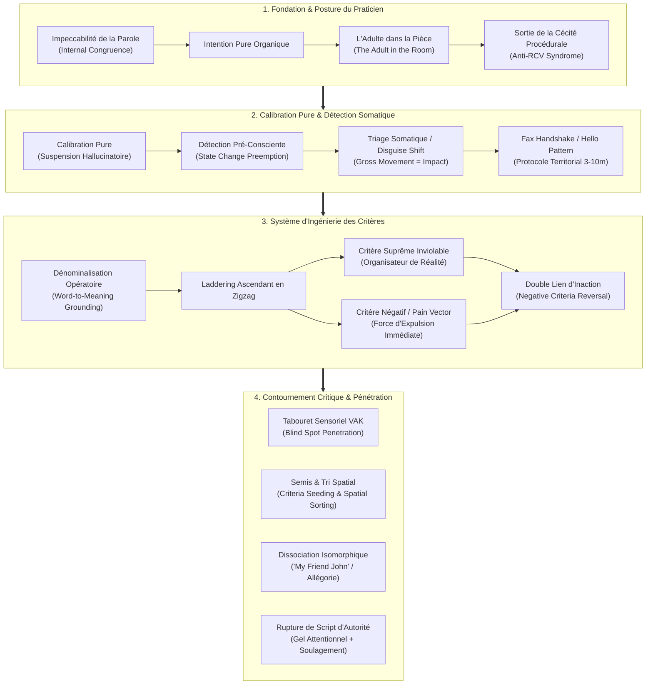

# Unconscious Persuasion - Transcripts
**Formateur :** Kenrick Cleveland | **ID :** `kenrick-cleveland-unconscious-persuasion-transcripts` | **Tranches :** 12

## Synthèse Architecturale du Cours : *Unconscious Persuasion* (Kenrick Cleveland)

---

### 1. Thèse Centrale & Philosophie du Cours

#### La Vision de Kenrick Cleveland vs Approche Standard
L'approche standard de la vente ou de la persuasion conversationnelle (y compris une large part de la PNL commerciale classique) repose sur l'exécution séquentielle de scripts verbaux conscients, la manipulation rhétorique et l'argumentation rationnelle face à des objections formalisées. 

Pour Kenrick Cleveland, **toute tentative de manipuler consciemment par un script crée des micro-incongruences somatiques que le système nerveux de la cible rejette instinctivement**. Sa posture repose sur trois axiomes radicaux :
1. **L'Inconscient comme Décideur Unique et Absolu :** Les individus ne décident jamais sur des motifs moraux, logiques ou rationalisés, mais sur des organisateurs perceptuels profonds (*Critères Suprêmes*) et des impulsions d'évitement de la douleur (*Pain Vectors*). La logique ne sert qu'à justifier a posteriori ce que le système nerveux a déjà validé viscéralement.
2. **L'Alignement Somatique et l'Intention Pure du Praticien (*Become the Skills*) :** Le communicateur d'élite ne « récite » pas une technique ; il est l'autorité naturelle dans l'espace (*The Adult in the Room*). Son autorité hypnotique découle directement de son **impeccabilité interne** (tenir ses micro-engagements, éradiquer le mensonge social d'évitement). Si la parole interne du praticien est vide, son inconscient émet un signal flou qui détruit toute projection de certitude.
3. **La Préemption vs le Traitement :** Attendre qu'une objection soit prononcée verbalement est déjà une défaite, car l'ego du sujet va la défendre. Cleveland prône la capture du mouvement interne **au stade somatique pré-conscient**, avant que l'esprit critique n'ait le temps de cristalliser une défense.

#### Le Fil Rouge Méthodologique
Le fil conducteur unissant chaque module s'articule comme une boucle cybernétique en 4 phases invariantes :
$$\text{Scan Sensoriel Brut} \longrightarrow \text{Interception Pré-Consciente} \longrightarrow \text{Accrochage au Critère Suprême/Négatif} \longrightarrow \text{Pénétration par Zone Aveugle}$$
- **Désamorcer l'esprit critique** (via ruptures de patterns, doubles liens temporels ou métaphores dissociées).
- **Extraire la hiérarchie de critères sans jamais halluciner ni projeter** ses propres définitions.
- **Délivrer la suggestion ou l'ancrage là où la vigilance est absente** (saturation asymétrique, canaux sensoriels délaissés, projection directionnelle).

---

### 2. Carte des Concepts & Leviers Émergents

#### Écosystème des Concepts Clés :
1. **L'Impeccabilité et la Relevance of Words :** Condition sine qua non de la persuasion inconsciente. Le système nerveux n'obéit aux intentions du praticien que si celui-ci s'entraîne à dire la vérité factuelle dans ses micro-détails du quotidien (renforcement du « spine muscle »).
2. **L'Adulte dans la Pièce & Transe Waking :** Constat que le monde extérieur vit en somnambulisme fonctionnel. Le praticien ne cherche pas à « créer » de la transe : il réveille le sujet sur son auto-sabotage ou prend la direction du cadre par congruence pure.
3. **La Dé-nominalisation Opératoire & Biais d'Auto-Projection :** Règle d'or : *« You name the criteria first, you lose »*. Éradiquer le réflexe de supposer le sens d'un mot abstrait (sécurité, liberté) ; forcer le sujet à définir ses représentations sensorielles spécifiques.
4. **L'Inviolabilité du Critère Suprême & Le Pain Vector :** Le levier de décision ultime. Le critère suprême attire de façon irrésistible ; le critère négatif (*Away-from*) expulse le sujet de son inertie par panique amygdalienne.
5. **Le Disguise Shift & Triage Somatique :** Mécanisme où la fuite motrice globale (croisement de jambes, posture de recul) valide qu'un stimulus a percuté le système affectif, nonobstant les dénégations verbales de façade.
6. **Le Tabouret Sensoriel & Blind Spot Penetration :** Modèle d'attaque sensorielle asymétrique. En identifiant le canal sensoriel négligé par l'esprit analytique du prospect (souvent le kinesthésique chez l'intellectuel), on y insère l'ancrage ou la suggestion sans aucun filtrage conscient.

---

### 3. Tableau Récapitulatif des Techniques & Démonstrations

| Technique / Exercice | Objectif Opératoire | Déclencheur / Indication | Séquence Résumée |
|---|---|---|---|
| **Rupture de Pattern d'Autorité Automatisée** | Geler la vigilance critique d'un préposé et induire une transe de complaisance instantanée. | Confrontation à un guichetier, douanier ou agent exécutant un script rigide en boucle fermée. | 1. Refuser frontalement le script attendu par une absurdité logique ou un choc existentiel. 2. Calibrer le gel attentionnel (transitoire d'absence de la cible). 3. Injecter immédiatement un soulagement émotionnel (« just kidding », complicité). 4. Associer la présence du praticien à la résolution de la tension. |
| **Calibration et Effet Miroir de Micro-Pattern** | Désamorcer l'amygdale et créer une reconnaissance neurologique immédiate. | Contact initial avec une figure menaçante ou méfiante (ex: alerte de sécurité / inspection). | 1. Observer à distance le rythme et la séquence comportementale du sujet. 2. Reproduire son pattern exact lors du contact. 3. Insérer une exagération absurde (ex: « le mini bazooka ») pour convertir la menace en rire complice. |
| **Élicitation Ascendante en Zigzag (*3-Tier Laddering*)** | Découvrir le Critère Suprême gouverneur et le Critère Négatif d'évitement sans éveiller de résistance. | Phase de découverte ou de qualification ; prospect bloqué dans des critères basiques (prix, caractéristiques). | 1. Poser la question de base : « Qu'est-ce qui est important pour vous dans [X] ? » 2. Dé-nominaliser le mot obtenu (recherche des critères sensoriels). 3. Chunker vers le haut : « Quand vous avez [critère N], qu'est-ce que cela fait pour vous au final ? » 4. Zigzaguer vers le critère négatif : « Et qu'est-ce que vous refusez absolument de voir arriver ? » 5. Verrouiller le sommet de la hiérarchie. |
| **Semis et Tri Spatialisé de Groupe (*Criteria Seeding & Spatial Sorting*)** | Repérer les leviers inconscients au sein d'une assemblée et segmenter sans prise de conscience du public. | Présentation publique, conférence de vente, négociation multipartite. | 1. Lancer un mot-critère à haute charge émotionnelle/traumatique tout en scannant visuellement. 2. Calibrer les micro-réactions autonomes involontaires (dilatation pupillaire, figement, micro-sourcils). 3. Réorganiser l'espace oratoire (tri spatial) pour ancrer et adresser des suggestions spécifiques aux groupes calibrés. |
| **Renversement du Critère Négatif (*Negative Criteria Reversal*)** | Détruire l'objection d'hésitation (« je dois réfléchir ») en supprimant la zone de confort. | Le prospect utilise une temporisation protectrice pour repousser la décision d'achat ou d'action. | 1. Isoler le critère négatif suprême du prospect (ex: perte financière, humiliation, stagnation). 2. Démontrer que le fait d'attendre ou de reporter matérialise directement ce scénario redouté. 3. Fermer la boucle de décision : agir maintenant devient le seul moyen d'échapper à la douleur. |
| **Dissociation Métaphorique Isomorphique (*"My Friend John"*)** | Traiter une objection majeure sans heurter l'ego ni éveiller la réactance psychologique. | Objection de fond sensible, blocage identitaire ou défiance envers la solution. | 1. Quitter le cadrage direct de la conversation. 2. Introduire un tiers isomorphique (une entreprise similaire ou « Mon ami John ») ayant eu exactement la même objection. 3. Raconter la résolution, le coût de son hésitation et son succès final par procuration. 4. Reconnecter implicitement le sujet à l'histoire sans forcer la morale. |
| **Entraînement au Muscle de l'Intention et de la Parole** | Restaurer l'autorité exécutive de la parole auprès de son propre système nerveux inconscient. | Praticien hésitant, incongruent, manquant de force d'impact ou souffrant de syndrome de l'imposteur. | 1. Définir des micro-engagements quotidiens impossibles à rater. 2. Bannir rigoureusement les petits mensonges d'évitement social (avouer le vrai motif sans fausse excuse). 3. Connecter chaque action à une intention somatique claire pré-engagée. 4. Répéter sur 30 jours jusqu'à transformation du réflexe d'alignement. |
| **Interception de l'Objection en Mode Conversation** | Désamorcer une résistance avant qu'elle ne prenne la forme d'un argument défensif conscient. | Détection d'un micro-mouvement corporel d'incongruence (tension faciale, retrait, inclinaison de tête). | 1. Intercepter le signal corporel dès son émergence. 2. Verbaliser l'état sans accusation via un split permissif : « D'un côté vous voyez l'intérêt, mais de l'autre quelque chose vous retient... » 3. Ouvrir l'espace au dialogue collaboratif avant que la position critique ne soit cristallisée. |
| **Pénétration par Zone Aveugle (*Blind Spot Penetration*)** | Faire passer une suggestion ou un ancrage sans heurter le filtre critique conscient. | Prospect hyper-polarisé sur un canal de contrôle (ex: auditif intellectualisant ou visuel sceptique). | 1. Identifier le canal sensoriel totalement délaissé par la posture défensive du sujet (ex: le kinesthésique). 2. Maintenir son attention critique occupée dans son canal dominant (débat logique ou présentation visuelle). 3. Délivrer simultanément l'ancrage ou la commande d'impact dans le canal aveugle (inflexion somatique, toucher subreptice, ancrage spatial). |
| **Le « Fax Handshake » & « Hello Pattern »** | Établir le rapport inconscient et pacifier le territoire avant le premier échange verbal. | Approche d'un prospect, d'une table ou d'un interlocuteur dans une zone de 3 à 10 mètres. | 1. Scanner le sujet à distance avant le contact de proximité. 2. Émettre le micro-signal réflexe de reconnaissance territoriale (haussement de sourcil, inclinaison subtile de tête). 3. Calibrer la réponse réflexe du système nerveux d'en face (« looking for friendlies ») validant l'accès au territoire. |

---

---

## 0. Sommaire Sémantique & Index des Lignes

- **Tranche 1 [Lignes 110-220]** : d'Élicitation Ascendante des Critères (The 3-Tier Laddering Process) — *Protocole :* d'Élicitation Ascendante des Critères (The 3-Tier Laddering Process)
- **Tranche 2 [Lignes 222-364]** : L'Élicitation Ascendante des Critères en Zigzag (The Laddering & Zigzag Process) — *Protocole :* L'Élicitation Ascendante des Critères en Zigzag (The Laddering & Zigzag Process) | *Verbatim :* La boucle d'élicitation conversationnelle avec accusé de réception
- **Tranche 3 [Lignes 366-497]** : Le Diagnostic Invisible et Tri Spatial en Groupe (Audience Calibration & Spatial Sorting) — *Protocole :* Le Diagnostic Invisible et Tri Spatial en Groupe (Audience Calibration & Spatial Sorting) | *Mécanisme :* La Transe du Quotidien et la Posture d'Adulte dans la Pièce | *Verbatim :* Le Semis Hypnotique du Critère en Groupe
- **Tranche 4 [Lignes 499-601]** : L'Entraînement au Muscle de l'Intention & de la Congruence Inconsciente — *Protocole :* L'Entraînement au Muscle de l'Intention & de la Congruence Inconsciente | *Mécanisme :* Le Principe d'Impeccabilité de la Parole / Congruence Inconsciente Interne | *Verbatim :* Le Recadrage de la Boîte (Frame Redefinition)
- **Tranche 5 [Lignes 603-743]** : Le Calibrateur Progressif Statique (Gross-to-Subtle Calibration) — *Protocole :* Le Calibrateur Progressif Statique (Gross-to-Subtle Calibration) | *Mécanisme :* Le « Triage Somatique de Pertinence » (Relevance Tell / Disguise Shift) | *Verbatim :* PÉPITE 1 : L'Hypothèse Inoffensive à Effet Loupe
- **Tranche 6 [Lignes 745-875]** : Le Bonjour Inconscient (The Unconscious Hello) — *Protocole :* Le Bonjour Inconscient (The Unconscious Hello)
- **Tranche 7 [Lignes 877-1027]** : Calibration Pure « Hello to Yes/No » en 30 Secondes — *Protocole :* Calibration Pure « Hello to Yes/No » en 30 Secondes | *Verbatim :* La Sonde d'Engagement en Douceur
- **Tranche 8 [Lignes 1029-1163]** : Traitement Écologique d'une Incongruence Somatique — *Protocole :* Traitement Écologique d'une Incongruence Somatique | *Mécanisme :* Traitement de l'Incongruence comme Signal d'Arrêt Délibéré | *Verbatim :* La Permission d'Exploration des Voies Alternatives
- **Tranche 9 [Lignes 1165-1335]** : Élicitation Couverte des Critères en Public & Empilement de Preuves — *Protocole :* Élicitation Couverte des Critères en Public & Empilement de Preuves | *Mécanisme :* Élicitation Couverte des Critères de Groupe par Narration Furtive (Stealth Group Criteria Elicitation) | *Verbatim :* Verbatim 1 : La Furtivité du Diagnostic Clinique / Élicitation
- **Tranche 10 [Lignes 1337-1478]** : Construction et Délivrance d'une Métaphore Isomorphique Persuasive — *Protocole :* Construction et Délivrance d'une Métaphore Isomorphique Persuasive | *Mécanisme :* Isomorphisme Métaphorique et Respect de l'Interprétation Inconsciente | *Verbatim :* L'erreur fatale d'explicitation du sens
- **Tranche 11 [Lignes 1480-1703]** : Fondamental : Architecture C3P4 (Complet) — *Protocole :* Fondamental : Architecture C3P4 (Complet) | *Verbatim :* Pattern 1 : The Magic Wand Bypass (L'Induction du Cadre Magique)
- **Tranche 12 [Lignes 1705-1854]** : L'Unconscious Hello & le Verrouillage Oculaire (Instant Rapport) — *Protocole :* L'Unconscious Hello & le Verrouillage Oculaire (Instant Rapport) | *Mécanisme :* Le "Pad Framing" & l'Obligation Opératoire Système | *Verbatim :* Le Double Pont Temporel d'Incarnation de Critère

---

## Extractions Détaillées par Tranche (Opératoire & Verbatim)

## Tranche 1 / 12 : d'Élicitation Ascendante des Critères (The 3-Tier Laddering Process)

### 1. Mécanismes & Principes Actifs

- **La Rupture de Pattern en Contexte d'Autorité Automatisée**  
  *Principe actif :* Les figures d'autorité subalternes (douaniers, sécurité d'aéroport, guichetiers) fonctionnent sous un programme cognitif en boucle fermée (« script mental » rigide et automatisé). En introduisant une réponse qui refuse frontalement le script attendu sans être agressive, mais en questionnant le sens existentiel du rôle ou en créant une absurdité logique, le cerveau de l'interlocuteur subit un gel attentionnel (transitoire d'absence). Dès que la surcharge cognitive survient, le praticien injecte immédiatement un soulagement émotionnel (« just kidding », autodérision, complicité). Le système nerveux de la cible associe alors inconsciemment ce soulagement à la présence du praticien, déclenchant un état de transe de conformité et un rapport instantané disproportionné.  
  *Tags libres émergents :* `#rupture_de_pattern_d_autorite` `#surcharge_de_script_mental` `#effondrement_et_recadrage_complice` `#court_circuit_cognitif`

- **Le Calibrage et l'Effet Miroir de Micro-Pattern**  
  *Principe actif :* Observer la séquence comportementale et le rythme d'une cible avant d'entrer en interaction directe permet d'extraire la formule spécifique par laquelle cette personne traite l'information. En reproduisant exactement son propre pattern comportemental vers elle au moment du contact, le cerveau de la cible reconnaît une familiarité neurologique immédiate. Face à une menace potentielle (ex: une alerte d'inspection), renvoyer ce pattern tout en introduisant une exagération absurde (ex: « mini bazooka ») désarme l'amygdale et fait basculer la vigilance critique en décharge dopaminergique (le rire), transformant une procédure répressive en jeu coopératif.  
  *Tags libres émergents :* `#isomorphisme_de_pattern` `#desarmement_de_l_amygdale` `#reproduction_de_rythme_neurologique` `#calibration_chirurgicale`

- **L'Ascension Hiérarchique des Critères (Chunking Up Émotionnel)**  
  *Principe actif :* Les critères représentent les déclencheurs de valeur encodés dans le système nerveux d'un individu. Plus un critère est bas dans l'abstraction (spécifique, matériel, ex: « vélo »), plus il est interchangeable et négociable. Plus on monte dans la hiérarchie par questionnement itératif (« Qu'est-ce qui est important à propos de X ? » jusqu'à « Qu'est-ce que cela fera pour toi ? »), plus le critère devient général, englobant et chargé d'affect (ex: « liberté », « sécurité », « statut »). Le critère le plus élevé gouverne tous les sous-critères : connecter une proposition au critère suprême contourne la résistance logique et active directement le centre de décision viscéral.  
  *Tags libres émergents :* `#hierarchie_des_criteres` `#chunking_up_de_valeur` `#critere_supreme_gouverneur` `#levier_visceral_inconscient`

- **Le Biais d'Auto-Projection de Critères vs Calibration Réelle**  
  *Principe actif :* L'erreur fatale en persuasion consiste à projeter ses propres critères logiques ou émotionnels sur la cible (ex: supposer qu'une cible âgée veut perdre du poids « pour sa santé » alors que son moteur inconscient réel est « l'apparence physique et le regard des autres »). L'inconscient n'achète jamais sur des critères moralement acceptables ou rationalisés, mais sur des leviers émotionnels bruts. Si le praticien nomme le critère avant de l'avoir calibré ou extrait chez la cible (« You name the criteria first, you lose »), l'esprit critique de la cible se ferme.  
  *Tags libres émergents :* `#illusion_de_projection_de_criteres` `#moteur_inconscient_brut` `#interdiction_d_anticipation_critique`

- **L'Imprégnation Somatique des Compétences (« Become the Skills »)**  
  *Principe actif :* Les compétences de persuasion inconsciente ne peuvent pas opérer via l'exécution d'un script cognitif conscient (« step one, read this, say that »). Tenter de manipuler consciemment crée des micro-incongruences physiologiques que l'inconscient de la cible détecte immédiatement (rejet instinctif). L'intégration nécessite l'application sur soi-même en situation réelle pendant environ 30 jours, jusqu'à ce que la calibration et la réponse deviennent des réflexes sensorimoteurs non désactivables.  
  *Tags libres émergents :* `#installation_neurologique_somatique` `#incongruence_du_scripteur` `#automatisation_du_reflexe_inconscient`

---

### 2. Protocoles, Techniques & Démonstrations (Étape par Étape)

#### Protocole d'Élicitation Ascendante des Critères (The 3-Tier Laddering Process)

* **Intention / Indication :**  
  Identifier le levier motivationnel absolu et non négociable d'une cible (ou modéliser le profil psychologique d'un avatar client idéal en interrogeant 5 clients parfaits à « cloner »). Utilisé pour verrouiller une proposition commerciale, désarmer une objection ou bâtir un message publicitaire à fort impact.

* **Mise en place & Pré-framing :**  
  - Faire le vide total : adopter la posture mentale du débutant (« You're too close to the forest to see the trees »), suspendre toute hypothèse sur ce que veut l'autre.
  - Préparer une feuille blanche.
  - S'engager dans une boucle stricte : *Information de la cible -> Accusé de réception (Feedback/Acknowledge) -> Question suivante*. Ne jamais omettre l'accusé de réception, sous peine de rompre le rapport.

* **Séquence d'actions pas à pas :**  
  1. **Étape 1 (Critère de base) :** Poser la question d'accroche :  
     *« What's important about [X] ? »* ([X] = le produit, le projet, la décision ou le domaine exploré).  
     - Écouter la réponse exacte mot pour mot.  
     - Écrire la réponse tout en bas de la feuille.  
     - Valider/accuser réception verbalement et corporellement.
  2. **Étape 2 (Critère intermédiaire) :** Réinjecter la réponse obtenue dans la même structure linguistique :  
     *« What's important about [Réponse 1] ? »*  
     - Noter la deuxième réponse une ligne au-dessus de la première.  
     - Valider/accuser réception.
  3. **Étape 3 (Critère supérieur) :** Répéter le processus une troisième fois :  
     *« What's important about [Réponse 2] ? »*  
     - Noter la troisième réponse une ligne plus haut.  
     - Valider/accuser réception.
  4. **Étape 4 (Extraction de l'effet terminal) :** Poser la question de bascule vers le critère suprême :  
     *« And ultimately, what will that do for you? »*  
     - Noter le sommet de la pyramide. Ce critère englobe tous les niveaux inférieurs (ex: « Transportation » englobe « Bicycle »).

* **Signes de calibration :**  
  - Changement de posture ou relâchement musculaire lorsque le critère supérieur est touché.  
  - Changement du rythme respiratoire (plus ample et plus basse).  
  - Accès oculaire vers le haut (visualisation de l'identité) ou vers le bas-droite (accès kinesthésique profond).  
  - Élargissement des pupilles ou micro-hochement de tête involontaire validant la charge émotionnelle du mot.

---

### 3. Heuristiques, Subtilités & "Sagesse du Praticien"

- **Règle de Nomination des Critères :**  
  *« If you tell a prospect, you name the criteria first, you lose. »*  
  Si le praticien présume ou nomme le critère avant que la cible ne l'ait exprimé ou validé inconsciemment, la résistance critique s'active immédiatement. Le critère doit TOUJOURS émerger du sujet.

- **Heuristique de Rupture d'Autorité / TSA :**  
  *Si* un agent de contrôle ou d'autorité te confronte sur une anomalie procédurale rigide (ex: formulaire incomplet, fausse alerte),  
  *Alors* ne te défends pas, ne justifie pas et ne discute pas la règle. Romps son cadre cognitif par une question existentielle absurde, amplifie son accusation dans l'hyperbole grotesque (ex: le bazooka pliable), puis rétablis instantanément le cadre en lui donnant raison avec le sourire (« Just kidding, let me give it to you »).  
  *Parce que* cela fait imploser son état de transe bureaucratique et le fait basculer dans un rapport de connivence où il cherchera lui-même à te faciliter le passage.

- **Heuristique de la Malléabilité de la Volonté :**  
  *« 99 out of 100 people don't even have much of a will these days. »*  
  La majorité des gens n'ont pas d'objectifs clairement formulés ni de volonté rigide ; ils sont dans un état passif réceptif.  
  *Condition de stop éthique :* Tant que l'interlocuteur reste assis et écoute, il est ouvert à l'influence. En revanche, dès qu'il émet un refus explicite d'intention (*« No, that's not what I'm here to do »*), s'arrêter immédiatement et respecter son cadre. Tenter de forcer contre la volonté consciente crée un retour de flamme relationnel et énergétique destructeur.

- **Le Piège du Persuadeur Intellectuel :**  
  Croire qu'analyser des transcriptions ou mémoriser des scripts suffit. Si l'exercice n'est pas pratiqué dans la rue sur des inconnus (minimum 5 personnes cibles pour l'élicitation) pendant un mois continu jusqu'à devenir involontaire, les compétences restent au stade d'hallucinations théoriques stériles.

---

### 4. Pépites Verbatim & Patterns Linguistiques (MOT À MOT EN V.O.)

* **Extrait 1 :**
> « I'm a U.S. citizen. What do you need to know my address for? I said, my citizen here, do you want to track me or what's going on? [...] And you could live with yourself? You get up in the morning and like what you see when you look in the mirror? [...] You have to make people fill in little blanks that are citizens of this country? [...] Ah, just kidding. I know you need to have the address. Let me give it to you. »

* **[Analyse du Pattern]** :  
  *Rupture de pattern par empilement de questions transgressives et dissociation d'identité, suivie d'un re-cadrage de soulagement.*  
  Kenrick attaque le rôle institutionnel en reliant une micro-tâche bureaucratique (« fill in little blanks ») à l'intégrité morale profonde de l'agent (« like what you see when you look in the mirror »). L'agent subit un choc cognitif (incapacité de traitement du script habituel). La rupture est immédiatement refermée par un désarmement (« Ah, just kidding ») qui réinjecte de la sécurité et crée une bascule émotionnelle brutale vers la gratitude et le rire complice.

---

* **Extrait 2 :**
> « Sir, you have ammunition in this bag. [...] Really? [...] Oh, ammunition. And the bazooka? Did you catch that too? Is it the fold-up kind? [...] Oh, the mini bazooka. [...] Doggone it, I got caught. That tuna fish sandwich again. [...] Check away. »

* **[Analyse du Pattern]** :  
  *Utilisation du cadre de l'absurde (Reductio ad Absurdum) et accord paradoxal (Pacing & Leading d'exagération).*  
  Plutôt que d'adopter une posture défensive ou anxieuse face à une accusation de sécurité grave (« ammunition »), Kenrick valide le cadre en le surenchérissant jusqu'au grotesque (« bazooka », « fold-up kind », « mini bazooka »). En associant l'objet dangereux interdit à un sandwich au thon, il pulvérise le cadre de gravité de l'agent TSA. L'agent, contraint biologiquement par le rire, effectue sa fouille comme une simple formalité dénuée d'agressivité et valide la conformité sans friction.

---

* **Extrait 3 :**
> « What's important about X? [...] What's important about [that]? [...] And ultimately, what will that do for you? »

* **[Analyse du Pattern]** :  
  *Structure syntaxique d'élicitation récursive et de montée en abstraction nominalisée (Chunking Up).*  
  La question neutre « What's important about... » force l'inconscient à sélectionner le critère de valeur sans injecter le moindre contenu sémantique extérieur. La question terminale (« And ultimately, what will that do for you? ») utilise la présupposition temporelle et téléologique (*ultimately*, *will*) pour court-circuiter l'utilité fonctionnelle du produit et extraire l'état d'être final recherché (le gain d'identité ou le soulagement émotionnel ultime).

## Tranche 2 / 12 : L'Élicitation Ascendante des Critères en Zigzag (The Laddering & Zigzag Process)

Voici l'extraction et la modélisation intégrale de la substance opératoire de cette tranche.

---

### 1. Mécanismes & Principes Actifs

- **L'Inviolabilité Neurologique du Critère Suprême (*Criteria Irresistibility*)**
  - **Principe actif :** Un critère de haut niveau n'est pas une simple préférence intellectuelle : c'est un organisateur perceptuel fondamental codé au sommet de la hiérarchie de valeur du système nerveux. L'inconscient utilise ces méta-catégories (ex: *liberté, succès, sécurité*) pour filtrer la réalité et valider la survie ou l'accomplissement identitaire. Essayer de forcer un individu à violer son propre critère déclenche une dissonance cognitive aiguë et une détresse somato-émotionnelle (*"extreme physical/emotional pain"*). À l'inverse, lier une action ou une décision au critère le plus élevé neutralise le filtre critique : le sujet ne perçoit plus la persuasion comme une poussée externe, mais comme l'expression naturelle de sa propre volonté.
  - **Tags :** `#inviolabilite_du_critere #highest_criteria #levier_neurologique_absolu #non_resistance_inconsciente`

- **La Dé-nominalisation Opératoire (*Word-to-Meaning Grounding*)**
  - **Principe actif :** Les mots abstraits (*"liberté financière"*, *"succès"*, *"sécurité"*) sont des nominalisations vides. L'erreur fatale consiste à projeter sa propre définition sur le mot du sujet. Deux individus utilisant le même mot-clé activent des réseaux synaptiques et des représentations internes radicalement opposés (ex: *liberté financière* = travailler de chez soi sans patron toxique vs ne rien faire sur une plage à Tahiti). La persuasion échoue tant que le critère n'est pas ancré dans les critères d'évaluation comportementaux et contextuels exacts du sujet.
  - **Tags :** `#denominalisation_critique #clarification_semantique #sens_subjectif_reel #destruction_de_la_projection`

- **La Gravité Opératoire du Critère Négatif (*Negative Criteria Leverage / Pain Vector*)**
  - **Principe actif :** Le système nerveux est biologiquement câblé avec un biais de négativité orienté vers la survie et l'évitement de la menace. Un critère positif (direction *Vers/Toward*) agit comme une attraction, mais son inertie au démarrage est souvent élevée. Le critère négatif (direction *Loin de/Away-from*, ce que le sujet refuse catégoriquement de vivre ou de ressentir : rejet, perte de face, précarité) déclenche une réponse motrice et neuro-émotionnelle quasi instantanée par activation amygdalienne. En reliant l'inaction du sujet à l'apparition inévitable de son critère négatif, le praticien génère une force d'expulsion comportementale immédiate.
  - **Tags :** `#critere_negatif #away_from_leverage #biais_de_negativite #declencheur_d_action_immediat`

- **Le Conflit Homéostatique de Critères (*Criteria Dissonance & Incongruence*)**
  - **Principe actif :** Lorsqu'un sujet abrite deux critères de même niveau non alignés (ex: *Liberté totale sans contrainte* VS *Richesse / Train de vie élevé*), son système nerveux oscille en permanence dans une boucle d'inefficacité (la métaphore de Stephen Wright : *"l'humidificateur et le déshumidificateur qui se battent toute la nuit"*). L'individu ne devient efficient que dans les fenêtres d'urgence où un critère menace de s'effondrer (la peur de ne plus avoir le chèque). Identifier ce conflit permet de prédire les pannes de comportement et d'apporter l'arbitrage nécessaire.
  - **Tags :** `#conflit_de_criteres #incongruence_systemique #boucle_d_inefficacite #arbitrage_identitaire`

- **La Transe Fonctionnelle Automatique et la Posture de l'Adulte (*Everyday Trance & The Adult in the Room*)**
  - **Principe actif :** Au quotidien, la surcharge sensorielle et la répétition plongent les individus dans des transes de routine (somnambulisme éveillé, ex: l'employé de fast-food qui encaisse sans conscience). Dans cet état dissocié, le sujet perd la boucle de rétroaction sur sa propre vie : il ne réalise pas que ses comportements actuels l'éloignent de ses critères positifs ou matérialisent directement ses critères négatifs. Le rôle du persuasif est de tenir la posture de *"l'adulte dans la pièce"* : provoquer une rupture de transe pour confronter le sujet à l'incongruence de sa trajectoire.
  - **Tags :** `#transe_du_quotidien #pattern_interrupt #l_adulte_dans_la_piece #reconnexion_retroactive`

---

### 2. Protocoles, Techniques & Démonstrations (Étape par Étape)

#### Protocole 1 : L'Élicitation Ascendante des Critères en Zigzag (*The Laddering & Zigzag Process*)

- **Intention / Indication :** Découvrir le levier ultime (le critère le plus général et englobant) qui pilote les décisions d'un prospect ou client sans jamais paraître directif, vendeur ou intrusif.
- **Mise en place & Pré-framing :**
  - Avoir une feuille blanche sous les yeux (ou un ancrage spatial mental).
  - Établir le contact de manière fluide, ouverte, sans questions fermées de vente artificielle.
  - Déposer le premier élément tout en bas de la page.
- **Séquence d'actions pas à pas :**
  1. **Déclenchement exploratoire :** Poser une question ouverte de direction générale : *"Pourquoi as-tu voulu faire [X] ?"* ou *"Qu'est-ce qui est important pour toi à propos de [X] ?"*.
  2. **Accusé de réception & Validation (*Acknowledge*) :** Répéter/valider la réponse du sujet sans jugement (*"Excellent. Vraiment bon. J'adore ça aussi"*). Noter la réponse en bas de la page.
  3. **Sondage d'exhaustivité :** Relancer systématiquement : *"Et quoi d'autre ?"* (*"What else?"*) pour vider la couche superficielle et laisser émerger les motivations plus profondes.
  4. **Montée d'un cran hiérarchique (*Laddering*) :** Prendre le nouvel élément exprimé et demander : *"Qu'est-ce qui est important pour toi à propos de [cet élément précis] ?"* ou *"Au final, qu'est-ce que cela va t'apporter ?"*. Inscrire la réponse une ligne plus haut sur la feuille.
  5. **Absorption du Zigzag :** Si le sujet change soudainement d'axe thématique (ex: passe de l'altruisme *"que les gens apprennent"* à l'ego-efficacité personnelle *"mon niveau se multiplie par 10"*), ne JAMAIS le forcer à revenir en arrière. Accueillir le virage, calibrer l'état émotionnel, et poser la question de valeur sur la nouvelle branche.
  6. **Répétition minimale :** Réaliser au moins 3 itérations ascendantes jusqu'à atteindre le critère faîtier (ex: *Succès / Invulnérabilité*).
  7. **Dé-nominalisation de la cime :** Obtenir la définition subjective brute du critère le plus haut (*"Et pour toi, être couronné de succès, c'est quoi exactement ?"* $\rightarrow$ *"Être inarrêtable"*).
  8. **Bouclage temporel persuasif (*Pacing the Past / Leading the Future*) :** Réinjecter immédiatement le critère suprême dans la ligne temporelle du sujet pour ancrer la persuasion de manière irréversible : *"En regardant en arrière dans ta vie, vois-tu comment ces compétences t'ont rendu plus inarrêtable ? Et le futur s'annonce... ?"*
- **Signes de calibration :**
  - Changement de coloration du visage (*skin flushing/pallor*).
  - Modification du rythme et de la profondeur respiratoire.
  - Entrée manifeste dans un état modifié de conscience (le sujet accède directement à l'état physiologique de son critère : regard défocalisé, posture redressée, voix modifiée).

---

#### Protocole 2 : Cartographie et Extraction des Critères de Marché (*Market Criteria Condensation*)

- **Intention / Indication :** Obtenir l'arsenal d'arguments 100% irrésistibles pour un copywriting, un site web, une offre ou une campagne de persuasion de masse.
- **Mise en place & Pré-framing :** Cesser toute supposition marketing. Choisir 4 à 5 clients réels idéaux (puis étendre à 100-200 personnes pour dominer une niche).
- **Séquence d'actions pas à pas :**
  1. **Interview d'exploration pure :** Contacter les cibles et poser des questions d'ouverture totale : *"Raconte-moi ce qui se passe dans ta vie / ton business en ce moment. Quels sont tes défis actuels ? Quelles sont tes opportunités ? Qu'est-ce qui t'embête, qu'est-ce qui te motive, t'excite ou te fait peur ?"*
  2. **Extraction des critères :** Conduire le protocole d'élicitation ascendante (Protocole 1) sur chaque individu.
  3. **Définition stricte des termes :** Traquer chaque mot-valise (ex: *"liberté financière"*, *"croissance"*) et exiger la traduction concrète pour cette personne précise.
  4. **Matrice de condensation :** Aligner les fiches des 5 sujets. Repérer les recoupements et isoler les 3 ou 4 critères transversaux majeurs qui reviennent chez la quasi-totalité des prospects (ex: en finance : *sécurité de la retraite sans inquiétude* ; en immobilier : *obtenir le montant maximal net*).
  5. **Intégration prospective :** Tisser ces 3 à 4 critères condensés directement dans la communication, en renvoyant au marché ses propres définitions sans jamais donner l'impression de lui vendre.
- **Signes de calibration :**
  - Récurrence quasi verbatim des mêmes tournures de phrases et enjeux émotionnels à travers plusieurs entretiens indépendants.

---

#### Protocole 3 : Activation du Levier par Critère Négatif (*The Negative Criterion Probe*)

- **Intention / Indication :** Débloquer instantanément la procrastination, l'indécision ou le confort toxique d'un sujet en reliant son comportement actuel à sa hantise inconsciente suprême.
- **Mise en place & Pré-framing :** Avoir au préalable identifié ce que le sujet veut éviter à tout prix (perdre la face, solitude, pauvreté, échec d'image).
- **Séquence d'actions pas à pas :**
  1. **Observation de l'incongruence :** Repérer le projet ou l'inaction du sujet où une conséquence destructrice est ignorée.
  2. **Injection paradoxale du critère négatif :** Formuler avec un détachement total l'abandon du critère : *"Bon, j'imagine qu'au fond, [conséquence négative / critère négatif] n'a pas vraiment d'importance pour toi..."*
  3. **Gestion du choc de rupture :** Se tenir prêt émotionnellement (*"get out of the way"*). Ne pas adoucir le propos.
  4. **Calibration de la réaction viscérale :** Observer la réaction somatique de sursaut (le sujet ne reste pas passif : il se redresse, s'insurge, réfute violemment).
  5. **Canalisation :** Une fois l'énergie motrice libérée par la blessure du critère négatif, réorienter immédiatement le sujet vers l'action requise pour restaurer la sécurité de son critère.
- **Signes de calibration :**
  - Rupture immédiate de l'état léthargique.
  - Sursaut physique, redressement du tronc.
  - Montée d'énergie vocale, dénégation indignée (*"Non, pas du tout, c'est hors de question !"*).

---

### 3. Heuristiques, Subtilités & "Sagesse du Praticien"

- **Règle du Zigzag :**
  * *Si le sujet change subitement de direction lors de l'élicitation des critères $\rightarrow$ Ne tentez JAMAIS de le ramener de force à la ligne précédente ; suivez sa trajectoire avec curiosité, car l'inconscient contourne les réponses convenues pour aller vers la véritable charge émotionnelle.*

- **Règle de la Question "Pourquoi" (*The Rehabilitated 'Why'* ) :**
  * *Si vous utilisez "Pourquoi" dans un cadre d'exploration détendu et sans posture défensive $\rightarrow$ Ce n'est plus une attaque argumentative mais un ouvreur puissant qui donne au sujet le plein contrôle de la direction, vous permettant d'extraire la matière première brute.*

- **Règle du Piège de l'Entonnoir Forcé (*The Funnel Trap*) :**
  * *Si vous posez une question ultra-spécifique pour forcer une réponse (ex: "Qu'est-ce qui est important pour vous dans le fait d'acheter une voiture aujourd'hui chez nous ?") $\rightarrow$ Vous déclenchez l'alerte anti-manipulation du sujet. Posez une question ouverte et amenez-le subtilement là où vous voulez par le jeu des critères ascendants.*

- **Règle de l'Accusé de Réception (*Acknowledge Loop*) :**
  * *Chaque information donnée par le sujet doit impérativement recevoir un accusé de réception chaleureux et authentique avant toute relance. Sans cette validation, l'élicitation ressemble à un interrogatoire de police et le sujet se ferme.*

- **Règle de la Supériorité de Vitesse du Négatif :**
  * *Le critère positif donne la direction, mais le critère négatif fournit la vitesse d'éjection. Si un sujet est enlisé dans la complaisance, ne lui vantez pas les bénéfices du succès : montrez-lui l'impact direct de son inaction sur son critère négatif le plus terrifiant.*

- **Règle de la Déconnexion des Critères Non-Pertinents :**
  * *N'utilisez jamais un levier universel supposé (comme l'argent) sur un individu sans avoir validé qu'il s'agit de son critère (ex: le cas des professeurs de yoga qui acceptent la précarité tant qu'ils enseignent). Appuyer sur un faux critère négatif ne produit qu'une indifférence totale.*

---

### 4. Pépites Verbatim & Patterns Linguistiques (MOT À MOT EN V.O.)

#### Pépite 1 : La boucle d'élicitation conversationnelle avec accusé de réception
> *"We've talked a lot by phone about this seminar and what we're going to do and everything. And we're both excited about doing it. But tell me why you wanted to do it."*
> [...]
> *"Well, number one, it's fun teaching with you."*
> [...]
> *"Excellent. Really good. I love it too. It's a lot of fun. What else?"*

- **[Analyse du Pattern] :**
  - **Présupposition d'état partagé :** *"We're both excited about doing it"* installe une synchronisation d'état et valide l'alignement préalable avant de questionner.
  - **Question d'ouverture causale :** Utilisation délibérée du *"Why"* pour faire émerger la motivation intrinsèque non bridée.
  - **Triple validation kinesthésique/émotionnelle :** *"Excellent. Really good. I love it too"* valide le sujet dans son choix sans interrompre le flux inconscient.
  - **Relance neutre d'exhaustivité (*What else?*) :** Évacue la première réponse (qui n'est souvent qu'une politesse sociale) pour atteindre la couche suivante.

---

#### Pépite 2 : La montée de critère et le recadrage sur l'inarrêtable
> *"So, a successful person is an unstoppable person. That's correct. And you've aligned yourself in that way. That's right. As you look back in your life and you see how these skills have aligned into your life, do you see how you've become more unstoppable? Oh yeah. And the future looks... Even better. As a result. Right. Fantastic."*

- **[Analyse du Pattern] :**
  - **Égalité complexe / Dé-nominalisation :** *"A successful person is an unstoppable person"* scelle l'équivalence entre le critère abstrait (*success*) et la valeur d'action concrète (*unstoppable*).
  - **Ancrage identitaire rétroactif :** *"And you've aligned yourself in that way"* transforme une idée en un trait d'identité déjà intégré.
  - **Liaison temporelle passée vers future (Pacing & Leading temporel) :** *"As you look back in your life... do you see how you've become more unstoppable?"* force le cerveau du sujet à chercher dans sa mémoire biographique des preuves validant la suggestion.
  - **Complétion inductive suspendue :** *"And the future looks..."* laisse la phrase volontairement inachevée avec une intonation montante, forçant l'interlocuteur à fournir lui-même la réponse programmée (*"Even better"*), garantissant un engagement hypnotique absolu.

---

#### Pépite 3 : Le poignard rhétorique du critère négatif (*The Negative Criterion Dagger*)
> *"Well, I guess such and such consequence isn't important to you..."*

- **[Analyse du Pattern] :**
  - **Défi présuppositionnel par fausse résignation :** *"I guess [negative criterion] isn't important to you"* inverse l'autorité. En feignant d'attribuer au sujet l'indifférence envers sa propre hantise, le praticien force l'ego et l'inconscient du sujet à se rebeller immédiatement pour affirmer l'exact contraire.
  - **Pression somato-cognitive :** Le formateur compare ce pattern à *"planter un poignard dans le dos"*. La syntaxe minimaliste crée un vide que le système nerveux du sujet est obligé de combler par une justification émotionnelle véhémente, rompant toute apathie.

## Tranche 3 / 12 : Le Diagnostic Invisible et Tri Spatial en Groupe (Audience Calibration & Spatial Sorting)

Voici l'extraction et la modélisation intégrale de la substance opératoire de cette tranche (3/12).

---

### 1. Mécanismes & Principes Actifs

#### A. La Transe du Quotidien et la Posture d'Adulte dans la Pièce
- **Principe actif :** Dans les tâches automatiques ou la vie courante, les individus fonctionnent en transe waking (transe vigilante somnambulique). Dans cet état, le sujet n'a plus accès à ses méta-niveaux d'évaluation : il perd la conscience de savoir si ses actions le rapprochent de ses critères désirés ou s'il est en train de matérialiser ce qu'il cherche précisément à fuir.
- **Levier neurologique & cognitif :** L'interruption de transe couplée à une congruence totale permet d'occuper la position de *"l'adulte dans la pièce"* (*the adult in the room*). Le système nerveux du sujet délègue naturellement l'autorité et la direction du cadre au communicateur congruent qui révèle explicitement la boucle d'auto-sabotage inconsciente.
- **Tags libres :** `#waking_trance` `#interruption_de_transe` `#adult_in_the_room` `#congruence_d_autorite` `#meta_evaluation_des_criteres`

#### B. L'Amalgamation & le Semis Spatialisé des Critères en Groupe (*Criteria Seeding & Spatial Sorting*)
- **Principe actif :** Lorsqu'un orateur prononce un critère hautement chargé (ex. un mot à forte résonance traumatique ou un mot-critère d'évitement/approche), l'inconscient des personnes concernées produit une micro-réaction autonome involontaire (dilatation pupillaire, changement de rythme respiratoire, figement somatique, micro-sourire).
- **Levier opératoire :** L'orateur n'attend pas que le public parle : il injecte le critère en premier tout en maintenant un scan visuel de calibration. Une fois les sujets repérés, il réorganise physiquement l'espace (tri spatial) pour adresser des commandes hypnotiques et des métaphores ciblées à des sous-groupes homogènes sans qu'aucun individu ne prenne conscience du ciblage chirurgical.
- **Tags libres :** `#criteria_seeding` `#diagnostic_par_calibration_passive` `#tri_spatial_de_foule` `#ancrage_directionnel_de_metaphores` `#amalgamated_criteria`

#### C. L'Effet de Double Lien par le Critère Négatif (*Negative Criteria Reversal*)
- **Principe actif :** Les objections ne sont pas des désaccords logiques mais des stratégies inconscientes d'évitement. Lorsqu'un prospect utilise une objection ("je dois réfléchir"), il pense créer une temporisation protectrice. En liant directement l'action d'hésiter/attendre à la matérialisation certaine de son critère négatif majeur (la perte, le risque, l'érosion financière), l'hésitation perd immédiatement sa fonction refuge.
- **Levier cognitif :** Destruction de la zone de confort. L'inaction devient soudainement plus anxiogène et coûteuse que la prise de décision immédiate.
- **Tags libres :** `#negative_criteria_reversal` `#destruction_du_refuge_cognitif` `#amplification_de_perte_temporelle` `#forcing_the_inevitable`

#### D. La Dissociation Métaphorique Isomorphique (*"My Friend John" / Case Study*)
- **Principe actif :** Adresser une objection de manière frontale déclenche les mécanismes de défense de l'ego et la réactance psychologique. L'utilisation d'une métaphore à double niveau (allégorique comme un papillon, ou isomorphique corporate comme une étude de cas / "My Friend John") déplace le champ de bataille hors du champ perceptuel immédiat du sujet.
- **Levier inconscient :** Le sujet s'identifie inconsciemment au tiers sans se sentir accusé ou mis sous pression. Le traitement de l'objection s'opère par procuration dans l'espace narratif, neutralisant les contre-arguments conscients.
- **Tags libres :** `#my_friend_john_technique` `#dissociation_isomorphique` `#contournement_de_reactance` `#camouflage_analytique`

#### E. L'Intention Pure comme Organisateur Neurologique Global
- **Principe actif :** L'intention n'est pas un voeu pieux cognitif ou un simple désir financier ("vouloir la vente"), c'est un état somato-émotionnel pré-engagé orienté vers un résultat externe précis : transférer un état émotionnel spécifique ou induire chez le client la certitude absolue d'être servi et protégé.
- **Levier neuro-somatique :** Lorsque l'intention interne est calibrée sans ambiguïté ("mon cadre est l'obtention du résultat"), le système nerveux élimine les micro-incongruences posturales et vocales. Le praticien ne peut plus être déstabilisé ("broadsided") par une objection.
- **Tags libres :** `#refined_intention` `#muscle_intentionnel` `#transfert_d_etat` `#stabilite_somatique` `#unspoken_element`

---

### 2. Protocoles, Techniques & Démonstrations (Étape par Étape)

#### Protocole 1 : Le Diagnostic Invisible et Tri Spatial en Groupe (*Audience Calibration & Spatial Sorting*)
* **Intention / Indication :** Persuader un groupe hétérogène en installant des transformations profondes ou en vendant une idée sans passer par des entretiens individuels.
* **Mise en place & Pré-framing :** Remplacer systématiquement l'accroche classique (ex. blague pour détendre) par une déclaration de diagnostic invisible. Aucun avertissement n'est donné sur le fait que le groupe est calibré.
* **Séquence d'actions pas à pas :**
  1. *Émission du mot-amorce (Criteria Seeding) :* Prononcer avec une voix neutre ou posée une phrase contenant le critère clé ou l'empreinte traumatique/émotionnelle suspectée (ex. *"diagnosed with a learning disability"*, *"been raped"*, *"want to become unstoppable"*).
  2. *Calibration panoramique immédiate :* Balayer la salle du regard au moment exact de l'émission acoustique du mot. Relever les micro-réactions : blocage respiratoire, rupture de contact visuel, déglutition, micro-hochement de tête, dilatation des pupilles.
  3. *Regroupement physique sous prétexte logistique :* Demander calmement aux personnes ayant manifesté la même calibration de changer de siège sous un faux prétexte anodin (ex. *"Viens t'asseoir ici pour que je te voie mieux"*). Les regrouper dans un même quadrant spatial.
  4. *Adressage subliminal fractionné :*
     - Tourner son corps et orienter ses gestes de ressources vers un sous-groupe tout en délivrant des commandes de confiance et de dépassement.
     - Simultanément, développer une métaphore réparatrice (ex. la rénovation d'un mur brisé) dont la charge symbolique correspond exactement au trauma/critère non verbalisé de ce sous-groupe spécifique.
* **Signes de calibration :** Synchronisation corporelle des membres du sous-groupe, relâchement des mâchoires, soupirs neuro-végétatifs, transe hypnotique partagée.

---

#### Protocole 2 : Inversion d'Objection par le Critère Négatif (*Negative Criteria Pressure Loop*)
* **Intention / Indication :** Face aux 3 objections universelles :
  1. *"Can't afford it"* (Trop cher / Pas d'argent)
  2. *"Want to think about it"* (Besoin de réfléchir)
  3. *"Have to talk it over with spouse/partner/attorney"* (Doit en parler à un tiers)
  *(Rappel de Cleveland : ces trois objections signifient toutes "NON" à l'instant T si elles ne sont pas traitées immédiatement).*
* **Mise en place & Pré-framing :** Adopter une posture d'extrême sincérité et de totale congruence vocale (baisse de ton, débit posé, tonalité hypnotique d'adulte responsable).
* **Séquence d'actions pas à pas :**
  1. *Extraction du Critère Négatif :* Identifier au préalable ce que le sujet cherche à fuir absolument dans ce domaine (ex. perdre de l'argent pour un investisseur, continuer à souffrir pour un patient).
  2. *Attaque frontale du refuge temporel :* Lier le temps d'attente à l'aggravation directe du critère négatif.
     - Poser la question de rupture : *"En quoi le fait d'attendre/de réfléchir va-t-il vous empêcher de subir [Critère Négatif] ?"*
  3. *Amplification de la menace imminente :* Démontrer que le statu quo aggrave la perte chaque heure/jour supplémentaire (*"Même attendre jusqu'à demain amplifie le risque"*).
  4. *Verrouillage d'évidence :* Mettre le sujet face au choix binaire inéluctable entre stopper l'hémorragie maintenant ou assumer volontairement une dégradation immédiate.
* **Signes de calibration :** Rupture de l'état figé de l'objection, déglutition, réorientation du regard vers l'intérieur (recalcul du coût de l'inaction), acquiescement somatique de dépit face à la réalité incontournable.

---

#### Protocole 3 : Traitement de l'Objection par Métaphore Isomorphique (*"My Friend John" / Case Study Frame*)
* **Intention / Indication :** Neutraliser une objection sans confrontation directe lorsque le client est sur la défensive ou dans un cadre formel/corporate où la confrontation brute risquerait de rompre le rapport.
* **Mise en place & Pré-framing :** Choisir le niveau d'abstraction adapté au contexte :
  - *Contexte Corporate / Wall Street :* Métaphore isomorphique réaliste ("l'histoire d'un client", étude de cas, white paper).
  - *Contexte Thérapeutique / Coaching :* Métaphore symbolique ou naturelle (ex. l'histoire du papillon, la traversée d'un lac).
* **Séquence d'actions pas à pas :**
  1. *Décrochage narratif fluide :* À l'instant où l'objection est émise, ne pas argumenter. Enchaîner par une transition anecdotique : *"J'ai eu un client récemment qui se trouvait exactement dans cette situation..."*
  2. *Mise en scène du Critère Négatif :* Attribuer au personnage de l'histoire l'objection exacte et l'angoisse sous-jacente du client (ex. *"Il en avait marre de perdre de l'argent"*).
  3. *Résolution par l'action anticipée :* Raconter comment ce tiers a compris que reporter sa décision le mettait dans une situation bien pire, et comment la décision immédiate l'a protégé.
  4. *Question de bouclage de prise de conscience :* Conclure par une question de vérification directe de l'apprentissage : *"Il a compris cela à ce moment-là. Est-ce que vous comprenez ?"*
* **Signes de calibration :** Disparition de la posture d'argumentation, respiration calée sur le récit, validation verbale immédiate (*"Yes, I understand"*).

---

### 3. Heuristiques, Subtilités & "Sagesse du Praticien"

#### Règles Conditionnelles :
- **Si** un prospect dit *"Je vais réfléchir"*, *"C'est trop cher"* ou *"Je dois en parler à ma femme/associé"*, **alors** traite cela immédiatement comme un **NON définitif déguisé**, car le taux réel de retour spontané (*"B-backs"*) est statistiquement nul (~2 sur des milliers). Ne jamais accepter le faux espoir d'un rappel ultérieur.
- **Si** le sujet s'enferme dans une objection de temporisation, **alors** connecte immédiatement cette temporisation à la réalisation de son critère négatif (*"How is waiting going to stop you from [Negative Criteria]?"*).
- **Si** tu te trouves dans un conseil d'administration ou un milieu d'affaires rationnel, **alors** n'utilise JAMAIS de métaphores abstraites (papillon, voilier), mais utilise l'équivalent corporate de la technique d'Erickson ("My Friend John") sous forme d'études de cas (*Case Studies / Harvard Business Review Frame*).
- **Si** le client n'a réellement aucun moyen financier d'acheter, **alors** range tes outils et replie-toi (*"Know when to fold them"*). Ne jamais forcer contre les valeurs intrinsèques ou l'impossibilité matérielle réelle du client.
- **Si** tu dois capter l'attention magnétique d'une salle dès la première minute, **alors** bannis les plaisanteries préfabriquées et pose d'emblée une question ciblant le critère négatif dominant du groupe.

#### Pièges Classiques & Erreurs de Débutant :
- **L'illusion du "B-Back" :** Croire le client poli qui promet de revenir une fois qu'il aura réfléchi. C'est une fuite polie que le vendeur inexpérimenté prend pour une opportunité ouverte.
- **Vendre aux caractéristiques plutôt qu'aux critères :** Récolter des objections parce qu'on a parlé de son produit ou de soi au lieu d'articuler 100% de sa présentation autour des critères d'évitement et d'attraction du client.
- **Le manque de congruence interne :** Utiliser des patterns de langage puissants sans alignement viscéral. Si le praticien n'est pas 100% congruent et aligné sur la vérité de ce qu'il avance, le client le perçoit instantanément au niveau somatique et le deal est perdu.

#### Postulats de Kenrick Cleveland :
- *L'adulte dans la pièce :* Les gens traversent leur existence dans un état de transe somnambulique automatique ; le rôle du persuasor éthique et congruent est de les réveiller pour leur montrer la trajectoire réelle de leurs actions.
- *Le muscle de l'intention :* L'intention n'est pas un concept intellectuel, c'est un muscle somatique et mental qui s'entraîne quotidiennement jusqu'à ce que le praticien sache exactement quel état il veut susciter chez l'autre avant même d'ouvrir la bouche.

---

### 4. Pépites Verbatim & Patterns Linguistiques (MOT À MOT EN V.O.)

#### Pépite 1 : Le Semis Hypnotique du Critère en Groupe
> **"That as you listen to what I say, you're wanting to get a certain result from using these skills powerfully. And in fact, when you use the skills with real strength, one of the things that you want to happen is you want to see, you want to hear, you want to know the result that you're getting. Because really, success is about being unstoppable. Because I know that there's people that want to become more unstoppable in the room."**

* **[Analyse du Pattern] :**
  - *Empilement sensoriel VAK (see, hear, know) :* Verrouille l'expérience interne sur tous les canaux de traitement de l'information.
  - *Présupposition temporelle & conjonction de transe :* *"as you listen to what I say, you're wanting..."* lie l'acte physique d'écoute à l'émergence automatique du désir interne.
  - *Injection anticipée de critère (Seeding) :* Le mot-critère *"unstoppable"* (préalablement extrait chez Harlan) est introduit par l'orateur lui-même, provoquant une reconnexion émotionnelle immédiate et involontaire sans que le sujet réalise d'où vient l'impulsion.
  - *Bascule tonale hypnotique :* Passage d'une voix conversationnelle plate à une tonalité résonante descendante qui induit une fixation oculaire et un état de réceptivité spontané.

---

#### Pépite 2 : L'Inversion du Piège Temporel sur Critère Négatif
> **"Now, how is your thinking about it? How is you taking time going to stop you from losing even more money than you've already lost? It seems to me that the economic situation, that the people who are managing or mismanaging your money have really brought about a tremendous loss and cost you a lot of money. And it seems to me that with the sad shape that the economy is in, putting off making a decision, putting off working together is only going to magnify your loss, even putting it off as far as tomorrow."**

* **[Analyse du Pattern] :**
  - *Question de recadrage destructeur de refuge :* *"How is you taking time going to stop you from losing even more money...?"* Relie l'acte de réflexion au risque direct de ruine, détruisant l'équation implicite "Attendre = Sécurité".
  - *Répétition hypnotique de liaison temporelle négative :* *"putting off making a decision... putting off working together... even putting it off as far as tomorrow"* matérialise l'urgence absolue en réduisant l'échelle de temps à 24 heures.
  - *Présupposition d'inévitabilité :* Le fait de ne pas signer tout de suite n'est plus une décision neutre, c'est l'acte conscient d'amplifier ses propres pertes financières.

---

#### Pépite 3 : La Métaphore de Clôture Isomorphique ("My Friend John" Frame)
> **"My response to him was this, look, we could look all day long for fault to assign, for blame to level. We could say it's so and so's fault, it's such and such an advisor, or it's beyond our control, it's the market. All of which is nonsense. Because one of the greatest things that my clients tell me is how thrilled they are with how well they are settled how much we understood about these things so that today we're not having to react horribly and re-change everything because we had them properly positioned... My client said to me, if I hadn't have done what I did with you when I did it, how much worse would I have been even one day, one week, or one month later? I understood he got it. Do you understand?"**

* **[Analyse du Pattern] :**
  - *Dissociation protectrice du blâme :* Écarte toutes les excuses rationnelles ("le marché", "les autres") en les qualifiant de non-sens pour réorienter le focus sur la décision personnelle.
  - *Témoignage enchâssé temporel rétroactif :* Met dans la bouche d'un tiers une question terrifiante : *"If I hadn't have done what I did with you when I did it, how much worse would I have been...?"* Le prospect actuel traite cette phrase comme sa propre projection dans le futur s'il refuse l'offre aujourd'hui.
  - *Double contrainte de conscience finale :* *"I understood he got it. Do you understand?"* Force le sujet à valider l'analogie sous peine de s'avouer inconsciemment inférieur ou incapable de comprendre l'évidence.

## Tranche 4 / 12 : L'Entraînement au Muscle de l'Intention & de la Congruence Inconsciente

Voici l’extraction intégrale et opératoire de la tranche 4/12 de *Unconscious Persuasion* par Kenrick Cleveland.

---

### 1. Mécanismes & Principes Actifs

#### A. Le Principe d'Impeccabilité de la Parole / Congruence Inconsciente Interne
- **Principe actif :** L'inconscient fonctionne sur la cohérence littérale de nos engagements internes. Lorsque le praticien ou le vendeur ment sur des détails du quotidien (ex. fausses excuses sur le trafic au lieu d'avouer s'être réveillé en retard) ou ne tient pas ses micro-engagements, son propre système nerveux apprend que **sa parole est dépourvue d'autorité et non pertinente (*irrelevant*)**. En conséquence, lorsque ce même individu tente de poser une intention ou de projeter une suggestion vers un client, son inconscient ne la soutient pas : le système émet un signal contradictoire ou flou. L'alignement 100 % véridique rétablit la puissance d'ordre direct entre l'intention consciente et la force d'exécution inconsciente.
- **Tags libres émergents :** `#relevance_of_words` `#internal_congruence` `#unconscious_alignment` `#spine_training` `#truth_telling_muscle`

#### B. La Détection Pré-Consciente des Changements d'État Somatique
- **Principe actif :** Tout changement d'état interne (*internal state change*) s'exprime immédiatement par une micro-modification physiologique périphérique (posture, tension faciale, inclinaison de la tête, respiration, gestes des mains). Ce signal somatique survient **avant** que la pensée réflexive du sujet ne verbalise ou ne conscientise l'objection ou l'émotion. En calibrant ce changement dès son émergence corporelle, le praticien peut intercepter le mouvement interne avant qu'il ne se cristallise en objection mentale ou verbale figée.
- **Tags libres émergents :** `#state_change_preemption` `#preconscious_detection` `#micro_shift_reading` `#sensory_acuity_calibration`

#### C. L'Écoute Égo-Centrée & la Cécité Procédurale (RCV - *Reticular Canal Version*)
- **Principe actif :** Lorsque le praticien est absorbé dans son propre protocole (lecture aveugle d'un script d'hypnose, recherche fébrile de ses techniques, ou recherche exclusive de ce qu'il a envie d'entendre), il s'enferme dans une boucle interne qui l'aveugle face au sujet réel en face de lui. Cette boucle cognitive induit une réinstallation involontaire du problème (le praticien valide le doute du sujet au lieu de tester le résultat) ou empêche de voir les ruptures massives de congruence (ex. dire « oui » de la voix tout en secouant négativement la tête).
- **Tags libres émergents :** `#procedural_blindness` `#RCV_syndrome` `#script_trance` `#confirmation_bias_trap`

#### D. L'Interception de l'Objection en Mode « Conversation »
- **Principe actif :** Une objection formalisée verbalement devient une position défensive figée que l'ego du client défendra activement. En verbalisant le micro-changement somatique sous forme de curiosité permissive (*« d'un côté vous êtes enthousiaste, mais de l'autre quelque chose vous préoccupe... »*), le praticien transforme une résistance potentielle en dialogue collaboratif avant que le client n'ait pris position contre la proposition.
- **Tags libres émergents :** `#objection_preemption` `#pacing_split_state` `#conversational_steering`

---

### 2. Protocoles, Techniques & Démonstrations (Étape par Étape)

---

#### PROTOCOLE 1 : L'Entraînement au Muscle de l'Intention & de la Congruence Inconsciente

* **Intention / Indication :** Rétablir l'autorité de sa parole auprès de son propre inconscient ; éliminer la passivité et l'incongruence interne chez le praticien/vendeur.
* **Mise en place & Pré-framing :** Cadrer cela comme un entraînement physique progressif (« muscle »). Interdiction absolue d'échouer : la tâche doit être trop simple pour échouer au début.
* **Séquence d'actions pas à pas :**
  1. **Audit de véracité :** Cesser immédiatement les micro-mensonges sociaux et justifications bidons (ex. trafic, excuses). Assumer la vérité brute sans s'auto-flageller (ex. *« Je suis en retard, j'ai trop dormi, je m'excuse »*).
  2. **Micro-engagement à gradient temporel minimal :** Choisir une tâche neutre et simple (ex. aller relever le courrier). Fixer l'exécution dans un délai ultra-court : **exactement dans 5 minutes**.
  3. **Exécution impérative :** À la seconde exacte où les 5 minutes sonnent, exécuter l'action quoi qu'il arrive (quitte à couper court à un appel ou poser ce qu'on fait).
  4. **Élongation progressive du gradient :** Répéter le lendemain en augmentant la distance temporelle : 10 minutes, puis 1 heure, puis fixer le matin à 9h une tâche pour 15h00.
  5. **Ancrage de l'intention à long terme :** Une fois que le système nerveux intègre que « *ce que je décide à l'instant T s'exécute sans exception* », étendre à des objectifs à la semaine, au mois et aux intentions posées en séance/vente.
* **Signes de calibration :** Fin des conflits internes parasites ; absence d'hésitation somatique lors de la pose d'une intention ; sentiment viscéral de certitude intérieure.

---

#### PROTOCOLE 2 : Entraînement à l'Acuité Sensorielle Progressive (Exercice du Partenaire)

* **Intention / Indication :** Développer la détection visuelle subconsciente des micro-mouvements corporels de l'interlocuteur. Ne pas le faire mentalement, ni devant un miroir.
* **Mise en place & Pré-framing :** Deux personnes face à face (debout ou assises). A est l'observateur, B est le sujet mobile.
* **Séquence d'actions pas à pas :**
  1. **Imprégnation / Baseline :** A regarde B dans sa totalité, sans bouger, et prend une « photographie » globale de sa posture et de son expression.
  2. **Fermeture des yeux :** A ferme complètement les yeux.
  3. **Mouvement 1 (Macro) :** B effectue un mouvement corporel franc (ex. baisser la tête, modifier son expression faciale) puis dit un mot signal (ex. *« Done »*).
  4. **Calibration & Rétroaction kinesthésique :** A ouvre les yeux, identifie le changement et **l'adopte lui-même dans son propre corps** (isomorphisme postural). B valide.
  5. **Mouvement 2 (Moyen) :** A referme les yeux. B effectue un mouvement plus discret (ex. lever la tête et rentrer une main). B prononce un signal neutre. A ouvre les yeux, détecte et reproduit le mouvement (en miroir ou direct).
  6. **Mouvement 3 (Micro) :** A referme les yeux. B effectue un micro-mouvement (ex. légère inclinaison de tête ou rotation millimétrique). A ouvre les yeux.
  7. **Validation du signal inconscient :** Si A ne sait pas verbaliser ce qui a bougé mais que ses yeux fixent spontanément la zone modifiée ou que son corps en ressent la trace, l'étape est validée.
* **Signes de calibration :** Le regard de l'observateur se pose directement sur la zone modifiée avant même que l'intellect ne puisse mettre des mots dessus ; synchronisation posturale spontanée.

---

### 3. Heuristiques, Subtilités & "Sagesse du Praticien"

#### Règles Conditionnelles
* **SI** l'interlocuteur manifeste un changement corporel ou postural (même minime), **ALORS** poser comme axiome qu'un changement d'état émotionnel interne vient de se produire.
* **SI** le client dit « oui » de la tête ou de la voix tout en manifestant une micro-tension (grimace, retrait somatique), **ALORS** ignorer les mots et s'adresser immédiatement et exclusivement au signal non-verbal incongruent.
* **SI** une micro-tension est détectée avant que le client n'ait formalisé son blocage, **ALORS** la nommer sous forme de deux volets équilibrés (*« D'un côté... mais d'un autre côté... »*) pour en faire une simple conversation plutôt qu'une objection à surmonter.
* **SI** le client exprime un rejet véhément ou disproportionné sur un élément d'une liste (ex. sursaut, croisement brusque de jambes, haussement de ton pour dire *« Ça n'a rien à voir avec moi ! »*), **ALORS** isoler ce point précis comme étant la cause racine exacte du problème.
* **SI** un protocole hypnotique (ex. phobia cure) réussit et que le client hésite (*« Je ne sais pas si c'est vraiment parti »*), **ALORS** interdiction absolue de douter avec lui ou de valider son incertitude ; valider immédiatement le résultat sans réinstaller le schéma par la discussion.

#### Pièges Classiques & Postulats
* **Le piège du hochement de tête mécanique :** Hochement de tête aveugle façon « poupée à ressort » (*bobblehead*) appris dans les mauvais manuels de vente, sans observer le regard et la posture réelle de l'autre.
* **La transe du script :** Le praticien qui plonge son nez dans sa feuille de script d'hypnose perd totalement le feedback en direct du sujet et rate les signaux de transe ou de résistance.
* **Le postulat de l'inconscient comme radar :** On n'a pas besoin de savoir analyser intellectuellement chaque millimètre de déplacement d'un doigt ; si l'œil est attiré vers une zone ou si une sensation corporelle interne survient, l'inconscient du praticien a capté le shift. Faire confiance à ce registre somatosensoriel.

---

### 4. Pépites Verbatim & Patterns Linguistiques (MOT À MOT EN V.O.)

#### Pépite 1 : Le Recadrage de la Boîte (Frame Redefinition)
> « But I've always seen it more like I know what I want, and if I'm not getting it, I change until I figure out how to get it. That's always been sort of the framework I come from. And if that means stepping out of a box, well, see, that isn't exactly right for me because what is my box? My box is getting my result. »

* **[Analyse du Pattern]** : **Redéfinition de cadre et rupture de métaphore**. Cleveland prend le truisme populaire et vague de la pensée « out of the box » pour le démolir et en redéfinir la frontière : sa « boîte » n'est plus la norme sociale dont il faudrait sortir, mais le résultat lui-même. Tout comportement devient alors admissible tant qu'il reste à l'intérieur du cadre du résultat final.

---

#### Pépite 2 : Pacing & Preemption d'Objection (Double Pacing somatique / verbal)
> « Kendrick, it looks to me like on one hand you're excited about this new car, but there's something that's maybe troubling you a little. Would you mind sharing with me what it is? »

* **[Analyse du Pattern]** : **Scission perceptive en double volet (*Split State Pacing*) & question permissive ouverte**. Utilisation de la formule « *on one hand... but...* » qui valide à la fois l'accord conscient verbalisé (« excited ») et la réserve inconsciente observée (« troubling you a little »), adoucie par le modalisateur « maybe ». L'invitation finale (« *Would you mind sharing...* ») élimine toute confrontation en présupposant la collaboration.

---

#### Pépite 3 : Le Piège de la Suggestion Contaminante (Négative Presupposition / Bobblehead Sales)
> « And so, as we're sitting here discussing this new purchase that you're contemplating making, this new car, aren't you getting comfortable with the idea of driving home with the car? And do you think that you'll need a chiropractor when you finish this visit with me today? »

* **[Analyse du Pattern]** : **Satire linguistique de l'induction forcée**. Cleveland empile une clause temporelle de truisme (« *as we're sitting here discussing...* ») couplée à une interrogation négative (« *aren't you getting comfortable...* ») conçue pour forcer un acquiescement artificiel, immédiatement ridiculisée par la référence au chiropracteur pour illustrer la manipulation grossière du hochement de tête mécanique.

---

#### Pépite 4 : La Punchline Ericksonienne (Rupture d'Amorce & Poinçon Conversationnel)
> « Oh, that thing that you were wondering whether I'd notice, I don't give a hoot about it. »

* **[Analyse du Pattern]** : **Présupposition de télépathie et rupture de pattern par jeu de mots phonétique/sémantique**. Erickson révèle qu'il a calibré l'intégralité du test silencieux des élèves (« *that thing you were wondering whether I'd notice* ») tout en détruisant leur attente d'un commentaire théorique sérieux par une métaphore familière en double sens (« *give a hoot* » référant directement au cri de la chouette/hibou *owl* déplacée par l'élève).

## Tranche 5 / 12 : Le Calibrateur Progressif Statique (Gross-to-Subtle Calibration)

### 1. Mécanismes & Principes Actifs

#### A. Le « Triage Somatique de Pertinence » (Relevance Tell / Disguise Shift)
- **Principe actif :** Face à une énumération verbale ou un stimulus provocateur, le système nerveux d'un sujet ne peut réprimer simultanément sa charge affective et sa motricité globale. Même lorsqu'un individu tente consciemment de masquer son implication (déni verbal explicite, intellectualisation), l'énergie de l'affect refoulé s'évacue sous forme de mouvement compensatoire massif (*gross movement*, croisement brutal de jambes, changement postural brusque, projection de voix). 
- **Fonctionnement cognitif/inconscient :** L'inconscient hiérarchise instantanément ce qui fait sens pour sa propre histoire. Le déni verbal agressif couplé à une décharge motrice n'est pas une négation, mais un signal d'impact direct (le levier a touché la blessure ou le souvenir charnière).
- **Tags libres :** `#triage_somatique` `#disguise_shift` `#fuite_motrice_compensatoire` `#relevance_tell`

#### B. La Calibration Pure vs L'Hallucination Sémantique (Sensory Acuity vs Mind-Reading)
- **Principe actif :** Le cerveau humain a une propension naturelle à projeter du sens (lecture de pensée / hallucination) sur le moindre micro-mouvement d'autrui (« il fronce les sourcils, donc il est sceptique / s'ennuie »). Le praticien d'élite suspend tout étiquetage interprétatif prématuré.
- **Principe opératoire :** Noter uniquement le déplacement physique brut d'une sous-partie corporelle (ex. *la commissure s'est élevée d'un demi-centimètre*). La signification réelle n'émerge que par la **corrélation temporelle** avec le stimulus verbal précis, suivie d'un **re-test systématique**. Si le stimulus A reproduit le micro-mouvement B, l'ancrage interne est validé.
- **Tags libres :** `#calibration_pure` `#suspension_hallucinatoire` `#correlation_stimulus_reponse` `#boucle_test_retest`

#### C. L'Écologie du Tabouret Sensoriel et l'Exploitation des « Blind Spots » (The 3-Legged Stool Model)
- **Principe actif :** La représentation de la réalité repose sur un équilibre tridimensionnel (Visuel, Auditif, Kinesthésique). Aucun individu n'est monomodal ; en revanche, chacun développe des asymétries fonctionnelles selon le contexte.
- **Mécanisme de pénétration inconsciente :** Lorsqu'un individu est hyper-polarisé sur un ou deux canaux (ex. il intellectualise en auditif/monotone et regarde en l'air en visuel), son canal délaissé (ici le kinesthésique) devient une zone aveugle sensorielle (*blind spot*). Tout stimulus délivré directement dans ce canal négligé (un ancrage tactile subreptice, un impact somatique non filtré) traverse la barrière critique consciente sans rencontrer de résistance cognitive, agissant comme un « camion traversant un mur sans surveillance ».
- **Tags libres :** `#tabouret_sensoriel_VAK` `#blind_spot_penetration` `#ancrage_en_zone_aveugle` `#saturation_asymetrique`

#### D. Le « Fax Handshake » & Le « Hello Pattern » Inconscient (Looking for Friendlies)
- **Principe actif :** Tout mammifère social en déplacement dans un environnement émet, bien avant le contact verbal de proximité, un signal réflexe de reconnaissance et de sécurité territoriale à distance (généralement entre 3 et 10 mètres). C'est un micro-comportement moteur spontané (haussement de sourcils, écarquillement des yeux, micro-mouvement de bouche, inclinaison de tête).
- **Mécanisme neurologique :** Le système de détection des menaces (amygdale) scanne l'environnement à la recherche de congénères sûrs (*friendlies*). À l'image de deux télécopieurs qui échangent des tonalités spécifiques pour s'accorder sur un protocole de transmission, l'inconscient émet une micro-fréquence posturale/faciale. Si le récepteur renvoie exactement le même micro-signal en miroir, l'amygdale abaisse instantanément ses défenses : le sujet est immédiatement catégorisé comme « non-menaçant / familier / allié » (*friendly*).
- **Tags libres :** `#fax_handshake` `#looking_for_friendlies` `#hello_pattern` `#protocole_deconsignation_amygdalienne` `#synchronisation_pre_verbale`

#### E. La Rupture de Contact Visuel (« Look Over the Ear »)
- **Principe actif :** Maintenir un contact oculaire fixe et ininterrompu après un signal de synchronisation intime active un signal de prédation ou de défi territorial (hyper-activation sympathique).
- **Mécanisme neurologique :** Dévier immédiatement et brièvement le regard vers l'oreille du sujet juste après la confirmation du sourire/salut clôt la boucle de salutation sans créer de malaise ni de confrontation. Cela valide l'accordage relationnel tout en libérant la pression sociale, fixant la connexion de manière invisible et naturelle.
- **Tags libres :** `#look_over_the_ear` `#cloture_de_boucle_oculaire` `#desactivation_reflexe_predateur`

---

### 2. Protocoles, Techniques & Démonstrations (Étape par Étape)

#### PROTOCOLE 1 : Le Calibrateur Progressif Statique (Gross-to-Subtle Calibration)
* **Intention / Indication :** Entraîner le système nerveux du praticien à détecter les ruptures de patterns corporels sans recourir à l'effort conscient ou à la déduction mentale.
* **Mise en place & Pré-framing :** Deux partenaires, A (le persuadeur/observateur) et B (le sujet). Posture relâchée (*soft gaze* / vision périphérique), interdiction de fixer agressivement.
* **Séquence d'actions pas à pas :**
  1. **Phase d'empreinte :** A scanne visuellement la totalité du corps de B immobile pendant quelques secondes.
  2. **Occultation & Modification :** A ferme les yeux. B effectue *un seul* changement physique (au départ un grand mouvement : rotation de tête, bras croisé). B signale vocalement à voix haute : « *Done* ».
  3. **Vérification sensorielle :** A rouvre les yeux et nomme le changement repéré sans intellectualiser. B confirme par oui/non.
  4. **Réduction progressive du gradient :** Répéter le cycle en réduisant l'amplitude à chaque itération (grand mouvement $\rightarrow$ inclinaison légère $\rightarrow$ déplacement d'un doigt $\rightarrow$ micro-inflexion).
  5. **Critère de maîtrise & Bascule :** A doit obtenir au minimum **5 détections consécutives réussies** sur des gradients décroissants. Si A échoue avant 5, le protocole recommence à zéro depuis un grand mouvement. Une fois les 5 réussies, inverser les rôles.
* **Signes de calibration :** Regard détendu de A (pas de plissement des yeux), émergence d'un *feeling* viscéral chez A qui regarde instantanément la zone altérée sans chercher mentalement.

---

#### PROTOCOLE 2 : Le Calibrateur Dynamique avec Rupture Vestibulaire (Moving Baseline Tracking)
* **Intention / Indication :** Développer la permanence de l'image mentale interne face aux perturbations kinesthésiques et aux changements d'angles de vue (contexte de prise de parole en public, négociation mobile).
* **Mise en place & Pré-framing :** Même configuration A/B, mais l'observateur A n'a plus le droit de rester statique.
* **Séquence d'actions pas à pas :**
  1. A observe l'état de référence de B.
  2. A ferme les yeux et **se met en mouvement physique continu** (tourner sur soi-même, faire des pas de côté, tourner autour de B, bouger la tête).
  3. B exécute une modification corporelle unique, puis dit : « *Done* ».
  4. A revient face à B, ouvre les yeux et identifie immédiatement le changement malgré la désorientation spatiale provoquée par son propre mouvement.
  5. Réduire le gradient d'amplitude du mouvement de B à chaque succès jusqu'à atteindre des micro-variations somatiques (micro-courbure d'un doigt, légère baisse du menton).
  6. **Seuil de validation :** Valider 5 succès consécutifs avant de permuter.
* **Signes de calibration :** Capacité du cerveau de A à superposer l'image mentale enregistrée sur la nouvelle position sans distorsion causée par son propre système vestibulaire.

---

#### PROTOCOLE 3 : L'Inventaire Clinique du « Tabouret Sensoriel » (The Stool Audit)
* **Intention / Indication :** Cartographier ses propres dominances et déficits sensoriels pour identifier ses angles morts et ceux de ses interlocuteurs.
* **Mise en place & Pré-framing :** Choisir une scène du quotidien universelle et triviale (ex. commander un petit-déjeuner dans un restaurant, s'asseoir dans un avion).
* **Séquence d'actions pas à pas :**
  1. **Récit 100% Visuel :** Raconter l'événement à un tiers en s'interdisant tout terme autre que visuel (couleurs, lumière, images, luminosité, disposition spatiale, menus imprimés).
  2. **Récit 100% Auditif :** Raconter le même événement en utilisant exclusivement des prédicats sonores (bruit des assiettes, intonations des voix, cliquetis des fourchettes, dialogue interne, volume sonore).
  3. **Récit 100% Kinesthésique :** Raconter le même événement uniquement à travers les sensations tactiles, thermiques, proprioceptives et viscérales (courant d'air frais, sensation du plastique du menu en main, chaleur des aliments, satiété corporelle).
  4. **Évaluation externe :** Faire débriefer la fluidité du récit par 3 observateurs extérieurs.
  5. **Modélisation graphique :** Dessiner le tabouret personnel : un cercle représentant l'assise et la longueur respective des 3 pieds (V, A, K). La jambe la plus courte désigne la zone aveugle à travailler d'urgence.
* **Signes de calibration :** Fluidité lexicale vs hésitations, pauses respiratoires, micro-blocages ou dérives involontaires vers d'autres canaux lors de la restitution.

---

#### PROTOCOLE 4 : Le « Hello Pattern Handshake » (Protocole Inconscient de Détection des Friendlies)
* **Intention / Indication :** Désamorcer immédiatement l'hostilité, briser les défenses critiques d'un inconnu ou réinitialiser un état relationnel après une rupture de pattern verbale.
* **Mise en place & Pré-framing :** S'exécute à distance (3 à 10 mètres dans un espace public, un comptoir, un aéroport, une entrée de bureau).
* **Séquence d'actions pas à pas :**
  1. **Capture du Signal Émetteur :** Repérer le micro-mouvement d'apparition chez le sujet lorsqu'il pose les yeux sur vous (haussement de sourcils, léger port de tête vers l'arrière, micro-tension labiale, demi-sourire).
  2. **Renvoi Miroir Instantané (The Fax Return) :** Renvoyer trait pour trait le même signal somatique (si sourcils haussés $\rightarrow$ hausser les sourcils au même rythme).
  3. **Convergence vers le Sourire :** Laisser émerger le demi-sourire reflexe partagé en réponse à la validation du signal.
  4. **Décrochage Visuel Apaisant :** Regarder brièvement vers son oreille (*look over the ear*) pour clore la boucle sans intensité prédatrice.
  5. **Entrée en Contact Verbal :** Franchir la distance physique et initier la communication verbale normale (« Bonjour », poignée de main).
* **Signes de calibration :** Relâchement musculaire visible du visage du sujet, ouverture posturale spontanée, dilatation pupillaire, empressement inhabituel à rendre service ou à confier des informations personnelles.

---

### 3. Heuristiques, Subtilités & "Sagesse du Praticien"

#### Règles Conditionnelles d'Action
- **Si** un sujet manifeste une réaction motrice violente (ex. croiser brusquement la jambe) et proclame simultanément une dénégation verbale emphatique (« *Ça n'a rien à voir avec moi !* ») $\rightarrow$ **alors** marquer ce thème mentalement comme le nœud émotionnel central du problème, **parce que** l'énergie de défense somatique trahit la pertinence du point névralgique.
- **Si** un micro-mouvement facial asymétrique apparaît chez l'interlocuteur suite à une formulation spécifique $\rightarrow$ **alors** ne pas interpréter mentalement le sens du geste ; faire un pas de côté dans la conversation puis réinjecter le même stimulus plus tard pour vérifier si le même réflexe somatique se reproduit.
- **Si** après une intervention de changement (« cleansing ») le test de recalibration ne produit plus le micro-mouvement réflexe $\rightarrow$ **alors** le changement neurologique est validé dans l'inconscient du sujet.
- **Si** vous placez une rupture de pattern déstabilisante ou une insulte feinte (ex. le cas de l'agent TSA) $\rightarrow$ **alors** injecter immédiatement le « Hello Pattern » spécifique de la personne avant que son cerveau conscient ne traite l'offense $\rightarrow$ l'inconscient classe l'interaction comme amicale et accepte l'échange avec bienveillance.
- **Si** un interlocuteur est enfermé dans un mode purement auditif/visuel et omet totalement les prédicats kinesthésiques $\rightarrow$ **alors** poser un ancrage physique (kinesthésique) discret $\rightarrow$ l'ancrage opère directement sous le radar conscient en pénétrant par la faille sensorielle délaissée.

#### Pièges Classiques & Erreurs de Débutant
- **Le piège de la fixation intrusive :** Fixer le sujet de manière tendue et pénétrante détruit le calibrage naturel. Le praticien doit maintenir un état interne détendu et une perception panoramique pour capter l'ensemble du champ somatique sans alerter la cible.
- **L'illusion des étiquettes sémantiques :** Croire qu'un clignement ou un tic a une signification prédéfinie universelle (ex. « regarder en bas à droite signifie mentir »). Le mouvement ne signifie rien en soi : il indique seulement *qu'une variation neurologique interne a eu lieu*.
- **Le mythe de l'identité sensorielle rigide :** L'erreur historique des praticiens amateurs en PNL consistant à s'enfermer ou à enfermer autrui dans une identité : « *Je suis visuel* », « *Il est kinesthésique* ». Tout le monde possède les trois canaux ; l'art réside dans la modulation contextuelle et l'identification des points d'accès vacants.
- **L'oubli de la clôture oculaire :** Prolonger le contact visuel direct après le « Hello Pattern » transforme un signal d'affinité mammifère en un signal d'intimidation ou de drague lourde. La déviation vers l'oreille est le verrou de discrétion absolu.

---

### 4. Pépites Verbatim & Patterns Linguistiques (MOT À MOT EN V.O.)

#### PÉPITE 1 : L'Hypothèse Inoffensive à Effet Loupe
> *"You know, here are the reasons that I found that people get involved. And I went through them, and when I saw, I said, you know, break up with boyfriend or girlfriend, I saw a major shift. The person just literally, this was a disguise shift, they picked up their leg, they put it over their other leg, and they literally shouted, well that's not the case with me."*

* **[Analyse du Pattern]** : Utilisation d'un cadre de citation généraliste et désengagé (*« here are the reasons that I found... »*). Cette structure abaisse la garde du sujet car le praticien ne l'accuse de rien directement ; il énumère des éléments d'un ton informel pour observer sur quel item la physiologie réagit. La dénégation verbale explosive qui s'ensuit valide le déclencheur sans que le praticien n'ait eu à forcer l'aveu.

---

#### PÉPITE 2 : La Présupposition d'Irréversibilité et d'Expansion Automatique
> *"Because what we're doing is impressing upon your unconscious how to do this. You're going to be amazed. You're going to see it everywhere you go. Are they going to be unstoppable? Yes. And like Harlan said, you won't be able to turn it off. And it gets to be real fun."*

* **[Analyse du Pattern]** : Empilement de présuppositions d'apprentissage inconscient. Le formateur utilise une injonction d'automaticité (*« impressing upon your unconscious »*), suivie de suggestions post-hypnotiques temporelles (*« You're going to be amazed »*, *« You're going to see it everywhere you go »*). L'affirmation *« you won't be able to turn it off »* installe une perte de contrôle volontaire positive (compétence inconsciente intégrée), encadrée par une terminaison hédonique (*« gets to be real fun »*).

---

#### PÉPITE 3 : L'Injonction Directive d'Installation Corporelle
> *"Your pictures move as well, and it's harder to get them held in your mind. But I want your mind to be trained to hold an image of the other person in your mind. You don't even have to think in terms of pictures. Your brain will do it automatically for you. All you have to do is follow my instructions. They're quite simple."*

* **[Analyse du Pattern]** : Soulagement de l'effort conscient (*« You don't even have to think in terms of pictures »*) immédiatement couplé à une dissociation agentive (*« Your brain will do it automatically for you »*). Le contrôle est transféré à l'organe neurologique autonome, réduisant la résistance cognitive du sujet à une simple conformité passive (*« All you have to do is follow my instructions »*).

---

#### PÉPITE 4 : La Triple Suggestion Synesthésique de Clôture
> *"And lo and behold, with the touch of magic, we'll appear the minute they hit play. And they'll feel comfortable and tell themselves that we told the truth to them. And a beautiful picture will envelop them of the success they're about to begin to experience."*

* **[Analyse du Pattern]** : Boucle de pacing/leading synesthésique totale intégrant les 3 canaux en une seule phrase :
  1. Kinesthésique : *« with the touch of magic »*, *« they'll feel comfortable »* ;
  2. Auditif interne : *« and tell themselves that we told the truth to them »* ;
  3. Visuel immersif : *« a beautiful picture will envelop them »*.
  La phrase s'achève sur une présupposition temporelle d'amorçage de réussite (*« of the success they're about to begin to experience »*), verrouillant l'engagement de l'auditeur avant la pause.

---

#### PÉPITE 5 : La Provocation Relationnelle Recadrée par le « Hello Pattern »
> *"So when I gave a rather direct insult, like by saying, well now, do you feel good about yourself in the morning when you look in the mirror knowing you have to get people to fill in little blanks? And he looked at me like his pattern was interrupted and before he could be upset with me, I played back his hello. That's what I did. And I said, oh, just kidding. And he just was very welcome to that."*

* **[Analyse du Pattern]** : Rupture de pattern agressive par question de confrontation d'identité (*« do you feel good about yourself in the morning... »*), provoquant un gel transitoire du traitement critique chez la cible (état de confusion / rupture de trame). Immédiatement avant la réaction défensive ou hostile, injection du renvoi miroir exact de son salut inconscient (*« played back his hello »*), suivi du recadrage de banalisation verbale (*« oh, just kidding »*). L'inconscient reçoit simultanément le code d'accès tribal de non-agression (*friendly*), neutralisant instantanément la portée de l'affront.

## Tranche 6 / 12 : Le Bonjour Inconscient (The Unconscious Hello)

### 1. Mécanismes & Principes Actifs

*   **Le Bonjour Inconscient en Écho Rétroactif (*The Unconscious Hello*)**
    *   **Principe actif :** Tout individu émet, dans les premières fractions de seconde d'un contact visuel, un micro-signal involontaire de reconnaissance ou de salutation (inclinaison de tête, battement de cils, hausse de sourcils, micro-mouvement d'un doigt, modification de la démarche). Lorsque ce signal précis est renvoyé en miroir instantané, le système nerveux de l'interlocuteur l'enregistre comme le signal d'un « allié » (*a friendly*). Cela court-circuite totalement l'analyse consciente et les barrières critiques de méfiance, créant un rapport profond avant même qu'un seul mot ne soit prononcé. Ne pas y répondre est encodé biologiquement comme un rejet social impoli (*rude*).
    *   **Tags :** #unconscious_hello #instant_rapport #friendly_recognition #somatomirroring #pre_verbal_pacing

*   **L'État Neutre Sans Attribution de Sens (*The Blank/Neutral State*)**
    *   **Principe actif :** Face à un comportement, le système cognitif a tendance à projeter un sens culturel ou personnel (ex: croire qu'un garde drague alors qu'il fait un signe de reconnaissance local). L'opérateur doit adopter un état neutre (« blank ») : observer les variations physiologiques sans leur plaquer d'étiquette émotionnelle ou morale. Tout mouvement externe est uniquement l'indice d'une modification de l'état interne (*internal state shift*). Ce détachement perceptif préserve la précision du calibrage et évite les erreurs critiques de projection.
    *   **Tags :** #neutral_state #sensory_acuity #non_judgment #meaning_suspension #state_shift_detection

*   **Le Calibrage Binaire Inconscient (*Calibrating Yes/No Responses*)**
    *   **Principe actif :** Avant même qu'une réponse verbale ne soit formulée par l'appareil phonatoire, le système nerveux central active des micro-réponses somatiques (hochement, micro-inclinaison diagonale, tension musculaire, direction du regard). En posant des questions anodines fermées et vérifiables, le praticien isole la signature physiologique spécifique du « OUI » et du « NON » propre à cet individu unique.
    *   **Tags :** #binary_calibration #ideomotor_response #unconscious_yes_no #baseline_mapping

*   **L'Ancrage Kinesthésique Secret sur les Doigts de l'Opérateur (*Finger Anchoring*)**
    *   **Principe actif :** Pendant que le sujet manifeste son « OUI » ou son « NON », l'opérateur effectue un micro-mouvement précis (par exemple : lever discrètement le doigt droit sur le OUI, le doigt gauche sur le NON) tout en accusant réception du mouvement. Ce geste sert de point de référence externe (ancrage spatial/kinesthésique) pour marquer et vérifier les réponses inconscientes sans contaminer le sujet.
    *   **Tags :** #discreet_anchoring #finger_marking #operator_anchors #calibration_tracking

*   **L'Évaluation Écologique Immédiate / Ballon d'Essai Inconscient (*Trial Balloon Testing*)**
    *   **Principe actif :** Plutôt que de forcer la vente ou l'accord (ce qui déclenche la résistance du sujet), le praticien formule une question de progression hypothétique tout en observant les signatures binaires préalablement calibrées. Si le micro-signal « OUI » n'apparaît pas, l'opérateur s'abstient immédiatement d'avancer et bifurque élégamment. Cela évite le claquage de porte relationnel et maintient le sujet engagé.
    *   **Tags :** #trial_balloon #nonverbal_feedback_loop #resistance_prevention #pacing_before_leading

*   **L'Incongruence Binaire comme Indicateur de Dissimulation (*The Dishonesty Calibration*)**
    *   **Principe actif :** Un individu honnête possède une signature physiologique stable et récurrente pour ses confirmations et ses négations sur des faits simples. Lorsqu'un individu produit des signaux discordants, flous ou contradictoires à chaque question simple factuelle, cela révèle une instabilité interne systémique ou une tentative délibérée de contrôle/dissimulation (manipulation, arnaque).
    *   **Tags :** #incongruence_detection #dishonesty_pattern #unstable_baseline #scam_calibration

---

### 2. Protocoles, Techniques & Démonstrations (Étape par Étape)

#### Protocole 1 : Le Bonjour Inconscient (*The Unconscious Hello*)

*   **Intention / Indication :** Établir un rapport instantané, profond et non verbal dès le premier regard (avant tout contact verbal ou poignée de main) dans des situations transactionnelles ou sociales (commerces, aéroports, restaurants, prospection).
*   **Mise en place & Pré-framing :**
    *   S'entraîner uniquement sur des inconnus (caissiers, serveurs, agents d'accueil) ayant une raison de devoir interagir avec vous.
    *   Adopter un état interne neutre, sans attente ni jugement.
*   **Séquence d'actions pas à pas :**
    1.  **Observation passive (fraction de seconde) :** Lorsque l'autre personne pose le regard sur vous, capter son micro-signal automatique de salutation (inclinaison de tête, mouvement des yeux, battement de paupières, mouvement de doigt ou démarche).
    2.  **Renvoi miroir immédiat (*Playback*) :** Renvoyer exactement le même micro-mouvement, avec la même amplitude et la même vitesse, de façon fluide et subtile.
    3.  **Maintien du cadre :** Laisser la personne amorcer l'échange ou constater son ouverture immédiate (sourire, détente faciale, disposition soudaine à rendre service ou à raconter sa vie).
*   **Signes de calibration :**
    *   Détente visible des traits du visage de l'interlocuteur.
    *   Accueil chaleureux immédiat, impression chez l'autre de vous « reconnaître » comme un familier ou un ami de longue date.
    *   Service client exceptionnel ou confidences spontanées.

---

#### Protocole 2 : Calibrage Binaire (OUI / NON) et Détection de Signatures Non Verbales

*   **Intention / Indication :** Mapper précisément la réponse inconsciente OUI et NON d'un prospect ou client en début d'entretien pour pouvoir lire ses véritables accords ou refus avant même qu'il ne parle.
*   **Mise en place & Pré-framing :**
    *   Insérer des questions fermées (OUI / NON) de manière parfaitement naturelle et conversationnelle sans que le sujet ne réalise qu'il est calibré.
    *   Garder une posture neutre pour ne pas biaiser la réponse (ne pas hocher la tête en posant la question, sous peine de polluer le signal).
*   **Séquence d'actions pas à pas :**
    1.  **Question de calibrage OUI n°1 :** Poser une question dont la réponse factuelle est incontestablement affirmative (ex: *« Have you ever studied NLP? »*, *« Have you ever owned a Toyota? »*, *« Have you ever been to my office before? »*).
    2.  **Capture de la signature OUI :** Observer attentivement la tête, le regard, la micromotricité du visage. Dès que le signal se produit, l'opérateur accuse discrètement réception et lève subtilement un marqueur somatique (ex: l'index droit).
    3.  **Question de calibrage NON n°1 :** Poser une question dont la réponse factuelle est négative (ex: *« Have you ever jumped out of a plane in a parachute? »*).
    4.  **Capture de la signature NON :** Observer la micromotricité spécifique du refus (mouvement horizontal, recul, tension, micro-inclinaison). L'opérateur lève son second marqueur (ex: l'index gauche).
    5.  **Confirmation (Validation n°2) :** Répéter une seconde fois une question OUI et une question NON pour s'assurer de la constance et de la reproductibilité du pattern (nécessaire en phase d'apprentissage).
*   **Signes de calibration :**
    *   Concordance absolue entre le mouvement corporel inconscient (qui précède la parole de quelques millisecondes) et le mot prononcé.
    *   Reproductibilité du pattern sur les questions de vérification.

---

#### Protocole 3 : La Sonde Hypothétique et le Recadrage Temporel (*Trial Balloon & Reroute*)

*   **Intention / Indication :** Vérifier si le prospect est prêt à conclure sans heurter son processus de décision et sans subir de refus verbal explicite.
*   **Mise en place & Pré-framing :** S'utilise lors des étapes charnières de persuasion ou de clôture, après avoir préalablement calibré les OUI et NON du sujet.
*   **Séquence d'actions pas à pas :**
    1.  **Lancer la question hypothétique fermée :** Poser une question orientée vers l'accord interne sans forcer la parole (ex: *« I'm beginning to wonder whether this makes sense to you on the inside »* ou *« Are you ready to buy the car today? »*).
    2.  **Calibrer la réponse inconsciente :**
        *   *Option A (Signal OUI détecté) :* Poursuivre vers la contractualisation ou l'étape suivante.
        *   *Option B (Absence de signal OUI ou présence du signal NON) :* **STOP immédiat**. Ne pas forcer la clôture.
    3.  **Bifurcation élégante avec présupposition d'accord futur :** Enchaîner instantanément sur une alternative qui préserve le cadre : *« ... ou s'il y a d'autres éléments dont nous devons parler d'abord ? »*.
    4.  **Traitement des éléments soulevés :** Traiter le point de friction révélé jusqu'à obtenir à nouveau le signal OUI franc.
*   **Signes de calibration :**
    *   Détection du signal NON : regard fuyant, absence de hochement affirmatif, micro-blocage respiratoire.
    *   Détente et engagement renouvelé du prospect dès que l'opérateur pivote au lieu de pousser en force (*« Freight train »*).

---

### 3. Heuristiques, Subtilités & "Sagesse du Praticien"

*   **Règle du non-forçage (« Don't be a Freight Train ») :**
    *   *Si* le sujet ne donne pas le signal OUI inconscient à votre question de clôture,
    *   *Alors* arrêtez-vous immédiatement et ne déroulez pas la suite de votre argumentaire de vente,
    *   *Parce que* foncer comme un train de marchandises face à un signal négatif détruit le rapport et révèle un intérêt égoïste qui braque définitivement le prospect.

*   **Règle de neutralisation de contamination :**
    *   *Si* vous posez une question de calibrage,
    *   *Alors* gardez votre propre tête et votre corps parfaitement immobiles,
    *   *Parce que* hocher la tête en posant la question contamine la réponse du sujet par induction involontaire, invalidant ainsi le calibrage.

*   **Règle de l'interlocuteur fonctionnel vs passant :**
    *   *Si* vous pratiquez le bonjour inconscient sur un inconnu qui marche dans la rue avec un objectif précis, il risque d'ignorer ou de se méfier ;
    *   *Alors* entraînez-vous en priorité sur des employés de service (caissiers, serveurs, réceptionnistes),
    *   *Parce que* leur fonction sociale exige déjà une disponibilité relationnelle, rendant l'impact du bonjour inconscient immédiat et spectaculaire.

*   **Règle du contexte culturel et spatial :**
    *   *Si* vous êtes dans un environnement à forte densité urbaine (ex: ascenseur à New York), l'étiquette inconsciente impose d'éviter le regard ;
    *   *Alors* adaptez le vecteur de salutation (ne pas forcer le contact oculaire direct, utiliser la démarche ou le rythme corporel),
    *   *Parce que* violer la proxémie culturelle locale déclenche une réaction de défense territoriale.

*   **Règle de l'incohérence basale (Détecteur de fraude) :**
    *   *Si* les réponses non verbales d'une personne à 3 ou 4 questions binaires simples et sans enjeu changent constamment ou sont incongruentes avec ses mots,
    *   *Alors* classez immédiatement cette personne comme fondamentalement malhonnête et redoublez de vigilance,
    *   *Parce que* l'absence de signature somatique stable sur des faits neutres démontre une discordance structurelle entre l'inconscient et le discours conscient.

*   **Règle de l'acceptation sans friction de l'inattendu :**
    *   *Si* le sujet répond par une phrase descriptive ou évasive au lieu du OUI/NON attendu (ex: *« C'est la saison des pluies »*),
    *   *Alors* accusez simplement réception avec grâce et enchaînez naturellement sur une autre question,
    *   *Parce que* chercher à recadrer rigidement le sujet (*« Réponds par oui ou par non ! »*) brise le rapport conversationnel.

---

### 4. Pépites Verbatim & Patterns Linguistiques (MOT À MOT EN V.O.)

*   **Formulation d'investigation sensorielle interne :**
    > *"I'm wondering if this makes sense to you."*
    *   **[Analyse du Pattern] :** Utilisation d'un opérateur de curiosité adoucissant (*« I'm wondering if... »*) combiné à un prédicat kinesthésique/cognitif (*« makes sense »*). Cette formulation lève toute pression argumentative et invite le sujet à consulter son échelle d'évaluation interne sans se sentir forcé à formuler une objection.

*   **Formulation avec transe légère et dissociation spatiale interne :**
    > *"And as you listen to what I'm saying, I'm beginning to wonder whether this makes sense to you on the inside."*
    *   **[Analyse du Pattern] :** Présupposition temporelle et conjonction de liaison (*« And as you listen to... »*) qui lie l'écoute passive à une focalisation vers les processus internes. Commande enchâssée orientant l'attention vers le ressenti viscéral (*« on the inside »*), forçant une micro-réponse idéomotrice avant toute rationalisation consciente.

*   **Recadrage élégant après échec du ballon d'essai :**
    > *"I'm wondering if, now that you've heard what I've said so far, if you're ready to buy the car today... or if there's some other things that we need to talk about first."*
    *   **[Analyse du Pattern] :** Structure en double lien asymétrique. La clause temporelle préliminaire (*« now that you've heard what I've said so far »*) présuppose l'intégration complète des arguments. L'alternative introduite par *« or if there's some other things that we need to talk about first »* recadre le refus potentiel : l'achat futur reste la prémisse inévitable (*« first »* présuppose que l'achat viendra juste après la discussion des points restants), neutralisant ainsi le blocage définitif.

## Tranche 7 / 12 : Calibration Pure « Hello to Yes/No » en 30 Secondes

### 1. Mécanismes & Principes Actifs

- **L'Incongruence comme Signal d'Incohérence Neurologique Totale :**
  Lorsque le système nerveux d'un sujet produit une réponse verbale (digitale) qui contredit ses micro-mouvements, ses tonalités ou ses expressions faciales (analogiques), ou lorsque ses réponses à des questions d'étalonnage simples ne présentent aucune régularité, le praticien ne fait face ni à un simple doute, ni à un « oui hésitant ». Cette divergence révèle soit une malhonnêteté délibérée (dissimulation consciente), soit un conflit d'écologie interne majeur (bénéfice secondaire, gain dissimulé). Le système nerveux ne peut pas simuler une congruence physiologique parfaite sur plusieurs canaux simultanés sans un entraînement extrême.
  *Tags :* `#incongruence_somatique` `#rupture_calibration` `#detecteur_dishonesty`

- **Le Postulat du Moins-que-Oui (« Anything Less Than a Yes is a No ») :**
  Dans le traitement inconscient de l'information, le système nerveux n'est pas binaire au sens computationnel strict, mais polarisé. Kenrick Cleveland établit une règle opérationnelle radicale : il n'est pas nécessaire d'élliciter à la fois un signal de « non » parfait et un signal de « oui » pour naviguer. Si le praticien a calibré le micro-signal précis du « OUI » inconscient (hochement imperceptible, lueur oculaire, détente faciale), toute réponse qui n'est pas l'activation pleine et entière de ce « oui » est traitée fonctionnellement comme un **NON**. Cela évite l'écueil de vouloir requalibrer en plein milieu d'une interaction.
  *Tags :* `#regle_du_non_implicite` `#calibration_polaire` `#filtre_decisionnel`

- **L'Ancrage Kinesthésique Spatialisé / Visuel (« The Yes Finger ») :**
  En levant subtilement un doigt ou en marquant un micro-geste précis au moment où le sujet exprime un « oui » physiologique authentique, le praticien conditionne un stimulus visuel externe. Lors de la phase de proposition ou de transition, lever à nouveau ce doigt réactive l'état d'accord neurologique (« Yes Set » somatique). Toutefois, le principe actif clé réside dans sa limite : l'ancrage ne contourne pas une impossibilité écologique ou financière majeure. Si le signal inconscient renvoie un « non » malgré le déclenchement de l'ancre, forcer l'ancrage crée une friction neurologique et brise le rapport.
  *Tags :* `#yes_finger_anchor` `#amorcage_kinesique` `#limite_ecologique_ancre`

- **La Contamination Bidirectionnelle du Champ de Calibration (« Muddy Shoes ») :**
  L'effet miroir inconscient (neurones miroirs) et la suggestibilité sociale poussent le sujet à synchroniser sa tête ou ses expressions avec le praticien. Si le praticien hoche la tête (« Bobblehead doll ») ou lève les sourcils avant ou pendant qu'il pose une question d'étalonnage (« Are you from Florida? »), il injecte du bruit dans le signal. Le sujet répond au stimulus moteur du praticien et non à sa propre structure de vérité interne. Cette contamination détruit la pureté de la calibration et prive le praticien de repères fiables pour le reste de l'entretien.
  *Tags :* `#contamination_signal` `#syndrome_bobblehead` `#purete_neurologique` `#anti_pattern_vente`

- **L'Alliage Critère-Calibration (« Criteria-Driven Somatic Spike ») :**
  L'évocation d'un critère de haute valeur (ex: le mot *"unstoppable"*) déclenche une décharge somatique involontaire et instantanée (sourire spontané, dilatation des pupilles, changement de posture). Le sujet ne peut pas masquer la résonance neurologique d'un critère profond. À l'inverse, l'évocation de pseudo-critères ou de valeurs secondaires (ex: *"fun"*, *"acid rock"*) laisse le système nerveux plat ou fermé. La calibration des oui/non sert de sismographe pour valider si un critère supposé est réellement branché sur le moteur émotionnel du sujet.
  *Tags :* `#sismographe_criteriel` `#reponse_somatique_involontaire` `#decharge_dopaminergique`

- **La Flexibilité du Palmier vs la Rigidité du Pin (Loi de Variété Requise) :**
  En rhétorique persuasionnelle, un script rigide (« canned presentation ») agit comme un pin en plein ouragan : face à la première objection imprévue ou à une réponse incongrue, il casse net. L'approche stratégique d'Erickson/Cleveland fonctionne comme un palmier : chaque réponse, friction ou refus du sujet n'est pas une résistance, mais un matériau direct à intégrer immédiatement via le principe d'utilisation (*utilization*).
  *Tags :* `#variete_requise` `#flexibilite_ericksonienne` `#principe_utilisation`

---

### 2. Protocoles, Techniques & Démonstrations (Étape par Étape)

#### Protocole 1 : Calibration Pure « Hello to Yes/No » en 30 Secondes
* **Intention / Indication :** À utiliser impérativement dans les 30 à 60 premières secondes de toute interaction (vente, coaching, thérapie). Sert à cartographier les micro-signaux inconscients de vérité (« oui ») et de rejet (« non ») avant d'aborder le moindre sujet à enjeu.
* **Mise en place & Pré-framing :** Cadrer comme une conversation de salutation anodine et informelle. Le praticien doit maintenir un visage parfaitement neutre, sans hochement de tête, sans haussement de sourcils, pour ne pas contaminer la réponse du sujet.

* **Séquence d'actions pas à pas :**
  1. **Phase de Salutation & Déclenchement du Oui de base :**
     - Poser une question à réponse factuelle évidente et positive liée au contexte partagé :
       *« You did that seminar twice? »* ou *« Do you live in Florida? »*
     - Calibrer immédiatement la signature somatique du « OUI » : direction du regard, inclinaison subtile du menton, asymétrie faciale, timing respiratoire.
  2. **Phase de Vérification du Oui :**
     - Poser une seconde question banale consolidant le signal :
       *« People really liked it, didn't they? »*
     - Vérifier la récurrence de la même signature somatique.
  3. **Phase de Provocation du Non (Fausse supposition) :**
     - Introduire une fausse affirmation ou une question fermée dont la réponse est incontestablement négative :
       *« I thought you said something to me last time about living in Maine? »* ou *« Did they take legal action? »*
     - Calibrer instantanément la signature somatique du « NON » : micro-mouvement de recul, pincement des lèvres, tension oculaire, blocage respiratoire.
  4. **Phase de Verrouillage & Sortie :**
     - Enchaîner sur la transition sans marquer de pause d'analyse : *« Ah, okay. Anyway, really great to see you... »*
     - La signature de base est désormais enregistrée pour toute l'interaction.

* **Signes de calibration :**
  * Validation Étape 1 & 2 : Homogénéité absolue des micro-réponses sur les « oui ».
  * Validation Étape 3 : Rupture nette par rapport aux micro-mouvements observés lors des étapes 1 et 2.
  * Alerte rouge : Si aucune cohérence n'apparaît entre les réponses factuelles, classer immédiatement le sujet comme manipulateur/incongru et stopper la persuasion directe.

---

#### Protocole 2 : Gestion de l'Incongruence Somatique (Bénéfice Secondaire / Double Contrainte)
* **Intention / Indication :** Lorsque le sujet prononce un accord verbal (« Absolutely, let's do it », « I want to get rid of this pain ») mais que la calibration analogique (yeux, intonation vocale, micro-secousse de tête) crie « NON ».
* **Mise en place & Pré-framing :** Ne JAMAIS attaquer frontalement l'incongruence (« Vous mentez » ou « Vous hésitez »). Ne jamais forcer le protocole en ignorant le signal. Accueillir verbalement le mot, mais adresser l'intervention au signal non-verbal.

* **Séquence d'actions pas à pas :**
  1. **Accusé de réception de surface :**
     - Valider le contenu digital sans s'engager dans l'action : *« Fantastic. »*
  2. **Pause & Pivot d'Enquête Écologique :**
     - Ralentir le débit vocal, baisser le ton.
     - Poser une question ouvrant l'espace des gains secondaires :
       *« What's changed in your life since [le problème] began? »*
  3. **Recadrage du Bénéfice Inconscient :**
     - Explorer les moyens alternatifs de satisfaire l'intention positive sans le symptôme ou le blocage :
       *« I began to wonder whether there were other ways that you could get that attention/security without being forced to be uncomfortable... »*
  4. **Facilitation de la Transe Spontanée (Processus yeux fermés) :**
     - Laisser le sujet entrer dans un traitement interne silencieux (le laisser « processer » sans l'interrompre).
  5. **Re-Test de Congruence :**
     - Dès que le sujet rouvre les yeux ou modifie sa respiration :
       *« I'm curious whether you found the answers that you needed, and you'd like to go ahead and do something about that now? »*
     - Calibrer si le oui est désormais aligné sur tous les canaux analogiques.

* **Signes de calibration :**
  * Étape initiale : Discordance entre modulation tonale (inflexion tombante ou hésitante) et affirmation lexicale.
  * Phase intermédiaire : Signes de transe légère (fixation du regard, paupières lourdes, ralentissement moteur).
  * Phase finale : Bascule de tout le corps vers l'avant, tonus vocal plein, regard direct et aligné.

---

### 3. Heuristiques, Subtilités & "Sagesse du Praticien"

- **L'Heuristique du Ballonnage d'Essai (« The Trial Balloon ») :**
  * *Règle :* Si tu sondes l'engagement du sujet (*« Do you feel you have all the things you need to move forward today? »*) et que tu ne reçois pas TON signal de oui calibré :
    -> **Ne pousse JAMAIS la vente ou la conclusion.**
    -> Recule immédiatement d'un pas. Reviens aux critères profonds travaillés précédemment, ou pose une question d'élucidation bienveillante (*« Something still is maybe not clear for you in this moment. Could you help me understand what that is? »*).
- **L'Heuristique de Non-Recalibration :**
  * *Règle :* Si le sujet ne répond pas par un oui franc au cours de la présentation, **ne recommence pas à poser des questions de calibration oui/non**. La calibration initiale reste valide. L'absence de oui signifie que ton contenu actuel ne correspond pas à ses critères ou qu'il y a une friction non traitée. Change ce que TU fais, ne re-teste pas le cobaye.
- **L'Heuristique de la Détection de Fraude / Malhonnêteté :**
  * *Règle :* Si sur 4 questions factuelles simples, aucune réponse corporelle ne se ressemble (chaos complet entre tête, yeux et mots) :
    -> Considère le sujet comme profondément malhonnête ou engagé dans une tromperie active. Souriez, coupez court aux révélations stratégiques et protégez vos intérêts. Ne cherchez pas à « réparer » quelqu'un dont le canal de vérité est corrompu.
- **Piège de Débutant — Le « Syndrome Bobblehead » (La Tête Branlante de Vendeur) :**
  * L'erreur classique enseignée dans les vieilles formations de vente consiste à hocher la tête en posant une question pour inciter l'autre à hocher.
  * *Correction de Cleveland :* C'est une pollution majeure. Vous forcez un réflexe moteur superficiel qui masque la véritable réponse inconsciente du client. Si vous hochez, vous ne savez plus si l'autre dit oui par mimétisme ou par adhésion réelle. Gardez une immobilité faciale clinique pendant que vous sondez.
- **Piège de Débutant — Le Syndrome de l'Inquisiteur (Room 101 / Marathon Man) :**
  * Si un sujet ne donne pas la réponse attendue, le débutant répète la même question avec plus d'insistance (*« Is it safe? »*).
  * *Correction de Cleveland :* C'est destructeur de rapport. Adoptez la souplesse du palmier : absorbez la déviation, utilisez l'objection comme tremplin et proposez une expérience plutôt qu'un débat argumentatif.
- **La Constance de DiMaggio (L'Art de l'Excellence Persuasive) :**
  * Frapper un coup de circuit par chance un jour donné ne fait pas de vous un maître. Ce qui distingue l'amateur de l'élégance inconsciente, c'est la série des 56 matchs de Joe DiMaggio : l'application chirurgicale des micro-calibrations (salutation, oui/non, critères) 100 % du temps, sur 100 % des personnes rencontrées, chaque jour, sans exception.

---

### 4. Pépites Verbatim & Patterns Linguistiques (MOT À MOT EN V.O.)

#### Pépite 1 : La Sonde d'Engagement en Douceur
> "So, Harlan, do you feel like you have all of the things you need in order to move forward today and make this purchase?"
* **[Analyse du Pattern]** : Présupposition d'exhaustivité (*« all of the things you need »*) combinée à une nominalisation de progression orientée vers le présent (*« move forward today »*). La question est formulée sur le canal kinesthésique interne (*« do you feel »*), ce qui oblige le sujet à scanner son ressenti viscéral plutôt qu'à intellectualiser un argument logique.

---

#### Pépite 2 : L'Appel à l'Aide Non-Confrontant face à l'Incongruence
> "Harlan, it seems like we've been doing real well together as we've been talking, but something still is maybe not clear for you in this moment. Could you help me understand what that is?"
* **[Analyse du Pattern]** : Utilisation du verbe de perception d'atténuation (*« it seems like »*) qui préserve le rapport, suivi d'un truisme de pacing (*« as we've been talking »*). Le connecteur contrastif adouci (*« but something still is maybe not clear »*) introduit le doute sans accuser le client. L'empilement d'adoucissemens modaux (*« still »*, *« maybe »*, *« in this moment »*) réduit toute réactance psychologique. La clôture est une inversion de statut hypnotique (*« Could you help me understand... »*) plaçant le sujet en position d'autorité bienveillante.

---

#### Pépite 3 : Le Recadrage Temporel & Kinesthésique de l'Objection
> "Harlan, one of the great things about these skills is that as you become clear about how they are practical and how they're used, and you have your own experience with it, and it settles into your gut and you feel it, it'll be a question that you'll forever answer internally by saying, wow."
* **[Analyse du Pattern]** : Présupposition temporelle majeure via la conjonction de subordination temporelle (*« as you become clear »* : l'acquisition de la clarté n'est pas mise en doute, seul le moment où elle survient est en jeu). Empilement de prédicats kinesthésiques profonds (*« settles into your gut and you feel it »*) conçu pour court-circuiter l'intellect critique. Projection dans un futur lointain (*« you'll forever answer internally »*) scellée par une commande enchâssée d'admiration kinesthésique involontaire (*« saying, wow »*).

---

#### Pépite 4 : La Transition Dérivationnelle vers l'Épreuve Somatique
> "Okay. Let's do a couple of exercises where I'm going to have you experience the power of what I'm saying right now. Can we do that?"
* **[Analyse du Pattern]** : Rupture de cadre argumentatif. Kenrick cesse de discuter intellectuellement pour imposer une validation somatique (*« experience the power »*). La formulation utilise une commande de guidage direct (*« I'm going to have you experience »*) adoucie immédiatement par une question de permission pseudo-fermée (*« Can we do that? »*) dont la réponse affirmative est quasi-automatique après la tension précédente.

---

#### Pépite 5 : La Provocation d'Étalonnage par Fausse Référence Géographique
> "Harlan, do you live in Florida? [...] I thought you said something to me last time about living in Maine."
* **[Analyse du Pattern]** : Induction délibérée de négation (*Elicitation of No*). En posant d'abord une question évidente appelant un oui (*« Do you live in Florida? »*), puis en introduisant immédiatement une fausse donnée flagrante (*« about living in Maine »*), le praticien force le cerveau du sujet à accéder à ses archives de certitude négative. Le « Non » qui jaillit est pur, spontané et non défensif, fournissant l'étalonnage zéro du rejet inconscient.

---

#### Pépite 6 : Le Balayage Citériel et le Verrouillage « Unstoppable »
> "Or, you know, look, since I'm here, we could go out and spend a wonderful evening listening to some really old acid rock. [...] Or, you know, we could take what we're doing right now to an even greater level that would make us unstoppable. And it would turn our clients into unstoppable machines."
* **[Analyse du Pattern]** : Technique du contraste de polarité. Présentation initiale d'un faux critère manifestement hors-cible (*« acid rock »*) servant de repoussoir pour calibrer l'indifférence ou le rejet somatique. Puis, injection soudaine du critère noyau absolu (*« make us unstoppable »* / *« unstoppable machines »*). La répétition nominale du mot exact du critère déclenche l'ancrage émotionnel inconscient, observable instantanément par la rupture de la physionomie du sujet.

---

#### Pépite 7 : L'Enquête Ericksonienne sur le Bénéfice Secondaire de la Douleur
> "I began to wonder whether there were other ways that you could get that attention without being forced to be uncomfortable and suffer discomfort all the time."
* **[Analyse du Pattern]** : Induction ericksonienne par verbe de réflexion différée (*« I began to wonder »*), supprimant toute directivité autoritaire. Recadrage d'intention positive dissociant le symptôme (la douleur) du gain relationnel inconscient (*« get that attention »*). Présupposition d'alternative libératrice (*« whether there were other ways »*) couplée à un recadrage de victimisation interne (*« without being forced to be uncomfortable »*), rendant obsolète la fonction somatique de la douleur.

## Tranche 8 / 12 : Traitement Écologique d'une Incongruence Somatique

Voici l'extraction exhaustive, structurée et strictement opératoire de la tranche 8/12 du cours *Unconscious Persuasion* de Kenrick Cleveland et Harlan Kilstein.

---

### 1. Mécanismes & Principes Actifs

#### A. Traitement de l'Incongruence comme Signal d'Arrêt Délibéré
- **Principe actif :** Lorsqu'un sujet produit une réponse verbale en contradiction directe avec sa physiologie (ex. dire « oui » de la voix tout en hochant « non » de la tête, ou accepter verbalement avec un corps tremblant), le système nerveux autonome communique une objection de survie ou un blocage écologique profond. Forcer la persuasion face à ce signal déclenche une réaction de rejet différé (*buyer's remorse*, annulation, rupture de contrat ou échec thérapeutique).
- **Mécanisme inconscient :** L'inconscient détient le veto sur toute action. L'incongruence signale que l'écologie interne n'est pas respectée ou qu'un bénéfice secondaire (ex. attention reçue par la douleur) s'oppose au changement conscient.
- **Tags libres émergents :** `#stop_sign_incongruity` `#non_verbal_veto` `#unconscious_ecology_check` `#secondary_gain_preservation`

#### B. La Règle de Non-Révélation Consciente (Sanctuaire de l'Inconscient)
- **Principe actif :** Interdiction absolue de confronter frontalement le sujet à son incongruence non verbale (ex. *« Tu dis oui mais tu fais non de la tête »*). Exposer consciemment une production inconsciente génère une rupture instantanée du rapport, un réflexe de défense de l'ego, de la honte ou de la rationalisation intellectuelle stérile.
- **Mécanisme inconscient :** Si un élément est maintenu hors de la conscience par le sujet, c'est pour une raison homéostatique précise. L'intervention doit s'adresser au processus interne sans forcer la prise de conscience analytique, en offrant un cadre métaphorique ou une permission d'exploration interne.
- **Tags libres émergents :** `#unconscious_sanctuary` `#no_conscious_exposure` `#indirect_resolution` `#bypassing_conscious_defense`

#### C. L'Ancrage Invisible dans le Canal Sous-Utilisé (« Driving a Truck »)
- **Principe actif :** Chaque individu possède un système de représentation dominant (conscientisé) et un ou plusieurs canaux sensoriels négligés (la « jambe courte du tabouret » / *least used system*). Si l'on dépose un ancrage kinesthésique (ou spatial) dans la zone basse périphérique chez une personne principalement visuelle ou auditive, l'ancrage contourne totalement le filtrage critique conscient.
- **Mécanisme neurologique :** La bande passante attentionnelle consciente (empiriquement limitée à 7 ± 2 éléments) est saturée par le canal dominant. Les stimuli présentés dans le canal hors d'attention sont traités directement au niveau sous-cortical / inconscient, sans évaluation logique ni résistance.
- **Tags libres émergents :** `#least_used_system` `#stool_short_leg` `#sensory_blindspot_anchoring` `#subcortical_imprinting`

#### D. La Métaphore de l'Arche Perdue : Règle de Saturation Consciente (« Feed the System »)
- **Principe actif :** Tenter un ancrage inconscient de manière isolée ou théâtrale attire immédiatement l'attention critique du sujet (*« being an idiot »*). Pour rendre une suggestion ou un ancrage subliminal indétectable, il est indispensable de nourrir (*feed*) et d'occuper activement le système dominant du sujet avec du contenu pertinent, afin que l'ancrage s'intègre comme « une caisse en bois au milieu de 10 000 caisses identiques dans un entrepôt » (*Raiders of the Lost Ark*).
- **Mécanisme cognitif :** Principe ericksonien fondamental : *Distraire l'esprit conscient pour engager l'inconscient*. L'esprit conscient analyse la conversation rationnelle ou l'image visuelle pendant que l'ancrage kinesthésique ou spatial s'installe sans obstacle.
- **Tags libres émergents :** `#feed_the_conscious_system` `#ericksonian_distraction` `#lost_ark_camouflage` `#multichannel_split_attention`

#### E. L'Attention Échelonnée (*Stepped Awareness*)
- **Principe actif :** Théorisé via « Dr. Sulu », ce principe démontre que d'immenses pans de la réalité somatique et cognitive restent latents et hors de la conscience tant qu'un pointeur linguistique ne vient pas les désigner (ex. la sensation du gros orteil gauche, puis du lobe d'oreille droit).
- **Mécanisme opératoire :** Permet au praticien de transférer à volonté l'attention du sujet d'un canal sécurisé et congruent vers un canal sous-développé pour créer du mouvement interne, OU au contraire de maintenir délibérément l'ancrage hors de conscience en pointant l'attention ailleurs.
- **Tags libres émergents :** `#stepped_awareness` `#attentional_pointer` `#somatic_spotlight` `#conscious_guidance`

#### F. La Persuasion Séquentielle Micro-Objectif (*Next Step Only*)
- **Principe actif :** Règle empruntée au copywriting de Joe Sugarman : le seul objectif d'une phrase est de faire lire la phrase suivante. En persuasion inconsciente, on ne cherche jamais la vente finale, la transe totale ou la résolution en une seule manœuvre brute. L'effort persuasif est intégralement calibré pour verrouiller uniquement l'étape immédiatement suivante (obtenir l'essai de la voiture, passer du groupe au rendez-vous individuel, fermer les yeux pour une exploration).
- **Mécanisme décisionnel :** Réduit la friction psychologique et le seuil d'inhibition en découpant le grand engagement en une chaîne de micro-engagements inconscients irréversibles.
- **Tags libres émergents :** `#sugarman_next_step` `#micro_commitment_chain` `#friction_reduction` `#process_segmentation`

---

### 2. Protocoles, Techniques & Démonstrations (Étape par Étape)

#### Protocole 1 : Traitement Écologique d'une Incongruence Somatique
* **Intention / Indication :** À utiliser impérativement dès que le sujet répond « oui » verbalement mais produit un mouvement corporel négatif (« non » de la tête, recul, tension, tremblement), signalant un conflit interne ou un bénéfice secondaire menacé.
* **Mise en place & Pré-framing :** Cesser toute progression vers l'objectif. Adopter une posture de validation sans confrontation. Ne jamais dire : *« Tu as fait non de la tête »*.
* **Séquence d'actions pas à pas :**
  1. *Accusé de réception double niveau :* Valider verbalement le contenu explicite tout en synchronisant subtilement le ton ou la posture avec la réserve non verbale (ex. *« Fantastic... »* sur un ton suspendu ou en miroir).
  2. *Suspension de l'action directe :* Bloquer l'entrée en induction ou la conclusion de l'accord. Ne pas forcer la transe sur le problème déclaré.
  3. *Enquête indirecte sur le bénéfice secondaire :* Poser une question ouvrant le cadre temporel et relationnel : *« Qu'est-ce qui a changé dans votre vie depuis que [ce problème] est apparu ? »*.
  4. *Génération de solutions alternatives d'attention/protection :* Introduire une formulation de curiosité permissive : *« Je me demande s'il existe d'autres manières d'obtenir [ce besoin/attention] sans devoir continuer à souffrir/endurer cela... »*.
  5. *Attente du processus interne autonome (yeux fermés) :* Laisser le sujet entrer spontanément à l'intérieur de lui-même pour réorganiser son écologie.
  6. *Calibration du retour & Re-vérification :* Au retour du regard, poser la question de réengagement : *« Je suis curieux de savoir si vous avez trouvé les réponses dont vous aviez besoin et si vous aimeriez maintenant vous occuper de [l'objectif] ? »*.
  7. *Test de congruence :* Vérifier l'alignement strict du corps et de la voix avant de faire le premier pas technique.
* **Signes de calibration :** Regard qui se déconnecte (processus interne), respiration qui s'approfondit lors de la découverte de l'alternative, disparition de l'oscillation contradictoire tête/voix, réponse ferme et physiologie détendue au réengagement (*« Let's go »*).

---

#### Protocole 2 : Désamorçage de l'Agenda Tiers (Validation du Pouvoir de l'Inconscient)
* **Intention / Indication :** En thérapie ou vente, lorsqu'un sujet est amené par une autorité tierce (parent, conjoint, patron) et manifeste une incongruence face à l'objectif imposé.
* **Mise en place :** Isoler le sujet de l'autorité tierce. Poser la question directe sur l'objectif officiel et observer la réaction immédiate.
* **Séquence d'actions pas à pas :**
  1. *Calibration du veto :* Noter le « non » non verbal du sujet face à la question sur l'objectif du prescripteur.
  2. *Recadrage de souveraineté :* Déclarer formellement que l'espace appartient exclusivement au sujet et que le tiers n'a aucun droit de vote (*« Mom may have brought you here, but it's your session. She's not sitting in the chair so she doesn't get a vote »*).
  3. *Extraction du désir authentique :* Interroger la motivation intrinsèque du sujet (*« Qu'aimerais-tu vraiment pour toi-même ? »*).
  4. *Hiérarchisation explicite des priorités :* Faire confirmer au sujet que son objectif prime sur celui du tiers.
  5. *Travail exclusif sur l'objectif intrinsèque :* Orienter l'intégralité des ressources hypnotiques sur le projet réel du sujet (les ressources installées transférant ensuite indirectement de la confiance sur le reste).
* **Signes de calibration :** Élargissement des yeux, soulagement musculaire immédiat (chute des épaules), sourire, passage d'un mutisme défensif à une verbalisation enthousiaste.

---

#### Protocole 3 : Ancrage Invisible dans le Canal Hors-Conscience (« The Lost Ark Protocol »)
* **Intention / Indication :** Implanter une ressource émotionnelle puissante (confiance, électricité, certitude) sans éveiller le moindre filtrage critique chez un sujet ayant un canal sous-utilisé (très souvent le kinesthésique chez les intellectuels/visuels).
* **Mise en place :** Calibrer au préalable le système dominant (visuel/auditif) et le système négligé (kinesthésique/spatial bas). Établir un rapport conversationnel solide.
* **Séquence d'actions pas à pas :**
  1. *Occupation du canal dominant (Feeding) :* Remplir la conscience du sujet dans son canal principal (ex. maintenir le contact visuel soutenu en face à face, proposer une image mentale ou un argumentaire logique captivant).
  2. *Baissement périphérique du stimulus :* Sans dévier son propre regard ni changer son expression faciale, positionner sa main ou son geste d'ancrage dans la zone périphérique basse du sujet (zone kinesthésique hors champ focal).
  3. *Diffusion de l'ancrage sous couverture narrative :* Évoquer verbalement une notion de connexion ou de ressource tout en activant l'ancrage spatial ou kinesthésique bas, de manière fluide et fondue dans le rythme global.
  4. *Maintien de la focalisation haute :* Continuer de captiver le regard ou l'ouïe du sujet afin d'empêcher ses yeux de descendre vérifier le stimulus.
  5. *Test ultérieur :* Réactiver le geste d'ancrage bas plus tard dans l'échange et observer si la physiologie du sujet s'aligne automatiquement sur l'état sans qu'il ne comprenne pourquoi.
* **Signes de calibration :** Absence totale de rupture du regard chez le sujet ; les yeux ne descendent pas vers la main du praticien ; micro-changements physiologiques liés à l'état ressource (coloration de peau, respiration ralentie) sans intellectualisation.

---

### 3. Heuristiques, Subtilités & "Sagesse du Praticien"

#### Règles Conditionnelles d'Arbitrage (Si... Alors... Parce que...)
1. **Si** le sujet dit verbalement « oui » mais que sa tête hoche « non » (ou vice-versa), **alors** stoppe net toute progression et traite l'incongruence en priorité absolue, **parce que** l'inconscient vient de brandir un panneau « STOP » ; passer en force garantit l'échec ou un *buyer's remorse* violent sous 48h.
2. **Si** un client présente une incongruence dès la phase initiale (accord de base oui/non), **alors** prépare-toi à un cas hautement complexe comportant des résistances écologiques majeures, **parce que** l'incongruence précoce signale un système interne en conflit profond.
3. **Si** tu observes une incongruence non verbale inconsciente, **alors** interdiction formelle de la mentionner explicitement au sujet (*« J'ai vu que ta tête disait non »*), **parce que** révéler à la conscience un matériel que l'inconscient maintient caché déclenche une défense immédiate et détruit la dynamique persuasive.
4. **Si** le sujet hoche non tout en disant oui, **alors** fais un écho en miroir subtil (*playback both levels*) ou renvoie-le à une réflexion interne différée (*« Revenez dans une heure »* ou *« Prenez le temps nécessaire »*), **parce que** cela démontre une courtoisie inconsciente totale et force l'inconscient à faire son auto-régulation avant le travail.
5. **Si** tu souhaites ancrer une ressource dans le canal inconscient du sujet, **alors** sature d'abord son canal conscient dominant avec du contenu riche (*feed the system*), **parce que** si tu ancres dans le vide sans camouflage, l'ancrage émerge à la conscience et ressemble à une manipulation grossière.
6. **Si** un sujet a le canal kinesthésique totalement hors d'attention et que tu le touches d'emblée physiquement, **alors** tu vas provoquer un rejet violent (*« Enlève ta main »*), **parce que** franchir les limites spatiales d'un canal non conscientisé sans rapport préalable constitue une agression du système nerveux.
7. **Si** tu conçois un processus de persuasion (vente, thérapie, conférence), **alors** ne cible jamais la décision globale d'un coup, mais vise uniquement l'action immédiatement suivante, **parce que** la persuasion est une danse élégante découpée en micro-étapes naturelles.

#### Pièges Classiques & Erreurs de Débutant
- **L'illusion de la vente en force :** Croire qu'on a « gagné » parce qu'on a forcé la signature malgré des signaux corporels hésitants. Cleveland rappelle que le prix à payer arrive toujours le lendemain (annulation, litige, ressentiment).
- **Le piège de « l'idiot démonstratif » :** Gesticuler en bas ou accentuer grossièrement une ancre kinesthésique en pensant faire de l'hypnose secrète. Dès que le geste attire l'attention consciente du client, l'effet d'influence est ruiné.
- **Vouloir corriger sans faire conscientiser :** Essayer d'équilibrer son propre canal sous-utilisé sans s'observer d'abord. La prise de conscience est le prérequis non négociable de toute modification de son propre « tabouret ».
- **La saturation cognitive de l'apprenant :** Regarder l'enseignement d'un bloc sans pratiquer. Face à la surcharge (*overload*), la seule heuristique valable est de revenir au tout début, d'appuyer sur pause à chaque étape et de forcer son système nerveux à intégrer l'exercice.

---

### 4. Pépites Verbatim & Patterns Linguistiques (V.O.)

#### Pépite 1 : La Permission d'Exploration des Voies Alternatives
> **« I began to wonder whether there were other ways that she could get that attention without being forced to be uncomfortable and suffer discomfort all the time. »**
- **[Analyse du Pattern] :**
  - Formulation indirecte de curiosité (*« I began to wonder whether... »*) qui neutralise toute résistance en contournant le filtre de l'injonction directe.
  - Présupposition intégrée : l'existence préalable d'« autres manières » (*other ways*) d'obtenir le même bénéfice secondaire.
  - Recadrage d'inconfort : isole le symptôme en le requalifiant de contrainte subie (*« without being forced to... »*) plutôt que d'identité.

#### Pépite 2 : Le Réengagement Post-Introspection
> **« I'm curious whether you found the answers that you needed, and you'd like to go ahead and do something about that pain now. »**
- **[Analyse du Pattern] :**
  - Entrée douce par la curiosité (*« I'm curious whether... »*).
  - Présupposition d'accomplissement interne : le verbe au passé *« found the answers »* présuppose que les réponses ont déjà été localisées dans la transe autonome.
  - Liaison conjonctive d'évidence (*« and »*) associant la trouvaille interne à l'autorisation immédiate d'agir sur la douleur (*« go ahead and do something »*).

#### Pépite 3 : Le Recadrage de Souveraineté Thérapeutique
> **« Is there something that you'd really rather have for yourself? Because it's your hypnosis session. Mom may have brought you here, but it's your session. She's not sitting in the chair so she doesn't get a vote. »**
- **[Analyse du Pattern] :**
  - Question d'élision comparative (*« rather have for yourself »*) réactivant le centre de contrôle interne du sujet.
  - Contraste spatial et physique brutal : l'assignation de propriété (*« your session »*) adossée à une réalité somatique indiscutable (*« She's not sitting in the chair so she doesn't get a vote »*), coupant court à toute culpabilité filiale.

#### Pépite 4 : La Transition Multicanale d'Éveil de Conscience
> **« Now get that picture in your head and really keep that picture in your head as we begin to talk about the impact that it has on your internal state. »**
- **[Analyse du Pattern] :**
  - Pontage sensoriel délibéré : commence dans le canal conscient dominant visuel (*« get that picture in your head »*) pour capturer l'attention.
  - Conjonction temporelle de transition (*« as we begin to talk about »*) qui glisse imperceptiblement du visuel vers le kinesthésique profond (*« impact on your internal state »*). C'est la structure exacte de guidage d'un canal vers un autre sans rupture de transe.

#### Pépite 5 : La Déclaration Éthique d'Accompagnement Écologique
> **« And any good hypnotist would respect that and not go where you're not invited in. »**
- **[Analyse du Pattern] :**
  - Cadrage d'identité normatif (*« any good hypnotist would... »*) qui lie la compétence professionnelle au respect absolu des limites posées par l'inconscient du sujet.
  - Métaphore spatiale de permission d'entrée (*« not go where you're not invited in »*), instaurant l'influence non comme une effraction, mais comme une hospitalité négociée.

## Tranche 9 / 12 : Élicitation Couverte des Critères en Public & Empilement de Preuves

### 1. Mécanismes & Principes Actifs

#### Élicitation Couverte des Critères de Groupe par Narration Furtive (*Stealth Group Criteria Elicitation*)
* **Terme de Kenrick Cleveland / Harlan Kilstein :** *Eliciting criteria in a group without people having to say a word / Stories in great disguise*.
* **Tags :** `#group_criteria_calibration` `#covert_elicitation` `#somatic_response_scanning` `#disguised_stories` `#rapport_preservation`
* **Principe actif :** En contexte collectif (de 4 à 50+ personnes), questionner directement les participants sur leurs critères ou valeurs brise le rapport de groupe, induit de la gêne sociale et déclenche le filtre conscient (intellectualisation, réponses socialement désirables). Le praticien injecte des micro-récits ou des anecdotes anodines en couverture (« *sneaky guy* » : un éternuement, une référence incidente à un congrès ou à un cas client), chacun étant adossé à un critère précis. Le système nerveux des auditeurs réagit de manière automatique et involontaire (micro-hochements, dilatation pupillaire, changement de rythme respiratoire, réalignement postural ou froncement de sourcil) au critère qui les anime intimement. Le praticien se contente de scanner visuellement la salle pour cartographier silencieusement « qui réagit à quoi », sans exiger la moindre verbalisation.

#### Spatialisation et Marquage Analogique des Preuves Empilées (*Spatial Anchoring & Proof Stacking*)
* **Terme de Kenrick Cleveland :** *Mark things out unobtrusively / Stack your proof for every criteria*.
* **Tags :** `#spatial_anchoring` `#analogue_marking` `#proof_stacking` `#covert_targeting`
* **Principe actif :** Une fois la cartographie des critères établie par calibration silencieuse, le praticien regroupe mentalement (ou physiquement) les personnes partageant le même critère dans l'espace. Lors de l'argumentation ou de l'apport de preuves (faits, témoignages), il oriente imperceptiblement ses gestes, son regard et ses modulations de voix (*analogue marking*) vers la zone ou la personne ciblée par ce critère spécifique. Le conscient de la personne perçoit un discours général adressé à tous, mais son inconscient reçoit un impact direct et personnalisé, rendant la suggestion irrésistible car validée sans confrontation directe (*« unstoppable »*).

#### Recadrage par Manipulation Spatiale des Sous-Modalités Visuelles (*Submodality Spatial Defusion*)
* **Terme de Kenrick Cleveland :** *Shifting submodalities / Moving from overwhelmed to perspective*.
* **Tags :** `#submodalities` `#spatial_distance` `#proprioceptive_metaphor` `#kinesthetic_shift` `#dissociation`
* **Principe actif :** L'état d'accablement (*overwhelmed*) repose sur une sous-modalité spatiale critique : la proximité et la hauteur relative de la représentation mentale (l'image du problème est située juste au-dessus du visage/du corps, trop proche, oppressante). En commandant au sujet de saisir symboliquement cette structure interne, de la placer devant lui à hauteur des yeux puis de la repousser au loin (*« push it off into the distance »*), on induit une défusion cognitive immédiate et une dissociation kinesthésique. La baisse d'intensité émotionnelle provoque une décharge somatique spontanée (soupir de soulagement, baisse du tonus musculaire des épaules). Le sens et l'impact viscéral dépendent directement de la configuration spatio-temporelle de la sous-modalité, pas de l'analyse verbale du problème.

#### L'Effet Thorndike et la Recherche Transdérivationnelle (*The Thorndike Effect*)
* **Terme d'Harlan Kilstein :** *The Thorndike effect / Unconscious search for relevance*.
* **Tags :** `#thorndike_effect` `#transderivational_search` `#unconscious_meaning_making` `#effortless_persuasion`
* **Principe actif :** Face à un récit métaphorique, le cerveau humain ne peut s'empêcher de projeter sa propre identité et ses conflits non résolus dans la trame narrative. Le sujet effectue une recherche transdérivationnelle automatique pour extraire une pertinence personnelle (*« search inside to make the story relevant to you »*). Le communicant n'a pas à forcer l'adhésion ni à expliquer la morale : l'inconscient du récepteur fabrique sa propre résonance interne, garantissant une appropriation totale sans rejet psychologique.

#### L'Isomorphisme Métaphorique Structurel (*Isomorphic Metaphorical Architecture*)
* **Terme de David Gordon cité par Harlan Kilstein :** *Isomorphic to the real situation / Disguising the elephant in the box*.
* **Tags :** `#isomorphism` `#metaphoric_structure` `#defense_bypass` `#david_gordon_model`
* **Principe actif :** Pour pénétrer un système psychologique blindé de défenses conscientes (les *« boucliers relevés de Star Trek »*), la métaphore doit présenter une correspondance stricte 1:1 au niveau de la structure profonde (nombre d'acteurs, nature des interactions, impasse décisionnelle, dynamique de pouvoir), tout en modifiant radicalement la structure de surface (contexte, objets, environnement). Si un couple s'entretue, parler d'un couple déclenche une résistance immédiate ; parler d'un capitaine et de son second sur le Titanic, d'un restaurateur et de son chef cuisinier, ou des étapes de préparation d'un café d'exception contourne le radar analytique. L'inconscient adopte la résolution métaphorique opérée dans l'histoire et transpose instantanément la solution à son propre cas réel.

---

### 2. Protocoles, Techniques & Démonstrations (Étape par Étape)

#### Protocole 1 : Élicitation Couverte des Critères en Public & Empilement de Preuves
* **Intention / Indication :** Présentations de vente, séminaires, réunions d'affaires ou thérapie de couple/famille (dès qu'il y a 2 personnes ou plus). Permet de connaître les critères décisionnels profonds de chacun sans poser de questions directes qui ruineraient le rapport ou induiraient de la méfiance.
* **Mise en place & Pré-framing :**
  1. Étude préalable de la cible : interviewer 20 à 50 prospects types dans la niche pour isoler la matrice des 3 à 5 critères universels dominants (ex. en perte de poids : *santé* vs *apparence physique* ; en finance : *sécurité passive* vs *rendement agressif*).
  2. Adopter l'état d'esprit du « candide absolu » (*babe in the woods*) en arrivant face au groupe : ne jamais présumer de ce qui motive précisément ces individus précis aujourd'hui.
* **Séquence d'actions pas à pas :**
  * **Étape 1 : Injection des micro-récits d'amorçage sous couverture.**
    Insérer dans le flux conversationnel anodin 3 ou 4 mini-histoires ou remarques incidentes (ex. une anecdote sur un client passé, une digression déclenchée par un événement fortuit comme un éternuement), chacune véhiculant un seul critère cible bien distinct.
  * **Étape 2 : Balayage et calibration silencieuse.**
    Pendant l'énoncé du noyau de chaque histoire, scanner visuellement chaque membre de l'audience. Noter les réactions non verbales involontaires (mouvements oculaires, respiration, micro-expressions). Attribuer mentalement à chaque individu son critère prédominant.
  * **Étape 3 : Cartographie spatiale (optionnelle).**
    Repérer la répartition spatiale des critères dans la salle (ou inviter subtilement les participants à se déplacer/se regrouper par ateliers selon des affinités prétextes).
  * **Étape 4 : Empilement de preuves segmenté (*Proof Stacking*).**
    Délivrer les éléments de preuve (statistiques, études de cas, résultats) en les regroupant par critère.
  * **Étape 5 : Marquage analogique directif (*Covert Analogue Marking*).**
    Lors de l'évocation des bénéfices liés à un critère spécifique, fixer intensément la personne (ou le sous-groupe) calibrée sur ce critère et orienter discrètement un geste d'ancrage dans sa direction, en verrouillant la suggestion inconsciente.
* **Signes de calibration :**
  - Validation du critère : respiration qui se bloque brièvement ou s'approfondit, hochement de tête inconscient, inclinaison du buste vers l'avant, ouverture du regard.
  - Absence d'intérêt : regard vitreux, regard en arrière, immobilité tonique faciale, bras croisés défensifs.

---

#### Protocole 2 : Soulagement Somatique de l'Accablement par Déplacement de Sous-Modalités
* **Intention / Indication :** Blocage émotionnel, submersion, charge mentale aiguë (*overwhelm*) face à un projet, une tâche ou une décision.
* **Mise en place & Pré-framing :**
  Faire choisir un sujet d'accablement mineur pour l'exercice. Porter l'attention sur la phénoménologie physique et spatiale du mot *overwhelmed* (quelque chose qui plane au-dessus et s'effondre sur le sujet).
* **Séquence d'actions pas à pas :**
  * **Étape 1 : Localisation proprioceptive.**
    Faire prendre conscience au sujet de l'emplacement exact de la représentation mentale de la surcharge (généralement au-dessus de la tête, collée à lui, trop près).
  * **Étape 2 : Extraction spatiale externe.**
    Commander au sujet d'extraire mentalement cette représentation et de l'amener droit devant lui, dans son champ visuel direct.
  * **Étape 3 : Répulsion à distance de confort.**
    Donner l'instruction de pousser cette image au loin, à une distance confortable sur la ligne d'horizon, de manière à acquérir une vue d'ensemble panoramique (*perspective*).
  * **Étape 4 : Ajustement optionnel de luminosité.**
    Si une tension résiduelle subsiste, suggérer d'atténuer ou d'assombrir l'image (*« dim that out altogether »*).
* **Signes de calibration :**
  - Grand soupir de soulagement involontaire audible (*« big sigh of relief »*).
  - Abaissement immédiat des trapèzes et des épaules.
  - Détente des traits péri-orbitaires du visage et reprise d'une respiration abdominale régulière.

---

#### Protocole 3 : Construction et Délivrance d'une Métaphore Thérapeutique Isomorphe (Méthode Gordon / Kilstein)
* **Intention / Indication :** Résoudre un conflit bloqué, modifier une croyance rigide ou transformer une dynamique relationnelle quand les arguments logiques et le travail direct se heurtent à une résistance frontale (*boucliers levés*).
* **Mise en place & Pré-framing :**
  - Interdiction absolue d'annoncer qu'on va raconter une histoire thérapeutique. L'entrée dans le récit doit être incidente, banale, ancrée dans un objet du quotidien présent (ex. tenir une tasse de café, commenter la météo, mentionner un détail de menuiserie).
* **Séquence d'actions pas à pas :**
  * **Étape 1 : Cartographie des éléments de la situation réelle.**
    Isoler les constituants clés (ex. dans un conflit de couple : deux personnes, l'attachement à la facilité vs l'exigence d'excellence, une communication conflictuelle, le refus d'effort pour bâtir du raffinement).
  * **Étape 2 : Sélection d'un univers distant mais structurellement jumeau (Isomorphisme).**
    Choisir un contexte sans aucun rapport direct avec la vie du sujet (ex. l'art d'extraire un café d'exception, un éléphant dans un train, un restaurateur et son chef). Veiller à ce que chaque acteur et chaque tension trouvent un équivalent rigoureux dans la métaphore.
  * **Étape 3 : Calibrage de l'écart progressif (Pacing gradué).**
    Ne pas projeter immédiatement la solution finale idéale (ce qui ferait « pourrir les graines sur le béton »). La métaphore doit cheminer pas à pas à travers les paliers :
    1. Niveau zéro / Paresse : le café soluble instantané (rapide, insipide, dégoût somatique).
    2. Niveau intermédiaire : café moulu en boîte sous vide (mieux, mais limité).
    3. Niveau supérieur : mouture fraîche des grains entiers (première émergence sensorielle forte, odeur dans la pièce).
    4. Niveau d'expertise technique : machine avec broyeur automatique, eau filtrée de source (impact du chlore vs neutralité).
    5. Niveau de raffinement ultime : filtres en papier naturel non blanchi, grains d'origine pure Kona d'Hawaï.
  * **Étape 4 : Démonstration kinesthésique ancrée.**
    Utiliser un ancrage somatique vivant durant le récit (ex. faire référence à l'expression faciale du partenaire quand on prononce le mot-clé : *« when you talk about the word Kona, Kona produces a smile »*).
  * **Étape 5 : Clôture abrupte et interdiction d'explication.**
    Terminer l'histoire sur le contraste fondamental (*« There's no comparison between the two »*) et s'arrêter net. Laisser l'inconscient opérer l'inférence sans jamais verbaliser la leçon.
* **Signes de calibration :**
  - Entrée en état de transe légère (fixité du regard, baisse du clignement oculaire, déglutition ralentie).
  - Écoute absorbée sans objections intellectuelles.
  - Émergence d'une réaction émotionnelle ou somatique calquée sur le récit (sourire, appétence, détente).

---

### 3. Heuristiques, Subtilités & "Sagesse du Praticien"

#### Heuristiques Conditionnelles
* **Si** tu te trouves face à un groupe de plus de 2 à 4 personnes, **alors** n'essaye jamais d'éliciter les critères par questionnement explicite, **parce que** l'interaction directe brise le rapport global, met les participants sur la défensive et fausse les réponses par désirabilité sociale.
* **Si** un couple ou un groupe arrive dans un état de conflit « bouillonnant », **alors** ne construis jamais une métaphore qui résout miraculeusement tout le conflit vers un accord parfait et définitif, **parce que** le saut est trop grand ; la métaphore doit simplement modéliser la première micro-étape réaliste : s'arrêter, respirer et consentir à coopérer.
* **Si** tu termines une métaphore thérapeutique ou de persuasion, **alors** interdis-toi absolument d'ajouter : *« Et donc, ce que cela signifie pour vous, c'est... »*, **parce que** cette explication rationnelle ramène instantanément le sujet dans son cortex analytique, court-circuite l'Effet Thorndike et déclenche le rejet des défenses conscientes.
* **Si** tu veux faire passer une idée hautement inacceptable ou contourner une barrière psychologique infranchissable, **alors** « déguise l'éléphant dans une boîte » en créant un emballage narratif contextuellement recevable pour le censeur conscient.
* **Si** tu as le choix d'intégrer toutes les techniques de PNL (rapport, prédicats, calibration oculaire) ou une seule arme opératoire, **alors** choisis exclusivement la métaphore thérapeutique, **parce que** la métaphore possède le pouvoir neurologique de modifier les croyances et les états physiologiques en profondeur sans jamais rencontrer de résistance frontale.

#### Pièges Classiques & Erreurs de Débutant
1. **L'illusion de la connaissance du marché :** Croire que parce qu'on vend au même public depuis des années, on connaît ses critères. Les dynamiques sociologiques et les douleurs évoluent constamment. Il faut réinterviewer régulièrement sa cible avec des « yeux neufs » (*babe in the woods*).
2. **Le métaphorisme trop proche (*Too close to home*) :** Raconter l'histoire d'un mari infidèle ou colérique à un mari en crise conjugale. Le sujet identifie immédiatement l'attaque personnelle, dresse ses défenses (*« all shields raised »*) et se braque contre le praticien.
3. **Semer sur le béton (*Sprinkling seeds on concrete*) :** Vouloir forcer un changement trop vaste ou délivrer une histoire totalement déconnectée de la structure émotionnelle profonde du sujet. Les graines pourrissent ou sont emportées par le flot de l'incompréhension.
4. **Vouloir convaincre pendant la phase d'élicitation :** Tenter de vendre, de persuader ou de résoudre dès le premier récit alors qu'on doit être en posture de pure réception et de calibration neutre des critères.

#### Postulats Fondamentaux de Kenrick Cleveland & Harlan Kilstein
* **L'esprit inconscient comble le sens de lui-même :** Le communicant n'a pas à travailler dur pour injecter du sens ; l'auditeur se projette spontanément dans le cadre métaphorique et fait le travail de transposition interne.
* **Le changement durable s'opère dans le temps :** Les histoires agissent comme des graines végétales arrosées avec constance. Une métaphore bien conçue continue d'infuser et produit des restructurations cognitives profondes à 30 ou 60 jours.
* **L'assimilation par imprégnation répétitive :** Pour maîtriser un pattern hypnotique au point de pouvoir l'incarner sous pression, l'écoute passive quotidienne continue (ex. dans la voiture jusqu'à ce que la voix du maître résonne dans sa propre boîte crânienne) est infiniment plus opérante que l'étude intellectuelle épisodique.

---

### 4. Pépites Verbatim & Patterns Linguistiques (MOT À MOT EN V.O.)

#### Verbatim 1 : La Furtivité du Diagnostic Clinique / Élicitation
> *"Sneezing like that reminds me of a time I was sneezing at a presentation. I was talking at the American Psychiatric Association about women who were raped. And he's already gotten the information by scanning the audience, but he's really just telling me about a time that he was sneezing. Sneaky guy, okay?"*

* **[Analyse du Pattern]** : 
  - **Détournement d'attention conversationnel (*Conversational Misdirection*)** : Utilisation d'un déclencheur somatique fortuit (l'éternuement) comme prétexte anodin pour introduire un thème hautement chargé sur le plan traumatique et émotionnel (*rape*).
  - **Enchâssement incident d'un tabou** : L'information critique est amenée au second degré sous forme d'une mention de conférence psychiatrique, contournant totalement l'alerte défensive de l'auditoire tout en provoquant une réactivité autonome immédiate chez les personnes concernées.

---

#### Verbatim 2 : Marquage Analogique et Suggestion Inarrêtable
> *"And as you begin to think about having that financial security. And as you begin to think about being secure that your money is growing without you paying a lot of attention to it, and mark things out, remember because you haven't engaged with these people directly, you looking at someone or marking it out or pointing is... Unstoppable."*

* **[Analyse du Pattern]** : 
  - **Empilement de présuppositions temporelles (*Temporal Pacing*)** : La double formule *"as you begin to think about..."* présuppose que le processus réflexif est inéluctable et qu'il est déjà enclenché dans l'esprit du prospect.
  - **Nominalisation à charge sécuritaire** : L'emploi répété de *"security"* et *"being secure"* induit un état de confort hypnotique.
  - **Marquage analogique et pointage covert (*Analogue Marking & Covert Pointing*)** : L'alignement du regard et du geste vers une personne précise pendant la suggestion verbale contourne le rejet rationnel, car le conscient de la cible ne peut réfuter une directive qui ne lui est pas grammaticalement adressée en direct.

---

#### Verbatim 3 : Induction de Recadrage Spatial de Sous-Modalités
> *"And it's too close, so it's whelming you. You're overwhelmed. It's here, for example. So imagine this thing that's overwhelming you, and I want you to bring it out in front of you, where you can see it. And push it off into the distance a ways, so that you can experience it comfortably. So you can see it way out there, for example. And it's more comfortable. You can have some perspective on it."*

* **[Analyse du Pattern]** : 
  - **Déconstruction et littéralisation de la métaphore somatique** : Prise au mot de l'expression linguistique *"overwhelmed"* pour la traiter comme un objet physique tridimensionnel situé au-dessus de la tête.
  - **Commandes kinesthésiques directives imbriquées** : Enchaînement de verbes moteurs impératifs (*"bring it out"*, *"push it off into the distance"*) qui forcent la dissociation perceptive.
  - **Liaison causale présupposée (*Cause-Effect Linkage*)** : La conjonction *"so that you can experience it comfortably"* lie mécaniquement l'éloignement spatial de l'image visuelle au soulagement somatique interne.

---

#### Verbatim 4 : L'Isomorphisme de la Boîte à Éléphant (Contournement des Résistances)
> *"And he goes and he buys a bit of lumber and he borrows a hammer and some nails and buys some coasters and he builds a box and he gets some straw, throws it in, the elephant sees the straw, goes in, he boards up the whole box, nails it shut, puts some air holes in all around and he tells the elephant, okay, we're going home now, and he pulls the box across the street, goes up to the train station... and he said, I'd like to buy a seat on the train and I have a box to put in baggage."*

* **[Analyse du Pattern]** : 
  - **Métaphore gigogne d'externalisation du problème** : L'éléphant symbolise l'idée, le désir ou le problème impossible à faire accepter directement en société ou en négociation.
  - **Construction graduelle de la structure de surface** : La description minutieuse des matériaux banals (clous, bois, paille) focalise l'esprit conscient sur les détails logistiques de l'histoire, pendant que l'inconscient intègre le principe opératoire du camouflage structurel (*framing* / *packaging* d'une suggestion inacceptable dans un format réglementaire acceptable).

---

#### Verbatim 5 : Récit Isomorphe Gradué du Café (Élévation des Standards et Engagement)
> *"Now, years ago, I learned to appreciate ground coffee. But I discovered that when you grind the coffee yourself prior to serving it, that takes it to a different level. First, the house fills up with the smell of the ground coffee, and then when you brew the coffee, it takes things to a different level... But when you talk about the word Kona and you watch Kenrick's face, Kona produces a smile. And when you have Kona coffee flown into you and you grind the beans and you use the right kind of drip percolator that automatically takes the beans that have just been ground and you use the organic all natural filters and you use the finest spring water. Yeah, it's a lot different than dipping your teaspoon into a jar of instant. But let me tell you something. There's no comparison between the two."*

* **[Analyse du Pattern]** : 
  - **Empilement sensoriel VAKOG ultra-immersif** : Sollicitation de l'odorat (*"smell of the ground coffee"*), de la vue (*"watch Kenrick's face"*, filtres bruns naturels) et du goût (*"finest spring water"*, café Kona).
  - **Fractionnement et hiérarchisation des critères (*Fractionation of Quality*)** : Montée en gamme systématique opposant le rejet viscéral de la paresse (*"instant coffee gives me the willies"*) à l'exigence de l'excellence qui demande du travail et du soin.
  - **Rupture délibérée avant la moralisation** : La phrase finale (*"There's no comparison between the two"*) pose un truisme indiscutable et stoppe net le récit. Elle force l'inconscient du couple ou du client en négociation à transposer immédiatement la règle : investir dans sa relation/son projet exige d'abandonner les solutions faciles de supermarché pour adopter l'artisanat patient des grands crus.

## Tranche 10 / 12 : Construction et Délivrance d'une Métaphore Isomorphique Persuasive

Voici l'analyse opératoire intégrale de la tranche 10/12 de la formation *Unconscious Persuasion* par Kenrick Cleveland et Harlan Kilstein.

---

### 1. Mécanismes & Principes Actifs

#### A. Isomorphisme Métaphorique et Respect de l'Interprétation Inconsciente
* **Principe actif :** Une métaphore persuasive fonctionne parce qu'elle projette une structure relationnelle identique (isomorphisme) à la problématique du sujet, sans jamais nommer explicitement le problème cible. L'inconscient opère par analogie et transrivation (*transderivational search*) : pour donner du sens à l'histoire, il recherche dans sa propre base de données neuronale les expériences équivalentes.
* **Le danger de la désignation consciente :** Si l'opérateur explicite la morale ou impose le lien (« *Ce que cela signifie pour vous, c'est...* »), le système critique conscient s'active, déclenchant instantanément une réponse de polarité (*polarity response*) : le sujet se raidit psychologiquement (*arch their back*) et rejette l'assimilation. Forcer une interprétation viole l'écologie inconsciente en ramenant de force un matériel non conscient dans la sphère analytique, provoquant malaise somatique et fermeture.
* **Tags :** `#isomorphisme_structurel` `#recherche_transrivationnelle` `#reponse_de_polarite` `#violation_ecologique` `#libre_arbitre_inconscient`

#### B. La Régression en Âge Automatique par le Récit (*Trance Story Mode*)
* **Principe actif :** L'amorce d'une histoire (« *Cela me rappelle une histoire...* », « *Il était une fois...* ») constitue un ancrage culturel universel de régression en âge. Dès l'enfance, le cerveau humain a été conditionné à écouter des récits dans un état de passivité réceptive sans enjeu d'action immédiate.
* **Baisse des boucliers critiques :** Contrairement à une argumentation logique ou technique où le cortex préfrontal prépare activement des contre-arguments ou des notes, le format narratif invite le sujet à « s'installer » (*settle in*). Les filtres de défense critique s'abaissent spontanément (*shields are lowered*), suspendant la résistance argumentative.
* **Tags :** `#regression_en_age_spontanee` `#trance_story_mode` `#abaissement_des_boucliers` `#court_circuit_analytique`

#### C. Intrigue Universelle & Identification Archétypale (*Master Plots*)
* **Principe actif :** La cognition humaine encode l'expérience à travers un nombre restreint de structures narratives universelles (20 à 30 intrigues maîtresses, transculturelles). Le pattern « *Small Town Boy Makes Good* » (le gars ordinaire qui réussit au-delà de toute mesure) active un biais d'équivalence projectif : si un individu ordinaire (voire limité ou vulnérable) y parvient, le sujet déduit inconsciemment : « *Je peux accomplir au moins une fraction de ce résultat.* »
* **Tags :** `#intrigues_maitresses` `#small_town_boy_makes_good` `#projection_archetypale` `#reduction_d_ecart_perceptuel`

#### D. Délivrance Stratégique en Boucle Ouverte (*Open Loop & Stealth Infiltration*)
* **Principe actif :** L'inconscient déteste l'incomplétude cognitive (effet Zeigarnik). En interrompant une histoire au climax de la crise (le lion affamé face aux chèvres terrifiantes sans issue apparente) et en la déposant dans un lieu de désarmement total (les toilettes, sous forme de coupure de presse anodine), l'opérateur contourne 100 % des gardes-barrières conscients. L'esprit incube la tension dramatique jusqu'à ce que le sujet réclame activement la suite, s'auto-persuadant ainsi d'assimiler la résolution identitaire.
* **Tags :** `#effet_zeigarnik` `#boucle_ouverte_strategique` `#cheval_de_troie_narratif` `#resolution_identitaire_incubee`

#### E. L'Intégration des Critères dans la Métaphore (*Criteria Embedding*)
* **Principe actif :** Une métaphore purement poétique reste inefficace si elle ne contient pas les valeurs et déclencheurs profonds du sujet. En imbriquant les critères exacts du prospect (mots-valeurs, sous-modalités, validations analogiques "oui/non") à l'intérieur des dialogues ou de la progression des personnages, le récit devient un véhicule de persuasion chirurgicale.
* **Tags :** `#encapsulation_de_criteres` `#marquage_analogique_narratif` `#combinaison_sous_modalites`

---

### 2. Protocoles, Techniques & Démonstrations (Étape par Étape)

#### Protocole 1 : Construction et Délivrance d'une Métaphore Isomorphique Persuasive

* **Intention / Indication :** Contourner un blocage dogmatique, une résistance consciente insurmontable, ou faire adopter un changement de comportement/décision sans provoquer de rébellion psychologique.
* **Mise en place & Pré-framing :**
  1. Identifier l'état présent (problème structurel, croyance limitante ou peur irrationnelle).
  2. Définir le résultat désiré (état ressource, transition, nouvelle identité).
  3. Déterminer les critères et sous-modalités du sujet pour les intégrer dans l'histoire.
  4. Sélectionner une métaphore dont le décor est adapté à la tranche démographique/culturelle (ex. pas d'animaux pour personnes âgées en finance ; adapter la culture populaire à l'âge).
* **Séquence d'actions pas à pas :**
  * **Étape 1 : Cartographie isomorphique.** Créer un univers analogique où chaque élément du problème a son alter ego symbolique (ex. le jeune homme en secte = le jeune lion en cage ; la peur du monde extérieur = la peur des chèvres ; le gourou = le gardien de zoo protecteur).
  * **Étape 2 : Entrée dans l'univers narratif.** Amener l'histoire sur un ton conversationnel relâché sans annoncer d'objectif pédagogique (« *Cela me rappelle une histoire...* »).
  * **Étape 3 : Installation de la tension et interruption de pattern.** Décrire la progression du héros métaphorique, sa découverte de l'état ressource, et la confrontation directe avec l'illusion de la peur.
  * **Étape 4 : Injection des critères & marquage analogique.** Placer dans la bouche des personnages les critères précis du prospect, en utilisant le marquage analogique (ton de voix, gestes, pauses) sur les ordres et prises de conscience.
  * **Étape 5 : Clôture propre SANS interprétation.** Terminer le récit sur l'action ou la résolution interne du personnage. Se taire. Ne JAMAIS dire « *Ce que cela veut dire pour vous, c'est...* ». Laisser l'inconscient du sujet accomplir la synthèse interne.
* **Signes de calibration :**
  * Relâchement musculaire (visage, épaules).
  * Défocusing du regard (transe d'absorption narrative).
  * Respiration ralentie et synchronisée avec le rythme du conteur.
  * Absence de raidissement postural ou d'acquiescement forcé (preuve que l'esprit critique n'est pas engagé).

---

#### Protocole 2 : L'Infiltration Métaphorique par « Coupure de Presse » en Boucle Ouverte (Cas du conditionnement sectaire)

* **Intention / Indication :** Sujet totalement inaccessible par le dialogue direct, enfermé dans un système de croyances extrémiste/fermé, refusant toute influence extérieure.
* **Mise en place :** Imprimer ou dactylographier le récit sous une forme neutre et non menaçante (coupure de journal, note anonyme, document égaré).
* **Séquence d'actions pas à pas :**
  * **Étape 1 : Acte I (L'origine de l'illusion & le départ).** Écrire la partie 1 de l'histoire exposant le conditionnement initial, le départ vers la vraie nature du héros, et terminer sur un suspense haletant / crise ouverte (le lion affamé face aux chèvres sans savoir quoi faire).
  * **Étape 2 : Dépôt furtif en zone neutre.** Déposer le document dans un lieu où l'intimité et l'ennui forcent la lecture passive sans surveillance sociale (ex. les toilettes).
  * **Étape 3 : Neutralisation de l'intention.** En cas de prise de contact du sujet demandant ce que c'est, minimiser totalement l'importance du document (« *Ah ça ? Un truc sans importance, jette-le si tu veux* »).
  * **Étape 4 : Délivrance de l'Acte II sur demande explicite.** Attendre que le sujet réclame activement la suite (preuve que la boucle ouverte a forcé l'engagement inconscient).
  * **Étape 5 : Résolution identitaire & Réveil.** Dans la seconde partie, révéler la nature réelle du pouvoir du héros (le rugissement, la fuite des fausses menaces) et le constat d'incompatibilité avec ceux qui choisissent de rester enfermés. Laisser le sujet transposer la conclusion à sa propre vie.
* **Signes de calibration :**
  * Le sujet rompt ses propres règles d'isolement pour obtenir la suite (ex. passer un appel téléphonique alors qu'il s'interdisait de téléphoner).
  * Déclaration de départ ou action radicale prise par le sujet sans avoir jamais discuté de ses croyances avec le praticien.

---

### 3. Heuristiques, Subtilités & "Sagesse du Praticien"

* **La Règle d'Or de l'Interprétation :**
  > *Si vous dites au client ce que la métaphore signifie, vous détruisez 100 % de votre travail d'orfèvre.*
  L'inconscient choisit toujours la connexion la plus immédiatement pertinente pour lui. Si l'opérateur impose son sens, il réduit une infinité de résolutions potentielles à une seule injonction que le conscient peut rejeter.

* **La Règle du Tapis Blanc (*White Carpet Rule*) :**
  * *Heuristique :* Souligner consciemment à quelqu'un un comportement ou un signal incongru qu'il émettait inconsciemment (ex. dire : « *Tu as hoché la tête négativement alors que ta bouche disait oui, pourquoi as-tu fait ça ?* »), c'est entrer avec des bottes pleines de boue sur son tapis blanc.
  * *Action :* Répondre à l'inconscient de manière inconsciente (par une métaphore, un calibrage ou une commande cachée), sans jamais violer l'écologie du sujet en l'exposant devant son conscient.

* **Heuristique d'Adéquation Culturelle et Démographique :**
  * *Si* vous vous adressez à des retraités de plus de 55 ans dans un cadre financier $\rightarrow$ *alors* n'utilisez jamais une métaphore enfantine (« l'écureuil qui cache ses noisettes ») ni des références générationnelles inappropriées (Harry Potter/Hagrid) $\rightarrow$ *parce que* cela brise le rapport et active le sentiment d'être infantilisé. Utilisez des archétypes partagés de leur époque (Star Trek, Kirk & Spock, Lassie, Warren Buffett).

* **Heuristique de Longueur selon le Contexte Opératoire :**
  * En salle de conseil / réunion d'affaires (*boardroom*) $\rightarrow$ Pas d'histoires à rallonge. Utiliser des analogies percutantes, des punchlines métaphoriques ou des anecdotes à structure concise (modèle Warren Buffett).
  * En présentation individuelle ou conférence plénière $\rightarrow$ Histoires complètes avec immersion sensorielle et régression en âge.

* **Le Piège du Vendeur Débutant (Amortissement des Ventes) :**
  * *Erreur :* Passer son temps à échanger des données informatives et techniques en oubliant de structurer le récit autour des critères du client.
  * *Conséquence mesurée :* Le taux de conversion s'effondre de moitié (de 90 % à 50 %). L'information rationnelle justifie l'achat, mais seules les métaphores chargées de critères déclenchent la décision inconsciente.

---

### 4. Pépites Verbatim & Patterns Linguistiques (MOT À MOT EN V.O.)

#### Pépite 1 : L'erreur fatale d'explicitation du sens
> **Verbatim :**  
> *"Here's what not to do with a metaphor. Is to finish the story and say, so what this means to you is... That's basically taking all of the hard work that you did and causing it to go bad by forcing your interpretation on them rather than letting them do the work for themselves."*
* **[Analyse du Pattern] :**  
  Mise en garde contre la rupture de transe. L'expression *"so what this means to you is"* agit comme un déclencheur négatif d'intellectualisation. Elle force une translation conscience-à-conscience, annulant la transe de transrivation au profit d'un cadre d'opposition analytique.

---

#### Pépite 2 : La réaction de rejet face à la prétention de savoir
> **Verbatim :**  
> *"Yesterday someone sent me a piece of copy to look at and in it, it had the phrase, 'I know just how you feel.' And my response was, 'Oh no you don't.' And I shot down the piece of copy and I said, that's not very good. It's not very good because people are saying, 'Oh, how could you possibly know what my internal representation is?' Never tell people this is what the story means."*
* **[Analyse du Pattern] :**  
  Violation du méta-modèle par « lecture de pensée » (*mind reading* non calibrée). L'affirmation dogmatique d'empathie déclenche un réflexe d'auto-préservation de l'identité et active immédiatement la polarité défensive de l'interlocuteur.

---

#### Pépite 3 : La métaphore du respect de l'espace psychique
> **Verbatim :**  
> *"Someone pointing out what was happening in my internal processes. That's tramping on my white carpet with their dirty feet. It's the same when you tell someone the story. And that in itself was the use of a metaphor."*
* **[Analyse du Pattern] :**  
  Métaphore sensorielle et kinesthésique à fort impact répulsif (*tramping on my white carpet with their dirty feet*). Elle ancre viscéralement l'interdiction de violer les communications inconscientes en confrontant brutalement le sujet à ce qu'il a refoulé ou gardé implicite.

---

#### Pépite 4 : L'amorce de transe régressive narrative
> **Verbatim :**  
> *"Because stories are in themselves an age regression technique to a time when everyone listened to stories and everyone as soon as 'and that reminds me of a story.' Everybody in the room basically hushes up because of where this needs to go or where this is going to go. I call that the everybody knows how to hear a story... shields are lowered."*
* **[Analyse du Pattern] :**  
  Pacing conversationnel et hypnose indirecte. L'incise *"and that reminds me of a story"* est un déclencheur d'ancrage somatique de soumission de l'attention (*everybody hushes up*). La métaphore spatiale *"shields are lowered"* installe l'inhibition des mécanismes de filtrage critique par réactivation de l'état d'écoute infantile.

---

#### Pépite 5 : Le recadrage identitaire de la peur par la métaphore du lion
> **Verbatim :**  
> *"And the lion was going, 'Why are they running away? Why are they running away?' And he began to chase after the goats to say, 'Why are you afraid of me?' And the faster he ran, the faster the goats ran away. Until finally, the lion heard something come out of him that he had never heard before. It wasn't until much later he realized that it was his roar."*
* **[Analyse du Pattern] :**  
  Inversion de valence émotionnelle et dissociation opératoire. Le protagoniste (isomorphe au client captif) projette sa peur sur les chèvres et attribue la fuite à une incompréhension, avant d'intégrer une ressource physiologique jusque-là inconnue (*something come out of him* $\rightarrow$ *his roar*). L'utilisation de la structure temporelle décalée (*"It wasn't until much later he realized that..."*) présuppose de façon absolue l'émergence inéluctable de la puissance identitaire du sujet.

---

#### Pépite 6 : L'art de l'esquive métaphorique sous pression (L'attitude Warren Buffett)
> **Verbatim :**  
> *"When he appeared in front of a Senate committee, the senators kept asking him questions, and he kept telling them stories. And finally, one of the senators was getting really annoyed and said, 'Mr. Buffett, when I ask you a question, I would appreciate an answer.' And Buffett said, 'I'm giving you the straightest answers that I can possibly give.' And his answers were all stories. That's brilliance."*
* **[Analyse du Pattern] :**  
  Reframing conversationnel d'autorité. Face à une injonction de réponse binaire et réductionniste du système conscient/institutionnel, l'opérateur maintient fermement le cadre métaphorique en redéfinissant le récit narratif comme étant *"the straightest answer"* (la réponse la plus directe et pure possible). Cela déstabilise le cadre d'accusation tout en forçant l'audience à chercher le sens en profondeur.

## Tranche 11 / 12 : Fondamental : Architecture C3P4 (Complet)

### 1. Mécanismes & Principes Actifs

- **La Structure Algorithmique C3P4 (Automatisation anti-oubli)**
  - *Principe actif* : En contexte de vente ou d'influence sous pression, le praticien sature sa mémoire de travail et régresse vers un échange informatif standard (« just talking, sales, exchanging information »), omettant l'élicitation et le bouclage sur les critères. C3P4 agit comme une prothèse cognitive externe (aide-mémoire sous forme de protocole d'admission/anamnèse). Cela canalise la trajectoire neurologique du client sans dérive conversationnelle.
  - *Tags* : `#c3p4_system #external_cognitive_scaffolding #intake_protocol_framing #procedural_closing`

- **Le Cadrage Quasi-Médical d'Autorité (Lab Coat & Clipboard Artifact)**
  - *Principe actif* : L'utilisation d'accessoires physiques (blouse blanche, bloc-notes, prise de notes scrupuleuse mot à mot) déclenche instantanément le pattern d'obéissance et de soumission à l'autorité légitime. Au lieu de percevoir la prise de notes comme une tactique commerciale agressive, le sujet l'interprète sous le schéma « diagnostic clinique rigoureux », ce qui abaisse radicalement l'esprit critique et justifie l'interrogatoire en profondeur sur ses vulnérabilités intimes.
  - *Tags* : `#clinical_authority_framing #clipboard_placebo #intake_diagnostique #bypassing_sales_resistance`

- **Le Cadrage de Magie / Décharge de Responsabilité (Magic Wand Frame)**
  - *Principe actif* : L'être humain entretient le fantasme régressif d'un changement instantané sans douleur ni effort (« secret fantasy that weight loss should be magic »). En injectant explicitement le cadre du *magicien d'Oz* ou de la *baguette magique*, le praticien contourne les barrières de réalisme, désamorce le scepticisme et permet au sujet d'accéder directement au désir inconscient brut sans la censure du « comment vais-je devoir faire des efforts ».
  - *Tags* : `#magic_wand_frame #fantasy_bypass #resistance_collapse #unconscious_core_desire`

- **L'Ascenseur Émotionnel Catastrophique (Emotional Escalator to Tower of Terror)**
  - *Principe actif* : La décision d'achat ou d'engagement est pilotée par le système limbique, non par la logique néocorticale (« if they're crying, they're buying » / « if they're emotional, they're buying »). Le protocole opère une descente neurologique contrôlée :
    1. *Escalator* : Élicitation neutre des échecs passés.
    2. *Tower of Terror / Elevator drop* : Coupure des câbles en confrontant le sujet à la dégradation somatique, relationnelle et identitaire (mise à nu de la plaie vive). La douleur aiguë crée une tension de fuite irrésistible qui oblige le système nerveux à chercher immédiatement une issue de secours.
  - *Tags* : `#emotional_drop #wound_exposure #tower_of_terror_descent #pain_amplification #limbic_activation`

- **Dissociation de l'Échec et Attribution Externe**
  - *Principe actif* : En faisant revivre et verbaliser les échecs antérieurs dans le cadre de l'anamnèse, le praticien force l'ancrage de la frustration, de la honte et du désespoir exclusivement sur les *méthodes passées*, tout en restant lui-même dans la position du tiers neutre/sauveur. Le praticien ne s'associe jamais à la douleur : il l'explore comme un médecin sonde une fracture ouverte.
  - *Tags* : `#failure_dissociation #clean_practitioner_state #past_method_discrediting #pain_anchoring_away`

- **Désamorçage Anticipé des Objections par Isolation Systémique (Spouse / Partner Inoculation)**
  - *Principe actif* : Interroger l'implication de l'environnement proche (conjoint, famille) au cœur de la phase de descente émotionnelle neutralise l'objection future classique (« je dois en parler à mon conjoint »). En associant la situation présente soit au soutien inconditionnel du conjoint, soit au désir d'autonomie/secret du sujet, la voie de fuite externe est verrouillée avant même la présentation de l'offre.
  - *Tags* : `#preemptive_objection_killing #spouse_isolation #ecological_lock #escape_route_closure`

- **Boucle d'Élicitation Tripartite et Prescription par le Sujet (The 3 Hurdles Trap)**
  - *Principe actif* : En demandant au client d'énoncer lui-même les 3 obstacles cardinaux à surmonter, le praticien le force à définir les conditions exactes de son propre succès. Lorsque le programme est ensuite présenté, il ne vend pas des fonctionnalités, mais se contente d'être le réceptacle parfait qui coche un par un ces trois critères auto-générés. Le client ne peut réfuter l'argumentaire sans entrer en contradiction cognitive avec ses propres déclarations.
  - *Tags* : `#tripartite_hurdles #client_prescribed_solution #self_closing_trap #cognitive_dissonance_lock`

- **L'Ancrage Spatial Périphérique (Over-the-Ear Gaze Anchor)**
  - *Principe actif* : Fixer un point précis juste au-dessus de l'oreille du client lors de l'établissement du rapport inconscient (Unconscious Hello) crée un stimulus visuel distinctif hors de son focus fovéal conscient direct. Réactiver ce regard directionnel plus tard lors des questions d'accordage (« does this make sense? ») ou de clôture réactive automatiquement l'état physiologique de rapport et d'assentiment inconscient.
  - *Tags* : `#spatial_anchor #over_the_ear_gaze #subconscious_rapport_trigger #peripheral_anchoring`

---

### 2. Protocoles, Techniques & Démonstrations (Étape par Étape)

#### Protocole Fondamental : Architecture C3P4 (Complet)

* **Intention / Indication** : Clôture en un seul rendez-vous (one-call close) ou entretien de diagnostic stratégique. Utilisé pour transformer un prospect froid/tiède en un acheteur émotionnellement aligné avant même la mention du prix ou des détails techniques du service.
* **Mise en place & Pré-framing** :
  - Disposer d'un clipboard physique avec la feuille de capture C3P4.
  - Adopter une posture clinique/professionnelle (ex: blouse ou tenue statutaire).
  - Écrire immédiatement le nom complet du client en haut de page pour valider le cadre formel d'anamnèse.

---

##### SÉQUENCE OPÉRATOIRE PAS À PAS

##### PHASE C1 : Unconscious Hello (Lobby Greeting)
1. Établir le contact visuel à distance (hall, salle d'attente, entrée).
2. Rester dans un état de neutralité somatique et attendre la micro-expression involontaire du sujet (haussement de sourcils, inclinaison de la tête, micro-décalage postural).
3. Renvoyer en miroir exact ce micro-mouvement dès qu'il apparaît.
4. Dès le sourire de reconnaissance inconsciente du sujet, sourire en retour et ancrer l'état en portant le regard au-dessus d'une de ses oreilles (`#over_the_ear_anchor`).
5. S'approcher, saluer verbalement en calquant exactement son intonation et son débit : *"Hi, my name is [Nom], I'm very pleased to meet you."*

##### PHASE C2 : Calibrer le Oui / Non (Calibration Phase)
1. Poser des questions banales d'assentiment factuel évident pour calibrer la signature physiologique du OUI :
   - Micro-inclinaison de la tête, ouverture oculaire, relâchement de la mâchoire, expiration.
   - Question : *"Mr. McKenzie, may I call you Robert?"*
2. Poser des questions calibrées pour observer le NON (mouvements oculaires d'évitement, serrement des lèvres, tension des épaules, apnée) :
   - Questions : *"Have you ever been to this automobile show before? Do you drive a Toyota?"*
3. Enregistrer ces deux patrons somatiques pour les utiliser comme boussole de vérification durant tout le protocole.

##### PHASE C3 : Élicitation du Critère Majeur (Loaded Criteria Question)
1. Poser la question à cadrage magique pour neutraliser la résistance néocorticale :
   - Formulation : *"If I had a magical wand, and we were the Wizard of Oz, and could grant you a wish and put you in Kansas, and Kansas for you being successful at [objectif/weight loss], what's the most important thing to you about [objectif/weight loss]?"*
2. Accueillir la première réponse de surface (ex: *"Looking and feeling better"*).
3. Forer au niveau immédiatement supérieur en recyclant la valeur nominale :
   - Formulation : *"Great. That's fantastic. What's important to you about [looking and feeling better]?"*
4. Extraire le critère identitaire ou relationnel profond (ex: *"Then my husband will pay more attention to me"* / Estime de soi).
5. Identifier le métaprogramme sous-jacent : orientation vers (Vers / Towards) ou éloignement de la douleur (Éloignement / Away from).
6. **Règle absolue d'alignement** : Ne JAMAIS tenter de recadrer ou de modifier ce critère. L'adopter tel quel.

##### PHASE P1 : Present State (L'Escalator Émotionnel)
1. Explorer les comportements problématiques actuels :
   - Formulation : *"Please tell me something about your current situation, just the kinds of things you're doing that actually contribute to the [problème/weight]?"*
2. Faire remémorer l'historique d'échecs passés pour débuter la turbulence émotionnelle :
   - Formulation : *"Can you tell me a little bit about your [weight loss / investing] history? What worked? What didn't? How long can you keep the [weight] off? How fast it comes back?"*
3. Amener le sujet au paroxysme de la situation actuelle :
   - Formulation : *"Are you at the highest weight now? [ou : at the level where you've lost the most amount of money now?]"*
4. Ancrer la kinesthésie d'affaissement :
   - Formulation : *"How did you feel when the weight came back?"*

##### PHASE P2 : Problem State (La Tour de la Terreur / Chute Libre)
1. Poser des questions contenant des présuppositions d'impact somatique et émotionnel direct :
   - *"Moving to the area of problems, how is your weight a problem?"*
   - *"How are emotions involved?"* *(Présupposition : il est acquis que les émotions sont impliquées).*
   - *"How is this affecting your stress level?"*
   - *"How is this affecting your self-esteem?"*
   - *"How do you feel when you look in the mirror?"*
2. Valider le lâcher-prise émotionnel (larmes, gorge serrée, effondrement postural).
3. **Neutralisation de l'objection du conjoint (Spouse Trap)** :
   - *"What kind of impact does this have on your relationships?"*
   - *"Is your husband or partner supportive of you losing weight?"*
   - *"Does your husband know that you're here right now?"*
   - *Si Non* : *"Ah, so this is something you're wanting to keep private? I'm curious as to why."* (Enregistre l'autonomie totale de la décision).
4. Éliciter la souffrance maximale :
   - Formulation : *"What's the worst thing for you about being [overweight / in this problem]?"*
5. **Extraction des 3 obstacles fondamentaux** :
   - Formulation : *"Now I'm going to ask you a question that probably nobody's ever asked you before. What are the three top problems that you need to overcome to [lose weight and keep it off for good / solve this]?"*
   - Noter scrupuleusement les 3 réponses formulées par le sujet (ex: 1. Portions plus petites, 2. Bonne alimentation, 3. Exercice).

##### PHASE P3 : Pace (Pacing du Critère Négatif & Pont vers le Futur Sombre)
1. Confronter le critère profond à la non-résolution des 3 problèmes :
   - Formulation : *"How is your [self-esteem / critère profond] going to be affected if you don't deal with these problems?"*
   - *"What are you missing out on as a result of [being overweight]?"*
   - *"What are the consequences for health? What are the consequences for quality of life? What are the consequences for relationships?"*
   - *"What effect now does all of this have on your [self-esteem]?"*
2. Projeter dans le pire futur possible à long terme (The Ultimate Closing Question) :
   - Formulation : *"How will you feel about yourself if ten years from now your [weight] is the same or worse?"*
3. Insérer la question de validation logique présupposée tout en calibrant le OUI :
   - Formulation : *"Does this make sense to you?"*
   - *Calibration* : Vérifier l'accès au patron OUI calibré en Phase C2. Si signal négatif ou hésitation, STOP immédiat, reformuler jusqu'à obtention du signal OUI plein et congruent.
4. Amplifier la motivation systémique :
   - Formulation : *"What about your family or loved ones if you don't fix this situation?"*

##### PHASE P4 : Pay Off (Clôture Inéluctable & Vente Inconsciente)
1. Demander au client de prescrire la solution :
   - Formulation : *"What do you think you need to [lose weight] in a natural, permanent way?"*
   - *Réponse automatique du client conditionné* : *"You"*, *"Your program"*, ou la résolution de ses Problèmes 1, 2 et 3.
2. Réactiver la temporalité du passage à l'acte immédiat :
   - Formulation : *"What's the biggest driving factor that brought you to make a change right now?"* *(Présupposition de changement immédiat).*
3. Basculer vers l'état positif désiré (Association aux gains) :
   - Formulation : *"What would your life be like if you solved problem one, problem two, and problem three for good?"*
   - *"What would you do that you can't do now?"*
4. Tester le niveau d'engagement sur échelle :
   - Formulation : *"On a scale from 0 to 10, how much do you want to [lose the weight]?"* *(Attendre un score > 9).*
5. Présenter l'offre comme le strict miroir des 3 problèmes résolus et du critère majeur :
   - Formulation : *"Our program does strictly three things: it solves [Problem 1], handles [Problem 2], eliminates [Problem 3], so that you achieve [Critère Majeur / Self-Esteem]."*
6. Poser la question de clôture par double lien en déclenchant l'ancre visuelle du OUI (`#over_the_ear_anchor`) :
   - Formulation : *"Will that be check or credit card? When would you like to get started?"*

---

### 3. Heuristiques, Subtilités & "Sagesse du Praticien"

- **L'Heuristique de Verrouillage du Critère :**
  > *Règle :* Ne change JAMAIS le critère d'un client. Si le client veut perdre du poids pour que son mari le regarde ou pour récupérer son estime personnelle, chaque phrase de ton offre doit être formulée autour de ce point névralgique.
  > *Erreur classique :* Vouloir moraliser ou intellectualiser le critère (*"La santé, c'est plus important que le regard de votre mari"*). Kenrick prévient brutalement : *"That's stupid. If either Kenneth or I or Robin will see you doing that, we will slap you hard."*

- **L'Heuristique de l'Arrêt Obligatoire sur Calibration Négative :**
  > *Conditionnelle :* *« Si le sujet émet un micro-signal de NON ou d'incongruence lors d'un point d'étape ("Does this make sense to you?"), ALORS je m'arrête immédiatement et je ne poursuis sous aucun prétexte la séquence, PARCE QUE continuer sur un NON sous-jacent garantit un refus brutal à la clôture. »*
  > *Action :* Revenir en arrière, faire reformuler, recalibrer jusqu'à réobtention du signal OUI somatique.

- **Le Principe du Miroir Émotionnel / Fracture Ouverte :**
  > *Axiome :* Une personne qui a le bras cassé qui pendouille ne négocie pas le prix de l'ambulance ; elle cherche un soulagement immédiat. Le rôle du questionnement P1/P2 n'est pas d'inventer un problème, mais de rendre insupportablement consciente la blessure que le sujet tentait d'anesthésier par ses routines d'évitement.

- **L'Heuristique d'Inoculation de l'Objection Conjoint :**
  > *Conditionnelle :* *« Si j'interroge la relation au conjoint pendant que le sujet est au fond de la détresse émotionnelle ("Does your husband know you're here?"), ALORS l'objection "Je dois en parler à mon conjoint" est définitivement détruite à l'avance, PARCE QUE le sujet a déjà statué publiquement soit qu'il a carte blanche, soit qu'il s'agit d'un projet d'affirmation personnelle strictement privé. »*

- **L'Erreur du Débutant au Niveau de l'Échelle d'Engagement :**
  > *Observation :* Si à la question *"Sur une échelle de 0 à 10, à quel point voulez-vous régler cela ?"*, le client répond 4 ou 5, l'erreur n'est pas dans la question finale : le praticien a manqué tous les signaux de désaccord et d'incongruence pendant les étapes P1, P2 et P3.

---

### 4. Pépites Verbatim & Patterns Linguistiques (MOT À MOT EN V.O.)

#### Pattern 1 : The Magic Wand Bypass (L'Induction du Cadre Magique)
> *"If I had a magical wand, and we were the Wizard of Oz, and could grant you a wish and put you in Kansas, and Kansas for you being successful at weight loss, what's the most important thing to you about weight loss?"*

* **[Analyse du Pattern]** : 
  - **Cadre métaphorique régressif** : L'évocation du Magicien d'Oz et du retour au Kansas réveille les schémas archétypaux de contes pour enfants où les lois physiques et la responsabilité personnelle sont suspendues.
  - **Désarmement de la résistance** : L'utilisation du conditionnel contrefactuel (*"If I had... could grant you a wish..."*) contourne la barrière critique du réalisme économique et de l'effort personnel.
  - **Focalisation nominalisée** : La fin de phrase bascule immédiatement sur l'extraction de la valeur suprême (*"what's the most important thing to you..."*).

---

#### Pattern 2 : The Value-Chain Elevation (Le Forage Vertical de Critère)
> *"Great. That's fantastic. What's important to you about looking and feeling better? [...] Fantastic. Yeah, he probably will when you're down in, you know, a size."*

* **[Analyse du Pattern]** : 
  - **Pacing & Validation inconditionnelle** : *"Great. That's fantastic"* valide l'identité du sujet sans la juger.
  - **Question de montée en niveau logique** : L'enchâssement de la réponse précédente dans la question suivante force le système nerveux à révéler la motivation intrinsèque (l'attention du conjoint / l'estime de soi) dissimulée derrière le masque utilitaire de la santé.
  - **Ratification projective** : *"Yeah, he probably will when you're down in, you know, a size"* installe une hallucination positive future comme un fait déjà acquis.

---

#### Pattern 3 : Syntactic Emotional Presupposition (La Présupposition Imbriquée de Souffrance)
> *"How are emotions involved? How is this affecting your stress level? How is this affecting your self-esteem? How do you feel when you look in the mirror?"*

* **[Analyse du Pattern]** : 
  - **Présupposition linguistique directe (Adverbe interrogatif 'How')** : La question ne demande pas *si* les émotions sont impliquées, mais *comment* elles le sont. L'implication émotionnelle est posée comme un truisme indiscutable.
  - **Cascade d'approfondissement somato-psychique** : Transition rapide du niveau physiologique (stress) au niveau identitaire (estime de soi), puis déclenchement d'un accès kinesthésique interne traumatique via l'évocation de la sous-modalité visuelle réflexive (*"look in the mirror"*).

---

#### Pattern 4 : The Presupposed Sense-Making Bind (Le Double Lien de Validation Rétroactive)
> *"Does this make sense to you?"*

* **[Analyse du Pattern]** : 
  - **Implication présupposée cachée** : Posée juste après que le client a lui-même énuméré la cascade de catastrophes sur sa santé et ses relations, la question porte formellement sur ses propres déclarations. Le client est obligé de répondre OUI (il ne peut pas dire que ses propres propos n'ont aucun sens).
  - **Transfert inconscient d'accordage** : Par glissement inconscient, valider que la situation a du sens valide simultanément la nécessité absolue d'engager le praticien pour y mettre fin.

---

#### Pattern 5 : The Timeline Despair Projector (Le Pont vers le Pire Futur)
> *"How will you feel about yourself if ten years from now your weight is the same or worse?"*

* **[Analyse du Pattern]** : 
  - **Futurisation négative associée (Future Pacing into Hell)** : Projection à 10 ans avec ancrage sur le sentiment de soi (*"feel about yourself"*).
  - **Double contrainte négative fermée (*same or worse*)** : Empêche toute échappatoire mentale optimiste spontanée. Le sujet est forcé d'éprouver la kinesthésie de la défaite totale prolongée sur une décennie, créant un pic d'angoisse intolérable que seule la décision présente peut soulager.

---

#### Pattern 6 : The Immediacy Time Distortion (Présupposition d'Urgence Temporelle)
> *"What's the biggest driving factor that brought you to make a change right now?"*

* **[Analyse du Pattern]** : 
  - **Présupposition temporelle enchâssée** : L'expression *"right now"* verrouille l'action dans l'instant présent. Elle ne demande pas au sujet s'il est prêt à changer, mais isole la force motrice qui l'a déjà décidé à agir immédiatement.

---

#### Pattern 7 : The Unconscious Assumptive Close (La Clôture par Double Lien d'Alternative)
> *"Will that be check or credit card? When would you like to get started?"*

* **[Analyse du Pattern]** : 
  - **Double lien d'alternative (Double Bind)** : Présuppose que l'achat est d'ores et déjà acté au niveau inconscient. Le choix conscient offert à l'esprit critique est réduit à une modalité purement logistique (chèque ou carte / date de début), contournant complètement l'interrogation binaire « j'achète ou je n'achète pas ».
  - **Synchronisation d'ancrage** : Cette formulation est synchronisée avec l'activation de l'ancre visuelle périphérique au-dessus de l'oreille (`#over_the_ear_anchor`), déclenchant la cascade de conformité conditionnée.

## Tranche 12 / 12 : L'Unconscious Hello & le Verrouillage Oculaire (Instant Rapport)

Voici l'extraction intégrale, opératoire et sans filtre de la tranche 12/12 de la transcription brute du cours *Unconscious Persuasion* de Kenrick Cleveland (avec Harlan Kilstein).

---

### 1. Mécanismes & Principes Actifs

#### 1. Le "Pad Framing" & l'Obligation Opératoire Système
- **Principe actif :** L'acte de noter explicitement les réponses du sujet sur un support physique (bloc-notes/fiche C3P4) sous ses yeux n'induit aucune méfiance ; au contraire, le cerveau du prospect l'interprète via l'heuristique d'autorité et de conformité administrative (« c'est un professionnel »). Neurologiquement et comportementalement pour le praticien, ce support physique agit comme un rail d'exécution cognitive strict (*forcing function*) : il supprime la dérive improvisée, oblige à collecter les variables critiques (nom, critères, calibrage) et garantit la reproductibilité du processus.
- **Tags émergents :** `#pad_framing` `#forcing_function` `#autorite_scriptique` `#neutralisation_objection_prise_de_notes`

#### 2. L'Unconscious Hello & l'Ancre Visuelle Périphérique (Ear Anchor)
- **Principe actif :** Le rapport inconscient instantané ne nécessite pas de mirroring laborieux. Il opère en amont, à distance, par suspension de signal (état neutre). Dès que le système nerveux de l'autre émet un micro-signal de reconnaissance (haussement de sourcils, inclinaison de tête, micro-déplacement), le praticien le réfléchit en miroir immédiat (*replay*), déclenchant le réflexe somatique du sourire. L'ancrage spatial consiste alors à fixer un point juste au-dessus de l'une des oreilles du sujet pendant ce pic émotionnel. Par la suite, regarder ce point précis réactive l'état neural de confiance primitive sans que la conscience du sujet ne puisse identifier la commande.
- **Tags émergents :** `#unconscious_hello` `#ear_anchor` `#rapport_infra_conscient` `#reflexion_micro_signal` `#ancrage_spatial_oculaire`

#### 3. Détecteur Binaire & Asymétrie Décisionnelle (Yes/No Calibration)
- **Principe actif :** L'inconscient traduit l'alignement ou le refus par des micro-tensions somatiques (direction du regard, micro-hochement, tonus musculaire). Cleveland établit une règle de réduction d'incertitude : « *Tout ce qui n'est pas un OUI massif et solide est un NON* ». Calibrer le "Non" permet de détecter les signaux de friction ou de poser des ancres aversives, mais calibrer le "Oui" suffit pour vérifier la perméabilité du sujet à chaque étape de la progression.
- **Tags émergents :** `#calibration_oui_non` `#detecteur_de_mensonge_humain` `#asymetrie_binaire` `#micro_signatures_somatiques`

#### 4. Diagnostic Indirect en Groupe par Histoires-Sondes (Criteria Probing Stories)
- **Principe actif :** Face à un groupe, l'élicitation directe est impossible sans casser la dynamique. Le praticien distille 3 à 5 critères dominants pré-identifiés dans l'industrie sous forme de cas cliniques, métaphores ou récits. En observant les micro-réponses kinesthésiques ou oculaires de l'auditoire (hochements, redressements, fixité du regard) pendant chaque histoire, l'orateur cartographie et segmente les individus par critère d'achat/motivationnel sans qu'ils aient exprimé un seul mot.
- **Tags émergents :** `#histoires_sondes` `#segmentation_silencieuse` `#eliciation_de_groupe` `#calibration_multisujets`

#### 5. Prédicat d'Incarnation (Self-As-Criteria Anchoring)
- **Principe actif :** Une fois les critères et désirs ultimes évoqués ou activés chez le sujet, le praticien s'auto-désigne comme le contenant physique de ces valeurs via des gestes déictiques dirigés vers lui-même et des formulations de liaison (« ce que vous voyez émaner de moi »). Le système nerveux associe directement la décharge dopaminergique du critère désiré à la personne physique du praticien (*Identity Coupling*).
- **Tags émergents :** `#auto_ancrage_de_critere` `#incarnation_linguistique` `#couplage_identitaire` `#liaison_somato_semantique`

#### 6. Cross-Channel Anchoring & Régression sous Stress
- **Principe actif :** Lorsque le système nerveux est soumis à un état d'inconfort ou de stress (activation du *Problem State* / descente d'ascenseur), il régresse automatiquement vers son système de représentation dominant (V, A ou K) pour traiter la menace. Ce mécanisme permet deux opérations chirurgicales :
  1. Identifier instantanément le canal dominant du sujet sans test formel.
  2. Nourrir la conscience dans ce canal dominant tout en plaçant des ancres persuasives dans un canal négligé (inconscient au moment du traitement).
- **Tags émergents :** `#regression_sensorielle_sous_stress` `#cross_channel_anchoring` `#canal_fantome` `#saturation_consciente`

#### 7. Lubrification de Toboggan par Amplification de la Douleur (Problem State Grease)
- **Principe actif :** « Faire descendre l'ascenseur au sous-sol » (activer la douleur du problème non résolu) provoque un transfert massif de rapport vers le praticien. Le sujet confie sa vulnérabilité (« l'éléphant de 400 kg »). Si le praticien n'est pas contaminé par l'ancre du problème (en restant en position de solution externe), le sujet glisse mécaniquement vers la fermeture de vente (*order process*) pour soulager la tension neurologique interne.
- **Tags émergents :** `#chute_d_ascenseur` `#lubrification_du_toboggan` `#transfert_de_rapport_par_la_douleur` `#evitement_ancre_negative`

---

### 2. Protocoles, Techniques & Démonstrations (Étape par Étape)

---

#### PROTOCOLE 1 : L'Unconscious Hello & le Verrouillage Oculaire (Instant Rapport)
* **Intention / Indication :** Établir une connexion inconsciente immédiate dès le premier contact visuel (à distance), éliminant le besoin de matching/mirroring conscient.
* **Mise en place & Pré-framing :** Être en champ visuel mais à distance. Adopter une posture intérieure parfaitement neutre (aucun signal d'agression, d'empressement ou de vente). Attendre.
* **Séquence d'actions pas à pas :**
  1. **Phase de neutralité :** Maintenir le regard doux, corps détendu, aucune mimique proactive. Attendre que l'autre engage le premier micro-mouvement.
  2. **Interception du signal :** Calibrer le micro-geste émis par l'autre (ex: sourcils qui montent, tête qui s'incline, micro-balancement du torse).
  3. **Replay immédiat :** Renvoyer exactement ce micro-signal dans la fraction de seconde suivante.
  4. **Validation somatique :** L'autre esquisse un sourire réflexe (reconnaissance inconsciente de parenté).
  5. **Pose de l'ancre oculaire (Ear Anchor) :** Sourire en retour et décaler le regard d'un centimètre pour fixer un point juste au-dessus de l'une de ses oreilles (gauche ou droite, indifférent).
  6. **Réactivation ultérieure :** Durant la conversation, pour réinjecter du confort ou avant une suggestion critique, refixer brièvement ce point précis au-dessus de l'oreille.
* **Signes de calibration :** Sourire spontané, détente des épaules, ouverture posturale du sujet.

---

#### PROTOCOLE 2 : Calibration Binaire Oui/Non (Individuelle & Groupe)
* **Intention / Indication :** Installer un système de lecture télépathique apparente (« lie detector ») pour tester l'adhésion en continu.
* **Mise en place & Pré-framing :** Poser des questions factuelles et indiscutables dès les premières minutes de l'interaction.
* **Séquence d'actions pas à pas :**
  1. **Tir pour le OUI :** Poser une question dont la réponse affirmative est certaine (ex: *« Pour certains d'entre vous, c'est votre première fois dans cet hôtel, correct ? »* ou *« Vous êtes bien M. Dupont ? »*). Calibrer : micro-hochement, dilatation pupillaire, direction des yeux, ouverture du buste.
  2. **Tir pour le NON :** Poser une question dont la réponse négative est certaine (ex: *« Est-ce que vous étiez présent à la réunion de la semaine dernière à Chicago ? »* [alors qu'il n'y était pas]). Calibrer : micro-recul de la tête, micro-secouement horizontal, serrement des lèvres, tension laryngée.
  3. **Cartographie :** Noter mentalement ou sur le pad les signatures corporelles distinctives du Oui et du Non.
  4. **Heuristique de filtrage :** En phase avancée, ne chercher que le OUI plein et net. Toute réponse floue, ambiguë ou asymétrique est traitée neurologiquement comme un NON.
* **Signes de calibration :** Synchronisme entre la réponse verbale et la cinématique tête/yeux/épaules.

---

#### PROTOCOLE 3 : Diagnostic et Récolte de Critères en Présentation de Groupe
* **Intention / Indication :** Découvrir les critères majeurs des participants d'une assemblée sans les interroger individuellement.
* **Mise en place & Pré-framing :** Préparer en amont les 3 à 5 critères statistiques les plus fréquents de son industrie.
* **Séquence d'actions pas à pas :**
  1. **Déploiement des micro-récits :** Raconter successivement 3 à 5 courtes anecdotes ou études de cas ciblées chacune sur un seul critère (ex: cas 1 = recherche d'aide pour passage de palier rapide ; cas 2 = lutte pure pour la survie et le maintien à flot ; cas 3 = sécurité patrimoniale).
  2. **Balayage visuel et calibration :** Observer la salle pendant l'énoncé du pic émotionnel de chaque histoire.
  3. **Indexation spatiale/mentale :** Identifier quels sous-groupes ou individus spécifiques réagissent (hochement franc, redressement du tronc, fixation attentive). Les classifier mentalement dans leur groupe de critère respectif.
  4. **Consignation sur le formulaire :** Inscrire discrètement le critère identifié à côté du nom du prospect sur la fiche.
  5. **Vérification en one-on-one :** Lors de l'interaction individuelle ultérieure, réintroduire le critère supposé et calibrer l'apparition immédiate du signal « OUI ».
* **Signes de calibration :** Réaction somatique concordante (hochement, yeux qui s'allument, écriture immédiate sur leur bloc) synchronisée avec le critère énoncé.

---

#### PROTOCOLE 4 : L'Auto-Ancrage d'Incarnation (Self-Criteria Coupling)
* **Intention / Indication :** Lier neurologiquement la satisfaction des critères ultimes du client à la présence physique du praticien.
* **Mise en place & Pré-framing :** Les critères du sujet viennent d'être rappelés ou activés dans son esprit.
* **Séquence d'actions pas à pas :**
  1. **Évocation du critère idéal :** Faire verbaliser ou remémorer au client sa vision idéale de la solution.
  2. **Attente du pic émotionnel :** Attendre qu'il accède à la représentation interne du critère (regard qui s'adoucit, sourire, respiration haute ou profonde).
  3. **Liaison trans-modale (V-A-K) :** Connecter verbalement et gestuellement ce critère à sa propre personne. Pointer subtilement vers sa propre poitrine ou faire converger les mains vers son visage en énonçant : *« as you look at what I give you today, you'll begin to see those answers »*.
  4. **Saturation consciente / Ancrage inconscient :** Si le client est très visuel, saturer sa conscience avec des descriptions visuelles précises tout en ancrant kinesthésiquement (ex: tonalité vocale basse ou tempo ralenti dans le canal auditif/kinesthésique qu'il ne surveille pas).
* **Signes de calibration :** Le regard du sujet reste rivé sur le praticien ; soupir d'apaisement ; hochement de tête affirmatif synchronisé.

---

### 3. Heuristiques, Subtilités & "Sagesse du Praticien"

#### Heuristiques Conditionnelles (If / Then)
* **SI** le sujet ne donne pas un « OUI » franc, net et massif, **ALORS** traite sa réponse comme un « NON » catégorique, **PARCE QUE** toute hésitation somatique traduit un conflit inconscient ou un critère non satisfait qui fera exploser le closing plus tard.
* **SI** tu mets le prospect en état de stress en activant son *Problem State*, **ALORS** observe immédiatement le premier prédicat ou micro-comportement qu'il exprime, **PARCE QUE** le stress force le système nerveux à régresser vers son système de représentation préféré.
* **SI** tu identifies son système de représentation préféré, **ALORS** délivre ton contenu conscient dans ce canal et ancre tes commandes dans un autre canal, **PARCE QUE** son attention consciente sera totalement absorbée par son canal favori, laissant les autres canaux ouverts sans filtre critique.
* **SI** lors du closing tu observes un signal de « NON » somatique, **ALORS** arrête immédiatement la tentative de signature et pose une question de clarification (*probe*), **PARCE QUE** forcer un closing sur un non non résolu détruit le rapport et mène à une bataille d'arguments perdue d'avance.
* **SI** le prospect soulève une objection tardive, **ALORS** retourne-lui la question (*« Well, what do you think the answer to that is? »*), **PARCE QUE** s'il a été correctement conduit dans le toboggan, son inconscient possède déjà la réponse et il s'auto-closera.

#### Pièges Classiques & Erreurs de Débutant
* **Le piège de la "bataille de clôture" (*Closing Battle*) :** Croire que la vente se gagne par des techniques d'argumentation au moment final. Si tu es en lutte intellectuelle (*battle of wits*), tu as déjà perdu : l'erreur a été commise dès l'entrée (Unconscious Hello raté, calibrage manqué, ou omission des critères).
* **L'inhibition de prise de notes :** Avoir peur que le prospect se sente épié ou jugé parce qu'on écrit. C'est l'inverse : ne pas noter donne l'image d'un amateur désorganisé. La fiche structure le pouvoir du praticien.
* **Éviter la douleur par complaisance :** Craindre d'aller remuer le *Problem State*. Éviter la douleur du client empêche le transfert de confiance et prive la vente de sa force gravitationnelle (*greasing the chute*).

#### Postulats et Philosophie de Kenrick Cleveland
* **L'inconscient dirige le jeu :** C'est la partie inconsciente qui gouverne les décisions de l'individu. Gagner sa confiance à distance via des micro-signaux rend la persuasion fluide et naturelle.
* **L'analogie de la machine de télécopie (*Fax Machine*) :** La communication inconsciente est une question de synchronisation de fréquence. Une fois la porteuse connectée (*handshake*), les données passent instantanément.
* **L'axiome yogique de la maîtrise :** *« Practice and all is coming »* (Sri K. Pattabhi Jois). La persuasion inconsciente n'est pas une théorie intellectuelle mais un réflexe neuro-musculaire qui ne s'intègre que par la répétition des protocoles (tester sur des pairs/amis avant le live).

---

### 4. Pépites Verbatim & Patterns Linguistiques (MOT À MOT EN V.O.)

#### Pépite 1 : Le Double Pont Temporel d'Incarnation de Critère
> « And as you think about what that is, I want you to begin to connect those ideas to what I'm going to be talking about next. In fact, the whole realm of financial advice. For example, you could see coming from my mouth and hear as I describe it as being the kind of thing that I embody as we talk. »
* **[Analyse du Pattern] :**
  - **Présupposition temporelle & Processus automatique :** *« as you think about what that is »* présuppose que le client pense déjà à ses critères majeurs sans effort conscient.
  - **Commande enchâssée d'association :** *« begin to connect those ideas to what I'm going to be talking about next »*.
  - **Empilement trans-dérivationnel multi-sensoriel :** *« you could see coming from my mouth and hear as I describe it »* sature les canaux visuel et auditif.
  - **Couplage d'identité (Embodiment Predicate) :** *« the kind of thing that I embody as we talk »* réalise une équivalence complexe directe entre le concept abstrait de la solution financière idéale et la personne physique de l'orateur.

---

#### Pépite 2 : La Projection Holographique du Critère Idéal
> « As you imagine the ultimate answers that life can give in the realm of real estate, selling your property, or name the field, I think as you look at what I give you today, you'll begin to see those answers. »
* **[Analyse du Pattern] :**
  - **Trance-Inducing Generalization :** *« the ultimate answers that life can give »* mobilise l'état ressource interne maximal du client sans en spécifier le contenu, forçant son inconscient à projeter ses désirs les plus profonds.
  - **Liaison cause-effet implicite :** *« as you look at what I give you today, you'll begin to see those answers »* lie l'action sensorielle simple (regarder l'offre du praticien) à la découverte visuelle interne de ses propres solutions ultimes (*« begin to see »*).

---

#### Pépite 3 : Le Closing Présuppositionnel par Fausse Alternative
> « Are you ready to get started now? Or is there anything else you need to know in order to get started? »
* **[Analyse du Pattern] :**
  - **Double Lien Ericksonien (Double Bind) :** Les deux branches de l'alternative mènent à la même conclusion obligatoire (*« get started »*).
  - **Marqueur temporel d'immédiateté :** Le mot *« now »* agit comme une commande d'action immédiate.
  - **Présupposition d'inévitabilité :** La seconde branche (*« is there anything else you need to know in order to get started? »*) présuppose qu'il va commencer de toute façon ; la seule variable résiduelle est une simple information informative, éliminant par avance le refus de principe.

---

#### Pépite 4 : La Boucle d'Auto-Résolution (Pattern Interrupt du Conflit)
> « Well, what do you think the answer to that is? »
* **[Analyse du Pattern] :**
  - **Rupture de pattern de confrontation :** Refuse d'entrer dans la polarité réponse/justification face à une objection.
  - **Interrogation trans-dérivationnelle réflexive :** Force le système nerveux du prospect à stopper sa recherche de failles externes et à sonder sa propre base de données interne. Comme le terrain a été balisé en amont par la douleur et les critères, l'inconscient du sujet génère lui-même l'argument qui neutralise sa propre objection (*self-closing*).

