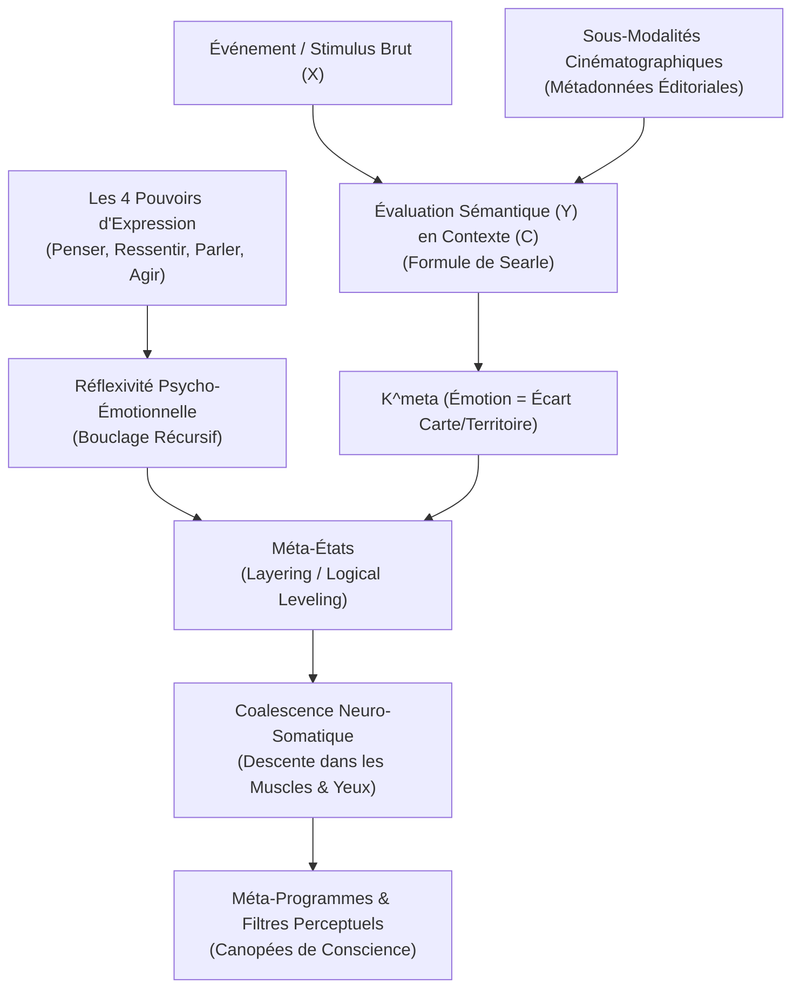
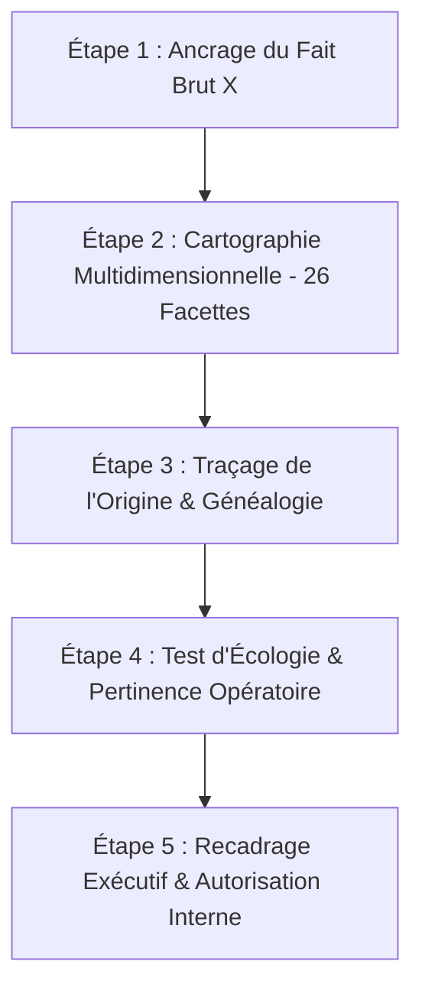

# The Source Book of Magic Vol 2
**Formateur :** L. Michael Hall | **ID :** `l-michael-hall-the-source-book-of-magic-vol-2` | **Tranches :** 31

Voici la **Synthèse Architecturale du Cours** conçue comme tête de pont modélisante et structurée pour votre fiche maîtresse.

---

# Synthèse Architecturale du Cours : *The Source Book of Magic Vol. 2* (L. Michael Hall)

---

## 1. Thèse Centrale & Philosophie du Cours

### Posture de L. Michael Hall vs Approche Standard (PNL Classique / Modèle Bandler-Dilts)

1. **Du Mécanisme Linéaire à la Réflexivité Cybernétique :**  
   Là où la PNL classique traite le système nerveux comme un automate séquentiel (stimulus-réponse, ancrage pavlovien, modèle TOTE linéaire), L. Michael Hall refonde la discipline sur la **réflexivité psycho-émotionnelle** et la **Sémantique Générale de Korzybski**. L'esprit humain n'est pas un circuit linéaire : c'est un système récursif qui réinjecte perpétuellement ses propres sorties (*pensées et émotions*) au niveau supérieur, créant des boucles de rétroaction non-linéaires (*feed-back feeding forward*).
2. **Dénominalisation Radicale des « Niveaux Logiques » :**  
   Alors que Robert Dilts a figé les niveaux logiques dans une hiérarchie pyramidale statique et ontologique (Environnement → Comportement → Capacités → Croyances/Valeurs → Identité → Spiritualité), Hall les **dénominalise en un processus fluide : le *Logical Leveling***. Il n'existe pas de « boîtes » cérébrales étanches ; il n'y a qu'un processus d'empilement psycho-somatique (*layering of thoughts-and-feelings*). Tout méta-niveau est constitué de la même étoffe que le niveau primaire (VAK, langage, physiologie).
3. **Réhabilitation des Sous-Modalités comme « Méta-Modalités Éditoriales » :**  
   Hall renverse le dogme des « sous-modalités » de Bandler (censées être des briques sous-jacentes au VAK). Il démontre qu'évaluer la distance, le cadrage, la luminosité ou le contraste nécessite obligatoirement de prendre du recul réflexif (aller en méta). Les sous-modalités ne sont pas des composants primaires, mais des **métadonnées cinématographiques analogiques** (*pragmagraphics*) par lesquelles le cerveau ordonne au corps comment évaluer et ressentir la représentation.
4. **Plethora vs Creatura (Bateson) & Énergie Métabolique :**  
   Contrairement aux métaphores mécanistes de transfert d'énergie physique (*Plethora*), la neuro-sémantique opère dans le domaine du vivant et de l'information (*Creatura*). L'information extérieure n'est qu'un signal déclencheur ; l'énergie déployée est 100% interne, biologique et métabolique. Le système est gouverné par une « psycho-logique » où le sens dépend de l'inclusion de classe sémantique ($X \text{ compte comme } Y \text{ en } C$).

### Fil Rouge Méthodologique Unificateur

> **Le principe de Modulation Descendante Strictement Asymétrique par Coalescence Sémantique.**

Toutes les interventions du cours reposent sur une seule et même loi cybernétique : **le niveau supérieur gouverne, qualifie et texture obligatoirement le niveau inférieur (*top-down*), tandis que le niveau inférieur ne peut contraindre le niveau supérieur.** 
Plutôt que de chercher à détruire ou faire s'effondrer un état problématique (*collapsing anchors*), le praticien applique un état méta supérieur ressource sur l'état primaire. Par répétition et habituation, cet état méta percole et **coalesce** dans la physiologie somatique (muscles, regard, posture), transformant l'état primaire en un **Gestalt unifié** (ex. : une *peur calme*, une *colère respectueuse*).

---

## 2. Carte des Concepts & Leviers Émergents



### Typologie des Leviers Découverts

1. **La Réflexivité Psycho-Émotionnelle & Bouclage Non-Linéaire :**  
   *Rôle dans l'écosystème :* Moteur cybernétique fondamental. Capacité unique de la conscience humaine à faire d'une pensée ou d'une émotion l'objet d'une pensée/émotion ultérieure.
2. **L'État comme Champ d'Énergie Métabolique & Transduction Somatique :**  
   *Rôle dans l'écosystème :* Base biologique mesurable (intensité 0 à 10). L'état est une propriété émergente de la transduction neurochimique, dictant l'allocation des ressources exécutives.
3. **La Dépendance d'État (*State Dependency*) :**  
   *Rôle dans l'écosystème :* Mécanisme de bascule méta. Quand un état sature le système, le sujet ne regarde plus l'état, il regarde *à travers* lui : l'état devient le cadre d'attentes conceptuelles gouvernant la perception et la mémoire.
4. **L'Émotion comme Kinesthésique Méta ($K^{meta}$) :**  
   *Rôle dans l'écosystème :* Déconstruction de l'affect. Une émotion n'est jamais une simple sensation tactile pure ($K$), mais la somatisation dans le corps ($soma$) de l'écart entre la carte mentale (règles internes, attentes) et le territoire de l'expérience.
5. **Le Logical Leveling & Dénominalisation :**  
   *Rôle dans l'écosystème :* Dissolution des modèles pyramidaux rigides. Les niveaux logiques sont des flux d'empilement somato-cognitifs en temps réel, modélisés par le **Diamant de la Conscience** (26 facettes d'un même état).
6. **Modulation Descendante Asymétrique (*Top-Down*) & Attracteur Étrange :**  
   *Rôle dans l'écosystème :* Règle de hiérarchie cybernétique. Tout méta-cadre agit comme un attracteur auto-organisateur qui contraint obligatoirement les niveaux primaires sous-jacents.
7. **La Coalescence (*Coalescing*) vs L'Effondrement (*Collapsing*) :**  
   *Rôle dans l'écosystème :* Alternative noble au *collapse* d'ancres. Le méta-cadre s'infiltre, imprègne et texture l'état inférieur pour créer une synergie intégrée (*calm fear*), s'incorporant à terme dans la musculature et le regard.
8. **Émergence Synthétique (*Summitivity*) & Gestalts Non-Additifs :**  
   *Rôle dans l'écosystème :* Propriété systémique selon laquelle l'application d'un état sur un autre génère une qualité globale radicalement neuve, absente des composants isolés (ex. : curiosité sur curiosité = fascination).
9. **Multi-Ordinalité Sémantique (Korzybski) :**  
   *Rôle dans l'écosystème :* Règle linguistique opérationnelle. La valeur et la fonction d'un terme ou d'un état dépendent strictement de son ordre d'abstraction dans la pile réflexive.
10. **L'Épistémologie Sociale de Searle ($X \text{ compte comme } Y \text{ en } C$) :**  
    *Rôle dans l'écosystème :* Clé de codage sémantique. Mécanisme par lequel le système nerveux transforme un fait brut ($X$) en fait institutionnel/sémantique doté de pouvoir émotionnel ($Y$) via un méta-cadre contextuel ($C$).
11. **Méta-Modalités Cinématographiques (*Pragmagraphics*) :**  
    *Rôle dans l'écosystème :* Démystification des sous-modalités comme métadonnées de cadrage analogique dictant l'importance opérationnelle d'une représentation.
12. **Les Quatre Pouvoirs d'Expression & Redondance des Méta-Domaines :**  
    *Rôle dans l'écosystème :* Briques fondamentales (*Penser, Ressentir, Parler, Agir*). Réinjectées en méta, elles relient de façon isomorphe les Méta-États, les Méta-Programmes, le Méta-Modèle et les Sous-Modalités.
13. **Contenance vs Extension des États :**  
    *Rôle dans l'écosystème :* Gestion des frontières neurologiques. Isoler un état pour éviter la contamination toxique (contenance) vs étendre un état ressource en canopée de conscience dominante (extension).

---

## 3. Tableau Récapitulatif des Techniques & Démonstrations

| Technique / Exercice | Objectif Opératoire | Déclencheur / Indication | Séquence Résumée |
|---|---|---|---|
| **The Meta-Stating Primer** *(Amorce Fondamentale du Méta-État)* | Installer une boucle réflexive ressource sur un état primaire vulnérable ou réactif. | Conflit interne primaire, réactivité émotionnelle brute (peur, colère, honte, blocage). | 1. Éliciter et calibrer l'état primaire (ex. peur) à intensité modérée.<br>2. Sortir complètement de l'état (Break State net).<br>3. Accéder à un état ressource de haut niveau (ex. curiosité, compassion, calme) et l'amplifier (8-10/10).<br>4. Appliquer réflexivement l'état ressource *sur* l'état primaire en méta-position.<br>5. Vérifier la coalescence et la texturation somatique de l'expérience résultante. |
| **Coalescence Induction (Texture Layering)** | Imprégner durablement un affect primaire par un cadre supérieur plutôt que de chercher à l'éteindre. | États réactifs chroniques où le *collapsing* échoue ou génère de la résistance (colère, tristesse). | 1. Identifier le K^meta réactif.<br>2. Éliciter le cadre de niveau supérieur (ex. respect inconditionnel).<br>3. Guider la descente somatique lente du cadre supérieur dans la physiologie du corps, les muscles et le regard.<br>4. Observer la formation du Gestalt unifié (*One Mind*, ex. colère respectueuse). |
| **Cinematic Frame Re-coding** *(Recodage Cinématographique des Sous-Modalités)* | Modifier la valeur sémantique et la réponse neurochimique en altérant les métadonnées de la scène mentale. | Scène traumatique ou obsédante perçue comme trop invasive, urgente ou écrasante. | 1. Identifier les métadonnées cinématiques clés (distance, luminosité, localisation, cadre).<br>2. Reconnaître le méta-message analogique attribué par le cerveau (ex. grand et proche = « danger immédiat »).<br>3. Altérer délibérément les métadonnées comme un monteur de cinéma (recul, noir et blanc, réduction en vignette).<br>4. Calibrer la chute immédiate de la charge du $K^{meta}$. |
| **Searle Semantic Equation Shift** *(Recadrage de Statut $X \rightarrow Y$)* | Déconstruire l'attribution de sens toxique accordée à un fait brut sensoriel. | Distorsions de sens, étiquetages invalidants (ex. : « Il ne m'a pas salué = Je suis rejeté »). | 1. Isoler le fait brut $X$ strictement sensoriel (mouvement, mot sans interprétation).<br>2. Expliciter le statut méta attribué $Y$ et le contexte implicite $C$.<br>3. Rendre visible l'arbitraire de la convention interne.<br>4. Choisir une nouvelle fonction de statut sémantique écologique $Y'$ en contexte $C$.<br>5. Tester la réponse neuro-somatique face à $X$. |
| **Mind Diamond Multi-Facet Elicitation** *(Exploration par les Facettes du Diamant)* | Aligner l'ensemble de la matrice neuro-sémantique sans heurter les blocages d'une hiérarchie rigide. | Sujet bloqué sur une nominalisation (« Je n'ai pas la bonne identité » ou « Mes croyances me limitent »). | 1. Poser l'idée ou le comportement cible au centre.<br>2. Faire tourner le diamant en interrogeant successivement différentes facettes (Idée affirmée $\rightarrow$ Croyance ; Importance accordée $\rightarrow$ Valeur ; Règle opératoire $\rightarrow$ Méta-programme ; Image de soi $\rightarrow$ Identité).<br>3. Repérer la facette à plus haute charge énergétique ou fluidité pour restructurer la matrice globale. |
| **Boundary Setting: Containment vs Extension** *(Contenance & Canopée de Conscience)* | Circonscrire un état d'urgence ou de travail toxique, ou universaliser un état ressource d'excellence. | Contamination d'une sphère de vie par une autre (travail/couple), ou état ressource restant trop confiné. | 1. Délimiter spatialement et temporellement la frontière de l'état (seuil physique, rituel somatique de fermeture pour la *Contenance*).<br>2. Pour l'*Extension*, accéder à un état ressource noble (jeu, présence, respect).<br>3. Projeter cet état sous forme de dôme/canopée englobant l'ensemble des perceptions périphériques et des interactions futures. |

---

---

## 0. Sommaire Sémantique & Index des Lignes

- **Tranche 1 [Lignes 134-250]** : d'Amorce Fondamentale du Méta-État (The Meta-Stating Primer) — *Protocole :* d'Amorce Fondamentale du Méta-État (The Meta-Stating Primer) | *Mécanisme :* Le Principe de Réflexivité Psycho-Émotionnelle et de Bouclage Non-Linéaire | *Verbatim :* La Présupposition de Souveraineté Neurologique
- **Tranche 2 [Lignes 252-364]** : Elicitation et Diagnostic de Structure d'un État — *Protocole :* Elicitation et Diagnostic de Structure d'un État | *Mécanisme :* Le Principe de Dépendance d'État (State Dependency) & Champ Énergétique | *Verbatim :* L'Amorce d'Amplification et de Pompage d'État
- **Tranche 3 [Lignes 366-527]** : Texturation d'État par Coalescence Méta-Sémantique (Meta-Stating for State Texturing) — *Protocole :* Texturation d'État par Coalescence Méta-Sémantique (Meta-Stating for State Texturing) | *Mécanisme :* Le « Logical Leveling » et la Dénominalisation des Niveaux Logiques | *Verbatim :* Le Double-Bind d'Induction Méta-Niveau
- **Tranche 4 [Lignes 529-651]** : L'Arpentage du Diamant de la Conscience (Méta-Questionnement des Matrices de Cadres) — *Protocole :* L'Arpentage du Diamant de la Conscience (Méta-Questionnement des Matrices de Cadres) | *Mécanisme :* Coalescence des Niveaux et Émergence de Gestalts Supérieurs | *Verbatim :* Verbatim 1 : L'Inclusion de Classe et Coalescence
- **Tranche 5 [Lignes 653-743]** : d'Ingénierie Psycho-Logique par Méta-Stating (Changement de Catégorie Sémantique) — *Protocole :* d'Ingénierie Psycho-Logique par Méta-Stating (Changement de Catégorie Sémantique) | *Mécanisme :* Différenciation Plethore vs Creatura (Bateson) / Physique vs Psycho-Logique (Korzybski)
- **Tranche 6 [Lignes 745-937]** : Le Schéma Fondamental du Méta-État (Essential Core vs. Elaboration) — *Protocole :* Le Schéma Fondamental du Méta-État (Essential Core vs. Elaboration) | *Mécanisme :* Le Moteur Réflexif Fondamental et les États Métas (reflexivity selfreflexiveconsciousness metalevels) | *Verbatim :* La Négation Transformatrice de la Matrice Traumatique
- **Tranche 7 [Lignes 939-1140]** : Le Protocole Fondamental de Méta-État (The Basic Meta-Stating Pattern / Les 5 "A") — *Protocole :* Le Protocole Fondamental de Méta-État (The Basic Meta-Stating Pattern / Les 5 "A") | *Mécanisme :* Inflexion descendante et congruence de commande somato-vocale | *Verbatim :* s Verbatim
- **Tranche 8 [Lignes 1142-1301]** : Le Débusquage de Méta-États (The Meta-State Flush Out) — *Protocole :* Le Débusquage de Méta-États (The Meta-State Flush Out) | *Mécanisme :* La Texturation des États (Texturing of States) & Dépassement du "Plain Vanilla" | *Verbatim :* L'Induction au Connaisseur d'États (Empilement de Suppositions)
- **Tranche 9 [Lignes 1303-1526]** : L'APPROPRIATION DU CERCLE DE POUVOIR (THE POWER ZONE) — *Protocole :* L'APPROPRIATION DU CERCLE DE POUVOIR (THE POWER ZONE) | *Mécanisme :* Le Cercle de Pouvoir et les Quatre Pouvoirs Centraux | *Verbatim :* L'Ancrage Linguistique de l'Appropriation Radicale
- **Tranche 10 [Lignes 1528-1736]** : Meta-Stating Pleasure (Méta-Structuration du Plaisir) — *Protocole :* Meta-Stating Pleasure (Méta-Structuration du Plaisir) | *Mécanisme :* Surcharge Sémantique du Plaisir Primaire (Meta-Pleasures & Over-riding) | *Verbatim :* La Clôture Sémantique Réductrice (De-pleasuring)
- **Tranche 11 [Lignes 1738-2092]** : The Miracle Matrix Pattern (Fin du Pattern 22) — *Protocole :* The Miracle Matrix Pattern (Fin du Pattern 22) | *Mécanisme :* La Transe Post-Miracle & Reconfiguration Écologique du Système de Croyances (Pattern Miracle) | *Verbatim :* L'Induction du Miracle Inaccessible
- **Tranche 12 [Lignes 2094-2219]** : Meta-Stating Negative Emotions (Apprivoisement des Émotions Réprouvées) — *Protocole :* Meta-Stating Negative Emotions (Apprivoisement des Émotions Réprouvées) | *Mécanisme :* Le Signal Somatique de Divergence Carte/Territoire (L'Émotion Primaire)
- **Tranche 13 [Lignes 2221-2387]** : Fear Blow-Out (Éradication de la Peur Inhibitrice) — *Protocole :* Fear Blow-Out (Éradication de la Peur Inhibitrice) | *Mécanisme :* Le Méta-État Décisionnel Exécutif | *Verbatim :* Le Verrou Exécutif et l'Attracteur Mental
- **Tranche 14 [Lignes 2389-2584]** : Ré-empreinte des Ressources sur la Ligne du Temps (Fin de processus) — *Protocole :* Ré-empreinte des Ressources sur la Ligne du Temps (Fin de processus) | *Mécanisme :* Double Dissociation Visuelle/Kinesthésique (V-K Dissociation / Cabine de projection) | *Verbatim :* Rupture de Pattern et Provocation de Séparation Syntaxique
- **Tranche 15 [Lignes 2586-2784]** : Finition du Bégaiement : "Embrasser le Dragon" & Méta-Intention Exécutive — *Protocole :* Finition du Bégaiement : "Embrasser le Dragon" & Méta-Intention Exécutive | *Mécanisme :* Déframage par Drop-Down Through (Chute Kinesthésique Libre) | *Verbatim :* Verbatim 1 : Permission Paradoxale face au Dragon du Bégaiement
- **Tranche 16 [Lignes 2786-3073]** : META-STATING SELF (Acceptation, Appréciation, Estime) — *Protocole :* META-STATING SELF (Acceptation, Appréciation, Estime) | *Mécanisme :* Le dédoublement systémique : Self1 vs Self2 et la prophétie auto-réalisatrice neuro-sémantique | *Verbatim :* La provocation ludique déstabilisatrice de l'auto-mépris
- **Tranche 17 [Lignes 3075-3188]** : Validation de l'Auto-Efficacité par la Zone de Pouvoir — *Protocole :* Validation de l'Auto-Efficacité par la Zone de Pouvoir | *Mécanisme :* La Zone de Pouvoir comme Fondement de l'Auto-Efficacité (Self-Efficacy)
- **Tranche 18 [Lignes 3190-3399]** : Meta-Stating "Strength" (Enchâssement d'un Déclencheur Faible dans la Force) — *Protocole :* Meta-Stating "Strength" (Enchâssement d'un Déclencheur Faible dans la Force) | *Verbatim :* Verbatim 1 : L'Induction du Puma (Bandler citée par Hall)
- **Tranche 19 [Lignes 3401-3526]** : Alignement Neuro-Logique par Intégration Descendante (Top-down Integration Walk) — *Protocole :* Alignement Neuro-Logique par Intégration Descendante (Top-down Integration Walk) | *Mécanisme :* La hiérarchisation neuro-logique inversée (Descente d'intégration / Top-down Integration Walk) | *Verbatim :* La Descente d'Intégration Neuro-Logique
- **Tranche 20 [Lignes 3528-3716]** : Ingénierie Gestaltique du Courage (Meta-Stating Courage) — *Protocole :* Ingénierie Gestaltique du Courage (Meta-Stating Courage) | *Mécanisme :* L'Ingénierie Gestaltique des États Émergents | *Verbatim :* Verbatim 1 : L'Ancrage de l'Indexation Optimiste
- **Tranche 21 [Lignes 3718-3885]** : META-STATING MAGNANIMITY (Installer la Grandeur d'Âme) — *Protocole :* META-STATING MAGNANIMITY (Installer la Grandeur d'Âme) | *Mécanisme :* Le « Gap of Consciousness » (L'Intervalle S-R & La Zone de Pouvoir) | *Verbatim :* PÉPITE 1 : L'Arrimage de la Responsabilité Radicale (Power Zone Formula)
- **Tranche 22 [Lignes 3887-4073]** : Récupération après Trahison (Recovering from Betrayal) — *Protocole :* Récupération après Trahison (Recovering from Betrayal) | *Mécanisme :* Le Méta-État d'Interprétation du Traumatisme Relationnel | *Verbatim :* Induction de Régression et Dilatation Temporelle
- **Tranche 23 [Lignes 4075-4320]** : Externalisation & Épaississement de l'Intrigue (Narrative De-framing & Re-storying) — *Protocole :* Externalisation & Épaississement de l'Intrigue (Narrative De-framing & Re-storying) | *Mécanisme :* Externalisation Narrative et Dé-nominalisation | *Verbatim :* Dé-cadrage par Externalisation Narrative
- **Tranche 24 [Lignes 4322-4491]** : LE PATTERN DE CONTOURNEMENT DE PROBLÈME (GOING AROUND PROBLEMS PATTERN) — *Protocole :* LE PATTERN DE CONTOURNEMENT DE PROBLÈME (GOING AROUND PROBLEMS PATTERN) | *Mécanisme :* Le Principe de Déviation Pré-Symptomatique (Pre-Trigger Stepping Aside) | *Verbatim :* Le Cadre de Déviation Temporelle
- **Tranche 25 [Lignes 4493-4660]** : Protocole : Intégration Comportementale d'un Principe (Flesh-and-Blood Implementation) — *Protocole :* Protocole : Intégration Comportementale d'un Principe (Flesh-and-Blood Implementation) | *Mécanisme :* L'Outframing d'Einstein (Résolution de problèmes par saut de niveau logique) | *Verbatim :* Le Recadrage de la Plasticité Neurologique Immédiate
- **Tranche 26 [Lignes 4662-4827]** : Le Jeu du Coaching Exécutif (The Executive Coaching Game) — *Protocole :* Le Jeu du Coaching Exécutif (The Executive Coaching Game) | *Verbatim :* Le Cadre du "Ce n'est pas vraiment une question" (Weakland Pre-Frame)
- **Tranche 27 [Lignes 4829-5018]** : Transforming "Failure" into Internal Success & Inversion de Source Téléologique : Agir "Depu... — *Protocole :* Transforming "Failure" into Internal Success | *Mécanisme :* Inversion de Source Téléologique : Agir "Depuis" vs Agir "Pour" | *Verbatim :* Inversion du Vecteur Téléologique
- **Tranche 28 [Lignes 5020-5152]** : Ingénierie de Conception des Règles du Jeu (Designing New Rules for the Games) — *Protocole :* Ingénierie de Conception des Règles du Jeu (Designing New Rules for the Games)
- **Tranche 29 [Lignes 5154-5295]** : Protocole : Effraction aux Frontières du Cadre (Leveraging Change at the Borders) — *Protocole :* Protocole : Effraction aux Frontières du Cadre (Leveraging Change at the Borders) | *Verbatim :* Le Levier de Démantèlement des Méta-Binds
- **Tranche 30 [Lignes 5297-5452]** : Désamorçage Thérapeutique de la Réactivité Polaire (Immunité à l'Insulte) — *Protocole :* Désamorçage Thérapeutique de la Réactivité Polaire (Immunité à l'Insulte) | *Mécanisme :* Auto-Réflexivité et Boucles Rentrantes de la Conscience | *Verbatim :* La Perplexité Ericksonienne et l'Invulnérabilité à l'Insulte
- **Tranche 31 [Lignes 5454-5602]** : L'Algorithme de Fusion Gestaltique (Création d'États Méta et Gestalts Opératoires) — *Protocole :* L'Algorithme de Fusion Gestaltique (Création d'États Méta et Gestalts Opératoires) | *Mécanisme :* Le Modèle des Niveaux Systémiques Non-Linéaires et l’Émergence Gestaltique | *Verbatim :* La question d'ascension méta (Transposée de Core Transformation)

---

## Extractions Détaillées par Tranche (Opératoire & Verbatim)

## Tranche 1 / 31 : d'Amorce Fondamentale du Méta-État (The Meta-Stating Primer)

### 1. Mécanismes & Principes Actifs

*   **Le Principe de Réflexivité Psycho-Émotionnelle et de Bouclage Non-Linéaire**
    *   *Principe actif :* Le système nerveux humain n'opère pas comme un automate séquentiel (stimulus-réponse ou TOTE linéaire simple), mais par réinjection permanente de ses propres sorties cognitives et somatiques à des niveaux supérieurs d'organisation. Lorsqu'une information est traitée au niveau primaire (le « film mental » ou la réaction kinesthésique à un déclencheur sensoriel), le cerveau génère un deuxième niveau d'évaluation (une pensée ou une émotion à propos de cette pensée/émotion). Cette opération de bouclage réflexif crée une modulation cybernétique : la réaction de second ordre informe, inhibe ou amplifie rétroactivement l'état de premier ordre.
    *   *Tags émergents :* #reflexivité_systémique #boucle_de_retroaction_interne #non_linearite_cognitive #meta_etats

*   **L'État comme Champ d'Énergie Métabolique et Transduction Neuro-Somatique**
    *   *Principe actif :* L'« état » n'est pas une entité nominale statique, mais un processus biologique actif consommant de l'énergie métabolique. Le système nerveux capte des signaux électromagnétiques et physiques externes qu'il transduit en impulsions bioélectriques, puis en libérations de neurotransmetteurs et échanges ioniques moléculaires. L'état neuro-émotionnel ressenti est une propriété émergente de cette transduction. Ce champ d'énergie possède une signature cinétique et une intensité mesurable (de 0 à 10) qui dicte directement les ressources physiologiques allouées à la perception et à l'action.
    *   *Tags émergents :* #transduction_somatique #champ_d_energie_neurochimique #propriete_emergente #calibrage_metabolique

*   **La Dépendance d'État (State Dependency) comme Mécanisme Naturel de Méta-Positionnement**
    *   *Principe actif :* Lorsqu'un état atteint un seuil critique d'intensité somatique et cognitive, il cesse d'être une simple réponse localisée pour devenir un « ensemble d'attentes conceptuelles » (*conceptual/emotional expectation sets*). Il prend le contrôle des filtres d'apprentissage, d'encodage de la mémoire, de perception et de comportement. Ce basculement transforme l'état en méta-cadre : la personne ne regarde plus l'état, elle regarde *à travers* l'état. Ce mécanisme de dépendance d'état est le moteur sous-jacent qui permet à un état primaire de s'élever et de devenir un méta-état gouverneur.
    *   *Tags émergents :* #state_dependency #filtre_perceptuel_dominant #coloration_perceptive #bascule_meta

*   **L'Indétermination Sémantique et l'Empreinte Interne du Sens**
    *   *Principe actif :* Un symbole, un mot ou un stimulus linguistique n'a aucune signification intrinsèque (*meaning is an inside job*). Le symbole renvoie à une construction arbitraire chez l'émetteur et le récepteur. La neuro-sémantique décompose la création de sens en 5 mécanismes distincts : l'association neurologique conditionnée (signifiant-réflexe), la classification linguistique (étiquetage conceptuel), le cadrage contextuel (méta-cadre qui entoure l'événement), l'évaluation réflexive (jugement porté sur le sens précédent), et l'intentionnalité (direction téléologique insufflée au système). Changer le méta-cadre ou l'évaluation altère instantanément la réponse neurochimique globale.
    *   *Tags émergents :* #indetermination_du_symbole #cinq_modes_de_signification #neuro_semantique #cadrage_evaluatif

*   **Les Sous-Modalités comme Métadonnées Éditoriales Cinématiques**
    *   *Principe actif :* Les sous-modalités (luminosité, distance, cadrage, volume, tonalité) ne sont pas de simples sous-composants sensoriels passifs du système VAK (premier ordre), mais des cadres éditoriaux d'ordre supérieur (*editorial frames*). Elles agissent comme les métadonnées de la scène mentale : elles dictent au système nerveux *comment* évaluer la représentation sensorielle (ex. : une image panoramique lumineuse signale au cerveau une pertinence immédiate, tandis qu'une vignette sombre et éloignée signale une obsolescence).
    *   *Tags émergents :* #sous_modalites_editoriales #meta_donnees_cinematographiques #cadrage_representatif

---

### 2. Protocoles, Techniques & Démonstrations (Étape par Étape)

#### Protocole d'Amorce Fondamentale du Méta-État (The Meta-Stating Primer)

*   **Intention / Indication :**
    Utilisé lorsqu'un sujet est bloqué dans une boucle réactive primaire (peur, colère, jugement, hésitation) ou qu'il souhaite injecter une ressource d'ordre supérieur (curiosité, acceptation, férocité, puissance) sur une expérience ciblée. Indiqué pour transformer un état réactif limitant en intégrant une texture émotionnelle ressource.

*   **Mise en place & Pré-framing :**
    *   Pré-cadrer la subjectivité de l'expérience : établir que nous ne traitons pas directement avec la réalité, mais avec la cartographie interne (le « film mental »).
    *   Activer la notion de « pilote de son propre cerveau » (*running your own brain*) : amener le sujet à reconnaître la propriété de ses signaux internes.
    *   Définir l'échelle d'intensité comme une jauge d'énergie disponible pour le travail de transformation.

*   **Séquence d'actions pas à pas :**

    *   **Étape 1 : Cartographie et Calibration de l'État Primaire**
        *   Faire émerger la représentation cible (l'événement, la difficulté ou le déclencheur).
        *   Faire identifier le contenu cinématographique interne : images visuelles, bande sonore interne, sensations kinesthésiques (VAK).
        *   Calibrer la jauge somatique de base : *"Sur une échelle de 0 (rien) à 10 (absolu/total), quelle est l'intensité de cet état dans ton corps ici et maintenant ?"*

    *   **Étape 2 : Évocation et Amplification de l'État Ressource (Méta-Niveau)**
        *   Faire pivoter l'attention du sujet hors du contexte primaire vers un état ressource spécifique (ex: curiosité pure, acceptation inconditionnelle, amusement, force tranquille).
        *   Augmenter l'énergie métabolique et cinétique de cette ressource jusqu'à un seuil de saturation (rechercher un niveau d'intensité de 8 à 10).
        *   Utiliser les leviers d'amplification somatique : respiration profonde, posture physique, ajustement des fonctionnalités cinématiques de la mémoire ressource (taille, netteté, proximité, brillance).

    *   **Étape 3 : Application Réflexive / Méta-Positionnement (Le Méta-Stating opératoire)**
        *   Inviter le sujet à maintenir fermement ce champ d'énergie ressource (l'état méta) et à le positionner conceptuellement et somatiquement *au-dessus* ou *autour* de l'état primaire.
        *   Faire porter le regard de la ressource sur l'état de base : observer, ressentir et évaluer le premier état *à travers* les yeux, le filtre et l'énergie du second état.
        *   Créer l'assimilation sémantique : fusionner le cadre de référence supérieur avec l'expérience sous-jacente.

    *   **Étape 4 : Test de Dépendance d'État et Écologie**
        *   Mesurer la modification du champ de réponse : *"Quand tu observes [état primaire/déclencheur] avec cette [ressource méta], que devient l'ancienne réaction ?"*
        *   Vérifier si le nouvel état colore désormais spontanément l'ensemble de la perception liée au problème.
        *   Si l'état primaire résiste : évaluer la nécessité d'ajouter un composant d'adoucissement (*soften, temper*) ou d'augmenter le dynamisme interne (*more juice*).

*   **Signes de calibration :**
    *   *Étape 1 :* Micro-tensions musculaires asymétriques, respiration haute ou bloquée, focalisation visuelle fixe (regard figé sur l'écran interne du problème).
    *   *Étape 2 :* Expansion thoracique, redressement postural, micro-mouvements d'affirmation faciale, modification du tonus vocal (gain de volume ou de résonance).
    *   *Étape 3 :* Rupture de pattern physiologique (soupir libérateur, clignements des yeux rapides, relâchement des muscles maxillaires), sourire spontané, recul physique du tronc (dissociation et intégration simultanée).
    *   *Étape 4 :* Fluidité verbale, perte de la charge affective du déclencheur initial, incapacité à réactiver l'ancien malaise avec la même intensité.

---

### 3. Heuristiques, Subtilités & "Sagesse du Praticien"

*   **La Règle du Taux de « Juice » (Seuil d'Énergie Métabolique) :**
    *   *Règle :* Si l'état méta n'est pas calibré à une intensité vibratoire/somatique supérieure ou égale à l'état primaire, l'intervention échoue et l'état primaire avale la ressource.
    *   *Heuristique :* *"Si le sujet intellectualise la ressource sans engagement somatique mesurable (inférieur à 8/10) -> alors ne pas appliquer le méta-état ; intensifier d'abord la physiologie de la ressource jusqu'à ce que la charge d'énergie cinétique soit indiscutable."*

*   **La Règle de l'Indirection Sémantique :**
    *   *Règle :* Le sens n'est jamais dans les mots du praticien, mais dans la réponse neuro-somatique du sujet (*The meaning of your communication is the response you get*).
    *   *Heuristique :* *"Si le client réagit par de la confusion, du retrait ou une posture défensive après une suggestion -> alors calibrer cela comme le sens exact généré par la structure de son système de cadrage à cet instant, abandonner la rigidité du message initial et calibrer le matching/mirroring pour stabiliser le rapport."*

*   **La Règle du Tempérament vs Amplification :**
    *   *Règle :* Tous les états primaires ne se dissolvent pas par une charge brute d'intensité positive ; certains états complexes nécessitent d'être tempérés, adoucis ou modulés avant d'être encadrés.
    *   *Heuristique :* *"Si l'état primaire est une surcharge émotionnelle toxique explosive -> introduire d'abord un méta-état de permission, d'acceptation passive ou d'adoucissement ('soften/temper') avant d'injecter une dynamique propulsive ou un état de puissance."*

*   **Le Piège du Débutant – La Confusion Linéaire :**
    *   *Erreur relevée :* Traiter les méta-états comme une suite d'étapes linéaires (comme une stratégie classique ou un ancrage simple de PNL).
    *   *Correction de Hall :* L'esprit fonctionne en spirales non-linéaires. Si le sujet entre en confusion en montant de niveau (« je ne sais plus ce que je ressens à propos de ce que je ressens »), faire confiance au processus. La confusion est la rupture de pattern nécessaire indiquant que le système de cadrage linéaire s'effondre avant la réorganisation au méta-niveau.

*   **Postulat Philosophique de L. Michael Hall :**
    *   *Le constructivisme opérationnel :* La question n'est jamais ontologique (« Est-ce vrai ? Est-ce réel ? »), mais strictement pragmatique et cybernétique : *"Est-ce que cette carte me permet d'opérer au maximum de mes ressources, d'atteindre mes résultats et de naviguer efficacement le territoire ?"*

---

### 4. Pépites Verbatim & Patterns Linguistiques (MOT À MOT EN V.O.)

#### Pépite 1 : La Présupposition de Souveraineté Neurologique
> "If you don’t take control of running your own brain, someone else will. You run your own brain by taking ownership of the signals you send to your brain."

*   **[Analyse du Pattern] :**
    *   *Structure linguistique :* Double lien implicite reposant sur une polarité binaire exclusive (*si tu ne le fais pas, quelqu'un d'autre le fera*).
    *   *Effet syntaxique :* Utilisation de la nominalisation dynamique *“taking ownership”* combinée à l'impératif fonctionnel enchâssé *“run your own brain”*. Cela crée une contrainte temporelle d'urgence existentielle : l'inaction est requadrée non pas comme un statut neutre, mais comme une soumission active à une influence extérieure. La prise de contrôle est présupposée comme la seule alternative écologique possible.

---

#### Pépite 2 : La Transe de Non-Linéarité et Normalisation de la Confusion
> "Learning and using meta-states involve shifting from linear to non-linear thinking. It also involves learning to think in circles, to go round and round your emotions, to spin off in upward and downward spirals. If you get lost in the process or go into a spin, or experience confusion, just trust the process, you will come out the other end just fine. We haven’t lost a person yet."

*   **[Analyse du Pattern] :**
    *   *Structure linguistique :* Utilisation du Milton Modèle pour la défocalisation cognitive et l'induction de transe méta-cognitive.
    *   *Effet syntaxique :* Empilement kinesthésique circulaire (*“think in circles”*, *“round and round”*, *“spin off”*, *“spirals”*). La boucle de confusion (*“lost in the process”*, *“experience confusion”*) est pré-cadrée et validée positivement par une suggestion d'évidence temporelle (*“you will come out the other end just fine”*). La chute finale par truisme humoristique (*“We haven’t lost a person yet”*) opère un ancrage de sécurité conversationnelle qui désamorce la résistance de l'hémisphère gauche.

---

#### Pépite 3 : Les Commandes Enchâssées d'Amplification Métabolique
> "Can you intensify your thinking-feeling and make it stronger? What happens when you amplify this state? Do you need more “juice” so that you can see and hear and feel that stimulus in terms of this state? What do you need to do to amplify this state? What resource do you need to soften, temper, and/or reduce this state?"

*   **[Analyse du Pattern] :**
    *   *Structure linguistique :* Série de questions conversationnelles réflexives à présupposition de capacité et de modulation somatosensorielle continue.
    *   *Effet syntaxique :* Utilisation de l'oxymore fonctionnel d'action *“thinking-feeling”* qui court-circuite la dissociation cartésienne corps/esprit. La question n'interroge pas la possibilité du changement, mais sa modalité opérationnelle (*“What happens when...”* présuppose que l'amplification a déjà lieu). L'introduction du marqueur kinesthésique familier *“juice”* agit comme une métaphore analogique brute d'énergie métabolique, tandis que la double direction (*“amplify”* vs *“soften, temper, reduce”*) offre une illusion de choix total au sujet tout en installant l'axiome central : l'état est un curseur entièrement sous son contrôle.

## Tranche 2 / 31 : Elicitation et Diagnostic de Structure d'un État

### 1. Mécanismes & Principes Actifs

#### 1. Le Principe de Dépendance d'État (*State Dependency*) & Champ Énergétique
* **Principe actif :** Tout état neuro-linguistique fonctionne comme un champ d'énergie holistique possédant une intensité mesurable (de 0 à 10). Lorsqu'un état atteint un seuil d'intensité critique, il submerge les filtres cognitifs ordinaires et prend le contrôle exécutif du système nerveux (*over-ride*). Les processus de mémorisation, d'apprentissage, d'attention et de comportement deviennent asservis à la neurochimie de cet état. En devenant dominant, l'état cesse d'être une simple réaction passagère pour s'ériger en cadre de référence méta (*frame of reference*) à travers lequel le sujet perçoit, filtre et interprète tout stimulus ultérieur.
* **Tags :** `#state_dependency` `#champ_energetique` `#bascule_meta` `#filtre_perceptif_dominant` `#boucle_retroactive`

#### 2. L'Émotion comme Évaluation Psycho-Somatique ($K^{meta}$) & Enregistrement d'Écart
* **Principe actif :** En Neuro-Sémantique, l'émotion n'est jamais une simple sensation kinesthésique primaire ($K$). Elle est codée formellement comme un kinesthésique méta ($K^{meta}$) : la fusion d'une sensation corporelle brute et d'un jugement évaluatif cognitif de haut niveau (langage, croyance, valeur, attente). L'émotion est l'enregistrement somatique direct dans la neurologie ($soma$) de la différence entre la carte mentale du monde (le système d'attentes, d'"il faut", de règles internes) et le territoire de l'expérience vécue. Quand le cadre de sens change, la commande neurologique envoyée au corps mute instantanément.
* **Tags :** `#kinesthésique_meta` `#K_meta` `#ecart_carte_territoire` `#somatisation_semantique` `#structure_de_l_emotion`

#### 3. Le Processus de Coalescence (*Coalescing*)
* **Principe actif :** Lorsqu'un état méta (ou une évaluation cognitive supérieure) est répété ou maintenu de manière prolongée, il traverse un phénomène d'habituation neurologique. Le niveau logique supérieur « descend » et fusionne dans le tissu de l'état primaire au point de devenir invisible et de sembler automatique ou inné. Les émotions dites « primaires » chez l'humain adulte contiennent en réalité des couches évaluatives passées qui ont coalescé dans la physiologie somatique de base.
* **Tags :** `#coalescence` `#habituation_neurologique` `#descente_de_cadre` `#encodage_subconscient`

#### 4. Les Deux Voies Royales d'Accès à l'État (*Two Royal Roads*)
* **Principe actif :** Le système esprit-corps forme une boucle cybernétique unifiée. L'accès, la modulation et l'ancrage d'un état s'opèrent par deux portes d'entrée bidirectionnelles : 
  1. *L'Esprit (Mind)* : la structure des représentations internes (VAKOG, sous-modalités, dialogue interne/film mental) et l'accès par mémoire ou imagination prospective.
  2. *Le Corps (Body)* : la configuration somatique (schémas respiratoires, tonus musculaire, posture, micro-mouvements, direction du regard). Modifier délibérément l'un contraint mécaniquement l'autre à se réaligner.
* **Tags :** `#voies_royales` `#boucle_soma_cognition` `#levier_physiologique` `#cinema_mental`

#### 5. Les Quatre Pouvoirs d'Expression Humaine comme Briques de Cadrage
* **Principe actif :** Tout être humain interagit et code la réalité via quatre fonctions fondamentales de réponse : *Penser*, *Ressentir*, *Parler*, *Agir*. Ces quatre expressions ne sont pas de simples vecteurs de décharge motrice ou verbale ; réinjectées de façon réflexive au niveau supérieur, elles deviennent le matériau exact utilisé par le cerveau pour fabriquer des méta-cadres et des voiles de conscience (*canopies of consciousness*).
* **Tags :** `#quatre_pouvoirs` `#penser_ressentir_parler_agir` `#reflexivite_operatoire` `#briques_de_cadrage`

#### 6. Contenance vs Extension des États & Frontières de Contamination
* **Principe actif :** Deux dynamiques spatiales et structurelles régissent les états :
  - *La Contenance* : ériger des frontières neurologiques imperméables autour d'un état spécifique pour le préserver, éviter qu'il ne contamine les autres sphères de la vie, et permettre des ruptures d'état nettes (*impeccable state shifts*).
  - *L'Extension* : étendre délibérément un état ressource (respect, curiosité, jeu) pour qu'il devienne une « canopée de conscience » englobant et texturant toutes les interactions et expériences périphériques.
* **Tags :** `#contenance_detat` `#extension_detat` `#permeabilite_des_frontieres` `#contamination_detat` `#canopee_de_conscience`

#### 7. La Dé-nominalisation des Niveaux Logiques : Le « Logical Leveling » et les Psycho-Logiques
* **Principe actif :** Les « Niveaux Logiques » ne sont pas des structures rigides, spatiales ou ontologiques externes, mais des processus cognitifs d'inclusion de classes : un état appliqué à un autre état devient la classe logique englobante qui donne un nouveau sens à l'élément inclus. Remplacer le substantif par le verbe de processus (*logical leveling*) réinstalle la fluidité : l'esprit opère selon une *psycho-logique* réflexive (non linéaire). Chaque méta-état appliqué (ex: curiosité appliquée à l'apprentissage) devient simultanément une valeur, une croyance, un déclencheur identitaire et une intention.
* **Tags :** `#psycho_logiques` `#logical_leveling` `#inclusion_de_classes` `#reflexivite_non_lineaire` `#croyances_en_cascade`

---

### 2. Protocoles, Techniques & Démonstrations (Étape par Étape)

#### Protocole 1 : Elicitation et Diagnostic de Structure d'un État
* **Intention / Indication :** Déterminer la pureté, le degré de mélange, l'intensité et l'encodage structurel d'un état avant toute intervention méta ou tout ancrage.
* **Mise en place & Pré-framing :** Installer le sujet dans une posture de méta-conscience non-jugeante (*non-judgmental awareness*). Le praticien cadre : le sujet cesse d'observer le déclencheur extérieur pour observer l'expérience interne en cours.
* **Séquence d'actions pas à pas :**
  1. *Jauge d'intensité somatique :* Demander au sujet d'évaluer sur une échelle de 0 (absence totale) à 10 (absolu/total) la charge ressentie dans le corps.
  2. *Élicitation de l'objet primaire :* Identifier le stimulus référent : *"À quoi tes pensées et tes sensations font-elles référence ici ?"*
  3. *Audit qualitatif de l'état :* Poser la série de questions de calibrage structurel :
     - La pureté : *"Cet état est-il pur ou mélangé ?"*
     - La congruence : *"À quel point te sens-tu congruent ou incongruent là-dedans ?"*
     - La complexité : *"Y a-t-il de la simplicité ou de multiples couches ?"*
     - Le codage sens/valeur : *"Quelle est la signification que tu attribues à cet état ?"*
  4. *Test de saturation :* Évaluer si l'état commence à s'auto-organiser en dépendance d'état (*"À quel point cette pensée domine-t-elle l'ensemble de ton fonctionnement actuel ?"*).
* **Signes de calibration :**
  - Rythme respiratoire (haut/thoracique = état d'alerte, bas/abdominal = intégration).
  - Dilatation pupillaire et fixité du regard lors de l'accès aux représentations internes.
  - Asymétries posturales (incongruence) vs tonus corporel unifié (pureté de l'état).

#### Protocole 2 : Application Réflexive d'un Méta-État (Méta-Stating Procédural)
* **Intention / Indication :** Neutraliser un état primaire limitant (ex: peur, colère, apathie) ou transformer un état neutre en état d'excellence par l'application d'un état supérieur ressource (ex: compassion sur colère, curiosité sur peur).
* **Mise en place & Pré-framing :** Expliciter que le but n'est pas de supprimer l'état primaire (ce qui créerait un « état-dragon »), mais de l'accueillir et de l'envelopper dans un cadre logique plus vaste.
* **Séquence d'actions pas à pas :**
  1. *Accès et stabilisation de l'état primaire (État A) :* Faire accéder le sujet à l'expérience problématique juste assez pour calibrer son signal corporel ($K$).
  2. *Rupture d'état impeccable (*Impeccable State Shift*) :* Faire bouger physiquement le sujet, réorienter le regard et respirer pour vider l'espace de travail neurologique.
  3. *Accès et amplification de la ressource méta (État B) :*
     - Par la voie de l'esprit : remémoration ou construction imaginaire d'une ressource pure (ex: calme, acceptation, jeu).
     - Amplifier l'état : injecter du "jus" neurologique via les sous-modalités et le langage interne.
     - Par la voie du corps : installer la posture, le rythme respiratoire et la gestuelle congruente de cet État B.
  4. *Application réflexive (L'Emboîtement Méta) :* Amener le sujet à positionner l'État B *à propos* de l'État A :
     - *"Peux-tu respirer avec ce calme plein et profond À PROPOS de cette colère ?"*
     - *"Quelle saveur prend cette peur lorsque tu la regardes avec une curiosité totale ?"*
  5. *Vérification de la nouvelle psycho-logique :* Constater l'émergence d'une nouvelle texture gestalt (ex: "colère calme", "peur lucide").
* **Signes de calibration :**
  - Relâchement des micro-tensions faciales (signe que l'état méta s'est déposé sur l'état primaire).
  - Changement spontané de la prosodie du sujet (voix plus posée, disparition des intonations de lutte).
  - Réorganisation posturale globale : le sujet adopte la physiologie du méta-cadre tout en évoquant le contenu primaire.

---

### 3. Heuristiques, Subtilités & "Sagesse du Praticien"

#### Règles Conditionnelles d'Intervention
* **Si** le sujet commence à juger, blâmer ou culpabiliser d'avoir une émotion primaire ("je ne devrais pas ressentir de la colère/peur"), **alors** stopper immédiatement le travail de contenu et installer d'abord une méta-conscience non-jugeante (*non-judgmental awareness* / acceptation), **parce que** juger sa propre conscience retourne l'énergie nerveuse contre soi et engendre des boucles toxiques auto-destructrices nommées *états-dragons*.
* **Si** un état limitant a tendance à contaminer tous les contextes de vie du sujet, **alors** construire des frontières de contenance rigoureuses et nettes autour de l'état avant toute tentative de recadrage, **parce qu'**un état sans cloisons s'étend par défaut en canopée toxique d'atmosphère mentale.
* **Si** un sujet est figé dans une émotion récurrente, **alors** interroger l'évaluation cognitive sous-jacente ($K^{meta}$) plutôt que d'essayer de modifier la sensation corporelle directe, **parce que** l'émotion n'est que la transcription somatique de l'écart entre sa carte d'attentes et le réel ; changer le cadre de sens transmute instantanément l'expression corporelle.
* **Si** l'on veut rendre un ancrage résistant et fonctionnel, **alors** attendre impérativement le pic absolu d'intensité de l'état pur avant d'introduire le stimulus gâchette, **parce que** la neurologie associe l'ancre à la texture exacte présente lors du déclenchement ; si l'état est pollué ou tiède, l'ancre réactivera un état composite instable.

#### Pièges Classiques & Erreurs Corrigées
* **Erreur du débutant : Traiter les "niveaux logiques" comme des entités réelles ou des tiroirs étanches.**
  * *Correction :* Ce sont des nominalisations. L'identité, les valeurs, les croyances sont toutes faites du même tissu : des pensées-sensations superposées. Chaque méta-état appliqué réorganise simultanément le sens d'identité, les valeurs et les croyances.
* **Erreur du praticien : Tenter de transformer une émotion d'« inintelligente » à « intelligente ».**
  * *Correction :* Les émotions en elles-mêmes ne sont ni bonnes ni mauvaises, ni morales ni stupides. Elles sont de simples voyants du tableau de bord indiquant l'état de la relation carte/territoire. L'intelligence émotionnelle ne réside pas dans l'émotion, mais dans la posture méta adoptée face à elle.
* **Erreur du débutant : Confondre sensation brute et émotion.**
  * *Correction :* La sensation kinesthésique ($K$) est un signal sensoriel pur (tension, chaleur, pulsation). L'émotion ($K^{meta}$) est la sensation greffée d'un jugement de sens. Traiter une émotion comme une simple sensation sans extraire l'évaluation cognitive voue l'intervention à la rechute.

---

### 4. Pépites Verbatim & Patterns Linguistiques (MOT À MOT EN V.O.)

#### 1. L'Amorce d'Amplification et de Pompage d'État
> "Can you intensify your thinking-feeling and make it stronger? What happens when you amplify this state? Do you need more 'juice' so that you can see and hear and feel that stimulus in terms of this state? What do you need to do to amplify this state? What resource do you need to soften, temper, and/or reduce this state? How do you best like to crank this state up?"
* **[Analyse du Pattern]** : Utilisation d'un empilement de questions inductives orientées processus (*process questions*). L'emploi du terme métaphorique et kinesthésique *"juice"* (jus) associé à l'adverbe dynamique *"crank this state up"* présuppose de façon incontestable que l'état n'est pas un bloc figé, mais un potentiomètre modulable sous le contrôle direct du sujet. La séquence crée un double lien kinesthésique : le sujet est invité à tester l'amplification tout en apprenant simultanément qu'il détient le levier pour adoucir ou tempérer l'énergie.

#### 2. L'Induction des Deux Voies Royales (Mémoire / Imagination)
> "Recall a time when you experienced this or that emotion or thought... Or, use your imagination: What would it look, sound, and feel like if you were thinking and feeling this..."
* **[Analyse du Pattern]** : Double branchement hypnotique ericksonien (*double bind* permissif). Hall offre deux chemins d'accès alternatifs qui mènent rigoureusement au même résultat neurologique : la réactivation de l'état. Le passage au conditionnel sensoriel présent (*"What would it look, sound, and feel like..."*) active une recherche transdérivationnelle instantanée sur les canaux VAK, contraignant le système nerveux à synthétiser la physiologie demandée pour pouvoir répondre à la question.

#### 3. L'Autorisation Émancipatrice face aux Émotions
> "Emotions are just emotions. They are simply the relationship between how you map and how you experience the world. They are not moral or immoral, good or bad... Morality arises from what a person does with his or her emotional states, how one expresses feelings, not from the fact that a person experiences emotions."
* **[Analyse du Pattern]** : Recadrage de déculpabilisation ontologique par dissociation nette entre l'*Être/Ressentir* et le *Faire*. Utilisation de tautologies désarmantes (*"Emotions are just emotions"*) pour vider l'émotion de sa charge de culpabilité sociale, suivie d'une redéfinition cybernétique neutre (*"simply the relationship between how you map and how you experience the world"*). Ce pattern détruit le jugement méta toxique à sa racine et installe une séparation cartésienne entre la morale de l'action et la naturalité du signal somatique.

#### 4. Le Re-cadrage de la Psycho-Logique Systémique
> "“But that’s not logical.” Yes, of course not! Rather than “logical,” it is psycho–logical. And that’s the difference we have to keep in mind, understand, and let govern our exploration of the meta-levels of our mind in the matrix of our frames within frames—the psycho-logics that we create."
* **[Analyse du Pattern]** : Rupture de cadre et technique d'utilisation (*utilization*). L'objection potentielle d'irrationalité est validée immédiatement (*"Yes, of course not!"*), désamorçant toute résistance rationnelle, avant d'opérer un recadrage sémantique par néologisme et distinction de catégorie : substitution de la logique aristotélicienne binaire par la « psycho-logique » systémique. L'insertion enchâssée *"and let govern our exploration"* agit comme une commande présupposée installant le cadre méta d'apprentissage sans débat possible.

## Tranche 3 / 31 : Texturation d'État par Coalescence Méta-Sémantique (Meta-Stating for State Texturing)

### 1. Mécanismes & Principes Actifs

#### A. Le « Logical Leveling » et la Dénominalisation des Niveaux Logiques
* **Principe actif :** Les « niveaux logiques » ne sont pas des structures statiques rigides ou des compartiments neuro-anatomiques réels (« out there »), mais des **processus actifs et fluides d'empilement psycho-somatique** (« layering of thoughts-and-feelings »). Transformer la nominalisation « niveaux logiques » en verbe d'action (*logical leveling*) réinstalle le système nerveux dans sa plasticité computationnelle. Un niveau logique est l'action d'appliquer une couche de pensée/sentiment sur une autre couche de pensée/sentiment.
* **Fonctionnement neuro-sémantique :** Dès lors qu'un état méta est appliqué, il ne reste pas en suspension abstraite : il est ressenti somatiquement dans le corps (« feeling it in our body »). Les niveaux logiques sont des flux d'énergie mentale et émotionnelle de cadrage qui émergent et s'évanouissent selon l'activité de pensée en temps réel.
* **Tags émergents :** `#logical_leveling #dénominalisation_opératoire #fluidité_neuro_sémantique #empilement_somato_cognitif #layering_process`

#### B. La Modulation Descendante Strictement Asymétrique (Top-Down Pervasiveness)
* **Principe actif :** Dans la hiérarchie cybernétique du système esprit-corps, la modulation opère **nécessairement du haut vers le bas** (*top-down*) et seulement de façon contingente/non obligatoire du bas vers le haut (*bottom-up*). Changer un méta-niveau (un cadre exécutif, une croyance, une valeur) contraint et réorganise obligatoirement les niveaux primaires sous-jacents. À l'inverse, modifier une réponse primaire (un comportement ou un état somatique isolé) ne garantit aucunement la modification des méta-cadres directeurs.
* **Fonctionnement neuro-sémantique :** Le niveau supérieur fonctionne comme un **attracteur étrange auto-organisateur** (*self-organizing attractor*) qui module, pilote et recadre le signal neurologique inférieur. Le niveau primaire est « mis au service » de la classification supérieure.
* **Tags émergents :** `#modulation_descendante #asymétrie_cybernétique #attracteur_exécutif #top_down_control #hiérarchie_de_bateson`

#### C. L'Émergence Synthétique (Summitivity) et Propriétés Gestaltiques
* **Principe actif :** Lorsqu'une pensée/émotion est réfléchie sur une autre, le système neuro-linguistique produit une boucle de rétroaction récursive (*feed-backing loop*). Le résultat n'est jamais une simple addition linéaire ($1+1=2$), mais l'apparition de **qualités émergentes non-additives** (*non-summary, non-additive gestalts*).
* **Fonctionnement neuro-sémantique :** Le système se re-nourrit de sa propre sortie (*feedback feeding forward*). Il en résulte une nouvelle configuration de sens et de ressenti global (« structure-as-a-whole feeling ») qui n'existait dans aucune des sous-parties prises isolément (ex. : la curiosité appliquée à la curiosité engendre une fascination passionnée ; l'inhibition appliquée à une inhibition libère une excitation motrice).
* **Tags émergents :** `#émergence_non_sommative #gestalt_neuro_émotionnelle #récursivité_cybernétique #sommitivité_systémique`

#### D. La Coalescence (« Coalescing ») vs L'Effondrement d'Ancres (« Collapsing »)
* **Principe actif :** En PNL classique, confronter deux états incompatibles vise à les faire s'effondrer (*collapse anchors*) par saturation/décharge d'énergie neurologique. En Neuro-Sémantique, l'application d'un état supérieur sur un état inférieur produit une **coalescence** : l'état méta s'infiltre, imprègne et infuse l'état inférieur (*permeate and seep down*).
* **Fonctionnement neuro-sémantique :** Par répétition et habituation, le méta-cadre descend dans la physiologie somatique (« gets into our neurology, into your muscles, into your eyes »). L'état inférieur n'est pas détruit : il est **texturé et qualifié** (ex. : une « peur calme », une « colère respectueuse », une « tristesse curieuse »). C'est le mécanisme exact d'installation des filtres perceptuels durables et des méta-programmes.
* **Tags émergents :** `#coalescence_sémantique #texturation_d_état #intégration_neurologique #transcendance_et_inclusion #formation_des_méta_programmes`

#### E. La Multi-Ordinalité (Sémantique Générale de Korzybski)
* **Principe actif :** Un terme nominalisé appliqué à lui-même ne conserve pas sa signification : sa valeur sémantique dépend strictement de son niveau d'ordre d'abstraction. Un état $N$ appliqué sur un état $N-1$ change radicalement de fonction opératoire.
  * *Niveau 1 :* Amour primaire (aimer quelqu'un).
  * *Niveau 2 :* Amour d'ordre 2 (aimer aimer quelqu'un = engouement / *infatuation*).
  * *Niveau 3 :* Amour d'ordre 3 (aimer l'engouement = romantisme).
* **Fonctionnement neuro-sémantique :** Confondre les ordres d'abstraction engendre des paradoxes cliniques et des nœuds pathologiques (ex. : douter de son doute = certitude méthodologique ; hésiter sur son hésitation = bégaiement moteur ; s'inquiéter de son inquiétude = hyper-anxiété panique).
* **Tags émergents :** `#multi_ordinalité #ordres_d_abstraction #korzybski_operator #différenciation_sémantique #rupture_de_catégorie`

#### F. Le Progrès Infini vs Régression à l'Infini (Reflexivity Engine)
* **Principe actif :** La conscience humaine est dotée d'une propriété d'auto-réflexivité illimitée : on peut continuellement reculer d'un pas et générer une pensée/sentiment à propos de la pensée/sentiment précédente. Ce que la philosophie formelle qualifie de piège logique (« infinite regress ») devient en pratique thérapeutique un **moteur de progrès infini** (*infinite progress*).
* **Fonctionnement neuro-sémantique :** Aucun individu ne peut être conceptuellement ou émotionnellement bloqué de manière définitive : il existe toujours la possibilité neurologique de « faire un pas méta » supplémentaire pour **hors-cadrer le cadre** (*outframe whatever frame you have set*).
* **Tags émergents :** `#progrès_infini #outframing #auto_réflexivité #méta_cognition_générative #déverrouillage_systémique`

---

### 2. Protocoles, Techniques & Démonstrations (Étape par Étape)

#### Protocole 1 : Texturation d'État par Coalescence Méta-Sémantique (Meta-Stating for State Texturing)

* **Intention / Indication :** Modifier un état primaire toxique, brut ou dysfonctionnel (peur paralysante, colère destructrice, tristesse accablante, sérieux rigide) non pas en le supprimant ou en l'effondrant, mais en le qualifiant d'une ressource d'ordre supérieur afin de développer une intelligence émotionnelle nuancée (ex. : transformer la panique en « prudence calme »).
* **Mise en place & Pré-framing :** Cadrer auprès du sujet que nous n'allons pas détruire son émotion de base, car elle porte un message de référence primaire. Expliquer que l'on va inviter un « cadre exécutif supérieur » à envelopper cette expérience pour la modifier de l'intérieur.
* **Séquence d'actions pas à pas :**
  * **Étape 1 : Élicitation et localisation de l'état primaire (Niveau 1).**
    Faire accéder le sujet à l'état brut dans son théâtre mental (cinéma intérieur, VAKOG).
    *Intervention :* « Fais l'expérience de cet événement, ressens la charge primaire dans ton corps. »
  * **Étape 2 : Rupture de pattern et saut méta (Émergence au Niveau 2).**
    Faire faire un pas de recul physique ou attentionnel au sujet. Sortir de la boucle primaire.
    *Intervention :* « Fais un pas en arrière. Regarde cette réaction depuis un espace complètement neutre. »
  * **Étape 3 : Élicitation de l'état méta-ressource (Niveau 2).**
    Accéder pleinement à l'état ressource d'ordre supérieur désiré (ex. : Calme profond, Respect inconditionnel, Curiosité bienveillante, Humour).
    *Intervention :* « Connecte-toi à un moment où tu étais habité par un calme absolu / une curiosité pure. Ressens ce calme dans ta physiologie. »
  * **Étape 4 : Application du niveau supérieur sur le niveau inférieur (Meta-Stating).**
    Projeter et envelopper l'état supérieur autour de l'état primaire. Ne pas les mélanger sur le même plan horizontal : maintenir la relation de classe à membre.
    *Intervention :* « Comment cela transforme-t-il cette peur, lorsque tu amènes ce calme absolu tout autour et à l'intérieur d'elle ? Qu'est-ce que ça fait d'avoir une *peur calme* ? »
  * **Étape 5 : Perméation et Coalescence somatique.**
    Guider le processus d'infusion par répétition pour que l'énergie méta s'infiltre dans la physiologie primaire.
    *Intervention :* « Laisse ce calme descendre dans tes muscles, dans ta respiration, jusqu'à ce que la peur se texture et s'ajuste à ce cadre protecteur. »
  * **Étape 6 : Test écologique et fixation d'attracteur.**
    Vérifier que la nouvelle gestalt tient d'elle-même comme prophétie auto-réalisatrice.
* **Signes de calibration :**
  * Étape 1 : Micro-tensions faciales, respiration haute et rapide (signes de l'état primaire non texturé).
  * Étape 4 : Asymétrie posturale temporaire suivie d'un clignement des yeux rapide (traitement méta-cognitif).
  * Étape 5 : Baisse immédiate du tonus musculaire résiduel, ralentissement du rythme respiratoire, réorientation du regard vers le centre/bas (intégration de la coalescence somatique).

---

#### Protocole 2 : Neutralisation de Nœuds Paradoxaux par Tri Multi-Ordinal (De-framing Paradox & Double-Binds)

* **Intention / Indication :** Sujets piégés dans des injonctions contradictoires auto-induites (« J'essaie de me relaxer à fond », « Je dois être spontané », « J'ai peur d'avoir peur », « J'ai honte d'avoir honte »).
* **Mise en place & Pré-framing :** Poser le postulat que le paradoxe n'existe pas dans le monde réel (« out there »), mais uniquement dans le système nerveux sous forme d'une erreur de catégorie ou d'une collision de niveaux logiques.
* **Séquence d'actions pas à pas :**
  * **Étape 1 : Cartographie de la boucle d'auto-attaque neuro-sémantique.**
    Identifier les deux couches du nœud : quelle émotion/pensée est appliquée sur quoi ? (ex. : la honte appliquée sur la colère).
  * **Étape 2 : Séparation spatio-temporelle des niveaux logiques (Discontinuité).**
    Tracer une démarcation nette entre le membre (Niveau 1) et la classe (Niveau 2).
    *Intervention :* « Ta colère est ton émotion primaire de frontière. La honte est le jugement que tu portes dessus. Ce sont deux étages différents. »
  * **Étape 3 : Application d'un opérateur multi-ordinal de négation ou de doute (Niveau 3).**
    Appliquer le méta-état correcteur (douter du cadre, hésiter sur la honte, être curieux de l'interdiction).
    *Intervention :* « Peux-tu douter de la validité de cette honte ? Peux-tu être curieux de la manière dont cette honte s'est invitée ici ? »
  * **Étape 4 : Libération du niveau primaire.**
    Autoriser le niveau 1 à redevenir un signal primaire d'information pure sans qualification négative.
* **Signes de calibration :**
  * Relâchement visible des épaules et expiration profonde marquant la rupture du paradoxe cognitif.
  * Sourire ou éclat de rire réflexe (émergence de la gestalt d'humour due au désalignement soudain de l'erreur de catégorie).

---

### 3. Heuristiques, Subtilités & "Sagesse du Praticien"

#### Matrice des Heuristiques Conditionnelles :
1. **Si le sujet applique un état négatif sur un autre état négatif (ex. : colère sur la tristesse, peur sur la peur, culpabilité sur la colère) :**
   * *Alors :* Interrompre immédiatement la boucle, car **l'énergie psychique se retourne contre le système lui-même** (*turns psychic energies against oneself*), générant des gestalts pathologiques (hyper-anxiété, dépression, paranoïa, bégaiement).
   * *Règle :* Ne jamais tenter de travailler le niveau primaire tant que le méta-cadre de blâme ou de jugement n'a pas été désactivé.

2. **Si le client verbalise une impasse absolue ou un blocage total (« Je ne peux rien faire, c'est impossible ») :**
   * *Alors :* Activer l'heuristique de l'**Outframing** issue du Progrès Infini.
   * *Action :* Monter d'un ordre d'abstraction : « Quelle croyance as-tu à propos du fait que ce soit impossible ? » ou « Que penses-tu du fait d'être bloqué aujourd'hui ? ». La prise de recul réflexive dissout l'illusion de rigidité.

3. **Si vous appliquez un état de doute sur un doute :**
   * *Alors :* Vous obtenez de la **certitude ou du scepticisme scientifique constructif**. Le méta-état nie la validité du cadre inférieur.

4. **Si vous appliquez la procrastination sur la procrastination :**
   * *Alors :* Le sujet passe à l'action (« put off the putting off »), par négation du processus d'inertie.

5. **Si le sujet manifeste des signes d'amnésie, d'engourdissement (« spaced out »), de dissociation ou de flottement :**
   * *Alors :* Vous avez fait monter le sujet dans des ordres d'abstraction trop élevés (ordre 3 ou supérieur) **trop rapidement et sans ancrage de référence au sol**.
   * *Correction :* Réinstaller immédiatement un ancrage somatique présent (VAKOG externe, contact des pieds sur le sol) pour ré-ancrer le système avant de poursuivre le travail sur les méta-cadres.

6. **Si un comportement indésirable résiste à toutes les techniques comportementales classiques :**
   * *Alors :* Il est stabilisé par un **méta-cadre de solidification** (la personne valorise sa souffrance, croit en la noblesse de sa dépression, ou identifie son trauma à sa propre identité).
   * *Action :* Appliquer une ressource d'assouplissement (*loosening frames*) : introduire du jeu, de la curiosité ou du doute sur la croyance supérieure.

#### Pièges Classiques & Erreurs de Débutant :
* **Piège 1 : Confondre les 6 niveaux de Dilts avec la totalité des Niveaux Logiques.**
  * *Correction de L. Michael Hall :* Les niveaux logiques ne sont pas limités à 6 nominalisations (Environnement, Comportement, Capacités, Croyances/Valeurs, Identité, Spiritualité). En Neuro-Sémantique, il existe **plus de 100 niveaux logiques documentés** (décisions, attentes, compréhension, imagination, symboles non-propositionnels, intentions, métaphores, etc.). Chaque niveau logique n'est qu'une facette du même diamant de la conscience.
* **Piège 2 : Traiter les niveaux comme des boîtes rigides distinctes.**
  * *Correction :* Tout niveau est holographiquement imbriqué dans les autres. Si vous apportez de la confiance à votre identité, cela opère instantanément comme une croyance, devient une valeur, structure une attente et déclenche une décision.
* **Piège 3 : Confondre « Effondrement d'ancres » et « Méta-Statage ».**
  * *Correction :* Tenter d'effondrer deux états en tirant deux ancres simultanément disperse l'énergie neurologique mais échoue souvent face à un méta-cadre fort. Le praticien expert utilise l'inclusion hiérarchique (*nesting*) où le cadre supérieur englobe, texture et gouverne l'état inférieur sans le détruire.

---

### 4. Pépites Verbatim & Patterns Linguistiques (MOT À MOT EN V.O.)

#### Pépite 1 : Le Double-Bind d'Induction Méta-Niveau
> **« Rebel against thinking about just how comfortable you can feel if you don't close your eyes before you're ready to relax deeper than you ever have before, now. I wonder if you're going to fail to succeed at not going into trance at exactly your own speed or whether you won't. »**

* **[Analyse du Pattern] :**
  * **Surcharge de multi-ordinalité et saturation computationnelle :** L'empilement récursif de négations et de contraires (*« fail to succeed at not going into trance »*) sature la mémoire de travail de l'hémisphère dominant, forçant le cortex à lâcher prise au profit d'une recherche transdérivationnelle inconsciente.
  * **Injonction paradoxale encadrée (Double lien thérapeutique) :** Utiliser la rébellion du sujet (*« Rebel against thinking... »*) comme véhicule même de la transe : que le sujet obéisse ou résiste, il doit obligatoirement accéder au concept de confort profond (*« just how comfortable you can feel »*).
  * **Commande cachée temporelle :** L'adverbe temporel *« now »* est décroché syntaxiquement à la fin de la première proposition pour servir d'impulsion directe de focalisation somatique.

---

#### Pépite 2 : La Dénominalisation du Diamant de Conscience
> **« If you bring a state of confidence to your sense of self, this operates as a belief, and because you treat this as important, you value it; you understand facets of some knowledge that area, this leads to expectations, decisions, identifications, intentions, etc. Each level is simultaneously multi-layered with all of these levels. Each “logical level” is merely another facet of the same diamond of consciousness and experience. »**

* **[Analyse du Pattern] :**
  * **Enchaînement d'équivalences complexes et dérivations sémantiques :** Hall relie une ressource primaire (*state of confidence*) à toute la cascade des nominalisations exécutives (*belief $\to$ value $\to$ understanding $\to$ expectations $\to$ decisions*).
  * **Présupposition d'interpénétration holistique :** L'usage de la métaphore du *« diamant de la conscience »* dissout la rigidité linéaire des strates pour imposer la présupposition que toucher une facette reconfigure instantanément l'intégralité de la matrice du sujet.

---

#### Pépite 3 : L'Élicitation Chirurgicale de la Matrice des Cadres Exécutifs
> **« What are your meta-states, the meta-states that you never leave home without? What meta-frames currently govern your experiences? What higher level executive states organize your everyday experiences? How well do they serve you? »**

* **[Analyse du Pattern] :**
  * **Présupposition d'omniprésence inconsciente :** L'idiome métaphorique *« that you never leave home without »* présuppose qu'il existe déjà des méta-états chroniques stabilisés qui filtrent toute la réalité du sujet sans qu'il en ait conscience.
  * **Nominalisation à charge cybernétique (*Executive states*) :** Utiliser le qualificatif exécutif confère immédiatement au niveau méta un statut d'autorité suprême dans la hiérarchie nerveuse du sujet, préparant le terrain pour une ré-évaluation écologique directe (*« How well do they serve you? »*).

---

#### Pépite 4 : La Texture Qualitative par Emboîtement
> **« Typically when you apply one state to another by setting up a meta-relationship between them, the lower state will not collapse. Instead it will become embedded inside of the higher state. Then the higher state as mental-and-emotional energy will seep down into the lower state. It will permeate the lower. And as the frame of the lower, it will coalesce into the lower and thereby texture it. »**

* **[Analyse du Pattern] :**
  * **Prédicats kinesthésiques descendants hautement suggestifs :** Utilisation délibérée de verbes de flux somatique progressif (*« seep down »*, *« permeate »*, *« coalesce »*, *« texture »*).
  * **Induction d'un processus neuro-spatial d'infusion :** La syntaxe induit une physique interne où l'énergie du méta-cadre (l'huile ou l'eau) pénètre la matière du niveau inférieur, installant la conviction que l'expérience ancienne sera irrémédiablement nuancée et assouplie par le cadre supérieur.

## Tranche 4 / 31 : L'Arpentage du Diamant de la Conscience (Méta-Questionnement des Matrices de Cadres)

### 1. Mécanismes & Principes Actifs

#### 1. Coalescence des Niveaux et Émergence de Gestalts Supérieurs
* **Principe actif :** L'enchâssement récursif de cadres dans d'autres cadres (*frames-within-frames*) ou d'états de pensée/émotion sur d'autres états crée un phénomène de saturation et de fusion neuro-sémantique : la coalescence (*coalescing*). Lorsque des niveaux logiques s'empilent (ex. appliquer du calme sur la peur, du respect sur la colère, de la curiosité sur la tristesse), le système nerveux cesse de traiter l'expérience comme une somme de couches séparées et produit un *Gestalt* unifié : le sujet fait l'expérience d'être « d'un seul esprit » (*one mind*) face à la situation. 
* L'état subordonné devient un élément inclus dans la classe supérieure définie par le méta-état. La texture de l'expérience est modifiée neurologiquement : la peur n'est pas supprimée, elle est qualifiée et modulée par le calme (*calm fear*).
* **Tags :** #coalescence_des_niveaux #gestalt_neuro_semantique #emboitement_de_cadres #texturation_detat #inclusion_de_classe #one_mind

#### 2. Dé-nominalisation des Niveaux Logiques (Le Diamant de la Conscience)
* **Principe actif :** Les catégories traditionnelles de la PNL (« Croyances », « Valeurs », « Identité ») sont des nominalisations trompeuses qui figent des processus dynamiques en pseudo-objets mentaux. En neuro-sémantique, toutes les strates supérieures de l'esprit sont constituées de la même étoffe que le niveau primaire : représentations sensorielles (VAK), physiologie et langage.
* Tout cadre contient l'intégralité de ces facettes. Une croyance est une idée affirmée ; une valeur est une idée jugée importante ; une identité est une idée sur soi. Il ne s'agit pas d'énergies distinctes ou de compartiments étanches, mais de 26 angles d'accès (facettes du diamant) au sein d'une même matrice neuro-sémantique. Interroger l'une ou l'autre facette permet de faire émerger la structure de cadrage sous-jacente sans se heurter à la rigidité d'une hiérarchie statique.
* **Tags :** #denominalisation_processuelle #diamant_de_la_conscience #facettes_de_focalisation #matrice_neuro_semantique #unite_substantielle_des_meta_niveaux

#### 3. Épistémologie Sociale de Searle : La Formule $X \text{ compte comme } Y \text{ en } C$
* **Principe actif :** L'élévation de faits sensoriels bruts (*brute empirical facts* $X$) en entités sémantiques et institutionnelles ($Y$) au sein d'un contexte culturel donné ($C$) modélise la manière dont les cultures et les individus construisent la réalité. 
  $$\text{Fait brut } (X) \longrightarrow \text{Méta-terme / Statut-fonction } (Y) \quad [\text{dans le Contexte } C]$$
* Le système nerveux encode un stimulus brut (ex. un rectangle de papier encré, une ligne blanche franchie sur de l'herbe) et, via une convention partagée ou un cadrage exécutif interne, lui confère une fonction de statut dotée de devoirs, d'obligations et de privilèges (« monnaie », « point de match »). Lorsque la communauté ou le système nerveux agit « comme si » cette attribution était réelle, elle s'actualise physiquement et structure le comportement.
* **Tags :** #formule_de_searle #faits_bruts_vs_meta_termes #attribution_de_statut #construction_sociale #cadrage_contextuel

#### 4. Démystification des « Sous-Modalités » comme Méta-Modalités (Fonctions Cinématographiques)
* **Principe actif :** Les prétendues « sous-modalités » de Bandler ne sont en aucun cas des sous-composants opérant à un niveau inférieur au VAK. Ce sont des évaluations conceptuelles abstraites (distance, luminosité, localisation, contraste, volume) qui exigent de *prendre du recul* (aller en méta) pour être perçues et qualifiées.
* Ces caractéristiques ne possèdent aucune signification intrinsèque : ce sont des faits bruts de codage. Le système nerveux leur attribue une valeur sémantique métaphorique (ex. une image proche et en 3D = « réel/actuel », une image lointaine et encadrée = « passé/imaginaire »). Elles fonctionnent comme des métaphores cognitives spatiales et analogiques qui ordonnent au système nerveux comment ressentir et réagir.
* **Tags :** #meta_modalites #caracteristiques_cinematographiques #pragmagraphics #metaphore_spatiale #codage_semantique_analogique

#### 5. Redondance Systémique des Quatre Méta-Domaines
* **Principe actif :** La subjectivité humaine est régie par quatre voies d'entrée redondantes et isomorphes qui décrivent le même système neuro-sémantique :
  1. *Le Méta-Modèle* (linguistique / structure de précision).
  2. *Les Méta-Programmes* (filtres perceptuels habitués, incarnés dans la physiologie et les muscles).
  3. *Les Méta-États* (conscience réflexive appliquant une pensée-émotion sur une autre).
  4. *Les Méta-Modalités / Caractéristiques Cinématographiques* (formes graphiques/analogiques de cadrage).
* Un méta-état habitué et généralisé somatise dans la musculature et le regard pour devenir un méta-programme. Les opérateurs modaux du méta-modèle reflètent directement ces états de contrainte ou de possibilité. Agir sur l'un des méta-domaines réorganise l'ensemble de la boucle cybernétique.
* **Tags :** #quatre_meta_domaines #isomorphisme_systemique #boucle_reflexive #somatisation_des_meta_etats #redondance_operatoire

---

### 2. Protocoles, Techniques & Démonstrations (Étape par Étape)

#### Protocole : L'Arpentage du Diamant de la Conscience (Méta-Questionnement des Matrices de Cadres)

* **Intention / Indication :** Débusquer les méta-cadres implicites, croyances sous-jacentes, permissions verrouillées ou tabous qui organisent un blocage ou un problème à l'état primaire. À utiliser dès que le sujet se sent piégé, sans ressources ou en conflit interne.
* **Mise en place & Pré-framing :** Cadrer l'exploration non pas comme une fouille de « choses rigides » dans la tête du sujet, mais comme une exploration des multiples facettes d'un diamant perceptuel. S'assurer que le sujet est dissocié du contenu factuel brut et orienté vers l'observation de ses propres opérations de cadrage.



* **Séquence d'actions pas à pas :**
  1. **Étape 1 : Ancrage du Fait Brut ($X$)**
     Faire énoncer le comportement, l'événement primaire ou la représentation sensorielle brute dépouillée de tout jugement sémantique.
  2. **Étape 2 : Cartographie Multidimensionnelle (Navigation sur les 26 facettes)**
     Faire pivoter la conscience du sujet autour du diamant en employant les questions ciblées selon l'axe de résistance rencontré :
     * *Sens / Signification :* « What does this mean to you? » / « How much meaning does it hold for you? »
     * *Croyances & Convictions :* « What do you believe about that? » / « Do you have any beliefs about that belief? »
     * *Permissions & Tabous :* « Do you have permission to think or feel this? » / « Who took permission away from you? »
     * *Règles & Opérateurs Modaux :* « You should, must, and have to do this? Why? Who says? » / « What if you don't? What then? »
     * *Téléologie / Intention Supérieure :* « What is your purpose in this? » / « What is an even higher intention than that? »
     * *Identité :* « Are you identifying yourself with this thought, feeling, or emotion? » / « Does that enhance your life? »
     * *Métaphore / Transposition :* « If this was a color, what color would it be? » / « If this was an animal, what animal would it be? »
  3. **Étape 3 : Traçage de l'Origine et Généalogie du Cadre**
     Remonter la construction du cadre : « Where did these assumptions come from? Are they from your upbringing? » / « Is this part of your cultural heritage? »
  4. **Étape 4 : Test d'Écologie et Pertinence Opératoire**
     Confronter la viabilité du cadre : « How well does this meaning serve you? » / « Does this feeling map things in a way that enhances your life? »
  5. **Étape 5 : Recadrage Exécutif et Autorisation Interne**
     Installer un méta-cadre de choix conscient : « What happens when you give yourself permission to experience this? » / « What would a new narrative sound like? »

* **Signes de calibration :**
  * *Accès Transdévératif :* Pauses réflexives, regard fixe défocalisé lors du passage au méta-niveau (le sujet quitte le VAK primaire pour accéder au sens).
  * *Décompression Somatique :* Baisse de la tonicité musculaire excessive, soupir ou expiration profonde lors de l'octroi d'une permission (« Notice how well that settles »).
  * *Rupture du verrou d'obligation :* Changement de tonalité vocale lorsque le sujet passe d'une modalité de nécessité (« must/should ») à une modalité de possibilité/choix.

---

### 3. Heuristiques, Subtilités & "Sagesse du Praticien"

#### Règles Conditionnelles d'Intervention
* **Si** le sujet nominalise un état interne (« mes croyances », « mes valeurs », « mon identité ») comme un bloc rigide, **alors** traiter immédiatement ces termes comme des actions de cadrage en cours (*framings*) et interroger le processus verbal actif (« Que crois-tu à ce propos ? », « Comment attribues-tu cette importance ? ») **parce que** les nominalisations trompent le système neuro-sémantique en lui faisant croire qu'il fait face à des objets immuables.
* **Si** le sujet se sent enfermé dans un état ressource manquant ou une émotion primaire douloureuse (ex. terreur, rage, tristesse accablante), **alors** ne pas chercher à supprimer l'émotion primaire mais outframer en appliquant un méta-état qualifiant (calme sur peur, respect sur colère, curiosité sur tristesse) **parce que** la coalescence crée un Gestalt de classe supérieure qui métabolise la réaction initiale en ressource opératoire.
* **Si** un méta-programme sabote l'application d'un protocole (ex. tri par nécessité absolue, tri détail obsessionnel), **alors** remonter à l'état sémantique qui a été généralisé à travers les yeux et les muscles **parce que** tout méta-programme est un méta-état historique s'étant enkysté dans la physiologie.
* **Si** le sujet modifie une caractéristique cinématographique (ex. éloigner l'image, la mettre en noir et blanc) sans obtenir de changement kinesthésique, **alors** vérifier la méta-signification qu'il attribue à ce paramètre **parce que** les caractéristiques visuelles/auditives n'ont aucun pouvoir causal intrinsèque ; elles ne fonctionnent que si elles portent un symbole ou une évaluation sémantique pour le sujet.

#### Pièges Classiques & Erreurs de Débutant
* *Le piège de la hiérarchie rigide :* Croire que les « niveaux logiques » sont des étages verticaux étanches où l'identité surpasse toujours la croyance, elle-même au-dessus des capacités. Hall rappelle que chaque cadre contient toutes les catégories à la fois.
* *Le fétichisme des sous-modalités :* Croire qu'il suffit de « monter le contraste » ou « d'accélérer le tempo » mécaniquement pour régler un problème. Sans analyse du méta-niveau sémantique associé (« qu'est-ce que cela signifie quand c'est plus lumineux ? »), la technique reste stérile.
* *La confusion entre fait brut et fait sémantique :* Traiter le fait brut $X$ comme s'il possédait intrinsèquement la propriété $Y$, en oubliant que c'est l'observateur qui injecte la valeur sémantique dans le contexte $C$.

#### Postulats Fondamentaux de L. Michael Hall
1. *La réflexivité infinie :* La conscience humaine n'est pas linéaire horizontale ($A \to B \to C$), mais un système réflexif en boucle fermée qui réfléchit constamment sur ses propres productions.
2. *L'impasse n'est qu'un cadre :* Un être humain n'est jamais coincé dans le monde réel ; il est uniquement coincé dans la mesure où ses cadres de pensée l'enferment et où il néglige d'utiliser sa capacité innée à faire un pas en arrière (*step back skill*).
3. *La psycho-logique interne :* Tout comportement et tout état mental, même ceux qui paraissent totalement aberrants vus de l'extérieur, possèdent une logique interne absolue (*psycho-logics*) dictée par les cadres supérieurs qui les gouvernent.

---

### 4. Pépites Verbatim & Patterns Linguistiques (MOT À MOT EN V.O.)

#### Verbatim 1 : L'Inclusion de Classe et Coalescence
> "Now you can create calm fear, respectful anger, curious sadness, etc. This enables you to see what happens after you transcend one state. You include it inside of a higher frame so that it becomes a member of that class. The coalescing of levels gives the sense and feel of being of 'one mind' about something even though you can tease out the layers of thoughts and feelings within it."

* **[Analyse du Pattern]** : Oxymore thérapeutique (« calm fear », « curious sadness ») brisant l'équivalence complexe habituelle de l'état limitant. Hall utilise une présupposition d'inclusion logique (« so that it becomes a member of that class ») qui modifie instantanément le statut catégoriel de l'émotion primaire dans le système nerveux, induisant un sentiment de réconciliation interne unifiée (« of one mind »).

#### Verbatim 2 : Désillusion de la Nominalisation des Niveaux
> "When you nominalize these categories, 'Beliefs,' 'Values,' etc. you miscue your mind-and-body so that you begin to think of them as 'things.' They are not. And they are not different things. All of these words are but expressions of various mental processes— the framings that people do which creates our neuro-semantic reality."

* **[Analyse du Pattern]** : Recadrage de dé-nominalisation par dénonciation du piège linguistique. L'utilisation du verbe actif « miscue » impute une erreur de guidage somatique à l'usage syntaxique d'un substantif. En requalifiant les noms en verbes continus (« the framings that people do »), il restitue la responsabilité agentique et la plasticité au système nerveux de l'auditeur.

#### Verbatim 3 : Questionnement Déstabilisateur de Modalité Déontique
> "You should, must, and have to do this? Why? Who says? What creates the demandingness in your statement or feeling? Who or what is the authority beyond and above this experience that demands this? What if you don't? What then? What will happen then?"

* **[Analyse du Pattern]** : Empilement de provocations du Méta-Modèle ciblant les opérateurs modaux de nécessité (« should », « must », « have to »). Hall enchaîne la recherche de l'index de référence manquant (« Who says? »), la nominalisation de l'état de pression (« demandingness »), l'identification de l'instance d'autorité méta (« authority beyond and above »), et l'élicitation directe du pire scénario catastrophique (« What if you don't? What then? »), forçant l'effondrement de la structure de contrainte.

#### Verbatim 4 : Élicitation de Métaphore Somatique et Projective
> "What is this like? If this was a color, what color would it be? If this was an animal, what animal would it be? What would this sound like if you put it to music? If you made up a poem or story about this, what would you say? How have you been storied? Who storied you? What is the story? Would you like to create a new narrative for yourself, for this experience?"

* **[Analyse du Pattern]** : Séquence d'isomorphismes analogiques et métaphoriques opérant un glissement transmodal (visuel synesthésique $\to$ zoomorphique $\to$ auditif musical $\to$ poétique). Hall transforme ensuite le nom « story » en verbe passif inhabituel (« How have you been storied? Who storied you? »), ce qui déstabilise la syntaxe du sujet et révèle la programmation narrative externe, avant de réintroduire le choix souverain par une question d'ouverture d'avenir (« Would you like to create a new narrative... »).

#### Verbatim 5 : Recadrage Déconstructeur des Sous-Modalités
> "Sub-modalities are interpreted semantically. In and of themselves, these features (close/far; bright/dim; zoom in/ zoom out; distance, etc.) do not mean anything. They are just the features, the brute facts of how you and I encode a thought, memory, imagination, etc. A person’s interpretation and appraisal of any given feature occurs at a meta-level. We use these features or sub-modalities to encode meaning, and we do that symbolically and semantically."

* **[Analyse du Pattern]** : Scission conceptuelle entre faits bruts sensoriels (*brute facts*) et signification sémantique (*meaning*). Hall détruit la causalité magique souvent attribuée aux sous-modalités dans la PNL classique (« changer la sous-modalité change mécaniquement l'état ») en réintroduisant le méta-niveau obligatoire de l'évaluation cognitive (« interpretation and appraisal occurs at a meta-level »). La suggestion implicite installe le praticien en position de réalisateur/monteur conscient de son propre film cérébral.

## Tranche 5 / 31 : d'Ingénierie Psycho-Logique par Méta-Stating (Changement de Catégorie Sémantique)

### 1. Mécanismes & Principes Actifs

*   **Différenciation Plethore vs Creatura (Bateson) / Physique vs Psycho-Logique (Korzybski)**
    *   *Principe actif* : Le système nerveux humain n'obéit pas aux lois mécanistes du transfert d'énergie newtonien (où frapper un caillou transmet directement l'énergie du mouvement). Dans le vivant et l'esprit (*Creatura*), l'énergie de la réponse est métabolique et interne ; l'information extérieure n'est qu'un signal déclencheur. Les règles de la logique aristotélicienne ou physique sont caduques pour comprendre la subjectivité. La dynamique interne fonctionne selon une « psycho-logique » où la signification d'un stimulus dépend exclusivement de la structure de classification sémantique dans laquelle le système l'insère.
    *   *Tags* : #psycho_logics #creatura_vs_plethora #metabolic_energy_response #information_vs_energy_transfer #semantic_signaling

*   **Coalescence Somatique des Méta-Niveaux (Descente dans les Muscles et les Yeux)**
    *   *Principe actif* : Un état méta (pensée ou émotion sur une autre pensée/émotion) ne reste pas indéfiniment abstrait ou purement cérébral. Par le mécanisme d'habituation et de répétition neurologique, la structure évaluative méta percole vers le bas, s'incorpore et vient s'ancrer dans la physiologie musculaire et le filtre oculaire. Les méta-états répétés se densifient ainsi en méta-programmes (filtres perceptifs automatiques) et en caractéristiques sous-modales/cinématiques (ex: proximité, luminosité) codant le sens opérationnel.
    *   *Tags* : #somatic_coalescence #habituation_neurologique #meta_states_to_meta_programs #muscular_incorporation #cinematic_coding

*   **Classification Sémantique et Inclusion par Méta-État (Logical Levels)**
    *   *Principe actif* : Chaque méta-position crée un nouveau niveau logique par un acte de classification sémantique : l'état ou le stimulus de niveau primaire ($X$) est traité comme un élément appartenant à la classe ou catégorie supérieure ($Y$). Dès que cette relation d'inclusion est posée au niveau méta, les propriétés psycho-logiques de la catégorie supérieure gouvernent, modulent et texturent l'expérience inférieure (ex: classifier la « colère » dans la catégorie « calme » engendre une *colère calme* ; classifier l'« erreur » dans la catégorie « apprentissage » puis « plaisir » annule l'inhibition neurologique de l'échec).
    *   *Tags* : #semantic_classification #logical_levels #meta_inclusion #texturation_detat #governing_attractor

*   **Attracteur Systémique Auto-Organisateur (Outframing & Gouvernance Descendante)**
    *   *Principe actif* : Dans un système auto-réflexif, le niveau logique le plus élevé opère comme un « attracteur » au sens de la théorie des systèmes. Toute configuration installée au-dessus de la matrice s'arroge le contrôle des niveaux inférieurs. Le recadrage par transcendance (*outframing*) installe un méta-cadre qui modifie instantanément la configuration du tout, redéfinissant la dynamique des sous-systèmes sans avoir à traiter chaque symptôme de manière linéaire.
    *   *Tags* : #systemic_attractor #higher_frames_govern #outframing_dynamics #self_organization #recursive_control

*   **Multi-Ordinalité Sémantique et Boucles d'Auto-Réflexivité**
    *   *Principe actif* : La conscience humaine possède la capacité cybernétique de rétroagir sur ses propres productions (*feed-back* et *feed-forward*). Lorsqu'une nominalisation autoréférentielle s'applique à elle-même (terme multi-ordinal de Korzybski), sa signification change radicalement d'un niveau d'abstraction à l'autre (ex: « aimer » un objet $\neq$ « aimer l'amour » $\neq$ « aimer la colère »). L'absence d'alignement ou l'application d'un méta-état toxique contre soi génère des boucles réflexives descendantes (« enfers personnels » ou *dragon states*), tandis qu'un méta-état paradoxal d'acceptation brise le cercle vicieux.
    *   *Tags* : #multi_ordinality #self_reflexive_consciousness #recursive_looping #dragon_states #feedforward_feedback

---

### 2. Protocoles, Techniques & Démonstrations (Étape par Étape)

#### Protocole d'Ingénierie Psycho-Logique par Méta-Stating (Changement de Catégorie Sémantique)

*   **Intention / Indication** :
    *   Désactiver une réponse limitante automatique (ex: réactivité à un ton de voix tendu, paralysie face à une erreur, détresse émotionnelle face à la peur/colère).
    *   Restructurer les classifications internes d'un sujet lorsque sa psycho-logique actuelle génère un sabotage ou une perturbation somato-émotionnelle.
*   **Mise en place & Pré-framing** :
    *   Expliquer au sujet la distinction entre logique du monde physique et sa « psycho-logique » interne : *« Le sens n'est pas dans le signal extérieur, mais dans la boîte ou la catégorie dans laquelle ton système nerveux le dépose. »*
    *   Vérifier que le sujet reconnaît le caractère arbitraire et malléable de ses classifications actuelles.
*   **Séquence d'actions pas à pas** :
    1.  **Isolation du stimulus primaire ($X$)** : Identifier précisément la représentation interne ou le signal sensoriel primaire (ex: le message d'erreur à l'écran, le ton de voix serré de l'interlocuteur, l'émotion de peur).
    2.  **Diagnostic de la psycho-logique actuelle** : Poser la question de structure : *« Dans quelle catégorie sémantique ce signal est-il actuellement rangé pour que tu ressentes cela ? »* (ex: classé dans « insulte », « échec/incompétence » ou « rejet »).
    3.  **Évocation et accès à l'état ressource méta ($Y$)** : Guider le sujet à accéder pleinement, dans sa physiologie et sa respiration, à un état de niveau supérieur : calme profond, curiosité, appréciation, célébration ou détection proactive.
    4.  **Méta-stating (Application de $Y$ sur $X$)** : Inviter le sujet, tout en maintenant pleinement l'état $Y$, à englober, encadrer ou regarder l'expérience primaire $X$.
    5.  **Re-catégorisation sémantique formelle** : Faire déclarer et intégrer la nouvelle relation d'appartenance : *« Traite désormais ce signal comme un membre à part entière de la classe [Détection de menace gérable / Opportunité d'apprentissage / Tension laryngée purement physiologique de l'autre]. »*
    6.  **Consolidation neuro-sémantique par répétition et intensité** : Amplifier la dramatisation, l'énergie corporelle et faire répéter la connexion pour forcer l'habituation et la coalescence dans le système neuromusculaire.
    7.  **Test psycho-logique & Pont vers le futur** : Réexposer au signal primaire $X$ et vérifier comment la nouvelle texture émotionnelle ($Y$ sur $X$) module immédiatement la réponse.
*   **Signes de calibration** :
    *   Décompression somatique instantanée : relâchement de la mâchoire, abaissement des épaules, respiration ventrale plus profonde lors du passage en méta-position.
    *   Disparition du réflexe d'attaque/défense face au stimulus d'origine.
    *   Posture d'observation calme (« non-judgmental awareness ») remplaçant la réactivité émotionnelle brute.

---

### 3. Heuristiques, Subtilités & "Sagesse du Praticien"

*   **Règles Conditionnelles Pratiques :**
    *   *Si* le sujet combat, réprime ou cherche à éliminer directement une pensée, une émotion ou une habitude non désirée $\rightarrow$ *Alors* lui interdire toute lutte directe et prescrire le méta-état paradoxal d'accueil, d'acceptation et de célébration (*« paradoxically welcoming, accepting, appreciating »*) $\rightarrow$ *Parce que* combattre une émotion primaire injecte une émotion négative de second niveau (mépris de soi, peur de la peur) qui enferme le système dans un cercle vicieux autoréférentiel (*dragon state*).
    *   *Si* un recadrage cognitif reste purement intellectuel et ne modifie pas les sensations ou le comportement $\rightarrow$ *Alors* injecter de l'intensité dramatique, de l'engagement physiologique et de la répétition neuromusculaire $\rightarrow$ *Parce que* les méta-cadres ne s'installent pas par simple compréhension intellectuelle (« merely thinking will not do it »), ils nécessitent de l'énergie neuro-linguistique pour descendre dans les muscles et les yeux.
    *   *Si* un sujet est enfermé dans un système de problèmes inextricables au sein de ses croyances actuelles $\rightarrow$ *Alors* effectuer un saut vertical complet (*Outframing*) au-dessus de toute la matrice pour fixer un cadre de référence supérieur plutôt que de débattre du contenu à l'intérieur du cadre $\rightarrow$ *Parce que* les niveaux logiques supérieurs gouvernent inévitablement les niveaux inférieurs (« higher frames govern »).

*   **Pièges & Erreurs Classiques :**
    *   *L'illusion du sens intrinsèque* : Croire que les mots ou les comportements d'autrui portent un sens intrinsèque. L'erreur du praticien débutant est de corriger le signal (la forme extérieure) au lieu de cartographier la grille de classification psycho-logique interne du sujet.
    *   *La confusion Plethora / Creatura* : Tenter de raisonner un client avec une logique factuelle, cartésienne ou mathématique. Le système nerveux ne fonctionne pas selon la logique du monde physique, mais selon la cohérence interne de ses cadres méta imbriqués.
    *   *Le maintien du méta-niveau « éthéré »* : Laisser les interventions sous forme de concepts abstraits sans s'assurer de leur coalescence somatique (méta-programmes corporels, patterns de balayage visuel, postures).

*   **Postulats Philosophiques & Épistémologiques de L. Michael Hall :**
    *   *Le sens d'une communication est exclusivement la réponse qu'elle déclenche* : Les mots et les gestes ne sont que des signaux acoustiques et optiques ; la sémantique est entièrement générée par la matrice de méta-états du récepteur.
    *   *Qui tient le cadre gouverne le jeu* : Les cadres supérieurs ne restent jamais vacants. Soit le sujet définit consciemment son méta-cadre, soit il subit par osmose les cadres culturels, familiaux ou relationnels inconscients.
    *   *L'identité conditionne la pérennité du comportement* : Toute modification comportementale qui ne s'appuie pas sur un méta-cadre d'auto-définition aligné est rejetée par le système comme un corps étranger.

---

### 4. Pépites Verbatim & Patterns Linguistiques (MOT À MOT EN V.O.)

*   **Citation 1 :**
    > "If I kick a stone, the movement of the stone is energized by the act, but if I kick a dog, the behavior of the dog may indeed be partly conservative—he may travel along a Newtonian trajectory if kicked hard enough, but this is more physics. What is important is that he may exhibit responses which are energized not by the kick but by his metabolism: he may turn and bite."
    *   **[Analyse du Pattern]** : Analogie de rupture de cadre physique/informationnel (citation de Bateson). Utilisation d'un contraste violent et concret entre matière inerte (*stone*) et organisme vivant (*dog*) pour pulvériser l'analogie mécaniste classique stimulus-réponse. La proposition oppose la trajectoire newtonienne (physique pure) à l'énergie métabolique interne (cybernétique), installant une présupposition d'indépendance de la réponse interne par rapport à l'impact externe.

*   **Citation 2 :**
    > "The meaning is not in our words. The meaning is not even in our gestures and non-verbal expressions. All of that is signaling."
    *   **[Analyse du Pattern]** : Négation séquentielle d'évidences apparentes avec réduction ontologique (*« All of that is signaling »*). Élimination catégorique de l'attribution externe de signification par une cadence syntaxique binaire (ni les mots, ni le non-verbal). Ce pattern dépouille le stimulus de toute charge sémantique inhérente pour forcer l'interlocuteur à relocaliser la création de sens à l'intérieur de sa propre matrice psycho-logique.

*   **Citation 3 :**
    > "We can breathe deeply and calmly and access a state of calmness and then, inside that state, we can access a state of anger so that we feel calm about the anger. This meta-relationship of calm to anger sets up a new psycho-logical frame, calm anger."
    *   **[Analyse du Pattern]** : Empilement récursif et enchâssement d'états (méta-stating direct). L'ancrage somatique initial (*« breathe deeply and calmly »*) sert de conteneur spatialisé (*« inside that state »*) pour accueillir l'état secondaire (*« anger »*). La syntaxe produit une fusion linguistique par juxtaposition oxymorique finale (*« calm anger »*), démontrant la synthèse d'un nouvel état texturé non-aristotélicien.

*   **Citation 4 :**
    > "We can now learn to feel pleasure about finding an error message so that we can learn how to succeed. Did you notice the meta-level structure of that? We treat errors as members of the class of learning and success, which is a member of the class of pleasure."
    *   **[Analyse du Pattern]** : Présupposition d'apprentissage temporel (*« We can now learn to feel... »*) couplée à un double emboîtement de classes logiques. Utilisation d'un connecteur de finalité téléologique (*« so that »*) reliant l'erreur au succès, immédiatement décortiqué par une question d'interruption réflexive (*« Did you notice... »*). Ce mouvement syntaxique force la conscience à observer sa propre mécanique de recatégorisation sémantique au moment précis où elle l'exécute.

*   **Citation 5 :**
    > "The only way to rid yourself of unwanted thoughts, emotions, behaviors, habits, etc. involves, paradoxically, welcoming, accepting, appreciating, and celebrating that very thought, emotion, behavior, etc. By paradoxically welcoming the undesired thought or emotion into consciousness you take charge of it. You can then just observe it with a non-judgmental awareness."
    *   **[Analyse du Pattern]** : Injonction paradoxale à structure exclusive (*« The only way... involves »*). L'opérateur modal de nécessité absolue est associé à une gradation d'attitudes d'accueil croissant (*« welcoming, accepting, appreciating, celebrating »*), créant une rupture radicale avec le réflexe neurologique de fuite ou de combat. L'empilement installe une position de témoin non-jugeant (*« non-judgmental awareness »*) qui neutralise la réactivité limbique par outframing.

## Tranche 6 / 31 : Le Schéma Fondamental du Méta-État (Essential Core vs. Elaboration)

Voici l'analyse opératoire intégrale de la tranche 6/31 du cours *"The Source Book of Magic Vol 2"* dispensé par L. Michael Hall.

---

### 1. Mécanismes & Principes Actifs

#### A. Le Moteur Réflexif Fondamental et les États Métas (#reflexivity #self_reflexive_consciousness #meta_levels)
* **Principe actif :** La conscience humaine n'est pas un système linéaire d'entrées/sorties sensorielles ; c'est un système cybernétique autoréférentiel capable de rétroagir sur lui-même à l'infini (*« Think about your thinking, feel about your feelings »*). La réflexivité permet de prendre un état neuro-émotionnel donné (colère, peur, joie, appréciation) et de l'appliquer comme cadre (frame) sur un autre état ou sur lui-même. 
* **Effet neuro-cognitif :** Quand une pensée rétroagit sur une pensée, le cerveau crée une couche d'abstraction supérieure qui module, filtre et recontextualise les signaux du niveau inférieur. Ce bouclage réflexif engendre l'ensemble de la « Matrice de la signification » (*Matrix of meaning*), la conscience de soi et la conscience temporelle.
* **Tags :** `#conscience_autoreflexive` `#boucle_retroactive` `#couches_semantiques` `#matrice_des_cadres`

#### B. Algèbre Psychologique et Modificateurs Syntaxiques (#psycho_logics #bracket_multiplier #meta_messages)
* **Principe actif :** En s'appuyant sur Gregory Bateson, Hall démontre que la relation entre messages primaires et méta-messages obéit à une structure mathématique formelle.
  - **Niveau Primaire (Addition linéaire) :** L'empilement horizontal d'expériences douloureuses ($M_1 + M_2 + M_3 + M_4$) s'additionne arithmétiquement : chaque souvenir ou croyance négative ajoute une charge de détresse brute.
  - **Méta-Niveau Dégénératif (Multiplication négative) :** Un méta-cadre toxique ($M_5$ : *« Si ton enfance a été douloureuse, cela déterminera tout ton futur »*) se place hors des crochets comme un multiplicateur : $M_5 \times [M_1 + M_2 + M_3 + M_4]$. Il n'ajoute pas de la peine, il amplifie et intensifie la détresse de manière exponentielle en modifiant le statut logique de l'ensemble.
  - **Méta-Niveau Émancipateur (Inversion de signe / Négation transformatrice) :** Un méta-message de niveau supérieur ($M_6$ : *« Tout ceci ne sont que les erreurs de cadrage d'un enfant de 8 ans »*) agit comme un opérateur mathématique négatif appliqué à une parenthèse négative : $(-1) \times (-) = (+)$. Il annule l'adhérence pathologique et recontextualise le bloc entier en un coup (*one fell swoop*), neutralisant instantanément la toxicité du réseau inférieur.
* **Tags :** `#multiplicateur_batesonien` `#inversion_de_signe` `#syntaxe_mathematique_interne` `#outframing_global`

#### C. Les 7 Vecteurs d'Attention Directionnelle de l'Esprit (#seven_directions_of_awareness #mind_lines)
L'esprit peut projeter sa conscience dans sept directions spatiales et logiques distinctes pour modifier la signification :
1. **Reframing (Linéaire / Horizontal) :** Déplacement séquentiel pas-à-pas le long du stimulus sensoriel ou temporel (*« Ce n'est pas X, c'est Y »* ; dérouler le film mental).
2. **Upframing (Ascendant inductif) :** Montée verticale vers des catégories et des généralisations logiques d'ordre supérieur (*« X est un membre de la classe Y »*).
3. **Reflexive Framing & Looping (Bouclage spiralé) :** Réflexion d'une abstraction sur elle-même ; si le repère d'ancrage somatique/réaliste est perdu, la spirale devient un piège négatif descendant ou une boucle vertueuse ascendante.
4. **Reverse Framing (Inversion de dedans en dehors / Contre-exemple) :** Retournement de la pensée sur elle-même par négation ou inversion dialectique vers son pôle opposé.
5. **Outframing (Transcendance totale / Méta-saut) :** Saut direct au-delà de toute la matrice pour la chapeauter en un seul bloc et exécuter un contrôle qualité (test de pertinence, d'écologie, de réalité).
6. **Deframing (Descendant déductif / Fragmentation) :** Réductionnisme analytique qui décompose le gestalt en sous-modalités ou micro-éléments pour dissoudre la structure du problème.
7. **Analogous Framing (Abductif / Latéral) :** Déplacement sur le côté vers les métaphores, analogies, contes et symboles non propositionnels.
* **Tags :** `#vecteurs_attentionnels` `#topologie_du_sens` `#geometrie_cognitive` `#reframing_spatial`

#### D. Déconstruction Somatique de la « Dissociation » (#embodiment_rule #anti_nominalization)
* **Principe actif :** Pour Hall, la « dissociation » au sens classique de la PNL est une illusion conceptuelle nocive issue d'une nominalisation réifiée. Le système nerveux est *toujours incarné* (*always embodied*). On ne « sort » jamais d'un état sans entrer simultanément dans un autre état. L'anesthésie émotionnelle ou l'engourdissement (*numbness*) n'est pas une sortie du corps, mais l'application somatique d'un cadre réflexif de vide ou de neutralité posé sur la peur ou la douleur. Traiter la dissociation comme réelle engendre des « États-Dragons » (pathologies où l'humain a peur de ses propres émotions et tente de couper sa proprioception).
* **Tags :** `#incarnation_permanente` `#piege_de_la_dissociation` `#etats_dragons` `#step_in_step_out`

---

### 2. Protocoles, Techniques & Démonstrations (Étape par Étape)

#### Protocole 1 : Le Schéma Fondamental du Méta-État (Essential Core vs. Elaboration)

* **Intention / Indication :** Quand un état ressource doit gouverner, saturer et immuniser un contexte problématique ou un état primaire limitant (ex: apporter une « appréciation pure » sur le soi ou sur un blocage d'apprentissage).
* **Mise en place & Pré-framing :**
  - Cadrer l'exercice comme un voyage réflexif agréable (*« Enjoying the ride »*).
  - Installer le praticien dans un état de curiosité espiègle, de calme et de respect total.
  - Prévenir le sujet que la conscience n'avance pas toujours en ligne droite mais fonctionne par boucles récursives.

* **Séquence d'actions pas à pas :**

```
[ Étape 1 : Accès & Amplification de la Ressource (Appréciation) ]
                          │
                          ▼
[ Étape 2 : Application Réflexive (Appliquer l'état ressource sur soi/le contexte) ]
                          │
                          ▼
[ Étape 3 : Analyse Écologique (Vérification de l'équilibre du méta-état) ]
                          │
                          ▼
[ Étape 4 : Appropriation Future (Pont vers le futur dans divers contextes) ]
                          │
                          ▼
[ Étape 5 (Optionnelle) : Élaboration Somatique & Rituelle (Face, voix, gestuelle) ]
```

1. **Accès (Access) :**
   - Éliciter un état ressource pur (ex: appréciation, curiosité) via mémoire, imagination ou modélisation.
   - *Action du praticien :* Guider le sujet pour qu'il revive l'expérience source avec acuité sensorielle.
2. **Amplification (Amplify) :**
   - Augmenter les sous-modalités kinesthésiques et visuelles jusqu'à saturation somatique.
   - *Indicateur :* Le sujet doit physiquement « rayonner avec les yeux de l'appréciation ».
3. **Application (Apply) :**
   - Porter cet état amplifié *sur* l'objet cible (soi-même, une relation, les erreurs passées, un blocage d'apprentissage).
   - Le sujet enveloppe son état primaire dans le nouvel état supérieur.
4. **Analyse (Analyze) :**
   - Vérifier la structure écologique : *« Est-ce que cette appréciation est saine, équilibrée et écologique pour toi ? »*
   - Si une objection réflexive émerge, la traiter par un cadre supérieur.
5. **Appropriation (Appropriate) :**
   - Projeter le méta-état consolidé dans le futur (*Future Pacing*).
   - Imaginer l'intégration automatique de ce cadre dans différentes situations quotidiennes.
6. **Élaboration (Phase d'artisanat optionnelle) :**
   - Coaching corporel total : exiger la posture, l'expression faciale (*« Give me the face of appreciation »*) et le ton de voix exacts.
   - Possibilité d'intégrer un rituel somatique, une métaphore ou de teinter le méta-état de dignité, de jeu ou de solennité.

* **Signes de calibration :**
  - Alignement oculaire et relâchement des tensions maxillaires lors de l'accès.
  - Changement immédiat du tonus postural lors de l'application (l'attitude du corps adopte la physiologie de la ressource méta et non celle du problème).
  - Validation verbale sans hésitation lors du contrôle écologique.

---

#### Protocole 2 : L'Ingénierie de l'Élicitation Élégante (Elicitation Elegance Protocol)

* **Intention / Indication :** À utiliser systématiquement pour installer n'importe quel état interne avec une pureté neuro-sémantique maximale, sans susciter de résistance ni induire de « Je ne sais pas ».
* **Mise en place & Pré-framing :** Cadrer l'intervention avec fermeté bienveillante. Le praticien adopte une position de guide protecteur qui sait exactement où il conduit le système nerveux du client.

* **Séquence d'actions pas à pas :**
1. **Calibrage de l'État Interne du Praticien :**
   - Activer et ancrer chez soi un état de détente, de curiosité ludique et de profond respect (*respectfully mischievous*).
2. **Synchronisation Congruente Multi-Canaux :**
   - Ne jamais prononcer un mot d'état (ex: « détendu », « puissant ») avec un ton neutre ou dissonant. Ajuster sa voix, son débit, son volume et sa posture pour qu'ils soient l'incarnation vivante de l'état recherché.
3. **Offre d'un Menu de Références Tripartite :**
   - Délivrer un menu d'au moins trois exemples ou raconter une brève histoire de quelqu'un vivant cet état, afin de fournir des ancrages visuels/kinesthésiques concrets sans forcer un souvenir unique.
4. **Induction Directe par Commande Descendante :**
   - Abaisser l'inflexion vocale en fin de phrase (tonalité de commandement) et synchroniser la chute des yeux et des micro-gestes du visage.
   - Proscrire les formulations de doute (*« Peux-tu penser à... »*). Utiliser l'impératif doux : *« Pense à un moment où... »*.
5. **Enchâssement de Présuppositions d'Action :**
   - Lier l'accès à un processus temporel continu : *« Alors que tu fais ceci... »*, *« Pendant que tu entres dans... »*.
6. **Indexation Déductive Sensorielle :**
   - Stabiliser l'état par des questions de précision qui présupposent l'existence de la représentation : *« Où est-ce que cela commence ? »*, *« Quelle est la couleur de cette image ? »* (interdiction absolue de demander : *« Y a-t-il une image ? »*).

* **Signes de calibration :**
  - Disparition complète des réponses de rupture de contact (*« I don't know »*).
  - Dilatation pupillaire, ralentissement respiratoire et bascule somatique du sujet dans l'expérience évoquée.

---

### 3. Heuristiques, Subtilités & "Sagesse du Praticien"

#### Heuristiques Opératoires Immédiates
* **Règle de l'Emballement Réflexif (The Rollercoaster Rule) :**
  - *Si* le sujet est un profil « en contrôle strict » ou hyper-procédural et qu'il panique face aux boucles récursives de son esprit (serre les poings, freine mentalement),
  - *Alors* ne tente JAMAIS de lui donner une procédure pas-à-pas linéaire à ce moment-là.
  - *Parce que* la réflexivité n'est pas linéaire mais spiralée. Cadre l'expérience comme des montagnes russes : ordonne-lui de lever les deux mains en l'air, de crier s'il le faut et de profiter de la descente ; rassure-le sur le fait qu'il atterrira intact de l'autre côté.
* **Règle du Signe Mathématique :**
  - *Si* un client empile des souvenirs traumatiques ($M_1, M_2, M_3$), ne travaille pas au niveau du contenu de chaque souvenir.
  - *Alors* applique directement un méta-message d'inversion logique ($M_6$, ex: étiqueter le bloc entier comme *« les déductions immatures d'un cerveau de 8 ans »*).
  - *Parce que* le méta-cadre agit comme un multiplicateur hors parenthèse qui inverse instantanément le signe de la douleur globale.
* **Règle Anti-Dissociation :**
  - *Si* le client dit qu'il se sent « coupé », « engourdi » ou « dissocié »,
  - *Alors* ne valide jamais l'idée qu'il est sorti de son corps. Traite cet engourdissement comme un état somatique réel : un cadre d'insensibilité plaqué sur une émotion rejetée.
* **Règle de l'Inflexion Vocale :**
  - *Si* le client répond fréquemment *« I don't know »*,
  - *Alors* vérifie immédiatement ton intonation vocale : tu es en train de monter en fin de phrase (question/doute). Baisse ton intonation en mode directif descendant (*command mode*) pour sécuriser son système nerveux.

#### Pièges Classiques & Corrections
* **Le Piège du Sauveur / Compulsion de Conseils :**
  - *L'erreur :* Expliquer, conseiller, faire la leçon ou imposer sa propre carte du monde au sujet lorsqu'il hésite.
  - *La correction radicale de Hall :* Mords-toi la langue avec une telle férocité que la douleur physique t'empêche d'intervenir. Tu n'es pas responsable de la manière dont le client gère son cerveau ; sois un témoin curieux et respectueux.
* **Le Piège de la Nominalisation « Dissociation » :**
  - *L'erreur :* Utiliser les termes « s'associer » et « se dissocier ».
  - *La correction :* Éliminer ces termes du vocabulaire d'intervention. Remplacer systématiquement par des verbes d'action incarnés : *« entrer dans »* (*step into*) et *« sortir de »* (*step out of*).
* **Le Piège du Feedback d'Intuition (Lecture de pensée) :**
  - *L'erreur :* Dire au sujet : *« Je sens que tu as peur »* ou *« Mon intuition me dit que... »*.
  - *La correction :* Donner exclusivement un feedback sensoriel mesurable (mouvements, micro-expressions, posture, tonalité). Tout le reste est de la télépathie déguisée.

#### Postulats Théoriques & Fondements de L. Michael Hall
* **L'humain n'est pas cassé :** Sauf lésion cérébrale ou pathologie génétique, chaque être humain fonctionne parfaitement bien. Les blocages ne proviennent pas d'une incapacité neurologique, mais de cartes (cadres) défectueuses.
* **Distinction radicale PNL vs Neuro-Sémantique :** La PNL classique est majoritairement linéaire, comportementale et procédurale. La Neuro-Sémantique est réflexive, récursive et s'intéresse à la hiérarchie systémique des significations (*Psycho-Logics*).
* **Rupture avec Bandler & Grinder :** Hall critique explicitement l'illusion d'une PNL « sans théorie ». En prétendant n'avoir aucune théorie, les fondateurs ont introduit des présuppositions philosophiques implicites et non questionnées. La Neuro-Sémantique assume et rend transparents ses fondements : Sémantique Générale de Korzybski, Linguistique Cognitive (Lakoff & Johnson), Épistémologie de Bateson et Modèle Humaniste.

---

### 4. Pépites Verbatim & Patterns Linguistiques (MOT À MOT EN V.O.)

#### Pépite 1 : La Négation Transformatrice de la Matrice Traumatique
> "These old messages all involve misbeliefs. The best thing that you could pull off at that age, but still only the thinking and mental mapping of an eight-year-old."

* **[Analyse du Pattern] :**
  - **Recadrage d'âge et déflation d'autorité (Outframing temporel) :** Le pattern isole l'ensemble des expériences infantiles traumatisantes dans une bulle hermétique qualifiée de *« thinking of an eight-year-old »*. 
  - **Présupposition de validité adaptative contextuelle :** L'expression *« The best thing that you could pull off at that age »* valide l'intention protectrice primaire de l'enfant (évite la résistance interne), tout en installant immédiatement une séparation logique radicale avec l'adulte présent. 
  - **Effet d'inversion de signe mathématique :** En requalifiant la « blessure fondamentale » en simple « cartographie cognitive immature », le pattern retire toute valeur de fatalité future à l'histoire de vie.

---

#### Pépite 2 : L'Élicitation Éricksonienne Temporelle et Séquentielle
> "In just a moment, I want you to close your eyes and just let your mind float back to a time and a place when you learned something so easily and naturally that it hardly seemed like learning, like when you first began to play baseball..."

* **[Analyse du Pattern] :**
  - **Pacing temporel & Commande différée :** *« In just a moment »* suspend l'action immédiate pour désamorcer l'anticipation anxieuse.
  - **Verbe de transe doux & Présupposition cinétique :** *« Let your mind float back »* présuppose que l'esprit sait flotter et s'orienter sans effort conscient.
  - **Adverbes d'inévitabilité couplés :** *« Easily and naturally »* lie la facilité biologique à l'apprentissage.
  - **Paradoxe sémantique et truisme d'amnésie :** *« Hardly seemed like learning »* dissout l'association entre apprentissage et labeur cognitif.
  - **Ancrage analogique universel :** L'exemple du baseball offre une cible expérientielle pré-construite pour faciliter l'accès kinesthésique.

---

#### Pépite 3 : La Commande Descendante Directive
> "Go back and see the pictures in your mind that correspond to appreciation. Now, go back and do that."

* **[Analyse du Pattern] :**
  - **Structure d'ordre impératif strict avec tonalité descendante :** Utilisation directe de verbes d'action non négociables (*« Go back »*, *« see »*, *« do that »*).
  - **Présupposition d'existence de représentations internes :** L'expression *« the pictures in your mind that correspond to appreciation »* ne demande pas s'il y a des images, elle postule que ces images existent déjà dans les archives synaptiques du sujet et qu'il n'a plus qu'à diriger son regard dessus.
  - **Clôture temporelle impérative :** L'adverbe *« Now »* associé à la répétition de l'ordre brise la délibération interne et force l'activation neurologique immédiate.

---

#### Pépite 4 : La Métaphore du Fax et de l'Information Cadrante
> "All of these 'messages' in the text communicate about the text thereby modifying the text. In other words, they frame the text and create the context of meaning for the text. An unlabeled fax, on the other hand, would offer one a message, but one that the recipient might find confusing and ambiguous, thereby inducing a state of doubt."

* **[Analyse du Pattern] :**
  - **Analogie procédurale concrète (Analogous Framing) :** Hall utilise un objet technologique commun (le fax) pour modéliser une abstraction épistémologique complexe (le méta-message).
  - **Double contrainte explicative :** Il démontre qu'un message dénué de méta-cadre (*unlabeled fax*) induit structurellement un état de confusion ou de doute, justifiant ainsi l'obligation absolue pour le praticien de contrôler et d'étiqueter explicitement les cadres d'interprétation chez le client.

## Tranche 7 / 31 : Le Protocole Fondamental de Méta-État (The Basic Meta-Stating Pattern / Les 5 "A")

### 1. Mécanismes & Principes Actifs

#### Inflexion descendante et congruence de commande somato-vocale
*Principe actif :* Le système nerveux humain classe les signaux auditifs et visuels selon des marqueurs de statut et de certitude. Une intonation ascendante à la fin d'une phrase active une recherche cognitive sous forme d'interrogation ou de doute, laissant le client dans l'obligation de gérer l'orientation de son attention (ce qui déclenche des réponses d'évitement ou d'impuissance comme le *"I don't know"*). À l'inverse, l'abaissement du ton vocal en fin d'énoncé (*downward inflection*), combiné à l'abaissement du regard et à la neutralisation des micro-mouvements faciaux, signale une commande non négociable au tronc cérébral et au système limbique. Le sujet se sent guidé, protégé et autorisé à fermer son canal perceptif externe pour basculer vers l'accès interne.
*Tags libres :* #downward_inflection #command_mode #tonal_anchoring #neuro_guidance

#### Élicitation par présupposition syntaxique d'accès
*Principe actif :* L'usage de modaux d'aptitude ("Can you...") court-circuite le processus d'accès somatosensoriel : le cerveau conscient traite la syntaxe littérale comme une question fermée (Oui/Non) sans engager la machinerie neuro-sémantique. En substituant un impératif d'action couplé à des conjonctions temporelles ("While you...", "As you do this..."), la syntaxe présuppose que l'accès au souvenir ou à la représentation interne est déjà engagé. L'indexation sensorielle spécifique (ex: demander la couleur d'une image plutôt que de demander si l'image existe) court-circuite la possibilité même du doute cartographique : le cerveau est contraint de générer la sous-modalité pour répondre à la question.
*Tags libres :* #presuppositional_elicitation #sensory_indexing #bypass_conscious_gate #temporal_subordination

#### Application de méta-état et texturation neuro-sémantique (Meta-Stating / Gestalting)
*Principe actif :* Un état primaire est un état d'attention orienté sur un stimulus externe ou un contenu sensoriel brut (peur, apprentissage, tension). Le réflexe humain par défaut consiste à surajouter des méta-états toxiques sur ces états primaires (ex: peur d'avoir peur, honte de sa colère). Le processus de *Meta-Stating* consiste à extraire un état ressource indépendant (niveau logique $N+1$), à saturer la neurologie avec ses corrélats neuro-chimiques, puis à amener cet état comme un *cadre* englobant l'état primaire (niveau $N$). L'enchâssement cognitif modifie la signification et le signal corporel : l'état primaire ne fonctionne plus isolément, il est "texturé" par le méta-cadre.
*Tags libres :* #meta_stating #state_upon_state #texturing #higher_frame_coalescence #semantic_neurology

#### Émergence de propriétés non-additives et équifinalité systémique (Gestalt States)
*Principe actif :* Dans un système dynamique complexe (l'organisme corps-esprit en tant que tout), la superposition de plusieurs états logiques engendre un état Gestalt dont les qualités fonctionnelles sont irréductibles à la somme des composants. Par exemple, le courage émerge soit de la conjonction [Rêves & Espoirs au méta-niveau + Engagement face à la peur primaire], soit de [Désinhibition/Outrageousness + Indifférence au jugement social]. Selon le principe d'équifinalité, le système peut atteindre le même état global stabilisé par de multiples configurations de méta-niveaux. Cet état génère une signature neuro-somatique globale (*feeling-as-a-whole*).
*Tags libres :* #gestalt_state #emergent_qualities #equifinality #systemic_coalescence #feeling_as_a_whole

#### Dynamique d'attracteurs dans les systèmes auto-organisés
*Principe actif :* Emprunté à la théorie du chaos et des systèmes auto-organisés, un attracteur neuro-sémantique est un nœud cognitif (une idée, une valeur, un groupe d'équivalences complexes) doté d'une forte charge énergétique, autour duquel tout le traitement de l'information gravite. L'attracteur sélectionne ce qui est mis au premier plan (*foreground*) ou à l'arrière-plan (*background*), biaise les métaprogrammes, dicte la structure des croyances et met en place des boucles de rétroaction et d'anticipation (*feedback and feed-forward loops*) qui créent la signature résonante d'un individu. Déstabiliser un ancien attracteur et installer un nouvel attracteur réorganise spontanément l'ensemble des états subordonnés sans avoir à traiter chaque symptôme individuellement.
*Tags libres :* #attractor_frames #self_organization #perceptual_gravity #resonant_signature #neuro_semantic_coherence

#### Réification et sédimentation des méta-états en distorsions cognitives
*Principe actif :* Les distorsions cognitives (Beck, Ellis) et les métaprogrammes rigides sont en réalité des méta-états qui se sont solidifiés dans le système nerveux au fil du temps. Lorsqu'une évaluation sur une pensée (ex: "C'est affreux", "Je devrais") est répétée, elle cesse d'être vécue comme une réaction ponctuelle et devient le filtre perceptif inconscient à travers lequel toute nouvelle information est triée. En dé-nominalisant ces processus et en invitant le sujet à adopter une méta-position explicite ("Step Back"), on brise l'automatisme inconscient de la boucle pour réintroduire du choix conscient et de la flexibilité contextuelle.
*Tags libres :* #solidified_meta_states #cognitive_distortion_update #denominalization #meta_position_shift

---

### 2. Protocoles, Techniques & Démonstrations (Étape par Étape)

---

#### A. Le Protocole Fondamental de Méta-État (The Basic Meta-Stating Pattern / Les 5 "A")

* **Intention / Indication :** Appliquer un état de ressource sur un état primaire, une émotion, une pensée ou un comportement dysfonctionnel afin de le modifier qualitativement et structurellement.
* **Mise en place & Pré-framing :** Cadrer la distinction : un état primaire est une réaction brute ($X$) ; une ressource ($Y$) est une idée, un sentiment, une valeur ou un souvenir choisi pour entourer et moduler $X$.
* **Séquence d'actions pas à pas :**
  1. **Access (Accéder) :** Identifier l'état ressource ($Y$) désiré ou nécessaire pour transformer l'expérience de l'état primaire ($X$).
  2. **Amplify & Anchor (Amplifier & Ancrer) :** Intensifier pleinement la ressource ($Y$) via les sous-modalités sensorielles et la physiologie. Établir une ancre (kinesthésique, visuelle ou auditive/mot d'évaluation).
  3. **Apply (Appliquer) :** Déclencher l'ancre de $Y$ et amener cet état directement *sur* et *autour* de l'état primaire $X$. Enchâsser $X$ à l'intérieur de $Y$ (*"En pensant à X en termes de Y, qu'est-ce que cela change ?"*).
  4. **Appropriate (Approprier / Pont vers le futur) :** Projeter ce nouveau cadre neuro-sémantique ($Y$ enveloppant $X$) dans les situations futures. Vérifier si cette structure est suffisamment robuste pour autonomiser le sujet dans l'action.
  5. **Analyze (Analyser / Écologie) :** Évaluer la santé, l'équilibre et la qualité systémique. Vérifier si l'ensemble du système corps-esprit est aligné avec ce nouveau cadre de référence.
* **Signes de calibration :** Changement visible de la posture, respiration plus ample et synchronisée, défusion des micro-tensions associées à $X$, validation somatique lors du test d'écologie (absence de sursaut, d'incongruence faciale ou de rétraction corporelle).

---

#### B. La Texturation de Méta-États (Meta-State Texturing)

* **Intention / Indication :** Raffiner, enrichir et complexifier un état primaire pour le rendre flexible, mature et imperméable aux déclencheurs habituels en empilant des méta-cadres de soutien.
* **Mise en place & Pré-framing :** Inviter le sujet dans un état joueur et créatif (*playful state*) où les états de conscience sont traités comme des matériaux d'ingénierie malléables.
* **Séquence d'actions pas à pas :**
  1. **Sélection de l'état primaire :** Définir 2 ou 3 contextes/états où le sujet veut acquérir davantage de choix, de recul et de ressources (qui, quand, où).
  2. **Identification des qualités de texture :** Sélectionner dans un menu de méta-ressources (calme, humour, détachement, attitude professionnelle, accueil de ce qui est, férocité, méditation) les qualités spécifiques capables de tempérer et texturer l'état primaire.
  3. **Spécification du mode d'application :** Déterminer la modalité d'intégration (par enchâssement conceptuel, par métaphore ou par ancrage kinesthésique).
  4. **Exploration des outframes (méta-niveaux d'arrière-plan) :** Ajouter des couches régulatrices supplémentaires (centrage, frontières relationnelles saines, clarté d'intention).
  5. **Hiérarchisation par les valeurs :** Éliciter les raisons et valeurs profondes qui justifient la possession de cet état (*"Pourquoi avoir cela ? En quoi est-ce précieux pour toi ?"*).
  6. **Solidification et confirmation du Gestalt :** Intégrer des méta-niveaux d'accueil (ex: appréciation de la faillibilité humaine, acceptation des émotions désagréables) et valider par un "Méta-Oui" explicite.
  7. **Incarnation kinesthésique & Pont vers le futur :** Entrer physiquement dans l'état texturé, vérifier les ajustements posturaux/respiratoires et tester sur les contextes futurs.
* **Signes de calibration :** La réponse émotionnelle brute à l'ancien déclencheur perd son intensité réflexe au profit d'une présence stable, posée et nuancée ; ajustement visible du tonus musculaire.

---

#### C. Ingénierie des Méta-États Émancipateurs (Building Enhancing Meta-States)

* **Intention / Indication :** Concevoir sur mesure (*human design engineering*) des méta-états durables et hautement structurés pour piloter les états inférieurs du quotidien.
* **Mise en place & Pré-framing :** Se placer en méta-position formelle (dissociée) pour opérer comme un architecte de son propre modèle du monde.
* **Séquence d'actions pas à pas :**
  1. **Identification :** Définir la structure état-sur-état souhaitée (ex: curiosité bienveillante envers ses propres erreurs).
  2. **Conditions de bonne formulation :**
     - Formuler en termes positifs et sensoriels (VAK).
     - Découper en petites unités de processus (*small chunk sizes*).
     - Énergiser la pensée : détails riches et vivants, signification/valeur élevée, désir/passion intensifié, formulation verbale puissante, répétition mentale et passage à l'acte physiologique.
  3. **Ciment linguistique :** Construire des énoncés de cause à effet, des équivalences complexes et des nominalisations valorisantes issues du Méta-Modèle et du modèle de Milton pour sceller la structure. Rédiger une induction de méta-état.
  4. **Élimination des incongruences :** Détecter toute objection interne. Si une objection émerge, la recadrer selon son intention positive ou l'outframer en montant d'un niveau logique supérieur (protocole du recadrage en 6 pas).
  5. **Séquençage et répétition :** Répéter le passage d'un sous-état à l'autre dans l'ordre exact jusqu'à automatisation complète du circuit.
  6. **Entrée dans l'état et expansion :** S'associer au méta-état final et observer comment il réordonne les états primaires sous-jacents.
  7. **Pont vers le futur & Symbolisation :** Entrer dans une transe légère pour laisser l'inconscient générer un symbole (image, icône, koan, mélodie, métaphore) et localiser somatiquement ce symbole à l'intérieur du corps.
* **Signes de calibration :** Transe légère spontanée lors de l'accès au symbole, gestuelle spontanée de positionnement somatique (main posée sur le torse ou la tête), fluidité verbale sans hésitation lors de la récitation du ciment linguistique.

---

#### D. Le Protocole des Attracteurs Neuro-Sémantiques (The Attractor Pattern)

* **Intention / Indication :** Mettre au jour, déstabiliser et remplacer les attracteurs conceptuels qui organisent de manière invisible les schémas répétitifs d'une personnalité.
* **Mise en place & Pré-framing :** Cadrer l'exercice en pensée libre (*free-flow*) : interdiction absolue de jugement moral. Il s'agit d'une cartographie technique des programmes exécutés par le système.
* **Séquence d'actions pas à pas :**
  1. **Cartographie des attractions magnétiques :** Lister les croyances, idées, thèmes récurrents et valeurs qui polarisent l'attention et maintiennent les patterns de comportement récurrents.
  2. **Exploration des méta-cadres moteurs :** Identifier les idées motrices supérieures qui nourrissent et maintiennent la puissance de ces attracteurs.
  3. **Décommissionnement des anciens attracteurs :** Examiner les anciens attracteurs du sujet devenus inactifs au cours de sa vie. Analyser le mécanisme exact de leur déstabilisation (*Comment ont-ils perdu leur charge ? Qu'est-ce qui a brisé leur pouvoir d'attraction ?*).
  4. **Définition de nouveaux attracteurs :** Établir la liste des nouveaux cadres neuro-sémantiques à installer comme attracteurs centraux.
  5. **Contrôle qualité & Écologie :** Vérifier l'équilibre, la balance et la puissance d'empowerment sur tous les domaines de vie.
  6. **Représentation et confirmation par Méta-Oui :** Décrire l'attracteur dans tous ses détails sensoriels, laisser le système nerveux entrer dans l'état associé et sceller par un consentement explicite (*Meta-Yes*).
* **Signes de calibration :** Lâcher-prise émotionnel lors de l'examen de l'ancien attracteur déchu (sourire, soulagement postural), expansion de l'axe postural et redressement de la colonne à l'activation du nouvel attracteur.

---

#### E. Mise à Jour des Distorsions Cognitives (Updating Cognitive Distortions)

* **Intention / Indication :** Interrompre les méta-programmes et méta-états solidifiés toxiques (sur-généralisation, catastrophisme, lecture de pensée, "devoirisme") qui créent de la cécité cartographique.
* **Mise en place & Pré-framing :** Expliquer que les distorsions cognitives sont des styles de traitement de l'information (processus au méta-niveau) et non des faits de réalité (contenu).
* **Séquence d'actions pas à pas :**
  1. **Identification de l'état problème :** Faire décrire un événement problématique récent (quoi, pourquoi, comment).
  2. **Recul et écoute structurelle :** Repérer les marqueurs linguistiques du Méta-Modèle signalant une distorsion cognitive spécifique (ex: catastrophisme / *Awfulizing*, personnalisation, pensée tout-ou-rien).
  3. **Validation & feed-back du pattern :** Renvoyer la structure exacte au sujet pour validation explicite (*"Il semble que la manière dont tu penses à cela implique du catastrophisme. En prenant du recul, cela te paraît-il exact ?"*).
  4. **Invitation à la méta-position :** Faire prendre au sujet un recul spatial ou cognitif : interroger l'historique de cette habitude de tri, son utilité passée et son coût fonctionnel présent.
  5. **Dispute et contestation du pattern :** Débattre et argumenter techniquement contre la distorsion pour briser son exécution automatique hors du champ de la conscience.
  6. **Remplacement par un cadre d'empowerment :** Sélectionner le contre-programme approprié dans la table des antidotes (ex: contextualisation, pensée continuum "les deux à la fois", dé-nominalisation, causalité systémique).
* **Signes de calibration :** Rupture de la respiration bloquée propre à la distorsion, rire d'autodérision ou soupir de décompression cognitive lorsque le pattern est exposé en pleine lumière.

---

#### F. Méta-États Thérapeutiques : Démantèlement et Recadrage de Matrice

* **Intention / Indication :** Traiter les phobies, traumatismes, réécrire l'histoire personnelle ou détruire des décisions toxiques en réorganisant les méta-niveaux supérieurs de la Matrice.
* **Mise en place & Pré-framing :** Postuler que tout problème psychologique réside dans le cadre appliqué à l'expérience sensorielle et non dans l'expérience elle-même.
* **Séquence d'actions pas à pas :**
  1. **Composants sensoriels primaires :** Isoler les éléments VAK purs (voir, entendre, ressentir) sur lesquels repose la carte inefficace.
  2. **Extraction des méta-cadres :** Éliciter les couches supérieures de signification : jugements, croyances, identifications et dénominations associées au contenu primaire.
  3. **Montée en boucle / "Hit the ceiling" :** Poursuivre le questionnement vers le haut jusqu'à ce que les réponses se mettent à tourner en rond ou atteignent le plafond logique des présuppositions fondamentales.
  4. **Sélection de la modalité de recadrage :**
     - *Dé-cadrage (Deframing) :* Démonter l'expérience pour la rendre caduque.
     - *Recadrage (Reframing) :* Remplacer le cadre par un équivalent fonctionnel ("Ce n'est pas X, c'est Y").
     - *Sur-cadrage (Upframing) :* Monter en abstraction vers un concept supérieur (ex: la ligne du temps).
     - *Hors-cadrage (Outframing) :* Sortir latéralement de tout le système logique du problème avec un état d'esprit totalement hétérogène.
  5. **Intervention ciblée :** Appliquer le pattern NLP correspondant (Movie Rewind, Swish, Time-Line Reimprinting).
  6. **Écologie et pont vers le futur.**
* **Signes de calibration :** Regard qui monte vers le haut lors de l'atteinte du "plafond", blocage verbal suivi d'une vacuité attentionnelle (signe que les méta-cadres habituels ne parviennent plus à générer du sens), bascule tonique globale.

---

#### G. Accélération de l'Apprentissage par Méta-États

* **Intention / Indication :** Éliminer le clivage entre compréhension intellectuelle et implémentation neurologique/comportementale dans le quotidien.
* **Mise en place & Pré-framing :** Cadrer l'apprentissage non pas comme l'accumulation de savoirs théoriques, mais comme la création d'un programme d'action automatique câblé dans la neurologie.
* **Séquence d'actions pas à pas :**
  1. **Brainstorming de l'état d'apprentissage idéal :** Déterminer la texture de l'état de réception (ex: jeu, curiosité insatiable, audace, calme, optimisme).
  2. **Accès et application :** Appliquer successivement chaque état ressource sur l'état d'apprentissage de base jusqu'à former un sortilège linguistique et somatique.
  3. **Installation du méta-cadre d'implémentation immédiate :** Poser et sceller au méta-niveau la croyance opératoire : *"J'agis toujours immédiatement sur les nouveaux apprentissages qui ont de la valeur pour moi afin de les ancrer dans ma neurologie."*
  4. **Génération du Gestalt d'action :** Vérifier que l'état résultant produit spontanément un élan moteur vers la pratique et non une complaisance conceptuelle.
* **Signes de calibration :** Micro-mouvements moteurs orientés vers l'avant, tonus dynamique dans les membres, voix affirmative et suppression de la posture passive d'écoute d'auditoire.

---

### 3. Heuristiques, Subtilités & "Sagesse du Praticien"

#### Règles conditionnelles ("Si... Alors... Parce que...")
- **Si** le sujet répond de manière répétée par *"Je ne sais pas"* (*lots of "I don't knows"*), **alors** abaisse ton intonation en mode directif (*downward inflection*), baisse le menton et réduis tes micromouvements faciaux, **parce que** cette réponse signale une absence de contenant sécurisant et une anxiété d'accès interne due à un manque de guidage assertif.
- **Si** tu veux poser une question pour inviter le sujet à explorer son espace interne, **alors** fais monter ton canal d'inflexion vocale vers le haut (*output channels go up*), **parce que** l'inflexion montante ouvre l'espace de recherche cognitive tandis que l'inflexion descendante le contraint à l'exécution.
- **Si** tu formules une question d'élicitation, **alors** supprime systématiquement le modal *"Peux-tu..." (Can you)* et utilise un impératif d'accès direct couplé à une subordination temporelle (*"Think of a time when...", "While you..."*), **parce que** *"Peux-tu"* déclenche une évaluation logique binaire (oui/non) qui bloque l'accès phénoménologique immédiat.
- **Si** le client commence à entrer à l'intérieur de lui-même pour accéder à un état, **alors** tais-toi immédiatement (*shut up*) et synchronise ton rythme sur sa vitesse de traitement somatique, **parce que** continuer à parler surcharge sa mémoire de travail et interrompt la biochimie de l'état naissant.
- **Si** tu indexes la structure d'une représentation interne, **alors** présuppose l'existence du sous-élément sensoriel (*"De quelle couleur est l'image ?"* et non *"Y a-t-il de la couleur ?"*), **parce que** douter publiquement de la présence de la sous-modalité réintroduit la confusion et l'analyse intellectuelle chez le sujet.
- **Si** une objection interne émerge lors de la construction d'un méta-état, **alors** ne lutte pas contre elle : traite-la comme une information précieuse sur ses programmes internes et intègre-la dans le méta-état par un outframing ou un recadrage de son intention positive, **parce que** forcer un méta-état contre une objection crée de l'incongruence neuro-sémantique.
- **Si** tu explores les représentations d'un état interne complexe, **alors** utilise la métaphore du paysage (*State Landscape* : météo, contours, canopée, attracteurs), **parce que** la spatialisation métaphorique permet au système nerveux de représenter simultanément de multiples niveaux logiques sous une forme phénoménologique unifiée.
- **Si** le questionnement des méta-cadres d'un sujet commence à tourner en boucle ou "touche le plafond" (*hit the ceiling*), **alors** cesse l'investigation et choisis immédiatement une modalité d'action structurelle (dé-cadrage, recadrage, sur-cadrage ou hors-cadrage), **parce que** le système a atteint ses axiomes fondamentaux et ne peut plus générer de nouvelles réponses sans intervention au méta-niveau.

#### Pièges classiques & Erreurs de débutant
- **Parler trop et trop vite :** Vouloir combler le silence pendant que le client est en train de réorganiser ses représentations internes. La règle d'or est : dès que l'accès oculaire et corporel montre un traitement interne, faire silence.
- **Confondre état primaire et méta-état :** Tenter de résoudre une peur primaire en restant au niveau de la peur (par exemple en cherchant des arguments logiques au même niveau), au lieu d'amener un méta-cadre (compassion, curiosité, acceptation de la peur) qui englobe et transmute la peur.
- **Laisser les pensées sans "jus" (un-energized thoughts) :** Croire qu'il suffit d'avoir une prise de conscience intellectuelle pour changer. Une pensée purement analytique, dissociée ou abstraite n'a aucun impact neuro-linguistique. Pour devenir un méta-état opératoire, elle doit être saturée sensoriellement (VAK), valorisée, désirée et ancrée dans le corps par l'action.
- **Le piège du "learning" séparé de l'installation :** Laisser le client emmagasiner des concepts d'apprentissage sans installer le méta-cadre de mise en application immédiate. Sans ce cadre, le savoir reste un exercice académique stérile.

#### Postulats philosophiques de L. Michael Hall
- *L'organisme corps-esprit réagit comme un tout unifié (Organism-as-a-whole) :* On ne peut pas séparer la cognition de la physiologie ni l'émotion de la sémantique ; toute idée est une posture corporelle en gestation.
- *Le sens gouverne la neurologie :* Ce n'est jamais la réalité primaire qui nous affecte, mais les couches de cadres, de méta-cadres et de significations que nous posons par-dessus. Changer le cadre change la réalité neuro-linguistique.
- *L'humain a la capacité d'auto-réflexivité infinie :* Nous pouvons indéfiniment avoir des pensées à propos de nos pensées et des sentiments sur nos sentiments. Cette boucle réflexive est la source de toutes nos pathologies mentales quand elle est toxique, et de toute notre créativité géniale quand elle est modélisée.
- *Ingénierie du design humain :* Nous ne sommes pas condamnés à subir nos programmes accidentels ; nous pouvons concevoir et prototyper nos méta-états sur mesure avec la même précision qu'un ingénieur système.

---

### 4. Pépites Verbatim & Patterns Linguistiques (MOT À MOT EN V.O.)

#### Pépites Verbatim

> "In just a moment, I want you to close your eyes and just let your mind float back to a time and a place when you learned something so easily and naturally that it hardly seemed like learning, like when you first began to play baseball..."
- **[Analyse du Pattern]** : Présupposition temporelle d'entrée progressive en transe (*"In just a moment"*), induction de dissociation douce et d'effortlessness par le verbe kinesthésique métaphorique (*"let your mind float back"*), empilement de truismes et d'adverbes de facilitation (*"so easily and naturally"*), paradoxe sémantique neutralisant la résistance à l'effort (*"hardly seemed like learning"*), et ancrage sur un apprentissage somatique primaire pré-intellectuel (*"play baseball"*).

---

> "Go back and see the pictures in your mind that correspond to appreciation. Now, go back and do that."
- **[Analyse du Pattern]** : Mode de commande impératif direct avec inflexion descendante. Nominalisation transformée en cible sensorielle interne (*"pictures... that correspond to appreciation"*). Utilisation du marqueur temporel d'immédiateté (*"Now"*) comme déclencheur d'action non négociable, suivi d'une double injonction d'exécution (*"go back and do that"*).

---

> "Exchange, 'Can you think of a time...?' with, 'Think of a time when...' 'Can...' will evoke a yes/no response without an action. Use a phrase that presuppose that the person will. 'As you do this...' 'While you ...'"
- **[Analyse du Pattern]** : Enseignement méta-linguistique de désactivation des bifurcations logiques. Remplacement d'une interrogation de capacité par une commande directe enchâssée dans une subordination temporelle continue (*"As you do this...", "While you..."*). L'action de recherche interne est traitée comme un fait acquis et inévitable.

---

> "When you think about X in terms of Y, how is that for you? Feeling this fully (accessing the anchored Y) notice how this (Y) changes your (X) experience. As you now bring this state (X) and embed it into this resource state (Y), notice how things look now. Do you like that?"
- **[Analyse du Pattern]** : Syntaxe fondamentale du Méta-Stating. Transposition d'un état dans un autre par enchâssement spatial et conceptuel (*"in terms of"*, *"embed it into"*). Présupposition de changement par commande perceptive (*"notice how this changes..."*). Réorientation de l'attention sur les sous-modalités visuelles modifiées (*"how things look now"*) et boucle de vérification hédonique/écologique immédiate (*"Do you like that?"*).

---

> "It sounds like the way you have thought about this involves Awfulizing. Does it seem accurate as you step back from it and examine it? How would you characterize this pattern of thought?"
- **[Analyse du Pattern]** : Dé-nominalisation et feed-back d'un méta-programme toxique transformé en verbe d'action (*"Awfulizing"*). Invitation spatiale implicite à la dissociation et à la méta-position (*"as you step back from it and examine it"*). Question ouverte qui force le client à opérer depuis un niveau logique supérieur ($N+1$) pour observer et qualifier son propre pattern cognitif ($N$).

---

> "I always take immediate action on new learnings that I value so that I get it into my neurology."
- **[Analyse du Pattern]** : Suggestion d'identité opératoire et formule de ciment neuro-sémantique. Connecteur de cause-conséquence (*"so that"*), quantification universelle positive (*"always"*), critère de tri valorisant (*"that I value"*) et pont direct entre l'information conceptuelle et l'incarnation somatique structurelle (*"into my neurology"*). Ce pattern détruit la barrière entre l'intellect et le comportement.

## Tranche 8 / 31 : Le Débusquage de Méta-États (The Meta-State Flush Out)

### 1. Mécanismes & Principes Actifs

#### 1. La Texturation des États (Texturing of States) & Dépassement du "Plain Vanilla"
* **Principe actif :** En neuro-sémantique, aucun état humain adulte n'est neutre ou brut (« plain vanilla »). Tout état primaire (ex. la colère, la peur, la confiance) est immédiatement qualifié, enveloppé et modulé par des pensées-sentiments de niveaux supérieurs (méta-niveaux). L'état résultant n'est pas une simple addition, mais une texture somatosensorielle spécifique. Appliquer une méta-évaluation (ex. curiosité, honte, respect) sur un état de base modifie la physiologie même de cet état dans le système nerveux.
* **Tags libres émergents :** `#texturation_detat` `#plain_vanilla_fallacy` `#qualification_neurologique` `#meta_nuance` `#arome_neuro_semantique`

#### 2. Coalescence, Percolation et Intégration Musculaire ("Mind-Muscling")
* **Principe actif :** Lorsque des méta-états sont appliqués de façon répétée ou stable sur un état primaire, ils finissent par « coalescer » (se fondre) et « percoler » directement dans les muscles et les yeux du sujet. Le niveau méta cesse d'être perçu comme extérieur ou supérieur : il devient invisible pour le sujet et fait corps avec sa perception immédiate (« it gets into our eyes »). L'installation neurologique complète exige donc une descente kinesthésique et somatique des concepts de haut niveau dans la musculature.
* **Tags libres émergents :** `#coalescence` `#percolation_somatique` `#mind_muscling` `#somatisation_des_cadres` `#incorporation_neurologique`

#### 3. Structure Holarchique & Propriétés Émergentes (Gestalts Émergents)
* **Principe actif :** Reprenant Arthur Koestler et Ken Wilber, Hall modélise les états comme des *holons* (des entités à la fois des « touts » autonomes et des « parties » d'un système plus vaste). L'organisation de l'esprit est *holarchique* : le niveau supérieur transcende et inclut le niveau inférieur (*transcend and include* ; règle aristotélicienne : « tout l'inférieur est dans le supérieur, mais tout le supérieur n'est pas dans l'inférieur »). Lorsqu'un méta-niveau englobe l'état primaire, une discontinuité systémique se produit : une propriété émergente (*gestalt*) apparaît, irréductible à la somme des composants (ex. Peur + Cadre d'Issue Incontournable = Courage ; Apprentissage + Passion + Jeu = État de Génie).
* **Tags libres émergents :** `#holon_neuro_semantique` `#holarchie` `#propriete_emergente` `#gestalt_systemique` `#transcend_and_include` `#attracteur_auto_organisateur`

#### 4. Les États Premiers (« Primes ») et Réparation des Stades Psycho-Développementaux
* **Principe actif :** Les « Primes » sont les états et méta-états matriciels acquis durant les premiers stades du développement de l'enfant (ex. Confiance vs Méfiance à la petite enfance ; le « Non ! » de différenciation/individuation vers 2 ans, suivi du « Oui ! » d'accueil du monde ; le sentiment de propriété « À moi ! »). Tout échec ou fixation à l'un de ces stades fige la structure cognitive adulte. Réactiver et réassigner volontairement ces états fondamentaux restaure la fondation sur laquelle toutes les compétences méta ultérieures viennent s'ancrer.
* **Tags libres émergents :** `#etats_premiers` `#primes` `#individuation_sémantique` `#reparation_developpementale` `#fondation_neurologique`

#### 5. Méta-Confirmation (Oui) et Méta-Disconfirmation (Non) vs Sous-Modalités
* **Principe actif :** Une pensée isolée est impuissante. Une pensée devient une « croyance » uniquement lorsqu'elle est enchâssée dans un méta-cadre de confirmation (« C'est vrai / C'est réel »). Hall démontre l'inefficacité des simples glissements de sous-modalités visuelles pour altérer des croyances profondes : une croyance est un méta-état de validation. En appliquant un « Non ! » viscéral et viscéralement somatisé à l'écologie d'une croyance limitante, le système nerveux dé-confirme et expulse la structure. En appliquant un « Oui ! » neurologique répété, l'idée se transmute en commande exécutive pour le système nerveux.
* **Tags libres émergents :** `#meta_confirmation` `#meta_disconfirmation` `#depassement_des_sous_modalites` `#installation_de_croyance` `#fonction_frontiere`

#### 6. L'Uptime Pur comme Suspension du Monde Sémantique ("Stopping the World")
* **Principe actif :** La souffrance ou l'incompétence d'apprentissage résulte d'une fusion prématurée entre le sensoriel (VAK) et les méta-évaluations (synesthésies $V \to K$, $A \to K$, jugements). En appliquant un méta-état de pure observation détachée (« observer sans juger ») et de sécurité somatique, le sujet interrompt le dialogue interne et la matrice sémantique (« stops the internal mental world »). Les stimuli sensoriels retrouvent leur statut de données brutes, dénuées de sens intrinsèque obligatoire.
* **Tags libres émergents :** `#uptime_pur` `#suspension_du_monde` `#dissociation_evaluation_stimulus` `#rupture_synesthesique`

---

### 2. Protocoles, Techniques & Démonstrations (Étape par Étape)

---

#### Protocole 1 : Le Débusquage de Méta-États (The Meta-State Flush Out)

* **Intention / Indication :** Révéler immédiatement l'architecture invisible des méta-niveaux (croyances, jugements moraux, valeurs, attentes) qui qualifient et verrouillent un état primaire (colère, peur, timidité, etc.).
* **Mise en place & Pré-framing :** Expliquer au sujet qu'un état n'est jamais simple, mais possède une saveur, une texture particulière.
* **Séquence d'actions pas à pas :**
  * **Étape 1 : Cartographie de la texture de base**
    Demander au sujet d'accéder à l'état primaire (ex. Colère). Questionner la qualité interne : *« Quand tu te mets en colère, quelle est la qualité de ta colère ? Est-elle hostile, respectueuse, mesurée, explosive ? »*
  * **Étape 2 : Élicitation des méta-jugements et évaluations relationnelles**
    Interroger l'effet méta sur soi et autrui : *« Est-ce que je t'aimerais quand tu es en colère ? Peux-tu maintenir la civilité et la patience, ou perds-tu la tête ? »*
  * **Étape 3 : Élicitation des couches de croyances et d'histoire**
    Poser les questions méta d'élévation :
    * Croyance : *« Que crois-tu à propos de la colère ? »*
    * Mémoire/Origine : *« Quels souvenirs dans ton histoire personnelle informent cette colère ? »*
    * Valeurs : *« Quelle valeur ou contre-valeur accordes-tu à l'expérience de la colère ? »*
    * Jugement moral : *« Quels jugements moraux portes-tu sur le fait de ressentir cela ? »*
  * **Étape 4 : Élicitation de l'identité et de la destinée**
    * *« Comment cela affecte-t-il qui tu es (identité) ? »*
    * *« Comment la colère s'inscrit-elle (ou échoue-t-elle à s'inscrire) dans ta mission, ta vision et ton destin ? »*
  * **Étape 5 : Cartographie du système d'attracteurs**
    Noter la hiérarchie des cadres supérieurs révélés (ex: `Honte` posée sur `Culpabilité` posée sur `Colère`).
* **Signes de calibration :** Changements de tonalité vocale, micro-mouvements oculaires d'accès aux méta-niveaux, hésitations réflexives indiquant que le sujet passe d'une expérience primaire à l'observation de ses filtres invisibles.

---

#### Protocole 2 : Suspension du Monde et Présence Sensorielle Pure (Meta-Stating Sensory Awareness)

* **Intention / Indication :** Libérer le canal d'apprentissage, calmer l'hyper-réactivité émotionnelle, dissoudre les synesthésies toxiques ($V \to K$ ou $A \to K$) où une vision ou un son déclenche instantanément une panique ou un jugement.
* **Mise en place & Pré-framing :** Cadrer l'exercice avec la maxime de Fritz Perls : *« Perdez la tête et retrouvez vos sens »*. Éclaircir qu'il ne s'agit pas d'un vide passif, mais d'une observation directe, pure et active (Uptime).
* **Séquence d'actions pas à pas :**
  * **Étape 1 : Accès à l'état d'Uptime pur (Observation sensorielle brute)**
    Guider le sujet pour voir ce qui est vu, entendre ce qui est entendu, ressentir le tactile sans aucune évaluation, sans interprétation, sans collage kinesthésique.
  * **Étape 2 : Méta-Positionnement de Sécurité et Distance**
    Appliquer sur cet état d'observation un cadre supérieur de sécurité, de calme et d'espace : inviter le sujet à respirer amplement et à élargir le champ perceptif (périphérie visuelle, paysage sonore étendu).
  * **Étape 3 : Déconnexion du sens intrinsèque**
    Introduire la commande sémantique : constater que le son, la forme, la sensation tactile n'ont aucune signification inhérente et existent « tels quels ».
  * **Étape 4 : Ancrage kinesthésique et dynamique en mouvement**
    Mettre le sujet en mouvement dans l'espace en maintenant l'uptime. Un partenaire tient et active l'ancre somatique pendant qu'un second partenaire alimente le calibrage linguistique continu (*« Just see-seeing, hear-hearing... »*).
* **Signes de calibration :** Dilatation pupillaire (vision périphérique), rythme respiratoire abdominal profond et ralenti, relâchement des muscles masticateurs et faciaux, absence d'accès visuels internes construits (yeux non déviés vers le haut/intérieur).

---

#### Protocole 3 : Changement de Croyance par Méta-Non et Méta-Oui (Meta-No-ing and Meta-Yes-ing)

* **Intention / Indication :** Démanteler une croyance limitante tenace et installer une croyance ressource directement dans la neurologie, sans passer par les artifices des sous-modalités visuelles.
* **Mise en place & Pré-framing :** Écologie complète en amont. Identifier la croyance limitante et son intention positive. Valider que la nouvelle croyance est réaliste, écologique, succincte et formulée avec les mots exacts du sujet.
* **Séquence d'actions pas à pas :**
  * **Étape 1 : Élicitation et ancrage d'un "NON !" viscéral et congruent**
    Faire accéder à un refus absolu, incontestable, où chaque fibre corporelle refuse (exemples de rupture : *« Pousserais-tu un enfant sous un bus pour le plaisir ? Mangerais-tu un bol de vers grouillants et sales ? »*).
    Calibrer et amplifier la voix, la posture, et installer une ancre gestuelle spécifique pour ce « NON ! ».
  * **Étape 2 : Méta-Non sur l'écologie de la croyance limitante**
    En tenant l'état de refus absolu, amener le sujet à contempler à quel point son ancienne croyance est stupide, toxique, dysfonctionnelle et non-écologique.
    Lui faire répéter le « NON ! » (voix, posture, geste) en direction de cette croyance jusqu'à ce qu'elle soit complètement rejetée et expulsée du système mental.
  * **Étape 3 : Élicitation et amplification d'un "OUI !" puissant**
    Faire accéder à une validation pleine, entière, sans ombre de doute (*« Y a-t-il quelque chose auquel tout ton être dit OUI ? »*).
    Calibrer la voix du Oui, le geste du Oui, et amplifier la sensation neurologique.
  * **Étape 4 : Méta-Oui sur la croyance habilitante**
    Projeter ce « OUI ! » émotionnel et viscéral sur la nouvelle idée ressource. Répéter l'expression du Oui jusqu'à intégration musculaire complète.
  * **Étape 5 : Transition vers le "Oui d'évidence" (Matter-of-fact Yes)**
    Répéter le méta-oui jusqu'à ce que la charge émotionnelle s'estompe pour laisser place à une certitude froide, calme et évidente (« Oui, c'est ainsi »).
  * **Étape 6 : Test de provocation / Verrouillage futur**
    Provoquer le sujet par le paradoxe : *« Ce n'est qu'un exercice, tu ne peux pas garder ça ! »* Vérifier la réaction spontanée du système nerveux (le sujet doit s'insurger et conserver la croyance).
* **Signes de calibration :** 
  * Pour le Non : Poings serrés, tête qui recule ou tranche l'espace, voix grave et tranchante, contraction du diaphragme.
  * Pour le Oui émotionnel : Ouverture thoracique, sourire, hochement franc, montée d'énergie.
  * Pour le Oui d'évidence (*matter-of-fact*) : Trait du visage apaisé, ton neutre et posé, regard ancré (l'idée est devenue une vérité indiscutable).

---

#### Protocole 4 : Appropriation des Pouvoirs Fondamentaux (Meta-Stating Ownership of Powers)

* **Intention / Indication :** Éliminer la posture de victime, la passivité ou l'illusion d'impuissance face aux déclencheurs externes ; réinstaller la responsabilité opératoire (*ability-to-respond*).
* **Mise en place & Pré-framing :** Poser la distinction entre le stimulus externe et la capacité interne de réponse.
* **Séquence d'actions pas à pas :**
  * **Étape 1 : Cartographie des déclencheurs d'impuissance**
    Identifier les situations où le sujet s'est senti impuissant ou victime. Mettre cette scène de côté temporairement (*« On la garde pour plus tard »*).
  * **Étape 2 : Accès aux 4 Pouvoirs Centraux**
    Accéder à un souvenir où le sujet était au sommet de son efficacité. Explorer et distinguer sensoriellement ses quatre pouvoirs :
    * Deux pouvoirs intérieurs / privés : **Penser** (représenter, croire, évaluer) et **Ressentir** (émotionner, somatiser).
    * Deux pouvoirs extérieurs / publics : **Parler** (langage, symboles, affirmations) et **Agir** (comportements, réponses motrices).
    Inviter le sujet à délimiter physiquement avec ses mains son « cercle de pouvoir » dans son espace personnel.
  * **Étape 3 : Élicitation du méta-état d'appropriation ("À MOI !")**
    Accéder à un sentiment irréductible de possession personnelle sur un objet simple et positif : *« Ma main ! Mon œil ! Mon chat ! Ma brosse à dents ! »*.
    Amplifier le ressenti kinesthésique du « À moi ! » dans chaque fibre musculaire. Ancrer par un geste ou un contact tactile.
  * **Étape 4 : Méta-application de l'appropriation sur les 4 pouvoirs**
    Appliquer le « À MOI ! » directement sur la capacité de penser, ressentir, parler et agir. Le sujet revendique la propriété absolue de ses réactions neuro-sémantiques.
* **Signes de calibration :** Redressement de la colonne vertébrale, utilisation active de l'espace péripersonnel par des gestes nets des mains traçant un périmètre de sécurité, affirmation vocale descendante et assurée.

---

### 3. Heuristiques, Subtilités & "Sagesse du Praticien"

#### 1. Règles Conditionnelles Praticiennes (Si... Alors... Parce que...)
* **Si** le sujet se plaint d'apprendre mais de ne jamais appliquer dans sa vie concrète, **alors** il faut chercher le méta-cadre qui sépare l'exercice « intellectuel » de l'implémentation neurologique, **parce que** l'apprentissage non incarné résulte d'un cadre supérieur limitant qui interdit le transfert somatique aux comportements quotidiens.
* **Si** le sujet n'accède pas à un état de refus congruent pour le « Non ! », **alors** utilisez des ruptures de pattern extrêmes et écœurantes (ex: *« Pousserais-tu un enfant sous un bus ? Mangerais-tu un bol de vers pourris ? »*), **parce que** ces stimuli contournent l'intellect et déclenchent instantanément le réflexe d'évitement biologique premier.
* **Si** vous voulez transformer une idée en croyance stable, **alors** répétez le « Oui ! » émotionnel jusqu'à obtenir le « Oui d'évidence » (*matter-of-fact yes*), **parce que** le « oui d'évidence » est l'état neurologique final où une croyance s'installe comme un présupposé indiscutable de la réalité.
* **Si** vous élicitez un état de validation (« Oui »), **alors** bannissez absolument les quantificateurs universels (*« Veux-tu ceci pour toujours ? »*, *« Tout le temps ? »*), **parce que** l'esprit inconscient recherche immédiatement des contre-exemples, ce qui réinjecte du doute et sabote l'installation du méta-état.

#### 2. Pièges Classiques & Erreurs de Débutant
* **L'illusion du « Plain Vanilla » :** Croire qu'un état comme la peur ou la colère est monolithique et universel. Traiter la colère d'un client sans avoir débusqué les méta-niveaux (culpabilité d'être en colère, peur de la colère) garantit l'échec de l'intervention.
* **Le piège de la vacuité dans l'Uptime :** Confondre l'observation pure avec le « vide mental ». Si le sujet tente de faire le vide, il s'engouffre dans un méta-jugement d'effort. L'uptime doit être cadré comme un acte d'observation dense et sensoriel direct (VAK pur).
* **L'erreur d'ancrage dénoncée par Hall lui-même :** En 1995, Hall croyait que les méta-états ne pouvaient pas être ancrés kinesthésiquement. Il a corrigé son erreur : les niveaux supérieurs étant des holons qui englobent les niveaux inférieurs, ils s'ancrent parfaitement dans le corps via le *mind-muscling* et le mouvement.
* **Négliger le calibrage linguistique de la nouvelle croyance :** Une croyance ne s'installe pas si elle est formulée dans un jargon thérapeutique abstrait. L'intervention ne « prend » dans la neurologie que si l'on trouve les mots exacts, percutants et succincts du sujet.

---

### 4. Pépites Verbatim & Patterns Linguistiques (MOT À MOT EN V.O.)

#### Pépite 1 : L'Induction au Connaisseur d'États (Empilement de Suppositions)
> *"Suppose you could texture your mental and emotional states... Suppose you could add various tastes, feels, qualities to your current frame of mind... Suppose you could make the way you move through the world richer and fuller and radiating with a delightful and fascinating aroma... Suppose that you’re not stuck or limited with just the plain vanilla states..."*
* **[Analyse du Pattern] :** Utilisation d'anaphores répétitives (*« Suppose you could... »*) fonctionnant comme une boucle de saturation hypnotique. Le verbe « suppose » installe un cadre *As If* (comme si) qui contourne tout facteur critique de résistance. Hall injecte des prédicats synesthésiques riches (goût, toucher, plénitude, arôme rayonnant) qui forcent le système nerveux à préparer sensoriellement l'ingénierie des méta-états.

#### Pépite 2 : Déconstruction de la Signification Intrinsèque (Dissociation Sémantique)
> *"This sight, sound, sensation, smell, taste means nothing inherently and you can experience it as it ‘is’ — for itself, apart from meaning."*
* **[Analyse du Pattern] :** Rupture de pattern sémantique par dé-nominalisation radicale. L'énoncé isole le VAK de toute interprétation cognitive en utilisant le quantificateur négatif absolu (*« means nothing inherently »*). La conjonction d'équivalence (*« as it is »*) force une désynchronisation entre le stimulus sensoriel brut et la réponse kinesthésique conditionnée, dissolvant instantanément les synesthésies réactives.

#### Pépite 3 : Élicitation Somatique Radicale du "NON !"
> *"Would you push a little child in front of a speeding bus just for the hell of it? Would you eat a bowl of dirty filthy worms when you have delicious food available?"*
* **[Analyse du Pattern] :** Provocation kinesthésique d'urgence biologique. Les questions utilisent des contrastes moraux et physiologiques violents (tabou absolu de l'infanticide, dégoût viscéral des vers sales face à la nourriture délicieuse). L'inconscient est forcé de répondre par un rejet somatique immédiat et catégorique, fournissant un état de « Non ! » pur, vierge de toute rationalisation intellectuelle.

#### Pépite 4 : Méta-Évacuation de la Croyance Dysfonctionnelle
> *"Feeling all of this powerful ‘No!’, even ‘Hell No!’ feel this fully as you think about how stupid, useless, limiting, dis-empowering, unecological that belief is ... now. What is that like? Keep on saying No! to the ecology of that limiting belief until you begin to feel that it is no longer welcomed and no longer has any power to run your programs."*
* **[Analyse du Pattern] :** Empilement péjoratif et commande méta-analytique liée au temps présent (*« ... now »*). Hall empile cinq adjectifs de disqualification (*stupid, useless, limiting, dis-empowering, unecological*) en maintenant l'ancre somatique du refus (*« Hell No! »*). L'analogie informatique (*« run your programs »*) dépersonnalise la croyance pour la traiter comme un simple code défectueux qu'on expulse du système.

#### Pépite 5 : Défi Paradoxal et Verrouillage Futur
> *"This is only an exercise and so you can’t keep this! You really want this? Would this improve your life? Would it be valuable to you?"*
* **[Analyse du Pattern] :** Utilisation d'une injonction paradoxale et de psychologie inversée (*« you can't keep this! »*). En interdisant explicitement au sujet de conserver le nouvel état sous prétexte qu'il ne s'agit que d'un exercice, le praticien stimule le réflexe d'opposition et le besoin d'appropriation (*Mine!*). Les trois questions suivantes réinjectent un triple lien de validation positive, scellant l'installation dans l'identité future.

## Tranche 9 / 31 : L'APPROPRIATION DU CERCLE DE POUVOIR (THE POWER ZONE)

Voici l'analyse opératoire intégrale de la tranche 9/31 du cours *The Source Book of Magic Vol 2* de L. Michael Hall.

---

### 1. Mécanismes & Principes Actifs

#### 1. Le Cercle de Pouvoir et les Quatre Pouvoirs Centraux
* **Principe actif** : L. Michael Hall partitionne la totalité de la réponse humaine en quatre fonctions neuro-linguistiques fondamentales : deux pouvoirs internes/privés (**Thinking** : représentations, croyances, raisonnements ; **Emoting** : ressentis, somatisations, valorisations) et deux pouvoirs externes/publics (**Speaking** : langage, symboles, assertions ; **Behaving** : actions somatiques, relations). Le sentiment d'impuissance (« victim-attitude ») provient systématiquement d'une confusion neurologique où l'individu tente de contrôler le monde extérieur tout en abandonnant la souveraineté sur ses quatre fonctions primaires. L'encodage spatial et somatique sous forme de bulle/cercle physique ("Power Zone Bubble") réassocie le système nerveux à son locus de contrôle interne direct, rendant neurologiquement impossible la posture de victime passive.
* **Tags libres émergents** : `#power_zone #four_central_powers #locus_de_controle_somatique #cercle_de_puissance #deconditionnement_victime`

#### 2. L'Application du Méta-État d'Appropriation (« State of Ownership » / "Mine!")
* **Principe actif** : L'appropriation viscérale ("Mine!") est un méta-état kinesthésique d'une intensité neuro-somatique totale. En ancrant le réflexe d'appropriation absolue sur un objet simple et irréfutable (une main, une brosse à dents, son chat), le praticien active un circuit neurologique de certitude biologique sans équivoque. En méta-posant ensuite ce prédicat somatique (« C'est à moi ! ») sur les quatre pouvoirs (ma pensée, mes émotions, ma parole, mes actes), on verrouille l'auto-détermination. Le sujet cesse de subir ses états internes comme des accidents extérieurs : ils deviennent sa propriété inaliénable.
* **Tags libres émergents** : `#ownership_state #mine_reflex #appropriation_viscerale #meta_stating_souverainete`

#### 3. La Frontière Écologique : Responsabilité "Pour" vs Responsabilité "Envers" (To / For)
* **Principe actif** : La frontière de la bulle de puissance sépare strictement deux catégories linguistiques et relationnelles :
  1. **Responsabilité POUR (Accountability)** : circonscrite exclusivement à mes quatre pouvoirs internes. Tenter d'être responsable *pour* ce que l'autre pense, ressent ou fait engendre codépendance, sauvetage toxique, manipulation et épuisement.
  2. **Responsabilité ENVERS (Relationship)** : engagement éthique et relationnel (respect, cadre, écoute, contrat) sans jamais assumer la charge causale des réactions d'autrui. Cette séparation libère l'intervenant de la pulsion de sauvetage (« rescue trap ») et respecte la dignité neurologique du sujet ("Others have the right to be as unsane as they want to be").
* **Tags libres émergents** : `#responsibility_to_vs_for #frontiere_de_pouvoir #rupture_codependance #dignite_neurologique`

#### 4. Le Pont Intention-Action : Le Mind-to-Muscle (Combler le "Knowing-Doing Gap")
* **Principe actif** : La cognition supérieure (principes abstraits, insights intellectuels) réside dans les niveaux méta corticaux et préfrontaux, totalement déconnectés des circuits moteurs sous-corticaux et neuromusculaires d'exécution. Pour convertir une compréhension théorique en comportement réflexe, le protocole force une translation descendante à travers 5 niveaux logiques successifs : **Principe** (Compréhension) $\rightarrow$ **Croyance** (Adhésion) $\rightarrow$ **Décision** (Intention d'agir) $\rightarrow$ **Émotion** (Énergie somatisée) $\rightarrow$ **Action musculaire** (Micro-acte concret). Une fois l'action définie, une rétroaction en spirale réassocie le geste moteur à tous les niveaux supérieurs, intégrant le concept dans la mémoire musculaire ("muscle memory").
* **Tags libres émergents** : `#mind_to_muscle #knowing_doing_gap #somatisation_conceptuelle #translation_neurologique_descendante #boucle_spirale_action`

#### 5. Déverrouillage par Méta-Autorisation (« Giving Yourself Permission »)
* **Principe actif** : L'accès à une compétence ou à un état ressource est souvent bloqué par des méta-cadres d'interdiction (tabous moraux, prohibitions parentales intériorisées, sentiment d'illégitimité). La permission agit comme une méta-fonction régulatrice d'autorisation d'accès. Tant qu'un "NON" inconscient opère au niveau méta, aucun ancrage primaire ne tient. Le protocole audite la structure de ce refus, intègre les objections écologiques valides dans une clause d'autorisation raffinée, et pulvérise les interdictions obsolètes par l'affirmation somatique du refus ("Hell, No!").
* **Tags libres émergents** : `#giving_permission #meta_cadre_autorisation #audit_tabou #ecologie_inconsciente`

#### 6. Désamorçage Émotionnel par Acceptation Somatique Neutre
* **Principe actif** : L'acceptation n'est pas une résignation dépressive ni une approbation morale (condoning), mais un méta-état à très basse charge kinesthésique ("shrugging of the shoulders" / "unemotional welcoming"). En acceptant simplement "ce qui est" (la pluie, un comportement, un fait), le système nerveux cesse de dépenser son énergie en résistance stérile ("stop fighting reality"). Cela restaure la force du Moi ("ego-strength") pour passer immédiatement à la recherche de solutions opératoires.
* **Tags libres émergents** : `#meta_stating_acceptance #accueil_neutre #arret_de_lutte #economie_kinesthique`

#### 7. Neutralisation du Jugement en Coaching par Triade de Remplacement
* **Principe actif** : Le jugement automatique est un filtre interprétatif saturé d'affect qui parasite l'écoute pure. Le protocole procède en deux temps : décharge kinesthésique du jugement via un pattern somatique de relâchement (expiration, évacuation, lâcher-prise physique), puis installation d'une matrice cognitive en trois volets : **Observation pure** (dissociation perceptive type spectateur/balcon), **Acceptation** (constat neutre) et **Curiosité** (fascination exploratoire).
* **Tags libres émergents** : `#releasing_judgment #triade_observation_acceptation_curiosite #ecoute_epuree #posture_coach`

#### 8. Système de Propulsion Double Vecteur (Attraction / Aversion & Ancrage Coulissant)
* **Principe actif** : L'énergie motivationnelle maximale est générée par la conjonction en un système unique d'une force répulsive (Aversion / Push / fuite de la souffrance) et d'une force attractive (Attraction / Pull / quête du plaisir ou des valeurs). En calibrant les méta-programmes spatio-temporels du sujet (ligne du temps, sens de progression de l'intensité sur le bras), le praticien installe un ancrage coulissant bidirectionnel : chaque ralentissement amplifie l'aversion (douleur grandissante), forçant la bascule mécanique vers l'attraction (plaisir décuplé).
* **Tags libres émergents** : `#propulsion_system #push_pull_engine #ancrage_coulissant #motivation_compulsive`

#### 9. Déplacement Spatial des Cadres Implicites (Cartwright Implied Propulsion)
* **Principe actif** : Conçu par Douglas Cartwright, ce protocole spatialise la dialectique des cadres en 4 positions au sol. Au lieu d'argumenter intellectuellement contre un cadre limitant, le sujet s'associe somatiquement au cadre indésirable (Pos 1) et le rejette catégoriquement. En sautant directement à l'état désiré (Pos 3), puis en rétro-ingénierant la position passerelle intermédiaire (Pos 2 : cadre ressource immédiatement accessible), le système nerveux intègre le mouvement physique comme la preuve somatique de l'écrasement mécanique de l'ancien cadre par le nouveau.
* **Tags libres émergents** : `#implied_propulsion_system #cartwright_spatial_pattern #ecrasement_de_cadre #marche_spatiale`

#### 10. Méta-Plaisirs et Saturation Sémantique
* **Principe actif** : Les plaisirs primaires possèdent des seuils d'homéostasie biologique naturels. Les êtres humains ont la capacité méta d'appliquer du plaisir sur le plaisir ("pleasures-of-our-pleasures"), créant des méta-plaisirs symboliques (valeurs, significations existentielles) capables de contourner ou saturer les seuils biologiques (moteur de la passion comme des addictions).
* **Tags libres émergents** : `#meta_pleasure #surchargement_semantique #depassement_de_seuil #architecture_des_valeurs`

---

### 2. Protocoles, Techniques & Démonstrations (Étape par Étape)

---

#### PROTOCOLE 1 : L'APPROPRIATION DU CERCLE DE POUVOIR (THE POWER ZONE)
* **Intention / Indication** : Sentiment d'impuissance, posture de victime, impression d'être contrôlé par autrui, perte de maîtrise face à un contexte ou un individu.
* **Mise en place & Pré-framing** : Délimiter spatialement l'espace personnel direct autour du sujet (rayon des bras). Exclure tout le reste de l'univers.
* **Séquence pas à pas** :
  1. *Identification de l'état d'impuissance* : Éliciter un événement déclencheur où le sujet se sent sans contrôle ou victime. L'identifier clairement, puis le mettre de côté ("Set that aside for now").
  2. *Accès aux 4 pouvoirs primaires* :
     - Accéder à un souvenir d'habilitation maximale ("On top of your game").
     - Énumérer et conscientiser :
       * Pouvoirs internes : Pensée (**Thinking**) et Émotion (**Emoting**).
       * Pouvoirs externes : Parole (**Speaking**) et Comportement (**Behaving**).
     - Demander au sujet de mimer avec ses mains l'expression de ces 4 pouvoirs pour tracer physiquement son cercle de puissance personnel ("circle of power").
  3. *Accès et amplification de l'Appropriation ("Mine!")* :
     - Éliciter un objet trivial, réel et indubitablement possédé par le sujet (sa main, sa brosse à dents, son animal de compagnie).
     - Faire prononcer le mot « C'est à moi ! » ("Mine!") jusqu'à ce que chaque fibre musculaire et nerveuse résonne de cette certitude. Poser un ancrage kinesthésique ou auto-ancrage.
  4. *Méta-position de l'Appropriation sur les Pouvoirs* :
     - Transférer le ressenti "Mine!" directement sur l'esprit, les émotions, la parole et les comportements : « C'est ma zone de pouvoir. Je suis totalement responsable de mes réponses. »
     - Amplifier jusqu'à ce que la neurologie irradie.
  5. *Appropriation face au déclencheur négatif* :
     - Réintroduire la situation d'impuissance de l'étape 1 tout en maintenant active la bulle d'énergie rayonnante. Observer la transformation instantanée de la réponse.
  6. *Pont vers le futur (Future Pace)* :
     - Projeter le sujet dans les semaines et mois à venir, se déplaçant dans le monde à l'intérieur de ce méta-cadre de souveraineté.
  7. *Séparation To / For (Optionnel mais recommandé)* :
     - Faire verbaliser et intégrer : « Je suis responsable *de* mes 4 pouvoirs (Accountability). Je suis responsable *envers* les autres (Relationship), mais jamais *de* ce qu'ils pensent, ressentent ou font. »
* **Signes de calibration** : Redressement postural immédiat, expansion thoracique, modification du tonus de la voix qui devient ferme et posée, gestes précis délimitant l'espace péricorporel, disparition du regard fuyant ou hébété face au déclencheur.

---

#### PROTOCOLE 2 : MÉTA-POSITIONNEMENT TO / FOR (RESPONSABILITÉ ENVERS VS POUR)
* **Intention / Indication** : Sauveurs compulsifs, codépendance, culpabilité excessive pour autrui, leaders ou formateurs autoritaires ou épuisés émotionnellement.
* **Mise en place & Pré-framing** : Expliquer que la confusion entre "être responsable de" et "être responsable envers" engendre des relations toxiques et détruit l'autonomie des autres.
* **Séquence pas à pas** :
  1. *Accès à la Power Zone* : Réactiver les 4 pouvoirs et l'état d'appropriation ("Mine!").
  2. *Distinction linguistique For vs To* :
     - Faire affirmer et mimer : « Je suis capable de répondre (responsable) DE mes pensées, émotions, paroles et actions. Elles m'appartiennent. Je n'en tiens personne d'autre pour responsable. »
     - Faire affirmer et mimer : « Je ne suis PAS responsable DES pensées, émotions, paroles ou actions de qui que ce soit d'autre ! Leur zone de pouvoir leur appartient. »
  3. *Intégration somatique et phrases ancres* :
     - Ancrer le principe dans la mémoire musculaire par des gestes répétés (ex: ramener les mains vers soi pour le "For", tendre les mains paumes ouvertes vers l'extérieur pour le "To").
     - Répéter les aphorismes de souveraineté : « Si ça ne sort pas de mon esprit, de ma bouche, de mon cœur ou de mon corps... ce n'est pas à moi ! » ; « Je refuse d'insulter les autres en les traitant comme des êtres fragiles incapables d'assumer leurs pouvoirs. »
  4. *Application à une relation de référence* :
     - Appliquer ce filtre à un client, un groupe de formation ou un proche. Vérifier la disparition de toute velléité de sauvetage ou de manipulation.
* **Signes de calibration** : Détente nette des trapèzes et des épaules (signe de libération du fardeau d'autrui), respiration libérée, établissement d'une posture relationnelle claire, sans posture de supplique ni de domination.

---

#### PROTOCOLE 3 : LE MIND-TO-MUSCLE (FERMETURE DU GAP ENTRE SAVOIR ET AGIR)
* **Intention / Indication** : Paralysie par l'analyse, personnes ayant une grande compréhension théorique d'un concept sans passage à l'acte, procrastination intellectuelle.
* **Mise en place & Pré-framing** : Faire choisir un principe hautement vérifié et écologique.
* **Séquence pas à pas** :
  1. *Étape 1 : Principe (Compréhension)* :
     - Énoncer le concept de façon concise et limpide en complétant la phrase souche : « Je comprends que... »
  2. *Étape 2 : Croyance (Adhésion)* :
     - Transformer la compréhension en conviction personnelle : « Je crois que... »
     - Valider : « Si tu y croyais vraiment de tout ton être, quelle différence cela ferait-il ? »
  3. *Étape 3 : Décision (Intention)* :
     - Transformer la croyance en engagement formel : « J'ai décidé de... » / « Je veux... » / « Dès aujourd'hui, je choisis de... »
  4. *Étape 4 : Émotion (Ressenti)* :
     - Connecter la décision à la sensation viscérale : « En ressentant cette décision, qu'est-ce que j'éprouve ? »
     - Phrase souche : « Je ressens... / J'expérimente... » Laisser l'émotion grandir et saturer le corps.
  5. *Étape 5 : Action (Micro-mouvement moteur)* :
     - Faire un pas physique en avant : « Quelle action unique et concrète vais-je poser aujourd'hui ou demain pour incarner cela dans la matière ? »
     - Phrase souche : « La chose concrète que je fais aujourd'hui pour rendre cela réel est... »
  6. *Étape 6 : Spirale d'intégration ascendante/descendante* :
     - Faire répéter la boucle en reliant l'action aux niveaux méta : « Je fais cette action [Geste moteur] parce que je crois [Niveau 2], parce que j'ai décidé [Niveau 3], parce que je ressens [Niveau 4], et parce que je comprends [Niveau 1]... »
* **Signes de calibration** : Passage d'un ton monocorde/abstrait (étapes 1-2) à une voix plus basse et affirmée (étape 3), activation micro-motrice et vasodilatation (étapes 4-5), fluidité corporelle lors de la spirale récursive.

---

#### PROTOCOLE 4 : LE PROCESSUS DE DÉGAGEMENT DU JUGEMENT (RELEASING JUDGMENT)
* **Intention / Indication** : Présence de jugements automatiques (envers soi-même ou envers le client) polluant l'état de présence, de coaching ou d'écoute active.
* **Mise en place & Pré-framing** : Démontrer que le jugement est utile dans la vie ordinaire pour catégoriser, mais destructeur en posture d'accompagnement.
* **Séquence pas à pas** :
  1. *Élicitation de l'état de jugement* : Identifier le contexte exact où le jugement émerge. Repérer sa sous-modalité dominante (voix critique interne, image évaluative, tension somatique).
  2. *Contrôle de qualité écologique* : Vérifier l'inadéquation du jugement : « Est-ce que cet état t'aide à écouter avec compassion ? Es-tu prêt à le lâcher ? »
  3. *Accès aux 3 états de remplacement* :
     - A) **Observation pure** : Éliciter un souvenir d'observation neutre (au cinéma, regarder la foule depuis un balcon ou un étage supérieur).
     - B) **Acceptation** : Éliciter l'accueil sans affect ("shrugging of the shoulders").
     - C) **Curiosité** : Éliciter l'état de fascination et de questionnement pur.
  4. *Accès à la métaphore somatique d'évacuation (Releasing State)* :
     - Choisir un mécanisme kinesthésique d'évacuation : expirer profondément, desserrer les muscles, ouvrir une fenêtre, regarder un ballon s'envoler, jeter un objet dans le courant d'une rivière.
  5. *Application de l'évacuation au jugement* :
     - Convoquer la sensation de jugement et lui appliquer répétitivement le geste kinesthésique d'évacuation jusqu'à ce que l'espace interne soit totalement nettoyé ("clean").
  6. *Installation de la triade ressource* :
     - Réinjecter dans cet espace : Observer + Accepter + Explorer avec curiosité.
  7. *Vérification des objections & Pont vers le futur* :
     - Vérifier l'absence d'objections écologiques. Projeter le sujet dans sa prochaine session d'accompagnement.
* **Signes de calibration** : Déclenchement de soupirs physiologiques profonds lors du *releasing*, détente de la mâchoire et du regard (défocalisation/vision périphérique), absence de micro-tensions faciales au rappel de l'ancien déclencheur.

---

#### PROTOCOLE 5 : LE SYSTÈME DE PROPULSION DOUGLAS CARTWRIGHT (4 POSITIONS SPATIALES)
* **Intention / Indication** : Blocage persistant face à un cadre limitant récurrent, besoin de créer une dynamique automatique d'évitement de l'ancien piège et d'atteinte du but.
* **Mise en place & Pré-framing** : Matérialiser physiquement 3 positions en ligne droite au sol plus 1 position méta décalée.
* **Séquence pas à pas** :
  1. *Position 1 (Cadre indésirable)* :
     - Se tenir debout en Pos 1. Nommer et amplifier sensoriellement le cadre indésirable.
     - Refuser catégoriquement le cadre par un "NON !" somatique puissant.
     - Demander : « De quel état désiré majeur et vital ce cadre m'éloignait-il ? »
  2. *Position 3 (État désiré)* :
     - Faire deux pas en avant jusqu'à la Pos 3. Définir sensoriellement l'état désiré et dire "OUI !" viscéralement.
     - Reculer de deux pas pour revenir en Pos 1. Regarder la Pos 3 devant soi.
     - Poser la question méta : « Quelle attitude, comportement, affirmation ou cadre immédiat puis-je poser là maintenant pour neutraliser totalement cet état négatif et m'élancer vers l'état désiré ? »
  3. *Position 2 (Le Nouveau Cadre Passerelle)* :
     - Faire un pas en avant en Pos 2. Incarner ce nouveau cadre immédiatement accessible (situé dans la Power Zone). Répéter l'expérience jusqu'à pouvoir y entrer instantanément ("fly into").
  4. *Position Méta (Appréciation du Feedback)* :
     - Sortir sur le côté pour voir la ligne : Pos 1 (Cadre indésirable) $\rightarrow$ Pos 2 (Cadre Ressource) $\rightarrow$ Pos 3 (État Désiré).
  5. *Marche de la ligne (Walk the Line)* :
     - Traverser physiquement la séquence de Pos 1 à Pos 3 plusieurs fois d'affilée pour automatiser le circuit neurologique.
* **Signes de calibration** : Énergie de répulsion visible en Pos 1, orientation motrice franche du corps vers l'avant, pas assurés lors de la traversée de la Pos 2, sourire et détente complète en Pos 3.

---

### 3. Heuristiques, Subtilités & "Sagesse du Praticien"

#### Règles Conditionnelles d'Intervention ("Si... Alors... Parce que...")
1. **Si le sujet tente d'utiliser une référence complexe ou négative pour calibrer l'appropriation ("Mine!"), alors interrompre immédiatement et imposer un référent trivial et indiscutable (sa main, son chat, sa brosse à dents)**, parce que le système nerveux ne doit rencontrer aucune friction ou ambiguïté cognitive lors de l'encodage de la certitude somatique absolue.
2. **Si le sujet exprime de la culpabilité vis-à-vis des émotions ou comportements d'un proche, alors recadrer immédiatement par la distinction To vs For**, parce que se sentir responsable *pour* les états d'un tiers est une usurpation de sa souveraineté personnelle ("an insult to their personality powers") et un piège de sauvetage pathologique.
3. **Si un cadre ressource ou désiré paraît trop lointain ("pie in the sky"), alors contraindre le sujet à identifier une micro-action ou un cadre intermédiaire situé strictement dans sa zone d'influence immédiate (Pos 2 du modèle Cartwright)**, parce que la neurologie a besoin d'une impulsion cinétique amorçable sur-le-champ pour rompre l'inertie.
4. **Si une objection inconsciente survient lors d'une auto-autorisation (Permission), alors ne pas la forcer ni la refouler, mais reformuler la permission en y incluant explicitement la condition de sécurité exigée par l'objection**, parce que toute objection valide représente une fonction écologique de préservation qui sabotera le protocole si elle n'est pas intégrée dans le texte du nouveau cadre.
5. **Si le sujet utilise des marqueurs linguistiques de limite ("edge-of-the-map language" : *juste, seulement, évidemment, c'est comme ça, c'est la réalité*), alors repérer qu'il a atteint le sommet de sa cartographie cognitive**, parce que ces prédicats marquent la frontière ultime de ses méta-niveaux où sont logées ses croyances ontologiques fondamentales.

#### Pièges Classiques & Postulats de L. Michael Hall
* **L'illusion du pouvoir externe** : Croire que l'on a du pouvoir sur autrui est une hallucination sémantique toxique ; l'autorité saine découle du contrôle irréprochable de son propre espace interne (Pensée, Émotion, Parole, Action).
* **Le piège de la passivité intellectuelle** : Savoir ne sert à rien sans somatisation. Le passage par le corps (*Mind-to-Muscle*) est la seule manière de décharger le cortex préfrontal et de transformer la philosophie en réflexe comportemental.
* **Le respect de l'aliénation d'autrui** : « Les autres ont le droit constitutionnel d'être aussi déséquilibrés qu'ils le souhaitent, particulièrement les membres de notre famille ! » Le praticien ne doit jamais imposer de guérison sans contrat explicite.

---

### 4. Pépites Verbatim & Patterns Linguistiques (MOT À MOT EN V.O.)

#### Pépite 1 : L'Ancrage Linguistique de l'Appropriation Radicale
> « Feel it when you strongly sense that something is yours, when every fiber in your being says, “Mine!” Keep it small and simple: “My hand!” “My eye.” “My cat.” “My toothbrush.” [...] As you now think about something that, let every fiber feel it fully—how is that? How strong is your sense of “Mine!”? What do you need to do to increase it? »

* **[Analyse du Pattern]** : Utilisation d'un empilement de truismes sensoriels simples (« My hand! My eye ») agissant comme des réducteurs de doute. Hall emploie une métaphore organique (« every fiber in your being ») qui force le basculement d'un concept abstrait de possession vers une kinesthésie viscérale diffuse. Les questions finales (« What do you need to do to increase it? ») présupposent que l'état existe déjà et qu'il est sous le contrôle direct du sujet.

---

#### Pépite 2 : L'Assertion d'Inviolabilité de la Zone de Pouvoir
> « “This is my zone of power. I am totally responsible for my responses of mind, emotion, speech and behavior...” Notice how that transforms things. How much do you feel this? Do you need to amplify and make stronger? »

* **[Analyse du Pattern]** : Présupposition de causalité directe encadrée par la commande d'attention « Notice how that transforms things ». Hall ne demande pas *si* cela transforme les choses, mais *comment* cela s'opère déjà. La répétition analytique des 4 pouvoirs (mind, emotion, speech, behavior) agit comme une clôture sémantique qui empêche toute fuite projective vers l'extérieur.

---

#### Pépite 3 : Déconstruction du Sauvetage Toxique et Respect d'Autrui
> « “If it doesn’t come out of my mind, my mouth, my heart, my body... it’s not mine!” “I will not insult others by treating them as fragile, weak, and unable to claim their personality powers.” “I have my own full time job being responsible for myself.” “I refuse to act in a co-dependent way by thinking I need to rescue others.” [...] “Others have the right to choose to be as unsane as they want to be! Especially family members!” »

* **[Analyse du Pattern]** : Série de recadrages de contenu massifs. Qualifier le fait d'aider quelqu'un sans son accord d'« insulte qui le traite comme faible » inverse radicalement la polarité morale du rôle de sauveur (le sauvetage passe d'acte noble à acte condescendant et invalidant). L'humour provocateur final (« as unsane as they want to be! ») désamorce la charge dramatique familiale par une rupture de pattern désinhibante.

---

#### Pépite 4 : La Formule d'Intégration d'Objection Écologique
> « “I give myself permission to speak up to authority figures and will do so in a professional and considerate way, recognizing my own equality and rights as a human being, willing to listen to the other person...” »

* **[Analyse du Pattern]** : Enchâssement syntaxique de qualification protectrice. La structure autorise l'impulsion motrice première (« speak up ») tout en désamorçant par avance la peur sous-jacente du surmoi par des adverbes de cadrage relationnel (« in a professional and considerate way »). La double proposition d'égalité et d'écoute garantit l'alignement écologique total entre affirmation de soi et préservation du rapport.

---

#### Pépite 5 : La Boucle Récursive du Mind-to-Muscle
> « As you fully imagine carrying out that one thing you will do today . . . seeing, hearing and feeling it you are doing this because you believe what? Because you’ve decided what? Because you feel what? And you will do what other thing? Because you understand what? Because you feel what? Because you’ve decided what? Because you believe what? And what other thing will you do? »

* **[Analyse du Pattern]** : Hypnotic looping et emboîtement syntaxique récursif. Hall entrelace l'action motrice projetée dans les VAKOG (« seeing, hearing and feeling it ») avec des interrogations méta-niveaux ultrarapides (« because you believe what? decided what? feel what? »). Ce va-et-vient vertigineux et cadencé entre le niveau sensoriel direct et les méta-niveaux de croyance et de décision sature le dialogue interne et fusionne le concept abstrait avec la motricité réflexe du sujet.

---

#### Pépite 6 : La Double Liaison Propulsive (Push/Pull Engine)
> « “The more Aversion — the more I have I get away from it.” “The less Aversion — the more I Go For the Attraction.” “The more Attraction — the more I get to Go For it even more!” “The less Attraction — the more of the Aversion.” »

* **[Analyse du Pattern]** : Structure de double lien cybernétique en boucle fermée (« The more X, the more Y » / « The less X, the more Z »). Quelle que soit la direction empruntée par le système nerveux, il est mécaniquement réorienté vers l'objectif : s'il s'éloigne de l'aversion, il fonce vers l'attraction ; si l'attraction faiblit, l'aversion remonte immédiatement pour le repousser vers l'avant. C'est l'équivalent linguistique d'un moteur à deux temps sans point mort possible.

## Tranche 10 / 31 : Meta-Stating Pleasure (Méta-Structuration du Plaisir)

Voici l'extraction exhaustive, structurée et strictement opératoire de la tranche 10/31 du cours de L. Michael Hall (*The Source Book of Magic Vol 2*, Chapitre 6 : « The Primes »).

---

### 1. Mécanismes & Principes Actifs

*   **Surcharge Sémantique du Plaisir Primaire (Meta-Pleasures & Over-riding)**
    *   *Principe actif* : Le système nerveux somatique dispose de récepteurs et de seuils naturels pour les sensations agréables de niveau primaire (bain chaud, nourriture, toucher, coucher de soleil). Cependant, chez l'humain, la cognition n'en reste pas au niveau sensoriel brut : elle superpose des couches de significations réflexives (méta-états de plaisir au sujet du plaisir). Cette rétroaction sémantique crée un *gestalt* de valeurs qui « charge » l'expérience. En attribuant de la fierté, du statut, de l'identité ou un sentiment d'accomplissement à une sensation physique, le système nerveux outrepasse (*over-ride*) les régulations homéostatiques et les seuils de satiété naturels. C'est le moteur neurologique de la motivation intense, de la propulsion d'objectifs, mais aussi des conduites addictives.
    *   *Tags libres émergents* : `#meta_pleasure` `#semantic_loading` `#threshold_override` `#gestalt_of_values` `#addiction_engine`

*   **Démantèlement Sémantique par Extraction de Cadre (De-pleasuring / Dé-construction Addictive)**
    *   *Principe actif* : L'addiction psychologique ou comportementale ne réside pas dans l'objet ou la substance primaire (la cigarette, le sucre, l'alcool au niveau sensoriel brut), mais dans l'échafaudage de méta-niveaux d'évaluation et de sens greffés dessus. En déconstruisant explicitement cette hiérarchie (retirer la couche « récompense », la couche « liberté », la couche « décompression ») et en réinjectant des opérateurs de clôture linguistique (*edge-of-the-map language* : « ce n'est que de la nourriture », « c'est juste de la nicotine »), le cerveau réinitialise l'objet à son niveau sensoriel strict. Dépouillé de sa charge méta-émotionnelle, le comportement perd instantanément son pouvoir d'attraction compulsif.
    *   *Tags libres émergents* : `#de_pleasuring` `#semantic_unloading` `#matrix_depower` `#edge_of_the_map_collapse` `#addiction_undoing`

*   **Absence de Contrôle Qualité Inné & Installation d'un « Meta-State Flottant » (Quality Controlling / Ecology)**
    *   *Principe actif* : Le cerveau humain accepte sans distinction critique préalable les cadres qu'il génère ou absorbe (il n'a pas de module de « contrôle qualité » inné). Pour éviter qu'un cadre toxique ou limitant ne pilote le système neuro-linguistique à l'insu de la personne, il est nécessaire d'installer explicitement un niveau méta-cognitif dédié : la « conscience d'abstraire » (*consciousness of abstracting*). Ce processus place le système nerveux dans une boucle d'évaluation cybernétique permanente qui teste l'utilité, l'exactitude, la santé et l'alignement systémique des états de premier niveau.
    *   *Tags libres émergents* : `#floater_meta_state` `#consciousness_of_abstracting` `#cybernetic_ecology` `#quality_control_frame` `#executive_self_activation`

*   **Recadrage Positif de l'Objection Écologique (Positive Alignment vs. Objection Hunting)**
    *   *Principe actif* : Contrairement au pattern standard de PNL qui demande « Y a-t-il une partie de vous qui s'objecte ? » (ce qui amorce neurologiquement le cerveau à scanner le doute, la division et le conflit interne), l'approche neuro-sémantique oriente la recherche attentionnelle vers l'alignement total (« Est-ce que chaque partie de vous est pleinement alignée et congrue avec cette manière d'être ? »). Cela active un méta-cadre de complétude et d'harmonie qui stabilise les apprentissages sans cliver le système.
    *   *Tags libres émergents* : `#congruency_priming` `#systemic_alignment` `#anti_fragmentation` `#ecology_outframing`

*   **Expansion des Frontières de l'Ego et Ré-ancrage Somatique (Meta-Stating Trust)**
    *   *Principe actif* : La confiance est définie comme l'ouverture et l'extension active des frontières du soi (*ego boundaries*) vers le monde et vers son propre corps. Le trauma biologique ou relationnel brise cette capacité en figeant le système nerveux en mode défensif/hypervigilant (hyper-méfiance ou naïveté dissociée). En partant d'un ancrage de confiance sensori-moteur élémentaire et indiscutable (la confiance passive qu'une chaise soutient le poids, que le système respiratoire fonctionne), puis en méta-positionnant des ressources de force et de discernement sur cet ancrage, le praticien permet au système nerveux de réapprendre la sécurité neuro-végétative et d'étendre à nouveau ses frontières.
    *   *Tags libres émergents* : `#ego_boundary_extension` `#somatic_trust_priming` `#neurovegetative_safety` `#immune_system_retrusting`

*   **Métacognition Structurale et Désensibilisation du Contenu (Frame Mindfulness / Game Consciousness)**
    *   *Principe actif* : La souffrance et la rigidité psychologique découlent de « la grande séduction du contenu » : le sujet croit que ses mots et ses perceptions sont la réalité même. En développant une « conscience de jeu » (*Game Consciousness*), le sujet s'installe dans la position d'un « méta-détective » qui observe la forme, les règles implicites et les présuppositions des énoncés plutôt que de se débattre dans l'histoire. Nommer explicitement le cadre (*« The name of the game is naming the frame »*) fait s'effondrer l'illusion de réalité objective et redonne le contrôle exécutif.
    *   *Tags libres émergents* : `#frame_mindfulness` `#game_consciousness` `#content_seduction_immunity` `#meta_detective` `#structural_punctuating`

*   **Inversion d'Entropie par l'Humour et la « Glorieuse Faillibilité »**
    *   *Principe actif* : La « gravité » psychologique et le perfectionnisme rigidifient les réseaux neuronaux en états de boucle fermée sous stress (sympathicotonie, syndrome du « sérieux »). L'humour et l'espièglerie (*playfulness*) déclenchent une rupture neuro-chimique et cognitive. En surimposant l'humour à la vulnérabilité humaine fondamentale (concept de *glorious fallibility*), le praticien désarme l'anxiété de performance et immunise le sujet contre la paralysie induite par l'auto-jugement.
    *   *Tags libres émergents* : `#playful_meta_state` `#glorious_fallibility` `#seriousness_antidote` `#somatic_sillyness`

*   **Évacuation de l'Espace Problème par la Question Miracle et le Cadre « Comme Si »**
    *   *Principe actif* : La fixation sur un problème structure l'attention dans une matrice de boucles de causalité fermées (« pourquoi j'ai ça », « ce qui bloque »). La question du miracle (Steve de Shazer outframé par Michael Hall) impose une amnésie hypnotique sur le vecteur causal (« vous dormiez, vous ne pouvez pas savoir comment cela s'est résolu »), neutralisant instantanément les résistances de l'intellect analytique. Le système est projeté directement dans un futur résolu, forçant l'inconscient à instancier les critères sensoriels de la solution et à dériver en rétroaction les méta-états nécessaires à sa réalisation.
    *   *Tags libres émergents* : `#as_if_outframing` `#miracle_question_bypass` `#causality_amnesia` `#solution_space_projection`

---

### 2. Protocoles, Techniques & Démonstrations (Étape par Étape)

#### Protocole 1 : Meta-Stating Pleasure (Méta-Structuration du Plaisir)
*   **Intention / Indication** : Cartographier et démultiplier la motivation, comprendre ses circuits d'entraînement, charger sémantiquement des actions constructives pour créer une impulsion irrésistible.
*   **Mise en place & Pré-framing** : Prévenir le sujet qu'on va distinguer l'expérience sensorielle directe des significations qu'on y empile. Choisir une expérience simple, concrète et sensoriellement vérifiable.
*   **Séquence d'actions pas à pas** :
    1.  *Identifier et décrire le plaisir primaire* : Sélectionner un plaisir simple (ex. prendre un bain chaud, marcher, observer un coucher de soleil, jouer avec un chaton). Vérifier qu'il est basé sur les sens (VAKOG).
    2.  *Identifier les premiers méta-états de plaisir* : Demander : *« Quel sens positif de valeur et de signification donnez-vous à ce plaisir ? »*. Noter 3 à 5 réponses de premier niveau (ex. détente, paix, reconnexion).
    3.  *Monter dans la matrice des méta-états* : Pour chaque réponse, reposer la question : *« Quel sens positif de valeur et d'importance cela a-t-il pour vous ? »*. Dessiner les cercles concentriques ou l'arbre des niveaux jusqu'à heurter les opérateurs de fin de carte (*edge-of-the-map* : « c'est juste la vie », « c'est tout »).
    4.  *Prendre du recul et apprécier le gestalt* : Se dissocier et contempler l'architecture globale des significations. Évaluer son impact : *« Est-ce que cela renforce votre vie à long terme ? Vous donne-t-il du pouvoir personnel ? »*.
    5.  *Réintégration et essaimage (Future Pace)* : Se réassocier pleinement dans cet état enrichi. Identifier une autre activité quotidienne (auparavant neutre ou corvée) et projeter ce sentiment de méta-plaisir dessus comme nouveau déclencheur.
*   **Signes de calibration** :
    *   Dilatation pupillaire, changement de rythme respiratoire (passage en parasympathique).
    *   Lissage des traits faciaux lors de l'accès aux niveaux supérieurs.
    *   Ralentissement du débit verbal et apparition de prédicats réflexifs universels (« liberté », « être », « plénitude ») signalant l'atteinte du sommet de la carte.

---

#### Protocole 2 : De-Pleasuring (Démantèlement des Addictions au Niveau Supérieur)
*   **Intention / Indication** : Neutraliser les addictions, dépendances, compulsions comportementales (fumer, trop manger, alcool, distractions compulsives) en coupant le carburant sémantique qui les alimente.
*   **Mise en place & Pré-framing** : Cadrer que le problème n'est pas le comportement en soi mais le réseau artificiel de valeurs géantes dont on l'a affublé.
*   **Séquence d'actions pas à pas** :
    1.  *Identifier le plaisir toxique / indésirable* : Pointer le comportement primaire sensoriel à dévaluer (ex. allumer une cigarette, manger du sucre).
    2.  *Cartographier les méta-niveaux qui le soutiennent* : Poser la question : *« Quelle signification positive, valeur ou importance accordez-vous à ce plaisir ? »*. Monter jusqu'au sommet de la matrice pour révéler tout ce que le sujet a investi dans le geste (ex. « mon moment à moi », « ma récompense », « mon indépendance »).
    3.  *Schématiser la structure complète* : Dessiner l'arborescence des croyances, compréhensions et identités superposées à l'acte.
    4.  *Contrôle qualité du gestalt* : Amener le sujet à observer froidement la structure : *« Est-ce que cela vous renforce à long terme ? En avez-vous réellement besoin ? »*. Faire prendre conscience de la disproportion entre l'acte physique et les méta-besoins.
    5.  *Explorer et couper les branches (Déconstruction tactile)* : Placer physiquement une main pour masquer une série de méta-significations sur le schéma : *« Si vous retiriez cette ligne de significations, de combien votre plaisir diminuerait-il ? Combien de couches devez-vous retirer pour que cela redevienne simplement ce que c'est au niveau primaire (fumer, mâcher du sucre) ? »*.
    6.  *Engagement et verrouillage linguistique (« No! »)* : Prendre la décision exécutive de refuser ces significations. Verrouiller avec un langage de limite de carte : *« Ce n'est QUE de la nourriture »*, *« C'est SEULEMENT de la fumée »*. Fixer des cadres stricts d'invalidation.
    7.  *Pont vers le futur et réattribution sémantique* : Accéder au méta-état supérieur (ex. paix, liberté) et solliciter la part créative pour trouver 2 ou 3 comportements écologiques générant ce même sens, sans avoir besoin du comportement indésirable.
*   **Signes de calibration** :
    *   Chute subite du tonus musculaire associée à l'addiction (rupture du craving).
    *   Regard qui passe de l'obsession focalisée à un détachement critique ou un haussement d'épaules (« En fait, ce n'est que ça »).
    *   Voix ferme et ton cassant lors du prononcé des opérateurs de réduction (« Ce n'est que... »).

---

#### Protocole 3 : Meta-Stating Ecology & Quality Controlling (Contrôle Qualité du Cerveau)
*   **Intention / Indication** : Assainir un état, une décision, une croyance ou une intervention. Empêcher les effets secondaires toxiques d'un changement.
*   **Mise en place & Pré-framing** : Rappeler au sujet que le cerveau n'a pas d'anti-virus naturel ni de filtre écologique automatique ; ce filtre doit être consciemment programmé.
*   **Séquence d'actions pas à pas** :
    1.  *Questionnement méta de contrôle qualité* : Passer l'état/la croyance au crible des distinctions critiques :
        *   Précis / Imprécis ?
        *   Utile / Inutile ?
        *   Distorsion cognitive présente ?
        *   Améliorant / Non améliorant (*Enhancing / Un-enhancing*) ?
    2.  *Évaluer les évaluations (Conscience d'abstraire)* : Monter d'un niveau : *« Que pensez-vous du fait d'évaluer les choses de cette façon ? »*. Sortir de la boucle du problème pour atteindre la pensée hors-système.
    3.  *Installer le méta-état flottant d'écologie* : S'adresser à la part exécutive : *« Donnez-vous la permission de toujours vérifier l'écologie de vos états. Invitez cette partie supérieure de votre esprit à assumer la responsabilité permanente de veiller à votre équilibre »*.
    4.  *Test d'alignement systémique neuro-sémantique* : Poser la question de congrudence : *« Est-ce que chaque partie de vous est pleinement alignée et congrue avec cette manière d'être et de vivre dans le monde ? »*. Si non, raffiner et recadrer.
*   **Signes de calibration** :
    *   Stabilité corporelle symétrique, absence de micro-tensions asymétriques ou de déglutitions forcées.
    *   Réponse verbale instantanée, sans hésitation ni baisse de volume (« Oui, c'est totalement aligné »).

---

#### Protocole 4 : Meta-Stating Trust (Méta-Positionnement de la Confiance Somatique)
*   **Intention / Indication** : Réparer les traumatismes de trahison, l'anxiété de contrôle, la dissociation corporelle ou la méfiance envers son propre système immunitaire/biologique (cancers, maladies auto-immunes).
*   **Mise en place & Pré-framing** : Commencer par une confiance motrice basique, universelle et neutre, avant d'aborder les zones blessées.
*   **Séquence d'actions pas à pas** :
    1.  *Accéder à un état pur et simple de confiance sensorielle* : Éliciter la confiance d'être assis sur une chaise, d'utiliser une cuillère, de faire un pas ou de respirer. Calibrer la certitude interne implicite.
    2.  *Identifier les qualités de la confiance* : Faire penser à un domaine complexe ou relationnel. Qualifier la texture de cette confiance (hésitante, prudente, sceptique, confiante).
    3.  *Contrôle qualité sur le continuum* : Situer le sujet sur l'axe : *Sous-confiance (Scepticisme/Doute)* <---> *Sur-confiance (Naïveté)*. Évaluer la pertinence et l'utilité adaptative de son positionnement actuel.
    4.  *Intégration des ressources supérieures* : Identifier les méta-ressources protectrices à fusionner avec la confiance : confiance en soi, puissance personnelle, frontières de l'ego nettes, acuité sensorielle. Envelopper la confiance primaire dans ces méta-ressources (méta-stater la confiance avec le discernement).
    5.  *Pont vers le futur et réconciliation somatique* : Appliquer ce mélange consolidé à son propre corps, à son système nerveux autonome et à son système immunitaire. Établir une relation de partenariat et de foi écologique envers sa physiologie.
*   **Signes de calibration** :
    *   Respiration abdominale profonde et spontanée.
    *   Relâchement des trapèzes et baisse des épaules.
    *   Abandon du regard fuyant ou scrutateur pour un regard posé et ancré.

---

#### Protocole 5 : Meta-Stating Curiosity & Playfulness (Éveil de la Curiosité Sauvage et du Jeu)
*   **Intention / Indication** : Dissoudre l'esprit de sérieux, débloquer un apprentissage inhibé, sortir de la sidération post-traumatique.
*   **Mise en place & Pré-framing** : Donner une permission explicite de régression adaptative vers l'émerveillement spontané de l'enfance.
*   **Séquence d'actions pas à pas** :
    1.  *Accéder à l'état pur d'émerveillement* : Régresser vers un moment d'enfance où la curiosité était totale, ou emprunter les yeux d'un jeune enfant/bébé qui découvre le monde.
    2.  *Amplification jusqu'à l'extrême (Wild Wonderment)* : Demander : *« De 0 à 10, à combien êtes-vous ? Que faudrait-il pour monter à 10 ? Donnez-moi le regard de l'émerveillement sauvage ! »*.
    3.  *Somatisation neurologique* : Faire respirer cet état, faire lever le sujet et le faire marcher avec une démarche délibérément curieuse et loufoque (*silly and outrageous*). Mobiliser les micro-muscles du visage (yeux écarquillés, sourire ouvert).
    4.  *Application à l'identité (Glorious Fallibility)* : Fusionner cet état d'humour et de jeu avec le sentiment de sa propre faillibilité pour créer la « glorieuse faillibilité ».
    5.  *Contrôle qualité et transfert contextuel* : Appliquer cette curiosité joueuse au travail, aux études, à la conduite ou à la gestion des erreurs.
*   **Signes de calibration** :
    *   Éclat du regard (*eye sparkling*), dilatation faciale, sourire non forcé.
    *   Posture déverrouillée, gestuelle fluide et asymétrique.
    *   Rires spontanés rompant les micro-tensions de la mâchoire.

---

#### Protocole 6 : Waking Up to the Matrix (Éveil à la Détection des Cadres)
*   **Intention / Indication** : Développer l'acuité métacognitive, cesser de se faire happer par le contenu des discours d'autrui ou de ses propres ruminations.
*   **Mise en place & Pré-framing** : Adopter l'attitude de Milton Erickson (« J'accueille mes clients avec un esprit vierge ») et la posture d'un enquêteur (Sherlock Holmes, Columbo).
*   **Séquence d'actions pas à pas** :
    1.  *Adopter le méta-cadre de l'omniprésence des cadres* : Ancrer la prise de conscience que chaque parole n'est pas le monde mais une carte. Répéter l'injonction : *« Tout ce à quoi je peux réagir survient dans un cadre »*. Refuser d'être séduit par le contenu.
    2.  *Paramétrer la texture de détection* : Choisir les états ressources pour mener l'enquête (patience, jeu, respect, curiosité).
    3.  *Traquer les marqueurs linguistiques méta* : Écouter chirurgicalement les termes de relation : *à propos de, concernant, en termes de, d'abord, ensuite*. Débusquer ce qui est présupposé et sous-entendu.
    4.  *Nommer le jeu (Name the Game)* : Synthétiser le cadre repéré en lui attribuant un nom vivant, court, percutant et mémorable (*« The name of the game is naming the frame »*).
*   **Signes de calibration** :
    *   Suspension du jugement émotionnel réactif face aux attaques verbales ou aux plaintes.
    *   Légère inclinaison de la tête avec regard périphérique (écoute calibrée de la structure syntaxique).

---

### 3. Heuristiques, Subtilités & "Sagesse du Praticien"

*   **Heuristique de Détection du Sommet de la Carte (Edge-of-the-Map Words)** :
    *   *Règle* : Si le sujet répond en utilisant des mots de verrouillage sémantique tels que *« juste »*, *« seulement »*, *« évidemment »*, *« c'est comme ça »*, *« c'est la réalité »*, *« c'est tout »*, alors vous avez atteint la limite supérieure de sa matrice de sens.
    *   *Action* : Cessez de monter ; commencez à tester les boucles, les synonymes ou effectuez le contrôle qualité écologique à cet étage précis.

*   **Heuristique de Distinction : Expression de Premier Niveau vs Méta-Niveau** :
    *   *Règle* : Si le sujet décrit une émotion viscérale, une impulsion d'action ou un synonyme affectif (ex. « Je me sens excité », « J'ai envie de bouger »), il n'est **pas** monté d'un niveau logique : il détaille l'expression somatique du niveau actuel.
    *   *Correction* : Relancez impérativement par une question d'encadrement sémantique : *« Et quel sens, quelle signification donnez-vous au fait de ressentir cela ? »*. Ne validez un méta-niveau que s'il s'agit d'une pensée-sentiment *au sujet* de l'état précédent.

*   **Heuristique d'Écologie Positive (L'Inversion Neuro-Sémantique)** :
    *   *Règle* : Ne demandez jamais *« Y a-t-il une objection ? »* en première intention, car cette formulation oriente l'attention vers la recherche de conflits internes.
    *   *Action* : Demandez systématiquement : *« Est-ce que chaque partie de vous est pleinement alignée et congrue avec cette façon de vivre ? »*. Ne cherchez les objections que si la réponse ne manifeste pas une congruence absolue.

*   **Heuristique d'Immuno-Confiance Clinique (Cancer & Pathologies Lourdes)** :
    *   *Règle* : Chez les personnes atteintes de maladies graves ou de cancers, le système nerveux a développé une méfiance radicale envers la biologie interne (« Mon corps m'a trahi », « Mon système immunitaire fait des erreurs »).
    *   *Action* : Tout travail de reprogrammation doit obligatoirement commencer par reconstruire une relation de confiance de base avec le système nerveux autonome et le système immunitaire, en partant d'actes physiologiques vitaux réussis (respiration, cicatrisation cutanée, digestion).

*   **Heuristique de Dissolution de la Gravité Morbide (The Glorious Fallibility)** :
    *   *Règle* : L'erreur classique des praticiens débutants est de traiter la gravité et le sérieux du client avec le même niveau de sérieux, ce qui ratifie et fige le cadre pathologique.
    *   *Action* : Méta-statez systématiquement la faillibilité humaine par l'humour, le rire et l'exagération grotesque. L'absurdité assumée dissout l'auto-sanction surmoïque.

*   **Heuristique du Double/Triple Regard (Flexibility Exploration)** :
    *   *Règle* : Pour désamorcer une position dogmatique ou rigide, ne confrontez pas l'opinion.
    *   *Action* : Faites entrer le sujet dans le cadre pour l'éprouver à fond, faites-le sortir pour observer la personne qui y croyait, puis faites-le entrer dans la position du récepteur de ce cadre. L'intégration simultanée de ces descriptions multiples fait fondre la rigidité cognitive sans débat argumentatif.

---

### 4. Pépites Verbatim & Patterns Linguistiques (MOT À MOT EN V.O.)

#### Pépite 1 : La Clôture Sémantique Réductrice (De-pleasuring)
> *"Are you ready to decide at the meta-level that you will not give the primary pleasure that much meaning, significance, or value? Are you willing to say 'No!' to the old pleasure? To say, 'This is just food...' Will you refuse to accept this meaning for the experience?"*

*   **[Analyse du Pattern]** :
    *   *Présupposition de choix exécutif* : « Are you ready to decide at the meta-level... » présuppose que le client possède déjà l'autorité décisionnelle supérieure sur son propre cerveau.
    *   *Commandes d'invalidation enchâssées* : L'alternance entre la question de volonté (« Are you willing to say 'No!'... ») et l'utilisation de guillemets d'injonction (« This is just food... ») installe une commande directe de dévaluation.
    *   *Opérateur de restriction cognitive* : L'insertion de l'adverbe restrictif « just » opère un dégonflement sémantique immédiat, ramenant une dépendance symbolique complexe à une simple matière biologique neutre.

---

#### Pépite 2 : L'Écologie Positive et l'Outframing d'Alignement
> *"Is every part of you fully aligned and congruent with this as your desired way of living, being, and moving through the world?"*

*   **[Analyse du Pattern]** :
    *   *Quantificateur universel inclusif* : L'utilisation de « every part of you » présuppose la possibilité et l'attente d'une totalité harmonieuse, interdisant la division interne.
    *   *Trifecta ontologique en gradation* : La suite « living, being, and moving through the world » sature l'espace logique en balayant l'action concrète (*living*), l'identité existentielle (*being*) et l'interaction environnementale (*moving through the world*). Le système nerveux ne peut s'échapper par une faille de contexte.

---

#### Pépite 3 : La Question Miracle Dé-causalisée (Steve de Shazer outframé par L. Michael Hall)
> *"Suppose that tonight after you go to bed and while you're sleeping, a miracle happens, and the problems that brought you here were immediately solved, gone like that [snap fingers], now you have what you have longed for. Yet because you were asleep, you don't know and cannot know that it happened or how it happened. How will you discover that a miracle happened? How will your loved ones? What will be different? What will you notice?"*

*   **[Analyse du Pattern]** :
    *   *Supposition conditionnelle d'ouverture de transe* : « Suppose that tonight after you go to bed and while you're sleeping... » crée une régression hypno-onirique naturelle où les lois de la logique vigilante sont suspendues.
    *   *Ancre kinesthésique/auditive de rupture* : L'association verbale « immediately solved, gone like that » renforcée par le claquement de doigts (« [snap fingers] ») installe un effondrement d'ancre instantané de l'état problème.
    *   *Amnésie et neutralisation du mental critique* : « Yet because you were asleep, you don't know and cannot know that it happened or how it happened » court-circuite le besoin obsessionnel du client d'élaborer une stratégie rationnelle ou d'expliquer le « pourquoi/comment ».
    *   *Empilement de questions orientées critères sensoriels* : « How will you discover... How will your loved ones? What will be different? What will you notice? » force la neurologie à générer des preuves sensorielles directes (VAKOG) d'un état de résolution future, extrayant le sujet de l'espace problème sans combat.

---

#### Pépite 4 : L'Injonction à la Rupture de Gravité et Somatisation du Jeu
> *"Take a breath of playfulness, let your eyes sparkle with it. Let it affect your breathing and moving and speaking. Find your humor and playful tonality. How silly do you feel when you become playful? How resourceful?"*

*   **[Analyse du Pattern]** :
    *   *Commandes d'induction somatosensorielle* : « Take a breath of playfulness, let your eyes sparkle with it » fusionne un comportement physiologique autonome contrôlable (respirer) avec une qualité abstraite (l'espièglerie), forçant une réponse glandulaire et faciale immédiate.
    *   *Enchaînement de truismes physiologiques* : L'illusion de permission (« Let it affect... ») agit comme une suggestion indirecte qui prend possession de la motricité, de la phonation et du souffle.
    *   *Double lien d'association* : En liant « silly » à « resourceful » dans deux questions consécutives en miroir, Hall détruit le lien limitant habituel (Sérieux = Compétent / Ridicule = Incompétent) et re-câble l'absurde comme le vecteur suprême de la ressource interne.

## Tranche 11 / 31 : The Miracle Matrix Pattern (Fin du Pattern 22)

Voici l'analyse opératoire intégrale de la tranche 11/31 de *The Source Book of Magic Vol 2* par L. Michael Hall.

---

### 1. Mécanismes & Principes Actifs

#### A. La Transe Post-Miracle & Reconfiguration Écologique du Système de Croyances (Pattern Miracle)
* **Principe actif** : L'induction amnésique du « miracle pendant le sommeil » court-circuite le facteur critique conscient et les stratégies d'échec habituelles en posant le résultat comme un fait accompli inaccessible à l'analyse causale classique (*« you don't know and cannot know how it happened »*). Le système nerveux est forcé de rétro-déduire des preuves sensorielles directes (VAKOG) et d'y adosser une matrice de méta-croyances congruentes. Le déplacement physique vers une autre chaise ancre spatialement l'état neurologique désiré et sépare nettement la matrice limitante de la matrice solution.
* **Tags libres** : `#amnesie_operationnelle #postulat_du_fait_accompli #ancrage_spatial #retro_induction_matricielle #meta_croyances_porteuses`

#### B. La Dé-cision par Mandat de l'Exécutif Supérieur (Méta-CEO & Decisiveness)
* **Principe actif** : Étymologiquement, *décider* signifie « couper » (*de-caedere*). L'indécision est une oscillation conflictuelle au niveau primaire. Le mécanisme consiste à s'extraire de l'objet du choix pour accéder au niveau méta : la structure même de la fonction exécutive (*« the part of your mind that makes decisions »*). En amenant l'appréciation, l'estime et la permission sur ce centre décisionnel, on le consacre comme « attracteur auto-organisateur ». Le choix n'est plus un fardeau émotionnel primaire, mais une attribution formelle de mandat (commissioning) qui élimine les options parasites en disant un « Non » net pour libérer un « Oui » total.
* **Tags libres** : `#commissioning_executif #clivage_decisionnel #attracteur_auto_organisateur #meta_etat_d_appropriation #permission_structurelle`

#### C. L'Holoarchie Ascendante / Descendante des Cadres de Croyances (Opening Up Pattern)
* **Principe actif** : Une croyance n'existe jamais isolément ; elle est enchâssée dans un système cybernétique hiérarchisé (holoarchie). En partant d'un comportement basé sur les sens, on définit les qualités sensorielles/affectives, puis les états sous-jacents, et enfin la chaîne verticale des méta-croyances qui les justifient (*« beliefs all the way up »*). La montée active les boucles de rétroaction (*feedback*), tandis que la redescente rapide installe des mécanismes d'anticipation (*feed forward*), saturant l'ensemble du système nerveux d'une cohérence neurologique unifiée.
* **Tags libres** : `#holoarchie_des_croyances #texture_d_etat #boucle_feed_forward #saturation_matricielle #enchassement_vertical`

#### D. L'Hyperesthésie Représentationnelle Inductrice (Clarity & « Do It Till You Drool »)
* **Principe actif** : La clarté mentale n'est pas une simple idée abstraite : c'est un envoi de signaux neuro-sensoriels ultra-nets et stimulants au système corps-esprit. En couplant une présupposition puissante à un état d'exagération ludique et outrancière (*« playful outrageousness / internal Sensorama Land »*), le praticien provoque une activation somato-végétative involontaire (salivation, accélération du tonus). La vivacité sensorielle extrême (*vividness*) force l'encodage synaptique immédiat et empêche l'échappement attentionnel.
* **Tags libres** : `#hyperesthesie_sensorielle #sensorama_interne #amplification_vegetative #ancrage_par_vivacite #clarte_operatoire`

#### E. Neutralisation de la Charge Sémantique & Dé-chargement Psycho-Somatique (« So What? » & « It Doesn't Matter »)
* **Principe actif** : La névrose et la réactivité émotionnelle naissent de la « surcharge sémantique » (sur-investissement d'importance attribué à un fait neutre). En appliquant un méta-état de légèreté, d'irrévérence joueuse ou de refus obstiné (*« stubbornly refuse to give it meaning »*), le sujet coupe le réflexe d'évaluation automatique. Le pattern transfère la physiologie du détachement (ex: métaphore de la miction, respiration, stimuli insignifiants) sur le déclencheur traumatique ou anxiogène, vidant instantanément la réaction somatique.
* **Tags libres** : `#dechargement_semantique #so_what_meta_state #extinction_de_reactivite #desensibilisation_axiale #refus_obstine_de_sens`

#### F. La Métaphorisation comme Méta-Stating Latéral (Meta-Stating by Metaphoring)
* **Principe actif** : La métaphore (*meta-pherein* : porter au-delà/au-dessus) n'est pas un simple embellissement poétique, mais un opérateur de méta-niveau. En extrayant 20 référents sensoriels concrets totalement éloignés du problème via un état régressif/absurde (*silly state*), le cadre projette de nouveaux présupposés et des propriétés émergentes sur le problème primaire, dissolvant les boucles logiques fermées.
* **Tags libres** : `#meta_stating_metaphorique #projection_isomorphique #induction_par_l_absurde #silly_state #recadrage_analogique`

#### G. Écologie des Méta-États et Origine des « Dragons » (Dragon States)
* **Principe actif** : La qualité de vie est régie par les méta-états (les règles d'évaluation que nous appliquons à nos états primaires). La pathologie ou l'état de souffrance (« Dragon ») apparaît lorsqu'un état négatif (colère, peur, honte, culpabilité) est appliqué contre un état primaire ou contre soi-même (ex: avoir peur de sa peur, culpabiliser de sa tristesse). Cela installe une scission interne où le sujet se combat lui-même.
* **Tags libres** : `#dragon_states #guerre_interne_reflexive #meta_etat_toxique #reflexivite_du_systeme_nerveux #boucle_d_auto_reprobation`

---

### 2. Protocoles, Techniques & Démonstrations (Étape par Étape)

---

#### PROTOCOLE 1 : The Miracle Matrix Pattern (Fin du Pattern 22)

* **Intention / Indication** : Sujets englués dans une matrice de croyances limitantes entremêlées, incapables de concevoir logiquement la sortie de crise ou pris dans une boucle de cause-à-effet stérile.
* **Mise en place & Pré-framing** : Deux chaises physiques disposées dans la pièce. La première incarne l'espace d'analyse du problème ; la seconde incarne « le jour d'après le miracle ».
* **Séquence d'actions pas à pas** :
  1. **Identification du problème et des catégories répulsives** :
     * Faire émerger ce qui retient le sujet via l'amorce : *« I don't like... »* ou *« The category that really rattles me is... »*.
  2. **Cartographie de la matrice de croyances** :
     * Élucider la structure des significations : *« What do you believe about that problem? What meanings do you give to it? »*.
  3. **Ascension méta-niveaux** :
     * Remonter la chaîne des cadres emboîtés et schématiser sur papier : *« What belief supports that? »*.
  4. **Contrôle d'écologie & Levier de rupture** :
     * Vérifier l'utilité du méta-cadre : *« Does this kind of thinking-feeling about that help? Have you had enough of that? »*.
  5. **Incubation du miracle (Transe somnambulique / Hypnose)** :
     * Yeux fermés sur la chaise 1. Suggérer l'endormissement et l'avènement d'un miracle pendant la nuit qui résout instantanément la structure. Poser que le « comment » est définitivement inaccessible.
     * Amplifier les états internes nécessaires pour émerger le lendemain (grâce, puissance, passion, confiance).
     * Faire ouvrir les yeux et faire déplacer physiquement le sujet vers la **chaise du jour d'après**.
  6. **Description sensorielle du Jour d'Après** :
     * Dans la nouvelle chaise, calibrer et élucider le VAKOG : *« How would you know? What would be different? Who would be the first to know? What would that person notice? »*.
  7. **Construction de la nouvelle Matrice** :
     * Éliciter les méta-croyances de soutien : *« What belief would support this? What values? Do you like that? »*.
  8. **Confirmation & Pont vers le futur (Future Pace)** :
     * Valider l'appropriation : *« Do you want to keep this? »*.
* **Signes de calibration** :
  * Étape 5 : Ralentissement du rythme respiratoire, clignements lents, relâchement de la mâchoire.
  * Étape 6 : Redressement postural immédiat lors du changement de chaise, orientation du regard vers le haut/champ visuel ouvert, modification prosodique (ton plus assuré, débit délié).

---

#### PROTOCOLE 2 : Meta-Stating Decisiveness (Pattern 23)

* **Intention / Indication** : Paralysie décisionnelle, dispersion mentale, hésitation chronique bloquant l'action ou l'apprentissage.
* **Mise en place & Pré-framing** : Rappeler la nature de la décision : couper une option (Non) pour affirmer avec force l'option choisie (Oui).
* **Séquence d'actions pas à pas** :
  1. **Accès à une décision ressource** :
     * Faire revivre un moment où le sujet a pris une décision définitive qui s'est avérée excellente. Association VAKOG complète (*« see, hear and feel what you saw, heard, and felt then »*).
  2. **Mouvement méta vers la structure exécutive** :
     * Questionner la métacognition : *« How do you know to respond decisively? What allows you? »*.
     * Valider l'existence de la fonction : *« There’s a part of you—a part of your mind—that makes decisions... »*.
     * Inviter à entrer en relation avec cette partie exécutive avec appréciation et acceptation.
  3. **Contrôle d'écologie & Enrichissement de ressources** :
     * Évaluer l'efficacité historique de ce gestionnaire interne : *« How well has this executive managing part of you made decisions? »*.
     * Injecter les ressources complémentaires requises (Patience, Réflexion, Compétences de confrontation au réel, Proactivité).
  4. **Appropriation & Mandatement formel (Commissioning)** :
     * Amener un sentiment d'appropriation radicale de ce niveau exécutif (*« Thoughts-and-feelings of ownership »*).
     * Monter au niveau supérieur (le contrôleur du contrôleur) et mandater explicitement cet exécutif à agir avec confiance et fermeté.
  5. **Estime et Célébration de l'Exécutif Suprême** :
     * Inonder ce niveau méta d'estime, de respect et de confiance inconditionnelle. Valider par un « Oui ! » somatique vigoureux.
  6. **Pont vers le futur & Installation**.
* **Signes de calibration** :
  * Étape 1 & 2 : Tonalité de voix qui se stabilise, disparition des intonations montantes interrogatives en fin de phrase.
  * Étape 4 & 5 : Congruence somatique, hochement de tête ferme, ancrage kinesthésique spontané (fermeture du poing, respiration ventrale profonde).

---

#### PROTOCOLE 3 : Meta-CEO Commissioning (Pattern 24)

* **Intention / Indication** : Passer de l'intention à l'action concrète ; auto-mandatement pour réaliser des objectifs ou des engagements relationnels/professionnels.
* **Mise en place & Pré-framing** : Vérification liminaire de la permission interne.
* **Séquence d'actions pas à pas** :
  1. **Test de permission explicite** :
     * Faire répéter mentalement : *« I give myself permission to do this thing... in X context with Y persons... for the Z purpose »*.
     * Calibrer les résistances, objections ou craintes.
  2. **Accès à l'Exécutif Supérieur** :
     * Réactiver un souvenir de décision majeure (engagement professionnel, relationnel fort).
     * Élucider le sous-modalité critique du déclic : *« When you finally made your decision, what was that like? What let you know? »*.
  3. **Amplification & Ancrage** :
     * Amener le cadre méta de la « détermination absolue » (*making up your mind*). Poser une ancre kinesthésique ou auditive.
     * Rupture d'état (*Break state*) : *« What did you eat for breakfast last Monday? »*.
     * Tirer l'ancre et vérifier la réactivation immédiate de la physiologie.
  4. **Application au nouveau domaine d'action** :
     * Projeter cette détermination sur le contexte cible.
  5. **Commissionnement vers le futur** :
     * Poser la question de mandat direct : *« Will the part of you that makes decisions take full and complete responsibility to access and use this frame of mind in the weeks to come? »*.
* **Signes de calibration** :
  * Absence de micro-tensions asymétriques du visage lors de l'énonciation de la permission (Étape 1).
  * Récupération instantanée du tonus musculaire et de la posture lors du test de l'ancre après la rupture d'état.

---

#### PROTOCOLE 4 : The Opening Up Pattern (Pattern 25)

* **Intention / Indication** : Aligner l'intégralité d'un système de croyances vertical derrière une nouvelle action ou compétence comportementale (ex: prospection, régularité sportive, prise de parole).
* **Mise en place & Pré-framing** : Préparer de quoi noter la pyramide holoarchique (des actions sensorielles jusqu'aux croyances suprêmes).
* **Séquence d'actions pas à pas** :
  1. **Définition de l'action sensorielle** :
     * Identifier l'action observable concrète requise (*« What sensory-based action do you need to take...? »*).
  2. **Conception des qualités de l'action** :
     * Définir les prédicats de l'action (ex: assertif, doux, passionné, élégant, détendu).
  3. **Identification des états internes correspondants** :
     * Identifier les états mentaux/émotionnels indispensables pour porter ces qualités.
     * Préciser les représentations internes sources (souvenirs/imaginations activatrices).
  4. **Élicitation des croyances de soutien directes** :
     * *« What would you have to believe in order to experience that state? »*.
     * Confirmer et solidifier : *« Do you believe that? You really do believe that? »*.
  5. **Ascension itérative de l'holoarchie (Méta-questions en boucle)** :
     * Poser la boucle d'induction ascendante :
       * *« What belief supports this belief? »*
       * *« And when you believe that, how much do you fully feel this belief? »*
     * Répéter la boucle pour faire émerger les niveaux 2, 3, 4 jusqu'à saturation du système.
  6. **Exécution rapide en descente (Feed Forward Run)** :
     * Faire redescendre le programme à grande vitesse en reliant le sommet à la base :
       1. *« What do you want to do with more [qualités] ? »*
       2. *« And what belief supports that? »*
       3. *« And as you now believe that, how much do you fully feel this belief? »*
  7. **Contrôle d'écologie global et pont vers le futur** :
     * Vérifier l'absence totale d'objections des parties.
* **Signes de calibration** :
  * Déplacements oculaires verticaux constants lors de l'ascension.
  * Résonance vocale qui s'amplifie et devient plus pleine au fur et à mesure que l'on monte dans les méta-croyances de niveau 4.

---

#### PROTOCOLE 5 : Clarity of Representation - « Do It Till You Drool! » (Pattern 26)

* **Intention / Indication** : Idée ou cadre théorique inspirant mais resté froid, désincarné, intellectuel et sans impact moteur.
* **Mise en place & Pré-framing** : Inviter le sujet à lâcher toute convenance sociale et réserve rationnelle.
* **Séquence d'actions pas à pas** :
  1. **Sélection de l'idée motrice** :
     * Choisir une présupposition d'action ou une idée percutante à installer.
  2. **Induction d'un état de loufoquerie absolue (*Playful Outrageousness*)** :
     * Réactiver un souvenir de jeu burlesque, absurde, totalement débridé.
     * Faire exprimer l'idée motrice à travers ce prisme délirant.
  3. **Sensationnalisation extrême (*Internal Sensorama Land*)** :
     * Rendre l'image gigantesque, saturée de couleurs, bruyante, tactile.
     * Trouver la voix, la gestuelle caricaturale, le mouvement corporel qui exacerbent la représentation jusqu'à la transe active.
  4. **Jouissance appréciative** :
     * Faire savourer le caractère irrésistiblement comique et percutant de la dramatisation.
  5. **Confirmation par le grand « OUI ! » somatique** :
     * Répéter des « Oui ! » puissants jusqu'à manifestation de signes végétatifs d'activation appétitive (réflexe de salivation, yeux brillants).
  6. **Pont vers le futur** :
     * Enfoncer cette représentation dans la ligne temporelle future et la traverser.
* **Signes de calibration** :
  * Déglutition réflexe, salivation active visible (*drooling*), pupilles dilatées, rire libérateur non contrôlé.

---

#### PROTOCOLE 6 : The Abundance Pattern (Pattern 27)

* **Intention / Indication** : Sentiment de rareté, insécurité financière ou sociale, comparaison jalouse, mentalité de rivalité stérile (*one-upmanship*).
* **Mise en place & Pré-framing** : Dissocier la valeur de l'être de la valeur des comportements extérieurs.
* **Séquence d'actions pas à pas** :
  1. **Accès au méta-état d'estime de soi inconditionnelle** :
     * Installer le cadre protecteur : *« My esteem and dignity is a given »*, totalement indépendant des résultats ou du jugement d'autrui.
  2. **Représentation de l'Abondance comme Processus Cybernétique** :
     * Créer le film mental VAKOG d'un univers en boucles auto-régénératrices inépuisables.
  3. **Élicitation des méta-cadres d'abondance** :
     * Extraire les croyances sous-jacentes sur soi, les autres, le monde et la collaboration.
  4. **Contraste et dé-énergétisation de la rareté** :
     * Évoquer la structure de la rareté ; atténuer ses sous-modalités (affadir les images, repousser les sons, éteindre le contraste).
  5. **Incarnation et Projection temporelle** :
     * S'associer pleinement dans le cadre d'abondance dans le travail, le couple, les relations.
  6. **Traitement chirurgical des objections (Sauvegardes écologiques)** :
     * Questionner la part qui craint d'abandonner la rareté.
     * Installer des clauses de sécurité (ex: mise à l'épreuve sur 30 jours ; maintien de frontières personnelles fermes contre les abus).
  7. **Décision méta et engagement formel** :
     * Depuis la méta-position, donner la permission et proclamer le « Oui ! » définitif à l'abondance.
* **Signes de calibration** :
  * Relâchement des épaules et des muscles faciaux (abandon de la vigilance défensive).
  * Gestes d'ouverture des mains paumes vers le haut lors de la description de l'abondance.

---

#### PROTOCOLE 7 : The « So What? » & « It Doesn't Matter » Patterns (Patterns 28 & 29)

* **Intention / Indication** : Obsessions mineures, hyper-réactivité sémantique, susceptibilité, perfectionnisme paralysant.
* **Mise en place & Pré-framing** : Poser le principe que l'importance n'est pas inhérente aux événements, mais projetée par l'esprit.
* **Séquence d'actions pas à pas** :
  1. **Élicitation d'un déclencheur insignifiant naturel** :
     * Demander : *« Does it matter if you see a toothpick on the road? Does it matter if it's 22°C or 23°C? »*.
  2. **Accès et ancrage de la physiologie du je-m'en-foutisme léger** :
     * Calibrer la respiration, la voix relâchée, le haussement d'épaules naturel.
     * Poser une ancre kinesthésique sur cet état d'inimportance absolue.
  3. **Texturation avec le respect et le jeu (Pour le pattern « So What? »)** :
     * Méta-statuer cet état avec de la bienveillance pour éviter le cynisme ou le mépris blessant.
  4. **Transfert sur l'élément sur-investi** :
     * Évoquer la source de stress sérieux. Déclencher l'ancre et projeter l'affirmation : *« So what? It’s nothing! »*.
  5. **Refus obstiné de sens (Pour le pattern « It Doesn't Matter »)** :
     * *« Are you willing to stubbornly refuse to give it that much meaning? »*.
     * Verrouiller le choix par une décision volontaire de désengagement sémantique.
  6. **Contrôle d'écologie & Pont vers le futur**.
* **Signes de calibration** :
  * Expiration soudaine et sonore par la bouche (soupir de soulagement).
  * Chute tonique des trapèzes et des épaules.
  * Sourire en coin spontané face au stimulus qui provoquait auparavant une crispation.

---

#### PROTOCOLE 8 : Meta-Stating by Metaphoring (Pattern 30)

* **Intention / Indication** : Blocage cognitif rigide, impasses logiques où le sujet tourne en rond dans son vocabulaire habituel.
* **Mise en place & Pré-framing** : Interdire formellement le sérieux ; autoriser le grotesque et le nonsensique.
* **Séquence d'actions pas à pas** :
  1. **Identification de l'état primaire ou du concept bloqué** (ex: conflit avec le patron, peur de prospecter).
  2. **Génération latérale divergente en état régressif (*Silly State*)** :
     * Établir une liste rapide de 20 objets, animaux ou phénomènes physiques ultra-concrets totalement déconnectés (ex: Bugs Bunny, couches d'un oignon, brume matinale, tortue, miroir).
  3. **Application séquentielle forcée** :
     * Mapper de force chaque référent sur la situation bloquée jusqu'à rupture de pattern :
       * *« Quand le patron entre, j'étais une serpillière mouillée, maintenant je suis un miroir sans tain. »*
       * *« Je réponds avec la vitesse d'une tortue pour me donner le temps de penser. »*
  4. **Analyse des implications et sous-entendus (*Entailments*)** :
     * Examiner les présuppositions inconscientes charriées par la nouvelle métaphore : que permet-elle ? Quelles sont ses limites écologiques ?
  5. **Itération jusqu'à réorganisation cognitive complète**.
* **Signes de calibration** :
  * Effet de surprise (*double-take*), confusion passagère suivie d'un éclat de rire.
  * Restructuration spontanée du débit de parole lorsque la métaphore opérante s'ancre.

---

#### PROTOCOLE 9 : Meta-Stating Multiple Perceptions (Pattern 31)

* **Intention / Indication** : Conflits interpersonnels non résolus, rupture d'empathie, rigidité relationnelle.
* **Mise en place & Pré-framing** : Disposer au sol 4 ancres spatiales distinctes : 1ère (Soi), 2ème (Autre), 3ème (Méta-Observateur Neutre), 4ème (Système Global).
* **Séquence d'actions pas à pas** :
  1. **1ère Position (Soi ressource)** :
     * Revivre une interaction ressource depuis l'intérieur de soi en utilisant le « Je ».
  2. **2ème Position (L'Autre)** :
     * Sortir physiquement et marcher dans l'espace de l'Autre. Regarder le « Soi » avec les yeux, la posture et les émotions de l'autre. Utiliser « Tu, Il, Elle ».
  3. **3ème Position (Témoin Invisible Neutre)** :
     * Se déplacer à l'extérieur des deux interactions. Observer froidement et objectivement les dynamiques sans jugement de valeur.
  4. **4ème Position (Systémique)** :
     * Reculer encore plus loin, englober l'ensemble des systèmes (culturel, familial, linguistique, environnement business).
* **Signes de calibration** :
  * Changement radical d'inflexion vocale et de maintien corporel sur chacune des 4 positions spatiales.

---

#### PROTOCOLE 10 : The Letting Go Pattern (Pattern 32)

* **Intention / Indication** : Ruminations, fixation mentale sur le passé, rétention de rancœur ou de tensions musculaires chroniques.
* **Mise en place & Pré-framing** : Rappeler que le système nerveux et le corps savent biologiquement et intuitivement lâcher prise à chaque instant (expiration, relâchement sphinctérien/urinaire, déglutition).
* **Séquence d'actions pas à pas** :
  1. **Localisation somato-spatiale de l'élément à lâcher** :
     * Repérer où réside l'information : est-ce au-dessus sous forme de cadre (*high*) ou enfoui comme une mémoire musculaire (*deep*) ?
  2. **Accès et ancrage du lâcher-prise organique primaire** :
     * Évoquer l'évacuation physiologique naturelle (relâchement d'un muscle crispé, expiration profonde, action d'uriner).
     * Amplifier la sensation viscérale de libération et poser une ancre.
  3. **Application sur l'objet limitant** :
     * Déclencher l'ancre et la faire fusionner avec la mémoire, la croyance ou la crispation visée.
  4. **Commissionnement exécutif et vérification d'écologie** :
     * Demander l'accord de la fonction exécutive : *« Will the executive part of your mind... be willing to let this go? »*.
* **Signes de calibration** :
  * Baisse immédiate du tonus vagal sympathique (chute de la cage thoracique, déglutition fluide, respiration abdominale spontanée).

---

### 3. Heuristiques, Subtilités & "Sagesse du Praticien"

#### Règles Conditionnelles (« Si... Alors... Parce que... »)
* **Si** le sujet intellectualise une idée puissante sans la vivre somatiquement, **alors** basculez-le dans le mode *« Playful Outrageousness »* et forcez la caricature sensorielle, **parce que** seule une intensité émotionnelle et sensorielle extrême (*Vividness*) a le pouvoir d'imprimer la neurologie (*« Vividness installs »*).
* **Si** le sujet résiste à l'installation d'un état d'abondance par crainte d'être exploité, **alors** ne contestez jamais sa peur : intégrez immédiatement un cadre de sauvegarde temporaire (ex: essai sur 7 jours) et des critères de frontières relationnelles saines, **parce que** toute objection inconsciente non intégrée sabotera le méta-état.
* **Si** un état d'indifférence (*« So What? »*) risque de rendre le sujet cynique, blessant ou arrogant, **alors** méta-statuez obligatoirement cet état avec du respect et de la légèreté bienveillante, **parce qu'**un outil d'écologie personnelle ne doit pas dégrader l'écologie relationnelle.
* **Si** le sujet tourne en rond dans la définition rationnelle de son blocage, **alors** forcez-le à générer 20 métaphores matérielles absurdes (*Silly State*), **parce que** le cerveau gauche s'épuise et laisse le champ associatif latéral briser la fixation logique du cadre limitant.
* **Si** vous posez le *Miracle Pattern*, **alors** interdisez formellement au sujet de chercher « comment » le miracle s'est produit en posant l'amnésie comme condition de base, **parce que** si le conscient tente de reconstruire le chemin logique, il réactivera les boucles de causalité responsables de l'échec.

#### Pièges Classiques & Erreurs de Débutant
* **Confondre l'objet de la décision et le méta-niveau de décision** : Le débutant tente d'aider le client à choisir entre Option A et Option B au niveau primaire. L. Michael Hall montre qu'il faut totalement ignorer A et B pour s'adresser directement à l'entité interne qui décide (*« the part of you that makes decisions »*), la valider, l'outiller et la mandater.
* **Prendre les objections pour des résistances hostiles** : Considérer une objection comme un blocage à éliminer est une faute technique grave. Chez Hall, l'objection est une exigence écologique légitime qui requiert un cadre supérieur de sécurisation.
* **Le piège de la métaphore à entailments toxiques** : Choisir une métaphore sans en explorer les implications inconscientes (*entailments*). Ex : choisir l'image d'un « guerrier implacable » peut amener inconsciemment l'épuisement ou l'isolement relationnel. Le praticien doit scanner l'ensemble des retombées systémiques de la métaphore.

#### Postulats Philosophiques de L. Michael Hall
1. **L'Origine réflexive de la souffrance** : L'être humain souffre rarement de son expérience primaire brute, mais de ce qu'il applique réflexivement contre lui-même (les *Dragon States* : la peur de la peur, le jugement de sa colère, le refus de ses limites).
2. **L'Holoarchie infinie du sens** : Dans l'esprit humain, *« it is beliefs all the way up »*. Il n'y a pas de fin aux méta-niveaux ; chaque cadre de signification est encapsulé dans un cadre plus vaste qui lui donne ses règles de fonctionnement.
3. **Le principe de déchargement sémantique** : Les événements ne possèdent aucune signification intrinsèque. Nous sommes les fabricants des fardeaux sémantiques qui nous écrasent ; nous possédons donc le pouvoir absolu de les décharger instantanément via un simple méta-état de non-importance (*« It doesn't matter »*).

---

### 4. Pépites Verbatim & Patterns Linguistiques (MOT À MOT EN V.O.)

#### Pépite 1 : L'Induction du Miracle Inaccessible
> *« ou here were immediately solved, gone like that [snap fingers], now you have what you have longed for. Yet because you were asleep, you don’t know and cannot know that it happened or how it happened. How will you discover that a miracle happened? How will your loved ones? What will be different? What will you notice? »*
* **[Analyse du Pattern]** :
  * **Ancrage analogique & Rupture** : Le claquement de doigts (*[snap fingers]*) crée une borne temporelle instantanée, coupant court à la temporalité lente du problème.
  * **Présupposition temporelle & Fait accompli** : *« now you have what you have longed for »* installe l'état désiré au présent absolu sans négociation possible.
  * **Double verrouillage d'impossibilité cognitive** : *« you don’t know and cannot know that it happened or how it happened »*. L'utilisation conjointe du présent et du modal d'incapacité (*cannot*) interdit formellement au conscient de chercher une explication logique ou une cause, neutralisant ainsi le doute critique.
  * **Questions présupposantes orientées vers les preuves sensorielles (VAKOG externe)** : *« How will you discover... What will you notice? »*. La question ne demande pas *si* le miracle a eu lieu, mais *par quels indices sensoriels* le sujet va s'en apercevoir, forçant une hallucination positive écologique dans le futur.

---

#### Pépite 2 : La Validation & L'Extraction de l'Exécutif Supérieur
> *« There’s a part of you—a part of your mind—that makes decisions, that made that decision... is there not? What is it like? So just now, for a few moments, go inside to that part of you that made that decision... and acquaint yourself anew or for the first time with this decision making part of yourself—this executive part that weighs choices, makes decisions, and that turns your central self toward values, desires, hopes... And just enjoy the experience as you bring acceptance and appreciation to this part. »*
* **[Analyse du Pattern]** :
  * **Nominalisation réifiée & Tag question inversée** : *« There's a part of you... that made that decision... is there not? »*. La question de confirmation (*is there not?*) force un acquiescement logique irréfutable basé sur le simple fait qu'une décision a déjà eu lieu dans le passé.
  * **Double lien temporel permissif** : *« acquaint yourself anew or for the first time »*. Quelle que soit la réponse du sujet (retrouver une compétence connue ou en découvrir une nouvelle), l'entrée en relation avec la partie exécutive est inévitable.
  * **Empilement de suggestions valorisantes & Présuppositions de fonction** : L'énumération fluide des verbes d'action exécutive (*weighs choices, makes decisions, turns your central self*) modèle la structure du soi comme un état de contrôle interne bienveillant.
  * **Méta-stating direct d'accueil** : *« bring acceptance and appreciation to this part »* applique instantanément un méta-état d'alliance interne, désamorçant les conflits d'auto-critique.

---

#### Pépite 3 : La Commande d'Hypnose Viscérale (Sensorama Land)
> *« The power of expressiveness lies in painting vivid and dramatic word pictures for ourselves and others—word pictures that grab attention so powerfully that it will not let a mind go until it does its bidding. As we would grab someone by the lapels and pull them so close to our face that there would be no avoiding of our presence, so we can set compelling frames. We grab attention compellingly. We rivet every bit of attention on the frame. We make it memorable, dramatic, and unforgettable. »*
* **[Analyse du Pattern]** :
  * **Métaphore kinesthésique d'agrippement somatique** : *« As we would grab someone by the lapels and pull them so close to our face... »*. L'évocation physique viscérale active instantanément les neurones miroirs et mobilise l'axe d'alerte sensorielle.
  * **Empilement de prédicats de capture attentionnelle** : *« grab, rivet, memorable, dramatic, unforgettable »*. Utilisation rythmée et percussive de verbes et d'adjectifs de fixation hypnotique, créant une transe focalisée où toute possibilité de distraction est verbalement éliminée (*« there would be no avoiding »*).
  * **Commande cachée de subordination cognitive** : *« it will not let a mind go until it does its bidding »*. Présuppose que la représentation mentale possède une force d'injonction irrésistible sur le système moteur inconscient.

---

#### Pépite 4 : La Désactivation Sémantique Délibérée
> *« What if it meant nothing? What if we said, “So what? It’s nothing!” Would that de-energize the experience and make it less semantically loaded so you become less semantically reactive? Would you like that? »*
* **[Analyse du Pattern]** :
  * **Interrogation hypothétique déstabilisatrice (Subjonctif déstructurant)** : *« What if it meant nothing? »*. L'attaque directe du sens par l'hypothèse de la vacuité sémantique suspend brutalement la fabrication du problème.
  * **Citation incrustée à prosodie libératrice** : *« “So what? It’s nothing!” »*. L'injection d'un truisme populaire court-circuite la gravité névrotique en normalisant l'insignifiance.
  * **Lien de causalité présupposée & Banalisation somatique** : *« de-energize the experience... make it less semantically loaded so you become less semantically reactive »*. Déplacement de l'attention depuis le problème concret vers le processus neuro-sémantique sous-jacent, invitant le système nerveux à relâcher immédiatement son tonus d'hyper-vigilance.

---

#### Pépite 5 : La Définition de la Naissance du Dragon Réflexif
> *« Mostly, things go wrong for the simple reason that we take a “negative” state... and you bring it to your primary states. Doing this essentially puts you at odds with yourself. You bring these kinds of mental-and-emotional states against yourself. This creates what we call dragon states. »*
* **[Analyse du Pattern]** :
  * **Démystification causale élémentaire** : *« for the simple reason that we take... »*. Réduit une complexité psychopathologique apparente à une simple erreur d'aiguillage réflexif.
  * **Cartographie spatiale d'auto-agression** : *« puts you at odds with yourself... bring these kinds of states against yourself »*. Visualisation nette et saisissante d'une scission où l'énergie psychologique se retourne vectoriellement contre son propre émetteur.
  * **Nominalisation métaphorique unificatrice** : *« This creates what we call dragon states »*. Le mot *Dragon* capture instantanément l'énergie destructrice, énergivore et menaçante générée par la guerre qu'un individu se livre à lui-même au méta-niveau.

## Tranche 12 / 31 : Meta-Stating Negative Emotions (Apprivoisement des Émotions Réprouvées)

### 1. Mécanismes & Principes Actifs

*   **Le Signal Somatique de Divergence Carte/Territoire (L'Émotion Primaire)**
    *   *Principe actif :* L'émotion de premier niveau n'est pas une vérité d'action ni un dysfonctionnement psychologique, mais un enregistrement neuro-somatique brut d'une différence. Lorsque les données de l'expérience sensorielle contredisent ou violent les modèles internes (la carte mentale), le corps déclenche une tension ou une sensation déplaisante (alarme du tableau de bord). À l'inverse, lorsque l'expérience dépasse les attentes de la carte, le corps encode une sensation d'expansion ou de soulagement ("émotion positive"). L'émotion primaire est toujours relative à la carte émettrice, mais elle est toujours somatiquement "juste" en tant que reflet mécanique de cette équation.
    *   *Tags :* #somatic_signal #map_territory_difference #dashboard_analogy #primary_emotion_relativity

*   **L'Auto-Attaque Réflexive et la Genèse des États-Dragons (Meta-State Collision)**
    *   *Principe actif :* Le problème psychologique majeur ne provient presque jamais de l'émotion primaire négative, mais de l'application réflexive d'un second état négatif sur le premier (méta-étatiser l'émotion avec du jugement, de la honte, de la haine, du dégoût ou de la culpabilité). Lorsque la conscience applique des énergies de rejet contre ses propres signaux corporels, le système nerveux entre en guerre civile contre lui-même. Ce conflit interne de niveau logique supérieur installe un "état-dragon", verrouille la boucle cybernétique et somatise sous forme de troubles psychosomatiques et d'incongruence sévère.
    *   *Tags :* #dragon_state #reflexive_attack #meta_level_toxicity #psychosomatic_induction #internal_warfare

*   **L'Effondrement par Baiser Paradoxal (Meta-Stating Acceptance & Permission)**
    *   *Principe actif :* Un état-dragon se nourrit de l'évitement, du tabou et du combat intérieur. En appliquant un méta-état d'acceptation factuelle (emprunté à un contexte neutre et banal comme "un jour de pluie") ou de permission congruente au-dessus du signal réprouvé, on neutralise la charge de combat. L'acceptation agit comme un cadre englobant (*outframe*) qui dé-diabolise le signal primaire, rétablit la fluidité du feedback corporel et dissout la structure recursive de l'auto-attaque.
    *   *Tags :* #kiss_the_dragon #counter_intuitive_acceptance #meta_permission #taboo_dissolution #outframing

*   **Le Démantèlement Syntaxique par le Méta-Modèle (De-framing the Meaning Matrix)**
    *   *Principe actif :* Les états-dragons toxiques sont encodés et maintenus par des constructions linguistiques déficientes (nominalisations figées comme "Failure", équivalences complexes reliant un comportement transitoire à l'identité, causes-effets illégitimes, opérateurs modaux d'impossibilité implicites). Poser des questions de haute précision méta-modélique force le cerveau à descendre de l'abstraction nominalisée vers les référents sensoriels concrets (*indexing specifics*), ce qui décolle le sens dysfonctionnel (*un-gluing disempowering meaning*) et dissout le "virus de pensée".
    *   *Tags :* #meta_model_sword #de_framing #meaning_matrix_deconstruction #un_gluing_meaning #nominalization_shattering

*   **L'Inanition et l'Interruption Physiologique du Dragon**
    *   *Principe actif :* Un état interne exige un carburant métabolique précis : sous-modalités visuelles/auditives spécifiques, dialogue interne compulsif, posture corporelle dédiée. Couper l'alimentation attentionnelle (*starving the dragon*) ou introduire une rupture de pattern radicale, saugrenue ou physiologique (faire le poirier, tirer la langue, saturer l'espace de travail cognitif) interrompt la synesthésie et fait s'effondrer le pattern avant qu'il ne se stabilise.
    *   *Tags :* #dragon_starvation #pattern_interrupt #neurological_deprivation #physiological_reset

*   **L'Évacuation Sémantique et l'Écrasement Somatique (Excuse Blow-Out Engine)**
    *   *Principe actif :* Une excuse fonctionne comme un virus logique masquant une intention positive ou une valeur légitime. Le protocole sépare chirurgicalement la valeur utile (qui est extraite et conservée) du cadre justificatif limitant. Une fois vidée de sa substance positive, l'excuse n'est plus qu'une "coquille vide" sans légitimité écologique. Le système nerveux peut alors mobiliser un état de refus viscéral, spatialisé et incarné (*Hell No! / Stomp*), ancré kinesthésiquement dans les pieds et les mains, pour écraser définitivement la représentation spatiale du pattern.
    *   *Tags :* #excuse_evacuation #empty_shell_concept #visceral_refusal #spatial_stomping #executive_attractor

---

### 2. Protocoles, Techniques & Démonstrations (Étape par Étape)

#### Protocole 1 : Meta-Stating Negative Emotions (Apprivoisement des Émotions Réprouvées)
*   **Intention / Indication :** Quand le sujet est en conflit avec ses propres émotions (juge sa colère, a honte de sa peur, refuse sa tristesse) et retourne son énergie contre lui-même.
*   **Mise en place & Pré-framing :** Cadrer que toute émotion est une information brute, un voyant sur le tableau de bord du véhicule corporel. On ne masque pas le voyant avec du carton ; on apprend à écouter le message sans s'attaquer soi-même.
*   **Séquence d'actions pas à pas :**
    *   *Étape 1 : Identification de l'état émotionnel rejeté.* Isoler l'état négatif tabou ou insupportable (colère, peur, vulnérabilité, dégoût, désir). Explorer : *« Que penses-tu et ressens-tu à propos du fait de ressentir cela ? »*
    *   *Étape 2 : Étalonnage du niveau de permission.* Guider le sujet à descendre en lui-même au calme et prononcer intérieurement : *« Je me donne la permission de ressentir [X]. »* Observer les réactions somatiques et le "film mental" (*inner Movie*). Relever les objections ou blocages.
    *   *Étape 3 : Ingénierie du méta-état de permission.* Construire une formulation congruente portée par une voix interne ferme et ressourçante, qui recadre l'objection (ex: permission de ressentir la colère pour protéger ses valeurs tôt, ou les émotions tendres pour être pleinement humain).
    *   *Étape 4 : Méta-étatisation par une ressource puissante.* Faire accéder, amplifier et ancrer une ressource cognitive/affective (calme, curiosité, acceptation, lucidité). Appliquer cette ressource sur l'émotion primaire.
    *   *Étape 5 : Contrôle écologique du méta-cadre.* Projeter le sujet dans ses lendemains avec ce filtre opérationnel (*outframe*). Vérifier l'absence d'objections internes. Si objection : recycler à l'étape 3.
    *   *Étape 6 : Pont vers le futur & installation.* Utiliser les patterns linguistiques du méta-modèle et du modèle de Milton pour sceller la boucle dans les contextes futurs.
*   **Signes de calibration :** Décrispation faciale, respiration qui s'approfondit lors de la phrase de permission, disparition du micro-recul ou de la tension de dégoût/jugement quand l'émotion primaire est évoquée.

---

#### Protocole 2 : Dragon Slaying & Taming (La Chasse et Dissolution de l'État-Dragon)
*   **Intention / Indication :** Présence d'un auto-sabotage chronique, de conflits internes toxiques, d'une boucle de rumination morbide ou d'une identification aliénante.
*   **Mise en place & Pré-framing :** Cadrer que les dragons détestent être exposés, nommés ou embrassés. L'intervention est une "danse" non linéaire où l'on tourne autour de la tanière jusqu'à débusquer le véritable noyau méta-cognitif.
*   **Séquence d'actions pas à pas :**
    *   *Étape 1 : Débusquer et Nommer le Dragon (Flush out).* Forcer la verbalisation exacte du pattern. Jeter le "filet linguistique" : nommer la créature (« Le dragon de l'apitoiement sur soi », « Le dragon du perfectionnisme rageur »). Utiliser les amorces de phrases (*sentence stems*) sur les attentes face à l'échec, la critique, l'argent ou l'autorité pour le forcer à sortir de l'ombre.
    *   *Étape 2 : Embrasser le Dragon (Kiss the Dragon).*
        1. *Embrasser avec l'acceptation :* Faire accéder à un état somatique d'acceptation factuelle banale (un jour de pluie, payer une facture, le trafic routier). Transférer kinesthésiquement cette acceptation sur le dragon.
        2. *Embrasser avec la permission :* Formuler d'une voix posée : *« Je me donne la permission de vivre cette expérience... car ce n'est qu'un événement/une émotion, et je suis bien plus vaste que mes états. »*
    *   *Étape 3 : Analyser le Dragon au Méta-Modèle (The Sword).* Poser des questions de dé-cadrage chirurgicales sur la *Meaning Matrix* : équivalences complexes, causalités illégitimes, origines historiques (*« Qui t'a appris à ressentir cela ainsi ? »*), postulats implicites.
    *   *Étape 4 : Affamer ou Interrompre le Dragon (Starve / Interrupt).* Identifier le carburant (représentations internes, ruminations verbales) et poser un refus catégorique d'alimenter ces stimuli. Si nécessaire, exécuter une rupture de pattern somatique radicale pour désorganiser la physiologie du dragon.
    *   *Étape 5 : Cadrer / Méta-étatiser le Dragon (Transform / Slay).* Appliquer un méta-état supérieur (refus péremptoire : *"Hell No!"*, appréciation de l'intention d'origine, ou dissociation temporelle *not-me / not-forever*). Installer les méta-états princiers (résilience, proactivité, sérénité inattaquable).
*   **Signes de calibration :** Le sujet passe du sérieux dramatique ou de la sidération à un rire libérateur, un haussement d'épaules détendu (désactivation sémantique) ou un tonus postural d'affirmation inébranlable.

---

#### Protocole 3 : Excuse Blow-Out Pattern (Explosion Somato-Sémantique de l'Excuse)
*   **Intention / Indication :** Procrastination, hésitation paralysante, évitement de l'action par rationalisation intellectuelle ou victimisation.
*   **Mise en place & Pré-framing :** Refuser de brader sa vie et ses valeurs fondamentales pour des excuses illégitimes. Clarifier qu'une excuse vole l'avenir du sujet.
*   **Séquence d'actions pas à pas :**
    *   *Étape 1 : Accès à l'objectif écologique désiré.* Clarifier un résultat majeur, stimulant et validé écologiquement.
    *   *Étape 2 : Émergence et somatisation de l'excuse.* Visualiser le passage à l'action immédiat et laisser émerger l'excuse. Localiser somatiquement la sensation dans le corps : *« Où la ressens-tu ? À quoi reconnais-tu que c'est une excuse ? »*
    *   *Étape 3 : Contrôle qualité de l'excuse.* Interroger : *« Est-ce juste une excuse ? Te sert-elle réellement ? Contient-elle une facette ou une valeur à préserver ? »*
    *   *Étape 4 : Extraction de la valeur (Aspiration).* Aspirer hors de l'excuse toute compréhension, valeur ou intention protectrice légitime. Enregistrer cette ressource séparément. Constater que le reste de l'excuse est devenu une simple coquille vide, morte et inutile (*empty shell*).
    *   *Étape 5 : Rejet viscéral et écrasement spatial (The Stomp).* Faire accéder à un état d'indignation et de refus absolu (*"Hell, No!"*). L'amplifier jusqu'à ce qu'il irradie dans les mains et les pieds. Poser l'excuse vide au sol devant soi. Avancer physiquement et l'écraser du pied avec la puissance du refus somatique.
    *   *Étape 6 : Test de provocation.* Ré-évoquer l'action cible. Vérifier si une objection résiduelle persiste.
    *   *Étape 7 : Commissionnement de l'état exécutif.* Engager la part décisionnelle exécutive du cerveau à faire de cet objectif un attracteur irrésistible de solutions.
*   **Signes de calibration :** Regard qui s'éclaircit, ancrage net des pieds au sol, changement du timbre de voix (ferme, sans mélodrame), frappe physique du pied au sol franche et résolue.

---

### 3. Heuristiques, Subtilités & "Sagesse du Praticien"

*   **Règle du Tableau de Bord (Dashboard Diagnostic) :**
    *   *Si* le client exprime une souffrance liée à une émotion négative brute (peur, tristesse, colère),
    *   *Alors* ne jamais chercher à "supprimer" cette émotion en premier lieu,
    *   *Parce que* l'émotion est un signal sain mesurant le delta entre sa carte du monde et la réalité du territoire ; la supprimer équivaudrait à masquer le voyant de surchauffe moteur avec du ruban adhésif.

*   **Règle de Localisation du Dragon (First vs Second Level) :**
    *   *Si* le sujet dit : *"Je me sens coupable d'être en colère"* ou *"Je me déteste d'avoir peur"*,
    *   *Alors* ne pas intervenir sur la colère ou la peur primaire, mais attaquer impérativement le méta-niveau (la culpabilité ou la haine de soi),
    *   *Parce que* c'est le méta-état négatif retourné contre soi qui crée le dragon toxique et génère la pathologie, non le signal primaire.

*   **Règle de Non-Linéarité de la Chasse au Dragon (Circling the Cave) :**
    *   *Si* le sujet applique le protocole de Dragon Slaying de manière rigide de l'étape 1 à 5,
    *   *Alors* s'attendre à ce que le vrai dragon se dissimule derrière des écrans de fumée sémantiques,
    *   *Parce que* débusquer un dragon exige de "danser avec lui" : faire des allers-retours entre l'analyse au méta-modèle, la permission et l'interruption jusqu'à atteindre le virus de pensée racine dans l'arrière-boutique de l'esprit (*the lair in the back of the mind*).

*   **Règle du Baiser d'Acceptation vs Résignation :**
    *   *Si* le sujet confond acceptation et capitulation/résignation face à son état-dragon,
    *   *Alors* calibrer un ancrage d'acceptation sur un phénomène purement factuel et non négociable (la pluie qui tombe, payer une facture, le trafic routier),
    *   *Parce que* l'acceptation n'est pas une approbation morale ni un abandon, mais la simple reconnaissance de la réalité telle qu'elle se présente à l'instant T.

*   **Règle de la Coquille Vide de l'Excuse (Value Extraction) :**
    *   *Si* on tente d'écraser (*stomp*) une excuse sans en avoir extrait l'intention positive sous-jacente,
    *   *Alors* le système inconscient va résister ou recréer l'excuse sous une autre forme,
    *   *Parce qu*’une part de l'écologie du sujet protégeait une valeur légitime ; l'écrasement ne fonctionne que sur une coquille sémantique vidée de tout nutriment fonctionnel.

---

### 4. Pépites Verbatim & Patterns Linguistiques (MOT À MOT EN V.O.)

*   **Citation 1 :**
    > « When things support your maps and reflect the rightness of your maps, you feel good. When things violate your maps and reflect their wrongness, you feel bad... An emotion in an of itself tells you nothing about what to do. It only signals the relationship between map and actual experience in the territory of reality. »
    *   **[Analyse du Pattern] :** Recadrage ontologique radical par dé-nominalisation. Hall redéfinit le concept d'"émotion" : d'une entité subie ou mystique, elle devient une simple fonction mathématique de relation entre deux variables cognitives (carte vs territoire). La phrase élimine la prescription comportementale automatique (*« tells you nothing about what to do »*), coupant court à la réactivité impulsive et restaurant l'espace de décision conscient.

*   **Citation 2 :**
    > « Just as you would not put cardboard over the dashboard so that you wouldn't have to see the “negative” signals of the car when you need oil or gas or need to check the engine, so there’s no need to deny, block, repress, or hate our “negative” emotions. »
    *   **[Analyse du Pattern] :** Analogie isomorphique à fort impact somato-logique. L'image ridicule de masquer son tableau de bord avec du carton crée une absurdité cognitive immédiate. Cette rupture de pattern logique contourne les résistances habituelles du client envers ses ressentis sombres : tenter de bloquer une émotion négative apparaît subitement au système nerveux comme un comportement absurde et autodestructeur.

*   **Citation 3 :**
    > « I give myself permission to experience this emotion (anger, fear, etc.)... because it is just an emotion... and I am so much more than my emotions... I give myself permission to experience this activity, event, etc. because it is just an event and it doesn’t define me anymore than I let it... »
    *   **[Analyse du Pattern] :** Double désidentification linguistique avec présupposition hiérarchique. L'utilisation du quantificateur d'insignifiance (*« just an emotion »*, *« just an event »*) réduit la charge menaçante de l'objet mental. La structure comparative (*« I am so much more than... »*) réinstalle le Soi à un niveau logique supérieur à celui du contenu transitoire, couplée à une réattribution du locus de contrôle (*« anymore than I let it »*).

*   **Citation 4 :**
    > « Suck out of the excuse any element (a value, belief, understanding) that could be useful. Suck out all of the value and positive intention so that the rest of the excuse remains as an empty shall, devoid of any usefulness at all... Is it now just an excuse? Just an empty shell of an excuse? »
    *   **[Analyse du Pattern] :** Métaphore somatique d'aspiration et induction hypnotique de vacuité. L'impératif physique violent (*« Suck out »*) mobilise un réflexe kinesthésique d'extraction. La répétition hypnotique en truisme (*« empty shell »*, *« devoid of any usefulness »*) prépare le terrain sémantique pour que la structure de l'excuse perde toute consistance neurologique avant le geste physique de destruction.

*   **Citation 5 :**
    > « Will you allow it to become an attractor in your mind so that as you think of this activity, how you will do it will simply become a matter of discovery and of building the resources so that you can .. and will. will you not? »
    *   **[Analyse du Pattern] :** Empilement de présuppositions d'inévitabilité et commande enchâssée sous forme de question tag. L'expression *« attractor in your mind »* présuppose une dynamique physique automatique non conflictuelle. La séquence modale déplace le focus : la question n'est plus "si" l'action aura lieu, mais "comment" elle se réalisera (*« simply become a matter of discovery »*). La cadence finale (*« so that you can .. and will. will you not? »*) scelle l'engagement exécutif par une double négation conversationnelle qui force l'adhésion inconsciente.

## Tranche 13 / 31 : Fear Blow-Out (Éradication de la Peur Inhibitrice)

Voici l'analyse d'ingénierie cognitive et de modélisation de la tranche 13/31 de *The Source Book of Magic Vol 2* par L. Michael Hall.

---

### 1. Mécanismes & Principes Actifs

#### A. Le Méta-État Décisionnel Exécutif
- **Principe actif :** En PNL classique, l'écologie est souvent vérifiée sans engagement formel du système moteur. L'accès à l'état exécutif installe une structure d'attracteur mental : la décision n'est plus envisagée sous l'angle du doute (« Vais-je le faire ? »), mais comme une prémisse incontournable où l'esprit inconscient est mandaté pour découvrir les modalités pratiques d'exécution.
- **Tags libres :** `#executive_state #mental_attractor #commissioning_the_unconscious #decision_lock`

#### B. La Dé-simplification et l'Assainissement Somatique de la Peur (*Fear Blow-Out*)
- **Principe actif :** La peur non traitée agit comme une nominalisation inhibitrice globale. Le protocole force une rétrogradation somatosensorielle (localisation, intensité 0-10, évaluation de précision) avant d'appliquer un méta-état d'enquête critique (« Quel est le message ? Est-ce un danger réel ? »). La délimitation spatio-temporelle de la peur brise la généralisation, puis le méta-état de « Non » viscéral pulvérise les résidus d'inhibition.
- **Tags libres :** `#somatic_grounding #fear_boundary_setting #meta_no #threshold_blowout`

#### C. L'Acceptation Phénoménologique de la Procrastination & la Permissivité d'Imperfection
- **Principe actif :** La procrastination est modélisée non comme de la paresse, mais comme une réaction secondaire (méta-état) face à une évaluation primaire douloureuse (tâche codée comme ennuyeuse, écrasante ou menaçante). L'intervention commence par appliquer le méta-état d'« Acceptation » (analogue à la pluie ou aux embouteillages). Ce geste désamorce la résistance interne. Ensuite, l'autorisation d'être faillible court-circuite le perfectionnisme paralysant.
- **Tags libres :** `#radical_acceptance #fallibility_permission #anti_perfectionism #chunking_up_values`

#### D. L'Écrasement d'Ancre par Surcharge (*Hesitation Collapse*)
- **Principe actif :** L'hésitation est un micro-blocage kinesthésique. En saturant le système nerveux avec une ancre de confiance calibrée au niveau maximal (9.5–10) extraite de compétences naturelles (« cake walk »), la cinétique d'inhibition est neutralisée. L'empilement répété de ressources crée une asymétrie neurologique écrasante lors de la collision synchrone.
- **Tags libres :** `#anchor_collapse #state_ramping #cake_walk_resource #neurological_override`

#### E. La Dépression comme « Tristesse sur la Tristesse » (Méta-Tristesse Pathologique)
- **Principe actif :** Hall explicite la structure sémiotique du deuil vs dépression. Le deuil primaire est sain et fonctionnel (désinvestissement affectif, décathétisation). La dépression clinique naît lorsque le sujet refuse la réalité de la perte et installe un méta-état toxique : refuser sa tristesse, haïr son chagrin, ou culpabiliser d'être triste. Rompre ce méta-état par « l'amitié envers la réalité » libère l'énergie psychique piégée.
- **Tags libres :** `#decathexis #meta_sadness_dragon #friend_to_reality #depressing_structure`

#### F. La Nature Méta-Sémiotique du Temps et des Protocoles Thérapeutiques
- **Principe actif :** Le « passé » n'a aucune existence matérielle externe ; il s'agit d'une construction mémorielle réactualisée dans le présent (cinéma mental). Changer l'histoire personnelle ne réécrit pas les événements physiques, mais recode les représentations méta-niveaux. De même, les techniques reconsidérées (Double Dissociation V-K, Recadrage en 6 pas) sont formellement démontrées comme des empilements de méta-états (observation neutre, intentions positives, sécurité du poste de projection).
- **Tags libres :** `#time_nominalization #neuroplastic_reconstruction #meta_state_reconstruction #v_k_layering`

---

### 2. Protocoles, Techniques & Démonstrations (Étape par Étape)

---

#### PROTOCOLE 1 : Fear Blow-Out (Éradication de la Peur Inhibitrice)

* **Intention / Indication :** Quand la peur fige l'action, bride la passion et bloque l'atteinte d'un objectif pourtant bien formulé.
* **Mise en place & Pré-framing :** Cadrer la peur non comme un ennemi, mais comme un signal à auditer, calibrer et circonscrire, avant de l'écraser si elle n'est pas pertinente.
* **Séquence d'actions pas à pas :**
  1. **Accès au résultat inspirant :** Éliciter l'objectif désiré. Amplifier la représentation sensorielle (V-A-K) pour susciter un niveau élevé d'excitation et d'engagement.
  2. **Audit somatosensoriel de la peur :** Penser à l'action concrète vers cet objectif. Accueillir la peur qui émerge. Préciser : sensation interne, localisation somatique exacte, intensité chiffrée sur une échelle de 0 à 10.
  3. **Consultation de la peur :** Interroger la validité du message : À propos de quoi alerte-t-elle ? Le danger est-il réel, à quel degré ? Quels apprentissages ou précautions utiles apporte-t-elle ?
  4. **Délimitation des frontières :** Définir consciemment la limite spatiale et l'autorité allouée à cette peur : « Où poses-tu la frontière ? Quel pouvoir décides-tu de lui laisser ? »
  5. **Élicitation des ressources de tempérance :** Accéder au calme, à la lucidité, à l'appréciation accrue du résultat final.
  6. **Méta-stating & Blow-Out :** Appliquer les ressources sur l'état de peur. Convoquer un « NON » viscéral et puissant envers les peurs résiduelles illégitimes pour faire basculer le seuil kinesthésique vers l'audace.
* **Signes de calibration :** Détente des traits faciaux, déglutition, modification de la respiration (du haut thoracique vers l'abdominal), posture affirmée lors de l'accès au « Non ».

---

#### PROTOCOLE 2 : Meta-Stating Procrastination (Désamorçage de la Procrastination)

* **Intention / Indication :** Comportement d'évitement récurrent d'une tâche utile mais vécue comme inconfortable, ennuyeuse ou lourde.
* **Mise en place & Pré-framing :** Reconnaître la procrastination comme un conflit de cartes du monde et une intolérance à un inconfort passager.
* **Séquence d'actions pas à pas :**
  1. **Élicitation du déclencheur :** Identifier la tâche évitée et le stimulus exact (ennui, peur de l'effort, anxiété, sentiment d'insignifiance).
  2. **Application du méta-état d'Acceptation :** Ancrer un état d'acceptation neutre (ex: accepter la météo ou les bouchons). L'appliquer directement aux sensations d'inconfort liées à la tâche. Observer l'apaisement immédiat de la friction.
  3. **Distinction Carte/Territoire :** Mettre au jour les critères et exigences implicites : Quelles attentes perfectionnistes ou règles rigides rendent cette activité si désagréable ?
  4. **Octroi de permission :** Poser les questions de méta-permission : S'autoriser à ressentir l'inconfort, à être imparfait, faillible, à ne pas tout savoir. Observer la dissolution de l'envie de fuir.
  5. **Remontée aux valeurs supérieures (Chunking Up) :** Extraire les bénéfices à long terme et l'intention positive de la tâche jusqu'au méta-niveau de valeur le plus élevé. Redescendre cette charge de sens sur l'activité immédiate.
  6. **Ressources additionnelles & Paradoxe :** Méta-stater avec des leviers paradoxaux (« Et si tu remettais à plus tard le fait de remettre à plus tard ? ») ou une affirmation identitaire (« Le refus absolu de te brader »).
  7. **Contrôle qualité & Pont vers le futur :** Tester la projection dans la tâche avec ce nouveau cadrage.
* **Signes de calibration :** Baisse du tonus défensif, sourire de dérision/soulagement lors du recadrage paradoxal, fluidité idio-motrice.

---

#### PROTOCOLE 3 : Meta-Stating Hesitation Pattern (Campbell / Hall)

* **Intention / Indication :** Blocage ponctuel, manque de confiance ou timidité lors de la prise de parole, d'un geste sportif ou d'une décision.
* **Mise en place & Pré-framing :** Isoler l'inhibition motrice et la contraster avec une zone d'évidence et de maîtrise absolue du sujet.
* **Séquence d'actions pas à pas :**
  1. **Élicitation et ancrage de l'hésitation :** Représenter l'action bloquante en association sensorielle (V-A-K). Poser une ancre sur l'inhibition. Rupture d'état et test de l'ancre.
  2. **Élicitation et amplification de la confiance (« Cake Walk ») :** Régression sur la ligne du temps pour trouver un souvenir d'évidence totale, de facilité déconcertante. Monter l'intensité sur jauge interne à 9.5-10/10. Ancrer par symbole, son ou geste kinesthésique. Rupture d'état. Re-tester et sur-amplifier dans un espace ressource dédié.
  3. **Effondrement d'ancre / Méta-stating :** Réactiver l'hésitation, puis déclencher immédiatement et pleinement l'ancre de confiance. Si l'hésitation persiste, méta-stater l'état d'hésitation par la confiance.
  4. **Empilement de ressources complémentaires :** Récolter une 2e expérience d'hyper-maîtrise sur la ligne du temps. Cumuler sur l'ancre ressource et faire s'effondrer à nouveau sur le blocage initial jusqu'à destruction complète du schéma inhibiteur.
  5. **Pont vers le futur & Méta-Oui :** Visualiser l'action future autrefois bloquée. Obtenir un « Méta-Oui » viscéral.
  6. **Contrôle d'alignement & Test de perte :** « Es-tu certain de vouloir garder ce niveau de confiance ? Et si je pouvais te l'enlever ? »
* **Signes de calibration :** Micro-tremblements ou bascule posturale lors de l'effondrement, ancrage respiratoire profond, verticalisation du buste, verrouillage du regard.

---

#### PROTOCOLE 4 : Meta-Stating Depression (Désamorçage de la Méta-Tristesse)

* **Intention / Indication :** États dépressifs structurés autour de la non-acceptation d'une perte (deuil bloqué, séparation, rupture de statut).
* **Mise en place & Pré-framing :** Valider la tristesse primaire comme un mécanisme neurobiologique sain d'homéostasie, et désigner la résistance à cette tristesse comme le véritable générateur dépressif.
* **Séquence d'actions pas à pas :**
  1. **Accès au sentiment de perte :** Identifier précisément l'objet, la personne, la condition ou l'idéal perdu qui a créé le vide.
  2. **Application de l'Acceptation (« Devenir ami avec la réalité ») :** Convoquer l'acceptation radicale du fait brut de la perte. Reconnaître que refuser le passé enferme dans l'impuissance.
  3. **Distillation de la valeur & Appréciation :** Séparer la perte matérielle/temporelle de la valeur interne qu'elle incarnait. Enregistrer cette valeur dans son système de référence interne (« Qu'est-ce que tu peux garder en toi ? »).
  4. **Dé-cadrage de la tristesse réflexive (Déframing de la méta-tristesse) :** Expliciter la distinction entre le deuil légitime et le fait de juger, haïr ou détester sa propre tristesse.
  5. **Installation du cadre de sens supérieur :** Méta-stater la situation avec un cadre de sagesse, de maturité existentielle et de réintégration active de la vie.
* **Signes de calibration :** Larmes de libération (décharge du deuil sain) remplaçant la prostration atone (dépression), réalignement de l'axe vertébral, regard qui se réoriente vers le champ périphérique.

---

#### PROTOCOLE 5 : Change Personal History classique vs Meta-Stating a New History

* **Intention / Indication :** Événement du passé encodé sous forme de traumatisme mineur, humiliation, souvenir d'impuissance créant une croyance limitante persistante.
* **Comparaison opératoire des deux séquences :**

| Étape | **Change Personal History (Classique)** | **Meta-Stating a New History (Hall)** |
| :--- | :--- | :--- |
| **1. Diagnostic** | Accès à l'état problème dans le présent et ancrage K. | Identification de l'événement et explicitation de ses méfaits. |
| **2. Recherche** | Recherche Transdérivationnelle (TDS) régressive vers le souvenir source (le plus précoce). | Rupture sensorielle externe (« Uptime anchor ») et dissociation aérienne au-dessus de la ligne du temps. |
| **3. Dissociation** | Rupture d'état, dissociation adulte/enfant. | Maintien en position de témoin neutre surplombant l'événement initial. |
| **4. Ressources** | Sélection des ressources manquantes à l'époque, amplification et ancrage K. | Récolte cognitive des apprentissages depuis la position haute, puis retour au présent pour ancrer. |
| **5. Application** | **Effondrement d'ancres kinesthésiques** direct au souvenir racine, puis remontée temporelle. | **Transfert symbolique/méta** des ressources comme un cadeau offert à son moi plus jeune et aux tiers. |
| **6. Réintégration** | Vérification et réancrage séquentiel étape par étape. | Descente physique dans le film, réassociation et traversée de chaque année en pleine possession des ressources. |
| **7. Clôture** | Test K et futur pace classique. | Audit écologique complet (fermeture cognitive, robustesse de la carte) et futur pace. |

---

### 3. Heuristiques, Subtilités & "Sagesse du Praticien"

#### Heuristiques Conditionnelles (If / Then)
- **Si** le sujet hésite ou semble incertain quant à son engagement après l'écologie, **alors** ne pas analyser son doute : transférer immédiatement l'autorité à l'« état exécutif de décision » et faire commissionner l'inconscient comme agent exécuteur.
- **Si** une peur résiste aux recadrages cognitifs, **alors** forcer la quantification somatique (taille, lieu dans le corps, intensité 0-10) et tracer physiquement une frontière spatiale à son pouvoir d'action.
- **Si** le sujet n'arrive pas à changer un souvenir précoce lors de la réécriture de l'histoire, **alors** le ramener impérativement au présent pour sur-empiler (*stack*) d'autres ressources sur l'ancre avant de redescendre.
- **Si** la procrastination résiste à la valorisation de la tâche, **alors** faire porter l'intervention sur l'autorisation d'être faillible : l'exigence perfectionniste sous-jacente est presque toujours le poison bloquant.
- **Si** une personne dépressive lutte contre son chagrin ou culpabilise d'être au fond du trou, **alors** normaliser la douleur primaire du deuil et attaquer violemment la « haine de la tristesse » : le dragon naît de la couche méta, non du fait premier.

#### Pièges Classiques & Corrections
- **Confondre état primaire et méta-état :** Croire que la dépression est une émotion primaire de basse intensité. Correction de Hall : la dépression est un agrégat méta-niveau (jugement, colère, refus) appliqué à une émotion primaire non digérée.
- **Traiter le passé comme une réalité matérielle :** Valider les récriminations du client arguant que « c'est ce qui s'est réellement passé ». Correction : le passé n'existe plus nulle part dans le monde physique ; seul demeure un film neuronal actif au présent sous la responsabilité de l'opérateur cérébral.
- **Laisser les tiers sans ressources dans la ligne du temps :** Dans *Meta-Stating a New History*, oublier de donner des ressources aux autres acteurs de la scène passée. Si les figures d'agression ou de défaillance restent démunies dans le film intérieur, le souvenir garde une charge anxiogène résiduelle.

---

### 4. Pépites Verbatim & Patterns Linguistiques (MOT À MOT EN V.O.)

#### Pépite 1 : Le Verrou Exécutif et l'Attracteur Mental
> "Will you allow it to become an attractor in your mind so that as you think of this activity, how you will do it will simply become a matter of discovery and of building the resources so that you can .. and will. will you not? Go to the part of your mind that makes decisions and commission it to go ahead and decide to engage in your desired activity."

* **[Analyse du Pattern]** : Présupposition causale complexe (« allow it to become an attractor ») couplée à un recadrage temporel (« how you will do it will simply become a matter of discovery »). L'enchaînement modal « can .. and will. will you not? » utilise un truisme progressif terminé par une question tag hypnotique inversée qui verrouille le consentement neurologique. L'assignation de mandat (« commission it ») réifie l'instance décisionnelle inconsciente en la détachant du moi conscient hésitant.

#### Pépite 2 : L'Investigation Phénoménologique de la Peur
> "How do you know to call this “fear?” What does it feel like? Where do you feel it in your body? How much? When you gauge it from 0 to 10, how much are you experiencing it?"

* **[Analyse du Pattern]** : Démantèlement d'une nominalisation limitante par questionnement méta-modèle chirurgical. En demandant « How do you know to call this 'fear'? », Hall insinue que l'étiquette est une convention cognitive arbitraire et non un fait absolu. Les questions de dérivation kinesthésique ramènent immédiatement le système nerveux de l'abstraction mentale aux signaux physiologiques bruts, réduisant la charge d'effroi par mise à distance somatosensorielle.

#### Pépite 3 : L'Anti-Perfectionnisme par Autorisation Méta
> "Do you have permission to experience the X feelings that urges you to procrastinate? Do you have permission to engage in this activity that you’re putting off? Do you have permission to be imperfect, fallible, to take risks, to not know everything? Give yourself permission and notice what happens to the sense of “putting off.” What happens?"

* **[Analyse du Pattern]** : Utilisation d'une anaphore structurante (« Do you have permission... ») introduisant un empilement de méta-niveaux d'acceptation. En accordant l'autorisation sur l'état désagréable (« experience the X feelings ») puis sur l'incompétence temporaire (« imperfect, fallible, not know everything »), l'injonction sur-moïque perfectionniste qui verrouille le comportement est déchue. L'induction se clôt par une commande d'observation ouverte (« notice what happens ») présupposant une transformation immédiate et spontanée du schéma de blocage.

#### Pépite 4 : La Mise au Seuil Paradoxale de la Procrastination
> "What if you put off the putting off? What if you felt fully passionate about the activity? What if you refuse to be a person who sells yourself short?"

* **[Analyse du Pattern]** : Boucle autoréférentielle paradoxale (« put off the putting off ») qui applique le prédicat du problème à lui-même, créant une rupture de pattern et une surcharge computationnelle immédiate. Enchaînement sans transition avec un levier identitaire fondé sur la dignité personnelle (« refuse to be a person who sells yourself short »), transformant un banal problème de gestion du temps en un enjeu d'intégrité de soi.

#### Pépite 5 : La Transposition Métaphorique du Deuil et la Définition de la Dépression
> "Clinical depression begins from non-acceptance of our loss or our sadness and grief. We refuse to accept our loss or sadness and so turn our psychic energies against ourselves, getting stuck at the point of loss... Primary state sadness and grief, while a blessing and valuable emotional resource (though painful), stands in dire contrast to meta-state sadness and grief. When we grieve our grief, when we feel sad about our sadness, when we anger and hate and despise our sadness... then we create a dragon inside that we call 'depression'."

* **[Analyse du Pattern]** : Distinction tranchée entre niveaux logiques (état primaire vs méta-état). L'utilisation de prédicats réflexifs en cascade (« grieve our grief, feel sad about our sadness, anger and hate and despise our sadness ») expose avec exactitude l'engrenage pathogène de la méta-émotion. La nominalisation « dépression » est dépouillée de son étiquette médicale clinique pour être recadrée sous la métaphore opératoire du « dragon intérieur », rendant le phénomène de nouveau accessible aux interventions de domptage et de transformation neuro-sémantique.

#### Pépite 6 : La Présupposition de Malléabilité Mémorielle
> "Because the “past” only exists in our mind and is no longer exists in any external sense, it has passed away. The only way we can keep it is to keep it inside of our mind-body-emotion system via our current representing of previous events... Since our memory only exists as a construction, Richard Bandler says, 'It is never too late to have a happy childhood.'"

* **[Analyse du Pattern]** : Déconstruction ontologique du temps. L'argumentation repose sur des truismes physiques (« it has passed away ») pour induire une équivalence complexe libératrice : si le passé n'est qu'un encodage interne actuel, il relève de la responsabilité et de la plasticité du sujet présent. La citation d'autorité de Bandler agit comme un choc sémantique paradoxal qui ouvre la voie à la reprogrammation légitime de l'histoire personnelle.

#### Pépite 7 : L'Uptime Anchor et la Dissociation Panoramique
> "For just a moment, open your eyes ... really open your eyes and look around this room and as you do, open your ears and skin so that you come into sensory awareness of this moment. Good. And I’d like you to just see, see and see; hear and hear; feel and feel. And as you access this neutral observation state ... isn’t this nice? Just witnessing something. Good, let’s anchor this."

* **[Analyse du Pattern]** : Élicitation méthodique d'un état « Uptime » sensoriel hyper-présent par saturation des canaux (V-A-K) sans verbalisation interne. La répétition rythmique (« see, see and see; hear and hear; feel and feel ») induit une fixation de l'attention et vide le canal auditif digital. L'incorporation d'une question d'évaluation douce (« isn't this nice? ») installe furtivement un méta-état de sécurité et de confort autour de la simple observation objective, créant l'ancre neutre indispensable avant de survoler les traumas de la ligne du temps.

## Tranche 14 / 31 : Ré-empreinte des Ressources sur la Ligne du Temps (Fin de processus)

Voici l'extraction exhaustive, structurée et strictement opératoire de la tranche 14/31 du cours *The Source Book of Magic Vol 2* de L. Michael Hall.

---

### 1. Mécanismes & Principes Actifs

* **Double Dissociation Visuelle/Kinesthésique (V-K Dissociation / Cabine de projection)**
  * *Principe actif :* En projetant le sujet dans une méta-position (spectateur au 10e rang), puis dans une méta-méta-position (cabine de projection derrière une vitre en plexiglas observant le spectateur qui regarde l'écran), le système nerveux coupe les boucles d'afférences kinesthésiques directes liées au souvenir traumatique. La proprioception et le contact tactile sur la vitre (« *put your hands on the glass* ») réancrent le sujet dans le présent et dans la sécurité physique, désamorçant les réponses amygdaliennes et les réactions sémantiques hors de contrôle.
  * *Tags libres :* #meta_stating_distance #double_dissociation_spatiale #rupture_boucle_amygdale #cinematic_features_decoupling

* **Désynchronisation Syntaxique Neurologique par Rewind Rapide (Movie Rewind Pattern)**
  * *Principe actif :* Le cerveau encode la causalité et le traumatisme sous une forme linéaire chrono-directionnelle. En forçant le système nerveux à faire défiler le film à l'envers à très haute vitesse (1 à 2 secondes) depuis un état de confort et de plaisir final jusqu'au début, la gestalt temporelle s'effondre. Comme pour une phrase dont on lit les mots à l'envers, la syntaxe interne se décompose (« *the syntax comes apart and then nothing makes sense* »), rendant l'accès au schéma émotionnel douloureux structurellement impossible.
  * *Tags libres :* #movie_rewind #deconstruction_syntaxe_mnesique #scrabble_neurologique #inversion_causale

* **Démantèlement de Décision Antérieure au Point d'Origine (Decision Destroyer)**
  * *Principe actif :* Une décision toxique ou limitante n'est jamais un fait brut, mais une carte mentale créée à un point $T$ de l'histoire personnelle. En remontant la ligne du temps 15 minutes *avant* l'événement initiateur, le sujet se place neurologiquement dans un état où l'événement n'existe pas encore. Depuis ce futur indéterminé et vierge, l'injection de nouvelles ressources et de nouvelles compréhensions pré-encode une trajectoire décisionnelle alternative avant que la mémoire pathologique ne puisse s'imprimer.
  * *Tags libres :* #decision_destroyer #pre_event_intervention #reencodage_retroactif #chronologie_indeterminee

* **Effondrement des Construits par la Potentialité Pure / État de Vide (Pure Potentiality / The Void)**
  * *Principe actif :* En guidant le sujet dans le concept du « temps d'avant le temps » (avant la naissance, avant l'actualisation des événements, avant le langage), on induit une désactivation temporaire des structures de sens et de l'ego linguistique (*unlanguaged being*). Dans ce néant sans forme, les représentations composées, enchevêtrées et toxiques se dissolvent spontanément. La ré-émergence permet d'effectuer un « premier logos » (ré-articulation linguistique) vierge et délibéré.
  * *Tags libres :* #pure_potentiality #unlanguaged_void #effondrement_structures_ego #re_languaging_logos

* **Chute Traversante et Transmutation du Vide Somatique (Drop-Down Through to Rise Up)**
  * *Principe actif :* L'application de la métaphore kinesthésique de « tomber à travers » à une sensation émotionnelle négative localisée dans le corps constitue un méta-état kinesthésique descendant. Plutôt que de résister ou de fuir l'affect, le sujet traverse les strates successives jusqu'à heurter le substrat zéro : le néant / le vide (*nothingness*). En traversant ce vide jusqu'à l'autre côté, le système nerveux débouche spontanément sur des états ressources archétypiques qui sont ensuite méta-appliqués aux niveaux supérieurs pour nettoyer les canaux de réponse (*clean the pipes*).
  * *Tags libres :* #drop_down_through #meta_stating_somatique #traversee_du_vide #nettoyage_canaux_kinesiques

* **Dé-sémanthisation et Dépénalisation de la Non-Fluence (Psycho-Speaking Deconstruction)**
  * *Principe actif :* Le bégaiement persiste non par déficit moteur, mais par sur-charge sémantique (« *psycho-speaking* » : parler pour prouver sa valeur, masquer sa peur, éviter la honte). L'intention paradoxale (bégayer exprès 5 minutes par jour) découple le contrôle volontaire de la honte sociale. En requalifiant le symptôme en simple recherche neutre de mots (« *searching for words, no big deal* »), la boucle d'auto-contempt s'éteint et la tension neuro-musculaire se relâche.
  * *Tags libres :* #psycho_speaking_deconstruction #desulfuration_semantique #intention_paradoxale #rejet_hypnotique_de_la_fluence

* **Étalonnage Linéaire d'Acceptation / Awe et Neutralisation du Dragon (Kiss the Dragon)**
  * *Principe actif :* Utilisation d'un ancrage glissant tactile (*sliding anchor*) pour calibrer un continuum affectif allant de la simple acceptation neutre (ex: faire la vaisselle, supporter les embouteillages) jusqu'à l'émerveillement transcendant (*awe*). L'application de cet état d'estime inconditionnelle du Soi (*unconditional self-esteem*) sur l'identité fait voler en éclats le méta-état de mépris de soi (*contempt*). Le sujet peut alors donner une « permission d'être non-fluent », transformant le dragon interne en allié.
  * *Tags libres :* #sliding_anchor_expansion #unconditional_self_esteem #collapse_contempt #kiss_the_dragon

---

### 2. Protocoles, Techniques & Démonstrations (Étape par Étape)

#### Protocole 1 : Ré-empreinte des Ressources sur la Ligne du Temps (Fin de processus)
* **Intention / Indication :** Clôturer la restructuration d'un événement traumatique ou blessant du passé où des ressources manquaient au Soi plus jeune et aux autres protagonistes.
* **Mise en place & Pré-framing :** Le sujet a identifié le moment source et se tient dans le présent pour accéder aux ressources nécessaires.
* **Séquence d'actions pas à pas :**
  1. *Accès et ancrage des ressources dans l'ici-et-maintenant :* Évoquer, amplifier et ancrer chaque ressource nécessaire jusqu'à ce qu'elle soit pleinement puissante et testée.
  2. *Transfert depuis la méta-position d'observateur :* S'élever au-dessus de la ligne du temps, flotter jusqu'à l'événement passé. Offrir chaque ressource au jeune Soi sous forme de cadeau depuis le Soi adulte. Laisser le film se rejouer avec ces ressources. Distribuer également les ressources nécessaires aux autres acteurs de la scène.
  3. *Intégration incarnée le long de la ligne :* Flotter vers le bas et s'associer dans le jeune Soi au sein du film. Avancer le long de la ligne du temps à travers chaque année successive, en ressentant l'effet transformateur des ressources sur toute son histoire personnelle.
  4. *Vérification écologique dans le présent :* Vérifier la clôture, l'encodage de meilleurs apprentissages et l'utilité de la nouvelle carte mentale.
  5. *Pont vers le futur (Future pace) :* Regarder vers l'avenir depuis cette nouvelle perspective historique ré-encodée.
* **Signes de calibration :** Détente posturale, respiration abdominale profonde, expression du visage apaisée lors du visionnage de la version transformée, mouvements oculaires réguliers lors de la progression sur la ligne.

---

#### Protocole 2 : Meta-Stating "Distance" (The V-K Dissociation / Movie Rewind Pattern)
* **Intention / Indication :** Phobies, traumatismes, états de panique, réactions sémantiques incontrôlables liées à un souvenir spécifique.
* **Mise en place & Pré-framing :** Expliquer que le cerveau va réapprendre à penser confortablement à ce souvenir sans réagir émotionnellement, grâce au modèle de la salle de cinéma et au rembobinage.
* **Séquence d'actions pas à pas :**
  1. *Installation du spectateur :* S'imaginer assis dans une salle de cinéma. Sur l'écran, projeter un arrêt sur image (*snapshot*) en noir et blanc du jeune Soi, juste avant le début de l'événement négatif. S'installer confortablement comme spectateur extérieur (avec popcorn imaginaire).
  2. *Méta-dissociation dans la cabine de projection :* Flotter hors de son corps depuis la 10e rangée pour monter dans la cabine de projection en hauteur et en arrière. Poser les mains sur la vitre/plexiglas pour marquer la frontière physique et le lieu de contrôle.
  3. *Audit cinématographique détaché :* Analyser les sous-modalités visuelles (taille, netteté, contraste, distance) et auditives (bande-son, volume, tonalité, mots prononcés, localisation) comme un critique de cinéma.
  4. *Visionnage complet en noir et blanc :* Depuis la cabine, lancer le film en noir et blanc jusqu'à son terme, en accélérant si nécessaire, jusqu'à dépasser la fin de l'événement et atteindre une scène où le jeune Soi est en sécurité, dans le confort et le plaisir. Geler l'image sur ce moment de confort.
  5. *Association au confort et Rewind ultra-rapide :* Sortir de la cabine, s'associer directement *à l'intérieur* de la scène de confort finale. Ressentir ce plaisir corporellement. Enclencher le rembobinage ultra-rapide (*super-fast rewind speed*, 1 à 2 secondes) en restant *associé dans le film* : voir et entendre tout le monde reculer, parler à l'envers, les mouvements s'inverser, jusqu'à l'arrêt sur image initial.
  6. *Répétition cinétique :* Rompre l'état (ouvrir les yeux). Recommencer la séquence de rembobinage associé 5 fois consécutives, de plus en plus vite (1 seconde par passage).
  7. *Test & Provocation :* Rompre l'état. Demander au sujet d'essayer de toutes ses forces de retrouver le souvenir négatif ou le malaise émotionnel.
* **Signes de calibration :** Absence totale de réaction de sursaut (*startle response*), confusion sémantique légère (signe de la déstructuration de la syntaxe interne), sourire ou rire face à la tentative infructueuse de récupérer l'angoisse.

---

#### Protocole 3 : Meta-Stating New Decisions in "Time" (The Decision Destroyer)
* **Intention / Indication :** Neutraliser les croyances et décisions limitantes prises dans le passé suite à des blessures, injustices ou échecs.
* **Mise en place & Pré-framing :** Cadrer le temps comme une construction conceptuelle malléable. Poser la question d'élucidation : *« Quelle décision prise dans votre passé ne vous sert plus aujourd'hui ? »*
* **Séquence d'actions pas à pas :**
  1. *Étalonnage de la ligne du temps :* Localiser passé et futur via des événements anodins (ce matin, la semaine dernière, il y a 5 ans / demain, le mois prochain, dans 5 ans). Repérer la configuration spatiale (ligne, cercle, classeur, etc.).
  2. *Survol méta :* Flotter au-dessus de la ligne du temps, naviguer vers le passé puis vers le futur.
  3. *Identification de la décision toxique :* Identifier le souvenir source, la croyance/décision limitante formulée à cet instant et ses conséquences dans la vie.
  4. *Accès et ancrage des méta-ressources :* Accéder à des états de décision, de clarté et de sagesse qui auraient transformé l'expérience. Amplifier et ancrer.
  5. *Intervention pré-événementielle (-15 minutes) :* Flotter 15 minutes *avant* l'événement historique. S'assurer que depuis ce point, le futur est indéterminé et l'événement douloureux n'a pas encore eu lieu. Déclencher l'ancre ressource, descendre sur la ligne et traverser l'événement avec cette nouvelle décision/ressource jusqu'au présent.
  6. *Pont vers le futur & Vérification écologique.*
* **Signes de calibration :** Changement de tonus musculaire (fermeté vs affaissement), posture redressée, expression de certitude lors de l'activation de l'état de décision.

---

#### Protocole 4 : Drop Into Pure Potentiality
* **Intention / Indication :** Déblocage profond, dissolution des identités figées, réinitialisation ontologique avant reconstruction créative.
* **Mise en place & Pré-framing :** Poser la question d'accès méta-ontologique : *« Où étiez-vous avant votre naissance ? »* Cadrer le néant comme un espace de potentialité pure (physique quantique / vide créateur).
* **Séquence d'actions pas à pas :**
  1. *Concept du temps d'avant le temps :* Distinguer le temps primaire (événements, rythmes) de l'avant-temps (pensée pure, potentiel pur, absence d'action).
  2. *Entrée dans le vide non-linguistique :* Induire un état de transe orienté vers le vide. Guider le sujet vers la forme sans forme de son être avant toute existence linguistique (*unlanguaged being*).
  3. *Expérience de déconstruction :* Laisser les formats complexes et les constructions anciennes s'effondrer d'elles-mêmes dans cet espace non actualisé.
  4. *Reconstruction du Soi potentiel :* Assembler les briques fondamentales (créativité, amour, passion, flexibilité, efficacité) pour forger une nouvelle potentialité glorieuse de Soi.
  5. *Ré-articulation linguistique (Le Premier Logos) :* S'avancer vers la frontière du temps sans y entrer. Préparer les premiers mots habilitants avant de s'incarner.
  6. *Entrée dans le temps :* Franchir le seuil du temps en prononçant intérieurement ces paroles fondatrices et traverser les âges en intégrant ces ressources jusqu'au présent.
* **Signes de calibration :** Ralentissement extrême du rythme respiratoire, aplatissement des traits du visage (masque de transe profonde), catalepsie spontanée, délai de réponse verbale allongé.

---

#### Protocole 5 : Drop-Down Through to Rise Up
* **Intention / Indication :** Affects négatifs tenaces, blocages somatiques récurrents, angoisses viscérales.
* **Mise en place & Pré-framing :** Prévenir que la métaphore de « tomber à travers » peut paraître étrange mais qu'elle permet d'aller au fond des choses.
* **Séquence d'actions pas à pas :**
  1. *Localisation somatique du problème :* Identifier l'émotion limitante, sa localisation exacte dans le corps, son intensité et sa texture.
  2. *Association somatique initiale :* Revivre l'expérience, ressentir l'émotion tout en posant le cadre : *« C'est juste une émotion, vous êtes infiniment plus grand qu'une émotion »*.
  3. *Chute verticale continue :* Inviter le sujet à se laisser tomber *à travers* et *en-dessous* de cette émotion. Demander : *« Quelle émotion ou sensation se trouve en-dessous de celle-ci ? »*. Utiliser les mots exacts du sujet et répéter la chute à travers chaque couche successive jusqu'à atteindre « rien », le vide complet.
  4. *Confirmation et traversée du vide :* Confirmer la vacuité. Laisser le vide s'ouvrir sous le sujet et le faire tomber *à travers l'autre côté du vide*. Calibrer les états positifs qui émergent (répéter la traversée 3 à 5 fois vers des états de plus en plus élevés).
  5. *Méta-application ascendante :* Utiliser les états ressources trouvés au-delà du vide pour méta-qualifier l'état problème initial (*« Et quand vous ressentez X à propos de Y, comment cela transforme-t-il les choses ? »*).
  6. *Test & Future pace :* Tenter de réactiver l'état douloureux de départ. Vérifier l'écologie.
* **Signes de calibration :** Relâchement du diaphragme et des épaules lors de l'accès au « rien », micro-mouvements verticaux de la tête ou des yeux, illumination faciale et redressement tonique lors du passage de l'autre côté du vide.

---

#### Protocole 6 : The Stuttering Resolution Pattern
* **Intention / Indication :** Bégaiement, hésitations verbales anxieuses, anxiété de performance oratoire.
* **Mise en place & Pré-framing :** Casser l'illusion que la fluence verbale est la clé du bonheur ou de l'estime de soi. Recadrer le bégaiement comme une simple recherche de mots.
* **Séquence d'actions pas à pas :**
  1. *Ancrage d'un état de plaisir/appréciation :* Évoquer un stimulus aimé inconditionnellement. Poser une ancre kinesthésique glissante (*sliding anchor*) sur le bras (mouvement vers le haut = augmentation, vers le bas = diminution).
  2. *Extension du continuum d'appréciation :*
     * *Vers le bas :* Réduire l'état jusqu'à la simple *acceptation* neutre (ex: embouteillages, nettoyer les toilettes : pas besoin d'aimer, juste accepter sans se battre).
     * *Vers le haut :* Augmenter l'état jusqu'à l'*émerveillement transcendant (Awe)* face à l'immensité de l'univers, état qui rend sans voix (*speechless*).
  3. *Application ontologique du méta-état :*
     * *À Soi-même :* Appliquer l'émerveillement à son propre être pour bâtir une estime de soi inconditionnelle (*« Je suis un être humain, donc quelqu'un de valeur »*).
     * *À son Pouvoir :* Apprécier ses compétences et son pouvoir de réponse.
     * *Au Monde :* Accepter ce qu'on ne contrôle pas.
     * *Effondrement du mépris :* Connecter la tentation d'auto-critique à cette ancre d'émerveillement (l'évaluation remplace le jugement destructeur).
  4. *Ancrage kinesthésique du bégaiement :* Réactiver le souvenir du dernier déclencheur de bégaiement. Poser une seconde ancre glissante sur l'autre bras pour doser l'intensité du bégaiement.
  5. *Extraction des méta-cadres déclencheurs :* S'élever au-dessus du souvenir et identifier les croyances pathogènes inconscientes (*« Je dois parler couramment », « Bégayer c'est être stupide »*).
  6. *Embrasser le dragon (Kiss the dragon) :* Injecter l'estime de soi dans l'expérience du bégaiement. Prononcer et intégrer l'auto-permission : *« Je me donne la permission de bégayer et d'y prendre plaisir, sachant que je suis bien plus que mes paroles... »*.
  7. *Récolte des objections :* Écouter les résistances restantes du « dragon » et reformuler les permissions jusqu'à écologie totale.
  8. *Chute à travers le bégaiement réactivé :* Déclencher l'ancre de bégaiement et défier le sujet de bégayer tout en activant l'ancre d'estime de soi. Faire chuter le sujet *à travers* la sensation de bégaiement jusqu'au vide, puis à travers le vide vers les ressources.
  9. *Méta-application finale :* Appliquer les états ressources issus du fond sur l'acte moteur de « chercher ses mots ».
* **Signes de calibration :** Incapacité à bégayer sur commande lors du défi paradoxal, rire spontané, disparition des spasmes laryngés et de la tension de la mâchoire, fluidité verbale paradoxale lors de la tentative volontaire d'accrocher les mots.

---

### 3. Heuristiques, Subtilités & "Sagesse du Praticien"

* **Règles conditionnelles du Praticien :**
  * *Si* le sujet commence à ressentir l'émotion traumatique pendant qu'il installe la scène de cinéma, *alors* forcer immédiatement le passage au noir et blanc, diminuer la luminosité (*fad out*) et le reculer instantanément dans la cabine de projection, *parce que* l'accès direct aux sous-modalités kinesthésiques réactive l'abréaction amygdalienne.
  * *Si* la fin du souvenir traumatique ne débouche pas immédiatement sur une scène de sécurité ou de plaisir, *alors* ordonner au sujet d'avancer en accéléré sur sa ligne de vie jusqu'à trouver un moment futur réel de bien-être (même des années plus tard), *parce que* le point de départ du *rewind* doit être neurologiquement ancré dans le confort absolu.
  * *Si* le rembobinage est lent ou narratif, *alors* interrompre et exiger une vitesse quasi-instantanée (1 seconde, effet sonore *« zoooooom »*), *parce que* c'est la vitesse supraliminale qui désorganise la syntaxe mnémonique et empêche l'analyse consciente.
  * *Si* le sujet se bat contre une émotion douloureuse ou résiste à un affect, *alors* utiliser la chute verticale (*Drop down through*), *parce que* la résistance s'exerce sur le plan horizontal ou d'opposition ; traverser verticalement l'émotion contourne les défenses de l'ego.
  * *Si* le sujet souffre de bégaiement, *alors* lui interdire de valoriser la « fluence », *parce que* sacraliser la fluence crée la névrose du « parler-psycho » (*psycho-speaking*) et sur-charge sémantiquement l'appareil phonatoire.
  * *Si* une ancre d'acceptation est trop faible, *alors* la faire glisser vers le haut jusqu'à l'émerveillement muet (*awe*), *parce que* l'émerveillement transcendant annule instantanément le mépris de soi (*contempt*).

* **Pièges classiques & Erreurs de débutant :**
  * *Erreur sur le Rewind :* Laisser le sujet observer le film rembobiner depuis l'extérieur. Le film se regarde en avant depuis la cabine (dissocié), mais le *rewind* s'exécute impérativement de l'intérieur (associé) pour que la réorganisation proprioceptive et visuelle opère.
  * *Piège de l'intervention décisionnelle :* Vouloir changer une décision toxique en restant au moment du traumatisme. Il faut impérativement reculer de 15 minutes *avant* l'événement, là où le futur est neurologiquement indéterminé.
  * *Piège du bégaiement :* Chercher des causes psychologiques profondes au lieu de dé-sémanthiser le symptôme. Bégayer signifie simplement « chercher ses mots », rien de plus.

* **Postulats philosophiques de L. Michael Hall :**
  * *Le refus du « Psycho-Speaking » et du « Psycho-Eating » :* Charger des fonctions physiologiques simples (manger, parler) de besoins existentiels (prouver sa valeur, mériter l'amour, calmer l'angoisse) détruit la fonction et crée la pathologie.
  * *L'Estime de Soi Inconditionnelle :* La valeur d'un être humain est un axiome donné d'avance, non négociable. On ne gagne ni ne perd son estime de soi ; on ne fait que mesurer ses compétences (auto-évaluation objective vs auto-jugement destructeur).
  * *La Théorie du Dragon (Dragon Slaying) :* Retourner une émotion négative contre soi-même (avoir honte de bégayer, avoir peur d'avoir peur, mépriser sa tristesse) donne naissance à un « Dragon ». La guérison passe par embrasser le dragon (*Kiss the Dragon*) via des permissions radicales.

---

### 4. Pépites Verbatim & Patterns Linguistiques (MOT À MOT EN V.O.)

#### Pépite 1 : Rupture de Pattern et Provocation de Séparation Syntaxique
```text
"How was that? You know things come apart when you rewind things. How about this? Sense makes nothing then and apart comes syntax the, backwards, a sentence a read we when. When we read a sentence backwards, the syntax comes apart and then nothing makes sense. So with our memories, scrabble them with this rewind method, and it’s hard to even call up the original memory and feel bad. See if you can do it? Can you, can you get the unpleasant feelings back? Try really hard and see if you can recall the negative Movie."
```
* **[Analyse du Pattern]** : 
  * *Isomorphisme syntaxique direct :* L'inversion littérale de la phrase (*« Sense makes nothing then and apart comes syntax the... »*) reproduit au niveau linguistique exact ce que le cerveau vient de vivre au niveau visuel, forçant une sidération de l'hémisphère gauche.
  * *Double lien et injonction paradoxale :* L'ordre *« Try really hard and see if you can recall... »* utilise le verbe d'effort *try* qui présuppose l'échec de la tâche, défiant l'inconscient de valider la guérison par l'impossibilité de réactiver l'état négatif.

---

#### Pépite 2 : Transe du Vide et Déconstruction Ontologique
```text
"As you enter into this dimension of the unformed, the unarticulated, the unexpressed, the unactualized ... enjoy it ... gently, wondering at how old constructions and formats so enmeshed and so compounded now so gently just come apart ... taking things back to a time when they existed as unformed ... And you can wonder, really wonder, about all the potentialities that you now see and hear and feel in all of the component parts... can you not?"
```
* **[Analyse du Pattern]** : 
  * *Empilement de préfixes privatifs et négations hypnotiques :* L'usage rythmique de *« unformed, unarticulated, unexpressed, unactualized »* dépouille l'esprit de ses ancrages sémantiques habituels et induit un relâchement de la structure cognitive.
  * *Présupposition d'effondrement passif :* Le syntagme *« now so gently just come apart »* installe la croyance que la dissolution des pathologies complexes ne demande aucun effort conscient, mais s'opère naturellement par simple retour à l'état amorphe.
  * *Tag question ericksonienne :* La formule finale *« can you not? »* verrouille la transe par un double lien permissif invitant à la validation interne.

---

#### Pépite 3 : Dé-sémanthisation et Permission Paradoxale ("Kissing the Dragon")
```text
"I give myself permission to stutter and to enjoy it knowing that I am so much more than my talk and I refuse to let this mean anything about me .... I am a somebody and I have the power of speech and I can and will learn to stop giving so much power and meaning to stuttering..."
```
* **[Analyse du Pattern]** : 
  * *Liaison paradoxale transformatrice :* L'association de *« stutter »* et *« to enjoy it »* fait exploser le couplage bégaiement/honte en greffant un méta-état de jeu et de plaisir sur le symptôme tabou.
  * *Séparation identité / comportement :* L'assertion *« I am so much more than my talk »* couplée au refus explicite *« I refuse to let this mean anything about me »* désolidarise radicalement le niveau neurologique de l'Identité de celui des Capacités.
  * *Affirmation axiologique d'estime :* *« I am a somebody »* restaure l'ontologie fondamentale du sujet indépendamment de sa performance d'élocution.

---

#### Pépite 4 : Défi Provocateur avec Ancrage Collapsé
```text
"Now let’s see if you can get the stuttering feeling back. I want you to feel this [fire the stuttering anchor] ... try to talk ... try really hard to stutter for me [fire the self-esteem and self-appreciation anchors as you say these things] ... come on, is that all you can do?"
```
* **[Analyse du Pattern]** : 
  * *Collision d'ancres kinesthésiques concurrentes :* Le déclenchement simultané ou rapproché de l'ancre du bégaiement et de celle de la haute estime de soi crée un court-circuit neurologique (*collapse anchor*).
  * *Provocation thérapeutique et défi d'impuissance inversée :* *« Come on, is that all you can do? »* utilise l'énergie du défi pour transformer ce qui était une fatalité subie en une performance volontaire impossible à reproduire sous méta-état de haute valeur.

## Tranche 15 / 31 : Finition du Bégaiement : "Embrasser le Dragon" & Méta-Intention Exécutive

### 1. Mécanismes & Principes Actifs

*   **Déframage par Drop-Down Through (Chute Kinesthésique Libre)** :
    *   *Principe actif* : La descente kinesthésique rapide à travers une chaîne d'émotions somatisées contourne la boucle de rumination verbale de l'hémisphère gauche. En demandant au sujet de chuter ("free-fall") à travers chaque couche émotionnelle jusqu'au « vide » ou « néant » (*the void / unspeakable stage of experience*), le système nerveux traverse la construction sémantique du symptôme sans s'y accrocher cognitivement. Lorsque le vide sémantique (le point zéro de signification) est atteint, la charge neurochimique de la menace s'effondre, permettant une résurgence naturelle d'états kinesthésiques positifs sous-jacents.
    *   *Tags libres émergents* : `#drop_down_through #effondrement_semantique #chute_kinesthesique #point_zero_du_vide #deconstruction_somatique`

*   **Backtracking Neuro-Linguistique Temporel** :
    *   *Principe actif* : En dissociant le sujet au-dessus de sa ligne du temps (*floating up*) avant de le faire plonger dans l'événement fondateur, le système nerveux déconnecte le couplage entre l'affect brut et la signification encodée lors de l'apprentissage initial. En réorientant ensuite le sujet avant l'événement puis vers le présent (*zoom up to now*), le cerveau efface rétroactivement la généralisation traumatique le long de toute la chaîne temporelle subséquente.
    *   *Tags libres émergents* : `#mind_backtracking #dissociation_meta_temporelle #deconnexion_causale #ecrasement_retroactif`

*   **Pacte d'Amitié avec la Réalité (*Friend to Reality*) vs Réaction Antagoniste Adulte** :
    *   *Principe actif* : La souffrance névrotique persiste lorsque l'adulte maintient une posture de rejet magique ou d'antagonisme face à ce qui a eu lieu (« Ça n'aurait pas dû arriver »). Le principe consiste à installer une distinction neuro-sémantique stricte : *Accepter* n'est ni *Approuver*, ni *Valider*, ni *Endosser*. L'acceptation adulte traite le fait passé comme une donnée dispassionnée brute (l'événement a existé en tant que comportement/fait temporellement circonscrit), dissociant l'être ontologique de l'expérience vécue.
    *   *Tags libres émergents* : `#friend_to_reality #acceptation_non_approbation #desintrication_ontologique #force_du_moi_adulte`

*   **Clôture des Tâches Psychosociales Ericksoniennes Inachevées (*Finishing Unfinished Business*)** :
    *   *Principe actif* : Les blocages identitaires ou relationnels résultent souvent de stades de développement non résolus (confiance, autonomie, initiative, industrie, identité). En ancrant un état ressource robuste de « mise à terme / complétion réussie » (*finishing business*) et en le projetant dans le futur via la ligne du temps, l'inconscient recode la trajectoire développementale comme étant enfin close et acquise, libérant l'énergie psychique fixée sur le manque.
    *   *Tags libres émergents* : `#completion_developpementale #stades_ericksoniens #fermeture_de_gestalt #recodage_temporel`

*   **Démantèlement des Préoccupations Premières par Déstabilisation Cartésienne (*Cartesian Outframing*)** :
    *   *Principe actif* : Les « prime concerns » (Tad James) sont des abstractions sémantiques profondes créées lors d'un débordement traumatique (« out of cope »). En soumettant la proposition toxique aux 4 questions cartésiennes (Théorème, Inverse, Converse, Inverse-Converse), le thérapeute injecte un méta-cadre de doute dans la matrice logique rigide. Ce doute structurel déstabilise le réseau neuronal qui soutenait la croyance limitante et libère l'espace sémantique pour une nouvelle installation.
    *   *Tags libres émergents* : `#cartesian_outframing #meta_stating_prime_concerns #injection_de_doute #deformatage_logique`

*   **Inversion de Présupposition & Double Contrainte Thérapeutique (*Therapeutic Double-Bind Gestalting*)** :
    *   *Principe actif* : En demandant au système « En quoi l'état X produit-il en réalité le résultat désiré Y ? », le thérapeute déclenche une recherche transdérivationnelle qui force le cerveau à abandonner l'équivalence complexe toxique habituelle. La construction d'une double contrainte positive (« Que vous ayez X ou que vous n'ayez pas X, vous accédez à Y ») encapsule le problème et propulse le sujet vers un méta-niveau identitaire où le symptôme perd son emprise fonctionnelle.
    *   *Tags libres émergents* : `#reverse_presupposition #double_contrainte_therapeutique #recadrage_de_contexte #recherche_transderivationnelle #saut_identitaire`

*   **Multi-Ordinalité du « Soi » & Distinction Ontologique Soi-Être vs Soi-Faire** :
    *   *Principe actif* : Le terme « Soi » est une nominalisation multi-ordinale qui change de nature selon le niveau d'abstraction (Soi1 = acteur/organisme primaire ; Soi2 = observateur/directeur/évaluateur ; Soi3 = directeur du directeur ; Soin = théorisateur). La pathologie de l'estime naît de la confusion entre :
        1. *L'Estime de Soi* (*Self-Esteeming*) : Déclaration ontologique inconditionnelle et permanente, liée au fait d'être un être humain digne et précieux.
        2. *La Confiance en Soi* (*Confidenc-ing*) : Évaluation conditionnelle, temporaire et méritée des compétences motrices et cognitives (« Human Doing »).
        Séparer ces deux axes dégage la valeur personnelle du risque d'échec opérationnel.
    *   *Tags libres émergents* : `#multiordinalite_du_soi #self_esteem_vs_self_confidence #human_being_vs_human_doing #meta_niveaux_de_conscience #matrice_du_soi`

---

### 2. Protocoles, Techniques & Démonstrations (Étape par Étape)

#### A. Finition du Bégaiement : "Embrasser le Dragon" & Méta-Intention Exécutive
*   **Intention / Indication** : Sortir d'une dynamique de lutte, de honte ou de panique liée à un blocage de parole (bégaiement ou non-fluidité) en dissolvant la logique interne du symptôme.
*   **Mise en place & Pré-framing** : Ancrer préalablement une haute estime de soi et une auto-appréciation inconditionnelle. Recadrer le bégaiement comme « chercher simplement ses mots » et non comme une identité ou une tare.
*   **Séquence d'actions pas à pas** :
    *   *Étape 1 (Kiss the dragon)* : Réactiver la sensation de bégayer tout en déclenchant les ancres d'estime de soi. Donner l'injonction de permission : « Je m'accorde la permission de bégayer et d'y prendre plaisir, sachant que je suis bien plus grand que ma parole... »
    *   *Étape 2 (Collecter les objections)* : Demander au système si le « dragon » proteste. Recadrer immédiatement les objections pour faire pénétrer la permission au cœur de la logique interne.
    *   *Étape 3 (Re-accès & Chute kinesthésique)* : Réactiver l'ancre du bégaiement, provoquer le sujet avec défi (« Allez, essaie vraiment de bégayer pour moi... C'est tout ce que tu sais faire ? ») tout en maintenant l'ancre d'estime. Demander de chuter à travers la sensation (*drop down through*) jusqu'au vide/néant, puis répéter 3 fois sous le néant pour dégager un état kinesthésique positif.
    *   *Étape 4 (Application des méta-cadres)* : Réappliquer les états positifs ressentis sur l'expérience initiale de recherche des mots.
    *   *Étape 5 (Accès à l'état intentionnel exécutif)* : Élever le sujet sur sa hiérarchie d'intentions : « Pourquoi est-ce important de résoudre le bégaiement ? » -> « Qu'est-ce que cela te procure ? » Monter jusqu'à l'intention ultime.
    *   *Étape 6 (Installation exécutive)* : Associer l'esprit décideur à cette intention ultime et lui faire endosser la responsabilité de ce nouveau mode d'expression fluide et facile.
*   **Signes de calibration** : Disparition de la rougeur ou des crispations orofaciales à l'évocation du bégaiement ; déglutition et respiration abdominale profonde lors de la permission ; impossibilité motrice de bégayer sur provocation ; hochement de tête franc lors de l'atteinte du palier d'intention le plus élevé.

---

#### B. Mind-Backtracking Pattern (Remontée de Piste Neuro-Linguistique)
*   **Intention / Indication** : Libérer les émotions négatives enkystées, les deuils bloqués ou les sentiments d'impasse où le sujet se sent incapable d'avancer dans la vie.
*   **Mise en place & Pré-framing** : Cadrer que l'émotion découle d'une construction neuro-linguistique cartographiée lors d'un premier événement, et qu'isoler/déconstruire cette source dissoudra l'affect actuel.
*   **Séquence d'actions pas à pas** :
    *   *Étape 1 (Explorer le premier événement)* : Identifier l'événement initial où la structure du problème a démarré.
    *   *Étape 2 (Remonter sur la ligne du temps)* : Inviter le sujet à flotter au-dessus de sa ligne du temps, à remonter jusqu'au premier événement, puis à descendre dedans.
    *   *Étape 3 (Préserver les apprentissages utiles)* : Adopter une position méta-observatrice au sein de l'événement et expliciter tous les apprentissages utiles et constructifs à préserver pour sa vie.
    *   *Étape 4 (Chute kinesthésique libre - Drop Down)* : Faire exécuter une chute libre kinesthésique rapide à travers l'émotion ressentie et nommer à voix haute l'émotion située en dessous.
    *   *Étape 5 (Répétition jusqu'au vide et au-delà)* : Recommencer la chute à travers les couches successives jusqu'à atteindre le « void » (l'indicible), puis poursuivre la traversée jusqu'à déboucher sur une kinesthésie positive, puis une seconde.
    *   *Étape 6 (Flotter en amont de l'histoire)* : Flotter à nouveau au-dessus de la ligne du temps, se placer temporellement *bien avant* le début de l'événement (ou de la chaîne causale), et regarder vers le présent.
    *   *Étape 7 (Test de disparition)* : Constater la disparition de l'émotion négative depuis cette position, puis redescendre dans l'événement pour valider l'extinction complète de l'affect.
    *   *Étape 8 (Zoom vers le présent)* : Revenir vers le « maintenant » au-dessus de la ligne du temps, en nettoyant au passage chaque événement subséquent en conservant les leçons.
    *   *Étape 9 (Rupture d'état & Test)* : Break state. Tenter de réaccéder à l'émotion ancienne sur une situation passée témoin.
    *   *Étape 10 (Pont vers le futur)* : Se projeter dans un futur non spécifié où le stimulus ancien se représentera, et calibrer l'impossibilité de ressentir l'ancienne émotion.
*   **Signes de calibration** : Vitesse d'énonciation des couches émotionnelles qui s'accélère pendant la chute ; relâchement musculaire massif du visage et des épaules au passage du « vide » ; tonalité vocale qui s'éclaircit sur les affects positifs ; désorientation brève avant le retour au présent.

---

#### C. Clôture des Affaires Inachevées (*Finishing Unfinished Business*)
*   **Intention / Indication** : Permettre à un individu, après le nettoyage de souvenirs traumatiques ou de croyances limitantes, de combler son retard de maturation psychosociale (stades d'Erik Erikson : confiance, autonomie, initiative, compétence, identité, intimité, etc.).
*   **Mise en place & Pré-framing** : Pré-cadrer que le temps de la lutte infantile contre la réalité est révolu. Féliciter le sujet pour sa capacité adulte à accepter ce qui a été sans avoir besoin de l'approuver ou de le valider moralement.
*   **Séquence d'actions pas à pas** :
    *   *Étape 1 (Adopter l'engagement envers la réalité)* : Activer la posture adulte selon laquelle la réalité est un fait brut, et que le sujet est incommensurablement plus grand que les événements subis.
    *   *Étape 2 (Accéder à l'état d'acceptation adulte)* : Éliciter un souvenir où le sujet a accepté une tâche déplaisante mais nécessaire (payer ses impôts, récurer les toilettes). Isoler la structure représentationnelle (visuelle/auditive/kinesthésique), les croyances associées, et ancrer.
    *   *Étape 3 (Accéder à l'amitié avec le réel)* : Évoquer un souvenir d'orientation délibérée vers ce qui existe (en rupture avec la pensée magique ou le regret stérile). Calibrer, amplifier les sous-modalités cinématographiques, et ancrer.
    *   *Étape 4 (Accéder à l'état de finalisation/bouclage)* : Évoquer un projet ou un apprentissage mené à terme, achevé avec succès puis relâché (ex: valider un diplôme, finir une classe). Identifier les représentations de complétude et ancrer.
    *   *Étape 5 (Achever la tâche inachevée)* : Flotter au-dessus de la ligne du temps, identifier la tâche psychosociale ericksonienne déficiente. Avancer dans le futur au point où cette tâche est pleinement achevée. Déclencher simultanément les ancres « amitié avec le réel » et « finalisation », puis descendre dans cette représentation future pour la vivre sensoriellement.
    *   *Étape 6 (Swish d'intégration)* : Depuis le présent, regarder ce Soi futur mature et installer la trajectoire des étapes d'apprentissage à venir.
*   **Signes de calibration** : Disparition de la posture d'indignation ou de victimisation ; ancrage physique stable, regard aligné vers l'avant de la ligne du temps ; respiration posée, ton de voix sobre et pragmatique.

---

#### D. Méta-Positionnement des Préoccupations Premières (*Meta-Stating Prime Concerns*)
*   **Intention / Indication** : Désamorcer une obsession sémantique centrale (injustice, manipulation, rejet, argent, légitimité) qui polarise la vie du client suite à une surcharge adaptative passée.
*   **Mise en place & Pré-framing** : Expliquer que la notion de « préoccupation profonde » renvoie en réalité à un méta-cadre rigide dominant l'ensemble du système d'interprétation.
*   **Séquence d'actions pas à pas** :
    *   *Étape 1 (Identifier le problème)* : Isoler le concept sémantique qui fait office de préoccupation maîtresse.
    *   *Étape 2 (Collecter l'information & Calibrer le langage)* : Poser des questions pour faire émerger les conclusions et croyances. Repérer les mots marqués analogiquement (emphase vocale, gestuelle, micro-tensions).
    *   *Étape 3 (Synchroniser la préoccupation)* : Restituer les termes exacts marqués analogiquement pour vérifier que le réseau neuronal s'active pleinement.
    *   *Étape 4 (Déframer au niveau méta par le questionnement cartésien)* : Faire passer la proposition centrale à travers les 4 questions de Descartes :
        1. *Que se passerait-il si vous le faisiez / si cela arrivait ?* (Théorème)
        2. *Que se passerait-il si vous ne le faisiez pas / si cela n'arrivait pas ?* (Inverse)
        3. *Qu'est-ce qui n'arriverait PAS si vous le faisiez ?* (Converse)
        4. *Qu'est-ce qui n'arriverait PAS si vous ne le faisiez pas ?* (Converse-Inverse)
        Observer la saturation cognitive et l'injection du méta-cadre d'incertitude.
    *   *Étape 5 (Identifier et installer le nouveau cadre)* : Faire formuler la nouvelle croyance désirée, vérifier son écologie et l'installer.
*   **Signes de calibration** : Fixité du regard ou mouvements oculaires désynchronisés pendant les questions inverses/converses (recherche transdérivationnelle intense) ; micro-rupture ou soupir attestant de la perte de certitude rigide sur l'ancien méta-cadre.

---

#### E. Structuration de Doubles Contraintes Thérapeutiques (*Therapeutic Double-Binds*)
*   **Intention / Indication** : Convertir un état limitant en déclencheur automatique de ressource, en utilisant des inversions de présuppositions.
*   **Mise en place & Pré-framing** : Recadrer d'abord le contexte de l'état limitant (trouver un domaine où cet affect a une utilité légitime) afin d'amorcer l'acceptation.
*   **Séquence d'actions pas à pas** :
    *   *Étape 1 (Identifier l'état négatif)* : Délimiter l'affect ou le comportement auto-sabotant.
    *   *Étape 2 (Ingénierie de l'acceptation)* : Recadrer le contexte (« Dans quelle situation la peur ou la colère serait-elle appropriée ? »).
    *   *Étape 3 (Inverser la présupposition)* : Poser la question de liaison paradoxale : « En quoi le fait d'éprouver [État Négatif X] vous a-t-il réellement aidé à produire [Résultat Positif Y] ? »
    *   *Étape 4 (Formuler l'énoncé de contrainte & le saut identitaire)* : Construire la formule englobante : « Que vous ayez X ou que vous n'ayez pas X, vous pouvez ressentir/être Y ». Élever immédiatement cette liaison au rang d'énoncé d'identité : « Qu'est-ce que cela dit de vous en tant que personne ? »
    *   *Étape 5 (Vérification écologique & Ajustement)* : Ajuster la syntaxe jusqu'à ce que le client ressente un alignement total.
    *   *Étape 6 (Pont vers le futur & Provocation)* : Tester en provoquant le stimulus pour vérifier le rebond automatique vers le méta-état ressource.
*   **Signes de calibration** : Expression faciale de perplexité (*freeze*) lorsque la présupposition s'inverse ; sourire d'illumination cognitive ; posture corporelle qui s'ancre en position de force lors de la déclaration identitaire.

---

### 3. Heuristiques, Subtilités & "Sagesse du Praticien"

*   **Règle du Contre-Défi Somatique face au Symptôme** :
    *   *Si* le sujet a du mal à désactiver la peur d'un symptôme involontaire (ex: bégaiement),
    *   *Alors* défiez-le ouvertement d'exécuter le symptôme de manière volontaire et délibérée (« Allez, bégaie vraiment fort pour moi, montre-moi tout ce que tu as ! ») tout en maintenant active son ancre d'estime de soi,
    *   *Parce que* forcer l'exécution volontaire d'un pattern inconscient brise la boucle réflexe de perte de contrôle et supprime l'anxiété de performance qui alimentait la contraction neuro-musculaire.

*   **Règle de Vitesse dans le Drop-Down Through** :
    *   *Si* vous guidez un sujet à travers une descente d'états négatifs,
    *   *Alors* imposez un rythme d'exécution ultra-rapide (« aussi vite que possible, en chute libre kinesthésique »),
    *   *Parce que* si le sujet descend lentement, son néocortex intellectuel va tenter de rationaliser et d'analyser l'émotion, réactivant ainsi la boucle sémantique toxique au lieu de toucher le vide sous-jacent.

*   **Règle de Détection des Mots Analogiquement Marqués** :
    *   *Si* vous explorez une préoccupation première (*prime concern*),
    *   *Alors* ne cherchez pas le sens intellectuel des phrases mais calibrez les variations vocales (volume, timbre, rythme) et corporelles (tensions) sur des mots précis,
    *   *Parce que* les mots marqués analogiquement contiennent le « jus » neurologique qui active l'ensemble du réseau sémantique limitant. Vous devez impérativement réutiliser ces *mêmes* mots exacts lors du pacing pour piloter le système nerveux du sujet.

*   **Règle de Distorsion Linguistique Profondeur vs Méta** :
    *   *Si* un client ou un modèle théorique (comme la Timeline Therapy de Tad James) parle de concepts « profonds » (*deep linguistic level*),
    *   *Alors* traduisez immédiatement cela comme une hiérarchie de méta-niveaux supérieurs (*meta-levels*),
    *   *Parce que* la métaphore spatiale de la « profondeur » n'est qu'une inversion géométrique des niveaux logiques d'abstraction. Ce qui est qualifié de profond est en réalité un méta-cadre de très haut niveau qui surplombe et contraint toutes les expériences primaires subordonnées.

*   **Règle d'Étanchéité entre Être et Faire dans l'Estime de Soi** :
    *   *Si* un sujet subordonne son estime de soi à ses réussites, ses diplômes, ses relations ou son aisance motrice,
    *   *Alors* confrontez immédiatement la distinction entre *Self-Esteeming* (ontologique, inconditionnel, permanent, décrété) et *Self-Confidence* (opérationnel, conditionnel, temporaire, mérité),
    *   *Parce que* fonder l'estime de son humanité sur les résultats du comportement (« Human Doing ») condamne le système nerveux à une anxiété existentielle perpétuelle. L'estime de soi doit rester une déclaration axiologique préalable, imperméable aux fluctuations de performance.

---

### 4. Pépites Verbatim & Patterns Linguistiques (MOT À MOT EN V.O.)

#### Verbatim 1 : Permission Paradoxale face au Dragon du Bégaiement
> “I give myself permission to stutter and to enjoy it knowing that I am so much more than my talk and I refuse to let this mean anything about me .... I am a somebody and I have the power of speech and I can and will learn to stop giving so much power and meaning to stuttering...”

*   **[Analyse du Pattern]** :
    *   *Prescription paradoxale du symptôme* (« permission to stutter and to enjoy it ») : court-circuite la résistance interne et l'anxiété anticipatoire en rendant le symptôme permis et plaisant.
    *   *Séparation ontologique par présupposition d'incommensurabilité* (« knowing that I am so much more than my talk ») : installe un méta-cadre où l'identité globale transcende la fonction expressive locale.
    *   *Rupture d'équivalence complexe* (« refuse to let this mean anything about me ») : délie l'acte moteur d'élocution de la valeur de l'individu.
    *   *Commandes enchâssées temporelles modales* (« I can and will learn to stop giving... ») : utilisation conjointe de la capacité (« can ») et de la certitude future inévitable (« will ») sur un processus d'extinction sémantique (« stop giving so much power »).

---

#### Verbatim 2 : Induction de la Chute Libre Kinesthésique
> “Do you know what it feels like to drop down through something? As you recall or imagine that feeling, now as quickly as you will allow yourself, just drop down through these emotions and do a kind of kinesthetic 'free-fall' through it ... That’s right. Do this as quickly as you can ... and say aloud the name of the emotion that you find underneath this first experience ...”

*   **[Analyse du Pattern]** :
    *   *Question conversationnelle d'accès kinesthésique* (« Do you know what it feels like... ») : présuppose l'accès immédiat à une sensation physique de descente.
    *   *Double lien permissif de cadence* (« as quickly as you will allow yourself ») : lie la vitesse de guérison à la permission inconsciente, empêchant le contrôle conscient délibéré.
    *   *Métaphore somatosensorielle directe* (« kinesthetic 'free-fall' ») : invite le système nerveux à cesser de retenir l'émotion pour se laisser traverser par gravité.
    *   *Ratification de transe intercalée* (« That’s right ») : valide la réponse kinesthésique naissante et renforce la profondeur de l'expérience.
    *   *Injonction de rétroaction verbale extériorisée* (« say aloud the name... ») : force l'inconscient à labelliser la strate émergente sans s'arrêter pour l'analyser.

---

#### Verbatim 3 : Affirmation Adulte de Désintrication de la Réalité
> “You can accept what exists—what existed—and dislike it and realize fully it only existed as an event, an experience, a set of behaviors—and that you exist as so much more than those experiences.”

*   **[Analyse du Pattern]** :
    *   *Correction temporelle immédiate* (« what exists—what existed ») : recadre le traumatisme au passé révolu via un glissement grammatical du présent vers l'imparfait/passé composé.
    *   *Déliaison sémantique radicale* (« accept [...] and dislike it ») : dissocie l'acceptation phénoménologique du jugement moral ou de l'adhésion affective, neutralisant le sentiment d'obligation d'aimer ce qui a eu lieu.
    *   *Réduction matérialiste nominale* (« only existed as an event, an experience, a set of behaviors ») : rétrograde l'événement traumatique au rang de simple agrégat comportemental circonscrit dans l'espace-temps.
    *   *Élévation méta-identitaire* (« that you exist as so much more than those experiences ») : ancre la transcendance de l'observateur conscient par rapport au contenu transitoire de la mémoire.

---

#### Verbatim 4 : Inversion de Présupposition Thérapeutique
> “How has that anger really helped you develop your happiness? What is it about that memory that makes you even more committed to confident reactions to other people? How can doubt really make you more certain about you own responses?”

*   **[Analyse du Pattern]** :
    *   *Présupposition causale inversée obligatoire* (« How has that anger really helped you... ») : la structure interrogative ne permet pas de contester le lien ; elle oblige le système nerveux à rechercher comment la négativité a servi le bien-être.
    *   *Adverbe d'intensification présupposée* (« even more committed ») : installe le fait que l'engagement existait déjà et qu'il est désormais accru par le souvenir même qui semblait douloureux.
    *   *Oxymore fonctionnel provocateur* (« How can doubt really make you more certain... ») : installe une boucle auto-référentielle où le doute n'est plus l'opposé de la certitude, mais le mécanisme même qui la forge et la raffine.

---

#### Verbatim 5 : La Double Contrainte Identitaire Libératrice
> “Now that anxiety makes you freer to choose responses and you can be free without it what does that say about you?” “I guess anxious or not I am free to respond how I choose!”

*   **[Analyse du Pattern]** :
    *   *Double contrainte englobante* (« whether X or not X, Y ») : verrouille l'alternative de sorte que la présence d'anxiété libère du choix, et son absence libère également, rendant l'issue ressource inévitable quelle que soit la manifestation somatique.
    *   *Projection méta-identitaire directe* (« what does that say about you? ») : arrache le sujet au niveau comportemental pour forcer l'émergence d'une nouvelle structure de Soi au niveau logique supérieur.
    *   *Clôture congruente par le sujet* (« anxious or not I am free... ») : démontre l'intégration complète du méta-cadre de souveraineté personnelle face aux états internes transitoires.

## Tranche 16 / 31 : META-STATING SELF (Acceptation, Appréciation, Estime)

### 1. Mécanismes & Principes Actifs

#### A. Le dédoublement systémique : Self1 vs Self2 et la prophétie auto-réalisatrice neuro-sémantique
* **Terme exact employé par L. Michael Hall** : *Self1 / Self2 / Gestalt of Personality*
* **Tags libres** : `#architecture_hierarchique` `#prophétie_neuro_sémantique` `#retroaction_cybernetique` `#filtre_d_attention`
* **Principe actif & dynamique neuro-cognitive** : 
  Hall formalise l'expérience de la « personnalité » non comme une entité fixe, mais comme une dynamique réflexive multi-niveaux. 
  - **Self1** correspond au niveau primaire sensoriel et comportemental (l'organisme agissant, éprouvant des sensations brutes dans le monde).
  - **Self2** est la conscience réflexive née de la méta-prise de conscience (l'observateur, directeur, scénariste). Il stocke les jugements, évaluations, cadres et attitudes accumulés.
  - **Mécanisme opérationnel** : Self2 gouverne Self1. En scannant l'environnement, Self2 sélectionne et attire les données qui confirment ses propres cadres de référence préalablement établis (*semantic welcoming*) tout en rejetant le reste comme toxique ou menaçant. Ce bouclage méta-statique rend les prophéties auto-réalisatrices neuro-linguistiquement réelles dans le corps et l'action de Self1.

#### B. La distinction ontologique : Being (Être) vs Doing (Faire)
* **Terme exact employé par L. Michael Hall** : *Being-ness vs Doing / Conditional vs Unconditional Worth*
* **Tags libres** : `#decouplage_ontologique` `#valeur_inconditionnelle` `#immunite_psycho_semantique`
* **Principe actif & dynamique neuro-cognitive** : 
  La pathologie du concept de soi provient de la confusion sémantique entre l'Être (*Being*) et le Faire (*Doing*). 
  - Le *Doing* relève des compétences, des rôles et des comportements : il est développemental, conditionnel, contextuel, sujet à l'erreur et fluctue dans le temps (confiance en soi / *self-confidence*).
  - Le *Being* relève de la dignité intrinsèque et de la valeur humaine inconditionnelle dès la naissance (*self-esteem*).
  - **Mécanisme** : En appliquant un état de valeur inconditionnelle sur le concept d'Être, le système nerveux est immunisé contre le crash émotionnel lors d'un échec comportemental. L'action (Self1) peut être corrigée et perfectionnée d'autant plus vite que la dignité de l'individu (Self2) n'est jamais mise en jeu.

#### C. Le continuum d'accueil psycho-sémantique (Welcoming Continuum)
* **Terme exact employé par L. Michael Hall** : *Continuum of liking and welcoming / Acceptance, Appreciation, Esteem (Awe)*
* **Tags libres** : `#continuum_d_accueil` `#ancrage_glissant_somatique` `#retroflexion_affective`
* **Principe actif & dynamique neuro-cognitive** :
  L'auto-rejet et le mépris de soi ne peuvent être désamorcés par un simple saut direct vers l'amour-propre sans générer d'incongruence. Hall structure une échelle progressive de réponses méta-cognitives d'accueil :
  1. *Rejection / Dislike* (Rejet, mépris actif).
  2. *Acceptance* (Non-jugement, accueil sans cautionner ni approuver, simple constatation de ce qui est).
  3. *Appreciation* (Ouverture bienveillante, reconnaissance de la valeur utilitaire, des talents et compétences).
  4. *Esteem / Awe* (Valorisation suprême, respect sacré, révérence inconditionnelle).
  - **Mécanisme** : En utilisant un ancrage spatial ou glissant (*sliding anchor*), le système nerveux apprend à graduer sa réaction face aux différentes facettes de soi (ex. accepter son ombre/son passé, apprécier ses actes/forces, révérer son être).

#### D. La méta-structure directionnelle du Swish Pattern
* **Terme exact employé par L. Michael Hall** : *Directionalizing the brain / Meta-Level Frame Replacement*
* **Tags libres** : `#swish_meta_statique` `#propulsion_neurologique` `#vectorisation_cerebrale`
* **Principe actif & dynamique neuro-cognitive** :
  Hall redéfinit le Swish classique de la PNL non pas comme un simple basculement de sous-modalités visuelles, mais comme l'installation d'un cadre méta-statique identitaire.
  - L'image de déclenchement (*trigger picture*) est au niveau primaire (associée, sensorielle).
  - L'image ressource est située à un méta-niveau : elle code « le Moi pour qui ce déclencheur n'est absolument plus un problème ».
  - **Mécanisme** : En plaçant le méta-Moi sous forme de point minuscule au sein du déclencheur, puis en le faisant exploser à très haute vitesse (moins d'une seconde), le système nerveux encode une contrainte neuro-sémantique irréversible (*propulsion mechanism*) qui redirige automatiquement l'attention du stimulus primaire vers l'état méta de maîtrise.

#### E. La dés-identification assagiolienne et korzybskienne
* **Terme exact employé par L. Michael Hall** : *Dis-identification / Center of Pure Consciousness / Unsanity of Over-identification*
* **Tags libres** : `#desidentification_semantique` `#conscience_transcendantale` `#non_identite_korzybski`
* **Principe actif & dynamique neuro-cognitive** :
  Fondé sur Korzybski (qui prévenait contre les identifications « A est B ») et Roberto Assagioli (Psychosynthèse). L'identification à une émotion, un rôle ou un état corporel cristallise le système nerveux dans une fixité rigide (*unsanity*).
  - **Mécanisme** : L'utilisation de l'opérateur linguistique « *J'ai X, mais je ne suis pas X* » réorganise la relation sujet/objet dans l'appareil psychique. Le « Je » cesse d'être fusionné avec les contenus de la conscience (sensations, émotions, désirs, pensées) pour se relocaliser dans le centre transcendantal d'observation et de volonté pure.

#### F. La force du Moi (Ego-Strength) comme orientation vers la réalité
* **Terme exact employé par L. Michael Hall** : *Ego-Strength / Reality-Orientation / De-contaminating the Matrix*
* **Tags libres** : `#force_du_moi` `#immunite_aux_3p` `#decontamination_matricielle` `#desamorçage_narcissique`
* **Principe actif & dynamique neuro-cognitive** :
  Contrairement à la vision populaire où « l'ego » est un obstacle à dissoudre, Hall rappelle sa fonction psychologique originelle : la capacité de l'appareil psychique à regarder la réalité brute en face sans s'effondrer ni déclencher de réponse de stress aiguë.
  - Plus l'ego est fragile, plus il interprète le réel de façon égocentrée, défensive et rigide.
  - Plus la force du Moi est élevée, plus l'individu peut faire preuve d'altruisme et d'oubli de soi (*self-forgetful*).
  - **Mécanisme** : L'installation de cadres méta-cognitifs qui démantèlent les 3P de Seligman (Personnel, Généralisé/Pervasif, Permanent) empêche l'événement négatif de contaminer la matrice interne de l'individu par une indexation rigoureuse du temps, du lieu et du contexte.

---

### 2. Protocoles, Techniques & Démonstrations (Étape par Étape)

---

#### PROTOCOLE 1 : META-STATING SELF (Acceptation, Appréciation, Estime)

* **Intention / Indication** :
  Traiter le mépris de soi (*self-contempt*), la honte, le dégoût de soi, la dévalorisation ou l'auto-jugement destructeur face à des situations d'échec ou d'adversité. Établir un noyau dur de valeur personnelle inaltérable.

* **Mise en place & Pré-framing** :
  Présenter le concept du *Continuum d'accueil*. Expliquer au sujet qu'on ne lui demande pas d'aimer ses défauts ou ses échecs, mais d'apprendre à appliquer la bonne réponse méta-cognitive au bon niveau : accepter ce qui est, apprécier ses compétences et compétences en développement, révérer sa dignité d'être humain.

* **Séquence d'actions pas à pas** :

  1. **Accès aux trois états ressources distincts via de petits référents simples** :
     - *Acceptation* : Trouver un petit événement ou objet du quotidien totalement anodin qu'il accepte sans effort, sans forcément l'aimer ou le désirer, mais avec lequel il compose (ex: la météo pluvieuse).
     - *Appréciation* : Trouver quelque chose qu'il apprécie chaleureusement, où il se sent fondre de gratitude et d'appréciation.
     - *Émerveillement / Estime (Awe)* : Identifier une réalité si vaste, grandiose ou mystérieuse qu'elle laisse sans voix, dans une admiration et un respect sacrés (ex: l'univers, la vie d'un nouveau-né).
  
  2. **Amplification et calibrage de l'ancrage glissant** :
     - Amplifier chaque état jusqu'à obtenir une réponse somatique robuste.
     - Poser un ancrage glissant le long du bras (ou sur une ligne spatiale) matérialisant le continuum : *Acceptation -> Appréciation -> Émerveillement/Estime*.

  3. **Application sélective et réflexive sur le concept de soi** :
     - Déclencher l'*Acceptation* et la projeter sur la part d'ombre, les limitations, les échecs passés, les cartes que la vie a distribuées, la faillibilité humaine.
     - Déclencher l'*Appreciation* et la projeter sur le soi en tant qu'acteur, faiseur, apprenant : les talents, compétences, forces et progrès.
     - Déclencher l'*Estime/Émerveillement* et la projeter inconditionnellement sur le soi en tant qu'être vivant, pure conscience incarnée.

  4. **Enrichissement rétroactif** :
     - Dans le plein état d'estime inconditionnelle, faire rayonner cette énergie vers le bas pour nourrir et faciliter l'appréciation des compétences et l'acceptation gracieuse de la faillibilité.

  5. **Application aux contextes de mépris de soi (Contre-mesure méta-statique)** :
     - Évoquer le contexte où le sujet tombait autrefois dans le doute, le dégoût de soi ou le mépris.
     - Déclencher simultanément les ancres : maintenir l'estime de l'Être (la valeur est un acquis non négociable), l'appréciation du Pouvoir d'agir (focus sur ce qui est contrôlable) et l'acceptation de la réalité factuelle.

  6. **Pont vers le futur et test écologique** :
     - Projeter le sujet dans les semaines et mois à venir opérant sous ce cadre d'esprit.
     - Vérifier l'accord de toutes les parties supérieures de l'esprit.

* **Signes de calibration** :
  - Relâchement des tensions faciales et oculaires lors du passage du mépris à l'acceptation.
  - Respiration ventrale ample et profonde lors de l'accès à l'Awe/Estime.
  - Modification posturale (redressement sans rigidité, ouverture de la cage thoracique).
  - Libération émotionnelle fréquente (larmes de soulagement) marquant le démantèlement de l'ancien modèle rigide.

---

#### PROTOCOLE 2 : LE SWISH PATTERN MÉTA-STATIQUE (Directionalizing the Brain)

* **Intention / Indication** :
  Compulsions, blocages comportementaux, phobies légères, réactions automatiques indésirables face à un déclencheur environnemental ou interne.

* **Mise en place & Pré-framing** :
  Cadrer le cerveau comme un processeur ultra-rapide qui a besoin d'une direction claire : *"Le cerveau apprend par la vitesse et la répétition. Nous allons apprendre à votre cerveau où aller lorsqu'il rencontre l'ancien stimulus."*

* **Séquence d'actions pas à pas** :

  1. **Représentation complète du déclencheur primaire** :
     - Identifier l'image, le son ou la sensation exacte qui précède immédiatement le comportement indésirable.
     - S'assurer que le sujet est **associé** dans cette représentation (il voit la scène à travers ses propres yeux).
  
  2. **Conception du « Moi désiré » au méta-niveau** :
     - Faire concevoir l'image du sujet ayant les ressources, l'élégance, la puissance et le calme pour qui ce déclencheur n'est plus un problème du tout.
     - S'assurer que cette image est **dissociée** (le sujet se voit là-bas), attractive, lumineuse et exerçant une traction magnétique (*pull*).

  3. **Vérification écologique** :
     - Vérifier si une quelconque part du sujet s'oppose à ce nouveau Soi et si cette nouvelle identité s'intègre harmonieusement dans sa vie.

  4. **Liaison des représentations (Encapsulation méta)** :
     - Placer la grande image associée du déclencheur au premier plan, lumineuse et proche.
     - Réduire l'image du « Soi désiré » à un tout petit point sombre logé au centre ou dans le coin inférieur droit de l'image déclencheur.

  5. **Exécution du Swish à haute vélocité** :
     - Donner le signal vocal (*"Swwiissshhhhh"*).
     - En moins d'une seconde, faire rétrécir l'image déclencheur jusqu'à disparition complète pendant que le petit point du Soi désiré explose et s'agrandit pour occuper tout l'écran mental du sujet.
     - Faire immédiatement effacer l'écran mental (*"clear the screen"*, ouvrir les yeux, secouer la tête).

  6. **Répétition unidirectionnelle (5 à 10 fois)** :
     - Répéter la boucle 5 fois d'affilée en réinitialisant systématiquement l'écran à blanc entre chaque itération (interdiction absolue de faire le chemin inverse en arrière).

  7. **Test et pont vers le futur** :
     - Demander au sujet de repenser délibérément au stimulus déclencheur et observer la déviation automatique vers la nouvelle réponse.

* **Signes de calibration** :
  - Vitesse des saccades oculaires lors du déclenchement du Swish.
  - Impossibilité pour le sujet de retrouver l'image déclencheur originelle ou altération spontanée de ses sous-modalités (floue, lointaine, instable).
  - Sourire réflexe ou confusion cognitive légère indiquant la réorganisation synaptique.

---

#### PROTOCOLE 3 : DÉS-IDENTIFICATION MÉTA-STATIQUE (Assagioli / Korzybski)

* **Intention / Indication** :
  Sujet fusionné avec son travail, sa maladie, ses émotions, ses échecs ou son rôle social. Rigidité existentielle où l'individu dit : *"Je suis dépressif"*, *"Je suis un incapable"*, *"Je suis en colère"*.

* **Mise en place & Pré-framing** :
  Installer la croyance support : *"Vous êtes infiniment plus grand que vos expressions temporaires ou vos circonstances."* Cadrer la différence fondamentale entre posséder un attribut et être cet attribut.

* **Séquence d'actions pas à pas** :

  1. **Cadrage linguistique de différenciation** :
     - Faire verbaliser et éprouver l'opérateur : *"J'ai [X], mais je ne suis pas [X]"*.
     - Tester sur la volonté, la pensée, l'émotion, le corps.

  2. **Induction de transe transcendantale par dés-identification somatique et psychologique** :
     - Installer le sujet en posture de relaxation profonde, yeux fermés.
     - *Phase Corps* : Guider la prise de conscience que le corps est un instrument d'action dans le monde, soumis à la santé ou la fatigue, mais distinct du « Je » central qui l'observe et l'habite (*"J'ai un corps, mais je ne suis pas mon corps"*).
     - *Phase Émotions* : Constater que les émotions sont changeantes, contradictoires et transitoires. Puisqu'il existe un observateur capable de les comprendre, les nommer et les diriger, cet observateur n'est pas ces émotions (*"J'ai des émotions, mais je ne suis pas mes émotions"*).
     - *Phase Désirs* : Réaliser que les désirs émergent de pulsions biologiques et d'influences externes, oscillant entre attraction et répulsion (*"J'ai des désirs, mais je ne suis pas mes désirs"*).
     - *Phase Intellect* : Observer que l'intellect est un organe de traitement de l'information, éducable et imparfait, un outil d'apprentissage mais non le Soi fondamental (*"J'ai un intellect, mais je ne suis pas mon intellect"*).

  3. **Émergence et stabilisation du Centre de Pure Conscience** :
     - Poser la question ontologique : *"Que reste-t-il lorsque tous ces contenus sont mis de côté ?"*
     - Éliciter et affirmer : *"Je suis un Centre de pure conscience de soi et un Centre de Volonté, permanent, sécurisant, capable de diriger tous mes processus psychologiques et mon corps physique."*

  4. **Swish vers l'Identité Transcendantale & Ancrage** :
     - Spécifier ce Moi supérieur au-delà des fonctions.
     - Trouver un mot-clé ou un symbole interne pour ancrer ce point central inébranlable.

* **Signes de calibration** :
  - Déplacement du tonus musculaire (dissolution des micro-tensions défensives périphériques au profit d'un alignement axial).
  - Décoloration émotionnelle immédiate des événements traumatiques ou stressants lorsqu'ils sont regardés depuis le « Centre ».
  - Voix plus grave, posée, résonance laryngée ouverte.

---

#### PROTOCOLE 4 : RENFORCEMENT ULTIME DE LA FORCE DU MOI (Super-Charge Your Ego-Strength)

* **Intention / Indication** :
  Fragilité psychologique, hypersensibilité aux critiques, évitement de la réalité, sentiment d'impuissance acquise (*learned helplessness*), effondrement face à la frustration ou à l'adversité.

* **Mise en place & Pré-framing** :
  Redéfinir le concept d'Ego : *"L'ego n'est pas un défaut de vanité, c'est votre capacité psychique à regarder le monde réel en face sans vous briser et sans fuir."*

* **Séquence d'actions pas à pas** :

  1. **Méta-stater l'Acceptation Radicale** :
     - Appliquer l'acceptation sur l'ensemble de la donne de départ : lieu de naissance, génétique, aptitudes, inaptitudes, cartes distribuées par la vie.
  
  2. **Nettoyage des attentes non réalistes** :
     - Passer au crible les cartes mentales d'attente envers soi, les autres et la vie (justice absolue, perfection). Éliminer toute attente magique pour immuniser contre les chocs sémantiques (*semantic jars*).

  3. **Réappropriation de la Power Zone (Ownership)** :
     - Faire ressentir et revendiquer la pleine possession des 4 pouvoirs fondamentaux inaliénables : 2 internes (Penser, Ressentir) et 2 externes (Parler, Agir).

  4. **Méta-stater la Flexibilité** :
     - Remplacer la rigidité par l'ouverture au flux de la vie. Ancrer la certitude interne : *"Ma sécurité réside dans ma capacité à comprendre et m'adapter, non dans le contrôle absolu de l'extérieur."*

  5. **Installation du Style Explicatif Optimiste (Démantèlement des 3P)** :
     - Prendre un événement négatif et bloquer les 3 poisons cognitifs :
       - *Contre le Personnel* : Rendre l'événement non-personnel (c'est un fait contextuel, ce n'est pas « moi »).
       - *Contre le Pervasif/Généralisé* : Indexer précisément la situation (c'est limité à cette tâche/ce domaine, ma vie globale est intacte).
       - *Contre le Permanent* : Limiter dans le temps (c'est aujourd'hui, temporaire, transitoire).

  6. **Élévation consciente de la tolérance au stress et à la frustration** :
     - Méta-cadrer la frustration non comme une blessure, mais comme une interprétation interne et un signal d'apprentissage stimulant la persévérance.

* **Signes de calibration** :
  - Réponse physiologique face à un stresseur simulé : maintien du contact visuel sans sidération ni sursaut sympathique.
  - Verbalisation directe, objective, dénuée de victimisation ou de généralisations massives (*"toujours"*, *"jamais"*).

---

### 3. Heuristiques, Subtilités & "Sagesse du Praticien"

#### Règles Conditionnelles de Hall ("If -> Then")
1. **Si le sujet manifeste du mépris de soi, de la haine, du blâme ou du dégoût envers lui-même** $\rightarrow$ **Alors ne validez jamais son mépris comme étant réel et refusez de le traiter avec des pincettes (*kid-gloves*)** $\rightarrow$ **Parce que** traiter le sujet comme s'il était fragile confirme son cadre psychopathologique d'impuissance ; il faut au contraire présupposer son *ego-strength*, taquiner son modèle du monde (*playful teasing*) et lui renvoyer que le mépris est un simple choix cartographique arbitraire.
2. **Si des larmes, de la tristesse ou du deuil jaillissent lors du travail sur le concept de soi** $\rightarrow$ **Alors validez immédiatement les larmes et maintenez un espace d'accueil inconditionnel** $\rightarrow$ **Parce que** ces larmes sont le signe somatique du dégel de l'ancienne carte obsolète qui purifie le système nerveux (*"Let those tears flow knowing that they cleanse you of this old non-sense"*).
3. **Si le sujet tente d'établir son estime de soi (*self-esteem*) sur ses performances ou ses succès** $\rightarrow$ **Alors interrompez immédiatement et séparez le Faire (*Doing*) de l'Être (*Being*)** $\rightarrow$ **Parce que** conditionner la dignité sur le succès installe une vulnérabilité névrotique permanente ; l'estime de l'Être doit rester inconditionnelle pour libérer la compétence opérationnelle du Faire.
4. **Si vous exécutez le Swish Pattern** $\rightarrow$ **Alors veillez à effacer complètement l'écran mental entre chaque passage et ne revenez JAMAIS en arrière** $\rightarrow$ **Parce que** le système nerveux doit apprendre un chemin synaptique unidirectionnel ; inverser le mouvement apprendrait au cerveau à revenir vers l'état problématique.
5. **Si un événement douloureux survient dans la vie du sujet** $\rightarrow$ **Alors forcez l'indexation contextuelle spatio-temporelle immédiate pour contenir la contamination sémantique** $\rightarrow$ **Parce que** l'impuissance acquise et la dépression clinique s'installent dès lors que le sujet métaphorise l'événement selon les 3P : Personnel, Pervasif, Permanent.

#### Pièges Classiques & Erreurs de Débutant
* **Le piège de la fragilité (Kid-Gloves)** : L'erreur du praticien débutant est d'avoir peur du mépris de soi de son client et d'adopter une attitude ultra-précautionneuse ou compatissante mièvre. Hall avertit que cela renforce la transe d'auto-dévalorisation. L'attitude requise est un mélange de respect inconditionnel pour la personne et d'irrévérence totale envers sa carte limitante.
* **Confondre Acceptation et Approbation/Résignation** : Le sujet résiste souvent à l'acceptation car il croit qu'accepter signifie « aimer », « valider » ou « capituler ». Le praticien doit clarifier : l'acceptation est un constat neutre et lucide de la réalité qui cesse de lutter contre les faits pour pouvoir enfin agir.
* **Créer une image du Soi désiré associée dans le Swish** : Dans le Swish, concevoir le Soi futur en mode associé détruit le mécanisme de propulsion. L'image de destination doit être impérativement **dissociée** pour générer l'attraction gravitationnelle neurologique vers ce futur Soi.

---

### 4. Pépites Verbatim & Patterns Linguistiques (MOT À MOT EN V.O.)

#### Pépite 1 : La provocation ludique déstabilisatrice de l'auto-mépris
> "So you are contempting yourself for what reasons? Really? And I suppose this makes life a real party! ... That’s all you’ve got as a basis for contempt? I’m going to have to introduce some valid reasons if you want to despise yourself."

* **[Analyse du Pattern]** : 
  - **Rupture de pattern et ironie méta-cognitive** (*"makes life a real party"*). L'intervention prend le contre-pied absolu de la validation thérapeutique classique.
  - **Recadrage par absurdité et présupposition d'insuffisance** (*"That’s all you’ve got as a basis for contempt?"*). Hall présuppose que les motifs de la souffrance du sujet sont minuscules, dérisoires et structurellement incapables de justifier un tel mépris.
  - **Double contrainte bienveillante** : En menaçant ironiquement d'introduire de « vraies raisons », il force le client à réaliser la gratuité totale de son auto-jugement.

---

#### Pépite 2 : La métaphore du nettoyage somatique face à l'effondrement émotionnel
> "That’s right. Let those tears flow knowing that they cleanse you of this old non-sense. You made the best map you could... but it was just that, an old map ... one you don’t need anymore."

* **[Analyse du Pattern]** : 
  - **Truisme d'acceptation et cadence ericksonienne** (*"That’s right. Let those tears flow..."*). Pacifie l'inhibition et valide la réaction corporelle comme saine.
  - **Liaison causale / Présupposition de purification** (*"...knowing that they cleanse you..."*). Utilise le verbe au participe présent pour lier neurologiquement l'écoulement des larmes à un lavage somatique des croyances erronées.
  - **Réduction nominale dévalorisante de l'ancien symptôme** (*"this old non-sense"* / *"an old map"*). Dé-sacralise la tragédie personnelle du client en la ramenant à un simple bout de papier obsolète qu'on peut jeter sans regret.

---

#### Pépite 3 : La suggestion hypnotique d'auto-bienveillance fondamentale
> "And you can now look at your fully human and fallible self in a kind and gentle way so that you do not turn your psychic energies against yourself..."

* **[Analyse du Pattern]** : 
  - **Présupposition temporelle libératrice** (*"And you can now look..."*). Le mot *now* marque le point de bascule temporel immédiat entre le passé névrotique et le présent apaisé.
  - **Normalisation anthropologique de la faillibilité** (*"fully human and fallible self"*). Désarme la névrose de perfection en redéfinissant l'imperfection comme la norme biologique de l'espèce humaine.
  - **Suggestion enchâssée de cessation de guerre civile interne** (*"...so that you do not turn your psychic energies against yourself"*). Recadre l'auto-agression comme un gaspillage d'énergie vitale et commande la réunification des ressources psychiques.

---

#### Pépite 4 : L'induction métaphorique de l'explosion propulsive (Swish Méta)
> "Keep editing your representational screen in your primary state so that you hide the higher level map inside. It lurks inside ready to explode out. It throbs inside ... rhythmically ... awaiting your cue to rush forward. You can feel that, now, can you not?"

* **[Analyse du Pattern]** : 
  - **Submodalités somato-kinesthésiques et charge de tension** (*"lurks inside"*, *"throbs inside... rhythmically"*). Installe une tension neuromusculaire et proprioceptive analogue à un ressort comprimé prêt à se détendre.
  - **Commande temporelle d'urgence** (*"ready to explode out"*, *"rush forward"*). Encode au niveau sous-cortical la libération explosive du comportement nouveau.
  - **Question d'adhésion hypnotique / Tag question** (*"You can feel that, now, can you not?"*). Empilement d'une commande temporelle d'immédiateté (*now*) et d'un verrouillage d'évidence sensorielle irréfutable.

---

#### Pépite 5 : L'auto-affirmation transcendantale de pure conscience (Matrice Assagioli)
> "'What am I then? What remains after discarding from my self-identity the physical, emotional and mental contents of my personality, of my ego? It is the essence of myself—center of pure self-consciousness and self-realization. It is the permanent factor in the ever varying flow of my personal life. It is that which gives me the sense of being, of permanence, of inner security. I recognize and I affirm myself as a center of pure self-consciousness. I realize that this center not only has a static self-awareness but also a dynamic power; it is capable of observing, mastering, directing and using all the psychological processes and the physical body. I am a center of awareness and of power.'"

* **[Analyse du Pattern]** : 
  - **Séquence éristique de soustraction ontologique** (*"What remains after discarding..."*). Force le cerveau à faire le vide de toutes ses étiquettes identitaires périphériques (statuts, émotions, pensées, corps).
  - **Ancrage nominal d'invariabilité absolue** (*"permanent factor in the ever varying flow"*, *"sense of permanence, of inner security"*). Contraste linguistique entre l'impermanence chaotique du monde extérieur et la stabilité adamantine du Centre observateur.
  - **Couplage d'états méta-statiques : Conscience et Volonté** (*"static self-awareness"* vs *"dynamic power"*, *"observing, mastering, directing and using"*). Empêche la dissociation passive en transformant immédiatement la posture de témoin en un poste de commandement souverain de l'organisme.

## Tranche 17 / 31 : Validation de l'Auto-Efficacité par la Zone de Pouvoir

### 1. Mécanismes & Principes Actifs

* **La Zone de Pouvoir comme Fondement de l'Auto-Efficacité (Self-Efficacy)**
  * *Principe actif :* L. Michael Hall postule que le sentiment de sécurité interne et la compétence opérationnelle ne reposent pas sur le contrôle des événements extérieurs, mais sur l'appropriation exclusive de quatre pouvoirs fondamentaux répartis en deux axes : deux pouvoirs privés intérieurs (*thinking-emoting*) et deux pouvoirs publics extérieurs (*speaking-behaving*). En appliquant une méta-évaluation de validation (*"I can always do something"*) sur ces quatre réponses, le système nerveux passe d'un état de réactivité impuissante (locus de contrôle externe) à un état d'agentivité causale stable (locus de contrôle interne).
  * *Tags :* `#zone_de_pouvoir` `#quatre_pouvoirs_centraux` `#auto_efficacite` `#appropriation_causale`

* **L'Acceptation Radicale de la Faillibilité (Gloriously Fallible)**
  * *Principe actif :* Le perfectionnisme pathologique fige le système cognitif dans une boucle de rétroaction négative (la peur de l'erreur induit une hypervigilance qui déclenche l'erreur redoutée). En méta-posant l'acceptation inconditionnelle et l'estime de soi sur la nature faillible des quatre pouvoirs, l'erreur perd sa charge d'attaque identitaire pour redevenir un simple signal informationnel de rétroaction (*feedback* cybernétique). Cela décharge l'amygdale, supprime la posture défensive du praticien/formateur et restaure la plasticité comportementale.
  * *Tags :* `#faillibilite_glorieuse` `#paradoxe_de_la_faillibilite` `#recadrage_cybernetique_erreur` `#desamorcage_perfectionniste`

* **L'Identité Proactive Temporellement Anticipatoire**
  * *Principe actif :* Distinction neuro-sémantique entre le simple « désir d'agir » (*wanting to take action*) et l'« identité proactive » (*readiness to act ahead of time*). La proactivité installe un attracteur téléologique où le passage à l'action est déclenché de l'intérieur par les valeurs et la vision, en amont de la pression des stimuli externes. Cela recâble la boucle perception-action : le sujet n'attend pas la rupture de l'environnement pour réagir sous stress, il agit par préemption intentionnelle.
  * *Tags :* `#identite_proactive` `#action_preemptive` `#attracteur_teleologique` `#auto_amorcage`

* **La Structure Systémique du "Génie" : Attention Focalisée & Bascule Impeccable d'États**
  * *Principe actif :* Définition opérationnelle du génie selon Hall (raffinant Grinder & DeLozier dans *Turtles All the Way Down*) : passage d'un tracking cognitif dédoublé (*double-tracking*) à une attention de premier niveau unifiée (*single-tracking / laser focus*), baptisée métaphoriquement « état du Démon ». L'architecture du génie exige un méta-niveau de contrôle pour entrer et sortir de cet état à volonté (*impeccable state shifting*), évitant ainsi que l'obsession ne prenne le contrôle de l'opérateur. Le génie est un *gestalt* émergent résultant de l'empilement ordonné de méta-niveaux cognitifs (passion, contrôle, flexibilité perceptuelle, tri des différences).
  * *Tags :* `#etat_de_genie` `#attention_de_premier_niveau` `#etat_du_demon` `#bascule_impeccable_detats` `#gestalt_emergent`

* **Le Tri des Différences et la Cognition Bilatérale**
  * *Principe actif :* Au niveau primaire, le génie segmente la réalité sensorielle par un tri ultra-fin des différences (*distinguishing detailed awareness*), là où la majorité filtre par similarité grossière. Au méta-niveau, il recherche les régularités structurelles reliant ces détails (*patterns that connect*). Ce double mécanisme (hyper-différenciation sensorielle + synthèse méta-schématique) permet la découverte de points de levier systémiques inédits.
  * *Tags :* `#tri_des_differences` `#meta_schematisation` `#cognition_bilaterale` `#levers_systemiques`

---

### 2. Protocoles, Techniques & Démonstrations (Étape par Étape)

#### Protocole 1 : Validation de l'Auto-Efficacité par la Zone de Pouvoir
* **Intention / Indication :** Développer un sentiment fondamental de sécurité interne, surmonter l'anxiété de performance face à l'inconnu et ancrer l'agentivité personnelle.
* **Mise en place & Pré-framing :** Cadrer la sécurité non pas comme une garantie sur l'extérieur, mais comme la confiance absolue dans notre capacité neurologique à créer et réviser nos cartes mentales.
* **Séquence d'actions pas à pas :**
  1. **Accéder à la Zone de Pouvoir :** Identifier, amplifier et ancrer dans un Cercle/Sphère d'Excellence les 4 pouvoirs (pensée, émotion, parole, comportement).
  2. **Valider les pouvoirs comme source d'auto-efficacité :** S'élever en méta-position cognitive (*rise up in your mind*). Prendre conscience que c'est via ces réponses que le monde est modélisé et transformé. Valider activement : *"Oui ! Je peux toujours faire quelque chose"*.
  3. **Transférer l'état de Confiance Implicite :** Accéder à une confiance organique inconsciente incontestée (ex: confiance dans les poumons qui respirent, les yeux qui voient). Ancrer cette confiance somatique et l'appliquer (*meta-state*) à l'usage de ses 4 pouvoirs faillibles.
  4. **Libérer l'exigence de perfection :** Intégrer l'attitude de faillibilité acceptable : les 4 pouvoirs sont sujets à l'erreur, et l'erreur n'est qu'un feedback correctif pour s'ajuster.
  5. **Pont vers le futur & Confirmation :** Projeter cette structure de confiance faillible dans les scénarios à venir et sceller l'accord neurologique.
* **Signes de calibration :** Abaissement du tonus musculaire défensif, respiration ventrale ample, posture ancrée, hochement de tête affirmatif congru lors de la validation ("Yes!").

---

#### Protocole 2 : Glorieusement Faillible (Gloriously Fallible Pattern)
* **Intention / Indication :** Libérer le perfectionnisme toxique chez un formateur, conférencier ou leader ; neutraliser le syndrome de l'imposteur et la peur de l'erreur en public.
* **Mise en place & Pré-framing :** Poser le postulat que l'excellence émerge de la faillibilité. Personne ne souhaite voir un formateur prétendre être Dieu ; l'authenticité et la transparence créent l'autorisation d'apprendre chez l'apprenant.
* **Séquence d'actions pas à pas :**
  1. **Identifier et ancrer une expérience de faillibilité :** Évoquer un moment récent d'erreur. Explorer la réponse interne : *"Quand refuses-tu d'être un être humain sujet à l'erreur ?"*
  2. **Cartographier les méta-cadres automatiques :** Identifier les croyances, jugements et jugements sur soi associés à l'erreur (*self-contempt*).
  3. **Prendre conscience du caractère intrinsèquement faillible des pouvoirs :** Réaliser que les 2 pouvoirs privés (pensée/émotion) et les 2 pouvoirs publics (parole/action) sont par nature imparfaits.
  4. **Méta-poser la permission d'être faillible :** Accorder l'autorisation interne inconditionnelle d'avoir de la valeur tout en étant faillible. Traiter les objections s'il y en a.
  5. **Méta-poser un menu de ressources sur la faillibilité :**
     - Appliquer l'**Estime de Soi Inconditionnelle** sur l'expérience de l'erreur.
     - Appliquer l'**Acceptation de Soi** (accepter d'être ignorant de milliers de choses et dépendant des autres).
     - Injecter la **Curiosité** (*"Qu'est-ce que je peux en apprendre ?"*), l'**Anticipation positive** (*"Quel bien peut en sortir ?"*) et le **Calme**.
  6. **Installation par incorporation somatique :** Entrer dans cet état méta-configuré ; le déployer comme une canopée de conscience protectrice.
  7. **Vérification écologique & Pont vers le futur :** Aligner avec la pratique professionnelle et relationnelle future.
* **Signes de calibration :** Disparition des micro-tensions faciales liées à la justification, sourire d'auto-compassion ou de soulagement, voix plus grave et posée, décontraction des épaules.

---

#### Protocole 3 : Devenir Glorieusement Centré (Becoming Gloriously Centered)
* **Intention / Indication :** Présentations publiques, formation, négociation sous haute pression ; entrer dans une présence corporelle neutre et inébranlable.
* **Mise en place & Pré-framing :** Être centré signifie être enraciné dans son corps et ses sens, dans un état neutre et lucide, aligné sur ses valeurs sans dispersion réactive.
* **Séquence d'actions pas à pas :**
  1. **Accéder à l'état de formateur/orateur :** Se lever, incarner la physiologie actuelle de présentation (posture, focus visuel, tonus).
  2. **S'approprier somatiquement les 4 réponses centrales :** Prendre pleine propriété des 4 pouvoirs de la Zone de Pouvoir. Activer le cadre d'appropriation en utilisant le mot interne : *"À moi !" (Mine!)*. Regarder ces pouvoirs avec les yeux de l'appréciation.
  3. **Qualifier l'état par le Calme et la Paix (Méta-État) :** Respirations diaphragmatiques profondes, secouer les tensions physiques résiduelles. Ajouter les ressources d'habillage souhaitées : Importance, Amusement, Curiosité, Focus, Esprit ludique, Respect.
  4. **Donner l'autorisation d'incarner cet état :** Adopter la posture physique (stance) traduisant cet alignement ; ancrer visuellement, auditivement et kinesthésiquement.
  5. **Pont vers le futur :** Répétition mentale dans la prochaine intervention publique critique.
* **Signes de calibration :** Alignement vertical du rachis, ancrage des pieds au sol, élargissement du champ visuel périphérique, voix résonnante venant de la cage thoracique.

---

#### Protocole 4 : Installation d'une Identité Proactive
* **Intention / Indication :** Sortir de la procrastination, de la passivité réactive et de l'attentisme stratégique.
* **Mise en place & Pré-framing :** Séparer le « souhait » d'agir de la « préparation interne à agir en avance de phase » guidée par ses propres visions.
* **Séquence d'actions pas à pas :**
  1. **Éliciter l'identité proactive :** Représenter la version de soi qui initie l'action en anticipation des événements.
  2. **Création du film mental 3D :** Construire un film interne vivant de soi proactif : démarche, voix, micro-mouvements, interactions. Entrer dans le film (*essayer l'état*).
  3. **Édition cinématographique méta-cognitive :** Ajuster les sous-modalités (luminosité, fluidité, couleurs, son) pour rendre le film irrésistible et inoubliable.
  4. **Commissionnement exécutif au niveau de l'identité :** S'élever au niveau de l'esprit exécutif (lieu interne de décision). Poser le choix irrévocable de commissionner cette proactivité comme mode d'être opérationnel.
* **Signes de calibration :** Micro-mouvements d'orientation vers l'avant du corps, dynamisme oculaire, intonation décidée, absence d'hésitation dans le tempo verbal.

---

### 3. Heuristiques, Subtilités & "Sagesse du Praticien"

* **Heuristique de Dépolarisation de l'Erreur :**
  * *Règle :* Si le client s'effondre dans le mépris de soi (*self-contempt*) ou la honte lors d'une erreur, alors sépare immédiatement l'**Être** (*Self-Esteem*, inconditionnelle et sacrée) du **Faire** (*Self-Confidence*, faillible, mesurable et perfectible). Ne travaille jamais la confiance technique tant que l'estime de soi est conditionnée au résultat.

* **Heuristique de Contrôle du Démon (Focus de Génie) :**
  * *Règle :* Si un sujet accède à une concentration laser passionnée (*état du démon*), ne le laisse jamais repartir sans installer un méta-état de **Contrôle d'accès et d'interruption** (*impeccable state shifting*).
  * *Raison :* Sans méta-contrôle exécutif, c'est « le démon qui possède le génie » ; l'individu bascule dans l'obsession rigide, l'épuisement ou l'inadaptation sociale.

* **Heuristique d'Appropriation Linguistique Somatique :**
  * *Règle :* Pour faire descendre un concept abstrait de responsabilité dans la neurologie motrice, fais prononcer au sujet le mot *"Mine!"* en désignant ses pensées, émotions, paroles et actions. La territorialité linguistique force le système nerveux à reprendre la responsabilité causale directe.

* **Heuristique de la Complexité Émergente (Empilement de Méta-États) :**
  * *Règle :* Ne cherche pas à installer le « génie » comme une entité monolithique. Installe séparément chaque prérequis (passion, contrôle du focus, flexibilité perceptuelle, tri des différences, résilience au feedback). Le génie émerge de lui-même comme un *gestalt* non-linéaire supérieur à la somme de ses parties.

---

### 4. Pépites Verbatim & Patterns Linguistiques (MOT À MOT EN V.O.)

> "It’s not an infallible mind, but under normal circumstances, it does pretty well. My emotions are by no means infallible, I have irritable and crabby days, but I can pretty much trust that they will give me a good gauge between my Map of the world and my Experience of the world. I can trust them to do that. So with my linguistic and behavioral powers. Fallible, but good enough to succeed and enjoy the process of life."
* **[Analyse du Pattern]** : Recadrage de normalisation par concession stratégique (*truismes d'imperfection*). Hall brise l'attente névrotique de perfection en validant les « jours irritables », puis réintroduit immédiatement une confiance fonctionnelle via une présupposition d'adéquation (*"good gauge"*, *"good enough to succeed"*). La formule finale dissout la pression du résultat au profit de l'appréciation du processus.

> "What do you implicitly trust without question ... your lungs to breathe in air and oxygenate your cells? Do you trust your eyes that when you open them you can “see” the world? Anchor the feeling of trust and apply trust to using your fallible powers for coping with the world."
* **[Analyse du Pattern]** : Utilisation d'un truisme biologique profond comme levier d'amorçage kinésique. L'inconscient ne peut pas contester le fonctionnement involontaire des poumons ou des yeux. Une fois l'état de confiance somatique absolue évoqué, Hall effectue un transfert d'état métaphorique (*cross-mapping*) par superposition méta-étatique directe sur les fonctions psychologiques faillibles.

> "Excellence comes through fallibility. Do you want to become a masterful trainer? An excellent trainer? Great! Forget about “perfection!” Forget “flawless” performance. It is not possible nor is it even desirable. How many people want to see you acting as if you were God? How many will think that anything you can do, they also can do when you come across that way?"
* **[Analyse du Pattern]** : Rupture de pattern par provocation et empilement de questions rhétoriques désarmantes. En réduisant la quête de perfection à l'absurde (*"acting as if you were God"*), il inverse le présupposé d'autorité : la perfection coupe le rapport avec l'auditoire, tandis que la faillibilité assumée ouvre le champ identificatoire et autorise les apprenants à modéliser la compétence.

> "Rise up in your mind to your executive level where you make decisions. Are you ready to commission this as part of your way of being in the world? Would you like to do that now? Are you fully aligned with this?"
* **[Analyse du Pattern]** : Commande spatiale méta-cognitive (*"Rise up in your mind"*) induisant une dissociation opérationnelle vers le centre exécutif cérébral. Enchaînement de questions fermées calibrées créant un entonnoir d'engagement (*commitment funnel*), verrouillant l'installation de la nouvelle identité au niveau décisionnel le plus haut.

## Tranche 18 / 31 : Meta-Stating "Strength" (Enchâssement d'un Déclencheur Faible dans la Force)

### 1. Mécanismes & Principes Actifs

- **Enchâssement Hiérarchique de Trame (Sub-Movie Embedding)**
  - *Principe actif* : Le système nerveux traite les stimuli selon une hiérarchie de cadres (frames). Lorsqu'un stimulus anxiogène ou inhibiteur (déclencheur primaire) est maintenu à l'intérieur d'une macro-représentation ressource déjà stabilisée et intensifiée, le cortex ne subit plus l'inhibition : l'état ressource englobe, contraint et réorganise le stimulus inférieur. En réduisant la sous-modalité visuelle de l'ancien état (taille d'un point) au sein du champ visuel et kinesthésique d'un état de force amplifié, la charge neurochimique de l'ancien déclencheur est neutralisée et recodée par la physiologie dominante.
  - *Tags* : `#embedding_hierarchique #sub_movie #reprogrammation_sous_modalites #saturation_kinesthésique #meta_stating_strength`

- **Intensification Prédatrice / Activation d'Énergie Vitale Brute (Ferocity Elicitation)**
  - *Principe actif* : Décharge d'inhibition comportementale par activation somatique et métaphorique de l'instinct de prédation (archétype du puma, grognement, salivation). Ce pattern court-circuite les boucles de doute et de sur-intellectualisation du néocortex en mobilisant l'énergie d'agression vitale et proactive. Pour éviter la dérive dysfonctionnelle, cette énergie est immédiatement modérée et texturée par méta-niveaux (méta-états de jeu, écologie, respect).
  - *Tags* : `#ferocite_biologique #archetype_predateur #decharge_inhibitrice #texturation_ressource #cercle_dexcellence`

- **Dualité Téléologique Attention / Intention (Attentional vs. Intentional Drive)**
  - *Principe actif* : L'attention traite le contenu sensoriel immédiat au premier niveau (premier ordre, souvent vulnérable aux distractions de type déficit attentionnel ou évitement). L'intention opère au niveau méta (second ordre) en tant qu'attracteur auto-organisateur téléologique (« Pourquoi c'est important »). En faisant gravir au sujet la chaîne des valeurs méta-intentionnelles jusqu'au niveau d'intensité maximale puis en rabattant cette posture intentionnelle sur l'attention primaire, le système cognitif aligne les ressources exécutives et focalise l'attention de façon laser.
  - *Tags* : `#dualite_attention_intention #attracteur_auto_organisateur #chaine_des_valeurs #stance_intentionnelle #focus_laser`

- **Cloisonnement Spatial et Exécutif du Flow (Personal Genius State & Bubble Protection)**
  - *Principe actif* : L'état de « génie » ou de flow absolu exige la dissolution temporaire de la conscience réflexive de soi, du temps et de l'environnement extérieur. Pour que cet état soit neurologiquement écologique et reproductible sans anxiété de perte de contrôle, la psyché doit déléguer la vigilance à une instance méta distincte (« l'esprit exécutif »). L'installation d'un tiers-lieu (position d'observateur neutre / témoin innocent), l'entraînement à des ruptures d'état nettes (impeccable state shifting sans résidu) et le paramétrage explicite d'une bulle de critères spatio-temporels permettent au sujet de s'abandonner à 100 % dans le flow sans danger psychique ou contextuel.
  - *Tags* : `#personal_genius #flow_sans_residu #position_temoin #esprit_executif #clôture_ecologique #frontieres_de_contexte`

- **Ingénierie des Présuppositions des Questions Centrales (Core Questions Architecture)**
  - *Principe actif* : Le cerveau est une machine cybernétique de recherche transdérivationnelle orientée par les présuppositions syntaxiques des questions qu'il se pose en arrière-plan. Une question focalisée sur l'évaluation déficitaire (« Est-ce qu'ils m'aiment ? ») active l'anxiété et l'hyper-réflexivité. Modifier la structure linguistique des questions méta (verbes d'action, nominalisations transformées en processus, double focalisation soi/autre, rétroaction) réoriente instantanément la recherche neurologique inconsciente vers la détection d'opportunités et la congruence.
  - *Tags* : `#core_questions #presupposition_syntaxique #recherche_transdérivationnelle #cybernetique_interne #meta_cadrage`

- **Intégration Neuro-Logique Spatiale (Meta-Alignment Walking)**
  - *Principe actif* : Alignement somatosensoriel et spatial des niveaux logiques (comportement, environnement, capacité, croyances, valeurs, identité/mission, esprit). La spatialisation ancre physiquement chaque abstraction cognitive dans la kinesthésie. La redescente physique à travers les ancres spatiales crée un gestalt neurologique unifié de congruence motrice et cognitive.
  - *Tags* : `#meta_alignment #niveaux_neuro_logiques #ancrage_spatial #gestalt_dintégration #marche_dintegration`

---

### 2. Protocoles, Techniques & Démonstrations (Étape par Étape)

#### Protocole 1 : Meta-Stating "Strength" (Enchâssement d'un Déclencheur Faible dans la Force)
* **Intention / Indication** : Neutraliser les réactions de faiblesse, d'hésitation, de peur d'échouer ou de passivité face à un déclencheur précis, en le soumettant à un état méta de vitalité et de puissance.
* **Mise en place & Pré-framing** : Cadrer que la force n'est pas une simple idée mais un état 3D somatique complet devant servir de cadre de référence absolu.
* **Séquence d'actions pas à pas** :
  1. *Élicitation & Stabilisation de la Force* :
     - Accéder à un film 3D d'un moment de force et de capacité totale (VAK complet : voir, entendre, ressentir).
     - Amplifier jusqu'au pic.
     - Ancrer kinesthésiquement et adopter la physiologie exacte : posture corporelle, bras, mains, regard, expression faciale, souffle, voix.
  2. *Validation Méta (Meta-Yes) & Autorisation* :
     - Poser les questions de confirmation : « Aimez-vous cette expérience ? », « Voulez-vous y accéder à volonté ? ». Provoquer la résistance ludique (« Non, pas possible, vous ne voulez pas ça ! ») pour obtenir un « Oui ! » viscéral.
     - Tester l'autorisation : « Avez-vous la permission de vous sentir fort et capable ainsi ? ». Recadrer toute objection jusqu'à obtention d'un accord total.
  3. *Enchâssement du Problème (Sub-Movie Embedding)* :
     - Tout en maintenant l'intensité maximale de la force, identifier le déclencheur d'impuissance/faiblesse.
     - Réduire ce déclencheur à la taille d'un point minuscule au centre du champ visuel interne.
     - Ouvrir et agrandir l'image de ce déclencheur *uniquement* à la vitesse où la sensation de force reste constante ou augmente.
     - Traiter l'ancienne scène comme un sous-film inclus dans le grand film de force. Laisser le film ressource gouverner et transformer l'ancien film.
  4. *Confirmation et Pont vers le Futur (Future Pace)* :
     - Valider l'écologie auprès de toutes les parties.
     - Projeter ce cadre de force dans les contextes de demain (travail, situations critiques).
* **Signes de calibration** : Modification posturale immédiate, respiration abdominale profonde, voix posée, disparition des micro-mouvements d'affaissement lors de l'évocation de l'ancien déclencheur.

---

#### Protocole 2 : Meta-Stating Being Ferocious (Activation et Tempérance de la Férocité)
* **Intention / Indication** : Sortir de l'inertie, de la passivité ou de la timidité d'action en réveillant une passion sauvage (« Going for it! »).
* **Mise en place & Pré-framing** : Dissocier la férocité incontrôlée de la férocité écologique. La férocité est un carburant vital qu'on apprend à canaliser par des méta-états appropriés.
* **Séquence d'actions pas à pas** :
  1. *Élicitation de la Passion Brute* :
     - Identifier un domaine d'engagement (vente, coaching, formation).
     - Sonder la faim : « À quel point avez-vous faim de cela ? ».
     - Activer les déclencheurs somatiques : salivation interne, grondement qui monte dans la gorge.
  2. *Expansion dans le Cercle d'Excellence* :
     - Projeter cette énergie dans un cercle d'excellence au sol.
     - Transformer mentalement le cercle plat en une sphère d'excellence volumétrique 3D tout autour du corps. Monter l'intensité au maximum.
  3. *Incorporation & Validation* :
     - Entrer physiquement dans la sphère. Dire « Oui ! » à cette charge.
  4. *Méta-Cadrage Modérateur (Texturation)* :
     - Poser la question méta : « Quelles ressources devez-vous appliquer sur cette férocité pour la rendre équilibrée, écologique, contrôlée, ludique ? ».
     - Télécharger et fusionner ces méta-états (ludisme, respect, équilibre) pour texturer l'énergie brute.
* **Signes de calibration** : Tonus musculaire accru, étincelle dans le regard, ancrage au sol ferme, suivi d'une détente faciale lors de l'intégration du méta-état modérateur.

---

#### Protocole 3 : Intentional Stance Pattern (Alignement de l'Attention sur l'Intention Supérieure)
* **Intention / Indication** : Tâche importante, stratégique pour le succès à long terme, mais vécue avec désintérêt, procrastination ou dispersion attentionnelle (« TDAH contextuel »).
* **Mise en place & Pré-framing** : Poser la distinction fondamentale : vivre dans l'attention pure est un fonctionnement immature ou animal ; la maturité humaine repose sur le pilotage intentionnel (citation de Nietzsche).
* **Séquence d'actions pas à pas** :
  1. *Identification de la Tâche Rejetée* :
     - Isoler une tâche requise pour le succès où l'attention vacille.
  2. *Sondage de l'Importance Primaire* :
     - « Pourquoi cette activité est-elle importante pour vous ? En quoi est-elle significative, précieuse ? ».
  3. *Ascension des Méta-Niveaux d'Intention* :
     - « Cette activité est importante pour [Réponse 1], et pourquoi [Réponse 1] est-elle importante pour vous ? ».
     - « Et qu'y a-t-il d'encore plus important que cela ? ».
     - Poursuivre le questionnement itératif jusqu'à extraire la valeur ultime / l'intention directrice la plus élevée.
  4. *Immersion dans la Posture Intentionnelle* :
     - Faire fermer les yeux au sujet. Lui faire ressentir physiquement ces significations ultimes dans chaque fibre de son être. Obtenir un ancrage somatique profond de cette « Posture Intentionnelle ».
  5. *Liaison Descendante vers le Contexte Primaire* :
     - Faire rouvrir les yeux et regarder immédiatement la tâche initiale à travers le filtre de cette intention suprême.
     - Constater comment l'attention se met au service de l'intention (« focus laser »).
  6. *Commissionnement de l'Esprit Exécutif & Pont vers le Futur* :
     - Adresser la partie exécutive : « La partie de votre esprit qui prend les décisions accepte-t-elle la responsabilité d'activer cette intention suprême dès que cette activité démarre ? ».
     - (Optionnel) Saupoudrer de ressources additionnelles (jeu, persévérance). Valider l'alignement futur.
* **Signes de calibration** : Ralentissement du débit verbal lors de la montée en méta-niveaux, bascule respiratoire lors de l'accès à la valeur terminale, regard focalisé et absence de micro-tensions de fuite au moment de réexaminer la tâche.

---

#### Protocole 4 : Personal Genius Pattern (Installation de l'État de Flow Protégé)
* **Intention / Indication** : Accéder à un engagement total, focalisé (présence absolue où le temps et le soi s'effacent), tout en garantissant une sortie écologique sur signal et sans résidu émotionnel polluant.
* **Mise en place & Pré-framing** : S'appuyer sur *Turtles all the Way Down* (Grinder & DeLozier). On utilise d'abord un état de flow naturel comme matrice, puis on entraîne la commutation d'état (« state shifting ») impeccable avant d'ériger les frontières exécutives.
* **Séquence d'actions pas à pas** :
  1. *Position de Témoin Innocent (Observateur Pur)* :
     - Faire reculer le sujet dans une posture neutre, muscles détendus, observant passivement couleurs et sons de la pièce sans jugement.
  2. *Élicitation de l'État Matrice d'Engagement* :
     - Rechercher un souvenir d'engagement total (proche de 100 %) où le monde s'est effacé.
     - Entrer dedans à fond (8 à 9 sur 10 sur l'échelle d'intensité).
  3. *Entraînement au Décrochage Net (Impeccable State Shifting)* :
     - Ordonner au sujet de sortir instantanément et proprement de l'état pour revenir en position d'observateur, sans emporter de résidu émotionnel (« clean break »).
     - Répéter l'entrée et la sortie jusqu'à fluidité absolue. Installer mentalement une bulle de protection autour de l'état de flow.
  4. *Paramétrage par l'Esprit Exécutif (La Cage aux Frontières)* :
     - Élever la conscience au niveau exécutif décisionnel.
     - Faire répondre intérieurement aux coordonnées de cadrage :
       - *Temps* : Quand avoir cet état ? Quand NE PAS l'avoir ?
       - *Lieu* : Où l'avoir ? Où pas ?
       - *Style* : Selon quel style/modalité ? Quel style proscrire ?
       - *Critères & Contextes* : Dans quels contextes ? Lesquels éviter absolument ?
       - *Intention & Relations* : Pourquoi et avec qui ? Avec qui pas ?
       - *Urgences & Interruptions* : Quelles urgences précises justifient une interruption et une sortie immédiate ?
       - *Ressources additives* : Faut-il injecter de l'humour, de la faillibilité, du respect ?
  5. *Commissionnement & Pont vers le Futur* :
     - Verrouiller l'engagement de la part exécutive : « Es-tu prête à assumer la pleine responsabilité de poser ces frontières et d'envoyer le signal de sortie au sujet dès que nécessaire ? ».
  6. *Application à un Nouvel État de Génie Désiré* :
     - Répliquer le protocole sur une compétence cible que le sujet souhaite maîtriser en appliquant la matrice préalablement calibrée.
* **Signes de calibration** : Vitesse de bascule immédiate entre la transe d'absorption profonde et la neutralité de l'observateur (tonus musculaire qui se réinitialise en moins de 2 secondes, sans regard vague ni étourdissement).

---

#### Protocole 5 : Meta-Stating Core Questions (Audit et Refonte des Questions Directrices)
* **Intention / Indication** : Réorienter la dynamique d'attention inconsciente d'un professionnel (formateur, coach, orateur) dont les questions internes tacites créent du stress ou sapent l'efficacité.
* **Mise en place & Pré-framing** : Démontrer que nos états internes ne sont que les réponses involontaires aux questions directrices qui tournent en arrière-plan.
* **Séquence d'actions pas à pas** :
  1. *Élicitation des Questions Sous-Jacentes* :
     - Visualiser une situation passée (ex: animation de formation).
     - Flotter au-dessus en méta-perspective : « Quelles questions pilotaient discrètement mon attention ? Étais-je en train de me demander si on m'apprécie ou si j'étais bon ? ».
  2. *Projection Future & Question Inverse* :
     - Imaginer une situation future. Quelles questions émergent ?
     - Formuler délibérément la question rigoureusement opposée pour éprouver le contraste d'état interne.
  3. *Contrôle Qualité Linguistique* :
     - Auditer la syntaxe : Quels opérateurs modaux ? Quel temps verbal ? Quelle orientation (vers soi ou vers l'autre, positive ou négative) ? Questions ouvertes ou fermées ?
  4. *Ingénierie des Nouvelles Questions Méta* :
     - Remplacer les verbes de contrôle par des verbes d'influence/processus (« contrôler » $\rightarrow$ « comprendre », « entrer en relation », « contribuer »).
     - Intégrer une double focalisation (soi + public) et des boucles de rétroaction d'émergence (« Qu'est-ce qui m'échappe ici et qui pourrait même me surprendre agréablement ? »).
* **Signes de calibration** : Décentrage immédiat de la posture d'auto-évaluation anxieuse, regard qui passe de l'interne (accès visuel constructif/émotionnel) à l'externe sensoriel disponible.

---

### 3. Heuristiques, Subtilités & "Sagesse du Praticien"

- **L'Heuristique de la Vitesse d'Inclusion (Rate and Speed Heuristic)** :
  *Règle* : Si le sujet tente de faire entrer un ancien déclencheur traumatique ou stressant dans un état de force, *alors* réduisez l'ancien stimulus à un point microscopique et n'ouvrez l'image qu'au rythme strict où la physiologie de force reste à 100 % intacte.
  *Raison* : Si l'image problématique s'ouvre trop vite, l'amygdale réactive l'ancien ancrage négatif avant que le méta-état n'ait imposé sa loi gouvernante.

- **Le Principe du Méta-Oui Forcé (Teasing the Resistance)** :
  *Règle* : Pour vérifier qu'un état ressource est réellement intégré au niveau méta, contestez-le verbalement (« Non, c'est impossible, vous n'en voulez pas vraiment ! »).
  *Raison* : Si le sujet hésite ou rigole mollement, l'autorisation n'est pas acquise. S'il réagit avec une conviction viscérale (« Mais si, absolument ! »), vous avez obtenu le *Méta-Oui*, scellant le cadre dans son système nerveux.

- **Le Paradoxe de la Férocité Régulée (The Bandler Boundary Principle)** :
  *Règle* : Ne libérez jamais une énergie d'affirmation féroce ou prédatrice sans y appliquer immédiatement un méta-état modérateur (respect, jeu, écologie).
  *Raison* : L. Michael Hall souligne que l'attitude sauvage de Bandler devient dysfonctionnelle dès lors qu'elle manque de cadres supérieurs de convenance et d'écologie relationnelle. La puissance sans méta-cadre détruit le rapport.

- **La Règle de l'Interruption Maîtrisée (Impeccable State Shifting)** :
  *Règle* : Si un sujet craint d'entrer dans un état d'absorption profonde (peur de ne pas gérer les imprévus ou de perdre le contrôle), *alors* entraînez-le d'abord à se faire interrompre et à s'interrompre lui-même délibérément pour revenir au neutre.
  *Raison* : La confiance dans le flow ne naît pas de l'absence de perturbations extérieures, mais de la certitude neurologique que l'on peut briser l'état sur commande et le récupérer instantanément sans résidu émotionnel.

- **L'Heuristique Cybernétique Fondamentale** :
  *Postulat Hallien* : « L'énergie circule là où l'attention se dirige, telle que guidée par l'intention ! » (*Energy flows where attention goes as directed by intention!*).
  *Conséquence pratique* : Travailler sur l'attention sans avoir d'abord clarifié et hiérarchisé l'intention supérieure revient à manipuler un symptôme de premier niveau sans activer l'attracteur système.

---

### 4. Pépites Verbatim & Patterns Linguistiques (MOT À MOT EN V.O.)

#### Verbatim 1 : L'Induction du Puma (Bandler citée par Hall)
> “Before you look at your client, what I want you to do is to stop, and I want you to just put out in front of you, float up in your mind, and look down and see a forty foot puma. Sleek with big white teeth, black fur, shining, and what I want you to do is, in your mind, I want you to float down inside of that Puma. Look out of its eyes. See. And what I want you to do is to put a big mountain on either side of you and be at the beginning of the ravine that goes down and way down that ravine, and look at your client down at the beginning of it. I want you to paw the ground and see them actually lift off of it. I want you to lick your chops and roar for a minute and feel yourself purr, that purr that says, ‘Your ass is mine.’ But I’m not hungry just yet. I want you to look on the mountain on either side of you and see the electricity crackin’ down that ravine, striking on either side of that client of yours, and realize that the lightning is coming from your fingertips. Now, when you look down at the client in your mind, right now, my question is, ‘Do you feel the same?’ ...”
* **[Analyse du Pattern]** :
  - *Distorsion de taille et dissociation/association somatique* : L'induction projette d'abord une forme géante dissociée (« forty foot puma ») avant de commander une association kinesthésique brutale (« float down inside » / « look out of its eyes »).
  - *Commandes sensorielles archétypales* : L'activation de micro-mouvements moteurs involontaires (« paw the ground », « lick your chops », « feel yourself purr ») engage la chaîne neuromusculaire du prédateur.
  - *Recadrage contextuel spatialisé* : Le client est placé en contrebas d'un ravin, sous un rapport de force visuel descendant imparable.
  - *Suggestion post-hypnotique de puissance souveraine* : La métaphore de la foudre issue des doigts transforme le sentiment d'impuissance en contrôle énergétique total, validé par un test d'état immédiat sous forme de question fermée présupposant la rupture (« Do you feel the same? » sous-entendant « Évidemment, non »).

---

#### Verbatim 2 : Provocation et Extraction du Méta-Oui
> “Do you like this experience? (Yes!)
Would you like to have lots of access to this state? (Yes!)
Would it serve you well to be able to ‘fly into this state’ at will? (Yes!)
So you do like it and want it? (Yes!) Really? (Yes!) No, no way you don’t! (Yes I do!)”
* **[Analyse du Pattern]** :
  - *Empilement d'évidences (Yes-Set)* : Montée graduelle de l'engagement par validation de truismes sensoriels internes.
  - *Rupture de pattern par négation paradoxale provocatrice* : (« No, no way you don’t! »). En niant l'accès à la ressource, le praticien active le mécanisme psychologique de réactance chez le sujet, le forçant à affirmer son état avec une force kinesthésique et vocale décuplée (« Yes I do! »), transformant un simple accord cognitif en décision neurologique irréversible.

---

#### Verbatim 3 : Enchâssement Temporel et Sous-Modal de la Vulnérabilité
> “Think of that thing as a tiny, tiny little picture— the size of a dot in the middle of what you see and hear while you’re in your strength state. As you think about where and toward what wherein you want to have more strength, open up the picture of that trigger only at the rate and speed that you can continue to hold the feeling of strength constant ... or as you notice it increasing... as you open up that picture.”
* **[Analyse du Pattern]** :
  - *Réduction sous-modale drastique* : La nominalisation du problème est détruite par un recodage visuel immédiat en particule négligeable (« tiny, tiny little picture— the size of a dot »).
  - *Double lien temporel et conditionnel* : « only at the rate and speed that you can continue to hold... ». Le sujet est mis dans l'impossibilité de réactiver l'anxiété sans enfreindre la consigne de vitesse.
  - *Bascule d'amplification paradoxale* : « ...or as you notice it increasing... as you open up that picture ». La réapparition du déclencheur n'est plus un risque de rechute, elle devient le carburant même qui augmente la sensation de force.

---

#### Verbatim 4 : Commissionnement de l'Esprit Exécutif
> “There’s a part of your mind that makes decisions, that decides when and where to have this genius state. Rise up from the focused state to this executive level state that it can take charge of things while you get lost in this state. Would you like that? Would you like this executive level of mind to run the choices you make so that you can be cued about when the appropriateness of staying in this state or coming out? [...] Are you willing to take responsibility for letting this person fully experience this intense and passionate state? For knowing the limits and boundaries, when to have it and when not, how to have it and how not, will you signal X when to step out?”
* **[Analyse du Pattern]** :
  - *Dédoublement hypnotique et dissociation structurelle* : Le praticien crée une entité fonctionnelle autonome (« part of your mind that makes decisions », « executive level ») séparée de l'ego agissant qui va vivre l'expérience (« this person », « X »).
  - *Négociation écologique implicite* : L'état d'absorption est rendu acceptable pour les parties protectrices de l'inconscient grâce à la délégation contractuelle de la sécurité et des frontières (« boundaries of your genius state »).
  - *Présupposition de protection totale* : Le sujet peut s'autoriser à « se perdre » (« get lost in this state ») sans danger puisque l'esprit exécutif est programmé pour envoyer un signal de rupture automatique en cas de franchissement de frontière.

## Tranche 19 / 31 : Alignement Neuro-Logique par Intégration Descendante (Top-down Integration Walk)

### 1. Mécanismes & Principes Actifs

* **La hiérarchisation neuro-logique inversée (Descente d'intégration / Top-down Integration Walk)**
  * **Principe actif :** L. Michael Hall distingue rigoureusement les variables primaires sensorimotrices (*comportement, environnement, capacité*) des méta-niveaux d'évaluation et de sens (*croyances, valeurs, identité, mission/destin, métaphore globale, décision*). En ancrant spatialement chaque méta-niveau puis en faisant redescendre le système nerveux physiquement depuis la métaphore la plus haute jusqu'au comportement au niveau du sol, on s'assure que les couches exécutives de sens "imprègnent" et ré-encadrent le comportement primaire. Le système nerveux réaligne les représentations VAKOG de base sous la gouvernance directe de la gestalt identitaire.
  * **Tags libres :** #top_down_integration #meta_alignment #spatial_enrichment #hierarchie_logique_incarnee

* **L'ascension par l'intention positive itérative (Meta-Stating Core Transformation / Vertical Chaining)**
  * **Principe actif :** Contrairement à la Core Transformation classique (Connirae Andreas) qui utilise souvent la spatialisation intérieure ou descendante, Hall formalise une propulsion verticale ascensionnelle (*"going up rather than down"*). Le questionnement récursif sur l'intention de l'intention force la conscience à s'extraire de l'écologie locale du problème pour atteindre le "plafond" logique (*the ceiling*). Le système nerveux sature la recherche de bénéfice instrumental pour basculer dans un état transcendantal d'être pur (*beingness, peace, oneness*). Une fois cet état d'être atteint, il est utilisé comme un cadre enveloppant (*outframing*) projeté vers le bas dans le futur pour dissoudre le bug primaire.
  * **Tags libres :** #vertical_outframing #ceiling_state #core_state_ascension #intention_recursive

* **La rétro-ingénierie de la sagesse (Inverse Mind-to-Muscle / Inductive Wisdom Modeling)**
  * **Principe actif :** Le protocole classique *Mind-to-Muscle* fait descendre un principe théorique dans la neurologie musculaire (Comprendre $\to$ Réaliser $\to$ Croire $\to$ Choisir $\to$ Vouloir $\to$ Sentir $\to$ Expérimenter $\to$ Agir). L'inverse (*Inverse Mind-to-Muscle*) part d'un comportement d'excellence spontané et induit une montée épistémologique par paliers : comportement $\to$ choix/décision $\to$ croyances $\to$ compréhensions/réalisations $\to$ principe d'action universel (Sagesse). Le système nerveux extrait la structure cognitive implicite d'une réussite somatique pour la cristalliser en un méta-cadre opératoire permanent.
  * **Tags libres :** #inverse_mind_to_muscle #cristallisation_epistemique #extraction_de_sagesse #bottom_up_modeling

* **La récursivité des ressources et hyper-flexibilité (Meta-Stating Creativity / Gestalt Recursion)**
  * **Principe actif :** La créativité n'est pas un état primaire simple, mais une gestalt systémique résultant de l'application récursive de méta-états sur d'autres états (ex: curiosité sur la curiosité, flexibilité sur la flexibilité, jeu sur la prise de décision). En appliquant la "flexibilité sur la flexibilité" (*flexibility @ flexibility*), la cognition suspend les critères rigides de réalité (méta-programmes *Match/Mismatch*, *Global/Detail* fluidifiés) et engendre une transe de divergence rapide (*thought balls*). La créativité nécessite ensuite une segmentation rigide en trois phases syntaxiques distinctes : Génération/Découverte $\to$ Test de réalité/Implémentation $\to$ Évaluation/Raffinage.
  * **Tags libres :** #gestalt_state #hyper_flexibility #syntaxe_tridimensionnelle #meta_ancrage_symbolique

* **Le découplage affectif et recadrage du feedback (De-nominalization of Mistakes)**
  * **Principe actif :** L'inhibition créative provient d'un méta-état toxique : porter un jugement négatif (*weird, embarrassing, crazy*) sur l'état créatif ou sur l'erreur. Hall applique le cadre de feedback cybernétique (*feedback vs failure*) pour transformer neurologiquement la déviation de résultat en pure donnée informative. En associant une attitude d'investigation expérimentale et d'acceptation inconditionnelle des erreurs, le système dopaminergique ne s'effondre pas en cas d'échec opérationnel, maintenant l'accès aux fonctions exécutives supérieures.
  * **Tags libres :** #feedback_frame #anti_shame_heuristic #attitude_experimentale #immunite_au_jugement

* **La bifurcation somatique de désambiguïsation (The Mastery Walk / Somatic Sorting of Disconfirmation vs Confirmation)**
  * **Principe actif :** Pour clore une intégration, le système nerveux a besoin d'une polarité nette entre le rejet viscéral des anciens programmes d'auto-sabotage et l'adhésion corporelle aux nouveaux présupposés. L'installation d'une porte physique de "NON !" franc et obstiné (*power of disconfirmation*) efface l'investissement neuro-affectif dans les anciennes croyances ("dragons"), libérant l'espace pour une cascade d'ancrages spatiaux cumulatifs de validation ("OUI !"), jusqu'à l'appropriation identitaire somatique finale (*MINE !*).
  * **Tags libres :** #somatic_disconfirmation #mastery_walk #spatial_anchoring_cascade #appropriation_identitaire

---

### 2. Protocoles, Techniques & Démonstrations (Étape par Étape)

#### Protocole 1 : Alignement Neuro-Logique par Intégration Descendante (Top-down Integration Walk)
* **Intention / Indication :** Comportement important manquant de congruence, de force ou de focus. Désalignement entre les actions du sujet et ses cadres supérieurs de sens.
* **Mise en place & Pré-framing :** Disposer au sol une ligne d'ancres spatiales allant du comportement primaire (niveau 1) jusqu'à la métaphore/histoire globale (niveau 8).
* **Séquence d'actions pas à pas :**
  1. *Comportement primaire & Environnement :* Définir l'action en termes strictement sensoriels (comme vu à travers une caméra). Identifier les contextes (où ? quand ? où pas ? quand pas ?).
  2. *Capacités :* Identifier les stratégies et compétences mentales/émotionnelles mobilisées ("Comment sais-tu faire cela ?").
  3. *Croyances :* Faire un pas spatial en avant. Extraire les croyances soutenantes ("Que crois-tu à propos de cela ?").
  4. *Valeurs :* Faire un pas en avant. Révéler les motivations profondes ("Pourquoi fais-tu cela ? En quoi est-ce important ?").
  5. *Identité :* Faire un pas en avant. Éliciter le soi émergent ("Qui es-tu quand tu fais cela ? Qu'est-ce que cela dit de toi ?").
  6. *Vision / Destin / Mission :* Faire un pas en avant. Relier à l'intention suprême ("En quoi cela s'inscrit-il dans ton destin global ?").
  7. *Décision :* Faire un pas en avant. Cristalliser l'engagement ("As-tu dit 'OUI' à cela ? As-tu décidé ?").
  8. *Métaphore / Histoire :* Faire un pas dans l'espace le plus haut. Laisser émerger une image, un son, une histoire encapsulant cette matrice mentale ("À quoi cela ressemble-t-il ?").
  9. *Descente d'intégration (The Integration Walk) :* Tenir une ancre kinesthésique sur le bras du sujet. Lui faire descendre physiquement les ancres depuis la métaphore jusqu'au comportement au sol, en intégrant et en accumulant chaque ressource. Remonter à reculons, puis redescendre rapidement. Répéter 3 fois jusqu'à fluidité motrice complète.
* **Signes de calibration :** Changement du tonus musculaire, respiration synchronisée lors de la marche, fluidité de la démarche au 3ème passage, validation verbale de congruence ("Do you now feel fully aligned?").

#### Protocole 2 : Meta-Stating "Core Transformation"
* **Intention / Indication :** Présence d'un comportement, d'une émotion, d'une habitude ou d'une réponse non désirée.
* **Mise en place & Pré-framing :** Cadrer le problème non comme un ennemi, mais comme une organisation interne cherchant à accomplir quelque chose d'important. Utiliser la métaphore spatiale d'élévation verticale ("monter").
* **Séquence d'actions pas à pas :**
  1. *Identification sensorielle :* Obtenir une description VAKOG sous forme de film mental de la réponse non désirée.
  2. *Intention positive primaire :* Demander : *"What do you seek to accomplish of value for yourself by this response?"*
  3. *Ascension récursive des méta-intentions :* Demander : *"When you get that fully and completely, what will that do for you that’s even more important?"* Répéter la question sur chaque réponse obtenue jusqu'à ce que la personne commence à tourner en boucle (looping) ou qu'aucune réponse supérieure n'émerge (atteinte du "plafond" : paix intérieure, amour, être, plénitude).
  4. *Accès et incarnation du Core State :* Guider le sujet à entrer pleinement dans cet état suprême (utiliser le cadre "As If" si besoin). Amplifier les sous-modalités kinesthésiques et somatiques.
  5. *Redescente en Pont vers le Futur (Outframing) :* Depuis cet état d'être suprême, regarder vers le bas à travers tous les niveaux intermédiaires jusqu'au comportement problématique de départ : *"If you had this resource fully and completely, how would that transform things for you?"* Laisser le système réorganiser la neurologie en silence.
* **Signes de calibration :** Regard qui monte vers le haut, ralentissement du débit verbal, relâchement facial profond (état de transe hypnoïde au niveau du plafond), immobilité contemplative.

#### Protocole 3 : Meta-Stating to Wisdom (Inverse Mind-to-Muscle)
* **Intention / Indication :** Transformer un comportement d'excellence spécifique et isolé en un principe de sagesse génératif applicable à toute la vie.
* **Mise en place & Pré-framing :** Prévenir le sujet qu'on va gravir les étages de son esprit en adoptant une attitude constante d'appréciation envers soi-même.
* **Séquence d'actions pas à pas :**
  1. *Évocation du comportement élégant :* Se remémorer plusieurs expériences similaires où l'on a agi avec une grande élégance et efficacité. S'associer pleinement et apprécier ce comportement.
  2. *Émergence des choix et décisions :* Avec cette appréciation, revivre l'action et laisser monter la conscience des choix et décisions sous-jacents qui l'ont rendue possible.
  3. *Émergence des croyances :* Porter attention aux décisions et apprécier la façon dont elles ont émergé de croyances profondes soutenantes.
  4. *Émergence des compréhensions et réalisations :* Remonter encore d'un cran : quelles compréhensions globales et réalisations fondamentales structurent ces croyances ?
  5. *Cristallisation en principe de sagesse :* Laisser ces réalisations se condenser en une phrase, une règle directrice, un principe universel énoncé à soi-même. Reconnaître et intégrer cette sagesse intérieure permanente.
* **Signes de calibration :** Posture qui se redresse avec aisance, signe de tête réflexif (nodding), micro-sourire de réalisation ("aha moment"), expression verbale concise et universelle à l'étape finale.

#### Protocole 4 : The Mastery Walk (La Marche de Maîtrise)
* **Intention / Indication :** Clôture de formation, rite de passage, consolidation finale de méta-programmes et sortie de schémas de sabotage.
* **Mise en place & Pré-framing :** La pièce d'entraînement est configurée en parcours initiatique linéaire. Les participants commencent à l'extérieur dans "le couloir des dragons". Des assistants/co-entraîneurs sont postés le long du parcours pour scander et ancrer les états.
* **Séquence d'actions pas à pas :**
  1. *Le Couloir du "NON !" :* Faire entrer le sujet dans l'espace des idées toxiques et limitantes. Utiliser le pouvoir de désaffirmation pour refuser obstinément les dragons : faire entendre et proclamer un chœur de "NON !" viscéraux jusqu'à ce que l'ancienne carte perde tout pouvoir.
  2. *Le Cercle du "OUI !" :* Franchir le seuil et entrer dans la validation : entendre un chœur de "OUI !", confirmer les nouvelles croyances valorisantes, l'estime de soi et le génie potentiel.
  3. *Station JOIE :* Avancer d'un pas vers l'amusement, le plaisir et la légèreté de la maîtrise.
  4. *Station INTENTIONNALITÉ :* Avancer d'un pas ; redresser le regard vers le futur, déclarer son engagement de compétence continue.
  5. *Station ÉMERVEILLEMENT (Wonder) :* Faire un pas comme si c'était "le lendemain de la magie", se connecter avec curiosité aux nouvelles ressources futures.
  6. *Station CONFIANCE :* Avancer d'un pas ; ancrer la force motrice du *Mind-to-Muscle*.
  7. *Station FOCUS :* Avancer d'un pas ; resserrer le faisceau laser de l'attention sur une seule chose à la fois.
  8. *Station APPRÉCIATION & APPROPRIATION :* Faire le pas ultime ; contempler le chemin parcouru, entendre la voix intérieure monter, faire un pas décisif en avant et crier : *"MINE !"* (C'est à moi !).
* **Signes de calibration :** Intensité de la voix lors du "NO", transition vers la détente faciale lors du "YES", ancrage spatial franc des pas, projection du buste vers l'avant sur le "MINE !".

---

### 3. Heuristiques, Subtilités & "Sagesse du Praticien"

* **L'heuristique du "Plafond" (The Ceiling Rule) :** 
  * *Règle :* Si lors du chaînage d'intentions positives le sujet commence à répéter le même état ("la paix", "la sérénité", "être en accord") ou s'il se trouve incapable d'en concevoir un supérieur, n'insiste pas pour chercher un niveau abstrait supplémentaire. Tu as atteint le plafond logique. Bascule immédiatement dans l'accès kinesthésique à cet état.
* **L'heuristique de l'ancrage de méta-états (Meta-Anchoring vs Primary Anchoring) :**
  * *Règle :* Ne tente pas d'ancrer une structure complexe ou un méta-état (comme la créativité ou le pardon) uniquement avec un simple stimulus tactile ou auditif primaire. Les méta-états exigent des *méta-modalités* d'ancrage : un symbole linguistique compact, une métaphore englobante, un mot de pouvoir ou une icône interne qui encapsule toute la syntaxe de l'expérience.
* **L'heuristique de la segmentation de la créativité (Stage-Separation Rule) :**
  * *Règle :* Si un sujet prétend "ne pas être créatif", vérifie immédiatement s'il ne contamine pas la Phase 1 (Génération/Délire/Jeu) par la Phase 2 (Test de réalité) ou la Phase 3 (Évaluation/Critique). La créativité s'effondre si le critique intérieur intervient avant la stabilisation de l'état de jeu délirant (*hyper-flexibility*).
* **L'heuristique de la source émotionnelle paradoxale :**
  * *Règle :* Ne cherche pas obligatoirement le confort ou la détente pour modéliser ou générer la créativité. Chez de nombreux individus, la créativité est catalysée par la tension, l'urgence, le manque de ressources financières ou la pression relationnelle (*"Necessity is the mother of invention"*). Utiliser l'inconfort comme ressource d'amorçage.
* **L'heuristique du tri des états de Gestalt :**
  * *Règle :* Si une gestalt d'état (comme le Courage) ne s'active pas, vérifie la composition moléculaire de ses sous-états. Le courage nécessite une peur primaire recadrée par l'excitation, sur laquelle on applique une absence totale de souci du regard d'autrui (*"not-caring a fig"*), couplée à une dévalorisation de l'embarras. Modifie l'ordre de superposition des méta-états jusqu'à ce que la gestalt émerge.

---

### 4. Pépites Verbatim & Patterns Linguistiques (MOT À MOT EN V.O.)

#### Pépite 1 : La Descente d'Intégration Neuro-Logique
> « And with all of that in mind — just enjoy thinking about this behavior and feeling it with all of the awarenesses that you created . . . and imagine bringing all of that into this experience and letting all of your meta-levels enrich it. And how’s that? Do you like that? Do you now feel fully aligned in this activity? Let them even more fully coalesce into this behavior to give it the quality and richness that you want. And how do you now experience this behavior? You want to keep this? Will you? »

* **[Analyse du Pattern] :**
  * *Présupposition de coalescence et verbes de processus passifs :* "letting all of your meta-levels enrich it", "let them even more fully coalesce". La syntaxe délègue l'action à l'inconscient et aux couches supérieures sans effort conscient.
  * *Empilement d'évaluations affirmatives :* La transition de "Do you like that?" à "Do you now feel fully aligned...?" présuppose que le réalignement est déjà opéré et qu'il ne reste plus qu'à en apprécier la texture.
  * *Double clôture d'engagement décisionnel :* "You want to keep this? Will you?". Le passage du désir ("want") à la volition opérationnelle ("will") installe le méta-état de décision finale, verrouillant le changement dans la neurologie motrice.

#### Pépite 2 : L'Outframing Vertical en Core Transformation
> « If you had this resource fully and completely, how would that transform things for you? Answer quietly within taking all the time you need. »

* **[Analyse du Pattern] :**
  * *Cadre conditionnel d'irréversibilité ("As If") :* "If you had this resource fully and completely..." Présuppose la totalité de l'accès à la ressource transcendante et projette le sujet au-delà du problème sans lui permettre de négocier avec ses anciennes limites.
  * *Suggestion post-hypnotique de temporalité interne :* "Answer quietly within taking all the time you need." Ralentit drastiquement le rythme cardiaque et cognitif, bloquant la rationalisation verbale immédiate pour forcer une réorganisation somatique profonde en transe.

#### Pépite 3 : La Marche de Maîtrise — De la Désaffirmation à l'Appropriation
> « Enter the Hall of “No!” ... This is the place of limiting, toxic, and disempowering ideas, beliefs, decisions. Here things that hinder, interfere, and sabotage mastery arise... and here you can use the power of disconfirmation to refuse, stubbornly refuse, to let dragons and problems stop you. So as you hear a chorus of “Nos!!” use your own “NO!” to bring against old limiting beliefs and problems ... hear the “Nos!” until you also say “No!” and feel that the old map has no place in your world. ... so that you can step into the space of “YES.” »
> [...]
> « And as you stand in awe of the wonder and joy of it all ... you can hear a voice rising up in you ... a voice claiming ownership of all of this... and when you are ready, step forward and say ... “MINE!” »

* **[Analyse du Pattern] :**
  * *Rupture de pattern par désaffirmation somatique :* L'utilisation de l'adverbe "stubbornly refuse" couplée à la répétition stroboscopique du mot "NO!" agit comme une défusion cognitive violente brisant l'attachement aux croyances limitantes.
  * *Submersion acoustique métaphorique :* "hear a chorus of 'Nos!!'... hear the 'Nos!' until you also say 'No!'". Entraîne un effet d'entraînement de groupe (entrainment) qui valide la désactivation de l'ancien schéma avant de créer un pont vers le "YES".
  * *Ancre auditive interne d'auto-souveraineté :* "you can hear a voice rising up in you ... a voice claiming ownership... say ... 'MINE!'". Déplacement du lieu de contrôle de l'extérieur (les formateurs/le chœur) vers l'intérieur (la voix du sujet), validé par une commande motrice d'incorporation finale ("MINE !").

## Tranche 20 / 31 : Ingénierie Gestaltique du Courage (Meta-Stating Courage)

### 1. Mécanismes & Principes Actifs

#### L'Ingénierie Gestaltique des États Émergents
* **Principe actif** : Un état complexe (ex. : courage, optimisme, résilience, invulnérabilité à l'insulte) n'est pas une émotion primaire unitaire, mais une propriété émergente (*gestalt*) produite par l'empilement structuré d'états méta sur des états primaires (*state-on-state*). Le système nerveux ne traite pas l'information de manière linéaire : lorsqu'un cadre de référence supérieur (ex. : passion ou résultat impérieux) englobe un état primaire négatif (ex. : peur), la cinétique neuro-émotionnelle bascule. La peur n'est pas supprimée ; elle devient le carburant dynamique d'une gestalt de « courage ».
* **Tags émergents** : #gestalt_state #state_on_state #design_engineering #neuro_emotional_emergence

#### Le Style Explicatif comme Filtre Neuro-Sémantique de l'Adversité
* **Principe actif** : L'adversité brute est neutre au plan neurologique ; c'est le style d'attribution causale qui génère la réponse somato-émotionnelle. 
  * Le modèle pessimiste code l'événement comme **Permanent** (temps), **Envahissant/Pervasif** (espace) et **Personnel** (source identitaire). Cela crée un effondrement du système immunitaire psychologique, menant à l'impuissance acquise (*learned helplessness*) et à la dépression.
  * Le modèle optimiste contraint neuro-sémantiquement l'événement négatif en l'indexant comme **Temporaire** (*« ici et maintenant, pas pour toujours »*), **Spécifique** (*« circonscrit à ce contexte, pas à toute ma vie »*) et **Externe** (*« lié à l'environnement ou au comportement, pas à mon Être »*). Cette indexation spatio-temporelle agit comme une quarantaine cognitive : elle empêche la contagion sémantique du traumatisme à l'ensemble de la Matrice du sujet.
* **Tags émergents** : #explanatory_style #spatio_temporal_indexing #semantic_quarantine #seligman_hall_synthesis

#### La Dé-nominalisation Cognitive des « Opportunités »
* **Principe actif** : Une opportunité ne possède aucune existence sensorielle brute (V-A-K) dans le monde physique ; il s'agit d'une nominalisation de haut niveau abstrait. Pour que le cerveau repère une opportunité, il doit projeter une grille de lecture intentionnelle sur des situations classées par défaut comme « ennuyeuses » ou « problématiques ». En saturant le niveau méta d'états de curiosité, de recherche d'indices (détective) et de jeu d'aventure, le système d'activation réticulée (SAR) filtre l'environnement pour en extraire des affordances d'action rentables ou évolutives.
* **Tags émergents** : #sensory_hallucination #nominalization_unpacking #reticular_activation #matrix_reframing

#### L'Invulnérabilité aux Insultes (Un-Insultability) et la Frontière Égo-Comportement
* **Principe actif** : La blessure de l'insulte repose sur une confusion neurologique entre carte et territoire (*Map/Territory confusion*) et une absence de frontière somatique (*personal boundary*). Le sujet réactif hallucine que les vibrations acoustiques émises par autrui définissent son identité (« Leurs mots signifient que je ne vaux rien »). L'installation de l'invulnérabilité dissocie l'Égo central (*Core Self*, inconditionnellement valorisé) des compétences ou comportements observables. L'agression verbale est alors rétrogradée au rang de simple *donnée informative* sur l'état interne de l'émetteur.
* **Tags émergents** : #un_insultability #core_self_boundary #map_territory_distinction #information_vs_attack

#### La Polarité Continue et la Méta-Synthèse Intégrative
* **Principe actif** : Vouloir « résoudre » un comportement indésirable (colère, paresse, impatience) au niveau primaire crée un conflit de parties insoluble. Selon la logique psychosynthétique (Assagioli / Hall), tout vice n'est que l'expression distordue, sous-utilisée ou sur-utilisée d'une valeur légitime sur un continuum unifié (ex. : la paresse = surdose de relaxation ; la colère = surdose de préoccupation pour une valeur). En montant au méta-niveau, le praticien applique l'acceptation et l'appréciation sur les deux extrémités de la polarité, dissolvant le clivage identitaire et restaurant l'homéostasie du système.
* **Tags émergents** : #polarity_management #psychosynthesis_integration #value_continuum #meta_acceptance

#### L'Atténuation Kinesthésique des États Conceptuels / Sémantiques
* **Principe actif** : L'être humain souffre rarement de stimuli physiques directs, mais de sa relation sémantique à des concepts abstraits (le Temps, l'Échec, la Vulnérabilité, l'Argent). Ces états méta-conceptuels présentent souvent une composante kinesthésique affaiblie ou diffuse, car ils sont encodés sous forme de couches de jugements linguistiques réflexifs (sensations primaires $\rightarrow$ émotions secondaires $\rightarrow$ jugements abstraits tertiaires). La restructuration exige d'ancrer le concept abstrait dans un déclencheur sensoriel réel (*grounding*) pour faire remonter à la surface la matrice de cadres implicite.
* **Tags émergents** : #semantic_states #triary_sensations #conceptual_matrix #sensory_grounding

#### L'Espace de Liberté Émergent dans l'Intervalle Stimulus-Réponse (The Gap)
* **Principe actif** : Les automatismes de défense et de réactivité sont issus du Syndrome Général d'Adaptation (SGA / *fight-or-flight*). La proactivité neuro-sémantique consiste à dilater la brèche temporelle et cognitive située entre le stimulus sensoriel et la réponse motrice (*The Gap of Consciousness*). Dans cet intervalle, la conscience réflexive s'approprie sa *Zone de Pouvoir* (penser, ressentir, parler, agir), basculant le locus de contrôle de l'extérieur vers l'intérieur.
* **Tags émergents** : #the_gap #stimulus_response_dilation #power_zone #proactivity_matrix

---

### 2. Protocoles, Techniques & Démonstrations (Étape par Étape)

#### Protocole 1 : Ingénierie Gestaltique du Courage (*Meta-Stating Courage*)
* **Intention / Indication** : Sujet paralysé par une peur irrationnelle, excessive ou illégitime face à une situation spécifique (prise de parole, ascenseur, prospection, demande d'augmentation).
* **Mise en place & Pré-framing** : Cadrer le courage non pas comme l'absence de peur, mais comme une construction architecturale où d'autres états supérieurs viennent encadrer la peur.
* **Séquence d'actions pas à pas** :
  1. *Accès à la peur primaire* : Identifier l'objet, la situation ou le déclencheur précis qui déclenche la peur et prive le sujet de ses moyens. Vérifier que le sujet sait intellectuellement que cette peur n'est pas raisonnable.
  2. *Extraction de l'expérience référente* : Calibrer un moment du passé où le sujet avait une peur similaire mais a réussi à faire face. Extraire les leviers : *« Comment as-tu développé la hardiesse d'avancer ? Avais-tu un résultat désiré plus grand et plus irrésistible ? »*
  3. *Purge des cadres actuels* : Explorer les jugements méta portés sur la peur : *« Comment penses-tu ou ressens-tu ta peur ? En as-tu assez qu'elle domine ta vie ? »*
  4. *Ingénierie de l'état supérieur* : Accéder et amplifier des ressources méta ciblées : hardiesse (*boldness*), passion, résultat irrésistible (*compelling outcome*), indifférence au regard d'autrui, rejet du souci de l'embarras. Appliquer successivement ces états sur la peur primaire.
  5. *Recyclage jusqu'à l'émergence gestaltique* : Répéter le méta-état jusqu'à ce que la physiologie du courage émerge spontanément.
* **Signes de calibration** : Passage d'un tonus postural affaissé et d'une respiration bloquée à un redressement thoracique, regard direct, voix plus grave et projection vers l'avant.

---

#### Protocole 2 : Installation du Style Explicatif Optimiste (*Meta-Stating Optimism*)
* **Intention / Indication** : Tendance à dramatiser, à s'effondrer moralement, à culpabiliser ou à se sentir victime lors de revers, d'échecs ou d'événements traumatisants.
* **Mise en place & Pré-framing** : Poser que ce n'est jamais l'adversité qui détruit, mais le cadre explicatif qu'on lui applique.
* **Séquence d'actions pas à pas** :
  1. *Installation de l'état « Pas Moi ! » (Not Me!)* : Faire identifier au sujet un objet ou une réalité dont il est viscéralement certain qu'elle n'est pas lui. Amplifier la frontière du Soi (*Me*) avec ses valeurs et visions pour saturer l'espace identitaire.
  2. *Indexation spatio-temporelle depuis le Soi robuste* : Repenser à l'événement négatif douloureux. Depuis la plénitude du « Soi », indexer strictement le contexte :
     * **Temps** : *« Maintenant… pas pour toujours. Cela s'est produit là-bas et à ce moment-là (That there then). »*
     * **Espace** : *« Ici… à propos de cet événement précis… pas à propos de toute ma vie. »*
     * **Source** : Attribuer la cause au comportement, au contexte externe ou à l'interaction, jamais à la valeur intrinsèque de la personne.
  3. *Accès aux méta-cadres implicites* : Valider les présuppositions d'autonomie : *« J'ai le pouvoir d'indexer ou de ne pas indexer. J'utilise mon intentionnalité pour diriger mon propre cerveau. »*
  4. *Validation et Scellement* : Vérifier l'écologie : *« Aimes-tu penser ainsi ? Est-ce que cela te renforce ? Choisis-tu d'adopter ce cadre ? »*
  5. *Vérification de l'émergence et saturation de ressources additionnelles* : Vérifier si l'attitude optimiste émerge. Si nécessaire, empiler : *Pensée des possibilités*, *Désirabilité*, *Abondance de ressources*, et *Estime/Dignité d'agir*.
* **Signes de calibration** : Dé-focalisation visuelle de l'image interne (éloignement mental de l'événement), soupir de soulagement somatique, réapparition du sourire ou d'un ton neutre/pragmatique en évoquant le problème.

---

#### Protocole 3 : Installation de l'Invulnérabilité aux Insultes (*Gestalting Un-Insultability*)
* **Intention / Indication** : Hypersensibilité à la critique, susceptibilité, réactivité défensive ou effondrement lors des confrontations et reproches.
* **Mise en place & Pré-framing** : Présenter la critique comme un pur paquet de données informatives sur autrui, neutralisant le « trou noir émotionnel » de l'offense.
* **Séquence d'actions pas à pas** :
  1. *Élicitation de la stratégie de susceptibilité (Insult Matrix)* : Identifier un souvenir de critique mal vécue. Déterrer les croyances toxiques inconscientes : *« Leurs mots attaquent mon estime »*, *« Ils n'ont pas le droit »*, *« Je suis inadéquat »*. Repérer les dragons internes (colère, honte).
  2. *Fortification des Frontières et du Soi Central* :
     * Établir des frontières énergétiques solides ; ralentir la vitesse de traitement du stimulus.
     * Activer l'Appréciation, l'Acceptation et l'Émerveillement (*Awe*) appliqués inconditionnellement au Soi (*Core Self*).
     * S'approprier sa *Power Zone* (responsabilité pleine de ses pensées et émotions).
  3. *Empilement et Séquençage des Ressources Méta* :
     * Se dissocier du contenu verbal brut.
     * Refus absolu de personnaliser (*« Ce n'est pas sur moi »*).
     * Humaniser le critique (reconnaître sa maladresse ou sa douleur interne).
     * Différencier rigoureusement Comportement vs Personne, et Langage vs Réalité.
     * Activer la curiosité pure : *« Dis m'en plus… »*.
     * Poser un « Non ! » ferme à ce qui ne correspond pas à ses propres valeurs.
  4. *Génération de la Gestalt & Test Provocatif* :
     * Empiler les couches jusqu'à ce que la critique devienne un simple stimulus neutre ou utile.
     * Provoquer le sujet pour susciter un Méta-Non protecteur : *« Tu ne te souviendras pas de cet état ! »* $\rightarrow$ Réponse du sujet : *« Si, absolument ! »*.
  5. *Pont vers le futur et Mandat Exécutif* : Projeter dans les futures situations de conflit et ordonner au système d'opérer depuis ce cadre.
* **Signes de calibration** : Stabilité corporelle face à une phrase provocatrice prononcée par le praticien ; absence de sursaut défensif (battements de paupières, tension de mâchoire) ; écoute détendue avec micro-sourire amusé ou curieux.

---

#### Protocole 4 : Gestion des Polarités par la Méta-Synthèse (*Meta-Stating Balance*)
* **Intention / Indication** : Conflit intérieur persistant, auto-reproche concernant un « défaut » ou une émotion extrême (ex. : culpabilité d'être paresseux, colérique, impatient).
* **Mise en place & Pré-framing** : Postulat qu'un pôle d'un continuum d'expérience humaine ne se résout pas, il se gère depuis un niveau logique supérieur.
* **Séquence d'actions pas à pas** :
  1. *Identification de l'état de détresse* : Nommer l'étiquette problématique (ex. : impatience, paresse, colère).
  2. *Recadrage sur le continuum de valeurs* : Redéfinir le problème comme une vertu ou une valeur humaine fondamentale sous-dosée ou sur-dosée.
     * *Exemple* : Paresse = excès de relaxation ; Colère = excès d'engagement/soin accordé à une valeur bafouée.
  3. *Audit des méta-cadres existants* : Examiner les jugements que le sujet pose sur cette extrémité : *« Que penses-tu du fait d'être en colère ? En quoi ce jugement aggrave-t-il la situation ? »*
  4. *Élicitation de la gestalt négative actuelle* : Constater comment l'empilement culpabilité + colère verrouille le système.
  5. *Méta-positionnement et Synthèse Intégrative* :
     * Monter au méta-niveau au-dessus du continuum entier.
     * Appliquer l'Acceptation et l'Appréciation sur le pôle extrême réprimé en tant que vertu.
     * Contextualiser : spécifier précisément *où, quand et avec qui* ce pôle est hautement utile et écologique.
     * Équilibrer dynamiquement les deux pôles depuis ce cadre supérieur.
* **Signes de calibration** : Cessation de l'autocritique vocale ; relâchement des tensions musculaires antagonistes ; réconciliation corporelle (souvent les mains du sujet, initialement opposées, se rejoignent).

---

#### Protocole 5 : Restructuration des États Sémantiques/Conceptuels (*Meta-Stating Concepts*)
* **Intention / Indication** : Blocage psychologique ou réaction viscérale négative face à un mot ou une abstraction (ex. : l'autorité, l'argent, la dépendance, la vulnérabilité, l'échec).
* **Mise en place & Pré-framing** : Prévenir le sujet qu'il s'agit d'un protocole de seuil (*threshold pattern*) : l'exploration des couches sémantiques toxiques aggravera temporairement le malaise avant d'aboutir à la libération.
* **Séquence d'actions pas à pas** :
  1. *Élicitation du concept problématique* : Compléter les amorces : *« J'ai un problème avec… »* ou *« Je ne supporte pas… »*.
  2. *Ancrage sensoriel du concept (Sensory Grounding)* : Raccrocher l'abstraction à un fait concret du monde réel : *« Quel événement sensoriel précis (V-A-K) déclenche cette idée chez toi ? »*
  3. *Exploration de la Matrice sémantique* : Tracer la cascade de cadres méta :
     * *« Que crois-tu à propos de [Concept] ? »*
     * *« Que signifie [Concept] pour toi ? »*
     * *« Quelles pensées et émotions émergent quand tu penses à cette signification ? »*
     * *« Qu'attends-tu qu'il arrive ? »* (Traquer chaque niveau sans porter de jugement).
  4. *Contrôle Qualité Écologique* : Évaluer la viabilité du cadre : *« Ce concept te sert-il ? Est-il guérissant ou toxique ? »*
  5. *Conception ludique d'une nouvelle matrice* : Inviter à concevoir de nouveaux cadres porteurs : *« Si par magie tu pouvais classifier ou évaluer cette action sous un autre sens valorisant, quel cadre choisirais-tu ? »* Texturer le nouveau concept avec des présuppositions d'apprentissage et de puissance.
* **Signes de calibration** : Franchissement du seuil de saturation (soupir d'agacement ou rire d'absurdité face à l'ancien cadre), suivi d'une clarté cognitive immédiate lors de l'application de la nouvelle définition.

---

### 3. Heuristiques, Subtilités & "Sagesse du Praticien"

#### Règles Conditionnelles & Arbres de Décision
* **Si** le sujet se plaint d'un événement négatif en disant *« Ça m'arrive toujours à moi, ma vie est foutue »*, **alors** ne discutez pas le contenu émotionnel ; forcez l'indexation spatio-temporelle immédiate (*« Quand précisément ? Où précisément ? À propos de quoi exclusivement ? »*) **parce que** vous devez briser l'omniprésence (espace) et la permanence (temps) du style explicatif pessimiste.
* **Si** lors de l'exploration d'un concept toxique le sujet se sent temporairement plus mal, **alors** maintenez le cap sans adoucir prématurément la question **parce que** ce protocole est un *threshold pattern* : le système doit toucher du doigt l'absurdité ou la toxicité de son architecture sémantique avant de pouvoir basculer vers un nouveau cadre.
* **Si** un sujet réagit avec véhémence à une insulte ou une critique, **alors** cherchez immédiatement la faille dans son *Core Self* ou dans sa confusion Carte/Territoire **parce que** nul ne peut être blessé par des mots sauf s'il pose le cadre inconscient que ces symboles linguistiques ont le pouvoir de définir sa valeur intrinsèque.
* **Si** deux états semblent en conflit ouvert (ex. : besoin forcené de contrôle vs envie de lâcher-prise), **alors** ne tentez jamais un compromis au niveau primaire ; montez au méta-niveau et traitez chaque pôle comme une vertu sur-utilisée **parce que** les polarités ne se résolvent pas, elles se gèrent depuis un méta-cadre d'appréciation mutuelle.
* **Si** vous installez un méta-état solide et voulez tester sa pérennité, **alors** appliquez une provocation directe au niveau exécutif (*« Tu vas perdre cet état d'ici demain ! »*) **parce que** cela force le sujet à déclencher un « Méta-Non » protecteur qui verrouille l'installation.

#### Pièges Classiques & Erreurs de Débutant
* **Le piège de l'effacement de la peur** : Croire que pour installer le « courage », il faut éliminer la peur primaire. Erreur fondamentale : sans peur, il n'y a pas de courage, seulement de la témérité inconsciente ou de l'insensibilité. Le courage exige de maintenir la perception du danger tout en lui superposant la hardiesse et la valeur du résultat visé.
* **La confusion entre Comportement et Identité** : Laisser le sujet définir sa personne à travers un échec ou une critique. L'erreur du praticien novice est de réconforter le sujet sur son comportement (*« Mais non, tu as bien agi »*), au lieu de sanctuariser son identité (*« Ton comportement était inadapté, mais ta valeur d'être humain est totale et non négociable »*).
* **L'absence d'ancrage sensoriel des abstractions** : Travailler sur des concepts comme « l'injustice » ou « le respect » au niveau purement philosophique. Sans indexation sur un fait sensoriel concret (Voir-Entendre-Ressentir), le travail neuro-sémantique tourne à vide dans des boucles de rationalisation intellectuelle.

#### Postulats Fondamentaux de L. Michael Hall
* *« Adverse events alone do not make us feel bad... It is our explanatory style that does that. »* L'adversité est un fait brut ; la souffrance est une interprétation sémantique réflexive.
* *« We never see opportunities with our eyes, only with our mind. »* Les opportunités n'existent pas dans le monde phénoménologique sensoriel primaire ; ce sont des créations de la Matrice cognitive.
* *« Every vice represents some virtue over-used or under-used. »* Tout comportement problématique prend racine dans une valeur saine dont le dosage contextuel a été mal calibré.
* *« The Gap of Consciousness is the birthplace of freedom. »* L'émancipation humaine réside dans l'élargissement délibéré de l'intervalle entre le stimulus et la réponse, zone où s'exerce l'autorité exécutive du cerveau.

---

### 4. Pépites Verbatim & Patterns Linguistiques (MOT À MOT EN V.O.)

#### Verbatim 1 : L'Ancrage de l'Indexation Optimiste
> *"Think about an event that you find negative, hurtful, upsetting, undesired, etc. and from the fulness and richness of all your values and visions ... index when and where it happened. Specify the 'aboutness' of the event. Now ... not forever. Here ... about this ... not about everything. Or if in the past, 'That there then.'"*

* **[Analyse du Pattern]** :
  * **Empilement de suggestions de contraste spatial et temporel** : Utilisation du rythme binaire d'exclusion (*"Now ... not forever"*, *"Here ... not about everything"*). Le langage force le système nerveux à circonscrire spatialement et temporellement la douleur, empêchant la transe négative de baigner l'avenir.
  * **Formule incantatoire de dé-liaison** : La séquence monosyllabique *"That there then"* agit comme une rupture d'identification kinesthésique, repoussant l'empreinte mnésique dans une coordonnée spatiotemporelle morte et dissociée.

---

#### Verbatim 2 : L'Élicitation de la Matrice d'Insulte
> *"What do you say to yourself when you're criticized?
> __ This is insulting!
> __ I don't want to hear this.
> __ They don't have the right to criticize.
> __ These words mean I am inadequate.
> __ This is attack of my self-esteem!
> What 'dragon' states emerge in you at the first sign of criticism?"*

* **[Analyse du Pattern]** :
  * **Révélation de l'équivalence complexe toxique** : En formulant explicitement *"These words mean I am inadequate"*, Hall force le sujet à conscientiser l'équation sémantique absurde qu'il valide inconsciemment (Mots entendus = Valeur personnelle détruite).
  * **Métaphore externalisante du « Dragon »** : Nommer la réaction émotionnelle viscérale un « état dragon » (*dragon state*) permet une dissociation immédiate. Le sujet cesse d'être la colère ou la honte ; il devient l'observateur d'un processus biologique réactif qu'il peut apprivoiser ou terrasser.

---

#### Verbatim 3 : L'Installation de la Souveraineté Intérieure (*The Power Zone*)
> *"Have you proactively accepted or assumed total response-ability for your responses? What happens when you say to yourself, 'I am solely responsible for my own responses. My thoughts and emotions are mine.'?"*

* **[Analyse du Pattern]** :
  * **Présupposition de possession exclusive et de clôture neurologique** : La formulation *"My thoughts and emotions are mine"* utilise un double possessif qui rétablit une frontière hermétique contre les intrusions extérieures. 
  * **Nominalisation redéfinie** : L'orthographe conceptuelle *"response-ability"* (capacité de réponse) désamorce la culpabilité morale pour la transformer en pouvoir opérationnel d'action.

---

#### Verbatim 4 : Le Recadrage Méta d'une Polarité
> *"If you viewed the problem as too-little and too-much of something, of some value, what value does the problem represent that the person has under-done and over-done? Are you ready to operate from the assumption that every 'vice' represents some virtue over-used or under-used. For example, 'laziness' as too much relaxation. 'Anger' as too much care about something."*

* **[Analyse du Pattern]** :
  * **Recadrage de sens par translation scalaire** : Transformation d'un jugement binaire culpabilisant (Bien vs Mal / Vertu vs Vice) en une variable analogique continue de quantité (*"too-little and too-much"*).
  * **Présupposition d'intention positive structurelle** : La requalification immédiate (*"laziness as too much relaxation"*, *"anger as too much care"*) neutralise l'auto-reproche somatique, court-circuite la culpabilité méta et prépare le système nerveux à une synthèse intégrative écologique.

## Tranche 21 / 31 : META-STATING MAGNANIMITY (Installer la Grandeur d'Âme)

### 1. Mécanismes & Principes Actifs

#### A. Le « Gap of Consciousness » (L'Intervalle S-R & La Zone de Pouvoir)
- **Principe actif** : Hall opérationnalise le modèle stimulus-réponse en insérant une conscience auto-réflexive (*self-reflexive consciousness*) dans l'intervalle temporel et neurologique qui sépare l'événement déclencheur (S) du comportement produit (R). Neurologiquement et cognitivement, réagir de manière impulsive équivaut à un réflexe conditionné où le cortex préfrontal est court-circuité. En installant la conscience réflexive dans cet intervalle, le praticien active la capacité de construire des représentations alternatives (imagination, réévaluation, souvenir, planification). Cela déplace le locus de contrôle de l'extérieur vers l'intérieur (*internal locus of control*), neutralisant l'impuissance acquise (*learned helplessness*) pour installer le sentiment d'auto-efficacité (*self-efficacy*). La « Power Zone » (zone de pouvoir) délimite strictement les 4 fonctions inaliénables de la personne : penser, ressentir, parler, agir.
- **Tags libres émergents** : #the_gap_of_consciousness #power_zone #power_bubble #locus_of_control #meta_state_proactivity #learned_helplessness_disruption

#### B. La Métastatisation de la Magnanimité (Transcendence des Dragon States)
- **Principe actif** : La frustration primaire génère couramment un méta-état réactif toxique : la colère contre la frustration, l'irritation contre l'erreur, ou l'amertume face au réel. Hall qualifie ces configurations de *Dragon States*. Dès lors qu'un individu juge sa frustration ou devient intolérant envers sa propre intolérance, le système s'emballe dans une boucle de rétroaction négative qui abaisse drastiquement le seuil de tolérance à la frustration. La magnanimité (*Magnus Animus* : grandeur d'âme) est un état gestalt méta qui applique la bienveillance, la modération rationnelle (*sweet reasonableness*) et la réduction drastique des injonctions absolues (*should-reduction*) sur l'irritation primaire. L'esprit transcende la petitesse d'esprit (*little-mindedness*) par l'indexation du réel (qui, quand, où, comment), empêchant la catastrophisation et l'over-generalization.
- **Tags libres émergents** : #magnanimity #dragon_states #sweet_reasonableness #should_reduction #reality_indexing #gestalt_state

#### C. L'Entrelacement Relationnel : Interpersonal Meta-Stating & Clashing of States
- **Principe actif** : En présence d'autrui, il est impossible de ne pas communiquer et il est impossible de ne pas méta-étatiser. Chaque état psycho-émotionnel manifesté par l'individu A opère comme une invitation de cadre (*framing*) pour l'individu B. Lorsque B observe la peur, la colère ou le jeu chez A, B peut méta-étatiser son propre état avec l'état perçu chez A (ex. B applique la peur sur la peur de A : « j'ai peur de ta peur », induisant la fragilité du système). Les conflits interpersonnels proviennent d'un choc d'états (*clashing of states*) non conscientisé. L'ingénierie relationnelle consiste à choisir délibérément l'état méta que l'on applique sur l'état d'autrui (ex. appliquer l'acceptation ou la curiosité sur l'agressivité de l'autre), modifiant ainsi la matrice relationnelle sans chercher à contrôler autrui directement.
- **Tags libres émergents** : #interpersonal_meta_stating #clashing_of_states #relational_framing #relationship_matrix #meta_rapport

#### D. La Chirurgie Mentale : Distinction Identité vs Comportement (Person/Behavior Split)
- **Principe actif** : Dans les blessures relationnelles, le ressentiment et l'impossibilité de pardonner naissent d'une identification toxique : assimiler l'offenseur à son offense (démonisation) ou réduire sa propre valeur à l'atteinte subie (effondrement de l'estime de soi). La « chirurgie mentale » opérée par Hall scinde rigoureusement l'être humain (ontologiquement infini, faillible, limité, digne) de ses opérations psychologiques transitoires (pensées, émotions, paroles, actions). Cette dissociation logique permet au système nerveux d'évacuer la rage contre le comportement spécifique tout en restaurant une posture de compassion et de détachement envers la personne.
- **Tags libres émergents** : #person_behavior_distinction #mental_surgery #unconditional_self_esteeming #forgiveness_matrix #decatastrophizing_betrayal

#### E. Méta-Statisation du Feedback vs Jugement Évaluatif
- **Principe actif** : Le feedback brut est une information purement sensorielle (basée sur le VAKOG : ce qui est vu, entendu, mesuré). L'évaluation, le jugement et la lecture de pensée sont des hallucinations projectives issues du modèle du monde de l'émetteur. Recevoir un jugement active le système de défense limbique ; recevoir une information sensorielle oriente le cortex vers l'ajustement moteur et comportemental. Le protocole apprend au récepteur à méta-modéliser agressivement les critiques pour forcer leur rétrogradation au rang de données sensorielles observables, tout en apprenant à l'émetteur à formuler des propositions conditionnelles et mesurables.
- **Tags libres émergents** : #sensory_based_feedback #evaluative_deconstruction #feedback_matrix #meta_modeling_criticism

---

### 2. Protocoles, Techniques & Démonstrations (Étape par Étape)

#### PROTOCOLE 1 : META-STATING MAGNANIMITY (Installer la Grandeur d'Âme)
* **Intention / Indication** : Sujets réactifs, colériques, facilement heurtés par les aléas du quotidien, en boucle de ressentiment face aux contrariétés, ou piégés dans des exigences rigides (« il faut que le monde tourne comme je veux »).
* **Mise en place & Pré-framing** : Cadrer la frustration comme un phénomène normal. Poser la prémisse que s'énerver de son énervement ne fait qu'alimenter le « dragon ». Présenter la magnanimité non comme une faiblesse, mais comme une noblesse d'esprit et une puissance rationnelle qui maîtrise les passions (*sweet reasonableness*).
* **Séquence d'actions pas à pas** :
  1. *Ciblage des déclencheurs primaires* :
     - Identifier les situations spécifiques où les événements dévient des attentes du sujet.
     - Éliciter les représentations VAKOG des stimuli irritants.
     - Calibrer le méta-état réflexif : « Que ressens-tu à propos du fait de te sentir frustré ? » Mettre en évidence l'amplification toxique si le sujet est en colère contre sa frustration.
  2. *Élicitation de l'état-ressource de Magnanimité* :
     - Éliciter un souvenir où le sujet aurait pu être amer, revanchard ou grincheux, mais où il a répondu par une modération douce, de la compréhension et de la grandeur d'esprit.
     - Faire extraire la physiologie, le dialogue interne et les croyances sous-jacentes.
  3. *Amplification et empilement de ressources (Menu de Magnanimité)* :
     - Faire accéder et superposer :
       * *Poste d'observateur/témoin* (*Just Witnessing*) : dissociation de spectateur face au stimulus.
       * *Intolérance envers l'intolérance* : utiliser l'énergie du refus pour refuser de tolérer la petitesse d'esprit.
       * *Acceptation radicale* : accepter le fait que l'événement s'est produit.
       * *Réduction des « Doit/Faut » (Should-Reduction)* : déconstruire les exigences irréalistes.
       * *Indexation du réel* : poser les questions de précision (Qui ? Quand ? Où ? Comment précisément ?).
       * *Bienveillance/Amour* : valorisation inconditionnelle de l'être humain en face.
  4. *Superposition (Meta-Stating) et Installation* :
     - Appliquer cet état gestalt de grandeur d'esprit sur le stimulus déclencheur primaire.
     - Vérifier l'écologie : « Une partie de toi objecte-t-elle à réagir avec cette noblesse d'esprit ? »
     - Pont vers le futur (*Future Pace*) : projeter cette posture dans toutes les situations de demain.
* **Signes de calibration** : Décompression somatique (baisse des épaules, respiration ventrale profonde), disparition des micro-tensions faciales de crispation, passage d'un ton de voix saccadé et plaintif à une voix posée, lente et stable.

---

#### PROTOCOLE 2 : INTERPERSONAL META-STATING (Ingénierie des Interfaces d'États)
* **Intention / Indication** : Conflits relationnels récurrents, blocages de communication dans un couple ou une équipe, dynamique toxique de contagion émotionnelle (peur face à l'angoisse, agressivité face à la défensive).
* **Mise en place & Pré-framing** : Expliquer que tout état partagé agit comme une proposition de cadre pour l'autre. Le problème n'est pas le comportement de l'autre, mais l'état méta qu'on applique sur son comportement.
* **Séquence d'actions pas à pas** :
  1. *Détection de l'interface actuelle* :
     - Sélectionner une relation clé à transformer.
     - Identifier l'état primaire de l'autre personne (ex. l'autre est anxieux ou agressif).
     - Identifier l'état apporté par le sujet (ex. « Je réponds par l'irritation ou par la peur »).
     - Révéler le gestalt résultant : « Quel méta-message relationnel cette combinaison envoie-t-elle ? » (ex. « Si j'ai peur de ta peur, je te communique que tu es fragile et que la situation est désespérée »).
  2. *Contrôle qualité écologique* :
     - « Aimes-tu les résultats de cette interface d'états ? Fais-tu ressortir le meilleur ou le pire chez l'autre ? »
  3. *Conception de l'état-sur-état désiré* :
     - Déterminer la structure gagnant/gagnant (*win/win*).
     - Choisir délibérément le nouvel état à apporter comme cadre méta (ex. Apporter curiosité, calme inébranlable, compassion ou jeu).
  4. *Test d'exploration et ancrage* :
     - Faire répéter mentalement au sujet l'interaction en appliquant le nouvel état ressource (ex. apprécier la peur de l'autre ou accepter son refus temporaire).
     - Calibrer le basculement de l'expérience interne du sujet face à l'autre.
* **Signes de calibration** : Rupture de la réactivité réflexive, réalignement postural (redressement non rigide), changement du regard qui passe du défi/évitement à une attention ouverte et curieuse.

---

#### PROTOCOLE 3 : META-STATING FORGIVENESS (Le Protocole du Pardon Libérateur)
* **Intention / Indication** : Blessure relationnelle profonde, rancœur tenace, sentiment de trahison ou de violation empêchant la paix intérieure et empoisonnant le présent du sujet.
* **Mise en place & Pré-framing** : Pré-cadrage capital : *Le pardon est un acte égoïste au sens noble*. Il ne vise pas à disculper l'autre, ni à tolérer son acte, ni à rétablir la relation (réconciliation). Le pardon est une décision unilatérale de libérer son propre système nerveux du poison du ressentiment.
* **Séquence d'actions pas à pas** :
  1. *Accès à l'état primaire de blessure* :
     - Connecter le sujet à la mémoire de la blessure significative.
     - Valider la gravité de l'impact : « En quoi cela a-t-il endommagé la relation ? »
  2. *Accès à une référence de pardon effectif* :
     - Éliciter un souvenir où le sujet a déjà pardonné une blessure par le passé et a complètement lâché prise.
     - Isoler la structure : quelles croyances, permissions et représentations internes ont permis cela ?
  3. *Activation des Ressources Prérequises (Menu de Pardon)* :
     - *Estime de soi inconditionnelle* : ancrer la certitude que l'acte subi n'a retiré aucune valeur intrinsèque à son identité.
     - *Expression de la rage saine contre le comportement* : autoriser le sujet à ressentir et formuler une saine fureur contre *l'acte* commis (décrire l'acte et l'abjection du geste sans retenue).
     - *Opération de dissociation Identité/Comportement* : voir l'offenseur comme un être humain faillible, limité, ignorant ou insécure, distinct de ses actes.
  4. *Chirurgie Mentale (Scission Personne/Comportement)* :
     - Questionner : « Es-tu plus que tes comportements ? L'autre est-il plus que ce qu'il a fait ? »
     - Si résistance : « Es-tu prêt à cesser de diaboliser cette personne en la réduisant à son acte ? »
     - Ancrer kinesthésiquement cette distinction dans le corps.
  5. *Décision consciente de libération (Release)* :
     - Formuler la décision délibérée de renoncer à réclamer réparation ou à entretenir la rancœur.
     - Appliquer le sentiment de libération et de décharge sur la représentation de la personne.
     - Répéter le balayage mental jusqu'à ce que le film interne de la blessure soit neutralisé ou vidé de sa charge affective négative.
  6. *Écologie et Pont vers le Futur* :
     - Vérifier qu'aucune partie ne s'y oppose. Projeter dans le futur avec un esprit apaisé et disponible.
* **Signes de calibration** : Relâchement musculaire massif (soupir profond, mâchoire qui se décrispe), larmes de décharge/soulagement, pâleur émotionnelle laissant place à une recoloration du visage.

---

### 3. Heuristiques, Subtilités & "Sagesse du Praticien"

#### Règles Conditionnelles (Si X -> Alors Y parce que Z)
- **Si le sujet réagit à sa frustration par de la colère ou du dépit** -> *Alors* intervenir immédiatement sur ce méta-état avant de toucher au problème primaire, *parce que* superposer un affect négatif sur un affect négatif engendre un *Dragon State* qui effondre la tolérance neurologique à la frustration.
- **Si un sujet s'oppose à l'idée de pardonner en disant « C'est inacceptable ce qu'il a fait »** -> *Alors* recadrer immédiatement la distinction entre pardonner et cautionner (*condoning*), *parce que* le sujet confond le jugement du comportement avec la libération de son propre état émotionnel.
- **Si le sujet utilise des énoncés évaluatifs ou moralisateurs pour formuler du feedback** -> *Alors* utiliser le Méta-Modèle avec des questions d'indexation (Qui, quand, où, quel geste précis ?) pour rétrograder l'évaluation en constat sensoriel VAKOG, *parce que* le système nerveux ne peut intégrer un feedback que s'il est traduisible en ajustement moteur précis.
- **Si un client en séance de pardon refuse de lâcher la rancœur** -> *Alors* vérifier son niveau d'estime de soi (*Self-Esteeming*), *parce que* s'il croit inconsciemment que l'acte commis lui a enlevé sa dignité d'être humain, il s'accrochera au ressentiment comme à une armure protectrice illusoire.
- **Si une personne dit « Tu me mets en colère » ou parle avec des énoncés en « You »** -> *Alors* la ramener fermement à sa « Power Zone » via la formule de responsabilité radicale, *parce que* projeter la cause de ses états sur autrui installe une névrose d'impuissance acquise.

#### Pièges Classiques & Erreurs de Débutant
- **Confondre feedback et évaluation** : Croire qu'on donne un feedback utile alors qu'on émet une opinion interprétative (« Tu es allé trop vite » au lieu de « Tu as attendu deux secondes avant d'intervenir alors que ses yeux étaient défocalisés »).
- **Donner du feedback pour ses propres besoins** : Donner du feedback qui soulage le besoin de l'émetteur de paraître intelligent, plutôt que de servir strictement les objectifs du récepteur.
- **Forcer la réconciliation sous couvert de pardon** : Pousser le client à renouer contact avec son agresseur. Hall insiste : le pardon est un nettoyage interne ; il ne requiert nullement de reprendre la relation ni de baisser sa garde.
- **Supprimer la phase de saine colère** : Vouloir passer directement à la compassion sans permettre au sujet d'exprimer son dégoût absolu envers le *comportement* blessant. Court-circuiter cette étape bloque l'opération de distinction personne/comportement.

#### Postulats Fondamentaux de L. Michael Hall
1. *« We cannot not meta-state. To think is to meta-state. »* L'esprit humain est structurellement et inévitablement auto-réflexif.
2. *« Emotions are just emotions, and not edicts about what’s true or instructions about what to do. »* Les émotions sont des signaux somato-cognitifs indiquant la violation d'une carte mentale, jamais des lois divines sur la réalité extérieure.
3. *« There is a freedom gap between Stimulus and Response. »* Notre pouvoir réside exclusivement dans cet intervalle de conscience ; y renoncer, c'est abandonner son humanité aux automatismes conditionnés.
4. *« People are much more than their behaviors. »* L'être humain transcende infiniment ses manifestations comportementales, verbales ou émotionnelles.

---

### 4. Pépites Verbatim & Patterns Linguistiques (MOT À MOT EN V.O.)

#### PÉPITE 1 : L'Arrimage de la Responsabilité Radicale (Power Zone Formula)
> « What happens when you say to yourself, "I am solely responsible for my own responses. My thoughts and emotions are mine."? »
- **[Analyse du Pattern]** : Question d'élicitation directe combinée à une commande enchâssée sous forme de citation intérieure. L'adverbe exclusif *« solely »* (exclusivement) crée une rupture nette avec toute attribution causale externe. Le possessif répété (*« my own », « mine »*) verrouille les frontières neurologiques du soi, forçant le client à tester immédiatement l'état somatique généré par cette appropriation totale de son pouvoir.

---

#### PÉPITE 2 : La Métaphore Spatiale de l'Émancipation Neurologique
> « There’s a freedom gap between Stimulus and Response wherein we can think, represent information, reason, imagine, remember, fantasize, and engage other cognitive "world-making" (Matrix making) functions. »
- **[Analyse du Pattern]** : Nominalisation spatiale puissante (*« freedom gap »*). Hall spatialise la temporalité neurologique. L'accumulation rythmée de verbes d'opérations cognitives internes (*« think, represent, reason, imagine, remember, fantasize »*) surcharge le traitement analytique pour créer une sensation d'abondance de choix à l'intérieur même d'un interstice mental, redéfinissant le sujet non comme une victime d'un stimulus, mais comme le créateur de sa matrice de sens.

---

#### PÉPITE 3 : Le Recadrage Paradoxal de la Colère (Meta-Intolerance)
> « Would you like to become intolerant about your intolerance? Suppose you decide to not put up with the intolerance any longer? What happens then? »
- **[Analyse du Pattern]** : Utilisation réflexive du méta-niveau (retournement du pattern sur lui-même). En invitant le sujet à appliquer le méta-état d'*« intolérance »* sur son état primaire d'*« intolérance »*, Hall utilise l'énergie pugnace du sujet pour détruire la rigidité mentale elle-même. La clause hypothétique temporelle (*« Suppose you decide... What happens then? »*) présuppose déjà la décision prise et propulse le cerveau dans les conséquences inévitables du changement.

---

#### PÉPITE 4 : La Déconstruction Frontale des Injonctions Absolues (Should-Busting)
> « Do you know that "should-ing" on self, others, and life cranks up intolerance, non-acceptance, frustration, irritability, etc.? Are you ready to find your "shoulds" and reduce them? Why should life be fair? Why should you get your way? Why should s/he see things your way? »
- **[Analyse du Pattern]** : Nominalisation verbale provocatrice (*« should-ing »*) suivie d'une série de questions rhétoriques briseuses d'illusions (*« Why should life be fair? »*). Ce pattern linguistique pulvérise le présupposé infantile de justice universelle. L'enchaînement rapide de questions sans pause déstabilise les règles rigides de la carte du monde du client pour installer le réalisme comme seule base fonctionnelle de la paix d'esprit.

---

#### PÉPITE 5 : La Métaphore Organique du Feedback Négligé
> « Mistakes are toothless little things if you recognize and correct them. If you ignore or defend them, they grow fangs and bite. »
- **[Analyse du Pattern]** : Double lien métaphorique et personnification somatosensorielle. La première proposition cadre l'erreur comme inoffensive (*« toothless little things »*) sous condition d'action rationnelle immédiate. La seconde crée une menace vive kinesthésique (*« grow fangs and bite »*) associée à la défensive ou à l'évitement. La syntaxe pousse viscéralement le système nerveux à désirer la détection de l'erreur plutôt qu'à la craindre.

---

#### PÉPITE 6 : La Chirurgie Linguistique Identité vs Comportement
> « People are much more than just some of their psychological functions (thinking, emoting, speaking, and behaving). Avoid over-identifying a person with these expressions. This mental surgery gives you the power to forgive both yourself or others. »
- **[Analyse du Pattern]** : Recadrage ontologique par distinction de niveaux logiques. Hall utilise la métaphore médicale puissante de *« mental surgery »* pour ancrer l'acte de distinction comme une opération de précision clinique nécessaire à la survie psychique. L'emploi de quantificateurs réducteurs pour les actes (*« just some of their psychological functions »*) en contraste avec la totalité transcendante de l'individu (*« much more than »*) dépolarise la charge émotionnelle liée au tort causé.

---

#### PÉPITE 7 : La Dissociation Cognitive des Émotions
> « Since emotions are just emotions, and not edicts about what’s true or not instructions about what to do, access a basic accept them as emotions and explore them in terms of what maps have been violated. »
- **[Analyse du Pattern]** : Tautologie réductrice (*« emotions are just emotions »*) combinée à une double négation de fonction (*« not edicts... not instructions »*). Ce pattern prive instantanément l'émotion de son pouvoir d'injonction comportementale. L'émotion est recadrée comme un simple voyant lumineux sur un tableau de bord, indiquant une divergence cartographique (*« what maps have been violated »*), ce qui réactive immédiatement les fonctions d'exploration analytique et de curiosité du client.

## Tranche 22 / 31 : Récupération après Trahison (Recovering from Betrayal)

Voici l'extraction exhaustive, structurée et strictement opératoire de la tranche 22/31 du cours de L. Michael Hall (*The Source Book of Magic Vol 2*).

---

### 1. Mécanismes & Principes Actifs

#### A. Le Méta-État d'Interprétation du Traumatisme Relationnel
* **Principe actif** : La blessure de trahison ne provient pas uniquement de l'événement brut, mais du conflit entre une carte interne naïve de confiance absolue (*indiscriminate trust*) et la violation de critères/valeurs fondamentaux. En appliquant un état méta d'observateur curieux (dissociation cognitive), la neurologie cesse de réagir en boucle de panique amygdalienne. L'émotion primaire est dé-nominalisée : elle redevient un signal somato-cognitif éphémère signalant une "carte violée" et non une vérité ontologique sur le monde ou une consigne d'action rigide.
* **Tags émergents** : `#deconstruction_trahison` `#meta_etat_curiosite` `#violation_de_cartes` `#reappropriation_responsabilite` `#cloture_cognitive`

#### B. La Spatialisation Sociale Panoramique (Modèle Lucas Derks)
* **Principe actif** : Le cerveau humain organise ses relations sous forme d'une cartographie spatiale 3D (le *Panorama Social*). Les individus, groupes, figures d'autorité ou archétypes sont codés sous forme d'images stabilisées localisées selon des axes précis (gauche/droite, devant/derrière, haut/bas, distance, taille). La relation vécue avec une personne est dominée par sa localisation et ses sous-modalités spatiales (*"Representation dominates interaction"* / *"The frame controls the game"*).
* **Tags émergents** : `#panorama_social` `#encodage_spatial_3d` `#submodalites_relationnelles` `#transfert_de_ressources_spatiales` `#meta_yes_alignement`

#### C. Le Temps comme Nominalisation et Méta-Niveau Conceptuel
* **Principe actif** : Le temps physique n'existe pas en tant qu'objet empirique manipulable ; c'est un processus mental de mesure comparative de durées d'événements. En Neuro-Sémantique, le Temps constitue une matrice de contenu supérieure (*higher logical level*). Les états de distortion temporelle (temps accéléré vs temps ralenti) résultent de sous-modalités visuelles/kinesthésiques distinctes (images associées/dissociées, vitesse relative interne, découpage attentionnel). En créant des ancres kinesthésiques différentielles sur chaque genou, le praticien permet au système nerveux de commuter volontairement la cadence du traitement cognitif interne.
* **Tags émergents** : `#temps_nominalisation` `#distorsion_temporelle_hypnotique` `#ancrage_bipolaire` `#recadrage_cinematique` `#matrice_du_temps`

#### D. La Déconstruction de l'Exigence Temporelle (Patience vs Impatience)
* **Principe actif** : L'impatience est un méta-état toxique superposant une commande de nécessité rigide ("il faut absolument / je dois") sur un état primaire d'activité ou d'attente, couplé à une croyance de pénurie temporelle (*scarcity frame*). L'intervention désactive cette pression en exposant l'absence de base logique du "must", en méta-positionnant l'acceptation sur l'impatience, puis en ré-étalonnant spatialement et linguistiquement la réserve de temps disponible.
* **Tags émergents** : `#meta_etat_impatience` `#deframing_necessite` `#recodage_spatial_futur` `#tolerance_frustration`

#### E. L'Arrimement Narratif Temporel et l'Externalisation (Approche Ricoeur / White & Epston)
* **Principe actif** : La structure linguistique narrative (*"then, and then..."*) sert de gardienne et d'organisatrice linéaire de la mémoire temporelle. Les récits de vie négatifs sont consolidés par des nominalisations et des identifications ontologiques ("je suis un énurétique", "je suis une victime"). L'externalisation sépare la personne de son comportement en transformant le symptôme en entité extérieure personnifiée autonome. La découverte d'exceptions ("sparkling moments" / *unique outcomes*) fissure la trame dominante saturée par le problème, permettant d'épaissir une nouvelle intrigue comportementale validée par des actes et des témoins.
* **Tags émergents** : `#linguistic_time_lining` `#externalisation_narrative` `#sparkling_moments` `#de_story_re_story` `#sepa_identite_comportement` `#thickening_the_plot`

---

### 2. Protocoles, Techniques & Démonstrations (Étape par Étape)

---

#### Protocole 1 : Récupération après Trahison (*Recovering from Betrayal*)
* **Intention / Indication** : Blessure relationnelle aiguë, rupture de confiance amoureuse, trahison financière ou rupture amicale bloquante générant amertume, rumination et repli sur soi.
* **Mise en place & Pré-framing** : Cadrer que les blessures surviennent dans des interactions et rarement dans le vide. Poser d'emblée la posture d'observateur curieux : observer les faits sans plonger dans la détresse émotionnelle primaire.
* **Séquence d'actions pas à pas** :
  1. **Dissociation et Analyse Méta-Perceptive** : Reculer en imagination pour observer la scène comme un témoin extérieur neutre et curieux.
     - *Questions d'élucidation* : Quels critères et valeurs définissent cet événement comme "trahison" ? Dans quelle mesure était-ce intentionnel ou non ? Quel était le degré de certitude du sujet là-dessus ? Quelles étaient les intentions positives (ou les états non-ressources) de l'autre personne et les facteurs contextuels ?
  2. **Accueil et Dé-nominalisation des Émotions** : Traiter les émotions qui montent comme de simples émotions (signaux somatiques) et non des décrets de vérité ou des injonctions d'action. Identifier les cartes mentales qui ont été violées. Éliciter les apprentissages protecteurs pour le futur.
  3. **Responsabilité et Calibrage des Frontières** : Évaluer son propre rôle : *Où y a-t-il eu manque de discernement, confiance aveugle ou naïveté sans exiger de preuves tangibles ? Quelles frontières poser désormais ?*
  4. **Pardon et Libération Méta** : Identifier les pensées d'amertume et de rancœur à lâcher. Accéder à la meilleure référence interne de lâcher-prise et de pardon (envers soi-même et autrui).
  5. **Mise en Mouvement et Allégement** : Déterminer les nouveaux comportements dès aujourd'hui. Maintenir la capacité de faire confiance tout en intégrant la vigilance et l'autodérision (ne pas se prendre trop au sérieux).
  6. **Génération de Ressources Futures** : Activer des ressources protectrices solides et un renforcement de l'auto-confiance pour clôturer la boucle mnésique.
* **Signes de calibration** : Dé-tétanisation des muscles faciaux, passage d'un regard focalisé/bloqué à une vision panoramique décontractée, respiration abdominale profonde dès l'étape d'observation dissociée.

---

#### Protocole 2 : Exploration et Méta-Stating du Panorama Social
* **Intention / Indication** : Blocages relationnels chroniques, intimidation face à l'autorité, préjugés intériorisés, rancœur sociale, incapacité à ressentir la proximité des pairs.
* **Mise en place & Pré-framing** : Expliquer que nous portons une foule intérieure stabilisée sous forme de cartes d'images mentales spatialisées, apprises dans l'enfance.
* **Séquence d'actions pas à pas** :
  1. **Élicitation du Panorama Social** : Yeux fermés, le sujet s'imagine au centre de son univers. Laisser émerger la localisation des personnes : intimes, parents, enfants, héros, figures d'autorité, criminels, personnes chaleureuses vs froides.
  2. **Cartographie des Sous-Modalités Spatiales** :
     - *Axe spatial* : Devant / Derrière / Droite / Gauche.
     - *Hauteur* : En haut / Au niveau des yeux / En bas.
     - *Distance* : Proche / Loin.
     - *Format* : Grand / Petit, Couleur / Noir et blanc, Net / Flou, 1re / 2e / 3e position.
  3. **Identification des Représentations Limitantes** : Repérer les images déformées, froides, menaçantes ou dépourvues de ressources humaines.
  4. **Injection de Ressources Méta-Spaciales** :
     - Évoquer un état ressource puissant (amour, sécurité, acceptation, fête intense).
     - Encoder cette ressource sous forme kinesthésique/visuelle : balle d'énergie, ballon, nuage enveloppant ou faisceau de lumière colorée.
     - Transférer spatialement cette ressource vers l'image carencée : lancer la balle, voir l'image absorber la lumière ou le nuage la pénétrer jusqu'à modification de sa physiologie et de son emplacement.
  5. **Consolidation par Méta-Croyance & Méta-Yes** : Formuler la croyance de soutien nécessaire sur la valeur des personnes et de soi-même. Installer avec un "Meta-Yes" vigoureux.
  6. **Alignement Écologique & Future Pace** : Vérifier que le nouveau panorama préserve l'intégrité du sujet et projeter dans les contextes sociaux à venir.
* **Signes de calibration** : Modification de l'orientation de la tête et des yeux lors de la relocalisation des représentations ; soupirs de relâchement quand les figures intimidantes s'abaissent ou s'éloignent.

---

#### Protocole 3 : Distorsion Temporelle Hypnotique (Fast and Slow Times)
* **Intention / Indication** : Raccourcir le ressenti de tâches désagréables (douleur, corvées, trajets) ou étirer la perception d'expériences agréables (repos, apprentissage accéléré, performance, présence).
* **Mise en place & Pré-framing** : Recadrer le temps psychologique comme un phénomène interne purement représentatif.
* **Séquence d'actions pas à pas** :
  1. **Identification de la Ligne du Temps** : Repérer comment le sujet sépare visuellement et spatialement passé et futur.
  2. **Élicitation des États de Temps Rapide et Lent** :
     - Faire revivre une situation où le temps semblait s'écouler à pas de tortue (vacances idylliques, premier jour sans fin). Le praticien adopte un tempo d'élocution extrêmement lent.
     - Faire revivre un événement qui a filé en un éclair ("Où sont passées ces 2 heures ?").
  3. **Analyse Comparative Cinématique** : Identifier les différences sous-modales précises : position, association vs dissociation, mouvements partiels (ex: centre rapide, bords lents).
  4. **Ancrage Kinesthésique Bipolaire** :
     - Accentuer les sous-modalités du temps rapide -> Ancrer sur un genou (ex: genou gauche).
     - Accentuer les sous-modalités du temps lent -> Ancrer sur l'autre genou (ex: genou droit).
  5. **Sélection des Contextes Cibles** : Choisir une expérience à étirer dans le temps et une expérience à raccourcir.
  6. **Installation en Transe Hypnotique et Régression d'Apprentissage** :
     - Induire une régression en transe vers l'enfance (retrouver la capacité enfantine où un mois durait une éternité).
     - Déclencher l'ancre du temps rapide pour condenser une expérience longue.
     - Déclencher l'ancre du temps lent pour permettre au sujet de revivre une scène de 2 minutes réelles comme si elle durait 1 heure de plénitude.
* **Signes de calibration** : Ralentissement du clignement des paupières, perte du tonus postural, respiration ample et synchrone avec le débit ralenti du praticien lors de l'activation de l'ancre de temps étiré.

---

#### Protocole 4 : Spiralisation des Ressources dans le Présent (*Spiraling Resources Into the Now*)
* **Intention / Indication** : Sentiment d'épuisement, déconnexion temporelle, anxiété face au futur, manque de carburant émotionnel dans l'instant présent.
* **Mise en place & Pré-framing** : S'imaginer au centre d'un espace vaste et ouvert, comme le soleil au centre d'un système planétaire.
* **Séquence d'actions pas à pas** :
  1. **Ancrage dans l'Ici et Maintenant** : Pleinement associé et présent dans son corps dans un espace grand ouvert.
  2. **Extraction et Mise en Orbite des Ressources Passées** :
     - Revivre une expérience magnifique d'il y a 1 an. La placer en orbite circulaire autour de soi.
     - Répéter avec une ressource d'il y a 2 ans, puis d'il y a 3 à 5 ans. Chacune devient une planète lumineuse en rotation dans une spirale autour du sujet.
  3. **Projection et Mise en Orbite des Ressources Futures** :
     - Imaginer une ressource désirée pour l'année prochaine, dans 2 ans, et entre 3 et 5 ans.
     - Les ajouter au ballet orbital en rotation à des distances et des vitesses variables.
  4. **Effondrement des Ressources Spirales (Collapse)** :
     - Observer l'ensemble des planètes lumineuses et colorées tourbillonner autour de soi.
     - Faire s'effondrer subitement l'ensemble de la spirale à l'intérieur du corps au centre, intégrant simultanément toutes les ressources temporelles dans l'instant présent.
* **Signes de calibration** : Élargissement spontané de la cage thoracique, flush cutané, micro-mouvements vestibulaires d'équilibration pendant la visualisation du tourbillon orbital.

---

#### Protocole 5 : Élimination de l'Impatience et Expansion Temporelle
* **Intention / Indication** : Frustration chronique, sentiment permanent d'urgence, stress d'échéance, intolérance au délai de gratification.
* **Mise en place & Pré-framing** : L'impatience n'est pas un fait extérieur mais une construction sémantique imposant une exigence sur le flux des événements.
* **Séquence d'actions pas à pas** :
  1. **Accès à la Représentation Temporelle** : Visualiser l'agencement spatial du passé, présent et futur.
  2. **Mise au Jour de la Stratégie d'Impatience** : Sonder le sens : *Que signifie pour moi le fait de ne pas tout terminer ? Pourquoi cette urgence ?* Identifier le pattern d'exigence (*demandingness*).
  3. **Contestation du "Must"** : Déconstruire le modèle linguistique : *Pourquoi "dois-je" impérativement boucler cela mardi ? Que se passerait-il de pire si ce n'était pas fait aujourd'hui ? Est-ce une programmation infantile d'intolérance à la frustration ?*
  4. **Méta-Position d'Acceptation** : Monter à un méta-niveau pour observer et accepter pleinement l'énergie de l'impatience sans s'y identifier. Appliquer le calme et l'appréciation sur cet état.
  5. **Expansion Spatiale et Recodage Linguistique** :
     - Depuis l'acceptation, étirer visuellement la ligne du temps futur : créer plus d'espace, d'ouverture, de distance panoramique.
     - Adopter l'auto-déclaration : *"J'ai tout le temps nécessaire et je refuse de me menacer par une illusion de pénurie temporelle. J'agis efficacement sur ce que je peux contrôler et j'en reste là."*
  6. **Contrôle Écologique & Pont vers le Futur** : Vérifier la sensation d'aisance face aux sollicitations du lendemain.
* **Signes de calibration** : Abaissement visible des épaules (perte de tension des trapèzes), expiration soupirante, décélération du débit verbal lors des réponses.

---

#### Protocole 6 : Lignage Temporel Narratif et Re-Storying (*Linguistic Time-Lining*)
* **Intention / Indication** : Récits identitaires limitants ("je suis un raté", "je suis une victime"), prophéties autoréalisatrices d'échec, scénarios de vie répétitifs.
* **Mise en place & Pré-framing** : La narration est la gardienne du temps. Changer le récit change la mémoire opératoire et la destinée comportementale.
* **Séquence d'actions pas à pas** :
  1. **Élicitation du Récit Actuel** : Compléter 5 à 10 fois des amorces de phrases :
     - *"Jusqu'à maintenant, l'histoire de ma vie a été une histoire de..."*
     - *"Si je devais décrire l'intrigue jouée par ma vie, ce serait..."*
     - Énoncer à voix haute : *"Jusqu'à maintenant, j'ai pensé, cru, ressenti, agi de telle façon..."*
  2. **Audit Écologique Méta** : S'extraire de l'histoire pour la contempler d'en haut : *Recommanderais-je cette histoire à quelqu'un ? Quel est son coût écologique ?*
  3. **Création d'une Histoire Alternative Émancipatrice** :
     - Compléter : *"Mais à partir d'aujourd'hui... je vais progressivement devenir une personne qui..."*
     - Faire appel au "joueur/prétendant intérieur" (*pretender*) pour inventer un récit libre et audacieux.
  4. **Externalisation du Problème** : Dé-nominaliser et séparer l'identité du symptôme en personnifiant le problème (ex: nommer la colère *"The Mads"*, le malentendu *"Misunderstanding"*, l'énurésie *"Sneaky Pee"*). Traiter le problème comme une entité extérieure avec des ruses que l'on peut déjouer.
  5. **Recherche de Contre-Exemples ("Sparkling Moments")** : Traquer les exceptions oubliées : *Comment as-tu fait, ce jour-là, pour ne pas sombrer dans l'apitoiement ? Comment as-tu résisté ? Comment as-tu empêché les choses d'empirer ?*
  6. **Épaississement de l'Intrigue (*Thicken the Plot*) & Incarnation Sensorielle** : S'associer pleinement dans la nouvelle narration avec tous les systèmes sensoriels, l'ancrer, relier les actions passées, présentes et futures dans une séquence dramatique riche, et l'exposer devant un public intérieur ou extérieur.
* **Signes de calibration** : Passage d'un ton monocorde/déprimé à une prosodie expressive et modulée ; redressement de l'axe postural de la colonne vertébrale lors de l'externalisation.

---

### 3. Heuristiques, Subtilités & "Sagesse du Praticien"

* **Règle de Clôture Cognitive** : *Si le sujet n'arrive pas à tourner la page après une blessure ou une trahison -> alors vérifie s'il dispose d'une carte opérationnelle pour gérer une situation similaire à l'avenir.* Le système nerveux refuse de lâcher la vigilance ou la rancœur tant qu'il n'a pas encodé de nouvelles ressources de détection et de protection efficaces.
* **Règle de Transposition de Sous-Modalités Émotionnelles** : *Si une émotion primaire douloureuse est prise pour une directive de réalité ("c'est la preuve que le monde est pourri") -> alors requalifie-la immédiatement en méta-niveau comme un simple indicateur somatique signalant qu'une carte mentale a été violée.*
* **Règle du Panorama Social (Derks)** : *Si un sujet se sent dominé, agressé ou rejeté par quelqu'un -> alors vérifie immédiatement la hauteur et la distance de l'image interne de cette personne.* Une personne intimidante est presque toujours encodée plus haute que le regard du sujet, surdimensionnée et trop proche. Déplacer l'image vers le bas et à distance recalibre instantanément le sentiment de sécurité sans négociation verbale.
* **Règle Vocale de la Distorsion Temporelle** : Pour éliciter le temps ralenti, le praticien *doit* incarner kinesthésiquement et prosodiquement la cadence en allongeant ses voyelles et en espadant ses mots. Le sujet ne peut pas accéder à un état de temps dilaté si le thérapeute parle au rythme d'une horloge pressée.
* **Règle d'Amorçage Temporel des Récits** : L'utilisation de l'adverbe temporel clôturant *"Up until now..."* ("Jusqu'à maintenant...") installe une rupture temporelle présupposée : tout ce qui est décrit appartient irrévocablement au passé révolu, laissant l'espace présent et futur totalement vierge pour le re-storying.
* **Règle de l'Externalisation Narrative** : Ne jamais accepter qu'un problème devienne une identité (interdire le piège de la nominalisation identitaire : "je suis anxieux", "je suis un procrastinateur"). Transformer systématiquement le substantif en acteur extérieur ("Comment la Procrastination tente-t-elle de te séduire aujourd'hui ?").

---

### 4. Pépites Verbatim & Patterns Linguistiques (MOT À MOT EN V.O.)

#### Pépite 1 : Induction de Régression et Dilatation Temporelle
> "Allow yourself to close your eyes and go away to another time and place so that you can begin to make preparations to feel yourself let go deeper into a trance than you have before ... now, so that you can begin to float back on the wings of time and change. And go way, way back. Because what I want to do, speaking to you as a child, involves beginning to get a little bit younger with each breath, a year at a time ... becoming younger and younger. Seeing perhaps a birthday or a pleasant event from each year as you step back in your mind, getting a little bit younger, and a little bit younger with each breath.
> And as you get younger, you can recapture that childlike ability to learn, really learn, and to experience things. Because when you were very young, a month seemed like forever. And as you get older, months seem to just zip by. And when a child, a month seemed like a long time, and an hour took forever. In fact, five minutes seemed to last an eternity ....
> Now let your unconscious remember how to feel time as slow and fast and to feel it fully [fire anchors]. Because your unconscious remembers how you experimented to find out those distinctions, and it can remember fully ... now.
> And in a moment when I reach over and touch your knee like this [fire anchor for fast time] you will zip back to an event that went really fast ... but because you want it to last a lot longer, when I touch this knee [fire anchor for slow time], you can experience time as moving verryyy sloooowlly. It will almost stand still. And as it does you can relive that event in real time of two minutes, but it will seem like an hour."

* **[Analyse du Pattern]** :
  - **Empilement de conjonctions de causalité implicite et commandes temporelles** : *"so that you can begin to make preparations to feel yourself let go... now"*. L'utilisation de verbes de processus préparatoire (*"make preparations to feel"*) contourne toute résistance critique en demandant simplement de préparer l'action mentale.
  - **Accompagnement rythmique et synchronisation somatique** : *"getting a little bit younger with each breath"*. L'âge mental régresse au rythme automatique et involontaire de la respiration biologique.
  - **Restauration de la plasticité infantile** : Présupposition que l'enfance est le siège de la capacité d'apprentissage suprême (*"recapture that childlike ability to learn, really learn"*).
  - **Contraste de distorsion temporelle ancré dans l'expérience commune** : Le texte oppose la perception adulte (les mois s'envolent) à la perception de l'enfance où 5 minutes duraient une éternité.
  - **Conditionnement opérant par double ancrage kinesthésique** : Les genoux deviennent les déclencheurs neurologiques de deux régimes temporels opposés, combinés pour dilater une expérience de 2 minutes en une plénitude perçue d'une heure.

---

#### Pépite 2 : Rupture de l'Identité du Symptôme par Externalisation Réciproque
> "A counselor once asked a little boy who had the habit of peeing his bed. 'So have you ever stood up to Sneaky Pee and refused to let him get you in trouble?' Yes, once I did. Once I stood up to Sneaky Pee. The counselor then did some cheer-leading to celebrate that as a victory. This encouraged the little boy to began taking some pride of his resistance. From there they began developing a strategy: 'Let's figure out some sneaky ways we can do it to this Sneaky Pee!'"

* **[Analyse du Pattern]** :
  - **Personnification et extraction identitaire** : Le symptôme physiologique involontaire (énurésie) est rebaptisé *"Sneaky Pee"*. Ce glissement sémantique extrait le trouble de l'identité de l'enfant (*"I am a bed-wetter"*) pour en faire un adversaire externe distinct.
  - **Affiliation et alliance thérapeutique ludique** : En célébrant la résistance passée, le praticien installe une méta-ressource de fierté et recrute le désir de jeu de l'enfant (*"Let's figure out some sneaky ways we can do it to this Sneaky Pee!"*). La ruse de l'adversaire est retournée contre lui-même par recadrage d'agentivité.

---

#### Pépite 3 : Dé-cadrage de la Victime par Restructuration Linguistique Temporelle
> "Up until now the story of my life has comprised a story of ... Up until now... I have thought, believed, felt, acted.... But from this day on... I will increasingly develop into more of a person who..."

* **[Analyse du Pattern]** :
  - **Présupposition temporelle de clôture absolue** : Le syntagme figé *"Up until now..."* ("Jusqu'à maintenant...") isole le passé dans un compartiment scellé, empêchant sa projection automatique dans le présent.
  - **Orientation de développement continu** : La formule de bascule *"But from this day on... I will increasingly develop into..."* sature la ligne du futur d'une commande d'évolution progressive et cumulative (*"increasingly"*), éliminant l'exigence d'une perfection instantanée tout en verrouillant la trajectoire de transformation.

## Tranche 23 / 31 : Externalisation & Épaississement de l'Intrigue (Narrative De-framing & Re-storying)

Voici l'extraction et la modélisation intégrale de la substance opératoire de cette tranche 23/31, selon les règles d'ingénierie et la structure demandées.

---

### 1. Mécanismes & Principes Actifs

#### A. Externalisation Narrative et Dé-nominalisation
- **Principe actif :** En thérapie narrative et en neuro-sémantique, le langage fige des processus dynamiques sous forme d'identités ou de substantifs statiques (*"Je suis colérique"*, *"Je suis un procrastinateur"*). Ce phénomène d'intériorisation confond l'identité du sujet et le symptôme. L'externalisation scinde la personne du comportement en traitant le problème comme une entité distincte douée d'intentions propres (*"The Mads"*, *"Misunderstanding"*). Ce clivage spatial et linguistique abaisse instantanément la culpabilité du système nerveux, réduit la charge limbique liée à l'attaque du soi, et transforme une fatalité identitaire en une relation stratégique sujet/problème.
- **Tags libres :** `#externalisation_narrative` `#de_nominalisation` `#clivage_identite_comportement` `#social_constructionism`

#### B. Épaississement de l'Intrigue par Événements Étincelants (*Sparkling Events / Plot Thickening*)
- **Principe actif :** L'esprit humain souffre d'un biais de confirmation sélectif qui ne retient que les données validant le récit limitant dominant. En traquant les exceptions imperceptibles (*"unstoried events"* ou *"sparkling events"*), le praticien force la recherche transdérivationnelle vers des ressources historiques ignorées. Le questionnement par le « Comment » (qui présuppose une agentivité réussie sans déclencher d'analyse culpabilisante) oblige le cortex préfrontal à décoder la stratégie de succès déjà encodée, puis à tisser un récit enrichi qui connecte le passé, le présent et le futur dans un arc dramatique valorisant.
- **Tags libres :** `#thickening_the_plot` `#sparkling_events` `#recherche_d_exceptions` `#re_narration_temporelle`

#### C. Réévaluation Neuro-Sémantique de l'Ennui et Réencodage du Rythme
- **Principe actif :** La conscience du temps est inversement proportionnelle au niveau d'engagement cognitif et émotionnel (*"Time is what happens when nothing else happens"*). L'ennui n'est pas une propriété intrinsèque de l'environnement, mais un méta-état : une évaluation passive et négative du stimulus combinée à une intolérance à la répétition. Or, la répétition neurologique est le mécanisme fondamental d'installation de la compétence inconsciente et de la profondeur de traitement synaptique. En appliquant un méta-état d'intérêt (*"inter-esse"*, être entre/au milieu) ou de curiosité scientifique sur la structure rythmique de l'activité, le praticien transmute la perception de la durée en un état de flux (*flow*), accélérant la distorsion temporelle subjective.
- **Tags libres :** `#meta_stating_boredom` `#distorsion_temporelle` `#rythme_neurologique` `#inter_esse` `#conversion_du_flux`

#### D. Effondrement d'Ancres Spatial et Épicentre Temporel (*Balanced Time*)
- **Principe actif :** La pression temporelle crée une surcharge sympathique (tensions musculaires, souffle court, tunnel attentionnel). Le protocole d'intégration spatiale utilise le conditionnement pavlovien et le théâtre spatial de la ligne du temps pour spatialiser et contraster deux états neurophysiologiques incompatibles : la compression d'urgence (*time stress*) et la dilatation apaisée (*abundance of time*). Leur co-activation kinesthésique dans un espace neutre (*Balanced Time*) réalise un effondrement d'ancres (*collapsing anchors*). L'ancrage d'un rythme ralenti (expansion de l'intervalle entre les secondes) réinitialise le métronome interne du système nerveux central avant de projeter cette ressource via des ponts spatiaux dans chaque domaine de vie.
- **Tags libres :** `#spatial_anchoring` `#collapsing_anchors` `#epicentrique_temporel` `#dilatation_temporelle_somatique` `#gestalting_des_etats`

#### E. L'Attitude comme État-Gestalt Méta-Niveau
- **Principe actif :** Une attitude en entreprise ou dans la vie n'est pas un comportement isolé, mais un « état-gestalt » qui émerge de la superposition et de la fusion de multiples couches de pensées et d'émotions réflexives (méta-états). Parce qu'elle possède une structure neuro-sémantique modélisable, on peut la déconstruire (*de-framing*) ou la surcharger (*super-charging*) en empilant des ressources qualifiées (valeur, intention, physiologie) jusqu'à atteindre une masse critique qui modifie le filtre perceptif durablement.
- **Tags libres :** `#attitude_gestalt` `#super_charging` `#empilement_de_meta_etats` `#jeu_interieur_entreprise`

#### F. Rétrogradation Temporelle et Contournement de Problème (*Going Around Problems*)
- **Principe actif :** Lorsqu'un individu est engagé dans une boucle récursive fermée (cul-de-sac cognitif ou boucle de rumination), tenter d'affronter directement le problème sur le même niveau d'intensité renforce le pattern par réactivation de l'engramme. Le mécanisme consiste à rembobiner le film comportemental et affectif immédiatement en amont du stimulus déclencheur (*trigger*), jusqu'à restaurer l'état somato-émotionnel ressource antérieur (généralement neutre ou joyeux). Depuis ce point d'ancrage amont non contaminé, le sujet crée un aiguillage cognitif latéral qui contourne la construction sans heurter le barrage.
- **Tags libres :** `#going_around_problems` `#rembobinage_pre_trigger` `#detour_cognitif` `#rupture_de_boucle_recursive`

---

### 2. Protocoles, Techniques & Démonstrations (Étape par Étape)

---

#### PROTOCOLE 1 : Externalisation & Épaississement de l'Intrigue (Narrative De-framing & Re-storying)

* **Intention / Indication :** Quand le sujet a fusionné avec son problème via une nominalisation ou une identité fermée (*"Je suis dépressif"*, *"Nous sommes ennemis"*), ou quand il se raconte une histoire unilatérale d'échec en ignorant ses propres compétences.
* **Mise en place & Pré-framing :** Cadrer les narrations comme des constructions intériorisées venues de la culture, de la famille ou de généralisations passées. Expliquer que l'on va séparer la personne du comportement pour observer le problème de l'extérieur.

* **Séquence d'actions pas à pas :**
  1. **Identification du Problème Récurrent :** Identifier une émotion, un comportement ou une étiquette linguistique répétitive.
  2. **Externalisation Linguistique :** Donner une identité distincte, un nom ou une personnification externe au problème (*"The Mads"*, *"Le Malentendu"*, *"La Colère"*). Formuler comment ce problème agit indépendamment sur soi.
  3. **Traque des Contre-Exemples Invisibles (*Unstoried/Sparkling Events*) :** Rechercher les exceptions où le problème aurait dû triompher mais ne l'a pas fait. Poser des questions orientées sur le « Comment » de l'exception :
     * *Comment as-tu fait pour ne pas sombrer dans l'apitoiement ?*
     * *Comment as-tu gardé ton calme pour écouter ton patron malgré la tension ?*
     * *Comment as-tu évité d'aggraver la situation à ce moment précis ?*
  4. **Entrée Pleine dans le Nouveau Récit :** Entrer kinesthésiquement et sensoriellement dans l'exception (VAKOG complet). Poser une ancre.
  5. **Épaississement de l'Intrigue (*Thicken the Plot*) :** Lier passé, présent et futur à l'aide d'une séquence de questions causales et réflexives :
     * *Question de ressource :* Depuis combien de temps tiens-tu à t'améliorer ?
     * *Question d'accès historique :* Y a-t-il eu d'autres moments où tu as agi ainsi ?
     * *Question de justification sémantique :* Pourquoi as-tu choisi de vivre ainsi ?
  6. **Pont vers le Futur (*Future Pace*) :** Imaginer entrer dans le futur immédiat en incarnant ce récit enrichi.

* **Signes de calibration :**
  * Étape 2 : Relâchement postural, passage du regard interne focalisé (culpabilité) à une orientation externe (curiosité envers l'entité).
  * Étape 3 : Micro-arrêts cognitifs (recherche transdérivationnelle), accès visuels en haut à gauche/droite pour scanner les souvenirs négligés.
  * Étape 4 & 5 : Expansion thoracique, hausse du tonus vocal, congruence narrative.

---

#### PROTOCOLE 2 : Méta-Position & Conversion du Rythme de l'Ennui (Finding the Inner Rhythm of Boredom)

* **Intention / Indication :** Rejet de la répétition, intolérance à la routine, instabilité attentionnelle, mépris des tâches fondatrices créant de la superficialité.
* **Mise en place & Pré-framing :** Poser le cadre que le rythme biologique et psychologique est fait de répétition, et que la répétition est le véhicule unique de la compétence inconsciente et de la maîtrise profonde.

* **Séquence d'actions pas à pas :**
  1. **Repérage du Pattern Répétitif Ennuyeux :** Identifier la tâche répétée génératrice d'ennui, de dégoût ou de plainte (ménage, étude, travail quotidien, sport).
  2. **Recul en Méta-Position :**
     * Reconnaître le pattern rythmique sous-jacent : identifier la pulsation, la cadence et les régularités de la tâche.
     * Observer ce rythme à travers les yeux de l'intérêt et de la curiosité.
     * Réaliser que cette répétition encode l'action directement dans la neurologie au niveau inconscient pour bâtir la stabilité et la compétence inconsciente.
  3. **Texture Sémantique & Imprégnation :**
     * *Appréciation :* Activer et draper la tâche d'une appréciation consciente de sa fonction d'ancrage neuromoteur.
     * *Joie / Curiosité :* Entrer dans les micro-détails du rythme pour y trouver du plaisir d'exécution.
     * *Recadrage définitif :* Remplacer l'équation sémantique [Répétition = Stagnation/Ennui] par [Répétition = Pouvoir / Stabilité / Compétence Inconsciente / Liberté d'esprit].

* **Signes de calibration :**
  * Diminution de l'agitation motrice (mouvements parasites des pieds/mains).
  * Respiration plus ample, alignée sur une cadence régulière.
  * Disparition du soupir d'accablement au profit d'un sourire d'amusement ou de détente faciale.

---

#### PROTOCOLE 3 : L'Équilibre Temporel Spatialisé (Balanced Time Pattern - Stephen Campbell)

* **Intention / Indication :** Anxiété chronique de la montre, sensation de manquer constamment de temps (*"Trop à faire, pas assez de temps"*), dispersion frénétique, sentiment d'oppression temporelle détruisant la qualité de vie ou la santé.
* **Mise en place & Pré-framing :** Baliser physiquement l'espace au sol avec plusieurs marqueurs spatiaux distincts : Emplacement Observateur, Position 1 (Stress Temporel), Position 3 (Abondance Temporelle), Position 4 (Temps Équilibré / Épicentre), et Positions périphériques (Famille, Travail, Loisirs, etc.).

* **Séquence d'actions pas à pas :**
  1. **Exploration Relationnelle Initiale :** Évaluer verbalement la relation au temps (anxiété, fuite, tension conceptuelle).
  2. **Position Observateur :** Se placer sur le point neutre de l'Observateur. Calibrer l'état de métacognition pure (voir, entendre, ressentir sans s'impliquer).
  3. **Position 1 - Ancrage du Stress Temporel :**
     * Avancer dans l'espace 1. Revivre un épisode aigu de pression temporelle (*"Trop à faire, trop peu de temps"*).
     * Scanner la physiologie : respiration bloquée, tensions corporelles spécifiques, montée de panique.
     * Prendre un « instantané multidimensionnel » (VAK) et poser une ancre kinesthésique/auditive. Sortir de l'espace, casser l'état, tester l'ancre, casser l'état.
  4. **Retour Observateur - Écologie :**
     * Revenir en Position Observateur et regarder le soi stressé en Position 1.
     * Vérifier l'intention positive : ce stress sert-il de stratégie de motivation ?
     * Demander à la partie responsable si elle accepterait une stratégie de motivation plus respectueuse du corps et de la santé.
  5. **Position 3 - Ancrage de l'Abondance Temporelle :**
     * Avancer dans un nouvel espace (Position 3). Revivre un moment où le temps s'est arrêté, où régnait une abondance absolue de temps, une paix totale.
     * Calibration corporelle : relâchement des genoux, détente des zones contractées, respiration fluide.
     * Poser une ancre spécifique (image, son ou geste). Casser l'état. Tester l'ancre, casser l'état, revenir à l'Observateur.
  6. **Position Observateur - Validation de l'Abondance :** Observer depuis la méta-position le soi baignant dans l'abondance temporelle. Confirmer le désir d'intégrer cet état.
  7. **Position 4 - Épicentre du Temps Équilibré (Effondrement d'Ancres & Ralentissement) :**
     * Avancer dans un nouvel espace central (*Epicenter of Balanced Time*).
     * Déclencher simultanément l'ancre de Stress Temporel ET l'ancre d'Abondance Temporelle pour faire effondrer la charge de stress sous la ressource.
     * *Ralentissement interne :* Visualiser une horloge mentale qui égrène les secondes. Porter attention à **l'espace entre les secondes**. Réaliser la longueur réelle de 10 secondes. Amplifier les silences entre chaque pulsation.
     * Intégrer la certitude qu'il y a toujours assez de temps pour ce qui est essentiel. Poser une nouvelle ancre intégratrice.
  8. **Déploiement Spatial dans les Sphères de Vie (Positions 5 à 12) :**
     * Depuis l'épicentre, considérer les différents domaines de vie disposés en cercle autour de soi (Famille, Travail, Exercice, Loisir, Nutrition, Développement, Amis, Spiritualité).
     * *Sphère Famille (Pos 5) :* Faire un pas dans l'espace Famille avec l'état de temps équilibré. Expérimenter l'interaction. Recueillir l'apprentissage. Revenir à l'épicentre pour enrichir le centre.
     * *Sphère Travail (Pos 6) :* Faire un pas dans l'espace Travail avec la ressource. Observer l'accomplissement des objectifs et le respect des échéances avec grâce et aisance. Revenir à l'épicentre pour intégrer.
     * *Sphères Suivantes (Pos 7 à 12) :* Répéter le va-et-vient pour chaque domaine de vie. Revenir systématiquement à l'épicentre.
  9. **Intégration Complète & Mandat Exécutif :**
     * Ressentir la coalescence (*gestalting*) de tous ces états dans l'épicentre.
     * *Commissioning :* Interroger le cerveau exécutif : *"La partie exécutive de ton cerveau activera-t-elle ton ancre de temps équilibré quand et comme tu en auras besoin ?"* (Attendre le Oui franc).

* **Signes de calibration :**
  * Passage d'une motricité saccadée et d'un débit verbal rapide à un rythme respiratoire abdominal profond.
  * Décrochement visible des épaules et déverrouillage articulaire des genoux à l'étape 5.
  * Asymétrie faciale initiale lors de la double activation d'ancres à l'étape 7, suivie d'un soupir d'intégration et d'un rééquilibrage musculaire symétrique.
  * Hochement de tête involontaire et net lors de la question exécutive finale.

---

#### PROTOCOLE 4 : Surcharge d'Attitude pour l'Excellence Professionnelle (Super-Charging Attitudes)

* **Intention / Indication :** Attitude passive, défaitiste, arrogante ou inopérante dans un contexte managérial ou professionnel.
* **Mise en place & Pré-framing :** Cadrer l'attitude non pas comme une fatalité de caractère, mais comme un état somato-émotionnel composite structuré par des niveaux logiques de pensées superposées pouvant être reconfiguré.

* **Séquence d'actions pas à pas :**
  1. **Intention & Modélisation :** Identifier précisément l'attitude requise. Définir son label, ses propriétés, et trouver des modèles humains qui incarnent déjà cette posture.
  2. **Spécification Sémantique :** Préciser les propriétés d'amplification : quelles micro-qualités ajouter pour la rendre monumentale, mémorable et viscérale dans le corps ?
  3. **Accès, Amplification & Application :** Accéder aux composants sources de cette attitude, les monter en puissance kinesthésique (*amplify*), et les appliquer (*apply*) comme un méta-cadre sur la situation professionnelle cible.
  4. **Installation Temporelle & Écologie :** Projeter l'attitude dans le futur (*future pace*) sur les semaines et mois à venir. Vérifier l'alignement complet et tester toute objection interne inconsciente.

* **Signes de calibration :**
  * Redressement de l'axe vertébral, changement dans l'ancrage du regard.
  * Modification immédiate de la prosodie (voix plus assurée, résonance plus basse).
  * Absence de micro-hésitations posturales lors du test d'écologie.

---

#### PROTOCOLE 5 : Contournement des Problèmes Récursifs (Going Around Problems Pattern)

* **Intention / Indication :** Boucles de rumination mentale, fixation obsessionnelle sur un cul-de-sac où toute analyse frontale enfonce le sujet plus profondément dans l'impasse.
* **Mise en place & Pré-framing :** Métaphore de la route barrée : lorsqu'un panneau "Déviation" signale des travaux, on ne force pas le barrage avec sa voiture, on fait demi-tour pour prendre la voie de contournement.

* **Séquence d'actions pas à pas :**
  1. **Identification de la Boucle Problématique :** Nommer l'état inefficace ou la pensée stérile qui tourne en rond.
  2. **Rétrogradation à l'État Immédiatement Antérieur :** Identifier dans quel état émotionnel et mental se trouvait le sujet *juste avant* que le trigger ne déclenche la spirale.
  3. **Régression en Amont jusqu'à l'État Ressource Joyeux :** Continuer à reculer pas à pas dans le temps (*"Et avant cela ?"*) jusqu'à localiser un état pleinement plaisant, serein ou enjoué. Y replonger totalement et amplifier cet état.
  4. **Traçage du Contournement :** Depuis cet état ressource antérieur amplifié, définir une direction d'action ou de pensée qui contourne intégralement l'ornière sans jamais retraverser la zone de chantier.

* **Signes de calibration :**
  * Rupture instantanée de la fixité du regard (qui était verrouillé sur la boucle de rumination).
  * Reprise de la micro-mobilité faciale et sourire lors de l'accès à l'état antérieur non pollué.
  * Orientation corporelle vers une trajectoire différente (déplacement métaphorique ou physique).

---

### 3. Heuristiques, Subtilités & "Sagesse du Praticien"

#### Règles Conditionnelles d'Intervention
* **Si** le sujet verbalise son identité comme étant le problème (*"Je suis colérique / anxieux"*), **alors** refuser formellement d'intervenir au niveau primaire. Imposer immédiatement un cadre de thérapie narrative en transformant le prédicat d'identité en une tierce entité nominalisée externe (*"Depuis quand 'La Colère' essaie-t-elle de t'intimider ?"*), **parce que** tant que le problème est logé au niveau de l'identité, toute tentative de changement est perçue par le système immunitaire psychologique comme une menace d'anéantissement du Soi.
* **Si** le sujet se plaint de l'ennui face à une tâche répétitive, **alors** ne cherchez surtout pas à lui apporter de la distraction ou de la variété externe, **mais** forcez son attention à plonger au cœur même de la cadence et des micro-intervalles de l'action, **parce que** l'ennui signale un désengagement métacognitif où le sujet subit passivement le temps au lieu d'utiliser la répétition pour installer la compétence inconsciente.
* **Si** un client résiste à la gestion du temps ou sabote son emploi du temps, **alors** cherchez l'intention positive de motivation sous-jacente au stress temporel avant tout effondrement d'ancres, **parce que** chez les profils performants, la panique de la deadline est souvent l'unique commutateur neurophysiologique qui déclenche l'action ; lui retirer ce stress sans substitut écologique créerait de la procrastination apathique.
* **Si** un sujet s'enferme dans une analyse obsessionnelle d'un problème sans issue, **alors** interdisez-lui d'analyser le problème et faites-le reculer chronologiquement en amont du premier déclencheur, **parce qu'** un problème analysé avec l'état interne qui l'a créé ne fait que creuser des ornières neuronales identiques.

#### Pièges Classiques & Erreurs de Débutant
* **L'erreur de valoriser la nouveauté aux dépens du rythme :** L'illusion moderne consiste à croire que l'excitation provient de la stimulation permanente. Hall souligne que le mépris de la répétition engendre la superficialité névrotique. Le praticien ne doit pas proposer une fuite dans la nouveauté, mais un méta-état de fascination envers la stabilité et la profondeur de la répétition.
* **Croire que l'ennui appartient au stimulus :** Les sujets affirment souvent : *"Ce livre est ennuyeux"*, *"Ce travail est rébarbatif"*. Le praticien doit immédiatement corriger cette projection : l'ennui n'est jamais dans l'objet, il réside entièrement dans l'évaluation de l'observateur.
* **Confondre vitesse d'exécution et précipitation :** L'expansion de la perception du temps (l'espace entre les secondes dans le *Balanced Time*) n'entraîne pas une perte d'efficacité, mais une grâce motrice et exécutive qui supprime les frottements cognitifs et les erreurs d'inattention.

#### Postulats Fondamentaux de L. Michael Hall
* **L'attitude est un Méta-État composite :** On ne combat pas une mauvaise attitude par l'exhortation morale ; on déconstruit sa stratification de croyances et d'évaluations pour y empiler des ressources de niveau supérieur.
* **La conscience du temps est le symptôme de l'inoccupation de l'esprit :** Selon la formule empruntée à Richard Feynman, le temps émerge dans la conscience quand plus rien d'autre ne se passe. Prendre un intérêt passionné pour un processus fait disparaître le temps perceptif.
* **L'étendue de la perspective temporelle détermine le statut et le succès :** Plus l'horizon temporel d'un individu est étendu vers l'avenir (*long time perspective / through time*), plus sa capacité à endurer le coût immédiat de l'effort au service de réalisations majeures est élevée.

---

### 4. Pépites Verbatim & Patterns Linguistiques (MOT À MOT EN V.O.)

#### Pépite 1 : Dé-cadrage par Externalisation Narrative
> "The Mads have had a long history in sneaking up and tempting me to give way to them."
> "Yes, Misunderstanding has lured us into treating each other as enemies, but now that we have turned the light on Misunderstanding, we have caught many of its tricks."

* **[Analyse du Pattern] :** 
  * **Personnification et nominalisation délibérée :** Les émotions destructrices et les dynamiques relationnelles toxiques sont transformées en entités tierces dotées d'agentivité (*"The Mads"*, *"Misunderstanding"*).
  * **Défusion identitaire :** L'utilisation de verbes prédateurs attribués au problème (*"sneaking up"*, *"tempting"*, *"lured"*) déculpabilise le sujet en le positionnant en observateur lucide qui "allume la lumière" pour démasquer les ruses de l'entité.

---

#### Pépite 2 : Questions d'Épaississement de l'Intrigue (Sparkling Events)
> "How did you not fall into self-pity, but just kept at it?"
> "How did you resist losing your cool, and listened to your boss anyway?"
> "How did you not discount yourself in that instance?"
> "How did you prevent things from getting even worse with all of that happening?"

* **[Analyse du Pattern] :**
  * **Présupposition d'agentivité et de compétence :** La structure syntaxique négative (*"How did you NOT fall..."*, *"How did you prevent..."*) prend pour prémisse indiscutable que le sujet a agi avec force et contrôle. Le conscient ne peut pas contester le fait qu'il a réussi, il est obligé de chercher la mécanique interne de son propre succès.
  * **Interdiction de l'évitement victimaire :** Ces questions ferment la porte aux plaintes en obligeant la neuro-sémantique du sujet à cartographier sa propre résilience.

---

#### Pépite 3 : Tissage Temporel et Justification de la Ressource
> "How long have you cared about improving yourself and making a significant contribution? Have you had any times when you felt that way? Why did you choose to prefer to live your life that way?"

* **[Analyse du Pattern] :**
  * **Empilement de présuppositions temporelles :** La première question (*"How long..."*) installe comme un fait ancien et ininterrompu le désir d'élévation personnelle.
  * **Ratification historique :** La deuxième question force le rappel d'instances mémorielles validant ce trait.
  * **Verrouillage sémantique méta-niveau :** La troisième question (*"Why did you choose to prefer..."*) force l'ego à formuler des raisons philosophiques et identitaires profondes, densifiant le nouveau récit de vie jusqu'à le rendre inébranlable.

---

#### Pépite 4 : Induction de Fascination envers le Rythme et la Compétence Inconsciente
> "And as you do you can take a new and profound interest in the value of such rhythmic patterns— noticing how the repetition installs activities into your neurology at an unconscious level, thus enabling you to experience 'unconscious competence.' And you can notice how repetition establishes depth and quality—and stability. How surprised can you allow yourself to feel about these values?"

* **[Analyse du Pattern] :**
  * **Présupposition de changement somatique :** L'usage de connecteurs de liaison temporelle (*"And as you do..."*) lie l'action mentale à l'émergence automatique d'un intérêt profond.
  * **Recadrage hypnotique par commandes cachées :** Le formateur encastre des notions de neurophysiologie positive (*"installs activities into your neurology at an unconscious level"*, *"experience unconscious competence"*).
  * **Question ouverte à double lien :** *"How surprised can you allow yourself to feel...?"* présuppose qu'une surprise positive aura obligatoirement lieu, tout en déléguant subtilement au sujet la permission de s'abandonner à cet état.

---

#### Pépite 5 : Dilatation Somato-Temporelle dans l'Épicentre
> "See a mental clock in your mind moving from second to second— notice the space between the seconds, notice how long 10 seconds really is. Hear the slow rhythm of the seconds and minutes ticking away. Appreciate the gaps of silence ... between each second, magnify it to a minute. Your body is moving easily and, comfortably in and through time."

* **[Analyse du Pattern] :**
  * **Focalisation sur l'intervalle vide (pattern de dé-focalisation) :** Déplacer l'attention des marqueurs temporels (les secondes) vers l'espace interstitiel (*"the space between the seconds"*, *"the gaps of silence"*) casse l'hallucination d'urgence.
  * **Commande d'agrandissement sensoriel :** L'injonction paradoxale de grossissement perceptif (*"magnify it to a minute"*) induit une transe de distorsion temporelle immédiate.
  * **Liaison kinesthésique directe :** La formule finale associe la modification du tempo visuel/auditif à un état somatique de relâchement total (*"easily and comfortably in and through time"*).

---

#### Pépite 6 : Recadrage de la Déviation Mentale
> "You can’t go this way, go around by following the detour signs."

* **[Analyse du Pattern] :**
  * **Truisme autoritaire externe :** Utilisation d'un souvenir universellement reconnu (les panneaux de déviation sur l'autoroute) pour contourner la résistance du facteur critique.
  * **Injonction de non-affrontement :** Ce pattern court-circuite la compulsion névrotique à vouloir "régler le problème" immédiatement, en imposant l'évitement fluide et pragmatique comme la seule décision rationnelle.

## Tranche 24 / 31 : LE PATTERN DE CONTOURNEMENT DE PROBLÈME (GOING AROUND PROBLEMS PATTERN)

Voici l'extraction exhaustive, structurée et opératoire de la tranche 24/31 du cours *"The Source Book of Magic Vol 2"* de L. Michael Hall (Chapitre 14 : *Business Excellence Patterns*).

---

### 1. Mécanismes & Principes Actifs

#### A. Le Principe de Déviation Pré-Symptomatique (*Pre-Trigger Stepping Aside*)
* **Principe actif :** Lorsqu'un état ressource ou un comportement problématique s'enclenche, le système nerveux exécute une chaîne synaptique d'ancrages séquentiels (chaînage d'états). Vouloir corriger le problème *au moment* où l'état dégradé est actif nécessite une dépense métacognitive massive pour contrer l'inertie émotionnelle. Le pattern contourne l'ornière en remontant la ligne temporelle interne jusqu'au dernier état antérieur stable et plaisant. En réactivant ce point d'ancrage positif et en ouvrant un aiguillage neurologique alternatif (*detour*), le déclencheur problématique perd sa puissance d'attraction, réorganisant le trajet sans confrontation directe.
* **Tags :** #contournement_d_etat #pre_trigger_stepping_aside #chaine_retrograde #aiguillage_neurologique

#### B. La Dé-nominalisation de la Vérité & le Cadre d'Impartialité (*De-nominalizing Truth & Fallibility*)
* **Principe actif :** Les conflits se cristallisent lorsque le sujet nominalise son évaluation subjective en « Vérité » ontologique absolue. En transformant le substantif « vérité » en un verbe ou un processus évaluatif relatif (« j'évalue ceci comme vrai selon tel critère »), le système nerveux passe d'un réflexe défensif limbique (préservation de l'ego/territoire) à une flexibilité corticale. L'installation préalable de l'état d'acceptation de sa propre faillibilité (*fallibility frame*) et de l'état d'in-insultabilité (*un-insultability*) découple la valeur intrinsèque de l'identité des comportements observables ou des erreurs commises.
* **Tags :** #denominalisation_meta #postulat_de_faillibilite #etat_d_ininsultabilite #decouplage_identite_comportement

#### C. La Méta-Amplification de la Résolution & le Cadre d'Accord Irrésistible (*Meta-Stating Resolution*)
* **Principe actif :** Appliquer un méta-état d'intention de résolution (curiosité, humour, certitude de win-win) au-dessus de la représentation du conflit neutralise le framing d'adversité. En grimpant aux positions perceptuelles 3 et 4 (l'observateur et le système global), l'attention s'émancipe des contenus incompatibles du premier ordre (positions fixes) pour identifier l'intention positive d'ordre supérieur (critère ou valeur partagée). En formulant un méta-cadre d'accord (*meta-agreement frame*) si vaste qu'il est neurologiquement irrésistible, les parties sont contraintes d'y consentir, rendant la négociation de surface purement technique.
* **Tags :** #meta_stating_resolution #meta_agreement_frame #cadre_irresistible #position_systemique

#### D. L'Écologie de l'Achèvement Émotionnel Antérieur (*Psychological Closure / Venting*)
* **Principe actif :** Toute négociation stratégique échoue ou subit des sabotages ultérieurs si la charge émotionnelle associée aux blessures, trahisons ou déceptions passées n'a pas été vidée (*downloaded*). Ce principe impose une phase non pas de débat ou d'explication factuelle, mais de décharge cathartique pure où l'autre reçoit une validation de son éprouvé sans que l'émetteur n'ait besoin de se justifier. Cela remet le compteur relationnel à zéro en déchargeant l'amygdale.
* **Tags :** #cloture_emotionnelle #venting_sans_defense #telechargement_cathartique #remise_a_zero_relationnelle

#### E. L'Ensemencement de la Richesse Interne (*Inside-Out Valuing Engine*)
* **Principe actif :** L'argent n'est qu'un tableau d'affichage extérieur (*financial scorecard*). Le levier interne réside dans le méta-état d'attribution de valeur (*valuing*). En générant kinesthésiquement l'expérience d'accorder une haute importance et en l'appliquant successivement à soi (estime), à ses capacités d'action (*powers of response* : penser, ressentir, parler, agir), puis au monde extérieur (« Comment puis-je apporter de la valeur ici ? »), le système perceptuel réoriente ses filtres réticulaires pour détecter les opportunités et résoudre des problèmes.
* **Tags :** #moteur_de_richesse_interne #meta_etat_valeur #amplification_de_valeur #orientation_apport_de_valeur

#### F. Le Méta-Détaillage (*Meta-Detailing Synthesis*)
* **Principe actif :** Le génie et l'expertise ne résident ni dans la vision globale abstraite (pensée déductive déconnectée du réel, syndrome du « rêveur ») ni dans la submersion myope sous les détails triviaux (pensée inductive générant irritation et abandon). Le méta-détaillage est une synthèse synergique : percevoir les micro-détails sensoriels (V-A-K) *depuis* la position méta du principe directeur, et remonter instantanément du détail au principe. L'attitude méta d'absorption/engagement (*absorption/involvement*) supprime la friction mentale liée aux détails rébarbatifs.
* **Tags :** #meta_detaillage #synthese_deductive_inductive #absorption_cognitive #zoom_in_zoom_out

---

### 2. Protocoles, Techniques & Démonstrations (Étape par Étape)

---

#### PROTOCOLE 1 : LE PATTERN DE CONTOURNEMENT DE PROBLÈME (*GOING AROUND PROBLEMS PATTERN*)

* **Intention / Indication :** Pensées tournantes compulsives, états dégradés répétitifs dans lesquels le sujet s'enlise et met un temps disproportionné à s'extraire, blocages récurrents dans l'exécution d'un plan d'action valide.
* **Mise en place & Pré-framing :** Cadrer le problème par la métaphore des travaux routiers : une bonne carte peut mener à une route fermée ; forcer le passage est inutile, il suffit de suivre les panneaux de déviation (*detour*).
* **Séquence d'actions pas à pas :**
  1. **Identification du problème récurrent :** Identifier le comportement inefficace, l'état problématique ou le schéma de pensée tournant qui creuse l'état non-ressource.
  2. **Régression à l'état antérieur (Back up 1) :** Éliciter l'état émotionnel/mental précédant immédiatement cet état non-ressource. Identifier l'ancrage ou le déclencheur précis ayant provoqué la bascule.
  3. **Régression itérative jusqu'à l'état plaisant (Back up into cheerfulness) :** Continuer de reculer dans le temps : *« Et quel état précédait celui-ci ? Et que pensais-tu/ressentais-tu avant cela ? »* S'arrêter dès l'apparition d'un état plaisant, léger ou serein. Faire régresser le sujet dedans, le lui faire pleinement rééprouver et l'amplifier.
  4. **Contournement depuis l'état positif (Stepping Aside) :** Depuis cet état amplifié, demander : *« Quelle réponse fantastique pourrais-tu poser à cet instant précis qui te permettrait de faire un pas de côté et d'éviter la trajectoire menant à l'état négatif ? »* Explorer d'autres voies alternatives de contournement.
  5. **Confirmation, Pont vers le Futur & Solidification :** Vérifier l'écologie (*« Est-ce que cela enrichit ta vie ? »*). Définir le rappel interne/externe pour déclencher le pas de côté. Projeter dans les jours et semaines à venir.
* **Signes de calibration :** Relâchement musculaire et sourire lors de l'accès à l'état plaisant antérieur ; rupture du pattern de rumination (diminution du débit vocal, respiration diaphragmatique) lors de la génération de l'itinéraire alternatif.

---

#### PROTOCOLE 2 : LA RÉSOLUTION DE CONFLIT PAR LE MÉTA-ÉTAT (*META-STATING RESOLUTION*)

* **Intention / Indication :** Conflit interpersonnel aigu, litige d'affaires, blocage de négociation où les parties campent sur des positions antagonistes par attachement à leur récit ou par peur de perdre la face.
* **Mise en place & Pré-framing :** Établir que la « Vérité » n'existe pas en tant qu'objet dissimulé mais est une construction humaine dépendante d'évaluations et de perspectives plurielles.
* **Séquence d'actions pas à pas :**
  1. **Accéder à l'état de résolution (Attitude Frame) :** Susciter et calibrer un état vigoureux d'ouverture, d'humour, de curiosité et d'abondance. Activer la conviction : *« La résolution est au coin de la rue — elle émergera lors du prochain cycle de communication. »*
  2. **Dialogue, Vulnérabilité et Plaidoyer (Story Disclosing) :** Créer un espace de dialogue où chacun dépose facts, émotions, intentions et rêves sans que l'autre n'argumente. Valider le point de vue d'autrui (confirmer la personne, sans nécessairement cautionner son contenu).
  3. **Co-création d'un méta-cadre d'accord (Meta-Agreement Frame) :** Monter en 3e et 4e positions perceptuelles. Extraire les intentions positives d'ordre supérieur : *« Que voulons-nous tous les deux sur lequel nous pouvons être d'accord ? »* Formuler une issue irrésistible à laquelle les deux parties sont contraintes de dire « Oui ».
  4. **Boucle d'investigation et de réflexion continue (Perseverance Loop) :** Maintenir le cycle de recueil d'informations avec précision (Méta-Modèle) jusqu'à ce que chaque protagoniste se sente 100% entendu. Intégrer tout obstacle comme une information sans échec.
  5. **Clôture émotionnelle des griefs passés (Closure Step) :** Poser les questions de complétude émotionnelle sans chercher à débattre ni réparer :
     - *Qu'est-ce qui a fonctionné dans la relation ?*
     - *Qu'est-ce qui n'a pas fonctionné ?*
     - *Qui dois-tu pardonner, et pour quoi ?*
     - *Qui dois-tu remercier, et pour quoi ?*
     - *Que dois-tu dire d'autre pour te sentir complet au point de te dire : 'Aujourd'hui est un bon jour pour mourir' ?*
     - *As-tu des requêtes spécifiques ?*
     Déclarer le conflit clos et acter l'ouverture d'une « nouvelle ère ».
  6. **Engagement sur la résolution (Commitment & Action) :** Valider formellement la mise en œuvre pratique de l'accord commun et l'implémenter comme feuille de route opérationnelle.
* **Signes de calibration :** Chute de la tension faciale, déglutition, épaules qui s'affaissent et posture qui s'adoucit dès lors que le sujet opère depuis le cadre de résolution ; tonalité vocale non défensive lors de la phase 5 (venting).

---

#### PROTOCOLE 3 : LE MOTEUR DE RICHESSE INTERNE (*INSIDE OUT WEALTH*)

* **Intention / Indication :** Déblocage financier, transition entrepreneuriale, dépassement du sentiment d'illégitimité ou d'incapacité à monétiser ses compétences.
* **Mise en place & Pré-framing :** Cadrer l'argent comme simple marqueur extérieur et situer l'origine causale de la richesse dans la structure neuro-sémantique de l'attribution de valeur (*valuing*).
* **Séquence d'actions pas à pas :**
  1. **Sens du 'Valoriser' (Meaning - Valuing State) :** Identifier une expérience d'attribution de valeur forte. Éliciter la kinesthésie de donner de l'importance. Amplifier cet état jusqu'à 9/10 sur l'échelle subjective.
  2. **Application à Soi (Self Application) :** Renvoyer (méta-stater) cet état de valorisation sur sa propre personne pour faire émerger le gestalt d'auto-valeur (*self-worth* / *self-esteem*).
  3. **Application aux Pouvoirs de Réponse (Power Zone Application) :** Renvoyer l'état de valorisation sur ses 4 pouvoirs fondamentaux (pensées, émotions, paroles, comportements). Faire émerger la certitude d'abondance interne : *« J'ai beaucoup à apporter. »*
  4. **Application au Travail et aux Autres (World Application) :** Balayer son environnement professionnel avec ce filtre actif et ancrer la question automatique : *« Comment puis-je apporter de la valeur ici ? Si c'était mon entreprise, que ferais-je pour la rendre plus précieuse pour les clients, mes collègues, mon patron ? »*
  5. **Ajout de méta-cadres de soutien :** Installer les croyances méta d'abondance, de créativité et d'opportunités.
  6. **Pont vers le Futur :** Vérifier l'alignement de toutes les parties du système corps-esprit et programmer l'accès automatique dans le quotidien.
* **Signes de calibration :** Redressement axial de la colonne, regard défocalisé passant au mode vision périphérique/panoramique, passage d'un discours de manque/pénurie à un questionnement orienté apport de valeur.

---

#### PROTOCOLE 4 : LE MÉTA-DÉTAILLAGE DU SUCCÈS D'AFFAIRES (*DETAILING BUSINESS SUCCESS*)

* **Intention / Indication :** Professionnels, experts ou leaders coincés soit dans une vision grandiose sans exécution, soit submergés et aigris par les micro-tâches opérationnelles du quotidien.
* **Mise en place & Pré-framing :** Démontrer que le génie opère un va-et-vient constant entre le méta-cadre (principe) et le détail sensoriel, porté par un état d'absorption cognitive.
* **Séquence d'actions pas à pas :**
  1. **Identification des principes directeurs :** Isoler 3 à 5 principes fondamentaux qui régissent l'excellence dans le domaine concerné.
  2. **Raffinage linguistique du principe :** Rédiger le principe sous forme déclarative. Le réécrire pour atteindre une clarté absolue. Le réécrire pour le rendre succinct. Le retravailler jusqu'à ce qu'il devienne kinesthésiquement irrésistible et captivant (*compelling*) dès qu'il est lu ou entendu.
  3. **Incarnation kinesthésique et dérivation comportementale :** Entrer dans l'état évoqué par le principe (V-A-K). Dériver 5 à 10 micro-comportements spécifiques et observables qui correspondent fidèlement à ce principe sur le terrain.
  4. **Aller-retour Méta-Détails :** Plonger dans la représentation sensorielle d'un détail comportemental, puis basculer méta vers le principe organisateur. Observer le monde professionnel depuis cette position de va-et-vient. Répéter l'ancrage plusieurs fois.
  5. **Pont vers le Futur :** Tester l'alignement holarchique et l'absence d'objections internes.
* **Signes de calibration :** Rythme cardiaque et respiratoire synchronisés avec la verbalisation du principe ; netteté dans l'expression gestuelle décrivant les micro-actions (décrochage du flou linguistique).

---

### 3. Heuristiques, Subtilités & "Sagesse du Praticien"

* **Règle du point de bascule temporel :** Si le sujet s'enferme dans un état non-ressource récurrent, ne jamais négocier avec l'état présent. Reculer pas à pas sur la ligne du temps jusqu'à ce que la physiologie affiche un état plaisant. L'aiguillage de déviation doit être posé *avant* le stimulus déclencheur, jamais pendant.
* **Heuristique de la décharge émotionnelle (Catharsis) :** Si l'interlocuteur déverse des récriminations, des blessures ou des accusations passées, *interdiction absolue* d'expliquer, de nier, de justifier ou de résoudre. Laisser s'écouler l'intégralité du flux en offrant uniquement de la validation humaine (*« Cela a dû être difficile »*). Le besoin n'est pas logique, il est somato-ventilatoire.
* **Règle d'or de l'in-insultabilité :** Si le client se sent menacé ou piqué par une critique en négociation, c'est qu'il confond identité et comportement. Recadrer immédiatement l'ego : la personne est plus grande que ses productions verbales ou comportementales. Traiter l'insulte perçue comme un simple jeu d'information sur la carte du monde de l'autre.
* **Heuristique du génie selon Blotnick :** Si une personne exprime du dégoût ou de l'exaspération envers les micro-détails opérationnels de son travail, elle échouera à générer de l'excellence ou de la richesse. Le remède n'est pas de forcer la discipline, mais d'installer l'état méta d'« absorption » (*absorbing/involving*), qui modifie la perception du temps et annule la pénibilité cognitive.
* **Heuristique de la nominalisation de la Vérité :** Si le sujet affirme « C'est la vérité ! », appliquer immédiatement le Méta-Modèle pour dé-nominaliser le concept : *« Vrai pour qui ? Selon quelles normes ? Dans quel cadre de référence ? »* Traiter systématiquement la vérité comme une simple modalité d'évaluation cognitive humaine.
* **Loi de l'accord préalable de collaboration :** En gestion de conflit, ne jamais entrer dans la négociation de contenu sans avoir validé deux méta-cadres d'ouverture : l'absence d'accusation (*non-blame frame*, engagement à ne pas utiliser le « Tu qui tue ») et l'engagement d'écoute jusqu'à ce que l'autre valide qu'il a été compris.

---

### 4. Pépites Verbatim & Patterns Linguistiques (MOT À MOT EN V.O.)

#### Pépite 1 : Le Cadre de Déviation Temporelle
> **Verbatim :**  
> *"As you amplify and strengthen the cheerful state ... what would be a fantastic response that you could make at this point that would allow you to step aside from the path into the negative state? And how else could you go around the problem?"*  
> *(p. 298)*

* **[Analyse du Pattern] :**  
  - **Présupposition temporelle & spatiale :** L'usage de *"at this point"* ancre le choix dans la ligne temporelle antérieure au déclencheur négatif.  
  - **Métaphore kinesthésique incorporée :** *"step aside"* et *"go around"* installent une dissociation spatiale qui court-circuite la collision avec l'ornière neurologique sans avoir à la combattre frontalement.  
  - **Question ouverte à haute intensité émotionnelle :** L'adjectif *"fantastic"* présuppose qu'une issue extraordinairement élégante est immédiatement disponible dans le système inconscient.

---

#### Pépite 2 : La Suggestion d'Expectative Optimiste
> **Verbatim :**  
> *"Resolution is just around the corner—it will emerge in the next round of communication."*  
> *(p. 301)*

* **[Analyse du Pattern] :**  
  - **Présupposition d'imminence :** L'expression idiomatique *"just around the corner"* force la cognition à projeter la fin du conflit dans un avenir immédiat.  
  - **Nominalisation convertie en émergence passive :** Le verbe *"emerge"* induit que la solution n'a pas besoin d'être laborieusement construite ou arrachée par la volonté ; elle s'organisera d'elle-même à un niveau inconscient/systémique.

---

#### Pépite 3 : Le Recadrage de Séparation avec Préservation d'Identité
> **Verbatim :**  
> *"We have been through too much, our friendship means too much to accept anything other than an honorable separation. Otherwise it would demean the previous years. Surely it’s better to preserve our dignity, than rub each other in the mud in order to get some fleeting pleasure of revenge, don’t you think?"*  
> *(p. 302)*

* **[Analyse du Pattern] :**  
  - **Double lien moral / Cadre d'accord irrésistible :** Oppose un gain noble et pérenne (*"preserve our dignity"*) à une pulsion mesquine et éphémère (*"fleeting pleasure of revenge"*), rendant tout refus socialement et identitairement intenable.  
  - **Recadrage de la rupture :** La séparation n'est plus un échec ou une défaite mais la consécration du respect mutuel acquis par le passé (*"honorable separation"*).  
  - **Tag question finale :** *"don’t you think?"* force l'assentiment linguistique et cognitif en fermant la porte à l'objection.

---

#### Pépite 4 : L'Induction de Validation et Complétude Radicale
> **Verbatim :**  
> *"What worked about the relationship, partnership, or venture? What didn’t work? Who do you need to forgive, and for what? Who do you need to thank, and for what? What else do you need to say so that you feel complete enough to say, ‘Today is a good day to die’?"*  
> *(p. 303)*

* **[Analyse du Pattern] :**  
  - **Empilement de questions d'inventaire équilibré :** L'alternance systématique (*ce qui a marché / ce qui n'a pas marché*, *pardonner / remercier*) force le système nerveux à sortir de la fixation sélective négative pour intégrer la totalité de l'expérience.  
  - **Rupture de pattern par métaphore extrême :** L'insertion de l'injonction guerrière amérindienne *"Today is a good day to die"* brise net le bavardage intellectuel et ancre la notion de clôture totale, absolue et irréversible : plus rien ne doit être retenu dans l'appareil psychique.

---

#### Pépite 5 : L'Ensemencement de l'Évaluation Proactive
> **Verbatim :**  
> *"Install the words, ‘How can I add value here? If this was my business, what could I do that might make it more valuable to the customers, to my fellow employees, to my boss, etc.? What problems can I find and how can I bring my internal richness of mind-and-emotion to this?’"*  
> *(p. 304)*

* **[Analyse du Pattern] :**  
  - **Commande enchâssée d'installation :** Le marqueur hypnotique direct *"Install the words"* agit comme une suggestion post-hypnotique d'auto-dialogue permanent.  
  - **Orientation de recherche attentionnelle (Transderivational Search) :** La question force le filtre de tri mental à scanner activement le milieu pour repérer des problèmes non comme des menaces mais comme des réceptacles pour la « richesse interne » du sujet (*"internal richness of mind-and-emotion"*).

## Tranche 25 / 31 : Protocole : Intégration Comportementale d'un Principe (Flesh-and-Blood Implementation)

### 1. Mécanismes & Principes Actifs

*   **Le principe de Kaizen et de surapprentissage (*Over-learning*)**
    *   *Principe actif :* L'installation neuro-comportementale pérenne ne s'obtient pas par une rupture brutale, mais par l'ancrage répétitif et la progression marginale incrémentale (viser 0,5 % d'amélioration). En maintenant le système nerveux focalisé sur un processus validé jusqu'au surapprentissage (*over-learning*), le pattern glisse du traitement cortical volontaire vers une automatisation sous-corticale et procédurale. La posture intentionnelle (*intentional stance*) combinée à la patience active empêche l'extinction du pattern face aux plateaux d'apprentissage.
    *   *Tags libres émergents :* #surapprentissage #kaizen_somatique #posture_intentionnelle #automatisation_procedurale #incremental_mastery

*   **L'Outframing d'Einstein (Résolution de problèmes par saut de niveau logique)**
    *   *Principe actif :* En vertu de la dépendance à l'état (*state-dependent learning and memory*), un problème ne peut être résolu au sein de l'état neurologique et des présuppositions qui l'ont encodé. Le passage à des métaniveaux supérieurs permet d'examiner « l'évaluation des évaluations ». L'extraction des intentions positives à des étages méta successifs mène à un cadre d'accord global (*agreement frame*) : deux états primaires antagonistes fusionnent en psychosynthèse dès lors que leurs intentions méta convergent vers une complémentarité systémique.
    *   *Tags libres émergents :* #outframing #psychosynthese #evaluation_des_evaluations #saut_de_niveau_logique #resolution_translogique

*   **Le Mind-to-Muscle de la relaxation active et de l'eustress**
    *   *Principe actif :* La physiologie du stress toxique (*distress*) et celle de l'excitation motrice (*eustress*) partagent la même activation du système nerveux sympathique. En appliquant un méta-état de calme et de sécurité fondamentale (*Relaxed Core Self*) sur l'état d'alerte, on convertit la menace perçue en énergie de mobilisation pure. Le processus de *Mind-to-Muscle* fait descendre les compréhensions cognitives abstraites de calme directement dans le tonus musculaire et la respiration, éliminant les boucles réflexes de sidération ou d'inhibition.
    *   *Tags libres émergents :* #mind_to_muscle #transmutation_eustress #relaxed_core_self #recalibrage_neurovegetatif

*   **L'ancrage de rupture : Le Pattern de la « Telephone Voice »**
    *   *Principe actif :* Démonstration par l'expérience vécue de la plasticité immédiate des méta-états. Un individu hurlant de rage qui décroche le téléphone avec un ton mielleux et posé démontre que le système nerveux possède déjà les circuits d'inhibition descendante (*top-down inhibition*) capables d'éteindre instantanément un embrasement limbique. Le pattern réutilise les croyances, valeurs et conventions sociales de ce réflexe pour les transférer sur un ancrage volontaire (« *flying into a calm* »).
    *   *Tags libres émergents :* #telephone_voice #inhibition_descendante #bascule_foudroyante #flying_into_calm #auto_gouvernance_radicale

*   **La texture et la qualification des méta-états (*State Texturing*)**
    *   *Principe actif :* Un état primaire (ex. relaxation) est souvent inopérant s'il est importé brut dans un contexte d'action (être amorphe au travail). Le texturage consiste à superposer des qualités méta distinctives (curiosité, humour, vigilance, magnanimité) sur l'état primaire pour créer des états hybrides sophistiqués tels que la « vigilance détendue » (*relaxed alertness*) ou « l'énergie de préparation détendue ».
    *   *Tags libres émergents :* #texturation_detat #qualification_meta #relaxed_alertness #alliage_ressource

*   **Le désamorçage par validation et téléchargement verbal (*Stress Downloading*)**
    *   *Principe actif :* L'agressivité d'un interlocuteur provient d'une perception de menace et d'un besoin de préservation identitaire. En suspendant toute personnalisation et en adoptant le méta-cadre selon lequel « le comportement agressif est une fonction de son état et non de sa personne », le praticien offre un réceptacle sans friction. Inviter le sujet à « télécharger » (*download*) son stress verbalement, puis reformuler avec exactitude son ressenti désactive l'alarme amygdalienne de l'interlocuteur par validation empathique pré-cognitive.
    *   *Tags libres émergents :* #telechargement_verbal #depersonnalisation_systemique #validation_amygdalienne #desamorcage_isostatique

*   **L'organisation métacognitive des domaines de savoir (*Pattern that Connects*)**
    *   *Principe actif :* Un domaine de compétence n'est pas stocké sous forme de données primaires isolées (VAKOG brut), mais structuré par une syntaxe de métaniveaux (règles, classifications, modèles théoriques). L'effondrement d'ancres ou l'intégration de savoirs requiert d'identifier « le patron qui relie » (*the pattern that connects* de Gregory Bateson), c'est-à-dire le cadre organisateur suprême qui permet d'intégrer des corpus entiers sans simple traduction linéaire.
    *   *Tags libres émergents :* #pattern_that_connects #meta_domaine_cognitif #cartographie_epistemique #effondrement_d_ancres_conceptuel

---

### 2. Protocoles, Techniques & Démonstrations (Étape par Étape)

#### A. Protocole : Intégration Comportementale d'un Principe (Flesh-and-Blood Implementation)
*   **Intention / Indication :** Quand un principe directeur, une valeur ou une idée directrice reste intellectuelle et ne s'exprime pas dans la gestuelle ou les décisions concrètes.
*   **Mise en place & Pré-framing :** S'assurer au préalable que la formulation du principe est parfaitement concise, claire et viscéralement convaincante (*compelling*).
*   **Séquence d'actions pas à pas :**
    1.  *Associer au principe :* Lire et ressentir le principe clarifié. Voir, entendre, ressentir pleinement ce que le principe évoque dans le contexte opérationnel.
    2.  *Incarnation comportementale (5 à 10 marqueurs VAK) :* Identifier un comportement spécifique qui exprime immédiatement ce principe. Répéter l'opération jusqu'à obtenir 5 à 10 détails sensoriels précis (voir-entendre-ressentir) qui « donnent de la chair et du sang » (*flesh-and-blood*) à l'idée.
    3.  *Montée Méta depuis les détails :* S'immerger pleinement dans ces détails comportementaux sensoriels, puis faire un saut méta vers le principe organisateur directeur. Ouvrir les yeux et les oreilles pour faire l'expérience du monde depuis ce niveau méta appliqué aux détails. Répéter la navette plusieurs fois.
    4.  *Pont vers le futur et vérification écologique :* Projeter ce couplage principe/détails dans des contextes futurs.
*   **Signes de calibration :** Congruence posturale ; micro-mouvements spontanés d'alignement ; respiration synchrone avec l'évocation des détails sensoriels ; absence de micro-tensions inhibitrices au pont vers le futur.

---

#### B. Protocole : Amélioration Continue (The Kaizen State Pattern)
*   **Intention / Indication :** Installer la persistance patiente et la recherche d'améliorations incrémentales durables face aux plateaux ou baisses de motivation.
*   **Mise en place & Pré-framing :** Cadrer l'objectif non pas comme un bond révolutionnaire, mais comme un gain régulier (ex. +0,5 % par an) sur les variables critiques.
*   **Séquence d'actions pas à pas :**
    1.  *Posture intentionnelle :* Élucider la holoarchie des objectifs : « *What do you want? How/Why are these important to you?* ».
    2.  *Accès à la persistance patiente :* Réactiver un souvenir où le sujet a tenu bon en sachant que l'enjeu en valait la peine. Calibrer l'état d'attente positive et confiante du meilleur. Identifier les croyances et cadres sous-jacents.
    3.  *Accès à l'état Kaizen :* Définir les compétences et processus critiques qui feront l'objet d'améliorations incrémentales. Spécifier le « comment ».
    4.  *Texturation de l'état :* Appliquer sur cet engagement des états méta complémentaires (choisir parmi : curiosité, jeu/espièglerie, engagement total).
    5.  *Test de résolution :* Mettre le système sous stress mental : « *Can anything stop you?* ».
*   **Signes de calibration :** Tonus musculaire soutenu mais détendu ; regard stable et non fuyant ; voix posée et descendante sur l'affirmation de la persistance.

---

#### C. Protocole : Résolution Créative de Problèmes par Méta-États (Einstein CPS Pattern)
*   **Intention / Indication :** Sortir d'un blocage mental ou d'un conflit interne insoluble au niveau logique du problème (*problem space*).
*   **Mise en place & Pré-framing :** Établir le cadre d'Einstein : les modes de pensée qui ont généré la difficulté ne peuvent pas servir à la résoudre.
*   **Séquence d'actions pas à pas :**
    1.  *Identification de l'état-problème :* Délimiter précisément la situation non résolue.
    2.  *Positions perceptuelles multiples :* Explorer la situation en 1ère, 2ème et 3ème position pour extraire des descriptions doubles et triples enrichies. Identifier les prises de conscience aux métaniveaux qui créent la difficulté.
    3.  *Élucidation des croyances limitantes :* Isoler les croyances qui alimentent l'antagonisme entre les états.
    4.  *Montée méta et examen des présuppositions :* Accéder à un état neutre et lucide d'« évaluation des évaluations ». Poser : « *What has to be true in order for this problem to exist?* ».
    5.  *Extraction de l'intention positive primaire :* Identifier la valeur ou l'objectif positif recherché à travers chaque état antagoniste.
    6.  *Récursivité méta des intentions positives (Agreement Frame) :* Demander de façon répétée : « *And when you get that, what does that give to you that’s even more valuable?* » jusqu'à atteindre un méta-cadre d'accord où les deux parties reconnaissent une finalité commune supérieure.
    7.  *Outframing et psychosynthèse :* Depuis ce méta-état supérieur, englober les états initiaux dans une perspective de complémentarité. Vérifier l'écologie et projeter dans le futur.
*   **Signes de calibration :** Relâchement des asymétries faciales lors du passage à l'accord méta ; soupirs de décompression somatique ; intégration spontanée de gestes auparavant opposés.

---

#### D. Protocole : Le Réflexe « Flying into a Calm » (Ancrage de la Voix Téléphonique)
*   **Intention / Indication :** Réactivité explosive, colères subites, perte de self-control sous pression.
*   **Mise en place & Pré-framing :** Recadrer : « Si vous savez piquer une crise de colère (*fly into a rage*), vous possédez déjà tout l'équipement neurologique pour basculer instantanément dans le calme (*fly into a calm*). »
*   **Séquence d'actions pas à pas :**
    1.  *Élicitation de l'expérience de la « voix téléphonique » :* Faire revivre un moment précis où le sujet était fou de rage contre un proche, et où la sonnerie du téléphone l'a fait décrocher instantanément avec un « Bonjour ? » poli et calme.
    2.  *Amplification VAKOG :* Réassocier pleinement le sujet à cette transition foudroyante. Voir ce qu'il a vu, entendre ce qu'il a entendu, ressentir ce basculement physiologique.
    3.  *Extraction des méta-cadres directeurs :* Identifier les règles, valeurs et décisions internes qui ont permis ce saut instantané (« *Why didn’t you answer the phone with your angry voice?* »).
    4.  *Installation d'un ancrage somatosensoriel :* Déterminer un symbole, un son ou une sensation kinesthésique synthétisant cet état. Poser l'ancre sur le pic de calme contrôlé.
    5.  *Conditionnement et rupture d'état :* Pratiquer l'entrée dans l'état, ancrer, casser l'état, puis déclencher l'ancre pour tester l'accès immédiat au self-management.
*   **Signes de calibration :** Modification respiratoire brutale (reprise d'une inspiration ventrale ample) ; abaissement de la hauteur de la voix ; relâchement spontané de la mâchoire et des épaules.

---

#### E. Protocole : Ingénierie du « Relaxed Core Self »
*   **Intention / Indication :** Tendance à l'hyperréactivité, au perfectionnisme défensif, sentiment d'insécurité sous charge de travail ou syndrome du « make-or-break ».
*   **Mise en place & Pré-framing :** Différencier la « relaxation de plage » (inopérante au travail) du « centre de relaxation ressource » qui sert de base d'opération sécurisée pour affronter les défis.
*   **Séquence d'actions pas à pas :**
    1.  *Diagnostic de la stratégie de stress :* Cartographier les distorsions cognitives (catastrophisme, tout-ou-rien, personnalisation) et les marqueurs physiologiques associés (yeux mobiles, épaules voûtées, blocage abdominal).
    2.  *Élicitation d'un état primaire de calme :* Accéder à une expérience de relaxation pure et l'ancrer.
    3.  *Méta-qualification de la relaxation :* Sortir de l'état et l'auditer : « Quel genre de relaxation est pertinent pour le travail ? ». Texturer l'état pour générer une *vigilance détendue* (*relaxed alertness*), une écoute attentive détendue, ou une énergie de préparation.
    4.  *Construction du Soi Central Détendu (Relaxed Core Self) :* Guider le sujet à flotter dans son imagination pour assembler une image puissante de lui-même, à l'aise dans sa peau, souverain de ses pensées et émotions.
    5.  *Mind-to-Muscle du Soi Central :* Faire entrer le sujet dans cette image. Synchroniser la respiration, faire voir par les yeux de ce Soi détendu, et faire entendre sa voix interne calme et assurée.
    6.  *Texturation avancée par des méta-ressources :* Injecter délibérément dans ce socle :
        *   *Humour/Exagération :* Prendre la peur et l'exagérer jusqu'au ridicule et au rire.
        *   *Appréciation & Magnanimité :* Grandeur de cœur pour immuniser le système cognitif contre les vexations mineures.
    7.  *Vérification écologique et projection :* Vérifier les objections internes et ancrer dans le quotidien.
*   **Signes de calibration :** Alignement de l'axe rachidien ; regard panoramique (champ visuel périphérique ouvert) ; ton vocal chaud, posé et résonant ; disparition du tressautement oculaire.

---

#### F. Protocole : Désamorçage d'Interlocuteurs Furieux (Defusing Upset People)
*   **Intention / Indication :** Gérer un client, collaborateur ou proche dans un état de crise émotionnelle, d'irritabilité ou d'agressivité verbale.
*   **Mise en place & Pré-framing :** Adopter fermement le cadre interne : « Le problème n'est pas la personne, mais son état et ses cadres. Les comportements agressifs expriment une menace perçue. »
*   **Séquence d'actions pas à pas :**
    1.  *Centrage et non-personnalisation :* Accéder à un méta-état où les attaques verbales sont perçues comme des données sur l'état de l'autre et non comme des attaques contre son identité.
    2.  *Reconnaissance de l'humanité de l'autre :* Séparer la valeur sacrée de la personne de son comportement défaillant présent.
    3.  *Invitation au téléchargement verbal (*Downloading*) :* Ouvrir l'espace d'expression sans interruption ni justification : « *And how else have I hurt your feelings? What else has upset you?* ».
    4.  *Validation et confirmation empathique :* Reformuler avec précision l'accusation ou la souffrance exprimée : « *So let me see if I have this right, you feel that I disrespected you when I didn’t show up... Is that accurate? Have I left something out?* ».
    5.  *Transition vers la co-résolution :* Dès que la charge émotionnelle s'abaisse, solliciter le néocortex de l'autre : « *What would you like to see that would make this right for you?* ».
*   **Signes de calibration :** Chez l'interlocuteur : décélération du débit verbal ; expiration profonde ; épaules qui s'affaissent ; passage d'un regard accusateur fixe à une recherche visuelle interne (accès constructif aux solutions).

---

### 3. Heuristiques, Subtilités & "Sagesse du Praticien"

*   **Règles Conditionnelles (Si X -> Alors Y parce que Z) :**
    *   *Si* le sujet se sent amorphe ou inefficace lorsqu'il tente d'amener de la relaxation au travail, *alors* ne supprimez pas la relaxation : texturez-la immédiatement avec de la vigilance ou de l'acuité cognitive, *parce qu'*une relaxation primaire non métastatée induit un état végétatif de basse énergie incompatible avec l'action dirigée.
    *   *Si* un sujet prétend être incapable de contrôler ses pulsions de colère, *alors* faites-lui calibrer l'épisode universel de la « voix téléphonique », *parce que* cette preuve d'expérience invalide instantanément sa croyance d'impuissance neurologique.
    *   *Si* deux états ou parties internes semblent en conflit frontal irréconciliable, *alors* ne négociez pas au niveau de leurs revendications : montez en récursivité sur l'intention de l'intention positive jusqu'à atteindre un cadre d'accord supraconducteur (*agreement frame*), *parce que* l'antagonisme n'existe qu'au niveau des moyens opératoires, jamais au sommet de la hiérarchie des valeurs.
    *   *Si* un interlocuteur est en rage ouverte, *alors* ne lui demandez jamais de « se calmer » : demandez-lui au contraire ce qui l'a blessé d'autre et validez son vécu, *parce que* tenter de restreindre l'expression active la réactivité d'autodéfense limbique, alors que la validation vide le réservoir émotionnel.

*   **Pièges Classiques & Erreurs de Débutant :**
    *   *Confondre le contenu d'un domaine et sa méta-structure :* Tenter d'ancrer un « savoir » (ex. la PNL ou la médecine) comme on ancre une émotion primaire (la joie ou la peur). Un domaine de connaissance est un ensemble de méta-niveaux d'organisation conceptuelle ; il faut ancrer le modèle organisateur (*the pattern that connects*) et non une simple image de premier niveau.
    *   *L'optimisation prématurée :* Vouloir transformer un système de stress sans avoir d'abord conscientisé sa partition précise. On ne peut gérer ce dont on n'a pas conscience. Il faut impérativement cartographier les prédicats de stress (« je dois », « personne ne m'aide ») et la posture somatique avant de tenter un switch.
    *   *Oublier le retour à la base :* Encourager un sujet à être un pur « performeur » sans lui créer de « zone de repli » (*relaxation zone*). La santé systémique exige une oscillation équilibrée : s'aventurer vers le défi, puis retraiter vers le sanctuaire intérieur pour régénérer le système.

*   **Postulats Philosophiques & Cadres de L. Michael Hall :**
    *   *La nature métaphorique du langage :* Le langage n'est jamais l'expérience primaire ; c'est une méta-représentation opératoire qui structure et contraint le modèle du monde du client.
    *   *L'irréprochabilité ontologique de l'être humain :* « Les gens sont des êtres sacrés, mais faillibles et souvent piégés dans des états grincheux ». Séparer radicalement l'estime de l'être de l'évaluation de ses comportements.
    *   *L'ingénierie interne des « sorts » cognitifs :* Le stress n'arrive pas passivement à un individu : c'est un exploit de création subjective. Si un sujet est stressé, c'est qu'il exécute activement un « sortilège » cognitivo-linguistique (catastrophisme, ton accusateur interne, rigidité musculaire) qu'il s'agit de démonter pièce par pièce.

---

### 4. Pépites Verbatim & Patterns Linguistiques (MOT À MOT EN V.O.)

#### A. Le Recadrage de la Plasticité Neurologique Immédiate
> « If you can "fly into a rage" then you have all the neurological equipment you need for learning how to "fly into a calm." »
*   **[Analyse du Pattern] :** Isomorphisme et recadrage d'équivalence complexe. Hall prend une étiquette d'échec (« piquer une colère ») et la dépouille de son jugement moral pour n'en extraire que la compétence sous-jacente : une capacité d'accès neuro-émotionnel fulgurant. La structure parallèle de la phrase ("fly into X" -> "fly into Y") agit comme une commande de réorientation permissive : l'aptitude existe déjà, seul le paramètre de destination change.

---

#### B. La Dissociation du Réflexe Social (Telephone Voice)
> « Remember a time when you used your "telephone voice." You felt upset, frustrated or angry and you were yelling at someone or fighting with a loved one and saying things that you’d never say to a stranger. Then the phone rings. Remember how you took a deep breath, and then politely answered it. "Hello...?" That’s your "telephone voice." See, you can fly into a calm! »
*   **[Analyse du Pattern] :** Rupture de pattern par empilement d'évidences expérientielles et truisme comportemental. L'interjection onomatopéique « Hello...? » force le système nerveux du sujet à réactiver instantanément la tonalité vocale douce et l'inspiration régulatrice associées à ce rituel social. L'utilisation finale de « See, you can... » scelle la nouvelle croyance de compétence par validation sensorielle incontestable.

---

#### C. L'Induction Hypnotique du « Relaxed Core Self »
> « Imagine what it would look like, sound like, and feel like to completely and thoroughly access your own relaxed core state. Float back in your imagination to capture bits and pieces of anything that will enrich your construction and editing of such a self-image and begin to allow these pieces to come together to create a powerful sense of a core self, relaxed, confident, assured ... comfortable in your own skin, breathing fully and completely, taking charge of your thinking, emoting, speaking, and behaving ... Just imagine what that would feel like and how that would transform your life ... and when you have edited it to your liking, and it feels compelling, step into it and be there. »
*   **[Analyse du Pattern] :** Empilement de présuppositions d'intégration somatique et langage miltonien. Hall utilise des verbes de transition douce (« allow these pieces to come together ») pour contourner la résistance critique, tout en combinant les registres sensoriels VAK (« comfortable in your own skin, breathing fully »). La formule temporelle « and when you have edited it... step into it » crée un double lien invisible : le sujet a le choix du moment où le montage lui convient, mais l'acte de s'y associer (« step into it ») est inévitablement présupposé.

---

#### D. La Neutralisation de l'Hostilité par Téléchargement Ouvert
> « And how else have I hurt your feelings? What else has upset you? »
*   **[Analyse du Pattern] :** Pré-supposition d'épuisement de charge et rupture de contre-attaque. Au lieu de se défendre ou de justifier (ce qui nourrirait l'escalade symétrique), le praticien emploie un quantificateur ouvert (« how else », « what else »). Cela présuppose qu'il écoute sans aucune barrière, forçant l'esprit de l'autre à chercher au fond de son inventaire de griefs jusqu'au vide complet de matière inflammable.

---

#### E. L'Enquête Socratique sur le Méta-Cadre du Problème
> « What has to be true in order for this problem or perception to exist? »
*   **[Analyse du Pattern] :** Déstabilisation trans-dérivationnelle des fondations de croyance. Cette question force le système cognitif à abandonner le récit superficiel du problème pour plonger dans les axiomes cachés et non questionnés qui soutiennent la structure pathologique. C'est un opérateur d'extraction méta pur qui révèle instantanément les postulats d'enfermement.

## Tranche 26 / 31 : Le Jeu du Coaching Exécutif (The Executive Coaching Game)

### 1. Mécanismes & Principes Actifs

- **Espace Mental & Prototypage Métaphorique (Mental Space & Prototypical Categories)**
  - *Principe actif* : S'appuyant sur la linguistique cognitive (Fauconnier, Lakoff, Rosch), le cerveau ne traite pas le langage comme une simple expérience primaire sensorielle brute, mais projette des « espaces mentaux » catégoriels. Lors de l'évocation d'un domaine complexe, la neurologie va chercher un prototype interne (ex. le chien, la chaise ou le diamant de baseball prototypique) situé à un méta-niveau conceptuel. Ce méta-niveau organise, filtre et gouverne les représentations sensorielles primaires (VAK). Modifier ou déconnecter le méta-modèle (« *the pattern that connects* ») effondre instantanément la cohérence et l'accès opérationnel au domaine de connaissances sous-jacent.
  - *Tags libres* : #espace_mental #prototypage_cognitif #meta_niveau_categoriel #pattern_that_connects #linguistique_cognitive

- **Enveloppement et Pacification du Cadre Toxique (Frame Enveloping & Paradoxical Validation)**
  - *Principe actif* : Entrer en confrontation directe avec la croyance ou l'excuse d'un client déclenche une « guerre de cadres » (*frame war*), poussant son système nerveux en mode défensif/survie cognitive. En synchronisant et en validant totalement le cadre adverse par du pacing verbal outrancier ou paradoxal, le praticien annule la résistance réflexe de l'ego. Le système nerveux baisse la garde car son cadre n'a plus besoin de lutter pour exister ; cela permet au praticien d'entrer à l'intérieur de la logique du sujet pour en explorer les failles sans générer d'incongruence relationnelle.
  - *Tags libres* : #neutralisation_de_cadre #validation_paradoxale #desarmement_neurologique #anti_guerre_de_cadres

- **Amplification Provocatrice Inversive (In-Your-Face Provocation & Reverse Psychology)**
  - *Principe actif* : Les patterns limitants perdurent non pas parce qu'ils sont efficaces, mais parce qu'ils sont neurologiquement confortables, familiers et prévisibles. Le cerveau préfère la certitude d'un échec familier à l'inconnu. En poussant le sujet dans ses retranchements (« *Tu ne mérites pas ce changement* », « *C'est trop dangereux pour toi, retourne à ta médiocrité familière* »), le praticien brise le confort du pattern limitant, le rend grotesque et bizarre, et force le système exécutif/volitionnel du sujet à se rebeller pour reconquérir son autonomie (« *Si, je le veux et j'en suis capable !* »).
  - *Tags libres* : #provocation_socratique #rupture_de_familiarite #inversion_volitionnelle #defi_executif

- **Outframing par Hiérarchie de Critères (Hierarchical Criteria Leverage)**
  - *Principe actif* : Un conflit intérieur (ex. vouloir faire du sport vs la douleur/manque de temps) met en concurrence deux méta-cadres de même niveau logique. Selon le modèle de méta-états de Hall et Dilts, empiler un critère d'ordre supérieur (méta-état de valeur transversale, ex. « *Responsabilité envers ma famille* ») englobe et subordonne les critères d'évitement inférieurs. La physiologie et le système de décision sont réorientés automatiquement car le critère supérieur surdétermine la signification neurologique de l'inconfort primaire.
  - *Tags libres* : #outframing #hierarchie_de_criteres #meta_etat_subordonnant #levier_neuro_semantique

- **Méta-État d'Auto-Permission & Désamorçage Sémantique du Devoir**
  - *Principe actif* : Les injonctions internes (« *il faut* », « *devoir* ») et les nominalisations de contrainte (« *travail* », « *discipline* ») déclenchent souvent des réponses d'évitement ou de rébellion somatique (sentiment d'être soumis à un ordre extérieur, perte de contrôle). En appliquant un méta-état de « permission » et en recadrant l'acte comme une « efficience » et un « exercice de son pouvoir personnel », le système nerveux passe d'un état réactif/oppressé à un état souverain et fluide.
  - *Tags libres* : #meta_permission #desamorcage_surmoi #reappropriation_du_pouvoir #efficience_operatoire

- **Vivre DEPUIS le Succès vs Vivre POUR le Succès (Living FROM vs Living FOR Success)**
  - *Principe actif* : La réussite et l'échec sont des nominalisations et des jugements évaluatifs projetés sur des résultats extérieurs neutres. Chercher à atteindre le succès (« *vivre pour* ») installe une neurologie de manque et d'insécurité permanente. Projeter l'état interne de succès directement sur l'événement qualifié d'« échec » (« *vivre depuis* ») transmute l'évaluation neuro-sémantique : l'événement devient immédiatement une source de données, d'apprentissages et de feed-back sans altération de l'estime de soi.
  - *Tags libres* : #depoissonnage_de_nominalisation #vivre_depuis_le_succes #retroaction_cognitive #immunite_a_lechec

---

### 2. Protocoles, Techniques & Démonstrations (Étape par Étape)

#### Protocole 1 : Le Jeu du Coaching Exécutif (The Executive Coaching Game)
* **Intention / Indication** : Sortir un client d'un jeu de cadre toxique, conflictuel ou inefficace sans entrer en confrontation directe, pour installer un cadre d'objectifs soutenu par ses plus hauts critères.
* **Mise en place & Pré-framing** : Cadrer d'emblée l'attitude du praticien : *« Le problème n'est pas la personne, c'est le cadre »*. Adopter le *know-nothing frame* (posture d'ignorance délibérée) et le *precision frame*.
* **Séquence d'actions pas à pas** :
  1. *Validation enveloppante* : Valider et synchroniser le cadre du client sans le juger, avec un respect total. Réfléchir et résumer ses propos pour lui retirer tout besoin de défendre son cadre.
  2. *Établissement du cadre d'objectif (Aim Frame)* : Définir immédiatement la direction souhaitée (*« Qu'est-ce que tu veux de différent par rapport à ce que tu as aujourd'hui ? »*).
  3. *Exploration des solutions essayées* : Identifier ce qui a échoué afin d'ancrer le principe de ne plus répéter les patterns inopérants.
  4. *Application du cadre sur la personne (Frame Reversal)* : Prendre la logique même du client, l'exagérer à l'extrême (avec des quantificateurs universels : toujours, tout le monde) et la lui réappliquer en miroir pour en faire ressortir l'absurdité ou la limite.
  5. *Contrôle qualité autonome* : Inviter le sujet à évaluer son propre cadre (*« Est-ce que cette façon de penser te sert réellement sur le long terme ? »*).
  6. *Exploration des interfaces de cadre* : Choisir quel nouveau méta-cadre (sécurité, défi, bienveillance) provoque l'état le plus ressource chez le client.
  7. *Mise en place du jeu de feedback bienveillant* : Donner du feed-back ancré sensoriellement (VAK), formulé au conditionnel et relié aux objectifs du client.
* **Signes de calibration** : Disparition de la posture défensive (détente musculaire, baisse du débit vocal), hésitation ou rire lors de l'exagération de son propre cadre, réorientation du regard vers le haut lors de l'évaluation interne.

---

#### Protocole 2 : La Provocation « In Your Face » (Provocation Pattern)
* **Intention / Indication** : Quand le sujet reste complaisant dans un problème inefficace par simple confort de la familiarité (bénéfice secondaire de sécurité).
* **Mise en place & Pré-framing** : Préparer une relation de confiance forte (rapport robuste indispensable) permettant une intensité d'affrontement théâtral.
* **Séquence d'actions pas à pas** :
  1. *Élicitation de l'état limitant* : Faire revivre le problème, le calibrer, l'amplifier (pire du pire) et poser une ancre kinesthésique précise sur le corps.
  2. *Élicitation de l'état désiré* : Clarifier ce que le sujet veut, amplifier le désir, faire doubler l'intensité de la sensation ressource et ancrer séparément.
  3. *Provocation directe (Inversion)* : Refuser brutalement l'accès à l'état ressource (*« Tu ne peux pas avoir ça ! Je refuse de te le donner. Tu ne le mérites pas, retourne à ton problème, il te va si bien ! »*).
  4. *Menace de renvoi au passé* : Menacer physiquement de réactiver l'ancre du problème sur le bras (*« Je vais te renvoyer exactement là où tu étais ! Tu vas oublier tout ça à la première seconde critique ! »*).
  5. *Validation de la rébellion du client* : Pousser jusqu'à ce que le sujet se lève intérieurement (ou verbalement) avec un « OUI » catégorique pour réclamer son changement.
* **Signes de calibration** : Redressement vertébral soudain, mâchoire serrée, respiration thoracique haute et bloquée puis expiration ferme de détermination, voix plus grave affirmant la possession de l'état désiré.

---

#### Protocole 3 : Construction et Commissionnement de Nouveaux Cadres (Build and Commission New Frames)
* **Intention / Indication** : Préparer un état d'esprit spécifique et volontaire pour aborder un contexte professionnel ou relationnel difficile (négociation, vente, conflit).
* **Mise en place & Pré-framing** : Poser la souveraineté : *« Dans quel état d'esprit choisis-tu de te réveiller et de vivre ? »*.
* **Séquence d'actions pas à pas** :
  1. *Identification du contexte défi* : Repérer la situation challengeante et expliciter le cadre de pensée par défaut actuel.
  2. *Choix du nouveau cadre* : Sélectionner délibérément l'attitude optimale (modéliser quelqu'un d'excellent ou inventer l'état idéal).
  3. *Description et immersion sensorielle* : Entrer pleinement dans le cadre, observer les premiers effets physiologiques et amplifier les modalités.
  4. *Identification des cadres de soutien* : Identifier les croyances, valeurs et décisions méta requises pour soutenir ce cadre sans dissonance.
  5. *Pont vers le futur et ratification* : Projeter ce cadre dans les semaines à venir, vérifier l'écologie (*« Est-ce que tu aimes ça ? Veux-tu le garder ? »*).
* **Signes de calibration** : Congruence corporelle immédiate lors de l'endossement de l'état, sourire de soulagement, posture alignée.

---

#### Protocole 4 : Effet de Levier Méta-Étatique par Hiérarchie de Critères (Dilts / Hall)
* **Intention / Indication** : Dépasser un blocage interne où le sujet s'auto-sabote ou procrastine une action pourtant souhaitée (ex. faire du sport, prospecter).
* **Mise en place & Pré-framing** : Travail spatialisé au sol. Ancrer spatialement chaque étape sur un emplacement physique différent.
* **Séquence d'actions pas à pas** :
  1. *Ancrage spatial du comportement cible* : Se lever, définir le comportement voulu non accompli (ex. faire du sport régulièrement) et l'ancrer sur l'emplacement physique 1.
  2. *Identification du critère motivant* : Identifier le pourquoi positif (ex. être en bonne santé, être séduisant), ancrer sur un emplacement spatial 2 lié au premier.
  3. *Identification des critères d'arrêt / limitants* : Éliciter ce qui bloque l'action (ex. manque de temps, peur de la douleur), ancrer spatialement sur un emplacement 3.
  4. *Outframing par un critère supérieur* : Monter en méta-niveau. Trouver un critère absolu qui surpasse tout le reste (*« Qu'est-ce qui a tellement de valeur pour toi que tu trouverais toujours le temps et que tu le ferais même si ça fait mal ? »* -> ex. Responsabilité envers ma famille).
  5. *Application du méta-état supérieur au comportement initial* : Tout en conservant la pleine charge émotionnelle du critère suprême, retourner physiquement sur l'emplacement spatial 1 et appliquer ce critère pour dissoudre les objections inférieures.
* **Signes de calibration** : Modification instantanée de la posture en revenant à l'emplacement 1 ; l'excuse précédente est balayée d'un geste de la main ou d'un haussement d'épaules dédaigneux.

---

#### Protocole 5 : Le Modèle d'Efficience Personnelle (Personal Efficiency Pattern)
* **Intention / Indication** : Rendre fluides, rapides et automatiques des tâches répétitives ou importantes mais jugées rébarbatives, ennuyeuses ou anxiogènes.
* **Mise en place & Pré-framing** : Distinguer *efficacité* (faire les bonnes choses) et *efficience* (faire les bonnes choses de la meilleure façon, avec un minimum de temps et d'énergie).
* **Séquence d'actions pas à pas** :
  1. *Élicitation d'un référent d'efficience* : Trouver une tâche simple déjà accomplie de façon très efficiente (s'habiller, cuisiner un plat maîtrisé). Explorer les sous-modalités VAK.
  2. *Audit des cadres méta sur l'efficience* : Nettoyer les contaminations négatives associées au mot « efficience » (peur d'être rigide, TOC, stress, soumission).
  3. *Extraction de la stratégie opératoire* : Lister les étapes clés (anticiper, séquencer, faire des listes d'écueils à éviter).
  4. *Application de l'état d'efficience à la tâche cible* : Revivre l'état d'efficience, l'amplifier, puis le projeter sur l'activité jusqu'ici reportée ou redoutée.
  5. *Permission et recadrage hypnotique* : Installer l'autorisation interne d'obéir à ses propres ordres. Recadrer le « travail » et la « discipline » en simple souveraineté d'efficience.
  6. *Intégration identitaire (Optionnelle)* : Projeter cette capacité dans le temps pour devenir une « personne efficiente ».
  7. *Pont vers le futur & Ancrage symbolique* : Fixer un symbole, une couleur ou une métaphore pour rappeler l'état instantanément.
* **Signes de calibration** : Respiration calme et fluide, regard posé et focalisé, disparition de l'agitation motrice stérile (déplacements inutiles, tics de distraction).

---

#### Protocole 6 : Méta-Stater le Succès (Meta-Stating Success)
* **Intention / Indication** : Libérer un client du piège émotionnel de l'échec et de la dépendance névrotique aux résultats extérieurs.
* **Mise en place & Pré-framing** : Dénominationaliser « succès » et « échec » : ce sont des processus d'évaluation subjective, non des choses physiques.
* **Séquence d'actions pas à pas** :
  1. *Accès à l'état de succès interne pur* : Se remémorer une expérience où l'on a ressenti la réussite intérieurement (même un événement mineur). Amplifier la kinesthésie.
  2. *Sélection d'un référent d'échec* : Tout en maintenant l'état de succès, convoquer le souvenir d'un échec extérieur passé (où les résultats n'ont pas été conformes aux attentes).
  3. *Application du succès sur le référent d'échec* : Plaquer la physiologie et le sentiment de succès sur la scène de l'échec. Observer la transformation de la scène mentale. Si un sentiment de faux apparaît, le laisser passer comme une simple vague.
  4. *Émergence des méta-raisons* : Laisser monter à la conscience les apprentissages précieux, les compétences acquises et les opportunités créées grâce à cet événement.
* **Signes de calibration** : Déglutition, passage d'un regard baissé (accès kinesthésique triste) à un regard droit ou ascendant, ouverture des épaules, apparition d'un micro-sourire lors de l'évocation de l'ancien « échec ».

---

### 3. Heuristiques, Subtilités & "Sagesse du Praticien"

- **L'Heuristique du Refus de Conflit de Cadre** :
  * *Règle* : Si le client présente un cadre toxique, polémique ou résistant -> *ne jamais argumenter ni le contredire de front*. Valider et synchroniser immédiatement (*« I'm impressed... »*, *« Tu as totalement raison de voir ça ainsi »*).
  * *Raison opératoire* : Contester un cadre force l'inconscient du sujet à se figer pour défendre son identité. Valider le cadre l'ouvre à l'examen de sa propre logique interne.

- **La Dépersonnalisation du Problème** :
  * *Règle* : Répéter mentalement en tant que coach : *« It’s the frame, stupid »* (Ce n'est pas la personne, c'est le cadre).
  * *Raison opératoire* : Si le praticien étiquette le client comme « cas difficile », il crée une prophétie auto-réalisatrice (Steve de Shazer) et induit chez lui-même de la frustration, rompant ainsi l'alliance thérapeutique.

- **L'Heuristique de la Provocation Socratique** :
  * *Règle* : Si un client s'accroche à une excuse par complaisance -> *devenir plus extrémiste que lui dans sa propre logique limitante*.
  * *Raison opératoire* : En appliquant le cadre avec un excès d'absolu (universels), le praticien force le client à occuper la position de la nuance et de la solution.

- **Le Principe du Méta-Niveau Subordonnant** :
  * *Règle* : Ne jamais tenter de résoudre un conflit intérieur au niveau où il s'exprime. Chercher systématiquement un critère supérieur qui englobe les deux polarités (*« Qu'est-ce qui est plus important que ça ? »*).
  * *Raison opératoire* : Le niveau logique supérieur réorganise automatiquement la valeur neurologique des stimuli inférieurs.

- **Le Recadrage de la Discipline en Efficience** :
  * *Règle* : Si le sujet bloque sur la notion de « discipline » ou de « travail » -> *recadrer immédiatement en « pouvoir personnel » et « efficience »*.
  * *Raison opératoire* : « Devoir » génère une réactance psychologique inconsciente (rébellion de l'enfant intérieur face à l'autorité). L'efficience valide l'intelligence et le pragmatisme du sujet.

---

### 4. Pépites Verbatim & Patterns Linguistiques (MOT À MOT EN V.O.)

#### Pépite 1 : Le Cadre du "Ce n'est pas vraiment une question" (Weakland Pre-Frame)
> “I know this isn’t a question that I can really ask you to answer in front of your mother, but is getting bad grades a problem for you? Why?”
- **[Analyse du Pattern]** : Utilisation d'un pré-cadre de déni paradoxal (*apophase/paralipse*). En déclarant qu'il ne peut pas poser la question devant la mère, le praticien crée une conspiration intime et permissive avec le jeune, neutralise la censure maternelle tout en posant directement la question interdite avec une commande d'accès à l'introspection (*« Why? »*).

---

#### Pépite 2 : Le Cadre d'Ignorance Délibérée (Know-Nothing Frame)
> “Since we’ve never met before and I don’t know anything about you, would you just tell me what the difficulty is that brings you here?”
- **[Analyse du Pattern]** : Présupposition d'ardoise vierge. L'utilisation de la conjonction de causalité *« Since... »* force l'acceptation logique de l'ignorance totale du praticien. L'adverbe *« just »* minimise l'enjeu et désamorce toute appréhension de jugement évaluatif ou clinique.

---

#### Pépite 3 : Le Pré-Cadre de Provocation et de Teasing Élitiste
> “I’ll tell you something that—I don’t know if you can do it, but if you can do it— it would start to make a difference in the situation. It might be a step in getting him to turn around—I don’t know if you can do it; it will probably make you think it’s a wild idea and so you couldn’t do it. It might be, I know you’re sincere, but it might be too much to ask you to even think of this, or wonder if it could be useful to him. ... I wouldn’t be asking you to believe it, but only to say that to him.”
- **[Analyse du Pattern]** : Empilement hypnotique de doubles contraintes et de défis d'orgueil (*reverse challenge*). La répétition hypnotique en boucle de *« I don’t know if you can do it »* agit comme une incitation paradoxale puissante à prouver le contraire. La distinction finale entre « croire » et « simplement dire » réduit drastiquement le seuil d'exigence psychologique pour obtenir l'action désirée.

---

#### Pépite 4 : La Menace Inversive de Régression
> “You can’t have this! I won’t give it to you! You cannot handle this! You don’t deserve this! You need to continue with this problem because it is so familiar after all, isn’t it? I’ll send you back to the way you were! All I have to do is re-anchor it here on your arm!”
- **[Analyse du Pattern]** : Rupture de pattern brutale et inversion de la posture d'aide classique. Utilisation d'injonctions négatives provocatrices couplées à une question fermée d'évidence (*« isn't it? »*). La menace explicite de déclencher l'ancre négative kinesthésique force le sujet à mobiliser son instinct de préservation pour défendre farouchement son droit à la guérison.

---

#### Pépite 5 : L'Induction de Recadrage de la Discipline Personnelle
> “As you feel this fully... and let it grow... You can recall how that others call this state of personal efficiency ‘work.’ And you can too... know that it’s not really work, but fun and efficiency. As experiencing this in this positive way, you can recognize that others may look at this and call it self-discipline, and so can you. But when you exercise your personal power to get yourself to do what you want to do, should do, when you need to do it, regardless of whether you feel like it or not, you know it’s just being efficient!”
- **[Analyse du Pattern]** : Concaténation de suggestions enchâssées sous induction de transe légère (*« As you feel this fully... and let it grow... »*). Utilisation d'équivalences complexes et de recadrages de sens : dissociation entre l'étiquette sociale aliénante (*« work »*, *« self-discipline »*) et la réalité neuro-sémantique interne réattribuée à la liberté (*« exercising your personal power »*, *« just being efficient »*). L'inclusion de la concession temporelle *« regardless of whether you feel like it or not »* supprime l'excuse du manque d'humeur ou de motivation immédiate.

## Tranche 27 / 31 : Transforming "Failure" into Internal Success & Inversion de Source Téléologique : Agir "Depu...

### 1. Mécanismes & Principes Actifs

#### 1. Inversion de Source Téléologique : Agir "Depuis" vs Agir "Pour"
- **Principe actif** : L'esprit humain opère traditionnellement selon un modèle de déficit où l'état désiré (le succès, la valeur) est placé dans le futur comme récompense d'une action extérieure (*acting for success*). Ce positionnement génère de l'anxiété de performance et conditionne l'état interne aux aléas environnementaux. En imposant au système neuro-sémantique d'opérer *depuis* l'état de succès (*acting from success*), on inverse le vecteur d'imputation causale : l'état interne devient la matrice perceptuelle a priori à travers laquelle l'événement externe est décodé. Le système nerveux n'est plus en quête de validation ; il traite l'échec factuel non comme une menace identitaire, mais comme une simple rétroaction opérationnelle.
- **Tags libres** : `#inversion_teleologique #acting_from_vs_for #matrice_a_priori #succes_ontologique`

#### 2. Découplage Perceptuel par Multi-Position Métaphorique (Perspective Shifting)
- **Principe actif** : L'impossibilité d'appliquer un savoir théorique à soi-même (*Knowing-Doing Gap*) provient d'une fusion cognitive entre le soi et le comportement problématique. En projetant la dynamique sous forme de "Jeu" (*Game*) articulé en cinq positions perceptuelles distinctes (Le Joueur, Le Coach, L'Arbitre, Le Commentateur, Le Spectateur), l'intervention fragmente la boucle d'auto-évaluation toxique. L'activité d'évaluation est extraite de l'expérience sensorielle immédiate (le Joueur) et redistribuée fonctionnellement : le temps/règles à l'Arbitre, la stratégie/motivation au Coach, la méta-analyse distanciée au Commentateur, et la réponse affective/écologique au Spectateur. Cette modularité spatio-cognitive restaure immédiatement des degrés de liberté décisionnels.
- **Tags libres** : `#game_design #decouplage_perceptuel #penta_position_systemique #resolution_knowing_doing_gap`

#### 3. Encodage Submodal et Géométrie de la Trajectoire d'Apprentissage (Mastery Pathway)
- **Principe actif** : Tout apprentissage stabilisé possède une signature neuro-sémantique : la manière dont le cerveau code le passage de l'incompétence (ignorance/maladresse) à la compétence (maîtrise). Généralement, l'état non qualifié (*unskilled*) est encodé avec du bruit verbal interne, des hésitations, une image statique, sombre et dissociée, tandis que la maîtrise (*skilled*) est un film 3D kinesthésiquement riche, fluide et silencieux ou musical. En modélisant cette topologie subjective puis en l'appliquant comme gabarit submodal à un domaine vierge (ex: apprendre la modélisation ou la PNL), le système nerveux transfère la structure de résilience et de patience propre à ses compétences passées sur le nouvel apprentissage.
- **Tags libres** : `#mastery_pathway #transfert_de_structure #isomorphisme_submodal #neuro_codage_competence`

#### 4. Nominalisation Combative et Externalisation Narrative (Personnification Défiante)
- **Principe actif** : Alors que la PNL classique préconise la dénominalisation systématique (ramener le nom abstrait à un verbe d'action sensoriel), l'approche narrative et méta-statique consiste ici à *re-nominaliser* délibérément le problème pour l'externaliser sous la forme d'une entité distincte (un démon, un extraterrestre, un patron intrusif, "Mistakes"). Ce geste narratif scinde l'identité : le sujet n'est plus "quelqu'un qui fait des erreurs", il devient la victime d'un adversaire extérieur ("Mistakes"). En provoquant chez le sujet une réaction de réactance et de colère saine ("stubbornness"), le praticien mobilise le système d'activation comportementale (combativité) pour remplacer la sidération ou l'abattement par une stratégie de confrontation ludique.
- **Tags libres** : `#externalisation_narrative #nominalisation_combative #mobilisation_reactance #scission_identite_probleme`

#### 5. Surcharge Cognitive par Empilement de Cadres (The Weight of Frames)
- **Principe actif** : La mémoire de travail consciente ne peut traiter simultanément que $7 \pm 2$ éléments d'information. Lorsqu'un praticien empile successivement 5 à 6 méta-cadres orientés vers un même attracteur sémantique (défragmentation, validation, questionnement d'universalité, vérification d'intention positive, élévation aux valeurs, réalignement d'identité, décision), la conscience s'épuise à suivre les couches supérieures et "laisse glisser" les cadres inférieurs comme des présuppositions indiscutables (*"they slide right on in"*). L'adhésion à la nouvelle croyance n'est pas forcée par argument logique : elle devient la conséquence inévitable de l'acceptation de la cascade de méta-niveaux.
- **Tags libres** : `#frame_layering #weight_of_frames #surcharge_de_cadres #glissement_presuppositionnel #effet_gestalt`

#### 6. Synthèse Holographique Tridimensionnelle (Triangle of Excellence & MDI)
- **Principe actif** : Inspiré de la géométrie géodésique de Buckminster Fuller et des interventions multidimensionnelles (MDI de Stephen Nicholas), le triangle spatial crée un modèle holographique d'intégration. Contrairement au Cercle d'Excellence classique qui est un conteneur bidimensionnel statique, le Triangle d'Excellence oblige le corps et l'esprit à expérimenter les gradients analogiques continus le long des arêtes reliant les trois états ressources primaires (mouvements bidirectionnels A $\leftrightarrow$ B, B $\leftrightarrow$ C, C $\leftrightarrow$ A). L'introduction d'un 4ᵉ point spatial surélevé (méta-position de curiosité au sommet du tétraèdre) méta-qualifie la dynamique globale, générant une structure systémique auto-stabilisante hautement résiliente.
- **Tags libres** : `#triangle_of_excellence #multi_dimensional_interventions #geometrie_holographique #gradient_analogique #meta_integration_tetraedrique`

#### 7. Épistémologie des Règles du Jeu (Rule Epistemology & Gamescapes)
- **Principe actif** : L'état d'impuissance acquise ou de confusion psychologique survient lorsque l'individu tente d'opérer dans un "GameScape" sans connaître les critères explicites de gain, de score ou de pénalité. La psyché construit inconsciemment des règles impossibles (*"Je ne peux me sentir légitime que si tout le monde m'approuve sans réserve"*). En forçant l'explicitation épistémologique des règles ("Comment sais-tu que tu gagnes ?", "Quelle condition arbitraire as-tu posée pour t'autoriser à ressentir X ?"), le praticien met à nu le caractère construit et souvent auto-saboteur des règles internes, ouvrant la voie à leur réécriture délibérée pour rendre l'expérience gagnable et fluide (*Flow*).
- **Tags libres** : `#rule_epistemology #gamescape_engineering #criteres_de_score #démantèlement_regles_invalides`

---

### 2. Protocoles, Techniques & Démonstrations (Étape par Étape)

#### Protocole 1 : Transforming "Failure" into Internal Success
* **Intention / Indication** : Sujet paralysé par le souvenir d'un échec passé ou par l'anticipation d'un échec futur, conditionnant son estime de lui à l'obtention de résultats parfaits.
* **Mise en place & Pré-framing** : Cadrer l'exercice comme une simple simulation cognitive temporaire : *"You are just trying it on"*. Ne pas chercher à changer la factualité de l'événement, mais l'état interne depuis lequel il est appréhendé.
* **Séquence d'actions pas à pas** :
  1. **Accès à l'état de succès interne** : Guider le sujet vers un souvenir simple où il a ressenti le succès de l'intérieur. Amplifier les submodalités kinesthésiques et somatiques de cet état.
  2. **Identification du référent d'échec** : Tout en maintenant fermement activé l'état de succès interne, inviter le sujet à se représenter la situation passée où les choses n'ont pas fonctionné comme prévu. Donner la permission de le considérer expérimentalement comme un succès.
  3. **Application du succès à l'échec (Méta-statage)** : Projeter la physiologie et les représentations du succès interne sur le film de l'événement-échec. Si des sensations de fausseté ou d'artifice surgissent, inviter à les laisser monter et descendre sans s'y attacher, en recentrant sur l'utilité fonctionnelle de l'état.
  4. **Émergence des raisons supérieures** : Demander : *"Quels sont les apprentissages utiles et les raisons valables qui émergent maintenant que tu penses-ressens cet événement comme un succès ?"*. Empiler des "pourquoi" mobilisateurs jusqu'à saturation positive.
  5. **Pont vers le futur depuis le succès** : Projeter une ligne temporelle vers les semaines et mois à venir imprégnée de cette disposition de succès interne. Visualiser l'action future exécutée *depuis* ce lieu.
  6. **Contrôle d'écologie** : Faire imaginer, depuis cet état, des situations futures où les choses ne se déroulent pas comme prévu. Vérifier que la ressource reste stable.
  7. **Re-test** : Réévaluer l'événement initial. Valider l'efficacité opérationnelle et entériner le cadre.
* **Signes de calibration** : Passage d'une posture affaissée/dissociée lors de l'évocation de l'échec à un réalignement postural (épaules redressées, respiration abdominale) au moment où le méta-état de succès subsume le référent d'échec. Tonus vocal stabilisé.

---

#### Protocole 2 : Meta-Stating Self-Application (Rick Ashby)
* **Intention / Indication** : Sujet victime du décalage entre ce qu'il sait et ce qu'il fait (*knowing-doing gap*), incapable d'appliquer ses propres compétences ou principes à lui-même.
* **Mise en place & Pré-framing** : Dédramatiser l'auto-blocage en le recadrant comme un "Jeu" inconscient aux règles inadéquates, nécessitant la scénarisation d'un nouveau jeu ludique et stimulant.
* **Séquence d'actions pas à pas** :
  1. **Formulation du jeu désiré** : Nommer le jeu et le cadre d'action que le sujet souhaite incarner dans sa vie. Définir les bénéfices attendus de cette auto-application.
  2. **Nommage satirique du jeu actuel bloquant** : Identifier et baptiser le jeu qui empêche l'auto-application par un titre court, frappant et humoristique (ex: *"Genie in a bottle"*, *"No Pain No Gain"*, *"Drunken Fireman"*). Définir le jeu de remplacement sous un angle d'aventure (ex: *"Indiana Jones vs Cold Call"*).
  3. **Exploration des 5 positions du système de jeu** :
     * **Position 1 - Le Joueur** : Que voit-il, entend-il, ressent-il ? Quelle est son attitude (joueuse, compétitive, technique) ? Quel est son but immédiat ?
     * **Position 2 - Le Coach** : Quel est son style de rétroaction ? Comment motive-t-il le joueur ? Vise-t-il le point immédiat ou le développement de l'habileté à long terme ?
     * **Position 3 - L'Arbitre** : Comment régule-t-il l'horloge, les règles et le score ? Quels critères marquent le début, l'arrêt, le temps mort ou la faute ? Qu'est-ce qui constitue un point valide ?
     * **Position 4 - Le Commentateur** : Quelle est sa voix/posture (ex: style sage, sarcastique, analytique) ? Quelles perspectives globales et connexions apporte-t-il sur le jeu en cours ?
     * **Position 5 - Le Spectateur** : Quelles émotions le spectacle éveille-t-il en lui ? Approuve-t-il la façon dont le jeu est mené ? Comment célèbre-t-il les victoires ?
  4. **Spécification Méta-Modèle et Intégration** : Utiliser le Méta-Modèle pour clarifier et densifier les descriptions de chaque position. Installer le choix d'exécuter ce nouveau jeu dans l'action quotidienne.
* **Signes de calibration** : Émergence du rire ou d'un relâchement musculaire franc lors du baptême du jeu limitant (décollement du cadre sérieux). Alignement dynamique de la physiologie lorsque le sujet décrit la position du Joueur soutenu par les 4 autres rôles.

---

#### Protocole 3 : Developing a Mastery Pathway
* **Intention / Indication** : Impatience, découragement, intolérance à la frustration lors de l'apprentissage d'une nouvelle discipline ou compétence complexe.
* **Mise en place & Pré-framing** : Présupposer que la maîtrise n'est pas un don inné mais un empilement séquentiel d'apprentissages déjà maîtrisé par le passé dans d'autres domaines.
* **Séquence d'actions pas à pas** :
  * **Partie I : Élicitation et Ajustement Submodal**
    1. **Élicitation du contraste Incompétent vs Compétent** : Sélectionner une compétence déjà acquise. Comparer la représentation interne du sujet avant d'apprendre (*unskilled*) et son état actuel de maîtrise (*skilled*).
    2. **Cartographie des distinctions de codage** : Repérer les différences de localisation spatiale, de modalité (image statique vs film 3D), de luminosité, de distance, de niveau sonore et de dialogue interne.
    3. **Standardisation du calibrage d'excellence** :
       * Coder l'état non qualifié : vignette/snapshot, petite taille, sombre, dissociée, bruitée de consignes et corrections.
       * Coder l'état qualifié : film 3D panoramique, lumineux, associé, proche, bande-son quasi silencieuse ou musique stimulante.
    4. **Ensemencement d'un nouveau domaine** : Projeter la nouvelle matière (ex: Modélisation, PNL) sur cette trajectoire d'apprentissage ainsi recalibrée.
  * **Partie II : Méta-statage de la Trajectoire**
    1. Retracer la ligne temporelle du chemin de maîtrise.
    2. Identifier les états primaires vécus le long de ce chemin (doute, tâtonnement, effort).
    3. Choisir des états méta de texture (patience, persévérance, amusement, résilience).
    4. Méta-stater les états primaires en appliquant successivement ces ressources supérieures.
    5. Appliquer les cadres d'Intentionnalité supérieure, de Valeurs cardinales, d'Identité et de Métaphore structurante.
    6. Pont vers le futur.
* **Signes de calibration** : Disparition de la tension kinesthésique liée à la performance immédiate. Regard qui défocalise en balayant la ligne temporelle imaginaire avec un rythme respiratoire régulier et apaisé.

---

#### Protocole 4 : Meta-Stating Problems with Externalizing, Challenge and Humor
* **Intention / Indication** : Ruminations anxieuses, peur paralysante de l'erreur, auto-critique envahissante où le sujet s'auto-identifie à son symptôme.
* **Mise en place & Pré-framing** : Démarche inspirée de la Thérapie Narrative : disjoindre explicitement la personne de son comportement par l'incarnation externe du problème.
* **Séquence d'actions pas à pas** :
  1. **Définition sensorielle du problème** : Obtenir la description précise et sensorielle de la difficulté (images, sons, sensations corporelles du film interne).
  2. **Externalisation et Personnification** : Nominaliser l'expérience en une entité autonome (un démon, un parasite, un envahisseur, *"Mistakes"*). Dresser le constat provocateur que cette entité dirige sa vie : *"Now that you realize this, how does it make you feel to know that Mistakes is your boss?"*.
  3. **Provocation de la Réactance (State of Resistance)** : Provoquer délibérément le sujet pour susciter un sursaut de fierté ou de colère saine : *"Vas-tu continuer à te laisser piétiner par X sans réagir ?"*. Transformer cette énergie combative en détermination farouche.
  4. **Audit Stratégique de l'Adversaire** : Cartographier les pièges de l'entité (quand tend-elle ses filets ? quelles ruses emploie-t-elle ?). Identifier les exceptions historiques où le sujet a triomphé d'elle. Relever ce que l'entité déteste par-dessus tout et ce qui évente ses supercheries.
  5. **Scénarisation du Défi Hebdomadaire** : Formaliser une tactique concrète sous forme de manche de jeu pour la semaine à venir afin de déjouer l'entité et "marquer des points" contre elle.
  6. **Félicitation et Pont vers le futur**.
* **Signes de calibration** : Rupture de l'affect dépressif/anxieux ; passage à une physiologie martiale ou narquoise (sourire asymétrique, redressement du buste, voix qui monte en volume et en fermeté).

---

#### Protocole 5 : Multiple Frame Layering (Processus Byron Katie / Neuro-Sémantique)
* **Intention / Indication** : Démantèlement covert ou overt de croyances limitantes enracinées et installation progressive d'un nouveau cadre de réalité sans déclencher de résistance psychologique.
* **Mise en place & Pré-framing** : Attitude du praticien : esprit vierge, ouvert, curieux, respectueux et joueur (*"enter the Matrix with a blank mind"*).
* **Séquence d'actions pas à pas** (Lecture ascensionnelle des 21 questions d'élicitation) :
  1. *Étape 1 à 2 : Synchronisation & Validation (Pacing)* : Éliciter le problème et calibrer l'effort requis pour le porter (*"What is the problem?", "That sounds like that must be hard, is it?"*).
  2. *Étape 3 à 4 : Défragmentation & Doute (Planting Doubt)* : Questionner l'universalité et l'absoluité de la croyance (*"Is this true? Absolutely? Always? In every situation?"*).
  3. *Étape 5 à 8 : Extraction de l'Intention Positive & Seuil de Douleur* : Éliciter les gains secondaires et les bénéfices cachés pour saturer la valeur et confronter le coût (*"What do you get by holding this belief?", "What else is valuable about that?"*).
  4. *Étape 9 à 13 : Réalignement Identitaire et Téléologique* : Relier la croyance à l'identité et à la mission de vie (*"Is this who you are?", "Is this your highest pathway in life?"*). Inviter à s'élever au-delà.
  5. *Étape 14 à 16 : Recherche de Sécurité et Écologie de Libération* : Désarmer la peur du changement par un double lien permissif (*"While I'm not asking you to drop this belief... I wonder what higher values you see in thinking with this new frame?"*). Identifier les derniers freins.
  6. *Étape 17 à 21 : Verrouillage Identitaire et Installation du Choix (The Yes Frame)* : Bâtir l'identité sans l'ancienne croyance (*"Who would you have to become?"*). Provoquer la décision active (*"Would you like this new belief running your programs?"*), tester la congruence par le défi (*"Really? Really? You're pulling my leg!"*), et exécuter l'installation immédiate (*"So will you? Now?"*).
* **Signes de calibration** : Signes de transe légère dus à la surcharge cognitive (flou visuel, latence de réponse augmentée, déglutition automatique). Série de hochements de tête affirmatifs automatiques (*yes-set*) sur les étapes 18 à 21.

---

#### Protocole 6 : Meta-Stating a Triangle of Excellence (3D MDI)
* **Intention / Indication** : Besoin d'une ancre ressource indestructible pour des situations à haute volatilité où une ressource unique ou bidimensionnelle s'avère insuffisante ou instable.
* **Mise en place & Pré-framing** : Aménager un espace physique au sol suffisant pour délimiter un triangle équilatéral d'environ 1,5 à 2 mètres de côté.
* **Séquence d'actions pas à pas** :
  1. **Ancrage Spatial Primaire des 3 Ressources** : Choisir 3 états ressources majeurs (ex: confiance, connexion, jeu). Vivre pleinement chaque état et l'ancrer au sol aux trois sommets du triangle physique.
  2. **Élévation en Méta-Position de Curiosité** : Sortir du triangle et s'élever mentalement au-dessus (au niveau du plafond). Accéder à un état de curiosité et d'exploration pure. Appliquer cet état méta sur chacune des trois ressources individuellement.
  3. **Marche Analogique de l'Arête 1 $\leftrightarrow$ 2** : Descendre au sol sur l'arête reliant la ressource 1 à la ressource 2. Marcher physiquement d'un point à l'autre en avant et en arrière, en observant comment les sensations fusionnent et en enregistrant kinesthésiquement tous les degrés intermédiaires.
  4. **Fermeture du Triangle 2D (Arêtes 2 $\leftrightarrow$ 3 et 3 $\leftrightarrow$ 1)** : Répéter la marche analogique bidirectionnelle entre 2 et 3, puis entre 3 et 1. Clore le circuit fermé d'intégration primaire au sol.
  5. **Méta-Statage de la Dynamique Triangulaire** : Remonter mentalement en surplomb et contempler le triangle unifié avec le regard de la curiosité pour apprécier la synergie émergente.
  6. **Clôture Tétraédrique (Méta-Méta-État 3D)** : Depuis une position 4 située au sommet d'une pyramide virtuelle au-dessus du centre du triangle, générer une exploration sur l'exploration. Descendre en imagination les arêtes joignant le sommet 4 aux sommets 1, 2 et 3 pour clore la pyramide holographique 3D.
  7. **Saturation Métaphorique** : Remplir le volume géométrique de couleurs, sons et textures renforçatrices. Laisser décanter et cristalliser l'expérience sous la forme d'un symbole métaphorique intégrateur.
  8. **Pont vers le Futur Kinesthésique** : Imaginer courir, danser ou sauter entre les sommets du tétraèdre dans les contextes réels futurs.
* **Signes de calibration** : Fluidité motrice accrue lors de la marche au sol ; disparition des saccades posturales lors du passage d'une arête à l'autre. Convergence du regard vers un point focal spatialisé lors de l'encodage du tétraèdre 3D.

---

### 3. Heuristiques, Subtilités & "Sagesse du Praticien"

#### Règles Conditionnelles d'Intervention
* **Si** le sujet signale que l'application de l'état de succès sur un échec lui semble "artificielle", "fausse" ou "bizarre", **alors** le praticien ne doit pas débattre sur la réalité du souvenir, mais normaliser la sensation (*"just let those feelings come and go, rise and fall"*) et recentrer le sujet sur le critère pragmatique : l'état est-il plus ressourçant et efficace ?
* **Si** le praticien observe qu'un sujet n'applique pas les compétences ou modèles qu'il connaît intellectuellement, **alors** il ne doit pas lui réexpliquer le contenu théorique, mais chercher immédiatement quel "Jeu" inconscient aux règles perverses bloque l'auto-application (*"What current game prevents 'apply to self'?"*).
* **Si** un problème reste collé à l'identité du sujet sous forme verbale interne, **alors** violer délibérément la règle de dénominalisation PNL : transformer le problème en entité autonome extérieure (personnification) pour libérer le système nerveux de l'auto-accusation et activer le réflexe d'opposition.
* **Si** l'on veut contourner l'analyse critique d'un sujet sur une nouvelle croyance, **alors** accumuler au moins 5 à 6 couches successives de méta-cadres orientés dans la même direction ; le poids structurel de l'ensemble force l'acceptation automatique des cadres de base (*"They slide right on in"*).
* **Si** le sujet manifeste un état de démotivation ou d'inconsistance dans son activité, **alors** vérifier l'épistémologie de son système de score : des règles floues ou trop rigides détruisent le *Flow*. Des règles explicites, restreintes et gagnables restaurent immédiatement l'énergie d'action.

#### Pièges Classiques & Erreurs de Débutant
* **Le piège de la dispute sémantique sur l'échec** : Essayer de convaincre logiquement un sujet qu'un événement n'était pas un échec. *Correction de L. Michael Hall* : Ne jamais argumenter sur les faits. Changer le lieu méta d'où l'on regarde (*living from success rather than for success*), et laisser les apprentissages utiles émerger organiquement.
* **L'empilement incohérent de cadres (Meta-Muddle)** : Superposer des méta-cadres dont les vecteurs d'intention sont divergents. Au lieu de produire un état gestalt surpuissant, cela plonge le sujet dans la transe de confusion, la désorientation ou le paradoxe stérile.
* **Le nominalisme sans combativité** : Externaliser le problème sous forme d'un monstre ou d'un alien, mais oublier d'amener le sujet à l'état de résistance opiniâtre (*stubbornness*). Si le sujet reste passif face à l'entité externalisée, l'exercice renforce le sentiment d'impuissance.
* **L'ancrage spatial plat (2D) incomplet** : Dans le Triangle d'Excellence, se contenter d'activer les 3 points sans faire marcher les lignes analogiques intermédiaires. La puissance du modèle réside dans l'intégration continue des gradients entre les sommets, et non dans la simple juxtaposition d'ancres discrètes.

#### Postulats Neuro-Sémantiques de L. Michael Hall
1. **L'esprit ne subit que les jeux dont il ignore les règles** : Dès lors que les règles d'un fonctionnement psychologique sont nommées et externalisées, l'individu récupère instantanément la souveraineté de son architecture mentale.
2. **La fonction prime sur la vérité objective** : Peu importe qu'un cadre soit "vrai" ou "faux" ontologiquement ; la seule question régulatrice est : *"Est-ce que cette règle ou cette signification me sert et augmente mes degrés de liberté ?"*.
3. **La compétence est holographique** : La structure d'apprentissage d'une compétence passée est transférable par isomorphisme submodal et spatial à n'importe quel domaine d'apprentissage futur.

---

### 4. Pépites Verbatim & Patterns Linguistiques (MOT À MOT EN V.O.)

#### Pépite 1 : Inversion du Vecteur Téléologique
> *"What would happen if we looked at all our external events/results from a state of internal success? What would life be like if we acted from a state internal of success rather than for a state of success? How would life be different if we lived from success rather than just for success?"*

* **[Analyse du Pattern]** : Emploi d'une séquence de questions rhétoriques enchâssées sous forme de conditionnel futur (*"What would happen if..."*, *"How would life be different if..."*). Le levier repose sur l'alternance prépositionnelle chirurgicale : substitution de la préposition téléologique de poursuite (*"for"*) par la préposition de source ontologique (*"from"*). Cette bascule linguistique force le système nerveux à simuler cognitivement la possession a priori de la ressource avant même d'envisager l'action.

---

#### Pépite 2 : Dé-mégalomanisation de l'Expérience et Normalisation Somatique
> *"If you are feeling strange sensations that this isn't real or fake or whatever, just let those feeling come and go, rise and fall ... and focus mainly on whether feeling 'successful' would put you in a better state. It's just a feeling, the question is, does it help you to be more resourceful, effective, focused, etc.?"*

* **[Analyse du Pattern]** : Utilisation d'un truisme dissociatif combiné à un fractionnement kinesthésique (*"come and go, rise and fall..."*). Le formateur vide la résistance de sa charge dramatique par une réduction nominale condescendante envers le doute (*"It's just a feeling"*), suivie d'un recadrage pragmatique strict (*"the question is, does it help you..."*). L'association du verbe d'action au tempo binaire crée une dé-focalisation hypnotique de la fausse alerte somatique.

---

#### Pépite 3 : Provocation de la Réactance par Externalisation Belliqueuse
> *"So Mistakes really knows how to trip you up. Mistakes can sneak upon you and really knock you down. Now that you realize this, how does it make you feel to know that Mistakes is your boss? So are you going to just keep lying down and letting X (Mistakes) run over you again and again? Is that what you're going to do? Would you like to stand up to X (Mistakes)? Are you ready to become angry enough at Y so that you'll use all of your best stubbornness to show X who's really the Boss?"*

* **[Analyse du Pattern]** : Rupture de pattern par personnification métaphorique et agression thérapeutique calculée. Le formateur utilise une métaphore de prédation physique (*"sneak upon you"*, *"knock you down"*, *"run over you"*) et une qualification servile intolérable pour l'ego (*"Mistakes is your boss"*). Il enchaîne par un faux choix sous forme de défi rhétorique menant à un double lien d'affirmation : soit le sujet avoue sa soumission totale, soit il mobilise sa colère et son entêtement (*"best stubbornness"*) pour reprendre le dessus. Les commandes enchâssées réhabilitent une émotion habituellement jugée négative (la colère/l'entêtement) comme ressource d'émancipation.

---

#### Pépite 4 : Double Lien Permissif et Érosion Écologique
> *"While I am not asking you to drop a belief or take on a new frame, unless that feel absolutely convinced that it would enrich your life and increase your resourcefulness, I do wonder what you now see in terms of higher values in thinking with this new frame."*

* **[Analyse du Pattern]** : Utilisation d'une négation hypnotique d'exonération de pression (*"While I am not asking you to..."*) couplée à une structure de subordination conditionnelle restrictive (*"unless..."*). Le syntagme *"I do wonder what you now see..."* installe une présupposition d'action : le sujet est supposé être déjà en train de contempler les valeurs supérieures de la nouvelle croyance. L'esprit inconscient contourne la garde critique du fait de l'autorisation explicite de conserver l'ancienne croyance.

---

#### Pépite 5 : Rupture par Défi Ludique et Installation de Clôture
> *"Really? Really? You're pulling my leg! And you'd like to have this belief? So will you? Now?"*

* **[Analyse du Pattern]** : Technique de provocation en miroir et de rupture de cadre par colloquialisme (*"You're pulling my leg!"*). En feignant l'incrédulité face à l'affirmation du sujet, le praticien pousse le sujet à polariser dans le sens inverse : le sujet doit insister et argumenter activement pour convaincre le praticien de sa certitude. La séquence se termine par deux commandes directes tronquées projetées dans l'immédiateté temporelle (*"So will you? Now?"*), scellant la boucle de décision sans échappatoire analytique.

## Tranche 28 / 31 : Ingénierie de Conception des Règles du Jeu (Designing New Rules for the Games)

### 1. Mécanismes & Principes Actifs

- **Ingénierie de l’Épistémologie des Règles de Cadre (*Rule Epistemology & Scorekeeping*)**
  - **Principe actif :** Tout état interne complexe (confiance, bonheur, succès) n'est pas une entité statique mais le résultat d'un « jeu de cadre » (*Frame Game*) régi par des règles de calcul arbitraires (« garder le score »). Dans la majorité des psychopathologies légères et des blocages cognitifs, le sujet a inconsciemment codé des règles impossibles à satisfaire (ex. : *« pour me sentir légitime, tout doit être parfait toute la semaine »*). En interrogeant l'épistémologie de la règle (*« Comment sais-tu que X se produit ? »*), le praticien force le système nerveux à révéler ses critères d'équivalence complexe ($A = B$) et ses opérateurs de nécessité. Dès lors que le sujet conscientise la nature arbitraire et construite de ces seuils, le système devient modifiable : on abaisse le seuil de déclenchement neurochimique du renforcement positif pour empiler les victoires et créer une spirale d'auto-efficacité.
  - **Tags :** `#epistemologie_des_regles` `#scorekeeping_cognitif` `#seuil_de_succes_arbitraire` `#deconstruction_equivalence_complexe`

- **Méta-Stating Kinesthésique et Somatomoteur (*Meta-State Dancing*)**
  - **Principe actif :** Le méta-état n'est pas restreint au système méta-représentationnel linguistique (auditif-numérique). Il s'encode directement dans la proprioception, la motricité, le rythme et la posture. En externalisant un état primaire toxique (ex. : la dépression ou la colère) sous forme de danse ou de mouvement physique, le sujet brise la fusion somato-psychique. Le geste force une première méta-position implicite : le sujet réalise kinésiquement qu'il *fait* l'état au lieu d'*être* l'état. Ensuite, l'observation en seconde position (le praticien reproduisant la danse) crée un décollement perceptuel radical (*consciousness of abstracting* chez Korzybski), générant un nouvel état méta (ex. : amusement, absurdité, curiosité) qui s'installe par-dessus le premier et en neutralise la charge limbique.
  - **Tags :** `#meta_stating_non_verbal` `#defusion_somato_motrice` `#danse_du_probleme` `#boucle_retroactive_proprioceptive`

- **Synthèse Symbolique & Brouillage Synesthésique (*Spinning Icons*)**
  - **Principe actif :** Utilisation d'un traitement non propositionnel (symbolique/iconique) pour contourner la rigidité du cortex préfrontal gauche et des paradoxes logiques. En condensant deux polarités conflictuelles sous forme d'icônes spatialisées (dans les mains), puis en induisant une alternance croisée à vélocité croissante (*spinning*), le système visuo-spatial sature ses capacités d'inhibition réciproque. Cette accélération provoque un écroulement des frontières conceptuelles et force le système nerveux à générer une propriété émergente : un troisième symbole synthétique non conflictuel, qui transcende les deux pôles opposés sans passer par le raisonnement discursif.
  - **Tags :** `#rotation_iconique` `#saturation_visuo_spatiale` `#resolution_de_polarites` `#emergence_non_propositionnelle`

- **Dévaluation et Recalibrage d'Investissement Psychique (*Over-Valuing Pattern*)**
  - **Principe actif :** Une croyance limitante ne persiste que parce que le système nerveux y maintient un investissement attentionnel et énergétique disproportionné (*over-valuing*). En évaluant explicitement le coût métabolique/énergétique de cette croyance sur une échelle bipolaire (de -10 à +10), le praticien applique un levier de rationalisation méta-cognitive. La déconstruction des critères de valeur sous-jacents vide la croyance de sa substance émotionnelle. L'utilisation du cadre du « Comme si » (*As-If Frame*) permet ensuite de simuler la vacuité de la croyance, créant un espace vacant prêt à recevoir un nouveau méta-cadre de valeur texturé somatiquement.
  - **Tags :** `#cout_metabolique_de_croyance` `#desinvestissement_psychique` `#echelle_bipolaire` `#recadrage_de_valeur`

- **Défusion Spatiale & Encapsulation Graphique (*Symbolic Meta-Stating*)**
  - **Principe actif :** L'enfermement dans un problème découle d'une focalisation en tunnel où le contexte du problème s'assimile à la totalité de l'esprit. L'acte graphique de tracer un ovale au centre d'une feuille pour y confiner le problème matérialise une frontière systémique nette. La zone vierge périphérique représente l'inconscient non restreint et la totalité des ressources disponibles. En effaçant physiquement la frontière au crayon (la ligne de l'ovale), le système nerveux fait l'expérience d'une rupture d'isolation contextuelle : les ressources supérieures périphériques inondent et transforment la dynamique de l'état inférieur.
  - **Tags :** `#externalisation_graphique` `#isomorphisme_spatial` `#dissolution_de_frontiere` `#outframing_visuel`

- **Cybernétique Neuro-Sémantique : Boucles de Rétroaction et d'Anticipation (*Systemic Loops & Feed-Forward*)**
  - **Principe actif :** Le système esprit-corps-émotion fonctionne selon des boucles circulaires et réflexives. Le *Feed-Forward* métabolise les idées et croyances du niveau méta pour les traduire en impulsions motrices et comportements concrets (« musculariser les idées »). Le *Feedback* réinjecte les résultats du monde extérieur ou les états internes à travers les strates méta-cognitives. Suivant le calibrage, ce retour peut amplifier l'état (boucle de dérive/runaway), amortir l'énergie ou créer l'homéostasie. Travailler de manière systémique exige de cartographier la latence temporelle nécessaire à l'information pour traverser les boucles et manifester ses propriétés émergentes.
  - **Tags :** `#cybernetique_neuro_semantique` `#feed_forward_musculaire` `#boucles_reflexives` `#metabolisation_des_idees`

---

### 2. Protocoles, Techniques & Démonstrations (Étape par Étape)

#### Protocole 1 : Ingénierie de Conception des Règles du Jeu (*Designing New Rules for the Games*)

* **Intention / Indication :** Quand un client a mis la barre trop haut, se sent impuissant, frustré, ou incapable de ressentir des états ressources (confiance, joie, réussite) en raison de critères internes rigides ou masochistes.
* **Mise en place & Pré-framing :** Cadrer la réalité subjective comme un jeu dont les règles sont purement arbitraires, inventées et modifiables à volonté pour « biseauter le jeu en sa faveur » (*stack the deck in your favor*).
* **Séquence d'actions pas à pas :**
  1. **Sélection du jeu de cadre :** Identifier l'état, l'expérience ou la qualité désirée (ex. : *Confiance, Proactivité, Être capable de gérer, Relations riches*).
  2. **Extraction de l'épistémologie de la règle actuelle :**
     - Poser les questions de détection : *« Comment sais-tu que tu es [X] ? »*, *« Que dois-tu faire/vivre pour accumuler des points ? »*, *« Dois-tu gagner à la loterie ou avoir une journée 100 % parfaite pour t'accorder ce point ? »*.
     - Identifier les conditions de blocage (*« Je ne peux pas ressentir X à moins que Y... »*).
  3. **Contrôle qualité & Évaluation :** Évaluer si la règle actuelle favorise ou sabote le fonctionnement global. Les règles permettent-elles de gagner souvent ou condamnent-elles à l'échec ?
  4. **Ingénierie de nouvelles règles gagnables :**
     - Formuler de nouvelles règles où marquer un point devient accessible, humain et fluide.
     - Préciser les indices sensoriels VAK : *« Ça compte dès que je... »*, *« Je sais que je suis confiant dès que... »*.
  5. **Contrôle d'écologie humaine :** Vérifier que le nouveau jeu apporte équilibre, vitalité, énergie et respect de soi.
* **Signes de calibration :** Détente musculaire faciale, rire ou sourire d'incrédulité quand le sujet réalise l'absurdité de ses anciens critères ; baisse de la tension respiratoire à l'énoncé des nouvelles conditions.

---

#### Protocole 2 : La Danse des Méta-États (*Meta-State Dancing*)

* **Intention / Indication :** Utilisable chez les adultes mentalisants/intellectualisants bloqués dans une boucle de ruminations, ainsi que chez les très jeunes enfants. Idéal pour intégrer physiquement le concept de méta-état sans passer par le langage abstrait.
* **Mise en place & Pré-framing :** Cadrer l'exercice comme une exploration ludique et physique où le mouvement prime sur l'analyse. Présupposer implicitement que la personne est plus vaste que son problème.
* **Séquence d'actions pas à pas :**
  1. **Formulation de l'objectif :** Identifier le problème précis et l'expérience désirée de substitution.
  2. **Extraction de la méta-structure :** Demander au sujet ce qu'il pense ou ressent à propos de cette expérience pour faire émerger le méta-problème (ex. : culpabilité d'être déprimé).
  3. **Étape 1 - Danser le problème :** Inviter le sujet à incarner physiquement l'état : *« Danse-le ! Montre-moi la danse de la colère/du désespoir, son rythme, son tempo, avec passion ! »*.
  4. **Étape 2 - Recul en méta-observateur :** Faire sortir physiquement le client de cet espace pour le placer en position d'observateur extérieur. Le praticien reproduit fidèlement la danse du problème sous ses yeux (seconde position inversée).
  5. **Questionnement d'évaluation :** *« Quand tu me regardes danser cette colère, qu'est-ce que tu penses ou ressens à ce sujet ? »*.
  6. **Boucle récursive d'empilement (Répétition de l'alternance) :**
     - Si le client répond *« Je trouve ça ridicule »*, lui ordonner immédiatement : *« Danse le ridicule à propos de la colère ! »*.
     - Répéter le cycle danser / observer / évaluer pour chaque nouvelle couche de méta-réponse jusqu'à bascule de l'état négatif vers le neutre, puis le positif (joie, puissance, jeu).
  7. **Messagerie méta-cognitive :** Faire reculer le client, observer l'ensemble du processus et verbaliser les nouvelles prises de conscience : *« Qu'est-ce que tout cela signifie pour toi maintenant ? »*.
  8. **Transposition poétique / métaphorique :** Ancrer l'expérience en demandant à l'inconscient d'exprimer la transformation sous forme d'histoire spontanée, de proverbe, de chanson ou de poème.
* **Signes de calibration :** Rupture de la rigidité posturale initiale, amplification de l'amplitude motrice, passage d'un tempo erratique/lourd à une gestuelle fluide, apparition de rires francs et spontanés lors de la phase d'observation.

---

#### Protocole 3 : La Rotation d'Icônes (*Spinning Icons Pattern*)

* **Intention / Indication :** Conflit interne sévère entre deux polarités (ex. : vouloir réussir financièrement vs croire que le matérialisme est mauvais ; vouloir briller vs peur de la critique). Indiqué quand l'esprit conscient échoue à résoudre le paradoxe par la logique.
* **Mise en place & Pré-framing :** Obtenir l'accord de l'esprit inconscient pour lâcher prise sur l'analyse consciente : *« Es-tu prêt à laisser ton esprit plus vaste résoudre ce conflit sans chercher à comprendre ? »*.
* **Séquence d'actions pas à pas :**
  1. **Identification des états conflictuels :** Identifier les deux croyances ou exigences en opposition ($X$ et $Y$).
  2. **Spatialisation somato-visuelle :** Demander au client de choisir quelle main tiendra $X$, et quelle main tiendra $Y$.
  3. **Conversion iconique abstraite :** Guider le client à prendre du recul (*go meta*) et laisser émerger dans chaque main un symbole visuel, une icône ou un dessin animé représentant chaque état (calibrer la couleur, la taille, le son, le mouvement).
  4. **Échange de position spatial :**
     - Faire permuter mentalement et lentement la position des deux icônes : l'icône de la main gauche passe dans la main droite, et inversement.
     - Répéter la permutation plusieurs fois.
  5. **Accélération et rotation cinétique (*Spinning*) :** Augmenter la vitesse d'échange des icônes (*« De plus en plus vite, round and round... »*) jusqu'à ce que les deux images se mélangent, se dissolvent et fusionnent en une synthèse émergente unique.
  6. **Interruption et génération métaphorique :** Interrompre net la rotation et sommer l'inconscient de formuler immédiatement, sans temps mort, une histoire, un koan, une devise ou un poème décrivant cette nouvelle synthèse.
  7. **Pont vers le futur et intégration :** Demander au client où stocker cette nouvelle intégration (à l'intérieur du corps ou dans son espace personnel) et projeter son impact dans les semaines à venir.
* **Signes de calibration :** Mouvements oculaires rapides (REM à l'état de veille) pendant la phase de rotation, micro-mouvements involontaires des mains, confusion de transe légère, relâchement du tonus musculaire au moment de la fusion iconique.

---

#### Protocole 4 : Méta-Stating Symbolique sur Papier (*Symbolic Meta-Stating*)

* **Intention / Indication :** Sentiment d'oppression ou d'impasse dans un contexte de vie délimité ; sujet saturé émotionnellement incapable de dissociation verbale pure.
* **Mise en place & Pré-framing :** Fournir une grande feuille de papier et un crayon à papier. Présupposer que le problème ne représente qu'un contexte minuscule au sein du territoire infini de son propre esprit.
* **Séquence d'actions pas à pas :**
  1. **Tracé de la frontière du problème :** Dessiner un ovale au centre de la feuille au crayon à papier.
  2. **Association et sémantisation :** S'associer brièvement dans l'ovale pour ressentir l'état non-ressource. Noter les mots-clés émotionnels directement dans cet espace.
  3. **Représentation projective :** Dessiner un bonhomme allumette en action dans l'ovale. Noter sa taille relative, sa position et ses interactions avec d'éventuelles autres figures.
  4. **Recul et méta-observation du contexte :** Faire poser la feuille et inviter le client à observer ce système depuis l'extérieur : *« Quand tu vois que toutes ces pensées se limitent à ce contexte, qu'en penses-tu ? »*.
  5. **Recadrage des ressources périphériques (*Outframing*) :** Définir tout l'espace blanc autour de l'ovale comme le réservoir illimité des ressources de l'esprit. Demander quelles ressources sont requises pour transformer l'état central.
  6. **Dessin des symboles de ressources :** Dessiner dans l'espace périphérique des figures symboliques incarnant ces états supérieurs (ex. : un bonhomme qui saute pour l'allégresse).
  7. **Dissolution physique de la frontière & Perméation :** Prendre une gomme et **effacer l'ovale** entourant le problème. Laisser les ressources supérieures influencer et gouverner les symboles du problème central.
  8. **Test et ré-encodage :** Retourner la feuille, faire redessiner la scène sur une page vierge et observer la nouvelle configuration spatiale et relationnelle des figures.
* **Signes de calibration :** Changement de posture physique lorsque l'ovale est gommé ; regard défocalisé intégrant la globalité de la feuille ; respiration plus ample ; modification de l'échelle des dessins lors du test final.

---

### 3. Heuristiques, Subtilités & "Sagesse du Praticien"

- **L'Inévitabilité de la Réaction Négative Initiale :** Lorsque vous invitez un sujet à faire un pas en arrière (*step back*) pour regarder son problème en face, préparez-vous systématiquement à ce que les premières couches de méta-réflexion génèrent des ressentis encore plus inconfortables que le problème de base (peur de la peur, culpabilité d'être en colère). *Heuristique :* Ne reculez pas, ne rassurez pas prématurément ; regardez le phénomène sans ciller et méta-statez immédiatement cette nouvelle couche négative.
- **Le Postulat d'Arbitrairité des Cadres :** Tout cadre, règle, valeur ou standard interne n'est pas une vérité cosmique mais une construction humaine inventée. Puisque le sujet a le pouvoir d'inventer des règles qui le font souffrir, le praticien a le devoir méthodologique de lui faire concevoir des règles où la victoire est facile à comptabiliser.
- **La Règle de l'Injonction Spontanée (Évitement de l'Intellect) :** Lors de l'étape de métaphorisation (dans la danse ou la rotation d'icônes), si le client hésite ou dit *« Je ne sais pas quoi dire »*, le praticien doit immédiatement exploiter cette faille : *« C'est encore mieux ! Laisse ton inconscient inventer sur-le-champ, plus vite tu parles, mieux c'est. Commence maintenant sans hésiter. »* La vitesse d'élicitation empêche le contrôle du censeur conscient.
- **Différence Fondamentale entre Niveaux Logiques et Niveaux Méta :** Chez Hall, le terme de « niveau logique » est un abus de langage hérité de Russell/Bateson. Dans la psycho-logique neuro-sémantique, un niveau méta n'est pas simplement « au-dessus », **il est inclusif**. Le cadre englobe, pénètre et classifie le niveau inférieur, modifiant rétroactivement toute la physiologie de l'état sous-jacent.
- **Le Danger des Règles d'Échec selon Steve de Shazer :** Les systèmes humains échouent le plus sûrement lorsque la plainte est mal définie, que l'objectif est mal posé, ou que l'objectif atteint ne fait aucune différence systémique. Travailler aux frontières (*borders*) d'un cadre permet d'exploiter les imperfections inhérentes à toute matrice de sens pour y glisser le changement.

---

### 4. Pépites Verbatim & Patterns Linguistiques (MOT À MOT EN V.O.)

> "How do you keep score as you play your own frame of mind games? What rules have you constructed for how to play the games? What are the kind and quality of rules that you use? How well do these rules serve in your playing? Do the rules about your score keeping enable you to easily win or is the deck set against you?"
- **[Analyse du Pattern]** : Série d'interrogations présuppositionnelles utilisant la métaphore du jeu (*frame games*) et du décompte des points (*keep score*). La structure linguistique nominalise le processus de jugement interne pour le transformer en un jeu arbitraire, détruisant l'illusion de fatalité de la règle et présupposant que le sujet est l'auteur (*constructed*) de son propre piège.

> "Dance it! Let me see it. That’s the way, the ‘Depression’ dance. Show me in your body and with your movements, what ‘Anger’ looks like, what it feels like, its rhythm and tempo... there you go! Okay, do the problem. Show me ‘Without Hope.’ Come on, dance ‘Without Hope’ with some passion! There you go!"
- **[Analyse du Pattern]** : Commande directe paradoxale et rupture brutale de pattern kinesthésique. Associer un prédicat d'action dynamique et expressif (*dance, with some passion*) à une nominalisation d'effondrement (*Depression, Without Hope*) force le système nerveux dans un oxymore neurologique. Le pattern brise la synesthésie négative en forçant le corps à bouger énergiquement sur un signifiant d'immobilité.

> "Are you ready to let your larger mind, the mind that’s outside of awareness, resolve an inner conflict that you haven’t been able to resolve with your conscious mind? Are you ready to turn loose trying to figure it out and just experience a possible solution that you may or may not understand? Are you also ready to let yourself go into a spin and loosen up the old frames?"
- **[Analyse du Pattern]** : Empilement de trois questions d'engagement ericksoniennes bâtissant un truisme d'acceptation (*Yes-Set*). Utilisation d'un double lien permissif (*« that you may or may not understand »*) qui décharge totalement l'esprit conscient de son besoin de contrôle, couplé à une suggestion somato-sensorielle enchâssée préparatoire au protocole (*« go into a spin and loosen up »*).

> "Mentally let the two icons or images exchange places one more time... Good, now let them continue to exchange places and let the exchange move faster and faster ... that’s right... and do so until they become to blend together... until a synthesis emerge from them... Round and round they go..."
- **[Analyse du Pattern]** : Guidage sous forme de transe kinesthésique et visuelle. L'utilisation d'adverbes de temporalité et de répétition (*faster and faster, round and round*) couplée à des marqueurs de validation (*that’s right*) induit un effet d'entraînement (*entrainment*). La conjonction de subordination temporelle (*until... until...*) impose la fusion inévitable comme seule conclusion neurologique possible du mouvement.

> "What if there was a place where all the resources you needed to solve this, or make this right, already existed, would you like that? What if this context was your mind itself .... you like that?"
- **[Analyse du Pattern]** : Utilisation du cadre du « Et si » (*As-If Frame*) combiné à un outframing gigogne. Le formateur propose d'abord une possibilité hypothétique irrésistible (l'existence d'un réservoir universel de ressources), puis referme le piège linguistique en identifiant ce réservoir à l'esprit du sujet lui-même (*« was your mind itself »*), forçant une réévaluation immédiate des capacités d'auto-guérison.

> "The feed forwarding process translates the ideas in our heads that we have created as our generalizations and beliefs into muscle. In this way we metabolize our ideas and turn the information into energy."
- **[Analyse du Pattern]** : Métaphore somatique matérialiste à haute puissance d'ancrage. Hall utilise des verbes d'action physiologique brute (*translates into muscle, metabolize*) pour dé-intellectualiser la sémantique et réancrer la pensée dans la corporéité biologique pure, préparant le sujet à manifester ses décisions sous forme d'actes sensorimoteurs.

## Tranche 29 / 31 : Protocole : Effraction aux Frontières du Cadre (Leveraging Change at the Borders)

### 1. Mécanismes & Principes Actifs

- **Levier aux Frontières du Cadre (Border Leverage & Glitch Hunting)**
  - *Principe actif* : Aucun cadre sémantique (matrice de croyance) n'est imperméable ou infini ; chaque réalité construite présente des bordures temporelles, spatiales et conceptuelles, ainsi que des zones d'imperfection, de glissement (*slippage*) et de bugs logiques. En explorant la frontière exacte où une expérience cesse de s'appliquer, le praticien fragilise la rigidité de la structure subjective et crée un seuil de bascule (*threshold*).
  - *Tags* : #border_leverage #frame_slippage #punctuation_manipulation #de_shazer_difference #boundary_vs_barrier

- **Inclusion du Tiers Exclu & Pensée Floue (Both/And Resolution)**
  - *Principe actif* : Les pensées emprisonnantes s'auto-entretiennent via des logiques aristotéliciennes binaires exclusives (Ou/Ou, polarités rigides). En appliquant la logique floue (*Fuzzy Thinking* de Bart Kosko) — « *Paradox at end points, resolution at midpoints* » —, le système nerveux passe d'un blocage d'incompatibilité à un gradient d'options continues. Les polarités ne se résolvent pas par le choix d'un pôle, mais se managent depuis un niveau logique supérieur.
  - *Tags* : #both_and_logic #fuzzy_thinking #polarity_management #excluded_middle #anti_allness

- **Double-Bind Meta-Niveau & Cadres Implicites (Binding the Double-Bind)**
  - *Principe actif* : Un problème primaire persiste parce qu'un cadre de niveau méta interdit les solutions valides (ex. « *Je ne peux pas m'affirmer car être rejeté tuerait ma mère* »). La solution de niveau 1 est verrouillée par un tabou de niveau 2. La déstabilisation opératoire s'effectue en exagérant le lien méta jusqu'à la caricature (triple-bind) ou en appliquant la logique à elle-même (*reflexive teasing*), ce qui expose l'absurdité du méta-cadre sans confrontation directe.
  - *Tags* : #meta_level_bind #frames_by_implication #triple_bind #reflexive_reversal #toxic_epistemology

- **Somatisation Réflective par Mouvements Spiralés (Spiral Neuro-Anchoring)**
  - *Principe actif* : Le cerveau encode et décode les significations sémantiques à travers des schémas kinesthésiques et proprioceptifs. Le mouvement anti-horaire (tête/yeux/main) associé à l'expiration crée un dénouement (*unwinding, loosening*), rompant la gestalt d'un état négatif. Le mouvement horaire couplé à l'inspiration installe et solidifie un état ressource dans les réseaux neuronaux.
  - *Tags* : #spiral_pattern #semantic_movement #unwinding_counterclockwise #clockwise_solidification #respiratory_gestalt

- **Détournement de la Boucle Obsessionnelle (Positive Looping Extraction)**
  - *Principe actif* : Les boucles mentales pathologiques (TOC, rumination, vérification anxieuse) possèdent une syntaxe neurologique propre de répétition alimentée par un sentiment de criticité/importance. En vidant la boucle de son contenu pour ne conserver que sa syntaxe cinétique pure (*sense of looping as a neurological process*), le praticien transforme une vulnérabilité en moteur d'automatisation cognitive au profit d'un état ressource ou d'un concept de soi d'excellence.
  - *Tags* : #positive_looping #content_deletion #structural_anchoring #sliding_anchor #executive_commissioning

- **Auto-Réflexivité & Multi-Ordinalité Sémantique (Multi-Ordinal Syntax)**
  - *Principe actif* : Découvert par Alfred Korzybski, un terme multi-ordinal change totalement de nature selon le niveau logique d'abstraction où il est appliqué (ex. l'amour de l'amour, la peur de la peur, le doute sur le doute). Le test d'auto-application réflexive permet de dissoudre les blocages sémantiques ou de propulser un sujet dans un méta-état supérieur en appliquant le mot à lui-même.
  - *Tags* : #multi_ordinality #korzybski_reflexivity #state_about_state #logical_levels #semantic_sanity

- **Élévation Conversationnelle par Empilement Méta (Conversational Meta-Stating)**
  - *Principe actif* : L'utilisation ciblée de prépositions (*about, regarding, over*), d'adjectifs qualifiant des états (*ferocious resolve, tolerable anxiety*) et de pseudo-sentiments permet de contourner les défenses conscientes du niveau primaire et d'imprimer un méta-cadre sans induire formellement une transe classique.
  - *Tags* : #conversational_meta_stating #state_qualifiers #pseudo_feelings #nested_loops #subtle_reframing

---

### 2. Protocoles, Techniques & Démonstrations (Étape par Étape)

#### A. Protocole : Effraction aux Frontières du Cadre (Leveraging Change at the Borders)
* **Intention / Indication** : Plainte rigide, généralisations massives (« *C’est toujours comme ça* »), croyances limitantes verrouillées sans prise apparente.
* **Mise en place & Pré-framing** : Cadrer que tout modèle du monde comporte des failles, des bordures et des marges de manœuvre, et que des frontières ne sont jamais des barrières infranchissables.
* **Séquence d'actions pas à pas** :
  1. *Identifier les crochets et bordures du cadre* : Déterminer le début et la fin de l'événement problématique. Poser : « *Comment sais-tu que tu dois appeler cela ainsi ? Quels critères/règles composent ce cadre ? Où commence et où finit la séquence ?* »
  2. *Ébranler les parenthèses de cadrage (*Wiggling the brackets*)* : Poser des questions de décadrage pour chercher le jeu naturel (*looseness*) et les glissements. Poser : « *Est-ce une limite absolue ou une simple frontière ? Qui le dit ? Quelles sont les exceptions ?* »
  3. *Modifier la ponctuation temporelle/spatiale* : Réattribuer des déclencheurs et des bornes temporelles différentes au jeu relationnel. Déplacer le point de départ en amont du stimulus initial : « *Et si la dispute avait commencé bien avant ce mot ?* »
  4. *Adopter la vue méta-systémique* : Sortir du contenu primaire (la plainte) pour cartographier les méta-niveaux : quels méta-programmes, quelles croyances supérieures maintiennent la structure intacte et empêchent sa modification ?
  5. *Suivre l'énergie du système* : Déterminer l'agenda caché, les valeurs motrices et les gains secondaires du jeu dramatique (« *Vers quel résultat inconscient le système tend-il réellement ?* »).
* **Signes de calibration** : Hésitation dans le débit de parole, micro-mouvements oculaires de recherche inhabituelle, relâchement musculaire marquant la perte de repère sur les critères rigides de la plainte.

---

#### B. Protocole : Déverrouillage des Double-Binds Toxiques (Binding the Double-Bind)
* **Intention / Indication** : Situation de blocage insoluble (« *Damned if I do, damned if I don't* »), auto-sabotage où chaque tentative de solution aggrave le problème.
* **Mise en place & Pré-framing** : Se connecter à un état interne de jeu/taquinerie (*playfulness*). Rendre explicite la logique circulaire qui enferme le sujet.
* **Séquence d'actions pas à pas** :
  1. *Lier le lien (*Bind the bind*)* : Créer un triple-bind en exagérant à l'extrême la règle du double-bind : « *Tu es obligé de faire ça... c’est la règle absolue, tu n'as aucun choix !* »
  2. *Exposer le méta-lien au grand jour* : Révéler le tabou supérieur : « *Donc tu es en train de jouer au jeu de "Il n’y a aucune issue possible", n’est-ce pas ?* »
  3. *Contrôle qualité de l'épistémologie* : Tester la santé du méta-cadre. Si le fait de devenir conscient du pattern augmente l'anxiété, la pensée est toxique. Poser : « *Est-ce que cette façon de penser rend ta vie exaltante ou est-ce qu'elle t'empoisonne ?* »
  4. *Appliquer la logique à elle-même (*Reflexive Teasing*)* : Renvoyer l'argument sur le postulat lui-même (ex. face à « *Penser trop rend fou* » -> « *Voilà une pensée bien profonde... laisse-moi y réfléchir profondément* »).
  5. *Basculer du binaire au gradient (Ou/Ou -> Et/Et)* : Pulvériser les totalisations (« toujours », « totalement stupide ») en introduisant les choix médians et les paradoxes acceptés.
  6. *Manager la polarité depuis le méta-niveau* : Prendre de la hauteur pour gouverner la tension entre les deux pôles plutôt que de chercher à en éliminer un.
* **Signes de calibration** : Sourire paradoxal du sujet, soupir de soulagement cognitif (*pattern interrupt* spontané), posture qui s'affaisse puis s'ouvre.

---

#### C. Protocole Somato-Sémantique de la Spirale (The Spiraling Pattern)
* **Intention / Indication** : Réactions sémantiques parasites, ruminations, traumatismes résiduels, croyances limitantes incrustées au niveau viscéral.
* **Mise en place & Pré-framing** : Expliquer que le cerveau encode le sens par le mouvement somatique. Établir conventionnellement que le sens anti-horaire défait/déconstruit, et que le sens horaire assemble/cristallise.
* **Séquence d'actions pas à pas** :
  1. *Spirale descendante de libération (Sens Anti-Horaire)* :
     - Guider les yeux et la tête du sujet en mouvement circulaire anti-horaire avec les doigts/la main.
     - Installer la transe kinesthésique d'assouplissement : « *Comme un dévissage... on tourne dans le sens anti-horaire pour ouvrir, relâcher, défaire.* »
     - Faire évoquer la charge limitante ou la réaction sémantique négative.
     - Synchroniser la respiration : inspirer pleinement en accueillant la mémoire, puis expulser l'air en suivant la main qui décrit une spirale descendante anti-horaire.
     - Répéter jusqu'à dissolution de la charge kinesthésique négative.
  2. *Rupture de pattern* : Interrompre brièvement l'action (*Break state*).
  3. *Spirale ascendante d'incorporation (Sens Horaire)* :
     - Entraîner le regard et la tête dans le sens horaire.
     - Évoquer un état ressource puissant (croyance aidante, physiologie d'excellence).
     - Synchroniser l'inspiration avec le mouvement ascendant horaire de la main : guider l'incorporation de la ressource dans chaque neurone et cellule musculaire.
  4. *Intégration globale* : Automatiser l'automatisme : expirer immédiatement en anti-horaire tout stimulus limitant qui surgit, puis inspirer en horaire la ressource appropriée.
* **Signes de calibration** : Modification du rythme respiratoire (passage d'une respiration haute et saccadée à une respiration abdominale profonde), relâchement des mâchoires, facilitation du suivi oculaire fluide sans saccades.

---

#### D. Protocole d'Installation de Boucle Positive (Positive Looping Pattern)
* **Intention / Indication** : Récupérer la capacité neurologique des boucles obsessionnelles pour automatiser une identité ressource, une valeur clé ou un état de génie.
* **Mise en place & Pré-framing** : Expliquer au sujet que son cerveau excelle déjà à boucler (ex. vérification compulsive des serrures) et qu'il s'agit d'exploiter ce talent d'automatisation.
* **Séquence d'actions pas à pas** :
  1. *Éliciter et ancrer la sensation de bouclage* : Réactiver le souvenir d'une répétition mentale (« *Ai-je bien fermé la porte ?* »). Identifier le sentiment d'importance/criticité qui alimente la boucle. Poser une ancre glissante (*sliding anchor*) sur cette sensation de répétition.
  2. *Décontextualiser la structure* : Supprimer totalement le contenu de la boucle d'origine. Conserver uniquement la pure dynamique kinesthésique et visuelle du processus neurologique qui tourne en rond.
  3. *Charger le nouveau contenu* : Sélectionner une représentation motrice élevée (ex. « Le Moi Pleinement Ressource »). Activer l'ancre glissante pour appliquer la cinétique de bouclage sur cette nouvelle idée/valeur.
  4. *Mandater la boucle au niveau exécutif* : Accéder à la fonction exécutive décisionnelle du sujet. Demander la permission et l'engagement d'assumer la responsabilité de ce nouveau programme automatique. Effectuer un pont vers le futur (*Future pace*).
* **Signes de calibration** : Mouvements répétitifs de la tête ou des yeux qui s'alignent sur la cadence de l'ancre, tonus musculaire stable, posture alignée et confirmative.

---

### 3. Heuristiques, Subtilités & "Sagesse du Praticien"

- **L'Heuristique du Pire Échec selon de Shazer** : 
  *Règle* : Si la plainte du sujet reste floue, toute tentative d'intervention est vouée à l'échec. Un objectif mal formulé ou qui, une fois atteint, ne produit aucune différence dans le système n'est qu'une illusion de changement. Le praticien doit traquer les critères opérationnels minimaux avant toute tentative de recadrage.
- **La Règle de Non-Résolution des Polarités** :
  *Règle* : Ne jamais chercher à « résoudre » un conflit entre deux pôles (ex. Travail vs Famille, Être vs Faire). Traiter la dualité comme un problème à manager depuis un méta-cadre supérieur qui intègre les deux pôles en continuum fluide.
- **Le Test de Toxicité Épistémique** :
  *Règle* : Si le fait de devenir conscient d'un processus en augmente la souffrance ou le dysfonctionnement (ex. « *Avoir conscience de mon anxiété me terrifie* »), la logique interne du sujet est intrinsèquement malade (*sick logic*). Il ne faut pas analyser le contenu, mais attaquer directement le méta-cadre de jugement qui frappe la conscience.
- **La Règle du Connecteur Sémantique ("Mais" vs "Et")** :
  *Règle* : « Mais » opère un saut de niveau logique immédiat qui efface et dévalue la proposition précédente en subordonnant le niveau primaire au méta-niveau. « Et » maintient les deux états au même niveau logique, forçant une addition neuro-sémantique qui aboutit à l'effondrement (*collapse*) des ancres.
- **Le Piège des Pseudo-Sentiments** :
  *Règle* : Lorsqu'un sujet commence par « Je me sens... » suivi d'une métaphore ou d'un jugement abstrait (« Je me sens comme un objet », « Je me sens nul », « Je me sens rejeté »), il ne décrit aucune émotion kinesthésique primaire, mais un méta-jugement cognitif. 
  *Intervention corrective* : Poser immédiatement la question d'ordre supérieur : « *Et qu'est-ce que tu ressens kinesthésiquement à propos du fait de te juger ainsi ?* » afin d'isoler la véritable réaction somatique.

---

### 4. Pépites Verbatim & Patterns Linguistiques (MOT À MOT EN V.O.)

#### A. Le Levier de Démantèlement des Méta-Binds
> "You just think too much. People who try to think too deeply go crazy."  
> "Ah, now there’s a deep and profound thought. Let me think about that."
* **[Analyse du Pattern]** : *Auto-application réflexive et rupture de pattern par ironie structurelle*. Le praticien prend l'énoncé du sujet (« Penser trop rend fou ») et le qualifie immédiatement de « pensée profonde », ce qui force le sujet à devoir penser profondément pour valider l'interdiction de penser. Le méta-cadre s'effondre sous le poids de sa propre contradiction logique.

---

#### B. La Dissolution de la Totalisation Absolue
> "Are you totally stupid? Always stupid? Only stupid? Never had a sane thought?"
* **[Analyse du Pattern]** : *Saturation par empilement de quantificateurs universels extrêmes (reductio ad absurdum)*. Le praticien ne contredit pas la croyance, il l'extrapole à 100% dans toutes les dimensions spatiales et temporelles. Le système nerveux du sujet est contraint de générer instantanément un contre-exemple interne, réintroduisant de la granularité dans une identité figée.

---

#### C. L'Ancrage Linguistique de Transe Spiralée
> "Now, as you hold that referent in mind ... breathe it in fully, welcoming the memory and emotions and then as you gently follow my hand, release it by breathing it out... expel it with your breath ... Breathe it in and then breathe it out... That’s right. And just continue to breathe in that old limiting and negative thoughts ... knowing that you can now finish it... and let it go."
* **[Analyse du Pattern]** : *Synchronisation respiratoire somato-sémantique et présupposition temporelle d'achèvement*. Utilisation d'un paradoxe thérapeutique apparent (« accueillir pleinement » pour mieux « expulser »), couplé à une ratification conversationnelle (*"That's right"*) et à un truisme d'inévitabilité temporelle enchâssé (*"knowing that you can now finish it"*). Le mot *finish* transforme le problème en un processus déjà arrivé à son terme naturel.

---

#### D. La Bénédiction Méta-Étatique (Meta-State Blessing)
> "Now as you begin to learn with an excited anticipation of the curious and wonder-filled things you might find in this model, may you ferociously enjoy your learning and find yourself appreciating your skill for implementing just those things that would truly enhance and ennoble your life! And you can do this with a growing sense of appreciation for your creativity as you enjoy watching yourself with confidence and wondering excitedly how much this will improve your flexibility and resourcefulness."
* **[Analyse du Pattern]** : *Empilement d'états méta par qualification adjectivale et dissociation temporelle d'apprentissage*. L'expression de collision sémantique *"ferociously enjoy"* lie une pulsion d'agressivité/force à la joie d'apprendre. L'enchâssement de positions perceptuelles (*"enjoy watching yourself with confidence"*) crée une dissociation méta où le sujet observe son futur moi en train de réussir, rendant la ressource auto-validante par commande implicite (*"wondering excitedly how much..."* presuppose que l'amélioration est certaine, seul le degré reste à mesurer).

---

#### E. L'Intervention Thérapeutique de l'Invulnérabilité (The Un-insultable Frame)
> "I have puzzled for several days... and I don't know the answer to a question, and don't know if you know the answer to the question or even if you could find the answer if you really tried...  
> But I've been wondering if you had the absolute ability to be un-insultable because your sense of your innate dignity felt so secure that it gave you the freedom to always turn down an invitation to take insult no matter how much insult someone tried in vain to offer you... I'm just wondering how that would effect your everyday experience in driving in traffic, at work, and at home."
* **[Analyse du Pattern]** : *Triple négation d'impuissance feinte (posture éricksonienne basse) couplée à un recadrage sémantique radical de l'insulte en 'invitation'*. En commençant par déclarer son ignorance totale et en doutant ouvertement que le sujet puisse trouver la réponse même en faisant des efforts, le praticien neutralise l'esprit de contradiction du profil caractériel réactif. L'insulte est redéfinie non pas comme une agression, mais comme une « invitation » que le sujet a le souverain pouvoir de décliner. Le pont vers le futur (*driving, work, home*) projette le méta-état d'invulnérabilité directement dans la réalité sensorielle du quotidien.

## Tranche 30 / 31 : Désamorçage Thérapeutique de la Réactivité Polaire (Immunité à l'Insulte)

### 1. Mécanismes & Principes Actifs

#### Auto-Réflexivité et Boucles Rentrantes de la Conscience
Le système nerveux humain n'est pas un système linéaire à sens unique, mais un réseau cybernétique doté de rétroaction (*feedback*) et d'anticipation (*feed-forward*). L'être humain, en tant que « classe de vie symbolique » (Korzybski), génère une pensée ou un état neuro-émotionnel primaire via les modalités VAK, puis applique immédiatement une seconde pensée ou un second état sur le premier. Cette auto-référentialité (*reflexivity*) modifie rétroactivement la physiologie et la structure neurologique de l'état sous-jacent.
- **Terme de L. Michael Hall :** *Reflexivity / Self-reflexive consciousness / Self-referential thinking*
- **Tags libres :** `#reflexivite_cognitive #boucle_rentrante_batesonienne #meta_niveau_dynamique #auto_reference_symbolique`

#### Structuration des Méta-États et Imbrication de Cadres (*Nested Frames*)
Un méta-état n'est pas une simple succession d'états, mais une inclusion logique : un état d'ordre supérieur englobe, module et qualifie un état d'ordre inférieur (ex. : la curiosité enveloppant la peur, ou le calme enveloppant l'apprentissage). La matière première reste la même aux niveaux primaires et méta (mots, images, sons, sensations), mais chaque niveau supérieur crée des « cadres imbriqués » (*nested frames*) et une qualité phénoménologique émergente différente.
- **Terme de L. Michael Hall :** *Meta-States / Nested Frames / Multi-ordinality*
- **Tags libres :** `#emboitement_de_cadres #multi_ordinalite_korzybski #encapsulation_neuro_semantique #meta_etat`

#### Texturation des États et Propriétés Émergentes (*Gestalting*)
Lorsque plusieurs couches de pensées et d'émotions sont appliquées les unes sur les autres (ex. : joie + anticipation + apprentissage + audace), le résultat n'est pas une simple addition statique mais une synthèse chimique ou systémique. L. Michael Hall nomme ce phénomène le *gestalting* : le mélange (*the mix*) crée une texture d'état entièrement nouvelle, douée de propriétés émergentes impossibles à produire au niveau primaire.
- **Terme de L. Michael Hall :** *Texturing of states / Gestalting / The magic is in the mix*
- **Tags libres :** `#texturation_emotionnelle #emergence_gestaltiste #chimie_des_etats #synthese_neuro_semantique`

#### La Croyance comme Validation Méta-Niveau (L'Affirmation du « Oui »)
Une représentation interne sensorielle (même enrichie en sous-modalités visuelles, 3D, vive, proche) ne constitue pas une croyance. La croyance est un phénomène de niveau méta : c'est un jugement d'affirmation (« Oui, c'est réel / vrai ») ou d'invalidation (« Non ») porté *sur* une représentation primaire. Les croyances sont donc des méta-cadres de sens, de cause, d'identité ou de possibilité appliqués à la connaissance primaire.
- **Terme de L. Michael Hall :** *Beliefs as meta-frames / Meta-level validation / Saying "Yes" to representation*
- **Tags libres :** `#validation_affirmative #croyance_comme_meta_cadre #structure_de_la_croyance #meta_jugement`

#### Théorie Unifiée des Niveaux Logiques : « Beliefs all the way UP » et Critique de Dilts
Contrairement au modèle classique des niveaux neuro-logiques de Robert Dilts (qui traite incorrectement l'environnement et le comportement comme des classes logiques emboîtantes alors que l'environnement englobe spatialement le comportement sans être piloté par lui), Hall démontre que la hiérarchie véritable n'est pas une échelle physique rigide. Au-delà des phénomènes primaires (comportement, environnement, capacités motrices), tous les niveaux supérieurs (valeurs, identité, mission, spiritualité) sont des méta-états constitués de croyances et de cadres appliqués à d'autres cadres (« *beliefs all the way up* »).
- **Terme de L. Michael Hall :** *Beliefs all the way UP / Meta-stating the Neuro-Logical Levels*
- **Tags libres :** `#deconstruction_niveaux_dilts #unification_meta_niveaux #reforme_epistemologique_pnl #niveaux_d_abstraction`

#### Décontamination de la Dissociation et Émotions Méta (*Emotions of Meta*)
La PNL classique a confondu « passer en méta » (*going meta*) et « dissociation émotionnelle » (se couper du ressenti dans une position d'observateur neutre). Hall rétablit le fait que monter en méta ne coupe pas des émotions, mais ouvre l'accès aux « émotions de niveau méta » (*Emotions of Meta* : émerveillement spirituel, compassion pour sa propre souffrance, fierté d'apprendre). C'est ce même mécanisme d'ascension récursive que l'on retrouve dans les *Core States* de Connirae Andreas.
- **Terme de L. Michael Hall :** *Emotions of Meta / Stepping back without dissociating / Core States emergence*
- **Tags libres :** `#emotions_meta #depassement_dissociation #connexion_etats_fondamentaux #affects_d_ordre_superieur`

#### Cristallisation des Méta-Programmes et Nature des Sous-Modalités
Les filtres de perception (méta-programmes) sont la solidification neuro-sémantique d'anciens méta-états répétés et automatisés. De même, les « sous-modalités » (caractéristiques cinématographiques : distance, couleur, netteté) ne sont pas de simples sous-composants sensoriels, mais des concepts et méta-cadres évaluatifs imposés à l'image ou au son.
- **Terme de L. Michael Hall :** *Solidified meta-states / Cinematic features as conceptual structures*
- **Tags libres :** `#cristallisation_habituelle #meta_programmes_solidifies #cinematic_features #redefinition_sous_modalites`

---

### 2. Protocoles, Techniques & Démonstrations (Étape par Étape)

#### Protocole 1 : Désamorçage Thérapeutique de la Réactivité Polaire (Immunité à l'Insulte)
* **Intention / Indication** : Sujets réactifs, colériques, polarisés dans la confrontation ("know-it-all"), prenant toute remarque pour une attaque personnelle.
* **Mise en place & Pré-framing** : L'intervenant adopte une posture d'ignorance humble et de perplexité délibérée (confusion ericksonienne), neutralisant le réflexe d'opposition ou d'orgueil intellectuel du sujet.
* **Séquence d'actions pas à pas** :
  1. *Étape 1 : Induction de la perplexité partagée* : Poser un paradoxe non résolu que ni le praticien ni le client ne sont censés maîtriser a priori ("I have puzzled for several days...").
  2. *Étape 2 : Évocation de la ressource d'ordre supérieur (Méta-Dignité)* : Introduire la notion d'une dignité innée si inébranlable et sécurisée qu'elle rend structurellement impossible l'offense.
  3. *Étape 3 : Recadrage de l'insulte en simple « offre/invitation »* : Reconceptualiser l'insulte non plus comme un coup subi, mais comme une « invitation » qu'on a la liberté absolue de décliner.
  4. *Étape 4 : Pont vers le futur contextuel multidomaine* : Lancer une question d'ouverture sur l'impact de cet état dans les zones de friction quotidienne (conduite, travail, domicile).
* **Signes de calibration** : Baisse du tonus musculaire de défi, relâchement des mâchoires, regard qui part en traitement interne (accès visuel/méta), disparition de l'argumentation réflexe.

#### Protocole 2 : Questionnement Qualifiant de Méta-État (*Meta-State Qualifying Questions*)
* **Intention / Indication** : Contourner les résistances inconscientes, installer la sécurité écologique avant une intervention pénible, et dépétasser les blocages au changement.
* **Mise en place & Pré-framing** : Cadrer que le client est libre et n'a aucune obligation de changer tant qu'il ne dispose pas de toutes ses ressources.
* **Séquence d'actions pas à pas** :
  1. *Étape 1 : Méta-autorisation conditionnelle* : Demander l'autorisation d'être *prêt à explorer* plutôt que d'exiger le changement immédiat (ex. : « Seriez-vous prêt, un instant, à devenir disposé à explorer ceci, sachant que vous n'avez rien à changer... ? »).
  2. *Étape 2 : Évaluation d'échelle (Jauge de 1 à 10)* : Mesurer la disposition interne à changer (« À combien évaluez-vous votre disposition actuelle ? »).
  3. *Étape 3 : Branchement conditionnel selon le score calibré* :
     - *Si score élevé (7 à 10)* : Amplifier immédiatement par anticipation de la valeur future (méta-état d'excitation/anticipation de l'utilité dans sa vie).
     - *Si score bas (0 à 5)* : Réduire drastiquement le cadre à une « infime disposition sécurisée », puis appliquer une double négation réflexive récursive : *« Et supposons que vous refusiez de continuer à refuser de faire ce changement ? »*.
  4. *Étape 4 : Dépotensialisation des gains secondaires* : Recadrer les résistances comme des tentatives saines et inconscientes de protection de soi.
* **Signes de calibration** : Respiration qui descend dans l'abdomen, marqueurs faciaux d'acceptation, absence de rigidité corporelle ou d'hyper-vigilance.

#### Protocole 3 : Pré-Cadrage d'Apprentissage Émancipé et Accueil de la Confusion (Trans-Induction)
* **Intention / Indication** : Préparer un groupe ou un sujet avant d'aborder une matière conceptuelle complexe, déstabilisante ou source de surcharge cognitive.
* **Mise en place & Pré-framing** : Dédramatiser la perte de repères, valoriser l'exploration et définir la confusion comme un indice de traitement de haut niveau.
* **Séquence d'actions pas à pas** :
  1. *Étape 1 : Autorisation du décrochage mental* : Poser d'emblée la permission d'être perdu (« feeling conceptually lost ») car le cerveau a pris un autre train de pensées.
  2. *Étape 2 : Méta-posture ludique et observationnelle* : Inviter le sujet à flotter au-dessus de son malaise, à « aimer ses névroses » et à considérer les états comme des passages éphémères (« think-and-feel »).
  3. *Étape 3 : Ancrage kinesthésique d'auto-régulation* : Installer la suggestion d'un levé de main involontaire et lent dès que le sujet désire réembarquer dans le wagon du groupe.
* **Signes de calibration** : Rires, relâchement des épaules dans l'audience, clignements de paupières plus lents, posture corporelle réceptive et détendue.

---

### 3. Heuristiques, Subtilités & "Sagesse du Praticien"

#### Règles Conditionnelles d'Intervention
- **Si le sujet manifeste une résistance polaire ou un esprit de contradiction ("know-it-all")** $\rightarrow$ *Alors adopter la posture du "One-Down" ericksonien (feindre la perplexité et douter publiquement qu'il puisse trouver la réponse même en essayant)* $\rightarrow$ *Parce que cela court-circuite le levier d'opposition et force son ego à explorer l'espace proposé sans se sentir acculé.*
- **Si la jauge de disposition du sujet est basse (entre 0 et 5 sur 10)** $\rightarrow$ *Alors réduire l'exigence à une micro-disposition provisoire et appliquer la réflexivité paradoxale ("refuser de refuser")* $\rightarrow$ *Parce que la négation d'une négation déverrouille la boucle fermée de blocage sans confrontation directe.*
- **Si le sujet éprouve de la détresse, du trouble ou un inconfort interne** $\rightarrow$ *Alors lui faire appliquer une méta-posture d'observation bienveillante ("welcome your inner states, love your neurosis")* $\rightarrow$ *Parce que l'inconfort n'est qu'un complexe transitoire d'images et de sensations ("think-and-feel") qui ne constitue pas l'identité fondamentale de la personne.*
- **Si l'on cherche à stabiliser une ressource chez un sujet** $\rightarrow$ *Alors ne pas s'arrêter à l'état primaire, mais méta-qualifier cet état (ex. : après "aimer", installer "aimer aimer")* $\rightarrow$ *Parce que la texturation réflexive d'ordre 2 consolide l'état et l'immunise contre les perturbations de premier ordre.*

#### Pièges Classiques & Erreurs Corrigées
- **Erreur de débutant : Confondre méta-position et dissociation émotionnelle.** Beaucoup de praticiens de la PNL pensent que « monter en méta » exige de devenir froid, objectif et dissocié. Hall rappelle que monter en méta ouvre au contraire les émotions les plus intenses, profondes et spirituelles (*Emotions of Meta*).
- **Piège conceptuel : Vouloir empiler les sous-modalités pour créer une croyance.** Rendre une image plus lumineuse, plus grande ou plus proche ne garantit en rien qu'elle devienne une croyance. La croyance requiert impérativement un acte neuro-sémantique d'assentiment méta : prononcer le « OUI » intérieur de validation.
- **Piège méthodologique des niveaux logiques de Dilts : Placer l'environnement sous le comportement.** L'environnement n'est pas une sous-classe pilotée par le comportement. Les comportements prennent place *au sein* d'environnements. Si l'on applique rigoureusement la théorie des types logiques de Bateson, chaque niveau supérieur doit classifier et moduler le niveau inférieur ; or, l'environnement physique ne gouverne pas l'action motrice de la même manière qu'un méta-cadre de sens gouverne une décision.

#### Postulats Fondamentaux de L. Michael Hall
1. **L'esprit humain est structurellement auto-réflexif :** Nous ne faisons pas que penser, nous pensons à nos pensées, ressentons nos sentiments et portons des jugements sur nos jugements.
2. **"It's beliefs all the way UP" :** Au-delà des réactions sensori-motrices primaires, l'ensemble de l'appareil psychologique (capacités anticipées, croyances, valeurs, identité, spiritualité) est un échafaudage de cadres sémantiques auto-validés.
3. **Le sens ne réside pas dans le stimulus extérieur, mais dans le méta-cadre appliqué :** L'insulte n'existe pas en tant que blessure objective ; elle n'est qu'une « invitation » extérieure dont la valeur opératoire dépend de la décision interne de l'accepter ou de la rejeter.

---

### 4. Pépites Verbatim & Patterns Linguistiques (MOT À MOT EN V.O.)

#### Pépite 1 : La Perplexité Ericksonienne et l'Invulnérabilité à l'Insulte
> "I have puzzled for several days... and I don't know the answer to a question, and don't know if you know the answer to the question or even if you could find the answer if you really tried... But I've been wondering if you had the absolute ability to be un-insultable because your sense of your innate dignity felt so secure that it gave you the freedom to always turn down an invitation to take insult no matter how much insult someone tried in vain to offer you... I'm just wondering how that would effect your everyday experience in driving in traffic, at work, and at home."

* **[Analyse du Pattern]** :
  - **Triple dissociation d'omniscience et impuissance feinte ("One-Down Position")** : *« I don't know... don't know if you know... or even if you could find... »* désarme toute agressivité chez un profil compétitif ou polarisé en lui retirant toute cible contre laquelle lutter.
  - **Nominalisation émancipatrice néologique** : *« the absolute ability to be un-insultable »* crée une catégorie identitaire nouvelle d'invulnérabilité.
  - **Recadrage de sens et présupposition d'action** : *« turn down an invitation to take insult »* transforme sémantiquement l'insulte (subie comme une attaque) en une simple proposition sociale dont le sujet est l'arbitre souverain.
  - **Adverbe de futilité** : *« tried in vain »* programme déjà inconsciemment l'échec garanti de quiconque tenterait d'atteindre le sujet.
  - **Pont vers le futur analogique à questions ouvertes** : *« driving in traffic, at work, and at home »* ancre la généralisation somatique et comportementale dans les contextes réels.

---

#### Pépite 2 : La Réflexivité Pure de Second Ordre
> "Do you enjoy anticipating, improving personal skills? Good. Do you also enjoy enjoying anticipating improved personal skills?"

* **[Analyse du Pattern]** :
  - **Empilement réflexif d'opérateurs d'état ("Meta-stating")** : L'imbrication syntaxique *« enjoy enjoying anticipating »* force le système nerveux à faire une boucle sur lui-même.
  - **Sortie du niveau primaire** : La première question amorce un état primaire d'anticipation agréable ; la seconde applique l'émotion de joie sur l'émotion de joie elle-même, provoquant une expansion neuro-sémantique d'ordre 2 qui ancre solidement la motivation d'apprentissage.

---

#### Pépite 3 : Le Pré-cadrage Métaphorique de la Digestion Cognitive
> "So as you allow yourself to enter into this experience and training fully so you can suck out of it all of the nourishment that will precisely enrich your life—you can like your lips about the delicious learnings that you will enjoy."

* **[Analyse du Pattern]** :
  - **Métaphore somato-sensorielle d'assimilation** : *« suck out of it all of the nourishment »* et *« delicious learnings »* contournent la résistance intellectuelle en activant les circuits primaires de l'appétit, du plaisir viscéral et de la satiété.
  - **Commande enchâssée temporelle** : *« as you allow yourself... you can like your lips... »* lie le timing de l'écoute à une libération hédoniste de l'apprentissage.

---

#### Pépite 4 : La Transe de Confusion Permissive et l'Élévation Involontaire
> "When that happens, please allow yourself to not only enjoy the silliness of feeling conceptually lost because your brain has gotten on some other train of thought and taken you many miles away before you noticed—but I want to encourage you to play with this experience, especially by noticing it, observing it, riding along with it. Then when you so choose, you can allow your hand to rise— slowly and involuntarily, and hear yourself say, “Would you please repeat that one—one more time?” and then you can step aboard and ride along with the rest of us."

* **[Analyse du Pattern]** :
  - **Utilisation et normalisation de l'errance cognitive** : Recadre le décrochage mental non comme un échec, mais comme une balade amusante (*« enjoy the silliness »*), neutralisant l'auto-jugement et la honte.
  - **Double contrainte permissive / Illusion de choix** : *« when you so choose, you can allow... »* allie le contrôle conscient délibéré à la passivité réceptive.
  - **Suggestion d'idéomotricité classique ericksonienne** : *« allow your hand to rise— slowly and involuntarily »* introduit un phénomène de transe somatique (lévitation de la main) masqué sous une fonction communicative utilitaire et quotidienne.

---

#### Pépite 5 : La Dissociation Bienveillante et la Métaphorisation des États Passagers
> "If at any time you begin to feel uncomfortable, troubled, distressed—then I want you to allow yourself to float along with those emotions—the states that induces and just notice, comfortably, the think-and-feel that arise—and to do so in a joyful anticipation of some really valuable growth that will follow. Welcome your inner states, love your neurosis as they arise, while enjoying the process knowing that your states occur in time, only last temporarily, will pass, do not comprise the real you, are just made up of think-and-feel."

* **[Analyse du Pattern]** :
  - **Rupture d'identification et nominalisation dégonflée** : *« the think-and-feel that arise »* déconstruit le caractère monolithique des émotions lourdes en les ramenant à de simples micro-événements neuronaux d'images et de sensations.
  - **Injonction paradoxale d'accueil inconditionnel** : *« love your neurosis as they arise »* brise instantanément le pattern habituel de lutte contre le symptôme (qui alimente la névrose par feedback négatif).
  - **Désidentification ontologique par présupposition temporelle** : *« occur in time, only last temporarily, will pass, do not comprise the real you »* sépare radicalement l'identité fondamentale de l'individu des états transitoires qui traversent son système nerveux.

---

#### Pépite 6 : Le Dégonflage Écologique et la Réflexivité Paradoxale
> "Would you allow yourself to become willing to look at some possible secondary gains that this symptom has provided you, knowing that we humans often develop unconscious secondary gains and that it really means nothing more than that we seek to do the best we can for ourselves."
> [...]
> "Suppose you refused to continue refusing to make this change?"

* **[Analyse du Pattern]** :
  - **Normalisation déculpabilisante universelle** : *« knowing that we humans often develop... means nothing more than that we seek to do the best we can »* applique un cadre de bienveillance universelle qui neutralise la honte et la résistance du client à dévoiler ses bénéfices secondaires.
  - **Empilement de verbes réflexifs en négation croisée (Boucle Paradoxale)** : *« refused to continue refusing »* crée une surcharge cognitive immédiate sur l'algorithme de résistance de l'inconscient, forçant le système à s'ouvrir à l'alternative opposée sans pouvoir argumenter.

## Tranche 31 / 31 : L'Algorithme de Fusion Gestaltique (Création d'États Méta et Gestalts Opératoires)

### 1. Mécanismes & Principes Actifs

#### 1. Le Modèle des Niveaux Systémiques Non-Linéaires et l’Émergence Gestaltique
- **Principe actif :** Contrairement à la hiérarchie linéaire classique (les niveaux logiques rigides de Bateson/Dilts envisagés comme une échelle ou un escalier fixe), les niveaux logiques dans la conscience humaine fonctionnent en boucles systémiques dynamiques (*feedback* et *feedforward loops*). L'application d'un état ou d'une pensée sur un autre état crée une propriété émergente (*gestalt*) : le tout devient qualitativement différent et infiniment plus complexe que la somme des états primaires combinés. Par exemple, appliquer de l'excitation sur de la peur ne donne pas simplement « de la peur excitée », mais fait émerger le courage ou la hardiesse.
- **Tags libres émergents :** #pensee_systemique #boucles_feedback_feedforward #proprietes_emergentes #gestalt_state #non_linear_hierarchy #plasticite_semantique

#### 2. La Distanciation vs Réflexivité Émotionnelle (« The Emotions of Meta »)
- **Principe actif :** En PNL classique, l'instruction de « monter d'un niveau » (*going meta*) a été assimilée et restreinte à une simple dissociation sensorielle (se voir de l'extérieur, se couper de la kinesthésie). Hall démontre que l'auto-réflexivité humaine (*self-reflexivity*) ne coupe pas des émotions, mais fait graviter la physiologie vers des *émotions méta* (ex. : les *Core States* de Connirae Andreas, l'acceptation inconditionnelle, la sérénité face à la panique). Le niveau méta n'est pas froid ou anesthésié : c'est un cadre exécutif saturé de sens et d'affects supérieurs, connectant l'individu à des états modifiés profonds et spirituels tout en maintenant une pleine présence somatique.
- **Tags libres émergents :** #emotions_de_meta #refutation_dissociation #auto_reflexivite #etats_de_conscience_superieurs #core_states #presence_somatique_pleine

#### 3. L'Auto-Application Fonctionnelle (« Doing NLP on Yourself » & Fonctions Exécutives)
- **Principe actif :** En intégrant les positions perceptuelles sous forme de niveaux logiques réflexifs internes, le praticien ou l'individu installe un niveau exécutif supérieur qui supervise l'état primaire sans l'annihiler. Ce méta-niveau permet de maintenir simultanément l'ancrage dans l'expérience vécue (même déstabilisante ou conflictuelle) et la présence d'esprit opérationnelle pour réguler son propre système nerveux et modéliser l'autre en temps réel. Cela dissout l'incongruence et les conflits internes en subordonnant les réactions primaires à une intention méta.
- **Tags libres émergents :** #auto_application_pnl #executive_levels_of_mind #alignement_incongruence #presence_d_esprit #double_focalisation

#### 4. Le Méta-Détail (*Meta-Detailing*) et l'Emprise Somatique (*Mind-to-Muscle*)
- **Principe actif :** La structure cognitive du « génie » repose sur la synthèse fluide de deux mouvements complémentaires de la pensée : la déduction (vision holistique, concepts méta, grands cadres) et l'induction (détails concrets, micro-spécifications sensorielles). Sans cette liaison, la cognition tombe soit dans l'abstraction flottante (« vivre dans l'ozone » sans application matérielle), soit dans la myopie sensorielle (noyé dans les micro-détails sans direction). Le pattern *Mind-to-Muscle* fait descendre les compréhensions noétiques abstraites dans les fascias, muscles et os, transformant un concept intellectuel en réflexe neuro-musculaire automatisé.
- **Tags libres émergents :** #meta_detailing #mind_to_muscle #synthese_inductif_deductif #somatisation_du_sens #structure_du_genie #implementation_motrice

#### 5. Sémantique Contextuelle vs Association Stimulus-Réponse (Neuro-Sémantique)
- **Principe actif :** La PNL classique travaille principalement sur la signification associative via l'ancrage (conditionnement pavlovien Stimulus-Réponse linéaire). La Neuro-Sémantique opère sur la *signification contextuelle* : une représentation ou un état interne est configuré comme le cadre (*frame*) ou le métacadre englobant d'une autre expérience. Les croyances ne sont rien d'autre que des pensées/états confirmés maintenus comme cadres au niveau méta. Changer le méta-état modifie instantanément tout le champ de réponse neuro-émotionnel en cascade.
- **Tags libres émergents :** #signification_contextuelle #neuro_semantique #croyance_comme_meta_cadre #au_dela_de_l_ancrage #champ_de_reponse_en_cascade

---

### 2. Protocoles, Techniques & Démonstrations (Étape par Étape)

#### Protocole 1 : L'Algorithme de Fusion Gestaltique (Création d'États Méta et Gestalts Opératoires)
*Extrapolé de la dynamique des niveaux logiques réflexifs et de la matrice États Primaires / États Méta.*

* **Intention / Indication :** Déconstruire un état pathologique récursif (ex. dépression = tristesse à propos de la tristesse, culpabilité à propos de la colère ; paranoïa = peur de la peur) OU synthétiser un état de haute performance résilient (ex. courage, invulnérabilité psychologique / *un-insultable*, proactivité).
* **Mise en place & Pré-framing :** Cadrer l'esprit comme un système auto-réflexif à plusieurs étages : *"Votre esprit a la capacité naturelle de penser à ses propres pensées et de ressentir des émotions sur ses émotions. Ce que vous ressentez à propos de votre ressenti détermine si vous êtes piégé ou libre."*

* **Séquence d'actions pas à pas :**
  * **Étape 1 : Cartographie de l'État Primaire ($E_1$)**
    * Identifier la réaction somatique/émotionnelle brute au stimulus : Colère, Peur, Frustration, Tristesse, ou Vulnérabilité. Calibrer la physiologie primaire.
  * **Étape 2 : Élicitation et Neutralisation du Méta-État Toxique ($ME_{tox}$)**
    * Poser la question réflexive : *"Quand tu ressens cette peur (ou colère), qu'est-ce que tu penses ou ressens envers toi-même pour avoir ressenti cela ?"*
    * Isoler les boucles rétrogrades : Culpabilité envers la colère, jugement envers la faiblesse, peur de la peur.
  * **Étape 3 : Sélection et Élicitation de l'État Ressource de Niveau Méta ($ME_{res}$)**
    * Selon l'état émergent visé, accéder pleinement à un état primaire pur de ressource supérieure :
      * Pour l'invulnérabilité (*Un-insultable*) : Sélectionner l'objectivité factuelle ou la curiosité détachée.
      * Pour le Courage : Sélectionner l'excitation joyeuse ou la détermination sur une valeur ultime.
      * Pour la Proactivité : Sélectionner le choix du choix et la responsabilité totale.
    * Amplifier $ME_{res}$ jusqu'à saturation kinesthésique et posturale.
  * **Étape 4 : Application Méta-Statique (Superposition Réflexive)**
    * Amener le sujet à tenir $ME_{res}$ et à le verser intentionnellement comme un cadre ou un filtre enveloppant sur l'état primaire $E_1$ :
      * *"Et quand tu prends cette acceptation calme et que tu l'appliques directement autour de cette peur... comment cette peur se transforme-t-elle ?"*
  * **Étape 5 : Calibration de l'Émergence Gestaltique**
    * Observer le point de bascule où $E_1$ et $ME_{res}$ cessent d'être deux entités distinctes pour devenir une nouvelle qualité unifiée (ex. Sérénité intérieure, Audace lucide, Rire face à la honte).

* **Signes de calibration :**
  * Relâchement instantané du tonus vagal dorsal (déblocage respiratoire, rééquilibrage symétrique des traits du visage).
  * Rupture spontanée de la boucle de rumination (souvent accompagnée d'un rire ou d'un soupir d'intégration).
  * Incapacité du sujet à réaccéder à la panique ou à la culpabilité initiale lorsqu'il est confronté au déclencheur primaire.

---

#### Protocole 2 : Le Modèle Opératoire de « Meta-Detailing » (Implémentation Mind-to-Muscle)
*Issu de la modélisation de l'excellence et de la génération de richesse/performance.*

* **Intention / Indication :** Combler le fossé savoir-faire (*Knowing-Doing Gap*). Pour les sujets bloqués dans l'abstraction intellectuelle (« dans l'ozone ») sans pouvoir poser d'actions physiques, ou ceux noyés dans la micro-tâche sans recul stratégique.
* **Mise en place & Pré-framing :** Cadrer la physiologie : *"Comprendre intellectuellement ne change rien tant que vos muscles et vos cellules n'ont pas encodé le principe comme une commande motrice directe."*

* **Séquence d'actions pas à pas :**
  * **Étape 1 : Élicitation de la Méta-Idée (Haut Niveau Déductif)**
    * Extraire la croyance, la valeur ou le principe d'excellence abstrait : *"Quelle est la grande idée ou le principe directeur (ex. abondance, proactivité, discipline bienveillante) ?"*
  * **Étape 2 : Spécification Sensorielle (Induction descendante)**
    * Descendre d'un niveau logique via des questions de précision : *"Si ce principe était visible dans cette pièce aujourd'hui, qu'est-ce qu'on verrait concrètement ? Qu'est-ce qu'on entendrait précisément ?"*
  * **Étape 3 : Traduction Décisionnelle et Procédurale**
    * Segmenter la vision en micro-opérations comportementales : *"Quelle est l'action unitaire, mesurable et non négociable à exécuter dans les prochaines 10 minutes ?"*
  * **Étape 4 : Encodage Neuro-Musculaire (Mind-to-Muscle)**
    * Faire verbaliser la décision à voix haute dans une posture d'engagement somatique totale.
    * Faire répéter le geste physique ou comportemental exact jusqu'à ce que le tonus musculaire, la respiration et la vitesse d'exécution s'alignent avec l'idée de départ sans délibération cognitive consciente.

* **Signes de calibration :**
  * Transition du regard d'une focalisation interne floue (yeux levés en défocalisation abstraite) à une focalisation externe (*uptime*) aiguë et directe.
  * Posture corporelle engagée vers l'avant, diminution du temps de latence entre la commande verbale et le mouvement physique.

---

### 3. Heuristiques, Subtilités & "Sagesse du Praticien"

#### 1. Règles Conditionnelles Opératoires
* **Si le sujet confond prise de recul (aller méta) et anesthésie émotionnelle (dissociation) :**
  * *Alors :* Ne pas renforcer le recul spatial dissociatif classique (V/K dissociation).
  * *Parce que :* Les méta-niveaux réels génèrent des *émotions méta* (paix, transcendance, compassion, responsabilité). L'anesthésie indique une coupure défensive et non l'accès à un niveau exécutif de sagesse.
* **Si le sujet exprime une boucle récursive toxique (ex. « Je me déteste d'être en colère », « J'ai honte d'avoir peur ») :**
  * *Alors :* Interrompre immédiatement le contenu au niveau primaire et intervenir exclusivement au niveau méta en introduisant une méta-émotion d'incompatibilité logique (ex. curiosité ou acceptation inconditionnelle envers l'état primaire).
  * *Parce que :* Traiter la colère ou la peur primaire pendant que le sujet s'auto-condamne renforce la boucle d'auto-rejet. La résolution du niveau méta réorganise instantanément le niveau sous-jacent.
* **Si le client est un théoricien brillant qui n'agit jamais (« lost in the ozone ») :**
  * *Alors :* Bloquer tout accès aux méta-états conceptuels supplémentaires et forcer le *meta-detailing* jusqu'au niveau du réflexe moteur somatique (Mind-to-Muscle).
  * *Parce que :* Ajouter du sens à un système saturé d'abstraction augmente la dissociation pratique ; l'excellence exige l'encodage musculaire de l'idée.
* **Si le sujet est submergé par les micro-détails logistiques (« zillions of details ») et perd le sens ou la motivation :**
  * *Alors :* Utiliser immédiatement la question d'ascension méta (empruntée à Connirae Andreas) : *"Et quand tu obtiens cela totalement, qu'est-ce que cela t'apporte d'encore plus important ?"*
  * *Parce que :* Cela force la sortie de la boucle inductive pour rétablir le métacadre de sens et réaligner la gestalt motivationnelle.

#### 2. Pièges Classiques & Erreurs de Débutant
* **Le piège de la hiérarchie rigide :** Penser que les niveaux logiques fonctionnent comme un escalier à sens unique. En Neuro-Sémantique, la structure est plastique et systémique : un niveau méta réinjecte en permanence du sens dans le niveau primaire par boucle de rétroaction (*feedforward*).
* **Croire que la PNL est limitée au conditionnement Stimulus-Réponse :** Réduire le changement à des ancrages kinesthésiques simples. L'ancrage gère l'association ; les méta-états gèrent le contexte et le sens. Sans travail sur le méta-cadre (croyances sur les états), les ancrages primaires s'épuisent ou s'annulent dès que le contexte change.
* **Le piège du diagnostic au niveau primaire :** Croire qu'un client « agressif » a un problème de colère. Hall démontre que la colère n'est qu'un état primaire neutre ; le problème réside dans le méta-état (ex. l'arrogance appliquée à la colère, ou la culpabilité appliquée à la colère).

#### 3. Postulats Philosophiques de L. Michael Hall
* **L'Auto-Réflexivité comme essence de la conscience humaine :** L'esprit humain ne fait pas que traiter des stimuli : il réfléchit sur ses propres réponses. Cette propriété est la source unique soit de nos enfers psychologiques (paranoïa, dépression, névrose), soit de nos accomplissements de génie (sagesse, transcendance, proactivité).
* **La non-linéarité du psychisme :** L'esprit est un système neuro-sémantique auto-organisé où les propriétés supérieures émergent par synthèse gestalltique.
* **Le devoir d'auto-application :** Un praticien ne peut guider un niveau de transformation qu'il n'a pas préalablement installé comme cadre exécutif dans sa propre neurologie (*doing NLP on ourselves*).

---

### 4. Pépites Verbatim & Patterns Linguistiques (MOT À MOT EN V.O.)

#### Pépite 1 : La question d'ascension méta (Transposée de Core Transformation)
> **« And when you get that fully and completely in just the way you want it, what will you have that’s even more important than that? »**

* **[Analyse du Pattern] :**
  * **Présupposition temporelle et d'accomplissement :** La conjonction *« And when you get that fully and completely in just the way you want it »* présuppose comme un fait accompli et indiscutable la réalisation parfaite du désir initial. Cela contourne les résistances ou doutes sur la faisabilité au niveau primaire.
  * **Quantificateurs universels d'absorption :** *« fully and completely »* sature l'attention kinesthésique et visuelle.
  * **Opérateur d'élévation réflexive (Question Méta) :** *« what will you have that’s even more important than that? »* force la conscience à transcender le contenu matériel ou comportemental pour éliciter un critère de niveau logique supérieur (valeur terminale ou *core state*). La syntaxe impose une direction ascensionnelle irrésistible sans suggérer le contenu, laissant l'inconscient fournir son propre matériel pur.

---

#### Pépite 2 : La décontamination de la méta-position face à la dissociation
> **« NLP always have talked about “going meta,” but then contaminated the process by linking it to the idea of dissociation. I used to get this question a lot: “Isn’t meta-stating just creating dissociation?” The answer is a definitive, “No, it is not. The Emotions of Meta give us access to higher levels of emotions. »**

* **[Analyse du Pattern] :**
  * **Recadrage de définition et rupture de présupposition :** Hall utilise le verbe lourd de sens *« contaminated »* pour discréditer la réduction mécaniste de la PNL traditionnelle qui assimilait méta-position et coupure sensorielle.
  * **Antithèse directe et autoritaire :** *« The answer is a definitive, “No, it is not.” »* ancre une coupure nette dans le cadre de référence de l'auditeur.
  * **Paradoxe apparent résolu par un oxymore conceptuel :** *« The Emotions of Meta »*. En PNL classique, « méta » était synonyme de neutralité cognitive froide (dissociation). L'association de « Méta » et « Émotions » réintroduit la chair, la physiologie et l'intensité somatique dans les niveaux supérieurs de l'esprit.

---

#### Pépite 3 : La boucle inductive-déductive du Meta-Detailing
> **« People who lack the ability to meta-detail fall into two traps. They either live in the ozone, creating great big bright ideas which they can’t specify into concrete action, or they live deep inside the zillions of details which cause them to lack vision or perspective. Synthesizing inductive and deductive thinking into a gestalt results in the higher level consciousness of meta-detailing. »**

* **[Analyse du Pattern] :**
  * **Double liaison par polarisation / Polarité dialectique :** Hall présente deux extrêmes pathologiques (*« live in the ozone »* vs *« live deep inside the zillions of details »*) à l'aide de métaphores spatiales puissantes et sensorielles (*« great big bright ideas »* vs *« deep inside »*).
  * **Établissement d'une synthèse transcendante :** En qualifiant les deux pôles de « pièges » (*traps*), la syntaxe prépare l'auditeur à accepter l'unique solution intégrative : *« Synthesizing inductive and deductive thinking into a gestalt »*.
  * **Nominalisation rehaussée :** L'expression *« higher level consciousness of meta-detailing »* élève une compétence méthodologique au rang d'état de conscience supérieur, incitant l'inconscient du praticien à rechercher l'alignement immédiat entre grande vision et précision chirurgicale comportementale.

---

#### Pépite 4 : La distinction fondamentale entre ancrage associatif et cadre neuro-sémantique
> **« Basic NLP is about anchoring—user friendly Stimulus–Response. That’s associative meaning by linkage, connection. When we take a reference and represent it and set it as a frame (as a meta-state) we have contextual meaning—the meaning of frames and frames-of-frames. »**

* **[Analyse du Pattern] :**
  * **Rétrogradation élégante (Down-framing) :** En qualifiant la PNL de base de *« user friendly Stimulus–Response »*, Hall la confine avec bienveillance mais fermeté au behaviorisme de premier ordre (linéaire, mécanique).
  * **Distinction sémantique binaire :** Contraste syntaxique strict entre *« associative meaning by linkage »* (premier ordre) et *« contextual meaning »* (ordre supérieur réflexif).
  * **Formulation récursive hypnotique :** L'utilisation de *« frames-of-frames »* crée un léger décrochage de surcharge cognitive (*transderivational search*), forçant le cerveau du récepteur à concevoir la nature récursive de sa propre architecture mentale.

