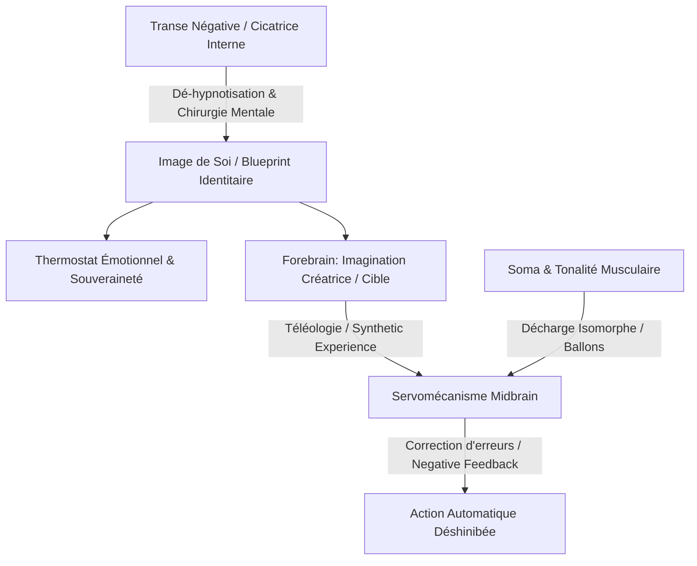
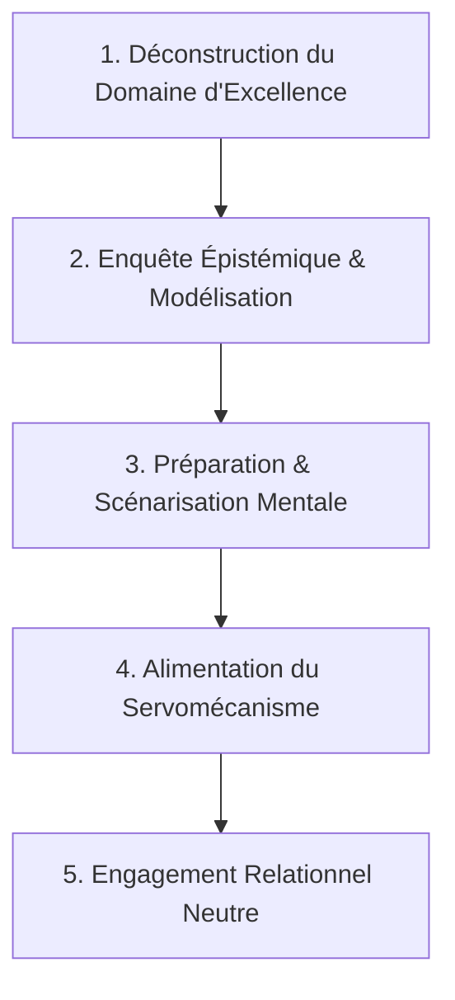
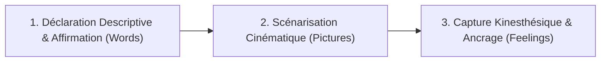

# Psycho-Cybernetics Zero Resistance Living - Transcripts
**Formateur :** Maxwell Maltz | **ID :** `maxwell-maltz-psycho-cybernetics-zero-resistance-living-transcripts` | **Tranches :** 19

Voici la **Synthèse Architecturale du Cours** conçue comme tête de pont modélisante et structurée pour la fiche maîtresse :

---

# Synthèse Architecturale du Cours : *Psycho-Cybernetics & Zero Resistance Living*
**Auteur / Formateur :** Dr Maxwell Maltz  
**Domaine :** Psycho-cybernétique, Chirurgie mentale de l'image de soi, Dé-hypnotisation & Auto-régulation téléologique.

---

## 1. Thèse Centrale & Philosophie du Cours

### Vision spécifique & posture de Maxwell Maltz
Là où la psychologie conventionnelle et le développement personnel standard misent sur l'effort conscient, la « force de volonté » (*willpower*), ou la catharsis analytique prolongée du passé, Maxwell Maltz aborde l'esprit humain sous l'angle rigoureux de la **chirurgie plastique réparatrice combinée à la cybernétique des systèmes guidés**. 

Sa posture repose sur trois constats radicaux :
1. **La faillite structurelle de la volonté :** Forcer un comportement à coups de crispations musculaires (*gritting teeth and clenching fists*) face à une Image de Soi (*Self-Image*) divergente déclenche inévitablement le mécanisme d'échec. L'Image de Soi gagne toujours contre la volonté consciente, car le système nerveux préserve en priorité son intégrité homéostatique (son *blueprint*).
2. **Le clivage cicatrice externe vs cicatrice interne :** Modifier la forme physique (le miroir rétinien) ne change rien si l'empreinte traumatique et l'attribution de dévalorisation identitaire demeurent intactes dans la mémoire affective. La transformation véritable est une « chirurgie psychologique » consistant à inciser, drainer et suturer les cicatrices émotionnelles encapsulées.
3. **La dé-hypnotisation plutôt que l'hypnose additive :** L'être humain en échec n'est pas déficient : il est en état de transe négative auto-induite ou imprimée par des figures d'autorité du passé. La guérison n'ajoute pas de « pouvoir », elle dissout les suggestions fausses acceptées sans filtre critique (*De-hypnotization*).

### Le fil rouge méthodologique unificateur : *Le Servomécanisme Téléologique Téléguidé*
L'ensemble des interventions du cours s'articule autour d'une boucle cybernétique en trois temps :
- **Sélection de cible (Cerveau antérieur / Forebrain) :** Alimenter l'imagination sensorielle créatrice exclusivement avec la cible finale (*the cup / the goal*), en ignorant radicalement l'obstacle. Le servomécanisme ne comprend pas la négation et converge mécaniquement vers la représentation dominante.
- **Délégation automatique (Mésencéphale / Midbrain) :** Relâcher l'hypercontrôle analytique et laisser le servomécanisme sous-cortical opérer par rétroaction négative (*negative feedback / correction par zig-zag*). L'apprentissage et le succès sont des fonctions autonomes, non des efforts conscients.
- **Régulation homéostatique souveraine (Le Thermostat Intérieur) :** Restaurer la souveraineté affective en coupant le consentement aux intrusions extérieures et en ancrant la physiologie dans le présent créatif (la vie de 1440 minutes), libre de la charge du « tombeau du temps ».

---

## 2. Carte des Concepts & Leviers Émergents



| Concept Clé | Mécanisme Neuro-Cognitif / Somatique | Rôle dans l'Écosystème Maltz |
|---|---|---|
| **Servomécanisme Téléologique** | Système de guidage sous-cortical autonome convergeant vers l'image dominante encodée en mémoire de travail, indifférent à la négation verbale. | Moteur exécutif universel de l'action réussie sans friction ni volonté forcée. |
| **Image de Soi (*Self-Image / Blueprint*)** | Modèle cybernétique interne d'adéquation et de limites identitaires, agissant comme plafond de verre ou tremplin. | Instance directrice suprême : aucun individu ne peut performer au-delà de sa propre image de soi. |
| **Expérience Synthétique (*Synthetic Experience*)** | Équivalence neuro-fonctionnelle entre un événement vécu et un événement intensément imaginé avec submodalités riches. | Levier d'auto-programmation permettant de créer des banques de victoires préalables à l'action réelle. |
| **Cicatrice Interne (*Inner Scar Tissue*)** | Encapsulation mnésique d'une blessure/jugement d'autorité créant une coupure somato-psychique d'infériorité. | Obstacle numéro 1 au changement ; cible de la « chirurgie mentale » pour restaurer la spontanéité. |
| **Thermostat Émotionnel** | Réglage homéostatique interne de bien-être et de confiance, indépendant des conditions périphériques. | Pilier de l'auto-détermination ; empêche l'aliénation de la puissance personnelle aux stimuli externes. |
| **Principe du Consentement Nécessaire** | Règle frontière établissant qu'aucune intrusion affective négative ne peut s'installer sans ratification du sujet. | Bouclier d'immunité psychologique contre les attaques, rejets ou traumatismes relationnels. |
| **Règle d'Exclusion Mutuelle Émotionnelle** | Impossibilité pour les circuits neuro-affectifs d'activer simultanément deux états antagonistes (peur vs confiance). | Justification opératoire de la bascule somatique directe plutôt que de la lutte cognitive. |
| **Matrice 60 / 20 / 20 & Vie de 1440 Minutes** | Rééquilibrage du budget attentionnel : vider le passé (60%) et l'anticipation anxieuse (20%) au profit de l'immédiat (Present Living). | Libération massive de bande passante cognitive et énergétique pour l'action créatrice. |
| **Dissolution de l'Axe de Comparaison** | Dévaluation de la fausse monnaie « Supériorité / Infériorité » au profit de la singularité absolue (*You are You*). | Éradication radicale du syndrome de l'imposteur et de la paralysie sociale. |
| **Désinhibition Motrice (*Action First*)** | Suspension temporaire de l'auto-critique et du feedback en amont pour restaurer la fluidité d'exécution. | Rétablissement du flux naturel de l'instinct de succès sans interférence analytique. |

---

## 3. Tableau Récapitulatif des Techniques & Démonstrations

| Technique / Exercice | Objectif Opératoire | Déclencheur / Indication | Séquence Résumée |
|---|---|---|---|
| **Le Double Long-Métrage du Théâtre de l'Esprit** (*Double Feature*) | Désamorcer l'illusion de fatalité d'un état négatif et basculer sur l'état ressource. | Fixation sur un échec, rumination, sentiment d'impuissance chronique. | 1. Projeter en gros plan sur écran mental le visage crispé/défait.<br>2. Projeter immédiatement à côté ou à la suite le visage radieux/conquérant.<br>3. Constater la coexistence en mémoire.<br>4. Ajuster la posture physique sur l'image triomphante et fermer l'autre écran. |
| **Simulation Sensorielle Haute Fidélité** (*Synthetic Rehearsal*) | Enregistrer des patterns synaptiques et neuromusculaires de réussite avant l'épreuve. | Anxiété de performance, apprentissage moteur, examen, prise de parole. | 1. S'asseoir confortablement au calme.<br>2. Recréer la scène dans les moindres détails sensoriels (odeurs, sons, vue, micro-mouvements).<br>3. Exécuter l'action avec succès absolu plusieurs fois.<br>4. Laisser le servomécanisme encoder l'empreinte motrice. |
| **Défocalisation Spatiale & Remplacement Visuel** (*Microscope Frame*) | Stopper l'inhibition amygdalienne face à un stimulus de menace sociale. | Trac invalidant, regard intimidant d'un auditoire ou d'un examinateur. | 1. Repérer le déclencheur visuel (les regards/yeux inquisiteurs).<br>2. Réduire et masquer ce champ visuel par un cadre familier de maîtrise absolue (ex: le tube du microscope).<br>3. Parler/agir depuis ce cadre sécurisé de haute compétence. |
| **Désidentification par « L'Étranger Intérieur »** (*Stranger Within*) | Sortir de la fusion émotionnelle avec le symptôme et reprendre le gouvernail. | Émotion subie diffuse (« Je suis anxieux », sentiment d'étrangeté paralysant). | 1. Personnifier le ressenti en une entité distincte assise en face de soi.<br>2. Établir une relation de communication fonctionnelle de sujet à objet.<br>3. Lui retirer le droit de piloter et lui assigner son rôle d'indicateur sous tutelle. |
| **Décharge Somatique par Métaphore Isomorphe** (*Balloons Deflation*) | Relâcher instantanément le tonus d'hypervigilance musculaire sympathique. | Tensions corporelles, crispation mentale, insomnie, hyper-contrôle. | 1. Visualiser son corps comme un ensemble de ballons en caoutchouc gonflés à bloc.<br>2. Imaginer les valves qui s'ouvrent à la base des pieds, mains et cou.<br>3. Ressentir l'air s'échapper et le corps s'effondrer passivement sous la gravité. |
| **Désynchronisation Temporelle Explicite** (*Age Regression Collapse*) | Briser la superposition d'un trauma infantile sur les capacités de l'adulte présent. | Réaction disproportionnée d'impuissance face à une situation de blocage. | 1. Identifier l'âge réel de la partie du self qui réagit (ex: enfant de 14 ans).<br>2. Énoncer fermement le décalage chronologique réel (« C'était il y a 40 ans »).<br>3. Réintégrer la physiologie, la stature et les compétences de l'adulte dans l'ici et maintenant. |
| **L'Archéologie Intérieure en 5 Minutes** (*Excavation of Forgotten Resources*) | Purger les résidus d'échecs de la journée et restaurer l'image de soi avant le repos. | Fin de journée harassante, sensation d'inutilité ou d'épuisement mental. | 1. Cinq minutes d'immobilité physique complète sans distraction.<br>2. Balayer délibérément les archives mémorielles pour déterrer 2 ou 3 succès simples passés.<br>3. Réactiver la sensation somatique de ces victoires pour refermer la journée sur un calibrage positif. |
| **Réglage du Thermostat Émotionnel** (*Internal Thermostat Reset*) | Récupérer la souveraineté interne face à une météo émotionnelle hostile. | Réactivité aux contrariétés, victimisation, sentiment que « les autres gâchent ma journée ». | 1. Visualiser le cadran du thermostat intérieur sur la paroi du cœur/esprit.<br>2. Constater à quel niveau extérieur on l'a laissé descendre.<br>3. Tourner fermement la molette interne sur le niveau de sérénité/joie souverain indépendant de l'extérieur. |
| **Pellicule de Dé-hypnotisation par Rupture d'Autorité** | Dissoudre une croyance négative gravée par une figure d'autorité passée. | Croyance d'incompétence (« Je ne suis pas fait pour les maths / le succès »). | 1. Isoler la phrase source originelle et le visage de l'autorité émettrice.<br>2. Rétrograder cette parole au statut de simple « opinion fausse et arbitraire » d'un individu faillible.<br>3. Déclarer la nullité légale du contrat et rayer la suggestion du registre intérieur. |

---

---

## 0. Sommaire Sémantique & Index des Lignes

- **Tranche 1 [Lignes 103-225]** : Le Double Long-Métrage du Théâtre de l'Esprit (Double Feature in the Theatre of the Mind) — *Protocole :* Le Double Long-Métrage du Théâtre de l'Esprit (Double Feature in the Theatre of the Mind) | *Mécanisme :* Le Servomécanisme et la Télégraphie Téléologique (Orientation Cible vs Obstacle) | *Verbatim :* Recadrage Spatio-Temporel du Miroir
- **Tranche 2 [Lignes 227-397]** : A : La Répétition Mentale Focalisée sous Contrainte (« Le Filtre du Microscope ») — *Protocole :* A : La Répétition Mentale Focalisée sous Contrainte (« Le Filtre du Microscope »)
- **Tranche 3 [Lignes 399-555]** : Le Théâtre de l'Esprit & Répétition Mentale (Mental Shadow-Boxing) — *Protocole :* Le Théâtre de l'Esprit & Répétition Mentale (Mental Shadow-Boxing) | *Verbatim :* L'Induction des Quatre Principes de Relaxation Cardinale
- **Tranche 4 [Lignes 557-757]** : La Relaxation Rapide par Déflation des Ballons (Rubber Balloons Deflation) — *Protocole :* La Relaxation Rapide par Déflation des Ballons (Rubber Balloons Deflation) | *Mécanisme :* Le Servomécanisme et l'Instinct de Réussite Inné (Success Instinct vs. Teleological Servomechanism) | *Verbatim :* Verbatim 1 : L'Hypnose Parentale Déconstruite
- **Tranche 5 [Lignes 759-880]** : A : L’Archéologie Intérieure en 5 Minutes (Excavation des Ressources Oubliées) — *Protocole :* A : L’Archéologie Intérieure en 5 Minutes (Excavation des Ressources Oubliées)
- **Tranche 6 [Lignes 882-1084]** : L'Intégration d'Ombre par Prescrire le Symptôme (La Magicienne aux Erreurs) — *Protocole :* L'Intégration d'Ombre par Prescrire le Symptôme (La Magicienne aux Erreurs) | *Mécanisme :* Le Régulateur Cybernétique Interne (Thermostat Émotionnel) | *Verbatim :* La Métaphore du Thermostat & La Rupture Temporelle
- **Tranche 7 [Lignes 1086-1241]** : Le Sanctuaire de la « Chambre Mentale » (Creative Mental Room Furnishing) — *Protocole :* Le Sanctuaire de la « Chambre Mentale » (Creative Mental Room Furnishing) | *Verbatim :* La non-moralité biologique du bonheur
- **Tranche 8 [Lignes 1243-1344]** : A : La Dé-Hypnose sur la Scène de l'Esprit (Playhouse De-Hypnosis) — *Protocole :* A : La Dé-Hypnose sur la Scène de l'Esprit (Playhouse De-Hypnosis) | *Verbatim :* Le Recadrage Métaphorique de la Machine à Écrire
- **Tranche 9 [Lignes 1346-1521]** : L'Ancrage Temporel de l'Aventure Quotidienne (Exercice de la Montre) — *Protocole :* L'Ancrage Temporel de l'Aventure Quotidienne (Exercice de la Montre) | *Mécanisme :* Le Servomécanisme Neutre et la Bi-polarité Automatique | *Verbatim :* Recadrage Radical de l'Égalité et de la Grandeur
- **Tranche 10 [Lignes 1523-1642]** : Transmutation Métaphorique du « Négatif » en « Épreuve Révélée » (Démonstration du Photographe) — *Protocole :* Transmutation Métaphorique du « Négatif » en « Épreuve Révélée » (Démonstration du Photographe) | *Verbatim :* Recadrage temporel de la charge affective toxique
- **Tranche 11 [Lignes 1644-1778]** : Le Recadrage Identitaire Dali / Dé-hypnose du Ressentiment Maternel — *Protocole :* Le Recadrage Identitaire Dali / Dé-hypnose du Ressentiment Maternel | *Mécanisme :* Le Blackout Émotionnel Intérieur vs Direction Cybernétique | *Verbatim :* La Métaphore Automobile du Masque
- **Tranche 12 [Lignes 1780-1941]** : Le Déconditionnement du Masque et de la Fausse Apparence (Mirror & Sunglasses Protocol) — *Protocole :* Le Déconditionnement du Masque et de la Fausse Apparence (Mirror & Sunglasses Protocol)
- **Tranche 13 [Lignes 1943-2055]** : A : La Métaphore Opératoire du Couteau Chaud dans le Beurre (Hot Knife Through Butter) — *Protocole :* A : La Métaphore Opératoire du Couteau Chaud dans le Beurre (Hot Knife Through Butter)
- **Tranche 14 [Lignes 2057-2224]** : La Reconstruction Anti-Procrastination par Verrouillage Temporel et Micro-Films — *Protocole :* La Reconstruction Anti-Procrastination par Verrouillage Temporel et Micro-Films | *Mécanisme :* Le Biais de Rétroaction Rétrospective (« Play a new record ») | *Verbatim :* Le Recadrage Rétroactif et l'Inversion de Boucle
- **Tranche 15 [Lignes 2226-2360]** : Audit de Congruence Auto-Image / Objectif (Cas Kenny G) — *Protocole :* Audit de Congruence Auto-Image / Objectif (Cas Kenny G) | *Mécanisme :* Le Primat Cibernetique de l'Auto-Image sur la Volonté et les Ressources Externes | *Verbatim :* Verbatim 1 : La Confrontation du Locus de Contrôle Temporel
- **Tranche 16 [Lignes 2362-2520]** : Recalibration Matinale par Image Haute Tension (Cycle de 21 Jours) — *Protocole :* Recalibration Matinale par Image Haute Tension (Cycle de 21 Jours) | *Verbatim :* La Boucle de Frustration de l'Effacement Volontaire
- **Tranche 17 [Lignes 2522-2739]** : A : La Transposition de Compétence « Lion-to-Lion » — *Protocole :* A : La Transposition de Compétence « Lion-to-Lion » | *Mécanisme :* Transfert Trans-Contextuel de Ressources d'Identité | *Verbatim :* La Cascade de Négations Régénératrices de Norman Cousins
- **Tranche 18 [Lignes 2741-2825]** : Le Transducteur « Couteau Chauffé » (Transpercement de Résistance) — *Protocole :* Le Transducteur « Couteau Chauffé » (Transpercement de Résistance) | *Mécanisme :* Le Biais d'Éclipse Perceptive (L'Obscuration Focale) | *Verbatim :* Recadrage Modal et Restitution de Puissance
- **Tranche 19 [Lignes 2827-2913]** : d'Intégration Quotidienne des "Happiness Affirmations" (Alignement Identitaire & Somatique) — *Protocole :* d'Intégration Quotidienne des "Happiness Affirmations" (Alignement Identitaire & Somatique)

---

## Extractions Détaillées par Tranche (Opératoire & Verbatim)

## Tranche 1 / 19 : Le Double Long-Métrage du Théâtre de l'Esprit (Double Feature in the Theatre of the Mind)

Voici l'analyse d'ingénierie et de modélisation opératoire de la tranche 1/19 du cours *Psycho-Cybernetics: Zero Resistance Living* de Maxwell Maltz.

---

### 1. Mécanismes & Principes Actifs

#### Le Servomécanisme et la Télégraphie Téléologique (Orientation Cible vs Obstacle)
- **Principe actif :** Le système nerveux autonome et le cerveau fonctionnent comme un mécanisme cybernétique de poursuite de cible (servomécanisme). Le système psycho-musculaire et attentionnel converge mécaniquement vers la représentation dominante encodée dans l'esprit, sans distinguer la négation linguistique. Penser « je ne veux pas toucher l'arbre » ou « je vais passer au-dessus de l'arbre » maintient l'index visuo-moteur calibré sur l'obstacle (*l'arbre*), forçant le servomécanisme à s'aligner sur cet obstacle. La réussite motrice et comportementale exige de saturer le canal sensoriel interne exclusivement avec l'objectif final (*the cup / le trou*), ignorant totalement l'obstacle physique ou émotionnel.
- **Tags libres :** `#servomechanisme_cybernétique` `#eye_on_the_ball` `#evitement_paradoxal` `#focalisation_téléologique` `#index_visuomoteur`

#### L'Incongruence Image de Soi / Traitement Sensoriel (Le Décalage Cicatrice Externe / Cicatrice Interne)
- **Principe actif :** L'identité et le schéma corporel ne sont pas déterminés par la rétroaction optique directe (le miroir rétinien), mais par la structure de l'« image de soi » (*Self-Image*) logée dans le système de mémoire autobiographique et affective. Si une empreinte traumatique, une culpabilité ou une blessure d'abandon n'est pas mise à jour, la chirurgie physique crée une anomalie perceptive : le sujet « voit » la différence avec ses yeux, mais son système neuro-affectif « ne ressent aucune différence ». La cicatrice psychologique filtre l'expérience et bloque l'intégration de la réalité somatique présente.
- **Tags libres :** `#self_image_discrepancy` `#cicatrice_emotionnelle` `#plastic_surgery_of_the_mind` `#incongruence_perceptivo_affective` `#mise_a_jour_identitaire`

#### L'Incompatibilité Psycho-Affective Binaire (Règle d'Exclusion Mutuelle Émotionnelle)
- **Principe actif :** Deux états neuro-affectifs antagonistes ne peuvent coexister simultanément sur le même canal somatique et cognitif. Maltz pose un principe neuro-physiologique strict : *« You cannot think positively with negative feelings, any more than you can think negatively when you have positive feelings »*. La tentative de forcer une pensée positive au niveau cortical par simple « volonté » alors que le système limbique/somatique est inondé de ressentiment ou d'anxiété échoue systématiquement. L'accès à la cognition créative requiert une bascule somatique directe (changement d'état affectif ou purge des résidus négatifs) plutôt qu'un conflit cognitif conscient.
- **Tags libres :** `#incompatibilite_neuroaffective` `#echec_de_la_volonte` `#interverrouillage_somatique` `#purge_du_ressentiment`

#### La Répartition Temporelle de la Charge Attentionnelle (La Matrice 60 / 20 / 20)
- **Principe actif :** Maltz diagnostique une boucle d'épuisement attentionnel : en se regardant dans le miroir, l'individu standard alloue 60 % de son traitement cognitif aux échecs passés (culpabilité, mémoire douloureuse, résidus), 20 % à l'anxiété projective du futur, et seulement 20 % au moment présent. La libération d'énergie cybernétique nécessite de recalibrer ce ratio à 40–60 % d'attention dédiée au « Présent Créatif » (les 1440 minutes quotidiennes perçues comme une vie complète et autonome), reléguant le passé à un statut de « tombeau du temps » dépourvu de charge somatique active.
- **Tags libres :** `#budget_attentionnel` `#retroaction_temporelle` `#vie_de_1440_minutes` `#effondrement_de_la_rumination`

#### L'Auto-Hypnose par Double Projection Cinématographique (Double Feature)
- **Principe actif :** La dissociation visuelle comparative au sein du « Théâtre de l'Esprit ». En plaçant simultanément ou séquentiellement deux images plein cadre (*close-ups*) du même individu — l'une encodant la frustration (visage tendu, front plissé, mâchoires serrées, poings crispés) et l'autre encodant l'enthousiasme (sourire, yeux brillants, paumes ouvertes) —, le praticien force le système nerveux à reconnaître que les deux potentiels coexistent en mémoire de travail, désamorçant la croyance selon laquelle l'état de détresse est une fatalité identitaire immuable. Le choix conscient devient alors une bascule posturale et attentionnelle directe.
- **Tags libres :** `#double_feature` `#theatre_of_the_mind` `#dissociation_comparative` `#calibrage_postural_visuel` `#bascule_enthousiasme_extinction`

---

### 2. Protocoles, Techniques & Démonstrations (Étape par Étape)

#### Protocole 1 : Le Double Long-Métrage du Théâtre de l'Esprit (Double Feature in the Theatre of the Mind)
* **Intention / Indication :** Quand le sujet se sent enfermé dans la rumination, la fatalité de l'échec, la tension corporelle chronique ou le sentiment d'être « une cause perdue ».
* **Mise en place & Pré-framing :** Assis, yeux fermés, corps relâché. Pré-cadrage : « Vous n'êtes pas votre état actuel. Vous avez en vous les deux polarités : l'extinction et l'enthousiasme. Vous allez regarder ces deux films intérieurs. »
* **Séquence d'actions pas à pas :**
  1. *Fermeture sensorielle et induction de détente :* Le sujet ferme les yeux, relâche les épaules et porte son attention sur son écran mental interne (« *the theatre of your mind* »).
  2. *Évocation du Gros Plan de Frustration (Pattern d'Extinction) :* Projeter sur l'écran intérieur un plan rapproché (*close-up*) de soi-même en état de crise/frustration. Zoomer sur les micro-tensions somatiques : front plissé, dents serrées, mâchoire contractée, mains nouées en poings. Calibrer la sensation d'étouffement énergétique.
  3. *Transition et Rupture Visuelle :* Faire basculer l'écran mental vers une seconde image, également en gros plan.
  4. *Évocation du Gros Plan d'Enthousiasme (Pattern de Succès) :* Visualiser son propre visage illuminé par un sourire, les yeux qui brillent, les traits détendus, et observer spécifiquement la posture somatique d'ouverture : les paumes des deux mains ouvertes et visibles.
  5. *Reconnaissance de l'Unité Identitaire :* Intégrer la prise de conscience que ces deux images sont des programmes disponibles du même servomécanisme : « Ces deux personnes, c'est vous. L'une mène à l'extinction, l'autre à la vie. »
  6. *Choix et Engagement Moteur :* Choisir délibérément le vecteur d'enthousiasme pour la journée présente de 1440 minutes.
* **Signes de calibration :** Relâchement immédiat des masséters (mâchoire), défroissement du front, ouverture spontanée des mains si elles étaient crispées, modification du rythme respiratoire (passage d'une respiration haute et bloquée à une respiration ventrale).

#### Protocole 2 : Téléologie Cybernétique (« Eye on the Ball » vs « Eye on the Tree »)
* **Intention / Indication :** Sujet bloqué par la peur d'un obstacle récurrent (ex: peur de bafouiller en public, peur d'un échec commercial, crainte de répéter une erreur passée).
* **Mise en place & Pré-framing :** Cadrer la mécanique du servomécanisme : « Votre cerveau ne sait pas éviter un obstacle ; il sait seulement atteindre une cible. Si vous fixez l'arbre pour l'éviter, vos muscles orienteront le club droit vers l'arbre. »
* **Séquence d'actions pas à pas :**
  1. *Identification de l'Obstacle Aimant :* Mettre au jour la pensée parasite récurrente (« Je ne dois pas toucher l'arbre », « Je ne dois pas rater ma prise de parole »).
  2. *Effacement Perceptif de l'Obstacle :* Refuser formellement d'investir de la charge mentale dans la neutralisation de l'obstacle. Cesser d'élaborer des trajectoires d'évitement (« à gauche de l'arbre », « au-dessus de l'arbre »).
  3. *Fixation Exclusive du Point Terminal :* Définir l'image nette et sensorielle de la destination finale (la balle à deux centimètres du trou / l'applaudissement du public / la signature du contrat).
  4. *Verrouillage Attentionnel (« Keep Your Eye on the Ball ») :* Maintenir la concentration sur la coordonnée cible précise au moment de l'action motrice, en laissant le servomécanisme inconscient calculer la trajectoire biomécanique sans interférence de la volonté consciente.
* **Signes de calibration :** Absence de mouvements oculaires erratiques de recherche d'erreurs (balayage d'hyper-vigilance) ; regard focalisé et calme ; fluidité motrice sans saccades de micro-correction induites par la peur.

#### Protocole 3 : L'Intervention de Reconstruction Post-Traumatique (Démantèlement de la Fausse Causalité / Cas du Drame Paternel & de la Cicatrice)
* **Intention / Indication :** Sujet paralysé par une culpabilité réflexe consécutive à une tragédie extérieure ou un abandon (« Si seulement j'avais / si seulement je n'avais pas... »).
* **Mise en place & Pré-framing :** Recadrage logique direct et confrontation avec la réalité causale. Sortir le sujet de l'illusion de toute-puissance négative.
* **Séquence d'actions pas à pas :**
  1. *Explicitation du Lien Causal Illusoire :* Faire verbaliser la proposition toxique interne (ex: « C'est ma faute si mon fiancé est parti » ou « Mon père est mort parce que je l'ai appelé pour qu'il vienne »).
  2. *Confrontation Chirurgicale par Dé-responsabilisation :* Poser la question de rupture de pattern : *« How could you hold yourself responsible for something you didn't do? »* (Maltz à la patiente blonde) ; établir la séparation stricte entre l'action du sujet et la contingence externe.
  3. *Inversion de la Fidélité Déloyale :* Quand le sujet veut « mourir » ou s'autodétruire par culpabilité, recadrer le désir de la personne disparue/perdue : *« Mon père voudrait que je continue, envers et contre tout »*.
  4. *Redéfinition du Mandat Existant :* Réorienter l'énergie de deuil vers la responsabilité d'exprimer « le Grand Vous » (*the Big You*) au sein du présent.
* **Signes de calibration :** Rupture de la posture prostrée ; soupir profond marquant la fin de l'inhibition motrice ; ré-alignement du regard vers l'avant au lieu d'un regard figé vers le bas (dialogue interne culpabilisant).

---

### 3. Heuristiques, Subtilités & "Sagesse du Praticien"

#### Règles Conditionnelles (« Si X -> Alors Y parce que Z »)
- **Si le client tente de forcer une nouvelle habitude ou un changement par la volonté pure alors qu'il est en tension :**
  * *Alors :* Arrêter immédiatement l'effort conscient et basculer sur la relaxation somatique et l'imagination passive du résultat final.
  * *Parce que :* La volonté consciente crispe le système neuromusculaire et réactive le mécanisme d'échec (« *trying to solve their problems using the force of willpower causes great frustration and misery* »). Le servomécanisme n'opère qu'en état de non-résistance (« Zero Resistance »).
- **Si un sujet tente d'éviter une erreur en se répétant mentalement ce qu'il ne doit pas faire (ex: « Je ne vais pas taper l'arbre ») :**
  * *Alors :* Couper net sa verbalisation et exiger qu'il décrive uniquement la position du trou/cible en termes sensoriels positifs.
  * *Parce que :* Le système nerveux est aveugle à la négation syntaxique ; il convertit chaque mot à forte charge visuelle en commande motrice directe.
- **Si un résultat esthétique ou matériel mesurable s'améliore mais que le client déclare « Je vois une différence, mais je ne ressens aucune différence » :**
  * *Alors :* Cesser de lui montrer des preuves externes (photos, métriques, compliments des autres) et aller chercher la blessure relationnelle ou l'auto-jugement logé dans son passé.
  * *Parce que :* Une modification de la réalité physique est stérile tant que l'« image de soi » interne reste programmée sur l'identité d'un individu indigne ou brisé.
- **Si le sujet est submergé par une crise aiguë ou un abîme de désespoir :**
  * *Alors :* Lui interdire de « faire une montagne d'une taupinière » (*mountain out of a molehill*), bloquer les demandes d'attention régressives (« *stop crying for attention* ») et lui ordonner de se relaxer et d'avancer d'un pas mécanique immédiat.
  * *Parce que :* L'urgence d'une crise requiert la suppression du drame narratif conscient pour laisser le système de survie créatif opérer dans le présent le plus strict.

#### Pièges Classiques & Erreurs de Débutant
- **Confondre l'acteur et le mécanisme (The Stranger Within) :** L'erreur consiste à s'identifier à ses impulsions anxieuses ou dépressives. Maltz rappelle que le mécanisme automatique est un « étranger intérieur » (*the stranger within*) qui agit comme un servomécanisme ou un magnétophone. Le praticien ne doit jamais traiter le symptôme comme l'identité du client, mais comme une bande magnétique erronée en cours de lecture.
- **Vouloir « scier l'arbre » (La tentation de détruire l'environnement) :** Métaphore de la tronçonneuse à 98 $ pour abattre l'arbre sur le parcours de golf : vouloir changer son entourage, son patron, son conjoint ou la configuration du terrain plutôt que de réorienter son propre servomécanisme interne vers la cible.
- **Végéter dans le statut d'« Erreur vivante » :** Confondre l'action d'échouer avec l'identité d'échec. Maltz martèle l'heuristique : *« You may be a mistake maker, but you're also a mistake breaker »*. L'apprentissage humain est cybernétique par nature (essai, erreur, rétroaction négative, réajustement) ; dramatiser l'erreur bloque la boucle d'auto-correction.

#### Postulats Fondamentaux de Maxwell Maltz
1. **L'analogie du Plasticien de l'Esprit :** 1 % des humains ont besoin d'un scalpel pour corriger des difformités physiques ; 99 % s'infligent eux-mêmes des incisions et des défigurations internes par culpabilité, rancœur et auto-dénigrement. Tout individu a le devoir de devenir son propre chirurgien plastique intérieur.
2. **La journée de 1440 minutes comme unité de vie complète :** Chaque lever de soleil offre un cycle complet de 1440 minutes qui ne reviendra jamais. Vivre dans le passé équivaut à périr biologiquement et psychologiquement (« *Living today in yesterday is not living, it is perishing* »).
3. **L'Auto-Respect comme condition préalable universelle :** L'amour d'autrui ou la fraternité humaine sont des abstractions impossibles sans une fondation d'auto-respect somatique et identitaire : *« If you don't hate yourself, you cannot hate another human being »*.

---

### 4. Pépites Verbatim & Patterns Linguistiques (MOT À MOT EN V.O.)

#### Recadrage Spatio-Temporel du Miroir
> « 1440 minutes to a day, a whole lifetime that'll never come back again... somewhere along those 1440 minutes, you're at the mirror, either powdering your nose or taking a shave. Now, what do you see? Well, the chances are you don't see too much because you've just accepted yourself for what you are, but if you look very closely, you would suddenly realize that 60% of what you see in that mirror is all about yesterday. 20% of what you see in that mirror is all about tomorrow. »
* **[Analyse du Pattern]** : Décomposition hypnotique de l'évidence sensorielle. Maltz prend une routine universelle (se raser, se maquiller) et induit une rupture de cadre immédiate : le miroir ne reflète pas de la lumière, il reflète des strates temporelles périmées. L'utilisation du fractionnement mathématique (1440 minutes, 60%, 20%) sature l'hémisphère gauche critique pour injecter une prise de conscience dissociative.

#### La Transmutation Métaphorique Spatiale (Chaises / Pas de Tir)
> « You are seated in chairs. They're rethink chairs, I'm sure they are. I conceive of them as your launching pads. Your imagination with me. They are your launching pads. You are your own astronauts now, this very minute. And you're taking off with me into the vast world within your mind, within your heart, within your spirit. »
* **[Analyse du Pattern]** : Ré-ancrage kinesthésique et nominalisation expansée. Maltz utilise un objet physique passif présent dans la pièce (*chairs*) et applique un recadrage métaphorique direct en le redéfinissant comme une plateforme active propulsive (*launching pads*). Il utilise une commande temporelle synchronisée (*« this very minute »*) liée à un couplage d'autorité bienveillante (*« with me »*) pour forcer un décollage imaginal instantané.

#### Commande d'Autorégulation et Métaphore de l'Écologie Intérieure
> « But tell me, what's the good of it? What's more important? Controlling the environmental crisis within, in here. You must learn to get rid of the garbage of negative feelings inside here. You must learn to get rid of the violence, the hatred, the bigotry inside here. There's not enough police to police this world. You must learn to police yourself, to get rid of the environmental crisis inside of you, the pollution, the garbage of hurt feelings and despair. »
* **[Analyse du Pattern]** : Pacing et Leading sociétal avec empilement d'analogies viscérales. Il capte l'attention du public sur un thème externe d'actualité valorisé (la crise environnementale discutée par le secrétaire d'État) pour le ramener brutalement vers la physiologie interne via des anaphores spatiales (*« in here »*, répété trois fois avec désignation du thorax). L'utilisation de termes répugnants (*garbage*, *pollution*) crée une aversion somatique immédiate contre la rumination.

#### Démantèlement Socratique de la Culpabilité Névrotique
> « Two years before the accident, she was engaged to a young man who suddenly ran off and married someone else. That left her with hurt feelings, with feelings of remorse, with feelings of resentment, with feelings of guilt that she was nobody. And I said, my dear child, how could you hold yourself responsible for something you didn't do? You didn't run away, he did. Now, for goodness sake, why do you blame yourself? She got the message... »
* **[Analyse du Pattern]** : Rupture de lien de cause à effet fallacieux. La patiente avait fusionné la fuite de son fiancé avec sa propre valeur identitaire (« *she was nobody* »). Maltz utilise une dissociation linguistique chirurgicale basée sur la stricte agentivité physique : *« You didn't run away, he did »*. La structure binaire désintègre l'illusion d'auto-culpabilisation par contraste logique indiscutable.

#### Induction de Focalisation Cybernétique vs Piège Attentionnel
> « He hit the tree because he was thinking of the tree. Not the cup. Because of his negative feelings, the next day he hit the ball somewhere in a similar area near the tree and he said, this time the second day, I'm going to hit the ball to the left of the tree. And he hit the tree because he was thinking of the tree. He wasn't keeping his eye on the goal. He wasn't keeping his eye on the ball. »
* **[Analyse du Pattern]** : Répétition hypnotique de cause à effet sous forme de boucle circulaire fermée (*« hit the tree because he was thinking of the tree »*). L'effet de truisme et l'empilement rythmique démontrent que toute tentative d'évitement cognitif (« *to the left of the tree* ») maintient la représentation de l'obstacle active dans le servomécanisme, garantissant la répétition motrice de l'échec.

#### Le Recadrage Identitaire par Acronyme et Nominalisation
> « Listen, my dear friends, if you practice being a professional human being every day by using S-U-C-C-E-S-S like I just enumerated, you can have instant you. Instant Y-O-U. The big you, the real you, the evolution of you. »
* **[Analyse du Pattern]** : Pont temporel et contraste parodie/réalité. En reprenant les objets de la société de consommation moderne cités juste avant (*instant coffee, instant tea, instant TV dinners*), il détourne le concept de superficialité marchande pour implanter une suggestion d'accès immédiat à l'identité souveraine (*« instant YOU »*). L'enchaînement de truisme identitaire (*« the big you, the real you, the evolution of you »*) opère une nominalisation expansive qui contourne toute résistance analytique.

#### Postulat d'Incompatibilité Affective Radicale
> « And if we in our present undertaking recall the past failures, the past resentments, we automatically cannot succeed in the daily pursuit of happiness as of now because you cannot think positively with negative feelings. Any more than you can think negatively when you have positive feelings. »
* **[Analyse du Pattern]** : Double lien d'évidence neuro-physiologique. Maltz pose une équivalence stricte en miroir qui neutralise l'illusion de la « pensée positive superficielle ». En créant un parallélisme structural parfait (impossible d'avoir des pensées positives sur des sensations négatives / impossible d'avoir des pensées négatives sur des sensations positives), il valide auprès de l'auditeur que le levier opératoire premier n'est pas intellectuel mais viscéral et affectif.

## Tranche 2 / 19 : A : La Répétition Mentale Focalisée sous Contrainte (« Le Filtre du Microscope »)

### 1. Mécanismes & Principes Actifs

- **Équivalence Neurologique Expérience Vécue / Imagination Sensorielle Réaliste**
  - **Principe actif :** Le cerveau et le système nerveux autonome ne font pas la distinction neurophysiologique entre un événement physiquement traversé et un événement intensément et précisément imaginé avec les modalités sensorielles associées. En encodant une scène interne avec des détails vécus (microscope, lames, concentration visuelle focalisée), l'activation des réseaux neuronaux moteurs et affectifs est identique à celle de l'épreuve réelle.
  - **Tags émergents :** `#synthetic_experience` `#neuro_equivalence` `#mental_rehearsal` `#cerebral_indistinction`

- **Architecture Cybernétique Téléologique (Cerveau Antérieur / Mésencéphale)**
  - **Principe actif :** Maltz sépare le système nerveux en deux instances complémentaires :
    1. Le *forebrain* (cerveau antérieur / cortex frontal) : organe de sélection et de tenue de l'objectif (*goal-setter*).
    2. Le *midbrain / subconscious* (mésencéphale / inconscient) : servomécanisme automatique, comparé à une bande magnétique (*tape recorder*) qui exécute machinalement les schémas enregistrés sans jugement moral.
    La volonté consciente (*willpower*) échoue dès qu'elle tente de forcer le servomécanisme ; le système fonctionne exclusivement par alimentation d'images cibles, laissant la machinerie sous-corticale mobiliser les réponses motrices et émotionnelles adéquates.
  - **Tags émergents :** `#midbrain_tape_recorder` `#forebrain_teleology` `#servo_mechanism` `#automatic_guidance` `#zero_willpower`

- **Congruence Émotionnelle-Cognitive Bipolaire (Incompatibilité d'États)**
  - **Principe actif :** Impossibilité psychophysiologique pour le système nerveux de traiter simultanément une pensée orientée succès avec une charge affective d'échec (ou inversement). L'évocation d'un affect d'échec passé inhibe mécaniquement l'accès aux patterns de réponse adaptés. L'accès à la ressource nécessite de brancher l'état somatique et affectif sur le souvenir kinesthésique d'une victoire passée pour piloter l'action présente.
  - **Tags émergents :** `#affective_congruence` `#state_incompatibility` `#past_success_transference` `#emotional_coherence`

- **La Cicatrice Interne (Encapsulation Traumatique & Clivage Somato-Psychique)**
  - **Principe actif :** La modification du substrat anatomique externe (effacement chirurgical d'une cicatrice faciale) n'entraîne aucun changement comportemental ou affectif tant que la trace mnésique de dévalorisation identitaire (« *I see a difference, but I don't feel any different* ») reste active. La cicatrice interne résulte d'une attribution causale erronée (s'attribuer la responsabilité d'un rejet extérieur) qui verrouille l'image de soi dans l'état de victime coupable.
  - **Tags émergents :** `#inner_scar` `#somatic_dissociation` `#identity_anchoring` `#false_culpability_lock`

- **Défocalisation Spatiale Sélective & Remplacement Hallucinatoire Positif**
  - **Principe actif :** Face à un stimulus anxiogène visuel puissant (ex. : 160 yeux de condisciples et le regard menaçant d'un examinateur), la sidération motrice et verbale provient de la focalisation attentionnelle totale sur la menace sociale perçue. En substituant délibérément ce champ visuel par un champ visuel associé de haute maîtrise technique (regarder dans le tube d'un microscope), le sujet coupe le circuit d'inhibition amygdalien et réactive immédiatement les fonctions exécutives du langage et de la mémoire.
  - **Tags émergents :** `#visual_field_substitution` `#social_threat_defocus` `#submodalities_occlusion` `#microscope_frame`

- **Personnification Opératoire du Symptôme : « L'Étranger Intérieur »**
  - **Principe actif :** La projection de l'affect indésirable diffus (« ce sentiment étrange ») sous la forme d'une entité séparée distincte (« l'étranger en soi ») désamorce l'identification fusionnelle. En passant d'un ressenti subi (« je suis anxieux ») à une relation sujet-objet (« un étranger essaie de me communiquer quelque chose »), le sujet reprend le contrôle cybernétique (le timonier) sur l'état interne, pouvant négocier, apprivoiser ou commander la partie.
  - **Tags émergents :** `#stranger_within` `#parts_dialogue` `#defusion_metaphor` `#internal_helmsman`

- **Écologie du Pardon Radical (Désamorçage du Gain Secondaire Victimisationnel)**
  - **Principe actif :** Le refus de se pardonner ou de pardonner à autrui fonctionne comme une stratégie inconsciente pour maintenir une identité d'importance par la plainte et l'extraction d'attention externe (« *through that complaint you feel you'll get attention* »). Le non-pardon paralyse le servomécanisme dans le passé. Le pardon sans condition (« *clean slate, no installment plan* ») détruit la structure de récompense névrotique et libère le potentiel opérationnel dans le présent.
  - **Tags émergents :** `#unconditional_clean_slate` `#secondary_gain_dissolution` `#neurotic_complaint_trap` `#self_amnesty`

---

### 2. Protocoles, Techniques & Démonstrations (Étape par Étape)

#### Protocole A : La Répétition Mentale Focalisée sous Contrainte (« Le Filtre du Microscope »)
* **Intention / Indication :** Panique à l'oral, phobie de performance, sidération face à une autorité ou un auditoire intimidant, perte de moyens en public.
* **Mise en place & Pré-framing :** Cadrer la crise actuelle comme une opportunité opérationnelle. Identifier le contexte précis où la compétence s'exprime parfaitement sans stress (ex. : le laboratoire, le travail solitaire, la manipulation d'instruments).
* **Séquence d'actions pas à pas :**
  1. *Étape 1 - Diagnostic de l'image paralysante :* Identifier précisément les signaux visuels ou auditifs déclencheurs de l'inhibition (ex. : voir les 160 yeux des pairs, entendre le ton sec de l'autorité).
  2. *Étape 2 - Sélection du focus d'excellence neutre :* Choisir un souvenir de compétence absolue où l'attention visuelle est étroite, technique et sécure (ex. : l'œil collé à l'œilleton d'un microscope observant une coupe histologique).
  3. *Étape 3 - Décision d'occlusion délibérée (Pré-engagement) :* Formuler la commande interne avant l'entrée dans l'arène : « La prochaine fois que le stimulus se déclenche, j'imagine que je ne les vois pas. »
  4. *Étape 4 - Substitution de champ visuel (Hallucination active de tâche) :* Au moment de l'appel ou de l'exposition, superposer sur le champ réel l'image interne du support de maîtrise (le microscope, la lame, la tâche technique).
  5. *Étape 5 - Débit verbal en vision tubulaire :* Répondre à la question comme si l'on décrivait ce qui est vu dans l'instrument, sans regarder les visages environnants.
* **Signes de calibration :** Disparition des tremblements, absence d'agitation motrice (*fretful/fearful*), voix posée, respiration diaphragmatique stable, stupéfaction de l'interlocuteur face au calme soudain.

---

#### Protocole B : Le « Kentucky Derby Mental » Quotidien (Conditionnement de Réussite en 2 Minutes)
* **Intention / Indication :** Entraînement quotidien à la régulation de l'image de soi, neutralisation du doute matinal, installation d'une dynamique de victoire sans volonté forcée.
* **Mise en place & Pré-framing :** Poser le postulat que la course ne dure que 2 minutes et qu'elle se court non pas contre autrui, mais pour conquérir et consolider sa propre stature d'estime de soi.
* **Séquence d'actions pas à pas :**
  1. *Étape 1 - Isolement spatial :* S'asseoir seul dans une pièce calme, couper tout stimulus extérieur. Durée : 2 minutes strictes chronométrées.
  2. *Étape 2 - Évocation du starter métaphorique :* Visualiser les stalles de départ, la tension dynamique avant le signal « *They're off!* ».
  3. *Étape 3 - Injection du carburant mnésique :* Rallumer la sensation kinesthésique d'une victoire passée, peu importe son domaine, et transférer cette confiance physique dans le torse et les membres.
  4. *Étape 4 - Course interne orientée cible :* Se voir courir à pleine puissance en direction de son objectif de la journée, sans freins ni regards en arrière, focalisé uniquement sur la ligne d'arrivée du respect de soi.
  5. *Étape 5 - Ancrage météorologique interne :* Installer la certitude visuelle qu'à l'intérieur de sa propre arène, il fait toujours soleil (« *You can find the sun within yourself* »), quelle que soit la pluie extérieure.
* **Signes de calibration :** Redressement immédiat du buste et du port de tête (*rising to full stature*), relâchement du front et de la mâchoire, sensation d'alignement intérieur.

---

#### Protocole C : L'Auto-Amnistie Totale (« Clean Slate »)
* **Intention / Indication :** Culpabilité chronique, honte résiduelle, autopunition inconsciente bloquant l'atteinte d'objectifs légitimes, sentiment d'avoir perdu sa valeur.
* **Mise en place & Pré-framing :** Dissocier la faute de l'identité (« *You are a mistake maker, but also a mistake breaker* »). Mettre en évidence que la culpabilité entretenue n'est qu'une manoeuvre infantile pour réclamer de l'attention ou justifier la médiocrité.
* **Séquence d'actions pas à pas :**
  1. *Étape 1 - Reconnaissance explicite sans justification :* Nommer l'acte commis sans inventer d'excuses ni défendre l'acte (« *stop defending that you had reason to do it* »).
  2. *Étape 2 - Interruption du gain secondaire d'apitoiement :* Confronter l'illusion que la plainte confère une importance sociale ou identitaire.
  3. *Étape 3 - Commandement itératif direct :* Répéter la formule d'effacement avec autorité clinique et conviction interne : « Pardonne-toi, pardonne-toi, pardonne-toi. »
  4. *Étape 4 - Rétablissement du tableau vierge (*Clean Slate*) :* Refuser formellement le pardon échelonné (« *no forgiveness on the installment plan* »). Effacer la dette d'un coup net.
  5. *Étape 5 - Réintégration du regard bienveillant :* Se regarder dans le miroir avec compassion (*kind eyes*) et se réengager dans le statut d'humain en apprentissage.
* **Signes de calibration :** Soupir de décompression respiratoire profond, décontraction des trapèzes, abandon de l'attitude défensive ou prostrée.

---

### 3. Heuristiques, Subtilités & "Sagesse du Praticien"

- **Heuristique de la Volonté vs Servomécanisme :**
  * *Règle :* Si le praticien observe le sujet serrer les dents, contracter ses muscles et faire appel à la volonté pure (*willpower*) pour surmonter un blocage, alors il doit stopper net l'exercice.
  * *Raison opératoire :* La volonté consciente crispe le système et active l'image de l'obstacle. Le servomécanisme sous-cortical ne s'active que dans la relaxation neuro-musculaire et la projection de l'image finale désirée. La persistance s'obtient sans le coût élevé de la force de volonté.

- **Heuristique du Miroir et de l'Indépendance Évaluative :**
  * *Règle :* Si le sujet évalue sa valeur à travers l'approbation, l'admiration ou le regard d'autrui (ex. : l'illusion de Lorenzo/Lombroso sur les bosses du crâne ou les astrologues du petit-déjeuner), alors diagnostiquer un statut de « *dead pigeon* » jouant le « *second fiddle* ».
  * *Action :* Forcer le sujet à se regarder dans le miroir et à ne voir que lui-même, qu'il gagne, perde ou fasse match nul (*win, lose or draw*). Le respect de soi ne se négocie pas à l'extérieur : il est un attribut biologique inaliénable au même titre que les yeux, le cœur ou le pouls.

- **Heuristique de l'Opportunité Interne :**
  * *Règle :* Si le client attend passivement que l'opportunité « frappe à sa porte », recadrer immédiatement l'illusion.
  * *Raison opératoire :* L'opportunité extérieure n'existe pas en tant que fait autonome. Si elle frappe, elle frappe *à l'intérieur* de l'individu, car l'individu *est* l'opportunité par sa capacité à projeter une image et à avancer sur le terrain de la réalisation (*field of accomplishment*).

- **Heuristique de Transposition Réaliste vs Fantasme Flottant :**
  * *Règle :* L'imagination constructive n'est jamais du vagabondage mental (*daydreaming*).
  * *Condition :* L'image mentale programmée dans le servomécanisme doit obligatoirement s'inscrire dans le spectre des capacités et de l'entraînement du sujet (*within your capabilities and training*). Ce calibrage réaliste garantit un taux de succès opératoire de 60 à 65 %, suffisant pour déclencher l'effet cumulatif du succès.

- **Heuristique de Traitement des Échecs Antérieurs :**
  * *Règle :* Si une erreur survient, la traiter strictement comme une information de pilotage cybernétique, jamais comme une identité.
  * *Formule opératoire :* L'être humain est structurellement un faiseur d'erreurs (*mistake maker*), mais fonctionnellement un destructeur d'erreurs (*mistake breaker*). L'erreur est le stimulus qui force le servomécanisme à corriger sa trajectoire vers le port.

---

### 4. Pépites Verbatim & Patterns Linguistiques (MOT À MOT EN V.O.)

```text
"The next time this so-and-so Pappenheimer calls upon me, I will imagine that I don't see him. I will imagine that I don't see the 160 eyes of the other students. I will imagine I am looking through a microscope, looking at a slide and answering it correctly."
```
* **[Analyse du Pattern]** : Anaphore en truisme autosuggestif (« *I will imagine...* ») couplée à une dé-focalisation négative explicite (négation hypnotique de stimuli anxiogènes visuels) immédiatement suivie d'une substitution visuelle ultra-spécifique associée (*looking through a microscope... answering correctly*). La commande installe un comportement réflexe conditionné à l'avance face à un déclencheur environnemental futur (pont vers le futur opératoire).

---

```text
"By combining the lessons learned through the psycho-cybernetics system, you give yourself the gift of persistence without the high price tag of willpower. Your creative imagination is your strength."
```
* **[Analyse du Pattern]** : Recadrage de coût énergétique par contraste sémantique. Maltz oppose la « persistance offerte comme un cadeau » au fardeau coûteux de la « volonté » (*high price tag of willpower*). Cela décharge instantanément le système nerveux de la tension de lutte et transfère la source d'énergie motrice sur l'imagination créative, assimilée à une ressource naturelle sans friction.

---

```text
"Our Kentucky Derby is a special kind we can win every day of our lives. How? Every day we allot two minutes to ourselves. We sit in a quiet room and become a racing contender. We see ourselves running for our self-respect. We run toward our goal without holding ourselves back with negative feelings."
```
* **[Analyse du Pattern]** : Utilisation d'une métaphore sportive hautement chargée en dopamine (le Kentucky Derby) miniaturisée temporellement (fractionnée en tranches digestes de 2 minutes). Emploi de verbes d'action au présent continu et à la première personne du pluriel (*we sit, we see, we run*) créant un entraînement kinesthésique immersif immédiat et engageant l'auditeur dans une identité active de compétiteur victorieux (*racing contender*).

---

```text
"Well, as I said before, we have a servo-mechanism, a creative mechanism, an automatic mechanism within our midbrain the size of a hazelnut, the sum total of all our experiences, good and bad. It is the tape recorder of everything that's happened in our lives. And since the forebrain is the seat of our goals, if we call upon our goal to reach some place within our capabilities, we call upon our subconscious mind to do the job. You can't force the subconscious mind to do it. It won't do it. Willpower won't do it."
```
* **[Analyse du Pattern]** : Empilement de synonymes d'autorité neuro-cybernétique (*servo-mechanism, creative mechanism, automatic mechanism*) associé à un ancrage spatial et physique concret (« *the size of a hazelnut* »). Métaphore technologique du magnétophone (*tape recorder*). Double négation et assertion de futilité de l'effort volontaire (*You can't force... It won't do it... Willpower won't do it*) induisant un lâcher-prise neurologique total au profit d'un processus automatique sous-cortical.

---

```text
"Now if you call upon your failures of yesterday, you'll fail before you start simply because you can't think negatively with positive feelings any more than you can think positively with negative feelings."
```
* **[Analyse du Pattern]** : Double lien d'évidence et truisme neurologique implacable articulé autour d'une symétrie en chiasme (*think negatively with positive feelings / think positively with negative feelings*). Cette structure syntaxique verrouille la logique consciente de l'auditeur, rendant indiscutable l'obligation somato-affective d'éliminer le doute avant d'engager toute action.

---

```text
"Opportunity, it can knock from now to 50 lifetimes, and you'll never hear it for the simple reason that opportunity doesn't knock. Opportunity, you hear it inside. If it knocks, it knocks inside because you are opportunity. You create it. You develop it. And opportunity is a creative force."
```
* **[Analyse du Pattern]** : Rupture de pattern proverbiale violente (démolition du cliché séculaire « l'opportunité frappe à la porte »). Réorientation kinesthésique et spatiale brutale de l'extérieur vers l'intérieur (*it knocks inside*), suivie d'un saut d'équivalence identitaire direct : le sujet ne reçoit pas l'opportunité, il *devient* l'opportunité (*because you are opportunity*). Effacement complet de la position de passivité.

---

```text
"When you look in the mirror and see someone else's image that you have to okay and live by, you're a dead pigeon, you have no self-respect, you're behind the eight ball, you're playing second fiddle to some other human being. When you look in the mirror, you gotta see you, win, lose or draw."
```
* **[Analyse du Pattern]** : Utilisation d'idiomes d'échec populaires en chaîne rapide (*dead pigeon, behind the eight ball, playing second fiddle*) produisant une aversion viscérale immédiate à l'hétéronomie (vivre sous le regard d'autrui). Recadrage sans compromis sur l'axe identitaire pur par l'injonction « *you gotta see you* », immunisée contre le résultat circonstanciel grâce à la formule tripartite conclusive (*win, lose or draw*).

---

```text
"Through your own fault you've got to forgive yourself. That's what the greatness in every human being really is. Come on, be great. Stop complaining. You don't want to forgive yourself because through that complaint you feel you'll get attention. That's the wrong kind of attention. Forgive yourself."
```
* **[Analyse du Pattern]** : Confrontation directe sans anesthésie rhétorique. Mise à nu chirurgicale du bénéfice secondaire masqué (la rétention de pardon comme hameçon à attention sociale). Commande directe sèche enchâssée dans un défi d'élévation morale (*Come on, be great. Stop complaining... Forgive yourself*), court-circuitant les défenses rationnelles par une rupture de politesse thérapeutique.

---

```text
"What do you see when you look in the mirror? At one time you see a person of frustration. Your image is ten inches small. At another time you see a person of confidence. Your image is ten feet tall. Which of these two images do you care to have a greater share of the time? The choice is yours."
```
* **[Analyse du Pattern]** : Manipulation sous-modalitaire visuelle de taille et d'échelle spatiale en antithèse radicale (*ten inches small vs ten feet tall*). Présupposition de contrôle et question à double lien illusoire : le choix est cadré comme une décision souveraine et immédiate du sujet (*The choice is yours*), présupposant qu'il dispose déjà de la commande manuelle de son échelle d'image interne.

---

```text
"I see a difference, doctor, but I don't feel any different... My dear child, how can you hold yourself responsible for something you didn't do? You didn't run away, he did, why blame yourself?"
```
* **[Analyse du Pattern]** : Diagnostic du clivage entre le traitement perceptif visuel externe (*see a difference*) et la somatisation kinesthésique de l'identité (*don't feel any different*). Intervention linguistique par dissociation de causalité : question rhétorique déconstruisant le lien arbitraire entre l'abandon subi et la culpabilité internalisée, libérant le sujet du mandat de porter la cicatrice d'autrui.

## Tranche 3 / 19 : Le Théâtre de l'Esprit & Répétition Mentale (Mental Shadow-Boxing)

### 1. Mécanismes & Principes Actifs

- **Équivalence Neurologique Expérience Vécue / Imaginée (Simulation Sensorielle Haute Fidélité)**
  - *Principe actif* : Le cerveau et le système nerveux ne font pas de distinction fonctionnelle entre une expérience objectivement vécue dans l'environnement physique et une expérience synthétisée de manière vivace par l'imagination sensorielle. Les décharges neuromusculaires (effet idéomoteur) et les circuits d'anticipation synaptique activés lors de la répétition mentale sont identiques à ceux de l'exécution physique.
  - *Tags* : `#equivalence_neuro_fonctionnelle` `#simulation_sensorielle` `#effet_ideomoteur` `#repetition_mentale`

- **Le Servomécanisme Subconscient (Guidage par Rétroaction Négative)**
  - *Principe actif* : Le cerveau moyen (*midbrain*) et les structures sous-corticales opèrent comme un mécanisme de téléguidage cybernétique autonome (analogue à un missile à tête chercheuse). Le cerveau antérieur (*forebrain*) sélectionne la cible (l'objectif). Dès que l'action est initiée, le système procède par oscillations (« zig-zag ») : les erreurs de trajectoire génèrent des données de correction (*negative feedback*) pour ramener l'action vers la cible jusqu'à ce que la trajectoire optimale soit trouvée. Une fois mémorisée, l'action devient automatique et s'exécute sans effort conscient ni calcul de la motricité.
  - *Tags* : `#servomecanisme_cybernetique` `#negative_feedback` `#stabilisation_par_l_erreur` `#automatisation_sous_corticale`

- **Prévalence de l'Image de Soi sur la Volonté (Principe de Non-Contradiction Identitaire)**
  - *Principe actif* : La volonté consciente est une force neuromusculaire et cognitive d'endurance limitée. Dès qu'il y a conflit entre un effort volontaire (« vouloir réussir », « se forcer ») et le plan directeur inconscient (*self-image / blueprint*), l'image de soi l'emporte invariablement. Essayer de vaincre une image de soi défaillante à coups de volonté crée une tension musculaire et mentale (« gritting teeth and clenching fists ») qui déclenche immédiatement le mécanisme d'échec. La transformation durable nécessite la modification du blueprint identitaire en amont, rendant l'effort conscient superflu.
  - *Tags* : `#primauté_de_l_image_de_soi` `#faillite_de_la_volonte` `#alignement_cybernetique` `#blueprint_identitaire`

- **Auto-Hypnose par Conditionnement Croyant (Hallucination Juridique Négative)**
  - *Principe actif* : L'état d'infériorité chronique ou de blocage est une transe auto-induite : le sujet accepte des suggestions négatives issues du passé comme étant des « vérités » objectives sans les contre-interroger. Il bâtit un dossier d'accusation biaisé contre lui-même en sélectionnant univoquement les erreurs passées (*mental scrapbooks* de défaites), opérant une induction continue d'incompétence (« hypnotizing yourself with false beliefs »).
  - *Tags* : `#transe_involontaire` `#auto_hypnose_negative` `#tribunal_interieur_biaise` `#scrapbook_mnesique`

- **Effondrement de l'Axe de Comparaison (Fausseté de l'Axe Supériorité/Infériorité)**
  - *Principe actif* : Les affects d'infériorité naissent d'une distorsion de cadrage : comparer sa globalité identitaire à la compétence hyperspécialisée d'un tiers. Maltz démontre que chercher la supériorité pour fuir l'infériorité maintient la pathologie active, car les deux sont les faces de la même pièce de monnaie falsifiée. En dissolvant la pertinence même de la pièce (« the coin is counterfeit »), le système nerveux se détend instantanément en revenant à la singularité brute (« You are you »).
  - *Tags* : `#reframing_par_invalidation_d_axe` `#dissolution_de_la_comparaison` `#singularite_organismique`

- **Le Théâtre de l'Esprit ( dissociation omnipotente et réécriture de script )**
  - *Principe actif* : En créant un cadre spatialisé intérieur (le théâtre) où le sujet occupe simultanément les rôles d'acteur, de scénariste, de metteur en scène et de spectateur appréciateur, le sujet s'extrait de la réactivité réflexe. Cette dissociation contrôlée permet d'interrompre le scénario, de modifier les trajectoires comportementales et d'ancrer de nouvelles réponses émotionnelles sans risque réel.
  - *Tags* : `#theatre_de_l_esprit` `#dissociation_multi_positions` `#reecriture_scenique` `#metaphore_architecturale`

---

### 2. Protocoles, Techniques & Démonstrations (Étape par Étape)

#### Protocole 1 : Le Théâtre de l'Esprit & Répétition Mentale (Mental Shadow-Boxing)
* **Intention / Indication** : Préparation à une confrontation à fort enjeu (négociation d'augmentation, prise de parole, compétition sportive, sortie de slump). Indiqué dès qu'une anxiété anticipatoire ou un comportement d'évitement/timidité est détecté.
* **Mise en place & Pré-framing** : 
  - Pré-framing : Expliquer au sujet que le cerveau prépare la réponse motrice et affective selon ce qu'il pré-visualise. Si l'on anticipe le rejet, le système nerveux produit la timidité et le retrait.
  - Cadre physique : S'installer confortablement dans un fauteuil, obscurité ou pénombre (pour minimiser les afférences visuelles externes).
* **Séquence d'actions pas à pas** :
  1. *Évacuation des scènes parasites et identification du pattern destructeur* : Passer en revue les visualisations négatives spontanées (les refus du patron, la peur de la blessure) pour identifier la direction actuelle du servomécanisme.
  2. *Entrée au Théâtre de l'Esprit* : S'asseoir mentalement dans la salle obscure en tant que dramaturge et metteur en scène. Définir le décor exact de la scène à venir.
  3. *Mise en scène du comportement optimal* : Visualiser l'acteur (soi-même) entrant dans la pièce avec une posture stable, une respiration calme et un regard confiant. Répéter l'échange verbal : formuler la demande avec clarté, légitimité (« entitled to the money » / « deserve it ») et calme.
  4. *Incorporation kinesthésique (Sensorialisation du feeling)* : Passer de spectateur à l'acteur. Ressentir la sensation physique du succès (« feel of success »), l'amplitude musculaire relâchée, le tempo vocal posé.
  5. *Arrêt et correction de trajectoire si parasite* : Dès qu'une hésitation ou un doute émerge dans la répétition, suspendre la scène (en tant que metteur en scène), ajuster le script, et réexécuter jusqu'à fluidité totale.
  6. *Répétition quotidienne cumulée* : Maintenir cette pratique chaque jour pour saturer le servomécanisme d'occurrences victorieuses avant le passage à l'acte.
* **Signes de calibration** :
  - Disparition des micro-tensions musculaires (mâchoires serrées, mains crispées, apnée).
  - Normalisation du rythme respiratoire pendant la simulation des moments critiques.
  - Ton de voix spontanément plus affirmé et diminution du débit verbal lors du débriefing.

---

#### Protocole 2 : Neutralisation du Slump et Réencodage de Référence (Protocole du Joueur de Hockey)
* **Intention / Indication** : Déprogrammation d'un blocage de performance chronique où une préoccupation sous-jacente (ex: peur de la blessure, peur du ridicule) a détourné le servomécanisme vers l'échec.
* **Mise en place & Pré-framing** :
  - Définir le slump non comme une perte de compétence, mais comme un guidage automatique calé sur une mauvaise cible par saturation d'images d'échec.
  - Isolement dans un lieu calme, faible luminosité (bureau feutré, fauteuil de relaxation).
* **Séquence d'actions pas à pas** :
  1. *Diagnostic d'interférence mémorielle* : Passer en revue les récentes performances désastreuses. Sonder la composante émotionnelle prédominante au moment du geste (ex : détection de la peur paralysante de la collision/blessure).
  2. *Arrêt de la remémoration d'échec* : Couper net le flux des souvenirs de ratés et des sensations d'impuissance.
  3. *Excavation des victoires passées (Activation du success mechanism)* : Réactiver exhaustivement tous les souvenirs historiques où le sujet a brillé, marqué un but ou exécuté le geste parfait.
  4. *Reviviscence kinesthésique intense* : Réexpérimenter l'excitation, l'euphorie viscérale et la certitude intérieure du vainqueur (« relive the excitement and the great feeling of being a winner »).
  5. *Saturation quotidienne* : Pratiquer cette substitution émotionnelle et visuelle chaque jour de manière obsessionnelle jusqu'à ce que la charge affective du souvenir de réussite devienne supérieure à la charge de la peur.
* **Signes de calibration** :
  - Déblocage moteur spontané sans effort analytique supplémentaire pendant l'action réelle.
  - Déclarations du sujet attestant d'une impression de fraîcheur ou d'oubli de la période de crise (« as though I had never played the game before »).

---

#### Protocole 3 : L'Incarnation du Personnage Élargi (Technique de la Professeure d'Art Dramatique)
* **Intention / Indication** : Rejet sévère de soi, haine de son identité actuelle (« little self of hatred »), blocage expressif, inhibition relationnelle avec contraction somatique (morsure de lèvre, froncement de sourcil).
* **Mise en place & Pré-framing** :
  - Utiliser la capacité naturelle du sujet à dissocier ou à jouer la comédie pour autrui.
  - Pré-framing : Si le sujet sait habiter un rôle extérieur avec brio, il possède déjà la technologie neuronale pour habiter n'importe quel rôle dans la vie réelle hors scène.
* **Séquence d'actions pas à pas** :
  1. *Conception du rôle cible* : Définir sur le plan de l'imagination un personnage doté des traits relationnels désirés (agréable, détendu, souriant, magnétique).
  2. *Délocalisation scénique (Hors-scène)* : Prescrire d'endosser ce rôle spécifiquement dans la vie quotidienne profane, hors du plateau de théâtre.
  3. *Canalisation des tensions somatiques* : Convertir la contraction interne en motricité expressive : substituer le froncement de sourcil et le mordillement de la lèvre par un sourire délibéré et une attitude avenante.
  4. *Récolte du feedback environnemental* : Observer la réponse positive de l'entourage (qui recherche désormais la compagnie du sujet).
  5. *Intériorisation de l'identité (Passage de l'Adoption à l'Adhésion)* : Utiliser l'approbation sociale et le confort relationnel pour fusionner avec le personnage (« began to like herself too »), consacrant l'avènement du grand moi (« big self »).
* **Signes de calibration** :
  - Détente visible des muscles péri-orbitaires et péribuccaux (cessation du réflexe de mordre les lèvres).
  - Modification de la prosodie (passage d'une tonalité fermée à un timbre chaleureux et accueillant).

---

### 3. Heuristiques, Subtilités & "Sagesse du Praticien"

#### Règles Conditionnelles Opératoires
- **Règle de sélection du levier d'action** :
  - *Si* le sujet s'épuise en luttant avec les dents serrées et les poings crispés (*teeth gritted and fists clenched*),
  - *Alors* interdire immédiatement tout recours à la volonté consciente (*willpower*),
  - *Parce que* la volonté s'oppose frontalement au servomécanisme et force le système nerveux à renforcer l'image d'échec en retour.
- **Règle de traitement de l'erreur en cours d'action** :
  - *Si* le sujet dévie de son objectif en exécutant une action (le « zig »),
  - *Alors* lui faire traiter cette déviation comme un simple signal d'information corrective (*negative feedback*),
  - *Parce que* l'erreur n'est pas une preuve d'incompétence mais la donnée nécessaire par laquelle le servomécanisme calibre le mouvement correct suivant (le « zag »).
- **Règle de l'évaluation mémorielle** :
  - *Si* le sujet se sent inférieur ou incapable avant même d'avoir commencé,
  - *Alors* sonder le type de données mémorielles qu'il est en train de consulter (*calling upon past failures* vs *calling upon past successes*),
  - *Parce qu'*il est neurologiquement impossible de penser positivement avec des ressentis négatifs actifs, de même qu'il est impossible de penser négativement avec des ressentis positifs actifs.
- **Règle de l'invalidation de l'argumentaire intérieur** :
  - *Si* le sujet affirme de prétendues « vérités critiques » sur ses limites fondamentales,
  - *Alors* recadrer ces constats comme un réquisitoire illégitime d'un tribunal d'exception intérieur (*lynch mob*),
  - *Parce que* le sentiment d'infériorité s'appuie sur des éléments de preuve qu'aucun jury impartial n'accepterait.

#### Pièges Classiques & Postulats Fondamentaux de Maxwell Maltz
- **Le piège du « Pardon échelonné » (*Forgiveness on the installment plan*)** : Vouloir pardonner à autrui ou à soi-même en gardant des réserves ou des clauses conditionnelles réactive en continu la contraction nerveuse. Le pardon doit être une table rase intégrale et immédiate (*a clean slate, no strings attached*).
- **Le piège de la fuite mentale (*The Mind Avoider*)** : Se perdre dans les détails triviaux et l'agitation extérieure pour éviter la confrontation avec son image de soi. La discipline du praticien consiste à transformer le patient en observateur actif de son esprit (*mind watcher*), prompt à neutraliser les germes d'auto-sabotage dès leur apparition.
- **Le syndrome du jeune Ray (« couldn't blow his horn »)** : Le blocage aigu de performance (perte de la voix, incapacité à jouer, tétanie face à un auditoire) n'est jamais un déficit technique ou un manque d'entraînement, mais une coupure complète de la communication causée par l'inondation de l'appareil perceptif par la peur et l'anxiété. Tout ajustement mécanique externe (comme Ray qui change inutilement l'embouchure de son cuivre) est inopérant tant que l'image de soi paniquée n'est pas remplacée.

---

### 4. Pépites Verbatim & Patterns Linguistiques (MOT À MOT EN V.O.)

#### 1. L'Induction des Quatre Principes de Relaxation Cardinale
> « Four cardinal principles of psychological and spiritual relaxation. One, forgive others. No strings attached. No sense of condemnation. No forgiveness on the installment plan. A clean slate. Forgive yourself. You're only human. Accept yourself with kind eyes. Three. See yourself at your best, a person of confidence. Not at your worst, a person of frustration. Keep up with yourself always, never with someone else. Stop criticizing yourself. Stop criticizing others. »
* **[Analyse du Pattern]** : 
  - Utilisation de **commandes directes impératives courtes** en staccato (« Forgive others », « Forgive yourself ») générant une rupture de pattern face aux ruminations complexes habituelles.
  - **Métaphore économique négative** (« No forgiveness on the installment plan ») qui déconstruit l'illusion d'un pardon partiel ou graduel.
  - **Prédicat visuel adoucissant** (« Accept yourself with kind eyes ») qui induit immédiatement un basculement vers une posture de compassion kinesthésique interne et désactive le juge critique intérieur.
  - **Double négation de symétrie** (« Stop criticizing yourself. Stop criticizing others ») unifiant l'attitude écologique interne et relationnelle.

---

#### 2. La Métaphore Cybernétique du Zig-Zag
> « Information went to my brain to tell me that I was going in the wrong direction doing the zig, and I immediately changed direction in the form of a zag. This process, the brain giving information to the arm during its action, is called negative feedback. It is the process of supplying corrective data to a mechanism while the action is taking place. [...] I forgot the zigging and zagging and remembered only the successful performance that I stored in my electronic computer, my servo-mechanism... »
* **[Analyse du Pattern]** : 
  - **Recadrage ontologique complet de l'échec** : l'erreur n'est plus une tare morale ou identitaire, mais une composante algorithmique neutre (« zig » et « zag »).
  - Utilisation de **termes machiniques dépersonnalisants** (« electronic computer », « supplying corrective data », « negative feedback ») permettant une dissociation saine : le sujet se détache de la culpabilité pour devenir l'opérateur technique de son propre système nerveux.
  - **Présupposition d'amnésie sélective naturelle** (« I forgot the zigging and zagging and remembered only the successful performance ») qui installe l'idée que le cerveau est biologiquement conçu pour purger les tâtonnements et ne cristalliser que la réussite finale.

---

#### 3. Le Démantèlement de l'Auto-Hypnose Biaisée et le Recadrage du Tribunal
> « You base your feelings of inferiority on evidence that any fair-minded jury would reject. Your truth about yourself is not truth at all. It's often just a prejudiced case that you are conducting against yourself. A case more unkind than you would level against any of your acquaintances. You give yourself as much justice as would a lynch mob. »
* **[Analyse du Pattern]** : 
  - **Choc sémantique par hyperbole violente** (« as would a lynch mob ») créant une rupture violente avec la complaisance victimaire ou la rumination mélancolique. Le sujet est forcé de constater la cruauté aveugle de son propre dialogue interne.
  - **Recadrage par changement de cadre perceptuel (Positions de perception)** : mise en miroir avec les relations aux connaissances (« more unkind than you would level against any of your acquaintances ») soulignant l'absurdité du double standard appliqué à soi-même.
  - **Déliage de la nominalisation « vérité »** (« Your truth about yourself is not truth at all ») réduisant la croyance toxique au simple rang de plaidoyer préjudiciable sans fondement factuel.

---

#### 4. La Métaphore de la Fausse Monnaie (Neutralisation de l'Axe Hiérarchique)
> « Superiority and inferiority are just two sides of the same coin. The cure is to realize that the coin is simply counterfeit. The simple truth is that you are neither inferior nor superior to your fellow human beings. You are you, that's all. That's the whole story. You are unique. Rejoice in that. »
* **[Analyse du Pattern]** : 
  - **Métaphore de la fausse monnaie** (*counterfeit coin*) qui produit un recadrage de contexte radical : plutôt que d'aider le sujet à grimper du côté « supériorité » pour fuir le côté « infériorité », Maltz invalide l'objet même de l'évaluation.
  - **Empilement de truismes et tautologie libératrice** (« You are you, that's all. That's the whole story. »). En éliminant toute qualification adjective, il sature et court-circuite le processus analytique de comparaison.
  - **Commande affective finale enchâssée** (« Rejoice in that ») ancrant un état ressource de soulagement identitaire.

---

#### 5. L'Architecture Multidimensionnelle du Théâtre de l'Esprit
> « Instead of saying I'm going to put my imagination to work for me, I say I'm going to sit for a while in the theatre of my mind. [...] What makes the theatre of your mind unique from other theatres is the key fact that no one on earth can prevent you from playing all the parts yourself. But you're also the director, the playwright, and the world's most appreciative audience. Best of all, you can halt, alter the storyline as you see fit. »
* **[Analyse du Pattern]** : 
  - **Recadrage spatial et nominal** : substituer une formulation d'effort besogneuse (« put my imagination to work ») par un rituel d'immersion ludique et relaxant (« sit for a while in the theatre of my mind »).
  - **Présupposition d'immunité et de souveraineté totale** (« no one on earth can prevent you ») éliminant les peurs d'intrusion ou de jugement d'autrui.
  - **Superposition de rôles hypnotiques (Dissociation créative multiple)** : le sujet est simultanément le texte (*playwright*), l'action incarnée (*all the parts*), le regard critique superviseur (*director*) et la validation affective inconditionnelle (*the world's most appreciative audience*), ce qui désamorce définitivement le spectateur censeur/critique habituel.

## Tranche 4 / 19 : La Relaxation Rapide par Déflation des Ballons (Rubber Balloons Deflation)

Voici l'analyse opératoire intégrale de la tranche 4/19 du cours *Psycho-Cybernetics: Zero Resistance Living* de Maxwell Maltz, décortiquée selon les règles de modélisation et d'ingénierie comportementale.

---

### 1. Mécanismes & Principes Actifs

#### 1. Le Servomécanisme et l'Instinct de Réussite Inné (Success Instinct vs. Teleological Servomechanism)
* **Principe actif** : Le système nerveux humain fonctionne comme une machine cybernétique téléologique (pilotée par objectifs). À l'instar de l'écureuil stockant des noisettes ou de l'oiseau migrant sans carte, l'être humain possède un « instinct de succès » biologique pré-câblé. Cependant, là où l'animal opère sur un programme instinctif rigide, l'humain dirige son servomécanisme par le biais de l'**Imagination Créatrice**.
* **Impact neuro-cognitif** : Le servomécanisme est non-jugeant ; il traite les cibles imaginées comme des réalités physiques vers lesquelles converger. S'il n'est pas nourri d'un but conscient, clair et positif, il s'alimente par défaut de scénarios de peur et de frustration (automatisme d'évitement ou d'échec).
* **Tags libres émergents** : `#servomechanism` `#success_instinct` `#teleological_guidance` `#creative_imagination_steering` `#cybernetic_programming`

#### 2. L'Hypnose Induite par Autorité et la Dé-hypnotisation (Authority-Imprinted Hypnosis & De-hypnotization)
* **Principe actif** : Un trauma d'identité ou une croyance limitante provient presque systématiquement d'une « transe informelle » : une remarque anodine ou péjorative formulée par une figure d'autorité (parents, professeurs, pairs) lors d'un état de vulnérabilité émotionnelle. Le sujet accepte la suggestion sans filtre critique et passe des décennies à en *exécuter la preuve* par prophétie autoréalisatrice.
* **Impact neuro-cognitif** : La guérison ne requiert pas des années d'analyse, mais une **dé-hypnotisation** : la prise de conscience que l'énoncé source était une opinion extérieure non vérifiée, rompant instantanément l'obligation neuro-comportementale de la valider.
* **Tags libres émergents** : `#spontaneous_hypnotic_imprint` `#dehypnotization` `#authority_suggestion_rupture` `#unconscious_compliance`

#### 3. Décharge Somatique par Métaphore Isomorphe (Balloons Deflation Mechanism)
* **Principe actif** : La tension psychologique est indissociable de la contraction musculaire périphérique. En utilisant l'image de ballons en caoutchouc dont on ouvre les valves pour évacuer l'air, le cortex moteur envoie un signal d'inhibition directe aux fuseaux neuromusculaires. L'effondrement gravitationnel passif du corps sur le support déconnecte le tonus d'hypervigilance du système sympathique.
* **Impact neuro-cognitif** : L'état d'atonie musculaire induit inhibe le rétro-contrôle sensoriel ascendant vers l'amygdale, libérant de la bande passante cognitive pour la programmation mentale.
* **Tags libres émergents** : `#somatic_deflation` `#isomorphic_relaxation` `#neuromuscular_inhibition` `#valve_release`

#### 4. Le Biais Temporel de Fixation Traumatique (Temporal Identity Fixation)
* **Principe actif** : Dans l'échec chronique (comme chez le percepteur traumatisé par la mort de son père), le sujet superpose son identité adulte présente sur l'état d'impuissance de l'enfant de 14 ans. Le système nerveux réagit au présent avec la physiologie et les ressources immatures du passé.
* **Impact neuro-cognitif** : La désynchronisation temporelle explicite (« C'était il y a 40 ans, vous n'êtes plus ce jeune garçon ») force une mise à jour immédiate du schéma corporel et des capacités du self dans le « ici et maintenant ».
* **Tags libres émergents** : `#temporal_identity_split` `#age_regression_collapse` `#resource_updating` `#creative_living_in_now`

#### 5. Le Souci Constructif vs Inquiétude Toxique (Constructive Worry vs. Toxic Rumination)
* **Principe actif** : L'anxiété et le souci sont des signaux cybernétiques d'alerte fonctionnelle. Leur rôle évolutif est d'apparaître *uniquement* face à un but identifié dont la trajectoire d'accès est incertaine, afin de sélectionner une stratégie. 
* **Impact neuro-cognitif** : 
  * *Inquiétude toxique (Harry)* : Focalisation sur des variables incontrôlables (la réaction d'autrui), utilisation de la volonté pour stopper la pensée (rebond ironique), rumination passive créant un amorçage négatif somatique.
  * *Souci constructif (Jim)* : Focalisation sur l'action présente et les moyens d'optimiser l'exécution, couplé à un pré-amorçage comportemental de réussite (« drop by an easy account »).
* **Tags libres émergents** : `#constructive_worry` `#cybernetic_warning_signal` `#locus_of_control_shift` `#behavioral_priming`

---

### 2. Protocoles, Techniques & Démonstrations (Étape par Étape)

---

#### PROTOCOLE 1 : La Relaxation Rapide par Déflation des Ballons (Rubber Balloons Deflation)

* **Intention / Indication** :
  Dissoudre l'hypertonie musculaire et l'agitation mentale avant toute séance de programmation cybernétique, de visualisation ou lors d'un pic d'anxiété au repos/au bureau.
* **Mise en place & Pré-framing** :
  Position allongée sur le dos (ou assise au bureau en évoquant visuellement l'image de soi allongé dans son lit). Poser le postulat : « La relaxation physique conduit automatiquement à la relaxation mentale ».
* **Séquence d'actions pas à pas** :
  1. **Spatialisation métaphorique** : Imaginer que le corps tout entier est constitué d'une série de ballons en caoutchouc gonflés d'air.
  2. **Ouverture distale (Pieds)** : Visualiser deux valves situées sous la plante des pieds qui s'ouvrent. Entendre/sentir l'air s'échapper. Observer les jambes s'affaisser, devenir vides, flasques et s'aplatir lourdement contre le matelas.
  3. **Ouverture centrale (Torse)** : Visualiser une valve s'ouvrir au centre de la poitrine. Tout le tronc s'affaisse mollement contre le support, libérant la cage thoracique.
  4. **Progression céphalique** : Poursuivre l'ouverture des valves et la déflation complète le long des bras, puis de la nuque, jusqu'à la tête et la mâchoire.
  5. **Ancrage cognitif synchrone** : Lorsque la détente totale est atteinte, prononcer mentalement la commande : *« Calm body, calm mind »*.
  6. **Répétition & Conditionnement** : Pratiquer quotidiennement pour réduire le temps de latence jusqu'à ce que la simple phrase déclenche l'état instantanément.
* **Signes de calibration** :
  * Relâchement visible des trapèzes et des traits du visage (décrochage de la mâchoire).
  * Respiration abdominale basse, lente et non contrôlée.
  * Sensation somatique de lourdeur et d'enfoncement dans le plancher/matelas.

---

#### PROTOCOLE 2 : Le "Self-Image Builder" au Miroir

* **Intention / Indication** :
  Refondre le concept de soi pour neutraliser le sentiment d'infériorité, d'illégitimité ou d'auto-dépréciation.
* **Mise en place & Pré-framing** :
  Face à un miroir réel. Se munir d'un marqueur effaçable spécial.
* **Séquence d'actions pas à pas** :
  1. **Inscription physique** : Écrire au marqueur sur le miroir, verticalement de haut en bas, les lettres :
     **C - H - A - N - G - E**
  2. **Déclaration d'unicité et de seconde chance** : Regarder son reflet dans les yeux (le visage derrière le visage) et verbaliser à haute voix :
     - *« This is a most important word for me. »*
     - *« I am unique and as different from others as my fingerprints. »*
     - *« Can I change? Yes, I can. I deserve a second chance. »*
  3. **Recadrage d'erreur** : Poser la distinction identitaire :
     - *« I may be a mistake maker, but I'm also a mistake breaker. »*
  4. **Auto-acceptation et regard bienveillant** :
     - *« I shall accept myself for what I am. I shall see myself with kind eyes from now on. »*
     - *« I shall forget past failures, and I shall be the better me from now on. I shall get more creative living out of life. »*
* **Signes de calibration** :
  * Adoucissement du regard dans le miroir (abandon de l'œil critique/inquisiteur).
  * Redressement postural sans raideur défensive.
  * Alignement de la voix (ton posé, congruent, sans hésitation ni sarcasme).

---

#### PROTOCOLE 3 : L'Inventaire d'Oubli du Soir (Evening Recall of Success & Alignment)

* **Intention / Indication** :
  Arrêter le vagabondage négatif du servomécanisme après la journée de travail et réorienter l'attention sur les réussites et attitudes constructives.
* **Mise en place & Pré-framing** :
  À domicile, dès le retour du travail. S'asseoir au calme avec un bloc-notes et un crayon pendant 6 jours consécutifs (7e jour dédié au repos/intégration).
* **Séquence d'actions pas à pas** :
  Prendre la feuille et répondre par écrit aux questions d'interrogation constructive :
  1. *« What did I forget today? »*
  2. *« Did I forget to be happy? That I can make a habit of happiness? »*
  3. *« Did I forget negative feelings like hatred, resentment, frustration? »*
  4. *« Did I forget to rise above my mistakes of yesterday? »*
  5. *« Did I forget to be compassionate? Did I forget to be self-confident? »*
  6. *« Did I forget to be myself and not try to be someone else? »*
  7. *« Did I forget that I am creative and can improve my self image through the power of my imagination? »*
  8. *« Did I forget to relax and improve my self image? »*
* **Signes de calibration** :
  * Décharge de la culpabilité résiduelle de la journée.
  * Clôture cognitive nette entre la sphère professionnelle et personnelle.
  * Sentiment de maîtrise et clarté sur les ajustements du lendemain.

---

#### PROTOCOLE 4 : La Dé-hypnotisation Conversationnelle en Direct (Démonstration sur le Percepteur)

* **Intention / Indication** :
  Sujet paralysé par une honte sociale, un complexe d'infériorité lié au statut/diplôme et des somatisations d'angoisse (douleur à l'estomac).
* **Mise en place & Pré-framing** :
  Briser l'illusion du « sauveur externe » : refuser de donner de la confiance sur un plateau d'argent. Poser que la confiance se construit par ses propres actes.
* **Séquence d'actions pas à pas** :
  1. **Mise à nu de l'auto-flagellation** : Pointer que chaque mot employé par le sujet est négatif (*« Everything you've said about yourself has been negative. Don't you ever look at yourself with kind eyes? »*).
  2. **Extraction de l'empreinte traumatique d'origine** : Identifier l'événement déclencheur (*Mort du père il y a 40 ans, interruption des études, obligation de subvenir à la famille*).
  3. **Validation et Empathie Stratégique** : Reconnaître le fardeau excessif porté par le sujet (*« The burden was too great [...] That was too much. I can understand that »*).
  4. **Défocalisation temporelle radicale** :
     - Confronter le décalage chronologique : *« You're not the young man who saw his father die. How long ago was that? 40 years ago! »*
     - Séparer l'impuissance passée de la puissance présente : *« You couldn't do anything for yourself then, but you can help yourself now. You are a different human being now. »*
  5. **Mise en évidence de la preuve de compétence cachée** : Réorienter la preuve de réussite : le sujet a réussi à envoyer ses fils à l'université à la force de son travail.
  6. **Transfert du but (Transférence Téléologique)** :
     - *« Now, you had a goal for your sons, getting them in college. Now have a goal for yourself. How about sweating for yourself a little? »*
  7. **Prescription d'action dans le présent** : Sortir de la rumination passée (*« Don't cry in your soup anymore about yesterday. Live creatively, in the now »*).
* **Signes de calibration** :
  * Posture qui s'ouvre, fin de la respiration bloquée au niveau de l'estomac.
  * Disparition des somatisations physiques rapportée au follow-up (plus de nœud à l'estomac).
  * Action concrète de rupture (changement d'emploi vers une agence d'assurance).

---

### 3. Heuristiques, Subtilités & "Sagesse du Praticien"

#### Règles Conditionnelles d'Intervention ("Si... Alors...")
* **Si le sujet tente d'utiliser la simple volonté pour stopper l'inquiétude ou l'insécurité** $\rightarrow$ **Alors arrêter immédiatement cette approche**, car la volonté concentre l'attention sur le symptôme et le renforce. **Substituer immédiatement un but concret dans le présent** vers lequel projeter l'action.
* **Si le sujet s'auto-dénigre systématiquement (*« Je n'ai jamais rien réussi »*)** $\rightarrow$ **Alors chercher une réussite altruiste ou indirecte** (ex: éducation des enfants, survie de la famille), valider cette compétence et lui ordonner de transférer cette même intensité vers lui-même.
* **Si un blocage d'inhibition se manifeste (incapacité à communiquer, bégaiement, trac comme Ray au clairon)** $\rightarrow$ **Alors identifier que l'imagination fonctionne "à vide" (undirected)** : elle manufacture la peur. Réassigner d'urgence un focus d'action mécanique externe plutôt que l'auto-observation paralysante.
* **Si le sujet confond confiance et prétention (conceit)** $\rightarrow$ **Alors recadrer la prétention comme un manque de confiance** masqué par une supériorité factice. La vraie confiance est le respect de soi partagé avec autrui et la capacité à s'élever au-dessus de l'erreur.
* **Face à une erreur ou un échec récent** $\rightarrow$ **Alors ancrer le pattern verbal : *« So what? »*** pour désactiver la rumination et permettre au servomécanisme de recalculer la trajectoire.

#### Pièges Classiques & Erreurs de Débutant
* **Le piège de la passivité intellectuelle** : Croire que la simple écoute répétée des cassettes suffit. Le système Psycho-Cybernétique exige une mise en acte somatique et comportementale par des exercices quotidiens (*learn-by-doing*).
* **Le piège de l'attente du thérapeute-sauveur** : Attendre que le praticien « donne de la confiance » (*« Show me how I can get some confidence... »*). Réponse impérative de Maltz : refuser la demande et renvoyer la responsabilité intégrale au sujet (*« It's all up to you. No one can hand you confidence on a silver platter »*).
* **Le piège de l'anticipation stérile avant une échéance (Le syndrome de Harry)** : Arriver en avance pour ruminer et imaginer les réactions de l'interlocuteur. Au lieu de cela, appliquer la stratégie de Jim : créer un mini-succès facile juste avant pour entrer dans l'interaction avec un système nerveux déjà amorcé positivement.

#### Postulats Fondamentaux de Maxwell Maltz
1. **L'être humain est un créateur, pas seulement une créature** : Les animaux ont un instinct figé ; l'humain crée ses propres buts par l'imagination.
2. **On naît pour réussir, pas pour échouer** : Le système nerveux est biologiquement câblé pour l'accomplissement ; l'échec n'est qu'un problème d'adressage de cible.
3. **L'esprit est un royaume, pas une prison** : Aucune société ne peut restreindre la liberté des pensées intérieures. Se conformer aveuglément à l'opinion d'autrui est un renoncement par défaut à sa souveraineté mentale.

---

### 4. Pépites Verbatim & Patterns Linguistiques (MOT À MOT EN V.O.)

#### Verbatim 1 : L'Hypnose Parentale Déconstruite
> *"Well, she certainly is clumsy with her fingers, her mother said. Her father nodded in agreement. One thing is certain, he said, our Helen will never be a real pianist. Helen was crushed. She immediately accepted as fact this careless observation about her hands. After all, it was made by her own parents. Consequently, she accepted their belief. She hypnotized herself with their false belief. She set out to prove the truth of what her parents had so carelessly said."*

* **[Analyse du Pattern]** : 
  * **Empilement de causalité hypnotique** : Maltz décrit la séquence exacte d'une induction négative involontaire : observation occasionnelle $\rightarrow$ validation d'autorité $\rightarrow$ absorption sans critique $\rightarrow$ auto-hypnose $\rightarrow$ boucle de rétroaction cybernétique (agir de manière à prouver la croyance).
  * **Rupture par le mot « carelessly »** : Répété deux fois, ce mot déchoit l'autorité parentale de son statut d'oracle pour la réduire à une simple négligence verbale, préparant le terrain pour la dé-hypnotisation.

---

#### Verbatim 2 : Le Recadrage de la Faillibilité Identitaire
> *"I am unique and as different from others as my fingerprints. Can I change? Yes, I can. I deserve a second chance. I may be a mistake maker, but I'm also a mistake breaker. I shall accept myself for what I am. I shall see myself with kind eyes from now on. I shall forget past failures, and I shall be the better me from now on."*

* **[Analyse du Pattern]** :
  * **Chiasme et distinction catégorielle** (*« Mistake maker » vs. « Mistake breaker »*) : Sépare l'action de l'identité. L'erreur n'est plus une tare permanente, mais une phase intermédiaire que l'on a le pouvoir de briser.
  * **Présupposition temporelle évolutive** (*« from now on »*, répété deux fois) : Clôture le passé et verrouille neurologiquement le point de bascule temporel à l'instant présent.
  * **Métaphore visuelle somatique** (*« kind eyes »*) : Commande implicite d'abandonner le sous-modalité critique visuelle (regard dur, plissement des yeux) au profit d'un regard intérieur chaleureux et défocalisé.

---

#### Verbatim 3 : La Rupture Temporelle d'Âge (Dé-fixation Traumatique)
> *"You're not the young man who saw his father die. How long ago was that? About 40 years ago. 40 years ago. You couldn't do anything for yourself then, but you can help yourself now. You are a different human being now. You are confidence."*

* **[Analyse du Pattern]** :
  * **Confrontation d'incongruence chronologique** : L'écho marqué (*« 40 years ago »*) crée un choc de réalité cognitive en confrontant l'absurdité de maintenir une émotion d'enfant à l'âge adulte.
  * **Double contraste temporel** (*« then » vs. « now »*) : Balayage passé/présent désactivant l'ancrage traumatique.
  * **Shift d'identité nominale** (*« You are confidence »*) : Saut ontologique radical. Maltz ne dit pas « You have confidence », mais « You *are* confidence », fusionnant l'état désiré avec l'essence même de l'individu.

---

#### Verbatim 4 : La Métaphore Spatiale de la Pensée Libre
> *"My mind to me a kingdom is, wrote Sir Edward Dyer, 16th century English poet. Make your mind a kingdom, not a jail. Let your thoughts be free as birds that fly in the sky. Don't censure them and criticize them and hate yourself if they don't always fall in with the pocket of majority opinion as you know it. Have a mind of your own and rise to your full stature of self-respect."*

* **[Analyse du Pattern]** :
  * **Polarité métaphorique spatiale** (*« Kingdom » vs. « Jail »*) : Contraste entre expansion souveraine et enfermement punitif, forçant un choix inconscient évident.
  * **Métaphore isomorphe de libération** (*« birds that fly in the sky »*) : Décharge les pensées de toute charge de culpabilité morale ; les pensées traversent l'esprit comme des oiseaux dans le ciel sans que l'on ait à s'y identifier ou à les emprisonner.
  * **Commande somato-motrice directe** (*« rise to your full stature of self-respect »*) : Commande d'ancrage postural induisant un redressement physique immédiat de la colonne vertébrale associé à l'estime de soi.

---

#### Verbatim 5 : L'Allégorie du Diable et le Coin du Doute (The Wedge of Doubt)
> *"The devil unlocked the door, swung it open, and proudly gestured inside, where, to the reporter's surprise and disappointment, there was nothing but a little wedge-shaped piece of wood on a floodlit pedestal. [...] That, the devil said, is the wedge of doubt. Doubt. And in particular, self-doubt may be the weapon with which we inflict the most damage on ourselves."*

* **[Analyse du Pattern]** :
  * **Rupture d'attente dramatique (Pattern Interrupt)** : Maltz monte la tension avec des armes terrifiantes (bombes nucléaires, poisons, dépendance aux drogues) pour finalement révéler un simple bout de bois anodin, créant une stupeur réceptive.
  * **Isomorphisme structural du « coin » (wedge)** : Le coin de bois symbolise le mécanisme microscopique qui, une fois inséré dans la moindre fissure de l'esprit, s'élargit sous la pression pour faire éclater toute la structure de confiance. La visualisation d'un objet simple permet une prise de conscience foudroyante de la nature insidieuse du doute de soi.

## Tranche 5 / 19 : A : L’Archéologie Intérieure en 5 Minutes (Excavation des Ressources Oubliées)

### 1. Mécanismes & Principes Actifs

- **Téléologie Inconsciente par Anticipation (Goal-Setting Involontaire)**  
  Le servomécanisme humain ne fait aucune distinction entre un scénario craint et un objectif délibéré. Focaliser son attention interne sur une issue négative (peur du rejet, crainte de l'échec) fournit au système cybernétique les coordonnées exactes du résultat à produire. Ce sur quoi l'attention se crispe devient la cible téléologique du système nerveux.  
  *Tags :* `#anticipation_as_goal #teleologie_involontaire #cybernetic_target #loi_du_focus`

- **Indifférenciation Cérébrale entre Réel et Expérience Synthétique (Synthetic Experience)**  
  Le système nerveux central réagit aux représentations internes vives, sensorielles et détaillées exactement de la même manière qu'à un événement physique concret. L'évocation d'un succès passé ou la simulation mentale d'une réussite future active les mêmes boucles neuromusculaires et endocriniennes qu'une victoire réelle.  
  *Tags :* `#experience_synthetique #neuro_simulation #equivalence_reelle_imaginaire #plasticite_mentale`

- **Traces Somatiques & Cicatrices Émotionnelles (Scar Tissue Surgery)**  
  Les expériences traumatiques ou les échecs non purgés laissent des enkystements psychiques et corporels (« scar tissue ») qui restreignent l'expression du Soi originel (« Real Self »). L'auto-jugement permanent entretient ces cicatrices. La Psycho-Cybernétique opère une déshypnose de ces empreintes pour restaurer la fluidité d'action innée (analogue à la spontanéité motrice et expressive du nourrisson).  
  *Tags :* `#scar_tissue #deshypnose #spontaneite_organique #real_self #deconditionnement`

- **Contraction Identitaire vs Expansion Identitaire (Small Self vs Big Self)**  
  La réponse aux stresseurs n'est pas déterminée par la difficulté de l'obstacle, mais par la taille relative de l'image de soi face à lui. Face à l'adversité, le sujet a tendance à faire rétrécir son image interne (« shrink to the size of a small potato »), ce qui engendre impuissance et sidération. L'expansion identitaire (« be too big to be threatened ») recontextualise le problème comme un simple stimulus cybernétique de correction de trajectoire.  
  *Tags :* `#image_de_soi #expansion_identitaire #small_self_vs_big_self #resilience_proportionnelle`

- **Régulation par Objet Ancre / Rappel Visuo-Spatial (Physical Anchor Priming)**  
  L'ancrage kinesthésique et visuel d'une métaphore conceptuelle (une petite pomme de terre posée dans l'environnement quotidien) empêche l'amnésie de transe du quotidien et rappelle immédiatement au système nerveux d'interrompre le rétrécissement de l'image de soi par un pattern interrupt physique et répétitif.  
  *Tags :* `#ancrage_physique #amorce_environnementale #pattern_interrupt #objet_transitionnel`

- **Action Inhibitrice Débridée (Disinhibition Protocol)**  
  Le perfectionnisme et l'inhibition résultent d'un feedback négatif excessif envoyé *avant* et *pendant* l'action motrice. L'hyper-réflexion (« think too much before you act ») paralyse le servomécanisme automatique. Rétablir l'efficacité implique de dissocier le déclenchement de l'action de son évaluation : agir d'abord, corriger en cours de route.  
  *Tags :* `#desinhibition_motrice #feedback_differé #arret_hypercontrole #action_first`

---

### 2. Protocoles, Techniques & Démonstrations (Étape par Étape)

#### Protocole A : L’Archéologie Intérieure en 5 Minutes (Excavation des Ressources Oubliées)
* **Intention / Indication :** État d'épuisement mental, sentiment d'échec accumulé, dévalorisation de l'image de soi en fin de journée.
* **Mise en place & Pré-framing :** Cadrer l'exercice comme une fouille de 5 minutes après le travail, ne nécessitant aucun outil sinon l'immobilité physique.
* **Séquence d'actions :**
  1. *Arrêt sensoriel :* S'asseoir confortablement, relâcher les tensions musculaires pendant 5 minutes.
  2. *Excavation métaphorique :* Descendre mentalement à travers les décombres des échecs récents ou passés (« debris of failure »).
  3. *Localisation des artefacts :* Déterrer spécifiquement 5 ressources intrinsèques préexistantes : respect de soi, sincérité, compréhension, confiance en soi, courage.
  4. *Réintégration somatique :* Respirer en ressentant la valeur active de ces trésors pour l'objectif du lendemain.
* **Signes de calibration :** Ralentissement du rythme respiratoire, déglutition spontanée, réouverture de la posture (épaules tombantes et détendues).

---

#### Protocole B : Désinhibition et Réduction de l'Anxiété en 5 Gestes Opératoires
* **Intention / Indication :** Sujets inhibés, voix étouffée, rumination anxieuse paralysante, hyper-vigilance sociale.
* **Mise en place & Pré-framing :** Remplacer le « souci destructeur » par l'action mécanique brute. Interdiction de planifier mentalement les micro-étapes.
* **Séquence d'actions :**
  1. *Verbalisation directe sans répétition mentale :* Dès qu'un objectif est clair, ouvrir la bouche et parler immédiatement ; improviser en continu sans préparer les phrases.
  2. *Action motrice préalable au calcul :* Poser le but en tête et déclencher l'action physique. Régler les trajectoires *en mouvement*, jamais avant le départ.
  3. *Diète critique post-action :* Cesser l'auto-évaluation immédiate après chaque geste. Rendre la critique rare et différée.
  4. *Amplification vocale délibérée :* Relever consciemment le volume sonore de la voix au-dessus de sa moyenne habituelle pour forcer la sortie de l'inhibition somatique.
  5. *Désarmement social direct :* Complimenter 3 personnes distinctes par jour de manière directe et spontanée.
* **Signes de calibration :** Projection de la voix depuis la poitrine plutôt que la gorge, diminution du temps de latence avant la prise de parole.

---

#### Protocole C : Programmation par l'Affirmation Miroir & Ancrage Visuel
* **Intention / Indication :** Restauration immédiate de la confiance avant un enjeu majeur ; rupture de l'habitude d'anticipation négative.
* **Mise en place & Pré-framing :** Face à un miroir réel, support d'écriture lavable.
* **Séquence d'actions :**
  1. *Marquage visuel :* Écrire en gros sur le miroir les mots : `SELF-CONFIDENCE`.
  2. *Fixation oculaire & Autosuggestion mot à mot :* Regarder droit dans ses yeux à travers le texte et déclarer :  
     *« I must use the principle of athletes to forget the failures of yesterday and concentrate on the successes of today. I must also concentrate on my past successes. I've succeeded sometime in something. I must recall the confidence of past successes for my present undertaking and make it a habit like brushing my teeth. »*
  3. *Injonction terminale :* Ressentir la sensation somatique de certitude immédiate (« instant confidence »).
* **Signes de calibration :** Fixité du regard, absence de micro-mouvements d'évitement oculaire, redressement de l'axe vertébral.

---

#### Protocole D : L'Ancre Ruptrice de la "Petite Pomme de Terre" (Anti-Contraction de l'Image de Soi)
* **Intention / Indication :** Tendance récurrente à dramatiser les contrariétés (« make mountains out of molehills ») et à dégrader son statut interne face à un revers.
* **Mise en place & Pré-framing :** Placer une vraie petite pomme de terre brute à un endroit visible du lieu de vie ou de travail pendant 7 jours consécutifs.
* **Séquence d'actions :**
  1. *Balayage visuel :* À chaque fois que le regard croise l'objet, stopper toute pensée en cours.
  2. *Contraste d'échelle :* Confronter la taille minuscule du tubercule à l'envergure de son potentiel psychique.
  3. *Formule de conjuration verbale/mentale :* Débiter avec fermeté :  
     *« I will not let my self-image shrink to the size of this small potato. I will not coddle my regrets. I will not carry grudges. I shall forgive and forget. I will not waste precious time brooding on small matters. I shall make my image grow with the confidence I had in the past and the self-confidence I have now. Small potato, big potato. »*
* **Signes de calibration :** Sourire kinesthésique d'ironie face au ridicule du problème, détente du plexus solaire.

---

### 3. Heuristiques, Subtilités & "Sagesse du Praticien"

- **L'Heuristique de la Cible Involontaire :**  
  *« Si le sujet consacre de l'énergie cognitive à imaginer la réaction de son interlocuteur (ex: Harry obsédé par le refus de son patron), alors le système nerveux prend le rejet comme destination opérationnelle. S'il concentre son esprit sur la formulation optimale de son offre (ex: Jim préparant sa valeur), le résultat favorable s'impose mécaniquement. »*

- **L'Heuristique de la Validation de l'Humeur :**  
  *« Quelle que soit l'humeur active (positive ou dépressive), le cerveau sélectionne et distord les faits de l'environnement pour lui donner raison. Ne discutez jamais le contenu d'une plainte émise sous humeur basse : modifiez d'abord l'image interne génératrice de l'humeur. »*

- **L'Heuristique de la Dépression Post-Succès :**  
  *« L'atteinte d'un sommet génère fréquemment une décharge d'énergie stockée suivie d'un creux dépressif soudain. Ne diagnostiquez pas une rechute : normalisez ce creux comme une réinitialisation neurochimique naturelle et réactivez immédiatement un nouveau but projectif. »*

- **Le Principe de l'Indifférence Mortifère :**  
  L'émotion la plus destructrice pour l'être humain n'est pas la colère, la peur ou la haine (qui restent des énergies mobilisatrices), mais l'indifférence. L'indifférence est une déconnexion cybernétique totale (« hibernating from reality, living in a vegetable state ») qui annule tout signal de rétroaction et détruit l'organisme à petit feu.

- **Le Postulat du Succès Dynamique :**  
  Le succès n'est pas un état de fait statique (« being successful »), mais un ratio de résilience : la capacité opérationnelle à transcender l'erreur, la confusion ou le revers sans altérer la valeur de l'image de soi.

---

### 4. Pépites Verbatim & Patterns Linguistiques (MOT À MOT EN V.O.)

> **"Unwittingly, we allow what we anticipate to become our goal. If we are concerned with failure, we will achieve it."**  
* **[Analyse du Pattern]** : Équivalence complexe et présupposition inéluctable. L'utilisation du verbe *anticipate* relié directement à *goal* pose l'attente passive comme un acte téléologique actif. La structure conditionnelle *« If... we will... »* agit comme une commande de verrouillage causal direct.

> **"Dig down through the debris of failure, and you will find hidden treasures that are more important to you than those found in some bygone civilization. These treasures are your self-respect, sincerity, understanding, your self-confidence, and your courage."**  
* **[Analyse du Pattern]** : Métaphore spatiale descendante (transe archéologique) couplée à un saupoudrage de nominalisations de ressources pures. L'injonction kinesthésique *« Dig down »* installe une rupture de pattern face à l'échec : ce dernier cesse d'être une impasse pour devenir une simple couche sédimentaire recouvrant une identité inaltérable.

> **"Give yourself some justice for a change. You may be able to move forward into a more creative world. The more you de-hypnotize yourself with psycho-cybernetics, the more opportunities you'll find to succeed."**  
* **[Analyse du Pattern]** : Présupposition d'injustice auto-infligée suivie d'un double lien de progression temporelle (*The more... the more...*). Ce pattern de transe conversationnelle lie proportionnellement l'assimilation du modèle à la perception inévitable d'opportunités extérieures.

> **"How can any one man be hollow? As part of nature, part of its abundance, to his death, at peace with himself, no longer felt depleted. Was it the actual abundance of nature, the real grapes, the real apples that caused the author's mood to change? No. Remember, as Dr. Maltz says, we do not respond to the world as it is. We respond to the world the way we imagine it to be."**  
* **[Analyse du Pattern]** : Question rhétorique déstabilisatrice brisant le cadre de la sensation de vide intérieur (« hollow »), suivie d'un recadrage sémantique majeur. Maltz utilise une dissociation entre réalité externe et projection interne pour réassigner la cause du soulagement émotionnel à l'écologie imaginaire du sujet.

> **"Don't ponder over how you're going to say something when you have a firm goal in your mind. Just open your mouth and say it. Improvise as you need to. Don't think too much before you act. Put your goal foremost in your mind and then act. Correct your actions as you go along, not before you start."**  
* **[Analyse du Pattern]** : Directives négatives impératives associées à un ancrage de commande motrice brute (*« Just open your mouth and say it »*). Rupture explicite de la boucle de rumination mentale par l'interdiction formelle de calibrer le comportement avant son amorçage kinesthésique.

> **"I will not let my self-image shrink to the size of this small potato. I will not coddle my regrets. I will not carry grudges. I shall forgive and forget. I will not waste precious time brooding on small matters. I shall make my image grow with the confidence I had in the past and the self-confidence I have now. Small potato, big potato."**  
* **[Analyse du Pattern]** : Formule d'exorcisme verbal structurée par anaphore (*I will not... I will not...*), basculant sur une transition modale décisive (*I shall...*). Le contraste binaire enfantin et rythmique (*Small potato, big potato*) ancre une polarisation d'état somatique immédiate, neutralisant la complexité paralysante des ruminations intellectuelles.

> **"Don't replay an old record of frustration and unhappiness in your mind. Substitute a new record of confidence and happiness."**  
* **[Analyse du Pattern]** : Métaphore analogique mécanique (sillon de disque vinyle). Elle réduit la neurose et le désespoir à un simple sillon physique automatique, déculpabilisant le sujet et rendant la substitution cognitive aussi triviale et concrète qu'un changement de disque sur une platine.

## Tranche 6 / 19 : L'Intégration d'Ombre par Prescrire le Symptôme (La Magicienne aux Erreurs)

Voici l'analyse modélisatrice et opératoire intégrale de la tranche 6/19 du cours *Psycho-Cybernetics Zero Resistance Living* de Maxwell Maltz.

---

### 1. Mécanismes & Principes Actifs

#### 1. Le Régulateur Cybernétique Interne (Thermostat Émotionnel)
*Terme de Maltz :* `Thermostat on your wall` / `Emotional and spiritual thermostat`  
*Tags :* `#thermostat_homeostatique #conception_souveraine #autoregulation_endogene #locus_de_controle`
- **Principe actif :** Le niveau de bonheur n'est pas une réponse contingente aux stimuli externes (travail, météo, possessions, validation), mais un réglage homéostatique de l'image de soi (*Self-Image*). Dès lors que l'individu situe la cause de son état affectif à l'extérieur (*"if only I had..."*), il opère une aliénation cybernétique de son contrôle (*"we give away all of our power"*). Le servo-mécanisme cherche alors à valider la température interne programmée : si le thermostat est calé sur le ressentiment ou la crainte, toute circonstance positive sera réinterprétée pour correspondre à cette ligne de base. L'inversion consiste à reprendre le contrôle délibéré du thermostat via la décision consciente d'ajuster l'état interne indépendamment des conditions périphériques.

#### 2. Principe du Consentement Nécessaire (Immunité aux Invasions Affectives)
*Terme de Maltz :* `Without your consent`  
*Tags :* `#consentement_affectif #souverainete_frontaliere #refus_d_intrusion #déréification_de_la_victimisation`
- **Principe actif :** L'état affectif négatif (tristesse, solitude, perte d'identité) requiert structurellement la ratification du sujet pour s'installer. Aucune parole, rupture ou échec passé ne possède de vecteur d'impact direct dans le présent sans que le système nerveux ne délivre un mandat d'exécution (*"consent"*). Ce principe détruit le réflexe stimulus-réponse classique : un événement extérieur n'est qu'une invitation brute ; tant que l'esprit n'appose pas son consentement actif ou passif, l'affect ne franchit pas le seuil de l'identité.

#### 3. Réduction de Fenêtre Temporelle / Clôture Étanche (Compartimentation Diurne)
*Terme de Maltz :* `Every day must be a complete lifetime in itself` / `Nostalgia for today`  
*Tags :* `#cloture_temporelle_diurne #amputation_de_l_anticipation #ancrage_sensoriel_present #desactivation_de_la_boucle_mnesique`
- **Principe actif :** L'angoisse et la culpabilité sont des opérations neuro-cognitives requérant un pont temporel : importer l'image d'hier dans la tâche d'aujourd'hui, ou projeter une anticipation conditionnelle sur demain (*"up till now"*). En traitant chaque journée comme une unité de vie autonome et exhaustive (« une vie entière en soi »), le système nerveux coupe les boucles d'itération traumatique. La formule métaphorique financière employée désactive la valeur opérationnelle du passé et du futur : *Hier est un chèque annulé (valeur nulle), demain une simple promesse (sans provision immédiate), seul aujourd'hui est du liquide convertible.*

#### 4. Loi de Substitution Sensorielle & Attentionnelle
*Terme de Maltz :* `Use substitution to forget` / `Concentrate on your goals`  
*Tags :* `#inhibition_par_recouvrement #saturation_du_canal_attentionnel #substitution_active #loi_du_vide_mental`
- **Principe actif :** L'inconscient et le cerveau ne savent pas supprimer activement un enregistrement mnésique sans le stimuler (effet d'ironie cognitive : essayer d'oublier réactive le réseau neuronal du souvenir). Pour faire disparaître une trace affective négative, il faut saturer la bande passante attentionnelle avec une cible constructive présente. Moins il reste de quantum attentionnel libre, moins le système peut générer les représentations internes du désespoir passé. De plus, vider l'esprit du « fatras mental » crée un vide psychologique que la nature s'empresse de combler (*"nature always fills a vacuum"*).

#### 5. Désensibilisation par Temporisation de Réponse (Délai Réflexe)
*Terme de Maltz :* `Let the telephone ring` / `Delaying response` / `Mental umbrella`  
*Tags :* `#deconnexion_stimulus_reponse #temporisation_inhibitrice #parapluie_mental #interruption_d_impulsivite`
- **Principe actif :** L'hyper-réactivité au stress est un arc réflexe automatisé. La métaphore du « téléphone qui sonne » fournit au sujet un schéma opératoire d'inhibition volontaire : entendre une sonnerie n'oblige personne à décrocher instantanément. En intercalant un délai conscient entre la perception de la tension et la réaction comportementale, le système nerveux passe du circuit court limbique amygdalien au contrôle cortical, désamorçant l'embrasement physiologique (*"tension stroke"*).

#### 6. Incorporation d'Archétype / Modélisation par Dédoublement Égoïque
*Terme de Maltz :* `Let Christensen tag around with you` / `Absorbing the seven happiness tactics`  
*Tags :* `#projection_d_avatar #alter_ego_ressource #decentration_perceptive #reprogrammation_comportementale`
- **Principe actif :** L'installation d'une figure de référence (Christensen : pauvre, infirme d'une jambe, vendeur de légumes sur une boîte à roulettes, mais incarnant une joie et un sifflement de pur contentement) sert de prothèse cognitive d'évaluation. En plaçant cet avatar imaginaire à ses côtés avant d'agir ou de parler, le sujet bypass son auto-censure et ses boucles névrotiques pour emprunter la structure d'évaluation non-critique, l'humour et le stoïcisme de l'archétype.

#### 7. Somatisation Inverse & Rétroaction Faciale
*Terme de Maltz :* `Smile inside` / `Real belly laugh` / `Sensory acuity enhancement`  
*Tags :* `#retroaction_faciale #proprioception_prosodique #aiguisage_sensoriel #catharsis_diaphragmatique`
- **Principe actif :** Le bonheur et le malheur ont des signatures neuro-sensorielles directes. L'état d'abattement anesthésie les perceptions périphériques (voix sans vie, goût émoussé, vision obscurcie par une « cataracte mentale »). À l'inverse, l'activation musculaire faciale délibérée (le sourire comme acte initial au réveil) et le rire franc ("belly laugh") mobilisent le nerf vague et le diaphragme, purifiant les toxines de tension et ré-étalonnant instantanément l'acuité sensorielle (odeurs plus vives, audition plus distincte, vision nette).

---

### 2. Protocoles, Techniques & Démonstrations (Étape par Étape)

---

#### PROTOCOLE 1 : L'Intégration d'Ombre par Prescrire le Symptôme (La Magicienne aux Erreurs)
*Modélisation de l'intervention de Maltz face à la magicienne perfectionniste traumatisée.*

* **Intention / Indication :** Paralysie par la peur de l'erreur, perfectionnisme toxique, culpabilité rétroactive liée à un drame familial projeté sur la performance actuelle.
* **Mise en place & Pré-framing :**
  1. Confronter la plainte avec le principe de responsabilité : *"You are unhappy because you want to be unhappy. Nobody can make you unhappy without your consent."*
  2. Demander une démonstration concrète du talent/métier du sujet pour observer la physiologie et calibrer les micro-blocages en direct (le tour des balles en mousse).
* **Séquence d'actions pas à pas :**
  - **Étape 1 : Diagnostic de la boucle circulaire de causalité.**  
    Identifier le paradoxe : *"The fear of making a mistake makes the mistake."*
  - **Étape 2 : Extraction de la racine projective sous-jacente.**  
    Interroger la résonance émotionnelle : *"Something is bothering you. What is it? Do they remind you of someone?"* (Mise au jour de la culpabilité : sa fille infirme de la jambe suite à la polio, vécue comme sa propre faute).
  - **Étape 3 : Scellement de la culpabilité historique.**  
    Recadrer l'impuissance passée et séparer la réalité présente de l'injustice biologique : la fille s'est épanouie et a dépassé son handicap. L'erreur d'hier ne peut être rachetée par l'auto-flagellation aujourd'hui.
  - **Étape 4 : Prescription paradoxale du symptôme (Prescribing the symptom).**  
    Commander au sujet d'échouer délibérément :  
    *"Turn a crisis into an opportunity. Become a magician who makes mistakes, one after the other. Make the mistakes part of your act."*
  - **Étape 5 : Réancrage de la magie sans artifices.**  
    Déplacer la valeur de l'ego de la perfection technique vers l'authenticité de la relation humaine : transformer l'acte d'illusion en vecteur de rire partagé.
* **Signes de calibration :**
  - *Avant :* Fixation obsessionnelle sur le mécanisme qui coince (la boîte à fleurs, la cuisse de la fille), voix tendue, rire forcé.
  - *Après (1 mois plus tard) :* Visage « rayonnant de joie », réappropriation ludique de l'échec (elle rate le tour volontairement et en rit), relâchement musculaire des mains qui s'ouvrent, libérant le malheur en même temps que les balles.

---

#### PROTOCOLE 2 : Le Rituel d'Expulsion Psycho-Syllogistique des Déchets (Garbage Disposal Anchoring)
*Technique de kinesthésie symbolique pour purger le ressentiment accumulé.*

* **Intention / Indication :** Rumination mentale chronique, rancune, difficulté à lâcher les ressentiments et vexations du passé.
* **Mise en place & Pré-framing :**
  Demander au sujet de prendre la responsabilité exclusive d'une corvée domestique rejetée (sortir les poubelles ménagères) quotidiennement pendant 6 jours consécutifs.
* **Séquence d'actions pas à pas :**
  - **Étape 1 : Préparation somatique et physique.**  
    Se préparer avec soin, s'habiller proprement pour accomplir l'acte (modèle de la femme qui se pomponne avant de jeter ses ordures : dignité de la séparation).
  - **Étape 2 : Chargement symbolique isomorphique.**  
    Au moment de rassembler les détritus de la maison, nommer mentalement les fardeaux intérieurs correspondants : *les rancœurs, les erreurs d'hier, les offenses passées, les heures perdues.* Associer physiquement le poids du sac (50 livres de fardeau inutile).
  - **Étape 3 : Éjection physique et rupture de lien.**  
    Jeter le sac dans la benne/le vide-ordures en prononçant intérieurement ou à voix haute la formule d'arrêt :  
    *"I've wasted too many hours worrying about the mistakes of the past... I quit right now."*
  - **Étape 4 : Constat du vide et accueil du renouveau.**  
    Observer l'espace vide créé dans la maison et dans l'esprit. Respirer profondément en intégrant que la nature comble immédiatement ce vide par la sérénité et la liberté.
* **Signes de calibration :**
  - Abaissement immédiat des trapèzes et épaules à l'instant où le déchet quitte la main.
  - Expiration profonde et spontanée. Sensation physique d'allégement.

---

#### PROTOCOLE 3 : L'Empreinte de Christensen (Avatar de Sérénité Radicale)
*Protocole d'installation et de recours à un mentor interne.*

* **Intention / Indication :** Irritabilité, réactivité disproportionnée aux tracas quotidiens, sentiment de manque ou d'injustice face aux conditions de vie.
* **Mise en place & Pré-framing :**
  Consacrer 5 minutes d'arrêt par jour pour méditer sur l'attitude de Christensen (homme boiteux, vendant quelques légumes sur une caisse munie de roulettes de patins à roulettes, sans biens matériels, mais sifflotant la joie pure et souriant à chaque passant).
* **Séquence d'actions pas à pas :**
  - **Étape 1 : Modélisation des 7 tactiques de Christensen.**  
    Faire défiler et imprimer dans le corps les 7 traits opérationnels :
    1. Sourire spontané, naturel comme la respiration.
    2. Chaleur sincère et sentiment de fraternité universelle.
    3. Acceptation inconditionnelle et non-critique des différences d'autrui.
    4. Création du succès dans son propre cadre sans compétition, par l'humour spontané.
    5. Acceptation radicale des conditions immuables (le passé et le handicap physique).
    6. Réaction calme et intelligente aux événements journaliers.
    7. Refus systématique de laisser les négatifs occulter la saveur des positifs.
  - **Étape 2 : Déploiement du compagnon intérieur ("Tag around").**  
    Inviter visuellement et spatialement l'image de Christensen à se tenir à ses côtés tout au long des déplacements de la journée.
  - **Étape 3 : L'Interrupteur pré-réactif.**  
    Face à tout stimulus irritant, revers commercial ou contrariété, marquer une pause obligatoire (le téléphone qui sonne) et poser la question calibrante :  
    *« Comment Christensen réagirait-il à cette situation précise ? »*
  - **Étape 4 : Copie proprioceptive.**  
    Adopter la réponse de l'avatar : sifflement intérieur de contentement, sourire aux lèvres, focalisation sur le positif disponible immédiatement.
* **Signes de calibration :**
  - Ralentissement du débit de parole face à l'adversité.
  - Détente musculaire péri-orbitaire (sourire de Duchenne). Disparition des micro-tensions de la mâchoire.

---

### 3. Heuristiques, Subtilités & "Sagesse du Praticien"

#### 1. Arbres de Décision Conditionnels (*"Si... Alors..."*)
- **Si** le sujet formule un espoir avec la clause suspensive « jusqu'à présent » (*"up till now"*),  
  **Alors** interrompre immédiatement et recadrer : cette locution trahit le doute, la peur d'une rechute future et la non-confiance en soi. Forcer la reconnexion à la pleine responsabilité du présent sans attendre passivement le lendemain.
- **Si** le sujet affirme : *« Je serais tellement plus heureux si seulement j'avais X (nouvelle voiture, autre travail, beauté physique) »*,  
  **Alors** diagnostiquer la double erreur : aliénation du pouvoir personnel et confusion tragique entre *poursuite de possessions* et *création de sens*. Ramener le sujet à la définition du bonheur comme état d'esprit interne.
- **Si** le sujet s'épuise à combattre directement les pensées sombres de son esprit,  
  **Alors** lui ordonner de cesser la lutte frontale (*"Stop fighting negative forces in your mind"*). Activer l'image métaphorique du geyser évacuant la vapeur sous pression et substituer immédiatement une action constructive ciblée sur l'objectif du jour.
- **Si** le sujet est figé par la honte d'une blessure passée,  
  **Alors** appliquer la dichotomie de causalité :  
  *Si causée par un tiers* $\rightarrow$ Ce n'est pas votre faute, refuser d'en porter la charge.  
  *Si causée par vous-même* $\rightarrow$ Vous pardonner, vous racheter et vous octroyer une nouvelle chance aujourd'hui.

#### 2. Pièges Classiques & Erreurs de Débutant
- **Le piège de la fausse rédemption par le succès extérieur :** Croire que la réussite technique, médicale ou professionnelle mènera à la paix. Maltz insiste : il faut d'abord devenir un *« professionnel de l'être humain »* pour que l'expertise technique s'épanouisse sans friction.
- **La tentative d'amputation mnésique forcée :** Tenter d'effacer le passé par pure volonté. Maltz rappelle qu'on ne peut pas simplement effacer : il faut tolérer de temps en temps d'entrer brièvement dans la *« chambre d'hier »* pour y regarder les tableaux, mais y rester un temps infinitésimal avant de revenir fermement à aujourd'hui.
- **L'illusion du bonheur différé dans le rôle de sauveur :** Vouloir réparer autrui pour réparer son propre passé (la magicienne travaillant avec les enfants handicapés pour expier la polio de sa fille). Tant que l'auto-compassion n'est pas acquise, la générosité extérieure reste une fuite névrotique polluée par la peur de l'erreur.

#### 3. Postulats Invariants de Maxwell Maltz dans cette Tranche
1. *Le bonheur est un devoir et un droit naturel inaliénable, non un privilège mérité.*
2. *Personne sur terre n'a le pouvoir de rendre un individu malheureux ou isolé sans son consentement explicite.*
3. *Le ressentiment et la haine sont des pilules d'enlaidissement : ils défigurent l'image de soi et constituent une pure auto-punition.*
4. *Le bonheur est la seule marchandise qui se multiplie lorsqu'on la divise et qu'on la partage.*
5. *La peur de faire une erreur est l'unique génératrice de l'erreur.*

---

### 4. Pépites Verbatim & Patterns Linguistiques (MOT À MOT EN V.O.)

#### Pépite 1 : La Métaphore du Thermostat & La Rupture Temporelle
> "Yes, you can actually learn to regulate the amount of happiness in your life, much like you use the thermostat on your wall to regulate the temperature in your home. And it doesn't matter how unhappy you may have been in the past, or what events have taken place that you feel have caused your unhappiness. Today is a brand new day. The day Dr. Maltz is going to give you the time-proven secrets of being a happy person."

- **[Analyse du Pattern]** :  
  *Isomorphisme cybernétique et déliaison temporelle.* L'analogie du thermostat transfère le contrôle d'une régulation automatique externe vers un geste mécanique interne familier et souverain. La formule balaye les déterminismes historiques (*"it doesn't matter how unhappy you may have been..."*) par un empilement de truismes déresponsabilisants vis-à-vis du passé, suivi d'une scission temporelle abrupte (*"Today is a brand new day"*). L'utilisation de la troisième personne (*"The day Dr. Maltz is going to give you..."*) confère un statut d'autorité mythique et d'ordonnance extérieure incontestable à l'enseignement qui s'ensuit.

---

#### Pépite 2 : La Spatialisation de la Mémoire (La Chambre d'Hier)
> "You utilize today to concentrate on your goals and then have less time to obsess yourself with the tragedies of yesterday. Now and then, if you must, walk into a room of yesterday where on the walls you catch glimpses of your old joys and sorrows, but only for a short time, a very short time. Then return to today."

- **[Analyse du Pattern]** :  
  *Sous-modalité spatiale et fractionnement d'exposition.* Plutôt que d'ordonner une impossible répression amnésique, l'injonction réifie le passé sous la forme d'un lieu distinct : une « pièce » (*room of yesterday*) avec des tableaux aux murs (*glimpses*). Ce cadrage spatial extrait le souvenir du corps du sujet pour le placer à distance sur un mur extérieur (dissociation V/K). La contrainte temporelle répétée avec emphase et ralentissement hypnotique (*"only for a short time, a very short time"*) installe une commande post-hypnotique de fermeture de porte et un retour immédiat dans le corps présent (*"return to today"*).

---

#### Pépite 3 : Le Recadrage Brutal de la Victimisation
> "Doctor, can't you make me happy?  
> — No.  
> — But I thought that that's what you...  
> — Do you want to be unhappy?  
> — Of course not.  
> — And you are unhappy, right?  
> — Yes, because I make mistakes.  
> — You are unhappy because you want to be unhappy.  
> — I don't understand.  
> — Nobody can make you unhappy without your consent."

- **[Analyse du Pattern]** :  
  *Rupture de pattern par confrontation et ré-attribution causale radicale.* À la tentative de transfert passif (*"can't you make me happy?"*), Maltz assène un « Non » monosyllabique sans amortisseur, brisant net le cadre thérapeutique complaisant. Il enchaîne par un piège socratique à trois temps débouchant sur une équivalence complexe provocatrice (*"You are unhappy because you want to be unhappy"*). Ce choc linguistique crée une rupture cognitive immédiate (*"I don't understand"*), état de confusion réceptif idéal pour injecter la maxime restructurante absolue : *"Nobody can make you unhappy without your consent."*

---

#### Pépite 4 : La Boucle Auto-Réalisatrice & La Prescription Paradoxale
> "Perhaps you weren't concentrating enough.  
> — That's what I do, but the fear of making a mistake is what...  
> — Yes, exactly. The fear of making a mistake makes the mistake. [...] Become a magician who makes mistakes, one after the other. People will laugh, and so will you. Make the mistakes part of your act."

- **[Analyse du Pattern]** :  
  *Chiasme causal et prescription paradoxale du symptôme.* La formule condensée en boucle fermée (*"The fear of making a mistake makes the mistake"*) agit comme une prise de judo verbal : elle synthétise et neutralise d'un coup l'hyper-effort conscient. L'injonction paradoxale qui suit (*"Become a magician who makes mistakes, one after the other"*) détruit la polarité rigide échec/réussite en fusionnant l'erreur avec le numéro scénique. En ordonnant de transformer la menace en spectacle comique, il court-circuite l'enjeu d'évaluation et libère le servo-mécanisme de la tension de performance.

---

#### Pépite 5 : La Métaphore de la Pilule d'Enlaidissement vs Pilule de Paix
> "Besides these pills, we take invisible ugly pills without realizing it. We take these invisible pills during the day. [...] When we use hatred and revenge, we're merely swallowing an invisible pill that makes us ugly and repulsive. It deforms our inner self-image by disfiguring our self-respect as a human being. [...] Think of it. Did you have your ugly pill or your happiness pill today?"

- **[Analyse du Pattern]** :  
  *Somatisation métaphorique viscérale et faux choix binaire.* Maltz ancre l'affect moral et cognitif (haine, vengeance) dans une action sensorielle concrète : la déglutition d'une substance déformante (*ugly pill*). Ce choix de mots induit un dégoût viscéral immédiat en associant le ressentiment à une défiguration physique et esthétique de l'image de soi. La question terminale installe un double lien quotidien incontournable (*"Did you have your ugly pill or your happiness pill today?"*) forçant l'esprit à trier chaque matin ses états d'âme selon cette alternative binaire limpide.

## Tranche 7 / 19 : Le Sanctuaire de la « Chambre Mentale » (Creative Mental Room Furnishing)

### 1. Mécanismes & Principes Actifs

- **Décharge Cathartique et Réinitialisation Parasympathique du Rire (Belly Laugh Reset)**  
  Le rire profond (*belly laugh*) active une réponse biphasique autonome : d'abord une montée brève du tonus sympathique (élévation du pouls, de la température cutanée périphérique et de la pression artérielle), immédiatement suivie d'une chute abrupte de la tension neuromusculaire à un seuil nettement inférieur au niveau de base pré-stimulus (*relaxation response* de Peter/Maltz). Cet arc d'épuisement physiologique du stress court-circuite les boucles de rumination du néocortex en déchargeant le diaphragme et le nerf vague.  
  *Tags :* `#physiologie_du_rire #reset_parasympathique #biphasic_stress_reduction #decharge_somatique`

- **Ancrage Spatial Symbolique : La « Chambre Mentale » (Mental Room Furnishing)**  
  Construction dans l'espace mental d'un sanctuaire sécurisant doté de sous-modalités sensorielles hyper-spécifiques (tapis doux mur à mur, deux fenêtres avec lignes de fuite vers l'océan et la forêt/ruisseau, cheminée kinesthésique). Ce lieu agit comme un inducteur d'état ressource dissocié : le sujet s'y retire pour recalibrer son identité face aux stresseurs sociaux, dialogue avec un mentor introjecté (la figure de Maltz), neutralise le réflexe de soumission ou de terreur sociale, puis se ré-associe à son environnement physique.  
  *Tags :* `#sanctuaire_spatial #refuge_interne #sous_modalites_architecturales #mentor_interne #autoregulation_identitaire`

- **Loi Cybernétique de l'Ajustement par Correction d'Erreur (Zigs and Zags)**  
  Le servomécanisme humain ne fonctionne jamais par trajectoire linéaire rigide, mais par oscillation continue autour d'une cible (*tracking* dynamique, à l'image du volant d'une voiture sur autoroute ou de la boucle cybernétique d'Edison). Attendre une trajectoire rectiligne bloque le servomécanisme par perfectionnisme tétanisant (*short-circuiting*). L'erreur n'est pas un marqueur d'identité ("échec"), mais une donnée d'écart (*feedback signal*) indispensable à la réorientation du système.  
  *Tags :* `#boucle_retroaction #cybernetique_du_volant #zig_zag_necessaire #feedback_vs_failure #servomecanisme`

- **Décontamination Éthique du Bonheur (Démoralisation de l'Affect)**  
  Éradication du lien toxique entre sentiment de bien-être et mérite/morale : le bonheur est un fonctionnement biologique natif, non une rétribution pour l'abnégation ou la vertu (*"There's no morality involved here any more than in breathing"*). Traiter le malheur comme un dysfonctionnement destructeur (*evil*) qui restreint l'expression du potentiel, et réinstaller le bonheur comme condition fonctionnelle préalable à l'ouverture, à la générosité et à la performance.  
  *Tags :* `#deculpabilisation_affective #non_moralite_du_bien_etre #droit_biologique #impetus_fonctionnel`

- **Principe de Réciprocité Isomorphique Interne/Externe (L'Écho Compassionnel)**  
  La structure de perception dirigée vers autrui est un reflet miroir direct de la relation à soi (*"Our feelings about other people tend to correspond to our feelings about ourselves"*). La dévalorisation de soi (*underselling*) s'accompagne de projection hostile ou de terreur du regard de l'autre. En augmentant volontairement l'empathie, la compassion et la considération pour la vulnérabilité masquée des autres, le système nerveux installe mécaniquement un plancher de sécurité et d'auto-compassion interne.  
  *Tags :* `#isomorphisme_relationnel #projection_miroir #compassion_reflexive #desarmement_du_critique`

- **L'Acronyme S-U-C-C-E-S-S comme Structure de Recodage Cybernétique**  
  Matrice psycho-cybernétique servant à programmer le servomécanisme :  
  - **S** (*Sense of direction*) : Vectorisation téléologique (avoir une cible claire).  
  - **U** (*Understanding*) : Distinguer le fait brut de l'opinion/interprétation.  
  - **C** (*Courage*) : Passage à l'acte sous incertitude ; parier sur soi.  
  - **C** (*Compassion*) : Écologie relationnelle et respect de la condition humaine.  
  - **E** (*Esteem*) : Reconnaissance de la dignité inhérente et refus de l'auto-dépréciation.  
  - **S** (*Self-confidence*) : Capitalisation sur les victoires et mémoire des succès.  
  - **S** (*Self-acceptance*) : Intégration inconditionnelle des faiblesses sans effondrement de l'image de soi.  
  *Tags :* `#matrice_success #programmation_teleologique #acronyme_operatoire #architecture_du_soi`

---

### 2. Protocoles, Techniques & Démonstrations (Étape par Étape)

#### Protocole 1 : Le Sanctuaire de la « Chambre Mentale » (Creative Mental Room Furnishing)
* **Intention / Indication :** Timidité invalidante, complexe d'infériorité, phobie sociale de performance (auditions, prise de parole, trac scénique), panique de rejet, besoin d'autorégulation rapide.
* **Mise en place & Pré-framing :** Cadrer l'imagination comme un atelier d'ingénierie intérieure gratuit (*"It didn't cost me a penny"*). Expliquer que l'on va bâtir un espace neurologique dédié au repos et au reformatage de la valeur personnelle.
* **Séquence d'actions pas à pas :**
  1. *Fermeture des yeux et induction kinesthésique :* Fermer les yeux et visualiser l'entrée d'une pièce vide dédiée.
  2. *Aménagement des sous-modalités proximales :* Installer un lit confortable, une moquette épaisse et douce mur à mur, deux chaises simples et un feu de cheminée crépitant (ancrage kinesthésique thermique et de confort).
  3. *Ouverture spatiale et lignes de fuite :* Percer deux fenêtres panoramiques :
     - Fenêtre 1 : Vue sur l'immensité de l'océan (projection d'espace infini et de calme).
     - Fenêtre 2 : Vue sur une forêt traversée par des ruisseaux clapotants (fraîcheur, vitalité, mouvement continu).
  4. *Invocation de la figure du Mentor :* S'asseoir et convoquer une présence sécurisante et encourageante (dans le verbatim : la voix/présence de Maltz qui dédramatise l'échec et autorise l'audace : *"so what if I failed? Just get up and try again"*).
  5. *Recadrage et décharge du trac :* Récupérer les sensations de force et de dignité personnelle dans cet espace protégé.
  6. *Sortie et pont vers le futur (Bridge to Reality) :* Rouvrir les yeux et s'engager immédiatement dans l'action du monde réel (ex. monter sur scène, passer l'audition, jouer de la musique devant quelqu'un).
* **Signes de calibration :** Relâchement des traits du visage, sourire spontané, respiration thoracique haute qui redescend vers l'abdomen, cessation des évitements phobiques (passer d'un jeu de guitare enfermé à clef dans la salle de bain à une démonstration en public).

---

#### Protocole 2 : L'Exercice du Miroir « UNDERSTAND » & Énonciation Axiomatique
* **Intention / Indication :** Sentiment de n'être qu'un suiveur ("playing second fiddle"), auto-dépréciation chronique, dispersion d'objectifs dictés par autrui, conformisme aliénant.
* **Mise en place & Pré-framing :** Se munir d'un crayon gras ou effaçable spécial miroir. Se placer debout, face à son propre regard, dans un cadre sans distraction.
* **Séquence d'actions pas à pas :**
  1. *Inscription matérielle :* Écrire en toutes lettres le mot **« UNDERSTAND »** (U-N-D-E-R-S-T-A-N-D) sur la surface du miroir à hauteur des yeux.
  2. *Fixation du regard et centrage :* Regarder droit dans ses propres yeux à travers les lettres.
  3. *Verbalisation à haute voix des décrets d'identité :*
     - *"I came into this world to succeed and not to fail."*
     - *"I'll be myself, not imitate others."*
     - *"I'll select realistic goals."*
     - *"I'll carry my own image, not someone else's."*
  4. *Écologie relationnelle intégrée :*
     - Formuler l'engagement d'avancer sans écraser autrui (*"In reaching for my goal, I must not step on other people's toes"*).
     - Aligner un objectif altruiste relié à sa propre réussite (*"I must have a goal in relation to others too, to help my fellow man"*).
  5. *Intégration somatique :* Respirer profondément en maintenant le contact visuel jusqu'à sensation de congruence.
* **Signes de calibration :** Alignement postural de la colonne vertébrale, fixité calme du regard, disparition des micro-hochements de tête d'excuse ou de doute, timbre vocal ferme et descendu dans les graves.

---

#### Protocole 3 : Recadrage Temporel Radical des 48 Heures (« Le Dernier Jour sur Terre »)
* **Intention / Indication :** Hypersensibilité aux micro-frustrations, irritabilité compulsive, report permanent du bonheur au profit d'un futur conditionnel, anxiété de contrôle sur des détails futiles.
* **Mise en place & Pré-framing :** Poser le principe de l'incertitude radicale de la vie. Lancer le défi sous forme de contrat comportemental temporaire (24 à 48 heures maximum).
* **Séquence d'actions pas à pas :**
  1. *Prise de consigne :* Prendre la décision d'opérer dans ses activités quotidiennes habituelles avec l'hypothèse active : *"Ceci est mon tout dernier jour sur Terre"*.
  2. *Filtre de tri sélectif immédiat :* Face à chaque irritation, contrariété ou contrariété sociale, soumettre l'événement au test : *"Est-ce que je gaspillerais une seconde de mon dernier jour à m'énerver pour cette broutille ?"*.
  3. *Dissolution des futilités (Trivia purging) :* Constater la déflation instantanée de l'importance accordée aux détails sans enjeu vital.
  4. *Réinjection de présence :* Réorienter l'attention sensorielle sur la texture de l'instant, les interactions chaleureuses et l'essentiel.
* **Signes de calibration :** Ralentissement des mouvements précipités, baisse immédiate du tonus musculaire réactif (épaules qui descendent), absence de soupirs d'exaspération, sourire de recul face aux aléas logistiques.

---

### 3. Heuristiques, Subtilités & "Sagesse du Praticien"

- **Règle de Traitement de la Faiblesse : Le « Plancher Amortisseur »**  
  *Heuristique :* Si le client s'effondre en période de crise -> vérifier s'il s'impose une exigence de toute-puissance continue (*"must always be strong"*). Si l'on ne tolère pas ses moments d'impuissance, de doute ou d'arrogance sous stress, on supprime le "sol" sur lequel rebondir.  
  *Règle d'or :* Accepter sa vulnérabilité n'est pas une capitulation, c'est poser un amortisseur au fond du puits pour pouvoir repartir vers l'objectif.

- **Règle Cybernétique de la Trajectoire : L'Éloge du Zig-Zag**  
  *Heuristique :* Si le sujet panique après une tentative avortée ou un faux pas -> recadrer immédiatement par la métaphore du missile guidé ou de la conduite automobile. Aucun mécanisme autoguidé n'avance en ligne droite parfaite ; il avance en corrigeant continuellement une succession de micro-écarts. Une tentative qui échoue est un calibrage technique, jamais un diagnostic identitaire.

- **Règle de Réattribution de l'Agentivité (Dé-gourouisation)**  
  *Heuristique :* Quand un client place le praticien sur un piédestal en disant *"Vous m'avez sauvé, vous êtes responsable de mon bonheur"* -> l'accueillir d'abord sans brutalité pour ne pas casser le lien, puis inverser immédiatement la polarité de la causalité : *"No, you don't know what you did for yourself" / "No, you are making so many good things happen"*. Reconnecter systématiquement le résultat aux gestes réels posés par le sujet.

- **Règle de Distinguo Épistémologique (Fait vs Opinion)**  
  *Heuristique :* En matière de conflit relationnel ou de crise d'estime de soi -> identifier l'instant précis où le sujet ajoute son commentaire interprétatif au fait brut. La souffrance relationnelle provient quasi-exclusivement de la confusion entre l'événement objectif et la charge d'opinion négative surimposée. Adopter l'axiome : *"Ce qui importe, ce n'est pas d'avoir raison, mais de voir ce qui est vrai"*.

- **Règle de l'Incompatibilité Somato-Affective**  
  *Heuristique :* L'état émotionnel interne et l'expression neuromusculaire périphérique ne peuvent pas diverger durablement sans créer une dissonance que le système nerveux résout toujours en faveur du corps. Si le sujet est enlisé dans la grisaille, forcer l'exercice musculaire du sourire (miroir 3 fois par jour) et la décharge par le rire franc. Le cerveau est contraint de recalibrer ses neurotransmetteurs pour s'aligner sur la boucle de rétroaction kinesthésique du visage.

---

### 4. Pépites Verbatim & Patterns Linguistiques (MOT À MOT EN V.O.)

#### Pépite 1 : La non-moralité biologique du bonheur
> *"Recognize the fact that happiness is not something that is earned or deserved. There's no morality involved here any more than in breathing. Furthermore, happiness is not a reward for being unselfish."*

* **[Analyse du Pattern]** :  
  - **Déliage de lien de cause à effet culpabilisant (Déréflexion morale) :** Maltz sépare radicalement deux catégories habituellement amalgamées par l'éducation judéo-chrétienne (bonheur = récompense de la vertu / malheur = punition du péché).  
  - **Analogie biologique irréfutable (Truisme respiratoire) :** L'analogie avec l'acte de respirer (*"any more than in breathing"*) court-circuite le surmoi et installe le bonheur comme un processus physiologique neutre, spontané et fondamentalement indiscutable.

---

#### Pépite 2 : Inversion et restitution de puissance (Sleight of Mouth / Reframing Cause-Effect)
> **Sujette :** *"You don't know what you did for me."*  
> **Maxwell Maltz :** *"No, you don't know what you did for yourself."*  
> [...]  
> **Sujette :** *"So many good things are happening to me these days."*  
> **Maxwell Maltz :** *"No, you are making so many good things happen."*

* **[Analyse du Pattern]** :  
  - **Rupture de pattern par négation pivot (*"No, ..."*) :** Interrompt net la transe de dépendance et de passivité de la consultante.  
  - **Inversion syntaxique sujet-objet (Transposition actancielle) :** Transforme un schéma passif de réception magique (*"happening to me"*) en un schéma linguistique d'agentivité cybernétique directe (*"you are making happen"*). L'ancrage de souveraineté est instantané.

---

#### Pépite 3 : Métaphore du Serviteur Polyglotte et du Pont Linguistique
> *"Imagine for a minute that you are gifted with the services of a housekeeper for a month. But the housekeeper speaks not one word of English, and you do not speak a word of her native language. Instead of that month being a wonderful, pleasurable time during which you're relieved of all daily housekeeping tasks, and are weighted on hand and foot, that month is likely to be an extremely frustrating, unpleasant time, isn't it? You are in much the same situation with your success mechanism."*

* **[Analyse du Pattern]** :  
  - **Isomorphisme métaphorique direct :** Permet de dissocier le mécanisme (la servante / le cerveau archaïque) de la mauvaise communication consciente.  
  - **Question suggestive à lien de conformité (*Tag question* : *"isn't it?"*) :** Force l'adhésion expérientielle à la sensation de frustration linguistique.  
  - **Recadrage de l'incompétence perçue :** Le problème du sujet n'est pas un défaut de machine ou de valeur, mais un simple problème d'apprentissage de code/communication avec son propre inconscient.

---

#### Pépite 4 : Récit d'amorce (Seeding Story) : De la Paranoïa Destructrice à la « Contagion Positive »
> *"They saw the black smears on the walls and the disease of suspicion in their minds flamed forth in a great upbrush of fear and hate... Guglielmo Piazza was burned at the stake. And, of course, the plague still raged... Medical science discovered that human beings could, in fact, spread a plague, but unwittingly... One such person was a woman named Mary... Typhoid Mary... But have you ever heard of communicable happiness? Is there a happiness Mary? Yes, there are. There are people who spread communicable health."*

* **[Analyse du Pattern]** :  
  - **Contraste dramatique hypnotique :** Immersion somatisante dans une parabole historique morbide (la peste de Milan, la terreur irrationnelle, la torture, le bûcher) qui sature l'attention consciente par surcharge émotionnelle négative.  
  - **Pontage analogique inattendu (*Bridge Reversal*) :** Transition abrupte de la tragédie vers Typhoid Mary, puis renversement conceptuel total par détournement d'une étiquette péjorative (*"Typhoid Mary of happiness"* / santé et bonheur communicables).  
  - **Présupposition d'action virale :** L'utilisation de termes épidémiologiques (*"infect", "spread", "contagious"*) active dans l'esprit du sujet l'idée que sa propre joie fonctionnera avec une puissance de propagation exponentielle et irrésistible.

---

#### Pépite 5 : Métaphore Mécanique des Suspensions de Chariot
> *"Henry Ward Beecher wrote that a person without a sense of humor is like a wagon without springs, which is jolted by every pebble in the road."*

* **[Analyse du Pattern]** :  
  - **Analogie somato-mécanique hautement évocatrice :** Crée une représentation kinesthésique viscérale (le caillou sur la route qui secoue le corps entier en l'absence d'amortisseur).  
  - **Recadrage du sens de l'humour :** L'humour n'est pas une simple récréation intellectuelle superficielle, mais un organe fonctionnel cybernétique d'absorption de chocs nécessaire à la préservation de la trajectoire du véhicule.

## Tranche 8 / 19 : A : La Dé-Hypnose sur la Scène de l'Esprit (Playhouse De-Hypnosis)

### 1. Mécanismes & Principes Actifs

- **La Métaphore de la Machine et de l'Opérateur (Typewriter Analogy)** :
  *Principe actif* : Découplage radical entre l'identité de l'individu et ses comportements/erreurs. Quand une machine à écrire produit une coquille, personne ne blâme l'appareil ni ne le déclare « bon pour la casse » ; l'erreur est traitée comme une simple déviation cybernétique d'information. En appliquant ce filtre à la neurologie humaine, l'auto-flagellation s'arrête instantanément, éliminant l'inhibition motrice et la boucle de rétroaction négative (angoisse de performance).
  *Tags* : `#dissociation_identite_comportement` `#boucle_retroaction_cybernetique` `#depathologisation_erreur`

- **Isomorphisme Miroir de la Compassion (Bidirectionnalité Estime/Altérité)** :
  *Principe actif* : La valence affective projetée sur le monde extérieur correspond strictement à la valence affective auto-administrée (*« Our feelings about other people tend to correspond to our feelings about ourselves »*). Le dénigrement d'autrui ou la rancœur maintient le système nerveux en mode défensif/menace. Rétablir la compassion envers autrui réaligne mécaniquement la proprioception de sa propre valeur interne sans passer par l'inflation narcissique.
  *Tags* : `#projection_isomorphe` `#neuroception_securite` `#coherence_affective`

- **Réactivation d'Engrammes de Succès (Success Evocation Engine)** :
  *Principe actif* : Le servo-mécanisme inconscient est incapable de faire la distinction entre une expérience sensorielle présente et un souvenir réactivé avec acuité. Réactiver délibérément les traces kinesthésiques, visuelles et auditives de réussites antérieures — même infimes — réinjecte immédiatement des neurotransmetteurs de confiance, calibrant le tonus vagal et préparant la physiologie à l'exécution motrice optimale.
  *Tags* : `#ancrage_ressource_naturel` `#recrutement_synaptique` `#amorcage_physiologique`

- **Dé-hypnose des Suggestions Pathogènes (De-hypnotization Framework)** :
  *Principe actif* : Tout schéma limitant, auto-critique chronique ou sentiment d'indignité est modélisé non comme un trait de personnalité, mais comme une transe hypnotique involontaire induite par des suggestions extérieures ou des ruminations répétées. Le protocole ne consiste pas à « réparer » l'individu, mais à provoquer un réveil de transe (*« It's time you woke up »*), libérant la capacité générative naturelle du système.
  *Tags* : `#dehypnose_active` `#rupture_de_transe` `#recodage_mnemonique`

- **Cadre Cybernétique de Correction de Cap (Negative Feedback as Course Correction)** :
  *Principe actif* : L'erreur n'est pas un verdict ontologique d'échec mais un simple signal de déviation géométrique par rapport à la cible. Tout système guidé (missile, servomécanisme) avance en oscillant d'erreur en erreur pour ajuster sa trajectoire. Bloquer l'action par peur de l'erreur paralyse le mécanisme de guidage automatique ; seule l'action génère la rétroaction nécessaire à l'ajustement.
  *Tags* : `#guidage_cybernetique` `#feedback_negatif_constructif` `#action_exploratoire`

---

### 2. Protocoles, Techniques & Démonstrations (Étape par Étape)

#### Protocole A : La Dé-Hypnose sur la Scène de l'Esprit (Playhouse De-Hypnosis)
- **Intention / Indication** : Sortie de boucle de rumination, rupture de l'auto-sabotage ou libération de croyances limitantes assimilées à des vérités absolues.
- **Mise en place & Pré-framing** : Cadrer les auto-critiques non comme des faits, mais comme des suggestions post-hypnotiques artificiellement implantées par un opérateur externe ou par l'environnement social.
- **Séquence d'actions pas à pas** :
  1. *Évocation spatiale* : Visualiser un théâtre ou une scène dans son esprit (*playhouse of your mind*).
  2. *Appel volontaire* : Se convoquer soi-même à monter sur la scène en tant que volontaire d'une expérience de démonstration.
  3. *Étiquetage hypnotique* : Identifier la pensée limitante ou le comportement d'échec et l'étiqueter formellement : *« Ceci est une suggestion négative étrangère implantée en moi, rien de plus »*.
  4. *Rupture de transe (Le Réveil)* : S'adresser l'injonction ferme de réveil mental (*« It's time you woke up »*).
  5. *Arrêt de la comparaison mimétique* : Cesser toute comparaison sociale (*« Stop keeping up with the Joneses »*) pour ne calibrer son évolution que par rapport à sa propre trajectoire interne.
  6. *Nettoyage de la magnétothèque interne* : Localiser les bandes sonores et visuelles d'auto-critique préenregistrées (*pre-recorded tapes*) et les éjecter/effacer de la mémoire de travail.
  7. *Installation du Focus Téléologique* : Réinstaller l'objectif cible précis qui verrouille la volonté et empêche toute nouvelle ré-hypnose passive.
- **Signes de calibration** : Relâchement musculaire global, soupir ou changement de respiration spontané, cessation du monologue interne accusateur, tonus postural réaligné vers l'avant.

#### Protocole B : Réamorçage Matinal au Miroir (The Morning Mirror Prime)
- **Intention / Indication** : Instaurer la direction quotidienne du servomécanisme dès les premières minutes de l'état d'éveil ; neutralisation de la dissociation projective d'infériorité.
- **Mise en place & Pré-framing** : Le miroir renvoie l'attitude choisie et non une fatalité. Regarder son propre regard sans masque social.
- **Séquence d'actions pas à pas** :
  1. *Confrontation visuelle directe* : Se positionner devant le miroir au réveil et capter son propre reflet sans détourner le regard.
  2. *Élimination des projections parasites* : Rejeter explicitement les jugements, exigences et attentes d'autrui (*« You must see your image in the mirror, not someone else's »*).
  3. *Sourire intentionnel & Déclaration de cap* : Activer un sourire franc (biofeedback facial) et sub-vocaliser ou verbaliser : *« Cette journée sera ma journée. Quoi qu'il arrive, j'ai un objectif clair et je m'y engage pleinement »*.
  4. *Acceptation inconditionnelle de la marge d'erreur* : Pré-programmer que même en cas d'écart ou d'échec sur l'objectif, le cap sera maintenu et repris le lendemain sans auto-punition.
- **Signes de calibration** : Alignement tête/épaules, disparition du plissement du front/sourcils (corrugateur relâché), sourire symétrique non forcé.

#### Protocole C : Restauration d'Urgence de la Confiance par Évocation de Succès (The Sam Smith / Terry Bradshaw Protocol)
- **Intention / Indication** : Paralysie pré-négociation, anxiété d'anticipation, perte de contrôle face à un enjeu élevé.
- **Mise en place & Pré-framing** : S'isoler 30 minutes au calme ; réactiver la réserve psychique au lieu de tenter de résoudre mentalement des scénarios catastrophes.
- **Séquence d'actions pas à pas** :
  1. *Isolement sensoriel* : S'asseoir seul dans un espace neutre pendant 15 à 30 minutes avant l'épreuve.
  2. *Recherche d'engramme analogue* : Scanner la mémoire pour retrouver une situation passée comparable où la maîtrise a été prouvée, quelle que soit son ampleur initiale.
  3. *Reviviscence sensorielle complète (VAKOG)* : Réactiver la vue, les sons et surtout les sensations corporelles spécifiques de ce succès passé (*« Call upon the feelings you experienced »*).
  4. *Ancrage verbal de consolidation (Trio Bradshaw)* : Répéter de manière cadencée les commandes internes : *« Relax... Confident »* jusqu'à ce que la sensation de maîtrise inonde le plexus et la posture.
  5. *Remplacement cognitif immédiat* : Éjecter toute pensée de doute par la formule opérationnelle : *« Je garde le contrôle, je l'ai déjà fait, je vais le refaire »*.
- **Signes de calibration** : Ralentissement du pouls perçu, posture stable, gestes fluides et précis, absence d'hyper-vigilance oculaire.

---

### 3. Heuristiques, Subtilités & "Sagesse du Praticien"

- **L'Heuristique de la provocation paradoxale de fierté** :
  *Règle conditionnelle* : *« Si le sujet refuse de poser un acte de réconciliation ou de courage par peur ou orgueil blessé -> alors défier directement son courage ("Charlie, de toute façon tu n'aurais pas le courage de lui parler ainsi") -> parce que l'injonction paradoxale court-circuite la posture de victime et mobilise la fierté vitale du sujet pour prouver le contraire. »*
- **Heuristique d'Évaluation de l'Égo vs Estime** :
  *Règle conditionnelle* : *« Si un sujet craint de "développer trop d'égo" ou de devenir arrogant -> alors redéfinir immédiatement l'égo comme le respect de soi et l'accomplissement de soi -> parce qu'on ne peut jamais avoir trop de respect de soi ; l'arrogance n'est pas un excès d'estime, mais une compensation pathologique due à un manque d'estime propre. »*
- **Heuristique de l'Amortissement Temporel de la Valeur (The 50-Year Reframing)** :
  *Règle conditionnelle* : *« Si le client/patient bloque sur le coût d'un changement structurel -> alors fractionner l'investissement sur l'espérance de vie restante (ex: 500$ = 10$/an sur 50 ans) -> parce que la valeur perçue du résultat final écrasera toujours le coût instantané dès lors qu'il est mis en perspective avec la durée de jouissance de la transformation. »*
- **Postulat Philosophique de Maxwell Maltz** :
  L'individu ne vient pas au monde pour être parfait, mais pour opérer en tant que système créatif orienté vers des buts. L'imperfection biologique et psychologique est la condition même de l'apprentissage par rétroaction. Tenter d'être parfait, c'est bloquer le mécanisme de réussite cybernétique en interdisant le signal d'erreur.

---

### 4. Pépites Verbatim & Patterns Linguistiques (MOT À MOT EN V.O.)

#### 1. Le Recadrage Métaphorique de la Machine à Écrire
> *"You are not ruined or worthless because you made a mistake or got off course. Any more than a typewriter is worthless when it makes an error. Don't hate yourself because you're not perfect. You have lots of company. No one else is, either."*
- **[Analyse du Pattern]** : Recadrage par analogie mécanique et normalisation statistique. Utilisation d'un comparatif d'équivalence absurde (*« Any more than a typewriter... »*) pour briser le lien sémantique toxique entre "faire une erreur" et "ne rien valoir". La clause finale enchaîne deux truismes consécutifs qui neutralisent le sentiment d'isolement névrotique et induisent l'auto-tolérance.

#### 2. La Prescription Paradoxale du Risque et du Choix d'Action
> *"Have the courage to bet on yourself. You must risk making mistakes. Risk failure... It doesn't matter who's right, but what's right. Admit your mistakes and errors, but don't cry over them. Correct them and go forward."*
- **[Analyse du Pattern]** : Injonction paradoxale de prescription du symptôme redouté (*« Risk failure »*). Déplacement de cadre : translation d'un enjeu identitaire de pouvoir (*« who's right »*) vers un critère objectif de justesse cybernétique (*« what's right »*). L'enchaînement de verbes d'action au présent (*« Admit... Correct... go forward »*) impose une temporalité linéaire où le passé est immédiatement clôturé sans charge émotionnelle résiduelle.

#### 3. Recadrage de la Vulnérabilité Masculine
> *"Men should not feel that they have to be super masculine heroes. Most characters of this type are fictional creations, products of writers' lively imaginations. Real life men have failings as well as strengths... It is nonsense that a man shouldn't cry. Liberate yourself from such a foolish belief."*
- **[Analyse du Pattern]** : Déconstruction de croyance par disqualification de source. Maltz relègue l'idéal de dureté au rang de fiction littéraire non-réelle (*« fictional creations »*), créant une scission nette entre mythe toxique et réalité biologique. L'impératif direct (*« Liberate yourself »*) utilise une commande enchâssée libératrice qui lie l'abandon de la croyance au soulagement immédiat du système nerveux.

#### 4. Le Défi Paradoxale de Déclenchement de Courage (Cas Charlie)
> *"Listen, Charlie, you wouldn't have the courage to speak that way to your son so long. I'll see you some other time."*
- **[Analyse du Pattern]** : Double lien inversé et rupture abrupte de rapport (Rapport Break). En affirmant négativement l'incapacité du sujet tout en congédiant la session, Maltz provoque un état de choc hypnotique. Pour rétablir son intégrité identitaire devant le praticien, le sujet est neurologiquement acculé à exécuter l'action prescrite afin de réfuter le diagnostic d'impuissance.

#### 5. Commande Temporelle sur la Valeur Intemporelle (L'Opération du Nez)
> *"Look, you're a young man, 25 years old. According to the Bible, you've got another 50 years to go. Is it too much to ask you to pay $500 now? Actually, it's only $10 a year."*
- **[Analyse du Pattern]** : Recadrage temporel par étalement sur la ligne de temps (Chunking down financier / Chunking up temporel). La citation d'autorité (*« According to the Bible »*) ancre la durée de vie comme une certitude, réduisant drastiquement l'impact kinesthésique du prix par une division mathématique simple qui transforme un obstacle massif en un détail négligeable.

#### 6. L'Égalisation Identitaire Radicalement Libératrice
> *"You know something, doctor? I'm just as great as you are. At hearing that, I kissed her. This woman, at a moment of despair and self-pity, thought she was useless... She felt just as great as anyone else, not out of conceit, but out of confidence in herself."*
- **[Analyse du Pattern]** : Validation somato-émotionnelle d'un recadrage de niveau identitaire. Maltz ne valide pas la soumission du patient envers l'expert, mais célèbre la montée en équivalence d'estime. Le baiser agit comme un ancrage kinesthésique puissant de validation de la nouvelle identité émergente du sujet.

## Tranche 9 / 19 : L'Ancrage Temporel de l'Aventure Quotidienne (Exercice de la Montre)

Voici l'analyse opératoire intégrale de la tranche 9/19 du cours *Psycho-Cybernetics Zero Resistance Living* de Maxwell Maltz, découpée selon les exigences d'ingénierie comportementale et linguistique.

---

### 1. Mécanismes & Principes Actifs

#### 1. Le Servomécanisme Neutre et la Bi-polarité Automatique
* **Principe Actif :** Le servomécanisme cérébral n'a aucune volonté, intention ou préférence morale propre (*"The servo-mechanism has no preference of its own"*). Il fonctionne comme un système de guidage cybernétique asservi aux coordonnées qu'on lui injecte (images mentales + états kinesthésiques). Si les données d'entrée sont négatives ou défensives, le système calcule infailliblement la trajectoire de l'échec sans chercher à nuire délibérément : il exécute la commande avec précision chirurgicale. L'activation du *Failure Mechanism* n'est donc pas une tare identitaire, mais une simple déviation algorithmique causée par des télémesures erronées.
* **Tags :** #servomecanisme_neutre #bi_polarite_cybernetique #zero_preference_systemique #asservissement_imaginaire

#### 2. L'Inflation/Infection de l'Image de Soi (« Self-Image-itis »)
* **Principe Actif :** Maltz transpose une pathologie médicale somatique (l'infection post-traumatique avec fièvre et œdème) sur la structure cognitive. Lorsqu'une expérience négative non métabolisée heurte l'image de soi, le système nerveux entre en hyper-réactivité inflammatoire : la « température mentale » s'élève (perte de recul, hyper-vigilance, compulsion de justification) et fige la cicatrice sous forme de croyance limitante. Le remède cybernétique n'est pas la force de volonté, mais l'abaissement parasympathique de la tension par la relaxation neuromusculaire (« pénicilline du système »), permettant au tissu identitaire de cicatriser sans difformité.
* **Tags :** #self_image_itis #inflammation_identitaire #antibiose_mentale #relaxation_comme_penicilline

#### 3. Régressions Comportementales Précoces et « Magie du Nourrisson »
* **Principe Actif :** Les composantes du mécanisme d'échec (colère, plainte, paralysie) sont des stratégies résiduelles de l'enfance qui étaient initialement fonctionnelles. Chez le nourrisson, hurler ou trépigner fait magiquement apparaître une main extérieure nourricière et réparatrice. À l'âge adulte, l'expression de la frustration et du sentiment d'impuissance est une tentative inconsciente de réactiver cette « main magique ». Face à l'absence de réponse parentale de la réalité, le sujet compense par l'aggravation du symptôme (ressentiment, colère, victimisation).
* **Tags :** #regression_nourrisson #archetype_main_magique #survie_obsolete #strategie_infantile_inconsciente

#### 4. La Cybernétique du Vélo (« Dynamic Balance in Motion »)
* **Principe Actif :** L'équilibre psychique de l'être humain n'est pas statique, mais cinétique. À l'image d'une bicyclette qui s'effondre dès qu'elle s'immobilise, le système nerveux humain développe de l'insécurité, de l'anxiété et de l'incertitude dès qu'il cesse d'avancer vers une cible définie. La sécurité intérieure ne provient pas d'un état d'acquisition ou de protection rigide, mais du mouvement continu vers un objectif signifiant.
* **Tags :** #equilibre_cinetique #metaphore_bicyclette #stabilite_par_le_mouvement #vitalite_teleologique

#### 5. Dérivation et Canalisation de la Pression Aggressive (« Steam vs. Explosion »)
* **Principe Actif :** L'agressivité est le carburant locomoteur nécessaire pour briser l'inertie et surmonter les obstacles vers un but. Lorsque le trajet vers l'objectif est bloqué, cette vapeur motrice s'accumule sous pression dans le système cardiovasculaire et somatique. « Piquer une crise » n'évacue pas la vapeur (*blowing off steam*), mais augmente la pression interne globale (*blowing up steam*) en renforçant les circuits de l'agression réactive. La vapeur doit être canalisée soit dans l'effort physique immédiat (impact externe sur objet inerte), soit réinjectée directement dans une tâche orientée vers un but.
* **Tags :** #dynamique_des_fluides_nerveux #steam_vs_explosion #canalisation_motrice #sublimation_par_l_objectif

#### 6. L'Économie du Ressentiment et la Dette Imaginaire
* **Principe Actif :** Le ressentiment est une aliénation cybernétique où l'individu délègue le contrôle de son thermostat émotionnel à autrui. Il postule une fausse créance (« le monde me doit réparation / reconnaissance ») et installe une identité de victime qui pousse inconsciemment l'individu à provoquer des échecs ou des injustices pour valider sa comptabilité d'amertume. Ce mécanisme brûle le carburant attentionnel indispensable au fonctionnement du mécanisme de succès.
* **Tags :** #creance_psychologique #identite_victime_auto_validee #deperdition_attentionnelle #perte_de_souverainete

---

### 2. Protocoles, Techniques & Démonstrations (Étape par Étape)

#### Protocole 1 : L'Ancrage Temporel de l'Aventure Quotidienne (Exercice de la Montre)
* **Intention / Indication :** Enrayer l'inertie matinale, contrer l'illusion d'une existence monotone, réactiver la dimension téléologique du servomécanisme dès le réveil.
* **Mise en place & Pré-framing :** Se munir de sa montre (ou d'une horloge mécanique) dans un environnement calme. Cadrer le temps non comme une contrainte qui s'écoule, mais comme un réservoir d'énergie d'action.
* **Séquence d'actions pas à pas :**
  1. *Focalisation Sensorielle :* Poser les yeux sur le cadran de la montre et observer fixement l'aiguille des secondes avancer pendant 60 à 120 secondes complètes. Écouter le tic-tac si la montre est mécanique.
  2. *Recadrage Quantitatif :* Répéter intérieurement l'évaluation chiffrée : *« Il y a 24 heures, soit 1 440 minutes dans cette journée »*.
  3. *Injection du But :* Associer l'écoulement temporel à un but unitaire pour la journée en formulant : *« Quand j'ai un but pour cette journée, chaque minute est une minute d'aventure »*.
  4. *Isolement de l'Auto-Image :* Visualiser l'image de soi confiante agissant au fil des minutes, à l'exclusion stricte de toute image de doute ou d'échec : *« Et je vois l'image confiante de moi-même, et elle seule »*.
  5. *Ancrage Somatique / Métaphorique :* Poser la main sur la montre (ou regarder la trotteuse) et ancrer : *« Cette montre représente le battement de cœur de ma véritable image de soi »*. Répéter quotidiennement pendant 6 jours consécutifs.
* **Signes de calibration :** Ralentissement du rythme respiratoire pendant l'observation de l'aiguille, redressement postural, sentiment de focalisation attentionnelle orientée vers l'avant.

---

#### Protocole 2 : L'Inscription Identitaire au Miroir (Ancrage « S-U-C-C-E-S-S »)
* **Intention / Indication :** Neutraliser la tendance du mécanisme d'échec à projeter des distorsions négatives lors de la confrontation visuelle matinale avec son propre visage.
* **Mise en place & Pré-framing :** Utiliser un crayon gras/spécial effaçable et se placer devant le miroir de la salle de bain ou de travail.
* **Séquence d'actions pas à pas :**
  1. *Acte Moteur Inscriptif :* Tracer en lettres capitales nettes et lisibles le mot **SUCCESS** directement sur la surface du miroir, au niveau du regard ou juste au-dessus.
  2. *Permanence Visuelle :* Laisser l'inscription en place en continu comme balise perceptuelle et signal d'interruption de pattern.
  3. *Auto-Suggestion Déclarative :* À chaque fois que le regard croise l'inscription, prononcer intérieurement ou à voix haute : *« Je suis venu dans ce monde pour réussir, pas pour échouer »*.
  4. *Décodage Analytique :* Parcourir mentalement les composantes du mot (Sense of direction, Understanding, Courage, Charity, Esteem, Self-confidence, Self-acceptance) pour aligner la physiologie sur l'état désiré.
* **Signes de calibration :** Regard qui s'ancre dans les yeux sans esquive ni micro-mouvements de dégoût/jugement, décontraction des muscles faciaux (notamment orbiculaires et frontaux).

---

#### Protocole 3 : La Décharge Cathartique et Incinération Symbolique de la Colère
* **Intention / Indication :** Colère explosive, ruminations obsessionnelles d'agression envers un tiers, fantasmes de vengeance tournant en boucle.
* **Mise en place & Pré-framing :** S'isoler avec du papier et un stylo. Cadrer l'exercice non comme une tentative de dialogue, mais comme une purge neurochimique externe destinée à stopper la rumination interne.
* **Séquence d'actions pas à pas :**
  1. *Excrétion Graphique Sans Censure :* Rédiger la lettre la plus violente, crue et sans filtre possible à l'égard de l'offenseur. Poser sur le papier l'intégralité de la bile, des insultes et des ressentiments refoulés.
  2. *Lecture à Froid :* Relire le document d'une traite en observant objectivement l'état de contraction interne qu'il reflète.
  3. *Destruction Physique Immédiate :* Déchirer la feuille en lambeaux et la jeter au panier (ou la brûler en toute sécurité).
  4. *Audit Énergétique Post-Destruction :* Évaluer froidement l'énergie nerveuse et le temps gaspillés : constater que ce déversement n'a fait que rétrécir l'individu (*« making a small potato out of yourself »*).
  5. *Réorientation Motrice :* Réinvestir immédiatement l'énergie restante dans une tâche manuelle, sportive ou opérationnelle orientée vers un but constructif.
* **Signes de calibration :** Décharge respiratoire profonde (soupir de relâchement), fin des mâchoires serrées, interruption du discours interne accusatoire.

---

#### Protocole 4 : L'Interrupteur de Réaction par le Thermomètre Mental (« Am I Over-responding? »)
* **Intention / Indication :** En cas d'obstacle soudain, de frustration ou de tentation de s'effondrer dans l'apitoiement ou la panique.
* **Mise en place & Pré-framing :** Cadrer la frustration comme un symptôme d'alarme sur un tableau de bord (comme un voyant de gel sur une autoroute), et non comme une vérité sur soi.
* **Séquence d'actions pas à pas :**
  1. *Interruption d'Urgence :* Dès la montée de la contrariété, marquer un arrêt somatique (figer le mouvement, stopper la parole).
  2. *Prise de Température Cognitive :* Se poser la question méta-réflexive : *« Est-ce ma frustration infantile au travail ? Suis-je en train de sur-répondre par un sentiment d'impuissance ? »*
  3. *Dissolution de l'Illusion de la Main Magique :* Reconnaître lucidement : *« Aucune main magique ne viendra réparer cela à ma place en pleurant »*.
  4. *Bascule Cybernétique (Shift) :* Remplacer délibérément le vecteur de l'échec par son pendant du mécanisme de succès :
     - *Frustration / Peur* $\rightarrow$ Évoquer un acte de Courage passé.
     - *Colère / Agressivité* $\rightarrow$ Transmuter en Confiance d'action.
     - *Insécurité* $\rightarrow$ Revenir à l'Auto-Acceptation radicale.
     - *Solitude* $\rightarrow$ Focaliser sur la Compréhension d'autrui.
     - *Incertitude* $\rightarrow$ Poser une décision immédiate, accepter le feedback de l'erreur.
     - *Ressentiment* $\rightarrow$ Activer la Compassion pour l'imperfection humaine.
     - *Vide intérieur* $\rightarrow$ Fixer un micro-objectif pour l'heure en cours.
* **Signes de calibration :** Baisse du ton de la voix, cessation de l'agitation motrice périphérique, réouverture du champ visuel (passage de la vision tunnel à la vision périphérique).

---

### 3. Heuristiques, Subtilités & "Sagesse du Praticien"

* **La Règle de l'Immédiasuccesseur d'Objectif :**
  * *Règle :* *« Si le sujet atteint un objectif majeur $\rightarrow$ alors prescrire immédiatement la fixation d'un nouvel objectif, même mineur (par exemple : savourer l'objectif atteint pendant 48 heures) »*.
  * *Raison cybernétique :* Dès que l'objectif est atteint, le servomécanisme s'arrête. Privé de cible dynamique, il bascule par défaut dans le vide (*Emptiness*), l'incertitude et l'insécurité.
* **Le Piège de la « Fausse Supériorité » et de l'Arrivée Imaginaire :**
  * *Piège :* Croire que l'on est « arrivé » ou substituer la prétention à la réalité. L'homme qui pense être arrivé a épuisé son utilité pour son système nerveux. La stagnation est perçue par le cerveau reptilien et cybernétique comme une atrophie.
* **L'Heuristique du Ratio d'Erreur (100% Mythique) :**
  * *Règle :* L'indécision naît du besoin pathologique d'avoir raison à 100%. Or, un système cybernétique (missile autoguidé) passe 95% de son vol à commettre des erreurs et à corriger sa trajectoire grâce au feedback négatif.
  * *Axiome praticien :* *« On ne peut pas corriger la trajectoire d'un véhicule à l'arrêt »*. L'action imparfaite génère de l'information exploitable ; l'immobilité génère de l'entropie et de l'angoisse.
* **Le Sophisme du « Défouloir » (*Blowing off steam*) :**
  * *Piège de débutant :* Encourager un client à crier ou casser des objets pour « évacuer sa colère ». Maltz avertit que perdre son sang-froid ne libère pas la vapeur, cela la fait monter (*blowing up steam*) et creuse des sillons neuro-émotionnels destructeurs.
* **Le Syndrome de « Joe le Vendeur » (L'Évitement de Soi) :**
  * *Diagnostic :* Le sujet hyperactif socialement ou professionnellement qui ne supporte pas d'être seul ne fuit pas la solitude : il fuit sa propre mauvaise compagnie. Il se traite intérieurement comme un individu stupide et indésirable.
  * *Intervention :* Travailler la relation intra-personnelle (« se vendre soi-même à soi-même ») avant toute injonction de repos.
* **L'Axiome Radical du Consentement Émotionnel :**
  * *Axiome :* *« Personne ne peut vous rendre solitaire, jaloux ou offensé sans votre propre consentement »*. Tout sentiment d'offense est une capitulation où le sujet cède le pouvoir de le tordre en spasme de fureur à un déclencheur externe.

---

### 4. Pépites Verbatim & Patterns Linguistiques (MOT À MOT EN V.O.)

#### 1. Recadrage Radical de l'Égalité et de la Grandeur
> *"You know something, doctor? I'm just as great as you are." At hearing that, I kissed her. This woman, at a moment of despair and self-pity, thought she was useless. But she found a way to be successful in her work and as a human being. She knew psycho-cybernetics and lived it. She felt just as great as anyone else, not out of conceit, but out of confidence in herself.*

* **[Analyse du Pattern] :**
  * **Rupture de pattern par la validation kinesthésique :** Maltz embrasse la patiente au lieu de réagir par une posture d'autorité médicale ou de condescendance, validant instantanément l'affirmation d'égalité.
  * **Distinction sémantique binaire :** Clivage net entre *"conceit"* (arrogance compensatoire de l'échec) et *"confidence in herself"* (certitude tranquille du servomécanisme).
  * **Présupposition d'isomorphisme :** L'affirmation *"I'm just as great as you are"* installe le postulat que la grandeur n'est pas hiérarchique, mais une fonction cybernétique universellement accessible dès lors qu'on active son propre mécanisme.

---

#### 2. L'Axiome Cybernétique du Choix Neutre
> *The servo-mechanism is a goal-seeking mechanism that responds to a combination of past and present programming... The servo-mechanism has no preference of its own. It only does what it is directed to do. Nothing more, nothing less, nothing different.*

* **[Analyse du Pattern] :**
  * **Dépénalisation morale :** En définissant le système comme un automate sans préférence, Maltz libère le sujet de la culpabilité judéo-chrétienne liée à l'échec. L'inconscient n'est pas un ennemi pervers, c'est une machine aveugle.
  * **Rythme ternaire et clôture phonétique :** *"Nothing more, nothing less, nothing different"*. L'empilement d'absolus négatifs martèle l'inéluctabilité déterministe de la réponse mécanique du cerveau, verrouillant toute échappatoire argumentative.

---

#### 3. Présupposition de Souveraineté Inviolable
> *Too many of us hate and are jealous because we fear that we will be inadequate. But no one can make you feel that way unless you want to be that way. Jealousy also means loneliness. Remember that no one can make you lonely without your consent. Also remember that no one, no one can make you jealous without your consent.*

* **[Analyse du Pattern] :**
  * **Répétition anaphorique hypnotique :** L'usage répété de *"no one can make you... without your consent"*, renforcé par le redoublement emphatique *"no one, no one"*, agit comme une suggestion post-hypnotique de barrière immunitaire psychologique.
  * **Attribution causale interne radicale :** Déconstruction de la structure de surface « X me fait ressentir Y » (cause-effet fallacieuse) au profit de « J'accorde à X la permission de déclencher mon propre programme ».

---

#### 4. Rupture de la Rationalisation de la Fuite
> *Persons like Joe do not want to be alone because they do not actually like themselves. They kid themselves into thinking that they're avoiding bad company by avoiding themselves. They regard that and treat themselves as though they were the biggest, most stupid, uneducated boys going. Great guys to others, bad company for themselves.*

* **[Analyse du Pattern] :**
  * **Paradoxe provocateur :** *"avoiding bad company by avoiding themselves"*. Maltz prend à contre-pied la justification habituelle (« j'aime être entouré ») en révélant la projection sous-jacente : l'auto-rejet méprisant.
  * **Choc antithétique :** Contraste violent entre *"Great guys to others"* et *"bad company for themselves"*, forçant une dissociation instantanée chez l'auditeur qui s'identifie à cette dynamique.

---

#### 5. Commande Temporelle et Re-Génération Continue
> *One student asked me how long it took for a person to change a self-image, and I told him that it took five minutes or a whole lifetime. What I meant was that we live with change. Life changes and your self-image changes... The brilliant cellist Pablo Casal celebrated his 95th birthday. Many people his age would talk gloomily of death, or he talked instead of rebirth, of how each day he was reborn. You must too, at your age.*

* **[Analyse du Pattern] :**
  * **Double lien temporel déstabilisant :** *"five minutes or a whole lifetime"*. Cette polarisation pulvérise le cadre de référence habituel sur le temps d'apprentissage : le changement est soit un basculement instantané de perspective (5 minutes), soit un entretien cybernétique permanent (une vie entière).
  * **Utilisation d'un modèle d'âge extrême :** L'évocation de Casals à 95 ans balaye toute objection liée à l'âge ou à l'usure, débouchant sur la commande directive directe et percutante : *"You must too, at your age."*

---

#### 6. Métaphore Isomorphe de la Chirurgie Plastique (« Self-Image-Itis »)
> *Often the faces would become inflamed and infected, and the patients would run a temperature. But with proper treatment through penicillin and other wonder drugs, the swelling would subside, the temperature would return to normal. Then we'd operate and remove the scars. There is a distinct similarity here with the working of the failure mechanism. If you let the failure mechanism control you, you will be subject to an inflammation of your self-image. I call this self-image-itis.*

* **[Analyse du Pattern] :**
  * **Transfert d'autorité médicale vers le domaine psychologique :** Maltz utilise son statut incontestable de chirurgien plasticien pour créer une équivalence rigoureuse entre pathologie tissulaire et pathologie mentale.
  * **Néologisme opératoire anxiolytique :** En créant le terme médical fictif *"self-image-itis"*, il médicalise le problème, ce qui déculpabilise immédiatement le sujet (ce n'est pas « qui je suis », c'est une inflammation temporaire que l'on traite avec le protocole adapté).

---

#### 7. Présupposition d'Équivalence et Dissolution du Déni
> *Losing your temper is not blowing off steam, it is blowing up steam, creating a tremendous burden of pressure, increased heartbeat, increased blood pressure, taking its inevitable toll... You have given someone the power to twist you into a spasm of anger.*

* **[Analyse du Pattern] :**
  * **Jeu de mots phonétique et recadrage métaphorique :** Glissement de *"blowing off"* (évacuation bénéfique) à *"blowing up"* (explosion destructrice sous pression accrue).
  * **Description somatosensorielle viscérale :** L'expression *"twist you into a spasm of anger"* force le système nerveux à se représenter la perte de contrôle non comme une marque de puissance ou d'affirmation, mais comme une convulsion d'impuissance physique humiliante subie face à autrui.

## Tranche 10 / 19 : Transmutation Métaphorique du « Négatif » en « Épreuve Révélée » (Démonstration du Photographe)

### 1. Mécanismes & Principes Actifs

- **Inhibition Rétroactive de la Négativité par Procrastination Stratégique (*Constructive Mañana Principle*)**
  * *Principe actif :* L'appareil neurologique et émotionnel répond à des commandes de report temporel de la même façon qu'il le fait face aux tâches motrices. Plutôt que de lutter contre une impulsion destructive (haine, vengeance, envie, ressentiment) par la suppression active — ce qui tend à l'amplifier par focalisation attentionnelle —, le praticien applique le délai indéfini (*"I'll do it tomorrow"*). En différant la décharge physiologique de l'afflux adrénergique, le système nerveux central laisse retomber le pic d'excitation du système limbique. La négativité n'est pas combattue de front, elle est dévitalisée par temporisation jusqu'à extinction homéostatique.
  * *Tags :* `#constructive_manana #procrastination_strategique #extinction_limbique #report_emotionnel`

- **Isomorphisme Métaphorique et Transposition de Compétence Échafaudée (*Cross-Context Competence Mapping*)**
  * *Principe actif :* L'inconscient opère par structures relationnelles plutôt que par contenus sémantiques isolés. Chez l'athlète hurdler ou le photographe en chambre noire, l'empreinte d'apprentissage d'un succès antérieur possède déjà toutes les sous-modalités neurologiques et proprioceptives requises (persévérance, protocole d'erreurs/corrections, affinage itératif de l'image). En reliant formellement le protocole de révélation chimique de la pellicule (*"developing a negative into a positive print"*) à l'auto-développement psychique, ou la technique de saut d'obstacles sportifs aux barrières de la vente, le servomécanisme réactive immédiatement le réseau synaptique de maîtrise sans avoir à réinventer la dynamique d'action.
  * *Tags :* `#cross_context_mapping #transposition_de_competence #isomorphisme_mecanique #ancrage_de_structure`

- **Désaccouplement Identitaire Faute/Identité (*Mistake vs. Self-Worth Decoupling*)**
  * *Principe actif :* Le mécanisme d'échec s'auto-alimente par sur-généralisation catégorielle : le sujet transforme l'action ponctuelle (*"I failed once"*) en catégorie d'essence ontologique (*"I am a failure"*). Le principe actif réside dans la séparation sémiotique et cybernétique radicale entre le signal de rétroaction (l'erreur sert uniquement de repère correctif de trajectoire à un servomécanisme) et la valeur intrinsèque de l'organisme. Dès que l'erreur perd son statut de jugement identitaire, l'inhibition motrice et la peur de décider se dissolvent.
  * *Tags :* `#decouplage_faute_identite #signal_correctif_vs_essence #cybernetique_de_l_erreur`

- **Attribution d'Héritage Négatif et Dégagement de la Projection Maternelle (*Transgenerational Dis-identification*)**
  * *Principe actif :* Les auto-sabotages proviennent souvent d'une injonction parentale internalisée où l'enfant accepte un trait négatif (*"You are just like me"*) pour maintenir le lien filial ou expliquer le mépris de soi. La prise de conscience que le parent « déteste chez l'enfant ce qu'il hait en lui-même » brise le contrat de loyauté invisible. L'identité du sujet cesse d'être le réceptacle des ombres parentales projetées et retrouve son territoire opérationnel vierge.
  * *Tags :* `#degagement_transgenerationnel #rupture_de_projection #reappropriation_identitaire`

- **L'Endossement de la Vulnérabilité et Intégrité Émotionnelle (*The Spiritual Facelift & True Self Unmasking*)**
  * *Principe actif :* Le masque social défensif et la rancune chronique constituent une cuirasse musculaire et psychologique permanente générant du stress oxydatif, de la rétraction faciale et une posture voûtée (*"old age stoop"*). Sur le plan perceptif, porter un masque pour se cacher d'autrui installe un bandeau sur ses propres yeux (*"blindfold"*), coupant le feedback proprioceptif nécessaire à la mise à jour de l'image de soi. L'acceptation délibérée de la vulnérabilité rétablit le flux afférent/efférent du servomécanisme.
  * *Tags :* `#spiritual_facelift #levee_de_la_cuirasse #desactivation_du_masque #feedback_proprioceptif`

---

### 2. Protocoles, Techniques & Démonstrations (Étape par Étape)

#### Protocole 1 : Transmutation Métaphorique du « Négatif » en « Épreuve Révélée » (Démonstration du Photographe)
* **Intention / Indication** : Sujet présentant une auto-dévalorisation sévère, un sentiment de nullité ontologique (*"I'm a failure, I look in the mirror and see nothing"*), de l'évitement social chronique (*hiding in the darkroom*) et une sur-identification aux projections parentales toxiques.
* **Mise en place & Pré-framing** :
  - Établir une rupture avec la temporalité historique : *"That was yesterday. How about now? Forget about yesterday. Live in the now."*
  - Isoler un domaine de compétence technique où le sujet réussit sans effort et de manière autotélique (ex: la photographie, le tir, un artisanat).
* **Séquence d'actions pas à pas** :
  1. *Extraction du micro-succès isolé* : Faire énoncer au sujet une réalisation complète, autonome et gratifiante dans son domaine refuge (*"I made a beautiful picture once of my daughter when she was three... really captured her"*).
  2. *Validation du servomécanisme* : Pointer la boucle cybernétique accomplie : *"You started something and finished it all by yourself. You had a goal and you reached it. You're successful in that undertaking."*
  3. *Isolement de l'homologie structurelle* : Faire remarquer que le support brut de travail est précisément nommé un « négatif » et qu'il nécessite l'obscurité pour se transformer en lumière.
  4. *Injonction métaphorique de recadrage ontologique* : *"Instead of developing a picture, develop yourself. Develop the negative of yourself into a person who can fulfill himself... In the darkness, turn the negative you, the failure you, into a positive you."*
  5. *Intégration somatique du regard bienveillant* : Calibrer le regard d'amour projeté sur la photo de la fille (*"with a smile of joy on her face"*) et ordonner la rétroflexion du regard vers soi-même (*"Look at yourself with kind eyes... with a smile of confidence on your face"*).
  6. *Prescription d'action à fort levier écologique* : Faire saisir une opportunité de rupture géographique et professionnelle immédiate (ex: postuler au job à Hawaii/Caraïbes) pour empêcher l'écrasement par les figures parentales.
* **Signes de calibration** :
  - Modification de la kinesthésie faciale : passage d'un faciès atone/voûté à un sourire aligné.
  - Transformation du rapport au miroir : cessation de la sensation d'invisibilité (*"I don't feel invisible anymore. I see somebody I have faith in"*).
  - Déplacement physique réel hors de la chambre noire psychique.

#### Protocole 2 : L'Extinction Émotionnelle par Mañana Constructif (*The Tomorrow Habit for Toxins*)
* **Intention / Indication** : États émotionnels parasitaires, accès de rancune, de haine, d'envie, d'orgueil ou de soif de représailles qui enclenchent le mécanisme d'échec.
* **Mise en place & Pré-framing** : Présenter la paresse et la procrastination non comme un vice, mais comme un filtre amortisseur sélectif pour poisons psychiques.
* **Séquence d'actions pas à pas** :
  1. *Inventaire des poisons* : Identifier explicitement 2 ou 3 affects toxiques récurrents (ex: vengeance, ressentiment, jalousie).
  2. *Interruption de pattern par indolence délibérée* : Dès que la contraction émotionnelle monte dans le thorax ou la gorge, ordonner le relâchement musculaire et adopter l'attitude : *"It's too hot to hate now. I'll do it tomorrow."*
  3. *Verrouillage du report perpétuel* : Répéter mentalement pour chaque impulsion destructive : *"Envy, that can wait. I'll take care of it another day. Revenge, some other time."*
  4. *Vérification du relâchement respiratoire* : Constater immédiatement la détente du diaphragme et l'oxygénation (*"You'll breathe better and feel better"*).
* **Signes de calibration** :
  - Baisse instantanée du tonus musculaire défensif (épaules qui descendent).
  - Respiration plus ample et plus basse.
  - Décrochage attentionnel de la cible de rancune.

#### Protocole 3 : L'Excellence Transposée du Sauteur de Haies (*The Hurdler's Transfer*)
* **Intention / Indication** : Sujet autrefois brillant dans un domaine (sport, études, art) qui se retrouve médiocre, inhibé et sans volonté dans son activité professionnelle courante (ex: la vente).
* **Mise en place & Pré-framing** : Démontrer que la volonté brute est une illusion ; seul compte le transfert conscient d'une boucle de pratique calibrée sur les erreurs passées vers le nouveau champ d'action.
* **Séquence d'actions pas à pas** :
  1. *Élicitation de la syntaxe de maîtrise passée* : Récupérer les souvenirs précis d'entraînement : acceptation des erreurs de foulée, répétition acharnée, ajustement millimétré du saut.
  2. *Modélisation mentale de la trajectoire présente* : Visualiser l'obstacle professionnel (ex: prospection, closing) sous la forme spatiale directe d'une haie de piste d'athlétisme.
  3. *Répétition mentale dans le Théâtre de l'Esprit* :
     - Répéter la prise de contact client en imagination kinesthésique et auditive.
     - Simuler les objections comme des variations de hauteur de haie.
     - Refuser la paralysie de la perfection immédiate : viser l'amélioration de la fluidité à chaque saut.
  4. *Maintien de l'image de complétion* : Garder en mémoire focale l'image du franchissement de la ligne d'arrivée lors des montées de stress contextuelles.
* **Signes de calibration** :
  - Transition d'une attitude d'évitement/passivité à une posture proactive d'entraînement répété.
  - Absence de panique face aux premiers échecs ou refus.

---

### 3. Heuristiques, Subtilités & "Sagesse du Praticien"

- **Règle de Traitement de l'Indécision** :
  * *Conditionnel* : Si le sujet reste bloqué dans une indécision chronique (*"sitting on the fence"*), alors considérer immédiatement qu'il souffre d'une exigence pathologique de perfection liée à la terreur de répéter une faute passée.
  * *Action* : Ne pas l'aider à peser le pour et le contre. Briser l'exigence de perfection : *"To make decisions, we must win over the need to be perfect. We must accept the bad with the good and keep going."*

- **Règle du Diagnostic de Solitude Chronique** :
  * *Conditionnel* : Si le sujet se plaint d'un sentiment chronique d'isolement ou de rejet, ne pas valider la cause extérieure.
  * *Action* : Poser l'axiome cybernétique : *"Chronic loneliness is an ineffective way of protecting yourself against exposure and hurt. You deliberately cut off the lines of communication with yourself and others. No one can make you lonely without your consent."* Traiter l'isolement comme une stratégie défensive d'auto-sabotage.

- **Règle de l'Énergie Agressive (*Aggressiveness Transmutation*)** :
  * *Conditionnel* : Si le sujet ressent de la colère ou de l'agressivité brute, ne pas tenter de la calmer ou de la réprimer moralement.
  * *Action* : Recanaliser le vecteur de force vers l'extérieur sous forme de détermination assertive non-destructrice : *"Put it to work as self-confidence. You weren't aggressive destructively, rather you were aggressive creatively."*

- **Règle de la Vulnérabilité et de la Vraie Force** :
  * *Conditionnel* : Si le sujet s'effondre psychologiquement dès qu'une faiblesse ou une baisse d'énergie survient au cours d'une crise, c'est qu'il entretient une force factice ("ami par beau temps").
  * *Action* : Recadrer l'acceptation de la faiblesse temporaire comme le seul garant de la sécurité intérieure : *"If you cannot permit weakness in yourself, then you can never feel secure. Your strength is not real. You are only a fair weather friend to yourself."*

- **Règle de la Focalisation Unique Anti-Frustration** :
  * *Conditionnel* : Si le sujet est submergé par une cascade de frustrations simultanées (*"one problem followed by another"*).
  * *Action* : Forcer le verrouillage cognitif mono-canal : *"Concentrate on one thought at a time, one action at a time, one goal at a time. The more you concentrate on a useful goal, the less time you will have for frustration."*

---

### 4. Pépites Verbatim & Patterns Linguistiques (MOT À MOT EN V.O.)

#### Recadrage temporel de la charge affective toxique
> "Get lazy. Say it's too hot to hate now. I'll do it tomorrow. Envy. That can wait. I'll take care of it another day. Revenge. Well, I don't have time for that now. Some other time. Get that tomorrow habit for the destructive things that you don't want to do. A tomorrow that never seems to come around. You'll breathe better and feel better."
* **[Analyse du Pattern]** : Utilisation d'un **cadre de recadrage paradoxal** associant un comportement d'ordinaire stigmatisé (la paresse/la procrastination) à un levier d'écologie mentale. L'accumulation de phrases courtes impératives en discours interne direct crée une **rupture de pattern** immédiate face à la rumination émotionnelle, tandis que la présupposition temporelle finale (*"a tomorrow that never seems to come around"*) installe l'effacement complet de l'impulsion sans générer la résistance liée à l'interdiction morale.

#### Ré-assignation métaphorique de l'identité
> "Instead of developing a picture, develop yourself. Develop the negative of yourself into a person who can fulfill himself, who can find his own self-respect. In the darkness, turn the negative you, the failure you, into a positive you, a successful human being. You can do it. Look at yourself with kind eyes."
* **[Analyse du Pattern]** : **Ambiguïté sémantique et polysémie** du mot *"negative"* (la pellicule argentique inversée vs la charge émotionnelle toxique / l'échec). Maltz opère une commande enchâssée répétitive structurée par analogie : l'obscurité (*"in the darkness"*) passe du statut de cachette régressive à celui de matrice de révélation photographique. L'injonction kinesthésique/visuelle terminale (*"Look at yourself with kind eyes"*) ancre une posture de compassion intrapersonnelle rompant le pattern de sévérité du surmoi.

#### Découplage existentiel : Erreur vs Être
> "Sometime in the past you made a bad mistake. You're afraid to repeat this mistake. Fail badly once. This does not mean you're a failure as a human being. We must learn to be decisive... Decision, self of ourselves, to accept ourselves no matter what are the consequences of our actions."
* **[Analyse du Pattern]** : **Équivalence complexe négative déconstruite** par distinction catégorielle stricte entre le comportement (*"made a bad mistake"*) et le niveau logique de l'identité (*"a failure as a human being"*). L'emploi de la forme absolue *"Fail badly once"* suivie de la clause de rupture logique *"This does not mean..."* reconditionne le servomécanisme à accepter le risque opérationnel comme simple condition de l'action dans la réalité.

#### Injonction à la désaliénation du concept de soi
> "Has your truth about yourself been false? Most people tend to downgrade their abilities, their human assets. They dwell on their failures and overlook their successes. Is your truth about yourself related to you? Or is it an alien concept divorced from reality and destroying you from within? Learn to see the real truth. Learn to see yourself as you really are at your best moment."
* **[Analyse du Pattern]** : **Oxymore provocateur et questionnement éristique** (*"Has your truth about yourself been false?"*). L'utilisation de l'étiquette sémantique dissociative *"alien concept"* (concept étranger/parasite) externalise la croyance limitante hors de l'identité du sujet, la qualifiant de corps étranger destructeur. La prescription finale utilise une **présupposition de ressources** (*"as you really are at your best moment"*), posant l'état de pic de performance comme l'unique étalon ontologique de la réalité du sujet.

#### Métaphore somatique du masque et du bandeau
> "When you are driving a car 50 miles an hour down a highway, do you wear a blindfold? Of course not. But you might be going through life wearing a mask to hide your true feelings. This is a blindfold because in hiding yourself from others, you hide from yourself. You blind yourself to your potential qualities as a person. Learn to see yourself with kind eyes. You will have no need for a mask."
* **[Analyse du Pattern]** : **Truisme absurde à validation immédiate** (*"driving down a highway... do you wear a blindfold? Of course not"*) utilisé comme prémisse pour forcer l'adhésion cognitive. Ensuite, Maltz fusionne par un lien d'équivalence métaphorique le masque (protection sociale) et le bandeau (cécité motrice mortelle). Le double lien pathogène *"se cacher des autres = s'aveugler soi-même"* est brisé par la prescription de feedback bienveillant (*"kind eyes"*), rendant la défense caractérielle obsolète par inanité structurelle.

## Tranche 11 / 19 : Le Recadrage Identitaire Dali / Dé-hypnose du Ressentiment Maternel

Voici l’extraction intégrale et opératoire de la substance de cette tranche (11/19) de *Psycho-Cybernetics Zero Resistance Living*.

---

### 1. Mécanismes & Principes Actifs

#### A. Le Blackout Émotionnel Intérieur vs Direction Cybernétique
- **Principe actif :** Lorsque des stimuli aversifs externes ou internes (blâme, échec ponctuel, ressentiment) surviennent, le sujet génère un état de dissociation négative où il s'aveugle lui-même (*« blindfold »*, *« emotional blackout »*). Sur le plan neurologique et cybernétique, ce masquage coupe le système nerveux de ses mécanismes de rétroaction indispensables (le servomécanisme d'ajustement de trajectoire). Privé de rétroaction réaliste et de but clair, le servomécanisme s'arrête ou tourne en boucle sur l'erreur (*« walking into the dark tunnels of their troubled mind »*). La réintroduction volontaire d'un but présent réinitialise la boucle de visée (*« focus your sense of direction »*).
- **Tags libres :** `#blackout_emotionnel` `#servomecanisme_direction` `#boucle_de_retroaction` `#defocalisation_dissociative`

#### B. La Polarisation Dialogique Interne (Le « Big Man » vs Le « Little Man »)
- **Principe actif :** Maltz matérialise le conflit intrapsychique sous forme de deux voix submodales distinctes :
  1. *The Little Man* (la partie d'évitement/inertie) : voix basse, rationalisatrice, qui cherche le confort immédiat par la permission de l'échec (*« you have the greatest excuse in the world »*).
  2. *The Big Man* (l'instance identitaire supérieure / le Soi aligné au serment/valeurs) : voix impérative, orientée identité et mission (*« aren't you the fellow that wrote the book... ? »*).
  Au lieu de fusionner avec la voix défaitiste ou d'attendre qu'elle disparaisse, l'opérateur engage un contre-discours actif (*arguing with the inner voice*), amplifie la tonalité et l'autorité de la polarité constructive et court-circuite le monologue paralytique par l'action motrice immédiate.
- **Tags libres :** `#dialogue_interne_polarise` `#submodalites_auditives` `#conflit_de_parties` `#redirection_d_autorite`

#### C. L'Acteur Éricksonien et l'Installation Comportementale (« As If »)
- **Principe actif :** Référence à l'incarnation d'un rôle par Laurence Olivier : l'inconscient et le système nerveux ne distinguent pas une expérience vécue avec intensité somatosensorielle d'une expérience synthétisée. En adoptant les patterns moteurs, respiratoires et expressifs du « vainqueur » (*positive doing*, posture de l'acteur), le sujet force son système neuro-végétatif à s'aligner sur la physiologie de la réussite. L'action précède la croyance cognitive.
- **Tags libres :** `#comme_si` `#pont_imagination_action` `#incarnation_somatique` `#suspension_d_incredulite`

#### D. La Période d'Intégration Neuro-Synaptique de 21 Jours (Spaced Repetition)
- **Principe actif :** Le remodelage de l'image de soi (*self-image boundaries*) n'est pas instantané ; il obéit aux lois de l'habituation motrice et cognitive. Le cerveau exige une répétition espacée d'environ 3 semaines (21 jours) pour que les circuits neuronaux d'une nouvelle réponse motrice/émotionnelle deviennent automatiques (ex. conduire chez soi dans le noir, actionner un interrupteur sans hésitation).
- **Tags libres :** `#neuroplasticite_21_jours` `#repetition_espacee` `#automatisation_du_trace`

#### E. Le Clivage Spatio-Visuel de l'Espace Mental (Métaphore de Salvador Dali & Astronaute)
- **Principe actif :** Utilisation d'un ancrage spatial visuel bipolaire :
  - *Hémisphère Gauche/Ombre* : rétrécissement kinesthésique et visuel (le sujet rétréci à la taille d'une pomme de terre, navire sans voiles sur mer démontée).
  - *Hémisphère Droit/Soleil* : expansion dimensionnelle (l'image de soi mesurant 10 pieds de haut, navire avec voiles en eaux calmes arrivant au port).
  Le déplacement de la conscience depuis l'état d'astronaute (méta-position haute au-dessus de la Terre) permet de désamorcer l'identification à la scène sombre et de réorienter délibérément l'attention vers le quadrant lumineux.
- **Tags libres :** `#ancrage_spatial_visuel` `#meta_position_astronaute` `#submodalites_dimensionnelles` `#recadrage_dali`

---

### 2. Protocoles, Techniques & Démonstrations (Étape par Étape)

#### Protocole 1 : Le Recadrage Identitaire Dali / Dé-hypnose du Ressentiment Maternel
*Démonstration clinique de Dr. Maltz avec la patiente peintre de 40 ans.*

* **Intention / Indication :** Sentiment d'inutilité et de nullité (*« I feel worthless/useless »*), enkysté dans un ressentiment chronique envers une figure d'autorité parentale (la mère artiste dévalorisante), bloquant l'expression créative présente.
* **Mise en place & Pré-framing :**
  - Mettre en évidence l'incongruence temporelle : l'autorité source est à 100 miles, le père est mort, mais l'injonction passée continue d'opérer dans le système nerveux présent.
  - Déclarer sans détour : *« You're not the girl now who was criticized by her mother. You're a woman now. »*
* **Séquence d'actions pas à pas :**
  1. **Défocalisation externe par un inducteur visuel :** Pointer un objet externe métaphorique (le tableau de Dali dans le bureau).
  2. **Cartographie des deux états submodaux :**
     - Décrire le côté ombre : réduction de la taille de l'image de soi (taille d'une pomme de terre), mer agitée, navire sans gouvernail ni voile.
     - Décrire le côté soleil : agrandissement de l'image de soi (10 pieds de haut), oiseau vers le soleil, navire naviguant vers le port.
  3. **Montée en méta-position (Pattern de l'Astronaute) :** Amener le sujet à s'imaginer en orbite à 120 miles au-dessus de sa propre vie, observant que le cycle ombre/lumière est une fonction de perspective, puis ancrer la possibilité de choisir d'atterrir en permanence dans la lumière.
  4. **Les 4 Clés Opératoires de Réalignement :**
     - *Étape 4.1 : Pardonner à autrui.* Libérer la mère de sa dette non pour elle, mais pour retrouver sa propre écologie nerveuse (*peace of mind*).
     - *Étape 4.2 : Pardonner à soi-même.* Cesser de se regarder avec des « yeux durs » (*unkind eyes*).
     - *Étape 4.3 : Élicitation de l'Image de Soi Optimale.* Réactiver le souvenir somatique et visuel de soi au meilleur de sa forme (*picture yourself as you are when you like yourself*).
     - *Étape 4.4 : Suppression de l'Étalon de Comparaison Externe.* Peindre pour la kinesthésie pure de l'acte (*feeling of freedom*) et non pour copier un maître ou valider une attente maternelle.
  5. **Contrat d'Action Immédiate :** Engagement du sujet à reprendre une toile vierge en cas d'erreur sans s'auto-punir.
* **Signes de calibration :**
  - Passage initial : traits du visage tirés, voix hésitante (*« I just can't help it »*).
  - Bascule : illumination du regard, confirmation verbale sur l'émotion de liberté (*« A feeling of freedom »*).
  - Validation post-intervention (8 mois plus tard) : sourire radiant, posture redressée, cadeau symbolique (peinture du clown triste devenu objet extérieur dissocié).

---

#### Protocole 2 : Neutralisation du Conflit Interne en Situation de Crise (Le Protocole du Blackout)
*Auto-intervention de Maltz lors du grand blackout de New York.*

* **Intention / Indication :** Procrastination, inertie générée par une excuse sociale ou environnementale irréfutable, voix interne de renoncement.
* **Mise en place & Pré-framing :** Reconnaître l'existence d'une excuse rationnellement parfaite (ex. panne d'électricité générale, 30 millions de personnes bloquées).
* **Séquence d'actions pas à pas :**
  1. **Écouter et identifier le subdialogue :** Noter les arguments insidieux du *Little Man* (minimisation de l'engagement, promesse de sommeil, validation par le groupe).
  2. **Interpellation de l'Identité Supérieure (*Big Man*) :** Utiliser son propre nom à la deuxième personne (*« Look Maltz, aren't you the fellow who wrote... ? »*).
  3. **Confrontation des Valeurs :** Réactiver l'obligation identitaire et morale (*« You have a commitment. Honor it. »*).
  4. **Déclenchement Kinesthésique Immédiat :** Se lever, s'habiller (ancrage vestimentaire : chapeau, manteau), créer le point de non-retour (fermer la porte à clé derrière soi).
  5. **Dissolution du Sabotage en Temps Réel :** Lorsque l'imprévu frappe à nouveau (la bougie s'éteint dans l'escalier, le taxi disparaît), convertir l'agacement en commande motrice pas à pas (compter les marches, descendre étage par étage dans le noir complet).
* **Signes de calibration :**
  - Remplacement de l'envie léthargique de dormir par une tension motrice productive (*« I was angry then. I hugged the banister... »*).
  - Focalisation tubulaire sur le micro-objectif suivant (trouver un véhicule, arriver 10 min avant le décollage).

---

#### Protocole 3 : La Salle de Projection Mentale (Mental Movie Projector)
*Exercice d'imagerie cinétique guidée.*

* **Intention / Indication :** Manque de volonté motrice, sentiment d'impuissance, doute avant une performance.
* **Mise en place & Pré-framing :** L'imagination n'est pas passive ; elle doit être cinétique et préparer l'action (*positive doing*).
* **Séquence d'actions pas à pas :**
  1. Demander au sujet de visualiser un placard dans son esprit et d'en sortir un projecteur de cinéma.
  2. Allumer le faisceau et projeter sur l'écran mental des images de victoires spectaculaires (le K.O. d'un boxeur poids lourd, le pitcher de baseball qui élimine le batteur, une actrice en pleine intensité émotionnelle).
  3. Insérer dans le projecteur le film de ses propres réussites passées (*past successes and good moments*).
  4. Faire tourner le film en boucle jusqu'à ce que la sensation de force et de dignité traverse le corps.
  5. Transposer immédiatement cette charge d'imagerie dans une micro-action du monde réel.
* **Signes de calibration :**
  - Respiration plus ample, tonus musculaire raffermi, disparition de la léthargie cognitive.

---

### 3. Heuristiques, Subtilités & "Sagesse du Praticien"

- **Règle du feedback vs échec :** *« If Babe Ruth had condemned himself every time he struck out, he would have destroyed his confidence in his ability to hit home runs. »*
  - *Heuristique :* Si le sujet commet une erreur -> lui apprendre à en rire avec bienveillance (*learn to laugh gently at yourself*). Si l'élimination temporaire ne crée plus de charge négative, le servomécanisme reste programmé pour le home run.
- **Règle de la force vulnérable :** *« If you cannot permit weakness in yourself, then you can never feel secure. Your strength is not real. You are only a fair weather friend to yourself. »*
  - *Heuristique :* L'invulnérabilité affichée est une fragilité névrotique. Une image de soi saine englobe l'acceptation humaine de la fatigue et de la baisse de régime passagère sans la traduire en identité d'échec (*total failure*).
- **Règle de l'approbation endogène :** *« Stop basing your personality on the smiles and frowns of other people. Give yourself your own smile of approval. »*
  - *Heuristique :* Si le sujet calibre son humeur sur le visage d'autrui, son servomécanisme est asservi à des variables aléatoires. Il faut déplacer le lieu de contrôle (locus) à l'intérieur en s'accordant son propre sourire de validation.
- **Règle de l'agression d'autrui :** *« Ignore people who try to bully you. You must understand that they seek to do this out of their own weakness. »*
  - *Heuristique :* Ne jamais recadrer l'intimidation comme une supériorité de l'agresseur, mais comme un symptôme bruyant de sa propre faiblesse.
- **Règle de l'action motrice vs l'attente du but (Dr. J.C. Cummings) :** *« If you keep moving, a goal will catch up with you. »*
  - *Heuristique :* Si le sujet est paralysé parce qu'il n'a pas encore clarifié son grand but de vie -> prescrire le mouvement physique et exploratoire aveugle. La cinétique crée les opportunités ; l'inertie crée le néant (*emptiness*).
- **Règle du Try / Do / Now :**
  - *Heuristique :* Dès que l'intellect commence à théoriser à outrance, casser le schéma par le triptyque : *Try* (qui détend et autorise l'erreur), *Do* (qui passe le seuil moteur), *Now* (qui élimine l'angoisse de projection à 5 ans).

---

### 4. Pépites Verbatim & Patterns Linguistiques (MOT À MOT EN V.O.)

#### Pépite 1 : La Métaphore Automobile du Masque
> **« When you are driving a car 50 miles an hour down a highway, do you wear a blindfold? Of course not. But you might be going through life wearing a mask to hide your true feelings. This is a blindfold because in hiding yourself from others, you hide from yourself. »**
* **[Analyse du Pattern]** : Recadrage par analogie absurde et truisme (évidence du bandeau sur les yeux à vive allure). Glissement sémantique progressif : masquer ses sentiments à autrui = masquer ses sentiments à soi-même = conduire à l'aveugle. Crée une prise de conscience brutale par rupture du cadre protecteur habituel du « masque social ».

#### Pépite 2 : La Rupture de l'Excuse Sociale
> **« Look, you have the greatest excuse in the world, 30 million people to back up this excuse, go to bed... About 7 a.m., the big man inside of me nudged me and spoke, look Maltz, aren't you the fellow that wrote the book Psycho-Cybernetics? That tells you how to reach a goal, physician, heal thyself. You have a commitment. Honor it. »**
* **[Analyse du Pattern]** : Utilisation du double lien interne et de la saturation de l'excuse. Maltz donne d'abord une voix démesurément logique à la partie paresseuse (*30 million people to back up this excuse*), puis fait intervenir la commande d'incongruence identitaire (*physician, heal thyself*). L'utilisation du nom propre à la deuxième personne (*look Maltz*) crée une dissociation salutaire qui force la reprise de contrôle de l'Ego opérant sur l'Ego passif.

#### Pépite 3 : Le Recadrage Temporel Identitaire
> **« You're not the girl now who was criticized by her mother. You're a woman now. A mother in your own right with a family of your own. How about day-to-day goals with them? How about living for them, for your husband, for yourself, in the now? Your resentment of the past is smothering you in the present. »**
* **[Analyse du Pattern]** : Dé-nominalisation temporelle et dissociation de l'âge biologique/émotionnel. Maltz brise la régression hypnotique négative en empilant les marqueurs temporels du présent (*not the girl now / woman now / in the now*). La métaphore somatique *« smothering you »* (étouffement) associe une sensation intolérable au maintien du ressentiment passé, ouvrant la porte à l'évacuation immédiate du comportement.

#### Pépite 4 : L'Induction Kinesthésique de la Peinture Libre
> **« Paint because you want to do it, because you love to do it. What kind of feeling do you get when you really want to paint? Oh, a wonderful feeling. A feeling of freedom. Then for heaven's sake, be free within you. »**
* **[Analyse du Pattern]** : Élicitation directe d'un état ressource sans transiter par l'intellect. Maltz pose la question d'accès kinesthésique pur (*« What kind of feeling do you get... ? »*). Dès que la patiente ancre le mot-ressource (*« A feeling of freedom »*), il effectue une commande directe enchâssée impérative (*« Then for heaven's sake, be free within you »*), transformant un plaisir technique en autorisation existentielle globale.

#### Pépite 5 : L'Impératif Temporel d'Urgence Répétitive
> **« Try, try, try. Do, do, do. Now, now, now. You try now to live the principles of psycho-cybernetics by changing a bad habit of frustration into a good habit of confidence. And when you do try and do these things, now, now, now is the time for self-fulfillment. »**
* **[Analyse du Pattern]** : Pilonnage rythmique (trigrammes répétitifs en tempo accéléré) agissant comme un ancrage hypnotique de transe active. L'enchaînement syntaxique lie temporellement l'effort à la récompense immédiate (*« when you do try... now is the time »*), saturant l'espace critique du mental conscient pour forcer le basculement dans le comportement moteur pur.

## Tranche 12 / 19 : Le Déconditionnement du Masque et de la Fausse Apparence (Mirror & Sunglasses Protocol)

Voici l'analyse modélisatrice et l'extraction de la matière opératoire de la tranche 12/19 de *Psycho-Cybernetics Zero Resistance Living* de Maxwell Maltz.

---

### 1. Mécanismes & Principes Actifs

- **Indifférenciation Neuro-Imaginale du Système Cybernétique**
  - **Principe actif :** Le cerveau et le système nerveux ne font aucune différence fonctionnelle ou électrochimique entre un événement physiquement vécu et une expérience synthétisée de manière vive et sensoriellement spécifique dans l'imagination. Dès qu'un scénario interne atteint un seuil de vivacité suffisant, le servomécanisme le traite comme une téléologie (un point d'arrivée programmé) et pilote automatiquement la physiologie, le tonus musculaire et les micro-comportements vers cette cible.
  - **Tags émergents :** `#synthetic_experience` `#neuro_imaginal_equivalence` `#teleological_servo_feed` `#objective_programming`

- **Sélectivité de Rappel Mémoriel & Concurrence Téléologique**
  - **Principe actif :** Le servomécanisme humain contient à la fois les enregistrements des succès passés et ceux des erreurs ou déconvenues. À chaque enjeu (prise de parole, négociation sous pression), le comportement présent dépend du sous-système mémoriel extrait. Le rappel n'est pas un acte neutre d'archivage : réactiver l'imagerie de l'échec commande directement au mécanisme de reproduire cet état somatique (mains moites, gorge nouée). Choisir délibérément le rappel d'un succès antérieur (même dans un contexte contextuellement différent mais structurellement équivalent) injecte de nouvelles coordonnées directrices.
  - **Tags émergents :** `#memory_recall_steering` `#historical_selection` `#state_retrieval_priming` `#cross_context_resource_anchor`

- **Conditionnement Pavlovien et Extinction de la Réponse Émotionnelle Automatique**
  - **Principe actif :** Les réactions somatiques et émotionnelles (stress, sidération, échec) ne sont pas innées mais résultent de conditionnements répétés (stimulus neutre associé à une punition ou une réprimande parentale/sociale). L'entrée d'un tiers dans une pièce ou le simple regard d'un auditoire devient la « cloche de Pavlov » déclenchant l'inhibition motrice et cognitive. La résistance que ressent le sujet est auto-manufacturée par le maintien de cette boucle conditionnée.
  - **Tags émergents :** `#pavlovian_neuro_association` `#manufactured_resistance` `#social_anchor_reactivity`

- **Clivage Identité vs Comportement (Anti-Conflation)**
  - **Principe actif :** L'échec devient chronique dès que l'erreur fonctionnelle (faire une fausse note, bégayer, perdre un contrat) est intégrée par le sujet comme une équivalence identitaire (*« Je suis une erreur »*, *« Je suis M. Colère »*). Dès que l'erreur descend au niveau de l'ego/identité, le servomécanisme s'aligne pour maintenir la cohérence de cette identité. Le décollement linguistique et ontologique entre le résultat ponctuel et l'être restaure la flexibilité corrective.
  - **Tags émergents :** `#identity_behavior_decoupling` `#anti_conflation` `#error_as_stimulus` `#ontological_clearing`

- **Dysfonctionnement de l'Ego Fragile vs Cybernétique du Zigzag Correctif**
  - **Principe actif :** Un servomécanisme exige du *feedback négatif* pour fonctionner (comme un missile à tête chercheuse qui détecte ses déviations d'angle pour corriger sa trajectoire). L'ego hypertrophié et défensif (le déni des faiblesses, le blâme des autres, le coup de coude à l'autre) bloque l'entrée d'informations d'erreur. Refuser l'écart de trajectoire empêche toute autocorrection, court-circuitant le mécanisme automatique de réussite.
  - **Tags émergents :** `#negative_feedback_homing` `#zigzag_correction` `#ego_defensive_jamming` `#calibration_acceptance`

- **Incongruence Volonté / Image de Soi (Loi de l'Effort Inverse)**
  - **Principe actif :** La volonté consciente (« teeth-gritted willpower ») opère sur le court terme au niveau de la contrainte corticale. Si l'image de soi inconsciente est codée sur la défaite ou la colère, la volonté s'épuise et cède inévitablement face au servomécanisme qui reprend ses droits. La transformation ne se force pas par l'effort musculaire ou l'auto-injonction, mais par la reconstruction de l'image de référence interne.
  - **Tags émergents :** `#willpower_incongruence` `#self_image_primacy` `#effortless_cybernetic_steering`

- **Économie Cognitive de la Force d'Habitude (Habit Force)**
  - **Principe actif :** L'inconscient gère des séquences motrices et cognitives complexes en macro-programmes pour libérer l'attention vigilante (ex: boire un verre d'eau, boutonner sa chemise). La façon de s'estimer ou de s'auto-déprécier emprunte exactement les mêmes autoroutes synaptiques : c'est une habitude motrice et mentale automatisée, non une fatalité génétique.
  - **Tags émergents :** `#habit_force_automation` `#cognitive_energy_conservation` `#affective_habit_loop`

---

### 2. Protocoles, Techniques & Démonstrations (Étape par Étape)

#### Protocole 1 : Le Déconditionnement du Masque et de la Fausse Apparence (Mirror & Sunglasses Protocol)
* **Intention / Indication :** Quand le sujet s'épuise dans la comparaison sociale (« keeping up with the Joneses »), le perfectionnisme défensif, l'angoisse de performance ou le port d'un masque de supériorité factice masquant une fragilité.
* **Mise en place & Pré-framing :** Debout devant un miroir de plain-pied ou mural, éclairage clair. Avoir une paire de lunettes de soleil à portée de main.
* **Séquence d'actions pas à pas :**
  1. *Pose de l'artefact :* Enfiler les lunettes de soleil devant le miroir.
  2. *Confrontation de la distorsion :* Regarder son reflet les yeux masqués et verbaliser à voix haute, les yeux dans les yeux à travers les verres teintés :
     * *« Why do I hide behind colored glasses? Why do I hide behind destructive pretense every day? Why do I have colored glasses of make-believe on my self-image? It takes time and energy out of me, devitalizing me, preventing me from being what I can be. »*
  3. *Action physique de désengagement :* Retirer physiquement les lunettes d'un geste net, découvrant le regard réel.
  4. *Scellement de l'authenticité :* Regarder ses propres pupilles nues dans le miroir et déclarer avec fermeté somatique :
     * *« I refuse to destroy myself with pretense. I won't keep up with the Joneses. I refuse to be what I'm not. I'll be myself and rise to the potential within me. »*
* **Signes de calibration :** Relâchement des trapèzes et des mâchoires lors du retrait des lunettes ; contact visuel direct et soutenu avec son propre regard sans fuite latérale ; baisse de la fréquence respiratoire vers l'abdomen.

---

#### Protocole 2 : L'Inscription Morale et Somatique de la Compassion (Compassion Mirror Anchor)
* **Intention / Indication :** En cas d'auto-critique punitive, de rancune accumulée, d'isolement psychologique ou d'ego rigide bloquant les relations.
* **Mise en place & Pré-framing :** Devant un miroir, avec un feutre effaçable ou du rouge à lèvres.
* **Séquence d'actions pas à pas :**
  1. *Marquage visuel spatial :* Écrire en toutes lettres le mot **COMPASSION** sur le verre du miroir, au niveau du front ou du champ visuel du reflet.
  2. *Verbalisation de l'égalisation ontologique :* Regarder son image à travers et autour du mot et énoncer l'autosuggestion de calibration :
     * *« Compassion is the basis of all morality. With it, I'm somebody. Without it, I'm nobody. I must have regard for others as well as for myself. I may be an island within myself, but I belong to the mainland with others. All of us are children. »*
  3. *Recentrage réflexif avant projection :* Énoncer la condition sine qua non de la relation :
     * *« Other people are as important as I am, and I must treat them as I would treat myself. I must reach out to them in friendship, but before I do, I must be a friend to myself. Forgive myself for errors. Forgive others, too. »*
* **Signes de calibration :** Adoucissement du regard (défocalisation/vision périphérique) ; disparition du rictus défensif ; soupir de soulagement viscéral.

---

#### Protocole 3 : L'Auto-Télégramme du Meilleur Ami (Externalized Self-Support Letter)
* **Intention / Indication :** Après un échec cuisant, un rejet commercial, une rechute ou une phase de découragement aigu / dépression réactionnelle.
* **Mise en place & Pré-framing :** S'asseoir avec papier et stylo (geste manuel requis pour ancrer la commande motrice).
* **Séquence d'actions pas à pas :**
  1. *Changement de position perceptive :* Se dissocier de l'état d'échec pour adopter la position du protecteur / meilleur ami inconditionnel.
  2. *Rédaction au style télégraphique direct :* Écrire noir sur blanc à sa propre intention :
     * *« You must not be ashamed of your failure any more than you should be arrogant about your successes. You can do better than that. Don't give up. [Signé :] From your best friend. »*
  3. *Lecture et internalisation :* Lire le message à voix haute comme s'il était reçu d'une autorité bienveillante extérieure, jusqu'à sentir le décalage physiologique.
* **Signes de calibration :** Redressement de la colonne vertébrale, transition d'une voix chevrotante ou atone vers une intonation stable et ancrée.

---

#### Protocole 4 : L'Aiguillage Mémoriel de Haute Pression (High-Pressure Resource Retrieval)
* **Intention / Indication :** Anxiété d'anticipation avant un événement à forts enjeux (présentation client « Mr. Big », prise de parole devant 3 000 personnes, compétition sportive).
* **Mise en place & Pré-framing :** S'isoler au calme la veille au soir, le matin de l'épreuve ou dans la voiture avant l'entretien.
* **Séquence d'actions pas à pas :**
  1. *Repérage de l'amorce toxique :* Identifier l'évocation automatique des scènes d'échec (mains moites, bredouillements).
  2. *Interruption et fouille de données transversale :* Balayer délibérément la banque de mémoire pour extraire des épisodes où la performance sous pression a été maintenue. **Important :** Ne pas se limiter au contexte de vente/parole ; chercher dans le sport, l'entretien d'embauche, la confrontation d'un tyran dans la cour d'école, ou le coaching d'une équipe junior.
  3. *Transposition d'échelle par recadrage quantitatif :* Si l'enjeu semble démesuré (3 000 personnes vs tête-à-tête en cabinet), déconstruire l'abstraction : *« J'ai déjà parlé à 3 000 personnes, je l'ai simplement fait une personne à la fois. »*
  4. *Injecter la commande claire au servomécanisme :* Déclarer intérieurement :
     * *« Hey! Look, I can perform under pressure and this is the kind of experience I want you to provide for me today. »*
* **Signes de calibration :** Réduction de l'agitation motrice (mains stables, jambes immobiles) ; regard focalisé vers l'avant au lieu d'un regard fuyant vers le bas (dialogue interne négatif stoppé).

---

### 3. Heuristiques, Subtilités & "Sagesse du Praticien"

- **L'Heuristique du Zigzag et de l'Homing Device :**
  * *Règle :* « Si le sujet se plaint d'obstacles extérieurs répétés, d'incompétence de son entourage ou de malchance -> vérifier immédiatement la présence d'un ego défensif bloquant la boucle de rétroaction. »
  * *Mécanisme :* Un servomécanisme ne va jamais en ligne droite : il zigzag en permanence grâce aux signaux d'erreur. Si le sujet refuse de reconnaître ses erreurs (par peur de perdre la face), le mécanisme ne peut pas corriger le cap.

- **L'Heuristique de Dépolarisation Esthétique (Chirurgie Intérieure) :**
  * *Règle :* « Si le sujet attribue son manque d'amour ou d'attractivité à un défaut physique isolé (nez, menton, calvitie) -> réorienter la focalisation du regard intérieur : *Pourquoi les yeux du sujet sont-ils aimantés par l'unique détail déplaisant plutôt que par l'ensemble des traits harmonieux ?* »
  * *Mécanisme :* L'opération plastique chirurgicale échoue psychologiquement si le filtre attentionnel interne reste programmé sur l'exclusion du négatif.

- **L'Heuristique du Rib-Digger (Le Coup de Coude) :**
  * *Règle :* « Si en séance ou en conférence un partenaire pointe l'autre du doigt pour dire *'C'est exactement ton problème !'* -> le praticien sait que ce pointeur est le sujet le plus atteint par l'ego défensif et a besoin en priorité d'un travail au miroir. »

- **L'Heuristique de Définition des Objectifs (Anti-Père Noël) :**
  * *Règle :* « Un souhait flou ('je veux réussir') est ignoré par le servomécanisme. L'objectif doit être fourni sous forme d'une scène finale sensoriellement nette, vivante et quotidienne. »
  * *Formule :* Pas de commande générale pour toute la vie sans découpage en micro-objectifs quotidiens enthousiasmants.

- **L'Heuristique de la Défaite Préméditée :**
  * *Règle :* « Si un sujet affirme : *'Je n'arrive pas à m'exprimer sous pression'* ou *'Je perds systématiquement mes moyens face à un public'* -> traiter cette affirmation non comme une vérité d'aptitude, mais comme un réflexe pavlovien acquis par conditionnement d'images négatives répétées. »

---

### 4. Pépites Verbatim & Patterns Linguistiques (MOT À MOT EN V.O.)

```text
"So I stand here as a medical doctor, a scientist, and a lifelong student of the mind-body relationship to tell you that whatever way you believe you are prone, accident prone, unsuccessful relationship prone, poverty prone, whatever, you can totally change that with Psycho-Cybernetics."
```
* **[Analyse du Pattern] :** **Empilement d'autorités et cadence de truismes (Pacing & Leading)**. Maltz pose d'abord un triple ancrage d'autorité incontestable (*« medical doctor, a scientist, and a lifelong student »*), puis utilise une nominalisation généralisante répétitive (*« accident prone, unsuccessful relationship prone, poverty prone, whatever »*) avant d'introduire la commande de rupture nette et sans équivoque (*« you can totally change that »*).

---

```text
"Right now, your servo-mechanism is very well stocked with this kind of information waiting for recall and use. It is also very well stocked with images of past failures. These too can be recalled and will govern present day behavior and results. It's simplistic but possibly useful to say that with regard to a particular activity, what you recall controls what you do and experience now. History repeats itself. But you have a choice over which history gets the nod."
```
* **[Analyse du Pattern] :** **Tréma de neutralité métaphorique et présupposition de choix**. Maltz valide les deux banques de données sans juger l'échec (*« very well stocked »*), réduisant la culpabilité du sujet. Il introduit ensuite l'aphorisme populaire (*« History repeats itself »*) pour en subvertir immédiatement le sens par une métaphore de décision souveraine (*« which history gets the nod »*), transférant la responsabilité téléologique directement à la conscience de l'opérateur.

---

```text
"I could recall my earliest failures being called upon as a student in class and embarrassing myself. I could energize my failure mechanism, or I could call up the image I had of getting a standing ovation from a hundred or so people at the last church where I had lectured. I could remind myself that I had spoken on this very subject to 3,000 people. I had just done it one at a time."
```
* **[Analyse du Pattern] :** **Auto-modélisation conversationnelle et recadrage de quantification**. Utilisation du conditionnel parallèle (*« I could... or I could... »*) démontrant le carrefour cybernétique interne. Le saut de « parler à 100 personnes » vers « parler à 3 000 personnes » est neutralisé par le recadrage fractal : *« I had spoken on this very subject to 3,000 people. I had just done it one at a time. »* La barrière d'échelle est brisée par redéfinition du critère d'espace.

---

```text
"He has no question if he will be fired from his job after a violent argument. He just wonders when. He may try to control all this with teeth-gritted willpower saying, I won't lose my temper, I won't lose my temper, I won't lose my temper. But that can't last because his willpower is incongruent with his self-image."
```
* **[Analyse du Pattern] :** **Mise en évidence du paradoxe de la négation et de la commande inverse**. Maltz expose le dysfonctionnement de la négation linguistique interne (*« I won't lose my temper »* répétée trois fois) qui force le système nerveux à se représenter précisément la perte de contrôle, alimentant le servomécanisme de la scène redoutée tout en illustrant l'impuissance structurelle de la volonté brute face à l'image inconsciente.

---

```text
"It is extremely important to understand that you are not your mistakes. You do make mistakes, but that is not the same thing as being a mistake."
```
* **[Analyse du Pattern] :** **Distinction ontologique nette (Sleight of Mouth / Redéfinition)**. Rupture du lien d'équivalence complexe entre faire et être. En confrontant le verbe d'action (*« You do make mistakes »*) et le verbe d'état identitaire (*« being a mistake »*), Maltz libère le sujet du fardeau ontologique pour ne laisser qu'un simple événement cybernétique sujet à réajustement.

---

```text
"That throws our guiding success mechanism completely out of whack. It cannot correct and get back on course if we insist that no correction is needed."
```
* **[Analyse du Pattern] :** **Métaphore cybernétique de la boucle fermée**. Utilisation d'un langage familier et dynamique (*« completely out of whack »*) ancrant la nécessité absolue d'accueillir le signal d'erreur comme l'unique carburant de l'alignement téléologique.

---

```text
"Remember this, your great mechanism cannot differentiate between an imagined experience and a real one. What you picture as true becomes data fed into the mechanism and is acted upon. Thus, if you image failure vividly, it assumes a reality to your nervous system which will give out failure-type responses. Similarly, if you see yourself as successful, you're on your way to success."
```
* **[Analyse du Pattern] :** **Injonction hypnotique directe et induction de causalité cybernétique**. La formule d'ancrage en amorce (*« Remember this »*) focalise le regard intérieur. La relation logique *« What you picture as true becomes data fed »* normalise l'accès direct aux fonctions végétatives et motrices par la simple manipulation de l'imagerie mentale.

## Tranche 13 / 19 : A : La Métaphore Opératoire du Couteau Chaud dans le Beurre (Hot Knife Through Butter)

### 1. Mécanismes & Principes Actifs

- **L'Incapacité du Système Nerveux à Différencier l'Imaginaire du Réel**
  - **Principe actif** : Le système nerveux central et le cerveau traitent une simulation mentale vive, multisensorielle et détaillée exactement avec le même substrat neurophysiologique qu'une perception sensorielle directe issue de l'environnement extérieur. Ce qui est visualisé avec précision devient une « donnée » (*data*) injectée dans le servo-mécanisme, qui recalibre alors automatiquement les patterns d'action motrice et les réponses autonomes pour correspondre à cette géographie interne.
  - **Tags** : `#neuro_simulation_equivalency #synthetic_experience_as_data #servo_input`

- **L'Effet « Élastique » de l'Image de Soi vs la Force de Volonté**
  - **Principe actif** : La volonté consciente est une force de traction temporaire à coût métabolique élevé. L'image de soi (*self-image*) agit comme un point d'équilibre homéostatique (comparé à un élastique tendu par les doigts). Dès que l'effort conscient de contrainte (régime, discipline forcée) se relâche, le système nerveux opère une régression élastique immédiate vers sa valeur par défaut d'auto-évaluation. Modifier le comportement sans reprogrammer la cible homéostatique de l'image de soi garantit le rebond.
  - **Tags** : `#self_image_rubber_band #homeostatic_snap_back #willpower_insufficiency`

- **Téléologie Motrice : L'Assise Cybernétique de l'Objectif vs les Moyens**
  - **Principe actif** : Le cerveau humain est un système de guidage automatique téléologique (orienté résultat final). Dès lors que l'objectif terminal est clarifié de manière nette et incontestable, le mécanisme subconscient sélectionne et assemble les moyens nécessaires par tâtonnement et correction d'erreur. Si la conscience tente de pré-déterminer et de forcer chaque micro-moyen, elle crée une interférence cognitive (*jamming up the mechanism*) qui court-circuite la fluidité cybernétique.
  - **Tags** : `#teleological_steering #end_result_dominance #anti_forcing_flow`

- **Dissociation Identité vs Comportement / Erreur (Découplage Catégoriel)**
  - **Principe actif** : Effondrement du saut logique délétère qui transforme un verbe en substantif (« commettre une erreur » vs « être une erreur », « rater » vs « être un raté »). L'erreur est recadrée comme un simple signal cybernétique de rétroaction (*feedback* ou *stimulus to rise above*). Maintenir une distinction catégorielle stricte entre le « Soi » (l'opérateur invariant) et le « Feedback » (l'écart de trajectoire) neutralise l'activation du mécanisme d'échec (*failure mechanism*).
  - **Tags** : `#nominalization_decoupling #identity_behavior_split #cybernetic_feedback_loop`

- **Somatisation Compensatoire & Substitution de Faim Émotionnelle**
  - **Principe actif** : L'ingestion compulsive (ex: nourriture, chocolat) n'est pas un dysfonctionnement de la régulation calorique, mais une tentative d'auto-apaisement somatosensoriel face à un grief émotionnel ou un déficit d'accomplissement/excitation vitale. Le système compense l'absence de direction par une gratification proprioceptive immédiate.
  - **Tags** : `#emotional_grievance_eating #proprioceptive_soothing #existential_undernourishment`

- **Désactivation Symbolique et Hibernation du Mécanisme d'Échec**
  - **Principe actif** : La métaphore projective de l'ours gras, agressif et somnolent relégué dans une grotte sombre permet de modifier la réactivité de l'amygdale et des réseaux de surveillance anxieuse. En attribuant une forme, une localisation et un état d'inactivité (sommeil profond) au mécanisme de panique/échec, le sujet récupère l'autorité corticale (devenir « Master » et non « Slave »).
  - **Tags** : `#symbolic_hibernation #failure_mechanism_containment #somatic_depowering`

---

### 2. Protocoles, Techniques & Démonstrations (Étape par Étape)

#### Protocole A : La Métaphore Opératoire du Couteau Chaud dans le Beurre (*Hot Knife Through Butter*)
* **Intention / Indication** : Dissoudre les résistances internes, les blocages d'action, le sentiment de friction ou de lourdeur face à des obstacles passés, des traumatismes ou des tâches intimidantes.
* **Mise en place & Pré-framing** : S'assurer de la congruence entre l'objectif visé et l'image de soi. Expliquer que lorsque l'intention et l'identité sont alignées, toute friction externe ou interne s'effondre.
* **Séquence d'actions pas à pas** :
  1. *Morphing Identitaire* : Fermer les yeux. Guider le sujet à s'imaginer se métamorphoser en une lame d'argent géante (*giant silver knife*), dense, chauffée au four à haute température. Ressentir la chaleur radiante, la netteté chirurgicale du fil de la lame.
  2. *Matérialisation de la Résistance* : Visualiser l'ensemble des obstacles, handicaps, hésitations et frustrations passées amalgamés sous la forme d'une motte de beurre compacte, gelée au congélateur jusqu'à la dureté d'une brique.
  3. *Traversée Cinétique* : Visualiser la lame incandescente trancher cette brique de beurre gelé sans le moindre effort, avec la même fluidité que si l'on agitait la main dans l'air vide (*as easily as waving your hand in the air*).
  4. *Enregistrement Somatique* : Calibrer le relâchement musculaire instantané et la disparition de la tension somatique liée à l'obstacle.
* **Signes de calibration** : Baisse immédiate des épaules, soupir de relâchement, micro-sourire ou déglutition spontanée marquant l'absence perçue de résistance.

#### Protocole B : Recalibrage des Habitudes Compulsives & Installation de Préférence Subconsciente
* **Intention / Indication** : Remplacement d'une compulsion orale/comportementale (grignotage, tabac, réactivité verbale) liée au stress, à l'ennui ou aux conflits relationnels.
* **Mise en place & Pré-framing** : Séparer l'individu de son automatisme (« You have accepted this habit as who you are, but you are not this habit »). Poser le principe de l'inertie des 21 jours.
* **Séquence d'actions pas à pas** :
  1. *Cartographie du Déclencheur (Trigger Elicitation)* : Identifier précisément le pattern d'amorce (ex: appel téléphonique stressant avec un parent, ennui devant la TV, dispute).
  2. *Rupture & Substitution Immédiate d'Environnement* : Éliminer l'objet compulsif de l'espace immédiat (remplacer la glace par du yaourt/jello, ou quitter physiquement le lieu pour faire un tour de pâté de maison à vive allure pour métaboliser l'adrénaline).
  3. *Répétition Mentale dans le « Théâtre de l'Esprit » (Mind Movie)* :
     - Entrer dans la « chambre calme de l'esprit » (*quiet room of your mind*).
     - Projeter le film de soi agissant comme « le genre de personne qui préfère naturellement » une alternative saine (ex: fruits frais et juteux, kiwi, orange).
     - Visualiser la séquence complète : achat au magasin, sélection tactile, préparation, plaisir gustatif intense.
  4. *Ancrage Temporel et Spatial* : Répéter l'action de substitution au même endroit, à la même heure, selon le même rituel chaque jour pendant 21 jours consécutifs.
  5. *Catharsis & Substitution Positive d'Énergie* : Intégrer une passion ou un hobby absorbant (piano, jardinage, photographie, exercice physique) pour soutenir le système nerveux pendant la privation du « tuteur » (*prop*) névrotique habituel.
* **Signes de calibration** : Diminution de l'appétence perçue pour l'ancien stimulus, salivation ou réponse sensorielle positive évoquée par l'alternative saine lors du test mental.

#### Protocole C : Neutralisation de la Croyance Limitante Historique par Réévaluation Rétrospective
* **Intention / Indication** : Sujet paralysé par un échec ou une maladresse d'enfance (ex: cas du père bloqué sur le baseball en raison de sa maladresse de jeune garçon).
* **Mise en place & Pré-framing** : Démontrer que la mémoire n'est pas une vérité actuelle, mais une archive de conclusions infantiles périmées (« Does it have to be true tomorrow? »).
* **Séquence d'actions pas à pas** :
  1. *Élicitation de l'Injonction Passée* : Faire verbaliser la croyance d'incompétence et en identifier la source temporelle (« boy miserable in sports »).
  2. *Défocalisation Cognitive & Test Physiologique Neutre* : Recontextualiser le développement neuro-moteur (la dextérité change à l'âge adulte). Prescrire un micro-test physique dénué d'enjeu (ex: machine à lancer en mode lent dans une cage de batting).
  3. *Délégation du Cerveau vers la Relation (Contournement de la Performance)* : Déplacer l'objectif de la performance sportive vers le contact relationnel (regarder un film de baseball ensemble, aller à une bourse d'échange de cartes).
  4. *Génération de Scénarios Écrits et Fractionnés* : Rédiger une liste brute (50 actions possibles) pour fragmenter la « montagne » en micro-actions digestes, exécutées pas à pas.
* **Signes de calibration** : Requalification verbale du problème (« Je réalise maintenant quel petit problème c'était, alors qu'il avait la taille d'une montagne »), détente faciale, reprise de mouvement proactif.

---

### 3. Heuristiques, Subtilités & "Sagesse du Praticien"

- **L'Heuristique du Vélo en Mouvement** :
  - *Règle* : Si le sujet sombre dans la dépression, le ressentiment, le doute de soi ou les compulsions régressives, **alors** ne tentez pas de réparer l'humeur directement sur place ; remettez-le immédiatement en mouvement vers un objectif clair.
  - *Justification* : L'être humain est cybernétiquement conçu comme un vélo : il est virtuellement impossible de tenir en équilibre immobile les pieds sur les pédales sans avancer. L'arrêt crée l'effondrement ; la trajectoire vers l'avant crée l'auto-stabilisation.
- **La Règle de l'Interlocuteur dans le Miroir (*The Fellow in the Mirror*)** :
  - *Règle* : Face aux jugements extérieurs (critiques acerbes ou éloges flatteurs), **alors** disqualifier ces deux polarités comme étant superficielles et n'écouter que le dialogue de l'homme dans le miroir.
  - *Justification* : L'éloge nourrit l'ego (et crée l'addiction à la validation) ; la critique réveille le mécanisme d'échec. La seule métrique stable de l'image de soi est : *"Ai-je tenté ma chance de façon intègre ? Suis-je prêt à regarder mon reflet droit dans les yeux ?"*
- **La Subtilité des Harengs Fumés d'Eleanor Roosevelt (Le Piège de la Déférence Sociale)** :
  - *Règle* : Si le sujet viole ses propres signaux corporels/valeurs pour complaire à une figure d'autorité ou à la norme sociale, **alors** il subira une somatisation aiguë (nausée, empoisonnement psychologique).
  - *Justification* : Ce qui est bon pour le Président (les kippers de FDR) n'est pas nécessairement bon pour vous. L'esclavage moderne naît de l'abandon de ses propres critères internes pour satisfaire l'attente d'autrui.
- **L'Heuristique de la Définition de l'Échec vs Erreur** :
  - *Règle* : Si le client dit « J'ai échoué, je suis un raté », **alors** forcer la substitution sémantique immédiate : « Vous avez fait une erreur dans le processus, ce qui est le carburant cybernétique de votre correction de trajectoire ».
  - *Justification* : L'apprentissage moteur et psychologique n'existe QUE par le tâtonnement (*trial and error*). Vouloir réussir sans erreur présuppose une exigence impossible de perfection absolue dès le premier essai.
- **La Règle de l'Indifférence aux Circonstances** :
  - *Règle* : Pour chaque excuse objective présentée par le sujet (milieu social défavorisé, manque de diplôme, bégaiement, mariage difficile), **alors** poser immédiatement le fait statistique irréfutable que d'autres ont traversé exactement cette même condition et s'en sont affranchis.
  - *Justification* : Valider l'excuse circonstancielle maintient le sujet dans l'esclavage réactif ; recadrer la circonstance comme un simple défi cybernétique réactive le statut de maître.

---

### 4. Pépites Verbatim & Patterns Linguistiques (MOT À MOT EN V.O.)

* **La Nature Non-Discernante du Système Nerveux** :
  > "Remember this, your great mechanism cannot differentiate between an imagined experience and a real one. What you picture as true becomes data fed into the mechanism and is acted upon."
  - **[Analyse du Pattern]** : Présupposition directe et axiome hypnotique d'équivalence neuro-fonctionnelle. Emploi d'un impératif (« Remember this ») suivi d'une nominalisation cybernétique (« data fed into the mechanism ») qui dépersonnalise le processus d'imagerie pour en faire un protocole technique inévitable : si la donnée entre, l'action suit obligatoirement.

* **La Congruence et le Couteau Incandescent** :
  > "Congruency between goals and self-images eliminates all resistance inner and outer. When you achieve this congruency, you can become a giant heated knife cutting effortlessly through even frozen hard sticks of butter. Stop and picture that. See yourself as morphing into a giant silver knife that has been warmed in the oven."
  - **[Analyse du Pattern]** : Commande hypnotique directe d'arrêt et d'imagerie (« Stop and picture that ») suivie d'une suggestion d'induction kinesthésique et visuelle (« morphing into a giant silver knife »). Utilisation d'un empilement métaphorique à fort contraste thermique (lame chauffée au four vs beurre congelé dur comme une brique) qui programme neurologiquement l'absence absolue de friction cognitive.

* **L'Encadrement du Mécanisme d'Échec sous Forme d'Ours Somnolent** :
  > "Try this high voltage image. Your failure mechanism is a large, rather vicious looking, but also dumb looking, fat, stinky bear. Picture a cave where a bear might go to hibernate. Make the cave a deep one, dark. Secure, warm, and comfortable for the bear. Send the bear into the cave you have prepared for him for a nice, long, uninterrupted, deep sleep."
  - **[Analyse du Pattern]** : Suggestion métaphorique inductrice d'hypnose somatique. Recours à une double description dégradante et rassurante de la menace (« vicious looking, but also dumb looking ») qui désamorce la peur panique, suivi d'un empilement de prédicats sensoriels d'engourdissement et de sécurité (« deep, dark, secure, warm, comfortable ») orchestrant l'inhibition motrice et émotionnelle du réflexe d'alerte.

* **Le Jeu Sémantique Identitaire (Mistake Maker vs Mistake Breaker)** :
  > "Don't berate yourself for these habits. You are a mistake maker, but also a mistake breaker. Now you're going to replace those harmful habits with different helpful habits."
  - **[Analyse du Pattern]** : Rupture de pattern par re-cadencement rythmique et rime phonétique interne (« mistake maker / mistake breaker »). Recadrage déculpabilisant immédiat : la capacité à faire l'erreur devient la preuve même de la capacité symétrique à la briser. Enchaînement sur une présupposition temporelle (« Now you're going to replace... ») ne laissant aucune option de doute.

* **L'Autodiagnostic dans le Miroir vs l'Opinion Publique** :
  > "The opinion about all this that is most important is the one I get from the fellow in the mirror. He said, look, Max, if you want to try your hand at writing and producing a play, go ahead... And if it turns out badly, at least you can look at yourself square in the eye and say that you took your best shot."
  - **[Analyse du Pattern]** : Dissociation auto-scopique conversationnelle (*the fellow in the mirror*). Maltz s'adresse à lui-même via une tierce personne projetée, neutralisant les jugements sociaux hostiles (« people will laugh at you ») et réinstallant le critère suprême d'estime de soi sous forme d'un alignement visuel et kinesthésique inattaquable (« look at yourself square in the eye »).

* **Le Découplage Ontologique entre Action et Essence** :
  > "When he made a mistake, he was not the mistake. He did not become the mistake. He remained the skilled, talented, confident player. You need not experience failure ever again in your life if you understand the psycho-cybernetics process and understand that you are not your mistake."
  - **[Analyse du Pattern]** : Négation répétitive en truisme (« was not », « did not become ») ciblant l'amalgame identitaire. Formule d'amnistie psychologique absolue (« You need not experience failure ever again in your life ») rendue conditionnelle à l'adhésion cognitive au modèle cybernétique (« you are not your mistake »).

## Tranche 14 / 19 : La Reconstruction Anti-Procrastination par Verrouillage Temporel et Micro-Films

Voici l'analyse opératoire intégrale de la tranche 14/19 du cours *Psycho-Cybernetics Zero Resistance Living* par Maxwell Maltz.

---

### 1. Mécanismes & Principes Actifs

#### A. Le Biais de Rétroaction Rétrospective (« Play a new record »)
* **Principe actif :** Le cerveau et le servomécanisme cybernétique fonctionnent par boucles de rétroaction. Lorsqu'un sujet rejoue constamment les archives de ses échecs, il programme son servomécanisme avec des coordonnées d'erreur comme s'il s'agissait de l'objectif cible. Inverser ce balayage mémoriel pour ne convoquer que les victoires antérieures recalibre la téléologie interne : les succès passés deviennent les nouveaux signaux de guidage géodésique.
* **Tags :** `#record_switching #retroaction_selective #programmation_servomecanisme #reminiscence_strategique`

#### B. La Trahison par Conformité Exogène (« The Kippers Trap »)
* **Principe actif :** L'aliénation de l'image de soi se produit dès que l'individu subordonne ses signaux intéroceptifs (goût, désirs, valeurs, confort viscéral) aux attentes réelles ou projetées d'une figure d'autorité ou d'un groupe social (« keeping up with the Joneses »). Cette capitulation engendre un décalage neuro-somatique immédiat (nausée, somatisation, sentiment d'imposture) et installe à long terme une névrose faite de ressentiment, d'envie et d'inhibition.
* **Tags :** `#exogenous_expectations #trahison_du_self #somatisation_de_conformite #alienation_sociale`

#### C. L'Atrophie Téléologique de l'Image de Soi (« The Shrinking Potato Phenomenon »)
* **Principe actif :** Face à un choc contextuel (ablation, faillite, abandon), le système nerveux a tendance à fusionner l'image de soi avec la perte physique ou matérielle. Si le servomécanisme accepte la prémisse « Je suis mutilé / Je suis ruiné / Je suis battu », l'image de soi rétrécit (« to the size of a small potato, then a pea, then disappears ») jusqu'à ce que le mécanisme d'échec prenne le contrôle absolu des représentations internes, menant à la sidération, à la prostration ou au suicide.
* **Tags :** `#self_image_collapse #faillite_identitaire #mutilation_interne #perte_de_direction_cybernetique`

#### D. La Dé-hypnotisation par les Yeux Bienveillants (« Kind Eyes / De-hypnotization »)
* **Principe actif :** L'auto-sabotage repose sur un état de transe hypnotique négative induit par un critique interne omniprésent. La suggestion « Regarde-toi avec des yeux bienveillants » induit un changement immédiat de position perceptuelle (méta-position d'acceptation inconditionnelle) qui neutralise la boucle de tension neuromusculaire (phénomène d'inhibition vocale et d'auto-dénigrement).
* **Tags :** `#dehypnotisation #regard_bienveillant #relachement_neurovegetatif #meta_position_maternante`

#### E. La Causalité Magique Infantile & la Culpabilité Rétroactive
* **Principe actif :** Le cerveau immature (pensée magique de l'enfance) confond simultanéité ou désir hostile avec causalité matérielle (« J'ai souhaité la mort de mon père battant, puis il a eu un infarctus, donc je l'ai tué »). Non dénouée, cette équation implicite alimente une auto-punition inconsciente permanente (le sujet s'interdit d'être aimé ou heureux en repoussant systématiquement ses partenaires).
* **Tags :** `#pensee_magique #culpabilite_fantasmatique #auto_punition_retroactive #diaschisis_relationnel`

#### F. La Métaphore du Scalpel Magique Quotidien (« The Magic Scalpel »)
* **Principe actif :** La chirurgie psychologique n'est pas un événement ponctuel mais un acte de configuration décisionnelle renouvelé chaque matin. Maltz transpose son autorité de chirurgien plastique à l'espace mental du sujet : ce dernier tient lui-même l'instrument qui tranche dans les fausses identifications et modèle le visage intérieur avec lequel il va interagir avec la réalité.
* **Tags :** `#magic_scalpel #chirurgie_mentale #remodelage_quotidien #auto_determination`

#### G. La Diète Attentionnelle Cybernétique (« Starve Your Demons »)
* **Principe actif :** Le servomécanisme ne peut exécuter que les représentations qu'on lui fournit en nourriture attentionnelle. Essayer de combattre activement un démon mental (procrastination, jalousie, doute) revient à lui allouer de la charge neurale. « Affamer » consiste à retirer totalement le flux attentionnel des faiblesses et des erreurs pour saturer les circuits de représentations de victoires et d'actions constructives immédiates.
* **Tags :** `#starve_demons #diete_attentionnelle #saturation_proactive #inhibition_d_activation`

#### H. La Suprématie de l'Indice d'Image de Soi (SI vs IQ)
* **Principe actif :** Le quotient intellectuel (IQ) est une mesure externe, descriptive et socialement évaluée qui n'a aucun pouvoir directeur direct sur la régulation de l'action. L'indice d'image de soi (SI - Self-Image) est le régulateur homéostatique absolu : quelles que soient l'intelligence ou les compétences techniques, un individu ne peut jamais surperformer durablement la jauge fixée par son image interne.
* **Tags :** `#si_vs_iq #homeostasie_identitaire #plafond_de_verre_interne #primat_de_l_auto_evaluation`

---

### 2. Protocoles, Techniques & Démonstrations (Étape par Étape)

---

#### Protocole 1 : La Reconstruction Anti-Procrastination par Verrouillage Temporel et Micro-Films
* **Intention / Indication :** Sujet bloqué, stagnant, gaspillant sa matinée en ruminations, cafés et bavardages, s'auto-définissant comme « indiscipliné » ou « procrastinateur invétéré ».
* **Mise en place & Pré-framing :** Recadrer la « procrastination » : ce n'est pas une tare constitutive mais un label identitaire hypnotique nourri par de mauvais films mentaux et des tentations environnementales tolérées.
* **Séquence d'actions pas à pas :**
  1. **Clarification Sémantique Radicale :** Forcer le sujet à définir précisément ce qu'il entend par « procrastiner » (transformer l'étiquette abstraite en chaîne d'actions motrices concrètes).
  2. **Alimentation par Micro-Films de Victoire :** Demander au sujet d'extraire de sa mémoire des épisodes précis où il a agi avec une énergie maximale, tenu des engagements stricts et terminé des projets dans les délais. Visualiser ces mini-films quotidiennement comme preuves matérielles détruisant le diagnostic de déficience.
  3. **Prescription d'Affirmations Ciblées & Induction Subliminale :** Écoute d'un ancrage sonore régulier recalibrant les attentes automatiques.
  4. **Neutralisation Environnementale de la Tentation :**
     - Réorganisation des horaires : planifier des rendez-vous externes fermes dès 8h ou 9h du matin avec des tiers (clients, partenaires).
     - Déplacement de la phase de préparation : organiser son bureau et ses dossiers le soir avant de partir, et non le matin.
     - Interdiction spatiale : bannir l'entrée dans le bureau matinal où les bavardages et l'attente du courrier s'enclenchent machinalement.
  5. **Ancrage de l'Identité Orientée Action :** Valider l'apparition d'un motif impérieux de lever le matin, associé à une augmentation de la dignité et du statut personnel.
* **Signes de calibration :** Regard vif, ponctualité exemplaire aux rendez-vous matinaux, amélioration drastique du sommeil nocturne (disparition de la rumination culpabilisatrice), doublement des métriques d'action (ex: appels de vente).

---

#### Protocole 2 : L'Intervention de Dé-hypnotisation Vocale et Identitaire (Cas Florence)
* **Intention / Indication :** Sujet paralysé par le perfectionnisme, l'auto-dénigrement perpétuel (« je suis un ver de terre »), l'incapacité d'auditionner ou d'aller au bout d'un projet créatif, bloqué dans son registre vocal supérieur (F aigu à C aigu).
* **Mise en place & Pré-framing :** Poser le cadre de la dignité personnelle : l'échec technique ou le refus d'auditionner ne découle pas d'une limite mécanique de la voix, mais d'une auto-mutilation verbale et d'un faux choix binaire (gloire professionnelle vs néant).
* **Séquence d'actions pas à pas :**
  1. **Mise à Jour de l'Auto-Saboteur :** Demander « Qui vous arrête ? » pour faire admettre au sujet : « C'est moi-même ».
  2. **Interruption du Pattern de Victimisation :** Lorsque le sujet étale ses défauts (« Je saute d'une herbe à l'autre », « Je suis folle », « Je suis un ver »), stopper net le flux verbal : « Stop belittling yourself, friend ».
  3. **Recadrage Temporel & Structurel en Trois Huitièmes :** Découper la journée objectivement : 8 heures de travail, 8 heures de sommeil, 8 heures de créativité/détente.
  4. **Séparation de la Valeur et du Statut Commercial :** Dissocier la pratique artistique de la nécessité marchande : « Chanter est votre carrière dès lors que vous le pratiquez pour le plaisir et la complétude, même si personne ne paie ni n'applaudit ».
  5. **Induction du Regard Bienveillant :** Prescrire la règle somato-émotionnelle : se contempler intérieurement avec des « yeux bienveillants » (désactivation du surmoi féroce).
  6. **Libération de la Contraction Neuromusculaire :** Relier la détente psychologique à l'ouverture de la gorge pour atteindre les notes aiguës sans forcer.
* **Signes de calibration :** Posture redressée, voix parlée qui gagne en timbre, cessation des rires nerveux auto-dépréciateurs, passage à l'audition réelle dans un cadre restreint (le bureau du praticien comme première audience bienveillante).

---

#### Protocole 3 : La Dissolution de la Causalité Magique & de l'Auto-Rejet (Cas du Chauffeur de Bus)
* **Intention / Indication :** Sujet en boucle d'échec amoureux affirmant « toutes les femmes me rejettent », vivant sous une chape de culpabilité sourde et paralysante.
* **Mise en place & Pré-framing :** Établir la confrontation bienveillante entre l'observation objective du praticien (homme séduisant, bien bâti) et la distorsion cognitive du sujet.
* **Séquence d'actions pas à pas :**
  1. **Démontage de la Généralisation Abusive :** Interroger les exceptions jusqu'à faire émerger la vérité opposée : « En réalité, ce sont elles qui voulaient s'engager, et c'est vous qui les avez rejetées ».
  2. **Régression Téléologique à l'Événement Racine :** Remonter aux relations familiales pour identifier le traumatisme non métabolisé (décès du père violent survenu à l'âge de 12 ans).
  3. **Confrontation Socratique Linéaire :** 
     - « De quoi est-il mort ? » -> « D'un infarctus ».
     - « L'avez-vous tué ou a-t-il eu un infarctus ? » -> Séparer la pensée hostile (« J'ai souhaité sa mort ») de l'événement biologique.
  4. **Démarquage Temporel & Sortie de Prison Mentale :**
     - Ancrer l'âge présent : « Vous avez 31 ans, vous n'en avez plus 12. Votre père est mort depuis 19 ans. »
     - Prescrire la fin de la réclusion : « Vous vivez dans une prison dont vous avez vous-même érigé les murs ».
  5. **Redirection Immédiate vers les Objectifs Futurs :** Forcer le servomécanisme à regarder devant : définir précisément le type de femme recherchée, le travail envisagé et l'homme à devenir à horizon 1 an.
* **Signes de calibration :** Prise de conscience brutale (rupture de pattern par le « Oui, mais... », puis silence réflexif), regard qui passe de l'atonie (« listless look ») à un début de focalisation sur le praticien.

---

### 3. Heuristiques, Subtilités & "Sagesse du Praticien"

* **L'Heuristique du Choix Quotidien du Visage :**  
  * *Règle :* L'image de soi ne se guérit pas une fois pour toutes par une illumination définitive ; elle est un vêtement ou un masque chirurgical qu'on ajuste chaque matin.
  * *Condition :* « Dès le réveil, ne te demande pas quel est ton QI ou quelles sont les difficultés du jour, demande-toi : *Quelle est mon image de soi aujourd'hui ?* ».

* **L'Heuristique du Handicap Fantôme :**  
  * *Règle :* L'infirmité réelle réside toujours dans la perception du porteur, jamais dans le corps physique ou le bilan matériel.
  * *Condition :* Si le sujet possède une intégrité physique totale mais se comporte en captif (le chauffeur de bus), le traiter comme un prisonnier de son passé. S'il a perdu ses deux mains mais rit sans gêne dans la chaleur de l'auditorium (le vendeur de Memphis), son infirmité est nulle car son image de soi est intacte.

* **L'Heuristique de l'Inutilité du Scalpel Somatique :**  
  * *Règle :* Ne jamais modifier chirurgicalement un nez, un sein ou un visage tant que l'évaluation interne du sujet repose sur les standards d'autrui.
  * *Condition :* Si un patient exige une retouche plastique pour apaiser une terreur de non-conformité (« Playboy / magazines »), la chirurgie corporelle échouera à combler le vide car c'est le servomécanisme qui est sous le coup d'une atrophie spirituelle.

* **L'Heuristique de la Soustraction des Excuses :**  
  * *Règle :* La résistance psychologique interne tombe à zéro (« Zero Resistance ») au moment exact où le sujet troque le réconfort temporaire des excuses contre la responsabilité brute de son état.
  * *Condition :* Si le sujet cherche à justifier son inertie par son enfance ou la météo -> couper court, ramener à l'instant présent (« live today ») et demander quelle est la cible cybernétique à 12 mois.

* **L'Heuristique de l'Immunité au Statut Social :**  
  * *Règle :* Une réussite obtenue pour valider le regard d'autrui est l'équivalent cybernétique d'un crash système.
  * *Piège corrigé :* Acheter un bureau luxueux à crédit simplement parce que les concurrents ou l'ex-mari de son épouse en possèdent un est une trahison de l'âme qui sabote l'intégrité énergétique du praticien ou de l'entrepreneur.

---

### 4. Pépites Verbatim & Patterns Linguistiques (MOT À MOT EN V.O.)

#### A. Le Recadrage Rétroactif et l'Inversion de Boucle
> « Turn the table around. Play a new record of remembering your wins more than your failures instead of the old record of remembering your failures more than your wins. Build on your achievements one upon another and experience zero resistance living. »

* **[Analyse du Pattern]** :  
  * **Métaphore de réinscription somato-sensorielle :** Le passage de « turn the table around » à « play a new record » utilise une analogie analogique directe (le sillon du disque vinyle) pour suggérer que la mémoire n'est qu'un enregistrement mécanique remplaçable.
  * **Inversion chiasmique :** « remembering your wins more than your failures instead of the old record of remembering your failures more than your wins ». Ce parallélisme inversé sature l'attention consciente et force le cerveau à opposer mécaniquement les deux circuits mémoriels.
  * **Suggestion de cumul kinesthésique :** « Build on your achievements one upon another » induit une sensation spatiale de solidité ascendante, couplée directement par conjonction (« and ») à l'état désiré nominalisé : « zero resistance living ».

---

#### B. La Prémisse de la Trahison Intéroceptive
> « I lost sight of my image of myself. I gave into others' expectations. I did not want the kippers and did not have to eat them. In trying to imitate the president, out of respect, I betrayed my self-image. It was a minor betrayal. Its ill effects were superficial and did not last too long. Still, it points out one of the most common pitfalls on the road to success. Success in other people's eyes, which you do not initiate as a consummation of your desires in your image, is not a success. »

* **[Analyse du Pattern]** :  
  * **Empilement de truismes et de constats viscéraux :** Utilisation d'une métaphore stomacale réelle (les harengs fumés / la nausée) pour matérialiser la soumission sociale.
  * **Recadrage sémantique paradoxal :** « Success in other people's eyes [...] is not a success ». Déconstruction radicale du marqueur social : le prédicat « succès » est annulé dès lors que sa source téléologique n'est pas endogène (« consummation of your desires in your image »).
  * **Double liaison implicite :** Si vous réussissez selon les critères du voisin, vous vivez en réalité un échec viscéral.

---

#### C. L'Induction du Miroir Bienveillant et la Dé-hypnotisation
> « Stop belittling yourself, friend, and de-hypnotize yourself. You criticize yourself too much. Kind eyes. Behold yourself with kind eyes. Sing for the fun of it. If you can't have a career, live creatively with a hobby. [...] Dignity is your prime asset. If you steadfastly insist on measuring up to your dignity, you will de-hypnotize yourself. »

* **[Analyse du Pattern]** :  
  * **Commandes directes autoritaires enchâssées :** « Stop belittling yourself, friend, and de-hypnotize yourself ». L'utilisation du marqueur relationnel « friend » adoucit l'injonction impérative tout en maintenant une autorité médicale incontournable.
  * **Synesthésie visuo-émotionnelle en rupture syntaxique :** L'éjection nominale brute « Kind eyes. Behold yourself with kind eyes. » court-circuite l'analyse intellectuelle en créant un ancrage visuel immédiat de douceur interne.
  * **Liaison causale présupposée :** « If you steadfastly insist on measuring up to your dignity, you will de-hypnotize yourself ». Pose comme certitude absolue et automatique que l'alignement sur la dignité produit la transe de sortie (dé-hypnotisation).

---

#### D. Le Balayage Temporel et la Dissociation Âge/Culpabilité
> « You're 31 years old now, not 12. Your father's been dead 19 years. You must stop blaming yourself for whatever happened in the past, especially since you didn't even do anything. It was a tragedy for you that your father died when you were 12, but you've got to stop hating yourself and live in the present, today. Accept yourself. Look at yourself kindly. »

* **[Analyse du Pattern]** :  
  * **Choc d'ancrage numérique temporel :** Opposition brutale des chiffres « 31 years old now, not 12 » et « dead 19 years ». Cette métrique froide force la partie régressive du sujet (bloquée à 12 ans) à réintégrer le corps d'adulte présent.
  * **Reframing de déresponsabilisation factuelle :** « especially since you didn't even do anything ». Destruction de la toute-puissance enfantine (avoir une mauvaise pensée n'a pas arrêté le cœur biologique du père).
  * **Impératifs de clôture orientés sur l'instant :** « live in the present, today. Accept yourself. Look at yourself kindly. » Triade de commandes courtes agissant comme un recalibrage homéostatique direct.

---

#### E. L'Injonction Matinale Cybernétique (SI vs IQ)
> « Therefore, when you start a day looking for something hopeful to get you off on the right foot, don't ask, how's my IQ today? Instead, ask yourself, how's my self-image? How's my SI? Your IQ is not important. It depends on the opinion of others. Your SI is important. It depends on your opinion of yourself. Without a proper opinion of yourself, you can't function creatively. This is the essence of Zero Resistance Living. »

* **[Analyse du Pattern]** :  
  * **Rupture de présupposition collective :** Dévaluation d'un dogme sacré (le QI comme garant de succès) opposé à une nouvelle métrique exclusive (le SI).
  * **Distinction binaire nette :** 
    - IQ = autrui / passif / impuissance.
    - SI = soi / actif / souveraineté.
  * **Présupposition d'impossibilité opérationnelle :** « Without a proper opinion of yourself, you can't function creatively ». Verrouille l'impératif de soigner son image de soi avant toute tentative d'action ou de création dans le monde réel.

## Tranche 15 / 19 : Audit de Congruence Auto-Image / Objectif (Cas Kenny G)

Voici l'analyse opératoire intégrale de la tranche 15/19 de la transcription de *Psycho-Cybernetics Zero Resistance Living* par Maxwell Maltz.

---

### 1. Mécanismes & Principes Actifs

#### 1. Le Primat Cibernetique de l'Auto-Image sur la Volonté et les Ressources Externes
- **Principe actif :** Le servomécanisme inconscient (système cybernétique autonome) oriente mécaniquement les comportements, la physiologie et les décisions pour maintenir une stricte conformité avec le gabarit identitaire (*Self-Image* ou SI). Lorsque les objectifs conscients (argent, perte de poids, entreprise) sont en dissonance avec l'auto-image (ex. « je suis un ouvrier, incapable de vendre »), le système nerveux traite cette disparité comme une déviation d'erreur homéostatique et active le mécanisme d'échec (*Failure Mechanism*). 
- Aucune quantité d'effort conscient, de force de volonté (*willpower*) ou de compétences techniques ne peut surmonter cette résistance systémique : la volonté agit comme une poussée vectorielle isolée contre une dynamique cybernétique qui s'auto-corrige en permanence.
- **Termes exacts :** *Self-Image (SI)*, *Resistance of Incongruity*, *Failure Mechanism*, *Willpower vs Self-Image*.
- **Tags libres :** `#cybernetic_homeostasis` `#identity_congruence` `#willpower_fallacy` `#automatic_target_seeking`

#### 2. La Généralisation Homologique d'une Phobie Racine
- **Principe actif :** L'esprit humain structure son identité et sa perception de compétence de manière trans-contextuelle. Une peur enkystée non résolue (ici, un quasi-noyade à 10 ans) ne reste pas circonscrite à son domaine sensoriel (l'eau) : elle agit comme un modèle de calibration négatif de l'auto-image globale (« je suis quelqu'un qui abandonne, qui a peur, qui n'a pas de caractère »). 
- Cette inhibition affecte l'ensemble des projets (procrastination, abandon du tennis, évitement de l'engagement pro). La résolution comportementale et imaginale du trauma pilote désamorce la clé de voûte de l'auto-image défaillante, libérant par contagion cybernétique les autres domaines d'accomplissement.
- **Termes exacts :** *One fear nurturing many fears*, *Nagging fear inhibiting the self-image*, *Past out of the way*.
- **Tags libres :** `#keystone_fear` `#cross_contextual_inhibition` `#symbolic_transference` `#phobia_anchor`

#### 3. L'Auto-Engendrement Somato-Facial ("Responsabilité du Visage")
- **Principe actif :** La boucle de rétroaction proprioceptive et neuromusculaire du visage informe en continu le système nerveux central sur l'état émotionnel et identitaire dominant. Les schémas de pensée chroniques (ressentiment, peur, compassion, dignité) modèlent le tonus postural des muscles faciaux sur le long terme. 
- Lorsque l'individu intègre « le grand soi » (*the big you*), la décontraction des micro-tensions faciales et l'adoucissement du regard envoient un signal rétroactif au cortex et au système limbique, tout en déclenchant chez autrui des réponses d'attachement, de congruence et de confiance (*mirror neurons*).
- **Termes exacts :** *Responsible for your face after 40*, *Face of your mind*, *The big you*, *Kind eyes / Genuine smile*.
- **Tags libres :** `#facial_feedback_loop` `#somatomorphic_identity` `#congruent_radiance`

#### 4. La Métaphore Cybernétique du Tableau Noir Surchargé (*Cluttered Slate*)
- **Principe actif :** Le servomécanisme n'est jamais un vide passif attendant de nouvelles instructions. Il est un enregistrement continu d'injonctions réflexes, d'habitudes motrices et de certitudes identitaires réactives empilées au fil des années. 
- Les affirmations positives de surface (écrire à la craie ordinaire) ne peuvent pas pénétrer le système tant que la surcharge mnésique antérieure n'a pas été dissoute ou sur-imprimée par un encodage d'une intensité neuro-émotionnelle et imaginale supérieure. La tentative de suppression mécanique par volonté pure réactive immédiatement le schéma par effet rebond.
- **Termes exacts :** *Cluttered mental slate*, *Chalkboard of the servo-mechanism*, *Directions the servo-mechanism responds to*.
- **Tags libres :** `#neural_overwriting` `#pattern_rebound` `#subconscious_imprinting`

---

### 2. Protocoles, Techniques & Démonstrations (Étape par Étape)

#### Protocole 1 : Audit de Congruence Auto-Image / Objectif (Cas Kenny G)
* **Intention / Indication :** Quand un sujet échoue de manière répétée malgré de la motivation consciente, des compétences techniques et une forte pression contextuelle (dettes, famille).
* **Mise en place & Pré-framing :** Cadrer que l'échec n'est ni un manque de volonté ni une incapacité technique, mais un sabotage cybernétique de sécurité causé par une incongruence identitaire.
* **Séquence d'actions :**
  1. **Définir l'objectif visé :** Poser la métrique chiffrée ou comportementale (ex. Kenny : 5 000 $/mois, chef d'entreprise).
  2. **Interroger la lignée et l'héritage d'appartenance :** Vérifier les loyautés invisibles (*"First person in family to go into business", père ouvrier en usine*). Repérer si le succès signale une trahison de la classe d'origine.
  3. **Cartographier les mémoires de honte/échec dans la compétence clé :** Isoler le moment où le sujet a scellé sa conviction d'incompétence (ex. échec cuisant dans la vente d'aspirateurs).
  4. **Observer les rituels de décharge et de compensation :** Identifier les conduites d'auto-sabotage qui ramènent le sujet à son niveau identitaire de base (bars, dépenses impulsives, infidélité, comportements de prolétaire non qualifié).
  5. **La question du Miroir Intérieur :** Poser la question de calibration : *"Quand tu regardes dans le miroir, est-ce que tu vois le chef d'entreprise intègre et persuasif, ou l'ouvrier incapable qui joue au billard ?"*
  6. **Recherche de contre-exemples historiques réels :** Fouiller dans le passé du sujet pour déterrer des instances factuelles où il a déjà vendu, persuadé, tenu parole ou réussi, et les ré-encoder pas à pas.
* **Signes de calibration :** Regard qui dévie, affaissement postural lors de la mention des comportements de compensation, expression de honte/culpabilité confirmant la scission identitaire.

---

#### Protocole 2 : L'Écriture au Miroir pour Désamorcer la Transe du Passé (Cas Rosalie)
* **Intention / Indication :** Blocage généralisé, procrastination chronique et auto-dépréciation causés par une peur phobique racine active depuis l'enfance (ex. trauma de quasi-noyade).
* **Mise en place & Pré-framing :** Recadrer immédiatement l'illusion temporelle : le sujet n'affronte aucun danger présent ; 60% de son auto-image est une hallucination rétroactive du passé. La phobie est le pivot symbolique qui maintient l'auto-image à la taille « d'un petit pois ».
* **Séquence d'actions :**
  1. **Spatialisation physique au miroir :** Le sujet se place debout, seul, face à son propre reflet dans un miroir.
  2. **Ancrage textuel kinesthésique/visuel :** Munie de son tube de rouge à lèvres, la cliente trace verticalement de haut en bas sur le verre du miroir les trois mots :
     * **DROWN** (Noyer)
     * **SWIM** (Nager)
     * **SURVIVE** (Survivre)
  3. **Élicitation du fait biologique irréfutable :** Faire fixer le mot *DROWN*, puis son propre regard dans le reflet : *"The point is you didn't drown. You're alive."* Dissoudre la mémoire de mort imminente par le constat somatique immédiat de survie.
  4. **Film Mental de Maîtrise (*Mental Movies*) :** En état de relaxation, le sujet construit et répète chaque jour des scénarios visuels intérieurs où il nage avec aisance, participe à des fêtes au bord de la piscine, détendu et compétent.
  5. **Affrontement physique en environnement sécurisé :** Inscription obligatoire à une action réelle graduée et encadrée (cours de natation au YMCA avec instructeur bienveillant).
  6. **Transfert cybernétique vers les objectifs périphériques :** Une fois la compétence intégrée dans le corps, relier la nouvelle auto-image (« lionne capable ») aux examens pro, finances et relations.
* **Signes de calibration :** Redressement vertébral, respiration qui passe du haut thoracique à l'abdomen, passage du lexique de la souris craintive (*"mouse"*) à celui de la puissance assumée (*"lioness"*).

---

#### Protocole 3 : Réveil de la Transe du Tableau Noir du Servomécanisme
* **Intention / Indication :** Faire vivre au sujet l'impuissance de la volonté ordinaire face aux automatismes cérébraux et préparer le terrain à l'hypnose cybernétique.
* **Mise en place & Pré-framing :** Yeux fermés, posture d'observation intérieure passive.
* **Séquence d'actions :**
  1. **Visualisation spatiale :** Faire voir un gigantesque tableau noir de classe d'école portant l'enseigne : *SERVOMÉCANISME*.
  2. **Prise de conscience de la saturation :** Faire observer l'écriture dense, entassée, qui couvre chaque centimètre carré du tableau (les vieux conditionnements réflexes).
  3. **Tentative consciente :** Faire approcher le sujet avec un morceau de craie ordinaire pour inscrire sa nouvelle résolution en grosses lettres. Constat de l'absence totale de place.
  4. **Épreuve d'effacement volontaire :** Faire frotter vigoureusement l'effaceur sur une ligne inutile. Sentir la résistance, la fatigue. 
  5. **Mise en scène du phénomène rebond :** À l'instant précis où le sujet pose l'effaceur pour saisir la craie, faire réapparaître spontanément les anciens mots sur le tableau.
  6. **Rupture & Sortie :** Ouvrir les yeux sur le constat kinesthésique d'épuisement. Installer le pré-requis des outils avancés (craie et effaceurs cybernétiques profonds).
* **Signes de calibration :** Micro-tensions dans les doigts et la mâchoire pendant la phase de frottement, soupir de découragement/soulagement au moment de la réapparition des mots.

---

### 3. Heuristiques, Subtilités & "Sagesse du Praticien"

#### Règles Conditionnelles d'Intervention
* **Si** le sujet justifie son blocage actuel par un trauma lointain (*"It has stayed with me"*), **alors** recadrer immédiatement la nominalisation passive en acte actif continu (*"No, you have kept it with you"*) pour replacer le locus de contrôle dans son système nerveux ici et maintenant.
* **Si** le sujet demande de l'aide extérieure en position d'enfant passif (*"Can you help me?"*), **alors** refuser net l'illusion de secours médicalisé (*"No, you're going to have to help yourself"*) pour forcer l'autonomie du servomécanisme.
* **Si** le sujet prétend changer par la pensée seule tout en maintenant des comportements opposés (*"sitting on a couch eating malamars"*), **alors** invalider l'illusion du vœu pieux : la pensée juste n'est pas magique, elle est la condition neuro-cybernétique *sine qua non* pour rendre l'action opératoire.
* **Si** le sujet tente de franchir une phobie par un passage à l'acte téméraire ou dangereux, **alors** interdire formellement le comportement extrême (*ne pas sauter d'un pont dans un torrent*) et prescrire un cadre d'exposition hautement structuré et sécurisé (YMCA, Toastmasters, cours guidé).
* **Si** le sujet compense une blessure par le repli dépressif et l'apitoiement sur soi (*"selfish pity and resentment"*), **alors** mobiliser l'obligation de contribution et l'honneur de la lignée pour arracher le sujet à son retrait narcissique.

#### Pièges & Erreurs Classiques
* **L'illusion du brute-force (sumo / cheval de trait) :** Croire que plus l'objectif est dur et douloureux à atteindre, plus l'individu a de la valeur. Erreur : célébrer l'ascension de la montagne à la force des poignets alors qu'il y a un ascenseur. La véritable force cybernétique est la trajectoire de moindre résistance.
* **Le traitement symptomatique isolé :** Croire qu'on peut former Kenny aux techniques de vente sans restructurer son auto-image morale et familiale. Les comportements destructeurs au bar sont les stabilisateurs homéostatiques de son ancienne identité ouvrière.

---

### 4. Pépites Verbatim & Patterns Linguistiques (MOT À MOT EN V.O.)

#### Verbatim 1 : La Confrontation du Locus de Contrôle Temporel
> "No, you have kept it with you. By the way, when I was six, I was hurled into the river by other kids. I learned to swim. I had no choice. I wish I were like you. You are. We had different experiences with swimming, but we are absolutely alike in how our minds and nervous systems function."

* **[Analyse du Pattern] :**
  * **Recadrage d'agentivité :** Transformation instantanée de la phrase de la cliente (*"It stayed with me"* = passivité, objet) en verbe actif transitif (*"You have kept it"* = décision interne maintenue).
  * **Rupture par auto-divulgation :** Maltz injecte une expérience homologue plus violente (*"hurled into the river at six"*) pour briser l'exceptionnalisme de la victime.
  * **Présupposition d'isomorphisme neurologique :** En réponse au réflexe d'infériorisation (*"I wish I were like you"*), l'affirmation courte et catégorique (*"You are"*) suivie de la liaison anatomique (*"absolutely alike in how our minds and nervous systems function"*) neutralise tout alibi d'impossibilité biologique.

---

#### Verbatim 2 : L'Installation de la Contrainte Cybernétique Négative
> "Am I saying that you can think yourself thin? No. If you claim to be thinking thin but sitting on a couch every night and wolf down a sack full of malamars, you're not going to lose weight. But conversely, no matter what modifications you may make to your eating habits, you will not succeed unless you do think yourself thin. (...) No, you cannot get rich just by having a good opinion of yourself, but you cannot get and stay rich without having a good opinion of yourself."

* **[Analyse du Pattern] :**
  * **Double lien asymétrique & Débunking préventif :** Maltz commence par anticiper et détruire l'objection du « vœu magique » par une caricature comportementale ridicule (*"wolf down a sack full of malamars"*).
  * **Structure modale en condition nécessaire vs suffisante :** Formulation en boucle fermée : l'auto-image positive n'est pas suffisante pour réussir, mais elle est la condition *strictement nécessaire* sans laquelle aucune stratégie comportementale ne fonctionne. 
  * **Double verrouillage syntaxique :** L'alternance *"cannot get rich just by..."* suivie de *"cannot get and stay rich without..."* installe une commande cachée : toute action physique est vaine tant que l'auto-image n'a pas été re-configurée.

---

#### Verbatim 3 : L'Évaporation Métaphorique de la Résistance
> "To achieve goals, you must believe that you deserve these goals. In other words, goals and the true self-image must be in harmony, congruent, go together, make sense together. When they do, all resistance evaporates like early morning mist on a hot sunny day. When they do not, no amount of willpower, dogged effort, labor, persistent, positive thinking, influential contracts, capital, nothing else can overcome that resistance of incongruity."

* **[Analyse du Pattern] :**
  * **Empilement de synonymes de cadence :** L'accumulation ternaire et quaternaire (*"in harmony, congruent, go together, make sense together"*) sature l'attention consciente et induit un sentiment kinesthésique d'évidence.
  * **Métaphore de transformation somatosensorielle :** L'image poétique de la brume matinale (*"evaporates like early morning mist on a hot sunny day"*) suggère un passage sans effort d'un état lourd et opaque à une clarté totale et lumineuse.
  * **Balayage d'exhaustivité négative :** L'énumération saccadée (*"no amount of willpower, dogged effort, labor, persistent, positive thinking, influential contracts, capital, nothing else"*) écrase systématiquement tous les recours de la volonté pour ne laisser debout que la congruence de l'auto-image.

---

#### Verbatim 4 : L'Induction Kinesthésique de la Futilité de la Volonté Pure
> "Well, what you probably do is grab the eraser, find something that doesn't seem to be very important or useful anymore, and erase that in order to make room to write. But it's very hard to erase. You rub and you rub. Then, when you finally get it erased, by the time you set down the eraser and pick up the chalk to write, what you erased has reappeared. You erase it again, it reappears again. Eventually, you give up. You can now open your eyes. Wasn't that a frustrating experience?"

* **[Analyse du Pattern] :**
  * **Prédicats kinesthésiques répétitifs :** L'itération *"You rub and you rub"* induit une fatigue musculaire et une tension respiratoire par simple résonance motrice.
  * **Boucle de boucle de frustration hypnotique :** L'enchaînement de la disparition et de la réapparition immédiate du texte installe un pattern temporel d'impuissance programmée.
  * **Sortie de transe avec suggestion post-hypnotique de cadrage :** L'ouverture des yeux immédiate est suivie d'un truisme interrogatif rhétorique (*"Wasn't that a frustrating experience?"*) qui valide l'expérience intérieure comme la preuve irréfutable des limites du contrôle conscient.

## Tranche 16 / 19 : Recalibration Matinale par Image Haute Tension (Cycle de 21 Jours)

### 1. Mécanismes & Principes Actifs

- **La Métaphore du Tableau Noir Saturé (*Cluttered Chalkboard*) & La Réapparition Spontanée**
  * **Principe actif** : Le servomécanisme (l'inconscient cybernétique) ne peut pas traiter une nouvelle directive si l'espace attentionnel et neurologique est saturé d'anciens programmes dominants (croyances de limites, griefs, culpabilité). Tenter d'effacer une trace ancienne par la simple volonté consciente équivaut à utiliser un « effaceur ordinaire » : la trace réapparaît dès qu'on tourne le dos car le réseau neuronal sous-jacent est encore activé par la charge émotionnelle résiduelle. Pour qu'une nouvelle consigne s'imprime, le tableau doit être nettoyé en profondeur via des mécanismes d'effacement radicaux (pardon inconditionnel, libération somatique) et gravé avec des « images à haute tension ».
  * **Tags** : `#sature_chalkboard #reapparition_spontanee #charge_emotionnelle_residuelle #reprogrammation_inconsciente`

- **Le Servomécanisme comme Processeur Neutre et Amoral (ASM vs AFM)**
  * **Principe actif** : Le servomécanisme fonctionne exactement comme un ordinateur : il n'a aucun biais inné, moral ou génétique. Il opère indifféremment en tant que Mécanisme Automatique de Succès (*Automatic Success Mechanism - ASM*) ou Mécanisme Automatique d'Échec (*Automatic Failure Mechanism - AFM*). Il calcule la trajectoire en fonction stricte des données d'entrée. Si on le nourrit de griefs ou d'échecs passés, il exécute la trajectoire d'échec avec la même fidélité mathématique que s'il exécutait un triomphe.
  * **Tags** : `#neutralite_cybernétique #ASM_vs_AFM #absence_de_biais #reponse_sans_jugement`

- **Le Continuum Relaxation-Anxiété et la Disparition de la Résistance**
  * **Principe actif** : L'anxiété est définie comme une « imagination négative » projetée dans le futur. Sur le plan neuromusculaire, l'anxiété déclenche une contraction agoniste/antagoniste simultanée qui détruit la fluidité motrice et cognitive (illustrée par le tir au lancer franc de Shaquille O'Neal ou les pannes d'érection). La relaxation psychologique et spirituelle élimine la co-contraction ; le geste ou la cognition bascule dans le *zero resistance living*, où le servomécanisme exécute les programmes moteurs acquis sans interférence corticale.
  * **Tags** : `#continuum_relaxation_anxiete #imagination_negative #zero_resistance #levée_interferences_corticales`

- **L'Élixir du Pardon Inconditionnel (Autrui & Soi-même)**
  * **Principe actif** : Conserver du ressentiment ou de la culpabilité ordonne explicitement au servomécanisme d'attirer des situations et des personnes punitives pour maintenir la cohérence de l'image de soi. Le pardon n'est pas un acte moral abstrait, c'est une opération d'effacement chirurgicale du tableau noir. Reconnaître que « les autres blessent par faiblesse et non par force » désactive le statut de menace perçue. Pardonner ses propres fautes neutralise l'ordre inconscient d'auto-châtiment.
  * **Tags** : `#pardon_operatoire #neutralisation_auto_chatiment #nettoyage_de_l_ardoise #desactivation_menace`

- **Les Yeux Bienveillants (*Kind Eyes*) vs La Dysmorphophobie Psychologique**
  * **Principe actif** : Les êtres humains appliquent à leur identité le même biais perceptif que les patientes anorexiques ou dysmorphophobiques devant un miroir en pied : ils grossissent les micro-imperfections et occultent la totalité fonctionnelle. Utiliser les *Kind Eyes* consiste à calibrer délibérément le filtre attentionnel interne sur les ressources, les traits d'intégrité et les réussites passées, désamorçant le réflexe d'auto-flagellation au « gourdin mental » (*mental club*).
  * **Tags** : `#kind_eyes #dysmorphophobie_psychologique #defocalisation_imperfection #stabilisation_self_image`

- **L'Image à Haute Tension (*High Voltage Image*) & La Distorsion Submodale Délibérée**
  * **Principe actif** : Le servomécanisme ne réagit pas aux abstractions verbales mais à l'intensité kinesthésique et visuelle des images internes. Une image à haute tension utilise une amplification délibérée des sous-modalités critiques : agrandissement démesuré de la cible (le trou de golf dilaté jusqu'à la taille d'un cratère) et réduction de l'obstacle (la balle réduite à un dixième de sa taille). Cette distorsion rend neurologiquement impossible l'anticipation de l'échec.
  * **Tags** : `#high_voltage_image #amplification_submodale #distorsion_perceptive #impossibilite_neurologique_echec`

- **L'Interrupteur Identitaire (*The Internal Light Switch*) & La Rupture de la Polarité Infériorité/Supériorité**
  * **Principe actif** : L'oscillation entre complexe d'infériorité et posture de supériorité est un piège homéostatique instable (le culturiste dominant sur la plage qui se sent inférieur dans un gala mondain). La confiance de niveau « Maître » transcende totalement cette dichotomie par une acceptation inconditionnelle de la valeur intrinsèque humaine. L'interrupteur interne bascule instantanément l'état interne de l'ombre vers la lumière en coupant court à toute comparaison sociale descendante ou ascendante.
  * **Tags** : `#interrupteur_interne #rupture_polarite_sociale #valeur_inconditionnelle #stabilite_identitaire`

- **La Dialectique Lion/Souris et l'Expansion de la Zone d'Efficacité (*E-Range*)**
  * **Principe actif** : Tout individu possède un domaine où il est le « Lion » (compétent, confiant, détendu) et un domaine où il est la « Souris » (intimidé, régressé, hésitant). La zone d'efficacité (*E-Range*) est la frontière imposée par l'image de soi. L'ingénierie du changement consiste à déconstruire les sous-composants de l'état « Lion » (savoir, préparation, rappel de succès passés) pour les transférer chirurgicalement dans le contexte « Souris ».
  * **Tags** : `#dialectique_lion_souris #E_range #transfert_de_ressources #cartographie_competence`

---

### 2. Protocoles, Techniques & Démonstrations (Étape par Étape)

#### Protocole 1 : Recalibration Matinale par Image Haute Tension (Cycle de 21 Jours)

* **Intention / Indication** :
  * Éliminer le réflexe de repousser le réveil (*snooze button*), l'agitation matinale, les retards chroniques et le stress du transport.
* **Mise en place & Pré-framing** :
  * Préparer le sujet le soir au coucher, dans un état de relaxation somatique profonde.
  * Préciser que le servomécanisme s'imprime au moment de l'endormissement et exige 21 jours consécutifs d'imprégnation pour écraser les anciennes boucles réflexes.
* **Séquence d'actions pas à pas** :
  1. *Identification de l'ardoise polluée* : Identifier visuellement sur le tableau intérieur les scènes négatives récurrentes (main qui tape le réveil, traînement de pieds, café renversé, précipitation désordonnée).
  2. *Effacement total* : Visualiser ces scènes s'effaçant complètement du tableau noir, sans laisser la moindre poussière de craie.
  3. *Encodage du Réveil Mental Infaillible* : Créer l'image précise d'une horloge interne réglée 5 minutes avant la sonnerie mécanique ; associer la sensation d'un réveil spontané, doux et lucide.
  4. *Construction du Film Mental à Haute Tension* :
     - Image vive du saut hors du lit avec énergie.
     - Sensation de l'eau vivifiante de la douche ou de 10 minutes d'exercice physique dynamique.
     - Image de soi s'habillant de façon calme et méthodique, sans précipitation.
     - Image du trajet domicile-travail : rester totalement impassible et détendu face aux embouteillages, absorbé par l'écoute d'un programme audio enrichissant.
     - Arrivée au travail en avance, centré, parfaitement accordé aux tâches de la journée.
  5. *Répétition Hypnagogique* : Réactiver ce film mental exact chaque soir pendant 21 jours consécutifs au moment où la conscience glisse vers le sommeil.
* **Signes de calibration** :
  * Réveil spontané du sujet quelques minutes avant le réveil-matin sans alarme externe.
  * Disparition des micro-tensions musculaires faciales lors de l'évocation des embouteillages ou des obligations du matin.

---

#### Protocole 2 : L'Évacuation Symbolique Culpabilité / Auto-Châtiment (Technique de la Poubelle Métallique)

* **Intention / Indication** :
  * Libérer le servomécanisme de la programmation d'auto-punition liée à des erreurs passées, fautes morales, échecs d'affaires ou remords chroniques.
* **Mise en place & Pré-framing** :
  * Expliquer au sujet que la culpabilité est un ordre de sabotage envoyé à l'AFM. Si une réparation concrète est possible dans la réalité, la faire immédiatement ; sinon, l'incident doit être scellé et détruit symboliquement.
* **Séquence d'actions pas à pas** :
  1. *Matérialisation somatique et visuelle* : Rassembler mentalement tout le poids de la culpabilité, des regrets, des remords ou du sentiment d'indignité sous la forme d'une masse compacte, sombre et dense.
  2. *Condensation* : Prendre cette masse avec les mains mentales et la compresser fermement en une boule hermétique.
  3. *Enfermement sécurisé* : Ouvrir une poubelle métallique épaisse, y jeter la boule, rabattre le couvercle métallique et le verrouiller hermétiquement avec des attaches solides.
  4. *Évacuation et Enfouissement définitif* : Charger la poubelle scellée à l'arrière d'un camion, la transporter jusqu'à une décharge lointaine, la basculer dans une fosse profonde et la recouvrir de tonnes de terre compactée.
  5. *Fermeture de porte & Réorientation* : Claquer fermement une porte métallique intérieure sur cet épisode. Se tourner immédiatement vers le tableau noir propre et y inscrire : « Homme/Femme honorable, de valeur et méritant(e) ».
* **Signes de calibration** :
  * Relâchement respiratoire profond (soupir autonome, baisse des épaules).
  * Déglutition spontanée et décrispation des muscles périorbitaires.

---

#### Protocole 3 : La Bascule Trans-Contextuelle « De la Souris au Lion »

* **Intention / Indication** :
  * Éliminer le sentiment d'infériorité, d'incompétence ou d'anxiété dans un contexte bloqué (ex: parentalité, prise de parole, négociation financière) en modélisant son propre état d'excellence dans un contexte maîtrisé (ex: vente, sport).
* **Mise en place & Pré-framing** :
  * Poser le postulat que personne n'est intrinsèquement une souris : l'état de souris n'est qu'un déficit temporaire d'information, de préparation et d'images de succès dans ce domaine précis.
* **Séquence d'actions pas à pas** :
  1. *Cartographie du Territoire du Lion* :
     - Plonger dans le contexte où le sujet est un « Lion » (ex: le commercial en salle de réunion).
     - Calibrer ses critères d'excellence : maîtrise totale du produit, lecture fine du non-verbal client, anticipation des objections, ressenti du « rugissement silencieux » de la confiance.
  2. *Cartographie du Territoire de la Souris* :
     - Observer la scène où le sujet agit en « Souris » (ex: dialogue intime avec son fils).
     - Repérer le couinement interne (*internal squeaking*), l'ignorance perçue, la peur du jugement.
  3. *Injection des Trois Piliers du Lion dans le Territoire de la Souris* :
     - **Pilier 1 : Savoir & Extraction d'expertise** : Acquérir la connaissance brute manquante (lire les magazines que son fils lit, consulter des ouvrages spécialisés, « emprunter le cerveau » d'un parent perçu comme un Lion lors d'un déjeuner). Remplacer le jugement par la curiosité analytique.
     - **Pilier 2 : Préparation & Répétition Mentale** : Avant d'entrer dans le contexte, s'isoler dans sa « pièce tranquille » (*quiet place*), élaborer un film mental précis de la conversation, structurer des histoires adaptées et des faits pertinents.
     - **Pilier 3 : Transfert et Amorçage des Succès Passés** : Collecter les micro-réussites antérieures dans ce domaine, y greffer la physiologie de certitude éprouvée dans le contexte Lion, et ordonner au servomécanisme : « Regarde ça, et ça : donne-moi davantage de cela ! »
  4. *Vérification écologique* : S'assurer que le sujet abandonne toute comparaison avec un tiers (« le père d'à côté ») pour ne se mesurer qu'à son propre standard personnel.
* **Signes de calibration** :
  * Redressement postural naturel, voix qui descend dans les graves et projection assurée.
  * Remplacement d'un discours interne culpabilisant par un questionnement stratégique orienté solutions.

---

### 3. Heuristiques, Subtilités & "Sagesse du Praticien"

- **L'Heuristique de la Réaction Neutre de l'AFM/ASM** :
  * *Règle* : Si le sujet se plaint d'attirer constamment des profiteurs ou des situations toxiques -> alors ne cherche pas de malédiction extérieure ; analyse ce qui est dessiné sur son tableau noir. S'il ressasse les trahisons passées, le servomécanisme reçoit l'ordre littéral d'en produire davantage. Recadre : le servomécanisme ne fait que prouver au sujet qu'il a raison.
- **La Règle de l'Effacement Avant Réécriture** :
  * *Règle* : Si le client tente de plaquer des affirmations positives ou de nouvelles directives sur une identité saturée de ressentiment ou d'auto-flagellation -> stoppe immédiatement. Le nouveau message s'effacera dès qu'il aura le dos tourné. L'effacement (pardon, neutralisation des griefs) doit impérativement précéder l'encodage de la nouvelle directive.
- **Le Danger du « Gourdin Mental » (*The Mental Club*)** :
  * *Piège d'apprentissage* : Transformer une erreur contextuelle ou un comportement inadéquat (un mot de travers en public, un penalty manqué) en une condamnation globale de l'identité (« Je suis un raté »).
  * *Intervention du praticien* : Dissocier chirurgicalement l'acte de l'identité. Une gaffe est un signal de correction de trajectoire pour le servomécanisme, jamais un motif d'auto-flagellation. Remplacer le gourdin par le regard des *Kind Eyes*.
- **Le Paradoxe de la Comparaison Descendante/Ascendante** :
  * *Sagesse de Maltz* : Se comparer à autrui est une impasse garantie. Comparer son point faible à la force d'un autre renforce la « Souris » intérieure ; se croire supérieur nourrit un ego fragile qui s'effondrera au premier changement de contexte. La seule mesure valide est l'auto-référencement : mesurer son amélioration par rapport à son propre meilleur niveau passé.
- **L'Amplification Submodale de Réduction de l'Obstacle** :
  * *Règle clinique* : Si le sujet perçoit son objectif comme écrasant -> faire dilater la cible (agrandir le trou de golf jusqu'à la dimension d'un cratère géant) et rétrécir l'outil/l'obstacle (la balle réduite à un dixième de sa taille). Ce recadrage spatial désamorce instantanément la réponse d'anxiété motrice.

---

### 4. Pépites Verbatim & Patterns Linguistiques (MOT À MOT EN V.O.)

#### Pépite 1 : La Boucle de Frustration de l'Effacement Volontaire
> "Well, what you probably do is grab the eraser, find something that doesn't seem to be very important or useful anymore, and erase that in order to make room to write. But it's very hard to erase. You rub and you rub. Then, when you finally get it erased, by the time you set down the eraser and pick up the chalk to write, what you erased has reappeared. You erase it again, it reappears again. Eventually, you give up. You can now open your eyes. Wasn't that a frustrating experience? This is what taking on the accumulated embedded programming and training of your servo-mechanism is like."
* **[Analyse du Pattern]** :
  * *Induction kinesthésique par répétition rythmique* : La répétition "You rub and you rub" induit une surcharge sensorielle et fait revivre l'épuisement physique de l'effort conscient.
  * *Boucle d'échec temporelle liée par conjonction* : L'utilisation de "by the time... what you erased has reappeared" crée un enfermement perceptif où le résultat négatif est inévitable.
  * *Ratification d'état et pont d'apprentissage* : En demandant "Wasn't that a frustrating experience?", Maltz valide l'expérience subjective du sujet pour ensuite recadrer cet échec non pas comme une déficience personnelle, mais comme une preuve structurelle de l'inefficacité de la seule volonté consciente.

#### Pépite 2 : La Neutralité Implacable de la Machinerie
> "It is extremely important to remember that your servo-mechanism can either be ASM or AFM, an automatic success mechanism or an automatic failure mechanism. It has no built-in bias one way or the other. There is no inborn genetic bias either. It responds without bias to its programming. Period."
* **[Analyse du Pattern]** :
  * *Structure d'équivalence binaire absolue* : Définition de l'inconscient comme une mécanique cybernétique stricte (ASM vs AFM), éliminant tout mysticisme ou fatalisme moral.
  * *Triple négation d'échappatoire ("no built-in bias... no inborn genetic bias... responds without bias")* : Élimine systématiquement toutes les excuses génétiques ou héréditaires que le sujet pourrait utiliser pour justifier son impuissance.
  * *Marqueur de clôture catégorique ("Period.")* : Commande d'arrêt abrupte qui verrouille la croyance dans l'esprit du sujet, interdisant toute négociation mentale.

#### Pépite 3 : Le Recadrage Identitaire du Ressentiment vs le Pardon
> "After all, which is the healthier self-image? 'I am a person who holds grudges until death do us part. I have a very long memory. I stay mad. I am bitter about what people have done to me.' ... 'I'm a person who can certainly get angry and I've had my share of disappointments with people, but I'm a forgiving person. I know that others hurt out of weakness, not out of strength, and I also know that people do change, often for the better, and I'm the kind of person who looks for, welcomes, and encourages that change. I am too successful, blessed, and happy to waste my life energy on grudges and grievances of the past.'"
* **[Analyse du Pattern]** :
  * *Contraste identitaire en miroir et double lien implicite* : Maltz pose une alternative binaire ("Which is the healthier self-image?") où le premier pôle est rendu grotesque et toxique par une accumulation de déclarations d'amertume rigide.
  * *Validation humanisante préalable* : "I can certainly get angry and I've had my share of disappointments" empêche la résistance psychologique en acceptant la normalité des émotions humaines (évite le piège du faux positivisme naïf).
  * *Recadrage étiologique fondamental* : "Others hurt out of weakness, not out of strength" transforme instantanément l'agresseur de statut de prédateur redoutable en créature blessée et faible, dissolvant instantanément le besoin de vengeance.
  * *Présupposition de statut supérieur* : "I am too successful, blessed, and happy to waste my life energy" ancre le pardon non comme une soumission chrétienne passive, mais comme une marque de supériorité aristocratique et d'efficacité pratique.

#### Pépite 4 : L'Interrupteur Intérieur Dali
> "How much more could you accomplish if you possessed a mechanism, a little switch mounted on the side of your head like a light switch on the wall, that you could flick on and off just as flicking the light switch instantly turns dark into light. This switch could instantly turn insecurity or anxiety into self-confidence, doubt or hesitation into enthusiasm. How much more could you accomplish? You do have such a switch, although you can't look in the mirror and actually see it on the outside of your head. Because it's on the inside of your head, inside your self-image."
* **[Analyse du Pattern]** :
  * *Question rhétorique d'amorçage à haute valeur suggestive* : "How much more could you accomplish if..." bypass l'esprit critique en engageant l'imagination dans l'évaluation des gains d'un tel outil.
  * *Analogie mécanique et kinesthésique simple* : Comparer la transformation d'état interne à un interrupteur mural banal rend le processus accessible, instantané et binaire (marche/arrêt, lumière/obscurité), éliminant l'idée que le changement doit être long et douloureux.
  * *Rupture spatiale et recadrage somato-psychique* : Déplacer l'interrupteur de l'extérieur vers "l'intérieur de l'image de soi" opère une réappropriation identitaire immédiate : l'outil n'est plus un fantasme externe, mais une faculté neurologique interne déjà installée.

#### Pépite 5 : La Dissociation Fondamentale Faute / Identité
> "You are you. You are capable of blunder, but capable of rising above it. It comes back to the basic feeling of your own worth as a human being, no matter what your difficulties may be, no matter how many mistakes or errors you have made. It comes back to the basic feeling that you have integrity, that you must rise above a blunder or mistake."
* **[Analyse du Pattern]** :
  * *Tautologie d'ancrage ontologique* : "You are you" isole l'identité de tout prédicat externe, de tout échec ou de toute réussite circonstancielle.
  * *Séparation nette comportement/identité* : Utilisation du terme "blunder" (bévue/gaffe) associé à la capacité dynamique "rising above it", réduisant l'erreur à un accident de parcours mineur.
  * *Empilement d'évidences permissives* : Répétition anaphorique de "It comes back to the basic feeling..." qui s'adresse directement au centre de sécurité émotionnelle du sujet pour réinstaller un sentiment inaliénable de dignité personnelle (*integrity*).

## Tranche 17 / 19 : A : La Transposition de Compétence « Lion-to-Lion »

Voici l’analyse opératoire intégrale de la tranche 17/19 du cours *Psycho-Cybernetics Zero Resistance Living* de Maxwell Maltz, structurée selon les principes d'ingénierie de la modélisation comportementale et du changement inconscient.

---

### 1. Mécanismes & Principes Actifs

#### 1. Transfert Trans-Contextuel de Ressources d'Identité
- **Principe actif :** Le système nerveux n'est pas globalement incompétent ; l'incompétence perçue est un confinement contextuel d'un état ressource. En identifiant un domaine où le sujet opère déjà en tant que « Lion » (haute certitude, calme somatique, boucle d'anticipation positive), le praticien cartographie les sous-modalités et prérequis cognitifs de ce rôle pour les injecter dans un domaine où le sujet opère en « Souris ». Le pont s'effectue par la transposition d'apprentissages : la même physiologie, la même préparation et la même mobilisation de connaissances appliquées à la vente sont projetées sur la parentalité.
- **Tags libres :** `#cross_contextual_transfer` `#lion_to_mouse_transposition` `#resource_isomorphism` `#submodalities_bridging`

#### 2. Alimentation Ciblée du Servomécanisme par Succès Antérieurs
- **Principe actif :** Le servomécanisme cybernétique inconscient nécessite des données cibles (*target data*) pour calibrer ses trajectoires automatiques. Lorsqu'un individu ressasse ses échecs, il programme involontairement les coordonnées de la déviation. L'acte délibéré de compiler, d'indexer et d'évoquer des micro-réussites antérieures fournit au système nerveux la preuve proprioceptive et mémorielle de l'issue souhaitée (*« let's have more of that »*), forçant la boucle rétroactive à corriger les trajectoires futures vers le succès.
- **Tags libres :** `#servo_target_programming` `#success_indexing` `#cybernetic_reinforcement` `#evidence_bank_feeding`

#### 3. Découplage Cybernétique « Erreur vs Échec Identitaire »
- **Principe actif :** Dans la cybernétique des torpilles et des systèmes guidés, la déviation (*negative feedback*) n'est pas une faute mais l'information indispensable permettant la correction de trajectoire (*mistakes, corrections, mistakes, corrections*). L'erreur devient un signal directionnel pur. La souffrance psychologique et le blocage proviennent de la nominalisation de la déviation en blessure identitaire. En restaurant le cycle continu « essai $\rightarrow$ déviation $\rightarrow$ correction », le système nerveux élimine le gel inhibiteur lié à la peur de mal faire.
- **Tags libres :** `#negative_feedback_as_steering` `#deviation_correction_loop` `#de_nominalization_of_failure` `#trajectory_calibration`

#### 4. Rupture de la Continuité Passé-Futur (Postulat de Régénération Systémique)
- **Principe actif :** Les traces mémorielles traumatiques et les déceptions passées n'exercent une contrainte sur le comportement présent que si l'inconscient maintient une structure de projection linéaire (« si cela a échoué, cela échouera »). La réinitialisation quotidienne s'appuie sur le concept de régénération biologique et relationnelle : chaque réveil est neurobiologiquement une nouvelle base de calcul tant que le système n'est pas mort (*« if they haven't drawn a chalk line around your body »*).
- **Tags libres :** `#temporal_decoupling` `#regenerative_potential` `#circadian_reset` `#pattern_discontinuity`

#### 5. Modélisation Mentale et Emprunt de Cerveau (« Borrowing Their Brain »)
- **Principe actif :** L'incompétence subjective provient souvent d'un déficit d'options cartographiées. Au lieu d'attendre une illumination interne, le sujet court-circuite la résistance en extrayant la syntaxe interne d'un modèle d'excellence externe : questions directes sur les micro-décisions (« comment as-tu géré ceci ? ») combinées à l'observation empathique de la cible (découvrir « ce qui fait fonctionner la personne »).
- **Tags libres :** `#brain_borrowing` `#syntax_extraction` `#peer_modeling` `#epistemic_expansion`

#### 6. Sortie du Tapis Roulant Infériorité / Supériorité par l'E-Range (Étendue Opératoire)
- **Principe actif :** L'oscillation névrotique sur l'axe supériorité/infériorité piège l'ego dans une comparaison sociale permanente qui engendre anxiété ou vanité défensive. Maxwell Maltz substitue à cet axe rigide un modèle fonctionnel élastique : l'**E-Range** (Executive/Emotional Range - plage d'action/expression). L'E-Range a des limites actuelles réelles qu'il est inutile de nier ou d'accuser. Reconnaître ses limites sans charge morale permet de les étendre mécaniquement par l'acquisition de compétences, sans jamais affecter la valeur intrinsèque de l'individu.
- **Tags libres :** `#e_range_expansion` `#ego_treadmill_exit` `#neutral_competence_baseline` `#non_comparative_growth`

#### 7. Catharsis Submodalitaire par Externalisation Spatiale (L'Éboueur Mental)
- **Principe actif :** Le cerveau traite la distance spatiale, la taille et la trajectoire comme des indices directs de pertinence émotionnelle et temporelle. Matérialiser les remords et échecs sous forme de déchets solides, les charger dans un conteneur volumétrique (camion orange), et visualiser ce véhicule s'éloigner jusqu'à devenir un point infinitésimal tombant au-delà de l'horizon aplati force le cortex visuel et le système limbique à classer ces souvenirs comme « définitivement absents / inopérants ».
- **Tags libres :** `#spatial_externalization` `#submodalities_shrinking` `#vanishing_point_dissociation` `#mental_garbage_evacuation`

#### 8. Somatisation Sensorielle du Pardon (La Douche Hydro-Sémantique)
- **Principe actif :** Le ressentiment est une tension neuromusculaire et viscérale chronique soutenue par une boucle de rumination. L'induction d'une pluie torrentielle ou d'une cascade (eau claire, parfumée, frappant le corps) mobilise le cortex somatosensoriel pour induire un relâchement musculaire involontaire et associer le pardon à une expérience physique de lavage et d'évacuation de la charge toxique.
- **Tags libres :** `#somatosensory_cleansing` `#visceral_release` `#hydro_metaphoric_wash` `#resentment_discharge`

#### 9. Trinité Opératoire Cybernétique : Mots, Images, Sentiments
- **Principe actif :** La recalibration de l'image de soi exige l'alignement synchrone des trois registres d'encodage cérébral :
  1. *Words (Mots) :* Déclarations linguistiques au présent, purement auto-référentes, directes, stabilisant la commande cybernétique.
  2. *Pictures (Images) :* Film mental multisensoriel préfigurant le résultat terminal dans des sous-modalités attractives (couleur vive, perspective associée/dissociée réglée).
  3. *Feelings (Sentiments) :* Charge kinesthésique et viscérale (capture du sentiment viscéral d'accomplissement) qui active le système réticulé activateur et verrouille la réponse neurologique.
- **Tags libres :** `#cybernetic_triad` `#multimodal_binding` `#words_pictures_feelings` `#self_image_reprogramming`

#### 10. La Hiérarchie Destructrice des Émotions Inhibitrices
- **Principe actif :** Analyse différentielle de l'impact des affects négatifs sur le servomécanisme :
  - *La peur de l'erreur / insécurité :* Bloque l'action motrice.
  - *Le ressentiment :* Transfert de locus de contrôle ; le sujet cède les rênes de son image de soi à l'offenseur, s'intoxiquant lui-même.
  - *La haine :* Auto-sabotage structurel (*« termites of nothingness »*) ; destruction préalable de son propre respect pour pouvoir haïr autrui.
  - *L'indifférence / apathie :* Le stade terminal le plus destructeur. Déconnexion totale du servomécanisme par anesthésie sensorielle, enfermement dans un cachot interne (*« concentration camp built for yourself »*), cessation de tout signal d'entrée cybernétique.
- **Tags libres :** `#emotional_toxicity_scale` `#resentment_locus_transfer` `#indifference_as_hibernation` `#cybernetic_atrophy`

---

### 2. Protocoles, Techniques & Démonstrations (Étape par Étape)

---

#### Protocole A : La Transposition de Compétence « Lion-to-Lion »
* **Intention / Indication :** Quand un sujet réussit brillamment dans un contexte professionnel ou technique (ex. vente, sport) mais s'effondre dans un contexte personnel, relationnel ou émotionnel (ex. parentalité, prise de parole), se percevant comme une « souris ».
* **Mise en place & Pré-framing :** Cadrer que la confiance n'est pas un trait magique inné mais la résultante mécanique de trois composantes : Connaissance, Préparation, Antériorité de succès. Poser le postulat : *« Vous n'avez pas besoin de devenir quelqu'un d'autre ; vous devez transférer ce qui fait de vous un lion ici, vers cet autre terrain. »*



* **Séquence d'actions pas à pas :**
  1. **Déconstruction du domaine d'excellence :** Identifier les piliers de la certitude dans le domaine ressource. Quelles données possède-t-il ? Comment prépare-t-il ses dossiers ? Quels succès passés garde-t-il en mémoire vive ?
  2. **Acquisition de connaissance & Emprunt de modèle :**
     - S'immerger dans la littérature/supports du domaine cible (ex. livres, programmes sur l'éducation).
     - Pratiquer le *« brain borrowing »* : inviter un référent perçu comme un « parent-lion », le questionner sur ses micro-stratégies concrètes sans le juger supérieur.
     - S'informer sur l'univers de l'interlocuteur cible (ex. lire les magazines que son fils lit).
  3. **Préparation & Film mental dans le Sanctuaire (« Quiet Place ») :**
     - Se retirer dans son lieu de calme intérieur.
     - Scénariser l'interaction à venir sous forme de film mental répété (sélection d'histoires percutantes, d'arguments adaptés aux centres d'intérêt de l'autre).
  4. **Transfert du capital de réussites passées :**
     - Recenser les micro-succès déjà obtenus dans le domaine cible.
     - Transférer métaphoriquement des succès du domaine d'excellence (ex. comment il a franchi la résistance d'un prospect difficile).
     - Nourrir verbalement le servomécanisme : *« Regarde ça, et ça, on en veut encore. »*
  5. **Engagement dans la réalité sans jugement critique :**
     - Lancer des dialogues détendus (au petit-déjeuner, à table).
     - Remplacer le réflexe de jugement critique par une posture d'analyste curieux : *« Qu'est-ce qui fait fonctionner cette personne ? »*
* **Signes de calibration :** Bascule de la tension défensive vers une curiosité active ; posture corporelle redressée (mimétisme somatique du domaine d'excellence) ; abandon du vocabulaire d'impuissance au profit d'un plan d'action d'investigation.

---

#### Protocole B : L'Éboueur Mental (Évacuation des Regrets et Échecs)
* **Intention / Indication :** Encombrement psychique quotidien, rumination sur les erreurs passées, culpabilité paralysante, remords avant d'entamer une nouvelle journée. À exécuter systématiquement en fin de journée.
* **Mise en place & Pré-framing :** Cadrer que l'inconscient n'a pas à archiver les déchets de traitement une fois la correction enregistrée. Introduire l'image à haute tension (*« high-voltage image »*) de l'éboueur mental.
* **Séquence d'actions pas à pas :**
  1. **Rassemblement des débris :** Donner l'instruction à l'éboueur mental de collecter activement tous les déboires du jour, les pensées auto-dénigrantes, les échecs et les fantasmes stériles de « ce qui aurait pu être vécu différemment ».
  2. **Empilement et chargement :** Visualiser ces éléments sous forme d'un tas compact, sale, puis regarder l'éboueur les charger dans la benne d'un camion poubelle orange géant.
  3. **Trajectoire vers l'horizon :** Voir le camion démarrer et s'éloigner sur la route vers la ligne d'horizon.
  4. **Réduction submodalitaire de taille :** Observer le camion devenir progressivement plus petit, puis minuscule, jusqu'à n'être qu'un point orange à la limite du champ visuel.
  5. **Chute hors du monde (Oblivion) :** Visualiser l'horizon comme le bord d'une Terre plate. Le camion bascule dans le vide infini, disparaissant à tout jamais avec l'ensemble des regrets.
  6. **Réorientation cybernétique :** Aussitôt la disparition constatée, orienter immédiatement le servomécanisme créateur vers les objectifs positifs de la journée suivante.
* **Signes de calibration :** Soupir de relâchement respiratoire spontané ; décongestion des muscles faciaux (notamment front et mâchoire) ; réorientation immédiate de l'attention vers un stimulus futur.

---

#### Protocole C : La Cascade de Purification et du Pardon d'Autrui
* **Intention / Indication :** Rancœur tenace, ressentiment envers un tiers (parent maltraitant, patron tyrannique, ex-partenaire) maintenant le sujet prisonnier de son passé.
* **Mise en place & Pré-framing :** Poser le recadrage logique : les personnes commettent des actes atroces à cause de leur propre faiblesse et de leur image d'eux-mêmes balafrée, non par toute-puissance. Garder rancune, c'est leur céder le contrôle de son propre futur.
* **Séquence d'actions pas à pas :**
  1. **Implantation du décor sensoriel :** Imaginer un environnement naturel d'une beauté luxuriante (ex. jardin tropical à Hawaï). Localiser une cascade d'eau claire.
  2. **Immersion sous le flot :** Se placer physiquement sous la chute d'eau. Sentir le martèlement de l'eau pure, limpide, vivifiante et parfumée sur le crâne, les épaules, le torse.
  3. **Lavage kinesthésique du ressentiment :** Laisser l'eau pénétrer et emporter la noirceur, l'amertume, la tension viscérale et les résidus du passé qui s'écoulent dans le courant et s'évacuent au loin.
  4. **Sortie et dissociation bienveillante :** Sortir du bassin purifié, régénéré et déconnecté des attaches du passé.
  5. **Bénédiction de rupture :** Formuler intérieurement à l'égard de ceux qui ont causé du tort un vœu de rédemption/guérison, puis tourner le dos et avancer dans sa vie.
* **Signes de calibration :** Disparition de la rigidité dorsale ; respiration thoracique profonde ; changement du ton de la voix qui passe de l'aigreur à la neutralité sereine.

---

#### Protocole D : La Formulation Cybernétique Intégrale (Mots - Images - Sentiments)
* **Intention / Indication :** Encodage d'une nouvelle capacité comportementale ou identitaire (ex. parler en public avec puissance, assumer une promotion).
* **Mise en place & Pré-framing :** Bannir les affirmations magiques vagues. Respecter le cahier des charges strict des affirmations cybernétiques (pas de négation, pas de comparatif, pas de limite temporelle artificielle).



* **Séquence d'actions pas à pas :**
  1. **Phase 1 : Rédaction de l'Énoncé Descriptif Reprogrammant (Words)**
     - Éliminer l'énoncé de manque (*« Je veux parler mais j'ai peur... »*).
     - Rédiger au présent, à la première personne (*« I / Me / My »*), de manière ultra-détaillée et réaliste sans superlatif compétitif.
     - *Exemple opératoire :* « Je me vois donner une conférence sur la pensée créative devant environ 200 personnes. Je maîtrise mon sujet car je l'ai approfondi. Je suis au pupitre, l'auditoire réagit par des applaudissements et des rires complices. En quittant la tribune, plusieurs personnes clés me félicitent, me procurant un sentiment de dignité et d'estime personnelle. »
     - Synthétiser en une affirmation condensée au présent : *« I am a confident, persuasive, and powerful speaker. »*
  2. **Phase 2 : Construction du Film Mental Haute Définition (Pictures)**
     - Construire le film mental complet : la démarche assurée vers l'estrade, la gestuelle, les visages attentifs, l'ovation debout, les gens demandant des dédicaces après coup.
     - Diffuser en « Technicolor éclatant ».
  3. **Phase 3 : Synthèse et Amplification Somatique (Feelings)**
     - Associer les mots et l'image pour saturer l'état interne.
     - Capturer la sensation corporelle de plénitude, d'alignement et de chaleur dans le plexus, et la maintenir activement en mémoire.
* **Signes de calibration :** Micro-mouvements musculaires d'ajustement postural concordant avec la scène visualisée ; sourire réflexe d'intégration ; tonalité assertive lors de la répétition de l'affirmation.

---

### 3. Heuristiques, Subtilités & "Sagesse du Praticien"

#### Arbres Décisionnels & Règles Conditionnelles

- **Si** le sujet se plaint d'une incompétence paralysante dans un secteur de vie ($X$),  
  **Alors** ne tentez pas de lui instiller une confiance abstraite *ex nihilo* ; cherchez immédiatement dans son histoire un domaine ($Y$) où il agit avec calme, méthode et autorité de « lion ».  
  **Parce que** le système nerveux a déjà encodé le programme neuro-émotionnel du succès ; il s'agit d'une opération de transfert de structure et non d'une création de matière première.

- **Si** le sujet formule une affirmation contenant des échéances strictes de temps (ex. *« Dans 3 mois, je serai... »*),  
  **Alors** supprimez immédiatement la date limite.  
  **Parce que** les dates limites créent une tension d'urgence neurovégétative (*« Time limits are deadly. They create tension »*) qui bascule le système en mode menace/échec et court-circuite le guidage automatique détendu du servomécanisme.

- **Si** le sujet formule un objectif sous la forme *« Je veux être meilleur que mon collègue »* ou *« Je veux être plus performant qu'avant »*,  
  **Alors** refuser le comparatif et recadrer vers un standard intrinsèque et individuel.  
  **Parce que** la comparaison sociale maintient l'esprit sur le tapis roulant d'infériorité/supériorité, ce qui empêche la paix fonctionnelle de l'image de soi.

- **Si** le sujet présente un handicap physique, une limitation acquise ou une carence réelle (ex. bégaiement en situation de stress, retard académique, infirmité),  
  **Alors** interdire formellement le déni, la recherche d'excuses ou le blâme de l'environnement ; faire identifier froidement la bordure de son **E-Range**, puis prescrire des actions concrètes délibérées d'expansion pas-à-pas (cours, lecture, répétition).  
  **Parce que** le déni crée une scission psychique destructrice, tandis que l'acceptation sans charge de culpabilité libère la bande passante nécessaire à l'apprentissage cybernétique.

- **Si** le sujet commence à développer du ressentiment ou de l'hostilité envers autrui,  
  **Alors** intervenir d'urgence pour faire cesser la rancœur avant toute autre thérapie.  
  **Parce que** le ressentiment est un acte de haute trahison envers soi-même où l'on délègue son image de soi et son pouvoir émotionnel à autrui.

- **Si** le sujet montre des signes d'indifférence, de cynisme ou de désabusement blasé (*blasé attitude*),  
  **Alors** traiter la situation comme une urgence clinique d'isolement psychique.  
  **Parce que** l'indifférence est une mise en hibernation artificielle, un camp de concentration auto-construit qui coupe tout apport sensoriel au servomécanisme, le menant à l'atrophie complète.

#### Pièges Classiques & Postulats de Maxwell Maltz

1. **Le Piège du Souhait Passif du Miroir :** On ne devient pas un lion en se regardant dans la glace, en voyant une souris et en se lamentant. On devient un lion en simulant, répétant, exécutant délibérément la cognition et l'action du lion.
2. **Le Mythe de la Chirurgie ou du Changement Extérieur Seul :** Perdre 120 livres ou changer de travail n'élimine pas l'ennui ni le sentiment d'inutilité si l'image interne n'est pas mobilisée par un nouveau but stimulant (*« Deep down inside... just changing on the outside does not necessarily change your life »*).
3. **La Compétence Précède la Confiance :** La compétence réelle issue de la connaissance et de la préparation bat à plate couture n'importe quel artifice psychologique (*« Competence supports confidence better than any psychogimmickry »*).
4. **La Métaphore des Termites :** La haine et l'amertume agissent comme des termites invisibles qui percent des trous dans l'architecture spirituelle du sujet jusqu'à le laisser vide de substance.
5. **Le Postulat du Servomécanisme :** Le bonheur et la confiance ne se poursuivent pas directement : ils sont les sous-produits spontanés d'un esprit dirigé vers un objectif utile et mobilisateur au présent.

---

### 4. Pépites Verbatim & Patterns Linguistiques (MOT À MOT EN V.O.)

#### Pépite 1 : La Cascade de Négations Régénératrices de Norman Cousins
> *"Believe in the regenerative power of human beings. No relationship how damaged is beyond regeneration. No feelings however wounded are beyond regeneration. No situation however deteriorated is beyond regeneration. You have the opportunity for regeneration in each and every morning you awake. If they haven't drawn a chalk line around your body in the night, abundant opportunity is yours for the taking."*

* **[Analyse du Pattern] :** Anaphore hypnotique majeure utilisant la structure ternaire *« No [X] however [Y] is beyond regeneration »*. L'empilement d'adjectifs extrêmes (*damaged, wounded, deteriorated*) couplé à la négation absolue de l'irréversibilité (*beyond regeneration*) détruit par saturation les logiques d'impuissance acquise. La chute utilise un truisme d'électrochoc à fort impact visuel (*« drawn a chalk line around your body »* : référence médico-légale au cadavre au sol) pour ancrer que la survie biologique équivaut à 100% de potentiel d'action ouvert.

---

#### Pépite 2 : L'Onction Métaphorique de l'Autotraitement
> *"Remove your emotional scars with the ointment of kindness. Apply it gently in the area where it hurts. If your lifelong fear of romantic entanglements has kept you from marriage, be your own gentle doctor and accept this limitation. If your inability to channelize aggressive forces has kept you from vocational achievements, apply the soothing salve of kind thinking to this wound and rub it gently till it no longer hurts."*

* **[Analyse du Pattern] :** Métaphore somatosensorielle continue issue du registre médical/chirurgical de Maltz (*ointment, gentle doctor, soothing salve, rub it gently*). Le pattern opère par recadrage kinesthésique : substituer à l'autocritique cinglante le geste proprioceptif d'une friction apaisante sur une brûlure cutanée. La formulation utilise des commandes cachées d'apaisement sensoriel (*« rub it gently till it no longer hurts »*) qui court-circuitent le jugement intellectuel en provoquant un réflexe parasympathique de décharge.

---

#### Pépite 3 : Le Contrat de Non-Justification Absolue
> *"Let's say you lose the ability to express yourself well in stressful situations. Do not deny it, or hide from it, or blame it on other people, past upbringing, lack of education, no denying, no hiding, no blaming, no excuse making. Be honest about this aspect of your personality, your behavior. Then use creative psycho-cybernetics to move away from this limitation one step at a time."*

* **[Analyse du Pattern] :** Rupture brutale des stratégies d'évitement par un martèlement staccato de quatre gérondifs négatifs : *« no denying, no hiding, no blaming, no excuse making »*. Maltz assèche les boucles de victimisation secondaire pour forcer l'inconscient à se positionner sur une baseline factuelle neutre (*« Be honest »*), condition neurologique obligatoire avant de pouvoir initier le mouvement cybernétique pas-à-pas (*« move away... one step at a time »*).

---

#### Pépite 4 : L'Allégorie Dissociative de la Terre Plate
> *"Assign this garbage man the dirty, grimy task of piling up all of your past disappointments and failures, your negative and denigrating thoughts, your wishes of how you might have lived the past differently. Watch as he loads it into his giant orange garbage truck. See him drive away into the horizon, the orange truck getting smaller and smaller and smaller until it disappears completely. See the horizon as the edge of a flat earth. The truck now is gone forever into oblivion, taking your past regrets and mistakes with it."*

* **[Analyse du Pattern] :** Protocole d'externalisation et de dissociation visuelle guidée. L'utilisation d'une couleur d'ancrage voyante (*orange truck*) permet de suivre précisément le processus de diminution sous-modalitaire (*« smaller and smaller and smaller »* : suggestion répétitive de rétrécissement d'image). Le glissement géométrique vers *« the edge of a flat earth »* est une rupture de pattern rationnel qui utilise une métaphore archaïque d'abîme cosmique (*oblivion*) pour interdire tout retour neuronal de la mémoire émotionnelle éjectée.

---

#### Pépite 5 : La Destruction de l'Équivalence Complexe du « Can't »
> *"Dr. Abraham Maslow observed that the history of the human race is of people selling themselves short... Why can an ex-actor of minimal distinction or a peanut farmer become the President of the United States, but you can't? Why can the person across the office from you rise in the corporate ranks, but you can't? Why can your brother-in-law start and build his own successful business, but you can't? Well, can't is not the operable word here. Didn't, don't, won't. These are more fitting words."*

* **[Analyse du Pattern] :** Empilement d'interrogations rhétoriques à présupposition de dissonance cognitive (*ex-acteur / cultivateur de cacahuètes vs sujet*), culminant dans une reformulation sémantique tranchante (technique de Sleight of Mouth / Redéfinition). Maltz brise l'équivalence modale d'impossibilité (*can't*) pour la requalifier en comportements temporels et volitionnels précis : *didn't* (manque d'action passée), *don't* (inaction présente), *won't* (refus d'engagement). L'illusion d'incapacité biologique est transmutée en décision comportementale réversible.

## Tranche 18 / 19 : Le Transducteur « Couteau Chauffé » (Transpercement de Résistance)

Voici l’extraction chirurgicale, structurée et opératoire de la tranche 18/19 du séminaire *Psycho-Cybernetics: Zero Resistance Living* de Maxwell Maltz.

---

### 1. Mécanismes & Principes Actifs

#### Le Biais d'Éclipse Perceptive (L'Obscuration Focale)
* **Principe actif** : Le système d'imagerie mentale traite les stimuli selon un rapport de proximité cognitive plutôt que de proportion réelle. Une micro-irritation maintenue collée à « l'œil de l'esprit » (*mind's eye*) remplit l'intégralité du champ visuel interne, bloquant les représentations d'abondance et de ressources disponibles, exactement comme une pièce de monnaie placée à un millimètre de la pupille occulte le soleil tout entier.
* **Tags libres** : `#micro_focalisation_occultante #penny_to_the_eye #rapport_signal_bruit #saturation_du_champ_visuel_interne`

#### Le Servomécanisme comme Mécanisme d'Échec par Défaut d'Objectif
* **Principe actif** : Le servomécanisme cybernétique est un dispositif génétique de téléoguidage qui fonctionne en continu. Privé d'une cible constructive explicite orientée présent/futur (*goallessness*), il ne s'éteint pas : il recycle les données résiduelles (menaces perçues, rancunes, manques), se convertit automatiquement en « mécanisme d'échec » (*failure mechanism*) et fabrique activement de la misère psychologique pour accomplir une trajectoire d'évitement.
* **Tags libres** : `#cybernetique_du_vide #mecanisme_d_echec_actif #teleologie_obligatoire #goal_striving_drive`

#### L'Induction Réciproque par Décentration Altruiste
* **Principe actif** : L'auto-image ne se modifie pas par auto-persuasion abstraite, mais par rétroaction comportementale concrète. En focalisant délibérément l'énergie cognitive sur la production active de valeur/joie pour un tiers, le système nerveux désamorce l'hypervigilance narcissique et anxieuse. Il renvoie au sujet un feedback somatique d'utilité et de puissance relationnelle (*contributing member*), renforçant instantanément la solidité de son auto-image.
* **Tags libres** : `#decentration_proactive #boucle_de_retroaction_altruiste #solidification_de_l_auto_image #desensibilisation_de_l_ego`

#### La Dissolution Thermique de la Résistance Sociale
* **Principe actif** : La résistance externe (conflits, hostilité, frictions relationnelles) ne peut se maintenir face à un opérateur stabilisé dans une humeur positive authentique et constante. L'attitude chaleureuse (*good cheer*) agit comme une discontinuité systémique qui refuse d'alimenter la symétrie conflictuelle, « liquéfiant » les défenses de l'interlocuteur sans combat direct.
* **Tags libres** : `#fusion_thermique_des_resistances #heated_knife_metaphor #asymetrie_relationnelle #pattern_interrupt_affectif`

---

### 2. Protocoles, Techniques & Démonstrations (Étape par Étape)

#### Protocole 1 : Le Transducteur « Couteau Chauffé » (Transpercement de Résistance)
* **Intention / Indication** : Présence d'un blocage externe, d'une tâche repoussée, d'une friction relationnelle ou d'une anxiété paralysante face à une adversité ressentie comme un mur compact.
* **Mise en place & Pré-framing** : Rappeler au sujet que l'absence de friction est une illusion (*« A kite rises fastest against the wind »*). Le but n'est pas d'éviter la résistance mais de modifier sa structure matérielle interne.
* **Séquence d'actions pas à pas** :
  1. **Localisation du blocage** : Identifier la situation perçue comme résistante et la modéliser visuellement sous la forme de blocs massifs, denses et froids (ex. : barres compactes de matière jaune/beurre figé).
  2. **Morphing de l'auto-image** : Faire basculer la représentation de soi : le sujet se visualise et se ressent transformé en une lame d'acier surpuissante, chauffée à blanc, émettant une chaleur continue à haute énergie.
  3. **Traversée kinesthésique** : Engager le mouvement cinétique où la lame fend les blocs. Le praticien fait calibrer la sensation de glissement instantané sans à-coup, sans choc mécanique (*« like a heated butter knife through a chunk of butter »*).
  4. **Ancrage somatique** : Inspirer profondément au moment de la découpe complète et transposer cette sensation de fluidité immédiate sur le premier geste d'action à poser dans la réalité.
* **Signes de calibration** : Baisse visible du tonus musculaire défensif (épaules qui descendent), déglutition, respiration diaphragmatique débloquée, micro-sourire de soulagement.

#### Protocole 2 : L'Ingénierie de Création de Bonheur (Cure de 8 Semaines)
* **Intention / Indication** : Sujet enlisé dans la rumination nombriliste, l'anxiété chronique, la passivité relationnelle ou le syndrome d'impuissance.
* **Mise en place & Pré-framing** : Préciser que le bonheur n'est pas un état réceptif passif, mais une production délibérée dont le sujet est le distributeur exclusif (*host at the feast*).
* **Séquence d'actions pas à pas** :
  1. **Constitution de la matrice relationnelle** : Rédiger par écrit une liste de 10 à 50 personnes (conjoint, famille, amis, collègues, clients). Inclure coordonnées directes (téléphone, adresse). Cette liste doit être physiquement portée sur soi en permanence.
  2. **Banque de micro-actions asymétriques** : Lister des gestes minuscules, inattendus et sans contrepartie : un appel sans motif un mardi au lieu du dimanche habituel, l'envoi d'une carte postale, le partage d'une coupure de presse ou d'un trait d'humour personnalisé.
  3. **Exécution quotidienne inconditionnelle** : Réaliser au moins un acte délibéré de diffusion de joie par jour, sans laisser passer un seul cycle de 24 heures.
  4. **Journalisation opérationnelle** : Noter chaque soir dans un carnet dédié l'acte précis réalisé et le mode d'exécution retenu.
  5. **Durée d'intégration** : Maintenir le protocole sans interruption pendant 8 semaines pleines.
* **Signes de calibration** : Disparition du discours victimaire à J+14, augmentation de l'assertivité vocale, diversification des initiatives d'apprentissage ou de mouvement.

---

### 3. Heuristiques, Subtilités & "Sagesse du Praticien"

* **Règle du Verbe Opératoire** : Si le sujet déclare *« I can't »*, recadrer immédiatement vers la classe syntaxique de l'action délibérée : *« can't is not the operable word here. Didn't, don't, won't. »* L'impuissance supposée doit être traduite en choix d'omission pour restituer la responsabilité neurologique.
* **Règle de l'Unicité Focale de l'Imagination** : L'imagination fonctionne comme une ligne d'usinage séquentielle : *« your imagination can only deal with one command at a time, one idea at a time, one image at a time »*. Deux états opposés ne coexistent pas dans le même millième de seconde. Insérer délibérément une cible neutralise mécaniquement la cible négative.
* **Heuristique de la Rancune (*Grudge Handling*)** : Si le sujet ressasse une injustice subie, traiter la mémoire comme un dossier d'archive obsolète à reléguer aux archives poussiéreuses sous clé (*« old business, best left to the history books, covered with dust, unread, locked away »*). Utiliser le pardon non comme une vertu morale, mais comme une masse chirurgicale destinée à pulvériser le mur d'obstruction.
* **Distinction Ignorance vs Bêtise (*Stupidity*)** :
  - L'ignorance est une simple absence de données (zéro honte, opportunité d'apprentissage).
  - La bêtise est le refus d'apprendre alors que le manque est identifié.
  - Le praticien doit confronter la bêtise comme une négligence active de l'auto-image qui génère fatalement des sentiments de noyade et d'infériorité.
* **Postulat de l'Énergie Cinétique contre l'Inertie** : Le tracteur le plus puissant doté d'un moteur inarrêtable est strictement inutile s'il reste dans le garage pendant que les mauvaises herbes prolifèrent. L'inaction est la cause racine de la morbidité psychologique : *« Inertia and happiness are polar opposites. »*

---

### 4. Pépites Verbatim & Patterns Linguistiques (MOT À MOT EN V.O.)

#### Recadrage Modal et Restitution de Puissance
> « Well, can't is not the operable word here. Didn't, don't, won't. These are more fitting words. »
* **[Analyse du Pattern]** : Rupture de pattern par démolition de l'opérateur modal de fausse incapacité (*can't*). Maltz permute la structure profonde du sujet en substituant des opérateurs de décision et de comportement temporel (*didn't* = passé révolu, *don't* = habitude présente, *won't* = choix de volonté future), forçant le système nerveux à reconnaître l'évitement actif là où il prétendait subir une limitation physique.

#### Métaphore Focale de l'Obscuration
> « Dr. Edward Kramer noted that just a measly, insignificant penny held to the eye blocks out the awesomely powerful, brilliant sun. So it is in our day-to-day living. Some small, relatively insignificant irritation, annoyance, inconvenience, or worry held to the mind's eye blocks out all the joy and fulfillment available to us minute by minute, hour by hour. »
* **[Analyse du Pattern]** : Empilement analogique et spatialisation visuelle. Maltz établit une isomorphie parfaite entre un centime physique (*measly penny*) et une contrariété psychique (*speck of negativity*). L'effet de truisme visuel ancre la disproportion grotesque du comportement névrotique : la perte de la ressource (*the brilliant sun*) n'est pas due à sa disparition, mais à une erreur d'angle et de distance du sujet.

#### Induction de l'Auto-Souveraineté (Festin Interne)
> « If you are happy, realize that you are the provider of your happiness. You are the host at your feast of thanksgiving. You are the one who must stoke high your blazing fires of contentment. You, with your good opinion of yourself, through the good graces of your self-image, can pile your tables high with the emotional food that can sustain you through the good days and the bad... »
* **[Analyse du Pattern]** : Enchaînement de suggestions directes par identification identitaire (*« You are the provider… You are the host… You are the one… »*). Utilisation d'un lexique sensoriel chaud (feu ardent, tables débordantes de nourriture émotionnelle) créant une transe de réplétion et de sustentation autonome, découplée des fluctuations de l'environnement extérieur.

#### Boucle d'Imagerie Haute Tension
> « You will certainly encounter resistance, but you will be able to move through it like a heated butter knife through a chunk of butter. That, by the way, is a high voltage image. See yourself morphed into a giant heated knife slicing through big bars of yellow resistance with ease. »
* **[Analyse du Pattern]** : Commande kinesthésique directe enchâssée (*« See yourself morphed into… »*). Le marqueur *« high voltage image »* agit comme une méta-suggestion d'impact, augmentant la focalisation attentionnelle du sujet juste avant d'injecter les prédicats de facilitation sensorielle (*« slicing… with ease »*).

#### Reframing Paradoxal de la Possession
> « He never discovers the mysterious truth that the best way to multiply your own wealth is by giving, not hoarding. Once again, you cannot live in fear and be happy. Because selfishness is fear, it precludes happiness. »
* **[Analyse du Pattern]** : Équivalence complexe et lien causal rigide : *Égoïsme = Peur = Impossibilité neurologique du bonheur*. En requalifiant la rétention de biens comme une lâcheté terrifiée plutôt que comme de la prudence, Maltz inverse la polarité affective du comportement et utilise le désir fondamental de sécurité du sujet pour le pousser à la générosité active.

## Tranche 19 / 19 : d'Intégration Quotidienne des "Happiness Affirmations" (Alignement Identitaire & Somatique)

### 1. Mécanismes & Principes Actifs

- **Contraste de Référence Radicale & Rupture d’Excuse (Extreme Pacing / Baseline Contrast)** : 
  L'utilisation du témoignage d'un détenu purgeant une peine de prison sert de point d'ancrage extrême. Si un individu privé de liberté physique, rejeté par la société et confronté à un avenir hostile parvient à générer de la gratitude et un self-image solide, toute objection ou résistance du sujet moyen est immédiatement privée de légitimité cognitive.
  *Tags : #contraste_de_reference #rupture_d_excuse #recalibrage_de_baseline*

- **Métaphore Isomorphique de Puissance Latente Non Déployée (The Idling Tractor Paradox)** :
  L'image du tracteur surpuissant qui pourrit dans le garage met en scène la dissonance cognitive entre la possession d'un servomécanisme créatif (la Psycho-Cybernetics) et l'inertie comportementale. Le système nerveux perçoit instantanément l'absurdité du gaspillage capacitaire : posséder l'outil optimal sans actionner le démarreur équivaut neurologiquement et fonctionnellement à une absence totale de ressources.
  *Tags : #metaphore_isomorphique #puissance_latente #dissonance_d_inertie*

- **Polarité Neurologique Inertie vs Bonheur (Action-Activation Principle)** :
  Maltz pose l'inertie et le bonheur comme des polarités mutuellement exclusives. L'immobilité psychologique et physique maintient les circuits par défaut de l'angoisse et de l'habituation négative (*bore yourself to death*). L'action motrice volontaire est le déclencheur physiologique obligatoire qui force le servomécanisme à passer du mode « rumination / rétroaction négative passive » au mode « téléologique / poursuite de cible ».
  *Tags : #polarite_action_inertie #activation_motrice #servomecanisme_teleologique*

- **Boucle Rétroactive Auto-Image ⇄ Habitudes (Cybernetic Feedback Loop)** :
  Les affirmations comportementales et somatiques (sourire, tolérance, calme) ne sont pas de simples déclarations vœux-pieux : ce sont des ordres de pilotage pour l'auto-image. L'exécution délibérée d'actes congruents modifie l'auto-image, qui en retour stabilise et automatise ces mêmes comportements avec un niveau d'effort nul (*zero resistance*).
  *Tags : #boucle_retroactive #auto_image_dynamique #encodage_d_habitudes*

---

### 2. Protocoles, Techniques & Démonstrations (Étape par Étape)

#### Protocole d'Intégration Quotidienne des "Happiness Affirmations" (Alignement Identitaire & Somatique)

* **Intention / Indication :** 
  À utiliser en conclusion d'un processus de changement ou en routine matinale/quotidienne pour briser l'inertie, désamorcer le cynisme réflexe et reconstruire une auto-image résiliente face aux stresseurs externes.
* **Mise en place & Pré-framing :** 
  Cadrer l'exercice non pas comme de la "pensée magique", mais comme une programmation cybernétique délibérée. Rappeler que ces formulations sont des directives d'action et d'état interne, et que *« la maîtrise du bonheur commence et finit avec l'auto-image dans son propre esprit dans l'instant présent »*.

* **Séquence d'actions pas à pas :**
  1. **Étape 1 : Posture & Calibrage Somatique Immédiat**
     - Déclencher volontairement un sourire physique léger sur le visage (*« smile as often as possible at least several times a day »*).
     - Relâcher le tonus musculaire défensif pour adopter une attitude corporelle sans alarme face à l'environnement.
  2. **Étape 2 : Projection Relationnelle Bienveillante**
     - Activer mentalement le prédicat d'action : agir et ressentir de la cordialité envers autrui (*friendly*).
     - Poser le filtre de tolérance : interpréter les comportements, erreurs et manques d'autrui sous l'angle le plus favorable possible (*favorable understanding*).
  3. **Étape 3 : Posture "As If" Téléologique**
     - Adopter immédiatement la posture motrice, cognitive et verbale de quelqu'un dont l'atteinte des objectifs est inéluctable (*act as though attainment of my goals is sure to happen*).
     - Se comporter dès maintenant comme la personne que l'on aspire à être, sans attendre de validation extérieure.
  4. **Étape 4 : Barrière Immunitaire Cognitive**
     - Poser une décision consciente et étanche de refuser que son propre jugement ou attitude soit contaminé par le pessimisme ou le négativisme ambiant.
     - Séparer nettement les faits non contrôlables de la réponse interne choisie (*react in a positive manner even to negative facts*).
  5. **Étape 5 : Ancrage et Rétroaction Cybernétique**
     - Vérifier intérieurement le feedback : constater que la pratique de ces actions nourrit et élargit la confiance en soi et l'auto-image.
     - Sceller l'intention dans l'instant présent (*in your own mind in the present moment*).

* **Signes de calibration :**
  - Détente visible des traits du visage (déblocage de la mâchoire, micro-sourire naturel).
  - Baisse du rythme respiratoire (passage en mode parasympathique : réponse *calm, without alarm*).
  - Absence de protestation interne ou de micro-mouvements de recul lors de l'énonciation des phrases d'identité (*« I am the kind of individual... »*).

---

### 3. Heuristiques, Subtilités & "Sagesse du Praticien"

- **L'Heuristique du Détenu (The Convict Benchmark) :**
  *Règle :* Si le client justifie son inaction par son passé, son environnement difficile ou un handicap situationnel, réorienter immédiatement vers l'auto-image interne : *"If this convict can find reasons for gratitude, optimism, and happiness, certainly you can too."* Les circonstances externes ne programment pas le servomécanisme ; c'est l'image interne tenue dans le présent qui le programme.
- **L'Heuristique de l'Outil Mort (The Garage Tractor Rule) :**
  *Règle :* Si le sujet accumule les insights intellectuels ou les méthodes d'auto-assistance sans passer à l'action motrice, le confronter à la stérilité du savoir non exécuté : avoir la machine la plus puissante dans son garage ne coupe pas un seul brin d'herbe. Savoir sans agir équivaut fonctionnellement à ne rien posséder.
- **L'Heuristique du "Habituation Trap" (Le Piège de l'Habituation Morbide) :**
  *Règle :* Si le client tolère une vie médiocre ou un environnement dégradé en se plaignant passivement, diagnostiquer l'habituation ou la peur du changement : il préfère s'ennuyer à mourir (*bore yourself to death*) plutôt que d'affronter l'inconfort temporaire de l'action motrice. L'inertie doit être explicitement recadrée comme destructrice de soi (*selling yourself short*).
- **Postulat Fondamental de Maltz sur le Bonheur :**
  Le bonheur n'est ni une récompense future ni un trait inné, c'est une *habitude cybernétique* fondée sur une auto-image ajustée dans l'instant présent. Si l'auto-image est calibrée pour le succès et la dignité, le servomécanisme ajuste les micro-comportements sans friction.

---

### 4. Pépites Verbatim & Patterns Linguistiques (MOT À MOT EN V.O.)

> "I know there will be tough times ahead, but I'm developing a tough self-image to handle it. If this convict can find reasons for gratitude, optimism, and happiness, certainly you can too."
- **[Analyse du Pattern]** : Présupposition d'adversité couplée à un recadrage d'identité (*tough times* vs *tough self-image*). Utilisation d'un syllogisme implicite par contraste absolu (*A fortiori*) : si la condition la plus dégradée (un prisonnier) produit l'effet recherché, la conclusion s'impose comme une évidence inévitable au sujet (*"certainly you can too"*), coupant court à toute résistance.

> "Now you know you should mow the lawn and get it looking good... You realize that each day you delay the task gets harder, but you never start the engine and drive the tractor out of the garage. It's as if you had no tractor at all."
- **[Analyse du Pattern]** : Empilement de truismes et validation de l'expérience sensorielle de la procrastination (*you know*, *you realize*). Rupture brutale par recadrage d'équivalence complexe : posséder un mécanisme sans l'enclencher est équivalent à son inexistence (*"as if you had no tractor at all"*), générant un choc d'absurdité chez l'auditeur.

> "You must not accept a life in which, because you are habituated to it, or because you are afraid of change, you bore yourself to death. You must not shortchange yourself, denying yourself the right to live fully... You must act. You must take action. Inertia and happiness are polar opposites."
- **[Analyse du Pattern]** : Anaphore modale déontologique d'interdiction (*"You must not..."* répétée trois fois) qui bloque les échappatoires psychologiques habituelles (l'ennui, la peur, la dévalorisation). Enchaînement immédiat sur un impératif d'action répété avec cadence ascendante (*"You must act. You must take action"*), scellé par une définition binaire irréconciliable (*"polar opposites"*) qui force un choix neurologique immédiat.

> "I act as though attainment of my goals is sure to happen. I am the kind of individual I aspire to be in everything I do and the way I feel expresses this individuality."
- **[Analyse du Pattern]** : Intégration du pattern "As If" (comme si) érigé en certitude future incarnée au présent (*"is sure to happen"*). Utilisation d'une formulation identitaire réflexive (*"I am the kind of individual I aspire to be"*), effaçant la distance temporelle entre le soi actuel et le soi désiré dans la gestuelle et l'affect (*"the way I feel expresses this individuality"*).

> "I respond in a calm, intelligent manner without alarm, no matter what the situation. If I cannot control a situation, I can try to react in a positive manner even to negative facts."
- **[Analyse du Pattern]** : Commande somatique et émotionnelle enchâssée (*"calm, intelligent manner without alarm"*). Distorsion stoïcienne et recadrage de focus : découplage strict entre la factualité externe (*"negative facts"*, incontrôlables) et la dynamique interne (*"react in a positive manner"*), restaurant le locus de contrôle interne du servomécanisme.

> "And so the mastery of happiness begins and ends with the self-image in your own mind in the present moment."
- **[Analyse du Pattern]** : Clôture synthétique par boucle réflexive totale (*"begins and ends"*). Ancrage spatial et temporel ultime (*"in your own mind in the present moment"*), ramenant l'ensemble de la cybernétique du cours à un seul point d'appui immédiat, éliminant toute projection dilatoire dans le passé ou le futur.

